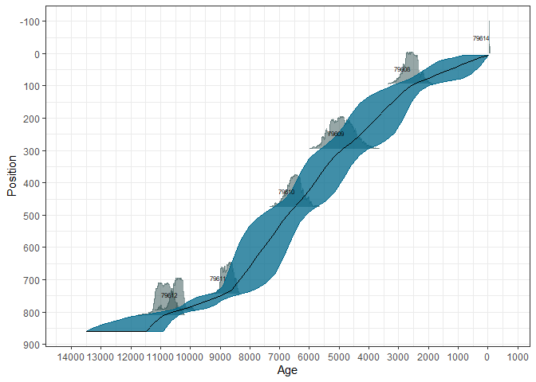
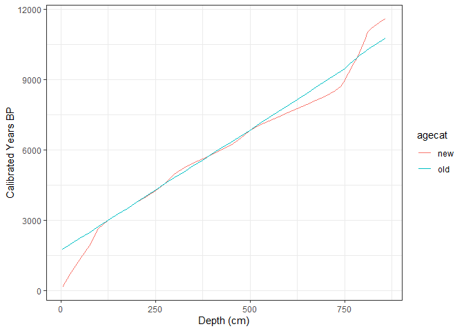

## Building New Chronologies

This RMarkdown document will walk you through the process of:

1. Downloading a single diatom record
2. Examining the chronologies for that record and associated chronological controls
3. Creating a new chronology for the record
4. Adding the chronology to the record
5. Switching between default chronologies

We will use the diatom core from **Barnegat Bay, West Creek** (New Jersey), the same core we drew as a stratigraphic diagram at the end of the [simple workflow](https://open.neotomadb.org/Current_Workshop/simple_workflow.html). This approach is focused on a single record, but much of what is done here can be extended to multiple records using functions.

## Load Libraries

For this workshop element we need `neotoma2`, `dplyr`, `ggplot2` and `Bchron` to do the work, plus `DT` for displaying tables. We'll be loading a record from Neotoma, building a new chronology for the record, and then adding the chronology back to the record.

We'll be using the R package `pacman` here, to automatically load and install packages:


``` r
pacman::p_load(neotoma2, dplyr, ggplot2, Bchron, DT)
```

## Loading the Record

We worked through the process for finding and downloading records using `neotoma2` in the [simple workflow](https://open.neotomadb.org/Current_Workshop/simple_workflow.html). There, we found the Barnegat Bay, West Creek core among the Philadelphia-area diatom cores. It is [site 14270](https://data.neotomadb.org/14270) in Neotoma, so we can go straight back to it.

We follow the same steps as before: `get_sites()`, then `get_datasets()`, then `get_downloads()`. In between we keep only the `diatom` dataset. This site's collection unit also has a loss-on-ignition dataset, and we only want the diatoms.


``` r
barnegat <- get_sites(14270) %>%
  get_datasets() %>%
  neotoma2::filter(datasettype == "diatom") %>%
  get_downloads()
```

Now we use the `chronologies()` helper function to look at the chronologies associated with the record:


``` r
barnegat_chron <- chronologies(barnegat)

barnegat_chron %>%
  as.data.frame() %>%
  dplyr::select(chronologyid, chronologyname, agemodel, modelagetype, isdefault) %>%
  DT::datatable(
    rownames = FALSE,
    options = list(scrollX = "100%", dom = "t")
  )
```

```{=html}
<div class="datatables html-widget html-fill-item" id="htmlwidget-491bbc33cc6e7d079b78" style="width:100%;height:auto;"></div>
<script type="application/json" data-for="htmlwidget-491bbc33cc6e7d079b78">{"x":{"filter":"none","vertical":false,"data":[["12786"],["Velinsky 2011"],["Constant Initial Concentration (CIC)"],["Calendar years BP"],[true]],"container":"<table class=\"display\">\n  <thead>\n    <tr>\n      <th>chronologyid<\/th>\n      <th>chronologyname<\/th>\n      <th>agemodel<\/th>\n      <th>modelagetype<\/th>\n      <th>isdefault<\/th>\n    <\/tr>\n  <\/thead>\n<\/table>","options":{"scrollX":"100%","dom":"t","columnDefs":[{"name":"chronologyid","targets":0},{"name":"chronologyname","targets":1},{"name":"agemodel","targets":2},{"name":"modelagetype","targets":3},{"name":"isdefault","targets":4}],"order":[],"autoWidth":false,"orderClasses":false}},"evals":[],"jsHooks":[]}</script>
```

This core has one chronology, `12786`, published by Velinsky (2011). It is a lead-210 (<sup>210</sup>Pb) age model, using the *Constant Initial Concentration* (CIC) method. We want to build a new one with the function `Bchronology()` from the [`Bchron` package](https://cran.r-project.org/web/packages/Bchron/vignettes/Bchron.html), and then compare the two.

It's worth pointing out the `isdefault` column here. Neotoma provides the opportunity to link multiple chronologies to a single record. This lets researchers add their chronologies when they publish new studies. For each age type (Radiocarbon years BP, Calendar years BP, &cetera) there is a default chronology that defines the model for the date interpolation. There is also a hierarchy for the default chronologies. By default Neotoma assigns the age model using _calendar years_ the highest priority, then _calibrated radiocarbon years_, then _radiocarbon years_. You can see the order in practice if we look at the content of `get_table("age types")`.

### Extract `chroncontrols`

We're going to use chronology `12786` as our template. To generate a new chronology for this record we want to see which chronological control points were used for the record. We will extract all the chroncontrols, filter by the `chronologyid`, and then arrange them by depth:


``` r
# Extract the chronological controls used in the original chronology:
controls <- chroncontrols(barnegat) %>%
  dplyr::filter(chronologyid == 12786) %>%
  arrange(depth)

controls %>%
  DT::datatable(
    rownames = FALSE,
    options = list(scrollX = "100%")
  )
```

```{=html}
<div class="datatables html-widget html-fill-item" id="htmlwidget-676aa8ea5f6611327e97" style="width:100%;height:auto;"></div>
<script type="application/json" data-for="htmlwidget-676aa8ea5f6611327e97">{"x":{"filter":"none","vertical":false,"data":[[14270,14270,14270,14270,14270,14270,14270,14270,14270,14270,14270,14270,14270],[12786,12786,12786,12786,12786,12786,12786,12786,12786,12786,12786,12786,12786],["Velinsky 2011","Velinsky 2011","Velinsky 2011","Velinsky 2011","Velinsky 2011","Velinsky 2011","Velinsky 2011","Velinsky 2011","Velinsky 2011","Velinsky 2011","Velinsky 2011","Velinsky 2011","Velinsky 2011"],[1,3,5,7,9,11,13,15,17,19,21,25,31],[2,2,2,2,2,2,2,2,2,2,2,2,2],[-57.3049817,-50.42737472,-43.56455495,-36.7185528,-28.91816128,-22.11654243,-15.34038917,-8.593393512,-1.879837615,4.795304135,11.42624414,25.45369069,44.52711338],[-54.6950183,-47.57262528,-40.43544505,-33.2814472,-25.08183872,-17.88345757,-10.65961083,-3.406606488,3.879837615,11.20469587,18.57375586,34.54630931,57.47288662],[47195,47196,47197,47198,47199,47200,47201,47202,47203,47204,47205,47206,47207],[-56,-49,-42,-35,-27,-20,-13,-6,1,8,16,30,51],["Lead-210","Lead-210","Lead-210","Lead-210","Lead-210","Lead-210","Lead-210","Lead-210","Lead-210","Lead-210","Lead-210","Lead-210","Lead-210"]],"container":"<table class=\"display\">\n  <thead>\n    <tr>\n      <th>siteid<\/th>\n      <th>chronologyid<\/th>\n      <th>chronologyname<\/th>\n      <th>depth<\/th>\n      <th>thickness<\/th>\n      <th>agelimityounger<\/th>\n      <th>agelimitolder<\/th>\n      <th>chroncontrolid<\/th>\n      <th>chroncontrolage<\/th>\n      <th>chroncontroltype<\/th>\n    <\/tr>\n  <\/thead>\n<\/table>","options":{"scrollX":"100%","columnDefs":[{"className":"dt-right","targets":[0,1,3,4,5,6,7,8]},{"name":"siteid","targets":0},{"name":"chronologyid","targets":1},{"name":"chronologyname","targets":2},{"name":"depth","targets":3},{"name":"thickness","targets":4},{"name":"agelimityounger","targets":5},{"name":"agelimitolder","targets":6},{"name":"chroncontrolid","targets":7},{"name":"chroncontrolage","targets":8},{"name":"chroncontroltype","targets":9}],"order":[],"autoWidth":false,"orderClasses":false}},"evals":[],"jsHooks":[]}</script>
```

There are 13 controls, all of type `Lead-210`, between 1 and 31 cm. Ages are in calendar years BP, so the negative ages are samples younger than 1950. We could also save this table, edit it in Excel or another spreadsheet program (for example, to add a new date by adding a new row), and read it back in. Here we will use the controls exactly as they were published.

### Extract Depth & Analysis Unit IDs

Next, we extract the `depth`s and `analysisunitid`s from the dataset `samples()`. Pulling in both `depth`s and `analysisunitid`s is important because a single collection unit may have multiple datasets, which may have non-overlapping depth sequences. (Here, the loss-on-ignition dataset that we left out was measured at some depths where no diatoms were counted.) So, when adding sample ages back to a record we use the `analysisunitid` to make sure we are providing the correct assignment since depth may be specific to a single dataset.


``` r
# Get a two column data.frame with columns depth and analysisunitid.
# Sort the table by depth from top to bottom for "Bchronology"
predict_depths <- samples(barnegat) %>%
  select(depth, analysisunitid) %>%
  unique() %>%
  arrange(depth)
```

### Building the Age Model

Now we can pass the controls and the sample depths to `Bchronology()`. A few notes on the arguments:

* `ages` and `ageSds`: we assume the distance between `chroncontrolage` and `agelimityounger` is 1 standard deviation. `Bchronology()` wants whole numbers for the standard deviations, so we round them, with a minimum of 1.
* `calCurves`: the usual use of `Bchron` is for radiocarbon dates, which need a calibration curve (such as `"intcal20"`). Our lead-210 ages are already in calendar years, so we give each one a `"normal"` distribution instead. We are doing this to show the mechanics of the workflow, not as a recommendation for how to date a lead-210 core.
* `predictPositions`: the depths where we want ages. The three deepest samples (35, 45 and 69 cm) are below the deepest control (31 cm), so `allowOutside = TRUE` is needed, and their ages will be extrapolated, with growing uncertainty.

This step takes about 20 seconds. We set the random seed so that everyone gets (nearly) the same answer.


``` r
set.seed(1234)

new_chron <- Bchron::Bchronology(
  ages = controls$chroncontrolage,
  ageSds = pmax(round(abs(controls$agelimityounger - controls$chroncontrolage)), 1),
  calCurves = rep("normal", nrow(controls)),
  positionThicknesses = controls$thickness,
  positions = controls$depth,
  predictPositions = predict_depths$depth,
  allowOutside = TRUE,
  ids = controls$chroncontrolid
)

# Predict ages at each depth for which we have samples.  Returns a matrix.
newpredictions <- predict(new_chron, predict_depths$depth)
```


``` r
plot(new_chron) +
  ggplot2::labs(
    x = "Age (cal years BP)",
    y = "Depth (cm)"
  )
```



### Creating the New `chronology` and `contact` objects

Given the new chronology, we want to add it to the `sites` object so that it becomes the default for any calls to `samples()`. To create the metadata for the new chronology, we use `set_chronology()` using the properties from the [`chronology` table in Neotoma](https://open.neotomadb.org/dbschema/tables/chronologies.html):


``` r
# Add information about the people who generated the new chronology:
creators <- c(
  set_contact(
    givennames = "Simon James",
    familyname = "Goring",
    ORCID = "0000-0002-2700-4605"
  ),
  set_contact(
    givennames = "Socorro",
    familyname = "Dominguez Vidaña",
    ORCID = "0000-0002-7926-4935"
  )
)

# Add information about the chronology:
new_chron_barnegat <- set_chronology(
  agemodel = "Bchron model",
  contact = creators,
  isdefault = TRUE,
  ageboundolder = max(newpredictions),
  ageboundyounger = min(newpredictions),
  dateprepared = Sys.Date(),
  modelagetype = "Calendar years BP",
  chronologyname = "Workshop example chronology",
  chroncontrols = controls
)

# A short note on how the model was built:
new_chron_barnegat$notes <- "Bchron::Bchronology() with the published lead-210 ages as normal distributions (workshop example)."
```

### Adding the `chronology` to the `collectionunit`

Once we've created the chronology we need to apply it back to the collectionunit. We also need to add the predicted dates into the samples for each dataset associated with the collectionunit.

So:

1. we have a collectionunit in `barnegat` that is accessible at `barnegat[[1]]$collunits`.
2. We can use the function `add_chronology()`, which takes the chronology object and a `data.frame()` of sample ages.
3. The predicted dates associated with the new chronology need to be transferred to each `samples` object within the `collectionunit`.

This is all bound up in the `add_chronology()` function, which takes the `collectionunit`, modifies it, and returns the newly updated `collectionunit`.


``` r
new_sample_ages <- data.frame(predict_depths,
  age = colMeans(newpredictions),
  ageolder = colMeans(newpredictions) +
    apply(newpredictions, 2, sd),
  ageyounger = colMeans(newpredictions) -
    apply(newpredictions, 2, sd),
  agetype = "Calendar years"
)

barnegat[[1]]$collunits[[1]] <- add_chronology(
  barnegat[[1]]$collunits[[1]],
  new_chron_barnegat,
  new_sample_ages
)
```

With this, we now have the updated collectionunit, and two chronologies in the record:


``` r
chronologies(barnegat) %>%
  as.data.frame() %>%
  dplyr::select(chronologyid, chronologyname, isdefault) %>%
  DT::datatable(
    rownames = FALSE,
    options = list(scrollX = "100%", dom = "t")
  )
```

```{=html}
<div class="datatables html-widget html-fill-item" id="htmlwidget-984bdee69abb3a6824b4" style="width:100%;height:auto;"></div>
<script type="application/json" data-for="htmlwidget-984bdee69abb3a6824b4">{"x":{"filter":"none","vertical":false,"data":[["12786","162654094"],["Velinsky 2011","Workshop example chronology"],[false,true]],"container":"<table class=\"display\">\n  <thead>\n    <tr>\n      <th>chronologyid<\/th>\n      <th>chronologyname<\/th>\n      <th>isdefault<\/th>\n    <\/tr>\n  <\/thead>\n<\/table>","options":{"scrollX":"100%","dom":"t","columnDefs":[{"name":"chronologyid","targets":0},{"name":"chronologyname","targets":1},{"name":"isdefault","targets":2}],"order":[],"autoWidth":false,"orderClasses":false}},"evals":[],"jsHooks":[]}</script>
```

Let's take a look at how this affects the age model overall. To pull the ages from the prior chronology, we use the `set_default()` function to change the default chronology, and then extract ages, depths & analysis units:


``` r
# The new chronology is currently the default chronology.
newages <- samples(barnegat) %>%
  select(depth, analysisunitid, age) %>%
  unique() %>%
  arrange(depth) %>%
  mutate(agecat = "new")

# Switch back to the published (Velinsky 2011) chronology:
barnegat[[1]]$collunits[[1]]$chronologies <- set_default(
  barnegat[[1]]$collunits[[1]]$chronologies,
  12786
)

plotforages <- samples(barnegat) %>%
  select(depth, analysisunitid, age) %>%
  unique() %>%
  arrange(depth) %>%
  mutate(agecat = "old") %>%
  bind_rows(newages)
```

And we can look at the difference visually:


``` r
ggplot(plotforages, aes(x = depth, y = age)) +
  geom_path(aes(color = agecat)) +
  geom_point(aes(color = agecat)) +
  theme_bw() +
  xlab("Depth (cm)") +
  ylab("Calendar Years BP (negative = after 1950)")
```



The two models agree closely within the dated part of the core (1-31 cm), as we would expect, since they use the same controls. Below 31 cm there is no control, so the two models extrapolate differently and the ages drift apart.

So we can see the impact of the new chronology on the age model for the record, and we can make choices as to which model we want to use going forward. We can use this approach to create multiple new chronologies for a single record, tuning parameters within `Bchronology()`, or using Bacon and different parameters. Because the `chronology` is an R object we can save the objects for use in future sessions, and associate them with existing records, or we can re-run the models again.

## Summary

From this notebook we have learned how to:

1. Download a single record (the Barnegat Bay, West Creek diatom core, using `get_sites()`, `get_datasets()` and `get_downloads()`)
2. Examine the chronologies for the record (using `chronologies()`) and associated chronological controls (using `chroncontrols()`)
3. Create a new chronology for the record (using `Bchronology()` and `set_chronology()`)
4. Add the chronology to the record (using `add_chronology()`)
5. Switch between default chronologies (using `set_default()`)

This approach is focused on a single record, but much of what is done here can be extended to multiple records using functions. We hope it's been helpful!
