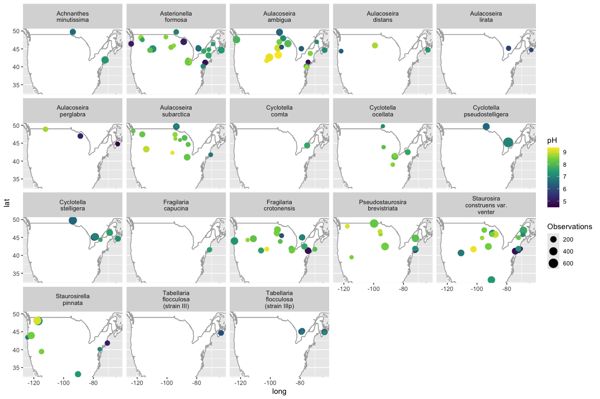
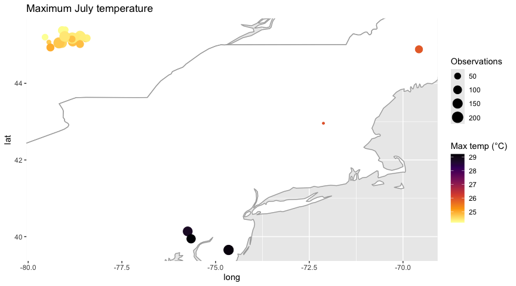
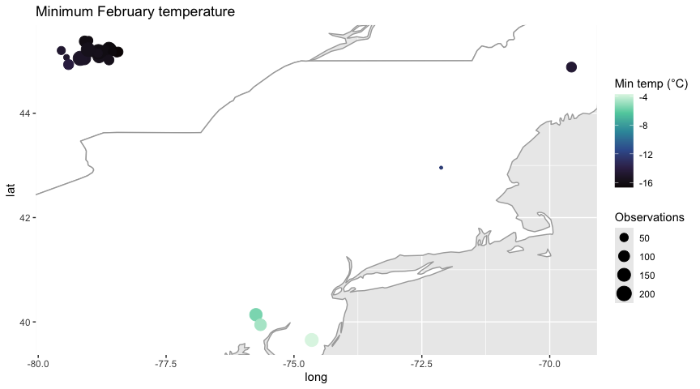

## 1. Introduction

This document shows how to **map** diatom and water chemistry data from Neotoma with `neotoma2`, and how to look at them together. It builds on "A Simple Workflow for Diatoms in Neotoma" (`simple_workflow.Rmd`), so if you have not been through that one yet, start there.

We will:

* Map the sites with diatom and diatom surface sample datasets in North America -- [Diatoms in North America](#diatoms-in-north-america)
* Map the sites with water chemistry data, and see which of them also have diatoms -- [Water chemistry](#water-chemistry-data-availability)
* Load an *aggregate dataset* from a spreadsheet of site and dataset IDs, and map the pH of the lakes -- [Aggregate datasets](#aggregate-datasets)
* Join diatom and water chemistry data, and look at the diatoms against climate (July maximum and February minimum temperature) -- [Climate](#climate)

The downloads in this document are large (thousands of sites), so we ran them ahead of time and saved the answers in the `data/` folder. In each **Code** tab the download lines are commented out, and the data are read back from `data/`. The **Result** tab runs the same code, so everything here works in Binder without calling Neotoma.

## 2. Where are the sites?

### 2.1. Diatoms in North America {.tabset}

We start by asking Neotoma for the sites with diatom data in North America. The `datasettype` parameter lets us ask for one kind of dataset, and we will make two maps: one for `"diatom surface sample"` and one for the generic `"diatom"` type. If you need the full list of dataset types, run `neotoma2::get_table('datasettypes')` (see the dataset type filtering in "A Simple Workflow").

To restrict the geography, we use the `loc` parameter with an `sf` polygon of North America. The polygon is based on the North America geojson from [geo2day](https://geo2day.com/north_america.html) and OSM, with the piece in Asia removed so it is a single polygon.


``` r
# Based on the North America geojson from geo2day and OSM:
# https://geo2day.com/north_america.html
# The piece in Asia was removed, so it is a single polygon.
northAmerica_geojson <- '{ "type": "Polygon", "coordinates": [[
  [ -114.551021, 8.243424 ], [ -100.890972, 5.57228 ], [ -92.224904, 14.528089 ], [ -92.215719, 14.541424 ],
  [ -92.213745, 14.553013 ], [ -92.182331, 14.573283 ], [ -92.161045, 14.646372 ], [ -92.144651, 14.654344 ],
  [ -92.145853, 14.68025 ], [ -92.141047, 14.689715 ], [ -92.152119, 14.734544 ], [ -92.155895, 14.770235 ],
  [ -92.179756, 14.84276 ], [ -92.144394, 14.868976 ], [ -92.133923, 14.889548 ], [ -92.144566, 14.965848 ],
  [ -92.142162, 14.991054 ], [ -92.089977, 15.010951 ], [ -92.068005, 15.045933 ], [ -92.057608, 15.071329 ],
  [ -92.208172, 15.260974 ], [ -92.14514, 15.3644 ], [ -91.73003, 16.072624 ], [ -90.438873, 16.071091 ],
  [ -90.42128, 16.09755 ], [ -90.42582, 16.243368 ], [ -90.36597, 16.37167 ], [ -90.38612, 16.41403 ],
  [ -90.47572, 16.46254 ], [ -90.547828, 16.485324 ], [ -90.58075, 16.47693 ], [ -90.62018, 16.57474 ],
  [ -90.680693, 16.710966 ], [ -91.26217, 17.18693 ], [ -91.4179, 17.21305 ], [ -91.43341, 17.24601 ],
  [ -90.986527, 17.250229 ], [ -90.985228, 17.281262 ], [ -90.984247, 17.812629 ], [ -90.366326, 17.809168 ],
  [ -89.1391, 17.81344 ], [ -89.13973, 17.95423 ], [ -89.02484, 17.9995 ], [ -88.99783, 17.95056 ],
  [ -88.98711, 17.94322 ], [ -88.94982, 17.94975 ], [ -88.93739, 17.92976 ], [ -88.9241, 17.91508 ],
  [ -88.91209, 17.90611 ], [ -88.88123, 17.89264 ], [ -88.85808, 17.89101 ], [ -88.84036, 17.9289 ],
  [ -88.78258, 17.9735 ], [ -88.75998, 18.02208 ], [ -88.70053, 18.07303 ], [ -88.66034, 18.13192 ],
  [ -88.64108, 18.18045 ], [ -88.6009, 18.23771 ], [ -88.56227, 18.32867 ], [ -88.5426, 18.35952 ],
  [ -88.54595, 18.38234 ], [ -88.52891, 18.40783 ], [ -88.5161, 18.46097 ], [ -88.47518, 18.48961 ],
  [ -88.44756, 18.47362 ], [ -88.40121, 18.49327 ], [ -88.38969, 18.48 ], [ -88.37981, 18.47636 ],
  [ -88.32686, 18.48703 ], [ -88.28955, 18.46881 ], [ -88.284453, 18.40684 ], [ -88.046393, 18.407716 ],
  [ -88.03614, 18.157681 ], [ -87.913959, 18.145179 ], [ -87.363287, 17.821921 ], [ -85.49087, 18.19755 ],
  [ -86.79214, 24.50671 ], [ -82.89581, 23.95012 ], [ -79.84516, 24.542 ], [ -79.18945, 28.04479 ],
  [ -61.20258, 24.63857 ], [ -34.48789, 62.81725 ], [ -6.676794, 74.79839 ], [ -5.198412, 85.04177 ],
  [ -180, 85.03695 ], [ -180, 25.53 ], [ -162.729536, 15.834578 ], [ -148.974697, 15.623121 ],
  [ -114.551021, 8.243424 ]
]]}'

northAmerica_sf <- geojsonsf::geojson_sf(northAmerica_geojson)
```

#### 2.1.1. Code


``` r
diatSS_NA_sites <- get_sites(loc = northAmerica_sf,
                             datasettype = "diatom surface sample",
                             all_data = TRUE)

diatom_NA_sites <- get_sites(loc = northAmerica_sf,
                             datasettype = "diatom",
                             all_data = TRUE)
```

#### 2.1.2. Result {.active}


```{=html}
<div class="leaflet html-widget html-fill-item" id="htmlwidget-a7ef56aa67e11bb184fa" style="width:672px;height:480px;"></div>
<script type="application/json" data-for="htmlwidget-a7ef56aa67e11bb184fa">{"x":{"options":{"crs":{"crsClass":"L.CRS.EPSG3857","code":null,"proj4def":null,"projectedBounds":null,"options":{}}},"calls":[{"method":"addTiles","args":["https://{s}.tile.openstreetmap.org/{z}/{x}/{y}.png",null,null,{"minZoom":0,"maxZoom":18,"tileSize":256,"subdomains":"abc","errorTileUrl":"","tms":false,"noWrap":false,"zoomOffset":0,"zoomReverse":false,"opacity":1,"zIndex":1,"detectRetina":false,"attribution":"&copy; <a href=\"https://openstreetmap.org/copyright/\">OpenStreetMap<\/a>,  <a href=\"https://opendatacommons.org/licenses/odbl/\">ODbL<\/a>"}]},{"method":"addCircleMarkers","args":[[44.80156,46.701316,44.45734,45.779154,47.92417,45.985066,45.41111,46.28932,45.8532,48.18333,43.986946,44.13248400000001,44.398608,44.095356,43.839228,44.329984,44.313704,44.092274,43.550406,44.03871400000001,43.831658,44.312902,43.861148,44.142782,44.381974,43.831862,44.181964,43.832062,44.123988,44.122564,44.106814,44.259604,44.048486,44.130742,44.54430199999999,44.142018,44.041472,44.264042,44.189516,44.124716,44.019466,41.93248,47.706578,41.134956,41.376234,41.002606,52.41667,52.45,52.55,52.6,52.73333,52.6,52.86667,52.4,52.5,52.2,52.36667,52.58333,52.08333,52.08333,52.13333,52.2,53.61667,53.61667,53.63333,53.6,53.68333,53.71667,54.71667,54.36667,54.41667,54.46667,55.23333,55.21667,55.1,54.88333,57.16667,57.26667,56.65,56.58333,56.28333,56.3,55.03333,54.86667,54.9,54.76667,54.86667,54.6,54.88333,55.13333,55.45,48.227368,47.07343,45.785,45.41009,45.25367,44.59625,44.2,44.25437,44.38577,44.72901,44.41587,47.35,41.381678,44.79964,48.16528,44.24694,47.16989599999999,46.426206,44.98282,41.82444,41.77,42.43872,46.854858,52.26667,48.02276,43.34114,45.924294,45.78056,52.67034,47.91667,41.250252,60.945,44.87472,41.070562,47.192748,46.004028,44.6159,44.52388,38.7018,44.738874,43.890978,31.971456,46.931034,44.436888,47.89178,48.029428,46.742646,47.907416,45.691746,43.98615,46.816652,46.880856,48.247126,37.588004,48.025184,47.962948,48.014636,47.943014,47.858526,47.844544,47.906094,47.972674,45.517306,46.024324,44.594252,44.561676,43.952524,44.353702,42.37144,32.51556,44.359454,42.5433,43.725472,47.12818,47.187678,45.590222,43.90234,49.289492,42.736838,37.569944,37.774898,53.746084,47.152472,47.11934,43.901058,45.160466,43.786424,43.67599,43.55799,43.518518,43.638548,43.621126,43.721764,47.16553800000001,47.162702,47.16995,47.227286,44.352516,44.152602,43.925392,44.118776,43.875622,46.404964,46.376894,46.43227,46.402832,46.31373,46.28120000000001,47.820642,44.876462,47.94490800000001,48.136288,48.238276,48.17135800000001,48.177896,48.178198,48.17044,48.170392,47.366688,46.687362,47.464176,47.47075,47.525382,47.99088399999999,46.18309,47.828322,46.153986,46.205424,44.95957,44.920712,44.940304,44.920166,44.90737,44.980564,44.955846,46.865984,46.815206,46.833188,46.85185999999999,47.12305,47.177574,47.13775,47.296008,47.206008,44.391156,44.87722,44.835842,45.270004,44.997578,44.370666,44.99268,45.055646,45.246748,45.107572,45.252258,44.18329600000001,44.331406,44.22857,45.138264,44.967148,44.55005,44.894726,47.97049,47.959466,47.978566,47.958664,47.34999,45.188738,48.24246,48.012992,44.941326,46.483326,47.95485799999999,47.72589,45.354936,44.367548,45.300742,45.370372,45.284784,45.155616,45.22886,45.30898,44.905892,45.164478,45.01516,46.433166,44.924844,44.788044,45.814184,45.019102,45.259672,45.16744,45.16667,45.018102,45.03136,45.04475,45.661894,45.319956,45.162004,45.57411,45.628516,45.592274,45.579396,44.991418,45.04014,44.821288,44.22493,45.372556,45.408002,41.752532,44.779972,66.47619,66.347666,66.68903999999999,66.686004,64.68847599999999,64.889932,65.48943,65.559718,65.375,64.60250000000001,64.59833,64.595574,64.59177600000001,64.59257199999999,64.15649999999999,64.15649999999999,64.15000000000001,64.15000000000001,62.7005,62.728412,62.90067,63.08017,62.900988,62.819298,63.25517,63.420662,63.561258,63.6175,63.483654,63.216298,63.126714,63.045992,62.762416,62.54533,62.55983,62.54817,62.548608,62.56771,62.54583,62.525234,62.525234,62.51683,62.67817,62.67817,62.802216,63.183536,63.308,63.5485,63.5935,63.5935,64.51133,64.099362,63.690276,63.336688,62.8895,62.50317,62.4675,63.17028,63.32028,63.42028,64.50028,64.55,65.048818,65.12027999999999,65.2675,65.15028,65.05,64.5,64.5,64.30028,64.34999999999999,64.17028000000001,63.35,63.38528,63.2175,63.15028,63.12028,75.18424800000001,39.6992,40.737206,39.335786,40.910296,40.871,39.15547,39.925258,39.708524,39.375006,41.057182,41.004116,39.66829,41.240584,66.18219999999999,66.3145,65.845,65.5742,41.909778,43.432202,44.945286,43.079876,44.95342,41.592402,41.899174,42.512864,42.42815,41.698448,41.683536,41.48857,41.773538,41.790282,65.271,64.947,42.732648,65.44070000000001,65.66800000000001,65.86499999999999,65.63924200000001,66.25,40.128972,66.14,66.61,39.19533,39.80567,40.410836,66.914232,40.556,40.244052,41.029474,67.10991799999999,40.310118,41.022652,66.86499999999999,66.69,66.45999999999999,65.741028,65.691166,63.481044,44.05125,63.62,62.6407,45.32608,61.961526,61.6758,41.374204,62.5133,41.63463,41.50885,41.722196,41.512976,41.737104,41.722608,41.489982,41.810498,41.58217,43.43901,43.3468,43.623622,44.569828,42.7475,43.445622,43.579842,43.178952,43.431144,43.562442,42.88477,64.63120000000001,65.0038,63.78,63.768,44.441354,42.70567,72.56,42.915554,72.29349999999999,43.928452,72.27,43.66591,73.002,43.246602,42.921192,43.4712,44.967796,43.75838,73.66970000000001,72.699414,72.06,72.749,42.151226,44.53465,44.329836,43.64286199999999,44.402802,44.53533,44.914896,71.95,44.44226,71.75,43.63287,70.0432,44.488422,70.2717,44.36129,70.73699999999999,40.92805,70.48180000000001,39.473544,70.535,70.95869999999999,39.49464,70.45999999999999,39.817248,69.893,40.0537,69.41800000000001,69.76000000000001,39.34609,69.883,39.602204,70.29000000000001,39.59078,63.60349,39.68103,67.7966,40.276772,67.7028,66.95,40.80261,40.91079,40.79971,40.40024,40.96649,41.093158,40.94679600000001,40.95226,41.073358,41.1429,41.08112,41.13718,41.05907,40.96557,40.99154,41.16568,41.178252,40.880264,40.712042,39.55774,39.394312,39.732726,40.83406400000001,39.78917,39.859332,40.467422,40.93681,40.9062,40.85742,40.983052,41.0121,41.004938,41.002726,40.974214,65.69199999999999,41.030956,41.070778,40.197958,41.056048,39.75327,40.909676,40.87098,72.43000000000001,40.429932,41.16743,39.433104,66.9983,62.17,40.410798,40.85901,63.61,41.20037,40.635106,40.255696,39.817672,41.136996,40.966662,40.47118,40.931736,41.032802,39.81472,40.869286,41.08754,41.18018,40.987496,39.780334,40.93731,41.14541,41.02795,41.04285,41.017,41.14858,41.084816,41.097246,41.152,40.97163,41.001346,41.031698,41.00139,47.898738,47.624778,48.917844,46.757024,46.941442,43.918614,47.129986,47.099568,39.93824,40.008348,40.15966,39.94468,39.94468,39.85742,40.05739,39.978688,39.95472,39.911274,40.03174,39.954208,43.53474,45.35083,43.928236,44.373748,43.71306,43.90722,42.5,42.51694,43.22826999999999,44.81861,45.030838,46.687288,46.390526,48.401278,46.02155,48.689368,48.68306,47.85476,46.69167,46.684994,47.550094,47.55326,44.556092,44.4206,46.950704,46.91833,46.78167,46.78,46.77833,46.77667,46.775,46.76667,46.76667,46.76833,46.76833,46.77667,46.97833,46.945,43.5675,46.76667,46.91833,46.88167,46.91667,47.04139,72.48999999999999,72.26924199999999,82.13,82.106764,81.40000000000001,80.83,80.58,80.570438,80.263616,80.182016,79.98,79.92,79.73,79.73,79.72,79.65000000000001,79.54561,76.59873400000001,76.56,76.36685799999999,76.36685799999999,75.53,75.53,75.53,75.51730000000001,75.52,75.51000000000001,75.43000000000001,75.40202000000001,75.37,75.22,75.03,74.98,74.93000000000001,74.91,74.68000000000001,73.617268,73.58,72.7,72.29000000000001,72.292182,72.29000000000001,72.29000000000001,72.28,72.26000000000001,72.03,72.02,72.01000000000001,71.362278,71.34,71.34,71.31,71.31,69.92,69.90000000000001,69.87,69.87,44.07644000000001,52.137616,68.58,38.161302,38.1479,38.027852,42.267312,43.742458,37.30166,45.840278,47.116616,46.265856,46.37027,46.288594,46.93129,46.093942,46.365514,46.13333,46.024358,46.117644,47.28087,46.576958,46.46117,46.437104,46.4549,47.38208,47.08769,46.703986,46.13942400000001,46.061982,46.132692,46.05253,43.518716,44.407404,44.690636,45.379304,44.6279,44.61028,52.67,43.826934,52.272588,51.796028,42.917566,44.637058,49.229088,52.292448,52.488518,46.680738,29.67583,30.522838,29.27222,29.23194,29.07583,29.73833,43.621142,29.0225,29.13583,29.06139,29.23194,29.125,29.19556,28.97778,29.199366,29.425,29.03778,29.25833,29.10972,29.16194,29.15,29.96389,29.41667,29.69722,29.18333,29.1475,28.99639,29.13778,29.12778,29.05,29.19667,29.10389,29.16333,57.25,56.7,48.203876,46.463104,45.82638,45.790264,45.796646,45.840916,46.598748,45.35416,45.724872,46.453376,46.44043,46.043818,45.81716400000001,45.869174,45.88805,47.999894,45.91055,46.439876,45.996946,45.90518,45.790364,45.775,46.10111,46.064988,46.60069,48.025108,48.228352,46.537058,45.72444,47.991458,48.005224,46.58855800000001,45.80138,45.372702,48.0005,30.53714,38.81717,37.50728,40.15669,45.17199,46.53836,48.39248,44.36456,40.67141,34.91384,38.75947,38.12542,48.75171,39.33202,39.29722,47.82117,37.66794,47.64356,38.379808,34.24558,41.99076,39.4692,37.94635,29.49147,39.92062,34.747084,29.172356,44.209684,43.570656,44.091806,35.0198,40.55157,41.4695,38.49363,32.37834,36.31068,32.7146,37.31529,37.2932,40.46163,40.27035,35.81388,34.15365,37.19249,42.21176,40.87358,43.92763,29.20566,38.99692,42.45836,45.44214,43.37864,36.89068,41.77556,33.74733,31.29345,37.72692,37.09209,33.03606,48.96606,38.79133,33.32111,40.72496,38.0991,42.25218,40.34378,35.99079,38.38849,34.3737,43.819248,40.43821,32.02986,37.43234,35.93943,41.80418,40.70733,36.98625,37.90869,40.95544,38.93961,35.37134,35.17104,38.32878,31.19633,37.75822,42.1514,40.43032,34.16579,41.76462,47.88008,35.95443,28.57556,34.53937,44.08794,37.17719,34.27511,38.72323,42.21592,36.53187,46.57403,38.51725,35.19859,42.12319,36.63671,34.51894,34.59441,35.73708,31.44842,33.49585,37.04266,46.17968,34.21453,37.671,37.69559,45.06813,38.94599,34.47617,36.11836,40.52821,41.17631,38.47961,33.16059,46.01156,34.44592,40.03138,37.34472,38.79133,41.47721,42.51317,39.72649,38.83462,40.75747,36.67344,41.16921,43.66298,44.78748,38.0622,37.39412,33.45374,46.93083,39.99374,35.56344,38.8235,39.34813,44.049448,41.21443,43.890452,41.989312,30.007576,42.62695,41.92392,45.15222,45.747634,45.138288,46.959202,44.400728,48.39561,46.947716,46.876912,47.00467,46.926798,41.615406,48.14835,48.07961,47.973062,47.853316,48.007276,48.04919,48.040358,48.094226,47.994054,44.918746,45.151536,44.759252,46.566032,46.53277,46.633118,46.559486,46.480466,45.92288,45.945512,45.41725,44.93211,44.757144,44.923236,45.008684,44.708582,45.126492,44.838888,44.739828,44.69277,44.947418,44.903598,48.467196,48.509942,48.515798,48.497276,48.470246,48.527224,48.483052,48.538024,48.524712,48.48816,48.333322,48.394976,48.41478,48.516966,48.524892,48.532286,48.476832,48.517774,48.499448,48.39741,48.536182,43.903222,42.478718,37.649272,34.946572,41.860474,46.498106,42.05397,42.02157,41.87702,41.84357,41.950492,41.139272,41.411204,43.5253,42.538468,44.051024,42.166478,44.764906,45.63558,46.167698,45.777916,44.21002,45.332018,43.77174,43.972192,46.433914,44.067946,46.47429,44.95496,43.82894,46.104068,46.02908,44.415006,44.65394999999999,47.104948,46.056554,44.436818,44.992254,45.39669,43.966754,42.535808,43.835508,44.839572,43.527454,43.971268,43.366106,42.770484,43.32722200000001,43.877004,43.4821,44.086372,42.83358,43.838312,45.237802,40.951648,40.92946,39.96833,39.407486,39.85198,41.039182,40.225162,41.106606,39.934856,40.972352,40.810572,43.242024,44.37937,44.734208,43.454088,41.881024,41.433906,41.50124,41.788002,41.449992,41.749792,41.136564,42.929708,42.355494,44.446002,44.41776,43.49557,44.085962,43.451266,44.623082,42.7427,44.674272,44.984504,44.60992,44.529102,44.648492,44.676386,44.675424,43.752394,43.76348,44.704352,44.7119,44.50624,44.761516,44.437812,43.771262,43.99527,44.58083,44.10083,43.79574,43.50944,44.352056,43.91666,44.66055,44.38805,44.110422,44.34333,43.784194,43.68333,44.34472,47.45725,48.24615,40.80705,42.51691,44.56839,44.52251,42.58198,44.70839,47.44869,31.66684,43.74156,46.47136,28.8253,28.0921,45.52824,47.2331,28.3232,35.75956,45.63873,45.00158,44.9288,46.60064,42.96547,41.38426,47.40931,45.49016,48.70868,47.92616,28.63214,28.57332,28.84218,27.94019,41.6334,43.09952,42.36492,26.93623,46.08392,44.71864,46.38197,47.57601,27.84729,28.10243,28.06127,45.88174,39.01485,41.69699,44.00552,29.08006,28.91617,41.44986,40.59294,41.69517,28.56369,44.30175,46.9863,39.58892,44.94117,42.73174,43.80795,41.72093,44.15404,42.52697,45.28365,42.37329,47.07144,43.95296,47.17784,47.59161,45.85043,45.33667,42.69132,44.34881,41.65548,46.43678,46.19906,47.46149,46.25503,44.875642,48.02025,47.89085,43.21838,39.5539,45.4545,44.64519,42.77239,44.32355,39.1716,43.49985,45.76883,46.56718,30.21124,38.96688,46.04072,42.53264,45.98738,47.57069,41.5534,45.219,45.50053,42.74496,40.08076,33.15857,46.02793,30.47159,41.68315,47.18441,42.14994,48.66029,41.41314,46.27199,43.23106,47.91515,45.81215,37.5242,45.25938,36.7873,44.43065,44.19244,42.92535,46.7633,42.48541,42.14002,41.97099,45.30108,39.41623,45.55715,43.49636,41.56235,43.20849,42.41647,48.085384,41.56832,41.17205,30.11841,41.93461,44.94844,46.25212,42.52617,46.57882,43.92943,43.92921,43.64335,46.86973,42.426,43.21856,46.82219,42.54199,45.35374,44.0428,45.99791,45.76469,46.96117,42.45326,45.89625,38.55949,42.5651,38.75601,45.84992,46.87139,27.74199,43.57477,43.37516,47.66726,41.2268,41.0415,45.65355,41.95096,41.4566,45.31578,42.08118,46.41918,48.16173,41.58028,41.24575,40.62803,44.82453,48.15402,42.383,47.09946,45.97263,41.3941,44.8585,29.839142,42.92256,48.18443,39.17534,44.02361,41.40044,39.74858,41.89097,42.40713,41.78763,45.07364,46.36895,48.96243,41.43839,43.55819,41.67863,45.39185,44.94196,48.92435,43.71379,44.02665,45.58065,43.49624,47.12281,45.88816,45.20707,47.06936,42.82731,42.04005,41.90973,42.40484,43.15032,46.94267,39.71572,44.30658,41.68899,42.39865,47.31108,43.54592,43.45913,43.95898,43.9911,41.51786,42.61644,42.78878,44.36243,42.276,48.40689,41.32291,45.7993,38.66087,43.7963,40.68364,39.98586,28.86654,43.840026,45.75699,44.32605,40.68975,47.42776,41.80079,40.18092,48.17781,47.31453,47.83493,47.19306,43.3553,47.67254,46.944048,44.23115,42.4783,44.95429,47.9749,43.19953,43.73613,41.49585,38.7036,42.70548,42.00008,47.9188,45.32625,42.47148,42.57821,43.46133,42.18669,46.41279,48.45509,42.53347,43.02337,48.71606,43.53425,41.95741,41.93752,44.68401,43.70497,41.51134,44.428154,41.73475,46.89198,46.11444,45.09336,46.1318,45.6435,48.2861,36.59009,47.92495,44.92721,46.8927,46.64962,47.57885,47.13645,47.34438,45.89057,45.72352,47.07428,45.18456,45.18292,45.6947,30.83484,45.144416,43.760286,45.00507,43.88114,44.107318,44.260352,45.030664,42.831274,45.463198,44.176886,44.76162,44.426246,43.955634,43.303548,45.72741199999999,45.50816,42.909852,43.785,47.16413,44.762962,44.811302,44.28067,43.85667400000001,44.735972,45.927696,44.91308,44.26531,44.01825,44.70472,43.865162,44.88716,45.0373,44.006782,43.858852,44.67124,44.894334,44.633812,45.018524,44.413484,44.306922,44.909646,44.246426,45.200242,44.632746,44.198786,44.334922,43.30721,44.563508,44.749692,46.277152,44.527644,45.188268,44.01288,44.444936,45.024578,44.595712,44.45988,41.632522,41.601102,41.527,41.762172,41.392074,41.350228,41.611842,41.287966,41.318424,41.405174,41.916496,41.838214,41.831472,41.83864,41.298616,41.311266,41.823528,41.26646,41.26969,41.580406,41.32332,41.250458,41.819208,41.7952,41.771,41.726642,41.3542,41.822734,41.830246,41.732272,41.515666,41.81333,41.571444,41.404608,43.832022,44.917086,39.6534,43.31528,47.21368,43.8519,44.8855,43.76528,43.84833,41.428678,42.55699,43.415974,43.83167,41.4645,43.167056,40.951168,45.073484,45.0494,43.1252,43.827892,44.14111,39.6117,41.5724,46.766436,42.767952,45.5188,39.2262,43.88772,41.6475,45.776136,43.7409,43.191246,42.314226,42.15194,44.67722,43.6504,44.264466,41.6264,39.450416,45.931706,42.983248,41.2187,43.73411,44.4098,44.1144,42.14417,41.676434,42.310606,44.130636,43.658962,46.162002,44.242084,45.4996,44.4542,42.7395,43.600702,44.410372,42.335742,42.78682999999999,42.1223,42.0108,43.787,44.94778,42.3317,44.3212,43.472272,41.652,42.5734,42.5014,44.659218,42.296158,46.97379400000001,41.180162,42.1342,47.181302,43.910678,43.6891,44.260972,46.341948,43.511278,45.959878,45.62847,46.14251,45.281,45.7064,41.904656,44.3491,41.79376,42.63343,42.9937,45.3532,39.8537,41.599422,46.1377,45.3222,42.077922,43.040252,43.13,44.3291,43.587936,42.452306,45.5225,41.881596,45.3178,46.777726,46.175978,43.898898,44.431372,42.3433,44.279858,46.38111,46.034052,46.0379,41.8509,41.232058,43.468736,42.544028,44.413726,42.11091,42.236936,42.984444,42.114204,39.873,41.3929,46.373446,41.4878,43.9518,43.92818,44.1997,45.925318,43.4084,40.751314,43.391138,42.7766,42.7394,44.242866,42.53417,41.68,40.9602,43.15,43.401584,44.008722,44.0091,43.471966,41.91124,43.779588,41.9222,42.9436,45.1551,44.8582,44.667804,45.285334,43.405378,42.9375,45.747,40.9824,47.0824,42.6988,41.595478,43.381,44.8668,42.123166,43.7393,42.661784,43.608382,43.6092,40.776042,44.6632,44.18651,44.644,42.353,42.9749,44.414594,43.537894,44.093156,42.7746,43.1813,45.522672,44.5202,44.7741,44.64679,42.797334,45.595812,44.8959,46.11945,43.88361,45.299944,42.138,40.917406,41.537314,42.037984,41.4637,47.1998,43.006516,42.113244,41.421044,42.550366,42.3388,44.349844,44.363448,42.4863,45.0866,44.304,40.140154,36.445458,37.564438,39.356174,37.575746,37.545524,36.770986,36.461368,37.518186,36.561228,36.498754,37.38012,36.800254,37.430948,37.642244,36.597254,37.444054,37.384298,37.673062,38.875424,36.764606,37.830478,36.936714,36.536986,37.53825,38.870356,37.523688,37.84462,36.419236,36.422234,36.414994,37.83491,37.414376,37.431816,36.609098,38.862402,38.043302,37.922374,37.925588,36.800452,37.388172,36.884826,51.5926,46.80523,41.5224,43.0525,44.75663,44.2506,44.71534,44.4211,43.7475,43.6664,44.295,44.45916,43.1236,44.77803,44.60626,43.8875,44.3172,44.74891,44.42841,43.64917,44.74634,44.93,42.74678,44.705,44.9544,44.5583,44.91032,43.41137,43.565,44.462772,44.40569,44.328018,44.74801,43.892124,43.754454,44.730596,44.353366,44.981844,42.736068,43.431208,43.74807,43.468378,44.931456,45.001196,44.885032,44.810692,44.703686,44.924684,44.351936,41.73163,31.70974,49.508762,49.346674,49.31296,49.1013,49.139142,49.072246,49.70726,48.467394,48.865578,49.504654,48.877372,49.264056,48.502556,48.404808,48.81004,49.39942,49.523384,48.518578,48.932026,48.29737,48.525562,48.808894,48.806288,48.80467,48.935932,48.884276,49.205598,48.9219,48.475946,48.985388,49.343522,48.264584,48.42878,49.605728,49.150992,49.390074,49.047174,49.13108,48.47217,48.360642,48.32338,48.331424,58.953572,58.960108,58.947168,58.945254,58.961188,58.920762,58.941022,58.989876,58.98124,58.864648,58.743152,58.559708,58.48253,58.43596,58.622604,58.603428,58.60548,58.511612,58.537948,58.334808,58.348826,58.354148,61.617,61.226876,61.12,59.98,60.77758,61.484464,61.069222,61.43,61.115,61.155932,60.99,61.044,61.262,60.618,61.769732,61.079,61.91,59.685,59.99,59.98,60.98,60.742,61.073214,60.955,61.167,60.696,61.923,60.806,61.166,61.162,60.318,60.166088,61.12,59.611,61.577,59.888,60.69,61.93896,61.42,52.605576,51.86383,50.11602600000001,52.44776,46.001884,48.056368,49.032514,47.96623599999999,51.836112,48.000758,45.576732,52.200302,52.611036,52.676834,45.51666,52.55256,52.12064,40.48123,41.77056,40.06,40.688,40.59927,40.40326,42.681,42.44748,40.28269,40.45755,41.77361,40.28909,40.41018,42.21771,41.05828,41.726,42.826,40.24,42.543,42.282,41.663,41.5604,41.80833,41.74667,40.35139,41.82278,42.55019,42.05341,41.80139,41.74778,41.8225,41.55306,41.5604,41.076,41.76944,41.75417,42.486,40.32099,40.633,41.81389,41.82722,41.77611,41.554,41.79833,41.75833,42.3533,41.731,41.781,42.40386,41.72611,40.4343,40.45125,40.59197,42.526,41.82944,42.47447,42.158,41.83333,49.71204,49.777218,49.823632,49.517898,49.528922,49.647842,50.83197,50.506314,49.956106,49.931088,49.74142,49.6855,49.340374,49.919224,49.94961,49.301498,49.025886,49.039758,49.027648,49.078176,49.24268,49.231726,49.207868,49.070814,49.093254,49.19768000000001,49.282916,52.109388,52.106936,52.07019,52.054368,52.046406,52.04228,52.038912,52.414928,52.295986,52.269446,52.29335,52.402896,52.481396,52.481892,51.890544,51.85352200000001,51.878082,51.910156,51.895392,51.889848,52.14139,52.171426,52.175772,52.195138,52.382808,52.462598,52.424954,52.42133,51.786552,51.834132,51.94308,51.54825,51.434932,51.457604,51.453406,51.392758,51.299654,51.58442,51.704448,51.32683,51.350572,51.392588,51.3637,51.30834,51.276696,51.228206,51.34102,50.66167,50.66833,50.581128,50.584572,50.612284,50.541376,50.478978,50.66245,50.291772,50.35303,50.384096,50.4714,50.07663,50.565862,50.59167,50.697428,51.330564,51.225,51.18311600000001,50.832084,50.676762,51.999774,51.988812,51.775088,51.640722,51.648412,51.396768,51.273438,51.265182,51.289538,51.022706,51.030154,51.034508,51.039334,51.05781,51.030006,51.063342,51.442748,51.465,52.004684,52.03171,51.972514,52.037572,52.044208,52.048456,51.956976,51.971798,51.990038,51.871866,51.868244,51.861008,51.86663,51.865384,51.901554,51.905494,51.887858,51.906602,51.948762,51.805918,51.84532,51.712962,51.440872,51.346042,51.3538,51.82951,51.656246,51.367156,51.389926,51.31149600000001,51.682454,51.327328,51.327856,51.336748,51.33501,51.29954,51.074068,50.623936,50.555608,50.609946,50.619222,50.623266,50.578572,50.569576,50.551026,50.521218,50.73374,50.788174,50.796418,50.805,50.585282,50.584526,50.594,50.893548,50.848256,50.990212,50.62041199999999,50.580144,50.546162,50.522738,50.50818,50.799582,50.795174,50.78251599999999,50.7676,50.840778,50.58833,50.603072,50.527886,50.570596,50.583262,50.51267,50.52107,50.601894,50.663998,50.789436,50.82285,50.793156,50.788268,49.321378,49.362228,49.544606,49.347172,49.571896,49.505284,51.396206,51.85089,51.905822,51.858894,51.9475,46.17972,46.45956,47.42252,46.53037,46.64508,47.23333,47.17889,46.45805,47.17142,46.77195,47.16562,46.36325,47.03732,46.4185,46.80791,47.01018,46.43377,47.27004,46.91302,47.03694,46.76112,47.31181,47.2118,46.44242,46.8128,47.30157,47.46315,47.27392,47.12285,46.45119,47.53833,47.13056,46.39098,46.61044,46.06,46.29502,46.92,46.76746,47.53545,46.86238,46.67797,47.18641,46.24124,46.09611,46.86665,46.72104,47.10372,46.42723,46.84142,47.26111,47.33875,47.40163,46.94394,47.0425,46.35725,46.52544,47.41852,46.29962,46.85263,50.24406,72.88345,72.83334000000001,72.83335,72.91692,72.91686,72.93347,72.91669,72.16681,72.16691,72.18347,72.20003,72.2,72.20023,72.23351,72.18338,72.21693,72.21672,72.20019000000001,72.15016,72.85015,75.18348,75.1835,79.92,79.92,79.92,79.92,68.8,68.81,68.83,68.83,68.81,68.81,69.78,69.8,71.70018,73.76000000000001,73.05,68.56999999999999,68.56999999999999,68.56999999999999,68.58,41.95257,41.94497,41.93874,41.94047,41.95135,41.95639,41.96995,41.96693,41.96418,41.96319,41.96152,42.05639,41.97445,44.14479,46.45104,44.32417,45.02455,44.68997,44.68997,44.3111,46.52005,43.97679,44.53329,44.53329,44.11819,45.44905,44.11819,45.44905,44.55569,43.5075,45.38543,45.37076,44.52753,43.8767,45.44806,45.06187,45.6362,43.84785,47.11476,44.98039,44.48472,47.04399,45.18247,43.89436,46.6189,44.43977,44.93966,47.10517,46.83031,44.7416,44.06503,45.22045,44.93049,44.96917,44.21841,43.93962,44.84015,44.78083,43.77358,44.66843,44.35472,43.66919,44.64599,44.40722,45.0329,43.25437,44.19192,45.28544,44.41872,45.96455,44.00057,45.67858,44.04372,44.82456,47.02538,45.14778,43.55623,45.64186,46.28577,44.914,47.15372,43.95262,43.95358,43.9262,46.67054,43.34674,46.5422,46.63202,45.90123,46.30075,44.69558,44.71083,44.75736,44.69963,44.57984,44.62538,45.33637,45.74636,45.44041,45.89056,43.94489,44.33289,44.81168,43.62635,45.14046,44.32333,43.50764,44.58204,44.58204,44.58204,44.58204,44.58204,44.98878,44.47917,44.76615,44.34448,45.01599,44.9456,44.16967,43.39528,44.42564,43.17731,45.32755,44.70735,45.67556,44.42374,44.36135,44.37258,44.01174,44.01894,44.43025,44.385,43.22778,45.03189,44.97778,45.23748,44.13407,43.5389,44.34798,44.22761,44.60193,45.50195,44.93631,45.82685,43.4243,44.28744,46.77581,46.59129,45.59083,43.18816,43.65209,44.77224,44.514,44.45833,44.06574,44.85073,43.97548,46.28052,44.91972,44.98162,46.31635,44.6932,45.55194,45.39801,43.96894,44.19611,44.18964,44.32308,44.70545,44.47911,44.65905,46.56866,46.56866,45.30224,45.10783,46.10608,44.93505,44.25683,44.29274,43.85603,43.96604,44.35213,46.47345,44.51688,43.22019,45.08623,43.97027,44.00397,43.83867,45.75311,44.75732,43.83867,45.75311,44.75732,43.74073,43.83867,45.75311,44.75732,43.74073,43.83867,45.75311,44.75732,43.74073,43.89222,43.83867,45.75311,44.75732,43.74073,43.89222,43.83867,45.75311,44.75732,43.83867,43.83867,45.75311,44.75732,43.74073,43.89222,43.83867,43.83867,45.75311,45.56861,44.50894,46.44834,44.18989,44.10365,44.22999,44.50556,47.04616,44.65798,45.59745,45.15247,44.71656,44.43263,44.43263,44.43263,45.2808,45.2808,43.88286,43.90994,43.8767,44.20436,44.20436,44.20436,42.75752,42.3756,42.61128,42.46485,42.52358,42.34613,42.2475,43.55447,43.42078,43.59113,44.65682,44.4164,44.377,44.16096,44.52759,44.12616,44.1018,44.48764,44.15789,43.37563,43.72637,43.83993,43.35777,43.97511,43.88431,43.02657,42.7569,43.4145,43.29958,41.45542,41.46559,41.30975,41.34988,41.9156,42.6177,41.48021,41.58822,41.99542,41.36428,null],[-94.55982,-85.03963999999999,-70.05217,-89.4935,-91.99472,-89.38065,-93.19722,-67.87597,-89.313518,-92.18333,-74.242394,-73.967688,-74.28786599999999,-74.863294,-73.594082,-73.900002,-74.37695600000001,-74.85121599999999,-73.97349,-74.25317,-74.17104,-74.372102,-74.164002,-73.74041199999999,-74.29865599999999,-73.70831799999999,-73.97021600000001,-74.12082599999999,-74.46775599999999,-73.97985800000001,-73.935608,-74.15165999999999,-74.95309,-74.42626799999999,-74.076458,-74.968172,-73.602648,-74.144684,-74.305356,-73.73328600000001,-74.22046800000001,-70.00076,-91.632396,-75.02775,-75.09430999999999,-74.498868,-56.66667,-56.53333,-56.28333,-56.18333,-56.38333,-56.66667,-56.7,-57.03333,-57.36667,-57.43333,-57.71667,-57.81667,-57.83333,-57.86667,-57.45,-57.55,-60.9,-60.75,-60.68333,-60.61667,-60.31667,-60.23333,-60.15,-61.15,-61.25,-61.2,-62.65,-62.25,-62.2,-62.45,-63.16667,-62.86667,-64.5,-64.5,-63.95,-64.18333,-62.65,-62.73333,-62.71667,-63.03333,-63.25,-63.11667,-63.03333,-63.2,-62.03333,-92.16190399999999,-98.58997600000001,-68.36778,-67.80553,-69.92091000000001,-70.24803,-70.23,-69.53222,-69.33466,-70.08804000000001,-69.79246000000001,-91.8,-75.292108,-93.16014,-92.10722,-71.25139,-95.70539199999999,-84.95451,-97.35270199999999,-69.98616,-70.02,-71.340802,-98.160882,-58.05,-91.894766,-95.12645000000001,-89.62652800000001,-93.27306,-105.64067,-91.86667,-74.987792,-137.976,-93.09999999999999,-74.840226,-95.787316,-89.63869600000001,-95.6825,-97.16007999999999,-90.09502999999999,-71.97785800000001,-93.351012,-91.22727399999999,-98.30165599999999,-96.970224,-98.739548,-100.279522,-99.5017,-98.73275199999999,-97.457168,-97.17582399999999,-99.752594,-99.42394,-99.24006199999999,-118.859854,-99.232636,-99.10214599999999,-98.890688,-98.82317,-98.703198,-98.788166,-98.441582,-98.379912,-97.453108,-97.386878,-97.20188,-97.094784,-97.034068,-93.367772,-76.73452,-93.87023000000001,-96.09720800000001,-100.7275,-121.215078,-88.319204,-95.219544,-93.069822,-93.41842200000001,-119.58291,-118.647822,-115.226026,-119.084526,-122.290648,-95.459892,-95.40136199999999,-94.664142,-93.89805,-94.737252,-94.70520399999999,-94.58054200000001,-94.46767800000001,-94.46829200000001,-94.4708,-94.461146,-95.16848400000001,-95.16640199999999,-95.168886,-95.27434600000001,-96.02835399999999,-95.76970799999999,-95.43491999999999,-95.709114,-95.45388600000001,-92.75460000000001,-92.76090000000001,-92.78418000000001,-92.78765,-92.821292,-92.86859200000001,-91.55830399999999,-93.60900599999999,-91.757334,-92.147384,-90.942218,-90.726826,-90.805294,-90.83647000000001,-90.73868400000001,-90.72770799999999,-91.90820600000001,-94.221568,-93.63794,-93.639072,-93.641666,-91.90705199999999,-93.0818,-91.632808,-93.05468399999999,-93.04879600000001,-93.32289800000001,-93.307236,-93.313644,-93.23724199999999,-93.24357599999999,-93.323858,-93.307688,-93.99147000000001,-93.999156,-93.90854,-93.984438,-95.52869,-95.686792,-95.793266,-95.881702,-95.894352,-93.32599599999999,-93.431218,-93.524626,-92.953298,-93.113854,-93.39783,-94.95296999999999,-95.00949,-94.91270799999999,-94.16958600000001,-92.945638,-93.80435799999999,-93.447504,-93.617904,-95.031294,-93.324848,-95.61612600000001,-93.54472199999999,-91.879774,-91.85497000000001,-91.83028399999999,-91.872286,-91.888724,-92.71402,-91.62326400000001,-91.59615000000001,-94.726232,-95.964388,-95.08172399999999,-91.63579,-92.84604999999999,-93.44630600000001,-92.86764000000001,-92.778632,-92.860996,-92.80550600000001,-92.805532,-95.04576399999999,-92.982158,-92.831806,-92.926102,-94.253906,-92.900244,-93.143494,-93.334446,-92.852818,-93.00416600000001,-92.822828,-92.8,-93.07147000000001,-93.12701,-93.11693799999999,-93.243458,-92.949202,-92.83935,-93.15594,-93.080564,-93.05677,-93.037786,-93.33614,-93.091004,-93.16486399999999,-93.547482,-93.081526,-97.417486,-102.41628,-63.65536,-104.826748,-104.945906,-104.928416,-104.932254,-102.44197,-102.75693,-103.37237,-103.387274,-103.5575,-107.43717,-107.09883,-107.092558,-107.087752,-107.080458,-107.82467,-107.82467,-107.81667,-107.81667,-113.9865,-113.826538,-113.21917,-113.048,-113.385532,-113.563346,-113.00367,-112.664932,-112.355118,-112.296796,-112.213212,-112.602322,-112.795754,-113.108854,-113.476466,-114.11883,-114.02233,-113.95217,-113.938058,-114.033748,-113.89,-113.839316,-113.838936,-113.77933,-113.8505,-113.8505,-113.435992,-112.382174,-111.97117,-111.70567,-112.41867,-112.41867,-112.69117,-113.028728,-113.44705,-113.706904,-114.07067,-113.63667,-113.4,-112.55,-112.2175,-112.05,-110.25,-110.1175,-110.13176,-109.10028,-108.32028,-108.28528,-108.3,-109.10028,-109.12028,-109.37028,-110.1675,-110.37028,-111.53528,-112.07028,-112.22028,-112.27028,-112.28528,-111.91635,-75.45,-74.30457199999999,-75.200666,-74.474208,-74.6285,-74.81,-75.07272,-75.007756,-74.944632,-74.40992,-74.739318,-74.522076,-74.83349800000001,-65.1705,-64.687,-65.5642,-65.15949999999999,-71.651444,-72.059702,-71.325654,-73.019944,-71.717866,-72.503518,-71.40779599999999,-71.080082,-71.39082000000001,-73.222262,-73.47942599999999,-71.873842,-71.44686799999999,-71.443704,-64.67,-63.6032,-72.104046,-63.4587,-63.152,-64.586,-68.06126400000001,-67.88,-74.28279999999999,-66.08,-66.2,-74.82529,-74.90058999999999,-74.242786,-66.885936,-74.6311,-74.34146800000001,-74.77562399999999,-67.367096,-74.513932,-74.624246,-67.4143,-67.75,-66.93000000000001,-69.132428,-69.93297199999999,-71.125078,-70.433864,-69.8,-67.06829999999999,-68.05184,-66.078908,-65.1157,-72.317244,-68.2358,-71.556488,-71.87383,-70.127668,-72.73255,-70.072298,-71.41360399999999,-72.416262,-70.625778,-71.67437,-72.69867000000001,-72.5065,-72.157584,-71.044742,-71.55056,-71.809348,-71.370758,-72.16790400000001,-72.022058,-71.08827000000001,-71.57896,-67.28270000000001,-68.29600000000001,-68.54000000000001,-68.524,-71.607238,-71.99755,-85.12,-72.12147,-85.9935,-72.049042,-84.68000000000001,-72.0367,-79.32599999999999,-71.180142,-71.150222,-71.30924999999999,-72.87875000000001,-73.28333000000001,-80.5658,-77.369584,-74.33,-77.496,-72.0111,-72.52535,-72.26307200000001,-73.214608,-72.41725,-73.100104,-72.095516,-79.33,-72.356078,-78.31999999999999,-73.26981000000001,-75.43000000000001,-71.69354800000001,-76.0587,-73.08414,-74.78870000000001,-74.77043,-70.65949999999999,-75.24532600000001,-72.523,-70.86320000000001,-75.33890600000001,-68.70999999999999,-75.01141800000001,-67.81699999999999,-74.85963599999999,-67.309,-70.65000000000001,-75.18164,-70.40900000000001,-74.88683999999999,-69.33,-74.86413,-65.521568,-75.26352200000001,-66.2817,-73.988816,-65.33499999999999,-62.9,-73.99926000000001,-74.81707,-74.78494999999999,-74.84183,-74.49565,-74.539276,-74.89138199999999,-74.50111,-74.581154,-74.56362,-74.19096999999999,-74.22781999999999,-74.36778,-74.73584,-74.69550600000001,-74.777652,-74.434398,-74.460778,-74.635806,-75.3352,-74.75118599999999,-75.282748,-74.4135,-75.13642,-74.801806,-74.426704,-74.444726,-74.517544,-74.98593000000001,-74.539342,-74.29688,-74.940196,-75.074268,-74.356652,-69.935,-74.716756,-74.274022,-74.48338800000001,-74.482214,-75.06062,-74.474238,-74.62853,-75.34,-74.475908,-74.33546,-75.24023200000001,-62.903,-66.91,-74.24274799999999,-74.98390999999999,-67.34,-74.77,-74.456056,-74.725678,-74.85889999999999,-74.227692,-74.73585199999999,-74.41929,-74.375322,-74.241086,-74.456478,-74.747218,-74.649,-74.426056,-74.22174800000001,-74.482692,-74.64303600000001,-74.32977200000001,-74.753288,-74.702442,-74.733,-74.81351599999999,-74.816812,-74.64095399999999,-74.524,-74.981848,-74.242676,-74.18179600000001,-74.229,-123.78694,-123.206754,-121.45133,-121.697852,-121.599668,-121.773772,-99.29916800000001,-99.29844,-75.61057799999999,-75.438012,-75.74480800000001,-75.65335,-75.65335,-75.64042000000001,-75.421764,-75.607316,-75.53273399999999,-75.860972,-75.81706,-75.65444599999999,-96.96004000000001,-121.80419,-121.926452,-121.87479,-121.2739,-121.7969,-122,-122.19472,-122.59572,-121.79528,-121.788548,-121.890944,-121.39808,-121.575084,-121.83051,-121.334994,-121.14389,-121.132052,-121.37917,-121.346078,-121.440608,-121.437514,-121.864796,-121.743984,-121.593578,-121.84167,-121.72333,-121.71667,-121.71667,-121.73167,-121.72833,-121.72667,-121.72333,-121.725,-121.735,-121.72833,-121.86333,-121.87,-122.20222,-121.73,-121.66,-121.52667,-121.59667,-121.8325,-95.09,-95.094116,-66.98,-67.50357200000001,-76.75,-84.45,-83.97,-84.47212800000001,-87.790982,-87.691464,-82.97,-82.93000000000001,-85.81,-83.47,-83.52,-87.75,-87.903296,-98.876642,-92.72,-98.82161000000001,-98.82161000000001,-91.97,-98.20999999999999,-89.75,-92.06229400000001,-99.53,-91.98999999999999,-99.65000000000001,-94.68078,-89.48999999999999,-93.65000000000001,-100.2,-90.36,-88.68000000000001,-93.52,-94.27,-98.479046,-98.48,-93.87,-109.87,-109.994842,-109.83,-109.97,-109.94,-109.97,-94.62,-94.75,-94.87,-113.820384,-113.78,-113.82,-113.94,-113.67,-94.97,-95.06999999999999,-95,-94.92,-72.58762800000001,-105.110256,-91.87,-119.340162,-119.36619,-119.232208,-93.637956,-121.973742,-115.12663,-93.04427800000001,-96.012174,-91.235822,-81.04861,-81.100146,-80.70862,-81.23325,-81.06577799999999,-81.19944,-81.40070799999999,-81.11940800000001,-80.832678,-80.984686,-80.86509,-81.02591,-80.88014,-80.63068,-80.84229000000001,-80.867136,-81.29367999999999,-81.359838,-81.53349,-81.40947800000001,-70.65002,-68.26988800000001,-88.676852,-90.139354,-69.84182,-69.78222,-107.09,-74.855136,-105.204052,-108.59316,-72.916894,-68.078654,-105.913886,-105.174762,-105.001042,-80.46627000000001,-82.00861,-85.34183,-81.91527000000001,-81.85415999999999,-81.83194,-82.01805,-71.267202,-81.66861,-81.56083,-81.83333,-81.90306,-81.64722,-81.92167000000001,-81.55556,-81.83889600000001,-81.77361000000001,-81.82250000000001,-81.86667,-81.675,-81.91527000000001,-81.83056000000001,-82,-81.935,-81.99722,-81.83611000000001,-81.6075,-81.72722,-81.61360999999999,-81.89583,-81.82472,-81.935,-81.65833000000001,-81.62806,-62.76666,-64.15000000000001,-92.17962,-85.71765600000001,-88.74583,-89.63194800000001,-89.666634,-89.72173400000001,-85.67198999999999,-89.22055,-89.42229599999999,-86.26107400000001,-85.697794,-89.71691199999999,-89.58394,-89.865144,-89.22027,-91.864378,-89.70833,-85.64659,-89.703422,-88.96100800000001,-89.643946,-88.54304999999999,-89.42222,-89.605452,-85.66114399999999,-91.91771,-92.174916,-86.089028,-89.65138,-91.884124,-91.972858,-85.51188999999999,-89.30694,-89.208912,-91.884106,-92.4431,-95.54639,-96.22951999999999,-96.77970000000001,-100.06377,-106.00712,-112.51923,-101.05452,-99.05552,-98.73027999999999,-97.16289999999999,-96.31124,-108.05247,-97.37482,-91.00152,-105.04911,-88.83968,-109.18379,-115.10848,-113.57936,-103.61424,-79.49911,-122.62475,-101.15634,-83.00425,-90.107544,-100.635288,-89.839358,-115.951544,-111.482734,-111.4027,-81.23795,-93.92037000000001,-78.00763000000001,-82.06485000000001,-88.48981999999999,-92.44502,-79.81921,-77.88986,-79.56744999999999,-78.68226,-78.5288,-109.30636,-95.98672999999999,-83.52097999999999,-75.58091,-118.15043,-95.35917999999999,-108.05106,-103.11643,-109.22421,-123.26862,-95.95265000000001,-91.58458,-117.44019,-92.74142999999999,-90.91728000000001,-96.79891000000001,-79.98379,-109.75936,-105.10644,-85.81491,-109.18453,-91.05983999999999,-78.29237000000001,-111.0606,-96.87179,-115.1178,-98.33931,-121.894136,-82.97902999999999,-97.62567,-76.90647,-83.36503,-116.23698,-106.45299,-87.20569999999999,-114.26435,-111.41497,-93.59341999999999,-86.38168,-99.37115,-79.22772000000001,-89.30336,-94.85392,-122.60082,-101.5544,-89.91162,-98.66083,-112.30695,-78.57810000000001,-100.12512,-92.27375000000001,-123.30008,-82.39105000000001,-110.06191,-88.76255999999999,-83.58492,-99.56836,-87.46065,-111.53182,-98.49131,-111.83625,-91.05405,-98.88133000000001,-97.68635999999999,-109.51958,-86.43728,-96.95937000000001,-80.87554,-113.29571,-94.21467,-81.07001,-81.05483,-116.16974,-89.35469000000001,-89.66898,-79.31994,-84.49693000000001,-105.23289,-82.87604,-96.10402000000001,-109.17984,-93.11174,-99.30407,-77.1802,-95.97942999999999,-92.4602,-71.80704,-86.71407000000001,-94.74901,-93.2388,-106.69072,-74.4641,-122.42161,-109.26077,-103.60939,-78.63745,-87.35442,-111.96322,-104.57934,-93.63793,-80.61408,-110.94815,-74.949054,-101.65224,-73.052932,-71.598316,-97.82196,-100.61213,-72.219774,-68.09833,-69.224694,-68.00310399999999,-68.89376799999999,-74.28267,-92.523768,-90.885814,-90.512328,-90.46146399999999,-90.548068,-87.209648,-88.539806,-88.758092,-88.991496,-89.17403399999999,-88.68667400000001,-88.799808,-88.70317,-88.66373200000001,-88.81870000000001,-93.2016,-93.333196,-92.974932,-86.34461,-86.44994200000001,-86.042224,-86.36414600000001,-86.538552,-91.87513799999999,-91.88595600000001,-92.64934599999999,-92.755092,-92.80847799999999,-85.884822,-86.121768,-86.131692,-86.02571999999999,-86.06419,-86.06216400000001,-86.18553,-85.901532,-85.95366,-92.812056,-92.762456,-92.79629799999999,-92.80819,-92.83827599999999,-92.782602,-92.845416,-93.007954,-92.92583400000001,-92.878922,-92.491016,-92.659434,-92.53792200000001,-92.816754,-92.771676,-92.949596,-92.846672,-92.707768,-92.88196000000001,-92.642674,-92.98213199999999,-71.604876,-92.389336,-90.58609800000001,-97.475944,-71.55423399999999,-122.406494,-78.89012,-73.48351000000001,-73.04304999999999,-72.10811,-73.466506,-73.62366400000001,-72.53030200000001,-74.0224,-73.960212,-71.89093,-73.11921600000001,-67.70031400000001,-70.35315,-69.002662,-69.12523399999999,-69.525396,-69.26565599999999,-70.607958,-69.49621399999999,-69.147322,-69.28885,-68.27616,-70.055786,-70.91656400000001,-68.76942,-68.067964,-70.263704,-68.076536,-68.871312,-69.90954000000001,-69.15350000000001,-69.31867,-70.76813,-70.74708000000001,-73.60481,-71.095232,-71.13522400000001,-71.514574,-71.13369400000001,-71.246092,-71.42396799999999,-71.871184,-71.752678,-71.305564,-71.00934000000001,-72.472582,-71.224226,-71.201328,-74.782038,-74.548812,-74.57863,-74.78098799999999,-74.78959,-74.99679800000001,-74.005562,-74.89283,-74.92432000000001,-74.24909599999999,-74.795862,-74.491232,-74.366016,-74.06616200000001,-73.590996,-71.69253,-71.489788,-71.565344,-71.469086,-71.51421000000001,-71.40696799999999,-73.923784,-73.781278,-79.32585399999999,-71.81395000000001,-72.946752,-72.39735,-72.293554,-72.702162,-72.26350000000001,-72.6114,-72.377128,-71.930858,-72.50311600000001,-72.167314,-72.534576,-72.15232400000001,-72.146278,-73.154702,-73.278766,-72.073176,-72.072582,-70.72262000000001,-71.95424199999999,-74.294376,-74.852716,-75.06916,-74.07638,-75.06861000000001,-74.86241,-75.19722,-74.436722,-75.01666,-74.49805000000001,-74.3775,-73.98782,-74.39749999999999,-74.851866,-74.92111,-74.30055,-88.09979,-114.12001,-110.40529,-83.79582000000001,-98.12948,-73.29263,-83.84599,-96.47789,-116.79869,-91.50917,-97.60321,-89.57932,-81.83672,-81.70713000000001,-96.07408,-100.05948,-81.22725,-105.14447,-97.34187,-94.33241,-97.20985,-88.11726,-89.25185,-73.50315999999999,-122.7844,-95.36490999999999,-122.32771,-114.4033,-81.35534,-81.77025,-81.27307,-81.65127,-76.84081,-88.45255,-122.21421,-80.8663,-88.76232,-72.23412,-88.72471,-122.08368,-82.77867000000001,-82.72114999999999,-82.27728999999999,-95.33234,-95.29000000000001,-73.36399,-88.41583,-81.44110999999999,-81.73899,-73.28916,-115.39428,-75.13142000000001,-81.43795,-110.62854,-122.56903,-118.67232,-109.52492,-94.90058000000001,-87.9783,-85.00769,-74.44476,-100.71726,-93.84704000000001,-88.12715,-94.60247,-74.44901,-68.23139999999999,-93.39165,-99.26441,-70.66749,-71.37036000000001,-74.40149,-70.33517999999999,-93.95778,-89.29398,-92.43469,-88.08996999999999,-68.228302,-115.03454,-116.89338,-88.31153,-75.71879,-97.67084,-71.65362599999999,-118.44684,-89.19099,-119.90119,-86.02363,-94.67026,-94.32427,-82.83441000000001,-75.50049,-86.80571999999999,-100.59127,-89.35047,-117.68899,-85.44423999999999,-68.07777,-88.79465,-83.31057,-83.03282,-107.22141,-98.94485,-88.61259,-73.14652,-119.36398,-101.83845,-122.81678,-85.73417999999999,-99.38088,-86.28843999999999,-90.34231,-99.76604,-112.78407,-94.96441,-89.17573,-96.2903,-93.89785999999999,-109.50443,-96.21519000000001,-94.63033,-101.80949,-71.19898999999999,-95.11805,-75.68871,-97.41707,-94.58565,-85.39243,-75.93516,-99.29106,-124.641528,-71.91051,-85.93794,-82.40921,-85.33089,-116.08932,-96.03636,-100.66844,-94.17532,-86.43465,-114.84039,-110.7966,-95.72856,-84.93952,-85.468,-94.53354,-72.95779,-67.92197,-70.52697999999999,-89.54369,-90.66067,-68.84294,-100.64994,-99.10162,-75.56227,-100.49278,-75.21504,-95.71391,-119.57087,-81.49933,-97.05873,-93.4683,-90.9897,-85.65000999999999,-85.97905,-69.92726,-71.95133,-85.24498,-92.56440000000001,-86.21029,-95.84076,-116.63841,-84.92309,-85.43011,-74.85057,-96.61489,-117.319,-86.04986,-113.40753,-90.50816,-71.66573,-69.23989,-81.958456,-102.03839,-116.52798,-75.53216999999999,-111.60373,-85.37103,-105.04477,-71.68494,-102.45339,-102.52194,-93.12658,-69.22775,-115.11661,-93.55097000000001,-73.43961,-86.3695,-96.09372,-94.03191,-100.30535,-121.76654,-121.74563,-92.04002,-72.91849000000001,-93.8805,-93.27558999999999,-68.20917,-92.00105000000001,-83.74694,-123.02033,-75.33784,-101.70248,-85.47564,-95.26724,-86.21163,-118.68504,-71.64332,-84.05681,-121.29906,-89.36445999999999,-94.94775,-87.94398,-86.10689000000001,-85.30058,-85.20169,-88.21979,-69.11168000000001,-84.21804,-102.93981,-85.75478,-69.88994,-119.52635,-122.01754,-110.95479,-107.23178,-81.68246000000001,-71.127782,-97.32017999999999,-72.33304,-110.38476,-123.07412,-72.52468,-105.03868,-100.29421,-99.40572,-100.57568,-99.32424,-109.38347,-93.75949,-68.85382199999999,-93.52894999999999,-86.06684,-118.18599,-90.74590000000001,-71.24741,-122.03825,-85.43352,-118.71797,-71.92427000000001,-71.76889,-120.16488,-92.42496,-85.5257,-100.68862,-95.17278,-85.57347,-95.49202,-114.388,-100.64584,-72.01599,-103.14332,-71.50525,-103.52551,-73.4545,-95.53233,-86.42622,-71.57317999999999,-74.26128,-102.39754,-99.08101000000001,-99.42453,-97.75438,-91.61046,-99.23111,-101.90476,-89.26975,-101.22934,-97.43983,-99.41665,-99.42139,-96.23532,-99.05941,-100.04583,-99.03926,-92.16794,-99.63069,-97.786,-104.90196,-99.36145,-93.43655,-70.33203400000001,-71.23271799999999,-71.94264,-71.50905800000001,-71.58205,-71.19525400000001,-68.192466,-71.444794,-69.28108,-71.429762,-68.556314,-72.43773400000001,-70.787964,-72.95974199999999,-70.232032,-69.405422,-71.69038,-73.18056,-68.81044,-70.5307,-68.42973000000001,-69.85796000000001,-71.51634199999999,-72.78592399999999,-68.951286,-70.538026,-72.227846,-71.584174,-70.66916999999999,-70.41549000000001,-70.60340599999999,-68.198956,-71.50479399999999,-71.54563,-68.641616,-70.645144,-68.08881,-67.70760800000001,-72.432502,-72.27960399999999,-67.89266599999999,-72.329204,-69.52601,-68.085148,-70.61175800000001,-68.270006,-72.06318400000001,-70.973664,-70.542514,-69.79720399999999,-71.392492,-68.185992,-71.506832,-72.429394,-69.205072,-73.064702,-70.39939200000001,-75.078806,-75.16224,-75.08423000000001,-75.38999200000001,-74.90223,-75.171502,-75.15983200000001,-75.160546,-74.94182599999999,-75.275246,-75.372326,-75.40561799999999,-75.41301,-75.321578,-75.16844399999999,-74.92747800000001,-75.35514999999999,-75.010914,-74.942262,-75.087406,-75.25803999999999,-75.06117999999999,-75.41144,-75.18526,-75.32651800000001,-75.22817000000001,-75.13873,-75.337254,-75.344114,-75.103962,-75.09405199999999,-75.199202,-75.083168,-75.13181399999999,-72.23567600000001,-69.248474,-74.6534,-74.19444,-68.4671,-74.4714,-69.5748,-73.18389000000001,-70.44361000000001,-73.84128,-78.85345,-71.474586,-70.42583,-72.82899999999999,-71.965906,-74.74535,-67.300954,-67.57470000000001,-76.4823,-76.12802600000001,-69.48539,-75.2538,-74.982,-69.8351,-71.5864,-68.73399999999999,-74.88460000000001,-72.229928,-72.98820000000001,-68.989752,-74.88160000000001,-71.776298,-78.97880000000001,-71.08889000000001,-68.39806,-74.91030000000001,-72.264988,-73.0334,-74.754762,-69.168114,-71.766234,-73.2919,-73.878534,-73.4443,-74.65479999999999,-71.02028,-72.375794,-71.87799600000001,-74.620678,-74.884062,-68.566508,-75.834614,-69.82628000000001,-69.92789999999999,-71.9345,-70.99047,-72.22155000000001,-71.889078,-71.059544,-71.37390000000001,-74.0732,-71.4939,-67.39634,-75.79900000000001,-73.9738,-74.382902,-73.0476,-71.74120000000001,-72.431,-69.03620000000001,-72.565382,-68.8518,-74.27658600000001,-70.7106,-69.104496,-74.774344,-74.9212,-70.79742399999999,-69.08094,-74.04765399999999,-70.15875799999999,-70.09893,-69.63084000000001,-67.845,-69.60769999999999,-71.57986799999999,-69.95569999999999,-71.433226,-74.32448600000001,-71.3549,-68.467,-74.7928,-74.671892,-69.242,-69.24469999999999,-73.09608999999999,-74.99333,-78.42,-74.11879999999999,-70.934264,-77.63251600000001,-69.4004,-71.53674199999999,-69.84716,-68.68454200000001,-69.320218,-74.45365,-72.356528,-72.2317,-69.416184,-68.99769000000001,-69.102766,-69.0981,-74.6626,-73.75463999999999,-74.69714999999999,-76.01248,-72.04068600000001,-76.21884,-74.24780799999999,-72.06824800000001,-71.742794,-74.83410000000001,-73.85015399999999,-68.35847,-72.2015,-73.74679999999999,-70.46476,-71.86709999999999,-69.410168,-74.5526,-74.624112,-71.489558,-75.4961,-71.9074,-70.797246,-72.11528,-71.682,-73.80410000000001,-78.38,-70.758708,-71.654076,-71.6538,-74.383206,-70.839152,-73.776054,-70.54300000000001,-72.1281,-71.17149999999999,-67.4943,-72.226826,-70.27742600000001,-71.421274,-72.077,-69.5686,-74.4402,-68.40689999999999,-76.8121,-74.70540600000001,-72.501,-71.02070000000001,-71.700806,-73.5783,-73.636038,-71.970472,-71.9701,-73.97183199999999,-68.72369999999999,-72.09957199999999,-72.2043,-78.6789,-72.1048,-69.986884,-73.70290200000001,-74.64522599999999,-76.13549999999999,-71.5926,-70.52321600000001,-74.69349800000001,-71.0368,-69.3323,-70.93144599999999,-68.96373,-68.2282,-68.53916,-74.76194,-68.12795800000001,-72.0612,-74.748946,-71.18246600000001,-71.846514,-72.1489,-68.7218,-76.04110399999999,-71.690138,-73.821208,-72.431854,-71.5684,-74.50023400000001,-74.44892400000001,-73.1067,-69.7745,-74.8104,-74.03439,-118.552724,-118.96874,-120.633332,-119.39256,-118.861944,-118.404906,-118.552194,-118.8686,-118.27287,-118.229954,-118.764208,-118.386538,-118.742958,-119.382866,-118.676278,-118.761716,-118.756552,-119.307726,-120.138046,-118.389808,-119.239652,-118.421358,-118.557028,-118.883642,-120.1378,-118.874658,-119.425512,-118.61405,-118.616272,-118.617752,-119.211458,-118.770974,-118.769536,-118.652858,-120.068178,-119.289814,-119.267592,-119.27978,-118.399936,-118.767644,-118.384392,-121.124266,-69.06930799999999,-71.5226,-73.03279999999999,-72.60216,-73.13420000000001,-71.91882,-72.4575,-73.1828,-73.24169999999999,-72.3228,-72.49594999999999,-72.94280000000001,-71.7996,-72.50329000000001,-73.0856,-72.2122,-72.02410999999999,-72.23009999999999,-72.81303,-72.59945,-72.1044,-72.83604,-71.745,-72.6489,-72.31,-71.84307,-72.90855999999999,-72.7597,-72.398,-72.442746,-72.21124400000001,-72.01804199999999,-72.30709800000001,-73.272228,-72.15792,-72.96487399999999,-71.70621,-72.509568,-73.203656,-72.40339,-72.757186,-71.87091000000001,-71.926136,-71.99618599999999,-71.850336,-72.293566,-72.259614,-72.292428,-102.43634,-91.37125,-79.239784,-79.209458,-79.189584,-79.050038,-79.096378,-79.434646,-79.32227399999999,-78.722078,-78.64458400000001,-79.33378399999999,-78.66562,-79.13340600000001,-78.701246,-79.40085000000001,-78.831548,-79.25109999999999,-79.25074000000001,-78.683818,-79.012754,-78.89721800000001,-79.47115600000001,-79.16418400000001,-79.16703800000001,-79.16545599999999,-79.180448,-78.658438,-79.13734199999999,-78.88963199999999,-78.818108,-79.232978,-79.20256000000001,-79.067026,-78.687524,-79.299772,-79.098894,-79.24851000000001,-79.422754,-79.08698199999999,-78.83333400000001,-79.090352,-79.285856,-79.321398,-136.315734,-136.225026,-136.011382,-136.260792,-136.00677,-136.200652,-136.028398,-136.164742,-136.106442,-136.048904,-136.511292,-135.870664,-135.855052,-136.080216,-137.55275,-137.594918,-137.574938,-137.298936,-137.35923,-135.66349,-135.661148,-135.613312,-139.592,-136.953766,-138.44,-136.82,-135.448062,-137.144444,-138.377542,-137.05,-138.43,-138.430944,-138.175,-138.362,-138.643,-137.283,-139.980582,-138.372,-140.27,-136.583,-136.84,-136.83,-138.15,-135.043,-136.99074,-138.105,-138.431,-135.281,-140.316,-137.483,-138.427,-138.429,-137.107,-136.997108,-138.44,-136.449,-139.388,-136.736,-135.08,-140.362246,-137.03,-105.288,-104.41912,-109.879338,-105.667226,-99.073902,-99.11855,-104.437632,-98.649672,-103.584458,-99.26807599999999,-97.35039599999999,-106.294316,-107.031242,-109.951516,-97.43333,-105.39495,-108.82241,-98.29488000000001,-102.5244,-96.694,-99.363,-100.2217,-99.0098,-103.519,-103.00273,-101.45093,-98.35561,-102.6003,-96.51671,-99.17408,-99.44168999999999,-100.40002,-102.374,-99.914,-97.05,-100.63,-102.476,-101.288,-103.56193,-102.4103,-102.4303,-100.55659,-102.4156,-102.47239,-103.17178,-102.4992,-102.5119,-102.3867,-103.2972,-103.56193,-97.17,-102.5164,-102.5075,-100.511,-98.29129,-96.051,-102.4111,-102.4739,-102.4575,-101.256,-102.4181,-102.3706,-101.11562,-101.476,-102.495,-101.15572,-102.4953,-98.44113,-100.44255,-100.18161,-100.721,-102.4981,-103.17618,-102.59,-102.6822,-115.678526,-115.737756,-115.624082,-115.72407,-115.71922,-115.645172,-116.407644,-116.097918,-115.766106,-115.657644,-115.825666,-115.859036,-115.834694,-115.805332,-115.798056,-119.571476,-119.563736,-119.561376,-119.653042,-119.567576,-119.632162,-119.62625,-119.615288,-119.571626,-119.556802,-119.541138,-119.535952,-122.56588,-122.544646,-122.489056,-122.47446,-122.46424,-122.465028,-122.553798,-122.477252,-122.382338,-122.35007,-122.040596,-122.301422,-122.315014,-122.324368,-121.776272,-121.75712,-121.697342,-121.95219,-121.800512,-121.825136,-121.4817,-121.545014,-121.764426,-121.86715,-121.851424,-121.226956,-121.317884,-121.272448,-121.648246,-121.403528,-121.476272,-121.172252,-121.063138,-121.111492,-121.154718,-121.2171,-121.37647,-121.452086,-121.346328,-121.633942,-121.643252,-121.881608,-121.77497,-121.79996,-121.691382,-121.592044,-121.3142,-120.51167,-120.49,-120.596304,-120.681998,-120.66679,-120.635064,-120.482462,-120.45071,-120.320186,-120.379878,-120.18143,-120.154824,-120.647048,-121.346346,-121.34,-121.244652,-119.847244,-120.29167,-120.34082,-116.390076,-116.24924,-122.174188,-122.154734,-122.281504,-122.133586,-122.143756,-121.918272,-121.619752,-121.599872,-121.715618,-121.547086,-121.55103,-121.548932,-121.550442,-121.563654,-121.691628,-121.575382,-121.421582,-121.38667,-122.080464,-122.050536,-122.348858,-122.31717,-122.365722,-122.323282,-122.380074,-122.41941,-122.431774,-122.489418,-122.486984,-122.491198,-122.5013,-122.511934,-122.517054,-122.557542,-122.60579,-122.608102,-122.369406,-121.301322,-121.273816,-121.330672,-121.37892,-121.393244,-121.245448,-121.234598,-121.259916,-121.309166,-121.302676,-121.00776,-121.373264,-121.485418,-121.519004,-121.562052,-121.560274,-121.253118,-121.585064,-120.031806,-120.103188,-120.421136,-120.446814,-120.444958,-120.466638,-120.091384,-120.237474,-120.257548,-120.407184,-120.441106,-120.45931,-120.44833,-120.292674,-120.250704,-120.257482,-120.189144,-120.108356,-120.123218,-120.05049,-120.08859,-120.140272,-120.145658,-120.294996,-120.408374,-120.411752,-120.410432,-120.42757,-120.476822,-120.31333,-120.24601,-120.301386,-120.348538,-120.391462,-120.47913,-120.46175,-120.470616,-120.435198,-120.453,-120.459532,-120.365794,-120.357556,-119.726354,-115.866518,-115.779832,-115.85369,-115.520198,-115.49957,-121.951004,-121.35287,-121.315432,-121.21293,-122.131078,-81.14102,-80.85402000000001,-80.27573,-81.55709,-80.56923999999999,-80.11113,-81.17667,-80.97163,-80.61041,-81.77321000000001,-80.25962,-81.0163,-80.30428999999999,-81.03306000000001,-80.52036,-80.66311,-82.19138,-80.5532,-80.88272000000001,-80.69972,-81.55186,-79.93326999999999,-80.91797,-81.04098999999999,-80.99609,-80.42928000000001,-80.13488,-80.48027,-80.85185,-80.94753,-80.05291,-81.09028000000001,-81.03901999999999,-82.18076000000001,-81.1741,-81.43867,-80.62194,-80.60836,-80.20505,-80.94009,-80.42306000000001,-80.65479999999999,-81.21632,-81.24666999999999,-80.79199,-81.12975,-80.52224,-81.01423,-80.64574,-80.82528000000001,-80.11172000000001,-80.61456,-80.78771,-81.00082999999999,-81.07156000000001,-81.62785,-80.59701,-80.99506,-80.6339,-91.45744000000001,-79.25011000000001,-79.3001,-79.50005,-79.70001999999999,-79.70025,-79.58360999999999,-79.63355,-78.50014,-78.5835,-78.5667,-78.58358,-78.65004999999999,-78.63352,-78.70023,-78.58356000000001,-78.6836,-78.68340000000001,-78.68358000000001,-78.48345999999999,-79.68335999999999,-111.90027,-112.00011,-82.93000000000001,-82.93000000000001,-82.93000000000001,-82.93000000000001,-81.27,-81.29000000000001,-81.31,-81.3,-81.3,-81.3,-112.07,-112.07,-122.03334,-99.52,-96.56999999999999,-91.95,-91.92,-91.90000000000001,-91.87,-69.99848,-70.00449999999999,-70.0095,-70.00058,-69.99590000000001,-70.00785999999999,-70.00623,-70.03075,-70.00782,-70.01344,-70.00843999999999,-70.12166999999999,-70.02992999999999,-70.25331,-69.30067,-70.08499999999999,-71.00758,-68.46014,-68.46014,-70.81744,-69.12683,-70.49841000000001,-69.84094,-69.84094,-70.47154999999999,-69.45486,-70.47154999999999,-69.45486,-69.76613,-70.85876,-69.38737999999999,-68.92192,-69.77965,-70.87944,-69.51528,-69.71123,-70.49262,-70.95674,-68.32491,-70.70516000000001,-69.49028,-68.5136,-70.05051,-70.75546,-68.00693,-70.02181,-69.95241,-68.7223,-68.77911,-68.495,-69.7003,-69.16761,-69.52334999999999,-70.63388999999999,-70.45717999999999,-70.74578,-69.76783,-68.93544,-70.35684000000001,-70.35117,-70.65022999999999,-70.69186000000001,-68.74464,-69.82333,-70.75537,-70.76145,-69.06524,-70.45816000000001,-69.46316,-70.16931,-70.85678,-68.97405000000001,-70.36915,-70.87038,-68.21792000000001,-69.37083,-70.77531999999999,-69.91255,-68.77276000000001,-70.80486000000001,-68.29131,-69.77426,-70.47582,-70.88816,-69.18274,-70.71623,-69.38800000000001,-69.17475,-70.2052,-68.65122,-68.61879999999999,-68.72611000000001,-69.20368999999999,-68.78033000000001,-68.70021,-68.70405,-67.82537000000001,-67.8603,-69.7039,-69.04472,-70.68783000000001,-69.03232,-70.1504,-70.82980999999999,-67.55083,-68.39749999999999,-70.87666,-69.95993,-69.95993,-69.95993,-69.95993,-69.95993,-70.74196000000001,-69.78917,-67.52311,-69.68553,-69.26366,-70.69904,-70.09641000000001,-70.75055999999999,-70.32386,-70.67679,-67.95713000000001,-68.58372,-69.29477,-70.53104999999999,-69.43277,-69.67251,-70.47195000000001,-70.47888,-69.54731,-69.82444,-70.72806,-69.30624,-69.74278,-67.93510999999999,-69.28587,-70.65300999999999,-69.64285,-70.15991,-68.28234,-69.48130999999999,-68.79931999999999,-69.1146,-70.67469,-69.10995,-68.50721,-69.37079,-67.74278,-70.76730999999999,-70.65989,-67.35492000000001,-70.09128,-70.06833,-70.77179,-67.57782,-70.45753000000001,-68.95506,-68.00472000000001,-69.77106999999999,-69.52343999999999,-68.60335000000001,-67.55916999999999,-68.41416,-70.42740999999999,-69.37166999999999,-70.68009000000001,-69.47976,-69.27016999999999,-70.10505000000001,-68.77234,-69.14809,-69.14809,-68.00896,-67.20997,-68.55495999999999,-69.38612999999999,-69.10641,-69.37219,-69.64669000000001,-70.68635999999999,-69.67644,-69.17993,-69.30437000000001,-70.80804999999999,-68.14393,-69.63845999999999,-69.5934,-70.97184,-69.14032,-69.60251,-70.97184,-69.14032,-69.60251,-70.61166,-70.97184,-69.14032,-69.60251,-70.61166,-70.97184,-69.14032,-69.60251,-70.61166,-69.63167,-70.97184,-69.14032,-69.60251,-70.61166,-69.63167,-70.97184,-69.14032,-69.60251,-70.97184,-70.97184,-69.14032,-69.60251,-70.61166,-69.63167,-70.97184,-70.97184,-69.14032,-70.29035,-70.14161,-69.20695000000001,-69.34213,-70.05188,-68.66762,-69.91417,-68.88919,-68.68259,-68.38065,-70.98381999999999,-68.53417,-70.21888,-70.21888,-70.21888,-70.74576,-70.74576,-70.74527,-70.84269999999999,-70.87944,-70.28793,-70.28793,-70.28793,-78.75351000000001,-77.09699999999999,-75.00469,-75.70856000000001,-75.66773000000001,-75.97189,-76.50020000000001,-75.05538,-75.20556999999999,-75.11884000000001,-74.3171,-74.2728,-74.30124000000001,-74.5796,-74.8659,-74.0885,-75.06829999999999,-73.72198,-73.51469,-73.64014,-73.68882000000001,-74.38453,-73.82465000000001,-74.14194999999999,-73.70432,-74.74302,-74.65219999999999,-74.63290000000001,-74.71913000000001,-73.83495000000001,-73.66397000000001,-73.56112,-74.19792,-73.8032,-73.4096,-74.75636,-74.98752,-72.31690999999999,-72.30144,null],10,null,null,{"interactive":true,"draggable":false,"keyboard":true,"title":"","alt":"","zIndexOffset":0,"opacity":1,"riseOnHover":true,"riseOffset":250,"stroke":true,"color":"#03F","weight":5,"opacity.1":0.5,"fill":true,"fillColor":"#03F","fillOpacity":0.2},{"showCoverageOnHover":true,"zoomToBoundsOnClick":true,"spiderfyOnMaxZoom":true,"removeOutsideVisibleBounds":true,"spiderLegPolylineOptions":{"weight":1.5,"color":"#222","opacity":0.5},"freezeAtZoom":false},null,["<b>Lake Allie<\/b><br><b>Description:<\/b> NA<br><a href=http://apps.neotomadb.org/explorer/?siteids=29>Explorer Link<\/a>","<b>Andrus Lake<\/b><br><b>Description:<\/b> NA<br><a href=http://apps.neotomadb.org/explorer/?siteids=205>Explorer Link<\/a>","<b>Basin P.<\/b><br><b>Description:<\/b> NA<br><a href=http://apps.neotomadb.org/explorer/?siteids=234>Explorer Link<\/a>","<b>Brown Lake<\/b><br><b>Description:<\/b> NA<br><a href=http://apps.neotomadb.org/explorer/?siteids=306>Explorer Link<\/a>","<b>Burntside Lake<\/b><br><b>Description:<\/b> NA<br><a href=http://apps.neotomadb.org/explorer/?siteids=318>Explorer Link<\/a>","<b>Camp 12 Lake<\/b><br><b>Description:<\/b> NA<br><a href=http://apps.neotomadb.org/explorer/?siteids=326>Explorer Link<\/a>","<b>Cedar Bog<\/b><br><b>Description:<\/b> NA<br><a href=http://apps.neotomadb.org/explorer/?siteids=344>Explorer Link<\/a>","<b>Conroy Lake<\/b><br><b>Description:<\/b> NA<br><a href=http://apps.neotomadb.org/explorer/?siteids=491>Explorer Link<\/a>","<b>Denton Lake<\/b><br><b>Description:<\/b> NA<br><a href=http://apps.neotomadb.org/explorer/?siteids=663>Explorer Link<\/a>","<b>Dogfish Lake<\/b><br><b>Description:<\/b> NA<br><a href=http://apps.neotomadb.org/explorer/?siteids=697>Explorer Link<\/a>","<b>Arbutus Lake<\/b><br><b>Description:<\/b> NA<br><a href=http://apps.neotomadb.org/explorer/?siteids=710>Explorer Link<\/a>","<b>Avalanche Lake<\/b><br><b>Description:<\/b> NA<br><a href=http://apps.neotomadb.org/explorer/?siteids=711>Explorer Link<\/a>","<b>Bear Pond<\/b><br><b>Description:<\/b> NA<br><a href=http://apps.neotomadb.org/explorer/?siteids=712>Explorer Link<\/a>","<b>Cat Mountain Pond<\/b><br><b>Description:<\/b> NA<br><a href=http://apps.neotomadb.org/explorer/?siteids=713>Explorer Link<\/a>","<b>Clear P. (P.L.)<\/b><br><b>Description:<\/b> NA<br><a href=http://apps.neotomadb.org/explorer/?siteids=714>Explorer Link<\/a>","<b>Copperas Pond (Wilmington Notch)<\/b><br><b>Description:<\/b> NA<br><a href=http://apps.neotomadb.org/explorer/?siteids=715>Explorer Link<\/a>","<b>Copperas Pond (Fish Creek)<\/b><br><b>Description:<\/b> NA<br><a href=http://apps.neotomadb.org/explorer/?siteids=716>Explorer Link<\/a>","<b>Cowhorn Pond<\/b><br><b>Description:<\/b> NA<br><a href=http://apps.neotomadb.org/explorer/?siteids=717>Explorer Link<\/a>","<b>Crane Mountain Pond<\/b><br><b>Description:<\/b> NA<br><a href=http://apps.neotomadb.org/explorer/?siteids=718>Explorer Link<\/a>","<b>Deer Lake<\/b><br><b>Description:<\/b> NA<br><a href=http://apps.neotomadb.org/explorer/?siteids=721>Explorer Link<\/a>","<b>Dunk Pond<\/b><br><b>Description:<\/b> NA<br><a href=http://apps.neotomadb.org/explorer/?siteids=722>Explorer Link<\/a>","<b>East Copperas Pond<\/b><br><b>Description:<\/b> NA<br><a href=http://apps.neotomadb.org/explorer/?siteids=723>Explorer Link<\/a>","<b>Frank Pond<\/b><br><b>Description:<\/b> NA<br><a href=http://apps.neotomadb.org/explorer/?siteids=724>Explorer Link<\/a>","<b>Giant Washbowl<\/b><br><b>Description:<\/b> NA<br><a href=http://apps.neotomadb.org/explorer/?siteids=725>Explorer Link<\/a>","<b>Green Pond<\/b><br><b>Description:<\/b> NA<br><a href=http://apps.neotomadb.org/explorer/?siteids=726>Explorer Link<\/a>","<b>Gull Pond<\/b><br><b>Description:<\/b> NA<br><a href=http://apps.neotomadb.org/explorer/?siteids=727>Explorer Link<\/a>","<b>Heart Lake<\/b><br><b>Description:<\/b> NA<br><a href=http://apps.neotomadb.org/explorer/?siteids=728>Explorer Link<\/a>","<b>Huntley Pond<\/b><br><b>Description:<\/b> NA<br><a href=http://apps.neotomadb.org/explorer/?siteids=729>Explorer Link<\/a>","<b>Lake Madeleine [Jenkins Pond]<\/b><br><b>Description:<\/b> NA<br><a href=http://apps.neotomadb.org/explorer/?siteids=730>Explorer Link<\/a>","<b>Lake Colden<\/b><br><b>Description:<\/b> NA<br><a href=http://apps.neotomadb.org/explorer/?siteids=732>Explorer Link<\/a>","<b>Lake Tear of the Clouds<\/b><br><b>Description:<\/b> NA<br><a href=http://apps.neotomadb.org/explorer/?siteids=734>Explorer Link<\/a>","<b>Little Pine Pond<\/b><br><b>Description:<\/b> NA<br><a href=http://apps.neotomadb.org/explorer/?siteids=735>Explorer Link<\/a>","<b>Little Shallow Pond<\/b><br><b>Description:<\/b> NA<br><a href=http://apps.neotomadb.org/explorer/?siteids=736>Explorer Link<\/a>","<b>Heavens Lake [Long Pond (TL)]<\/b><br><b>Description:<\/b> NA<br><a href=http://apps.neotomadb.org/explorer/?siteids=737>Explorer Link<\/a>","<b>Mountain Pond<\/b><br><b>Description:<\/b> NA<br><a href=http://apps.neotomadb.org/explorer/?siteids=739>Explorer Link<\/a>","<b>Nick's Pond<\/b><br><b>Description:<\/b> NA<br><a href=http://apps.neotomadb.org/explorer/?siteids=740>Explorer Link<\/a>","<b>Parch Pond<\/b><br><b>Description:<\/b> NA<br><a href=http://apps.neotomadb.org/explorer/?siteids=741>Explorer Link<\/a>","<b>Pine Pond<\/b><br><b>Description:<\/b> NA<br><a href=http://apps.neotomadb.org/explorer/?siteids=742>Explorer Link<\/a>","<b>Rock Pond<\/b><br><b>Description:<\/b> NA<br><a href=http://apps.neotomadb.org/explorer/?siteids=743>Explorer Link<\/a>","<b>Round P.<\/b><br><b>Description:<\/b> NA<br><a href=http://apps.neotomadb.org/explorer/?siteids=744>Explorer Link<\/a>","<b>Wolf L. (H.F.)<\/b><br><b>Description:<\/b> NA<br><a href=http://apps.neotomadb.org/explorer/?siteids=746>Explorer Link<\/a>","<b>Duck Pond<\/b><br><b>Description:<\/b> NA<br><a href=http://apps.neotomadb.org/explorer/?siteids=753>Explorer Link<\/a>","<b>Dunnigan Lake<\/b><br><b>Description:<\/b> NA<br><a href=http://apps.neotomadb.org/explorer/?siteids=755>Explorer Link<\/a>","<b>First<\/b><br><b>Description:<\/b> NA<br><a href=http://apps.neotomadb.org/explorer/?siteids=807>Explorer Link<\/a>","<b>Giles<\/b><br><b>Description:<\/b> NA<br><a href=http://apps.neotomadb.org/explorer/?siteids=844>Explorer Link<\/a>","<b>Green Pond<\/b><br><b>Description:<\/b> NA<br><a href=http://apps.neotomadb.org/explorer/?siteids=953>Explorer Link<\/a>","<b>4 [HFL4]<\/b><br><b>Description:<\/b> NA<br><a href=http://apps.neotomadb.org/explorer/?siteids=1004>Explorer Link<\/a>","<b>5 [HFL5]<\/b><br><b>Description:<\/b> NA<br><a href=http://apps.neotomadb.org/explorer/?siteids=1005>Explorer Link<\/a>","<b>6 [HFL6]<\/b><br><b>Description:<\/b> NA<br><a href=http://apps.neotomadb.org/explorer/?siteids=1006>Explorer Link<\/a>","<b>7 [HFL7]<\/b><br><b>Description:<\/b> NA<br><a href=http://apps.neotomadb.org/explorer/?siteids=1007>Explorer Link<\/a>","<b>8 [HFL8]<\/b><br><b>Description:<\/b> NA<br><a href=http://apps.neotomadb.org/explorer/?siteids=1008>Explorer Link<\/a>","<b>9 [HFL9]<\/b><br><b>Description:<\/b> NA<br><a href=http://apps.neotomadb.org/explorer/?siteids=1009>Explorer Link<\/a>","<b>10 [HFL10]<\/b><br><b>Description:<\/b> NA<br><a href=http://apps.neotomadb.org/explorer/?siteids=1010>Explorer Link<\/a>","<b>11 [HFL11]<\/b><br><b>Description:<\/b> NA<br><a href=http://apps.neotomadb.org/explorer/?siteids=1011>Explorer Link<\/a>","<b>12 [HFL12]<\/b><br><b>Description:<\/b> NA<br><a href=http://apps.neotomadb.org/explorer/?siteids=1012>Explorer Link<\/a>","<b>13 [HFL13]<\/b><br><b>Description:<\/b> NA<br><a href=http://apps.neotomadb.org/explorer/?siteids=1013>Explorer Link<\/a>","<b>14 [HFL14]<\/b><br><b>Description:<\/b> NA<br><a href=http://apps.neotomadb.org/explorer/?siteids=1014>Explorer Link<\/a>","<b>15 [HFL15]<\/b><br><b>Description:<\/b> NA<br><a href=http://apps.neotomadb.org/explorer/?siteids=1015>Explorer Link<\/a>","<b>16 [HFL16]<\/b><br><b>Description:<\/b> NA<br><a href=http://apps.neotomadb.org/explorer/?siteids=1016>Explorer Link<\/a>","<b>17 [HFL17]<\/b><br><b>Description:<\/b> NA<br><a href=http://apps.neotomadb.org/explorer/?siteids=1017>Explorer Link<\/a>","<b>19 [HFL19]<\/b><br><b>Description:<\/b> NA<br><a href=http://apps.neotomadb.org/explorer/?siteids=1018>Explorer Link<\/a>","<b>20 [HFL20]<\/b><br><b>Description:<\/b> NA<br><a href=http://apps.neotomadb.org/explorer/?siteids=1019>Explorer Link<\/a>","<b>21 [HFL21]<\/b><br><b>Description:<\/b> NA<br><a href=http://apps.neotomadb.org/explorer/?siteids=1020>Explorer Link<\/a>","<b>22 [HFL22]<\/b><br><b>Description:<\/b> NA<br><a href=http://apps.neotomadb.org/explorer/?siteids=1021>Explorer Link<\/a>","<b>23 [HFL23]<\/b><br><b>Description:<\/b> NA<br><a href=http://apps.neotomadb.org/explorer/?siteids=1022>Explorer Link<\/a>","<b>24 [HFL24]<\/b><br><b>Description:<\/b> NA<br><a href=http://apps.neotomadb.org/explorer/?siteids=1023>Explorer Link<\/a>","<b>25 [HFL25]<\/b><br><b>Description:<\/b> NA<br><a href=http://apps.neotomadb.org/explorer/?siteids=1024>Explorer Link<\/a>","<b>26 [HFL26]<\/b><br><b>Description:<\/b> NA<br><a href=http://apps.neotomadb.org/explorer/?siteids=1025>Explorer Link<\/a>","<b>27 [HFL27]<\/b><br><b>Description:<\/b> NA<br><a href=http://apps.neotomadb.org/explorer/?siteids=1026>Explorer Link<\/a>","<b>29 [HFL29]<\/b><br><b>Description:<\/b> NA<br><a href=http://apps.neotomadb.org/explorer/?siteids=1028>Explorer Link<\/a>","<b>30 [HFL30]<\/b><br><b>Description:<\/b> NA<br><a href=http://apps.neotomadb.org/explorer/?siteids=1029>Explorer Link<\/a>","<b>32 [HFL32]<\/b><br><b>Description:<\/b> NA<br><a href=http://apps.neotomadb.org/explorer/?siteids=1031>Explorer Link<\/a>","<b>37 [HFL37]<\/b><br><b>Description:<\/b> NA<br><a href=http://apps.neotomadb.org/explorer/?siteids=1036>Explorer Link<\/a>","<b>38 [HFL38]<\/b><br><b>Description:<\/b> NA<br><a href=http://apps.neotomadb.org/explorer/?siteids=1037>Explorer Link<\/a>","<b>39 [HFL39]<\/b><br><b>Description:<\/b> NA<br><a href=http://apps.neotomadb.org/explorer/?siteids=1038>Explorer Link<\/a>","<b>40 [HFL40]<\/b><br><b>Description:<\/b> NA<br><a href=http://apps.neotomadb.org/explorer/?siteids=1039>Explorer Link<\/a>","<b>44 [HFL44]<\/b><br><b>Description:<\/b> NA<br><a href=http://apps.neotomadb.org/explorer/?siteids=1043>Explorer Link<\/a>","<b>47 [HFL47]<\/b><br><b>Description:<\/b> NA<br><a href=http://apps.neotomadb.org/explorer/?siteids=1046>Explorer Link<\/a>","<b>51 [HFL51]<\/b><br><b>Description:<\/b> NA<br><a href=http://apps.neotomadb.org/explorer/?siteids=1048>Explorer Link<\/a>","<b>52 [HFL52]<\/b><br><b>Description:<\/b> NA<br><a href=http://apps.neotomadb.org/explorer/?siteids=1049>Explorer Link<\/a>","<b>54 [HFL54]<\/b><br><b>Description:<\/b> NA<br><a href=http://apps.neotomadb.org/explorer/?siteids=1051>Explorer Link<\/a>","<b>55 [HFL55]<\/b><br><b>Description:<\/b> NA<br><a href=http://apps.neotomadb.org/explorer/?siteids=1052>Explorer Link<\/a>","<b>57 [HFL57]<\/b><br><b>Description:<\/b> NA<br><a href=http://apps.neotomadb.org/explorer/?siteids=1054>Explorer Link<\/a>","<b>58 [HFL58]<\/b><br><b>Description:<\/b> NA<br><a href=http://apps.neotomadb.org/explorer/?siteids=1055>Explorer Link<\/a>","<b>59 [HFL59]<\/b><br><b>Description:<\/b> NA<br><a href=http://apps.neotomadb.org/explorer/?siteids=1056>Explorer Link<\/a>","<b>60 [HFL60]<\/b><br><b>Description:<\/b> NA<br><a href=http://apps.neotomadb.org/explorer/?siteids=1057>Explorer Link<\/a>","<b>61 [HFL61]<\/b><br><b>Description:<\/b> NA<br><a href=http://apps.neotomadb.org/explorer/?siteids=1058>Explorer Link<\/a>","<b>62 [HFL62]<\/b><br><b>Description:<\/b> NA<br><a href=http://apps.neotomadb.org/explorer/?siteids=1059>Explorer Link<\/a>","<b>63 [HFL63]<\/b><br><b>Description:<\/b> NA<br><a href=http://apps.neotomadb.org/explorer/?siteids=1060>Explorer Link<\/a>","<b>65 [HFL65]<\/b><br><b>Description:<\/b> NA<br><a href=http://apps.neotomadb.org/explorer/?siteids=1062>Explorer Link<\/a>","<b>69 [HFL69]<\/b><br><b>Description:<\/b> NA<br><a href=http://apps.neotomadb.org/explorer/?siteids=1066>Explorer Link<\/a>","<b>Hustler Lake<\/b><br><b>Description:<\/b> NA<br><a href=http://apps.neotomadb.org/explorer/?siteids=1105>Explorer Link<\/a>","<b>Spiritwood Lake<\/b><br><b>Description:<\/b> NA<br><a href=http://apps.neotomadb.org/explorer/?siteids=1222>Explorer Link<\/a>","<b>Plunkett<\/b><br><b>Description:<\/b> NA<br><a href=http://apps.neotomadb.org/explorer/?siteids=1428>Explorer Link<\/a>","<b>East Musquash Lake<\/b><br><b>Description:<\/b> NA<br><a href=http://apps.neotomadb.org/explorer/?siteids=1433>Explorer Link<\/a>","<b>Pleasant P.<\/b><br><b>Description:<\/b> NA<br><a href=http://apps.neotomadb.org/explorer/?siteids=1450>Explorer Link<\/a>","<b>Wilson<\/b><br><b>Description:<\/b> NA<br><a href=http://apps.neotomadb.org/explorer/?siteids=1455>Explorer Link<\/a>","<b>Little Wilson Pond<\/b><br><b>Description:<\/b> NA<br><a href=http://apps.neotomadb.org/explorer/?siteids=1460>Explorer Link<\/a>","<b>Travel Pond<\/b><br><b>Description:<\/b> NA<br><a href=http://apps.neotomadb.org/explorer/?siteids=1464>Explorer Link<\/a>","<b>St. George Lake<\/b><br><b>Description:<\/b> NA<br><a href=http://apps.neotomadb.org/explorer/?siteids=1465>Explorer Link<\/a>","<b>Clearwater Pond<\/b><br><b>Description:<\/b> NA<br><a href=http://apps.neotomadb.org/explorer/?siteids=1472>Explorer Link<\/a>","<b>Wards<\/b><br><b>Description:<\/b> NA<br><a href=http://apps.neotomadb.org/explorer/?siteids=1474>Explorer Link<\/a>","<b>Kylen Lake<\/b><br><b>Description:<\/b> NA<br><a href=http://apps.neotomadb.org/explorer/?siteids=1526>Explorer Link<\/a>","<b>Lacawac<\/b><br><b>Description:<\/b> NA<br><a href=http://apps.neotomadb.org/explorer/?siteids=1530>Explorer Link<\/a>","<b>Lake Carlson<\/b><br><b>Description:<\/b> NA<br><a href=http://apps.neotomadb.org/explorer/?siteids=1548>Explorer Link<\/a>","<b>Lamb Lake<\/b><br><b>Description:<\/b> NA<br><a href=http://apps.neotomadb.org/explorer/?siteids=1564>Explorer Link<\/a>","<b>Lost P.<\/b><br><b>Description:<\/b> NA<br><a href=http://apps.neotomadb.org/explorer/?siteids=1615>Explorer Link<\/a>","<b>McCraney Lake<\/b><br><b>Description:<\/b> NA<br><a href=http://apps.neotomadb.org/explorer/?siteids=1664>Explorer Link<\/a>","<b>McNearney Lake<\/b><br><b>Description:<\/b> NA<br><a href=http://apps.neotomadb.org/explorer/?siteids=1669>Explorer Link<\/a>","<b>Medicine Lake<\/b><br><b>Description:<\/b> NA<br><a href=http://apps.neotomadb.org/explorer/?siteids=1676>Explorer Link<\/a>","<b>Herring Pond (E)<\/b><br><b>Description:<\/b> NA<br><a href=http://apps.neotomadb.org/explorer/?siteids=1687>Explorer Link<\/a>","<b>Flax Pond<\/b><br><b>Description:<\/b> NA<br><a href=http://apps.neotomadb.org/explorer/?siteids=1688>Explorer Link<\/a>","<b>Walden Pond<\/b><br><b>Description:<\/b> NA<br><a href=http://apps.neotomadb.org/explorer/?siteids=1697>Explorer Link<\/a>","<b>Moon Lake<\/b><br><b>Description:<\/b> NA<br><a href=http://apps.neotomadb.org/explorer/?siteids=1711>Explorer Link<\/a>","<b>18 [Moraine Lake]<\/b><br><b>Description:<\/b> NA<br><a href=http://apps.neotomadb.org/explorer/?siteids=1712>Explorer Link<\/a>","<b>Nels Lake<\/b><br><b>Description:<\/b> NA<br><a href=http://apps.neotomadb.org/explorer/?siteids=1735>Explorer Link<\/a>","<b>West Okoboji Lake<\/b><br><b>Description:<\/b> NA<br><a href=http://apps.neotomadb.org/explorer/?siteids=1766>Explorer Link<\/a>","<b>Otto Mielke Lake<\/b><br><b>Description:<\/b> NA<br><a href=http://apps.neotomadb.org/explorer/?siteids=1781>Explorer Link<\/a>","<b>Pennington Lake<\/b><br><b>Description:<\/b> NA<br><a href=http://apps.neotomadb.org/explorer/?siteids=1820>Explorer Link<\/a>","<b>Wakaw<\/b><br><b>Description:<\/b> NA<br><a href=http://apps.neotomadb.org/explorer/?siteids=1997>Explorer Link<\/a>","<b>Shagawa Lake<\/b><br><b>Description:<\/b> NA<br><a href=http://apps.neotomadb.org/explorer/?siteids=2293>Explorer Link<\/a>","<b>Silver<\/b><br><b>Description:<\/b> NA<br><a href=http://apps.neotomadb.org/explorer/?siteids=2304>Explorer Link<\/a>","<b>Sulphur Lake<\/b><br><b>Description:<\/b> NA<br><a href=http://apps.neotomadb.org/explorer/?siteids=2522>Explorer Link<\/a>","<b>Sunfish Lake<\/b><br><b>Description:<\/b> NA<br><a href=http://apps.neotomadb.org/explorer/?siteids=2524>Explorer Link<\/a>","<b>Swartswood Lake<\/b><br><b>Description:<\/b> NA<br><a href=http://apps.neotomadb.org/explorer/?siteids=2531>Explorer Link<\/a>","<b>Quallen Lake [Terhell Pond]<\/b><br><b>Description:<\/b> NA<br><a href=http://apps.neotomadb.org/explorer/?siteids=2548>Explorer Link<\/a>","<b>Little John Jr. Lake<\/b><br><b>Description:<\/b> NA<br><a href=http://apps.neotomadb.org/explorer/?siteids=2719>Explorer Link<\/a>","<b>Cottonwood Lake<\/b><br><b>Description:<\/b> NA<br><a href=http://apps.neotomadb.org/explorer/?siteids=7532>Explorer Link<\/a>","<b>Lake Albert<\/b><br><b>Description:<\/b> NA<br><a href=http://apps.neotomadb.org/explorer/?siteids=8553>Explorer Link<\/a>","<b>Horseshoe Lake<\/b><br><b>Description:<\/b> NA<br><a href=http://apps.neotomadb.org/explorer/?siteids=8585>Explorer Link<\/a>","<b>Bald Hill<\/b><br><b>Description:<\/b> NA<br><a href=http://apps.neotomadb.org/explorer/?siteids=8587>Explorer Link<\/a>","<b>Beaver Lake<\/b><br><b>Description:<\/b> NA<br><a href=http://apps.neotomadb.org/explorer/?siteids=9594>Explorer Link<\/a>","<b>Lake Bruin<\/b><br><b>Description:<\/b> NA<br><a href=http://apps.neotomadb.org/explorer/?siteids=9640>Explorer Link<\/a>","<b>Eckelson Lake<\/b><br><b>Description:<\/b> NA<br><a href=http://apps.neotomadb.org/explorer/?siteids=9671>Explorer Link<\/a>","<b>Lake Oakwood<\/b><br><b>Description:<\/b> NA<br><a href=http://apps.neotomadb.org/explorer/?siteids=9678>Explorer Link<\/a>","<b>Elbow Lake<\/b><br><b>Description:<\/b> NA<br><a href=http://apps.neotomadb.org/explorer/?siteids=9679>Explorer Link<\/a>","<b>Round Lake<\/b><br><b>Description:<\/b> NA<br><a href=http://apps.neotomadb.org/explorer/?siteids=9680>Explorer Link<\/a>","<b>Lake George<\/b><br><b>Description:<\/b> NA<br><a href=http://apps.neotomadb.org/explorer/?siteids=9681>Explorer Link<\/a>","<b>Free Peoples Lake<\/b><br><b>Description:<\/b> NA<br><a href=http://apps.neotomadb.org/explorer/?siteids=9682>Explorer Link<\/a>","<b>Roy Lake<\/b><br><b>Description:<\/b> NA<br><a href=http://apps.neotomadb.org/explorer/?siteids=9701>Explorer Link<\/a>","<b>Lake Herman<\/b><br><b>Description:<\/b> NA<br><a href=http://apps.neotomadb.org/explorer/?siteids=9702>Explorer Link<\/a>","<b>Lake Isabel<\/b><br><b>Description:<\/b> NA<br><a href=http://apps.neotomadb.org/explorer/?siteids=9703>Explorer Link<\/a>","<b>Stink Lake<\/b><br><b>Description:<\/b> NA<br><a href=http://apps.neotomadb.org/explorer/?siteids=9704>Explorer Link<\/a>","<b>Stink Lake<\/b><br><b>Description:<\/b> NA<br><a href=http://apps.neotomadb.org/explorer/?siteids=9709>Explorer Link<\/a>","<b>Convict L.<\/b><br><b>Description:<\/b> NA<br><a href=http://apps.neotomadb.org/explorer/?siteids=9712>Explorer Link<\/a>","<b>Round Lake<\/b><br><b>Description:<\/b> NA<br><a href=http://apps.neotomadb.org/explorer/?siteids=9715>Explorer Link<\/a>","<b>Twin Lakes (Be)<\/b><br><b>Description:<\/b> NA<br><a href=http://apps.neotomadb.org/explorer/?siteids=9716>Explorer Link<\/a>","<b>Devils Lake, Mission Bay<\/b><br><b>Description:<\/b> NA<br><a href=http://apps.neotomadb.org/explorer/?siteids=9732>Explorer Link<\/a>","<b>Spring Lake<\/b><br><b>Description:<\/b> NA<br><a href=http://apps.neotomadb.org/explorer/?siteids=9739>Explorer Link<\/a>","<b>Shin Bone Lake<\/b><br><b>Description:<\/b> NA<br><a href=http://apps.neotomadb.org/explorer/?siteids=9749>Explorer Link<\/a>","<b>Horseshoe Lake<\/b><br><b>Description:<\/b> NA<br><a href=http://apps.neotomadb.org/explorer/?siteids=9750>Explorer Link<\/a>","<b>West Stump Lake<\/b><br><b>Description:<\/b> NA<br><a href=http://apps.neotomadb.org/explorer/?siteids=9763>Explorer Link<\/a>","<b>Coon Lake<\/b><br><b>Description:<\/b> NA<br><a href=http://apps.neotomadb.org/explorer/?siteids=9765>Explorer Link<\/a>","<b>Hazelden Lake<\/b><br><b>Description:<\/b> NA<br><a href=http://apps.neotomadb.org/explorer/?siteids=9767>Explorer Link<\/a>","<b>Alkali Lake<\/b><br><b>Description:<\/b> NA<br><a href=http://apps.neotomadb.org/explorer/?siteids=9770>Explorer Link<\/a>","<b>Lake Norden<\/b><br><b>Description:<\/b> NA<br><a href=http://apps.neotomadb.org/explorer/?siteids=9772>Explorer Link<\/a>","<b>Lake Poinsett<\/b><br><b>Description:<\/b> NA<br><a href=http://apps.neotomadb.org/explorer/?siteids=9775>Explorer Link<\/a>","<b>Lake Madison<\/b><br><b>Description:<\/b> NA<br><a href=http://apps.neotomadb.org/explorer/?siteids=9776>Explorer Link<\/a>","<b>Kelly-Dudley Lake<\/b><br><b>Description:<\/b> NA<br><a href=http://apps.neotomadb.org/explorer/?siteids=9825>Explorer Link<\/a>","<b>Cayuta Lake<\/b><br><b>Description:<\/b> NA<br><a href=http://apps.neotomadb.org/explorer/?siteids=9897>Explorer Link<\/a>","<b>Cross Lake<\/b><br><b>Description:<\/b> NA<br><a href=http://apps.neotomadb.org/explorer/?siteids=9928>Explorer Link<\/a>","<b>Dead Coon Lake<\/b><br><b>Description:<\/b> NA<br><a href=http://apps.neotomadb.org/explorer/?siteids=9940>Explorer Link<\/a>","<b>Duck Lake<\/b><br><b>Description:<\/b> NA<br><a href=http://apps.neotomadb.org/explorer/?siteids=9972>Explorer Link<\/a>","<b>East Lake<\/b><br><b>Description:<\/b> NA<br><a href=http://apps.neotomadb.org/explorer/?siteids=9978>Explorer Link<\/a>","<b>Mud Lake (Ho)<\/b><br><b>Description:<\/b> NA<br><a href=http://apps.neotomadb.org/explorer/?siteids=10034>Explorer Link<\/a>","<b>Elk Lake<\/b><br><b>Description:<\/b> NA<br><a href=http://apps.neotomadb.org/explorer/?siteids=10091>Explorer Link<\/a>","<b>Little Horseshoe Lake<\/b><br><b>Description:<\/b> NA<br><a href=http://apps.neotomadb.org/explorer/?siteids=10134>Explorer Link<\/a>","<b>Saint Olaf Lake<\/b><br><b>Description:<\/b> NA<br><a href=http://apps.neotomadb.org/explorer/?siteids=10144>Explorer Link<\/a>","<b>Mahoney Lake<\/b><br><b>Description:<\/b> NA<br><a href=http://apps.neotomadb.org/explorer/?siteids=10174>Explorer Link<\/a>","<b>Fish Lake<\/b><br><b>Description:<\/b> NA<br><a href=http://apps.neotomadb.org/explorer/?siteids=10263>Explorer Link<\/a>","<b>Nesbitt Lake<\/b><br><b>Description:<\/b> NA<br><a href=http://apps.neotomadb.org/explorer/?siteids=10273>Explorer Link<\/a>","<b>Gull Lake<\/b><br><b>Description:<\/b> NA<br><a href=http://apps.neotomadb.org/explorer/?siteids=10418>Explorer Link<\/a>","<b>Opatcho Lake<\/b><br><b>Description:<\/b> NA<br><a href=http://apps.neotomadb.org/explorer/?siteids=11576>Explorer Link<\/a>","<b>Pickerel Lake<\/b><br><b>Description:<\/b> NA<br><a href=http://apps.neotomadb.org/explorer/?siteids=11612>Explorer Link<\/a>","<b>Lake of the Valley<\/b><br><b>Description:<\/b> NA<br><a href=http://apps.neotomadb.org/explorer/?siteids=11614>Explorer Link<\/a>","<b>Long Lake<\/b><br><b>Description:<\/b> NA<br><a href=http://apps.neotomadb.org/explorer/?siteids=11615>Explorer Link<\/a>","<b>Buffalo Lake<\/b><br><b>Description:<\/b> NA<br><a href=http://apps.neotomadb.org/explorer/?siteids=11618>Explorer Link<\/a>","<b>Cedar Lake<\/b><br><b>Description:<\/b> NA<br><a href=http://apps.neotomadb.org/explorer/?siteids=11619>Explorer Link<\/a>","<b>Fox Lake<\/b><br><b>Description:<\/b> NA<br><a href=http://apps.neotomadb.org/explorer/?siteids=11620>Explorer Link<\/a>","<b>Bright Lake<\/b><br><b>Description:<\/b> NA<br><a href=http://apps.neotomadb.org/explorer/?siteids=11621>Explorer Link<\/a>","<b>South Silver Lake<\/b><br><b>Description:<\/b> NA<br><a href=http://apps.neotomadb.org/explorer/?siteids=11622>Explorer Link<\/a>","<b>Budd Lake<\/b><br><b>Description:<\/b> NA<br><a href=http://apps.neotomadb.org/explorer/?siteids=11623>Explorer Link<\/a>","<b>Hall Lake<\/b><br><b>Description:<\/b> NA<br><a href=http://apps.neotomadb.org/explorer/?siteids=11624>Explorer Link<\/a>","<b>Charlotte Lake<\/b><br><b>Description:<\/b> NA<br><a href=http://apps.neotomadb.org/explorer/?siteids=11625>Explorer Link<\/a>","<b>Arco Lake<\/b><br><b>Description:<\/b> NA<br><a href=http://apps.neotomadb.org/explorer/?siteids=11626>Explorer Link<\/a>","<b>Josephine Lake<\/b><br><b>Description:<\/b> NA<br><a href=http://apps.neotomadb.org/explorer/?siteids=11627>Explorer Link<\/a>","<b>Deming Lake<\/b><br><b>Description:<\/b> NA<br><a href=http://apps.neotomadb.org/explorer/?siteids=11628>Explorer Link<\/a>","<b>Squaw Lake<\/b><br><b>Description:<\/b> NA<br><a href=http://apps.neotomadb.org/explorer/?siteids=11629>Explorer Link<\/a>","<b>Wood Lake<\/b><br><b>Description:<\/b> NA<br><a href=http://apps.neotomadb.org/explorer/?siteids=11630>Explorer Link<\/a>","<b>Sarah Lake<\/b><br><b>Description:<\/b> NA<br><a href=http://apps.neotomadb.org/explorer/?siteids=11631>Explorer Link<\/a>","<b>Oaks Lake<\/b><br><b>Description:<\/b> NA<br><a href=http://apps.neotomadb.org/explorer/?siteids=11632>Explorer Link<\/a>","<b>Lake Shetek<\/b><br><b>Description:<\/b> NA<br><a href=http://apps.neotomadb.org/explorer/?siteids=11633>Explorer Link<\/a>","<b>Talcott Lake<\/b><br><b>Description:<\/b> NA<br><a href=http://apps.neotomadb.org/explorer/?siteids=11634>Explorer Link<\/a>","<b>Island Lake<\/b><br><b>Description:<\/b> NA<br><a href=http://apps.neotomadb.org/explorer/?siteids=11635>Explorer Link<\/a>","<b>Sturgeon Lake<\/b><br><b>Description:<\/b> NA<br><a href=http://apps.neotomadb.org/explorer/?siteids=11636>Explorer Link<\/a>","<b>Coffee Lake<\/b><br><b>Description:<\/b> NA<br><a href=http://apps.neotomadb.org/explorer/?siteids=11637>Explorer Link<\/a>","<b>Lords Lake<\/b><br><b>Description:<\/b> NA<br><a href=http://apps.neotomadb.org/explorer/?siteids=11638>Explorer Link<\/a>","<b>First Lake<\/b><br><b>Description:<\/b> NA<br><a href=http://apps.neotomadb.org/explorer/?siteids=11639>Explorer Link<\/a>","<b>Long Lake<\/b><br><b>Description:<\/b> NA<br><a href=http://apps.neotomadb.org/explorer/?siteids=11640>Explorer Link<\/a>","<b>Bald Eagle Lake<\/b><br><b>Description:<\/b> NA<br><a href=http://apps.neotomadb.org/explorer/?siteids=11641>Explorer Link<\/a>","<b>Lake Minnewashta<\/b><br><b>Description:<\/b> NA<br><a href=http://apps.neotomadb.org/explorer/?siteids=11642>Explorer Link<\/a>","<b>Fall Lake<\/b><br><b>Description:<\/b> NA<br><a href=http://apps.neotomadb.org/explorer/?siteids=11644>Explorer Link<\/a>","<b>Meander Lake<\/b><br><b>Description:<\/b> NA<br><a href=http://apps.neotomadb.org/explorer/?siteids=11645>Explorer Link<\/a>","<b>Saganaga lake<\/b><br><b>Description:<\/b> NA<br><a href=http://apps.neotomadb.org/explorer/?siteids=11646>Explorer Link<\/a>","<b>Trout Bay<\/b><br><b>Description:<\/b> NA<br><a href=http://apps.neotomadb.org/explorer/?siteids=11647>Explorer Link<\/a>","<b>Gneiss Lake<\/b><br><b>Description:<\/b> NA<br><a href=http://apps.neotomadb.org/explorer/?siteids=11648>Explorer Link<\/a>","<b>Maraboeuf Lake<\/b><br><b>Description:<\/b> NA<br><a href=http://apps.neotomadb.org/explorer/?siteids=11649>Explorer Link<\/a>","<b>Burnside Lake<\/b><br><b>Description:<\/b> NA<br><a href=http://apps.neotomadb.org/explorer/?siteids=11650>Explorer Link<\/a>","<b>Lake South of Burnside<\/b><br><b>Description:<\/b> NA<br><a href=http://apps.neotomadb.org/explorer/?siteids=11651>Explorer Link<\/a>","<b>Basset Lake<\/b><br><b>Description:<\/b> NA<br><a href=http://apps.neotomadb.org/explorer/?siteids=11652>Explorer Link<\/a>","<b>Whitefish Lake<\/b><br><b>Description:<\/b> NA<br><a href=http://apps.neotomadb.org/explorer/?siteids=11653>Explorer Link<\/a>","<b>Kremer Lake<\/b><br><b>Description:<\/b> NA<br><a href=http://apps.neotomadb.org/explorer/?siteids=11654>Explorer Link<\/a>","<b>Surprise lake<\/b><br><b>Description:<\/b> NA<br><a href=http://apps.neotomadb.org/explorer/?siteids=11655>Explorer Link<\/a>","<b>Caribou Lake<\/b><br><b>Description:<\/b> NA<br><a href=http://apps.neotomadb.org/explorer/?siteids=11656>Explorer Link<\/a>","<b>Fenske Lake<\/b><br><b>Description:<\/b> NA<br><a href=http://apps.neotomadb.org/explorer/?siteids=11657>Explorer Link<\/a>","<b>Pine Lake<\/b><br><b>Description:<\/b> NA<br><a href=http://apps.neotomadb.org/explorer/?siteids=11658>Explorer Link<\/a>","<b>Nickel Lake<\/b><br><b>Description:<\/b> NA<br><a href=http://apps.neotomadb.org/explorer/?siteids=11659>Explorer Link<\/a>","<b>Bass Lake<\/b><br><b>Description:<\/b> NA<br><a href=http://apps.neotomadb.org/explorer/?siteids=11660>Explorer Link<\/a>","<b>Big Pine<\/b><br><b>Description:<\/b> NA<br><a href=http://apps.neotomadb.org/explorer/?siteids=11661>Explorer Link<\/a>","<b>Cedar Lake<\/b><br><b>Description:<\/b> NA<br><a href=http://apps.neotomadb.org/explorer/?siteids=11662>Explorer Link<\/a>","<b>Harriet Lake<\/b><br><b>Description:<\/b> NA<br><a href=http://apps.neotomadb.org/explorer/?siteids=11663>Explorer Link<\/a>","<b>Lake Calhoun<\/b><br><b>Description:<\/b> NA<br><a href=http://apps.neotomadb.org/explorer/?siteids=11664>Explorer Link<\/a>","<b>Hiawatha Lake<\/b><br><b>Description:<\/b> NA<br><a href=http://apps.neotomadb.org/explorer/?siteids=11665>Explorer Link<\/a>","<b>Lake Nokomis<\/b><br><b>Description:<\/b> NA<br><a href=http://apps.neotomadb.org/explorer/?siteids=11666>Explorer Link<\/a>","<b>Wirth Lake<\/b><br><b>Description:<\/b> NA<br><a href=http://apps.neotomadb.org/explorer/?siteids=11667>Explorer Link<\/a>","<b>Lake of Isles<\/b><br><b>Description:<\/b> NA<br><a href=http://apps.neotomadb.org/explorer/?siteids=11668>Explorer Link<\/a>","<b>Washburn lake<\/b><br><b>Description:<\/b> NA<br><a href=http://apps.neotomadb.org/explorer/?siteids=11669>Explorer Link<\/a>","<b>Woods Lake<\/b><br><b>Description:<\/b> NA<br><a href=http://apps.neotomadb.org/explorer/?siteids=11670>Explorer Link<\/a>","<b>Leavitt Lake<\/b><br><b>Description:<\/b> NA<br><a href=http://apps.neotomadb.org/explorer/?siteids=11671>Explorer Link<\/a>","<b>Margaret Lake<\/b><br><b>Description:<\/b> NA<br><a href=http://apps.neotomadb.org/explorer/?siteids=11672>Explorer Link<\/a>","<b>Pike Lake<\/b><br><b>Description:<\/b> NA<br><a href=http://apps.neotomadb.org/explorer/?siteids=11673>Explorer Link<\/a>","<b>Gull Lake<\/b><br><b>Description:<\/b> NA<br><a href=http://apps.neotomadb.org/explorer/?siteids=11674>Explorer Link<\/a>","<b>Nemec Lake<\/b><br><b>Description:<\/b> NA<br><a href=http://apps.neotomadb.org/explorer/?siteids=11675>Explorer Link<\/a>","<b>Gardner Lake<\/b><br><b>Description:<\/b> NA<br><a href=http://apps.neotomadb.org/explorer/?siteids=11676>Explorer Link<\/a>","<b>Waubun Lake<\/b><br><b>Description:<\/b> NA<br><a href=http://apps.neotomadb.org/explorer/?siteids=11677>Explorer Link<\/a>","<b>Fox Lake<\/b><br><b>Description:<\/b> NA<br><a href=http://apps.neotomadb.org/explorer/?siteids=11678>Explorer Link<\/a>","<b>Bryant Lake<\/b><br><b>Description:<\/b> NA<br><a href=http://apps.neotomadb.org/explorer/?siteids=11679>Explorer Link<\/a>","<b>Lake Riley<\/b><br><b>Description:<\/b> NA<br><a href=http://apps.neotomadb.org/explorer/?siteids=11680>Explorer Link<\/a>","<b>Forest Lake<\/b><br><b>Description:<\/b> NA<br><a href=http://apps.neotomadb.org/explorer/?siteids=11681>Explorer Link<\/a>","<b>McCarrons Lake<\/b><br><b>Description:<\/b> NA<br><a href=http://apps.neotomadb.org/explorer/?siteids=11682>Explorer Link<\/a>","<b>Lake Mazaska<\/b><br><b>Description:<\/b> NA<br><a href=http://apps.neotomadb.org/explorer/?siteids=11683>Explorer Link<\/a>","<b>Kandyohi Lake<\/b><br><b>Description:<\/b> NA<br><a href=http://apps.neotomadb.org/explorer/?siteids=11684>Explorer Link<\/a>","<b>Lake Wagonga<\/b><br><b>Description:<\/b> NA<br><a href=http://apps.neotomadb.org/explorer/?siteids=11685>Explorer Link<\/a>","<b>Green Lake<\/b><br><b>Description:<\/b> NA<br><a href=http://apps.neotomadb.org/explorer/?siteids=11686>Explorer Link<\/a>","<b>Cokato Lake<\/b><br><b>Description:<\/b> NA<br><a href=http://apps.neotomadb.org/explorer/?siteids=11687>Explorer Link<\/a>","<b>Shields Lake<\/b><br><b>Description:<\/b> NA<br><a href=http://apps.neotomadb.org/explorer/?siteids=11688>Explorer Link<\/a>","<b>Madison Lake<\/b><br><b>Description:<\/b> NA<br><a href=http://apps.neotomadb.org/explorer/?siteids=11689>Explorer Link<\/a>","<b>Hunt Lake<\/b><br><b>Description:<\/b> NA<br><a href=http://apps.neotomadb.org/explorer/?siteids=11690>Explorer Link<\/a>","<b>Tetonka Lake<\/b><br><b>Description:<\/b> NA<br><a href=http://apps.neotomadb.org/explorer/?siteids=11691>Explorer Link<\/a>","<b>Willmar Lake<\/b><br><b>Description:<\/b> NA<br><a href=http://apps.neotomadb.org/explorer/?siteids=11692>Explorer Link<\/a>","<b>Brownie Lake<\/b><br><b>Description:<\/b> NA<br><a href=http://apps.neotomadb.org/explorer/?siteids=11693>Explorer Link<\/a>","<b>School Grove Lake<\/b><br><b>Description:<\/b> NA<br><a href=http://apps.neotomadb.org/explorer/?siteids=11694>Explorer Link<\/a>","<b>Christmas Lake<\/b><br><b>Description:<\/b> NA<br><a href=http://apps.neotomadb.org/explorer/?siteids=11695>Explorer Link<\/a>","<b>High Lake<\/b><br><b>Description:<\/b> NA<br><a href=http://apps.neotomadb.org/explorer/?siteids=11697>Explorer Link<\/a>","<b>Bass Lake<\/b><br><b>Description:<\/b> NA<br><a href=http://apps.neotomadb.org/explorer/?siteids=11698>Explorer Link<\/a>","<b>Low Lake<\/b><br><b>Description:<\/b> NA<br><a href=http://apps.neotomadb.org/explorer/?siteids=11699>Explorer Link<\/a>","<b>Dry Lake<\/b><br><b>Description:<\/b> NA<br><a href=http://apps.neotomadb.org/explorer/?siteids=11700>Explorer Link<\/a>","<b>Hornby Lake<\/b><br><b>Description:<\/b> NA<br><a href=http://apps.neotomadb.org/explorer/?siteids=11701>Explorer Link<\/a>","<b>Pine Lake<\/b><br><b>Description:<\/b> NA<br><a href=http://apps.neotomadb.org/explorer/?siteids=11703>Explorer Link<\/a>","<b>McIntyre Lake<\/b><br><b>Description:<\/b> NA<br><a href=http://apps.neotomadb.org/explorer/?siteids=11704>Explorer Link<\/a>","<b>Indiana Lake<\/b><br><b>Description:<\/b> NA<br><a href=http://apps.neotomadb.org/explorer/?siteids=11705>Explorer Link<\/a>","<b>Thompson Lake<\/b><br><b>Description:<\/b> NA<br><a href=http://apps.neotomadb.org/explorer/?siteids=11707>Explorer Link<\/a>","<b>Railroad Lake<\/b><br><b>Description:<\/b> NA<br><a href=http://apps.neotomadb.org/explorer/?siteids=11708>Explorer Link<\/a>","<b>Red Lake<\/b><br><b>Description:<\/b> NA<br><a href=http://apps.neotomadb.org/explorer/?siteids=11709>Explorer Link<\/a>","<b>Tony Lake<\/b><br><b>Description:<\/b> NA<br><a href=http://apps.neotomadb.org/explorer/?siteids=11710>Explorer Link<\/a>","<b>Kroon Lake<\/b><br><b>Description:<\/b> NA<br><a href=http://apps.neotomadb.org/explorer/?siteids=11711>Explorer Link<\/a>","<b>Shields Lake<\/b><br><b>Description:<\/b> NA<br><a href=http://apps.neotomadb.org/explorer/?siteids=11712>Explorer Link<\/a>","<b>Moody Lake<\/b><br><b>Description:<\/b> NA<br><a href=http://apps.neotomadb.org/explorer/?siteids=11713>Explorer Link<\/a>","<b>Peterson Lake<\/b><br><b>Description:<\/b> NA<br><a href=http://apps.neotomadb.org/explorer/?siteids=11714>Explorer Link<\/a>","<b>Bone Lake<\/b><br><b>Description:<\/b> NA<br><a href=http://apps.neotomadb.org/explorer/?siteids=11715>Explorer Link<\/a>","<b>Square Lake<\/b><br><b>Description:<\/b> NA<br><a href=http://apps.neotomadb.org/explorer/?siteids=11716>Explorer Link<\/a>","<b>Sand Lake<\/b><br><b>Description:<\/b> NA<br><a href=http://apps.neotomadb.org/explorer/?siteids=11717>Explorer Link<\/a>","<b>Lake Andrew<\/b><br><b>Description:<\/b> NA<br><a href=http://apps.neotomadb.org/explorer/?siteids=11718>Explorer Link<\/a>","<b>Carver Lake<\/b><br><b>Description:<\/b> NA<br><a href=http://apps.neotomadb.org/explorer/?siteids=11720>Explorer Link<\/a>","<b>East Boot Lake<\/b><br><b>Description:<\/b> NA<br><a href=http://apps.neotomadb.org/explorer/?siteids=11721>Explorer Link<\/a>","<b>Lake Jane<\/b><br><b>Description:<\/b> NA<br><a href=http://apps.neotomadb.org/explorer/?siteids=11722>Explorer Link<\/a>","<b>Long Lake<\/b><br><b>Description:<\/b> NA<br><a href=http://apps.neotomadb.org/explorer/?siteids=11723>Explorer Link<\/a>","<b>Powers Lake<\/b><br><b>Description:<\/b> NA<br><a href=http://apps.neotomadb.org/explorer/?siteids=11724>Explorer Link<\/a>","<b>Holland Lake<\/b><br><b>Description:<\/b> NA<br><a href=http://apps.neotomadb.org/explorer/?siteids=11725>Explorer Link<\/a>","<b>Devils Lake<\/b><br><b>Description:<\/b> NA<br><a href=http://apps.neotomadb.org/explorer/?siteids=11726>Explorer Link<\/a>","<b>Cloverdale Lake<\/b><br><b>Description:<\/b> NA<br><a href=http://apps.neotomadb.org/explorer/?siteids=11727>Explorer Link<\/a>","<b>Clear Lake<\/b><br><b>Description:<\/b> NA<br><a href=http://apps.neotomadb.org/explorer/?siteids=11729>Explorer Link<\/a>","<b>Mays Lake<\/b><br><b>Description:<\/b> NA<br><a href=http://apps.neotomadb.org/explorer/?siteids=11730>Explorer Link<\/a>","<b>Clear Lake<\/b><br><b>Description:<\/b> NA<br><a href=http://apps.neotomadb.org/explorer/?siteids=11731>Explorer Link<\/a>","<b>Gervais Lake<\/b><br><b>Description:<\/b> NA<br><a href=http://apps.neotomadb.org/explorer/?siteids=11732>Explorer Link<\/a>","<b>Lake Owasso<\/b><br><b>Description:<\/b> NA<br><a href=http://apps.neotomadb.org/explorer/?siteids=11733>Explorer Link<\/a>","<b>Lake Wabasso<\/b><br><b>Description:<\/b> NA<br><a href=http://apps.neotomadb.org/explorer/?siteids=11734>Explorer Link<\/a>","<b>Adams Lake<\/b><br><b>Description:<\/b> NA<br><a href=http://apps.neotomadb.org/explorer/?siteids=11735>Explorer Link<\/a>","<b>Comfort Lake<\/b><br><b>Description:<\/b> NA<br><a href=http://apps.neotomadb.org/explorer/?siteids=11737>Explorer Link<\/a>","<b>West Boot Lake<\/b><br><b>Description:<\/b> NA<br><a href=http://apps.neotomadb.org/explorer/?siteids=11738>Explorer Link<\/a>","<b>Skogman Lake<\/b><br><b>Description:<\/b> NA<br><a href=http://apps.neotomadb.org/explorer/?siteids=11739>Explorer Link<\/a>","<b>Goose Lake<\/b><br><b>Description:<\/b> NA<br><a href=http://apps.neotomadb.org/explorer/?siteids=11740>Explorer Link<\/a>","<b>Big Horseshoe Lake<\/b><br><b>Description:<\/b> NA<br><a href=http://apps.neotomadb.org/explorer/?siteids=11741>Explorer Link<\/a>","<b>Fish Lake<\/b><br><b>Description:<\/b> NA<br><a href=http://apps.neotomadb.org/explorer/?siteids=11742>Explorer Link<\/a>","<b>Twin Lake<\/b><br><b>Description:<\/b> NA<br><a href=http://apps.neotomadb.org/explorer/?siteids=11743>Explorer Link<\/a>","<b>Twin Lake<\/b><br><b>Description:<\/b> NA<br><a href=http://apps.neotomadb.org/explorer/?siteids=11744>Explorer Link<\/a>","<b>Fish (Dakota)<\/b><br><b>Description:<\/b> NA<br><a href=http://apps.neotomadb.org/explorer/?siteids=11745>Explorer Link<\/a>","<b>Sakatah lake<\/b><br><b>Description:<\/b> NA<br><a href=http://apps.neotomadb.org/explorer/?siteids=11746>Explorer Link<\/a>","<b>Tamarack Lake<\/b><br><b>Description:<\/b> NA<br><a href=http://apps.neotomadb.org/explorer/?siteids=11762>Explorer Link<\/a>","<b>Waubay Lake<\/b><br><b>Description:<\/b> NA<br><a href=http://apps.neotomadb.org/explorer/?siteids=11764>Explorer Link<\/a>","<b>Roundup Lake<\/b><br><b>Description:<\/b> NA<br><a href=http://apps.neotomadb.org/explorer/?siteids=11767>Explorer Link<\/a>","<b>Second Lake<\/b><br><b>Description:<\/b> NA<br><a href=http://apps.neotomadb.org/explorer/?siteids=11906>Explorer Link<\/a>","<b>TK-1<\/b><br><b>Description:<\/b> NA<br><a href=http://apps.neotomadb.org/explorer/?siteids=11927>Explorer Link<\/a>","<b>TK-2 Lake<\/b><br><b>Description:<\/b> NA<br><a href=http://apps.neotomadb.org/explorer/?siteids=11928>Explorer Link<\/a>","<b>TK-6<\/b><br><b>Description:<\/b> NA<br><a href=http://apps.neotomadb.org/explorer/?siteids=11929>Explorer Link<\/a>","<b>TK-7<\/b><br><b>Description:<\/b> NA<br><a href=http://apps.neotomadb.org/explorer/?siteids=11930>Explorer Link<\/a>","<b>TK-8<\/b><br><b>Description:<\/b> NA<br><a href=http://apps.neotomadb.org/explorer/?siteids=11931>Explorer Link<\/a>","<b>TK-9<\/b><br><b>Description:<\/b> NA<br><a href=http://apps.neotomadb.org/explorer/?siteids=11937>Explorer Link<\/a>","<b>TK-10<\/b><br><b>Description:<\/b> NA<br><a href=http://apps.neotomadb.org/explorer/?siteids=11938>Explorer Link<\/a>","<b>TK-11<\/b><br><b>Description:<\/b> NA<br><a href=http://apps.neotomadb.org/explorer/?siteids=11939>Explorer Link<\/a>","<b>TK-12<\/b><br><b>Description:<\/b> NA<br><a href=http://apps.neotomadb.org/explorer/?siteids=11940>Explorer Link<\/a>","<b>TK-13<\/b><br><b>Description:<\/b> NA<br><a href=http://apps.neotomadb.org/explorer/?siteids=11941>Explorer Link<\/a>","<b>TK-14<\/b><br><b>Description:<\/b> NA<br><a href=http://apps.neotomadb.org/explorer/?siteids=11942>Explorer Link<\/a>","<b>TK-15<\/b><br><b>Description:<\/b> NA<br><a href=http://apps.neotomadb.org/explorer/?siteids=11943>Explorer Link<\/a>","<b>TK-16<\/b><br><b>Description:<\/b> NA<br><a href=http://apps.neotomadb.org/explorer/?siteids=11944>Explorer Link<\/a>","<b>TK-17<\/b><br><b>Description:<\/b> NA<br><a href=http://apps.neotomadb.org/explorer/?siteids=11945>Explorer Link<\/a>","<b>TK-18<\/b><br><b>Description:<\/b> NA<br><a href=http://apps.neotomadb.org/explorer/?siteids=11946>Explorer Link<\/a>","<b>TK-19<\/b><br><b>Description:<\/b> NA<br><a href=http://apps.neotomadb.org/explorer/?siteids=11947>Explorer Link<\/a>","<b>TK-20<\/b><br><b>Description:<\/b> NA<br><a href=http://apps.neotomadb.org/explorer/?siteids=11948>Explorer Link<\/a>","<b>TK-21<\/b><br><b>Description:<\/b> NA<br><a href=http://apps.neotomadb.org/explorer/?siteids=11949>Explorer Link<\/a>","<b>TK-22<\/b><br><b>Description:<\/b> NA<br><a href=http://apps.neotomadb.org/explorer/?siteids=11956>Explorer Link<\/a>","<b>TK-23<\/b><br><b>Description:<\/b> NA<br><a href=http://apps.neotomadb.org/explorer/?siteids=11957>Explorer Link<\/a>","<b>TK-24<\/b><br><b>Description:<\/b> NA<br><a href=http://apps.neotomadb.org/explorer/?siteids=11958>Explorer Link<\/a>","<b>TK-25<\/b><br><b>Description:<\/b> NA<br><a href=http://apps.neotomadb.org/explorer/?siteids=11959>Explorer Link<\/a>","<b>TK-26<\/b><br><b>Description:<\/b> NA<br><a href=http://apps.neotomadb.org/explorer/?siteids=11960>Explorer Link<\/a>","<b>TK-27<\/b><br><b>Description:<\/b> NA<br><a href=http://apps.neotomadb.org/explorer/?siteids=11961>Explorer Link<\/a>","<b>TK-28<\/b><br><b>Description:<\/b> NA<br><a href=http://apps.neotomadb.org/explorer/?siteids=11962>Explorer Link<\/a>","<b>TK-29<\/b><br><b>Description:<\/b> NA<br><a href=http://apps.neotomadb.org/explorer/?siteids=11963>Explorer Link<\/a>","<b>TK-30<\/b><br><b>Description:<\/b> NA<br><a href=http://apps.neotomadb.org/explorer/?siteids=11964>Explorer Link<\/a>","<b>TK-31<\/b><br><b>Description:<\/b> NA<br><a href=http://apps.neotomadb.org/explorer/?siteids=11965>Explorer Link<\/a>","<b>TK-32<\/b><br><b>Description:<\/b> NA<br><a href=http://apps.neotomadb.org/explorer/?siteids=11966>Explorer Link<\/a>","<b>TK-33<\/b><br><b>Description:<\/b> NA<br><a href=http://apps.neotomadb.org/explorer/?siteids=12972>Explorer Link<\/a>","<b>TK-34<\/b><br><b>Description:<\/b> NA<br><a href=http://apps.neotomadb.org/explorer/?siteids=12973>Explorer Link<\/a>","<b>TK-35<\/b><br><b>Description:<\/b> NA<br><a href=http://apps.neotomadb.org/explorer/?siteids=12974>Explorer Link<\/a>","<b>TK-36<\/b><br><b>Description:<\/b> NA<br><a href=http://apps.neotomadb.org/explorer/?siteids=12975>Explorer Link<\/a>","<b>TK-37<\/b><br><b>Description:<\/b> NA<br><a href=http://apps.neotomadb.org/explorer/?siteids=12976>Explorer Link<\/a>","<b>TK-38<\/b><br><b>Description:<\/b> NA<br><a href=http://apps.neotomadb.org/explorer/?siteids=12977>Explorer Link<\/a>","<b>TK-39<\/b><br><b>Description:<\/b> NA<br><a href=http://apps.neotomadb.org/explorer/?siteids=12978>Explorer Link<\/a>","<b>TK-40<\/b><br><b>Description:<\/b> NA<br><a href=http://apps.neotomadb.org/explorer/?siteids=12979>Explorer Link<\/a>","<b>TK-41<\/b><br><b>Description:<\/b> NA<br><a href=http://apps.neotomadb.org/explorer/?siteids=12980>Explorer Link<\/a>","<b>TK-42<\/b><br><b>Description:<\/b> NA<br><a href=http://apps.neotomadb.org/explorer/?siteids=12981>Explorer Link<\/a>","<b>TK-43<\/b><br><b>Description:<\/b> NA<br><a href=http://apps.neotomadb.org/explorer/?siteids=12982>Explorer Link<\/a>","<b>TK-44<\/b><br><b>Description:<\/b> NA<br><a href=http://apps.neotomadb.org/explorer/?siteids=12983>Explorer Link<\/a>","<b>TK-45<\/b><br><b>Description:<\/b> NA<br><a href=http://apps.neotomadb.org/explorer/?siteids=12984>Explorer Link<\/a>","<b>TK-46<\/b><br><b>Description:<\/b> NA<br><a href=http://apps.neotomadb.org/explorer/?siteids=12985>Explorer Link<\/a>","<b>TK-47<\/b><br><b>Description:<\/b> NA<br><a href=http://apps.neotomadb.org/explorer/?siteids=12986>Explorer Link<\/a>","<b>TK-48<\/b><br><b>Description:<\/b> NA<br><a href=http://apps.neotomadb.org/explorer/?siteids=12987>Explorer Link<\/a>","<b>TK-49<\/b><br><b>Description:<\/b> NA<br><a href=http://apps.neotomadb.org/explorer/?siteids=12988>Explorer Link<\/a>","<b>TK-50<\/b><br><b>Description:<\/b> NA<br><a href=http://apps.neotomadb.org/explorer/?siteids=12989>Explorer Link<\/a>","<b>TK-51<\/b><br><b>Description:<\/b> NA<br><a href=http://apps.neotomadb.org/explorer/?siteids=12990>Explorer Link<\/a>","<b>TK-52<\/b><br><b>Description:<\/b> NA<br><a href=http://apps.neotomadb.org/explorer/?siteids=12991>Explorer Link<\/a>","<b>TK-53<\/b><br><b>Description:<\/b> NA<br><a href=http://apps.neotomadb.org/explorer/?siteids=12992>Explorer Link<\/a>","<b>TK-54<\/b><br><b>Description:<\/b> NA<br><a href=http://apps.neotomadb.org/explorer/?siteids=12993>Explorer Link<\/a>","<b>TK-55<\/b><br><b>Description:<\/b> NA<br><a href=http://apps.neotomadb.org/explorer/?siteids=12994>Explorer Link<\/a>","<b>TK-56<\/b><br><b>Description:<\/b> NA<br><a href=http://apps.neotomadb.org/explorer/?siteids=12995>Explorer Link<\/a>","<b>TK-57<\/b><br><b>Description:<\/b> NA<br><a href=http://apps.neotomadb.org/explorer/?siteids=12996>Explorer Link<\/a>","<b>TK-58<\/b><br><b>Description:<\/b> NA<br><a href=http://apps.neotomadb.org/explorer/?siteids=12997>Explorer Link<\/a>","<b>TK-59<\/b><br><b>Description:<\/b> NA<br><a href=http://apps.neotomadb.org/explorer/?siteids=12998>Explorer Link<\/a>","<b>RP-60<\/b><br><b>Description:<\/b> NA<br><a href=http://apps.neotomadb.org/explorer/?siteids=13001>Explorer Link<\/a>","<b>RP-61<\/b><br><b>Description:<\/b> NA<br><a href=http://apps.neotomadb.org/explorer/?siteids=13002>Explorer Link<\/a>","<b>RP-62<\/b><br><b>Description:<\/b> NA<br><a href=http://apps.neotomadb.org/explorer/?siteids=13003>Explorer Link<\/a>","<b>RP-63<\/b><br><b>Description:<\/b> NA<br><a href=http://apps.neotomadb.org/explorer/?siteids=13004>Explorer Link<\/a>","<b>RP-64<\/b><br><b>Description:<\/b> NA<br><a href=http://apps.neotomadb.org/explorer/?siteids=13005>Explorer Link<\/a>","<b>RP-65<\/b><br><b>Description:<\/b> NA<br><a href=http://apps.neotomadb.org/explorer/?siteids=13006>Explorer Link<\/a>","<b>RP-66<\/b><br><b>Description:<\/b> NA<br><a href=http://apps.neotomadb.org/explorer/?siteids=13007>Explorer Link<\/a>","<b>RP-67<\/b><br><b>Description:<\/b> NA<br><a href=http://apps.neotomadb.org/explorer/?siteids=13008>Explorer Link<\/a>","<b>RP-68<\/b><br><b>Description:<\/b> NA<br><a href=http://apps.neotomadb.org/explorer/?siteids=13009>Explorer Link<\/a>","<b>RP-69<\/b><br><b>Description:<\/b> NA<br><a href=http://apps.neotomadb.org/explorer/?siteids=13010>Explorer Link<\/a>","<b>RP-70<\/b><br><b>Description:<\/b> NA<br><a href=http://apps.neotomadb.org/explorer/?siteids=13011>Explorer Link<\/a>","<b>RP-71<\/b><br><b>Description:<\/b> NA<br><a href=http://apps.neotomadb.org/explorer/?siteids=13012>Explorer Link<\/a>","<b>RP-72<\/b><br><b>Description:<\/b> NA<br><a href=http://apps.neotomadb.org/explorer/?siteids=13013>Explorer Link<\/a>","<b>RP-73<\/b><br><b>Description:<\/b> NA<br><a href=http://apps.neotomadb.org/explorer/?siteids=13014>Explorer Link<\/a>","<b>RP-74<\/b><br><b>Description:<\/b> NA<br><a href=http://apps.neotomadb.org/explorer/?siteids=13015>Explorer Link<\/a>","<b>RP-75<\/b><br><b>Description:<\/b> NA<br><a href=http://apps.neotomadb.org/explorer/?siteids=13016>Explorer Link<\/a>","<b>RP-76<\/b><br><b>Description:<\/b> NA<br><a href=http://apps.neotomadb.org/explorer/?siteids=13017>Explorer Link<\/a>","<b>RP-77<\/b><br><b>Description:<\/b> NA<br><a href=http://apps.neotomadb.org/explorer/?siteids=13018>Explorer Link<\/a>","<b>RP-78<\/b><br><b>Description:<\/b> NA<br><a href=http://apps.neotomadb.org/explorer/?siteids=13019>Explorer Link<\/a>","<b>RP-79<\/b><br><b>Description:<\/b> NA<br><a href=http://apps.neotomadb.org/explorer/?siteids=13020>Explorer Link<\/a>","<b>RP-80<\/b><br><b>Description:<\/b> NA<br><a href=http://apps.neotomadb.org/explorer/?siteids=13021>Explorer Link<\/a>","<b>Lake BC01<\/b><br><b>Description:<\/b> NA<br><a href=http://apps.neotomadb.org/explorer/?siteids=13023>Explorer Link<\/a>","<b>A.Clemente Inc. Pond<\/b><br><b>Description:<\/b> NA<br><a href=http://apps.neotomadb.org/explorer/?siteids=13027>Explorer Link<\/a>","<b>Campbells Pond<\/b><br><b>Description:<\/b> NA<br><a href=http://apps.neotomadb.org/explorer/?siteids=13028>Explorer Link<\/a>","<b>Cedar Lake<\/b><br><b>Description:<\/b> NA<br><a href=http://apps.neotomadb.org/explorer/?siteids=13029>Explorer Link<\/a>","<b>Ceadar Lake 2<\/b><br><b>Description:<\/b> NA<br><a href=http://apps.neotomadb.org/explorer/?siteids=13030>Explorer Link<\/a>","<b>Chesler Lake<\/b><br><b>Description:<\/b> NA<br><a href=http://apps.neotomadb.org/explorer/?siteids=13031>Explorer Link<\/a>","<b>Clint Millpond<\/b><br><b>Description:<\/b> NA<br><a href=http://apps.neotomadb.org/explorer/?siteids=13032>Explorer Link<\/a>","<b>Cooper River Lake<\/b><br><b>Description:<\/b> NA<br><a href=http://apps.neotomadb.org/explorer/?siteids=13033>Explorer Link<\/a>","<b>Crystal Spring Lake<\/b><br><b>Description:<\/b> NA<br><a href=http://apps.neotomadb.org/explorer/?siteids=13034>Explorer Link<\/a>","<b>Cumberland Pond<\/b><br><b>Description:<\/b> NA<br><a href=http://apps.neotomadb.org/explorer/?siteids=13035>Explorer Link<\/a>","<b>Echo Lake<\/b><br><b>Description:<\/b> NA<br><a href=http://apps.neotomadb.org/explorer/?siteids=13036>Explorer Link<\/a>","<b>Gardners Pond<\/b><br><b>Description:<\/b> NA<br><a href=http://apps.neotomadb.org/explorer/?siteids=13037>Explorer Link<\/a>","<b>Harrisville Lake<\/b><br><b>Description:<\/b> NA<br><a href=http://apps.neotomadb.org/explorer/?siteids=13038>Explorer Link<\/a>","<b>Kittatinny Camp Lake<\/b><br><b>Description:<\/b> NA<br><a href=http://apps.neotomadb.org/explorer/?siteids=13039>Explorer Link<\/a>","<b>B9404<\/b><br><b>Description:<\/b> NA<br><a href=http://apps.neotomadb.org/explorer/?siteids=13040>Explorer Link<\/a>","<b>B9407<\/b><br><b>Description:<\/b> NA<br><a href=http://apps.neotomadb.org/explorer/?siteids=13041>Explorer Link<\/a>","<b>B9408<\/b><br><b>Description:<\/b> NA<br><a href=http://apps.neotomadb.org/explorer/?siteids=13043>Explorer Link<\/a>","<b>B9410<\/b><br><b>Description:<\/b> NA<br><a href=http://apps.neotomadb.org/explorer/?siteids=13044>Explorer Link<\/a>","<b>Spring Grove Pond<\/b><br><b>Description:<\/b> NA<br><a href=http://apps.neotomadb.org/explorer/?siteids=13045>Explorer Link<\/a>","<b>Otter Pond<\/b><br><b>Description:<\/b> NA<br><a href=http://apps.neotomadb.org/explorer/?siteids=13046>Explorer Link<\/a>","<b>Little Diamond Pond<\/b><br><b>Description:<\/b> NA<br><a href=http://apps.neotomadb.org/explorer/?siteids=13047>Explorer Link<\/a>","<b>Branch P.<\/b><br><b>Description:<\/b> NA<br><a href=http://apps.neotomadb.org/explorer/?siteids=13048>Explorer Link<\/a>","<b>Little Averill<\/b><br><b>Description:<\/b> NA<br><a href=http://apps.neotomadb.org/explorer/?siteids=13049>Explorer Link<\/a>","<b>Pocotopaug Lake<\/b><br><b>Description:<\/b> NA<br><a href=http://apps.neotomadb.org/explorer/?siteids=13050>Explorer Link<\/a>","<b>Scott Pond<\/b><br><b>Description:<\/b> NA<br><a href=http://apps.neotomadb.org/explorer/?siteids=13051>Explorer Link<\/a>","<b>Lake Quannapowitt<\/b><br><b>Description:<\/b> NA<br><a href=http://apps.neotomadb.org/explorer/?siteids=13052>Explorer Link<\/a>","<b>White pond<\/b><br><b>Description:<\/b> NA<br><a href=http://apps.neotomadb.org/explorer/?siteids=13053>Explorer Link<\/a>","<b>Morris Reservoir<\/b><br><b>Description:<\/b> NA<br><a href=http://apps.neotomadb.org/explorer/?siteids=13054>Explorer Link<\/a>","<b>Hatch Pond<\/b><br><b>Description:<\/b> NA<br><a href=http://apps.neotomadb.org/explorer/?siteids=13055>Explorer Link<\/a>","<b>Wyassup Lake<\/b><br><b>Description:<\/b> NA<br><a href=http://apps.neotomadb.org/explorer/?siteids=13056>Explorer Link<\/a>","<b>Blackamore Pond<\/b><br><b>Description:<\/b> NA<br><a href=http://apps.neotomadb.org/explorer/?siteids=13057>Explorer Link<\/a>","<b>Spectacle Pond<\/b><br><b>Description:<\/b> NA<br><a href=http://apps.neotomadb.org/explorer/?siteids=13058>Explorer Link<\/a>","<b>B9411<\/b><br><b>Description:<\/b> NA<br><a href=http://apps.neotomadb.org/explorer/?siteids=13059>Explorer Link<\/a>","<b>B9412<\/b><br><b>Description:<\/b> NA<br><a href=http://apps.neotomadb.org/explorer/?siteids=13060>Explorer Link<\/a>","<b>Sip Pond<\/b><br><b>Description:<\/b> NA<br><a href=http://apps.neotomadb.org/explorer/?siteids=13061>Explorer Link<\/a>","<b>B9413<\/b><br><b>Description:<\/b> NA<br><a href=http://apps.neotomadb.org/explorer/?siteids=13062>Explorer Link<\/a>","<b>B9414<\/b><br><b>Description:<\/b> NA<br><a href=http://apps.neotomadb.org/explorer/?siteids=13063>Explorer Link<\/a>","<b>B9416<\/b><br><b>Description:<\/b> NA<br><a href=http://apps.neotomadb.org/explorer/?siteids=13064>Explorer Link<\/a>","<b>B94-18<\/b><br><b>Description:<\/b> NA<br><a href=http://apps.neotomadb.org/explorer/?siteids=13065>Explorer Link<\/a>","<b>B94-20<\/b><br><b>Description:<\/b> NA<br><a href=http://apps.neotomadb.org/explorer/?siteids=13066>Explorer Link<\/a>","<b>Bennetts Pond<\/b><br><b>Description:<\/b> NA<br><a href=http://apps.neotomadb.org/explorer/?siteids=13067>Explorer Link<\/a>","<b>B94-22<\/b><br><b>Description:<\/b> NA<br><a href=http://apps.neotomadb.org/explorer/?siteids=13068>Explorer Link<\/a>","<b>B94-23<\/b><br><b>Description:<\/b> NA<br><a href=http://apps.neotomadb.org/explorer/?siteids=13069>Explorer Link<\/a>","<b>Dennisville Lake<\/b><br><b>Description:<\/b> NA<br><a href=http://apps.neotomadb.org/explorer/?siteids=13070>Explorer Link<\/a>","<b>Flamingo Lake<\/b><br><b>Description:<\/b> NA<br><a href=http://apps.neotomadb.org/explorer/?siteids=13071>Explorer Link<\/a>","<b>Lefferts Lake<\/b><br><b>Description:<\/b> NA<br><a href=http://apps.neotomadb.org/explorer/?siteids=13072>Explorer Link<\/a>","<b>B94-24<\/b><br><b>Description:<\/b> NA<br><a href=http://apps.neotomadb.org/explorer/?siteids=13073>Explorer Link<\/a>","<b>Japanese Garden<\/b><br><b>Description:<\/b> NA<br><a href=http://apps.neotomadb.org/explorer/?siteids=13074>Explorer Link<\/a>","<b>Millhurst Pond<\/b><br><b>Description:<\/b> NA<br><a href=http://apps.neotomadb.org/explorer/?siteids=13075>Explorer Link<\/a>","<b>Muckshaw Pond<\/b><br><b>Description:<\/b> NA<br><a href=http://apps.neotomadb.org/explorer/?siteids=13076>Explorer Link<\/a>","<b>B94-25<\/b><br><b>Description:<\/b> NA<br><a href=http://apps.neotomadb.org/explorer/?siteids=13077>Explorer Link<\/a>","<b>Brainerd Lake<\/b><br><b>Description:<\/b> NA<br><a href=http://apps.neotomadb.org/explorer/?siteids=13078>Explorer Link<\/a>","<b>Saginaw Lake<\/b><br><b>Description:<\/b> NA<br><a href=http://apps.neotomadb.org/explorer/?siteids=13079>Explorer Link<\/a>","<b>B9426<\/b><br><b>Description:<\/b> NA<br><a href=http://apps.neotomadb.org/explorer/?siteids=13080>Explorer Link<\/a>","<b>B94-27<\/b><br><b>Description:<\/b> NA<br><a href=http://apps.neotomadb.org/explorer/?siteids=13081>Explorer Link<\/a>","<b>B94-28<\/b><br><b>Description:<\/b> NA<br><a href=http://apps.neotomadb.org/explorer/?siteids=13082>Explorer Link<\/a>","<b>B94-41<\/b><br><b>Description:<\/b> NA<br><a href=http://apps.neotomadb.org/explorer/?siteids=13083>Explorer Link<\/a>","<b>B94-57<\/b><br><b>Description:<\/b> NA<br><a href=http://apps.neotomadb.org/explorer/?siteids=13085>Explorer Link<\/a>","<b>B94-58<\/b><br><b>Description:<\/b> NA<br><a href=http://apps.neotomadb.org/explorer/?siteids=13086>Explorer Link<\/a>","<b>Tripp Pond<\/b><br><b>Description:<\/b> NA<br><a href=http://apps.neotomadb.org/explorer/?siteids=13087>Explorer Link<\/a>","<b>B94-59<\/b><br><b>Description:<\/b> NA<br><a href=http://apps.neotomadb.org/explorer/?siteids=13088>Explorer Link<\/a>","<b>B9462<\/b><br><b>Description:<\/b> NA<br><a href=http://apps.neotomadb.org/explorer/?siteids=13089>Explorer Link<\/a>","<b>Keg Lake<\/b><br><b>Description:<\/b> NA<br><a href=http://apps.neotomadb.org/explorer/?siteids=13090>Explorer Link<\/a>","<b>B94-63<\/b><br><b>Description:<\/b> NA<br><a href=http://apps.neotomadb.org/explorer/?siteids=13091>Explorer Link<\/a>","<b>B9466<\/b><br><b>Description:<\/b> NA<br><a href=http://apps.neotomadb.org/explorer/?siteids=13092>Explorer Link<\/a>","<b>Uncas Pond<\/b><br><b>Description:<\/b> NA<br><a href=http://apps.neotomadb.org/explorer/?siteids=13093>Explorer Link<\/a>","<b>B9468<\/b><br><b>Description:<\/b> NA<br><a href=http://apps.neotomadb.org/explorer/?siteids=13094>Explorer Link<\/a>","<b>Carr Pond<\/b><br><b>Description:<\/b> NA<br><a href=http://apps.neotomadb.org/explorer/?siteids=13095>Explorer Link<\/a>","<b>Billings Lake<\/b><br><b>Description:<\/b> NA<br><a href=http://apps.neotomadb.org/explorer/?siteids=13096>Explorer Link<\/a>","<b>Walkers Pond<\/b><br><b>Description:<\/b> NA<br><a href=http://apps.neotomadb.org/explorer/?siteids=13097>Explorer Link<\/a>","<b>Beseck Lake<\/b><br><b>Description:<\/b> NA<br><a href=http://apps.neotomadb.org/explorer/?siteids=13098>Explorer Link<\/a>","<b>Sheep Pond<\/b><br><b>Description:<\/b> NA<br><a href=http://apps.neotomadb.org/explorer/?siteids=13099>Explorer Link<\/a>","<b>Warwick Pond<\/b><br><b>Description:<\/b> NA<br><a href=http://apps.neotomadb.org/explorer/?siteids=13100>Explorer Link<\/a>","<b>Bashan Lake<\/b><br><b>Description:<\/b> NA<br><a href=http://apps.neotomadb.org/explorer/?siteids=13101>Explorer Link<\/a>","<b>White Island Pond<\/b><br><b>Description:<\/b> NA<br><a href=http://apps.neotomadb.org/explorer/?siteids=13102>Explorer Link<\/a>","<b>Boone Lake<\/b><br><b>Description:<\/b> NA<br><a href=http://apps.neotomadb.org/explorer/?siteids=13103>Explorer Link<\/a>","<b>Reservoir Pond<\/b><br><b>Description:<\/b> NA<br><a href=http://apps.neotomadb.org/explorer/?siteids=13104>Explorer Link<\/a>","<b>North Springfield Reservoir<\/b><br><b>Description:<\/b> NA<br><a href=http://apps.neotomadb.org/explorer/?siteids=13105>Explorer Link<\/a>","<b>Lake Mascoma<\/b><br><b>Description:<\/b> NA<br><a href=http://apps.neotomadb.org/explorer/?siteids=13106>Explorer Link<\/a>","<b>Success Pond<\/b><br><b>Description:<\/b> NA<br><a href=http://apps.neotomadb.org/explorer/?siteids=13107>Explorer Link<\/a>","<b>Flints Pond<\/b><br><b>Description:<\/b> NA<br><a href=http://apps.neotomadb.org/explorer/?siteids=13108>Explorer Link<\/a>","<b>Adder Pond (Hopkins Pond)<\/b><br><b>Description:<\/b> NA<br><a href=http://apps.neotomadb.org/explorer/?siteids=13109>Explorer Link<\/a>","<b>Lake Winnipesaukee<\/b><br><b>Description:<\/b> NA<br><a href=http://apps.neotomadb.org/explorer/?siteids=13110>Explorer Link<\/a>","<b>Sand Pond<\/b><br><b>Description:<\/b> NA<br><a href=http://apps.neotomadb.org/explorer/?siteids=13111>Explorer Link<\/a>","<b>Little Sunapee Lake<\/b><br><b>Description:<\/b> NA<br><a href=http://apps.neotomadb.org/explorer/?siteids=13112>Explorer Link<\/a>","<b>Kingswood Lake<\/b><br><b>Description:<\/b> NA<br><a href=http://apps.neotomadb.org/explorer/?siteids=13113>Explorer Link<\/a>","<b>Baboosic Lake<\/b><br><b>Description:<\/b> NA<br><a href=http://apps.neotomadb.org/explorer/?siteids=13114>Explorer Link<\/a>","<b>B9470<\/b><br><b>Description:<\/b> NA<br><a href=http://apps.neotomadb.org/explorer/?siteids=13115>Explorer Link<\/a>","<b>B9471<\/b><br><b>Description:<\/b> NA<br><a href=http://apps.neotomadb.org/explorer/?siteids=13116>Explorer Link<\/a>","<b>B94-73<\/b><br><b>Description:<\/b> NA<br><a href=http://apps.neotomadb.org/explorer/?siteids=13117>Explorer Link<\/a>","<b>B9474<\/b><br><b>Description:<\/b> NA<br><a href=http://apps.neotomadb.org/explorer/?siteids=13118>Explorer Link<\/a>","<b>Martin Meadow Pond<\/b><br><b>Description:<\/b> NA<br><a href=http://apps.neotomadb.org/explorer/?siteids=13119>Explorer Link<\/a>","<b>Lake Monnomonac<\/b><br><b>Description:<\/b> NA<br><a href=http://apps.neotomadb.org/explorer/?siteids=13120>Explorer Link<\/a>","<b>B95-11<\/b><br><b>Description:<\/b> NA<br><a href=http://apps.neotomadb.org/explorer/?siteids=13121>Explorer Link<\/a>","<b>Howe Reservoir<\/b><br><b>Description:<\/b> NA<br><a href=http://apps.neotomadb.org/explorer/?siteids=13122>Explorer Link<\/a>","<b>B9513<\/b><br><b>Description:<\/b> NA<br><a href=http://apps.neotomadb.org/explorer/?siteids=13123>Explorer Link<\/a>","<b>Indian Pond<\/b><br><b>Description:<\/b> NA<br><a href=http://apps.neotomadb.org/explorer/?siteids=13124>Explorer Link<\/a>","<b>B95-16<\/b><br><b>Description:<\/b> NA<br><a href=http://apps.neotomadb.org/explorer/?siteids=13125>Explorer Link<\/a>","<b>Canaan Street Lake<\/b><br><b>Description:<\/b> NA<br><a href=http://apps.neotomadb.org/explorer/?siteids=13126>Explorer Link<\/a>","<b>B9519<\/b><br><b>Description:<\/b> NA<br><a href=http://apps.neotomadb.org/explorer/?siteids=13127>Explorer Link<\/a>","<b>Bow Lake<\/b><br><b>Description:<\/b> NA<br><a href=http://apps.neotomadb.org/explorer/?siteids=13128>Explorer Link<\/a>","<b>Cub Pond<\/b><br><b>Description:<\/b> NA<br><a href=http://apps.neotomadb.org/explorer/?siteids=13130>Explorer Link<\/a>","<b>Sunset Lake<\/b><br><b>Description:<\/b> NA<br><a href=http://apps.neotomadb.org/explorer/?siteids=13131>Explorer Link<\/a>","<b>Carmi<\/b><br><b>Description:<\/b> NA<br><a href=http://apps.neotomadb.org/explorer/?siteids=13132>Explorer Link<\/a>","<b>Doughty Pond<\/b><br><b>Description:<\/b> NA<br><a href=http://apps.neotomadb.org/explorer/?siteids=13133>Explorer Link<\/a>","<b>B9520<\/b><br><b>Description:<\/b> NA<br><a href=http://apps.neotomadb.org/explorer/?siteids=13134>Explorer Link<\/a>","<b>B95-21<\/b><br><b>Description:<\/b> NA<br><a href=http://apps.neotomadb.org/explorer/?siteids=13135>Explorer Link<\/a>","<b>B95-24<\/b><br><b>Description:<\/b> NA<br><a href=http://apps.neotomadb.org/explorer/?siteids=13136>Explorer Link<\/a>","<b>B9525<\/b><br><b>Description:<\/b> NA<br><a href=http://apps.neotomadb.org/explorer/?siteids=13137>Explorer Link<\/a>","<b>North Sibley Pond<\/b><br><b>Description:<\/b> NA<br><a href=http://apps.neotomadb.org/explorer/?siteids=13140>Explorer Link<\/a>","<b>Lake Elmore<\/b><br><b>Description:<\/b> NA<br><a href=http://apps.neotomadb.org/explorer/?siteids=13141>Explorer Link<\/a>","<b>Peacham Pond<\/b><br><b>Description:<\/b> NA<br><a href=http://apps.neotomadb.org/explorer/?siteids=13142>Explorer Link<\/a>","<b>Lake Bomoseen<\/b><br><b>Description:<\/b> NA<br><a href=http://apps.neotomadb.org/explorer/?siteids=13143>Explorer Link<\/a>","<b>Sabin Pond<\/b><br><b>Description:<\/b> NA<br><a href=http://apps.neotomadb.org/explorer/?siteids=13144>Explorer Link<\/a>","<b>Indian Brook Reservoir<\/b><br><b>Description:<\/b> NA<br><a href=http://apps.neotomadb.org/explorer/?siteids=13145>Explorer Link<\/a>","<b>Salem Little<\/b><br><b>Description:<\/b> NA<br><a href=http://apps.neotomadb.org/explorer/?siteids=13146>Explorer Link<\/a>","<b>B95-26<\/b><br><b>Description:<\/b> NA<br><a href=http://apps.neotomadb.org/explorer/?siteids=13147>Explorer Link<\/a>","<b>East Long Pond<\/b><br><b>Description:<\/b> NA<br><a href=http://apps.neotomadb.org/explorer/?siteids=13148>Explorer Link<\/a>","<b>B95-29<\/b><br><b>Description:<\/b> NA<br><a href=http://apps.neotomadb.org/explorer/?siteids=13149>Explorer Link<\/a>","<b>Old Marsh Pond<\/b><br><b>Description:<\/b> NA<br><a href=http://apps.neotomadb.org/explorer/?siteids=13150>Explorer Link<\/a>","<b>B9538<\/b><br><b>Description:<\/b> NA<br><a href=http://apps.neotomadb.org/explorer/?siteids=13151>Explorer Link<\/a>","<b>Neal Pond<\/b><br><b>Description:<\/b> NA<br><a href=http://apps.neotomadb.org/explorer/?siteids=13152>Explorer Link<\/a>","<b>B9539<\/b><br><b>Description:<\/b> NA<br><a href=http://apps.neotomadb.org/explorer/?siteids=13153>Explorer Link<\/a>","<b>Iroquois Lake<\/b><br><b>Description:<\/b> NA<br><a href=http://apps.neotomadb.org/explorer/?siteids=13154>Explorer Link<\/a>","<b>B9541<\/b><br><b>Description:<\/b> NA<br><a href=http://apps.neotomadb.org/explorer/?siteids=13155>Explorer Link<\/a>","<b>Watchu Pond<\/b><br><b>Description:<\/b> NA<br><a href=http://apps.neotomadb.org/explorer/?siteids=13158>Explorer Link<\/a>","<b>B9543<\/b><br><b>Description:<\/b> NA<br><a href=http://apps.neotomadb.org/explorer/?siteids=13159>Explorer Link<\/a>","<b>Silver Lake<\/b><br><b>Description:<\/b> NA<br><a href=http://apps.neotomadb.org/explorer/?siteids=13160>Explorer Link<\/a>","<b>B9544<\/b><br><b>Description:<\/b> NA<br><a href=http://apps.neotomadb.org/explorer/?siteids=13161>Explorer Link<\/a>","<b>B9546<\/b><br><b>Description:<\/b> NA<br><a href=http://apps.neotomadb.org/explorer/?siteids=13162>Explorer Link<\/a>","<b>Rhodo Lake<\/b><br><b>Description:<\/b> NA<br><a href=http://apps.neotomadb.org/explorer/?siteids=13163>Explorer Link<\/a>","<b>B95-48<\/b><br><b>Description:<\/b> NA<br><a href=http://apps.neotomadb.org/explorer/?siteids=13164>Explorer Link<\/a>","<b>Laurel Lake<\/b><br><b>Description:<\/b> NA<br><a href=http://apps.neotomadb.org/explorer/?siteids=13165>Explorer Link<\/a>","<b>B9549<\/b><br><b>Description:<\/b> NA<br><a href=http://apps.neotomadb.org/explorer/?siteids=13166>Explorer Link<\/a>","<b>Lower Sylvan Lake<\/b><br><b>Description:<\/b> NA<br><a href=http://apps.neotomadb.org/explorer/?siteids=13167>Explorer Link<\/a>","<b>B9550<\/b><br><b>Description:<\/b> NA<br><a href=http://apps.neotomadb.org/explorer/?siteids=13168>Explorer Link<\/a>","<b>B95-52<\/b><br><b>Description:<\/b> NA<br><a href=http://apps.neotomadb.org/explorer/?siteids=13169>Explorer Link<\/a>","<b>Lummis Mill Pond<\/b><br><b>Description:<\/b> NA<br><a href=http://apps.neotomadb.org/explorer/?siteids=13170>Explorer Link<\/a>","<b>B9553<\/b><br><b>Description:<\/b> NA<br><a href=http://apps.neotomadb.org/explorer/?siteids=13171>Explorer Link<\/a>","<b>Hospitality Lake<\/b><br><b>Description:<\/b> NA<br><a href=http://apps.neotomadb.org/explorer/?siteids=13172>Explorer Link<\/a>","<b>B95-54<\/b><br><b>Description:<\/b> NA<br><a href=http://apps.neotomadb.org/explorer/?siteids=13173>Explorer Link<\/a>","<b>Albert Lake<\/b><br><b>Description:<\/b> NA<br><a href=http://apps.neotomadb.org/explorer/?siteids=13174>Explorer Link<\/a>","<b>B96-02<\/b><br><b>Description:<\/b> NA<br><a href=http://apps.neotomadb.org/explorer/?siteids=13175>Explorer Link<\/a>","<b>Harrisonville Lake<\/b><br><b>Description:<\/b> NA<br><a href=http://apps.neotomadb.org/explorer/?siteids=13176>Explorer Link<\/a>","<b>B9605<\/b><br><b>Description:<\/b> NA<br><a href=http://apps.neotomadb.org/explorer/?siteids=13177>Explorer Link<\/a>","<b>Lake Takanassee<\/b><br><b>Description:<\/b> NA<br><a href=http://apps.neotomadb.org/explorer/?siteids=13178>Explorer Link<\/a>","<b>B9606<\/b><br><b>Description:<\/b> NA<br><a href=http://apps.neotomadb.org/explorer/?siteids=13179>Explorer Link<\/a>","<b>B96-07<\/b><br><b>Description:<\/b> NA<br><a href=http://apps.neotomadb.org/explorer/?siteids=13180>Explorer Link<\/a>","<b>North Hudson Park Lake<\/b><br><b>Description:<\/b> NA<br><a href=http://apps.neotomadb.org/explorer/?siteids=13181>Explorer Link<\/a>","<b>Allamuchy Pond<\/b><br><b>Description:<\/b> NA<br><a href=http://apps.neotomadb.org/explorer/?siteids=13182>Explorer Link<\/a>","<b>George Lake<\/b><br><b>Description:<\/b> NA<br><a href=http://apps.neotomadb.org/explorer/?siteids=13183>Explorer Link<\/a>","<b>Amwell Lake<\/b><br><b>Description:<\/b> NA<br><a href=http://apps.neotomadb.org/explorer/?siteids=13190>Explorer Link<\/a>","<b>Girl Scout Pond<\/b><br><b>Description:<\/b> NA<br><a href=http://apps.neotomadb.org/explorer/?siteids=13191>Explorer Link<\/a>","<b>Tamarack Lake<\/b><br><b>Description:<\/b> NA<br><a href=http://apps.neotomadb.org/explorer/?siteids=13192>Explorer Link<\/a>","<b>Glovers Pond<\/b><br><b>Description:<\/b> NA<br><a href=http://apps.neotomadb.org/explorer/?siteids=13193>Explorer Link<\/a>","<b>Ames Lake<\/b><br><b>Description:<\/b> NA<br><a href=http://apps.neotomadb.org/explorer/?siteids=13194>Explorer Link<\/a>","<b>Heaters Pond<\/b><br><b>Description:<\/b> NA<br><a href=http://apps.neotomadb.org/explorer/?siteids=13195>Explorer Link<\/a>","<b>Heritage Lakes<\/b><br><b>Description:<\/b> NA<br><a href=http://apps.neotomadb.org/explorer/?siteids=13196>Explorer Link<\/a>","<b>Scarlet Oak Pond<\/b><br><b>Description:<\/b> NA<br><a href=http://apps.neotomadb.org/explorer/?siteids=13197>Explorer Link<\/a>","<b>Shepherd Lake<\/b><br><b>Description:<\/b> NA<br><a href=http://apps.neotomadb.org/explorer/?siteids=13198>Explorer Link<\/a>","<b>Algonquain Waters Lake<\/b><br><b>Description:<\/b> NA<br><a href=http://apps.neotomadb.org/explorer/?siteids=13199>Explorer Link<\/a>","<b>Panther Lake<\/b><br><b>Description:<\/b> NA<br><a href=http://apps.neotomadb.org/explorer/?siteids=13200>Explorer Link<\/a>","<b>Stag Pond<\/b><br><b>Description:<\/b> NA<br><a href=http://apps.neotomadb.org/explorer/?siteids=13201>Explorer Link<\/a>","<b>Culvers Lake<\/b><br><b>Description:<\/b> NA<br><a href=http://apps.neotomadb.org/explorer/?siteids=13202>Explorer Link<\/a>","<b>Wawayanda Lake<\/b><br><b>Description:<\/b> NA<br><a href=http://apps.neotomadb.org/explorer/?siteids=13203>Explorer Link<\/a>","<b>Rainbow Lakes<\/b><br><b>Description:<\/b> NA<br><a href=http://apps.neotomadb.org/explorer/?siteids=13204>Explorer Link<\/a>","<b>Ravine Lake<\/b><br><b>Description:<\/b> NA<br><a href=http://apps.neotomadb.org/explorer/?siteids=13205>Explorer Link<\/a>","<b>Sycamore Lake<\/b><br><b>Description:<\/b> NA<br><a href=http://apps.neotomadb.org/explorer/?siteids=13206>Explorer Link<\/a>","<b>Stephen Lake<\/b><br><b>Description:<\/b> NA<br><a href=http://apps.neotomadb.org/explorer/?siteids=13207>Explorer Link<\/a>","<b>Basgalore Lake<\/b><br><b>Description:<\/b> NA<br><a href=http://apps.neotomadb.org/explorer/?siteids=13208>Explorer Link<\/a>","<b>Bee Meadow Pond<\/b><br><b>Description:<\/b> NA<br><a href=http://apps.neotomadb.org/explorer/?siteids=13209>Explorer Link<\/a>","<b>Monongahela Lake<\/b><br><b>Description:<\/b> NA<br><a href=http://apps.neotomadb.org/explorer/?siteids=13210>Explorer Link<\/a>","<b>Lower Aetna Lake<\/b><br><b>Description:<\/b> NA<br><a href=http://apps.neotomadb.org/explorer/?siteids=13211>Explorer Link<\/a>","<b>Weston Mill Pond<\/b><br><b>Description:<\/b> NA<br><a href=http://apps.neotomadb.org/explorer/?siteids=13212>Explorer Link<\/a>","<b>Dixons Pond<\/b><br><b>Description:<\/b> NA<br><a href=http://apps.neotomadb.org/explorer/?siteids=13213>Explorer Link<\/a>","<b>Foxs Pond<\/b><br><b>Description:<\/b> NA<br><a href=http://apps.neotomadb.org/explorer/?siteids=13214>Explorer Link<\/a>","<b>Mountain Lake<\/b><br><b>Description:<\/b> NA<br><a href=http://apps.neotomadb.org/explorer/?siteids=13215>Explorer Link<\/a>","<b>Longwood Lake<\/b><br><b>Description:<\/b> NA<br><a href=http://apps.neotomadb.org/explorer/?siteids=13216>Explorer Link<\/a>","<b>Lower Twin Lake<\/b><br><b>Description:<\/b> NA<br><a href=http://apps.neotomadb.org/explorer/?siteids=13217>Explorer Link<\/a>","<b>Spring Valley Lake<\/b><br><b>Description:<\/b> NA<br><a href=http://apps.neotomadb.org/explorer/?siteids=13218>Explorer Link<\/a>","<b>Sunfish Pond<\/b><br><b>Description:<\/b> NA<br><a href=http://apps.neotomadb.org/explorer/?siteids=13219>Explorer Link<\/a>","<b>East Lake<\/b><br><b>Description:<\/b> NA<br><a href=http://apps.neotomadb.org/explorer/?siteids=13220>Explorer Link<\/a>","<b>B9442<\/b><br><b>Description:<\/b> NA<br><a href=http://apps.neotomadb.org/explorer/?siteids=13221>Explorer Link<\/a>","<b>Iliff Lake<\/b><br><b>Description:<\/b> NA<br><a href=http://apps.neotomadb.org/explorer/?siteids=13223>Explorer Link<\/a>","<b>Skyline Lakes<\/b><br><b>Description:<\/b> NA<br><a href=http://apps.neotomadb.org/explorer/?siteids=13224>Explorer Link<\/a>","<b>Stone Tavern<\/b><br><b>Description:<\/b> NA<br><a href=http://apps.neotomadb.org/explorer/?siteids=13225>Explorer Link<\/a>","<b>Greenwood Pond<\/b><br><b>Description:<\/b> NA<br><a href=http://apps.neotomadb.org/explorer/?siteids=13226>Explorer Link<\/a>","<b>Bells Lake<\/b><br><b>Description:<\/b> NA<br><a href=http://apps.neotomadb.org/explorer/?siteids=13227>Explorer Link<\/a>","<b>Cedar Lake 2<\/b><br><b>Description:<\/b> NA<br><a href=http://apps.neotomadb.org/explorer/?siteids=13228>Explorer Link<\/a>","<b>Chesler Lake<\/b><br><b>Description:<\/b> NA<br><a href=http://apps.neotomadb.org/explorer/?siteids=13229>Explorer Link<\/a>","<b>B95-23<\/b><br><b>Description:<\/b> NA<br><a href=http://apps.neotomadb.org/explorer/?siteids=13230>Explorer Link<\/a>","<b>Farrington Lake<\/b><br><b>Description:<\/b> NA<br><a href=http://apps.neotomadb.org/explorer/?siteids=13231>Explorer Link<\/a>","<b>Greenwood Lake<\/b><br><b>Description:<\/b> NA<br><a href=http://apps.neotomadb.org/explorer/?siteids=13232>Explorer Link<\/a>","<b>Jeddys Pond<\/b><br><b>Description:<\/b> NA<br><a href=http://apps.neotomadb.org/explorer/?siteids=13233>Explorer Link<\/a>","<b>B9608<\/b><br><b>Description:<\/b> NA<br><a href=http://apps.neotomadb.org/explorer/?siteids=13234>Explorer Link<\/a>","<b>B96-09<\/b><br><b>Description:<\/b> NA<br><a href=http://apps.neotomadb.org/explorer/?siteids=13235>Explorer Link<\/a>","<b>Lefferts Lake_2011<\/b><br><b>Description:<\/b> NA<br><a href=http://apps.neotomadb.org/explorer/?siteids=13236>Explorer Link<\/a>","<b>Liberty Lake<\/b><br><b>Description:<\/b> NA<br><a href=http://apps.neotomadb.org/explorer/?siteids=13237>Explorer Link<\/a>","<b>B96-10<\/b><br><b>Description:<\/b> NA<br><a href=http://apps.neotomadb.org/explorer/?siteids=13238>Explorer Link<\/a>","<b>Stony Lake<\/b><br><b>Description:<\/b> NA<br><a href=http://apps.neotomadb.org/explorer/?siteids=13239>Explorer Link<\/a>","<b>Watchung Lake<\/b><br><b>Description:<\/b> NA<br><a href=http://apps.neotomadb.org/explorer/?siteids=13240>Explorer Link<\/a>","<b>Colonial Lake<\/b><br><b>Description:<\/b> NA<br><a href=http://apps.neotomadb.org/explorer/?siteids=13241>Explorer Link<\/a>","<b>Braddocks Millpond<\/b><br><b>Description:<\/b> NA<br><a href=http://apps.neotomadb.org/explorer/?siteids=13242>Explorer Link<\/a>","<b>Sheppard Pond<\/b><br><b>Description:<\/b> NA<br><a href=http://apps.neotomadb.org/explorer/?siteids=13243>Explorer Link<\/a>","<b>Panther Lake<\/b><br><b>Description:<\/b> NA<br><a href=http://apps.neotomadb.org/explorer/?siteids=13244>Explorer Link<\/a>","<b>Weston Mill Pond<\/b><br><b>Description:<\/b> NA<br><a href=http://apps.neotomadb.org/explorer/?siteids=13245>Explorer Link<\/a>","<b>Valhalla Lake<\/b><br><b>Description:<\/b> NA<br><a href=http://apps.neotomadb.org/explorer/?siteids=13246>Explorer Link<\/a>","<b>Crystal Lake<\/b><br><b>Description:<\/b> NA<br><a href=http://apps.neotomadb.org/explorer/?siteids=13247>Explorer Link<\/a>","<b>Decou Pond<\/b><br><b>Description:<\/b> NA<br><a href=http://apps.neotomadb.org/explorer/?siteids=13249>Explorer Link<\/a>","<b>Budd Lake<\/b><br><b>Description:<\/b> NA<br><a href=http://apps.neotomadb.org/explorer/?siteids=13252>Explorer Link<\/a>","<b>White Lake-Sparta<\/b><br><b>Description:<\/b> NA<br><a href=http://apps.neotomadb.org/explorer/?siteids=13253>Explorer Link<\/a>","<b>Laurel Pond<\/b><br><b>Description:<\/b> NA<br><a href=http://apps.neotomadb.org/explorer/?siteids=13254>Explorer Link<\/a>","<b>Franklin Pond<\/b><br><b>Description:<\/b> NA<br><a href=http://apps.neotomadb.org/explorer/?siteids=13256>Explorer Link<\/a>","<b>Goose pond<\/b><br><b>Description:<\/b> NA<br><a href=http://apps.neotomadb.org/explorer/?siteids=13257>Explorer Link<\/a>","<b>Lake Hopatcong<\/b><br><b>Description:<\/b> NA<br><a href=http://apps.neotomadb.org/explorer/?siteids=13258>Explorer Link<\/a>","<b>Green Turtle Lake<\/b><br><b>Description:<\/b> NA<br><a href=http://apps.neotomadb.org/explorer/?siteids=13259>Explorer Link<\/a>","<b>Stickle Pond<\/b><br><b>Description:<\/b> NA<br><a href=http://apps.neotomadb.org/explorer/?siteids=13261>Explorer Link<\/a>","<b>Howell Pond<\/b><br><b>Description:<\/b> NA<br><a href=http://apps.neotomadb.org/explorer/?siteids=13263>Explorer Link<\/a>","<b>Lake Aeroflex<\/b><br><b>Description:<\/b> NA<br><a href=http://apps.neotomadb.org/explorer/?siteids=13264>Explorer Link<\/a>","<b>Lake Owassa<\/b><br><b>Description:<\/b> NA<br><a href=http://apps.neotomadb.org/explorer/?siteids=13265>Explorer Link<\/a>","<b>Little Swartswood Lake<\/b><br><b>Description:<\/b> NA<br><a href=http://apps.neotomadb.org/explorer/?siteids=13266>Explorer Link<\/a>","<b>Lake Grinnell (Lanes Pond)<\/b><br><b>Description:<\/b> NA<br><a href=http://apps.neotomadb.org/explorer/?siteids=13267>Explorer Link<\/a>","<b>Sand Pond<\/b><br><b>Description:<\/b> NA<br><a href=http://apps.neotomadb.org/explorer/?siteids=13269>Explorer Link<\/a>","<b>Cedar Lake<\/b><br><b>Description:<\/b> NA<br><a href=http://apps.neotomadb.org/explorer/?siteids=13270>Explorer Link<\/a>","<b>Hoppers Lake<\/b><br><b>Description:<\/b> NA<br><a href=http://apps.neotomadb.org/explorer/?siteids=13271>Explorer Link<\/a>","<b>Bunker Pond<\/b><br><b>Description:<\/b> NA<br><a href=http://apps.neotomadb.org/explorer/?siteids=13272>Explorer Link<\/a>","<b>Upper Blauvelt Lake<\/b><br><b>Description:<\/b> NA<br><a href=http://apps.neotomadb.org/explorer/?siteids=13273>Explorer Link<\/a>","<b>Hoh Lake<\/b><br><b>Description:<\/b> NA<br><a href=http://apps.neotomadb.org/explorer/?siteids=13280>Explorer Link<\/a>","<b>Milk Lake<\/b><br><b>Description:<\/b> NA<br><a href=http://apps.neotomadb.org/explorer/?siteids=13281>Explorer Link<\/a>","<b>Copper Lake<\/b><br><b>Description:<\/b> NA<br><a href=http://apps.neotomadb.org/explorer/?siteids=13282>Explorer Link<\/a>","<b>Snow Lake<\/b><br><b>Description:<\/b> NA<br><a href=http://apps.neotomadb.org/explorer/?siteids=13283>Explorer Link<\/a>","<b>Hidden Lake MORA<\/b><br><b>Description:<\/b> NA<br><a href=http://apps.neotomadb.org/explorer/?siteids=13284>Explorer Link<\/a>","<b>Lava Lake<\/b><br><b>Description:<\/b> NA<br><a href=http://apps.neotomadb.org/explorer/?siteids=13286>Explorer Link<\/a>","<b>Woodworth Lake 4<\/b><br><b>Description:<\/b> NA<br><a href=http://apps.neotomadb.org/explorer/?siteids=13313>Explorer Link<\/a>","<b>Woodworth Lake 2<\/b><br><b>Description:<\/b> NA<br><a href=http://apps.neotomadb.org/explorer/?siteids=13314>Explorer Link<\/a>","<b>Bradford Acres Pond<\/b><br><b>Description:<\/b> NA<br><a href=http://apps.neotomadb.org/explorer/?siteids=13317>Explorer Link<\/a>","<b>Crawford Pond<\/b><br><b>Description:<\/b> NA<br><a href=http://apps.neotomadb.org/explorer/?siteids=13318>Explorer Link<\/a>","<b>Flagg Pond<\/b><br><b>Description:<\/b> NA<br><a href=http://apps.neotomadb.org/explorer/?siteids=13320>Explorer Link<\/a>","<b>Georgia Farm 2<\/b><br><b>Description:<\/b> NA<br><a href=http://apps.neotomadb.org/explorer/?siteids=13322>Explorer Link<\/a>","<b>Georgia Farm 3<\/b><br><b>Description:<\/b> NA<br><a href=http://apps.neotomadb.org/explorer/?siteids=13323>Explorer Link<\/a>","<b>Hamorton Woods<\/b><br><b>Description:<\/b> NA<br><a href=http://apps.neotomadb.org/explorer/?siteids=13324>Explorer Link<\/a>","<b>Hammer Hallow<\/b><br><b>Description:<\/b> NA<br><a href=http://apps.neotomadb.org/explorer/?siteids=13325>Explorer Link<\/a>","<b>North Hills<\/b><br><b>Description:<\/b> NA<br><a href=http://apps.neotomadb.org/explorer/?siteids=13326>Explorer Link<\/a>","<b>Penn Woods<\/b><br><b>Description:<\/b> NA<br><a href=http://apps.neotomadb.org/explorer/?siteids=13327>Explorer Link<\/a>","<b>Runnymede<\/b><br><b>Description:<\/b> NA<br><a href=http://apps.neotomadb.org/explorer/?siteids=13328>Explorer Link<\/a>","<b>Vollmecke Farm<\/b><br><b>Description:<\/b> NA<br><a href=http://apps.neotomadb.org/explorer/?siteids=13329>Explorer Link<\/a>","<b>Wagner Pond<\/b><br><b>Description:<\/b> NA<br><a href=http://apps.neotomadb.org/explorer/?siteids=13330>Explorer Link<\/a>","<b>Wall Lake<\/b><br><b>Description:<\/b> NA<br><a href=http://apps.neotomadb.org/explorer/?siteids=13370>Explorer Link<\/a>","<b>Burnt Lake<\/b><br><b>Description:<\/b> NA<br><a href=http://apps.neotomadb.org/explorer/?siteids=13378>Explorer Link<\/a>","<b>Mink Lake<\/b><br><b>Description:<\/b> NA<br><a href=http://apps.neotomadb.org/explorer/?siteids=13379>Explorer Link<\/a>","<b>Big Lake<\/b><br><b>Description:<\/b> NA<br><a href=http://apps.neotomadb.org/explorer/?siteids=13393>Explorer Link<\/a>","<b>Paulina<\/b><br><b>Description:<\/b> NA<br><a href=http://apps.neotomadb.org/explorer/?siteids=13394>Explorer Link<\/a>","<b>Lucky Lake<\/b><br><b>Description:<\/b> NA<br><a href=http://apps.neotomadb.org/explorer/?siteids=13399>Explorer Link<\/a>","<b>Agency Lake<\/b><br><b>Description:<\/b> NA<br><a href=http://apps.neotomadb.org/explorer/?siteids=13400>Explorer Link<\/a>","<b>South Heavenly Twin<\/b><br><b>Description:<\/b> NA<br><a href=http://apps.neotomadb.org/explorer/?siteids=13401>Explorer Link<\/a>","<b>Little Twin Lake<\/b><br><b>Description:<\/b> NA<br><a href=http://apps.neotomadb.org/explorer/?siteids=13402>Explorer Link<\/a>","<b>Head Lake<\/b><br><b>Description:<\/b> NA<br><a href=http://apps.neotomadb.org/explorer/?siteids=13403>Explorer Link<\/a>","<b>Summit Lake<\/b><br><b>Description:<\/b> NA<br><a href=http://apps.neotomadb.org/explorer/?siteids=13404>Explorer Link<\/a>","<b>Cora Lake<\/b><br><b>Description:<\/b> NA<br><a href=http://apps.neotomadb.org/explorer/?siteids=13405>Explorer Link<\/a>","<b>Gertrude Lake<\/b><br><b>Description:<\/b> NA<br><a href=http://apps.neotomadb.org/explorer/?siteids=13406>Explorer Link<\/a>","<b>Caskey Lake<\/b><br><b>Description:<\/b> NA<br><a href=http://apps.neotomadb.org/explorer/?siteids=13407>Explorer Link<\/a>","<b>No Name<\/b><br><b>Description:<\/b> NA<br><a href=http://apps.neotomadb.org/explorer/?siteids=13408>Explorer Link<\/a>","<b>Middle Thornton<\/b><br><b>Description:<\/b> NA<br><a href=http://apps.neotomadb.org/explorer/?siteids=13409>Explorer Link<\/a>","<b>Pyramid Lake<\/b><br><b>Description:<\/b> NA<br><a href=http://apps.neotomadb.org/explorer/?siteids=13410>Explorer Link<\/a>","<b>Heather Lake<\/b><br><b>Description:<\/b> NA<br><a href=http://apps.neotomadb.org/explorer/?siteids=13411>Explorer Link<\/a>","<b>Dumbbell Lake<\/b><br><b>Description:<\/b> NA<br><a href=http://apps.neotomadb.org/explorer/?siteids=13412>Explorer Link<\/a>","<b>Shellrock Lake<\/b><br><b>Description:<\/b> NA<br><a href=http://apps.neotomadb.org/explorer/?siteids=13413>Explorer Link<\/a>","<b>Sphagnum Lake<\/b><br><b>Description:<\/b> NA<br><a href=http://apps.neotomadb.org/explorer/?siteids=13414>Explorer Link<\/a>","<b>Nordrum Lake<\/b><br><b>Description:<\/b> NA<br><a href=http://apps.neotomadb.org/explorer/?siteids=13415>Explorer Link<\/a>","<b>Marion Lake<\/b><br><b>Description:<\/b> NA<br><a href=http://apps.neotomadb.org/explorer/?siteids=13416>Explorer Link<\/a>","<b>Suttle Lake<\/b><br><b>Description:<\/b> NA<br><a href=http://apps.neotomadb.org/explorer/?siteids=13417>Explorer Link<\/a>","<b>Upper Palisades Lake<\/b><br><b>Description:<\/b> NA<br><a href=http://apps.neotomadb.org/explorer/?siteids=13418>Explorer Link<\/a>","<b>Unnamed Lake 1<\/b><br><b>Description:<\/b> NA<br><a href=http://apps.neotomadb.org/explorer/?siteids=13419>Explorer Link<\/a>","<b>Unnamed Lake 3 (Lost Lake)<\/b><br><b>Description:<\/b> NA<br><a href=http://apps.neotomadb.org/explorer/?siteids=13420>Explorer Link<\/a>","<b>Unnamed Lake4<\/b><br><b>Description:<\/b> NA<br><a href=http://apps.neotomadb.org/explorer/?siteids=13421>Explorer Link<\/a>","<b>Unnamed Lake2<\/b><br><b>Description:<\/b> NA<br><a href=http://apps.neotomadb.org/explorer/?siteids=13422>Explorer Link<\/a>","<b>Unnamed Lake 5<\/b><br><b>Description:<\/b> NA<br><a href=http://apps.neotomadb.org/explorer/?siteids=13423>Explorer Link<\/a>","<b>Unnamed lake7<\/b><br><b>Description:<\/b> NA<br><a href=http://apps.neotomadb.org/explorer/?siteids=13424>Explorer Link<\/a>","<b>Unnamed Lake8<\/b><br><b>Description:<\/b> NA<br><a href=http://apps.neotomadb.org/explorer/?siteids=13425>Explorer Link<\/a>","<b>Reflection Lake A<\/b><br><b>Description:<\/b> NA<br><a href=http://apps.neotomadb.org/explorer/?siteids=13426>Explorer Link<\/a>","<b>Unnamed Lake9<\/b><br><b>Description:<\/b> NA<br><a href=http://apps.neotomadb.org/explorer/?siteids=13427>Explorer Link<\/a>","<b>Unnamed Lake10<\/b><br><b>Description:<\/b> NA<br><a href=http://apps.neotomadb.org/explorer/?siteids=13431>Explorer Link<\/a>","<b>Unnamed Lake6<\/b><br><b>Description:<\/b> NA<br><a href=http://apps.neotomadb.org/explorer/?siteids=13432>Explorer Link<\/a>","<b>Green Lake<\/b><br><b>Description:<\/b> NA<br><a href=http://apps.neotomadb.org/explorer/?siteids=13433>Explorer Link<\/a>","<b>Mowich Lake<\/b><br><b>Description:<\/b> NA<br><a href=http://apps.neotomadb.org/explorer/?siteids=13434>Explorer Link<\/a>","<b>Lake Notasha<\/b><br><b>Description:<\/b> NA<br><a href=http://apps.neotomadb.org/explorer/?siteids=13435>Explorer Link<\/a>","<b>Reflection Lake B<\/b><br><b>Description:<\/b> NA<br><a href=http://apps.neotomadb.org/explorer/?siteids=13436>Explorer Link<\/a>","<b>Shadow Lake<\/b><br><b>Description:<\/b> NA<br><a href=http://apps.neotomadb.org/explorer/?siteids=13437>Explorer Link<\/a>","<b>Tipsoo Lake<\/b><br><b>Description:<\/b> NA<br><a href=http://apps.neotomadb.org/explorer/?siteids=13438>Explorer Link<\/a>","<b>Sunrise Lake<\/b><br><b>Description:<\/b> NA<br><a href=http://apps.neotomadb.org/explorer/?siteids=13439>Explorer Link<\/a>","<b>Summit Lake<\/b><br><b>Description:<\/b> NA<br><a href=http://apps.neotomadb.org/explorer/?siteids=13440>Explorer Link<\/a>","<b>CI08<\/b><br><b>Description:<\/b> NA<br><a href=http://apps.neotomadb.org/explorer/?siteids=13484>Explorer Link<\/a>","<b>CI09<\/b><br><b>Description:<\/b> NA<br><a href=http://apps.neotomadb.org/explorer/?siteids=13485>Explorer Link<\/a>","<b>Lake S40<\/b><br><b>Description:<\/b> NA<br><a href=http://apps.neotomadb.org/explorer/?siteids=13489>Explorer Link<\/a>","<b>Long Lake<\/b><br><b>Description:<\/b> NA<br><a href=http://apps.neotomadb.org/explorer/?siteids=13490>Explorer Link<\/a>","<b>Kettle Lake<\/b><br><b>Description:<\/b> NA<br><a href=http://apps.neotomadb.org/explorer/?siteids=13491>Explorer Link<\/a>","<b>E509<\/b><br><b>Description:<\/b> NA<br><a href=http://apps.neotomadb.org/explorer/?siteids=13492>Explorer Link<\/a>","<b>Lake E507<\/b><br><b>Description:<\/b> NA<br><a href=http://apps.neotomadb.org/explorer/?siteids=13493>Explorer Link<\/a>","<b>E506<\/b><br><b>Description:<\/b> NA<br><a href=http://apps.neotomadb.org/explorer/?siteids=13494>Explorer Link<\/a>","<b>HW05<\/b><br><b>Description:<\/b> NA<br><a href=http://apps.neotomadb.org/explorer/?siteids=13495>Explorer Link<\/a>","<b>Lake HW05<\/b><br><b>Description:<\/b> NA<br><a href=http://apps.neotomadb.org/explorer/?siteids=13496>Explorer Link<\/a>","<b>Lake E505<\/b><br><b>Description:<\/b> NA<br><a href=http://apps.neotomadb.org/explorer/?siteids=13497>Explorer Link<\/a>","<b>Lake E503<\/b><br><b>Description:<\/b> NA<br><a href=http://apps.neotomadb.org/explorer/?siteids=13498>Explorer Link<\/a>","<b>Lake HW03<\/b><br><b>Description:<\/b> NA<br><a href=http://apps.neotomadb.org/explorer/?siteids=13500>Explorer Link<\/a>","<b>Lake HW02<\/b><br><b>Description:<\/b> NA<br><a href=http://apps.neotomadb.org/explorer/?siteids=13501>Explorer Link<\/a>","<b>Lake HW07<\/b><br><b>Description:<\/b> NA<br><a href=http://apps.neotomadb.org/explorer/?siteids=13502>Explorer Link<\/a>","<b>Lake E515<\/b><br><b>Description:<\/b> NA<br><a href=http://apps.neotomadb.org/explorer/?siteids=13503>Explorer Link<\/a>","<b>Lake E511<\/b><br><b>Description:<\/b> NA<br><a href=http://apps.neotomadb.org/explorer/?siteids=13504>Explorer Link<\/a>","<b>Lake CI17<\/b><br><b>Description:<\/b> NA<br><a href=http://apps.neotomadb.org/explorer/?siteids=13505>Explorer Link<\/a>","<b>Lake DV23<\/b><br><b>Description:<\/b> NA<br><a href=http://apps.neotomadb.org/explorer/?siteids=13506>Explorer Link<\/a>","<b>CI20<\/b><br><b>Description:<\/b> NA<br><a href=http://apps.neotomadb.org/explorer/?siteids=13507>Explorer Link<\/a>","<b>CI22<\/b><br><b>Description:<\/b> NA<br><a href=http://apps.neotomadb.org/explorer/?siteids=13508>Explorer Link<\/a>","<b>Lake DV07<\/b><br><b>Description:<\/b> NA<br><a href=http://apps.neotomadb.org/explorer/?siteids=13509>Explorer Link<\/a>","<b>Lake CI23<\/b><br><b>Description:<\/b> NA<br><a href=http://apps.neotomadb.org/explorer/?siteids=13510>Explorer Link<\/a>","<b>Lake DV10<\/b><br><b>Description:<\/b> NA<br><a href=http://apps.neotomadb.org/explorer/?siteids=13511>Explorer Link<\/a>","<b>Lake DV05<\/b><br><b>Description:<\/b> NA<br><a href=http://apps.neotomadb.org/explorer/?siteids=13512>Explorer Link<\/a>","<b>CI25<\/b><br><b>Description:<\/b> NA<br><a href=http://apps.neotomadb.org/explorer/?siteids=13513>Explorer Link<\/a>","<b>Lake DV06<\/b><br><b>Description:<\/b> NA<br><a href=http://apps.neotomadb.org/explorer/?siteids=13514>Explorer Link<\/a>","<b>Lake CI26<\/b><br><b>Description:<\/b> NA<br><a href=http://apps.neotomadb.org/explorer/?siteids=13515>Explorer Link<\/a>","<b>Lake CI34<\/b><br><b>Description:<\/b> NA<br><a href=http://apps.neotomadb.org/explorer/?siteids=13517>Explorer Link<\/a>","<b>Lake DV08<\/b><br><b>Description:<\/b> NA<br><a href=http://apps.neotomadb.org/explorer/?siteids=13518>Explorer Link<\/a>","<b>Lake CI33<\/b><br><b>Description:<\/b> NA<br><a href=http://apps.neotomadb.org/explorer/?siteids=13519>Explorer Link<\/a>","<b>Lake CI29<\/b><br><b>Description:<\/b> NA<br><a href=http://apps.neotomadb.org/explorer/?siteids=13520>Explorer Link<\/a>","<b>Lake DV01<\/b><br><b>Description:<\/b> NA<br><a href=http://apps.neotomadb.org/explorer/?siteids=13521>Explorer Link<\/a>","<b>Lake DV02<\/b><br><b>Description:<\/b> NA<br><a href=http://apps.neotomadb.org/explorer/?siteids=13522>Explorer Link<\/a>","<b>Lake CI32<\/b><br><b>Description:<\/b> NA<br><a href=http://apps.neotomadb.org/explorer/?siteids=13523>Explorer Link<\/a>","<b>Lake CI31<\/b><br><b>Description:<\/b> NA<br><a href=http://apps.neotomadb.org/explorer/?siteids=13524>Explorer Link<\/a>","<b>Allen Lake<\/b><br><b>Description:<\/b> NA<br><a href=http://apps.neotomadb.org/explorer/?siteids=13527>Explorer Link<\/a>","<b>Wolf Lake<\/b><br><b>Description:<\/b> NA<br><a href=http://apps.neotomadb.org/explorer/?siteids=13529>Explorer Link<\/a>","<b>Lake CI14<\/b><br><b>Description:<\/b> NA<br><a href=http://apps.neotomadb.org/explorer/?siteids=13530>Explorer Link<\/a>","<b>Lake WB07<\/b><br><b>Description:<\/b> NA<br><a href=http://apps.neotomadb.org/explorer/?siteids=13545>Explorer Link<\/a>","<b>Lake WB01<\/b><br><b>Description:<\/b> NA<br><a href=http://apps.neotomadb.org/explorer/?siteids=13558>Explorer Link<\/a>","<b>Lake WB05<\/b><br><b>Description:<\/b> NA<br><a href=http://apps.neotomadb.org/explorer/?siteids=13559>Explorer Link<\/a>","<b>Lake WB02<\/b><br><b>Description:<\/b> NA<br><a href=http://apps.neotomadb.org/explorer/?siteids=13560>Explorer Link<\/a>","<b>Lake WB04<\/b><br><b>Description:<\/b> NA<br><a href=http://apps.neotomadb.org/explorer/?siteids=13561>Explorer Link<\/a>","<b>Lake WB03<\/b><br><b>Description:<\/b> NA<br><a href=http://apps.neotomadb.org/explorer/?siteids=13562>Explorer Link<\/a>","<b>Lake CI12<\/b><br><b>Description:<\/b> NA<br><a href=http://apps.neotomadb.org/explorer/?siteids=13563>Explorer Link<\/a>","<b>Lake CI11<\/b><br><b>Description:<\/b> NA<br><a href=http://apps.neotomadb.org/explorer/?siteids=13564>Explorer Link<\/a>","<b>Like CI10<\/b><br><b>Description:<\/b> NA<br><a href=http://apps.neotomadb.org/explorer/?siteids=13565>Explorer Link<\/a>","<b>Lake KR07<\/b><br><b>Description:<\/b> NA<br><a href=http://apps.neotomadb.org/explorer/?siteids=13566>Explorer Link<\/a>","<b>Lake KR02<\/b><br><b>Description:<\/b> NA<br><a href=http://apps.neotomadb.org/explorer/?siteids=13567>Explorer Link<\/a>","<b>Lake KR01<\/b><br><b>Description:<\/b> NA<br><a href=http://apps.neotomadb.org/explorer/?siteids=13568>Explorer Link<\/a>","<b>Lake KR04<\/b><br><b>Description:<\/b> NA<br><a href=http://apps.neotomadb.org/explorer/?siteids=13569>Explorer Link<\/a>","<b>Lake KR08<\/b><br><b>Description:<\/b> NA<br><a href=http://apps.neotomadb.org/explorer/?siteids=13570>Explorer Link<\/a>","<b>Lake JR02<\/b><br><b>Description:<\/b> NA<br><a href=http://apps.neotomadb.org/explorer/?siteids=13571>Explorer Link<\/a>","<b>Lake JR01<\/b><br><b>Description:<\/b> NA<br><a href=http://apps.neotomadb.org/explorer/?siteids=13572>Explorer Link<\/a>","<b>Lake JR05<\/b><br><b>Description:<\/b> NA<br><a href=http://apps.neotomadb.org/explorer/?siteids=13573>Explorer Link<\/a>","<b>Lake JR06<\/b><br><b>Description:<\/b> NA<br><a href=http://apps.neotomadb.org/explorer/?siteids=13574>Explorer Link<\/a>","<b>Rood Pond<\/b><br><b>Description:<\/b> NA<br><a href=http://apps.neotomadb.org/explorer/?siteids=13580>Explorer Link<\/a>","<b>Humboldt Lake<\/b><br><b>Description:<\/b> NA<br><a href=http://apps.neotomadb.org/explorer/?siteids=13631>Explorer Link<\/a>","<b>SL06<\/b><br><b>Description:<\/b> NA<br><a href=http://apps.neotomadb.org/explorer/?siteids=13657>Explorer Link<\/a>","<b>Eastern Twin L.<\/b><br><b>Description:<\/b> NA<br><a href=http://apps.neotomadb.org/explorer/?siteids=13740>Explorer Link<\/a>","<b>Western Twin L.<\/b><br><b>Description:<\/b> NA<br><a href=http://apps.neotomadb.org/explorer/?siteids=13741>Explorer Link<\/a>","<b>Lundy L.<\/b><br><b>Description:<\/b> NA<br><a href=http://apps.neotomadb.org/explorer/?siteids=13742>Explorer Link<\/a>","<b>Little Wall Lake<\/b><br><b>Description:<\/b> NA<br><a href=http://apps.neotomadb.org/explorer/?siteids=13768>Explorer Link<\/a>","<b>Charlton Lake<\/b><br><b>Description:<\/b> NA<br><a href=http://apps.neotomadb.org/explorer/?siteids=13801>Explorer Link<\/a>","<b>Upper Pahranagat Lake<\/b><br><b>Description:<\/b> NA<br><a href=http://apps.neotomadb.org/explorer/?siteids=13840>Explorer Link<\/a>","<b>Pokegamma Lake<\/b><br><b>Description:<\/b> NA<br><a href=http://apps.neotomadb.org/explorer/?siteids=13887>Explorer Link<\/a>","<b>Cucumber Lake<\/b><br><b>Description:<\/b> NA<br><a href=http://apps.neotomadb.org/explorer/?siteids=13891>Explorer Link<\/a>","<b>Lake Owen<\/b><br><b>Description:<\/b> NA<br><a href=http://apps.neotomadb.org/explorer/?siteids=13924>Explorer Link<\/a>","<b>Clearwater Lake<\/b><br><b>Description:<\/b> NA<br><a href=http://apps.neotomadb.org/explorer/?siteids=14085>Explorer Link<\/a>","<b>Wavy Lake<\/b><br><b>Description:<\/b> NA<br><a href=http://apps.neotomadb.org/explorer/?siteids=14088>Explorer Link<\/a>","<b>Chiniguchi Lake<\/b><br><b>Description:<\/b> NA<br><a href=http://apps.neotomadb.org/explorer/?siteids=14089>Explorer Link<\/a>","<b>Johnnie Lake<\/b><br><b>Description:<\/b> NA<br><a href=http://apps.neotomadb.org/explorer/?siteids=14091>Explorer Link<\/a>","<b>Swan Lake<\/b><br><b>Description:<\/b> NA<br><a href=http://apps.neotomadb.org/explorer/?siteids=14093>Explorer Link<\/a>","<b>Bell Lake<\/b><br><b>Description:<\/b> NA<br><a href=http://apps.neotomadb.org/explorer/?siteids=14094>Explorer Link<\/a>","<b>George Lake<\/b><br><b>Description:<\/b> NA<br><a href=http://apps.neotomadb.org/explorer/?siteids=14096>Explorer Link<\/a>","<b>Tyson Lake<\/b><br><b>Description:<\/b> NA<br><a href=http://apps.neotomadb.org/explorer/?siteids=14097>Explorer Link<\/a>","<b>Whitepine Lake<\/b><br><b>Description:<\/b> NA<br><a href=http://apps.neotomadb.org/explorer/?siteids=14098>Explorer Link<\/a>","<b>Whitson Lake<\/b><br><b>Description:<\/b> NA<br><a href=http://apps.neotomadb.org/explorer/?siteids=14099>Explorer Link<\/a>","<b>Baby Lake<\/b><br><b>Description:<\/b> NA<br><a href=http://apps.neotomadb.org/explorer/?siteids=14102>Explorer Link<\/a>","<b>Middle Lake<\/b><br><b>Description:<\/b> NA<br><a href=http://apps.neotomadb.org/explorer/?siteids=14105>Explorer Link<\/a>","<b>Daisy Lake<\/b><br><b>Description:<\/b> NA<br><a href=http://apps.neotomadb.org/explorer/?siteids=14107>Explorer Link<\/a>","<b>Aurora Whitepine Lake<\/b><br><b>Description:<\/b> NA<br><a href=http://apps.neotomadb.org/explorer/?siteids=14108>Explorer Link<\/a>","<b>Bowland Lake<\/b><br><b>Description:<\/b> NA<br><a href=http://apps.neotomadb.org/explorer/?siteids=14109>Explorer Link<\/a>","<b>Ella Lake<\/b><br><b>Description:<\/b> NA<br><a href=http://apps.neotomadb.org/explorer/?siteids=14117>Explorer Link<\/a>","<b>David Lake<\/b><br><b>Description:<\/b> NA<br><a href=http://apps.neotomadb.org/explorer/?siteids=14127>Explorer Link<\/a>","<b>Killarney Lake<\/b><br><b>Description:<\/b> NA<br><a href=http://apps.neotomadb.org/explorer/?siteids=14131>Explorer Link<\/a>","<b>Nellie Lake<\/b><br><b>Description:<\/b> NA<br><a href=http://apps.neotomadb.org/explorer/?siteids=14135>Explorer Link<\/a>","<b>O.S.A. Lake<\/b><br><b>Description:<\/b> NA<br><a href=http://apps.neotomadb.org/explorer/?siteids=14137>Explorer Link<\/a>","<b>Swan Pond<\/b><br><b>Description:<\/b> NA<br><a href=http://apps.neotomadb.org/explorer/?siteids=14283>Explorer Link<\/a>","<b>Lake Wood<\/b><br><b>Description:<\/b> NA<br><a href=http://apps.neotomadb.org/explorer/?siteids=14288>Explorer Link<\/a>","<b>Round Lake<\/b><br><b>Description:<\/b> NA<br><a href=http://apps.neotomadb.org/explorer/?siteids=14653>Explorer Link<\/a>","<b>Spirit Lake<\/b><br><b>Description:<\/b> NA<br><a href=http://apps.neotomadb.org/explorer/?siteids=14655>Explorer Link<\/a>","<b>North Pond<\/b><br><b>Description:<\/b> NA<br><a href=http://apps.neotomadb.org/explorer/?siteids=15844>Explorer Link<\/a>","<b>East Pond<\/b><br><b>Description:<\/b> NA<br><a href=http://apps.neotomadb.org/explorer/?siteids=15845>Explorer Link<\/a>","<b>Redberry Lake<\/b><br><b>Description:<\/b> NA<br><a href=http://apps.neotomadb.org/explorer/?siteids=17712>Explorer Link<\/a>","<b>Big Moose Lake<\/b><br><b>Description:<\/b> NA<br><a href=http://apps.neotomadb.org/explorer/?siteids=17914>Explorer Link<\/a>","<b>Waldsea<\/b><br><b>Description:<\/b> NA<br><a href=http://apps.neotomadb.org/explorer/?siteids=18114>Explorer Link<\/a>","<b>Opunitia<\/b><br><b>Description:<\/b> NA<br><a href=http://apps.neotomadb.org/explorer/?siteids=18495>Explorer Link<\/a>","<b>Haystack Pond<\/b><br><b>Description:<\/b> NA<br><a href=http://apps.neotomadb.org/explorer/?siteids=18865>Explorer Link<\/a>","<b>Little Long P.<\/b><br><b>Description:<\/b> NA<br><a href=http://apps.neotomadb.org/explorer/?siteids=18872>Explorer Link<\/a>","<b>Fife<\/b><br><b>Description:<\/b> NA<br><a href=http://apps.neotomadb.org/explorer/?siteids=18983>Explorer Link<\/a>","<b>Deadmoose<\/b><br><b>Description:<\/b> NA<br><a href=http://apps.neotomadb.org/explorer/?siteids=19022>Explorer Link<\/a>","<b>Lenore<\/b><br><b>Description:<\/b> NA<br><a href=http://apps.neotomadb.org/explorer/?siteids=19033>Explorer Link<\/a>","<b>Washagami Lake<\/b><br><b>Description:<\/b> NA<br><a href=http://apps.neotomadb.org/explorer/?siteids=19190>Explorer Link<\/a>","<b>Lake Barco<\/b><br><b>Description:<\/b> NA<br><a href=http://apps.neotomadb.org/explorer/?siteids=19661>Explorer Link<\/a>","<b>Mirrow Lake [Mulehead Pond]<\/b><br><b>Description:<\/b> NA<br><a href=http://apps.neotomadb.org/explorer/?siteids=19704>Explorer Link<\/a>","<b>Fore lake<\/b><br><b>Description:<\/b> NA<br><a href=http://apps.neotomadb.org/explorer/?siteids=19710>Explorer Link<\/a>","<b>Lake Lou<\/b><br><b>Description:<\/b> NA<br><a href=http://apps.neotomadb.org/explorer/?siteids=19711>Explorer Link<\/a>","<b>Lake Mary<\/b><br><b>Description:<\/b> NA<br><a href=http://apps.neotomadb.org/explorer/?siteids=19712>Explorer Link<\/a>","<b>Lake Suggs<\/b><br><b>Description:<\/b> NA<br><a href=http://apps.neotomadb.org/explorer/?siteids=19713>Explorer Link<\/a>","<b>Mirror Lake (Carroll)<\/b><br><b>Description:<\/b> NA<br><a href=http://apps.neotomadb.org/explorer/?siteids=22384>Explorer Link<\/a>","<b>Baptist<\/b><br><b>Description:<\/b> NA<br><a href=http://apps.neotomadb.org/explorer/?siteids=22463>Explorer Link<\/a>","<b>Boyd<\/b><br><b>Description:<\/b> NA<br><a href=http://apps.neotomadb.org/explorer/?siteids=22464>Explorer Link<\/a>","<b>Catherine<\/b><br><b>Description:<\/b> NA<br><a href=http://apps.neotomadb.org/explorer/?siteids=22465>Explorer Link<\/a>","<b>Lake Charles<\/b><br><b>Description:<\/b> NA<br><a href=http://apps.neotomadb.org/explorer/?siteids=22466>Explorer Link<\/a>","<b>Chain of lakes<\/b><br><b>Description:<\/b> NA<br><a href=http://apps.neotomadb.org/explorer/?siteids=22467>Explorer Link<\/a>","<b>Church (Prairie) Lake<\/b><br><b>Description:<\/b> NA<br><a href=http://apps.neotomadb.org/explorer/?siteids=22468>Explorer Link<\/a>","<b>Clearwater Lake<\/b><br><b>Description:<\/b> NA<br><a href=http://apps.neotomadb.org/explorer/?siteids=22469>Explorer Link<\/a>","<b>Deer Lake<\/b><br><b>Description:<\/b> NA<br><a href=http://apps.neotomadb.org/explorer/?siteids=22470>Explorer Link<\/a>","<b>Lake Delancy<\/b><br><b>Description:<\/b> NA<br><a href=http://apps.neotomadb.org/explorer/?siteids=22471>Explorer Link<\/a>","<b>Doe Lake<\/b><br><b>Description:<\/b> NA<br><a href=http://apps.neotomadb.org/explorer/?siteids=22472>Explorer Link<\/a>","<b>Lake Eaton<\/b><br><b>Description:<\/b> NA<br><a href=http://apps.neotomadb.org/explorer/?siteids=22473>Explorer Link<\/a>","<b>Farles Lake<\/b><br><b>Description:<\/b> NA<br><a href=http://apps.neotomadb.org/explorer/?siteids=22474>Explorer Link<\/a>","<b>Lake Gobbler<\/b><br><b>Description:<\/b> NA<br><a href=http://apps.neotomadb.org/explorer/?siteids=22492>Explorer Link<\/a>","<b>Halfmoon Lake<\/b><br><b>Description:<\/b> NA<br><a href=http://apps.neotomadb.org/explorer/?siteids=22493>Explorer Link<\/a>","<b>Lake Kingsley<\/b><br><b>Description:<\/b> NA<br><a href=http://apps.neotomadb.org/explorer/?siteids=22508>Explorer Link<\/a>","<b>Lake Laura [cat head]<\/b><br><b>Description:<\/b> NA<br><a href=http://apps.neotomadb.org/explorer/?siteids=22509>Explorer Link<\/a>","<b>McCloud Lake<\/b><br><b>Description:<\/b> NA<br><a href=http://apps.neotomadb.org/explorer/?siteids=22510>Explorer Link<\/a>","<b>Mill Dam<\/b><br><b>Description:<\/b> NA<br><a href=http://apps.neotomadb.org/explorer/?siteids=22511>Explorer Link<\/a>","<b>North Grasshopper Lake<\/b><br><b>Description:<\/b> NA<br><a href=http://apps.neotomadb.org/explorer/?siteids=22512>Explorer Link<\/a>","<b>Nicatoon Lake<\/b><br><b>Description:<\/b> NA<br><a href=http://apps.neotomadb.org/explorer/?siteids=22513>Explorer Link<\/a>","<b>South Grasshopper Lake<\/b><br><b>Description:<\/b> NA<br><a href=http://apps.neotomadb.org/explorer/?siteids=22514>Explorer Link<\/a>","<b>Sunrise Lake<\/b><br><b>Description:<\/b> NA<br><a href=http://apps.neotomadb.org/explorer/?siteids=22515>Explorer Link<\/a>","<b>Trout Lake<\/b><br><b>Description:<\/b> NA<br><a href=http://apps.neotomadb.org/explorer/?siteids=22516>Explorer Link<\/a>","<b>Waldena Lake<\/b><br><b>Description:<\/b> NA<br><a href=http://apps.neotomadb.org/explorer/?siteids=22517>Explorer Link<\/a>","<b>Yearling Pond<\/b><br><b>Description:<\/b> NA<br><a href=http://apps.neotomadb.org/explorer/?siteids=22518>Explorer Link<\/a>","<b>Wildcat<\/b><br><b>Description:<\/b> NA<br><a href=http://apps.neotomadb.org/explorer/?siteids=22519>Explorer Link<\/a>","<b>48 [HFL48]<\/b><br><b>Description:<\/b> NA<br><a href=http://apps.neotomadb.org/explorer/?siteids=22550>Explorer Link<\/a>","<b>49 [HFL49]<\/b><br><b>Description:<\/b> NA<br><a href=http://apps.neotomadb.org/explorer/?siteids=22551>Explorer Link<\/a>","<b>Agawato Lake<\/b><br><b>Description:<\/b> NA<br><a href=http://apps.neotomadb.org/explorer/?siteids=22578>Explorer Link<\/a>","<b>Bass Lake<\/b><br><b>Description:<\/b> NA<br><a href=http://apps.neotomadb.org/explorer/?siteids=22605>Explorer Link<\/a>","<b>Bastile Lake<\/b><br><b>Description:<\/b> NA<br><a href=http://apps.neotomadb.org/explorer/?siteids=22606>Explorer Link<\/a>","<b>Big Carr Lake<\/b><br><b>Description:<\/b> NA<br><a href=http://apps.neotomadb.org/explorer/?siteids=22607>Explorer Link<\/a>","<b>Bird Lake<\/b><br><b>Description:<\/b> NA<br><a href=http://apps.neotomadb.org/explorer/?siteids=22608>Explorer Link<\/a>","<b>Bolger Lake<\/b><br><b>Description:<\/b> NA<br><a href=http://apps.neotomadb.org/explorer/?siteids=22609>Explorer Link<\/a>","<b>Camp 8 Lake<\/b><br><b>Description:<\/b> NA<br><a href=http://apps.neotomadb.org/explorer/?siteids=22610>Explorer Link<\/a>","<b>Clear Lake<\/b><br><b>Description:<\/b> NA<br><a href=http://apps.neotomadb.org/explorer/?siteids=22611>Explorer Link<\/a>","<b>Crystal Lake<\/b><br><b>Description:<\/b> NA<br><a href=http://apps.neotomadb.org/explorer/?siteids=22612>Explorer Link<\/a>","<b>Cusino Lake<\/b><br><b>Description:<\/b> NA<br><a href=http://apps.neotomadb.org/explorer/?siteids=22613>Explorer Link<\/a>","<b>Deadman's Lake<\/b><br><b>Description:<\/b> NA<br><a href=http://apps.neotomadb.org/explorer/?siteids=22614>Explorer Link<\/a>","<b>Diamond Lake<\/b><br><b>Description:<\/b> NA<br><a href=http://apps.neotomadb.org/explorer/?siteids=22615>Explorer Link<\/a>","<b>Dorothy Lake<\/b><br><b>Description:<\/b> NA<br><a href=http://apps.neotomadb.org/explorer/?siteids=22616>Explorer Link<\/a>","<b>Franklin Lake<\/b><br><b>Description:<\/b> NA<br><a href=http://apps.neotomadb.org/explorer/?siteids=22617>Explorer Link<\/a>","<b>Gordon Lake<\/b><br><b>Description:<\/b> NA<br><a href=http://apps.neotomadb.org/explorer/?siteids=22618>Explorer Link<\/a>","<b>Grassy Lake<\/b><br><b>Description:<\/b> NA<br><a href=http://apps.neotomadb.org/explorer/?siteids=22619>Explorer Link<\/a>","<b>Hillis Lake<\/b><br><b>Description:<\/b> NA<br><a href=http://apps.neotomadb.org/explorer/?siteids=22620>Explorer Link<\/a>","<b>Kelly Lake<\/b><br><b>Description:<\/b> NA<br><a href=http://apps.neotomadb.org/explorer/?siteids=22621>Explorer Link<\/a>","<b>Little Rock Lake<\/b><br><b>Description:<\/b> NA<br><a href=http://apps.neotomadb.org/explorer/?siteids=22622>Explorer Link<\/a>","<b>Luna Lake<\/b><br><b>Description:<\/b> NA<br><a href=http://apps.neotomadb.org/explorer/?siteids=22623>Explorer Link<\/a>","<b>McGrath Lake<\/b><br><b>Description:<\/b> NA<br><a href=http://apps.neotomadb.org/explorer/?siteids=22624>Explorer Link<\/a>","<b>Morgan<\/b><br><b>Description:<\/b> NA<br><a href=http://apps.neotomadb.org/explorer/?siteids=22625>Explorer Link<\/a>","<b>Nineweb Lake<\/b><br><b>Description:<\/b> NA<br><a href=http://apps.neotomadb.org/explorer/?siteids=22626>Explorer Link<\/a>","<b>Pallette Lake<\/b><br><b>Description:<\/b> NA<br><a href=http://apps.neotomadb.org/explorer/?siteids=22627>Explorer Link<\/a>","<b>Pretty Lake<\/b><br><b>Description:<\/b> NA<br><a href=http://apps.neotomadb.org/explorer/?siteids=22628>Explorer Link<\/a>","<b>Regenbog Lake<\/b><br><b>Description:<\/b> NA<br><a href=http://apps.neotomadb.org/explorer/?siteids=22629>Explorer Link<\/a>","<b>Ruby Lake<\/b><br><b>Description:<\/b> NA<br><a href=http://apps.neotomadb.org/explorer/?siteids=22630>Explorer Link<\/a>","<b>Sand Lake 1<\/b><br><b>Description:<\/b> NA<br><a href=http://apps.neotomadb.org/explorer/?siteids=22631>Explorer Link<\/a>","<b>Sand Lake 2<\/b><br><b>Description:<\/b> NA<br><a href=http://apps.neotomadb.org/explorer/?siteids=22632>Explorer Link<\/a>","<b>Sletten<\/b><br><b>Description:<\/b> NA<br><a href=http://apps.neotomadb.org/explorer/?siteids=22633>Explorer Link<\/a>","<b>Slim Lake<\/b><br><b>Description:<\/b> NA<br><a href=http://apps.neotomadb.org/explorer/?siteids=22634>Explorer Link<\/a>","<b>Stuart Lake<\/b><br><b>Description:<\/b> NA<br><a href=http://apps.neotomadb.org/explorer/?siteids=22635>Explorer Link<\/a>","<b>Sugar Camp<\/b><br><b>Description:<\/b> NA<br><a href=http://apps.neotomadb.org/explorer/?siteids=22636>Explorer Link<\/a>","<b>Summit Lake<\/b><br><b>Description:<\/b> NA<br><a href=http://apps.neotomadb.org/explorer/?siteids=22637>Explorer Link<\/a>","<b>Tee Lake<\/b><br><b>Description:<\/b> NA<br><a href=http://apps.neotomadb.org/explorer/?siteids=22638>Explorer Link<\/a>","<b>NLA06608-3911<\/b><br><b>Description:<\/b> NA<br><a href=http://apps.neotomadb.org/explorer/?siteids=22680>Explorer Link<\/a>","<b>NLA06608-0312<\/b><br><b>Description:<\/b> NA<br><a href=http://apps.neotomadb.org/explorer/?siteids=22681>Explorer Link<\/a>","<b>NLA06608-0744<\/b><br><b>Description:<\/b> NA<br><a href=http://apps.neotomadb.org/explorer/?siteids=22682>Explorer Link<\/a>","<b>NLA06608-3660<\/b><br><b>Description:<\/b> NA<br><a href=http://apps.neotomadb.org/explorer/?siteids=22683>Explorer Link<\/a>","<b>NLA06608-0755<\/b><br><b>Description:<\/b> NA<br><a href=http://apps.neotomadb.org/explorer/?siteids=22684>Explorer Link<\/a>","<b>NLA06608-1462<\/b><br><b>Description:<\/b> NA<br><a href=http://apps.neotomadb.org/explorer/?siteids=22685>Explorer Link<\/a>","<b>NLA06608-1344<\/b><br><b>Description:<\/b> NA<br><a href=http://apps.neotomadb.org/explorer/?siteids=22686>Explorer Link<\/a>","<b>NLA06608-0179<\/b><br><b>Description:<\/b> NA<br><a href=http://apps.neotomadb.org/explorer/?siteids=22687>Explorer Link<\/a>","<b>NLA06608-0692<\/b><br><b>Description:<\/b> NA<br><a href=http://apps.neotomadb.org/explorer/?siteids=22688>Explorer Link<\/a>","<b>NLA06608-0284<\/b><br><b>Description:<\/b> NA<br><a href=http://apps.neotomadb.org/explorer/?siteids=22689>Explorer Link<\/a>","<b>NLA06608-1208<\/b><br><b>Description:<\/b> NA<br><a href=http://apps.neotomadb.org/explorer/?siteids=22690>Explorer Link<\/a>","<b>NLA06608-1256<\/b><br><b>Description:<\/b> NA<br><a href=http://apps.neotomadb.org/explorer/?siteids=22691>Explorer Link<\/a>","<b>NLA06608-0496<\/b><br><b>Description:<\/b> NA<br><a href=http://apps.neotomadb.org/explorer/?siteids=22692>Explorer Link<\/a>","<b>NLA06608-0588<\/b><br><b>Description:<\/b> NA<br><a href=http://apps.neotomadb.org/explorer/?siteids=22693>Explorer Link<\/a>","<b>NLA06608-1232<\/b><br><b>Description:<\/b> NA<br><a href=http://apps.neotomadb.org/explorer/?siteids=22694>Explorer Link<\/a>","<b>NLA06608-1510<\/b><br><b>Description:<\/b> NA<br><a href=http://apps.neotomadb.org/explorer/?siteids=22695>Explorer Link<\/a>","<b>NLA06608-1060<\/b><br><b>Description:<\/b> NA<br><a href=http://apps.neotomadb.org/explorer/?siteids=22696>Explorer Link<\/a>","<b>NLA06608-1002<\/b><br><b>Description:<\/b> NA<br><a href=http://apps.neotomadb.org/explorer/?siteids=22697>Explorer Link<\/a>","<b>Adams-McGill Reservoir<\/b><br><b>Description:<\/b> NA<br><a href=http://apps.neotomadb.org/explorer/?siteids=22698>Explorer Link<\/a>","<b>Alamo<\/b><br><b>Description:<\/b> NA<br><a href=http://apps.neotomadb.org/explorer/?siteids=22699>Explorer Link<\/a>","<b>Alice Lake<\/b><br><b>Description:<\/b> NA<br><a href=http://apps.neotomadb.org/explorer/?siteids=22700>Explorer Link<\/a>","<b>Alpine (Hulls) Lake<\/b><br><b>Description:<\/b> NA<br><a href=http://apps.neotomadb.org/explorer/?siteids=22701>Explorer Link<\/a>","<b>Alpine Lake<\/b><br><b>Description:<\/b> NA<br><a href=http://apps.neotomadb.org/explorer/?siteids=22702>Explorer Link<\/a>","<b>Amistad Reservoir<\/b><br><b>Description:<\/b> NA<br><a href=http://apps.neotomadb.org/explorer/?siteids=22703>Explorer Link<\/a>","<b>Anderson Lake<\/b><br><b>Description:<\/b> NA<br><a href=http://apps.neotomadb.org/explorer/?siteids=22704>Explorer Link<\/a>","<b>Arkabutla Lake<\/b><br><b>Description:<\/b> NA<br><a href=http://apps.neotomadb.org/explorer/?siteids=22724>Explorer Link<\/a>","<b>Arrow Tank<\/b><br><b>Description:<\/b> NA<br><a href=http://apps.neotomadb.org/explorer/?siteids=22725>Explorer Link<\/a>","<b>Arrowhead Lake<\/b><br><b>Description:<\/b> NA<br><a href=http://apps.neotomadb.org/explorer/?siteids=22726>Explorer Link<\/a>","<b>Arrowrock Reservoir<\/b><br><b>Description:<\/b> NA<br><a href=http://apps.neotomadb.org/explorer/?siteids=22727>Explorer Link<\/a>","<b>Ashton Reservoir<\/b><br><b>Description:<\/b> NA<br><a href=http://apps.neotomadb.org/explorer/?siteids=22728>Explorer Link<\/a>","<b>Ashurst<\/b><br><b>Description:<\/b> NA<br><a href=http://apps.neotomadb.org/explorer/?siteids=22729>Explorer Link<\/a>","<b>Atwood Lake<\/b><br><b>Description:<\/b> NA<br><a href=http://apps.neotomadb.org/explorer/?siteids=22730>Explorer Link<\/a>","<b>Badger Creek Lake<\/b><br><b>Description:<\/b> NA<br><a href=http://apps.neotomadb.org/explorer/?siteids=22731>Explorer Link<\/a>","<b>Bald Run Reservoir<\/b><br><b>Description:<\/b> NA<br><a href=http://apps.neotomadb.org/explorer/?siteids=22732>Explorer Link<\/a>","<b>Banks Lake<\/b><br><b>Description:<\/b> NA<br><a href=http://apps.neotomadb.org/explorer/?siteids=22733>Explorer Link<\/a>","<b>Barrs Chapel Lake<\/b><br><b>Description:<\/b> NA<br><a href=http://apps.neotomadb.org/explorer/?siteids=22734>Explorer Link<\/a>","<b>Bayou D'Arbonne Lake<\/b><br><b>Description:<\/b> NA<br><a href=http://apps.neotomadb.org/explorer/?siteids=22735>Explorer Link<\/a>","<b>Beaver Dam Reservoir<\/b><br><b>Description:<\/b> NA<br><a href=http://apps.neotomadb.org/explorer/?siteids=22736>Explorer Link<\/a>","<b>Beaver Pond<\/b><br><b>Description:<\/b> NA<br><a href=http://apps.neotomadb.org/explorer/?siteids=22737>Explorer Link<\/a>","<b>Beaver Run Reservoir<\/b><br><b>Description:<\/b> NA<br><a href=http://apps.neotomadb.org/explorer/?siteids=22738>Explorer Link<\/a>","<b>Beaverdale Reservoir<\/b><br><b>Description:<\/b> NA<br><a href=http://apps.neotomadb.org/explorer/?siteids=22739>Explorer Link<\/a>","<b>Beaverdam Lake<\/b><br><b>Description:<\/b> NA<br><a href=http://apps.neotomadb.org/explorer/?siteids=22740>Explorer Link<\/a>","<b>Becker Lake<\/b><br><b>Description:<\/b> NA<br><a href=http://apps.neotomadb.org/explorer/?siteids=22741>Explorer Link<\/a>","<b>Bee Creek Lake<\/b><br><b>Description:<\/b> NA<br><a href=http://apps.neotomadb.org/explorer/?siteids=22742>Explorer Link<\/a>","<b>Belleville Lake<\/b><br><b>Description:<\/b> NA<br><a href=http://apps.neotomadb.org/explorer/?siteids=22743>Explorer Link<\/a>","<b>Beltzville Lake<\/b><br><b>Description:<\/b> NA<br><a href=http://apps.neotomadb.org/explorer/?siteids=22745>Explorer Link<\/a>","<b>Beulah Reservoir<\/b><br><b>Description:<\/b> NA<br><a href=http://apps.neotomadb.org/explorer/?siteids=22746>Explorer Link<\/a>","<b>Bieri Lake Number 3<\/b><br><b>Description:<\/b> NA<br><a href=http://apps.neotomadb.org/explorer/?siteids=22747>Explorer Link<\/a>","<b>Big Battlement Lake<\/b><br><b>Description:<\/b> NA<br><a href=http://apps.neotomadb.org/explorer/?siteids=22748>Explorer Link<\/a>","<b>Box Butte Reservoir<\/b><br><b>Description:<\/b> NA<br><a href=http://apps.neotomadb.org/explorer/?siteids=22762>Explorer Link<\/a>","<b>Cooney Reservoir<\/b><br><b>Description:<\/b> NA<br><a href=http://apps.neotomadb.org/explorer/?siteids=22817>Explorer Link<\/a>","<b>Cooper Creek Reservoir<\/b><br><b>Description:<\/b> NA<br><a href=http://apps.neotomadb.org/explorer/?siteids=22818>Explorer Link<\/a>","<b>Copan Lake<\/b><br><b>Description:<\/b> NA<br><a href=http://apps.neotomadb.org/explorer/?siteids=22819>Explorer Link<\/a>","<b>Coralville Lake<\/b><br><b>Description:<\/b> NA<br><a href=http://apps.neotomadb.org/explorer/?siteids=22820>Explorer Link<\/a>","<b>Corona Lake<\/b><br><b>Description:<\/b> NA<br><a href=http://apps.neotomadb.org/explorer/?siteids=22821>Explorer Link<\/a>","<b>Cotile Lake<\/b><br><b>Description:<\/b> NA<br><a href=http://apps.neotomadb.org/explorer/?siteids=22822>Explorer Link<\/a>","<b>Council Bluff Lake<\/b><br><b>Description:<\/b> NA<br><a href=http://apps.neotomadb.org/explorer/?siteids=22823>Explorer Link<\/a>","<b>Cowley County State Lake<\/b><br><b>Description:<\/b> NA<br><a href=http://apps.neotomadb.org/explorer/?siteids=22824>Explorer Link<\/a>","<b>Crane Pond<\/b><br><b>Description:<\/b> NA<br><a href=http://apps.neotomadb.org/explorer/?siteids=22825>Explorer Link<\/a>","<b>Creedman Reservoir<\/b><br><b>Description:<\/b> NA<br><a href=http://apps.neotomadb.org/explorer/?siteids=22826>Explorer Link<\/a>","<b>Cripple Creek #2<\/b><br><b>Description:<\/b> NA<br><a href=http://apps.neotomadb.org/explorer/?siteids=22827>Explorer Link<\/a>","<b>Crooked Cr Watershed #3<\/b><br><b>Description:<\/b> NA<br><a href=http://apps.neotomadb.org/explorer/?siteids=22828>Explorer Link<\/a>","<b>Crouse Reservoir<\/b><br><b>Description:<\/b> NA<br><a href=http://apps.neotomadb.org/explorer/?siteids=22829>Explorer Link<\/a>","<b>Crystal Lake<\/b><br><b>Description:<\/b> NA<br><a href=http://apps.neotomadb.org/explorer/?siteids=22830>Explorer Link<\/a>","<b>Cuba Lake<\/b><br><b>Description:<\/b> NA<br><a href=http://apps.neotomadb.org/explorer/?siteids=22831>Explorer Link<\/a>","<b>Currant Creek Reservoir<\/b><br><b>Description:<\/b> NA<br><a href=http://apps.neotomadb.org/explorer/?siteids=22832>Explorer Link<\/a>","<b>Cushing Lake<\/b><br><b>Description:<\/b> NA<br><a href=http://apps.neotomadb.org/explorer/?siteids=22833>Explorer Link<\/a>","<b>Dacey Reservoir Lower<\/b><br><b>Description:<\/b> NA<br><a href=http://apps.neotomadb.org/explorer/?siteids=22834>Explorer Link<\/a>","<b>Dave Boyer Lake<\/b><br><b>Description:<\/b> NA<br><a href=http://apps.neotomadb.org/explorer/?siteids=22835>Explorer Link<\/a>","<b>Deer Lake<\/b><br><b>Description:<\/b> NA<br><a href=http://apps.neotomadb.org/explorer/?siteids=22836>Explorer Link<\/a>","<b>Deleware Lake<\/b><br><b>Description:<\/b> NA<br><a href=http://apps.neotomadb.org/explorer/?siteids=22837>Explorer Link<\/a>","<b>Diamond M Ranch Lake<\/b><br><b>Description:<\/b> NA<br><a href=http://apps.neotomadb.org/explorer/?siteids=22838>Explorer Link<\/a>","<b>Diascund Creek Reservoir<\/b><br><b>Description:<\/b> NA<br><a href=http://apps.neotomadb.org/explorer/?siteids=22839>Explorer Link<\/a>","<b>Douglas Lake<\/b><br><b>Description:<\/b> NA<br><a href=http://apps.neotomadb.org/explorer/?siteids=22840>Explorer Link<\/a>","<b>Dry Creek Reservoir<\/b><br><b>Description:<\/b> NA<br><a href=http://apps.neotomadb.org/explorer/?siteids=22841>Explorer Link<\/a>","<b>East Delaney Reservoir<\/b><br><b>Description:<\/b> NA<br><a href=http://apps.neotomadb.org/explorer/?siteids=22842>Explorer Link<\/a>","<b>East Fork Pond River<\/b><br><b>Description:<\/b> NA<br><a href=http://apps.neotomadb.org/explorer/?siteids=22843>Explorer Link<\/a>","<b>Echo Canyon Reservoir<\/b><br><b>Description:<\/b> NA<br><a href=http://apps.neotomadb.org/explorer/?siteids=22844>Explorer Link<\/a>","<b>Echo Reservoir<\/b><br><b>Description:<\/b> NA<br><a href=http://apps.neotomadb.org/explorer/?siteids=22845>Explorer Link<\/a>","<b>Edwin A Pape<\/b><br><b>Description:<\/b> NA<br><a href=http://apps.neotomadb.org/explorer/?siteids=22846>Explorer Link<\/a>","<b>Elaine Lake<\/b><br><b>Description:<\/b> NA<br><a href=http://apps.neotomadb.org/explorer/?siteids=22847>Explorer Link<\/a>","<b>Elk City Lake<\/b><br><b>Description:<\/b> NA<br><a href=http://apps.neotomadb.org/explorer/?siteids=22848>Explorer Link<\/a>","<b>Elkhorn Lake<\/b><br><b>Description:<\/b> NA<br><a href=http://apps.neotomadb.org/explorer/?siteids=22849>Explorer Link<\/a>","<b>Elks Lake<\/b><br><b>Description:<\/b> NA<br><a href=http://apps.neotomadb.org/explorer/?siteids=22850>Explorer Link<\/a>","<b>Elm Creek Lake<\/b><br><b>Description:<\/b> NA<br><a href=http://apps.neotomadb.org/explorer/?siteids=22851>Explorer Link<\/a>","<b>Emigrant Lake<\/b><br><b>Description:<\/b> NA<br><a href=http://apps.neotomadb.org/explorer/?siteids=22852>Explorer Link<\/a>","<b>Enders Reservoir<\/b><br><b>Description:<\/b> NA<br><a href=http://apps.neotomadb.org/explorer/?siteids=22853>Explorer Link<\/a>","<b>Enid View Drive Lake<\/b><br><b>Description:<\/b> NA<br><a href=http://apps.neotomadb.org/explorer/?siteids=22854>Explorer Link<\/a>","<b>Ericson Lake<\/b><br><b>Description:<\/b> NA<br><a href=http://apps.neotomadb.org/explorer/?siteids=22855>Explorer Link<\/a>","<b>Eureka Reservoir<\/b><br><b>Description:<\/b> NA<br><a href=http://apps.neotomadb.org/explorer/?siteids=22856>Explorer Link<\/a>","<b>Falls Lake<\/b><br><b>Description:<\/b> NA<br><a href=http://apps.neotomadb.org/explorer/?siteids=22857>Explorer Link<\/a>","<b>Farias Lake<\/b><br><b>Description:<\/b> NA<br><a href=http://apps.neotomadb.org/explorer/?siteids=22858>Explorer Link<\/a>","<b>Ferguson Lake<\/b><br><b>Description:<\/b> NA<br><a href=http://apps.neotomadb.org/explorer/?siteids=22859>Explorer Link<\/a>","<b>Fern Ridge Lake<\/b><br><b>Description:<\/b> NA<br><a href=http://apps.neotomadb.org/explorer/?siteids=22860>Explorer Link<\/a>","<b>Flanagan Reservoir<\/b><br><b>Description:<\/b> NA<br><a href=http://apps.neotomadb.org/explorer/?siteids=22861>Explorer Link<\/a>","<b>Fools Hollow Lake<\/b><br><b>Description:<\/b> NA<br><a href=http://apps.neotomadb.org/explorer/?siteids=22862>Explorer Link<\/a>","<b>Forbes Lake<\/b><br><b>Description:<\/b> NA<br><a href=http://apps.neotomadb.org/explorer/?siteids=22863>Explorer Link<\/a>","<b>Ford Lake<\/b><br><b>Description:<\/b> NA<br><a href=http://apps.neotomadb.org/explorer/?siteids=22864>Explorer Link<\/a>","<b>Ford Supply Lake<\/b><br><b>Description:<\/b> NA<br><a href=http://apps.neotomadb.org/explorer/?siteids=22865>Explorer Link<\/a>","<b>Forestville Basin<\/b><br><b>Description:<\/b> NA<br><a href=http://apps.neotomadb.org/explorer/?siteids=22866>Explorer Link<\/a>","<b>Forsyth Reservoir<\/b><br><b>Description:<\/b> NA<br><a href=http://apps.neotomadb.org/explorer/?siteids=22867>Explorer Link<\/a>","<b>Fort Cobb Reservoir<\/b><br><b>Description:<\/b> NA<br><a href=http://apps.neotomadb.org/explorer/?siteids=22868>Explorer Link<\/a>","<b>Foster Reservoir<\/b><br><b>Description:<\/b> NA<br><a href=http://apps.neotomadb.org/explorer/?siteids=22869>Explorer Link<\/a>","<b>Fourche Lake<\/b><br><b>Description:<\/b> NA<br><a href=http://apps.neotomadb.org/explorer/?siteids=22870>Explorer Link<\/a>","<b>Frederick Lake<\/b><br><b>Description:<\/b> NA<br><a href=http://apps.neotomadb.org/explorer/?siteids=22871>Explorer Link<\/a>","<b>Fuqua<\/b><br><b>Description:<\/b> NA<br><a href=http://apps.neotomadb.org/explorer/?siteids=22872>Explorer Link<\/a>","<b>Ganado Lake<\/b><br><b>Description:<\/b> NA<br><a href=http://apps.neotomadb.org/explorer/?siteids=22873>Explorer Link<\/a>","<b>Gantt Reservoir<\/b><br><b>Description:<\/b> NA<br><a href=http://apps.neotomadb.org/explorer/?siteids=22874>Explorer Link<\/a>","<b>Garriott Property Lake<\/b><br><b>Description:<\/b> NA<br><a href=http://apps.neotomadb.org/explorer/?siteids=22875>Explorer Link<\/a>","<b>Gatewood Reservoir<\/b><br><b>Description:<\/b> NA<br><a href=http://apps.neotomadb.org/explorer/?siteids=22876>Explorer Link<\/a>","<b>Georgetown Lake<\/b><br><b>Description:<\/b> NA<br><a href=http://apps.neotomadb.org/explorer/?siteids=22877>Explorer Link<\/a>","<b>Gillam Lake<\/b><br><b>Description:<\/b> NA<br><a href=http://apps.neotomadb.org/explorer/?siteids=22878>Explorer Link<\/a>","<b>Glade Creek (Upper)<\/b><br><b>Description:<\/b> NA<br><a href=http://apps.neotomadb.org/explorer/?siteids=22879>Explorer Link<\/a>","<b>Glade Creek Reservoir (Lower)<\/b><br><b>Description:<\/b> NA<br><a href=http://apps.neotomadb.org/explorer/?siteids=22880>Explorer Link<\/a>","<b>Goose Lake<\/b><br><b>Description:<\/b> NA<br><a href=http://apps.neotomadb.org/explorer/?siteids=22881>Explorer Link<\/a>","<b>Governor Bond Lake<\/b><br><b>Description:<\/b> NA<br><a href=http://apps.neotomadb.org/explorer/?siteids=22882>Explorer Link<\/a>","<b>Graham Lake (Historical)<\/b><br><b>Description:<\/b> NA<br><a href=http://apps.neotomadb.org/explorer/?siteids=22883>Explorer Link<\/a>","<b>Graham-Mebane Lake<\/b><br><b>Description:<\/b> NA<br><a href=http://apps.neotomadb.org/explorer/?siteids=22884>Explorer Link<\/a>","<b>Grand Lake St. Marys<\/b><br><b>Description:<\/b> NA<br><a href=http://apps.neotomadb.org/explorer/?siteids=22885>Explorer Link<\/a>","<b>Granite Springs Reservoir<\/b><br><b>Description:<\/b> NA<br><a href=http://apps.neotomadb.org/explorer/?siteids=22886>Explorer Link<\/a>","<b>Greenbo Lake<\/b><br><b>Description:<\/b> NA<br><a href=http://apps.neotomadb.org/explorer/?siteids=22887>Explorer Link<\/a>","<b>Greenville Reservoir #5<\/b><br><b>Description:<\/b> NA<br><a href=http://apps.neotomadb.org/explorer/?siteids=22888>Explorer Link<\/a>","<b>Hailstone Lake<\/b><br><b>Description:<\/b> NA<br><a href=http://apps.neotomadb.org/explorer/?siteids=22889>Explorer Link<\/a>","<b>Hamilton Lake<\/b><br><b>Description:<\/b> NA<br><a href=http://apps.neotomadb.org/explorer/?siteids=22890>Explorer Link<\/a>","<b>Harlan County Lake<\/b><br><b>Description:<\/b> NA<br><a href=http://apps.neotomadb.org/explorer/?siteids=22891>Explorer Link<\/a>","<b>Harrison Lake<\/b><br><b>Description:<\/b> NA<br><a href=http://apps.neotomadb.org/explorer/?siteids=22892>Explorer Link<\/a>","<b>Harveyville Lake<\/b><br><b>Description:<\/b> NA<br><a href=http://apps.neotomadb.org/explorer/?siteids=22893>Explorer Link<\/a>","<b>Hawthorn Lake<\/b><br><b>Description:<\/b> NA<br><a href=http://apps.neotomadb.org/explorer/?siteids=22894>Explorer Link<\/a>","<b>Haynes Reservoir<\/b><br><b>Description:<\/b> NA<br><a href=http://apps.neotomadb.org/explorer/?siteids=22895>Explorer Link<\/a>","<b>Heritage Lake<\/b><br><b>Description:<\/b> NA<br><a href=http://apps.neotomadb.org/explorer/?siteids=22896>Explorer Link<\/a>","<b>Heritage Park Lake<\/b><br><b>Description:<\/b> NA<br><a href=http://apps.neotomadb.org/explorer/?siteids=22897>Explorer Link<\/a>","<b>Heritage Point Lake<\/b><br><b>Description:<\/b> NA<br><a href=http://apps.neotomadb.org/explorer/?siteids=22898>Explorer Link<\/a>","<b>Heron Reservoir<\/b><br><b>Description:<\/b> NA<br><a href=http://apps.neotomadb.org/explorer/?siteids=22899>Explorer Link<\/a>","<b>Highland Lake<\/b><br><b>Description:<\/b> NA<br><a href=http://apps.neotomadb.org/explorer/?siteids=22900>Explorer Link<\/a>","<b>Hills Creek Reservoir<\/b><br><b>Description:<\/b> NA<br><a href=http://apps.neotomadb.org/explorer/?siteids=22901>Explorer Link<\/a>","<b>Hogan Reservoir<\/b><br><b>Description:<\/b> NA<br><a href=http://apps.neotomadb.org/explorer/?siteids=22902>Explorer Link<\/a>","<b>Holbrook Reservoir<\/b><br><b>Description:<\/b> NA<br><a href=http://apps.neotomadb.org/explorer/?siteids=22903>Explorer Link<\/a>","<b>Holiday Lake<\/b><br><b>Description:<\/b> NA<br><a href=http://apps.neotomadb.org/explorer/?siteids=22904>Explorer Link<\/a>","<b>Holt Lake<\/b><br><b>Description:<\/b> NA<br><a href=http://apps.neotomadb.org/explorer/?siteids=22905>Explorer Link<\/a>","<b>Holter Lake<\/b><br><b>Description:<\/b> NA<br><a href=http://apps.neotomadb.org/explorer/?siteids=22906>Explorer Link<\/a>","<b>Horse Creek Reservoir<\/b><br><b>Description:<\/b> NA<br><a href=http://apps.neotomadb.org/explorer/?siteids=22907>Explorer Link<\/a>","<b>Horsehead Lake<\/b><br><b>Description:<\/b> NA<br><a href=http://apps.neotomadb.org/explorer/?siteids=22908>Explorer Link<\/a>","<b>Hulls Lake<\/b><br><b>Description:<\/b> NA<br><a href=http://apps.neotomadb.org/explorer/?siteids=22909>Explorer Link<\/a>","<b>Huntington North Reservoir<\/b><br><b>Description:<\/b> NA<br><a href=http://apps.neotomadb.org/explorer/?siteids=22910>Explorer Link<\/a>","<b>Washbowl Pond<\/b><br><b>Description:<\/b> NA<br><a href=http://apps.neotomadb.org/explorer/?siteids=22911>Explorer Link<\/a>","<b>Ogallala Lake<\/b><br><b>Description:<\/b> NA<br><a href=http://apps.neotomadb.org/explorer/?siteids=23102>Explorer Link<\/a>","<b>Silver (Leictr)<\/b><br><b>Description:<\/b> NA<br><a href=http://apps.neotomadb.org/explorer/?siteids=23152>Explorer Link<\/a>","<b>Slatersville Reservoir (Upper)<\/b><br><b>Description:<\/b> NA<br><a href=http://apps.neotomadb.org/explorer/?siteids=23156>Explorer Link<\/a>","<b>Soil Conservation Service Site 6 Reservoir<\/b><br><b>Description:<\/b> NA<br><a href=http://apps.neotomadb.org/explorer/?siteids=23163>Explorer Link<\/a>","<b>Big Alkali Lake<\/b><br><b>Description:<\/b> NA<br><a href=http://apps.neotomadb.org/explorer/?siteids=23280>Explorer Link<\/a>","<b>Bissonette Pond<\/b><br><b>Description:<\/b> NA<br><a href=http://apps.neotomadb.org/explorer/?siteids=23285>Explorer Link<\/a>","<b>Duck Lake<\/b><br><b>Description:<\/b> NA<br><a href=http://apps.neotomadb.org/explorer/?siteids=23355>Explorer Link<\/a>","<b>Female Pond<\/b><br><b>Description:<\/b> NA<br><a href=http://apps.neotomadb.org/explorer/?siteids=23369>Explorer Link<\/a>","<b>Fourth Machias Lake<\/b><br><b>Description:<\/b> NA<br><a href=http://apps.neotomadb.org/explorer/?siteids=23379>Explorer Link<\/a>","<b>Gardner Pond<\/b><br><b>Description:<\/b> NA<br><a href=http://apps.neotomadb.org/explorer/?siteids=23382>Explorer Link<\/a>","<b>Bog Pond<\/b><br><b>Description:<\/b> NA<br><a href=http://apps.neotomadb.org/explorer/?siteids=23410>Explorer Link<\/a>","<b>Little Trout Lake<\/b><br><b>Description:<\/b> NA<br><a href=http://apps.neotomadb.org/explorer/?siteids=23672>Explorer Link<\/a>","<b>Little Sand Bay Lagoon<\/b><br><b>Description:<\/b> NA<br><a href=http://apps.neotomadb.org/explorer/?siteids=23973>Explorer Link<\/a>","<b>Michigan Lagoon<\/b><br><b>Description:<\/b> NA<br><a href=http://apps.neotomadb.org/explorer/?siteids=23974>Explorer Link<\/a>","<b>Outer Lagoon<\/b><br><b>Description:<\/b> NA<br><a href=http://apps.neotomadb.org/explorer/?siteids=23975>Explorer Link<\/a>","<b>Stockton Lagoon<\/b><br><b>Description:<\/b> NA<br><a href=http://apps.neotomadb.org/explorer/?siteids=23976>Explorer Link<\/a>","<b>Long<\/b><br><b>Description:<\/b> NA<br><a href=http://apps.neotomadb.org/explorer/?siteids=23977>Explorer Link<\/a>","<b>Ahmik<\/b><br><b>Description:<\/b> NA<br><a href=http://apps.neotomadb.org/explorer/?siteids=23978>Explorer Link<\/a>","<b>Beaver_ISRO<\/b><br><b>Description:<\/b> NA<br><a href=http://apps.neotomadb.org/explorer/?siteids=23979>Explorer Link<\/a>","<b>Desor<\/b><br><b>Description:<\/b> NA<br><a href=http://apps.neotomadb.org/explorer/?siteids=23980>Explorer Link<\/a>","<b>Feldtman<\/b><br><b>Description:<\/b> NA<br><a href=http://apps.neotomadb.org/explorer/?siteids=23981>Explorer Link<\/a>","<b>George<\/b><br><b>Description:<\/b> NA<br><a href=http://apps.neotomadb.org/explorer/?siteids=23982>Explorer Link<\/a>","<b>Harvey<\/b><br><b>Description:<\/b> NA<br><a href=http://apps.neotomadb.org/explorer/?siteids=23983>Explorer Link<\/a>","<b>Richie<\/b><br><b>Description:<\/b> NA<br><a href=http://apps.neotomadb.org/explorer/?siteids=23984>Explorer Link<\/a>","<b>Sargent<\/b><br><b>Description:<\/b> NA<br><a href=http://apps.neotomadb.org/explorer/?siteids=23985>Explorer Link<\/a>","<b>Siskiwit<\/b><br><b>Description:<\/b> NA<br><a href=http://apps.neotomadb.org/explorer/?siteids=23986>Explorer Link<\/a>","<b>Mississippi River RM850<\/b><br><b>Description:<\/b> NA<br><a href=http://apps.neotomadb.org/explorer/?siteids=23987>Explorer Link<\/a>","<b>Mississippi River Coon Rapids<\/b><br><b>Description:<\/b> NA<br><a href=http://apps.neotomadb.org/explorer/?siteids=23988>Explorer Link<\/a>","<b>Mississippi River Spring Lake 822<\/b><br><b>Description:<\/b> NA<br><a href=http://apps.neotomadb.org/explorer/?siteids=23989>Explorer Link<\/a>","<b>Beaver_PIRO<\/b><br><b>Description:<\/b> NA<br><a href=http://apps.neotomadb.org/explorer/?siteids=23990>Explorer Link<\/a>","<b>Chapel<\/b><br><b>Description:<\/b> NA<br><a href=http://apps.neotomadb.org/explorer/?siteids=23991>Explorer Link<\/a>","<b>Grand Sable<\/b><br><b>Description:<\/b> NA<br><a href=http://apps.neotomadb.org/explorer/?siteids=23992>Explorer Link<\/a>","<b>Little Beaver<\/b><br><b>Description:<\/b> NA<br><a href=http://apps.neotomadb.org/explorer/?siteids=23993>Explorer Link<\/a>","<b>Miners<\/b><br><b>Description:<\/b> NA<br><a href=http://apps.neotomadb.org/explorer/?siteids=23994>Explorer Link<\/a>","<b>St. Croix River Trego #1<\/b><br><b>Description:<\/b> NA<br><a href=http://apps.neotomadb.org/explorer/?siteids=23995>Explorer Link<\/a>","<b>St. Croix River Trego #3<\/b><br><b>Description:<\/b> NA<br><a href=http://apps.neotomadb.org/explorer/?siteids=23996>Explorer Link<\/a>","<b>St. Croix River, St. Croix Falls Dam<\/b><br><b>Description:<\/b> NA<br><a href=http://apps.neotomadb.org/explorer/?siteids=23997>Explorer Link<\/a>","<b>Lake St. Croix Hudson<\/b><br><b>Description:<\/b> NA<br><a href=http://apps.neotomadb.org/explorer/?siteids=23998>Explorer Link<\/a>","<b>Lake St. Croix Prescott<\/b><br><b>Description:<\/b> NA<br><a href=http://apps.neotomadb.org/explorer/?siteids=23999>Explorer Link<\/a>","<b>Bass Lake<\/b><br><b>Description:<\/b> NA<br><a href=http://apps.neotomadb.org/explorer/?siteids=24000>Explorer Link<\/a>","<b>Florence<\/b><br><b>Description:<\/b> NA<br><a href=http://apps.neotomadb.org/explorer/?siteids=24001>Explorer Link<\/a>","<b>Loon<\/b><br><b>Description:<\/b> NA<br><a href=http://apps.neotomadb.org/explorer/?siteids=24002>Explorer Link<\/a>","<b>Manitou<\/b><br><b>Description:<\/b> NA<br><a href=http://apps.neotomadb.org/explorer/?siteids=24003>Explorer Link<\/a>","<b>North Bar<\/b><br><b>Description:<\/b> NA<br><a href=http://apps.neotomadb.org/explorer/?siteids=24004>Explorer Link<\/a>","<b>Otter<\/b><br><b>Description:<\/b> NA<br><a href=http://apps.neotomadb.org/explorer/?siteids=24005>Explorer Link<\/a>","<b>Round<\/b><br><b>Description:<\/b> NA<br><a href=http://apps.neotomadb.org/explorer/?siteids=24006>Explorer Link<\/a>","<b>Shell<\/b><br><b>Description:<\/b> NA<br><a href=http://apps.neotomadb.org/explorer/?siteids=24007>Explorer Link<\/a>","<b>Tucker<\/b><br><b>Description:<\/b> NA<br><a href=http://apps.neotomadb.org/explorer/?siteids=24008>Explorer Link<\/a>","<b>Agnes<\/b><br><b>Description:<\/b> NA<br><a href=http://apps.neotomadb.org/explorer/?siteids=24009>Explorer Link<\/a>","<b>Beast<\/b><br><b>Description:<\/b> NA<br><a href=http://apps.neotomadb.org/explorer/?siteids=24010>Explorer Link<\/a>","<b>Brown<\/b><br><b>Description:<\/b> NA<br><a href=http://apps.neotomadb.org/explorer/?siteids=24011>Explorer Link<\/a>","<b>Cruiser<\/b><br><b>Description:<\/b> NA<br><a href=http://apps.neotomadb.org/explorer/?siteids=24012>Explorer Link<\/a>","<b>Ek<\/b><br><b>Description:<\/b> NA<br><a href=http://apps.neotomadb.org/explorer/?siteids=24013>Explorer Link<\/a>","<b>Fishmouth<\/b><br><b>Description:<\/b> NA<br><a href=http://apps.neotomadb.org/explorer/?siteids=24014>Explorer Link<\/a>","<b>Jorgens<\/b><br><b>Description:<\/b> NA<br><a href=http://apps.neotomadb.org/explorer/?siteids=24015>Explorer Link<\/a>","<b>Locator Lake<\/b><br><b>Description:<\/b> NA<br><a href=http://apps.neotomadb.org/explorer/?siteids=24016>Explorer Link<\/a>","<b>Loiten Lake<\/b><br><b>Description:<\/b> NA<br><a href=http://apps.neotomadb.org/explorer/?siteids=24017>Explorer Link<\/a>","<b>Little Shoepack<\/b><br><b>Description:<\/b> NA<br><a href=http://apps.neotomadb.org/explorer/?siteids=24018>Explorer Link<\/a>","<b>Mukooda<\/b><br><b>Description:<\/b> NA<br><a href=http://apps.neotomadb.org/explorer/?siteids=24019>Explorer Link<\/a>","<b>Net<\/b><br><b>Description:<\/b> NA<br><a href=http://apps.neotomadb.org/explorer/?siteids=24020>Explorer Link<\/a>","<b>O'Leary<\/b><br><b>Description:<\/b> NA<br><a href=http://apps.neotomadb.org/explorer/?siteids=24021>Explorer Link<\/a>","<b>Oslo<\/b><br><b>Description:<\/b> NA<br><a href=http://apps.neotomadb.org/explorer/?siteids=24022>Explorer Link<\/a>","<b>Peary<\/b><br><b>Description:<\/b> NA<br><a href=http://apps.neotomadb.org/explorer/?siteids=24023>Explorer Link<\/a>","<b>Quill<\/b><br><b>Description:<\/b> NA<br><a href=http://apps.neotomadb.org/explorer/?siteids=24024>Explorer Link<\/a>","<b>Quarterline<\/b><br><b>Description:<\/b> NA<br><a href=http://apps.neotomadb.org/explorer/?siteids=24025>Explorer Link<\/a>","<b>Ryan<\/b><br><b>Description:<\/b> NA<br><a href=http://apps.neotomadb.org/explorer/?siteids=24026>Explorer Link<\/a>","<b>Shoepack<\/b><br><b>Description:<\/b> NA<br><a href=http://apps.neotomadb.org/explorer/?siteids=24027>Explorer Link<\/a>","<b>Tooth Lake<\/b><br><b>Description:<\/b> NA<br><a href=http://apps.neotomadb.org/explorer/?siteids=24028>Explorer Link<\/a>","<b>War Club<\/b><br><b>Description:<\/b> NA<br><a href=http://apps.neotomadb.org/explorer/?siteids=24029>Explorer Link<\/a>","<b>Cone P.<\/b><br><b>Description:<\/b> NA<br><a href=http://apps.neotomadb.org/explorer/?siteids=24185>Explorer Link<\/a>","<b>Green Belt Lake<\/b><br><b>Description:<\/b> NA<br><a href=http://apps.neotomadb.org/explorer/?siteids=24273>Explorer Link<\/a>","<b>Lake Hanna<\/b><br><b>Description:<\/b> NA<br><a href=http://apps.neotomadb.org/explorer/?siteids=24274>Explorer Link<\/a>","<b>NLA06608-0696<\/b><br><b>Description:<\/b> NA<br><a href=http://apps.neotomadb.org/explorer/?siteids=24275>Explorer Link<\/a>","<b>Slack Reservoir<\/b><br><b>Description:<\/b> NA<br><a href=http://apps.neotomadb.org/explorer/?siteids=24276>Explorer Link<\/a>","<b>Swofford Pond<\/b><br><b>Description:<\/b> NA<br><a href=http://apps.neotomadb.org/explorer/?siteids=24277>Explorer Link<\/a>","<b>Allegheny Reservoir<\/b><br><b>Description:<\/b> NA<br><a href=http://apps.neotomadb.org/explorer/?siteids=24281>Explorer Link<\/a>","<b>Riga Lake<\/b><br><b>Description:<\/b> NA<br><a href=http://apps.neotomadb.org/explorer/?siteids=24282>Explorer Link<\/a>","<b>West Hill Pond<\/b><br><b>Description:<\/b> NA<br><a href=http://apps.neotomadb.org/explorer/?siteids=24283>Explorer Link<\/a>","<b>Halls Pond<\/b><br><b>Description:<\/b> NA<br><a href=http://apps.neotomadb.org/explorer/?siteids=24284>Explorer Link<\/a>","<b>Deep Lake<\/b><br><b>Description:<\/b> NA<br><a href=http://apps.neotomadb.org/explorer/?siteids=24285>Explorer Link<\/a>","<b>Grays Pond<\/b><br><b>Description:<\/b> NA<br><a href=http://apps.neotomadb.org/explorer/?siteids=24287>Explorer Link<\/a>","<b>Pattaconk Lake<\/b><br><b>Description:<\/b> NA<br><a href=http://apps.neotomadb.org/explorer/?siteids=24288>Explorer Link<\/a>","<b>Garnet Lake<\/b><br><b>Description:<\/b> NA<br><a href=http://apps.neotomadb.org/explorer/?siteids=24289>Explorer Link<\/a>","<b>Lawsons Lake<\/b><br><b>Description:<\/b> NA<br><a href=http://apps.neotomadb.org/explorer/?siteids=24290>Explorer Link<\/a>","<b>Long Pond<\/b><br><b>Description:<\/b> NA<br><a href=http://apps.neotomadb.org/explorer/?siteids=24291>Explorer Link<\/a>","<b>Lower Spectacle Pond<\/b><br><b>Description:<\/b> NA<br><a href=http://apps.neotomadb.org/explorer/?siteids=24292>Explorer Link<\/a>","<b>Peaked Mountian Pond<\/b><br><b>Description:<\/b> NA<br><a href=http://apps.neotomadb.org/explorer/?siteids=24293>Explorer Link<\/a>","<b>Little Big Wood Lake<\/b><br><b>Description:<\/b> NA<br><a href=http://apps.neotomadb.org/explorer/?siteids=24294>Explorer Link<\/a>","<b>Hudson Pond<\/b><br><b>Description:<\/b> NA<br><a href=http://apps.neotomadb.org/explorer/?siteids=24295>Explorer Link<\/a>","<b>Eighth Debsconeag<\/b><br><b>Description:<\/b> NA<br><a href=http://apps.neotomadb.org/explorer/?siteids=24296>Explorer Link<\/a>","<b>Three corner pond 5384<\/b><br><b>Description:<\/b> NA<br><a href=http://apps.neotomadb.org/explorer/?siteids=24297>Explorer Link<\/a>","<b>Second buttermilk<\/b><br><b>Description:<\/b> NA<br><a href=http://apps.neotomadb.org/explorer/?siteids=24298>Explorer Link<\/a>","<b>Little Watchic<\/b><br><b>Description:<\/b> NA<br><a href=http://apps.neotomadb.org/explorer/?siteids=24299>Explorer Link<\/a>","<b>Little Pond<\/b><br><b>Description:<\/b> NA<br><a href=http://apps.neotomadb.org/explorer/?siteids=24300>Explorer Link<\/a>","<b>Unnamed<\/b><br><b>Description:<\/b> NA<br><a href=http://apps.neotomadb.org/explorer/?siteids=24302>Explorer Link<\/a>","<b>Havener<\/b><br><b>Description:<\/b> NA<br><a href=http://apps.neotomadb.org/explorer/?siteids=24303>Explorer Link<\/a>","<b>Cranberry<\/b><br><b>Description:<\/b> NA<br><a href=http://apps.neotomadb.org/explorer/?siteids=24304>Explorer Link<\/a>","<b>Gilman<\/b><br><b>Description:<\/b> NA<br><a href=http://apps.neotomadb.org/explorer/?siteids=24305>Explorer Link<\/a>","<b>Black<\/b><br><b>Description:<\/b> NA<br><a href=http://apps.neotomadb.org/explorer/?siteids=24306>Explorer Link<\/a>","<b>Atwood<\/b><br><b>Description:<\/b> NA<br><a href=http://apps.neotomadb.org/explorer/?siteids=24307>Explorer Link<\/a>","<b>Skitacook<\/b><br><b>Description:<\/b> NA<br><a href=http://apps.neotomadb.org/explorer/?siteids=24308>Explorer Link<\/a>","<b>Nelson 3610<\/b><br><b>Description:<\/b> NA<br><a href=http://apps.neotomadb.org/explorer/?siteids=24309>Explorer Link<\/a>","<b>Myrick<\/b><br><b>Description:<\/b> NA<br><a href=http://apps.neotomadb.org/explorer/?siteids=24310>Explorer Link<\/a>","<b>McLean<\/b><br><b>Description:<\/b> NA<br><a href=http://apps.neotomadb.org/explorer/?siteids=24311>Explorer Link<\/a>","<b>Fourth St John Pond<\/b><br><b>Description:<\/b> NA<br><a href=http://apps.neotomadb.org/explorer/?siteids=24312>Explorer Link<\/a>","<b>Smiths Mill<\/b><br><b>Description:<\/b> NA<br><a href=http://apps.neotomadb.org/explorer/?siteids=24313>Explorer Link<\/a>","<b>Gould Pond<\/b><br><b>Description:<\/b> NA<br><a href=http://apps.neotomadb.org/explorer/?siteids=24314>Explorer Link<\/a>","<b>Crosby P.<\/b><br><b>Description:<\/b> NA<br><a href=http://apps.neotomadb.org/explorer/?siteids=24315>Explorer Link<\/a>","<b>PERLEY POND<\/b><br><b>Description:<\/b> NA<br><a href=http://apps.neotomadb.org/explorer/?siteids=24316>Explorer Link<\/a>","<b>Nassau Lake<\/b><br><b>Description:<\/b> NA<br><a href=http://apps.neotomadb.org/explorer/?siteids=24317>Explorer Link<\/a>","<b>Upper Danforth Pond<\/b><br><b>Description:<\/b> NA<br><a href=http://apps.neotomadb.org/explorer/?siteids=24318>Explorer Link<\/a>","<b>Little Greenough Pond<\/b><br><b>Description:<\/b> NA<br><a href=http://apps.neotomadb.org/explorer/?siteids=24319>Explorer Link<\/a>","<b>Lake Winnisquam<\/b><br><b>Description:<\/b> NA<br><a href=http://apps.neotomadb.org/explorer/?siteids=24320>Explorer Link<\/a>","<b>Pequawket Pond<\/b><br><b>Description:<\/b> NA<br><a href=http://apps.neotomadb.org/explorer/?siteids=24321>Explorer Link<\/a>","<b>Brindle Pond<\/b><br><b>Description:<\/b> NA<br><a href=http://apps.neotomadb.org/explorer/?siteids=24322>Explorer Link<\/a>","<b>Ottarnic Pond<\/b><br><b>Description:<\/b> NA<br><a href=http://apps.neotomadb.org/explorer/?siteids=24323>Explorer Link<\/a>","<b>Beaver Pond<\/b><br><b>Description:<\/b> NA<br><a href=http://apps.neotomadb.org/explorer/?siteids=24324>Explorer Link<\/a>","<b>Ellsworth Pond<\/b><br><b>Description:<\/b> NA<br><a href=http://apps.neotomadb.org/explorer/?siteids=24325>Explorer Link<\/a>","<b>Hills Pond<\/b><br><b>Description:<\/b> NA<br><a href=http://apps.neotomadb.org/explorer/?siteids=24326>Explorer Link<\/a>","<b>Upper Kimball Pond<\/b><br><b>Description:<\/b> NA<br><a href=http://apps.neotomadb.org/explorer/?siteids=24327>Explorer Link<\/a>","<b>Kilburn Pond<\/b><br><b>Description:<\/b> NA<br><a href=http://apps.neotomadb.org/explorer/?siteids=24328>Explorer Link<\/a>","<b>White Lake<\/b><br><b>Description:<\/b> NA<br><a href=http://apps.neotomadb.org/explorer/?siteids=24329>Explorer Link<\/a>","<b>Third CT Lake<\/b><br><b>Description:<\/b> NA<br><a href=http://apps.neotomadb.org/explorer/?siteids=24330>Explorer Link<\/a>","<b>Lake Tranquility<\/b><br><b>Description:<\/b> NA<br><a href=http://apps.neotomadb.org/explorer/?siteids=24331>Explorer Link<\/a>","<b>Mount Hope Lake<\/b><br><b>Description:<\/b> NA<br><a href=http://apps.neotomadb.org/explorer/?siteids=24332>Explorer Link<\/a>","<b>Mirror Lake<\/b><br><b>Description:<\/b> NA<br><a href=http://apps.neotomadb.org/explorer/?siteids=24333>Explorer Link<\/a>","<b>Maple Lake<\/b><br><b>Description:<\/b> NA<br><a href=http://apps.neotomadb.org/explorer/?siteids=24334>Explorer Link<\/a>","<b>Lake Stockwell<\/b><br><b>Description:<\/b> NA<br><a href=http://apps.neotomadb.org/explorer/?siteids=24335>Explorer Link<\/a>","<b>Catfish Pond<\/b><br><b>Description:<\/b> NA<br><a href=http://apps.neotomadb.org/explorer/?siteids=24336>Explorer Link<\/a>","<b>Sunset Lake<\/b><br><b>Description:<\/b> NA<br><a href=http://apps.neotomadb.org/explorer/?siteids=24337>Explorer Link<\/a>","<b>Lake Success<\/b><br><b>Description:<\/b> NA<br><a href=http://apps.neotomadb.org/explorer/?siteids=24338>Explorer Link<\/a>","<b>Lake Sarah<\/b><br><b>Description:<\/b> NA<br><a href=http://apps.neotomadb.org/explorer/?siteids=24339>Explorer Link<\/a>","<b>Point View Reservoir<\/b><br><b>Description:<\/b> NA<br><a href=http://apps.neotomadb.org/explorer/?siteids=24340>Explorer Link<\/a>","<b>Koehler's Pond<\/b><br><b>Description:<\/b> NA<br><a href=http://apps.neotomadb.org/explorer/?siteids=24341>Explorer Link<\/a>","<b>Brown Lake<\/b><br><b>Description:<\/b> NA<br><a href=http://apps.neotomadb.org/explorer/?siteids=24342>Explorer Link<\/a>","<b>Clamshell Pond<\/b><br><b>Description:<\/b> NA<br><a href=http://apps.neotomadb.org/explorer/?siteids=24343>Explorer Link<\/a>","<b>Mud Pond<\/b><br><b>Description:<\/b> NA<br><a href=http://apps.neotomadb.org/explorer/?siteids=24344>Explorer Link<\/a>","<b>Sly Pond<\/b><br><b>Description:<\/b> NA<br><a href=http://apps.neotomadb.org/explorer/?siteids=24345>Explorer Link<\/a>","<b>Keech Pond<\/b><br><b>Description:<\/b> NA<br><a href=http://apps.neotomadb.org/explorer/?siteids=24346>Explorer Link<\/a>","<b>Silver Lake<\/b><br><b>Description:<\/b> NA<br><a href=http://apps.neotomadb.org/explorer/?siteids=24347>Explorer Link<\/a>","<b>Barber Pond<\/b><br><b>Description:<\/b> NA<br><a href=http://apps.neotomadb.org/explorer/?siteids=24348>Explorer Link<\/a>","<b>Randall Pond<\/b><br><b>Description:<\/b> NA<br><a href=http://apps.neotomadb.org/explorer/?siteids=24349>Explorer Link<\/a>","<b>Peace Dale Reservoir<\/b><br><b>Description:<\/b> NA<br><a href=http://apps.neotomadb.org/explorer/?siteids=24350>Explorer Link<\/a>","<b>Posneganset Pond<\/b><br><b>Description:<\/b> NA<br><a href=http://apps.neotomadb.org/explorer/?siteids=24351>Explorer Link<\/a>","<b>Rockland Lake<\/b><br><b>Description:<\/b> NA<br><a href=http://apps.neotomadb.org/explorer/?siteids=24352>Explorer Link<\/a>","<b>Round Lake<\/b><br><b>Description:<\/b> NA<br><a href=http://apps.neotomadb.org/explorer/?siteids=24353>Explorer Link<\/a>","<b>Upper Cassadaga Lake<\/b><br><b>Description:<\/b> NA<br><a href=http://apps.neotomadb.org/explorer/?siteids=24354>Explorer Link<\/a>","<b>Miles Pond<\/b><br><b>Description:<\/b> NA<br><a href=http://apps.neotomadb.org/explorer/?siteids=24355>Explorer Link<\/a>","<b>Richmond<\/b><br><b>Description:<\/b> NA<br><a href=http://apps.neotomadb.org/explorer/?siteids=24356>Explorer Link<\/a>","<b>NHD2267<\/b><br><b>Description:<\/b> NA<br><a href=http://apps.neotomadb.org/explorer/?siteids=24357>Explorer Link<\/a>","<b>Waits<\/b><br><b>Description:<\/b> NA<br><a href=http://apps.neotomadb.org/explorer/?siteids=24358>Explorer Link<\/a>","<b>Rescue<\/b><br><b>Description:<\/b> NA<br><a href=http://apps.neotomadb.org/explorer/?siteids=24359>Explorer Link<\/a>","<b>Long (GRNSBO)<\/b><br><b>Description:<\/b> NA<br><a href=http://apps.neotomadb.org/explorer/?siteids=24360>Explorer Link<\/a>","<b>Weatherhead Hollow Pond<\/b><br><b>Description:<\/b> NA<br><a href=http://apps.neotomadb.org/explorer/?siteids=24361>Explorer Link<\/a>","<b>Little Hosmer<\/b><br><b>Description:<\/b> NA<br><a href=http://apps.neotomadb.org/explorer/?siteids=24362>Explorer Link<\/a>","<b>Holland<\/b><br><b>Description:<\/b> NA<br><a href=http://apps.neotomadb.org/explorer/?siteids=24363>Explorer Link<\/a>","<b>Zack Woods<\/b><br><b>Description:<\/b> NA<br><a href=http://apps.neotomadb.org/explorer/?siteids=24364>Explorer Link<\/a>","<b>Stannard<\/b><br><b>Description:<\/b> NA<br><a href=http://apps.neotomadb.org/explorer/?siteids=24365>Explorer Link<\/a>","<b>Schofield<\/b><br><b>Description:<\/b> NA<br><a href=http://apps.neotomadb.org/explorer/?siteids=24366>Explorer Link<\/a>","<b>Round (SHEFLD)<\/b><br><b>Description:<\/b> NA<br><a href=http://apps.neotomadb.org/explorer/?siteids=24367>Explorer Link<\/a>","<b>Long (SHEFLD)<\/b><br><b>Description:<\/b> NA<br><a href=http://apps.neotomadb.org/explorer/?siteids=24368>Explorer Link<\/a>","<b>High (sudbry)<\/b><br><b>Description:<\/b> NA<br><a href=http://apps.neotomadb.org/explorer/?siteids=24369>Explorer Link<\/a>","<b>Spruce (Orwell)<\/b><br><b>Description:<\/b> NA<br><a href=http://apps.neotomadb.org/explorer/?siteids=24370>Explorer Link<\/a>","<b>Vail<\/b><br><b>Description:<\/b> NA<br><a href=http://apps.neotomadb.org/explorer/?siteids=24371>Explorer Link<\/a>","<b>Blake (Sutton)<\/b><br><b>Description:<\/b> NA<br><a href=http://apps.neotomadb.org/explorer/?siteids=24372>Explorer Link<\/a>","<b>Howard<\/b><br><b>Description:<\/b> NA<br><a href=http://apps.neotomadb.org/explorer/?siteids=24410>Explorer Link<\/a>","<b>Jobs<\/b><br><b>Description:<\/b> NA<br><a href=http://apps.neotomadb.org/explorer/?siteids=24417>Explorer Link<\/a>","<b>Black P.<\/b><br><b>Description:<\/b> NA<br><a href=http://apps.neotomadb.org/explorer/?siteids=24431>Explorer Link<\/a>","<b>Bubb L.<\/b><br><b>Description:<\/b> NA<br><a href=http://apps.neotomadb.org/explorer/?siteids=24432>Explorer Link<\/a>","<b>Buck P.<\/b><br><b>Description:<\/b> NA<br><a href=http://apps.neotomadb.org/explorer/?siteids=24433>Explorer Link<\/a>","<b>Catamount P.<\/b><br><b>Description:<\/b> NA<br><a href=http://apps.neotomadb.org/explorer/?siteids=24435>Explorer Link<\/a>","<b>Crystal L.<\/b><br><b>Description:<\/b> NA<br><a href=http://apps.neotomadb.org/explorer/?siteids=24439>Explorer Link<\/a>","<b>Dart Lake<\/b><br><b>Description:<\/b> NA<br><a href=http://apps.neotomadb.org/explorer/?siteids=24441>Explorer Link<\/a>","<b>Doe P.<\/b><br><b>Description:<\/b> NA<br><a href=http://apps.neotomadb.org/explorer/?siteids=24442>Explorer Link<\/a>","<b>Dry Channel P.<\/b><br><b>Description:<\/b> NA<br><a href=http://apps.neotomadb.org/explorer/?siteids=24443>Explorer Link<\/a>","<b>Evergreen L.<\/b><br><b>Description:<\/b> NA<br><a href=http://apps.neotomadb.org/explorer/?siteids=24445>Explorer Link<\/a>","<b>Little Clear P.<\/b><br><b>Description:<\/b> NA<br><a href=http://apps.neotomadb.org/explorer/?siteids=24458>Explorer Link<\/a>","<b>Little Long P.<\/b><br><b>Description:<\/b> NA<br><a href=http://apps.neotomadb.org/explorer/?siteids=24459>Explorer Link<\/a>","<b>Livingston P.<\/b><br><b>Description:<\/b> NA<br><a href=http://apps.neotomadb.org/explorer/?siteids=24460>Explorer Link<\/a>","<b>Marsh P.<\/b><br><b>Description:<\/b> NA<br><a href=http://apps.neotomadb.org/explorer/?siteids=24463>Explorer Link<\/a>","<b>Moss L.<\/b><br><b>Description:<\/b> NA<br><a href=http://apps.neotomadb.org/explorer/?siteids=24466>Explorer Link<\/a>","<b>Panther P.<\/b><br><b>Description:<\/b> NA<br><a href=http://apps.neotomadb.org/explorer/?siteids=24488>Explorer Link<\/a>","<b>Sunday P.<\/b><br><b>Description:<\/b> NA<br><a href=http://apps.neotomadb.org/explorer/?siteids=24495>Explorer Link<\/a>","<b>Lake Bailey<\/b><br><b>Description:<\/b> NA<br><a href=http://apps.neotomadb.org/explorer/?siteids=24499>Explorer Link<\/a>","<b>Lake Blaine<\/b><br><b>Description:<\/b> NA<br><a href=http://apps.neotomadb.org/explorer/?siteids=24500>Explorer Link<\/a>","<b>Lake Blanchard<\/b><br><b>Description:<\/b> NA<br><a href=http://apps.neotomadb.org/explorer/?siteids=24501>Explorer Link<\/a>","<b>Lake Brighton<\/b><br><b>Description:<\/b> NA<br><a href=http://apps.neotomadb.org/explorer/?siteids=24502>Explorer Link<\/a>","<b>Lake Byron<\/b><br><b>Description:<\/b> NA<br><a href=http://apps.neotomadb.org/explorer/?siteids=24504>Explorer Link<\/a>","<b>Lake Champlain<\/b><br><b>Description:<\/b> NA<br><a href=http://apps.neotomadb.org/explorer/?siteids=24505>Explorer Link<\/a>","<b>Lake Chemung<\/b><br><b>Description:<\/b> NA<br><a href=http://apps.neotomadb.org/explorer/?siteids=24506>Explorer Link<\/a>","<b>Lake Cochrane<\/b><br><b>Description:<\/b> NA<br><a href=http://apps.neotomadb.org/explorer/?siteids=24507>Explorer Link<\/a>","<b>Lake Coeur D'Alene<\/b><br><b>Description:<\/b> NA<br><a href=http://apps.neotomadb.org/explorer/?siteids=24508>Explorer Link<\/a>","<b>Lake Concordia<\/b><br><b>Description:<\/b> NA<br><a href=http://apps.neotomadb.org/explorer/?siteids=24509>Explorer Link<\/a>","<b>Lake Eli<\/b><br><b>Description:<\/b> NA<br><a href=http://apps.neotomadb.org/explorer/?siteids=24510>Explorer Link<\/a>","<b>Lake Gogebic<\/b><br><b>Description:<\/b> NA<br><a href=http://apps.neotomadb.org/explorer/?siteids=24511>Explorer Link<\/a>","<b>Lake Griffin<\/b><br><b>Description:<\/b> NA<br><a href=http://apps.neotomadb.org/explorer/?siteids=24512>Explorer Link<\/a>","<b>Lake Haines<\/b><br><b>Description:<\/b> NA<br><a href=http://apps.neotomadb.org/explorer/?siteids=24513>Explorer Link<\/a>","<b>Lake Hattie<\/b><br><b>Description:<\/b> NA<br><a href=http://apps.neotomadb.org/explorer/?siteids=24514>Explorer Link<\/a>","<b>Lake Helen<\/b><br><b>Description:<\/b> NA<br><a href=http://apps.neotomadb.org/explorer/?siteids=24515>Explorer Link<\/a>","<b>Lake Hinden<\/b><br><b>Description:<\/b> NA<br><a href=http://apps.neotomadb.org/explorer/?siteids=24516>Explorer Link<\/a>","<b>Lake Isabel<\/b><br><b>Description:<\/b> NA<br><a href=http://apps.neotomadb.org/explorer/?siteids=24517>Explorer Link<\/a>","<b>Lake Isabella<\/b><br><b>Description:<\/b> NA<br><a href=http://apps.neotomadb.org/explorer/?siteids=24518>Explorer Link<\/a>","<b>Lake Jennie<\/b><br><b>Description:<\/b> NA<br><a href=http://apps.neotomadb.org/explorer/?siteids=24519>Explorer Link<\/a>","<b>Lake Kampeska<\/b><br><b>Description:<\/b> NA<br><a href=http://apps.neotomadb.org/explorer/?siteids=24520>Explorer Link<\/a>","<b>Lake Keewaydin<\/b><br><b>Description:<\/b> NA<br><a href=http://apps.neotomadb.org/explorer/?siteids=24521>Explorer Link<\/a>","<b>Lake Kegonsa<\/b><br><b>Description:<\/b> NA<br><a href=http://apps.neotomadb.org/explorer/?siteids=24522>Explorer Link<\/a>","<b>Lake Kenosia<\/b><br><b>Description:<\/b> NA<br><a href=http://apps.neotomadb.org/explorer/?siteids=24523>Explorer Link<\/a>","<b>Lake Koeneman<\/b><br><b>Description:<\/b> NA<br><a href=http://apps.neotomadb.org/explorer/?siteids=24524>Explorer Link<\/a>","<b>Lake Linka<\/b><br><b>Description:<\/b> NA<br><a href=http://apps.neotomadb.org/explorer/?siteids=24525>Explorer Link<\/a>","<b>Lake Louise<\/b><br><b>Description:<\/b> NA<br><a href=http://apps.neotomadb.org/explorer/?siteids=24526>Explorer Link<\/a>","<b>Lake Mary Ronan<\/b><br><b>Description:<\/b> NA<br><a href=http://apps.neotomadb.org/explorer/?siteids=24527>Explorer Link<\/a>","<b>Lake Minnehaha<\/b><br><b>Description:<\/b> NA<br><a href=http://apps.neotomadb.org/explorer/?siteids=24528>Explorer Link<\/a>","<b>Lake Minneola<\/b><br><b>Description:<\/b> NA<br><a href=http://apps.neotomadb.org/explorer/?siteids=24529>Explorer Link<\/a>","<b>Lake Monroe<\/b><br><b>Description:<\/b> NA<br><a href=http://apps.neotomadb.org/explorer/?siteids=24530>Explorer Link<\/a>","<b>Lake Myrtle<\/b><br><b>Description:<\/b> NA<br><a href=http://apps.neotomadb.org/explorer/?siteids=24531>Explorer Link<\/a>","<b>Lake Nephawin<\/b><br><b>Description:<\/b> NA<br><a href=http://apps.neotomadb.org/explorer/?siteids=24532>Explorer Link<\/a>","<b>Lake Oconomowoc<\/b><br><b>Description:<\/b> NA<br><a href=http://apps.neotomadb.org/explorer/?siteids=24533>Explorer Link<\/a>","<b>Lake of the Woods<\/b><br><b>Description:<\/b> NA<br><a href=http://apps.neotomadb.org/explorer/?siteids=24534>Explorer Link<\/a>","<b>Lake Okeechobee<\/b><br><b>Description:<\/b> NA<br><a href=http://apps.neotomadb.org/explorer/?siteids=24535>Explorer Link<\/a>","<b>Lake Ottawa<\/b><br><b>Description:<\/b> NA<br><a href=http://apps.neotomadb.org/explorer/?siteids=24536>Explorer Link<\/a>","<b>Lake Parker<\/b><br><b>Description:<\/b> NA<br><a href=http://apps.neotomadb.org/explorer/?siteids=24537>Explorer Link<\/a>","<b>Lake Sainte Kathryn<\/b><br><b>Description:<\/b> NA<br><a href=http://apps.neotomadb.org/explorer/?siteids=24538>Explorer Link<\/a>","<b>Lake Sammamish<\/b><br><b>Description:<\/b> NA<br><a href=http://apps.neotomadb.org/explorer/?siteids=24539>Explorer Link<\/a>","<b>Lake Seminole<\/b><br><b>Description:<\/b> NA<br><a href=http://apps.neotomadb.org/explorer/?siteids=24540>Explorer Link<\/a>","<b>Lake Tarpon<\/b><br><b>Description:<\/b> NA<br><a href=http://apps.neotomadb.org/explorer/?siteids=24541>Explorer Link<\/a>","<b>Lake Thonotosass<\/b><br><b>Description:<\/b> NA<br><a href=http://apps.neotomadb.org/explorer/?siteids=24542>Explorer Link<\/a>","<b>Lake Victoria<\/b><br><b>Description:<\/b> NA<br><a href=http://apps.neotomadb.org/explorer/?siteids=24543>Explorer Link<\/a>","<b>Lake View Lake<\/b><br><b>Description:<\/b> NA<br><a href=http://apps.neotomadb.org/explorer/?siteids=24544>Explorer Link<\/a>","<b>Lake Waramaug<\/b><br><b>Description:<\/b> NA<br><a href=http://apps.neotomadb.org/explorer/?siteids=24545>Explorer Link<\/a>","<b>Lake Winnebago<\/b><br><b>Description:<\/b> NA<br><a href=http://apps.neotomadb.org/explorer/?siteids=24546>Explorer Link<\/a>","<b>Lake Woodruff<\/b><br><b>Description:<\/b> NA<br><a href=http://apps.neotomadb.org/explorer/?siteids=24547>Explorer Link<\/a>","<b>Lake Yale<\/b><br><b>Description:<\/b> NA<br><a href=http://apps.neotomadb.org/explorer/?siteids=24548>Explorer Link<\/a>","<b>Lake Zoar<\/b><br><b>Description:<\/b> NA<br><a href=http://apps.neotomadb.org/explorer/?siteids=24549>Explorer Link<\/a>","<b>Lamoille Lake<\/b><br><b>Description:<\/b> NA<br><a href=http://apps.neotomadb.org/explorer/?siteids=24550>Explorer Link<\/a>","<b>Laurel Lake<\/b><br><b>Description:<\/b> NA<br><a href=http://apps.neotomadb.org/explorer/?siteids=24551>Explorer Link<\/a>","<b>Lawne Lake<\/b><br><b>Description:<\/b> NA<br><a href=http://apps.neotomadb.org/explorer/?siteids=24552>Explorer Link<\/a>","<b>Lewis Lake<\/b><br><b>Description:<\/b> NA<br><a href=http://apps.neotomadb.org/explorer/?siteids=24553>Explorer Link<\/a>","<b>Lewis Lake (Pi.)<\/b><br><b>Description:<\/b> NA<br><a href=http://apps.neotomadb.org/explorer/?siteids=24554>Explorer Link<\/a>","<b>Likes Lake<\/b><br><b>Description:<\/b> NA<br><a href=http://apps.neotomadb.org/explorer/?siteids=24555>Explorer Link<\/a>","<b>Little Bear Lake<\/b><br><b>Description:<\/b> NA<br><a href=http://apps.neotomadb.org/explorer/?siteids=24556>Explorer Link<\/a>","<b>Little Clear Lake<\/b><br><b>Description:<\/b> NA<br><a href=http://apps.neotomadb.org/explorer/?siteids=24557>Explorer Link<\/a>","<b>Little Elkhart Lake<\/b><br><b>Description:<\/b> NA<br><a href=http://apps.neotomadb.org/explorer/?siteids=24558>Explorer Link<\/a>","<b>Little Otter<\/b><br><b>Description:<\/b> NA<br><a href=http://apps.neotomadb.org/explorer/?siteids=24559>Explorer Link<\/a>","<b>Little Simon Pond<\/b><br><b>Description:<\/b> NA<br><a href=http://apps.neotomadb.org/explorer/?siteids=24560>Explorer Link<\/a>","<b>Long Lake<\/b><br><b>Description:<\/b> NA<br><a href=http://apps.neotomadb.org/explorer/?siteids=24561>Explorer Link<\/a>","<b>Long Lake(Wr.)<\/b><br><b>Description:<\/b> NA<br><a href=http://apps.neotomadb.org/explorer/?siteids=24562>Explorer Link<\/a>","<b>Long Lake (La.)<\/b><br><b>Description:<\/b> NA<br><a href=http://apps.neotomadb.org/explorer/?siteids=24563>Explorer Link<\/a>","<b>Long Lake(Ca.)<\/b><br><b>Description:<\/b> NA<br><a href=http://apps.neotomadb.org/explorer/?siteids=24564>Explorer Link<\/a>","<b>Long Lake (Ha.)<\/b><br><b>Description:<\/b> NA<br><a href=http://apps.neotomadb.org/explorer/?siteids=24565>Explorer Link<\/a>","<b>Long Lake (Ar.)<\/b><br><b>Description:<\/b> NA<br><a href=http://apps.neotomadb.org/explorer/?siteids=24566>Explorer Link<\/a>","<b>Long Lake (Main Bay)<\/b><br><b>Description:<\/b> NA<br><a href=http://apps.neotomadb.org/explorer/?siteids=24567>Explorer Link<\/a>","<b>Long Lake2<\/b><br><b>Description:<\/b> NA<br><a href=http://apps.neotomadb.org/explorer/?siteids=24568>Explorer Link<\/a>","<b>Long Pond<\/b><br><b>Description:<\/b> NA<br><a href=http://apps.neotomadb.org/explorer/?siteids=24569>Explorer Link<\/a>","<b>Long Pond (Hi.)<\/b><br><b>Description:<\/b> NA<br><a href=http://apps.neotomadb.org/explorer/?siteids=24570>Explorer Link<\/a>","<b>Long Pond (Fr.)<\/b><br><b>Description:<\/b> NA<br><a href=http://apps.neotomadb.org/explorer/?siteids=24571>Explorer Link<\/a>","<b>Long Pond (Ba.)<\/b><br><b>Description:<\/b> NA<br><a href=http://apps.neotomadb.org/explorer/?siteids=24572>Explorer Link<\/a>","<b>Lookout Lake<\/b><br><b>Description:<\/b> NA<br><a href=http://apps.neotomadb.org/explorer/?siteids=24573>Explorer Link<\/a>","<b>Loon Lake<\/b><br><b>Description:<\/b> NA<br><a href=http://apps.neotomadb.org/explorer/?siteids=24574>Explorer Link<\/a>","<b>Lost Lake<\/b><br><b>Description:<\/b> NA<br><a href=http://apps.neotomadb.org/explorer/?siteids=24575>Explorer Link<\/a>","<b>Lotto Lake<\/b><br><b>Description:<\/b> NA<br><a href=http://apps.neotomadb.org/explorer/?siteids=24576>Explorer Link<\/a>","<b>Lower Middle Branch<\/b><br><b>Description:<\/b> NA<br><a href=http://apps.neotomadb.org/explorer/?siteids=24577>Explorer Link<\/a>","<b>Lower Thompson Lake<\/b><br><b>Description:<\/b> NA<br><a href=http://apps.neotomadb.org/explorer/?siteids=24578>Explorer Link<\/a>","<b>Lower Twin Lake<\/b><br><b>Description:<\/b> NA<br><a href=http://apps.neotomadb.org/explorer/?siteids=24579>Explorer Link<\/a>","<b>Lowes Lake<\/b><br><b>Description:<\/b> NA<br><a href=http://apps.neotomadb.org/explorer/?siteids=24580>Explorer Link<\/a>","<b>Lums Pond<\/b><br><b>Description:<\/b> NA<br><a href=http://apps.neotomadb.org/explorer/?siteids=24581>Explorer Link<\/a>","<b>Lynn Lake<\/b><br><b>Description:<\/b> NA<br><a href=http://apps.neotomadb.org/explorer/?siteids=24582>Explorer Link<\/a>","<b>Maidstone Lake<\/b><br><b>Description:<\/b> NA<br><a href=http://apps.neotomadb.org/explorer/?siteids=24583>Explorer Link<\/a>","<b>Mann Lake<\/b><br><b>Description:<\/b> NA<br><a href=http://apps.neotomadb.org/explorer/?siteids=24584>Explorer Link<\/a>","<b>Marl Lake<\/b><br><b>Description:<\/b> NA<br><a href=http://apps.neotomadb.org/explorer/?siteids=24585>Explorer Link<\/a>","<b>Marlette Lake<\/b><br><b>Description:<\/b> NA<br><a href=http://apps.neotomadb.org/explorer/?siteids=24586>Explorer Link<\/a>","<b>Martin Lake<\/b><br><b>Description:<\/b> NA<br><a href=http://apps.neotomadb.org/explorer/?siteids=24587>Explorer Link<\/a>","<b>Mary Lake<\/b><br><b>Description:<\/b> NA<br><a href=http://apps.neotomadb.org/explorer/?siteids=24588>Explorer Link<\/a>","<b>Mayo Lake<\/b><br><b>Description:<\/b> NA<br><a href=http://apps.neotomadb.org/explorer/?siteids=24589>Explorer Link<\/a>","<b>McClellan Lake<\/b><br><b>Description:<\/b> NA<br><a href=http://apps.neotomadb.org/explorer/?siteids=24590>Explorer Link<\/a>","<b>McColley Pond<\/b><br><b>Description:<\/b> NA<br><a href=http://apps.neotomadb.org/explorer/?siteids=24593>Explorer Link<\/a>","<b>McDonald<\/b><br><b>Description:<\/b> NA<br><a href=http://apps.neotomadb.org/explorer/?siteids=24594>Explorer Link<\/a>","<b>McKeel Lake<\/b><br><b>Description:<\/b> NA<br><a href=http://apps.neotomadb.org/explorer/?siteids=24595>Explorer Link<\/a>","<b>McLeod Lake<\/b><br><b>Description:<\/b> NA<br><a href=http://apps.neotomadb.org/explorer/?siteids=24596>Explorer Link<\/a>","<b>Medical Lake<\/b><br><b>Description:<\/b> NA<br><a href=http://apps.neotomadb.org/explorer/?siteids=24597>Explorer Link<\/a>","<b>Messick Lake<\/b><br><b>Description:<\/b> NA<br><a href=http://apps.neotomadb.org/explorer/?siteids=24598>Explorer Link<\/a>","<b>Middle Chain Pond<\/b><br><b>Description:<\/b> NA<br><a href=http://apps.neotomadb.org/explorer/?siteids=24599>Explorer Link<\/a>","<b>Midget Lake<\/b><br><b>Description:<\/b> NA<br><a href=http://apps.neotomadb.org/explorer/?siteids=24600>Explorer Link<\/a>","<b>Mill Lake<\/b><br><b>Description:<\/b> NA<br><a href=http://apps.neotomadb.org/explorer/?siteids=24601>Explorer Link<\/a>","<b>Miller Antrim Lake<\/b><br><b>Description:<\/b> NA<br><a href=http://apps.neotomadb.org/explorer/?siteids=24602>Explorer Link<\/a>","<b>Mims Lake<\/b><br><b>Description:<\/b> NA<br><a href=http://apps.neotomadb.org/explorer/?siteids=24603>Explorer Link<\/a>","<b>Minnow Lake<\/b><br><b>Description:<\/b> NA<br><a href=http://apps.neotomadb.org/explorer/?siteids=24604>Explorer Link<\/a>","<b>Moon Lake<\/b><br><b>Description:<\/b> NA<br><a href=http://apps.neotomadb.org/explorer/?siteids=24605>Explorer Link<\/a>","<b>Morris Reservoir<\/b><br><b>Description:<\/b> NA<br><a href=http://apps.neotomadb.org/explorer/?siteids=24606>Explorer Link<\/a>","<b>Moses Lake<\/b><br><b>Description:<\/b> NA<br><a href=http://apps.neotomadb.org/explorer/?siteids=24607>Explorer Link<\/a>","<b>Mother Lake<\/b><br><b>Description:<\/b> NA<br><a href=http://apps.neotomadb.org/explorer/?siteids=24608>Explorer Link<\/a>","<b>Mountain Lake<\/b><br><b>Description:<\/b> NA<br><a href=http://apps.neotomadb.org/explorer/?siteids=24609>Explorer Link<\/a>","<b>Mud Lake<\/b><br><b>Description:<\/b> NA<br><a href=http://apps.neotomadb.org/explorer/?siteids=24610>Explorer Link<\/a>","<b>Mud Lake (Mc)<\/b><br><b>Description:<\/b> NA<br><a href=http://apps.neotomadb.org/explorer/?siteids=24611>Explorer Link<\/a>","<b>Muskegon Lake<\/b><br><b>Description:<\/b> NA<br><a href=http://apps.neotomadb.org/explorer/?siteids=24612>Explorer Link<\/a>","<b>Musquash<\/b><br><b>Description:<\/b> NA<br><a href=http://apps.neotomadb.org/explorer/?siteids=24613>Explorer Link<\/a>","<b>Mutske<\/b><br><b>Description:<\/b> NA<br><a href=http://apps.neotomadb.org/explorer/?siteids=24614>Explorer Link<\/a>","<b>Navajo Lake<\/b><br><b>Description:<\/b> NA<br><a href=http://apps.neotomadb.org/explorer/?siteids=24615>Explorer Link<\/a>","<b>Nest Lake<\/b><br><b>Description:<\/b> NA<br><a href=http://apps.neotomadb.org/explorer/?siteids=24616>Explorer Link<\/a>","<b>Nolen Blue Hole<\/b><br><b>Description:<\/b> NA<br><a href=http://apps.neotomadb.org/explorer/?siteids=24617>Explorer Link<\/a>","<b>North Ash Lake<\/b><br><b>Description:<\/b> NA<br><a href=http://apps.neotomadb.org/explorer/?siteids=24618>Explorer Link<\/a>","<b>North Eagle<\/b><br><b>Description:<\/b> NA<br><a href=http://apps.neotomadb.org/explorer/?siteids=24619>Explorer Link<\/a>","<b>North Fork Lake<\/b><br><b>Description:<\/b> NA<br><a href=http://apps.neotomadb.org/explorer/?siteids=24620>Explorer Link<\/a>","<b>North Mayfield<\/b><br><b>Description:<\/b> NA<br><a href=http://apps.neotomadb.org/explorer/?siteids=24621>Explorer Link<\/a>","<b>North Turn Lake<\/b><br><b>Description:<\/b> NA<br><a href=http://apps.neotomadb.org/explorer/?siteids=24622>Explorer Link<\/a>","<b>North Twin Lake<\/b><br><b>Description:<\/b> NA<br><a href=http://apps.neotomadb.org/explorer/?siteids=24623>Explorer Link<\/a>","<b>Norton Reservoir<\/b><br><b>Description:<\/b> NA<br><a href=http://apps.neotomadb.org/explorer/?siteids=24624>Explorer Link<\/a>","<b>Norway Lake<\/b><br><b>Description:<\/b> NA<br><a href=http://apps.neotomadb.org/explorer/?siteids=24625>Explorer Link<\/a>","<b>Noxontown Pond<\/b><br><b>Description:<\/b> NA<br><a href=http://apps.neotomadb.org/explorer/?siteids=24626>Explorer Link<\/a>","<b>Nutleg East<\/b><br><b>Description:<\/b> NA<br><a href=http://apps.neotomadb.org/explorer/?siteids=24627>Explorer Link<\/a>","<b>Okamanpeedan<\/b><br><b>Description:<\/b> NA<br><a href=http://apps.neotomadb.org/explorer/?siteids=24628>Explorer Link<\/a>","<b>Olin Lake<\/b><br><b>Description:<\/b> NA<br><a href=http://apps.neotomadb.org/explorer/?siteids=24629>Explorer Link<\/a>","<b>Oneida Lake<\/b><br><b>Description:<\/b> NA<br><a href=http://apps.neotomadb.org/explorer/?siteids=24630>Explorer Link<\/a>","<b>Otter Lake<\/b><br><b>Description:<\/b> NA<br><a href=http://apps.neotomadb.org/explorer/?siteids=24631>Explorer Link<\/a>","<b>Ozette Lake<\/b><br><b>Description:<\/b> NA<br><a href=http://apps.neotomadb.org/explorer/?siteids=24632>Explorer Link<\/a>","<b>Pachaug Pond<\/b><br><b>Description:<\/b> NA<br><a href=http://apps.neotomadb.org/explorer/?siteids=24633>Explorer Link<\/a>","<b>Palestine Lake (Ko)<\/b><br><b>Description:<\/b> NA<br><a href=http://apps.neotomadb.org/explorer/?siteids=24634>Explorer Link<\/a>","<b>Palestine Lake (Un)<\/b><br><b>Description:<\/b> NA<br><a href=http://apps.neotomadb.org/explorer/?siteids=24635>Explorer Link<\/a>","<b>Palmer Lake<\/b><br><b>Description:<\/b> NA<br><a href=http://apps.neotomadb.org/explorer/?siteids=24636>Explorer Link<\/a>","<b>Payette Lake<\/b><br><b>Description:<\/b> NA<br><a href=http://apps.neotomadb.org/explorer/?siteids=24637>Explorer Link<\/a>","<b>Pebble Lake<\/b><br><b>Description:<\/b> NA<br><a href=http://apps.neotomadb.org/explorer/?siteids=24638>Explorer Link<\/a>","<b>Pelican Lake<\/b><br><b>Description:<\/b> NA<br><a href=http://apps.neotomadb.org/explorer/?siteids=24639>Explorer Link<\/a>","<b>Pelican Lake (Cr)<\/b><br><b>Description:<\/b> NA<br><a href=http://apps.neotomadb.org/explorer/?siteids=24640>Explorer Link<\/a>","<b>Pere Marquette Lake<\/b><br><b>Description:<\/b> NA<br><a href=http://apps.neotomadb.org/explorer/?siteids=24641>Explorer Link<\/a>","<b>Perkins Lake<\/b><br><b>Description:<\/b> NA<br><a href=http://apps.neotomadb.org/explorer/?siteids=24642>Explorer Link<\/a>","<b>Phelps Lake<\/b><br><b>Description:<\/b> NA<br><a href=http://apps.neotomadb.org/explorer/?siteids=24643>Explorer Link<\/a>","<b>Pickerel<\/b><br><b>Description:<\/b> NA<br><a href=http://apps.neotomadb.org/explorer/?siteids=24644>Explorer Link<\/a>","<b>Pine Lake<\/b><br><b>Description:<\/b> NA<br><a href=http://apps.neotomadb.org/explorer/?siteids=24645>Explorer Link<\/a>","<b>Pine Lake (Ke)<\/b><br><b>Description:<\/b> NA<br><a href=http://apps.neotomadb.org/explorer/?siteids=24646>Explorer Link<\/a>","<b>Pine Mountian Lake<\/b><br><b>Description:<\/b> NA<br><a href=http://apps.neotomadb.org/explorer/?siteids=24647>Explorer Link<\/a>","<b>Plainfield Pond<\/b><br><b>Description:<\/b> NA<br><a href=http://apps.neotomadb.org/explorer/?siteids=24648>Explorer Link<\/a>","<b>Pleasant Lake<\/b><br><b>Description:<\/b> NA<br><a href=http://apps.neotomadb.org/explorer/?siteids=24649>Explorer Link<\/a>","<b>Pleasant Lake (Ox)<\/b><br><b>Description:<\/b> NA<br><a href=http://apps.neotomadb.org/explorer/?siteids=24650>Explorer Link<\/a>","<b>Plum Lake<\/b><br><b>Description:<\/b> NA<br><a href=http://apps.neotomadb.org/explorer/?siteids=24651>Explorer Link<\/a>","<b>Price Lake<\/b><br><b>Description:<\/b> NA<br><a href=http://apps.neotomadb.org/explorer/?siteids=24652>Explorer Link<\/a>","<b>Pushineer Pond<\/b><br><b>Description:<\/b> NA<br><a href=http://apps.neotomadb.org/explorer/?siteids=24653>Explorer Link<\/a>","<b>Rat Lake<\/b><br><b>Description:<\/b> NA<br><a href=http://apps.neotomadb.org/explorer/?siteids=24654>Explorer Link<\/a>","<b>Rath Lake<\/b><br><b>Description:<\/b> NA<br><a href=http://apps.neotomadb.org/explorer/?siteids=24655>Explorer Link<\/a>","<b>Records Pond<\/b><br><b>Description:<\/b> NA<br><a href=http://apps.neotomadb.org/explorer/?siteids=24656>Explorer Link<\/a>","<b>Red Deer Lake<\/b><br><b>Description:<\/b> NA<br><a href=http://apps.neotomadb.org/explorer/?siteids=24657>Explorer Link<\/a>","<b>Red Mill Pond<\/b><br><b>Description:<\/b> NA<br><a href=http://apps.neotomadb.org/explorer/?siteids=24658>Explorer Link<\/a>","<b>Red Rock<\/b><br><b>Description:<\/b> NA<br><a href=http://apps.neotomadb.org/explorer/?siteids=24659>Explorer Link<\/a>","<b>Red Rock Lake<\/b><br><b>Description:<\/b> NA<br><a href=http://apps.neotomadb.org/explorer/?siteids=24660>Explorer Link<\/a>","<b>Reedy Lake<\/b><br><b>Description:<\/b> NA<br><a href=http://apps.neotomadb.org/explorer/?siteids=24661>Explorer Link<\/a>","<b>Rehfeldt Slough<\/b><br><b>Description:<\/b> NA<br><a href=http://apps.neotomadb.org/explorer/?siteids=24662>Explorer Link<\/a>","<b>Rice Lake<\/b><br><b>Description:<\/b> NA<br><a href=http://apps.neotomadb.org/explorer/?siteids=24663>Explorer Link<\/a>","<b>Richey Lake<\/b><br><b>Description:<\/b> NA<br><a href=http://apps.neotomadb.org/explorer/?siteids=24664>Explorer Link<\/a>","<b>Robinson Lake<\/b><br><b>Description:<\/b> NA<br><a href=http://apps.neotomadb.org/explorer/?siteids=24665>Explorer Link<\/a>","<b>Rock Lake<\/b><br><b>Description:<\/b> NA<br><a href=http://apps.neotomadb.org/explorer/?siteids=24666>Explorer Link<\/a>","<b>Roderique Pond<\/b><br><b>Description:<\/b> NA<br><a href=http://apps.neotomadb.org/explorer/?siteids=24667>Explorer Link<\/a>","<b>Roseland Lake<\/b><br><b>Description:<\/b> NA<br><a href=http://apps.neotomadb.org/explorer/?siteids=24668>Explorer Link<\/a>","<b>Round Lake<\/b><br><b>Description:<\/b> NA<br><a href=http://apps.neotomadb.org/explorer/?siteids=24669>Explorer Link<\/a>","<b>Round Lake (Po)<\/b><br><b>Description:<\/b> NA<br><a href=http://apps.neotomadb.org/explorer/?siteids=24670>Explorer Link<\/a>","<b>Round Lake (Va)<\/b><br><b>Description:<\/b> NA<br><a href=http://apps.neotomadb.org/explorer/?siteids=24671>Explorer Link<\/a>","<b>Round Lake (Ot)<\/b><br><b>Description:<\/b> NA<br><a href=http://apps.neotomadb.org/explorer/?siteids=24672>Explorer Link<\/a>","<b>Round Lake (Bo)<\/b><br><b>Description:<\/b> NA<br><a href=http://apps.neotomadb.org/explorer/?siteids=24673>Explorer Link<\/a>","<b>Round Lake (St)<\/b><br><b>Description:<\/b> NA<br><a href=http://apps.neotomadb.org/explorer/?siteids=24674>Explorer Link<\/a>","<b>Round Lake (Wh)<\/b><br><b>Description:<\/b> NA<br><a href=http://apps.neotomadb.org/explorer/?siteids=24675>Explorer Link<\/a>","<b>Round Valley Reservoir<\/b><br><b>Description:<\/b> NA<br><a href=http://apps.neotomadb.org/explorer/?siteids=24676>Explorer Link<\/a>","<b>Rush Lake<\/b><br><b>Description:<\/b> NA<br><a href=http://apps.neotomadb.org/explorer/?siteids=24677>Explorer Link<\/a>","<b>Sacheen Lake<\/b><br><b>Description:<\/b> NA<br><a href=http://apps.neotomadb.org/explorer/?siteids=24678>Explorer Link<\/a>","<b>Saddle Lake<\/b><br><b>Description:<\/b> NA<br><a href=http://apps.neotomadb.org/explorer/?siteids=24679>Explorer Link<\/a>","<b>Salmon Lake<\/b><br><b>Description:<\/b> NA<br><a href=http://apps.neotomadb.org/explorer/?siteids=24680>Explorer Link<\/a>","<b>Schnur Lake<\/b><br><b>Description:<\/b> NA<br><a href=http://apps.neotomadb.org/explorer/?siteids=24681>Explorer Link<\/a>","<b>School House Pond<\/b><br><b>Description:<\/b> NA<br><a href=http://apps.neotomadb.org/explorer/?siteids=24682>Explorer Link<\/a>","<b>Sebasticook Lake<\/b><br><b>Description:<\/b> NA<br><a href=http://apps.neotomadb.org/explorer/?siteids=24683>Explorer Link<\/a>","<b>Sheelar Lake<\/b><br><b>Description:<\/b> NA<br><a href=http://apps.neotomadb.org/explorer/?siteids=24684>Explorer Link<\/a>","<b>Shell Lake<\/b><br><b>Description:<\/b> NA<br><a href=http://apps.neotomadb.org/explorer/?siteids=24685>Explorer Link<\/a>","<b>Shepherd Lake<\/b><br><b>Description:<\/b> NA<br><a href=http://apps.neotomadb.org/explorer/?siteids=24686>Explorer Link<\/a>","<b>Silver Lake Dover<\/b><br><b>Description:<\/b> NA<br><a href=http://apps.neotomadb.org/explorer/?siteids=24687>Explorer Link<\/a>","<b>Singleton Pond<\/b><br><b>Description:<\/b> NA<br><a href=http://apps.neotomadb.org/explorer/?siteids=24688>Explorer Link<\/a>","<b>Skinner Lake<\/b><br><b>Description:<\/b> NA<br><a href=http://apps.neotomadb.org/explorer/?siteids=24689>Explorer Link<\/a>","<b>Sloans Lake<\/b><br><b>Description:<\/b> NA<br><a href=http://apps.neotomadb.org/explorer/?siteids=24690>Explorer Link<\/a>","<b>Smith and Sayles Reservoir<\/b><br><b>Description:<\/b> NA<br><a href=http://apps.neotomadb.org/explorer/?siteids=24691>Explorer Link<\/a>","<b>Smith Lake<\/b><br><b>Description:<\/b> NA<br><a href=http://apps.neotomadb.org/explorer/?siteids=24692>Explorer Link<\/a>","<b>Smith Lake (Ga)<\/b><br><b>Description:<\/b> NA<br><a href=http://apps.neotomadb.org/explorer/?siteids=24693>Explorer Link<\/a>","<b>Snail Lake<\/b><br><b>Description:<\/b> NA<br><a href=http://apps.neotomadb.org/explorer/?siteids=24694>Explorer Link<\/a>","<b>Soper Pond<\/b><br><b>Description:<\/b> NA<br><a href=http://apps.neotomadb.org/explorer/?siteids=24695>Explorer Link<\/a>","<b>Sophie Lake<\/b><br><b>Description:<\/b> NA<br><a href=http://apps.neotomadb.org/explorer/?siteids=24696>Explorer Link<\/a>","<b>South Banner Lake<\/b><br><b>Description:<\/b> NA<br><a href=http://apps.neotomadb.org/explorer/?siteids=24697>Explorer Link<\/a>","<b>South Bay Lake Champlain<\/b><br><b>Description:<\/b> NA<br><a href=http://apps.neotomadb.org/explorer/?siteids=24698>Explorer Link<\/a>","<b>South Chain Lake<\/b><br><b>Description:<\/b> NA<br><a href=http://apps.neotomadb.org/explorer/?siteids=24699>Explorer Link<\/a>","<b>South Dry Wood Lake<\/b><br><b>Description:<\/b> NA<br><a href=http://apps.neotomadb.org/explorer/?siteids=24700>Explorer Link<\/a>","<b>South Lake<\/b><br><b>Description:<\/b> NA<br><a href=http://apps.neotomadb.org/explorer/?siteids=24701>Explorer Link<\/a>","<b>South Loon Lake<\/b><br><b>Description:<\/b> NA<br><a href=http://apps.neotomadb.org/explorer/?siteids=24702>Explorer Link<\/a>","<b>South Twin Lake<\/b><br><b>Description:<\/b> NA<br><a href=http://apps.neotomadb.org/explorer/?siteids=24703>Explorer Link<\/a>","<b>Sparks Lake<\/b><br><b>Description:<\/b> NA<br><a href=http://apps.neotomadb.org/explorer/?siteids=24704>Explorer Link<\/a>","<b>Spring Lake<\/b><br><b>Description:<\/b> NA<br><a href=http://apps.neotomadb.org/explorer/?siteids=24705>Explorer Link<\/a>","<b>Spring Lake (Ru)<\/b><br><b>Description:<\/b> NA<br><a href=http://apps.neotomadb.org/explorer/?siteids=24706>Explorer Link<\/a>","<b>Spring Lake (Ca)<\/b><br><b>Description:<\/b> NA<br><a href=http://apps.neotomadb.org/explorer/?siteids=24707>Explorer Link<\/a>","<b>Spring Lake (Ka)<\/b><br><b>Description:<\/b> NA<br><a href=http://apps.neotomadb.org/explorer/?siteids=24708>Explorer Link<\/a>","<b>Spring Lake (Ha)<\/b><br><b>Description:<\/b> NA<br><a href=http://apps.neotomadb.org/explorer/?siteids=24709>Explorer Link<\/a>","<b>Sprinq Lake<\/b><br><b>Description:<\/b> NA<br><a href=http://apps.neotomadb.org/explorer/?siteids=24710>Explorer Link<\/a>","<b>Squaw Lake<\/b><br><b>Description:<\/b> NA<br><a href=http://apps.neotomadb.org/explorer/?siteids=24711>Explorer Link<\/a>","<b>Squaw Lakes<\/b><br><b>Description:<\/b> NA<br><a href=http://apps.neotomadb.org/explorer/?siteids=24712>Explorer Link<\/a>","<b>Starlight Lake<\/b><br><b>Description:<\/b> NA<br><a href=http://apps.neotomadb.org/explorer/?siteids=24713>Explorer Link<\/a>","<b>Steverson Lake<\/b><br><b>Description:<\/b> NA<br><a href=http://apps.neotomadb.org/explorer/?siteids=24714>Explorer Link<\/a>","<b>Stoner Lake<\/b><br><b>Description:<\/b> NA<br><a href=http://apps.neotomadb.org/explorer/?siteids=24715>Explorer Link<\/a>","<b>Straight Lake<\/b><br><b>Description:<\/b> NA<br><a href=http://apps.neotomadb.org/explorer/?siteids=24716>Explorer Link<\/a>","<b>Strakis Lake<\/b><br><b>Description:<\/b> NA<br><a href=http://apps.neotomadb.org/explorer/?siteids=24717>Explorer Link<\/a>","<b>Strawberry Lake<\/b><br><b>Description:<\/b> NA<br><a href=http://apps.neotomadb.org/explorer/?siteids=24718>Explorer Link<\/a>","<b>Stump Pond<\/b><br><b>Description:<\/b> NA<br><a href=http://apps.neotomadb.org/explorer/?siteids=24719>Explorer Link<\/a>","<b>Sullivan Lake<\/b><br><b>Description:<\/b> NA<br><a href=http://apps.neotomadb.org/explorer/?siteids=24720>Explorer Link<\/a>","<b>Swamp<\/b><br><b>Description:<\/b> NA<br><a href=http://apps.neotomadb.org/explorer/?siteids=24721>Explorer Link<\/a>","<b>Swan Lake<\/b><br><b>Description:<\/b> NA<br><a href=http://apps.neotomadb.org/explorer/?siteids=24722>Explorer Link<\/a>","<b>Swan Lake (Di)<\/b><br><b>Description:<\/b> NA<br><a href=http://apps.neotomadb.org/explorer/?siteids=24723>Explorer Link<\/a>","<b>Sy Lake<\/b><br><b>Description:<\/b> NA<br><a href=http://apps.neotomadb.org/explorer/?siteids=24724>Explorer Link<\/a>","<b>Tallman Lake<\/b><br><b>Description:<\/b> NA<br><a href=http://apps.neotomadb.org/explorer/?siteids=24725>Explorer Link<\/a>","<b>Tamarack Lake<\/b><br><b>Description:<\/b> NA<br><a href=http://apps.neotomadb.org/explorer/?siteids=24726>Explorer Link<\/a>","<b>Thornapple Lake<\/b><br><b>Description:<\/b> NA<br><a href=http://apps.neotomadb.org/explorer/?siteids=24727>Explorer Link<\/a>","<b>Tichigan Lake<\/b><br><b>Description:<\/b> NA<br><a href=http://apps.neotomadb.org/explorer/?siteids=24728>Explorer Link<\/a>","<b>Tilden Pond<\/b><br><b>Description:<\/b> NA<br><a href=http://apps.neotomadb.org/explorer/?siteids=24729>Explorer Link<\/a>","<b>Tims Lake<\/b><br><b>Description:<\/b> NA<br><a href=http://apps.neotomadb.org/explorer/?siteids=24730>Explorer Link<\/a>","<b>Tioga Dam<\/b><br><b>Description:<\/b> NA<br><a href=http://apps.neotomadb.org/explorer/?siteids=24731>Explorer Link<\/a>","<b>Tippecanoe Lake<\/b><br><b>Description:<\/b> NA<br><a href=http://apps.neotomadb.org/explorer/?siteids=24732>Explorer Link<\/a>","<b>Tomhegan Pond<\/b><br><b>Description:<\/b> NA<br><a href=http://apps.neotomadb.org/explorer/?siteids=24733>Explorer Link<\/a>","<b>Topaz Lake<\/b><br><b>Description:<\/b> NA<br><a href=http://apps.neotomadb.org/explorer/?siteids=24734>Explorer Link<\/a>","<b>Torrey Lake<\/b><br><b>Description:<\/b> NA<br><a href=http://apps.neotomadb.org/explorer/?siteids=24735>Explorer Link<\/a>","<b>Trail Lake<\/b><br><b>Description:<\/b> NA<br><a href=http://apps.neotomadb.org/explorer/?siteids=24736>Explorer Link<\/a>","<b>Trappers Lake<\/b><br><b>Description:<\/b> NA<br><a href=http://apps.neotomadb.org/explorer/?siteids=24737>Explorer Link<\/a>","<b>Trout Lake<\/b><br><b>Description:<\/b> NA<br><a href=http://apps.neotomadb.org/explorer/?siteids=24738>Explorer Link<\/a>","<b>Trout Pond<\/b><br><b>Description:<\/b> NA<br><a href=http://apps.neotomadb.org/explorer/?siteids=24739>Explorer Link<\/a>","<b>Turtlefoot Lake<\/b><br><b>Description:<\/b> NA<br><a href=http://apps.neotomadb.org/explorer/?siteids=24740>Explorer Link<\/a>","<b>Turtlehead Pond<\/b><br><b>Description:<\/b> NA<br><a href=http://apps.neotomadb.org/explorer/?siteids=24741>Explorer Link<\/a>","<b>Twin Lakes<\/b><br><b>Description:<\/b> NA<br><a href=http://apps.neotomadb.org/explorer/?siteids=24742>Explorer Link<\/a>","<b>U Lake<\/b><br><b>Description:<\/b> NA<br><a href=http://apps.neotomadb.org/explorer/?siteids=24743>Explorer Link<\/a>","<b>Union Pond<\/b><br><b>Description:<\/b> NA<br><a href=http://apps.neotomadb.org/explorer/?siteids=24744>Explorer Link<\/a>","<b>Union Reservoir<\/b><br><b>Description:<\/b> NA<br><a href=http://apps.neotomadb.org/explorer/?siteids=24745>Explorer Link<\/a>","<b>Unknown<\/b><br><b>Description:<\/b> NA<br><a href=http://apps.neotomadb.org/explorer/?siteids=24746>Explorer Link<\/a>","<b>Unnamed Lake<\/b><br><b>Description:<\/b> NA<br><a href=http://apps.neotomadb.org/explorer/?siteids=24747>Explorer Link<\/a>","<b>Unnamed Lake (Sh)<\/b><br><b>Description:<\/b> NA<br><a href=http://apps.neotomadb.org/explorer/?siteids=24748>Explorer Link<\/a>","<b>Unnamed Lake (St)<\/b><br><b>Description:<\/b> NA<br><a href=http://apps.neotomadb.org/explorer/?siteids=24749>Explorer Link<\/a>","<b>Upper Dinwoody Lake<\/b><br><b>Description:<\/b> NA<br><a href=http://apps.neotomadb.org/explorer/?siteids=24750>Explorer Link<\/a>","<b>Upper Hatch<\/b><br><b>Description:<\/b> NA<br><a href=http://apps.neotomadb.org/explorer/?siteids=24751>Explorer Link<\/a>","<b>Upper<\/b><br><b>Description:<\/b> NA<br><a href=http://apps.neotomadb.org/explorer/?siteids=24752>Explorer Link<\/a>","<b>Upper Sakatah Lake<\/b><br><b>Description:<\/b> NA<br><a href=http://apps.neotomadb.org/explorer/?siteids=24753>Explorer Link<\/a>","<b>Upper Scott<\/b><br><b>Description:<\/b> NA<br><a href=http://apps.neotomadb.org/explorer/?siteids=24754>Explorer Link<\/a>","<b>Van Patten Lake<\/b><br><b>Description:<\/b> NA<br><a href=http://apps.neotomadb.org/explorer/?siteids=24755>Explorer Link<\/a>","<b>Vesper Lake<\/b><br><b>Description:<\/b> NA<br><a href=http://apps.neotomadb.org/explorer/?siteids=24756>Explorer Link<\/a>","<b>Voydatch Pond<\/b><br><b>Description:<\/b> NA<br><a href=http://apps.neotomadb.org/explorer/?siteids=24757>Explorer Link<\/a>","<b>Waldo Lake<\/b><br><b>Description:<\/b> NA<br><a href=http://apps.neotomadb.org/explorer/?siteids=24758>Explorer Link<\/a>","<b>Waldron Lake<\/b><br><b>Description:<\/b> NA<br><a href=http://apps.neotomadb.org/explorer/?siteids=24759>Explorer Link<\/a>","<b>Walker Lake<\/b><br><b>Description:<\/b> NA<br><a href=http://apps.neotomadb.org/explorer/?siteids=24760>Explorer Link<\/a>","<b>Wallace Pond<\/b><br><b>Description:<\/b> NA<br><a href=http://apps.neotomadb.org/explorer/?siteids=24761>Explorer Link<\/a>","<b>Wallum Lake<\/b><br><b>Description:<\/b> NA<br><a href=http://apps.neotomadb.org/explorer/?siteids=24762>Explorer Link<\/a>","<b>Wapato<\/b><br><b>Description:<\/b> NA<br><a href=http://apps.neotomadb.org/explorer/?siteids=24763>Explorer Link<\/a>","<b>Wapogasset Lake<\/b><br><b>Description:<\/b> NA<br><a href=http://apps.neotomadb.org/explorer/?siteids=24764>Explorer Link<\/a>","<b>Warner Lake<\/b><br><b>Description:<\/b> NA<br><a href=http://apps.neotomadb.org/explorer/?siteids=24765>Explorer Link<\/a>","<b>Watts Lake<\/b><br><b>Description:<\/b> NA<br><a href=http://apps.neotomadb.org/explorer/?siteids=24766>Explorer Link<\/a>","<b>Welsh Lake<\/b><br><b>Description:<\/b> NA<br><a href=http://apps.neotomadb.org/explorer/?siteids=24767>Explorer Link<\/a>","<b>West Lake<\/b><br><b>Description:<\/b> NA<br><a href=http://apps.neotomadb.org/explorer/?siteids=24768>Explorer Link<\/a>","<b>West Leaf Lake<\/b><br><b>Description:<\/b> NA<br><a href=http://apps.neotomadb.org/explorer/?siteids=24769>Explorer Link<\/a>","<b>Whitefish Lake<\/b><br><b>Description:<\/b> NA<br><a href=http://apps.neotomadb.org/explorer/?siteids=24771>Explorer Link<\/a>","<b>Whitewater Lake<\/b><br><b>Description:<\/b> NA<br><a href=http://apps.neotomadb.org/explorer/?siteids=24772>Explorer Link<\/a>","<b>Willard Pond<\/b><br><b>Description:<\/b> NA<br><a href=http://apps.neotomadb.org/explorer/?siteids=24773>Explorer Link<\/a>","<b>Willow Lake<\/b><br><b>Description:<\/b> NA<br><a href=http://apps.neotomadb.org/explorer/?siteids=24774>Explorer Link<\/a>","<b>Winnisquam Lake<\/b><br><b>Description:<\/b> NA<br><a href=http://apps.neotomadb.org/explorer/?siteids=24775>Explorer Link<\/a>","<b>Winters Creek Lake<\/b><br><b>Description:<\/b> NA<br><a href=http://apps.neotomadb.org/explorer/?siteids=24776>Explorer Link<\/a>","<b>Wononpakook Lake<\/b><br><b>Description:<\/b> NA<br><a href=http://apps.neotomadb.org/explorer/?siteids=24777>Explorer Link<\/a>","<b>Wood Lake<\/b><br><b>Description:<\/b> NA<br><a href=http://apps.neotomadb.org/explorer/?siteids=24778>Explorer Link<\/a>","<b>Wyckoff Lake<\/b><br><b>Description:<\/b> NA<br><a href=http://apps.neotomadb.org/explorer/?siteids=24779>Explorer Link<\/a>","<b>Yawgoo Pond<\/b><br><b>Description:<\/b> NA<br><a href=http://apps.neotomadb.org/explorer/?siteids=24780>Explorer Link<\/a>","<b>Lower St. Regis<\/b><br><b>Description:<\/b> NA<br><a href=http://apps.neotomadb.org/explorer/?siteids=24784>Explorer Link<\/a>","<b>Island Lake (Ga)<\/b><br><b>Description:<\/b> NA<br><a href=http://apps.neotomadb.org/explorer/?siteids=24805>Explorer Link<\/a>","<b>NLA06608-0195<\/b><br><b>Description:<\/b> NA<br><a href=http://apps.neotomadb.org/explorer/?siteids=24810>Explorer Link<\/a>","<b>NLA06608-0339<\/b><br><b>Description:<\/b> NA<br><a href=http://apps.neotomadb.org/explorer/?siteids=24813>Explorer Link<\/a>","<b>NLA06608-0407<\/b><br><b>Description:<\/b> NA<br><a href=http://apps.neotomadb.org/explorer/?siteids=24814>Explorer Link<\/a>","<b>NLA06608-0414<\/b><br><b>Description:<\/b> NA<br><a href=http://apps.neotomadb.org/explorer/?siteids=24815>Explorer Link<\/a>","<b>NLA06608-0439<\/b><br><b>Description:<\/b> NA<br><a href=http://apps.neotomadb.org/explorer/?siteids=24816>Explorer Link<\/a>","<b>NLA06608-0442<\/b><br><b>Description:<\/b> NA<br><a href=http://apps.neotomadb.org/explorer/?siteids=24817>Explorer Link<\/a>","<b>NLA06608-0608<\/b><br><b>Description:<\/b> NA<br><a href=http://apps.neotomadb.org/explorer/?siteids=24819>Explorer Link<\/a>","<b>NLA06608-0634<\/b><br><b>Description:<\/b> NA<br><a href=http://apps.neotomadb.org/explorer/?siteids=24820>Explorer Link<\/a>","<b>NLA06608-0663<\/b><br><b>Description:<\/b> NA<br><a href=http://apps.neotomadb.org/explorer/?siteids=24821>Explorer Link<\/a>","<b>NLA06608-0707<\/b><br><b>Description:<\/b> NA<br><a href=http://apps.neotomadb.org/explorer/?siteids=24822>Explorer Link<\/a>","<b>NLA06608-0899<\/b><br><b>Description:<\/b> NA<br><a href=http://apps.neotomadb.org/explorer/?siteids=24823>Explorer Link<\/a>","<b>NLA06608-0915<\/b><br><b>Description:<\/b> NA<br><a href=http://apps.neotomadb.org/explorer/?siteids=24824>Explorer Link<\/a>","<b>NLA06608-1022<\/b><br><b>Description:<\/b> NA<br><a href=http://apps.neotomadb.org/explorer/?siteids=24825>Explorer Link<\/a>","<b>NLA06608-1086<\/b><br><b>Description:<\/b> NA<br><a href=http://apps.neotomadb.org/explorer/?siteids=24826>Explorer Link<\/a>","<b>NLA06608-1107<\/b><br><b>Description:<\/b> NA<br><a href=http://apps.neotomadb.org/explorer/?siteids=24827>Explorer Link<\/a>","<b>NLA06608-1143<\/b><br><b>Description:<\/b> NA<br><a href=http://apps.neotomadb.org/explorer/?siteids=24828>Explorer Link<\/a>","<b>NLA06608-1155<\/b><br><b>Description:<\/b> NA<br><a href=http://apps.neotomadb.org/explorer/?siteids=24829>Explorer Link<\/a>","<b>NLA06608-1575<\/b><br><b>Description:<\/b> NA<br><a href=http://apps.neotomadb.org/explorer/?siteids=24830>Explorer Link<\/a>","<b>NLA06608-1578<\/b><br><b>Description:<\/b> NA<br><a href=http://apps.neotomadb.org/explorer/?siteids=24831>Explorer Link<\/a>","<b>NLA06608-1719<\/b><br><b>Description:<\/b> NA<br><a href=http://apps.neotomadb.org/explorer/?siteids=24832>Explorer Link<\/a>","<b>NLA06608-1735<\/b><br><b>Description:<\/b> NA<br><a href=http://apps.neotomadb.org/explorer/?siteids=24833>Explorer Link<\/a>","<b>(The) Horns P.<\/b><br><b>Description:<\/b> NA<br><a href=http://apps.neotomadb.org/explorer/?siteids=25899>Explorer Link<\/a>","<b>Bean P.<\/b><br><b>Description:<\/b> NA<br><a href=http://apps.neotomadb.org/explorer/?siteids=25900>Explorer Link<\/a>","<b>Beaver (hollnd)<\/b><br><b>Description:<\/b> NA<br><a href=http://apps.neotomadb.org/explorer/?siteids=25901>Explorer Link<\/a>","<b>Black Mountain P.<\/b><br><b>Description:<\/b> NA<br><a href=http://apps.neotomadb.org/explorer/?siteids=25902>Explorer Link<\/a>","<b>Black P.<\/b><br><b>Description:<\/b> NA<br><a href=http://apps.neotomadb.org/explorer/?siteids=25903>Explorer Link<\/a>","<b>Carter P. (Upper)<\/b><br><b>Description:<\/b> NA<br><a href=http://apps.neotomadb.org/explorer/?siteids=25904>Explorer Link<\/a>","<b>Crystal P.<\/b><br><b>Description:<\/b> NA<br><a href=http://apps.neotomadb.org/explorer/?siteids=25905>Explorer Link<\/a>","<b>Darrah P.<\/b><br><b>Description:<\/b> NA<br><a href=http://apps.neotomadb.org/explorer/?siteids=25906>Explorer Link<\/a>","<b>East Chairback P.<\/b><br><b>Description:<\/b> NA<br><a href=http://apps.neotomadb.org/explorer/?siteids=25907>Explorer Link<\/a>","<b>Ethan P.<\/b><br><b>Description:<\/b> NA<br><a href=http://apps.neotomadb.org/explorer/?siteids=25908>Explorer Link<\/a>","<b>Fitts P.<\/b><br><b>Description:<\/b> NA<br><a href=http://apps.neotomadb.org/explorer/?siteids=25909>Explorer Link<\/a>","<b>Goodall P.<\/b><br><b>Description:<\/b> NA<br><a href=http://apps.neotomadb.org/explorer/?siteids=25910>Explorer Link<\/a>","<b>Granger P.<\/b><br><b>Description:<\/b> NA<br><a href=http://apps.neotomadb.org/explorer/?siteids=25911>Explorer Link<\/a>","<b>Griffith P.<\/b><br><b>Description:<\/b> NA<br><a href=http://apps.neotomadb.org/explorer/?siteids=25912>Explorer Link<\/a>","<b>Heald P.<\/b><br><b>Description:<\/b> NA<br><a href=http://apps.neotomadb.org/explorer/?siteids=25913>Explorer Link<\/a>","<b>Horseshoe Pond<\/b><br><b>Description:<\/b> NA<br><a href=http://apps.neotomadb.org/explorer/?siteids=25914>Explorer Link<\/a>","<b>Horton P.<\/b><br><b>Description:<\/b> NA<br><a href=http://apps.neotomadb.org/explorer/?siteids=25915>Explorer Link<\/a>","<b>Huff Pond<\/b><br><b>Description:<\/b> NA<br><a href=http://apps.neotomadb.org/explorer/?siteids=25916>Explorer Link<\/a>","<b>Hunnewell<\/b><br><b>Description:<\/b> NA<br><a href=http://apps.neotomadb.org/explorer/?siteids=25917>Explorer Link<\/a>","<b>Jackson P.<\/b><br><b>Description:<\/b> NA<br><a href=http://apps.neotomadb.org/explorer/?siteids=25918>Explorer Link<\/a>","<b>Jellison Hill P.<\/b><br><b>Description:<\/b> NA<br><a href=http://apps.neotomadb.org/explorer/?siteids=25919>Explorer Link<\/a>","<b>Jamies<\/b><br><b>Description:<\/b> NA<br><a href=http://apps.neotomadb.org/explorer/?siteids=25920>Explorer Link<\/a>","<b>Kiah P.<\/b><br><b>Description:<\/b> NA<br><a href=http://apps.neotomadb.org/explorer/?siteids=25921>Explorer Link<\/a>","<b>Kings Hill P.<\/b><br><b>Description:<\/b> NA<br><a href=http://apps.neotomadb.org/explorer/?siteids=25922>Explorer Link<\/a>","<b>Klondike P.<\/b><br><b>Description:<\/b> NA<br><a href=http://apps.neotomadb.org/explorer/?siteids=25923>Explorer Link<\/a>","<b>Ledge P.<\/b><br><b>Description:<\/b> NA<br><a href=http://apps.neotomadb.org/explorer/?siteids=25925>Explorer Link<\/a>","<b>Levi P.<\/b><br><b>Description:<\/b> NA<br><a href=http://apps.neotomadb.org/explorer/?siteids=25926>Explorer Link<\/a>","<b>Little East P.<\/b><br><b>Description:<\/b> NA<br><a href=http://apps.neotomadb.org/explorer/?siteids=25927>Explorer Link<\/a>","<b>Little Ellis (Garland)<\/b><br><b>Description:<\/b> NA<br><a href=http://apps.neotomadb.org/explorer/?siteids=25928>Explorer Link<\/a>","<b>Little Sebago L.<\/b><br><b>Description:<\/b> NA<br><a href=http://apps.neotomadb.org/explorer/?siteids=25929>Explorer Link<\/a>","<b>Long P. (Beaver Mt.)<\/b><br><b>Description:<\/b> NA<br><a href=http://apps.neotomadb.org/explorer/?siteids=25930>Explorer Link<\/a>","<b>Loon P.<\/b><br><b>Description:<\/b> NA<br><a href=http://apps.neotomadb.org/explorer/?siteids=25931>Explorer Link<\/a>","<b>Lower Greeley P.<\/b><br><b>Description:<\/b> NA<br><a href=http://apps.neotomadb.org/explorer/?siteids=25932>Explorer Link<\/a>","<b>Middle Hall P.<\/b><br><b>Description:<\/b> NA<br><a href=http://apps.neotomadb.org/explorer/?siteids=25933>Explorer Link<\/a>","<b>Moulton P.<\/b><br><b>Description:<\/b> NA<br><a href=http://apps.neotomadb.org/explorer/?siteids=25934>Explorer Link<\/a>","<b>Mountain P. (Rangeley)<\/b><br><b>Description:<\/b> NA<br><a href=http://apps.neotomadb.org/explorer/?siteids=25935>Explorer Link<\/a>","<b>Mud P.<\/b><br><b>Description:<\/b> NA<br><a href=http://apps.neotomadb.org/explorer/?siteids=25936>Explorer Link<\/a>","<b>North Beaverdam L.<\/b><br><b>Description:<\/b> NA<br><a href=http://apps.neotomadb.org/explorer/?siteids=25937>Explorer Link<\/a>","<b>North King P.<\/b><br><b>Description:<\/b> NA<br><a href=http://apps.neotomadb.org/explorer/?siteids=25938>Explorer Link<\/a>","<b>Osmore P.<\/b><br><b>Description:<\/b> NA<br><a href=http://apps.neotomadb.org/explorer/?siteids=25939>Explorer Link<\/a>","<b>Peep L.<\/b><br><b>Description:<\/b> NA<br><a href=http://apps.neotomadb.org/explorer/?siteids=25940>Explorer Link<\/a>","<b>Pigeon P.<\/b><br><b>Description:<\/b> NA<br><a href=http://apps.neotomadb.org/explorer/?siteids=25941>Explorer Link<\/a>","<b>Piper P.<\/b><br><b>Description:<\/b> NA<br><a href=http://apps.neotomadb.org/explorer/?siteids=25942>Explorer Link<\/a>","<b>Salmon P.<\/b><br><b>Description:<\/b> NA<br><a href=http://apps.neotomadb.org/explorer/?siteids=25943>Explorer Link<\/a>","<b>Sand P.<\/b><br><b>Description:<\/b> NA<br><a href=http://apps.neotomadb.org/explorer/?siteids=25944>Explorer Link<\/a>","<b>Sargent Mountain P.<\/b><br><b>Description:<\/b> NA<br><a href=http://apps.neotomadb.org/explorer/?siteids=25945>Explorer Link<\/a>","<b>Solitude P.<\/b><br><b>Description:<\/b> NA<br><a href=http://apps.neotomadb.org/explorer/?siteids=25946>Explorer Link<\/a>","<b>Speck P.<\/b><br><b>Description:<\/b> NA<br><a href=http://apps.neotomadb.org/explorer/?siteids=25947>Explorer Link<\/a>","<b>Tumbledown P.<\/b><br><b>Description:<\/b> NA<br><a href=http://apps.neotomadb.org/explorer/?siteids=25948>Explorer Link<\/a>","<b>Turner P.<\/b><br><b>Description:<\/b> NA<br><a href=http://apps.neotomadb.org/explorer/?siteids=25949>Explorer Link<\/a>","<b>Unknown P.<\/b><br><b>Description:<\/b> NA<br><a href=http://apps.neotomadb.org/explorer/?siteids=25950>Explorer Link<\/a>","<b>Unnamed P.<\/b><br><b>Description:<\/b> NA<br><a href=http://apps.neotomadb.org/explorer/?siteids=25951>Explorer Link<\/a>","<b>Upper Greeley P.<\/b><br><b>Description:<\/b> NA<br><a href=http://apps.neotomadb.org/explorer/?siteids=25952>Explorer Link<\/a>","<b>Walton P.<\/b><br><b>Description:<\/b> NA<br><a href=http://apps.neotomadb.org/explorer/?siteids=25953>Explorer Link<\/a>","<b>West Garland P.<\/b><br><b>Description:<\/b> NA<br><a href=http://apps.neotomadb.org/explorer/?siteids=25954>Explorer Link<\/a>","<b>Westford P.<\/b><br><b>Description:<\/b> NA<br><a href=http://apps.neotomadb.org/explorer/?siteids=25955>Explorer Link<\/a>","<b>Worthley P.<\/b><br><b>Description:<\/b> NA<br><a href=http://apps.neotomadb.org/explorer/?siteids=25956>Explorer Link<\/a>","<b>Barkley<\/b><br><b>Description:<\/b> NA<br><a href=http://apps.neotomadb.org/explorer/?siteids=26174>Explorer Link<\/a>","<b>Beach<\/b><br><b>Description:<\/b> NA<br><a href=http://apps.neotomadb.org/explorer/?siteids=26175>Explorer Link<\/a>","<b>Big Corilla<\/b><br><b>Description:<\/b> NA<br><a href=http://apps.neotomadb.org/explorer/?siteids=26176>Explorer Link<\/a>","<b>Bigelow<\/b><br><b>Description:<\/b> NA<br><a href=http://apps.neotomadb.org/explorer/?siteids=26177>Explorer Link<\/a>","<b>Little Brink Lake (Little Twin Lake)<\/b><br><b>Description:<\/b> NA<br><a href=http://apps.neotomadb.org/explorer/?siteids=26178>Explorer Link<\/a>","<b>Bruce<\/b><br><b>Description:<\/b> NA<br><a href=http://apps.neotomadb.org/explorer/?siteids=26179>Explorer Link<\/a>","<b>Chestnut<\/b><br><b>Description:<\/b> NA<br><a href=http://apps.neotomadb.org/explorer/?siteids=26180>Explorer Link<\/a>","<b>Earnest<\/b><br><b>Description:<\/b> NA<br><a href=http://apps.neotomadb.org/explorer/?siteids=26181>Explorer Link<\/a>","<b>Goldkey<\/b><br><b>Description:<\/b> NA<br><a href=http://apps.neotomadb.org/explorer/?siteids=26182>Explorer Link<\/a>","<b>Goose<\/b><br><b>Description:<\/b> NA<br><a href=http://apps.neotomadb.org/explorer/?siteids=26183>Explorer Link<\/a>","<b>Hiawatha<\/b><br><b>Description:<\/b> NA<br><a href=http://apps.neotomadb.org/explorer/?siteids=26184>Explorer Link<\/a>","<b>Hickory<\/b><br><b>Description:<\/b> NA<br><a href=http://apps.neotomadb.org/explorer/?siteids=26185>Explorer Link<\/a>","<b>Little Hickory Lake<\/b><br><b>Description:<\/b> NA<br><a href=http://apps.neotomadb.org/explorer/?siteids=26186>Explorer Link<\/a>","<b>High<\/b><br><b>Description:<\/b> NA<br><a href=http://apps.neotomadb.org/explorer/?siteids=26187>Explorer Link<\/a>","<b>Laura<\/b><br><b>Description:<\/b> NA<br><a href=http://apps.neotomadb.org/explorer/?siteids=26188>Explorer Link<\/a>","<b>Lake Logtavern Lake<\/b><br><b>Description:<\/b> NA<br><a href=http://apps.neotomadb.org/explorer/?siteids=26189>Explorer Link<\/a>","<b>LONG<\/b><br><b>Description:<\/b> NA<br><a href=http://apps.neotomadb.org/explorer/?siteids=26190>Explorer Link<\/a>","<b>Little Mud Pond<\/b><br><b>Description:<\/b> NA<br><a href=http://apps.neotomadb.org/explorer/?siteids=26191>Explorer Link<\/a>","<b>Nichecronk<\/b><br><b>Description:<\/b> NA<br><a href=http://apps.neotomadb.org/explorer/?siteids=26192>Explorer Link<\/a>","<b>Panther<\/b><br><b>Description:<\/b> NA<br><a href=http://apps.neotomadb.org/explorer/?siteids=26193>Explorer Link<\/a>","<b>Paupack<\/b><br><b>Description:<\/b> NA<br><a href=http://apps.neotomadb.org/explorer/?siteids=26194>Explorer Link<\/a>","<b>Porters<\/b><br><b>Description:<\/b> NA<br><a href=http://apps.neotomadb.org/explorer/?siteids=26195>Explorer Link<\/a>","<b>Poyntelle<\/b><br><b>Description:<\/b> NA<br><a href=http://apps.neotomadb.org/explorer/?siteids=26196>Explorer Link<\/a>","<b>Price<\/b><br><b>Description:<\/b> NA<br><a href=http://apps.neotomadb.org/explorer/?siteids=26197>Explorer Link<\/a>","<b>Rock<\/b><br><b>Description:<\/b> NA<br><a href=http://apps.neotomadb.org/explorer/?siteids=26198>Explorer Link<\/a>","<b>Rose<\/b><br><b>Description:<\/b> NA<br><a href=http://apps.neotomadb.org/explorer/?siteids=26199>Explorer Link<\/a>","<b>Scott<\/b><br><b>Description:<\/b> NA<br><a href=http://apps.neotomadb.org/explorer/?siteids=26200>Explorer Link<\/a>","<b>Sly<\/b><br><b>Description:<\/b> NA<br><a href=http://apps.neotomadb.org/explorer/?siteids=26201>Explorer Link<\/a>","<b>Spruce<\/b><br><b>Description:<\/b> NA<br><a href=http://apps.neotomadb.org/explorer/?siteids=26202>Explorer Link<\/a>","<b>Swago<\/b><br><b>Description:<\/b> NA<br><a href=http://apps.neotomadb.org/explorer/?siteids=26203>Explorer Link<\/a>","<b>Tedyusk<\/b><br><b>Description:<\/b> NA<br><a href=http://apps.neotomadb.org/explorer/?siteids=26204>Explorer Link<\/a>","<b>Union<\/b><br><b>Description:<\/b> NA<br><a href=http://apps.neotomadb.org/explorer/?siteids=26205>Explorer Link<\/a>","<b>Welcome<\/b><br><b>Description:<\/b> NA<br><a href=http://apps.neotomadb.org/explorer/?siteids=26206>Explorer Link<\/a>","<b>Whitedeer<\/b><br><b>Description:<\/b> NA<br><a href=http://apps.neotomadb.org/explorer/?siteids=26207>Explorer Link<\/a>","<b>Abanaki<\/b><br><b>Description:<\/b> NA<br><a href=http://apps.neotomadb.org/explorer/?siteids=26224>Explorer Link<\/a>","<b>Alder Brook Stream<\/b><br><b>Description:<\/b> NA<br><a href=http://apps.neotomadb.org/explorer/?siteids=26225>Explorer Link<\/a>","<b>Batsto River Reservoir<\/b><br><b>Description:<\/b> NA<br><a href=http://apps.neotomadb.org/explorer/?siteids=26232>Explorer Link<\/a>","<b>Bennett Lake<\/b><br><b>Description:<\/b> NA<br><a href=http://apps.neotomadb.org/explorer/?siteids=26234>Explorer Link<\/a>","<b>Black<\/b><br><b>Description:<\/b> NA<br><a href=http://apps.neotomadb.org/explorer/?siteids=26235>Explorer Link<\/a>","<b>Blue Mountain Lake<\/b><br><b>Description:<\/b> NA<br><a href=http://apps.neotomadb.org/explorer/?siteids=26237>Explorer Link<\/a>","<b>Bog Pond<\/b><br><b>Description:<\/b> NA<br><a href=http://apps.neotomadb.org/explorer/?siteids=26238>Explorer Link<\/a>","<b>Burr Pond<\/b><br><b>Description:<\/b> NA<br><a href=http://apps.neotomadb.org/explorer/?siteids=26241>Explorer Link<\/a>","<b>Chaffin Pond<\/b><br><b>Description:<\/b> NA<br><a href=http://apps.neotomadb.org/explorer/?siteids=26244>Explorer Link<\/a>","<b>Clear Lake<\/b><br><b>Description:<\/b> NA<br><a href=http://apps.neotomadb.org/explorer/?siteids=26247>Explorer Link<\/a>","<b>Clear Lake (Erie)<\/b><br><b>Description:<\/b> NA<br><a href=http://apps.neotomadb.org/explorer/?siteids=26248>Explorer Link<\/a>","<b>Clough Pond<\/b><br><b>Description:<\/b> NA<br><a href=http://apps.neotomadb.org/explorer/?siteids=26249>Explorer Link<\/a>","<b>Collins Pond<\/b><br><b>Description:<\/b> NA<br><a href=http://apps.neotomadb.org/explorer/?siteids=26250>Explorer Link<\/a>","<b>Community Lake<\/b><br><b>Description:<\/b> NA<br><a href=http://apps.neotomadb.org/explorer/?siteids=26251>Explorer Link<\/a>","<b>Contention Pond<\/b><br><b>Description:<\/b> NA<br><a href=http://apps.neotomadb.org/explorer/?siteids=26252>Explorer Link<\/a>","<b>Cranberry Lake<\/b><br><b>Description:<\/b> NA<br><a href=http://apps.neotomadb.org/explorer/?siteids=26253>Explorer Link<\/a>","<b>Cranberry Pond<\/b><br><b>Description:<\/b> NA<br><a href=http://apps.neotomadb.org/explorer/?siteids=26254>Explorer Link<\/a>","<b>Crawford Lake<\/b><br><b>Description:<\/b> NA<br><a href=http://apps.neotomadb.org/explorer/?siteids=26255>Explorer Link<\/a>","<b>Cross Lake<\/b><br><b>Description:<\/b> NA<br><a href=http://apps.neotomadb.org/explorer/?siteids=26256>Explorer Link<\/a>","<b>Crystal Lake<\/b><br><b>Description:<\/b> NA<br><a href=http://apps.neotomadb.org/explorer/?siteids=26257>Explorer Link<\/a>","<b>Damariscotta Lake<\/b><br><b>Description:<\/b> NA<br><a href=http://apps.neotomadb.org/explorer/?siteids=26258>Explorer Link<\/a>","<b>Daretown Lake<\/b><br><b>Description:<\/b> NA<br><a href=http://apps.neotomadb.org/explorer/?siteids=26259>Explorer Link<\/a>","<b>Davis Pond<\/b><br><b>Description:<\/b> NA<br><a href=http://apps.neotomadb.org/explorer/?siteids=26260>Explorer Link<\/a>","<b>Depot Lake<\/b><br><b>Description:<\/b> NA<br><a href=http://apps.neotomadb.org/explorer/?siteids=26261>Explorer Link<\/a>","<b>Dunklee Pond<\/b><br><b>Description:<\/b> NA<br><a href=http://apps.neotomadb.org/explorer/?siteids=26262>Explorer Link<\/a>","<b>East Branch Lake<\/b><br><b>Description:<\/b> NA<br><a href=http://apps.neotomadb.org/explorer/?siteids=26263>Explorer Link<\/a>","<b>East Creek Pond<\/b><br><b>Description:<\/b> NA<br><a href=http://apps.neotomadb.org/explorer/?siteids=26264>Explorer Link<\/a>","<b>Fairlee<\/b><br><b>Description:<\/b> NA<br><a href=http://apps.neotomadb.org/explorer/?siteids=26265>Explorer Link<\/a>","<b>Fall Mountain Lake<\/b><br><b>Description:<\/b> NA<br><a href=http://apps.neotomadb.org/explorer/?siteids=26266>Explorer Link<\/a>","<b>First Debsconeag<\/b><br><b>Description:<\/b> NA<br><a href=http://apps.neotomadb.org/explorer/?siteids=26267>Explorer Link<\/a>","<b>Forth Chain Lake<\/b><br><b>Description:<\/b> NA<br><a href=http://apps.neotomadb.org/explorer/?siteids=26268>Explorer Link<\/a>","<b>French<\/b><br><b>Description:<\/b> NA<br><a href=http://apps.neotomadb.org/explorer/?siteids=26269>Explorer Link<\/a>","<b>Gerlach Pond<\/b><br><b>Description:<\/b> NA<br><a href=http://apps.neotomadb.org/explorer/?siteids=26270>Explorer Link<\/a>","<b>Glen Echo Pond<\/b><br><b>Description:<\/b> NA<br><a href=http://apps.neotomadb.org/explorer/?siteids=26271>Explorer Link<\/a>","<b>Graham Lake<\/b><br><b>Description:<\/b> NA<br><a href=http://apps.neotomadb.org/explorer/?siteids=26272>Explorer Link<\/a>","<b>Green Lake<\/b><br><b>Description:<\/b> NA<br><a href=http://apps.neotomadb.org/explorer/?siteids=26273>Explorer Link<\/a>","<b>Groton<\/b><br><b>Description:<\/b> NA<br><a href=http://apps.neotomadb.org/explorer/?siteids=26274>Explorer Link<\/a>","<b>Hancock Brook Lake<\/b><br><b>Description:<\/b> NA<br><a href=http://apps.neotomadb.org/explorer/?siteids=26275>Explorer Link<\/a>","<b>Harding Lakes<\/b><br><b>Description:<\/b> NA<br><a href=http://apps.neotomadb.org/explorer/?siteids=26276>Explorer Link<\/a>","<b>Harrington<\/b><br><b>Description:<\/b> NA<br><a href=http://apps.neotomadb.org/explorer/?siteids=26277>Explorer Link<\/a>","<b>Haunted Lake<\/b><br><b>Description:<\/b> NA<br><a href=http://apps.neotomadb.org/explorer/?siteids=26278>Explorer Link<\/a>","<b>Hemlock Reservoir<\/b><br><b>Description:<\/b> NA<br><a href=http://apps.neotomadb.org/explorer/?siteids=26279>Explorer Link<\/a>","<b>Hidden Lake<\/b><br><b>Description:<\/b> NA<br><a href=http://apps.neotomadb.org/explorer/?siteids=26280>Explorer Link<\/a>","<b>Highlands Forge Lake<\/b><br><b>Description:<\/b> NA<br><a href=http://apps.neotomadb.org/explorer/?siteids=26281>Explorer Link<\/a>","<b>Hitchins Pond<\/b><br><b>Description:<\/b> NA<br><a href=http://apps.neotomadb.org/explorer/?siteids=26282>Explorer Link<\/a>","<b>Holbrook Lake<\/b><br><b>Description:<\/b> NA<br><a href=http://apps.neotomadb.org/explorer/?siteids=26283>Explorer Link<\/a>","<b>Holbrook Pond<\/b><br><b>Description:<\/b> NA<br><a href=http://apps.neotomadb.org/explorer/?siteids=26344>Explorer Link<\/a>","<b>Holden Reservoir<\/b><br><b>Description:<\/b> NA<br><a href=http://apps.neotomadb.org/explorer/?siteids=26345>Explorer Link<\/a>","<b>Horseshoe Lake<\/b><br><b>Description:<\/b> NA<br><a href=http://apps.neotomadb.org/explorer/?siteids=26346>Explorer Link<\/a>","<b>Horshoe Pond (Herkimer)<\/b><br><b>Description:<\/b> NA<br><a href=http://apps.neotomadb.org/explorer/?siteids=26347>Explorer Link<\/a>","<b>Hot Pond<\/b><br><b>Description:<\/b> NA<br><a href=http://apps.neotomadb.org/explorer/?siteids=26348>Explorer Link<\/a>","<b>Hyde Lake<\/b><br><b>Description:<\/b> NA<br><a href=http://apps.neotomadb.org/explorer/?siteids=26349>Explorer Link<\/a>","<b>Indian Pond<\/b><br><b>Description:<\/b> NA<br><a href=http://apps.neotomadb.org/explorer/?siteids=26350>Explorer Link<\/a>","<b>Ingham Pond<\/b><br><b>Description:<\/b> NA<br><a href=http://apps.neotomadb.org/explorer/?siteids=26351>Explorer Link<\/a>","<b>Island Pond<\/b><br><b>Description:<\/b> NA<br><a href=http://apps.neotomadb.org/explorer/?siteids=26352>Explorer Link<\/a>","<b>Ivanhoe Pond<\/b><br><b>Description:<\/b> NA<br><a href=http://apps.neotomadb.org/explorer/?siteids=26353>Explorer Link<\/a>","<b>Joes<\/b><br><b>Description:<\/b> NA<br><a href=http://apps.neotomadb.org/explorer/?siteids=26354>Explorer Link<\/a>","<b>Kendall Reservoir<\/b><br><b>Description:<\/b> NA<br><a href=http://apps.neotomadb.org/explorer/?siteids=26355>Explorer Link<\/a>","<b>Kenoza Lake<\/b><br><b>Description:<\/b> NA<br><a href=http://apps.neotomadb.org/explorer/?siteids=26356>Explorer Link<\/a>","<b>Kingsbury Pond<\/b><br><b>Description:<\/b> NA<br><a href=http://apps.neotomadb.org/explorer/?siteids=26357>Explorer Link<\/a>","<b>Kingston Reservoir  #4<\/b><br><b>Description:<\/b> NA<br><a href=http://apps.neotomadb.org/explorer/?siteids=26358>Explorer Link<\/a>","<b>Kusumpe Pond<\/b><br><b>Description:<\/b> NA<br><a href=http://apps.neotomadb.org/explorer/?siteids=26359>Explorer Link<\/a>","<b>Lake Cathance<\/b><br><b>Description:<\/b> NA<br><a href=http://apps.neotomadb.org/explorer/?siteids=26360>Explorer Link<\/a>","<b>Lake Petonia<\/b><br><b>Description:<\/b> NA<br><a href=http://apps.neotomadb.org/explorer/?siteids=26361>Explorer Link<\/a>","<b>Lake Placid<\/b><br><b>Description:<\/b> NA<br><a href=http://apps.neotomadb.org/explorer/?siteids=26362>Explorer Link<\/a>","<b>Lake Pleasant<\/b><br><b>Description:<\/b> NA<br><a href=http://apps.neotomadb.org/explorer/?siteids=26363>Explorer Link<\/a>","<b>Lake Plymouth<\/b><br><b>Description:<\/b> NA<br><a href=http://apps.neotomadb.org/explorer/?siteids=26364>Explorer Link<\/a>","<b>Lake Whalom<\/b><br><b>Description:<\/b> NA<br><a href=http://apps.neotomadb.org/explorer/?siteids=26365>Explorer Link<\/a>","<b>Lake Wyola<\/b><br><b>Description:<\/b> NA<br><a href=http://apps.neotomadb.org/explorer/?siteids=26366>Explorer Link<\/a>","<b>Lily Pond<\/b><br><b>Description:<\/b> NA<br><a href=http://apps.neotomadb.org/explorer/?siteids=26367>Explorer Link<\/a>","<b>Lithia Springs Reservoir<\/b><br><b>Description:<\/b> NA<br><a href=http://apps.neotomadb.org/explorer/?siteids=26368>Explorer Link<\/a>","<b>Little Black Ponds<\/b><br><b>Description:<\/b> NA<br><a href=http://apps.neotomadb.org/explorer/?siteids=26369>Explorer Link<\/a>","<b>Little Cedar Pond<\/b><br><b>Description:<\/b> NA<br><a href=http://apps.neotomadb.org/explorer/?siteids=26370>Explorer Link<\/a>","<b>Little Creeks Pond<\/b><br><b>Description:<\/b> NA<br><a href=http://apps.neotomadb.org/explorer/?siteids=26371>Explorer Link<\/a>","<b>Little Falls Pond<\/b><br><b>Description:<\/b> NA<br><a href=http://apps.neotomadb.org/explorer/?siteids=26372>Explorer Link<\/a>","<b>Little Lilly Pond<\/b><br><b>Description:<\/b> NA<br><a href=http://apps.neotomadb.org/explorer/?siteids=26373>Explorer Link<\/a>","<b>Little Moose Lake<\/b><br><b>Description:<\/b> NA<br><a href=http://apps.neotomadb.org/explorer/?siteids=26374>Explorer Link<\/a>","<b>Little Papoose Pond<\/b><br><b>Description:<\/b> NA<br><a href=http://apps.neotomadb.org/explorer/?siteids=26375>Explorer Link<\/a>","<b>Little Reed Pond<\/b><br><b>Description:<\/b> NA<br><a href=http://apps.neotomadb.org/explorer/?siteids=26376>Explorer Link<\/a>","<b>Lixard Pond<\/b><br><b>Description:<\/b> NA<br><a href=http://apps.neotomadb.org/explorer/?siteids=26377>Explorer Link<\/a>","<b>Long Pond 256<\/b><br><b>Description:<\/b> NA<br><a href=http://apps.neotomadb.org/explorer/?siteids=26378>Explorer Link<\/a>","<b>Long (Jackman)<\/b><br><b>Description:<\/b> NA<br><a href=http://apps.neotomadb.org/explorer/?siteids=26379>Explorer Link<\/a>","<b>Loon Lake<\/b><br><b>Description:<\/b> NA<br><a href=http://apps.neotomadb.org/explorer/?siteids=26380>Explorer Link<\/a>","<b>Lower Oxbrook Lake<\/b><br><b>Description:<\/b> NA<br><a href=http://apps.neotomadb.org/explorer/?siteids=26381>Explorer Link<\/a>","<b>Lucky Pond<\/b><br><b>Description:<\/b> NA<br><a href=http://apps.neotomadb.org/explorer/?siteids=26382>Explorer Link<\/a>","<b>Mansi's Pond<\/b><br><b>Description:<\/b> NA<br><a href=http://apps.neotomadb.org/explorer/?siteids=26383>Explorer Link<\/a>","<b>Maranacook Lake<\/b><br><b>Description:<\/b> NA<br><a href=http://apps.neotomadb.org/explorer/?siteids=26384>Explorer Link<\/a>","<b>Mashapoag<\/b><br><b>Description:<\/b> NA<br><a href=http://apps.neotomadb.org/explorer/?siteids=26385>Explorer Link<\/a>","<b>Masick's Pond<\/b><br><b>Description:<\/b> NA<br><a href=http://apps.neotomadb.org/explorer/?siteids=26386>Explorer Link<\/a>","<b>Massabesic Lake<\/b><br><b>Description:<\/b> NA<br><a href=http://apps.neotomadb.org/explorer/?siteids=26387>Explorer Link<\/a>","<b>Mattanawcook Pond<\/b><br><b>Description:<\/b> NA<br><a href=http://apps.neotomadb.org/explorer/?siteids=26388>Explorer Link<\/a>","<b>Medford Lakes<\/b><br><b>Description:<\/b> NA<br><a href=http://apps.neotomadb.org/explorer/?siteids=26389>Explorer Link<\/a>","<b>Melody Lake<\/b><br><b>Description:<\/b> NA<br><a href=http://apps.neotomadb.org/explorer/?siteids=26390>Explorer Link<\/a>","<b>Midnight Pond<\/b><br><b>Description:<\/b> NA<br><a href=http://apps.neotomadb.org/explorer/?siteids=26391>Explorer Link<\/a>","<b>Mill Brook Pond<\/b><br><b>Description:<\/b> NA<br><a href=http://apps.neotomadb.org/explorer/?siteids=26392>Explorer Link<\/a>","<b>Mirror Lake<\/b><br><b>Description:<\/b> NA<br><a href=http://apps.neotomadb.org/explorer/?siteids=26393>Explorer Link<\/a>","<b>Mirror Lake (Herkimer)<\/b><br><b>Description:<\/b> NA<br><a href=http://apps.neotomadb.org/explorer/?siteids=26394>Explorer Link<\/a>","<b>Mohawk Pool<\/b><br><b>Description:<\/b> NA<br><a href=http://apps.neotomadb.org/explorer/?siteids=26395>Explorer Link<\/a>","<b>Moody Pond<\/b><br><b>Description:<\/b> NA<br><a href=http://apps.neotomadb.org/explorer/?siteids=26396>Explorer Link<\/a>","<b>Moose Pond<\/b><br><b>Description:<\/b> NA<br><a href=http://apps.neotomadb.org/explorer/?siteids=26397>Explorer Link<\/a>","<b>Mosko Pond<\/b><br><b>Description:<\/b> NA<br><a href=http://apps.neotomadb.org/explorer/?siteids=26398>Explorer Link<\/a>","<b>Mountain Brook Pond<\/b><br><b>Description:<\/b> NA<br><a href=http://apps.neotomadb.org/explorer/?siteids=26399>Explorer Link<\/a>","<b>Mountaindale Reservoir<\/b><br><b>Description:<\/b> NA<br><a href=http://apps.neotomadb.org/explorer/?siteids=26400>Explorer Link<\/a>","<b>Moxie Pond<\/b><br><b>Description:<\/b> NA<br><a href=http://apps.neotomadb.org/explorer/?siteids=26401>Explorer Link<\/a>","<b>Mud Pond<\/b><br><b>Description:<\/b> NA<br><a href=http://apps.neotomadb.org/explorer/?siteids=26402>Explorer Link<\/a>","<b>Mud Pond (Piscataquis)<\/b><br><b>Description:<\/b> NA<br><a href=http://apps.neotomadb.org/explorer/?siteids=26403>Explorer Link<\/a>","<b>Mud Pomd (Hamilton)<\/b><br><b>Description:<\/b> NA<br><a href=http://apps.neotomadb.org/explorer/?siteids=26404>Explorer Link<\/a>","<b>Mud Pond (VT)<\/b><br><b>Description:<\/b> NA<br><a href=http://apps.neotomadb.org/explorer/?siteids=26405>Explorer Link<\/a>","<b>Muddy Brook Pond<\/b><br><b>Description:<\/b> NA<br><a href=http://apps.neotomadb.org/explorer/?siteids=26406>Explorer Link<\/a>","<b>Muddy Pond<\/b><br><b>Description:<\/b> NA<br><a href=http://apps.neotomadb.org/explorer/?siteids=26407>Explorer Link<\/a>","<b>Munsungan Lake<\/b><br><b>Description:<\/b> NA<br><a href=http://apps.neotomadb.org/explorer/?siteids=26408>Explorer Link<\/a>","<b>Nesowadnehunk<\/b><br><b>Description:<\/b> NA<br><a href=http://apps.neotomadb.org/explorer/?siteids=26409>Explorer Link<\/a>","<b>Nesowadnehunk Lake<\/b><br><b>Description:<\/b> NA<br><a href=http://apps.neotomadb.org/explorer/?siteids=26410>Explorer Link<\/a>","<b>Neversink Reservoir<\/b><br><b>Description:<\/b> NA<br><a href=http://apps.neotomadb.org/explorer/?siteids=26411>Explorer Link<\/a>","<b>New Croton Reservoir<\/b><br><b>Description:<\/b> NA<br><a href=http://apps.neotomadb.org/explorer/?siteids=26412>Explorer Link<\/a>","<b>No Name (Hamilton)<\/b><br><b>Description:<\/b> NA<br><a href=http://apps.neotomadb.org/explorer/?siteids=26414>Explorer Link<\/a>","<b>No Name (Cortland)<\/b><br><b>Description:<\/b> NA<br><a href=http://apps.neotomadb.org/explorer/?siteids=26415>Explorer Link<\/a>","<b>No Name ((Caledonia)<\/b><br><b>Description:<\/b> NA<br><a href=http://apps.neotomadb.org/explorer/?siteids=26416>Explorer Link<\/a>","<b>No Name (Owego Ibm Pond)<\/b><br><b>Description:<\/b> NA<br><a href=http://apps.neotomadb.org/explorer/?siteids=26417>Explorer Link<\/a>","<b>No Name (Renzo Pond)<\/b><br><b>Description:<\/b> NA<br><a href=http://apps.neotomadb.org/explorer/?siteids=26418>Explorer Link<\/a>","<b>Nubanusit<\/b><br><b>Description:<\/b> NA<br><a href=http://apps.neotomadb.org/explorer/?siteids=26419>Explorer Link<\/a>","<b>Number Six Reservoir<\/b><br><b>Description:<\/b> NA<br><a href=http://apps.neotomadb.org/explorer/?siteids=26420>Explorer Link<\/a>","<b>Oakwood Lakes<\/b><br><b>Description:<\/b> NA<br><a href=http://apps.neotomadb.org/explorer/?siteids=26421>Explorer Link<\/a>","<b>Oscawanna Lake<\/b><br><b>Description:<\/b> NA<br><a href=http://apps.neotomadb.org/explorer/?siteids=26422>Explorer Link<\/a>","<b>Otter Pond<\/b><br><b>Description:<\/b> NA<br><a href=http://apps.neotomadb.org/explorer/?siteids=26423>Explorer Link<\/a>","<b>Oxoboxo Lake<\/b><br><b>Description:<\/b> NA<br><a href=http://apps.neotomadb.org/explorer/?siteids=26424>Explorer Link<\/a>","<b>Palmer Pond<\/b><br><b>Description:<\/b> NA<br><a href=http://apps.neotomadb.org/explorer/?siteids=26425>Explorer Link<\/a>","<b>Panther Pond<\/b><br><b>Description:<\/b> NA<br><a href=http://apps.neotomadb.org/explorer/?siteids=26426>Explorer Link<\/a>","<b>Pearl Lake<\/b><br><b>Description:<\/b> NA<br><a href=http://apps.neotomadb.org/explorer/?siteids=26427>Explorer Link<\/a>","<b>Pine Stream Flowage<\/b><br><b>Description:<\/b> NA<br><a href=http://apps.neotomadb.org/explorer/?siteids=26428>Explorer Link<\/a>","<b>Piseco Lake<\/b><br><b>Description:<\/b> NA<br><a href=http://apps.neotomadb.org/explorer/?siteids=26429>Explorer Link<\/a>","<b>Pleasant Valley Lake<\/b><br><b>Description:<\/b> NA<br><a href=http://apps.neotomadb.org/explorer/?siteids=26430>Explorer Link<\/a>","<b>Pond North Hills Corner<\/b><br><b>Description:<\/b> NA<br><a href=http://apps.neotomadb.org/explorer/?siteids=26431>Explorer Link<\/a>","<b>Poolville Pond<\/b><br><b>Description:<\/b> NA<br><a href=http://apps.neotomadb.org/explorer/?siteids=26432>Explorer Link<\/a>","<b>Pratt Pond<\/b><br><b>Description:<\/b> NA<br><a href=http://apps.neotomadb.org/explorer/?siteids=26433>Explorer Link<\/a>","<b>Proctor Pond<\/b><br><b>Description:<\/b> NA<br><a href=http://apps.neotomadb.org/explorer/?siteids=26434>Explorer Link<\/a>","<b>Queen Lake<\/b><br><b>Description:<\/b> NA<br><a href=http://apps.neotomadb.org/explorer/?siteids=26435>Explorer Link<\/a>","<b>Quidnick Reservoir<\/b><br><b>Description:<\/b> NA<br><a href=http://apps.neotomadb.org/explorer/?siteids=26436>Explorer Link<\/a>","<b>Reservoir No. 1<\/b><br><b>Description:<\/b> NA<br><a href=http://apps.neotomadb.org/explorer/?siteids=26437>Explorer Link<\/a>","<b>Ringneck Marsh<\/b><br><b>Description:<\/b> NA<br><a href=http://apps.neotomadb.org/explorer/?siteids=26438>Explorer Link<\/a>","<b>Round Pond<\/b><br><b>Description:<\/b> NA<br><a href=http://apps.neotomadb.org/explorer/?siteids=26439>Explorer Link<\/a>","<b>Russell<\/b><br><b>Description:<\/b> NA<br><a href=http://apps.neotomadb.org/explorer/?siteids=26440>Explorer Link<\/a>","<b>Russell Pond<\/b><br><b>Description:<\/b> NA<br><a href=http://apps.neotomadb.org/explorer/?siteids=26441>Explorer Link<\/a>","<b>Sacandaga Lake<\/b><br><b>Description:<\/b> NA<br><a href=http://apps.neotomadb.org/explorer/?siteids=26442>Explorer Link<\/a>","<b>Savery Pond<\/b><br><b>Description:<\/b> NA<br><a href=http://apps.neotomadb.org/explorer/?siteids=26443>Explorer Link<\/a>","<b>Schroon Lake<\/b><br><b>Description:<\/b> NA<br><a href=http://apps.neotomadb.org/explorer/?siteids=26444>Explorer Link<\/a>","<b>Scokes Pond<\/b><br><b>Description:<\/b> NA<br><a href=http://apps.neotomadb.org/explorer/?siteids=26445>Explorer Link<\/a>","<b>Seavers Reservoir<\/b><br><b>Description:<\/b> NA<br><a href=http://apps.neotomadb.org/explorer/?siteids=26446>Explorer Link<\/a>","<b>Second Connecticut Lake<\/b><br><b>Description:<\/b> NA<br><a href=http://apps.neotomadb.org/explorer/?siteids=26447>Explorer Link<\/a>","<b>Second Lake<\/b><br><b>Description:<\/b> NA<br><a href=http://apps.neotomadb.org/explorer/?siteids=26448>Explorer Link<\/a>","<b>Shadow (glover)<\/b><br><b>Description:<\/b> NA<br><a href=http://apps.neotomadb.org/explorer/?siteids=26449>Explorer Link<\/a>","<b>Shaw Pond<\/b><br><b>Description:<\/b> NA<br><a href=http://apps.neotomadb.org/explorer/?siteids=26450>Explorer Link<\/a>","<b>Shellcamp Pond<\/b><br><b>Description:<\/b> NA<br><a href=http://apps.neotomadb.org/explorer/?siteids=26451>Explorer Link<\/a>","<b>Skatutakee Lake<\/b><br><b>Description:<\/b> NA<br><a href=http://apps.neotomadb.org/explorer/?siteids=26452>Explorer Link<\/a>","<b>Spencer Pond<\/b><br><b>Description:<\/b> NA<br><a href=http://apps.neotomadb.org/explorer/?siteids=26453>Explorer Link<\/a>","<b>Splitrock Reservoir<\/b><br><b>Description:<\/b> NA<br><a href=http://apps.neotomadb.org/explorer/?siteids=26454>Explorer Link<\/a>","<b>Square Lake<\/b><br><b>Description:<\/b> NA<br><a href=http://apps.neotomadb.org/explorer/?siteids=26455>Explorer Link<\/a>","<b>Srmack's Quarry<\/b><br><b>Description:<\/b> NA<br><a href=http://apps.neotomadb.org/explorer/?siteids=26456>Explorer Link<\/a>","<b>St.josephs Lake<\/b><br><b>Description:<\/b> NA<br><a href=http://apps.neotomadb.org/explorer/?siteids=26457>Explorer Link<\/a>","<b>Stoughton Pond<\/b><br><b>Description:<\/b> NA<br><a href=http://apps.neotomadb.org/explorer/?siteids=26458>Explorer Link<\/a>","<b>Sturtevant Pond<\/b><br><b>Description:<\/b> NA<br><a href=http://apps.neotomadb.org/explorer/?siteids=26459>Explorer Link<\/a>","<b>Swans Pond<\/b><br><b>Description:<\/b> NA<br><a href=http://apps.neotomadb.org/explorer/?siteids=26460>Explorer Link<\/a>","<b>Swede Pond<\/b><br><b>Description:<\/b> NA<br><a href=http://apps.neotomadb.org/explorer/?siteids=26461>Explorer Link<\/a>","<b>Synders Lake<\/b><br><b>Description:<\/b> NA<br><a href=http://apps.neotomadb.org/explorer/?siteids=26462>Explorer Link<\/a>","<b>Tewksbury<\/b><br><b>Description:<\/b> NA<br><a href=http://apps.neotomadb.org/explorer/?siteids=26463>Explorer Link<\/a>","<b>Tewksbury Pond<\/b><br><b>Description:<\/b> NA<br><a href=http://apps.neotomadb.org/explorer/?siteids=26464>Explorer Link<\/a>","<b>The Lake<\/b><br><b>Description:<\/b> NA<br><a href=http://apps.neotomadb.org/explorer/?siteids=26465>Explorer Link<\/a>","<b>Thurston Pond<\/b><br><b>Description:<\/b> NA<br><a href=http://apps.neotomadb.org/explorer/?siteids=26466>Explorer Link<\/a>","<b>Ticklenaked<\/b><br><b>Description:<\/b> NA<br><a href=http://apps.neotomadb.org/explorer/?siteids=26467>Explorer Link<\/a>","<b>Tildys Pond<\/b><br><b>Description:<\/b> NA<br><a href=http://apps.neotomadb.org/explorer/?siteids=26468>Explorer Link<\/a>","<b>Timber Lake<\/b><br><b>Description:<\/b> NA<br><a href=http://apps.neotomadb.org/explorer/?siteids=26469>Explorer Link<\/a>","<b>Tolman Pond<\/b><br><b>Description:<\/b> NA<br><a href=http://apps.neotomadb.org/explorer/?siteids=26470>Explorer Link<\/a>","<b>Torsey<\/b><br><b>Description:<\/b> NA<br><a href=http://apps.neotomadb.org/explorer/?siteids=26471>Explorer Link<\/a>","<b>Trout Lake<\/b><br><b>Description:<\/b> NA<br><a href=http://apps.neotomadb.org/explorer/?siteids=26472>Explorer Link<\/a>","<b>Trout Pond (St. Lawrence)<\/b><br><b>Description:<\/b> NA<br><a href=http://apps.neotomadb.org/explorer/?siteids=26473>Explorer Link<\/a>","<b>Tully Lake<\/b><br><b>Description:<\/b> NA<br><a href=http://apps.neotomadb.org/explorer/?siteids=26474>Explorer Link<\/a>","<b>Turkey Pond<\/b><br><b>Description:<\/b> NA<br><a href=http://apps.neotomadb.org/explorer/?siteids=26475>Explorer Link<\/a>","<b>Twin Island Pond<\/b><br><b>Description:<\/b> NA<br><a href=http://apps.neotomadb.org/explorer/?siteids=26476>Explorer Link<\/a>","<b>Twin Ponds (E)<\/b><br><b>Description:<\/b> NA<br><a href=http://apps.neotomadb.org/explorer/?siteids=26477>Explorer Link<\/a>","<b>Umbagog Lake<\/b><br><b>Description:<\/b> NA<br><a href=http://apps.neotomadb.org/explorer/?siteids=26478>Explorer Link<\/a>","<b>Unity Pond<\/b><br><b>Description:<\/b> NA<br><a href=http://apps.neotomadb.org/explorer/?siteids=26479>Explorer Link<\/a>","<b>Upper Artichoke Reservoir<\/b><br><b>Description:<\/b> NA<br><a href=http://apps.neotomadb.org/explorer/?siteids=26480>Explorer Link<\/a>","<b>Upper Jo-mary Lake<\/b><br><b>Description:<\/b> NA<br><a href=http://apps.neotomadb.org/explorer/?siteids=26481>Explorer Link<\/a>","<b>Upper Middle Branch Pond<\/b><br><b>Description:<\/b> NA<br><a href=http://apps.neotomadb.org/explorer/?siteids=26482>Explorer Link<\/a>","<b>Upper Shin Pond<\/b><br><b>Description:<\/b> NA<br><a href=http://apps.neotomadb.org/explorer/?siteids=26483>Explorer Link<\/a>","<b>Upper Sister Lake<\/b><br><b>Description:<\/b> NA<br><a href=http://apps.neotomadb.org/explorer/?siteids=26484>Explorer Link<\/a>","<b>Upper Sysladobsis Lake<\/b><br><b>Description:<\/b> NA<br><a href=http://apps.neotomadb.org/explorer/?siteids=26485>Explorer Link<\/a>","<b>Walker Pond<\/b><br><b>Description:<\/b> NA<br><a href=http://apps.neotomadb.org/explorer/?siteids=26486>Explorer Link<\/a>","<b>Waterloo Lakes<\/b><br><b>Description:<\/b> NA<br><a href=http://apps.neotomadb.org/explorer/?siteids=26487>Explorer Link<\/a>","<b>Watson Reservoir<\/b><br><b>Description:<\/b> NA<br><a href=http://apps.neotomadb.org/explorer/?siteids=26488>Explorer Link<\/a>","<b>Webster<\/b><br><b>Description:<\/b> NA<br><a href=http://apps.neotomadb.org/explorer/?siteids=26489>Explorer Link<\/a>","<b>Wheeler Pond<\/b><br><b>Description:<\/b> NA<br><a href=http://apps.neotomadb.org/explorer/?siteids=26490>Explorer Link<\/a>","<b>Wheelock Lake<\/b><br><b>Description:<\/b> NA<br><a href=http://apps.neotomadb.org/explorer/?siteids=26491>Explorer Link<\/a>","<b>White Lake<\/b><br><b>Description:<\/b> NA<br><a href=http://apps.neotomadb.org/explorer/?siteids=26492>Explorer Link<\/a>","<b>Whitins Pond<\/b><br><b>Description:<\/b> NA<br><a href=http://apps.neotomadb.org/explorer/?siteids=26493>Explorer Link<\/a>","<b>Wiccopee Reservoir (N)<\/b><br><b>Description:<\/b> NA<br><a href=http://apps.neotomadb.org/explorer/?siteids=26494>Explorer Link<\/a>","<b>Wickett Pond<\/b><br><b>Description:<\/b> NA<br><a href=http://apps.neotomadb.org/explorer/?siteids=26495>Explorer Link<\/a>","<b>Williams Lake<\/b><br><b>Description:<\/b> NA<br><a href=http://apps.neotomadb.org/explorer/?siteids=26496>Explorer Link<\/a>","<b>Willis Pond (E)<\/b><br><b>Description:<\/b> NA<br><a href=http://apps.neotomadb.org/explorer/?siteids=26497>Explorer Link<\/a>","<b>Windfall Pond<\/b><br><b>Description:<\/b> NA<br><a href=http://apps.neotomadb.org/explorer/?siteids=26498>Explorer Link<\/a>","<b>Windsor Reservoir<\/b><br><b>Description:<\/b> NA<br><a href=http://apps.neotomadb.org/explorer/?siteids=26499>Explorer Link<\/a>","<b>Withee Pond<\/b><br><b>Description:<\/b> NA<br><a href=http://apps.neotomadb.org/explorer/?siteids=26500>Explorer Link<\/a>","<b>Wolf Pond<\/b><br><b>Description:<\/b> NA<br><a href=http://apps.neotomadb.org/explorer/?siteids=26501>Explorer Link<\/a>","<b>Wreck Pond (Largest)<\/b><br><b>Description:<\/b> NA<br><a href=http://apps.neotomadb.org/explorer/?siteids=26502>Explorer Link<\/a>","<b>Amphitheater Lake<\/b><br><b>Description:<\/b> NA<br><a href=http://apps.neotomadb.org/explorer/?siteids=26507>Explorer Link<\/a>","<b>Barney L.<\/b><br><b>Description:<\/b> NA<br><a href=http://apps.neotomadb.org/explorer/?siteids=26508>Explorer Link<\/a>","<b>Blue L.<\/b><br><b>Description:<\/b> NA<br><a href=http://apps.neotomadb.org/explorer/?siteids=26509>Explorer Link<\/a>","<b>Breeze L.<\/b><br><b>Description:<\/b> NA<br><a href=http://apps.neotomadb.org/explorer/?siteids=26510>Explorer Link<\/a>","<b>Bright Dot L.<\/b><br><b>Description:<\/b> NA<br><a href=http://apps.neotomadb.org/explorer/?siteids=26511>Explorer Link<\/a>","<b>Bullfrog L.<\/b><br><b>Description:<\/b> NA<br><a href=http://apps.neotomadb.org/explorer/?siteids=26512>Explorer Link<\/a>","<b>Columbine L.<\/b><br><b>Description:<\/b> NA<br><a href=http://apps.neotomadb.org/explorer/?siteids=26513>Explorer Link<\/a>","<b>Constance L.<\/b><br><b>Description:<\/b> NA<br><a href=http://apps.neotomadb.org/explorer/?siteids=26514>Explorer Link<\/a>","<b>Consultation L.<\/b><br><b>Description:<\/b> NA<br><a href=http://apps.neotomadb.org/explorer/?siteids=26515>Explorer Link<\/a>","<b>Cottonwood Lake<\/b><br><b>Description:<\/b> NA<br><a href=http://apps.neotomadb.org/explorer/?siteids=26516>Explorer Link<\/a>","<b>Dade L.<\/b><br><b>Description:<\/b> NA<br><a href=http://apps.neotomadb.org/explorer/?siteids=26517>Explorer Link<\/a>","<b>Dragon L.<\/b><br><b>Description:<\/b> NA<br><a href=http://apps.neotomadb.org/explorer/?siteids=26518>Explorer Link<\/a>","<b>Eastern Brook Lake<\/b><br><b>Description:<\/b> NA<br><a href=http://apps.neotomadb.org/explorer/?siteids=26519>Explorer Link<\/a>","<b>Edna L.<\/b><br><b>Description:<\/b> NA<br><a href=http://apps.neotomadb.org/explorer/?siteids=26520>Explorer Link<\/a>","<b>Emerald Lake<\/b><br><b>Description:<\/b> NA<br><a href=http://apps.neotomadb.org/explorer/?siteids=26521>Explorer Link<\/a>","<b>Fairy Shrimp L.<\/b><br><b>Description:<\/b> NA<br><a href=http://apps.neotomadb.org/explorer/?siteids=26522>Explorer Link<\/a>","<b>Gem L.<\/b><br><b>Description:<\/b> NA<br><a href=http://apps.neotomadb.org/explorer/?siteids=26523>Explorer Link<\/a>","<b>Harriet L.<\/b><br><b>Description:<\/b> NA<br><a href=http://apps.neotomadb.org/explorer/?siteids=26524>Explorer Link<\/a>","<b>Heather (Tahoe) L.<\/b><br><b>Description:<\/b> NA<br><a href=http://apps.neotomadb.org/explorer/?siteids=26525>Explorer Link<\/a>","<b>Kearsarge L.<\/b><br><b>Description:<\/b> NA<br><a href=http://apps.neotomadb.org/explorer/?siteids=26526>Explorer Link<\/a>","<b>Kuna L. (11600)<\/b><br><b>Description:<\/b> NA<br><a href=http://apps.neotomadb.org/explorer/?siteids=26527>Explorer Link<\/a>","<b>Lake 45<\/b><br><b>Description:<\/b> NA<br><a href=http://apps.neotomadb.org/explorer/?siteids=26528>Explorer Link<\/a>","<b>Lake 5<\/b><br><b>Description:<\/b> NA<br><a href=http://apps.neotomadb.org/explorer/?siteids=26529>Explorer Link<\/a>","<b>Lake Dorothy<\/b><br><b>Description:<\/b> NA<br><a href=http://apps.neotomadb.org/explorer/?siteids=26530>Explorer Link<\/a>","<b>Lake LeConte<\/b><br><b>Description:<\/b> NA<br><a href=http://apps.neotomadb.org/explorer/?siteids=26531>Explorer Link<\/a>","<b>U Lake Wit-So-Nah-Pah<\/b><br><b>Description:<\/b> NA<br><a href=http://apps.neotomadb.org/explorer/?siteids=26532>Explorer Link<\/a>","<b>Lower Cathedral L.<\/b><br><b>Description:<\/b> NA<br><a href=http://apps.neotomadb.org/explorer/?siteids=26533>Explorer Link<\/a>","<b>Mosquito Lake 1<\/b><br><b>Description:<\/b> NA<br><a href=http://apps.neotomadb.org/explorer/?siteids=26534>Explorer Link<\/a>","<b>Mosquito Lake 3<\/b><br><b>Description:<\/b> NA<br><a href=http://apps.neotomadb.org/explorer/?siteids=26535>Explorer Link<\/a>","<b>Mosquito Lake 5<\/b><br><b>Description:<\/b> NA<br><a href=http://apps.neotomadb.org/explorer/?siteids=26536>Explorer Link<\/a>","<b>Parker Pass L.<\/b><br><b>Description:<\/b> NA<br><a href=http://apps.neotomadb.org/explorer/?siteids=26537>Explorer Link<\/a>","<b>Ruby L.<\/b><br><b>Description:<\/b> NA<br><a href=http://apps.neotomadb.org/explorer/?siteids=26538>Explorer Link<\/a>","<b>Summit L.<\/b><br><b>Description:<\/b> NA<br><a href=http://apps.neotomadb.org/explorer/?siteids=26539>Explorer Link<\/a>","<b>Tablemeadow L.<\/b><br><b>Description:<\/b> NA<br><a href=http://apps.neotomadb.org/explorer/?siteids=26540>Explorer Link<\/a>","<b>Upper Angora L.<\/b><br><b>Description:<\/b> NA<br><a href=http://apps.neotomadb.org/explorer/?siteids=26541>Explorer Link<\/a>","<b>Upper Frog L.<\/b><br><b>Description:<\/b> NA<br><a href=http://apps.neotomadb.org/explorer/?siteids=26542>Explorer Link<\/a>","<b>Upper Gaylor L.<\/b><br><b>Description:<\/b> NA<br><a href=http://apps.neotomadb.org/explorer/?siteids=26543>Explorer Link<\/a>","<b>Upper Granite L.<\/b><br><b>Description:<\/b> NA<br><a href=http://apps.neotomadb.org/explorer/?siteids=26544>Explorer Link<\/a>","<b>Upper Rae L.<\/b><br><b>Description:<\/b> NA<br><a href=http://apps.neotomadb.org/explorer/?siteids=26545>Explorer Link<\/a>","<b>Upper Treasure L.<\/b><br><b>Description:<\/b> NA<br><a href=http://apps.neotomadb.org/explorer/?siteids=26546>Explorer Link<\/a>","<b>Woods L.<\/b><br><b>Description:<\/b> NA<br><a href=http://apps.neotomadb.org/explorer/?siteids=26547>Explorer Link<\/a>","<b>Horse Lake<\/b><br><b>Description:<\/b> NA<br><a href=http://apps.neotomadb.org/explorer/?siteids=27318>Explorer Link<\/a>","<b>No Name<\/b><br><b>Description:<\/b> NA<br><a href=http://apps.neotomadb.org/explorer/?siteids=27658>Explorer Link<\/a>","<b>Yawgoo Millpond<\/b><br><b>Description:<\/b> NA<br><a href=http://apps.neotomadb.org/explorer/?siteids=27659>Explorer Link<\/a>","<b>Beebe (sundld)<\/b><br><b>Description:<\/b> NA<br><a href=http://apps.neotomadb.org/explorer/?siteids=27716>Explorer Link<\/a>","<b>Big Muddy<\/b><br><b>Description:<\/b> NA<br><a href=http://apps.neotomadb.org/explorer/?siteids=27717>Explorer Link<\/a>","<b>Cedar<\/b><br><b>Description:<\/b> NA<br><a href=http://apps.neotomadb.org/explorer/?siteids=27718>Explorer Link<\/a>","<b>Center<\/b><br><b>Description:<\/b> NA<br><a href=http://apps.neotomadb.org/explorer/?siteids=27719>Explorer Link<\/a>","<b>Cranberry Meadow<\/b><br><b>Description:<\/b> NA<br><a href=http://apps.neotomadb.org/explorer/?siteids=27720>Explorer Link<\/a>","<b>Echo (hubdtn)<\/b><br><b>Description:<\/b> NA<br><a href=http://apps.neotomadb.org/explorer/?siteids=27721>Explorer Link<\/a>","<b>Glen<\/b><br><b>Description:<\/b> NA<br><a href=http://apps.neotomadb.org/explorer/?siteids=27722>Explorer Link<\/a>","<b>Kettle<\/b><br><b>Description:<\/b> NA<br><a href=http://apps.neotomadb.org/explorer/?siteids=27723>Explorer Link<\/a>","<b>Little (elmore)<\/b><br><b>Description:<\/b> NA<br><a href=http://apps.neotomadb.org/explorer/?siteids=27724>Explorer Link<\/a>","<b>Little (winhll)<\/b><br><b>Description:<\/b> NA<br><a href=http://apps.neotomadb.org/explorer/?siteids=27725>Explorer Link<\/a>","<b>Mile<\/b><br><b>Description:<\/b> NA<br><a href=http://apps.neotomadb.org/explorer/?siteids=27726>Explorer Link<\/a>","<b>Mud (hydepk)<\/b><br><b>Description:<\/b> NA<br><a href=http://apps.neotomadb.org/explorer/?siteids=27727>Explorer Link<\/a>","<b>Mud (leictr)<\/b><br><b>Description:<\/b> NA<br><a href=http://apps.neotomadb.org/explorer/?siteids=27728>Explorer Link<\/a>","<b>Mud (peachm)<\/b><br><b>Description:<\/b> NA<br><a href=http://apps.neotomadb.org/explorer/?siteids=27729>Explorer Link<\/a>","<b>Mud (westmr)-w<\/b><br><b>Description:<\/b> NA<br><a href=http://apps.neotomadb.org/explorer/?siteids=27730>Explorer Link<\/a>","<b>Nojoe<\/b><br><b>Description:<\/b> NA<br><a href=http://apps.neotomadb.org/explorer/?siteids=27731>Explorer Link<\/a>","<b>Pico<\/b><br><b>Description:<\/b> NA<br><a href=http://apps.neotomadb.org/explorer/?siteids=27732>Explorer Link<\/a>","<b>Ritterbush<\/b><br><b>Description:<\/b> NA<br><a href=http://apps.neotomadb.org/explorer/?siteids=27733>Explorer Link<\/a>","<b>Salem<\/b><br><b>Description:<\/b> NA<br><a href=http://apps.neotomadb.org/explorer/?siteids=27734>Explorer Link<\/a>","<b>Shippee<\/b><br><b>Description:<\/b> NA<br><a href=http://apps.neotomadb.org/explorer/?siteids=27735>Explorer Link<\/a>","<b>South America<\/b><br><b>Description:<\/b> NA<br><a href=http://apps.neotomadb.org/explorer/?siteids=27736>Explorer Link<\/a>","<b>South Richford;<\/b><br><b>Description:<\/b> NA<br><a href=http://apps.neotomadb.org/explorer/?siteids=27737>Explorer Link<\/a>","<b>Tuttle (hardwk)<\/b><br><b>Description:<\/b> NA<br><a href=http://apps.neotomadb.org/explorer/?siteids=27738>Explorer Link<\/a>","<b>Unknown (avgor)<\/b><br><b>Description:<\/b> NA<br><a href=http://apps.neotomadb.org/explorer/?siteids=27739>Explorer Link<\/a>","<b>Wallingford<\/b><br><b>Description:<\/b> NA<br><a href=http://apps.neotomadb.org/explorer/?siteids=27740>Explorer Link<\/a>","<b>Woodward<\/b><br><b>Description:<\/b> NA<br><a href=http://apps.neotomadb.org/explorer/?siteids=27741>Explorer Link<\/a>","<b>Buck<\/b><br><b>Description:<\/b> NA<br><a href=http://apps.neotomadb.org/explorer/?siteids=27796>Explorer Link<\/a>","<b>Forest (calais)<\/b><br><b>Description:<\/b> NA<br><a href=http://apps.neotomadb.org/explorer/?siteids=27797>Explorer Link<\/a>","<b>Fosters<\/b><br><b>Description:<\/b> NA<br><a href=http://apps.neotomadb.org/explorer/?siteids=27798>Explorer Link<\/a>","<b>Long (westmr)<\/b><br><b>Description:<\/b> NA<br><a href=http://apps.neotomadb.org/explorer/?siteids=27799>Explorer Link<\/a>","<b>Miller<\/b><br><b>Description:<\/b> NA<br><a href=http://apps.neotomadb.org/explorer/?siteids=27800>Explorer Link<\/a>","<b>Sunset (benson)<\/b><br><b>Description:<\/b> NA<br><a href=http://apps.neotomadb.org/explorer/?siteids=27801>Explorer Link<\/a>","<b>Crystal (barton)<\/b><br><b>Description:<\/b> NA<br><a href=http://apps.neotomadb.org/explorer/?siteids=27816>Explorer Link<\/a>","<b>Gillett<\/b><br><b>Description:<\/b> NA<br><a href=http://apps.neotomadb.org/explorer/?siteids=27817>Explorer Link<\/a>","<b>Great Averill<\/b><br><b>Description:<\/b> NA<br><a href=http://apps.neotomadb.org/explorer/?siteids=27818>Explorer Link<\/a>","<b>Lily (vernon)<\/b><br><b>Description:<\/b> NA<br><a href=http://apps.neotomadb.org/explorer/?siteids=27819>Explorer Link<\/a>","<b>Little (wells)<\/b><br><b>Description:<\/b> NA<br><a href=http://apps.neotomadb.org/explorer/?siteids=27820>Explorer Link<\/a>","<b>Mitchell<\/b><br><b>Description:<\/b> NA<br><a href=http://apps.neotomadb.org/explorer/?siteids=27821>Explorer Link<\/a>","<b>Ninevah<\/b><br><b>Description:<\/b> NA<br><a href=http://apps.neotomadb.org/explorer/?siteids=27822>Explorer Link<\/a>","<b>Norton<\/b><br><b>Description:<\/b> NA<br><a href=http://apps.neotomadb.org/explorer/?siteids=27823>Explorer Link<\/a>","<b>Round (hollnd)<\/b><br><b>Description:<\/b> NA<br><a href=http://apps.neotomadb.org/explorer/?siteids=27824>Explorer Link<\/a>","<b>Seymour<\/b><br><b>Description:<\/b> NA<br><a href=http://apps.neotomadb.org/explorer/?siteids=27825>Explorer Link<\/a>","<b>Beecher<\/b><br><b>Description:<\/b> NA<br><a href=http://apps.neotomadb.org/explorer/?siteids=27826>Explorer Link<\/a>","<b>Hartwell<\/b><br><b>Description:<\/b> NA<br><a href=http://apps.neotomadb.org/explorer/?siteids=27827>Explorer Link<\/a>","<b>Walker (covnty)<\/b><br><b>Description:<\/b> NA<br><a href=http://apps.neotomadb.org/explorer/?siteids=27828>Explorer Link<\/a>","<b>Mollys Falls<\/b><br><b>Description:<\/b> NA<br><a href=http://apps.neotomadb.org/explorer/?siteids=27829>Explorer Link<\/a>","<b>Hackberry Lake<\/b><br><b>Description:<\/b> NA<br><a href=http://apps.neotomadb.org/explorer/?siteids=27843>Explorer Link<\/a>","<b>Thornburg Lake<\/b><br><b>Description:<\/b> NA<br><a href=http://apps.neotomadb.org/explorer/?siteids=27895>Explorer Link<\/a>","<b>Inconnu 19<\/b><br><b>Description:<\/b> NA<br><a href=http://apps.neotomadb.org/explorer/?siteids=27905>Explorer Link<\/a>","<b>Inconnu 24<\/b><br><b>Description:<\/b> NA<br><a href=http://apps.neotomadb.org/explorer/?siteids=27906>Explorer Link<\/a>","<b>Topus [Inconnu 25]<\/b><br><b>Description:<\/b> NA<br><a href=http://apps.neotomadb.org/explorer/?siteids=27907>Explorer Link<\/a>","<b>Lac Deux Montagnes [Des Montagnes]<\/b><br><b>Description:<\/b> NA<br><a href=http://apps.neotomadb.org/explorer/?siteids=27908>Explorer Link<\/a>","<b>Lac Aldas (Inconnu 39)<\/b><br><b>Description:<\/b> NA<br><a href=http://apps.neotomadb.org/explorer/?siteids=27909>Explorer Link<\/a>","<b>Lac Altura [Altona]<\/b><br><b>Description:<\/b> NA<br><a href=http://apps.neotomadb.org/explorer/?siteids=27910>Explorer Link<\/a>","<b>Lac Arsenault<\/b><br><b>Description:<\/b> NA<br><a href=http://apps.neotomadb.org/explorer/?siteids=27911>Explorer Link<\/a>","<b>Lac à la Truite [Brunet]<\/b><br><b>Description:<\/b> NA<br><a href=http://apps.neotomadb.org/explorer/?siteids=27912>Explorer Link<\/a>","<b>Lac Debau<\/b><br><b>Description:<\/b> NA<br><a href=http://apps.neotomadb.org/explorer/?siteids=27913>Explorer Link<\/a>","<b>Lac Dieppe<\/b><br><b>Description:<\/b> NA<br><a href=http://apps.neotomadb.org/explorer/?siteids=27914>Explorer Link<\/a>","<b>Lac Disson<\/b><br><b>Description:<\/b> NA<br><a href=http://apps.neotomadb.org/explorer/?siteids=27915>Explorer Link<\/a>","<b>Lac Ducharme<\/b><br><b>Description:<\/b> NA<br><a href=http://apps.neotomadb.org/explorer/?siteids=27916>Explorer Link<\/a>","<b>Lac Edrien<\/b><br><b>Description:<\/b> NA<br><a href=http://apps.neotomadb.org/explorer/?siteids=27917>Explorer Link<\/a>","<b>Lac Fabie<\/b><br><b>Description:<\/b> NA<br><a href=http://apps.neotomadb.org/explorer/?siteids=27918>Explorer Link<\/a>","<b>Lac Pas de Fond<\/b><br><b>Description:<\/b> NA<br><a href=http://apps.neotomadb.org/explorer/?siteids=27919>Explorer Link<\/a>","<b>Lac Garrot<\/b><br><b>Description:<\/b> NA<br><a href=http://apps.neotomadb.org/explorer/?siteids=27920>Explorer Link<\/a>","<b>Lac Gérin<\/b><br><b>Description:<\/b> NA<br><a href=http://apps.neotomadb.org/explorer/?siteids=27921>Explorer Link<\/a>","<b>Lac Highlift<\/b><br><b>Description:<\/b> NA<br><a href=http://apps.neotomadb.org/explorer/?siteids=27922>Explorer Link<\/a>","<b>Lac Kapekwacata<\/b><br><b>Description:<\/b> NA<br><a href=http://apps.neotomadb.org/explorer/?siteids=27923>Explorer Link<\/a>","<b>KC (Enache and Prairie 2002)<\/b><br><b>Description:<\/b> NA<br><a href=http://apps.neotomadb.org/explorer/?siteids=27924>Explorer Link<\/a>","<b>Lac Francis [KF (Enache and Prairie 2002)]<\/b><br><b>Description:<\/b> NA<br><a href=http://apps.neotomadb.org/explorer/?siteids=27925>Explorer Link<\/a>","<b>KG (Enache and Prairie 2002)<\/b><br><b>Description:<\/b> NA<br><a href=http://apps.neotomadb.org/explorer/?siteids=27926>Explorer Link<\/a>","<b>KH (Enache and Prairie 2002)<\/b><br><b>Description:<\/b> NA<br><a href=http://apps.neotomadb.org/explorer/?siteids=27927>Explorer Link<\/a>","<b>KI (Enache and Prairie 2002)<\/b><br><b>Description:<\/b> NA<br><a href=http://apps.neotomadb.org/explorer/?siteids=27928>Explorer Link<\/a>","<b>KJ (Enache and Prairie 2002)<\/b><br><b>Description:<\/b> NA<br><a href=http://apps.neotomadb.org/explorer/?siteids=27929>Explorer Link<\/a>","<b>KL (Enache and Prairie 2002)<\/b><br><b>Description:<\/b> NA<br><a href=http://apps.neotomadb.org/explorer/?siteids=27930>Explorer Link<\/a>","<b>Lac Landry<\/b><br><b>Description:<\/b> NA<br><a href=http://apps.neotomadb.org/explorer/?siteids=27931>Explorer Link<\/a>","<b>Lac Langy<\/b><br><b>Description:<\/b> NA<br><a href=http://apps.neotomadb.org/explorer/?siteids=27932>Explorer Link<\/a>","<b>Lac Lesage<\/b><br><b>Description:<\/b> NA<br><a href=http://apps.neotomadb.org/explorer/?siteids=27933>Explorer Link<\/a>","<b>Lac Leslee<\/b><br><b>Description:<\/b> NA<br><a href=http://apps.neotomadb.org/explorer/?siteids=27934>Explorer Link<\/a>","<b>Lac Long<\/b><br><b>Description:<\/b> NA<br><a href=http://apps.neotomadb.org/explorer/?siteids=27935>Explorer Link<\/a>","<b>Lac Marlon<\/b><br><b>Description:<\/b> NA<br><a href=http://apps.neotomadb.org/explorer/?siteids=27936>Explorer Link<\/a>","<b>Lac Matissard<\/b><br><b>Description:<\/b> NA<br><a href=http://apps.neotomadb.org/explorer/?siteids=27937>Explorer Link<\/a>","<b>Lac Morillon<\/b><br><b>Description:<\/b> NA<br><a href=http://apps.neotomadb.org/explorer/?siteids=27938>Explorer Link<\/a>","<b>Lac Petit Aldas<\/b><br><b>Description:<\/b> NA<br><a href=http://apps.neotomadb.org/explorer/?siteids=27939>Explorer Link<\/a>","<b>Lac Petoncle<\/b><br><b>Description:<\/b> NA<br><a href=http://apps.neotomadb.org/explorer/?siteids=27940>Explorer Link<\/a>","<b>Lac Poison<\/b><br><b>Description:<\/b> NA<br><a href=http://apps.neotomadb.org/explorer/?siteids=27941>Explorer Link<\/a>","<b>Lac Vert<\/b><br><b>Description:<\/b> NA<br><a href=http://apps.neotomadb.org/explorer/?siteids=27942>Explorer Link<\/a>","<b>Lac Vose<\/b><br><b>Description:<\/b> NA<br><a href=http://apps.neotomadb.org/explorer/?siteids=27943>Explorer Link<\/a>","<b>Lac Waite<\/b><br><b>Description:<\/b> NA<br><a href=http://apps.neotomadb.org/explorer/?siteids=27944>Explorer Link<\/a>","<b>Lac Lassus<\/b><br><b>Description:<\/b> NA<br><a href=http://apps.neotomadb.org/explorer/?siteids=27945>Explorer Link<\/a>","<b>Lac Rich<\/b><br><b>Description:<\/b> NA<br><a href=http://apps.neotomadb.org/explorer/?siteids=27946>Explorer Link<\/a>","<b>Plateau 2<\/b><br><b>Description:<\/b> NA<br><a href=http://apps.neotomadb.org/explorer/?siteids=27948>Explorer Link<\/a>","<b>Burroughs Glacier<\/b><br><b>Description:<\/b> NA<br><a href=http://apps.neotomadb.org/explorer/?siteids=27949>Explorer Link<\/a>","<b>Casement 2<\/b><br><b>Description:<\/b> NA<br><a href=http://apps.neotomadb.org/explorer/?siteids=27950>Explorer Link<\/a>","<b>Plateau 1<\/b><br><b>Description:<\/b> NA<br><a href=http://apps.neotomadb.org/explorer/?siteids=27951>Explorer Link<\/a>","<b>Seal River<\/b><br><b>Description:<\/b> NA<br><a href=http://apps.neotomadb.org/explorer/?siteids=27952>Explorer Link<\/a>","<b>Wachusett<\/b><br><b>Description:<\/b> NA<br><a href=http://apps.neotomadb.org/explorer/?siteids=27953>Explorer Link<\/a>","<b>Forest Creek<\/b><br><b>Description:<\/b> NA<br><a href=http://apps.neotomadb.org/explorer/?siteids=27954>Explorer Link<\/a>","<b>Wolf Creek<\/b><br><b>Description:<\/b> NA<br><a href=http://apps.neotomadb.org/explorer/?siteids=27955>Explorer Link<\/a>","<b>Nunatak<\/b><br><b>Description:<\/b> NA<br><a href=http://apps.neotomadb.org/explorer/?siteids=27956>Explorer Link<\/a>","<b>Klotz Hills<\/b><br><b>Description:<\/b> NA<br><a href=http://apps.neotomadb.org/explorer/?siteids=27957>Explorer Link<\/a>","<b>Charpentier<\/b><br><b>Description:<\/b> NA<br><a href=http://apps.neotomadb.org/explorer/?siteids=27958>Explorer Link<\/a>","<b>Hutchins Bay<\/b><br><b>Description:<\/b> NA<br><a href=http://apps.neotomadb.org/explorer/?siteids=27959>Explorer Link<\/a>","<b>Bartlett River<\/b><br><b>Description:<\/b> NA<br><a href=http://apps.neotomadb.org/explorer/?siteids=27960>Explorer Link<\/a>","<b>Ripple Cove<\/b><br><b>Description:<\/b> NA<br><a href=http://apps.neotomadb.org/explorer/?siteids=27961>Explorer Link<\/a>","<b>Coal Creek<\/b><br><b>Description:<\/b> NA<br><a href=http://apps.neotomadb.org/explorer/?siteids=27962>Explorer Link<\/a>","<b>Red Loon<\/b><br><b>Description:<\/b> NA<br><a href=http://apps.neotomadb.org/explorer/?siteids=27963>Explorer Link<\/a>","<b>Huscroft Lake<\/b><br><b>Description:<\/b> NA<br><a href=http://apps.neotomadb.org/explorer/?siteids=27964>Explorer Link<\/a>","<b>LaPerouse Lake<\/b><br><b>Description:<\/b> NA<br><a href=http://apps.neotomadb.org/explorer/?siteids=27965>Explorer Link<\/a>","<b>Crillon<\/b><br><b>Description:<\/b> NA<br><a href=http://apps.neotomadb.org/explorer/?siteids=27966>Explorer Link<\/a>","<b>Pleasant 1<\/b><br><b>Description:<\/b> NA<br><a href=http://apps.neotomadb.org/explorer/?siteids=27967>Explorer Link<\/a>","<b>Pleasant Muskeg<\/b><br><b>Description:<\/b> NA<br><a href=http://apps.neotomadb.org/explorer/?siteids=27968>Explorer Link<\/a>","<b>Pleasant 3<\/b><br><b>Description:<\/b> NA<br><a href=http://apps.neotomadb.org/explorer/?siteids=27969>Explorer Link<\/a>","<b>Ash Lake<\/b><br><b>Description:<\/b> NA<br><a href=http://apps.neotomadb.org/explorer/?siteids=28702>Explorer Link<\/a>","<b>Atthilu Lake<\/b><br><b>Description:<\/b> NA<br><a href=http://apps.neotomadb.org/explorer/?siteids=28703>Explorer Link<\/a>","<b>Axe Lake<\/b><br><b>Description:<\/b> NA<br><a href=http://apps.neotomadb.org/explorer/?siteids=28704>Explorer Link<\/a>","<b>Blanchard Lake<\/b><br><b>Description:<\/b> NA<br><a href=http://apps.neotomadb.org/explorer/?siteids=28705>Explorer Link<\/a>","<b>Cub Lake<\/b><br><b>Description:<\/b> NA<br><a href=http://apps.neotomadb.org/explorer/?siteids=28706>Explorer Link<\/a>","<b>Decourcy Lake<\/b><br><b>Description:<\/b> NA<br><a href=http://apps.neotomadb.org/explorer/?siteids=28707>Explorer Link<\/a>","<b>Emerald Lake<\/b><br><b>Description:<\/b> NA<br><a href=http://apps.neotomadb.org/explorer/?siteids=28708>Explorer Link<\/a>","<b>Equisetum<\/b><br><b>Description:<\/b> NA<br><a href=http://apps.neotomadb.org/explorer/?siteids=28709>Explorer Link<\/a>","<b>Fox Point Lake<\/b><br><b>Description:<\/b> NA<br><a href=http://apps.neotomadb.org/explorer/?siteids=28710>Explorer Link<\/a>","<b>Grayling Lake<\/b><br><b>Description:<\/b> NA<br><a href=http://apps.neotomadb.org/explorer/?siteids=28711>Explorer Link<\/a>","<b>Hungry Lake<\/b><br><b>Description:<\/b> NA<br><a href=http://apps.neotomadb.org/explorer/?siteids=28712>Explorer Link<\/a>","<b>Jenny Lake<\/b><br><b>Description:<\/b> NA<br><a href=http://apps.neotomadb.org/explorer/?siteids=28713>Explorer Link<\/a>","<b>K801 Lake<\/b><br><b>Description:<\/b> NA<br><a href=http://apps.neotomadb.org/explorer/?siteids=28714>Explorer Link<\/a>","<b>K805 Lake<\/b><br><b>Description:<\/b> NA<br><a href=http://apps.neotomadb.org/explorer/?siteids=28715>Explorer Link<\/a>","<b>Lake K819<\/b><br><b>Description:<\/b> NA<br><a href=http://apps.neotomadb.org/explorer/?siteids=28716>Explorer Link<\/a>","<b>Keyhole Lake<\/b><br><b>Description:<\/b> NA<br><a href=http://apps.neotomadb.org/explorer/?siteids=28717>Explorer Link<\/a>","<b>KL1 Lake<\/b><br><b>Description:<\/b> NA<br><a href=http://apps.neotomadb.org/explorer/?siteids=28718>Explorer Link<\/a>","<b>Kusawak Lake<\/b><br><b>Description:<\/b> NA<br><a href=http://apps.neotomadb.org/explorer/?siteids=28719>Explorer Link<\/a>","<b>L1<\/b><br><b>Description:<\/b> NA<br><a href=http://apps.neotomadb.org/explorer/?siteids=28720>Explorer Link<\/a>","<b>L2<\/b><br><b>Description:<\/b> NA<br><a href=http://apps.neotomadb.org/explorer/?siteids=28721>Explorer Link<\/a>","<b>Little Hungry Lake<\/b><br><b>Description:<\/b> NA<br><a href=http://apps.neotomadb.org/explorer/?siteids=28722>Explorer Link<\/a>","<b>Long Lake<\/b><br><b>Description:<\/b> NA<br><a href=http://apps.neotomadb.org/explorer/?siteids=28723>Explorer Link<\/a>","<b>Otter Falls Lake<\/b><br><b>Description:<\/b> NA<br><a href=http://apps.neotomadb.org/explorer/?siteids=28724>Explorer Link<\/a>","<b>Patrick Lake<\/b><br><b>Description:<\/b> NA<br><a href=http://apps.neotomadb.org/explorer/?siteids=28725>Explorer Link<\/a>","<b>PC Lake<\/b><br><b>Description:<\/b> NA<br><a href=http://apps.neotomadb.org/explorer/?siteids=28726>Explorer Link<\/a>","<b>Petite Louise Lake<\/b><br><b>Description:<\/b> NA<br><a href=http://apps.neotomadb.org/explorer/?siteids=28727>Explorer Link<\/a>","<b>Pickhandle Lake<\/b><br><b>Description:<\/b> NA<br><a href=http://apps.neotomadb.org/explorer/?siteids=28728>Explorer Link<\/a>","<b>Pine Lake<\/b><br><b>Description:<\/b> NA<br><a href=http://apps.neotomadb.org/explorer/?siteids=28729>Explorer Link<\/a>","<b>Rat Lake<\/b><br><b>Description:<\/b> NA<br><a href=http://apps.neotomadb.org/explorer/?siteids=28730>Explorer Link<\/a>","<b>Small Lake<\/b><br><b>Description:<\/b> NA<br><a href=http://apps.neotomadb.org/explorer/?siteids=28731>Explorer Link<\/a>","<b>St. Elias Lake<\/b><br><b>Description:<\/b> NA<br><a href=http://apps.neotomadb.org/explorer/?siteids=28732>Explorer Link<\/a>","<b>Stella Lake<\/b><br><b>Description:<\/b> NA<br><a href=http://apps.neotomadb.org/explorer/?siteids=28733>Explorer Link<\/a>","<b>Teapot Lake<\/b><br><b>Description:<\/b> NA<br><a href=http://apps.neotomadb.org/explorer/?siteids=28734>Explorer Link<\/a>","<b>Three Guardsmen Lake<\/b><br><b>Description:<\/b> NA<br><a href=http://apps.neotomadb.org/explorer/?siteids=28735>Explorer Link<\/a>","<b>Trout Lake<\/b><br><b>Description:<\/b> NA<br><a href=http://apps.neotomadb.org/explorer/?siteids=28736>Explorer Link<\/a>","<b>West Twin Lake<\/b><br><b>Description:<\/b> NA<br><a href=http://apps.neotomadb.org/explorer/?siteids=28737>Explorer Link<\/a>","<b>WHA<\/b><br><b>Description:<\/b> NA<br><a href=http://apps.neotomadb.org/explorer/?siteids=28738>Explorer Link<\/a>","<b>Wolverine Lake<\/b><br><b>Description:<\/b> NA<br><a href=http://apps.neotomadb.org/explorer/?siteids=28739>Explorer Link<\/a>","<b>YF<\/b><br><b>Description:<\/b> NA<br><a href=http://apps.neotomadb.org/explorer/?siteids=28740>Explorer Link<\/a>","<b>Basin<\/b><br><b>Description:<\/b> NA<br><a href=http://apps.neotomadb.org/explorer/?siteids=28900>Explorer Link<\/a>","<b>Big Quill<\/b><br><b>Description:<\/b> NA<br><a href=http://apps.neotomadb.org/explorer/?siteids=28901>Explorer Link<\/a>","<b>Bitter<\/b><br><b>Description:<\/b> NA<br><a href=http://apps.neotomadb.org/explorer/?siteids=28902>Explorer Link<\/a>","<b>Boucher<\/b><br><b>Description:<\/b> NA<br><a href=http://apps.neotomadb.org/explorer/?siteids=28903>Explorer Link<\/a>","<b>Coldwater Lake<\/b><br><b>Description:<\/b> NA<br><a href=http://apps.neotomadb.org/explorer/?siteids=28908>Explorer Link<\/a>","<b>Devils<\/b><br><b>Description:<\/b> NA<br><a href=http://apps.neotomadb.org/explorer/?siteids=28909>Explorer Link<\/a>","<b>E. Coteau<\/b><br><b>Description:<\/b> NA<br><a href=http://apps.neotomadb.org/explorer/?siteids=28910>Explorer Link<\/a>","<b>E. Devils<\/b><br><b>Description:<\/b> NA<br><a href=http://apps.neotomadb.org/explorer/?siteids=28911>Explorer Link<\/a>","<b>Fishing<\/b><br><b>Description:<\/b> NA<br><a href=http://apps.neotomadb.org/explorer/?siteids=28912>Explorer Link<\/a>","<b>Long<\/b><br><b>Description:<\/b> NA<br><a href=http://apps.neotomadb.org/explorer/?siteids=28913>Explorer Link<\/a>","<b>Piyas<\/b><br><b>Description:<\/b> NA<br><a href=http://apps.neotomadb.org/explorer/?siteids=28914>Explorer Link<\/a>","<b>Porter<\/b><br><b>Description:<\/b> NA<br><a href=http://apps.neotomadb.org/explorer/?siteids=28915>Explorer Link<\/a>","<b>Rabbit<\/b><br><b>Description:<\/b> NA<br><a href=http://apps.neotomadb.org/explorer/?siteids=28916>Explorer Link<\/a>","<b>Reflex<\/b><br><b>Description:<\/b> NA<br><a href=http://apps.neotomadb.org/explorer/?siteids=28917>Explorer Link<\/a>","<b>Roslyn Pond<\/b><br><b>Description:<\/b> NA<br><a href=http://apps.neotomadb.org/explorer/?siteids=28918>Explorer Link<\/a>","<b>Sayer<\/b><br><b>Description:<\/b> NA<br><a href=http://apps.neotomadb.org/explorer/?siteids=28919>Explorer Link<\/a>","<b>Tramping<\/b><br><b>Description:<\/b> NA<br><a href=http://apps.neotomadb.org/explorer/?siteids=28920>Explorer Link<\/a>","<b>Alda<\/b><br><b>Description:<\/b> NA<br><a href=http://apps.neotomadb.org/explorer/?siteids=28973>Explorer Link<\/a>","<b>Bean<\/b><br><b>Description:<\/b> NA<br><a href=http://apps.neotomadb.org/explorer/?siteids=28974>Explorer Link<\/a>","<b>Big Indian<\/b><br><b>Description:<\/b> NA<br><a href=http://apps.neotomadb.org/explorer/?siteids=28975>Explorer Link<\/a>","<b>Blue Hole<\/b><br><b>Description:<\/b> NA<br><a href=http://apps.neotomadb.org/explorer/?siteids=28976>Explorer Link<\/a>","<b>Brady Interchange<\/b><br><b>Description:<\/b> NA<br><a href=http://apps.neotomadb.org/explorer/?siteids=28977>Explorer Link<\/a>","<b>Bufflehead<\/b><br><b>Description:<\/b> NA<br><a href=http://apps.neotomadb.org/explorer/?siteids=28978>Explorer Link<\/a>","<b>Carter P. Johnson<\/b><br><b>Description:<\/b> NA<br><a href=http://apps.neotomadb.org/explorer/?siteids=28979>Explorer Link<\/a>","<b>Chadron<\/b><br><b>Description:<\/b> NA<br><a href=http://apps.neotomadb.org/explorer/?siteids=28980>Explorer Link<\/a>","<b>Champion<\/b><br><b>Description:<\/b> NA<br><a href=http://apps.neotomadb.org/explorer/?siteids=28981>Explorer Link<\/a>","<b>Cheyenne<\/b><br><b>Description:<\/b> NA<br><a href=http://apps.neotomadb.org/explorer/?siteids=28982>Explorer Link<\/a>","<b>Christ<\/b><br><b>Description:<\/b> NA<br><a href=http://apps.neotomadb.org/explorer/?siteids=28983>Explorer Link<\/a>","<b>Claytonia<\/b><br><b>Description:<\/b> NA<br><a href=http://apps.neotomadb.org/explorer/?siteids=28984>Explorer Link<\/a>","<b>Cochran<\/b><br><b>Description:<\/b> NA<br><a href=http://apps.neotomadb.org/explorer/?siteids=28985>Explorer Link<\/a>","<b>Coot Shallow<\/b><br><b>Description:<\/b> NA<br><a href=http://apps.neotomadb.org/explorer/?siteids=28986>Explorer Link<\/a>","<b>Cozad<\/b><br><b>Description:<\/b> NA<br><a href=http://apps.neotomadb.org/explorer/?siteids=28987>Explorer Link<\/a>","<b>Crane<\/b><br><b>Description:<\/b> NA<br><a href=http://apps.neotomadb.org/explorer/?siteids=28988>Explorer Link<\/a>","<b>Cub Creek N<\/b><br><b>Description:<\/b> NA<br><a href=http://apps.neotomadb.org/explorer/?siteids=28989>Explorer Link<\/a>","<b>Cub Creek S<\/b><br><b>Description:<\/b> NA<br><a href=http://apps.neotomadb.org/explorer/?siteids=28990>Explorer Link<\/a>","<b>Dewey<\/b><br><b>Description:<\/b> NA<br><a href=http://apps.neotomadb.org/explorer/?siteids=28991>Explorer Link<\/a>","<b>Diamond Bar<\/b><br><b>Description:<\/b> NA<br><a href=http://apps.neotomadb.org/explorer/?siteids=28992>Explorer Link<\/a>","<b>Dry<\/b><br><b>Description:<\/b> NA<br><a href=http://apps.neotomadb.org/explorer/?siteids=28993>Explorer Link<\/a>","<b>Fremont Slough<\/b><br><b>Description:<\/b> NA<br><a href=http://apps.neotomadb.org/explorer/?siteids=28994>Explorer Link<\/a>","<b>Gillet<\/b><br><b>Description:<\/b> NA<br><a href=http://apps.neotomadb.org/explorer/?siteids=28995>Explorer Link<\/a>","<b>Gimlet<\/b><br><b>Description:<\/b> NA<br><a href=http://apps.neotomadb.org/explorer/?siteids=28996>Explorer Link<\/a>","<b>Hayes Center<\/b><br><b>Description:<\/b> NA<br><a href=http://apps.neotomadb.org/explorer/?siteids=28997>Explorer Link<\/a>","<b>Heswett<\/b><br><b>Description:<\/b> NA<br><a href=http://apps.neotomadb.org/explorer/?siteids=28998>Explorer Link<\/a>","<b>Isham Dam<\/b><br><b>Description:<\/b> NA<br><a href=http://apps.neotomadb.org/explorer/?siteids=28999>Explorer Link<\/a>","<b>Kilpatrick<\/b><br><b>Description:<\/b> NA<br><a href=http://apps.neotomadb.org/explorer/?siteids=29000>Explorer Link<\/a>","<b>Lost<\/b><br><b>Description:<\/b> NA<br><a href=http://apps.neotomadb.org/explorer/?siteids=29001>Explorer Link<\/a>","<b>Lower Harrison<\/b><br><b>Description:<\/b> NA<br><a href=http://apps.neotomadb.org/explorer/?siteids=29002>Explorer Link<\/a>","<b>Maverick<\/b><br><b>Description:<\/b> NA<br><a href=http://apps.neotomadb.org/explorer/?siteids=29003>Explorer Link<\/a>","<b>Minatare<\/b><br><b>Description:<\/b> NA<br><a href=http://apps.neotomadb.org/explorer/?siteids=29004>Explorer Link<\/a>","<b>Morill<\/b><br><b>Description:<\/b> NA<br><a href=http://apps.neotomadb.org/explorer/?siteids=29005>Explorer Link<\/a>","<b>Oxbow Trails<\/b><br><b>Description:<\/b> NA<br><a href=http://apps.neotomadb.org/explorer/?siteids=29006>Explorer Link<\/a>","<b>Perin<\/b><br><b>Description:<\/b> NA<br><a href=http://apps.neotomadb.org/explorer/?siteids=29007>Explorer Link<\/a>","<b>Pond 28<\/b><br><b>Description:<\/b> NA<br><a href=http://apps.neotomadb.org/explorer/?siteids=29008>Explorer Link<\/a>","<b>Pony<\/b><br><b>Description:<\/b> NA<br><a href=http://apps.neotomadb.org/explorer/?siteids=29009>Explorer Link<\/a>","<b>Prairie<\/b><br><b>Description:<\/b> NA<br><a href=http://apps.neotomadb.org/explorer/?siteids=29010>Explorer Link<\/a>","<b>Prairie Owl<\/b><br><b>Description:<\/b> NA<br><a href=http://apps.neotomadb.org/explorer/?siteids=29011>Explorer Link<\/a>","<b>Read Head<\/b><br><b>Description:<\/b> NA<br><a href=http://apps.neotomadb.org/explorer/?siteids=29012>Explorer Link<\/a>","<b>Reno<\/b><br><b>Description:<\/b> NA<br><a href=http://apps.neotomadb.org/explorer/?siteids=29013>Explorer Link<\/a>","<b>Rush<\/b><br><b>Description:<\/b> NA<br><a href=http://apps.neotomadb.org/explorer/?siteids=29014>Explorer Link<\/a>","<b>Schick<\/b><br><b>Description:<\/b> NA<br><a href=http://apps.neotomadb.org/explorer/?siteids=29015>Explorer Link<\/a>","<b>School Section<\/b><br><b>Description:<\/b> NA<br><a href=http://apps.neotomadb.org/explorer/?siteids=29016>Explorer Link<\/a>","<b>Shafer<\/b><br><b>Description:<\/b> NA<br><a href=http://apps.neotomadb.org/explorer/?siteids=29017>Explorer Link<\/a>","<b>Shaup<\/b><br><b>Description:<\/b> NA<br><a href=http://apps.neotomadb.org/explorer/?siteids=29018>Explorer Link<\/a>","<b>Swan<\/b><br><b>Description:<\/b> NA<br><a href=http://apps.neotomadb.org/explorer/?siteids=29019>Explorer Link<\/a>","<b>Tree Claim<\/b><br><b>Description:<\/b> NA<br><a href=http://apps.neotomadb.org/explorer/?siteids=29020>Explorer Link<\/a>","<b>Two Mile<\/b><br><b>Description:<\/b> NA<br><a href=http://apps.neotomadb.org/explorer/?siteids=29021>Explorer Link<\/a>","<b>Upper Tree Claim<\/b><br><b>Description:<\/b> NA<br><a href=http://apps.neotomadb.org/explorer/?siteids=29022>Explorer Link<\/a>","<b>War Axe<\/b><br><b>Description:<\/b> NA<br><a href=http://apps.neotomadb.org/explorer/?siteids=29023>Explorer Link<\/a>","<b>Welfleet<\/b><br><b>Description:<\/b> NA<br><a href=http://apps.neotomadb.org/explorer/?siteids=29024>Explorer Link<\/a>","<b>West Gothenburg<\/b><br><b>Description:<\/b> NA<br><a href=http://apps.neotomadb.org/explorer/?siteids=29025>Explorer Link<\/a>","<b>West Long<\/b><br><b>Description:<\/b> NA<br><a href=http://apps.neotomadb.org/explorer/?siteids=29026>Explorer Link<\/a>","<b>Whitehead<\/b><br><b>Description:<\/b> NA<br><a href=http://apps.neotomadb.org/explorer/?siteids=29027>Explorer Link<\/a>","<b>Whitney<\/b><br><b>Description:<\/b> NA<br><a href=http://apps.neotomadb.org/explorer/?siteids=29028>Explorer Link<\/a>","<b>Wickson<\/b><br><b>Description:<\/b> NA<br><a href=http://apps.neotomadb.org/explorer/?siteids=29029>Explorer Link<\/a>","<b>Windmill<\/b><br><b>Description:<\/b> NA<br><a href=http://apps.neotomadb.org/explorer/?siteids=29030>Explorer Link<\/a>","<b>Flat tire Lake<\/b><br><b>Description:<\/b> NA<br><a href=http://apps.neotomadb.org/explorer/?siteids=29469>Explorer Link<\/a>","<b>Wasa Lake<\/b><br><b>Description:<\/b> NA<br><a href=http://apps.neotomadb.org/explorer/?siteids=29470>Explorer Link<\/a>","<b>Lazy Lake<\/b><br><b>Description:<\/b> NA<br><a href=http://apps.neotomadb.org/explorer/?siteids=29471>Explorer Link<\/a>","<b>Sylvan Lake<\/b><br><b>Description:<\/b> NA<br><a href=http://apps.neotomadb.org/explorer/?siteids=29472>Explorer Link<\/a>","<b>Four Lakes [BC010]<\/b><br><b>Description:<\/b> NA<br><a href=http://apps.neotomadb.org/explorer/?siteids=29473>Explorer Link<\/a>","<b>Campbell Lake<\/b><br><b>Description:<\/b> NA<br><a href=http://apps.neotomadb.org/explorer/?siteids=29474>Explorer Link<\/a>","<b>Topaz Lake<\/b><br><b>Description:<\/b> NA<br><a href=http://apps.neotomadb.org/explorer/?siteids=29475>Explorer Link<\/a>","<b>Lillian Lake<\/b><br><b>Description:<\/b> NA<br><a href=http://apps.neotomadb.org/explorer/?siteids=29476>Explorer Link<\/a>","<b>Johnson Lake<\/b><br><b>Description:<\/b> NA<br><a href=http://apps.neotomadb.org/explorer/?siteids=29477>Explorer Link<\/a>","<b>Premier Lake<\/b><br><b>Description:<\/b> NA<br><a href=http://apps.neotomadb.org/explorer/?siteids=29478>Explorer Link<\/a>","<b>Hahas Lake<\/b><br><b>Description:<\/b> NA<br><a href=http://apps.neotomadb.org/explorer/?siteids=29479>Explorer Link<\/a>","<b>McGinty Lake<\/b><br><b>Description:<\/b> NA<br><a href=http://apps.neotomadb.org/explorer/?siteids=29480>Explorer Link<\/a>","<b>Moyie Lake<\/b><br><b>Description:<\/b> NA<br><a href=http://apps.neotomadb.org/explorer/?siteids=29481>Explorer Link<\/a>","<b>Tamarack Lake<\/b><br><b>Description:<\/b> NA<br><a href=http://apps.neotomadb.org/explorer/?siteids=29482>Explorer Link<\/a>","<b>Larchwood Lake<\/b><br><b>Description:<\/b> NA<br><a href=http://apps.neotomadb.org/explorer/?siteids=29483>Explorer Link<\/a>","<b>Green \"South\" Lake<\/b><br><b>Description:<\/b> NA<br><a href=http://apps.neotomadb.org/explorer/?siteids=29487>Explorer Link<\/a>","<b>Kilpoola Lake<\/b><br><b>Description:<\/b> NA<br><a href=http://apps.neotomadb.org/explorer/?siteids=29488>Explorer Link<\/a>","<b>Blue Lake<\/b><br><b>Description:<\/b> NA<br><a href=http://apps.neotomadb.org/explorer/?siteids=29489>Explorer Link<\/a>","<b>Frank Lake<\/b><br><b>Description:<\/b> NA<br><a href=http://apps.neotomadb.org/explorer/?siteids=29490>Explorer Link<\/a>","<b>Spotted Lake<\/b><br><b>Description:<\/b> NA<br><a href=http://apps.neotomadb.org/explorer/?siteids=29491>Explorer Link<\/a>","<b>Ripley Lake<\/b><br><b>Description:<\/b> NA<br><a href=http://apps.neotomadb.org/explorer/?siteids=29492>Explorer Link<\/a>","<b>Madden Lake<\/b><br><b>Description:<\/b> NA<br><a href=http://apps.neotomadb.org/explorer/?siteids=29493>Explorer Link<\/a>","<b>Burnell Lake<\/b><br><b>Description:<\/b> NA<br><a href=http://apps.neotomadb.org/explorer/?siteids=29494>Explorer Link<\/a>","<b>BC031 (Wilson et al. 1996)<\/b><br><b>Description:<\/b> NA<br><a href=http://apps.neotomadb.org/explorer/?siteids=29495>Explorer Link<\/a>","<b>Deadman Lake<\/b><br><b>Description:<\/b> NA<br><a href=http://apps.neotomadb.org/explorer/?siteids=29496>Explorer Link<\/a>","<b>Tugulnuit Lake [Tuc-el-nuit]<\/b><br><b>Description:<\/b> NA<br><a href=http://apps.neotomadb.org/explorer/?siteids=29497>Explorer Link<\/a>","<b>Vaseaux Lake<\/b><br><b>Description:<\/b> NA<br><a href=http://apps.neotomadb.org/explorer/?siteids=29498>Explorer Link<\/a>","<b>Fish Lake<\/b><br><b>Description:<\/b> NA<br><a href=http://apps.neotomadb.org/explorer/?siteids=29499>Explorer Link<\/a>","<b>BC036 (Wilson et al. 1996)<\/b><br><b>Description:<\/b> NA<br><a href=http://apps.neotomadb.org/explorer/?siteids=29500>Explorer Link<\/a>","<b>Twin Lake<\/b><br><b>Description:<\/b> NA<br><a href=http://apps.neotomadb.org/explorer/?siteids=29502>Explorer Link<\/a>","<b>Fox Lake [BC039]<\/b><br><b>Description:<\/b> NA<br><a href=http://apps.neotomadb.org/explorer/?siteids=29503>Explorer Link<\/a>","<b>Goose Lake<\/b><br><b>Description:<\/b> NA<br><a href=http://apps.neotomadb.org/explorer/?siteids=29504>Explorer Link<\/a>","<b>Lost Lake<\/b><br><b>Description:<\/b> NA<br><a href=http://apps.neotomadb.org/explorer/?siteids=29505>Explorer Link<\/a>","<b>Drummond Lake<\/b><br><b>Description:<\/b> NA<br><a href=http://apps.neotomadb.org/explorer/?siteids=29506>Explorer Link<\/a>","<b>Soap Lake<\/b><br><b>Description:<\/b> NA<br><a href=http://apps.neotomadb.org/explorer/?siteids=29507>Explorer Link<\/a>","<b>Yorston Lake<\/b><br><b>Description:<\/b> NA<br><a href=http://apps.neotomadb.org/explorer/?siteids=29508>Explorer Link<\/a>","<b>Coyote Lake<\/b><br><b>Description:<\/b> NA<br><a href=http://apps.neotomadb.org/explorer/?siteids=29509>Explorer Link<\/a>","<b>Forest Lake<\/b><br><b>Description:<\/b> NA<br><a href=http://apps.neotomadb.org/explorer/?siteids=29510>Explorer Link<\/a>","<b>McLeese Lake<\/b><br><b>Description:<\/b> NA<br><a href=http://apps.neotomadb.org/explorer/?siteids=29511>Explorer Link<\/a>","<b>Cuisson Lake<\/b><br><b>Description:<\/b> NA<br><a href=http://apps.neotomadb.org/explorer/?siteids=29512>Explorer Link<\/a>","<b>Rimrock Lake<\/b><br><b>Description:<\/b> NA<br><a href=http://apps.neotomadb.org/explorer/?siteids=29513>Explorer Link<\/a>","<b>Parker Lake<\/b><br><b>Description:<\/b> NA<br><a href=http://apps.neotomadb.org/explorer/?siteids=29514>Explorer Link<\/a>","<b>Dingwall Lake<\/b><br><b>Description:<\/b> NA<br><a href=http://apps.neotomadb.org/explorer/?siteids=29515>Explorer Link<\/a>","<b>BC057 (Wilson et al. 1996)<\/b><br><b>Description:<\/b> NA<br><a href=http://apps.neotomadb.org/explorer/?siteids=29516>Explorer Link<\/a>","<b>Chimney Lake<\/b><br><b>Description:<\/b> NA<br><a href=http://apps.neotomadb.org/explorer/?siteids=29517>Explorer Link<\/a>","<b>Bobtail Lake<\/b><br><b>Description:<\/b> NA<br><a href=http://apps.neotomadb.org/explorer/?siteids=29518>Explorer Link<\/a>","<b>Island Lake<\/b><br><b>Description:<\/b> NA<br><a href=http://apps.neotomadb.org/explorer/?siteids=29519>Explorer Link<\/a>","<b>McIntosh Lake North<\/b><br><b>Description:<\/b> NA<br><a href=http://apps.neotomadb.org/explorer/?siteids=29520>Explorer Link<\/a>","<b>Miner Lake<\/b><br><b>Description:<\/b> NA<br><a href=http://apps.neotomadb.org/explorer/?siteids=29521>Explorer Link<\/a>","<b>Spokin Lake<\/b><br><b>Description:<\/b> NA<br><a href=http://apps.neotomadb.org/explorer/?siteids=29522>Explorer Link<\/a>","<b>Dewar Lake<\/b><br><b>Description:<\/b> NA<br><a href=http://apps.neotomadb.org/explorer/?siteids=29523>Explorer Link<\/a>","<b>Big Lake<\/b><br><b>Description:<\/b> NA<br><a href=http://apps.neotomadb.org/explorer/?siteids=29524>Explorer Link<\/a>","<b>Whiffle Lake<\/b><br><b>Description:<\/b> NA<br><a href=http://apps.neotomadb.org/explorer/?siteids=29525>Explorer Link<\/a>","<b>Ussa Lake<\/b><br><b>Description:<\/b> NA<br><a href=http://apps.neotomadb.org/explorer/?siteids=29526>Explorer Link<\/a>","<b>Nikwit Lake<\/b><br><b>Description:<\/b> NA<br><a href=http://apps.neotomadb.org/explorer/?siteids=29527>Explorer Link<\/a>","<b>Helena Lake<\/b><br><b>Description:<\/b> NA<br><a href=http://apps.neotomadb.org/explorer/?siteids=29528>Explorer Link<\/a>","<b>Whitehorse Lake<\/b><br><b>Description:<\/b> NA<br><a href=http://apps.neotomadb.org/explorer/?siteids=29529>Explorer Link<\/a>","<b>Rail Lake<\/b><br><b>Description:<\/b> NA<br><a href=http://apps.neotomadb.org/explorer/?siteids=29530>Explorer Link<\/a>","<b>Irish Lake<\/b><br><b>Description:<\/b> NA<br><a href=http://apps.neotomadb.org/explorer/?siteids=29531>Explorer Link<\/a>","<b>Little Green Lake<\/b><br><b>Description:<\/b> NA<br><a href=http://apps.neotomadb.org/explorer/?siteids=29532>Explorer Link<\/a>","<b>Watch Lake<\/b><br><b>Description:<\/b> NA<br><a href=http://apps.neotomadb.org/explorer/?siteids=29533>Explorer Link<\/a>","<b>Little Horse Lake<\/b><br><b>Description:<\/b> NA<br><a href=http://apps.neotomadb.org/explorer/?siteids=29534>Explorer Link<\/a>","<b>Green Lake<\/b><br><b>Description:<\/b> NA<br><a href=http://apps.neotomadb.org/explorer/?siteids=29535>Explorer Link<\/a>","<b>BC078 (Wilson et al. 1996)<\/b><br><b>Description:<\/b> NA<br><a href=http://apps.neotomadb.org/explorer/?siteids=29536>Explorer Link<\/a>","<b>Valentine Lake<\/b><br><b>Description:<\/b> NA<br><a href=http://apps.neotomadb.org/explorer/?siteids=29537>Explorer Link<\/a>","<b>Watson Lake<\/b><br><b>Description:<\/b> NA<br><a href=http://apps.neotomadb.org/explorer/?siteids=29539>Explorer Link<\/a>","<b>Last Chance Lake<\/b><br><b>Description:<\/b> NA<br><a href=http://apps.neotomadb.org/explorer/?siteids=29540>Explorer Link<\/a>","<b>Alberta Lake<\/b><br><b>Description:<\/b> NA<br><a href=http://apps.neotomadb.org/explorer/?siteids=29541>Explorer Link<\/a>","<b>White Lake<\/b><br><b>Description:<\/b> NA<br><a href=http://apps.neotomadb.org/explorer/?siteids=29542>Explorer Link<\/a>","<b>Meadow Lake<\/b><br><b>Description:<\/b> NA<br><a href=http://apps.neotomadb.org/explorer/?siteids=29543>Explorer Link<\/a>","<b>Big Bar Lake<\/b><br><b>Description:<\/b> NA<br><a href=http://apps.neotomadb.org/explorer/?siteids=29544>Explorer Link<\/a>","<b>Little White Lake<\/b><br><b>Description:<\/b> NA<br><a href=http://apps.neotomadb.org/explorer/?siteids=29545>Explorer Link<\/a>","<b>Trurans Lake<\/b><br><b>Description:<\/b> NA<br><a href=http://apps.neotomadb.org/explorer/?siteids=29546>Explorer Link<\/a>","<b>BC090 (Wilson et al. 1996)<\/b><br><b>Description:<\/b> NA<br><a href=http://apps.neotomadb.org/explorer/?siteids=29547>Explorer Link<\/a>","<b>BC091 (Wilson et al. 1996)<\/b><br><b>Description:<\/b> NA<br><a href=http://apps.neotomadb.org/explorer/?siteids=29548>Explorer Link<\/a>","<b>BC094 (Wilson et al. 1996)<\/b><br><b>Description:<\/b> NA<br><a href=http://apps.neotomadb.org/explorer/?siteids=29549>Explorer Link<\/a>","<b>Chuwhels<\/b><br><b>Description:<\/b> NA<br><a href=http://apps.neotomadb.org/explorer/?siteids=29550>Explorer Link<\/a>","<b>Dominic Lake<\/b><br><b>Description:<\/b> NA<br><a href=http://apps.neotomadb.org/explorer/?siteids=29551>Explorer Link<\/a>","<b>Durand Lake<\/b><br><b>Description:<\/b> NA<br><a href=http://apps.neotomadb.org/explorer/?siteids=29552>Explorer Link<\/a>","<b>Face Lake<\/b><br><b>Description:<\/b> NA<br><a href=http://apps.neotomadb.org/explorer/?siteids=29553>Explorer Link<\/a>","<b>Lac Le Jeune<\/b><br><b>Description:<\/b> NA<br><a href=http://apps.neotomadb.org/explorer/?siteids=29554>Explorer Link<\/a>","<b>Ironmask Lake<\/b><br><b>Description:<\/b> NA<br><a href=http://apps.neotomadb.org/explorer/?siteids=29555>Explorer Link<\/a>","<b>Peter Hope Lake<\/b><br><b>Description:<\/b> NA<br><a href=http://apps.neotomadb.org/explorer/?siteids=29556>Explorer Link<\/a>","<b>Stump Lake<\/b><br><b>Description:<\/b> NA<br><a href=http://apps.neotomadb.org/explorer/?siteids=29557>Explorer Link<\/a>","<b>Palmer Meadows Lake<\/b><br><b>Description:<\/b> NA<br><a href=http://apps.neotomadb.org/explorer/?siteids=29558>Explorer Link<\/a>","<b>Roche Lake<\/b><br><b>Description:<\/b> NA<br><a href=http://apps.neotomadb.org/explorer/?siteids=29559>Explorer Link<\/a>","<b>Marquart Lake<\/b><br><b>Description:<\/b> NA<br><a href=http://apps.neotomadb.org/explorer/?siteids=29560>Explorer Link<\/a>","<b>Venables Lake<\/b><br><b>Description:<\/b> NA<br><a href=http://apps.neotomadb.org/explorer/?siteids=29561>Explorer Link<\/a>","<b>BC107 (Wilson et al. 1996)<\/b><br><b>Description:<\/b> NA<br><a href=http://apps.neotomadb.org/explorer/?siteids=29562>Explorer Link<\/a>","<b>Barnes Lake<\/b><br><b>Description:<\/b> NA<br><a href=http://apps.neotomadb.org/explorer/?siteids=29563>Explorer Link<\/a>","<b>North Barriere Lake<\/b><br><b>Description:<\/b> NA<br><a href=http://apps.neotomadb.org/explorer/?siteids=29564>Explorer Link<\/a>","<b>Scott Lake<\/b><br><b>Description:<\/b> NA<br><a href=http://apps.neotomadb.org/explorer/?siteids=29565>Explorer Link<\/a>","<b>Dunsapie Lake<\/b><br><b>Description:<\/b> NA<br><a href=http://apps.neotomadb.org/explorer/?siteids=29566>Explorer Link<\/a>","<b>Cleland Lake<\/b><br><b>Description:<\/b> NA<br><a href=http://apps.neotomadb.org/explorer/?siteids=29567>Explorer Link<\/a>","<b>Upper Brady Lake<\/b><br><b>Description:<\/b> NA<br><a href=http://apps.neotomadb.org/explorer/?siteids=29568>Explorer Link<\/a>","<b>Sorenson Lake<\/b><br><b>Description:<\/b> NA<br><a href=http://apps.neotomadb.org/explorer/?siteids=29577>Explorer Link<\/a>","<b>Westwick Lake<\/b><br><b>Description:<\/b> NA<br><a href=http://apps.neotomadb.org/explorer/?siteids=29578>Explorer Link<\/a>","<b>Alkali Lake<\/b><br><b>Description:<\/b> NA<br><a href=http://apps.neotomadb.org/explorer/?siteids=29579>Explorer Link<\/a>","<b>Sting Lake<\/b><br><b>Description:<\/b> NA<br><a href=http://apps.neotomadb.org/explorer/?siteids=29580>Explorer Link<\/a>","<b>'Putrid Pond'<\/b><br><b>Description:<\/b> NA<br><a href=http://apps.neotomadb.org/explorer/?siteids=29581>Explorer Link<\/a>","<b>'White-2 (Le4) Pond'<\/b><br><b>Description:<\/b> NA<br><a href=http://apps.neotomadb.org/explorer/?siteids=29582>Explorer Link<\/a>","<b>Beaverdam Lake<\/b><br><b>Description:<\/b> NA<br><a href=http://apps.neotomadb.org/explorer/?siteids=29583>Explorer Link<\/a>","<b>C015 (Wilson et al. 1994)<\/b><br><b>Description:<\/b> NA<br><a href=http://apps.neotomadb.org/explorer/?siteids=29584>Explorer Link<\/a>","<b>'Liberty' Lake<\/b><br><b>Description:<\/b> NA<br><a href=http://apps.neotomadb.org/explorer/?siteids=29585>Explorer Link<\/a>","<b>Six-Mile Lake<\/b><br><b>Description:<\/b> NA<br><a href=http://apps.neotomadb.org/explorer/?siteids=29586>Explorer Link<\/a>","<b>Stick Lake ['Lake South Of Kersey']<\/b><br><b>Description:<\/b> NA<br><a href=http://apps.neotomadb.org/explorer/?siteids=29587>Explorer Link<\/a>","<b>Kersey Lake<\/b><br><b>Description:<\/b> NA<br><a href=http://apps.neotomadb.org/explorer/?siteids=29588>Explorer Link<\/a>","<b>Four-Mile Lake ['North Alkali']<\/b><br><b>Description:<\/b> NA<br><a href=http://apps.neotomadb.org/explorer/?siteids=29589>Explorer Link<\/a>","<b>Three-Mile Lake<\/b><br><b>Description:<\/b> NA<br><a href=http://apps.neotomadb.org/explorer/?siteids=29590>Explorer Link<\/a>","<b>Leighwood Lake<\/b><br><b>Description:<\/b> NA<br><a href=http://apps.neotomadb.org/explorer/?siteids=29591>Explorer Link<\/a>","<b>C023 (Wilson et al. 1994)<\/b><br><b>Description:<\/b> NA<br><a href=http://apps.neotomadb.org/explorer/?siteids=29592>Explorer Link<\/a>","<b>Eighty-Three Lake<\/b><br><b>Description:<\/b> NA<br><a href=http://apps.neotomadb.org/explorer/?siteids=29593>Explorer Link<\/a>","<b>'East of Eighty-Three'<\/b><br><b>Description:<\/b> NA<br><a href=http://apps.neotomadb.org/explorer/?siteids=29594>Explorer Link<\/a>","<b>Colpitt Lake<\/b><br><b>Description:<\/b> NA<br><a href=http://apps.neotomadb.org/explorer/?siteids=29595>Explorer Link<\/a>","<b>Brunson Lake<\/b><br><b>Description:<\/b> NA<br><a href=http://apps.neotomadb.org/explorer/?siteids=29596>Explorer Link<\/a>","<b>McIntyre Lake<\/b><br><b>Description:<\/b> NA<br><a href=http://apps.neotomadb.org/explorer/?siteids=29597>Explorer Link<\/a>","<b>Leeches Lake<\/b><br><b>Description:<\/b> NA<br><a href=http://apps.neotomadb.org/explorer/?siteids=29598>Explorer Link<\/a>","<b>Till Lake<\/b><br><b>Description:<\/b> NA<br><a href=http://apps.neotomadb.org/explorer/?siteids=29599>Explorer Link<\/a>","<b>C031 (Wilson et al. 1994)<\/b><br><b>Description:<\/b> NA<br><a href=http://apps.neotomadb.org/explorer/?siteids=29600>Explorer Link<\/a>","<b>'Big' Doc English Lake<\/b><br><b>Description:<\/b> NA<br><a href=http://apps.neotomadb.org/explorer/?siteids=29601>Explorer Link<\/a>","<b>Rock Lake<\/b><br><b>Description:<\/b> NA<br><a href=http://apps.neotomadb.org/explorer/?siteids=29602>Explorer Link<\/a>","<b>East Lake<\/b><br><b>Description:<\/b> NA<br><a href=http://apps.neotomadb.org/explorer/?siteids=29603>Explorer Link<\/a>","<b>C036 (Wilson et al. 1994)<\/b><br><b>Description:<\/b> NA<br><a href=http://apps.neotomadb.org/explorer/?siteids=29604>Explorer Link<\/a>","<b>C037 (Wilson et al. 1994)<\/b><br><b>Description:<\/b> NA<br><a href=http://apps.neotomadb.org/explorer/?siteids=29605>Explorer Link<\/a>","<b>C038 (Wilson et al. 1994)<\/b><br><b>Description:<\/b> NA<br><a href=http://apps.neotomadb.org/explorer/?siteids=29606>Explorer Link<\/a>","<b>C039 (Wilson et al. 1994)<\/b><br><b>Description:<\/b> NA<br><a href=http://apps.neotomadb.org/explorer/?siteids=29607>Explorer Link<\/a>","<b>C040 (Wilson et al. 1994)<\/b><br><b>Description:<\/b> NA<br><a href=http://apps.neotomadb.org/explorer/?siteids=29608>Explorer Link<\/a>","<b>'Toosey' Lake<\/b><br><b>Description:<\/b> NA<br><a href=http://apps.neotomadb.org/explorer/?siteids=29609>Explorer Link<\/a>","<b>C042 (Wilson et al. 1994)<\/b><br><b>Description:<\/b> NA<br><a href=http://apps.neotomadb.org/explorer/?siteids=29610>Explorer Link<\/a>","<b>C043 (Wilson et al. 1994)<\/b><br><b>Description:<\/b> NA<br><a href=http://apps.neotomadb.org/explorer/?siteids=29611>Explorer Link<\/a>","<b>C044 (Wilson et al. 1994)<\/b><br><b>Description:<\/b> NA<br><a href=http://apps.neotomadb.org/explorer/?siteids=29612>Explorer Link<\/a>","<b>'Lower Doc English' Lake<\/b><br><b>Description:<\/b> NA<br><a href=http://apps.neotomadb.org/explorer/?siteids=29613>Explorer Link<\/a>","<b>Chub Lake<\/b><br><b>Description:<\/b> NA<br><a href=http://apps.neotomadb.org/explorer/?siteids=29614>Explorer Link<\/a>","<b>Timothy Lake<\/b><br><b>Description:<\/b> NA<br><a href=http://apps.neotomadb.org/explorer/?siteids=29615>Explorer Link<\/a>","<b>105 Mile Lake<\/b><br><b>Description:<\/b> NA<br><a href=http://apps.neotomadb.org/explorer/?siteids=29616>Explorer Link<\/a>","<b>C050 (Wilson et al. 1994)<\/b><br><b>Description:<\/b> NA<br><a href=http://apps.neotomadb.org/explorer/?siteids=29617>Explorer Link<\/a>","<b>Loch Lomond<\/b><br><b>Description:<\/b> NA<br><a href=http://apps.neotomadb.org/explorer/?siteids=29618>Explorer Link<\/a>","<b>C053 (Wilson et al. 1994)<\/b><br><b>Description:<\/b> NA<br><a href=http://apps.neotomadb.org/explorer/?siteids=29619>Explorer Link<\/a>","<b>Dempsey Lake<\/b><br><b>Description:<\/b> NA<br><a href=http://apps.neotomadb.org/explorer/?siteids=29620>Explorer Link<\/a>","<b>Stephenson Lake<\/b><br><b>Description:<\/b> NA<br><a href=http://apps.neotomadb.org/explorer/?siteids=29621>Explorer Link<\/a>","<b>C056 (Wilson et al. 1994)<\/b><br><b>Description:<\/b> NA<br><a href=http://apps.neotomadb.org/explorer/?siteids=29622>Explorer Link<\/a>","<b>C057 (Wilson et al. 1994)<\/b><br><b>Description:<\/b> NA<br><a href=http://apps.neotomadb.org/explorer/?siteids=29623>Explorer Link<\/a>","<b>C058 (Wilson et al. 1994)<\/b><br><b>Description:<\/b> NA<br><a href=http://apps.neotomadb.org/explorer/?siteids=29624>Explorer Link<\/a>","<b>Savon Lake<\/b><br><b>Description:<\/b> NA<br><a href=http://apps.neotomadb.org/explorer/?siteids=29625>Explorer Link<\/a>","<b>C061 (Wilson et al. 1994)<\/b><br><b>Description:<\/b> NA<br><a href=http://apps.neotomadb.org/explorer/?siteids=29626>Explorer Link<\/a>","<b>C062 (Wilson et al. 1994)<\/b><br><b>Description:<\/b> NA<br><a href=http://apps.neotomadb.org/explorer/?siteids=29627>Explorer Link<\/a>","<b>C063 (Wilson et al. 1994)<\/b><br><b>Description:<\/b> NA<br><a href=http://apps.neotomadb.org/explorer/?siteids=29628>Explorer Link<\/a>","<b>C064 (Wilson et al. 1994)<\/b><br><b>Description:<\/b> NA<br><a href=http://apps.neotomadb.org/explorer/?siteids=29629>Explorer Link<\/a>","<b>Marsden Lake<\/b><br><b>Description:<\/b> NA<br><a href=http://apps.neotomadb.org/explorer/?siteids=29630>Explorer Link<\/a>","<b>Salt Lake ['Clinton']<\/b><br><b>Description:<\/b> NA<br><a href=http://apps.neotomadb.org/explorer/?siteids=29631>Explorer Link<\/a>","<b>Buse Lake<\/b><br><b>Description:<\/b> NA<br><a href=http://apps.neotomadb.org/explorer/?siteids=29632>Explorer Link<\/a>","<b>Campbell Lake<\/b><br><b>Description:<\/b> NA<br><a href=http://apps.neotomadb.org/explorer/?siteids=29633>Explorer Link<\/a>","<b>Jacko Lake<\/b><br><b>Description:<\/b> NA<br><a href=http://apps.neotomadb.org/explorer/?siteids=29634>Explorer Link<\/a>","<b>Inks Lake<\/b><br><b>Description:<\/b> NA<br><a href=http://apps.neotomadb.org/explorer/?siteids=29635>Explorer Link<\/a>","<b>'Lake North of Inks'<\/b><br><b>Description:<\/b> NA<br><a href=http://apps.neotomadb.org/explorer/?siteids=29636>Explorer Link<\/a>","<b>Timber Lake<\/b><br><b>Description:<\/b> NA<br><a href=http://apps.neotomadb.org/explorer/?siteids=29637>Explorer Link<\/a>","<b>'Bestwick' Lake<\/b><br><b>Description:<\/b> NA<br><a href=http://apps.neotomadb.org/explorer/?siteids=29638>Explorer Link<\/a>","<b>Walker Lake<\/b><br><b>Description:<\/b> NA<br><a href=http://apps.neotomadb.org/explorer/?siteids=29639>Explorer Link<\/a>","<b>Shumway Lake<\/b><br><b>Description:<\/b> NA<br><a href=http://apps.neotomadb.org/explorer/?siteids=29640>Explorer Link<\/a>","<b>Batchelor Lake<\/b><br><b>Description:<\/b> NA<br><a href=http://apps.neotomadb.org/explorer/?siteids=29641>Explorer Link<\/a>","<b>Mirror Lake ('LB-1 Pond')<\/b><br><b>Description:<\/b> NA<br><a href=http://apps.neotomadb.org/explorer/?siteids=29642>Explorer Link<\/a>","<b>Lac du Bois<\/b><br><b>Description:<\/b> NA<br><a href=http://apps.neotomadb.org/explorer/?siteids=29643>Explorer Link<\/a>","<b>'McQueen Pond'<\/b><br><b>Description:<\/b> NA<br><a href=http://apps.neotomadb.org/explorer/?siteids=29644>Explorer Link<\/a>","<b>Separation Lake<\/b><br><b>Description:<\/b> NA<br><a href=http://apps.neotomadb.org/explorer/?siteids=29645>Explorer Link<\/a>","<b>'East Beresford' Lake<\/b><br><b>Description:<\/b> NA<br><a href=http://apps.neotomadb.org/explorer/?siteids=29646>Explorer Link<\/a>","<b>'North Beresford' Lake<\/b><br><b>Description:<\/b> NA<br><a href=http://apps.neotomadb.org/explorer/?siteids=29647>Explorer Link<\/a>","<b>Lyons Lake<\/b><br><b>Description:<\/b> NA<br><a href=http://apps.neotomadb.org/explorer/?siteids=29648>Explorer Link<\/a>","<b>Little Heffley Lake<\/b><br><b>Description:<\/b> NA<br><a href=http://apps.neotomadb.org/explorer/?siteids=29649>Explorer Link<\/a>","<b>Knouff Lake<\/b><br><b>Description:<\/b> NA<br><a href=http://apps.neotomadb.org/explorer/?siteids=29650>Explorer Link<\/a>","<b>Upper Buse Lake<\/b><br><b>Description:<\/b> NA<br><a href=http://apps.neotomadb.org/explorer/?siteids=29651>Explorer Link<\/a>","<b>Curry Lake<\/b><br><b>Description:<\/b> NA<br><a href=http://apps.neotomadb.org/explorer/?siteids=29652>Explorer Link<\/a>","<b>Scuitto Lake<\/b><br><b>Description:<\/b> NA<br><a href=http://apps.neotomadb.org/explorer/?siteids=29653>Explorer Link<\/a>","<b>Hosli Lake<\/b><br><b>Description:<\/b> NA<br><a href=http://apps.neotomadb.org/explorer/?siteids=29654>Explorer Link<\/a>","<b>Ussher Lake<\/b><br><b>Description:<\/b> NA<br><a href=http://apps.neotomadb.org/explorer/?siteids=29655>Explorer Link<\/a>","<b>K027 (Wilson et al. 1994)<\/b><br><b>Description:<\/b> NA<br><a href=http://apps.neotomadb.org/explorer/?siteids=29656>Explorer Link<\/a>","<b>K028 (Wilson et al. 1994)<\/b><br><b>Description:<\/b> NA<br><a href=http://apps.neotomadb.org/explorer/?siteids=29657>Explorer Link<\/a>","<b>Long Lake (Kamloops)<\/b><br><b>Description:<\/b> NA<br><a href=http://apps.neotomadb.org/explorer/?siteids=29658>Explorer Link<\/a>","<b>Grace Lake ['Southwest of Long']<\/b><br><b>Description:<\/b> NA<br><a href=http://apps.neotomadb.org/explorer/?siteids=29659>Explorer Link<\/a>","<b>Pass Lake<\/b><br><b>Description:<\/b> NA<br><a href=http://apps.neotomadb.org/explorer/?siteids=29660>Explorer Link<\/a>","<b>'North of Knutsford'<\/b><br><b>Description:<\/b> NA<br><a href=http://apps.neotomadb.org/explorer/?siteids=29661>Explorer Link<\/a>","<b>'Northeast of Beresford'<\/b><br><b>Description:<\/b> NA<br><a href=http://apps.neotomadb.org/explorer/?siteids=29662>Explorer Link<\/a>","<b>Flat Lake<\/b><br><b>Description:<\/b> NA<br><a href=http://apps.neotomadb.org/explorer/?siteids=29663>Explorer Link<\/a>","<b>Edith Lake<\/b><br><b>Description:<\/b> NA<br><a href=http://apps.neotomadb.org/explorer/?siteids=29664>Explorer Link<\/a>","<b>Goose Lake ['Northwest of Edith']<\/b><br><b>Description:<\/b> NA<br><a href=http://apps.neotomadb.org/explorer/?siteids=29665>Explorer Link<\/a>","<b>Stake Lake<\/b><br><b>Description:<\/b> NA<br><a href=http://apps.neotomadb.org/explorer/?siteids=29666>Explorer Link<\/a>","<b>McConnell Lake<\/b><br><b>Description:<\/b> NA<br><a href=http://apps.neotomadb.org/explorer/?siteids=29667>Explorer Link<\/a>","<b>Rush Lake ['North of Timber']<\/b><br><b>Description:<\/b> NA<br><a href=http://apps.neotomadb.org/explorer/?siteids=29668>Explorer Link<\/a>","<b>Bower Lake<\/b><br><b>Description:<\/b> NA<br><a href=http://apps.neotomadb.org/explorer/?siteids=29669>Explorer Link<\/a>","<b>'LB-2 Pond'<\/b><br><b>Description:<\/b> NA<br><a href=http://apps.neotomadb.org/explorer/?siteids=29670>Explorer Link<\/a>","<b>Mud Lake ['WSW of McQueen']<\/b><br><b>Description:<\/b> NA<br><a href=http://apps.neotomadb.org/explorer/?siteids=29671>Explorer Link<\/a>","<b>'West of Deep'<\/b><br><b>Description:<\/b> NA<br><a href=http://apps.neotomadb.org/explorer/?siteids=29672>Explorer Link<\/a>","<b>K045 (Wilson et al. 1994)<\/b><br><b>Description:<\/b> NA<br><a href=http://apps.neotomadb.org/explorer/?siteids=29673>Explorer Link<\/a>","<b>Horn Lake<\/b><br><b>Description:<\/b> NA<br><a href=http://apps.neotomadb.org/explorer/?siteids=29675>Explorer Link<\/a>","<b>Monroe Lake<\/b><br><b>Description:<\/b> NA<br><a href=http://apps.neotomadb.org/explorer/?siteids=29691>Explorer Link<\/a>","<b>Pattons Lake<\/b><br><b>Description:<\/b> NA<br><a href=http://apps.neotomadb.org/explorer/?siteids=29692>Explorer Link<\/a>","<b>Mineral Lake<\/b><br><b>Description:<\/b> NA<br><a href=http://apps.neotomadb.org/explorer/?siteids=29693>Explorer Link<\/a>","<b>Horseshoe Lake<\/b><br><b>Description:<\/b> NA<br><a href=http://apps.neotomadb.org/explorer/?siteids=29694>Explorer Link<\/a>","<b>Alkaline Lake<\/b><br><b>Description:<\/b> NA<br><a href=http://apps.neotomadb.org/explorer/?siteids=29695>Explorer Link<\/a>","<b>Long Lake<\/b><br><b>Description:<\/b> NA<br><a href=http://apps.neotomadb.org/explorer/?siteids=29696>Explorer Link<\/a>","<b>Greeny Lake<\/b><br><b>Description:<\/b> NA<br><a href=http://apps.neotomadb.org/explorer/?siteids=29697>Explorer Link<\/a>","<b>Fly Lake<\/b><br><b>Description:<\/b> NA<br><a href=http://apps.neotomadb.org/explorer/?siteids=29698>Explorer Link<\/a>","<b>Sneezie Lake<\/b><br><b>Description:<\/b> NA<br><a href=http://apps.neotomadb.org/explorer/?siteids=29699>Explorer Link<\/a>","<b>Boitano Lake<\/b><br><b>Description:<\/b> NA<br><a href=http://apps.neotomadb.org/explorer/?siteids=29700>Explorer Link<\/a>","<b>Annie Lake<\/b><br><b>Description:<\/b> NA<br><a href=http://apps.neotomadb.org/explorer/?siteids=30337>Explorer Link<\/a>","<b>Alice Lake<\/b><br><b>Description:<\/b> NA<br><a href=http://apps.neotomadb.org/explorer/?siteids=30338>Explorer Link<\/a>","<b>Anvil Lake<\/b><br><b>Description:<\/b> NA<br><a href=http://apps.neotomadb.org/explorer/?siteids=30339>Explorer Link<\/a>","<b>Armstrong Lake<\/b><br><b>Description:<\/b> NA<br><a href=http://apps.neotomadb.org/explorer/?siteids=30340>Explorer Link<\/a>","<b>Ashagami Lake<\/b><br><b>Description:<\/b> NA<br><a href=http://apps.neotomadb.org/explorer/?siteids=30341>Explorer Link<\/a>","<b>Aston Lake<\/b><br><b>Description:<\/b> NA<br><a href=http://apps.neotomadb.org/explorer/?siteids=30342>Explorer Link<\/a>","<b>Barnet Lake<\/b><br><b>Description:<\/b> NA<br><a href=http://apps.neotomadb.org/explorer/?siteids=30343>Explorer Link<\/a>","<b>Bennett Lake<\/b><br><b>Description:<\/b> NA<br><a href=http://apps.neotomadb.org/explorer/?siteids=30344>Explorer Link<\/a>","<b>Bluesucker Lake<\/b><br><b>Description:<\/b> NA<br><a href=http://apps.neotomadb.org/explorer/?siteids=30345>Explorer Link<\/a>","<b>Bluewater Lake<\/b><br><b>Description:<\/b> NA<br><a href=http://apps.neotomadb.org/explorer/?siteids=30346>Explorer Link<\/a>","<b>Bob Lake<\/b><br><b>Description:<\/b> NA<br><a href=http://apps.neotomadb.org/explorer/?siteids=30347>Explorer Link<\/a>","<b>Chief Lake<\/b><br><b>Description:<\/b> NA<br><a href=http://apps.neotomadb.org/explorer/?siteids=30348>Explorer Link<\/a>","<b>Clearwater #2 Lake<\/b><br><b>Description:<\/b> NA<br><a href=http://apps.neotomadb.org/explorer/?siteids=30349>Explorer Link<\/a>","<b>Crooked Lake<\/b><br><b>Description:<\/b> NA<br><a href=http://apps.neotomadb.org/explorer/?siteids=30350>Explorer Link<\/a>","<b>Donald Lake<\/b><br><b>Description:<\/b> NA<br><a href=http://apps.neotomadb.org/explorer/?siteids=30351>Explorer Link<\/a>","<b>Dougherty Lake<\/b><br><b>Description:<\/b> NA<br><a href=http://apps.neotomadb.org/explorer/?siteids=30352>Explorer Link<\/a>","<b>East Bull Lake<\/b><br><b>Description:<\/b> NA<br><a href=http://apps.neotomadb.org/explorer/?siteids=30353>Explorer Link<\/a>","<b>Florence Lake<\/b><br><b>Description:<\/b> NA<br><a href=http://apps.neotomadb.org/explorer/?siteids=30354>Explorer Link<\/a>","<b>Fraleck Lake<\/b><br><b>Description:<\/b> NA<br><a href=http://apps.neotomadb.org/explorer/?siteids=30355>Explorer Link<\/a>","<b>Frederick Lake<\/b><br><b>Description:<\/b> NA<br><a href=http://apps.neotomadb.org/explorer/?siteids=30356>Explorer Link<\/a>","<b>Geneva Lake<\/b><br><b>Description:<\/b> NA<br><a href=http://apps.neotomadb.org/explorer/?siteids=30357>Explorer Link<\/a>","<b>Gullrock Lake<\/b><br><b>Description:<\/b> NA<br><a href=http://apps.neotomadb.org/explorer/?siteids=30358>Explorer Link<\/a>","<b>Haentschel Lake<\/b><br><b>Description:<\/b> NA<br><a href=http://apps.neotomadb.org/explorer/?siteids=30359>Explorer Link<\/a>","<b>Hannah Lake<\/b><br><b>Description:<\/b> NA<br><a href=http://apps.neotomadb.org/explorer/?siteids=30360>Explorer Link<\/a>","<b>Hutton Lake<\/b><br><b>Description:<\/b> NA<br><a href=http://apps.neotomadb.org/explorer/?siteids=30361>Explorer Link<\/a>","<b>Jim Edward Lake<\/b><br><b>Description:<\/b> NA<br><a href=http://apps.neotomadb.org/explorer/?siteids=30362>Explorer Link<\/a>","<b>Klock Lake<\/b><br><b>Description:<\/b> NA<br><a href=http://apps.neotomadb.org/explorer/?siteids=30363>Explorer Link<\/a>","<b>Landers Lake<\/b><br><b>Description:<\/b> NA<br><a href=http://apps.neotomadb.org/explorer/?siteids=30364>Explorer Link<\/a>","<b>Laundrie Lake<\/b><br><b>Description:<\/b> NA<br><a href=http://apps.neotomadb.org/explorer/?siteids=30365>Explorer Link<\/a>","<b>Laurentian Lake<\/b><br><b>Description:<\/b> NA<br><a href=http://apps.neotomadb.org/explorer/?siteids=30366>Explorer Link<\/a>","<b>Lepha Lake<\/b><br><b>Description:<\/b> NA<br><a href=http://apps.neotomadb.org/explorer/?siteids=30367>Explorer Link<\/a>","<b>Little Burwash Lake<\/b><br><b>Description:<\/b> NA<br><a href=http://apps.neotomadb.org/explorer/?siteids=30368>Explorer Link<\/a>","<b>Lohi Lake<\/b><br><b>Description:<\/b> NA<br><a href=http://apps.neotomadb.org/explorer/?siteids=30369>Explorer Link<\/a>","<b>Madawanson Lake<\/b><br><b>Description:<\/b> NA<br><a href=http://apps.neotomadb.org/explorer/?siteids=30370>Explorer Link<\/a>","<b>Mahzenahzing Lake<\/b><br><b>Description:<\/b> NA<br><a href=http://apps.neotomadb.org/explorer/?siteids=30371>Explorer Link<\/a>","<b>Margaret Lake<\/b><br><b>Description:<\/b> NA<br><a href=http://apps.neotomadb.org/explorer/?siteids=30372>Explorer Link<\/a>","<b>Marjorie Lake<\/b><br><b>Description:<\/b> NA<br><a href=http://apps.neotomadb.org/explorer/?siteids=30373>Explorer Link<\/a>","<b>Matagamasi Lake<\/b><br><b>Description:<\/b> NA<br><a href=http://apps.neotomadb.org/explorer/?siteids=30374>Explorer Link<\/a>","<b>Mendelssohn Lake<\/b><br><b>Description:<\/b> NA<br><a href=http://apps.neotomadb.org/explorer/?siteids=30375>Explorer Link<\/a>","<b>Mowat Lake<\/b><br><b>Description:<\/b> NA<br><a href=http://apps.neotomadb.org/explorer/?siteids=30376>Explorer Link<\/a>","<b>Murray Lake<\/b><br><b>Description:<\/b> NA<br><a href=http://apps.neotomadb.org/explorer/?siteids=30377>Explorer Link<\/a>","<b>Pilgrim Lake<\/b><br><b>Description:<\/b> NA<br><a href=http://apps.neotomadb.org/explorer/?siteids=30378>Explorer Link<\/a>","<b>Reef Lake<\/b><br><b>Description:<\/b> NA<br><a href=http://apps.neotomadb.org/explorer/?siteids=30379>Explorer Link<\/a>","<b>Ruth Roy Lake<\/b><br><b>Description:<\/b> NA<br><a href=http://apps.neotomadb.org/explorer/?siteids=30380>Explorer Link<\/a>","<b>Sam Martin Lake<\/b><br><b>Description:<\/b> NA<br><a href=http://apps.neotomadb.org/explorer/?siteids=30381>Explorer Link<\/a>","<b>Sans Chambre<\/b><br><b>Description:<\/b> NA<br><a href=http://apps.neotomadb.org/explorer/?siteids=30382>Explorer Link<\/a>","<b>Seagram Lake<\/b><br><b>Description:<\/b> NA<br><a href=http://apps.neotomadb.org/explorer/?siteids=30383>Explorer Link<\/a>","<b>Silver Lake<\/b><br><b>Description:<\/b> NA<br><a href=http://apps.neotomadb.org/explorer/?siteids=30384>Explorer Link<\/a>","<b>Silvester Lake<\/b><br><b>Description:<\/b> NA<br><a href=http://apps.neotomadb.org/explorer/?siteids=30385>Explorer Link<\/a>","<b>Stull Lake<\/b><br><b>Description:<\/b> NA<br><a href=http://apps.neotomadb.org/explorer/?siteids=30386>Explorer Link<\/a>","<b>Sugar Lake<\/b><br><b>Description:<\/b> NA<br><a href=http://apps.neotomadb.org/explorer/?siteids=30387>Explorer Link<\/a>","<b>Sunnywater Lake<\/b><br><b>Description:<\/b> NA<br><a href=http://apps.neotomadb.org/explorer/?siteids=30388>Explorer Link<\/a>","<b>Telfer Lake<\/b><br><b>Description:<\/b> NA<br><a href=http://apps.neotomadb.org/explorer/?siteids=30389>Explorer Link<\/a>","<b>Tillie Lake<\/b><br><b>Description:<\/b> NA<br><a href=http://apps.neotomadb.org/explorer/?siteids=30390>Explorer Link<\/a>","<b>Tilton Lake<\/b><br><b>Description:<\/b> NA<br><a href=http://apps.neotomadb.org/explorer/?siteids=30391>Explorer Link<\/a>","<b>Totten Lake<\/b><br><b>Description:<\/b> NA<br><a href=http://apps.neotomadb.org/explorer/?siteids=30392>Explorer Link<\/a>","<b>Wabun Lake<\/b><br><b>Description:<\/b> NA<br><a href=http://apps.neotomadb.org/explorer/?siteids=30393>Explorer Link<\/a>","<b>White Oak Lake<\/b><br><b>Description:<\/b> NA<br><a href=http://apps.neotomadb.org/explorer/?siteids=30394>Explorer Link<\/a>","<b>Wolf Lake<\/b><br><b>Description:<\/b> NA<br><a href=http://apps.neotomadb.org/explorer/?siteids=30395>Explorer Link<\/a>","<b>Atlantic Lake<\/b><br><b>Description:<\/b> NA<br><a href=http://apps.neotomadb.org/explorer/?siteids=30980>Explorer Link<\/a>","<b>BY01<\/b><br><b>Description:<\/b> NA<br><a href=http://apps.neotomadb.org/explorer/?siteids=30991>Explorer Link<\/a>","<b>BY04<\/b><br><b>Description:<\/b> NA<br><a href=http://apps.neotomadb.org/explorer/?siteids=30992>Explorer Link<\/a>","<b>BY10<\/b><br><b>Description:<\/b> NA<br><a href=http://apps.neotomadb.org/explorer/?siteids=30993>Explorer Link<\/a>","<b>BY14<\/b><br><b>Description:<\/b> NA<br><a href=http://apps.neotomadb.org/explorer/?siteids=30994>Explorer Link<\/a>","<b>BY15<\/b><br><b>Description:<\/b> NA<br><a href=http://apps.neotomadb.org/explorer/?siteids=30995>Explorer Link<\/a>","<b>BY16<\/b><br><b>Description:<\/b> NA<br><a href=http://apps.neotomadb.org/explorer/?siteids=30996>Explorer Link<\/a>","<b>BY17<\/b><br><b>Description:<\/b> NA<br><a href=http://apps.neotomadb.org/explorer/?siteids=30997>Explorer Link<\/a>","<b>QB01<\/b><br><b>Description:<\/b> NA<br><a href=http://apps.neotomadb.org/explorer/?siteids=31005>Explorer Link<\/a>","<b>QB02<\/b><br><b>Description:<\/b> NA<br><a href=http://apps.neotomadb.org/explorer/?siteids=31006>Explorer Link<\/a>","<b>QB03<\/b><br><b>Description:<\/b> NA<br><a href=http://apps.neotomadb.org/explorer/?siteids=31007>Explorer Link<\/a>","<b>QB04<\/b><br><b>Description:<\/b> NA<br><a href=http://apps.neotomadb.org/explorer/?siteids=31008>Explorer Link<\/a>","<b>QB05<\/b><br><b>Description:<\/b> NA<br><a href=http://apps.neotomadb.org/explorer/?siteids=31009>Explorer Link<\/a>","<b>QB06<\/b><br><b>Description:<\/b> NA<br><a href=http://apps.neotomadb.org/explorer/?siteids=31010>Explorer Link<\/a>","<b>QB07<\/b><br><b>Description:<\/b> NA<br><a href=http://apps.neotomadb.org/explorer/?siteids=31011>Explorer Link<\/a>","<b>QB08<\/b><br><b>Description:<\/b> NA<br><a href=http://apps.neotomadb.org/explorer/?siteids=31013>Explorer Link<\/a>","<b>QB10<\/b><br><b>Description:<\/b> NA<br><a href=http://apps.neotomadb.org/explorer/?siteids=31014>Explorer Link<\/a>","<b>QB11<\/b><br><b>Description:<\/b> NA<br><a href=http://apps.neotomadb.org/explorer/?siteids=31015>Explorer Link<\/a>","<b>QB12<\/b><br><b>Description:<\/b> NA<br><a href=http://apps.neotomadb.org/explorer/?siteids=31016>Explorer Link<\/a>","<b>QB15<\/b><br><b>Description:<\/b> NA<br><a href=http://apps.neotomadb.org/explorer/?siteids=31017>Explorer Link<\/a>","<b>BY18A<\/b><br><b>Description:<\/b> NA<br><a href=http://apps.neotomadb.org/explorer/?siteids=31018>Explorer Link<\/a>","<b>BC02<\/b><br><b>Description:<\/b> NA<br><a href=http://apps.neotomadb.org/explorer/?siteids=31229>Explorer Link<\/a>","<b>BC03<\/b><br><b>Description:<\/b> NA<br><a href=http://apps.neotomadb.org/explorer/?siteids=31230>Explorer Link<\/a>","<b>CV01<\/b><br><b>Description:<\/b> NA<br><a href=http://apps.neotomadb.org/explorer/?siteids=31231>Explorer Link<\/a>","<b>CV02<\/b><br><b>Description:<\/b> NA<br><a href=http://apps.neotomadb.org/explorer/?siteids=31232>Explorer Link<\/a>","<b>CV03<\/b><br><b>Description:<\/b> NA<br><a href=http://apps.neotomadb.org/explorer/?siteids=31233>Explorer Link<\/a>","<b>CV04<\/b><br><b>Description:<\/b> NA<br><a href=http://apps.neotomadb.org/explorer/?siteids=31234>Explorer Link<\/a>","<b>HB01<\/b><br><b>Description:<\/b> NA<br><a href=http://apps.neotomadb.org/explorer/?siteids=32029>Explorer Link<\/a>","<b>HB02<\/b><br><b>Description:<\/b> NA<br><a href=http://apps.neotomadb.org/explorer/?siteids=32030>Explorer Link<\/a>","<b>HB03<\/b><br><b>Description:<\/b> NA<br><a href=http://apps.neotomadb.org/explorer/?siteids=32031>Explorer Link<\/a>","<b>HB04<\/b><br><b>Description:<\/b> NA<br><a href=http://apps.neotomadb.org/explorer/?siteids=32032>Explorer Link<\/a>","<b>HB05<\/b><br><b>Description:<\/b> NA<br><a href=http://apps.neotomadb.org/explorer/?siteids=32033>Explorer Link<\/a>","<b>HB06<\/b><br><b>Description:<\/b> NA<br><a href=http://apps.neotomadb.org/explorer/?siteids=32034>Explorer Link<\/a>","<b>MB02<\/b><br><b>Description:<\/b> NA<br><a href=http://apps.neotomadb.org/explorer/?siteids=32035>Explorer Link<\/a>","<b>MB03<\/b><br><b>Description:<\/b> NA<br><a href=http://apps.neotomadb.org/explorer/?siteids=32036>Explorer Link<\/a>","<b>MR02<\/b><br><b>Description:<\/b> NA<br><a href=http://apps.neotomadb.org/explorer/?siteids=32037>Explorer Link<\/a>","<b>PW01<\/b><br><b>Description:<\/b> NA<br><a href=http://apps.neotomadb.org/explorer/?siteids=32038>Explorer Link<\/a>","<b>PW04<\/b><br><b>Description:<\/b> NA<br><a href=http://apps.neotomadb.org/explorer/?siteids=32039>Explorer Link<\/a>","<b>SL02<\/b><br><b>Description:<\/b> NA<br><a href=http://apps.neotomadb.org/explorer/?siteids=32040>Explorer Link<\/a>","<b>SL03<\/b><br><b>Description:<\/b> NA<br><a href=http://apps.neotomadb.org/explorer/?siteids=32041>Explorer Link<\/a>","<b>SL04<\/b><br><b>Description:<\/b> NA<br><a href=http://apps.neotomadb.org/explorer/?siteids=32042>Explorer Link<\/a>","<b>SL05<\/b><br><b>Description:<\/b> NA<br><a href=http://apps.neotomadb.org/explorer/?siteids=32043>Explorer Link<\/a>","<b>Kinnecum Pond<\/b><br><b>Description:<\/b> NA<br><a href=http://apps.neotomadb.org/explorer/?siteids=32771>Explorer Link<\/a>","<b>Long Pond<\/b><br><b>Description:<\/b> NA<br><a href=http://apps.neotomadb.org/explorer/?siteids=32775>Explorer Link<\/a>","<b>Dyer Pond<\/b><br><b>Description:<\/b> NA<br><a href=http://apps.neotomadb.org/explorer/?siteids=32776>Explorer Link<\/a>","<b>Great Pond (W)<\/b><br><b>Description:<\/b> NA<br><a href=http://apps.neotomadb.org/explorer/?siteids=32777>Explorer Link<\/a>","<b>Spectacle Pond<\/b><br><b>Description:<\/b> NA<br><a href=http://apps.neotomadb.org/explorer/?siteids=32778>Explorer Link<\/a>","<b>Gull Pond<\/b><br><b>Description:<\/b> NA<br><a href=http://apps.neotomadb.org/explorer/?siteids=32779>Explorer Link<\/a>","<b>Horseleech Pond<\/b><br><b>Description:<\/b> NA<br><a href=http://apps.neotomadb.org/explorer/?siteids=32780>Explorer Link<\/a>","<b>Ryder Pond<\/b><br><b>Description:<\/b> NA<br><a href=http://apps.neotomadb.org/explorer/?siteids=32781>Explorer Link<\/a>","<b>Williams Pond<\/b><br><b>Description:<\/b> NA<br><a href=http://apps.neotomadb.org/explorer/?siteids=32782>Explorer Link<\/a>","<b>Herring Pond (W)<\/b><br><b>Description:<\/b> NA<br><a href=http://apps.neotomadb.org/explorer/?siteids=32783>Explorer Link<\/a>","<b>Higgins Pond<\/b><br><b>Description:<\/b> NA<br><a href=http://apps.neotomadb.org/explorer/?siteids=32784>Explorer Link<\/a>","<b>Pilgrim Lake<\/b><br><b>Description:<\/b> NA<br><a href=http://apps.neotomadb.org/explorer/?siteids=32785>Explorer Link<\/a>","<b>Great Pond (T)<\/b><br><b>Description:<\/b> NA<br><a href=http://apps.neotomadb.org/explorer/?siteids=32856>Explorer Link<\/a>","<b>Auburn<\/b><br><b>Description:<\/b> NA<br><a href=http://apps.neotomadb.org/explorer/?siteids=34645>Explorer Link<\/a>","<b>Churchill<\/b><br><b>Description:<\/b> NA<br><a href=http://apps.neotomadb.org/explorer/?siteids=34646>Explorer Link<\/a>","<b>Androscoggin<\/b><br><b>Description:<\/b> NA<br><a href=http://apps.neotomadb.org/explorer/?siteids=34647>Explorer Link<\/a>","<b>Aziscohos<\/b><br><b>Description:<\/b> NA<br><a href=http://apps.neotomadb.org/explorer/?siteids=34648>Explorer Link<\/a>","<b>Beech Hill P.<\/b><br><b>Description:<\/b> NA<br><a href=http://apps.neotomadb.org/explorer/?siteids=36003>Explorer Link<\/a>","<b>Beech Hill P.<\/b><br><b>Description:<\/b> NA<br><a href=http://apps.neotomadb.org/explorer/?siteids=36004>Explorer Link<\/a>","<b>Broken Bridge<\/b><br><b>Description:<\/b> NA<br><a href=http://apps.neotomadb.org/explorer/?siteids=36005>Explorer Link<\/a>","<b>Clear L.<\/b><br><b>Description:<\/b> NA<br><a href=http://apps.neotomadb.org/explorer/?siteids=36025>Explorer Link<\/a>","<b>Coffee P.<\/b><br><b>Description:<\/b> NA<br><a href=http://apps.neotomadb.org/explorer/?siteids=36026>Explorer Link<\/a>","<b>Great P.<\/b><br><b>Description:<\/b> NA<br><a href=http://apps.neotomadb.org/explorer/?siteids=36051>Explorer Link<\/a>","<b>Great P.<\/b><br><b>Description:<\/b> NA<br><a href=http://apps.neotomadb.org/explorer/?siteids=36052>Explorer Link<\/a>","<b>Hogan P.<\/b><br><b>Description:<\/b> NA<br><a href=http://apps.neotomadb.org/explorer/?siteids=36056>Explorer Link<\/a>","<b>Indian P.<\/b><br><b>Description:<\/b> NA<br><a href=http://apps.neotomadb.org/explorer/?siteids=36057>Explorer Link<\/a>","<b>Hogan P.<\/b><br><b>Description:<\/b> NA<br><a href=http://apps.neotomadb.org/explorer/?siteids=36059>Explorer Link<\/a>","<b>Indian P.<\/b><br><b>Description:<\/b> NA<br><a href=http://apps.neotomadb.org/explorer/?siteids=36060>Explorer Link<\/a>","<b>McGrath P.<\/b><br><b>Description:<\/b> NA<br><a href=http://apps.neotomadb.org/explorer/?siteids=36061>Explorer Link<\/a>","<b>Mousam P.<\/b><br><b>Description:<\/b> NA<br><a href=http://apps.neotomadb.org/explorer/?siteids=36062>Explorer Link<\/a>","<b>Onowa<\/b><br><b>Description:<\/b> NA<br><a href=http://apps.neotomadb.org/explorer/?siteids=36063>Explorer Link<\/a>","<b>Schoodic L.<\/b><br><b>Description:<\/b> NA<br><a href=http://apps.neotomadb.org/explorer/?siteids=36064>Explorer Link<\/a>","<b>Salmon<\/b><br><b>Description:<\/b> NA<br><a href=http://apps.neotomadb.org/explorer/?siteids=36065>Explorer Link<\/a>","<b>Clemons96<\/b><br><b>Description:<\/b> NA<br><a href=http://apps.neotomadb.org/explorer/?siteids=36066>Explorer Link<\/a>","<b>Secret P.<\/b><br><b>Description:<\/b> NA<br><a href=http://apps.neotomadb.org/explorer/?siteids=36067>Explorer Link<\/a>","<b>Smith P.<\/b><br><b>Description:<\/b> NA<br><a href=http://apps.neotomadb.org/explorer/?siteids=36068>Explorer Link<\/a>","<b>Turner P. (Big)<\/b><br><b>Description:<\/b> NA<br><a href=http://apps.neotomadb.org/explorer/?siteids=36069>Explorer Link<\/a>","<b>Colcord<\/b><br><b>Description:<\/b> NA<br><a href=http://apps.neotomadb.org/explorer/?siteids=36070>Explorer Link<\/a>","<b>Cross<\/b><br><b>Description:<\/b> NA<br><a href=http://apps.neotomadb.org/explorer/?siteids=36071>Explorer Link<\/a>","<b>Dodge<\/b><br><b>Description:<\/b> NA<br><a href=http://apps.neotomadb.org/explorer/?siteids=36091>Explorer Link<\/a>","<b>Dutton<\/b><br><b>Description:<\/b> NA<br><a href=http://apps.neotomadb.org/explorer/?siteids=36092>Explorer Link<\/a>","<b>Eagle<\/b><br><b>Description:<\/b> NA<br><a href=http://apps.neotomadb.org/explorer/?siteids=36099>Explorer Link<\/a>","<b>East carry<\/b><br><b>Description:<\/b> NA<br><a href=http://apps.neotomadb.org/explorer/?siteids=36100>Explorer Link<\/a>","<b>Barker<\/b><br><b>Description:<\/b> NA<br><a href=http://apps.neotomadb.org/explorer/?siteids=36101>Explorer Link<\/a>","<b>Echo<\/b><br><b>Description:<\/b> NA<br><a href=http://apps.neotomadb.org/explorer/?siteids=36102>Explorer Link<\/a>","<b>Echo L.<\/b><br><b>Description:<\/b> NA<br><a href=http://apps.neotomadb.org/explorer/?siteids=36103>Explorer Link<\/a>","<b>Emden<\/b><br><b>Description:<\/b> NA<br><a href=http://apps.neotomadb.org/explorer/?siteids=36104>Explorer Link<\/a>","<b>First Walla.<\/b><br><b>Description:<\/b> NA<br><a href=http://apps.neotomadb.org/explorer/?siteids=36105>Explorer Link<\/a>","<b>Fish River<\/b><br><b>Description:<\/b> NA<br><a href=http://apps.neotomadb.org/explorer/?siteids=36106>Explorer Link<\/a>","<b>Floods<\/b><br><b>Description:<\/b> NA<br><a href=http://apps.neotomadb.org/explorer/?siteids=36107>Explorer Link<\/a>","<b>Gardiner<\/b><br><b>Description:<\/b> NA<br><a href=http://apps.neotomadb.org/explorer/?siteids=36108>Explorer Link<\/a>","<b>Garland<\/b><br><b>Description:<\/b> NA<br><a href=http://apps.neotomadb.org/explorer/?siteids=36109>Explorer Link<\/a>","<b>Great Moose<\/b><br><b>Description:<\/b> NA<br><a href=http://apps.neotomadb.org/explorer/?siteids=36110>Explorer Link<\/a>","<b>Haley<\/b><br><b>Description:<\/b> NA<br><a href=http://apps.neotomadb.org/explorer/?siteids=36111>Explorer Link<\/a>","<b>Hall<\/b><br><b>Description:<\/b> NA<br><a href=http://apps.neotomadb.org/explorer/?siteids=36112>Explorer Link<\/a>","<b>Hancock<\/b><br><b>Description:<\/b> NA<br><a href=http://apps.neotomadb.org/explorer/?siteids=36113>Explorer Link<\/a>","<b>Hayden<\/b><br><b>Description:<\/b> NA<br><a href=http://apps.neotomadb.org/explorer/?siteids=36114>Explorer Link<\/a>","<b>Herman<\/b><br><b>Description:<\/b> NA<br><a href=http://apps.neotomadb.org/explorer/?siteids=36115>Explorer Link<\/a>","<b>Highland<\/b><br><b>Description:<\/b> NA<br><a href=http://apps.neotomadb.org/explorer/?siteids=36116>Explorer Link<\/a>","<b>Hills<\/b><br><b>Description:<\/b> NA<br><a href=http://apps.neotomadb.org/explorer/?siteids=36117>Explorer Link<\/a>","<b>Indian<\/b><br><b>Description:<\/b> NA<br><a href=http://apps.neotomadb.org/explorer/?siteids=36118>Explorer Link<\/a>","<b>Isinglass<\/b><br><b>Description:<\/b> NA<br><a href=http://apps.neotomadb.org/explorer/?siteids=36119>Explorer Link<\/a>","<b>Jacob Buck<\/b><br><b>Description:<\/b> NA<br><a href=http://apps.neotomadb.org/explorer/?siteids=36120>Explorer Link<\/a>","<b>Joe<\/b><br><b>Description:<\/b> NA<br><a href=http://apps.neotomadb.org/explorer/?siteids=36121>Explorer Link<\/a>","<b>Kamankeag<\/b><br><b>Description:<\/b> NA<br><a href=http://apps.neotomadb.org/explorer/?siteids=36122>Explorer Link<\/a>","<b>Knight's<\/b><br><b>Description:<\/b> NA<br><a href=http://apps.neotomadb.org/explorer/?siteids=36123>Explorer Link<\/a>","<b>Lilly<\/b><br><b>Description:<\/b> NA<br><a href=http://apps.neotomadb.org/explorer/?siteids=36124>Explorer Link<\/a>","<b>Little Jim<\/b><br><b>Description:<\/b> NA<br><a href=http://apps.neotomadb.org/explorer/?siteids=36125>Explorer Link<\/a>","<b>Branch<\/b><br><b>Description:<\/b> NA<br><a href=http://apps.neotomadb.org/explorer/?siteids=36126>Explorer Link<\/a>","<b>Long<\/b><br><b>Description:<\/b> NA<br><a href=http://apps.neotomadb.org/explorer/?siteids=36127>Explorer Link<\/a>","<b>Long (Den)<\/b><br><b>Description:<\/b> NA<br><a href=http://apps.neotomadb.org/explorer/?siteids=36128>Explorer Link<\/a>","<b>Lower Jo<\/b><br><b>Description:<\/b> NA<br><a href=http://apps.neotomadb.org/explorer/?siteids=36129>Explorer Link<\/a>","<b>Lower Ran.<\/b><br><b>Description:<\/b> NA<br><a href=http://apps.neotomadb.org/explorer/?siteids=36130>Explorer Link<\/a>","<b>Lower Rich.<\/b><br><b>Description:<\/b> NA<br><a href=http://apps.neotomadb.org/explorer/?siteids=36131>Explorer Link<\/a>","<b>Madawas.<\/b><br><b>Description:<\/b> NA<br><a href=http://apps.neotomadb.org/explorer/?siteids=36132>Explorer Link<\/a>","<b>Manhanock<\/b><br><b>Description:<\/b> NA<br><a href=http://apps.neotomadb.org/explorer/?siteids=36133>Explorer Link<\/a>","<b>Middle B.<\/b><br><b>Description:<\/b> NA<br><a href=http://apps.neotomadb.org/explorer/?siteids=36134>Explorer Link<\/a>","<b>Brassua<\/b><br><b>Description:<\/b> NA<br><a href=http://apps.neotomadb.org/explorer/?siteids=36135>Explorer Link<\/a>","<b>Millimag.<\/b><br><b>Description:<\/b> NA<br><a href=http://apps.neotomadb.org/explorer/?siteids=36136>Explorer Link<\/a>","<b>Mooselook<\/b><br><b>Description:<\/b> NA<br><a href=http://apps.neotomadb.org/explorer/?siteids=36137>Explorer Link<\/a>","<b>Mud<\/b><br><b>Description:<\/b> NA<br><a href=http://apps.neotomadb.org/explorer/?siteids=36138>Explorer Link<\/a>","<b>Nequass.<\/b><br><b>Description:<\/b> NA<br><a href=http://apps.neotomadb.org/explorer/?siteids=36139>Explorer Link<\/a>","<b>Nubble<\/b><br><b>Description:<\/b> NA<br><a href=http://apps.neotomadb.org/explorer/?siteids=36140>Explorer Link<\/a>","<b>Burnt Med.<\/b><br><b>Description:<\/b> NA<br><a href=http://apps.neotomadb.org/explorer/?siteids=36141>Explorer Link<\/a>","<b>First Musquacook<\/b><br><b>Description:<\/b> NA<br><a href=http://apps.neotomadb.org/explorer/?siteids=36202>Explorer Link<\/a>","<b>Ell Pond<\/b><br><b>Description:<\/b> NA<br><a href=http://apps.neotomadb.org/explorer/?siteids=36203>Explorer Link<\/a>","<b>Priestly<\/b><br><b>Description:<\/b> NA<br><a href=http://apps.neotomadb.org/explorer/?siteids=36204>Explorer Link<\/a>","<b>Second Musquacook<\/b><br><b>Description:<\/b> NA<br><a href=http://apps.neotomadb.org/explorer/?siteids=36205>Explorer Link<\/a>","<b>Cheney<\/b><br><b>Description:<\/b> NA<br><a href=http://apps.neotomadb.org/explorer/?siteids=36206>Explorer Link<\/a>","<b>Grand L. Sebosis<\/b><br><b>Description:<\/b> NA<br><a href=http://apps.neotomadb.org/explorer/?siteids=36207>Explorer Link<\/a>","<b>Hurd Pond<\/b><br><b>Description:<\/b> NA<br><a href=http://apps.neotomadb.org/explorer/?siteids=36208>Explorer Link<\/a>","<b>Brewer Lake<\/b><br><b>Description:<\/b> NA<br><a href=http://apps.neotomadb.org/explorer/?siteids=36209>Explorer Link<\/a>","<b>Plymouth<\/b><br><b>Description:<\/b> NA<br><a href=http://apps.neotomadb.org/explorer/?siteids=36210>Explorer Link<\/a>","<b>Sweet Pond<\/b><br><b>Description:<\/b> NA<br><a href=http://apps.neotomadb.org/explorer/?siteids=36211>Explorer Link<\/a>","<b>Alamoosook<\/b><br><b>Description:<\/b> NA<br><a href=http://apps.neotomadb.org/explorer/?siteids=36212>Explorer Link<\/a>","<b>Hancock<\/b><br><b>Description:<\/b> NA<br><a href=http://apps.neotomadb.org/explorer/?siteids=36213>Explorer Link<\/a>","<b>West Musquash<\/b><br><b>Description:<\/b> NA<br><a href=http://apps.neotomadb.org/explorer/?siteids=36214>Explorer Link<\/a>","<b>Brackett Lake<\/b><br><b>Description:<\/b> NA<br><a href=http://apps.neotomadb.org/explorer/?siteids=36215>Explorer Link<\/a>","<b>Big Notch<\/b><br><b>Description:<\/b> NA<br><a href=http://apps.neotomadb.org/explorer/?siteids=36216>Explorer Link<\/a>","<b>Kidney<\/b><br><b>Description:<\/b> NA<br><a href=http://apps.neotomadb.org/explorer/?siteids=36217>Explorer Link<\/a>","<b>Peabody<\/b><br><b>Description:<\/b> NA<br><a href=http://apps.neotomadb.org/explorer/?siteids=36225>Explorer Link<\/a>","<b>Pitcher<\/b><br><b>Description:<\/b> NA<br><a href=http://apps.neotomadb.org/explorer/?siteids=36226>Explorer Link<\/a>","<b>Porter<\/b><br><b>Description:<\/b> NA<br><a href=http://apps.neotomadb.org/explorer/?siteids=36227>Explorer Link<\/a>","<b>Poverty<\/b><br><b>Description:<\/b> NA<br><a href=http://apps.neotomadb.org/explorer/?siteids=36228>Explorer Link<\/a>","<b>Poca<\/b><br><b>Description:<\/b> NA<br><a href=http://apps.neotomadb.org/explorer/?siteids=36230>Explorer Link<\/a>","<b>Hodgdon Pond<\/b><br><b>Description:<\/b> NA<br><a href=http://apps.neotomadb.org/explorer/?siteids=36231>Explorer Link<\/a>","<b>Loon Pond<\/b><br><b>Description:<\/b> NA<br><a href=http://apps.neotomadb.org/explorer/?siteids=36232>Explorer Link<\/a>","<b>McIntire Pond<\/b><br><b>Description:<\/b> NA<br><a href=http://apps.neotomadb.org/explorer/?siteids=36233>Explorer Link<\/a>","<b>McIntire Pond<\/b><br><b>Description:<\/b> NA<br><a href=http://apps.neotomadb.org/explorer/?siteids=36234>Explorer Link<\/a>","<b>McIntire Pond<\/b><br><b>Description:<\/b> NA<br><a href=http://apps.neotomadb.org/explorer/?siteids=36236>Explorer Link<\/a>","<b>McIntire Pond<\/b><br><b>Description:<\/b> NA<br><a href=http://apps.neotomadb.org/explorer/?siteids=36237>Explorer Link<\/a>","<b>McIntire Pond<\/b><br><b>Description:<\/b> NA<br><a href=http://apps.neotomadb.org/explorer/?siteids=36238>Explorer Link<\/a>","<b>Quimby Pond<\/b><br><b>Description:<\/b> NA<br><a href=http://apps.neotomadb.org/explorer/?siteids=36239>Explorer Link<\/a>","<b>Messalonskee<\/b><br><b>Description:<\/b> NA<br><a href=http://apps.neotomadb.org/explorer/?siteids=36240>Explorer Link<\/a>","<b>Six Mile<\/b><br><b>Description:<\/b> NA<br><a href=http://apps.neotomadb.org/explorer/?siteids=36241>Explorer Link<\/a>","<b>Tolman Pond<\/b><br><b>Description:<\/b> NA<br><a href=http://apps.neotomadb.org/explorer/?siteids=36242>Explorer Link<\/a>","<b>Puffers<\/b><br><b>Description:<\/b> NA<br><a href=http://apps.neotomadb.org/explorer/?siteids=36246>Explorer Link<\/a>","<b>Rangeley<\/b><br><b>Description:<\/b> NA<br><a href=http://apps.neotomadb.org/explorer/?siteids=36247>Explorer Link<\/a>","<b>Sabattus<\/b><br><b>Description:<\/b> NA<br><a href=http://apps.neotomadb.org/explorer/?siteids=36248>Explorer Link<\/a>","<b>Sand<\/b><br><b>Description:<\/b> NA<br><a href=http://apps.neotomadb.org/explorer/?siteids=36249>Explorer Link<\/a>","<b>Canton/An.<\/b><br><b>Description:<\/b> NA<br><a href=http://apps.neotomadb.org/explorer/?siteids=36250>Explorer Link<\/a>","<b>Scituate<\/b><br><b>Description:<\/b> NA<br><a href=http://apps.neotomadb.org/explorer/?siteids=36251>Explorer Link<\/a>","<b>Scraggly<\/b><br><b>Description:<\/b> NA<br><a href=http://apps.neotomadb.org/explorer/?siteids=36252>Explorer Link<\/a>","<b>Second<\/b><br><b>Description:<\/b> NA<br><a href=http://apps.neotomadb.org/explorer/?siteids=36253>Explorer Link<\/a>","<b>Second Roach Pond<\/b><br><b>Description:<\/b> NA<br><a href=http://apps.neotomadb.org/explorer/?siteids=36254>Explorer Link<\/a>","<b>Shagg<\/b><br><b>Description:<\/b> NA<br><a href=http://apps.neotomadb.org/explorer/?siteids=36255>Explorer Link<\/a>","<b>Sheepscott<\/b><br><b>Description:<\/b> NA<br><a href=http://apps.neotomadb.org/explorer/?siteids=36256>Explorer Link<\/a>","<b>Spectacle<\/b><br><b>Description:<\/b> NA<br><a href=http://apps.neotomadb.org/explorer/?siteids=36257>Explorer Link<\/a>","<b>Thompson<\/b><br><b>Description:<\/b> NA<br><a href=http://apps.neotomadb.org/explorer/?siteids=36258>Explorer Link<\/a>","<b>Thompson (R)<\/b><br><b>Description:<\/b> NA<br><a href=http://apps.neotomadb.org/explorer/?siteids=36259>Explorer Link<\/a>","<b>China Lake<\/b><br><b>Description:<\/b> NA<br><a href=http://apps.neotomadb.org/explorer/?siteids=36260>Explorer Link<\/a>","<b>Tyler<\/b><br><b>Description:<\/b> NA<br><a href=http://apps.neotomadb.org/explorer/?siteids=36261>Explorer Link<\/a>","<b>Warren<\/b><br><b>Description:<\/b> NA<br><a href=http://apps.neotomadb.org/explorer/?siteids=36262>Explorer Link<\/a>","<b>Wassook.<\/b><br><b>Description:<\/b> NA<br><a href=http://apps.neotomadb.org/explorer/?siteids=36263>Explorer Link<\/a>","<b>Wentworth<\/b><br><b>Description:<\/b> NA<br><a href=http://apps.neotomadb.org/explorer/?siteids=36264>Explorer Link<\/a>","<b>West Grand<\/b><br><b>Description:<\/b> NA<br><a href=http://apps.neotomadb.org/explorer/?siteids=36265>Explorer Link<\/a>","<b>North Pond<\/b><br><b>Description:<\/b> NA<br><a href=http://apps.neotomadb.org/explorer/?siteids=36266>Explorer Link<\/a>","<b>Roberts-W<\/b><br><b>Description:<\/b> NA<br><a href=http://apps.neotomadb.org/explorer/?siteids=36267>Explorer Link<\/a>","<b>Three Corner Pond<\/b><br><b>Description:<\/b> NA<br><a href=http://apps.neotomadb.org/explorer/?siteids=36268>Explorer Link<\/a>","<b>Allen Pond<\/b><br><b>Description:<\/b> NA<br><a href=http://apps.neotomadb.org/explorer/?siteids=36289>Explorer Link<\/a>","<b>Great Pond<\/b><br><b>Description:<\/b> NA<br><a href=http://apps.neotomadb.org/explorer/?siteids=36290>Explorer Link<\/a>","<b>Upper Wilson<\/b><br><b>Description:<\/b> NA<br><a href=http://apps.neotomadb.org/explorer/?siteids=36291>Explorer Link<\/a>","<b>Pushaw Pond<\/b><br><b>Description:<\/b> NA<br><a href=http://apps.neotomadb.org/explorer/?siteids=36292>Explorer Link<\/a>","<b>Rainbow<\/b><br><b>Description:<\/b> NA<br><a href=http://apps.neotomadb.org/explorer/?siteids=36293>Explorer Link<\/a>","<b>Estes Lake<\/b><br><b>Description:<\/b> NA<br><a href=http://apps.neotomadb.org/explorer/?siteids=36294>Explorer Link<\/a>","<b>Norton<\/b><br><b>Description:<\/b> NA<br><a href=http://apps.neotomadb.org/explorer/?siteids=36295>Explorer Link<\/a>","<b>Portage Lake<\/b><br><b>Description:<\/b> NA<br><a href=http://apps.neotomadb.org/explorer/?siteids=36296>Explorer Link<\/a>","<b>Umsaskis<\/b><br><b>Description:<\/b> NA<br><a href=http://apps.neotomadb.org/explorer/?siteids=36297>Explorer Link<\/a>","<b>Tomah<\/b><br><b>Description:<\/b> NA<br><a href=http://apps.neotomadb.org/explorer/?siteids=36298>Explorer Link<\/a>","<b>York Pond<\/b><br><b>Description:<\/b> NA<br><a href=http://apps.neotomadb.org/explorer/?siteids=36299>Explorer Link<\/a>","<b>Deer Pond<\/b><br><b>Description:<\/b> NA<br><a href=http://apps.neotomadb.org/explorer/?siteids=36300>Explorer Link<\/a>","<b>Gardner Lake<\/b><br><b>Description:<\/b> NA<br><a href=http://apps.neotomadb.org/explorer/?siteids=36301>Explorer Link<\/a>","<b>Norcross<\/b><br><b>Description:<\/b> NA<br><a href=http://apps.neotomadb.org/explorer/?siteids=36302>Explorer Link<\/a>","<b>Tilton Pond<\/b><br><b>Description:<\/b> NA<br><a href=http://apps.neotomadb.org/explorer/?siteids=36303>Explorer Link<\/a>","<b>Beaver Pond<\/b><br><b>Description:<\/b> NA<br><a href=http://apps.neotomadb.org/explorer/?siteids=36304>Explorer Link<\/a>","<b>Bog Lake<\/b><br><b>Description:<\/b> NA<br><a href=http://apps.neotomadb.org/explorer/?siteids=36305>Explorer Link<\/a>","<b>Crescent Lake<\/b><br><b>Description:<\/b> NA<br><a href=http://apps.neotomadb.org/explorer/?siteids=36306>Explorer Link<\/a>","<b>Millinocket<\/b><br><b>Description:<\/b> NA<br><a href=http://apps.neotomadb.org/explorer/?siteids=36307>Explorer Link<\/a>","<b>Mopang<\/b><br><b>Description:<\/b> NA<br><a href=http://apps.neotomadb.org/explorer/?siteids=36308>Explorer Link<\/a>","<b>Baker Lake<\/b><br><b>Description:<\/b> NA<br><a href=http://apps.neotomadb.org/explorer/?siteids=36309>Explorer Link<\/a>","<b>Allagash Lake<\/b><br><b>Description:<\/b> NA<br><a href=http://apps.neotomadb.org/explorer/?siteids=36310>Explorer Link<\/a>","<b>Phillips Lake<\/b><br><b>Description:<\/b> NA<br><a href=http://apps.neotomadb.org/explorer/?siteids=36311>Explorer Link<\/a>","<b>Lambert Lake<\/b><br><b>Description:<\/b> NA<br><a href=http://apps.neotomadb.org/explorer/?siteids=36312>Explorer Link<\/a>","<b>Long Pond<\/b><br><b>Description:<\/b> NA<br><a href=http://apps.neotomadb.org/explorer/?siteids=36313>Explorer Link<\/a>","<b>Raymond Pond<\/b><br><b>Description:<\/b> NA<br><a href=http://apps.neotomadb.org/explorer/?siteids=36314>Explorer Link<\/a>","<b>Medomak<\/b><br><b>Description:<\/b> NA<br><a href=http://apps.neotomadb.org/explorer/?siteids=36315>Explorer Link<\/a>","<b>Long/McWain<\/b><br><b>Description:<\/b> NA<br><a href=http://apps.neotomadb.org/explorer/?siteids=36316>Explorer Link<\/a>","<b>James<\/b><br><b>Description:<\/b> NA<br><a href=http://apps.neotomadb.org/explorer/?siteids=36317>Explorer Link<\/a>","<b>Carlton Bog Pond<\/b><br><b>Description:<\/b> NA<br><a href=http://apps.neotomadb.org/explorer/?siteids=36318>Explorer Link<\/a>","<b>Mosher Pond<\/b><br><b>Description:<\/b> NA<br><a href=http://apps.neotomadb.org/explorer/?siteids=36319>Explorer Link<\/a>","<b>Williams<\/b><br><b>Description:<\/b> NA<br><a href=http://apps.neotomadb.org/explorer/?siteids=36320>Explorer Link<\/a>","<b>Fourth Musquacook<\/b><br><b>Description:<\/b> NA<br><a href=http://apps.neotomadb.org/explorer/?siteids=36321>Explorer Link<\/a>","<b>Fourth Musquacook<\/b><br><b>Description:<\/b> NA<br><a href=http://apps.neotomadb.org/explorer/?siteids=36323>Explorer Link<\/a>","<b>Junior<\/b><br><b>Description:<\/b> NA<br><a href=http://apps.neotomadb.org/explorer/?siteids=36324>Explorer Link<\/a>","<b>Nash's<\/b><br><b>Description:<\/b> NA<br><a href=http://apps.neotomadb.org/explorer/?siteids=36328>Explorer Link<\/a>","<b>Lower Shin Pond<\/b><br><b>Description:<\/b> NA<br><a href=http://apps.neotomadb.org/explorer/?siteids=36329>Explorer Link<\/a>","<b>Big Indian<\/b><br><b>Description:<\/b> NA<br><a href=http://apps.neotomadb.org/explorer/?siteids=36330>Explorer Link<\/a>","<b>Megu<\/b><br><b>Description:<\/b> NA<br><a href=http://apps.neotomadb.org/explorer/?siteids=36331>Explorer Link<\/a>","<b>Washington Pond<\/b><br><b>Description:<\/b> NA<br><a href=http://apps.neotomadb.org/explorer/?siteids=36332>Explorer Link<\/a>","<b>West Harbour Pond<\/b><br><b>Description:<\/b> NA<br><a href=http://apps.neotomadb.org/explorer/?siteids=36333>Explorer Link<\/a>","<b>Ingalls Pond<\/b><br><b>Description:<\/b> NA<br><a href=http://apps.neotomadb.org/explorer/?siteids=36334>Explorer Link<\/a>","<b>Dam Pond<\/b><br><b>Description:<\/b> NA<br><a href=http://apps.neotomadb.org/explorer/?siteids=36340>Explorer Link<\/a>","<b>Big Pleasant<\/b><br><b>Description:<\/b> NA<br><a href=http://apps.neotomadb.org/explorer/?siteids=36341>Explorer Link<\/a>","<b>Sandy Pond<\/b><br><b>Description:<\/b> NA<br><a href=http://apps.neotomadb.org/explorer/?siteids=36342>Explorer Link<\/a>","<b>Leighs Mills Pond<\/b><br><b>Description:<\/b> NA<br><a href=http://apps.neotomadb.org/explorer/?siteids=36343>Explorer Link<\/a>","<b>Nicatous<\/b><br><b>Description:<\/b> NA<br><a href=http://apps.neotomadb.org/explorer/?siteids=36344>Explorer Link<\/a>","<b>Lily Pond<\/b><br><b>Description:<\/b> NA<br><a href=http://apps.neotomadb.org/explorer/?siteids=36345>Explorer Link<\/a>","<b>Sherman Lake<\/b><br><b>Description:<\/b> NA<br><a href=http://apps.neotomadb.org/explorer/?siteids=36346>Explorer Link<\/a>","<b>Bickford<\/b><br><b>Description:<\/b> NA<br><a href=http://apps.neotomadb.org/explorer/?siteids=36349>Explorer Link<\/a>","<b>Nahamak.<\/b><br><b>Description:<\/b> NA<br><a href=http://apps.neotomadb.org/explorer/?siteids=36350>Explorer Link<\/a>","<b>Oaks<\/b><br><b>Description:<\/b> NA<br><a href=http://apps.neotomadb.org/explorer/?siteids=36351>Explorer Link<\/a>","<b>Bickford<\/b><br><b>Description:<\/b> NA<br><a href=http://apps.neotomadb.org/explorer/?siteids=36353>Explorer Link<\/a>","<b>Nahamak.<\/b><br><b>Description:<\/b> NA<br><a href=http://apps.neotomadb.org/explorer/?siteids=36354>Explorer Link<\/a>","<b>Oaks<\/b><br><b>Description:<\/b> NA<br><a href=http://apps.neotomadb.org/explorer/?siteids=36355>Explorer Link<\/a>","<b>Watchic<\/b><br><b>Description:<\/b> NA<br><a href=http://apps.neotomadb.org/explorer/?siteids=36356>Explorer Link<\/a>","<b>Bickford<\/b><br><b>Description:<\/b> NA<br><a href=http://apps.neotomadb.org/explorer/?siteids=36357>Explorer Link<\/a>","<b>Nahamak.<\/b><br><b>Description:<\/b> NA<br><a href=http://apps.neotomadb.org/explorer/?siteids=36358>Explorer Link<\/a>","<b>Oaks<\/b><br><b>Description:<\/b> NA<br><a href=http://apps.neotomadb.org/explorer/?siteids=36359>Explorer Link<\/a>","<b>Watchic<\/b><br><b>Description:<\/b> NA<br><a href=http://apps.neotomadb.org/explorer/?siteids=36360>Explorer Link<\/a>","<b>Bickford<\/b><br><b>Description:<\/b> NA<br><a href=http://apps.neotomadb.org/explorer/?siteids=36361>Explorer Link<\/a>","<b>Nahamak.<\/b><br><b>Description:<\/b> NA<br><a href=http://apps.neotomadb.org/explorer/?siteids=36362>Explorer Link<\/a>","<b>Oaks<\/b><br><b>Description:<\/b> NA<br><a href=http://apps.neotomadb.org/explorer/?siteids=36363>Explorer Link<\/a>","<b>Watchic<\/b><br><b>Description:<\/b> NA<br><a href=http://apps.neotomadb.org/explorer/?siteids=36364>Explorer Link<\/a>","<b>Adams<\/b><br><b>Description:<\/b> NA<br><a href=http://apps.neotomadb.org/explorer/?siteids=36365>Explorer Link<\/a>","<b>Bickford<\/b><br><b>Description:<\/b> NA<br><a href=http://apps.neotomadb.org/explorer/?siteids=36366>Explorer Link<\/a>","<b>Nahamak.<\/b><br><b>Description:<\/b> NA<br><a href=http://apps.neotomadb.org/explorer/?siteids=36367>Explorer Link<\/a>","<b>Oaks<\/b><br><b>Description:<\/b> NA<br><a href=http://apps.neotomadb.org/explorer/?siteids=36368>Explorer Link<\/a>","<b>Watchic<\/b><br><b>Description:<\/b> NA<br><a href=http://apps.neotomadb.org/explorer/?siteids=36369>Explorer Link<\/a>","<b>Adams<\/b><br><b>Description:<\/b> NA<br><a href=http://apps.neotomadb.org/explorer/?siteids=36370>Explorer Link<\/a>","<b>Bickford<\/b><br><b>Description:<\/b> NA<br><a href=http://apps.neotomadb.org/explorer/?siteids=36371>Explorer Link<\/a>","<b>Nahamak.<\/b><br><b>Description:<\/b> NA<br><a href=http://apps.neotomadb.org/explorer/?siteids=36372>Explorer Link<\/a>","<b>Oaks<\/b><br><b>Description:<\/b> NA<br><a href=http://apps.neotomadb.org/explorer/?siteids=36373>Explorer Link<\/a>","<b>Bickford<\/b><br><b>Description:<\/b> NA<br><a href=http://apps.neotomadb.org/explorer/?siteids=36375>Explorer Link<\/a>","<b>Bickford<\/b><br><b>Description:<\/b> NA<br><a href=http://apps.neotomadb.org/explorer/?siteids=36377>Explorer Link<\/a>","<b>Nahamak.<\/b><br><b>Description:<\/b> NA<br><a href=http://apps.neotomadb.org/explorer/?siteids=36378>Explorer Link<\/a>","<b>Oaks<\/b><br><b>Description:<\/b> NA<br><a href=http://apps.neotomadb.org/explorer/?siteids=36379>Explorer Link<\/a>","<b>Watchic<\/b><br><b>Description:<\/b> NA<br><a href=http://apps.neotomadb.org/explorer/?siteids=36380>Explorer Link<\/a>","<b>Adams<\/b><br><b>Description:<\/b> NA<br><a href=http://apps.neotomadb.org/explorer/?siteids=36381>Explorer Link<\/a>","<b>Bickford<\/b><br><b>Description:<\/b> NA<br><a href=http://apps.neotomadb.org/explorer/?siteids=36382>Explorer Link<\/a>","<b>Bickford<\/b><br><b>Description:<\/b> NA<br><a href=http://apps.neotomadb.org/explorer/?siteids=36383>Explorer Link<\/a>","<b>Nahamak.<\/b><br><b>Description:<\/b> NA<br><a href=http://apps.neotomadb.org/explorer/?siteids=36384>Explorer Link<\/a>","<b>Attean Lake<\/b><br><b>Description:<\/b> NA<br><a href=http://apps.neotomadb.org/explorer/?siteids=36385>Explorer Link<\/a>","<b>Parker Pond<\/b><br><b>Description:<\/b> NA<br><a href=http://apps.neotomadb.org/explorer/?siteids=36386>Explorer Link<\/a>","<b>Spider Lake<\/b><br><b>Description:<\/b> NA<br><a href=http://apps.neotomadb.org/explorer/?siteids=36387>Explorer Link<\/a>","<b>Little Medomak<\/b><br><b>Description:<\/b> NA<br><a href=http://apps.neotomadb.org/explorer/?siteids=36388>Explorer Link<\/a>","<b>Loon Pond<\/b><br><b>Description:<\/b> NA<br><a href=http://apps.neotomadb.org/explorer/?siteids=36389>Explorer Link<\/a>","<b>Lily P.<\/b><br><b>Description:<\/b> NA<br><a href=http://apps.neotomadb.org/explorer/?siteids=36402>Explorer Link<\/a>","<b>Long P.<\/b><br><b>Description:<\/b> NA<br><a href=http://apps.neotomadb.org/explorer/?siteids=36403>Explorer Link<\/a>","<b>Third Pelletier<\/b><br><b>Description:<\/b> NA<br><a href=http://apps.neotomadb.org/explorer/?siteids=36405>Explorer Link<\/a>","<b>Long (Bucksport)<\/b><br><b>Description:<\/b> NA<br><a href=http://apps.neotomadb.org/explorer/?siteids=36406>Explorer Link<\/a>","<b>Mattaseunk<\/b><br><b>Description:<\/b> NA<br><a href=http://apps.neotomadb.org/explorer/?siteids=36407>Explorer Link<\/a>","<b>Parmachenee<\/b><br><b>Description:<\/b> NA<br><a href=http://apps.neotomadb.org/explorer/?siteids=36408>Explorer Link<\/a>","<b>Mountainy<\/b><br><b>Description:<\/b> NA<br><a href=http://apps.neotomadb.org/explorer/?siteids=36409>Explorer Link<\/a>","<b>Round Pond<\/b><br><b>Description:<\/b> NA<br><a href=http://apps.neotomadb.org/explorer/?siteids=36426>Explorer Link<\/a>","<b>Round Pond<\/b><br><b>Description:<\/b> NA<br><a href=http://apps.neotomadb.org/explorer/?siteids=36428>Explorer Link<\/a>","<b>Round Pond<\/b><br><b>Description:<\/b> NA<br><a href=http://apps.neotomadb.org/explorer/?siteids=36429>Explorer Link<\/a>","<b>Island P. (Big)<\/b><br><b>Description:<\/b> NA<br><a href=http://apps.neotomadb.org/explorer/?siteids=36431>Explorer Link<\/a>","<b>Island P. (Big)<\/b><br><b>Description:<\/b> NA<br><a href=http://apps.neotomadb.org/explorer/?siteids=36432>Explorer Link<\/a>","<b>South East Pond1<\/b><br><b>Description:<\/b> NA<br><a href=http://apps.neotomadb.org/explorer/?siteids=36443>Explorer Link<\/a>","<b>Pequawket Pond1<\/b><br><b>Description:<\/b> NA<br><a href=http://apps.neotomadb.org/explorer/?siteids=36444>Explorer Link<\/a>","<b>Clemons97<\/b><br><b>Description:<\/b> NA<br><a href=http://apps.neotomadb.org/explorer/?siteids=36446>Explorer Link<\/a>","<b>Little Wilson<\/b><br><b>Description:<\/b> NA<br><a href=http://apps.neotomadb.org/explorer/?siteids=36448>Explorer Link<\/a>","<b>Little Wilson<\/b><br><b>Description:<\/b> NA<br><a href=http://apps.neotomadb.org/explorer/?siteids=36449>Explorer Link<\/a>","<b>Little Wilson<\/b><br><b>Description:<\/b> NA<br><a href=http://apps.neotomadb.org/explorer/?siteids=36450>Explorer Link<\/a>","<b>Green Lake<\/b><br><b>Description:<\/b> NA<br><a href=http://apps.neotomadb.org/explorer/?siteids=37594>Explorer Link<\/a>","<b>Unnamed Water<\/b><br><b>Description:<\/b> NA<br><a href=http://apps.neotomadb.org/explorer/?siteids=37595>Explorer Link<\/a>","<b>Arnold Lake<\/b><br><b>Description:<\/b> NA<br><a href=http://apps.neotomadb.org/explorer/?siteids=37596>Explorer Link<\/a>","<b>Lake Ludlow<\/b><br><b>Description:<\/b> NA<br><a href=http://apps.neotomadb.org/explorer/?siteids=37597>Explorer Link<\/a>","<b>Steeres Pond<\/b><br><b>Description:<\/b> NA<br><a href=http://apps.neotomadb.org/explorer/?siteids=37598>Explorer Link<\/a>","<b>Whitney Point Reservoir<\/b><br><b>Description:<\/b> NA<br><a href=http://apps.neotomadb.org/explorer/?siteids=37599>Explorer Link<\/a>","<b>Spencer Lake<\/b><br><b>Description:<\/b> NA<br><a href=http://apps.neotomadb.org/explorer/?siteids=37600>Explorer Link<\/a>","<b>Gull Lake<\/b><br><b>Description:<\/b> NA<br><a href=http://apps.neotomadb.org/explorer/?siteids=37601>Explorer Link<\/a>","<b>Kayuta Lake<\/b><br><b>Description:<\/b> NA<br><a href=http://apps.neotomadb.org/explorer/?siteids=37602>Explorer Link<\/a>","<b>Otter Lake<\/b><br><b>Description:<\/b> NA<br><a href=http://apps.neotomadb.org/explorer/?siteids=37603>Explorer Link<\/a>","<b>Deer River Flow<\/b><br><b>Description:<\/b> NA<br><a href=http://apps.neotomadb.org/explorer/?siteids=37604>Explorer Link<\/a>","<b>Spitfire Lake<\/b><br><b>Description:<\/b> NA<br><a href=http://apps.neotomadb.org/explorer/?siteids=37605>Explorer Link<\/a>","<b>Whipple Pond<\/b><br><b>Description:<\/b> NA<br><a href=http://apps.neotomadb.org/explorer/?siteids=37606>Explorer Link<\/a>","<b>Bridge Brook Pond<\/b><br><b>Description:<\/b> NA<br><a href=http://apps.neotomadb.org/explorer/?siteids=37607>Explorer Link<\/a>","<b>South Colton Reservoir<\/b><br><b>Description:<\/b> NA<br><a href=http://apps.neotomadb.org/explorer/?siteids=37608>Explorer Link<\/a>","<b>Upper Preston Pond<\/b><br><b>Description:<\/b> NA<br><a href=http://apps.neotomadb.org/explorer/?siteids=37609>Explorer Link<\/a>","<b>Crystal Lake<\/b><br><b>Description:<\/b> NA<br><a href=http://apps.neotomadb.org/explorer/?siteids=37610>Explorer Link<\/a>","<b>Fern Lake<\/b><br><b>Description:<\/b> NA<br><a href=http://apps.neotomadb.org/explorer/?siteids=37611>Explorer Link<\/a>","<b>Nichols Pond<\/b><br><b>Description:<\/b> NA<br><a href=http://apps.neotomadb.org/explorer/?siteids=37612>Explorer Link<\/a>","<b>Lake Sunnyside<\/b><br><b>Description:<\/b> NA<br><a href=http://apps.neotomadb.org/explorer/?siteids=37613>Explorer Link<\/a>","<b>Brant Lake<\/b><br><b>Description:<\/b> NA<br><a href=http://apps.neotomadb.org/explorer/?siteids=37614>Explorer Link<\/a>","<b>Lake Durant<\/b><br><b>Description:<\/b> NA<br><a href=http://apps.neotomadb.org/explorer/?siteids=37615>Explorer Link<\/a>","<b>Fourth Lake<\/b><br><b>Description:<\/b> NA<br><a href=http://apps.neotomadb.org/explorer/?siteids=37616>Explorer Link<\/a>","<b>Harris Lake<\/b><br><b>Description:<\/b> NA<br><a href=http://apps.neotomadb.org/explorer/?siteids=37617>Explorer Link<\/a>","<b>Paradox Lake<\/b><br><b>Description:<\/b> NA<br><a href=http://apps.neotomadb.org/explorer/?siteids=37618>Explorer Link<\/a>","<b>East Canada Lake<\/b><br><b>Description:<\/b> NA<br><a href=http://apps.neotomadb.org/explorer/?siteids=37619>Explorer Link<\/a>","<b>Engleville Pond<\/b><br><b>Description:<\/b> NA<br><a href=http://apps.neotomadb.org/explorer/?siteids=37620>Explorer Link<\/a>","<b>G Lake<\/b><br><b>Description:<\/b> NA<br><a href=http://apps.neotomadb.org/explorer/?siteids=37621>Explorer Link<\/a>","<b>Big Metcalf Lake<\/b><br><b>Description:<\/b> NA<br><a href=http://apps.neotomadb.org/explorer/?siteids=37622>Explorer Link<\/a>","<b>Canopus Lake<\/b><br><b>Description:<\/b> NA<br><a href=http://apps.neotomadb.org/explorer/?siteids=37623>Explorer Link<\/a>","<b>Lake Carmel<\/b><br><b>Description:<\/b> NA<br><a href=http://apps.neotomadb.org/explorer/?siteids=37624>Explorer Link<\/a>","<b>Hemlock Lake<\/b><br><b>Description:<\/b> NA<br><a href=http://apps.neotomadb.org/explorer/?siteids=37625>Explorer Link<\/a>","<b>Orange-Rockland Lakes<\/b><br><b>Description:<\/b> NA<br><a href=http://apps.neotomadb.org/explorer/?siteids=37626>Explorer Link<\/a>","<b>Silver Lake<\/b><br><b>Description:<\/b> NA<br><a href=http://apps.neotomadb.org/explorer/?siteids=37627>Explorer Link<\/a>","<b>Black River Pond<\/b><br><b>Description:<\/b> NA<br><a href=http://apps.neotomadb.org/explorer/?siteids=37628>Explorer Link<\/a>","<b>Rio Reservoir<\/b><br><b>Description:<\/b> NA<br><a href=http://apps.neotomadb.org/explorer/?siteids=37629>Explorer Link<\/a>","<b>Swamp Pond<\/b><br><b>Description:<\/b> NA<br><a href=http://apps.neotomadb.org/explorer/?siteids=37630>Explorer Link<\/a>","<b>Whites Pond<\/b><br><b>Description:<\/b> NA<br><a href=http://apps.neotomadb.org/explorer/?siteids=37652>Explorer Link<\/a>","<b>Rogers lake<\/b><br><b>Description:<\/b> NA<br><a href=http://apps.neotomadb.org/explorer/?siteids=37653>Explorer Link<\/a>","<b>NA<\/b><br><b>Description:<\/b> NA<br><a href=http://apps.neotomadb.org/explorer/?siteids=212755788>Explorer Link<\/a>"],null,null,{"interactive":false,"permanent":false,"direction":"auto","opacity":1,"offset":[0,0],"textsize":"10px","textOnly":false,"className":"","sticky":true},null]}],"limits":{"lat":[26.93623,82.13],"lng":[-140.362246,-56.18333]}},"evals":[],"jsHooks":[]}</script>
```

```{=html}
<div class="leaflet html-widget html-fill-item" id="htmlwidget-7b78f89521e5e975e2dc" style="width:672px;height:480px;"></div>
<script type="application/json" data-for="htmlwidget-7b78f89521e5e975e2dc">{"x":{"options":{"crs":{"crsClass":"L.CRS.EPSG3857","code":null,"proj4def":null,"projectedBounds":null,"options":{}}},"calls":[{"method":"addTiles","args":["https://{s}.tile.openstreetmap.org/{z}/{x}/{y}.png",null,null,{"minZoom":0,"maxZoom":18,"tileSize":256,"subdomains":"abc","errorTileUrl":"","tms":false,"noWrap":false,"zoomOffset":0,"zoomReverse":false,"opacity":1,"zIndex":1,"detectRetina":false,"attribution":"&copy; <a href=\"https://openstreetmap.org/copyright/\">OpenStreetMap<\/a>,  <a href=\"https://opendatacommons.org/licenses/odbl/\">ODbL<\/a>"}]},{"method":"addCircleMarkers","args":[[46.701316,44.955512,45.779154,45.985066,44.833484,44.50544,45.8532,44.398608,43.618196,44.181964,44.142018,44.147978,41.93248,47.706578,44.232094,41.376234,36.97055,38.16675,43.75,48.227368,50.91667,44.59625,44.36732,44.72901,47.284892,27.206702,46.426206,42.43872,46.854858,48.02276,45.924294,73.13333,41.719734,45.396656,44.88833,44,33.06586,43.81796,43.890978,47.304908,43.8278,43.76806000000001,46.350486,38.79221,46.235292,48.022636,47.187678,47.71494,41.78008,37.774898,53.746084,44.920712,44.940304,45.270004,44.997578,45.107572,45.252258,44.894726,45.300742,45.284784,45.155616,44.905892,45.018102,45.03136,45.319956,44.991418,44.821288,44.380262,44.300928,46.742226,46.704076,44.468204,44.389968,44.422772,46.741216,46.72901,46.670234,46.81221,46.811582,46.813538,46.805322,46.713214,44.328,43.949574,43.95881,44.022984,43.963812,43.99157200000001,44.031734,44.003726,44.10191,43.833538,44.448638,44.4592,44.306146,44.42576,44.312092,44.446818,44.364888,44.319728,44.322468,44.314254,44.314254,44.284194,44.309514,46.658916,46.711056,46.711056,46.821428,43.971902,44.291408,44.400638,44.328762,44.556428,46.764352,44.9475,44.44697,44.306126,43.988064,44.726192,44.642328,44.674252,44.68823,44.673206,44.825144,44.683888,44.801162,44.669936,44.814602,44.773532,44.662292,44.810778,44.793688,44.624586,44.638152,44.637776,44.69818,44.73921199999999,44.779972,44.907122,44.692948,44.688732,44.625938,44.642044,44.694212,44.689212,44.62136,44.702268,44.775958,44.690078,44.67344,44.714106,44.57625,44.748946,44.732654,44.779972,44.810822,44.76306200000001,44.618554,44.678496,44.65388,44.720002,44.83933800000001,44.64975,44.675018,44.678706,44.675856,64.15000000000001,64.60138999999999,75.18424800000001,52.691176,40.980152,41.16743,41.316806,41.139,41.185078,41.184444,47.048778,47.898738,47.624778,48.917844,46.757024,39.82194,43.918614,45.718612,45.776816,43.565164,40.13763,39.94468,44.216534,44.373748,45.261394,44.359584,71.34,69.90000000000001,39.7038,40.18854,73.11667,52.137616,49.783248,44.051474,46.688586,39.01103,39.02592,39.04997,39.70035,39.72028,39.73658,32.40169,36.424498,54.33219,37.30166,41.912832,60.685686,51.942958,48.30571,48.42217,54.5269,54.5343,54.3281,49.67,49.72,74.06999999999999,49.69,49.41,44.416198,46.62184600000001,42.81877,45.520238,43.383184,45.964568,46.158706,43.072524,46.01005,45.731034,44.982332,46.211956,46.618774,45.932856,42.562706,44.78333,44.86667,44.81667,45.01667,45.16667,45.11667,45.11667,45.05,45.18333,45.06667,45.18333,45.36667,45.08333,44.95,45.21667,45.18333,45.08333,45.15,45.13333,45.25,44.93333,45.11667,45.1,45.21667,45.1,45.21667,45.16667,45.38333,45.13333,45.01667,45.01667,45.523088,45.44995,46.161082,45.247794,45.20661,45.08767,45.403828,45.213074,45.249512,45.050894,45.072102,45.092684,45.0534,45.148506,44.934034,45.177106,45.178846,45.18907,45.200374,45.179514,45.39012,45.022194,45.15204,45.378522,45.203066,45.130806,45.221998,53.27775,58.499006,58.46255,58.709632,58.459718,58.478362,46.37027,46.927086,46.288594,46.93129,46.035438,46.093942,46.067246,46.365514,46.13333,46.058842,46.024358,46.117644,47.28087,46.576958,46.698046,46.46117,46.490806,46.437104,46.32379,46.4549,47.38208,47.08769,47.37703999999999,47.381176,46.47021,46.744126,46.675708,46.80327,46.678818,46.703986,46.73499,46.708638,46.751182,46.73627,46.709314,46.753482,46.142734,46.118022,46.13942400000001,46.1069,46.110548,46.05593200000001,46.061982,46.103454,46.132692,46.085386,46.05253,46.084364,46.044644,58.322072,58.519284,58.603254,58.611034,45.12455199999999,44.601286,49.687642,49.742532,49.65288,49.808978,49.680846,49.703044,58.763924,49.621128,49.785418,49.693508,49.738766,49.742812,49.671868,49.674804,49.64067,49.64389,49.649438,49.650366,49.686626,49.681054,49.626882,49.623716,49.689454,49.688856,49.686958,49.742776,49.720284,49.710386,49.699128,49.696076,49.79714,49.658724,49.752502,49.752384,49.757208,49.747996,49.813144,49.659244,49.74795,49.67149,49.712408,49.115178,49.084776,49.245464,49.249486,45.00043,46.954978,48.495276,48.683582,48.481824,47.785044,44.130838,44.98,43.55616,35.788754,36.595114,35.9703,45.177952,40.99913,43.083174,43.602338,43.616774,43.63186,40.02988,39.81088,39.62735,45.792706,45.729512,45.342772,45.836666,43.518716,43.821598,44.177072,46.31573,43.92476,45.818918,46.177308,45.576346,45.46127,45.031846,45.320748,44.68923,44.684766,45.542998,45.381286,45.786834,45.938404,45.314466,46.15969,44.6279,44.61028,39.84758,43.254086,43.328696,43.767308,44.54694,44.42,43.56444,43.826934,43.99722,45.72,44.30555,43.85611,43.81361,42.917566,44.637058,44.63055,29.67583,30.522838,29.27222,29.23194,29.07583,29.73833,43.621142,40.29789,42.2495,41.9307,41.50553,31.14849,39.27167,43.46045,36.70286,33.84097,37.97488,40.07824,42.45836,40.43328,43.16774,40.96441,29.24615,38.54282,38.46386,42.3128,30.75107,36.04196,37.66813,40.21849,33.00711,39.77645,48.27376,39.92081,37.61579,32.94496,34.93328,40.32855,42.2029,35.67385,36.25057,45.16827,41.40501,28.50312,34.88603,44.95421,37.38533,39.63918,45.06233,39.77645,48.27376,39.92081,37.61579,32.94496,34.93328,40.32855,42.2029,35.67385,36.25057,45.16827,41.40501,28.50312,34.88603,44.95421,37.38533,39.63918,45.06233,45.18038,37.14689,34.57061,35.66654,35.50355,34.7223,32.47737,32.88366,31.10387,38.08837,30.75182,33.98048,30.43252,32.59301,42.9743,34.2849,39.80685,39.29459,40.69518,38.38039,37.29914,32.75599,42.19565,39.78368,33.29231,35.41308,37.14728,36.16293,38.71328,37.65529,35.20132,40.49022,37.43724,48.5414,38.60231,33.841618,31.26784,38.35724,41.36497,45.61657,41.5555,36.6038,41.29211,38.47604,40.49158,38.96504,34.25648,45.06292,36.94421,36.1583,36.84154,36.00713,32.034472,37.59935,38.36397,44.46681,34.51996,43.63164,35.49457,32.57025,34.22691,41.41393,38.50785,35.56351,33.24145,35.79847,35.1689,35.58384,38.52223,33.73939,39.21642,34.95365,39.68102,40.63173,36.65848,41.29978,34.96189,39.68532,43.54706,41.03025,35.88448,39.34795,41.20452,41.79161,35.61859,36.9216,32.04443,41.1113,35.16783,30.96113,38.42891,36.56242,32.76231,44.73647,36.15288,32.12205,34.55064,39.37683,33.46835,35.03252,31.37317,35.52857,30.29009,38.7932,41.97137,40.22292,36.17652,39.01266,43.80089,31.89214,38.22821,38.93436,31.90669,36.0829,35.02063,42.10765,33.06326,33.0978,39.29388,40.46003,34.00633,42.29737,37.35796,35.87345,37.95716,35.13865,30.85368,30.75593,37.26906,33.55681,37.38699,40.3365,41.18833,44.96453,43.09504,38.50443,36.38727,45.27488,42.11998,40.47787,34.36024,32.60301,38.77125,41.97536,40.7655,48.31132,32.08989,42.2398,36.72481,32.07004,38.77637,40.05556,38.49415,40.02942,39.40818,34.56755,33.39525,32.25404,33.72025,39.97428,41.06227,39.02767,38.30677,43.41788,38.44682,40.0752,32.23706,32.48419,35.05246,38.1274,40.92705,34.36882,44.18421,37.23237,29.09294,48.47757,37.65023,35.6908,35.01895,47.4804,41.24777,32.23766,40.75776,39.61349,35.09506,43.98863,41.21443,35.50849,32.1166,41.2274,42.29154,40.76263,40.20926,40.93548,40.19262,31.40138,37.8085,35.055826,37.06497,36.23894,44.6803,36.80783,34.83841,39.39897,47.67808,42.06681,41.09921,41.51817,40.35386,39.46916,41.63897,40.11693,39.34861,37.41662,36.56057,33.07333,40.35741,40.3617,31.16378,40.39203,35.77337,45.53505,34.03321,40.76401,40.69368,39.48659,38.06357,36.0399,35.97473,37.70524,39.51083,34.45201,41.2942,39.00194,34.18075,43.890452,38.22555,42.59773,33.28828,41.989312,39.51431,44.31669,39.41441,36.42565,39.52477,32.45275,30.007576,36.57979,42.80283,35.20544,37.21418,35.15139,40.17547,33.73044,42.08566,42.72456,40.98641,40.16155,40.13391,40.11146,36.57446,37.39565,38.22694,40.8634,37.93823,33.58413,40.3065,35.06242,33.37648,35.64054,39.18947,42.23318,34.73429,37.82448,36.27424,35.51629,37.89444,35.43592,39.27108,48.75289,34.5242,39.3014,35.06361,37.243306,34.32056,30.24052,39.07938,35.52043,43.10412,40.63049,40.80374,37.3037,39.99513,34.58721,34.14749,48.20654,41.13541,39.07986,36.20872,37.1227,39.54218,46.47747,32.83666,33.88536,39.60634,48.18807,48.134,28.04774,41.03692,41.37562,47.55717,43.00044,44.45824,45.70558,38.94854,35.94836,39.2775,33.24998,38.21778,41.12635,38.21296,44.00062,39.76851,39.04408,47.762276,39.46728,48.41877,41.57777,41.89706,47.9485,43.73474,41.55977,35.55993,42.62695,41.27976,41.28362,46.1386,45.4086,41.92392,42.93075,35.14239,41.551,48.00822,45.8734,47.48939,45.88101,42.61823,41.92029,43.92369,44.63943,33.29944,41.37197,42.30713,41.0771,44.32794,45.78575,48.31406,48.67194,44.29998,32.67018,45.95096,42.32383,43.32536,46.34567,44.58636,47.39595,42.34421,48.24775,47.46562,41.36944,41.37986,48.45741,41.65016,43.85268,42.12122,44.02384,28.16664,38.64383,47.61487,38.98848,48.39382,29.45531,45.41455,43.29636,28.02626,42.3238,45.91676,40.67878,46.96596,45.16506,46.94464,44.95223,48.0189,46.30058,41.76027,41.90887,47.8647,46.36689,45.15222,33.14558,42.50465,45.23855,45.35265,43.83822,46.29254,45.44016,45.77329,46.70134,48.05648,45.99295,48.89602,44.543872,45.747634,46.47569,41.57788,48.89406,43.13965,46.97285,41.68687,40.91153,47.19205,45.75282,45.138288,46.13959,42.94296,46.959202,42.53594,44.8364,41.70545,45.29,48.39561,47.00467,48.14835,48.04919,48.040358,46.566032,46.633118,44.923236,45.008684,45.126492,44.947418,48.515798,48.497276,48.470246,48.538024,48.524712,48.333322,48.524892,48.517774,48.499448,48.39741,43.903222,42.478718,46.167698,46.35278,42.76983,43.81382,47.7287,42.35497,33.85862,41.35719,45.50213,41.84818,46.99493,34.12004,41.33744,45.90764,44.9826,45.11769,44.6421,39.00356,43.10064,42.42304,41.71308,28.63736,43.4522,43.96359,44.50624,46.43164,47.06284,45.228458,43.3058,46.41951,43.17766,44.761516,41.58504,48.1358,42.25856,42.49353,47.52073,47.57177,41.83996,41.41506,44.53736,44.87173,28.62097,44.43081,43.877326,43.25833,43.832912,43.335846,44.352056,43.23555,43.546548,43.567692,43.691494,43.855988,43.956654,43.849392,44.112188,44.293368,44.696536,43.639074,44.338556,43.990244,44.183856,43.817942,43.588534,43.430232,43.805286,43.62944599999999,43.595372,43.931614,43.341006,43.126838,43.857412,43.19416,43.314016,44.002994,43.510528,43.44214,43.346716,44.8585,48.24355,41.73475,46.92838,46.9518,44.79759,43.832022,44.917086,43.290304,41.240802,43.190028,44.906524,41.9519,46.5555,39.6534,45.338558,43.31528,47.21368,42.443,43.8519,44.8855,41.763928,44.13778,43.76528,42.7959,42.1239,43.84833,42.9388,42.9572,44.64679,36.445458,36.561228,36.498754,37.430948,36.597254,37.673062,36.764606,36.936714,36.536986,37.414376,43.811082,39.35628,47.308388,47.28402,45.180232,44.861652,45.153866,47.528,44.98232,43.5082,47.265984,45.24127,45.22999,44.952412,45.042726,45.577832,45.117814,47.224466,45.198524,47.231706,44.949142,44.816234,47.577032,47.354954,45.158186,45.571152,44.784402,47.616272,47.1446,44.954136,44.992058,44.95253,47.344554,45.096878,47.66881,47.734398,47.2261,60.592116,45.30299,69.359872,43.254426,68.554028,68.551608,49.033968,42.458436,42.403518,42.41154,42.165184,42.42874,41.73163,60.515738,46.001884,44.851012,45.312268,44.4784,50.291772,50.4714,44.54,44.893572,44.85621,44.875042,44.86822,44.94359,44.994216,45.530616,45.91073,41.227,37.7798,50.41028,50.8318,45.31912,45.334818,43.20634,41.95639,41.96152,44.32417,44.53329,44.52753,44.78083,43.77358,44.47917,44.16967,44.43025,45.39801,44.26965,44.14139,44.23078,44.23078,44.41156,43.95266,44.39468,44.22476,42.645,81.76711400000001,61.235592,65.41914799999999,65.080624,66.244326,44.56159,39.71955,null],[-85.03963999999999,-110.601798,-89.4935,-89.38065,-99.91166000000001,-110.2466,-89.313518,-74.28786599999999,-74.66325000000001,-73.97021600000001,-74.968172,-74.056184,-70.00076,-91.632396,-93.871714,-75.09430999999999,-90.35312999999999,-92.96597,-110.6,-92.16190399999999,-90.45,-70.24803,-69.60442,-70.08804000000001,-93.601798,-81.351632,-84.95451,-71.340802,-98.160882,-91.894766,-89.62652800000001,-95.28333000000001,-102.503106,-91.31573800000001,-88.47944,-79.38,-96.98715,-94.08069,-93.351012,-112.430512,-104.10935,-103.521412,-69.051912,-84.64321,-94.342476,-98.988878,-95.219544,-70.66531000000001,-102.450466,-119.084526,-122.290648,-93.307236,-93.313644,-92.953298,-93.113854,-94.16958600000001,-92.945638,-93.54472199999999,-92.86764000000001,-92.860996,-92.80550600000001,-92.982158,-93.07147000000001,-93.12701,-92.949202,-93.33614,-93.16486399999999,-65.18858,-65.351754,-60.524092,-60.58256,-64.75521999999999,-64.730678,-64.96655,-60.456702,-60.43444,-60.564646,-60.520472,-60.491554,-60.442706,-60.50855,-60.39799,-64.684178,-66.14703,-66.067654,-66.114082,-66.128598,-66.05224199999999,-66.00966600000001,-66.08228200000001,-66.01440600000001,-66.04633,-65.26937199999999,-65.29302,-65.332886,-65.309628,-65.23806400000001,-65.349356,-65.257588,-65.191124,-65.260874,-65.367186,-65.367186,-65.24769000000001,-65.298444,-60.58760400000001,-60.5411,-60.5411,-60.495672,-65.94421799999999,-65.27118,-64.644096,-64.841268,-64.440646,-60.63082199999999,-62.465,-65.349478,-65.332958,-66.142044,-63.621412,-63.671504,-63.510168,-63.498448,-63.76475,-63.652174,-63.577296,-63.748822,-63.553046,-63.595268,-63.612798,-63.526242,-63.570208,-63.608438,-63.61005,-63.624634,-63.645344,-63.57651,-63.500634,-63.655136,-63.6037,-63.516748,-63.577348,-63.603426,-63.70509,-63.69772,-63.523302,-63.644522,-63.506222,-63.75639,-63.55514,-63.5508,-63.69061,-63.55514,-63.628316,-63.70311,-63.65536,-63.741114,-63.589314,-63.598894,-63.5573,-63.46982000000001,-63.55306,-63.613896,-63.501904,-63.541026,-63.50554200000001,-63.798406,-107.81667,-110.8353,-111.91635,-110.096746,-74.768956,-74.33546,-74.667428,-74.39400000000001,-74.347396,-74.353618,-84.39917,-123.78694,-123.206754,-121.45133,-121.697852,-76.4975,-121.773772,-75.442086,-75.136162,-122.017182,-75.743602,-75.65335,-93.81745000000001,-121.87479,-110.817738,-75.26826199999999,-113.78,-95.06999999999999,-78.65197999999999,-83.96549,-96.68333,-105.110256,-105.347984,-66.08298599999999,-60.541344,-75.43985000000001,-75.41249999999999,-75.39202,-75.63017000000001,-75.56202999999999,-75.52567999999999,-93.387,-117.976,-85.01373,-115.12663,-121.5171,-148.145316,-122.00451,-67.57203,-67.33043000000001,-84.6288,-84.7561,-84.5686,-94.34999999999999,-94.55,-97.77,-94.94,-94.17,-90.71593,-90.73010599999999,-88.40063000000001,-92.3043,-88.267528,-90.520892,-90.069958,-88.39246,-91.324026,-91.907262,-91.84917399999999,-91.874782,-90.629778,-91.422866,-88.515784,-76.11667,-76.11667,-76.23333,-78.71666999999999,-79.45,-79.7,-78.46666999999999,-78.06667,-78.93333,-78.73333,-79.66667,-79,-79.63333,-78.63333,-78.98333,-78.71666999999999,-78.03333000000001,-79.08333,-78.48333,-79.76667,-79.40000000000001,-78.61667,-79.01667,-78.41667,-78.73333,-79.76667,-79.45,-78.13333,-79.09999999999999,-78.56667,-78.56667,-91.181764,-91.478256,-89.325306,-78.619586,-78.642332,-78.81044999999999,-79.010912,-78.57109800000001,-78.58904800000001,-79.098732,-79.447478,-78.670146,-79.178832,-78.46782,-79.406434,-78.436632,-78.823194,-78.948172,-78.707086,-78.55015,-79.009996,-78.616756,-78.831024,-79.091352,-79.54903,-78.47555,-79.026304,-84.206808,-135.807084,-135.93135,-135.95049,-135.935478,-135.890592,-81.04861,-80.891158,-81.100146,-80.70862,-81.444602,-81.23325,-81.289778,-81.06577799999999,-81.19944,-81.283276,-81.40070799999999,-81.11940800000001,-80.832678,-80.984686,-81.116732,-80.86509,-81.097984,-81.02591,-81.200776,-80.88014,-80.63068,-80.84229000000001,-80.63902400000001,-80.649602,-80.96161599999999,-81.137294,-80.825732,-80.94257399999999,-81.537156,-80.867136,-81.13289400000001,-81.38500400000001,-80.856312,-80.87271199999999,-80.83867000000001,-80.87697199999999,-81.211106,-81.25848999999999,-81.29367999999999,-81.5625,-81.593486,-81.32756000000001,-81.359838,-81.561876,-81.53349,-81.31193400000001,-81.40947800000001,-81.303456,-81.4135,-136.681838,-137.335382,-137.63901,-137.646502,-113.456226,-113.037836,-93.851844,-93.836772,-93.72754,-93.801768,-93.755576,-93.828818,-136.446712,-93.823624,-93.809472,-93.84038199999999,-93.82073799999999,-93.82374399999999,-93.757082,-93.77932,-93.854992,-93.83593399999999,-93.847176,-93.8519,-93.93270600000001,-93.930908,-93.83167800000001,-93.81229399999999,-93.718924,-93.745598,-93.819458,-93.800342,-93.77797600000001,-93.777034,-93.62893800000001,-93.61627800000001,-93.81323400000001,-93.73495199999999,-93.809408,-93.79859,-93.787914,-93.834946,-93.775262,-93.74087800000001,-93.846962,-93.961454,-93.82115400000001,-92.13274,-92.16124599999999,-92.20267,-92.187168,-110.578386,-121.878666,-121.189814,-121.328694,-120.656662,-123.178066,-73.94417,-123.995754,-124.149214,-105.778362,-105.417378,-105.63553,-117.310664,-74.228418,-76.219026,-74.664896,-74.757094,-74.73954999999999,-74.07995,-74.19016999999999,-74.26023000000001,-92.40025399999999,-89.68599999999999,-92.12256599999999,-89.76038799999999,-70.65002,-70.330128,-70.7073,-91.50976199999999,-87.940416,-91.67399,-91.765686,-92.00734,-92.312196,-87.16096,-92.206298,-88.668722,-88.659322,-91.779596,-90.154,-91.52121199999999,-89.36696600000001,-91.342772,-90.0686,-69.84182,-69.78222,-74.14727999999999,-74.315254,-75.91067,-74.62087200000001,-78.13667,-78.5,-75.22666,-74.855136,-73.83055,-78.34999999999999,-74.35693999999999,-74.84583000000001,-74.80694,-72.916894,-68.078654,-68.09388,-82.00861,-85.34183,-81.91527000000001,-81.85415999999999,-81.83194,-82.01805,-71.267202,-110.22603,-109.44101,-119.17379,-111.32733,-97.74533,-85.19020999999999,-116.14143,-96.42019000000001,-81.67207000000001,-80.95374,-105.22324,-103.11643,-105.03371,-108.1947,-96.87657,-98.37721000000001,-77.39673999999999,-105.05155,-73.13779,-93.1114,-85.58909,-94.41073,-105.37849,-107.27479,-81.51745,-117.33238,-81.46928,-87.85836,-96.45334,-77.10274,-96.52878,-114.891,-88.31948,-87.19195999999999,-90.69814,-117.1543,-98.38997000000001,-79.68938,-112.88184,-99.78515,-95.45271,-117.15336,-81.51745,-117.33238,-81.46928,-87.85836,-96.45334,-77.10274,-96.52878,-114.891,-88.31948,-87.19195999999999,-90.69814,-117.1543,-98.38997000000001,-79.68938,-112.88184,-99.78515,-95.45271,-117.15336,-121.70443,-90.79087,-96.23836,-106.30139,-104.22547,-83.11205,-81.83069,-114.465362,-92.47015,-91.45201,-98.40886,-98.70993,-84.5445,-98.31569,-76.06887999999999,-97.17113000000001,-105.03603,-111.28082,-99.85563999999999,-75.59661,-76.82123,-86.38311,-120.52569,-99.96361,-84.47502,-88.07468,-119.51559,-96.36835000000001,-84.27549999999999,-98.26264999999999,-81.34573,-86.00306,-113.04907,-115.22534,-111.84062,-97.251124,-86.94776,-94.63514000000001,-81.22089,-122.42603,-75.70705,-104.63976,-93.5904,-119.99978,-78.46066,-77.33745999999999,-117.18538,-83.45699,-82.20272,-79.85317000000001,-76.64966,-84.89744,-99.50492799999999,-118.74156,-122.13005,-106.75406,-97.81889,-124.17904,-80.57559999999999,-99.68262,-86.84233999999999,-75.02536000000001,-121.53626,-97.5947,-116.74673,-81.2984,-99.0735,-90.9633,-96.42668,-99.232,-76.85375000000001,-96.7183,-84.68705,-89.74975000000001,-79.84411,-86.40846000000001,-80.51685999999999,-79.23033,-116.66549,-100.77976,-100.18528,-88.46819000000001,-86.40554,-91.53533,-101.66077,-87.45543000000001,-94.46405,-75.4575,-83.66709,-83.65566,-91.48099000000001,-104.59428,-94.60523000000001,-100.7422,-79.14605,-95.48842999999999,-118.12082,-89.02744,-86.64445000000001,-79.04178,-92.74402000000001,-98.02579,-96.59781,-90.78180999999999,-75.87948,-104.95236,-79.76105,-89.14408,-99.23771000000001,-90.60093999999999,-90.53646000000001,-83.77649,-97.41862,-87.28856,-81.04742,-111.81594,-96.47584000000001,-86.48005999999999,-86.46071000000001,-81.16283,-87.31610000000001,-116.11247,-76.83065000000001,-96.55656,-77.88159,-96.23065,-95.34226,-98.68391,-87.52288,-86.14385,-91.26111,-105.12685,-111.38382,-116.46236,-73.76674,-94.68362,-96.82324,-99.20744999999999,-119.99761,-83.87907,-109.36283,-84.81807999999999,-77.64556,-97.23609999999999,-109.29726,-109.08484,-95.89426,-105.63037,-98.88888,-84.297,-105.00439,-105.74693,-95.81577,-80.57940000000001,-87.81381,-96.87938,-99.39138,-95.80077,-94.00429,-74.56255,-81.3173,-86.46848,-93.95276,-119.41335,-107.43806,-86.05549999999999,-101.31816,-83.65078,-79.20867,-94.89060000000001,-74.53388,-97.28183,-106.75893,-96.19559,-97.08741000000001,-107.59021,-113.52413,-105.87601,-85.55981,-112.53898,-105.72293,-98.40515000000001,-109.62292,-102.19763,-84.60956,-119.39276,-101.65224,-96.32122,-96.14918,-103.82509,-111.72926,-74.28597000000001,-83.1404,-74.25539000000001,-109.68396,-111.08701,-94.20631,-82.33949200000001,-87.66339000000001,-97.3481,-118.04564,-80.07973,-87.94670000000001,-76.98388,-112.47715,-119.5634,-75.52182999999999,-111.7317,-78.62336999999999,-96.41003000000001,-87.5296,-85.28407,-86.10802,-108.40458,-77.74541000000001,-115.50923,-78.11906999999999,-100.7052,-83.5419,-93.85323,-81.54174999999999,-98.61521,-109.43674,-111.39076,-118.27027,-118.72552,-86.66229,-106.84878,-105.91682,-97.05593,-79.14276,-84.28783,-98.90221,-95.78601,-110.00075,-73.052932,-107.53776,-110.22083,-87.14105000000001,-71.598316,-78.15649999999999,-122.04638,-94.49793,-103.60535,-118.87839,-96.06121,-97.82196,-81.99701,-98.66673,-96.55493,-78.62539,-93.42662,-110.48491,-96.7758,-112.68922,-83.08541,-90.39677,-79.05297,-111.05807,-75.86457,-104.66305,-88.68474999999999,-80.85406,-76.77414,-90.92376,-84.20753000000001,-74.13721,-82.68738,-111.9196,-94.9697,-85.98220000000001,-111.85358,-99.69531000000001,-107.88539,-109.20289,-80.20338,-120.57212,-99.24196999999999,-106.39345,-109.24169,-96.50308,-80.56009,-111.49655,-121.967752,-80.62827,-96.81148,-85.2419,-94.97046,-94.89848000000001,-96.58385,-77.17856,-76.70768,-105.11246,-112.41852,-85.79186,-108.0879,-81.13692,-106.36508,-109.09363,-77.63605,-86.49533,-103.21765,-96.71956,-94.93952,-84.96746,-98.06623,-108.18995,-97.85987,-96.83981,-112.08782,-112.44751,-109.8706,-107.04038,-89.89122999999999,-98.56872,-85.3193,-86.2118,-94.33242,-77.66964,-104.64352,-87.11602000000001,-114.87572,-79.38082,-107.91746,-91.61098199999999,-114.85442,-117.66405,-71.78943,-73.4472,-91.39296,-73.18436,-71.47908,-105.1612,-100.61213,-85.70518,-85.7897,-89.55289,-96.62636000000001,-72.219774,-109.65346,-90.45780000000001,-85.28682000000001,-116.97012,-87.80068,-116.68656,-91.24995,-83.50588999999999,-71.76906,-96.95104000000001,-85.78652,-81.89268,-106.25025,-96.33165,-86.46356,-97.11672,-88.36579,-100.75872,-114.73182,-115.25396,-94.0772,-99.13645,-85.46733999999999,-113.92374,-68.59434,-72.31186,-94.56184,-79.32039,-98.89148,-116.60215,-87.43214,-71.7948,-116.8245,-85.08176,-84.77215,-84.32304000000001,-124.07961,-81.83271999999999,-75.54742,-100.82706,-75.51764,-122.65624,-81.49558,-84.80371,-71.4281,-81.90969,-72.09211999999999,-95.39655,-110.76171,-68.85699,-84.9776,-68.87112999999999,-72.11517000000001,-98.89294,-87.77936,-70.65792,-85.89437,-101.51372,-99.51186,-68.09833,-90.35508,-100.53036,-94.9529,-89.47239999999999,-85.07388,-95.74850000000001,-97.26232,-99.64100999999999,-95.74772,-117.40861,-95.68761000000001,-99.71392,-110.836598,-69.224694,-88.19189,-85.66354,-112.16802,-94.66049,-95.65521,-71.61087999999999,-86.33837,-122.97256,-69.07722,-68.00310399999999,-90.20944,-109.80672,-68.89376799999999,-92.4014,-67.8819,-71.45889,-98.76205,-92.523768,-90.46146399999999,-88.539806,-88.799808,-88.70317,-86.34461,-86.042224,-85.884822,-86.121768,-86.02571999999999,-85.901532,-92.79629799999999,-92.80819,-92.83827599999999,-93.007954,-92.92583400000001,-92.491016,-92.771676,-92.707768,-92.88196000000001,-92.642674,-71.604876,-92.389336,-69.002662,-69.0575,-71.99993000000001,-88.99785,-119.5926,-71.47978999999999,-90.5421,-72.04013,-92.42759,-70.61767999999999,-88.75915999999999,-91.56104999999999,-85.59855,-89.91696,-109.53853,-97.5264,-111.39636,-87.18335999999999,-72.08862000000001,-83.9967,-70.08954,-81.13760000000001,-124.246,-121.78048,-70.72262000000001,-87.08228,-95.1812,-117.27348,-94.69024,-124.0355,-72.06616,-71.95424199999999,-84.93076000000001,-117.69152,-71.89176,-77.14037,-116.56435,-122.70503,-72.19613,-86.47387999999999,-97.15487,-96.63531999999999,-81.62199,-83.92049,-74.16274800000001,-74.53055000000001,-74.799182,-74.96023,-74.436722,-74.4525,-74.060568,-74.970242,-75.063574,-74.82158600000001,-74.959964,-75.04539,-74.76529599999999,-74.162206,-74.326184,-74.29006600000001,-74.38092400000001,-75.018946,-74.601608,-74.284324,-74.56446200000001,-74.72574800000001,-74.82937199999999,-74.653848,-74.993768,-74.184478,-74.454016,-74.589168,-74.09086000000001,-74.552938,-74.79333199999999,-74.83491599999999,-74.894092,-74.061392,-74.71406999999999,-69.23989,-112.86727,-102.39754,-94.04080999999999,-68.843,-71.86972,-72.23567600000001,-69.248474,-74.169656,-73.31932400000001,-70.932756,-69.634844,-71.20650000000001,-68.8708,-74.6534,-69.604178,-74.19444,-68.4671,-74.4552,-74.4714,-69.5748,-74.874758,-74.29583,-73.18389000000001,-71.2585,-72.0886,-70.44361000000001,-72.1352,-72.12269999999999,-69.3323,-118.552724,-118.27287,-118.229954,-118.742958,-118.676278,-119.307726,-118.389808,-118.421358,-118.557028,-118.770974,-74.87990599999999,-120.633386,-91.302046,-91.34462600000001,-94.84804200000001,-93.080206,-94.4298,-90.98168600000001,-92.88729599999999,-95.02670000000001,-93.601812,-94.98527399999999,-94.993674,-94.34776600000001,-93.17161,-94.47933,-92.80058000000001,-93.650188,-95.038794,-93.64610399999999,-93.70814,-93.07039399999999,-91.084166,-91.24775,-94.43987799999999,-94.391918,-93.129188,-92.94049,-93.4016,-94.42167599999999,-93.33879400000001,-92.982174,-91.27001,-93.139732,-91.078422,-91.078192,-91.11579999999999,-150.888426,-92.91545000000001,-145.080086,-122.000946,-83.292726,-83.273158,-125.1763,-100.672766,-101.44454,-101.432228,-99.040986,-101.561484,-102.43634,-150.381768,-99.073902,-93.521916,-92.937302,-110.7756,-120.320186,-120.154824,-78.76944,-93.534176,-93.496174,-93.532116,-93.49345599999999,-92.97314,-93.03627400000001,-92.20065200000001,-93.412764,-122.3832,-119.0754,-120.06722,-120.0541,-92.57240400000001,-92.597072,-73.42305,-70.00785999999999,-70.00843999999999,-70.08499999999999,-69.84094,-69.77965,-68.93544,-70.35684000000001,-69.78917,-70.09641000000001,-69.54731,-68.41416,-69.98072000000001,-69.11364,-70.04458,-70.04458,-69.65354000000001,-70.37812,-70.02472,-70.57848,-80.53922,-71.51308,-115.323298,-122.739478,-120.705438,-123.979074,-110.82654,-75.56771999999999,null],10,null,null,{"interactive":true,"draggable":false,"keyboard":true,"title":"","alt":"","zIndexOffset":0,"opacity":1,"riseOnHover":true,"riseOffset":250,"stroke":true,"color":"#03F","weight":5,"opacity.1":0.5,"fill":true,"fillColor":"#03F","fillOpacity":0.2},{"showCoverageOnHover":true,"zoomToBoundsOnClick":true,"spiderfyOnMaxZoom":true,"removeOutsideVisibleBounds":true,"spiderLegPolylineOptions":{"weight":1.5,"color":"#222","opacity":0.5},"freezeAtZoom":false},null,["<b>Andrus Lake<\/b><br><b>Description:<\/b> NA<br><a href=http://apps.neotomadb.org/explorer/?siteids=205>Explorer Link<\/a>","<b>Blacktail Pond<\/b><br><b>Description:<\/b> NA<br><a href=http://apps.neotomadb.org/explorer/?siteids=273>Explorer Link<\/a>","<b>Brown Lake<\/b><br><b>Description:<\/b> NA<br><a href=http://apps.neotomadb.org/explorer/?siteids=306>Explorer Link<\/a>","<b>Camp 12 Lake<\/b><br><b>Description:<\/b> NA<br><a href=http://apps.neotomadb.org/explorer/?siteids=326>Explorer Link<\/a>","<b>Cottonwood Lake (Su)<\/b><br><b>Description:<\/b> NA<br><a href=http://apps.neotomadb.org/explorer/?siteids=500>Explorer Link<\/a>","<b>Cub Creek Pond<\/b><br><b>Description:<\/b> NA<br><a href=http://apps.neotomadb.org/explorer/?siteids=519>Explorer Link<\/a>","<b>Denton Lake<\/b><br><b>Description:<\/b> NA<br><a href=http://apps.neotomadb.org/explorer/?siteids=663>Explorer Link<\/a>","<b>Bear Pond<\/b><br><b>Description:<\/b> NA<br><a href=http://apps.neotomadb.org/explorer/?siteids=712>Explorer Link<\/a>","<b>Deep Lake<\/b><br><b>Description:<\/b> NA<br><a href=http://apps.neotomadb.org/explorer/?siteids=720>Explorer Link<\/a>","<b>Heart Lake<\/b><br><b>Description:<\/b> NA<br><a href=http://apps.neotomadb.org/explorer/?siteids=728>Explorer Link<\/a>","<b>Nick's Pond<\/b><br><b>Description:<\/b> NA<br><a href=http://apps.neotomadb.org/explorer/?siteids=740>Explorer Link<\/a>","<b>Upper Wallface Pond<\/b><br><b>Description:<\/b> NA<br><a href=http://apps.neotomadb.org/explorer/?siteids=745>Explorer Link<\/a>","<b>Duck Pond<\/b><br><b>Description:<\/b> NA<br><a href=http://apps.neotomadb.org/explorer/?siteids=753>Explorer Link<\/a>","<b>Dunnigan Lake<\/b><br><b>Description:<\/b> NA<br><a href=http://apps.neotomadb.org/explorer/?siteids=755>Explorer Link<\/a>","<b>George (BE)<\/b><br><b>Description:<\/b> NA<br><a href=http://apps.neotomadb.org/explorer/?siteids=841>Explorer Link<\/a>","<b>Giles<\/b><br><b>Description:<\/b> NA<br><a href=http://apps.neotomadb.org/explorer/?siteids=844>Explorer Link<\/a>","<b>Lake Wappapello<\/b><br><b>Description:<\/b> NA<br><a href=http://apps.neotomadb.org/explorer/?siteids=919>Explorer Link<\/a>","<b>Lake of the Ozarks<\/b><br><b>Description:<\/b> NA<br><a href=http://apps.neotomadb.org/explorer/?siteids=924>Explorer Link<\/a>","<b>Hedrick Pond<\/b><br><b>Description:<\/b> NA<br><a href=http://apps.neotomadb.org/explorer/?siteids=997>Explorer Link<\/a>","<b>Hustler Lake<\/b><br><b>Description:<\/b> NA<br><a href=http://apps.neotomadb.org/explorer/?siteids=1105>Explorer Link<\/a>","<b>Indian Lake<\/b><br><b>Description:<\/b> NA<br><a href=http://apps.neotomadb.org/explorer/?siteids=1113>Explorer Link<\/a>","<b>Wilson<\/b><br><b>Description:<\/b> NA<br><a href=http://apps.neotomadb.org/explorer/?siteids=1455>Explorer Link<\/a>","<b>Threemile Pond<\/b><br><b>Description:<\/b> NA<br><a href=http://apps.neotomadb.org/explorer/?siteids=1466>Explorer Link<\/a>","<b>Clearwater Pond<\/b><br><b>Description:<\/b> NA<br><a href=http://apps.neotomadb.org/explorer/?siteids=1472>Explorer Link<\/a>","<b>Little Bass Lake<\/b><br><b>Description:<\/b> NA<br><a href=http://apps.neotomadb.org/explorer/?siteids=1590>Explorer Link<\/a>","<b>Lake Annie<\/b><br><b>Description:<\/b> NA<br><a href=http://apps.neotomadb.org/explorer/?siteids=1597>Explorer Link<\/a>","<b>McNearney Lake<\/b><br><b>Description:<\/b> NA<br><a href=http://apps.neotomadb.org/explorer/?siteids=1669>Explorer Link<\/a>","<b>Walden Pond<\/b><br><b>Description:<\/b> NA<br><a href=http://apps.neotomadb.org/explorer/?siteids=1697>Explorer Link<\/a>","<b>Moon Lake<\/b><br><b>Description:<\/b> NA<br><a href=http://apps.neotomadb.org/explorer/?siteids=1711>Explorer Link<\/a>","<b>Nels Lake<\/b><br><b>Description:<\/b> NA<br><a href=http://apps.neotomadb.org/explorer/?siteids=1735>Explorer Link<\/a>","<b>Otto Mielke Lake<\/b><br><b>Description:<\/b> NA<br><a href=http://apps.neotomadb.org/explorer/?siteids=1781>Explorer Link<\/a>","<b>Lake RS29<\/b><br><b>Description:<\/b> NA<br><a href=http://apps.neotomadb.org/explorer/?siteids=2219>Explorer Link<\/a>","<b>Swan Lake<\/b><br><b>Description:<\/b> NA<br><a href=http://apps.neotomadb.org/explorer/?siteids=2530>Explorer Link<\/a>","<b>Amacoy Lake<\/b><br><b>Description:<\/b> NA<br><a href=http://apps.neotomadb.org/explorer/?siteids=2597>Explorer Link<\/a>","<b>Berry Lake<\/b><br><b>Description:<\/b> NA<br><a href=http://apps.neotomadb.org/explorer/?siteids=2625>Explorer Link<\/a>","<b>Van Nostrand Lake<\/b><br><b>Description:<\/b> NA<br><a href=http://apps.neotomadb.org/explorer/?siteids=2806>Explorer Link<\/a>","<b>Lake Lewisville<\/b><br><b>Description:<\/b> NA<br><a href=http://apps.neotomadb.org/explorer/?siteids=4244>Explorer Link<\/a>","<b>Bass Lake<\/b><br><b>Description:<\/b> NA<br><a href=http://apps.neotomadb.org/explorer/?siteids=8583>Explorer Link<\/a>","<b>Beaver Lake<\/b><br><b>Description:<\/b> NA<br><a href=http://apps.neotomadb.org/explorer/?siteids=9594>Explorer Link<\/a>","<b>Bean Lake<\/b><br><b>Description:<\/b> NA<br><a href=http://apps.neotomadb.org/explorer/?siteids=9596>Explorer Link<\/a>","<b>L A K Reservoir<\/b><br><b>Description:<\/b> NA<br><a href=http://apps.neotomadb.org/explorer/?siteids=9613>Explorer Link<\/a>","<b>Stockade Lake<\/b><br><b>Description:<\/b> NA<br><a href=http://apps.neotomadb.org/explorer/?siteids=9801>Explorer Link<\/a>","<b>Big Reed Pond Hollow<\/b><br><b>Description:<\/b> NA<br><a href=http://apps.neotomadb.org/explorer/?siteids=9866>Explorer Link<\/a>","<b>Bullock Pen Lake<\/b><br><b>Description:<\/b> NA<br><a href=http://apps.neotomadb.org/explorer/?siteids=9885>Explorer Link<\/a>","<b>Crow Wing<\/b><br><b>Description:<\/b> NA<br><a href=http://apps.neotomadb.org/explorer/?siteids=9929>Explorer Link<\/a>","<b>Devils Lake<\/b><br><b>Description:<\/b> NA<br><a href=http://apps.neotomadb.org/explorer/?siteids=9961>Explorer Link<\/a>","<b>Elk Lake<\/b><br><b>Description:<\/b> NA<br><a href=http://apps.neotomadb.org/explorer/?siteids=10091>Explorer Link<\/a>","<b>Lac du Sommet<\/b><br><b>Description:<\/b> NA<br><a href=http://apps.neotomadb.org/explorer/?siteids=10330>Explorer Link<\/a>","<b>Goose Lake<\/b><br><b>Description:<\/b> NA<br><a href=http://apps.neotomadb.org/explorer/?siteids=10365>Explorer Link<\/a>","<b>Gull Lake<\/b><br><b>Description:<\/b> NA<br><a href=http://apps.neotomadb.org/explorer/?siteids=10418>Explorer Link<\/a>","<b>Opatcho Lake<\/b><br><b>Description:<\/b> NA<br><a href=http://apps.neotomadb.org/explorer/?siteids=11576>Explorer Link<\/a>","<b>Harriet Lake<\/b><br><b>Description:<\/b> NA<br><a href=http://apps.neotomadb.org/explorer/?siteids=11663>Explorer Link<\/a>","<b>Lake Calhoun<\/b><br><b>Description:<\/b> NA<br><a href=http://apps.neotomadb.org/explorer/?siteids=11664>Explorer Link<\/a>","<b>Forest Lake<\/b><br><b>Description:<\/b> NA<br><a href=http://apps.neotomadb.org/explorer/?siteids=11681>Explorer Link<\/a>","<b>McCarrons Lake<\/b><br><b>Description:<\/b> NA<br><a href=http://apps.neotomadb.org/explorer/?siteids=11682>Explorer Link<\/a>","<b>Cokato Lake<\/b><br><b>Description:<\/b> NA<br><a href=http://apps.neotomadb.org/explorer/?siteids=11687>Explorer Link<\/a>","<b>Shields Lake<\/b><br><b>Description:<\/b> NA<br><a href=http://apps.neotomadb.org/explorer/?siteids=11688>Explorer Link<\/a>","<b>Christmas Lake<\/b><br><b>Description:<\/b> NA<br><a href=http://apps.neotomadb.org/explorer/?siteids=11695>Explorer Link<\/a>","<b>Moody Lake<\/b><br><b>Description:<\/b> NA<br><a href=http://apps.neotomadb.org/explorer/?siteids=11713>Explorer Link<\/a>","<b>Bone Lake<\/b><br><b>Description:<\/b> NA<br><a href=http://apps.neotomadb.org/explorer/?siteids=11715>Explorer Link<\/a>","<b>Square Lake<\/b><br><b>Description:<\/b> NA<br><a href=http://apps.neotomadb.org/explorer/?siteids=11716>Explorer Link<\/a>","<b>Carver Lake<\/b><br><b>Description:<\/b> NA<br><a href=http://apps.neotomadb.org/explorer/?siteids=11720>Explorer Link<\/a>","<b>Gervais Lake<\/b><br><b>Description:<\/b> NA<br><a href=http://apps.neotomadb.org/explorer/?siteids=11732>Explorer Link<\/a>","<b>Lake Owasso<\/b><br><b>Description:<\/b> NA<br><a href=http://apps.neotomadb.org/explorer/?siteids=11733>Explorer Link<\/a>","<b>Comfort Lake<\/b><br><b>Description:<\/b> NA<br><a href=http://apps.neotomadb.org/explorer/?siteids=11737>Explorer Link<\/a>","<b>Twin Lake<\/b><br><b>Description:<\/b> NA<br><a href=http://apps.neotomadb.org/explorer/?siteids=11743>Explorer Link<\/a>","<b>Fish (Dakota)<\/b><br><b>Description:<\/b> NA<br><a href=http://apps.neotomadb.org/explorer/?siteids=11745>Explorer Link<\/a>","<b>Grafton Lake<\/b><br><b>Description:<\/b> NA<br><a href=http://apps.neotomadb.org/explorer/?siteids=11760>Explorer Link<\/a>","<b>Pebbleloggitch Lake<\/b><br><b>Description:<\/b> NA<br><a href=http://apps.neotomadb.org/explorer/?siteids=11763>Explorer Link<\/a>","<b>Lake of Islands<\/b><br><b>Description:<\/b> NA<br><a href=http://apps.neotomadb.org/explorer/?siteids=11777>Explorer Link<\/a>","<b>White Hill Lake<\/b><br><b>Description:<\/b> NA<br><a href=http://apps.neotomadb.org/explorer/?siteids=11782>Explorer Link<\/a>","<b>Hirtle Lake<\/b><br><b>Description:<\/b> NA<br><a href=http://apps.neotomadb.org/explorer/?siteids=11795>Explorer Link<\/a>","<b>Huey Lake<\/b><br><b>Description:<\/b> NA<br><a href=http://apps.neotomadb.org/explorer/?siteids=11800>Explorer Link<\/a>","<b>Little Tupper Lake<\/b><br><b>Description:<\/b> NA<br><a href=http://apps.neotomadb.org/explorer/?siteids=11801>Explorer Link<\/a>","<b>Branch Pond<\/b><br><b>Description:<\/b> NA<br><a href=http://apps.neotomadb.org/explorer/?siteids=11802>Explorer Link<\/a>","<b>Cradle Lake<\/b><br><b>Description:<\/b> NA<br><a href=http://apps.neotomadb.org/explorer/?siteids=11803>Explorer Link<\/a>","<b>Indian Lake<\/b><br><b>Description:<\/b> NA<br><a href=http://apps.neotomadb.org/explorer/?siteids=11806>Explorer Link<\/a>","<b>John Dee Lake<\/b><br><b>Description:<\/b> NA<br><a href=http://apps.neotomadb.org/explorer/?siteids=11807>Explorer Link<\/a>","<b>Long Lake<\/b><br><b>Description:<\/b> NA<br><a href=http://apps.neotomadb.org/explorer/?siteids=11809>Explorer Link<\/a>","<b>Mica Hill Lake<\/b><br><b>Description:<\/b> NA<br><a href=http://apps.neotomadb.org/explorer/?siteids=11810>Explorer Link<\/a>","<b>Round Lake<\/b><br><b>Description:<\/b> NA<br><a href=http://apps.neotomadb.org/explorer/?siteids=11811>Explorer Link<\/a>","<b>Warren Lake<\/b><br><b>Description:<\/b> NA<br><a href=http://apps.neotomadb.org/explorer/?siteids=11812>Explorer Link<\/a>","<b>Matthew Lake<\/b><br><b>Description:<\/b> NA<br><a href=http://apps.neotomadb.org/explorer/?siteids=11813>Explorer Link<\/a>","<b>Allens Lake<\/b><br><b>Description:<\/b> NA<br><a href=http://apps.neotomadb.org/explorer/?siteids=11815>Explorer Link<\/a>","<b>Brenton Lake<\/b><br><b>Description:<\/b> NA<br><a href=http://apps.neotomadb.org/explorer/?siteids=11816>Explorer Link<\/a>","<b>Cedar Lake<\/b><br><b>Description:<\/b> NA<br><a href=http://apps.neotomadb.org/explorer/?siteids=11817>Explorer Link<\/a>","<b>Darlings Lake<\/b><br><b>Description:<\/b> NA<br><a href=http://apps.neotomadb.org/explorer/?siteids=11818>Explorer Link<\/a>","<b>Lake George<\/b><br><b>Description:<\/b> NA<br><a href=http://apps.neotomadb.org/explorer/?siteids=11819>Explorer Link<\/a>","<b>Lake Jesse<\/b><br><b>Description:<\/b> NA<br><a href=http://apps.neotomadb.org/explorer/?siteids=11820>Explorer Link<\/a>","<b>Killiams Lake<\/b><br><b>Description:<\/b> NA<br><a href=http://apps.neotomadb.org/explorer/?siteids=11821>Explorer Link<\/a>","<b>Tedford Lake<\/b><br><b>Description:<\/b> NA<br><a href=http://apps.neotomadb.org/explorer/?siteids=11822>Explorer Link<\/a>","<b>Tefry Lake<\/b><br><b>Description:<\/b> NA<br><a href=http://apps.neotomadb.org/explorer/?siteids=11823>Explorer Link<\/a>","<b>Big Dam Lake East<\/b><br><b>Description:<\/b> NA<br><a href=http://apps.neotomadb.org/explorer/?siteids=11826>Explorer Link<\/a>","<b>Big Dam Lake West<\/b><br><b>Description:<\/b> NA<br><a href=http://apps.neotomadb.org/explorer/?siteids=11827>Explorer Link<\/a>","<b>Beaverskin<\/b><br><b>Description:<\/b> NA<br><a href=http://apps.neotomadb.org/explorer/?siteids=11828>Explorer Link<\/a>","<b>Channel Lake<\/b><br><b>Description:<\/b> NA<br><a href=http://apps.neotomadb.org/explorer/?siteids=11829>Explorer Link<\/a>","<b>Cobrielle Lake<\/b><br><b>Description:<\/b> NA<br><a href=http://apps.neotomadb.org/explorer/?siteids=11830>Explorer Link<\/a>","<b>Frozen Ocean<\/b><br><b>Description:<\/b> NA<br><a href=http://apps.neotomadb.org/explorer/?siteids=11831>Explorer Link<\/a>","<b>Kejimkujik Lake<\/b><br><b>Description:<\/b> NA<br><a href=http://apps.neotomadb.org/explorer/?siteids=11832>Explorer Link<\/a>","<b>Loon Lake<\/b><br><b>Description:<\/b> NA<br><a href=http://apps.neotomadb.org/explorer/?siteids=11833>Explorer Link<\/a>","<b>Mountain Lake<\/b><br><b>Description:<\/b> NA<br><a href=http://apps.neotomadb.org/explorer/?siteids=11834>Explorer Link<\/a>","<b>Peskawesk Lake<\/b><br><b>Description:<\/b> NA<br><a href=http://apps.neotomadb.org/explorer/?siteids=11835>Explorer Link<\/a>","<b>Peskawa Lake<\/b><br><b>Description:<\/b> NA<br><a href=http://apps.neotomadb.org/explorer/?siteids=11836>Explorer Link<\/a>","<b>Upper Silver Lake<\/b><br><b>Description:<\/b> NA<br><a href=http://apps.neotomadb.org/explorer/?siteids=11837>Explorer Link<\/a>","<b>Peskowesk Lake<\/b><br><b>Description:<\/b> NA<br><a href=http://apps.neotomadb.org/explorer/?siteids=11846>Explorer Link<\/a>","<b>Two Island Lake<\/b><br><b>Description:<\/b> NA<br><a href=http://apps.neotomadb.org/explorer/?siteids=11847>Explorer Link<\/a>","<b>Dundas (Lake 4)<\/b><br><b>Description:<\/b> NA<br><a href=http://apps.neotomadb.org/explorer/?siteids=11848>Explorer Link<\/a>","<b>Dundas (Lake 3)<\/b><br><b>Description:<\/b> NA<br><a href=http://apps.neotomadb.org/explorer/?siteids=11849>Explorer Link<\/a>","<b>Glasgow Lake<\/b><br><b>Description:<\/b> NA<br><a href=http://apps.neotomadb.org/explorer/?siteids=11850>Explorer Link<\/a>","<b>Bird Lake<\/b><br><b>Description:<\/b> NA<br><a href=http://apps.neotomadb.org/explorer/?siteids=11851>Explorer Link<\/a>","<b>Black Lake<\/b><br><b>Description:<\/b> NA<br><a href=http://apps.neotomadb.org/explorer/?siteids=11852>Explorer Link<\/a>","<b>Little Wiles Lake<\/b><br><b>Description:<\/b> NA<br><a href=http://apps.neotomadb.org/explorer/?siteids=11853>Explorer Link<\/a>","<b>Annis Lake<\/b><br><b>Description:<\/b> NA<br><a href=http://apps.neotomadb.org/explorer/?siteids=11856>Explorer Link<\/a>","<b>Rocky Lake<\/b><br><b>Description:<\/b> NA<br><a href=http://apps.neotomadb.org/explorer/?siteids=11857>Explorer Link<\/a>","<b>Deer Lake<\/b><br><b>Description:<\/b> NA<br><a href=http://apps.neotomadb.org/explorer/?siteids=11858>Explorer Link<\/a>","<b>Halfbrook<\/b><br><b>Description:<\/b> NA<br><a href=http://apps.neotomadb.org/explorer/?siteids=11859>Explorer Link<\/a>","<b>Frozen Ocean Lake<\/b><br><b>Description:<\/b> NA<br><a href=http://apps.neotomadb.org/explorer/?siteids=11860>Explorer Link<\/a>","<b>Beaverskin Lake<\/b><br><b>Description:<\/b> NA<br><a href=http://apps.neotomadb.org/explorer/?siteids=11861>Explorer Link<\/a>","<b>Churchills Lake<\/b><br><b>Description:<\/b> NA<br><a href=http://apps.neotomadb.org/explorer/?siteids=11862>Explorer Link<\/a>","<b>Anderson Lake<\/b><br><b>Description:<\/b> NA<br><a href=http://apps.neotomadb.org/explorer/?siteids=11863>Explorer Link<\/a>","<b>Bayers<\/b><br><b>Description:<\/b> NA<br><a href=http://apps.neotomadb.org/explorer/?siteids=11864>Explorer Link<\/a>","<b>Bell Lake<\/b><br><b>Description:<\/b> NA<br><a href=http://apps.neotomadb.org/explorer/?siteids=11865>Explorer Link<\/a>","<b>Cranberry Lake<\/b><br><b>Description:<\/b> NA<br><a href=http://apps.neotomadb.org/explorer/?siteids=11866>Explorer Link<\/a>","<b>Frasers Lake<\/b><br><b>Description:<\/b> NA<br><a href=http://apps.neotomadb.org/explorer/?siteids=11867>Explorer Link<\/a>","<b>Kinsac lake<\/b><br><b>Description:<\/b> NA<br><a href=http://apps.neotomadb.org/explorer/?siteids=11868>Explorer Link<\/a>","<b>Little Albro Lake<\/b><br><b>Description:<\/b> NA<br><a href=http://apps.neotomadb.org/explorer/?siteids=11869>Explorer Link<\/a>","<b>Little Springfield<\/b><br><b>Description:<\/b> NA<br><a href=http://apps.neotomadb.org/explorer/?siteids=11870>Explorer Link<\/a>","<b>Maynard Lake<\/b><br><b>Description:<\/b> NA<br><a href=http://apps.neotomadb.org/explorer/?siteids=11871>Explorer Link<\/a>","<b>Miller Lake<\/b><br><b>Description:<\/b> NA<br><a href=http://apps.neotomadb.org/explorer/?siteids=11872>Explorer Link<\/a>","<b>Powder Mill<\/b><br><b>Description:<\/b> NA<br><a href=http://apps.neotomadb.org/explorer/?siteids=11873>Explorer Link<\/a>","<b>Russell Lake<\/b><br><b>Description:<\/b> NA<br><a href=http://apps.neotomadb.org/explorer/?siteids=11874>Explorer Link<\/a>","<b>Soldier Lake<\/b><br><b>Description:<\/b> NA<br><a href=http://apps.neotomadb.org/explorer/?siteids=11875>Explorer Link<\/a>","<b>Thomas Lake<\/b><br><b>Description:<\/b> NA<br><a href=http://apps.neotomadb.org/explorer/?siteids=11879>Explorer Link<\/a>","<b>Whimsical Lake<\/b><br><b>Description:<\/b> NA<br><a href=http://apps.neotomadb.org/explorer/?siteids=11880>Explorer Link<\/a>","<b>Chocolate Lake<\/b><br><b>Description:<\/b> NA<br><a href=http://apps.neotomadb.org/explorer/?siteids=11881>Explorer Link<\/a>","<b>First Chain Lake<\/b><br><b>Description:<\/b> NA<br><a href=http://apps.neotomadb.org/explorer/?siteids=11882>Explorer Link<\/a>","<b>Frenchman Lake<\/b><br><b>Description:<\/b> NA<br><a href=http://apps.neotomadb.org/explorer/?siteids=11883>Explorer Link<\/a>","<b>Lake Major<\/b><br><b>Description:<\/b> NA<br><a href=http://apps.neotomadb.org/explorer/?siteids=11884>Explorer Link<\/a>","<b>Second Chain Lake<\/b><br><b>Description:<\/b> NA<br><a href=http://apps.neotomadb.org/explorer/?siteids=11885>Explorer Link<\/a>","<b>Shubenacadie Grand Lake<\/b><br><b>Description:<\/b> NA<br><a href=http://apps.neotomadb.org/explorer/?siteids=11886>Explorer Link<\/a>","<b>Topsail Lake<\/b><br><b>Description:<\/b> NA<br><a href=http://apps.neotomadb.org/explorer/?siteids=11887>Explorer Link<\/a>","<b>Big Albro Lake<\/b><br><b>Description:<\/b> NA<br><a href=http://apps.neotomadb.org/explorer/?siteids=11888>Explorer Link<\/a>","<b>Frog Pond<\/b><br><b>Description:<\/b> NA<br><a href=http://apps.neotomadb.org/explorer/?siteids=11892>Explorer Link<\/a>","<b>Governor Lake<\/b><br><b>Description:<\/b> NA<br><a href=http://apps.neotomadb.org/explorer/?siteids=11893>Explorer Link<\/a>","<b>Kearney Lake<\/b><br><b>Description:<\/b> NA<br><a href=http://apps.neotomadb.org/explorer/?siteids=11894>Explorer Link<\/a>","<b>Lemont Lake<\/b><br><b>Description:<\/b> NA<br><a href=http://apps.neotomadb.org/explorer/?siteids=11895>Explorer Link<\/a>","<b>Long Lake<\/b><br><b>Description:<\/b> NA<br><a href=http://apps.neotomadb.org/explorer/?siteids=11896>Explorer Link<\/a>","<b>Loon Lake<\/b><br><b>Description:<\/b> NA<br><a href=http://apps.neotomadb.org/explorer/?siteids=11897>Explorer Link<\/a>","<b>McCabe Lake<\/b><br><b>Description:<\/b> NA<br><a href=http://apps.neotomadb.org/explorer/?siteids=11898>Explorer Link<\/a>","<b>Lake MicMac<\/b><br><b>Description:<\/b> NA<br><a href=http://apps.neotomadb.org/explorer/?siteids=11899>Explorer Link<\/a>","<b>Oat Hill<\/b><br><b>Description:<\/b> NA<br><a href=http://apps.neotomadb.org/explorer/?siteids=11900>Explorer Link<\/a>","<b>Paper Mill<\/b><br><b>Description:<\/b> NA<br><a href=http://apps.neotomadb.org/explorer/?siteids=11901>Explorer Link<\/a>","<b>Powers Pond<\/b><br><b>Description:<\/b> NA<br><a href=http://apps.neotomadb.org/explorer/?siteids=11902>Explorer Link<\/a>","<b>Rocky Lake<\/b><br><b>Description:<\/b> NA<br><a href=http://apps.neotomadb.org/explorer/?siteids=11903>Explorer Link<\/a>","<b>Sandy Lake<\/b><br><b>Description:<\/b> NA<br><a href=http://apps.neotomadb.org/explorer/?siteids=11904>Explorer Link<\/a>","<b>Second Lake<\/b><br><b>Description:<\/b> NA<br><a href=http://apps.neotomadb.org/explorer/?siteids=11905>Explorer Link<\/a>","<b>Springfield Lake<\/b><br><b>Description:<\/b> NA<br><a href=http://apps.neotomadb.org/explorer/?siteids=11907>Explorer Link<\/a>","<b>Lake William<\/b><br><b>Description:<\/b> NA<br><a href=http://apps.neotomadb.org/explorer/?siteids=11911>Explorer Link<\/a>","<b>Williams Lake<\/b><br><b>Description:<\/b> NA<br><a href=http://apps.neotomadb.org/explorer/?siteids=11912>Explorer Link<\/a>","<b>Lake Banook<\/b><br><b>Description:<\/b> NA<br><a href=http://apps.neotomadb.org/explorer/?siteids=11913>Explorer Link<\/a>","<b>Bisset Lake<\/b><br><b>Description:<\/b> NA<br><a href=http://apps.neotomadb.org/explorer/?siteids=11914>Explorer Link<\/a>","<b>Lake Charles<\/b><br><b>Description:<\/b> NA<br><a href=http://apps.neotomadb.org/explorer/?siteids=11915>Explorer Link<\/a>","<b>Fletchers Lake<\/b><br><b>Description:<\/b> NA<br><a href=http://apps.neotomadb.org/explorer/?siteids=11916>Explorer Link<\/a>","<b>Morris Lake<\/b><br><b>Description:<\/b> NA<br><a href=http://apps.neotomadb.org/explorer/?siteids=11917>Explorer Link<\/a>","<b>Pennhorn lake<\/b><br><b>Description:<\/b> NA<br><a href=http://apps.neotomadb.org/explorer/?siteids=11918>Explorer Link<\/a>","<b>Settle Lake<\/b><br><b>Description:<\/b> NA<br><a href=http://apps.neotomadb.org/explorer/?siteids=11919>Explorer Link<\/a>","<b>Sheldrake lake<\/b><br><b>Description:<\/b> NA<br><a href=http://apps.neotomadb.org/explorer/?siteids=11920>Explorer Link<\/a>","<b>TK-20<\/b><br><b>Description:<\/b> NA<br><a href=http://apps.neotomadb.org/explorer/?siteids=11948>Explorer Link<\/a>","<b>Slipper Lake<\/b><br><b>Description:<\/b> NA<br><a href=http://apps.neotomadb.org/explorer/?siteids=13022>Explorer Link<\/a>","<b>Lake BC01<\/b><br><b>Description:<\/b> NA<br><a href=http://apps.neotomadb.org/explorer/?siteids=13023>Explorer Link<\/a>","<b>Chauvin Lake [Colette Lake]<\/b><br><b>Description:<\/b> NA<br><a href=http://apps.neotomadb.org/explorer/?siteids=13024>Explorer Link<\/a>","<b>Turtle Pond<\/b><br><b>Description:<\/b> NA<br><a href=http://apps.neotomadb.org/explorer/?siteids=13222>Explorer Link<\/a>","<b>Greenwood Lake<\/b><br><b>Description:<\/b> NA<br><a href=http://apps.neotomadb.org/explorer/?siteids=13232>Explorer Link<\/a>","<b>Marcia Lake<\/b><br><b>Description:<\/b> NA<br><a href=http://apps.neotomadb.org/explorer/?siteids=13248>Explorer Link<\/a>","<b>Terrace Pond<\/b><br><b>Description:<\/b> NA<br><a href=http://apps.neotomadb.org/explorer/?siteids=13250>Explorer Link<\/a>","<b>Surprise Lake<\/b><br><b>Description:<\/b> NA<br><a href=http://apps.neotomadb.org/explorer/?siteids=13251>Explorer Link<\/a>","<b>West Pond<\/b><br><b>Description:<\/b> NA<br><a href=http://apps.neotomadb.org/explorer/?siteids=13255>Explorer Link<\/a>","<b>Wishart Lake<\/b><br><b>Description:<\/b> NA<br><a href=http://apps.neotomadb.org/explorer/?siteids=13278>Explorer Link<\/a>","<b>Hoh Lake<\/b><br><b>Description:<\/b> NA<br><a href=http://apps.neotomadb.org/explorer/?siteids=13280>Explorer Link<\/a>","<b>Milk Lake<\/b><br><b>Description:<\/b> NA<br><a href=http://apps.neotomadb.org/explorer/?siteids=13281>Explorer Link<\/a>","<b>Copper Lake<\/b><br><b>Description:<\/b> NA<br><a href=http://apps.neotomadb.org/explorer/?siteids=13282>Explorer Link<\/a>","<b>Snow Lake<\/b><br><b>Description:<\/b> NA<br><a href=http://apps.neotomadb.org/explorer/?siteids=13283>Explorer Link<\/a>","<b>Muddy Creek<\/b><br><b>Description:<\/b> NA<br><a href=http://apps.neotomadb.org/explorer/?siteids=13285>Explorer Link<\/a>","<b>Lava Lake<\/b><br><b>Description:<\/b> NA<br><a href=http://apps.neotomadb.org/explorer/?siteids=13286>Explorer Link<\/a>","<b>Lac Brûlé<\/b><br><b>Description:<\/b> NA<br><a href=http://apps.neotomadb.org/explorer/?siteids=13302>Explorer Link<\/a>","<b>Lac Noir<\/b><br><b>Description:<\/b> NA<br><a href=http://apps.neotomadb.org/explorer/?siteids=13304>Explorer Link<\/a>","<b>Odell Lake<\/b><br><b>Description:<\/b> NA<br><a href=http://apps.neotomadb.org/explorer/?siteids=13316>Explorer Link<\/a>","<b>Crow Hill<\/b><br><b>Description:<\/b> NA<br><a href=http://apps.neotomadb.org/explorer/?siteids=13319>Explorer Link<\/a>","<b>Georgia Farm<\/b><br><b>Description:<\/b> NA<br><a href=http://apps.neotomadb.org/explorer/?siteids=13321>Explorer Link<\/a>","<b>Duck Lake<\/b><br><b>Description:<\/b> NA<br><a href=http://apps.neotomadb.org/explorer/?siteids=13354>Explorer Link<\/a>","<b>Big Lake<\/b><br><b>Description:<\/b> NA<br><a href=http://apps.neotomadb.org/explorer/?siteids=13393>Explorer Link<\/a>","<b>Dailey Lake<\/b><br><b>Description:<\/b> NA<br><a href=http://apps.neotomadb.org/explorer/?siteids=13487>Explorer Link<\/a>","<b>Trout L. (Ed.)<\/b><br><b>Description:<\/b> NA<br><a href=http://apps.neotomadb.org/explorer/?siteids=13539>Explorer Link<\/a>","<b>Lake KR02<\/b><br><b>Description:<\/b> NA<br><a href=http://apps.neotomadb.org/explorer/?siteids=13567>Explorer Link<\/a>","<b>Lake JR01<\/b><br><b>Description:<\/b> NA<br><a href=http://apps.neotomadb.org/explorer/?siteids=13572>Explorer Link<\/a>","<b>Lake Habeeb<\/b><br><b>Description:<\/b> NA<br><a href=http://apps.neotomadb.org/explorer/?siteids=13605>Explorer Link<\/a>","<b>Kiser Lake<\/b><br><b>Description:<\/b> NA<br><a href=http://apps.neotomadb.org/explorer/?siteids=13620>Explorer Link<\/a>","<b>Lake PW03<\/b><br><b>Description:<\/b> NA<br><a href=http://apps.neotomadb.org/explorer/?siteids=13626>Explorer Link<\/a>","<b>Humboldt Lake<\/b><br><b>Description:<\/b> NA<br><a href=http://apps.neotomadb.org/explorer/?siteids=13631>Explorer Link<\/a>","<b>Oro Lake<\/b><br><b>Description:<\/b> NA<br><a href=http://apps.neotomadb.org/explorer/?siteids=13665>Explorer Link<\/a>","<b>Cornings Lake<\/b><br><b>Description:<\/b> NA<br><a href=http://apps.neotomadb.org/explorer/?siteids=13691>Explorer Link<\/a>","<b>Gull Lake<\/b><br><b>Description:<\/b> NA<br><a href=http://apps.neotomadb.org/explorer/?siteids=13692>Explorer Link<\/a>","<b>Murderkill River<\/b><br><b>Description:<\/b> NA<br><a href=http://apps.neotomadb.org/explorer/?siteids=13697>Explorer Link<\/a>","<b>Murderkill River<\/b><br><b>Description:<\/b> NA<br><a href=http://apps.neotomadb.org/explorer/?siteids=13698>Explorer Link<\/a>","<b>Murderkill River<\/b><br><b>Description:<\/b> NA<br><a href=http://apps.neotomadb.org/explorer/?siteids=13699>Explorer Link<\/a>","<b>Churchman's Marsh<\/b><br><b>Description:<\/b> NA<br><a href=http://apps.neotomadb.org/explorer/?siteids=13710>Explorer Link<\/a>","<b>Dravo Marsh<\/b><br><b>Description:<\/b> NA<br><a href=http://apps.neotomadb.org/explorer/?siteids=13711>Explorer Link<\/a>","<b>Brandywine River<\/b><br><b>Description:<\/b> NA<br><a href=http://apps.neotomadb.org/explorer/?siteids=13713>Explorer Link<\/a>","<b>Lake Bistineau<\/b><br><b>Description:<\/b> NA<br><a href=http://apps.neotomadb.org/explorer/?siteids=13725>Explorer Link<\/a>","<b>Owens Lake<\/b><br><b>Description:<\/b> NA<br><a href=http://apps.neotomadb.org/explorer/?siteids=13743>Explorer Link<\/a>","<b>Spruce Lake<\/b><br><b>Description:<\/b> NA<br><a href=http://apps.neotomadb.org/explorer/?siteids=13754>Explorer Link<\/a>","<b>Upper Pahranagat Lake<\/b><br><b>Description:<\/b> NA<br><a href=http://apps.neotomadb.org/explorer/?siteids=13840>Explorer Link<\/a>","<b>Tule Lake [Tule Lake Sump 1]<\/b><br><b>Description:<\/b> NA<br><a href=http://apps.neotomadb.org/explorer/?siteids=13861>Explorer Link<\/a>","<b>Mica Lake<\/b><br><b>Description:<\/b> NA<br><a href=http://apps.neotomadb.org/explorer/?siteids=13879>Explorer Link<\/a>","<b>Felker Lake<\/b><br><b>Description:<\/b> NA<br><a href=http://apps.neotomadb.org/explorer/?siteids=13880>Explorer Link<\/a>","<b>Lac Humqui<\/b><br><b>Description:<\/b> NA<br><a href=http://apps.neotomadb.org/explorer/?siteids=13881>Explorer Link<\/a>","<b>Salmon Lake<\/b><br><b>Description:<\/b> NA<br><a href=http://apps.neotomadb.org/explorer/?siteids=13882>Explorer Link<\/a>","<b>Hawley Lake<\/b><br><b>Description:<\/b> NA<br><a href=http://apps.neotomadb.org/explorer/?siteids=13883>Explorer Link<\/a>","<b>North Raft Lake<\/b><br><b>Description:<\/b> NA<br><a href=http://apps.neotomadb.org/explorer/?siteids=13884>Explorer Link<\/a>","<b>Aquatuk Lake<\/b><br><b>Description:<\/b> NA<br><a href=http://apps.neotomadb.org/explorer/?siteids=13885>Explorer Link<\/a>","<b>Lake of the Woods, Bigstone Bay<\/b><br><b>Description:<\/b> NA<br><a href=http://apps.neotomadb.org/explorer/?siteids=13886>Explorer Link<\/a>","<b>Lake of the Woods, Forrest Island<\/b><br><b>Description:<\/b> NA<br><a href=http://apps.neotomadb.org/explorer/?siteids=13889>Explorer Link<\/a>","<b>Lake PW02<\/b><br><b>Description:<\/b> NA<br><a href=http://apps.neotomadb.org/explorer/?siteids=13892>Explorer Link<\/a>","<b>PP-1<\/b><br><b>Description:<\/b> NA<br><a href=http://apps.neotomadb.org/explorer/?siteids=13893>Explorer Link<\/a>","<b>Lake of the Woods, Whitefish Bay<\/b><br><b>Description:<\/b> NA<br><a href=http://apps.neotomadb.org/explorer/?siteids=13894>Explorer Link<\/a>","<b>Lake Arbutus<\/b><br><b>Description:<\/b> NA<br><a href=http://apps.neotomadb.org/explorer/?siteids=13902>Explorer Link<\/a>","<b>Bear Trap Slough<\/b><br><b>Description:<\/b> NA<br><a href=http://apps.neotomadb.org/explorer/?siteids=13904>Explorer Link<\/a>","<b>Lake Beulah<\/b><br><b>Description:<\/b> NA<br><a href=http://apps.neotomadb.org/explorer/?siteids=13905>Explorer Link<\/a>","<b>Big Round Lake<\/b><br><b>Description:<\/b> NA<br><a href=http://apps.neotomadb.org/explorer/?siteids=13908>Explorer Link<\/a>","<b>Big Cedar Lake<\/b><br><b>Description:<\/b> NA<br><a href=http://apps.neotomadb.org/explorer/?siteids=13909>Explorer Link<\/a>","<b>Butternut Lake<\/b><br><b>Description:<\/b> NA<br><a href=http://apps.neotomadb.org/explorer/?siteids=13911>Explorer Link<\/a>","<b>Mercer Lake<\/b><br><b>Description:<\/b> NA<br><a href=http://apps.neotomadb.org/explorer/?siteids=13912>Explorer Link<\/a>","<b>Nagawicka Lake<\/b><br><b>Description:<\/b> NA<br><a href=http://apps.neotomadb.org/explorer/?siteids=13913>Explorer Link<\/a>","<b>Round Lake<\/b><br><b>Description:<\/b> NA<br><a href=http://apps.neotomadb.org/explorer/?siteids=13914>Explorer Link<\/a>","<b>Shell Lake<\/b><br><b>Description:<\/b> NA<br><a href=http://apps.neotomadb.org/explorer/?siteids=13915>Explorer Link<\/a>","<b>Tainter Lake<\/b><br><b>Description:<\/b> NA<br><a href=http://apps.neotomadb.org/explorer/?siteids=13916>Explorer Link<\/a>","<b>Whitefish Lake<\/b><br><b>Description:<\/b> NA<br><a href=http://apps.neotomadb.org/explorer/?siteids=13917>Explorer Link<\/a>","<b>Honest John Lake<\/b><br><b>Description:<\/b> NA<br><a href=http://apps.neotomadb.org/explorer/?siteids=13918>Explorer Link<\/a>","<b>Grindstone Lake<\/b><br><b>Description:<\/b> NA<br><a href=http://apps.neotomadb.org/explorer/?siteids=13919>Explorer Link<\/a>","<b>Geneva Lake<\/b><br><b>Description:<\/b> NA<br><a href=http://apps.neotomadb.org/explorer/?siteids=13921>Explorer Link<\/a>","<b>Otter Lake<\/b><br><b>Description:<\/b> NA<br><a href=http://apps.neotomadb.org/explorer/?siteids=13926>Explorer Link<\/a>","<b>Lower Rideau Lake<\/b><br><b>Description:<\/b> NA<br><a href=http://apps.neotomadb.org/explorer/?siteids=13927>Explorer Link<\/a>","<b>Big Rideau Lake<\/b><br><b>Description:<\/b> NA<br><a href=http://apps.neotomadb.org/explorer/?siteids=13928>Explorer Link<\/a>","<b>Twelve Mile Lake<\/b><br><b>Description:<\/b> NA<br><a href=http://apps.neotomadb.org/explorer/?siteids=13929>Explorer Link<\/a>","<b>Three Mile Lake<\/b><br><b>Description:<\/b> NA<br><a href=http://apps.neotomadb.org/explorer/?siteids=13930>Explorer Link<\/a>","<b>Bass Lake<\/b><br><b>Description:<\/b> NA<br><a href=http://apps.neotomadb.org/explorer/?siteids=13931>Explorer Link<\/a>","<b>Basshaunt Lake<\/b><br><b>Description:<\/b> NA<br><a href=http://apps.neotomadb.org/explorer/?siteids=13932>Explorer Link<\/a>","<b>Bigwind Lake<\/b><br><b>Description:<\/b> NA<br><a href=http://apps.neotomadb.org/explorer/?siteids=13933>Explorer Link<\/a>","<b>Blue Chalk Lake<\/b><br><b>Description:<\/b> NA<br><a href=http://apps.neotomadb.org/explorer/?siteids=13934>Explorer Link<\/a>","<b>Boshkung Lake<\/b><br><b>Description:<\/b> NA<br><a href=http://apps.neotomadb.org/explorer/?siteids=13935>Explorer Link<\/a>","<b>Bruce Lake<\/b><br><b>Description:<\/b> NA<br><a href=http://apps.neotomadb.org/explorer/?siteids=13936>Explorer Link<\/a>","<b>Buck Lake<\/b><br><b>Description:<\/b> NA<br><a href=http://apps.neotomadb.org/explorer/?siteids=13937>Explorer Link<\/a>","<b>Butterfly Lake<\/b><br><b>Description:<\/b> NA<br><a href=http://apps.neotomadb.org/explorer/?siteids=13938>Explorer Link<\/a>","<b>Canning Lake<\/b><br><b>Description:<\/b> NA<br><a href=http://apps.neotomadb.org/explorer/?siteids=13939>Explorer Link<\/a>","<b>Chub Lake<\/b><br><b>Description:<\/b> NA<br><a href=http://apps.neotomadb.org/explorer/?siteids=13940>Explorer Link<\/a>","<b>Clear Lake<\/b><br><b>Description:<\/b> NA<br><a href=http://apps.neotomadb.org/explorer/?siteids=13941>Explorer Link<\/a>","<b>Crosson Lake<\/b><br><b>Description:<\/b> NA<br><a href=http://apps.neotomadb.org/explorer/?siteids=13944>Explorer Link<\/a>","<b>Dickie Lake<\/b><br><b>Description:<\/b> NA<br><a href=http://apps.neotomadb.org/explorer/?siteids=13945>Explorer Link<\/a>","<b>Eagle Lake<\/b><br><b>Description:<\/b> NA<br><a href=http://apps.neotomadb.org/explorer/?siteids=13946>Explorer Link<\/a>","<b>Lake Joseph, Frazer Island<\/b><br><b>Description:<\/b> NA<br><a href=http://apps.neotomadb.org/explorer/?siteids=13949>Explorer Link<\/a>","<b>Lake Muskoka, Gravenhurst Bay<\/b><br><b>Description:<\/b> NA<br><a href=http://apps.neotomadb.org/explorer/?siteids=13950>Explorer Link<\/a>","<b>Green Lake<\/b><br><b>Description:<\/b> NA<br><a href=http://apps.neotomadb.org/explorer/?siteids=13951>Explorer Link<\/a>","<b>Gullfeather Lake<\/b><br><b>Description:<\/b> NA<br><a href=http://apps.neotomadb.org/explorer/?siteids=13952>Explorer Link<\/a>","<b>Haliburton Lake<\/b><br><b>Description:<\/b> NA<br><a href=http://apps.neotomadb.org/explorer/?siteids=13953>Explorer Link<\/a>","<b>Halls Lake<\/b><br><b>Description:<\/b> NA<br><a href=http://apps.neotomadb.org/explorer/?siteids=13954>Explorer Link<\/a>","<b>Lake Joseph, Hamer Bay<\/b><br><b>Description:<\/b> NA<br><a href=http://apps.neotomadb.org/explorer/?siteids=13955>Explorer Link<\/a>","<b>Three Mile Lake, Hammel Bay<\/b><br><b>Description:<\/b> NA<br><a href=http://apps.neotomadb.org/explorer/?siteids=13956>Explorer Link<\/a>","<b>Harp Lake<\/b><br><b>Description:<\/b> NA<br><a href=http://apps.neotomadb.org/explorer/?siteids=13957>Explorer Link<\/a>","<b>Heeney Lake<\/b><br><b>Description:<\/b> NA<br><a href=http://apps.neotomadb.org/explorer/?siteids=13959>Explorer Link<\/a>","<b>Kashagawigamog South Basin<\/b><br><b>Description:<\/b> NA<br><a href=http://apps.neotomadb.org/explorer/?siteids=13960>Explorer Link<\/a>","<b>Kashagawigamog North Basin<\/b><br><b>Description:<\/b> NA<br><a href=http://apps.neotomadb.org/explorer/?siteids=13961>Explorer Link<\/a>","<b>Bass Lake<\/b><br><b>Description:<\/b> NA<br><a href=http://apps.neotomadb.org/explorer/?siteids=13992>Explorer Link<\/a>","<b>North Lake<\/b><br><b>Description:<\/b> NA<br><a href=http://apps.neotomadb.org/explorer/?siteids=13996>Explorer Link<\/a>","<b>Black Oak Lake<\/b><br><b>Description:<\/b> NA<br><a href=http://apps.neotomadb.org/explorer/?siteids=14002>Explorer Link<\/a>","<b>Kelly Lake<\/b><br><b>Description:<\/b> NA<br><a href=http://apps.neotomadb.org/explorer/?siteids=14006>Explorer Link<\/a>","<b>Kennisis Lake<\/b><br><b>Description:<\/b> NA<br><a href=http://apps.neotomadb.org/explorer/?siteids=14007>Explorer Link<\/a>","<b>Kushog Lake<\/b><br><b>Description:<\/b> NA<br><a href=http://apps.neotomadb.org/explorer/?siteids=14008>Explorer Link<\/a>","<b>Little Clear<\/b><br><b>Description:<\/b> NA<br><a href=http://apps.neotomadb.org/explorer/?siteids=14009>Explorer Link<\/a>","<b>Little Redstone Lake<\/b><br><b>Description:<\/b> NA<br><a href=http://apps.neotomadb.org/explorer/?siteids=14010>Explorer Link<\/a>","<b>Little Kennisis Lake<\/b><br><b>Description:<\/b> NA<br><a href=http://apps.neotomadb.org/explorer/?siteids=14013>Explorer Link<\/a>","<b>Leech Lake<\/b><br><b>Description:<\/b> NA<br><a href=http://apps.neotomadb.org/explorer/?siteids=14014>Explorer Link<\/a>","<b>Leonard Lake<\/b><br><b>Description:<\/b> NA<br><a href=http://apps.neotomadb.org/explorer/?siteids=14015>Explorer Link<\/a>","<b>Maple Lake<\/b><br><b>Description:<\/b> NA<br><a href=http://apps.neotomadb.org/explorer/?siteids=14016>Explorer Link<\/a>","<b>McKay Lake<\/b><br><b>Description:<\/b> NA<br><a href=http://apps.neotomadb.org/explorer/?siteids=14017>Explorer Link<\/a>","<b>Moose Lake<\/b><br><b>Description:<\/b> NA<br><a href=http://apps.neotomadb.org/explorer/?siteids=14018>Explorer Link<\/a>","<b>Lake Muskoka, Muskoka Bay<\/b><br><b>Description:<\/b> NA<br><a href=http://apps.neotomadb.org/explorer/?siteids=14019>Explorer Link<\/a>","<b>Oblong Lake<\/b><br><b>Description:<\/b> NA<br><a href=http://apps.neotomadb.org/explorer/?siteids=14021>Explorer Link<\/a>","<b>Plastic Lake<\/b><br><b>Description:<\/b> NA<br><a href=http://apps.neotomadb.org/explorer/?siteids=14022>Explorer Link<\/a>","<b>Red Chalk Lake<\/b><br><b>Description:<\/b> NA<br><a href=http://apps.neotomadb.org/explorer/?siteids=14023>Explorer Link<\/a>","<b>Red Pine Lake<\/b><br><b>Description:<\/b> NA<br><a href=http://apps.neotomadb.org/explorer/?siteids=14024>Explorer Link<\/a>","<b>Redstone Lake<\/b><br><b>Description:<\/b> NA<br><a href=http://apps.neotomadb.org/explorer/?siteids=14025>Explorer Link<\/a>","<b>Solitaire Lake<\/b><br><b>Description:<\/b> NA<br><a href=http://apps.neotomadb.org/explorer/?siteids=14026>Explorer Link<\/a>","<b>Soyer's Lake<\/b><br><b>Description:<\/b> NA<br><a href=http://apps.neotomadb.org/explorer/?siteids=14027>Explorer Link<\/a>","<b>St. Nora Lake<\/b><br><b>Description:<\/b> NA<br><a href=http://apps.neotomadb.org/explorer/?siteids=14034>Explorer Link<\/a>","<b>Walker Lake<\/b><br><b>Description:<\/b> NA<br><a href=http://apps.neotomadb.org/explorer/?siteids=14035>Explorer Link<\/a>","<b>Young Lake<\/b><br><b>Description:<\/b> NA<br><a href=http://apps.neotomadb.org/explorer/?siteids=14036>Explorer Link<\/a>","<b>Glen Lake<\/b><br><b>Description:<\/b> NA<br><a href=http://apps.neotomadb.org/explorer/?siteids=14037>Explorer Link<\/a>","<b>Lake of Bays<\/b><br><b>Description:<\/b> NA<br><a href=http://apps.neotomadb.org/explorer/?siteids=14038>Explorer Link<\/a>","<b>Lake AT01<\/b><br><b>Description:<\/b> NA<br><a href=http://apps.neotomadb.org/explorer/?siteids=14051>Explorer Link<\/a>","<b>Bartlett Lake<\/b><br><b>Description:<\/b> NA<br><a href=http://apps.neotomadb.org/explorer/?siteids=14073>Explorer Link<\/a>","<b>Lester 2 (Fritz et al. 2004)<\/b><br><b>Description:<\/b> NA<br><a href=http://apps.neotomadb.org/explorer/?siteids=14074>Explorer Link<\/a>","<b>Spokane Cove (Fritz et al 2004)<\/b><br><b>Description:<\/b> NA<br><a href=http://apps.neotomadb.org/explorer/?siteids=14081>Explorer Link<\/a>","<b>Lester 1 (Fritz et al. 2004)<\/b><br><b>Description:<\/b> NA<br><a href=http://apps.neotomadb.org/explorer/?siteids=14083>Explorer Link<\/a>","<b>Lester 3 (Fritz et al. 2004)<\/b><br><b>Description:<\/b> NA<br><a href=http://apps.neotomadb.org/explorer/?siteids=14084>Explorer Link<\/a>","<b>Clearwater Lake<\/b><br><b>Description:<\/b> NA<br><a href=http://apps.neotomadb.org/explorer/?siteids=14085>Explorer Link<\/a>","<b>Mountaintop Lake<\/b><br><b>Description:<\/b> NA<br><a href=http://apps.neotomadb.org/explorer/?siteids=14087>Explorer Link<\/a>","<b>Wavy Lake<\/b><br><b>Description:<\/b> NA<br><a href=http://apps.neotomadb.org/explorer/?siteids=14088>Explorer Link<\/a>","<b>Chiniguchi Lake<\/b><br><b>Description:<\/b> NA<br><a href=http://apps.neotomadb.org/explorer/?siteids=14089>Explorer Link<\/a>","<b>Acid Lake<\/b><br><b>Description:<\/b> NA<br><a href=http://apps.neotomadb.org/explorer/?siteids=14090>Explorer Link<\/a>","<b>Johnnie Lake<\/b><br><b>Description:<\/b> NA<br><a href=http://apps.neotomadb.org/explorer/?siteids=14091>Explorer Link<\/a>","<b>Terry Lake<\/b><br><b>Description:<\/b> NA<br><a href=http://apps.neotomadb.org/explorer/?siteids=14092>Explorer Link<\/a>","<b>Swan Lake<\/b><br><b>Description:<\/b> NA<br><a href=http://apps.neotomadb.org/explorer/?siteids=14093>Explorer Link<\/a>","<b>Bell Lake<\/b><br><b>Description:<\/b> NA<br><a href=http://apps.neotomadb.org/explorer/?siteids=14094>Explorer Link<\/a>","<b>Carlyle Lake<\/b><br><b>Description:<\/b> NA<br><a href=http://apps.neotomadb.org/explorer/?siteids=14095>Explorer Link<\/a>","<b>George Lake<\/b><br><b>Description:<\/b> NA<br><a href=http://apps.neotomadb.org/explorer/?siteids=14096>Explorer Link<\/a>","<b>Tyson Lake<\/b><br><b>Description:<\/b> NA<br><a href=http://apps.neotomadb.org/explorer/?siteids=14097>Explorer Link<\/a>","<b>Whitepine Lake<\/b><br><b>Description:<\/b> NA<br><a href=http://apps.neotomadb.org/explorer/?siteids=14098>Explorer Link<\/a>","<b>Whitson Lake<\/b><br><b>Description:<\/b> NA<br><a href=http://apps.neotomadb.org/explorer/?siteids=14099>Explorer Link<\/a>","<b>Labelle Lake<\/b><br><b>Description:<\/b> NA<br><a href=http://apps.neotomadb.org/explorer/?siteids=14100>Explorer Link<\/a>","<b>Baby Lake<\/b><br><b>Description:<\/b> NA<br><a href=http://apps.neotomadb.org/explorer/?siteids=14102>Explorer Link<\/a>","<b>Clarabelle Lake<\/b><br><b>Description:<\/b> NA<br><a href=http://apps.neotomadb.org/explorer/?siteids=14103>Explorer Link<\/a>","<b>Middle Lake<\/b><br><b>Description:<\/b> NA<br><a href=http://apps.neotomadb.org/explorer/?siteids=14105>Explorer Link<\/a>","<b>Round Lake<\/b><br><b>Description:<\/b> NA<br><a href=http://apps.neotomadb.org/explorer/?siteids=14106>Explorer Link<\/a>","<b>Daisy Lake<\/b><br><b>Description:<\/b> NA<br><a href=http://apps.neotomadb.org/explorer/?siteids=14107>Explorer Link<\/a>","<b>Aurora Whitepine Lake<\/b><br><b>Description:<\/b> NA<br><a href=http://apps.neotomadb.org/explorer/?siteids=14108>Explorer Link<\/a>","<b>Bowland Lake<\/b><br><b>Description:<\/b> NA<br><a href=http://apps.neotomadb.org/explorer/?siteids=14109>Explorer Link<\/a>","<b>Whirligig Lake<\/b><br><b>Description:<\/b> NA<br><a href=http://apps.neotomadb.org/explorer/?siteids=14110>Explorer Link<\/a>","<b>Little Whitepine Lake<\/b><br><b>Description:<\/b> NA<br><a href=http://apps.neotomadb.org/explorer/?siteids=14111>Explorer Link<\/a>","<b>Ramsey Lake<\/b><br><b>Description:<\/b> NA<br><a href=http://apps.neotomadb.org/explorer/?siteids=14112>Explorer Link<\/a>","<b>Nickel Lake<\/b><br><b>Description:<\/b> NA<br><a href=http://apps.neotomadb.org/explorer/?siteids=14113>Explorer Link<\/a>","<b>Blue Lake<\/b><br><b>Description:<\/b> NA<br><a href=http://apps.neotomadb.org/explorer/?siteids=14114>Explorer Link<\/a>","<b>Cache Lake<\/b><br><b>Description:<\/b> NA<br><a href=http://apps.neotomadb.org/explorer/?siteids=14115>Explorer Link<\/a>","<b>Crab Lake<\/b><br><b>Description:<\/b> NA<br><a href=http://apps.neotomadb.org/explorer/?siteids=14116>Explorer Link<\/a>","<b>Ella Lake<\/b><br><b>Description:<\/b> NA<br><a href=http://apps.neotomadb.org/explorer/?siteids=14117>Explorer Link<\/a>","<b>Roland Lake<\/b><br><b>Description:<\/b> NA<br><a href=http://apps.neotomadb.org/explorer/?siteids=14118>Explorer Link<\/a>","<b>Seal Lake<\/b><br><b>Description:<\/b> NA<br><a href=http://apps.neotomadb.org/explorer/?siteids=14119>Explorer Link<\/a>","<b>Skynner Lake<\/b><br><b>Description:<\/b> NA<br><a href=http://apps.neotomadb.org/explorer/?siteids=14120>Explorer Link<\/a>","<b>Waddell Lake<\/b><br><b>Description:<\/b> NA<br><a href=http://apps.neotomadb.org/explorer/?siteids=14121>Explorer Link<\/a>","<b>Little Amy Lake<\/b><br><b>Description:<\/b> NA<br><a href=http://apps.neotomadb.org/explorer/?siteids=14123>Explorer Link<\/a>","<b>Selwyn Lake<\/b><br><b>Description:<\/b> NA<br><a href=http://apps.neotomadb.org/explorer/?siteids=14124>Explorer Link<\/a>","<b>Chain Lake<\/b><br><b>Description:<\/b> NA<br><a href=http://apps.neotomadb.org/explorer/?siteids=14125>Explorer Link<\/a>","<b>Clearsilver Lake<\/b><br><b>Description:<\/b> NA<br><a href=http://apps.neotomadb.org/explorer/?siteids=14126>Explorer Link<\/a>","<b>David Lake<\/b><br><b>Description:<\/b> NA<br><a href=http://apps.neotomadb.org/explorer/?siteids=14127>Explorer Link<\/a>","<b>Helen Lake<\/b><br><b>Description:<\/b> NA<br><a href=http://apps.neotomadb.org/explorer/?siteids=14128>Explorer Link<\/a>","<b>Ishmael Lake<\/b><br><b>Description:<\/b> NA<br><a href=http://apps.neotomadb.org/explorer/?siteids=14129>Explorer Link<\/a>","<b>Kakakise Lake<\/b><br><b>Description:<\/b> NA<br><a href=http://apps.neotomadb.org/explorer/?siteids=14130>Explorer Link<\/a>","<b>Killarney Lake<\/b><br><b>Description:<\/b> NA<br><a href=http://apps.neotomadb.org/explorer/?siteids=14131>Explorer Link<\/a>","<b>Low Lake<\/b><br><b>Description:<\/b> NA<br><a href=http://apps.neotomadb.org/explorer/?siteids=14134>Explorer Link<\/a>","<b>Nellie Lake<\/b><br><b>Description:<\/b> NA<br><a href=http://apps.neotomadb.org/explorer/?siteids=14135>Explorer Link<\/a>","<b>Norway Lake<\/b><br><b>Description:<\/b> NA<br><a href=http://apps.neotomadb.org/explorer/?siteids=14136>Explorer Link<\/a>","<b>O.S.A. Lake<\/b><br><b>Description:<\/b> NA<br><a href=http://apps.neotomadb.org/explorer/?siteids=14137>Explorer Link<\/a>","<b>Partridge Lake<\/b><br><b>Description:<\/b> NA<br><a href=http://apps.neotomadb.org/explorer/?siteids=14138>Explorer Link<\/a>","<b>Teardrop Lake<\/b><br><b>Description:<\/b> NA<br><a href=http://apps.neotomadb.org/explorer/?siteids=14139>Explorer Link<\/a>","<b>Brady Lake<\/b><br><b>Description:<\/b> NA<br><a href=http://apps.neotomadb.org/explorer/?siteids=14140>Explorer Link<\/a>","<b>Dagelet (Fritz et al 2004)<\/b><br><b>Description:<\/b> NA<br><a href=http://apps.neotomadb.org/explorer/?siteids=14141>Explorer Link<\/a>","<b>Harbor Point (Fritz et al 2004)<\/b><br><b>Description:<\/b> NA<br><a href=http://apps.neotomadb.org/explorer/?siteids=14142>Explorer Link<\/a>","<b>Paps (Fritz et al 2004)<\/b><br><b>Description:<\/b> NA<br><a href=http://apps.neotomadb.org/explorer/?siteids=14143>Explorer Link<\/a>","<b>Reservoir Lake<\/b><br><b>Description:<\/b> NA<br><a href=http://apps.neotomadb.org/explorer/?siteids=14152>Explorer Link<\/a>","<b>Morrison Lake<\/b><br><b>Description:<\/b> NA<br><a href=http://apps.neotomadb.org/explorer/?siteids=14153>Explorer Link<\/a>","<b>Veronica Lake [ELA 256 (Enache et al 2011)]<\/b><br><b>Description:<\/b> NA<br><a href=http://apps.neotomadb.org/explorer/?siteids=14156>Explorer Link<\/a>","<b>ELA 111 (Enache et al 2011)<\/b><br><b>Description:<\/b> NA<br><a href=http://apps.neotomadb.org/explorer/?siteids=14157>Explorer Link<\/a>","<b>Boundary Lake [ELA 240 (Enache et al 2011)]<\/b><br><b>Description:<\/b> NA<br><a href=http://apps.neotomadb.org/explorer/?siteids=14158>Explorer Link<\/a>","<b>Windermere Lake [ELA 435 (Enache et al 2011)]<\/b><br><b>Description:<\/b> NA<br><a href=http://apps.neotomadb.org/explorer/?siteids=14159>Explorer Link<\/a>","<b>ELA 468 (Enache et al 2011)<\/b><br><b>Description:<\/b> NA<br><a href=http://apps.neotomadb.org/explorer/?siteids=14160>Explorer Link<\/a>","<b>ELA 631 (Enache et al 2011)<\/b><br><b>Description:<\/b> NA<br><a href=http://apps.neotomadb.org/explorer/?siteids=14161>Explorer Link<\/a>","<b>Blue Mouse Lake<\/b><br><b>Description:<\/b> NA<br><a href=http://apps.neotomadb.org/explorer/?siteids=14162>Explorer Link<\/a>","<b>Wasp Lake [ELA 164 (Enache et al 2011)]<\/b><br><b>Description:<\/b> NA<br><a href=http://apps.neotomadb.org/explorer/?siteids=14164>Explorer Link<\/a>","<b>ELA 438 (Enache et al 2011)<\/b><br><b>Description:<\/b> NA<br><a href=http://apps.neotomadb.org/explorer/?siteids=14165>Explorer Link<\/a>","<b>ELA 101 (Enache et al 2011)<\/b><br><b>Description:<\/b> NA<br><a href=http://apps.neotomadb.org/explorer/?siteids=14166>Explorer Link<\/a>","<b>ELA 109 (Enache et al 2011)<\/b><br><b>Description:<\/b> NA<br><a href=http://apps.neotomadb.org/explorer/?siteids=14167>Explorer Link<\/a>","<b>ELA 110 (Enache et al 2011)<\/b><br><b>Description:<\/b> NA<br><a href=http://apps.neotomadb.org/explorer/?siteids=14168>Explorer Link<\/a>","<b>ELA 114 (Enache et al 2011)<\/b><br><b>Description:<\/b> NA<br><a href=http://apps.neotomadb.org/explorer/?siteids=14169>Explorer Link<\/a>","<b>ELA 115 (Enache et al 2011)<\/b><br><b>Description:<\/b> NA<br><a href=http://apps.neotomadb.org/explorer/?siteids=14170>Explorer Link<\/a>","<b>ELA 127 (Enache et al 2011)<\/b><br><b>Description:<\/b> NA<br><a href=http://apps.neotomadb.org/explorer/?siteids=14171>Explorer Link<\/a>","<b>ELA 129 (Enache et al 2011)<\/b><br><b>Description:<\/b> NA<br><a href=http://apps.neotomadb.org/explorer/?siteids=14172>Explorer Link<\/a>","<b>ELA 131 (Enache et al 2011)<\/b><br><b>Description:<\/b> NA<br><a href=http://apps.neotomadb.org/explorer/?siteids=14173>Explorer Link<\/a>","<b>ELA 132 (Enache et al 2011)<\/b><br><b>Description:<\/b> NA<br><a href=http://apps.neotomadb.org/explorer/?siteids=14174>Explorer Link<\/a>","<b>ELA 149 (Enache et al 2011)<\/b><br><b>Description:<\/b> NA<br><a href=http://apps.neotomadb.org/explorer/?siteids=14175>Explorer Link<\/a>","<b>ELA 150 (Enache et al 2011)<\/b><br><b>Description:<\/b> NA<br><a href=http://apps.neotomadb.org/explorer/?siteids=14176>Explorer Link<\/a>","<b>ELA 163 (Enache et al 2011)<\/b><br><b>Description:<\/b> NA<br><a href=http://apps.neotomadb.org/explorer/?siteids=14177>Explorer Link<\/a>","<b>Wasp Lake [ELA 165 (Enache et al 2011)]<\/b><br><b>Description:<\/b> NA<br><a href=http://apps.neotomadb.org/explorer/?siteids=14178>Explorer Link<\/a>","<b>ELA 224 (Enache et al 2011)<\/b><br><b>Description:<\/b> NA<br><a href=http://apps.neotomadb.org/explorer/?siteids=14179>Explorer Link<\/a>","<b>ELA 226 (Enache et al 2011)<\/b><br><b>Description:<\/b> NA<br><a href=http://apps.neotomadb.org/explorer/?siteids=14180>Explorer Link<\/a>","<b>ELA 257 (Enache et al 2011)<\/b><br><b>Description:<\/b> NA<br><a href=http://apps.neotomadb.org/explorer/?siteids=14181>Explorer Link<\/a>","<b>ELA 373 (Enache et al 2011)<\/b><br><b>Description:<\/b> NA<br><a href=http://apps.neotomadb.org/explorer/?siteids=14182>Explorer Link<\/a>","<b>ELA 377 (Enache et al 2011)<\/b><br><b>Description:<\/b> NA<br><a href=http://apps.neotomadb.org/explorer/?siteids=14183>Explorer Link<\/a>","<b>ELA 378 (Enache et al 2011)<\/b><br><b>Description:<\/b> NA<br><a href=http://apps.neotomadb.org/explorer/?siteids=14184>Explorer Link<\/a>","<b>ELA 383 (Enache et al 2011)<\/b><br><b>Description:<\/b> NA<br><a href=http://apps.neotomadb.org/explorer/?siteids=14185>Explorer Link<\/a>","<b>ELA 384 (Enache et al 2011)<\/b><br><b>Description:<\/b> NA<br><a href=http://apps.neotomadb.org/explorer/?siteids=14186>Explorer Link<\/a>","<b>ELA 436 (Enache et al 2011)<\/b><br><b>Description:<\/b> NA<br><a href=http://apps.neotomadb.org/explorer/?siteids=14187>Explorer Link<\/a>","<b>ELA 470 (Enache et al 2011)<\/b><br><b>Description:<\/b> NA<br><a href=http://apps.neotomadb.org/explorer/?siteids=14188>Explorer Link<\/a>","<b>ELA 625 (Enache et al 2011)<\/b><br><b>Description:<\/b> NA<br><a href=http://apps.neotomadb.org/explorer/?siteids=14189>Explorer Link<\/a>","<b>ELA 626 (Enache et al 2011)<\/b><br><b>Description:<\/b> NA<br><a href=http://apps.neotomadb.org/explorer/?siteids=14190>Explorer Link<\/a>","<b>ELA 627 (Enache et al 2011)<\/b><br><b>Description:<\/b> NA<br><a href=http://apps.neotomadb.org/explorer/?siteids=14191>Explorer Link<\/a>","<b>ELA 629 (Enache et al 2011)<\/b><br><b>Description:<\/b> NA<br><a href=http://apps.neotomadb.org/explorer/?siteids=14192>Explorer Link<\/a>","<b>ELA 651 (Enache et al 2011)<\/b><br><b>Description:<\/b> NA<br><a href=http://apps.neotomadb.org/explorer/?siteids=14193>Explorer Link<\/a>","<b>ELA 661 (Enache et al 2011)<\/b><br><b>Description:<\/b> NA<br><a href=http://apps.neotomadb.org/explorer/?siteids=14194>Explorer Link<\/a>","<b>ELA 93 (Enache et al 2011)<\/b><br><b>Description:<\/b> NA<br><a href=http://apps.neotomadb.org/explorer/?siteids=14195>Explorer Link<\/a>","<b>ELA 938 (Enache et al 2011)<\/b><br><b>Description:<\/b> NA<br><a href=http://apps.neotomadb.org/explorer/?siteids=14196>Explorer Link<\/a>","<b>ELA 99 (Enache et al 2011)<\/b><br><b>Description:<\/b> NA<br><a href=http://apps.neotomadb.org/explorer/?siteids=14197>Explorer Link<\/a>","<b>Lake 26 (Paterson et al. 2000)<\/b><br><b>Description:<\/b> NA<br><a href=http://apps.neotomadb.org/explorer/?siteids=14198>Explorer Link<\/a>","<b>Lake 42 (Paterson et al. 2000)<\/b><br><b>Description:<\/b> NA<br><a href=http://apps.neotomadb.org/explorer/?siteids=14199>Explorer Link<\/a>","<b>Lake M4 (Paterson et al. 2000)<\/b><br><b>Description:<\/b> NA<br><a href=http://apps.neotomadb.org/explorer/?siteids=14200>Explorer Link<\/a>","<b>Lake M6 (Paterson et al. 2000)<\/b><br><b>Description:<\/b> NA<br><a href=http://apps.neotomadb.org/explorer/?siteids=14201>Explorer Link<\/a>","<b>Crevice Lake<\/b><br><b>Description:<\/b> NA<br><a href=http://apps.neotomadb.org/explorer/?siteids=14205>Explorer Link<\/a>","<b>Eunice Lake<\/b><br><b>Description:<\/b> NA<br><a href=http://apps.neotomadb.org/explorer/?siteids=14207>Explorer Link<\/a>","<b>Hidden Lake (NOCA)<\/b><br><b>Description:<\/b> NA<br><a href=http://apps.neotomadb.org/explorer/?siteids=14208>Explorer Link<\/a>","<b>Lower Thornton Lake<\/b><br><b>Description:<\/b> NA<br><a href=http://apps.neotomadb.org/explorer/?siteids=14209>Explorer Link<\/a>","<b>Stiletto Lake<\/b><br><b>Description:<\/b> NA<br><a href=http://apps.neotomadb.org/explorer/?siteids=14210>Explorer Link<\/a>","<b>Heather Lake<\/b><br><b>Description:<\/b> NA<br><a href=http://apps.neotomadb.org/explorer/?siteids=14211>Explorer Link<\/a>","<b>Lake Arnold<\/b><br><b>Description:<\/b> NA<br><a href=http://apps.neotomadb.org/explorer/?siteids=14223>Explorer Link<\/a>","<b>Devil's Lake<\/b><br><b>Description:<\/b> NA<br><a href=http://apps.neotomadb.org/explorer/?siteids=14224>Explorer Link<\/a>","<b>Tenmile Lake<\/b><br><b>Description:<\/b> NA<br><a href=http://apps.neotomadb.org/explorer/?siteids=14236>Explorer Link<\/a>","<b>Santa Fe Lake<\/b><br><b>Description:<\/b> NA<br><a href=http://apps.neotomadb.org/explorer/?siteids=14237>Explorer Link<\/a>","<b>Middle Fork Lake<\/b><br><b>Description:<\/b> NA<br><a href=http://apps.neotomadb.org/explorer/?siteids=14238>Explorer Link<\/a>","<b>Truchas Lake<\/b><br><b>Description:<\/b> NA<br><a href=http://apps.neotomadb.org/explorer/?siteids=14240>Explorer Link<\/a>","<b>Mirror Lake<\/b><br><b>Description:<\/b> NA<br><a href=http://apps.neotomadb.org/explorer/?siteids=14244>Explorer Link<\/a>","<b>Lower Blauvelt Lake<\/b><br><b>Description:<\/b> NA<br><a href=http://apps.neotomadb.org/explorer/?siteids=14255>Explorer Link<\/a>","<b>Onondaga Lake<\/b><br><b>Description:<\/b> NA<br><a href=http://apps.neotomadb.org/explorer/?siteids=14259>Explorer Link<\/a>","<b>Brooktrout Lake<\/b><br><b>Description:<\/b> NA<br><a href=http://apps.neotomadb.org/explorer/?siteids=14260>Explorer Link<\/a>","<b>Indian Lake<\/b><br><b>Description:<\/b> NA<br><a href=http://apps.neotomadb.org/explorer/?siteids=14261>Explorer Link<\/a>","<b>Squaw Lake<\/b><br><b>Description:<\/b> NA<br><a href=http://apps.neotomadb.org/explorer/?siteids=14262>Explorer Link<\/a>","<b>Barnegat Bay, Mantoloking<\/b><br><b>Description:<\/b> NA<br><a href=http://apps.neotomadb.org/explorer/?siteids=14268>Explorer Link<\/a>","<b>Barnegat Bay, Oyster Creek<\/b><br><b>Description:<\/b> NA<br><a href=http://apps.neotomadb.org/explorer/?siteids=14269>Explorer Link<\/a>","<b>Barnegat Bay, West Creek<\/b><br><b>Description:<\/b> NA<br><a href=http://apps.neotomadb.org/explorer/?siteids=14270>Explorer Link<\/a>","<b>Big Doctor Lake<\/b><br><b>Description:<\/b> NA<br><a href=http://apps.neotomadb.org/explorer/?siteids=14271>Explorer Link<\/a>","<b>Big Bearskin Lake<\/b><br><b>Description:<\/b> NA<br><a href=http://apps.neotomadb.org/explorer/?siteids=14279>Explorer Link<\/a>","<b>Big Moon Lake<\/b><br><b>Description:<\/b> NA<br><a href=http://apps.neotomadb.org/explorer/?siteids=14280>Explorer Link<\/a>","<b>Blue Lake<\/b><br><b>Description:<\/b> NA<br><a href=http://apps.neotomadb.org/explorer/?siteids=14281>Explorer Link<\/a>","<b>Swan Pond<\/b><br><b>Description:<\/b> NA<br><a href=http://apps.neotomadb.org/explorer/?siteids=14283>Explorer Link<\/a>","<b>Forest Lake<\/b><br><b>Description:<\/b> NA<br><a href=http://apps.neotomadb.org/explorer/?siteids=14284>Explorer Link<\/a>","<b>Keoka Lake<\/b><br><b>Description:<\/b> NA<br><a href=http://apps.neotomadb.org/explorer/?siteids=14285>Explorer Link<\/a>","<b>Bony Lake<\/b><br><b>Description:<\/b> NA<br><a href=http://apps.neotomadb.org/explorer/?siteids=14292>Explorer Link<\/a>","<b>Cedar Lake<\/b><br><b>Description:<\/b> NA<br><a href=http://apps.neotomadb.org/explorer/?siteids=14315>Explorer Link<\/a>","<b>Potato Lake<\/b><br><b>Description:<\/b> NA<br><a href=http://apps.neotomadb.org/explorer/?siteids=14316>Explorer Link<\/a>","<b>Red Lake<\/b><br><b>Description:<\/b> NA<br><a href=http://apps.neotomadb.org/explorer/?siteids=14317>Explorer Link<\/a>","<b>Granite Lake<\/b><br><b>Description:<\/b> NA<br><a href=http://apps.neotomadb.org/explorer/?siteids=14318>Explorer Link<\/a>","<b>North White Ash Lake<\/b><br><b>Description:<\/b> NA<br><a href=http://apps.neotomadb.org/explorer/?siteids=14320>Explorer Link<\/a>","<b>Kangaroo Lake<\/b><br><b>Description:<\/b> NA<br><a href=http://apps.neotomadb.org/explorer/?siteids=14619>Explorer Link<\/a>","<b>Magnor Lake<\/b><br><b>Description:<\/b> NA<br><a href=http://apps.neotomadb.org/explorer/?siteids=14646>Explorer Link<\/a>","<b>Grass Lake<\/b><br><b>Description:<\/b> NA<br><a href=http://apps.neotomadb.org/explorer/?siteids=14647>Explorer Link<\/a>","<b>Pine Lake<\/b><br><b>Description:<\/b> NA<br><a href=http://apps.neotomadb.org/explorer/?siteids=14651>Explorer Link<\/a>","<b>Desair Lake<\/b><br><b>Description:<\/b> NA<br><a href=http://apps.neotomadb.org/explorer/?siteids=14654>Explorer Link<\/a>","<b>North Spirit Lake<\/b><br><b>Description:<\/b> NA<br><a href=http://apps.neotomadb.org/explorer/?siteids=14656>Explorer Link<\/a>","<b>Sissabagama Lake<\/b><br><b>Description:<\/b> NA<br><a href=http://apps.neotomadb.org/explorer/?siteids=14657>Explorer Link<\/a>","<b>Snipe Lake<\/b><br><b>Description:<\/b> NA<br><a href=http://apps.neotomadb.org/explorer/?siteids=14674>Explorer Link<\/a>","<b>Mud Lake<\/b><br><b>Description:<\/b> NA<br><a href=http://apps.neotomadb.org/explorer/?siteids=15704>Explorer Link<\/a>","<b>Grand Portage Lake<\/b><br><b>Description:<\/b> NA<br><a href=http://apps.neotomadb.org/explorer/?siteids=15707>Explorer Link<\/a>","<b>North Pond<\/b><br><b>Description:<\/b> NA<br><a href=http://apps.neotomadb.org/explorer/?siteids=15844>Explorer Link<\/a>","<b>East Pond<\/b><br><b>Description:<\/b> NA<br><a href=http://apps.neotomadb.org/explorer/?siteids=15845>Explorer Link<\/a>","<b>Barnegat Bay, Mid-Bay<\/b><br><b>Description:<\/b> NA<br><a href=http://apps.neotomadb.org/explorer/?siteids=15900>Explorer Link<\/a>","<b>Woods L. (S.L.)<\/b><br><b>Description:<\/b> NA<br><a href=http://apps.neotomadb.org/explorer/?siteids=16574>Explorer Link<\/a>","<b>Panther Lake<\/b><br><b>Description:<\/b> NA<br><a href=http://apps.neotomadb.org/explorer/?siteids=16599>Explorer Link<\/a>","<b>Sagamore Lake<\/b><br><b>Description:<\/b> NA<br><a href=http://apps.neotomadb.org/explorer/?siteids=16608>Explorer Link<\/a>","<b>Stony Lake<\/b><br><b>Description:<\/b> NA<br><a href=http://apps.neotomadb.org/explorer/?siteids=17640>Explorer Link<\/a>","<b>Pigeon Lake<\/b><br><b>Description:<\/b> NA<br><a href=http://apps.neotomadb.org/explorer/?siteids=17666>Explorer Link<\/a>","<b>Barnes Lake<\/b><br><b>Description:<\/b> NA<br><a href=http://apps.neotomadb.org/explorer/?siteids=17800>Explorer Link<\/a>","<b>Big Moose Lake<\/b><br><b>Description:<\/b> NA<br><a href=http://apps.neotomadb.org/explorer/?siteids=17914>Explorer Link<\/a>","<b>Clear Pond (E.L.)<\/b><br><b>Description:<\/b> NA<br><a href=http://apps.neotomadb.org/explorer/?siteids=17990>Explorer Link<\/a>","<b>31-E-09<\/b><br><b>Description:<\/b> NA<br><a href=http://apps.neotomadb.org/explorer/?siteids=18356>Explorer Link<\/a>","<b>Little Echo Pond<\/b><br><b>Description:<\/b> NA<br><a href=http://apps.neotomadb.org/explorer/?siteids=18648>Explorer Link<\/a>","<b>Merriam Lake<\/b><br><b>Description:<\/b> NA<br><a href=http://apps.neotomadb.org/explorer/?siteids=18650>Explorer Link<\/a>","<b>Queer Lake<\/b><br><b>Description:<\/b> NA<br><a href=http://apps.neotomadb.org/explorer/?siteids=18688>Explorer Link<\/a>","<b>Haystack Pond<\/b><br><b>Description:<\/b> NA<br><a href=http://apps.neotomadb.org/explorer/?siteids=18865>Explorer Link<\/a>","<b>Little Long P.<\/b><br><b>Description:<\/b> NA<br><a href=http://apps.neotomadb.org/explorer/?siteids=18872>Explorer Link<\/a>","<b>Mud Pond<\/b><br><b>Description:<\/b> NA<br><a href=http://apps.neotomadb.org/explorer/?siteids=18899>Explorer Link<\/a>","<b>Lake Barco<\/b><br><b>Description:<\/b> NA<br><a href=http://apps.neotomadb.org/explorer/?siteids=19661>Explorer Link<\/a>","<b>Mirrow Lake [Mulehead Pond]<\/b><br><b>Description:<\/b> NA<br><a href=http://apps.neotomadb.org/explorer/?siteids=19704>Explorer Link<\/a>","<b>Fore lake<\/b><br><b>Description:<\/b> NA<br><a href=http://apps.neotomadb.org/explorer/?siteids=19710>Explorer Link<\/a>","<b>Lake Lou<\/b><br><b>Description:<\/b> NA<br><a href=http://apps.neotomadb.org/explorer/?siteids=19711>Explorer Link<\/a>","<b>Lake Mary<\/b><br><b>Description:<\/b> NA<br><a href=http://apps.neotomadb.org/explorer/?siteids=19712>Explorer Link<\/a>","<b>Lake Suggs<\/b><br><b>Description:<\/b> NA<br><a href=http://apps.neotomadb.org/explorer/?siteids=19713>Explorer Link<\/a>","<b>Mirror Lake (Carroll)<\/b><br><b>Description:<\/b> NA<br><a href=http://apps.neotomadb.org/explorer/?siteids=22384>Explorer Link<\/a>","<b>Big Sand Wash<\/b><br><b>Description:<\/b> NA<br><a href=http://apps.neotomadb.org/explorer/?siteids=22751>Explorer Link<\/a>","<b>Big Sandy Reservoir<\/b><br><b>Description:<\/b> NA<br><a href=http://apps.neotomadb.org/explorer/?siteids=22752>Explorer Link<\/a>","<b>Big Spring Reservoir<\/b><br><b>Description:<\/b> NA<br><a href=http://apps.neotomadb.org/explorer/?siteids=22753>Explorer Link<\/a>","<b>Birch Creek Reservoir Number 2<\/b><br><b>Description:<\/b> NA<br><a href=http://apps.neotomadb.org/explorer/?siteids=22754>Explorer Link<\/a>","<b>Birdbath Lake<\/b><br><b>Description:<\/b> NA<br><a href=http://apps.neotomadb.org/explorer/?siteids=22755>Explorer Link<\/a>","<b>Bischoff Reservoir<\/b><br><b>Description:<\/b> NA<br><a href=http://apps.neotomadb.org/explorer/?siteids=22756>Explorer Link<\/a>","<b>Blacks Creek Reservoir<\/b><br><b>Description:<\/b> NA<br><a href=http://apps.neotomadb.org/explorer/?siteids=22757>Explorer Link<\/a>","<b>Bluestem Lake<\/b><br><b>Description:<\/b> NA<br><a href=http://apps.neotomadb.org/explorer/?siteids=22758>Explorer Link<\/a>","<b>Boatwright Farm Pond<\/b><br><b>Description:<\/b> NA<br><a href=http://apps.neotomadb.org/explorer/?siteids=22759>Explorer Link<\/a>","<b>Boley Lake<\/b><br><b>Description:<\/b> NA<br><a href=http://apps.neotomadb.org/explorer/?siteids=22760>Explorer Link<\/a>","<b>Boulder Reservoir<\/b><br><b>Description:<\/b> NA<br><a href=http://apps.neotomadb.org/explorer/?siteids=22761>Explorer Link<\/a>","<b>Box Butte Reservoir<\/b><br><b>Description:<\/b> NA<br><a href=http://apps.neotomadb.org/explorer/?siteids=22762>Explorer Link<\/a>","<b>Boyd Lake<\/b><br><b>Description:<\/b> NA<br><a href=http://apps.neotomadb.org/explorer/?siteids=22763>Explorer Link<\/a>","<b>Boysen Reservoir<\/b><br><b>Description:<\/b> NA<br><a href=http://apps.neotomadb.org/explorer/?siteids=22764>Explorer Link<\/a>","<b>Branched Oak Lake<\/b><br><b>Description:<\/b> NA<br><a href=http://apps.neotomadb.org/explorer/?siteids=22765>Explorer Link<\/a>","<b>Braunig Lake<\/b><br><b>Description:<\/b> NA<br><a href=http://apps.neotomadb.org/explorer/?siteids=22766>Explorer Link<\/a>","<b>Breckinridge Reservoir<\/b><br><b>Description:<\/b> NA<br><a href=http://apps.neotomadb.org/explorer/?siteids=22767>Explorer Link<\/a>","<b>Brush Hollow Reservoir<\/b><br><b>Description:<\/b> NA<br><a href=http://apps.neotomadb.org/explorer/?siteids=22768>Explorer Link<\/a>","<b>Buckley-Dunton<\/b><br><b>Description:<\/b> NA<br><a href=http://apps.neotomadb.org/explorer/?siteids=22769>Explorer Link<\/a>","<b>Bunkick Lake<\/b><br><b>Description:<\/b> NA<br><a href=http://apps.neotomadb.org/explorer/?siteids=22770>Explorer Link<\/a>","<b>Burgess Falls Lake<\/b><br><b>Description:<\/b> NA<br><a href=http://apps.neotomadb.org/explorer/?siteids=22771>Explorer Link<\/a>","<b>Bushwacker<\/b><br><b>Description:<\/b> NA<br><a href=http://apps.neotomadb.org/explorer/?siteids=22772>Explorer Link<\/a>","<b>Button Rock Reservoir<\/b><br><b>Description:<\/b> NA<br><a href=http://apps.neotomadb.org/explorer/?siteids=22773>Explorer Link<\/a>","<b>Caballo Reservoir<\/b><br><b>Description:<\/b> NA<br><a href=http://apps.neotomadb.org/explorer/?siteids=22774>Explorer Link<\/a>","<b>Caldwell Lake<\/b><br><b>Description:<\/b> NA<br><a href=http://apps.neotomadb.org/explorer/?siteids=22775>Explorer Link<\/a>","<b>Calispell<\/b><br><b>Description:<\/b> NA<br><a href=http://apps.neotomadb.org/explorer/?siteids=22776>Explorer Link<\/a>","<b>Camp Seneca Lake<\/b><br><b>Description:<\/b> NA<br><a href=http://apps.neotomadb.org/explorer/?siteids=22777>Explorer Link<\/a>","<b>Cap Mauzy Lake<\/b><br><b>Description:<\/b> NA<br><a href=http://apps.neotomadb.org/explorer/?siteids=22778>Explorer Link<\/a>","<b>Caruth Lake<\/b><br><b>Description:<\/b> NA<br><a href=http://apps.neotomadb.org/explorer/?siteids=22779>Explorer Link<\/a>","<b>Catfish Lake<\/b><br><b>Description:<\/b> NA<br><a href=http://apps.neotomadb.org/explorer/?siteids=22780>Explorer Link<\/a>","<b>Cedar Creek Lake<\/b><br><b>Description:<\/b> NA<br><a href=http://apps.neotomadb.org/explorer/?siteids=22781>Explorer Link<\/a>","<b>Cedar Creek Reservoir<\/b><br><b>Description:<\/b> NA<br><a href=http://apps.neotomadb.org/explorer/?siteids=22782>Explorer Link<\/a>","<b>Cedar Lake<\/b><br><b>Description:<\/b> NA<br><a href=http://apps.neotomadb.org/explorer/?siteids=22783>Explorer Link<\/a>","<b>Cheatham Lake<\/b><br><b>Description:<\/b> NA<br><a href=http://apps.neotomadb.org/explorer/?siteids=22784>Explorer Link<\/a>","<b>Chequamegon Flowage<\/b><br><b>Description:<\/b> NA<br><a href=http://apps.neotomadb.org/explorer/?siteids=22785>Explorer Link<\/a>","<b>Chimney Reservoir<\/b><br><b>Description:<\/b> NA<br><a href=http://apps.neotomadb.org/explorer/?siteids=22786>Explorer Link<\/a>","<b>Choke Canyon Reservoir<\/b><br><b>Description:<\/b> NA<br><a href=http://apps.neotomadb.org/explorer/?siteids=22787>Explorer Link<\/a>","<b>City Lake<\/b><br><b>Description:<\/b> NA<br><a href=http://apps.neotomadb.org/explorer/?siteids=22788>Explorer Link<\/a>","<b>Clark Canyon Reservoir<\/b><br><b>Description:<\/b> NA<br><a href=http://apps.neotomadb.org/explorer/?siteids=22789>Explorer Link<\/a>","<b>Clark State Fishing Lake<\/b><br><b>Description:<\/b> NA<br><a href=http://apps.neotomadb.org/explorer/?siteids=22790>Explorer Link<\/a>","<b>Clear Creek Lake<\/b><br><b>Description:<\/b> NA<br><a href=http://apps.neotomadb.org/explorer/?siteids=22791>Explorer Link<\/a>","<b>Clear Creek Reservoir<\/b><br><b>Description:<\/b> NA<br><a href=http://apps.neotomadb.org/explorer/?siteids=22792>Explorer Link<\/a>","<b>Caldwell Lake<\/b><br><b>Description:<\/b> NA<br><a href=http://apps.neotomadb.org/explorer/?siteids=22793>Explorer Link<\/a>","<b>Calispell<\/b><br><b>Description:<\/b> NA<br><a href=http://apps.neotomadb.org/explorer/?siteids=22794>Explorer Link<\/a>","<b>Camp Seneca Lake<\/b><br><b>Description:<\/b> NA<br><a href=http://apps.neotomadb.org/explorer/?siteids=22795>Explorer Link<\/a>","<b>Cap Mauzy Lake<\/b><br><b>Description:<\/b> NA<br><a href=http://apps.neotomadb.org/explorer/?siteids=22796>Explorer Link<\/a>","<b>Caruth Lake<\/b><br><b>Description:<\/b> NA<br><a href=http://apps.neotomadb.org/explorer/?siteids=22797>Explorer Link<\/a>","<b>Catfish Lake<\/b><br><b>Description:<\/b> NA<br><a href=http://apps.neotomadb.org/explorer/?siteids=22798>Explorer Link<\/a>","<b>Cedar Creek Lake<\/b><br><b>Description:<\/b> NA<br><a href=http://apps.neotomadb.org/explorer/?siteids=22799>Explorer Link<\/a>","<b>Cedar Creek Reservoir<\/b><br><b>Description:<\/b> NA<br><a href=http://apps.neotomadb.org/explorer/?siteids=22800>Explorer Link<\/a>","<b>Cedar Lake<\/b><br><b>Description:<\/b> NA<br><a href=http://apps.neotomadb.org/explorer/?siteids=22801>Explorer Link<\/a>","<b>Cheatham Lake<\/b><br><b>Description:<\/b> NA<br><a href=http://apps.neotomadb.org/explorer/?siteids=22802>Explorer Link<\/a>","<b>Chequamegon Flowage<\/b><br><b>Description:<\/b> NA<br><a href=http://apps.neotomadb.org/explorer/?siteids=22803>Explorer Link<\/a>","<b>Chimney Reservoir<\/b><br><b>Description:<\/b> NA<br><a href=http://apps.neotomadb.org/explorer/?siteids=22804>Explorer Link<\/a>","<b>Choke Canyon Reservoir<\/b><br><b>Description:<\/b> NA<br><a href=http://apps.neotomadb.org/explorer/?siteids=22805>Explorer Link<\/a>","<b>City Lake<\/b><br><b>Description:<\/b> NA<br><a href=http://apps.neotomadb.org/explorer/?siteids=22806>Explorer Link<\/a>","<b>Clark Canyon Reservoir<\/b><br><b>Description:<\/b> NA<br><a href=http://apps.neotomadb.org/explorer/?siteids=22807>Explorer Link<\/a>","<b>Clark State Fishing Lake<\/b><br><b>Description:<\/b> NA<br><a href=http://apps.neotomadb.org/explorer/?siteids=22808>Explorer Link<\/a>","<b>Clear Creek Lake<\/b><br><b>Description:<\/b> NA<br><a href=http://apps.neotomadb.org/explorer/?siteids=22809>Explorer Link<\/a>","<b>Clear Creek Reservoir<\/b><br><b>Description:<\/b> NA<br><a href=http://apps.neotomadb.org/explorer/?siteids=22810>Explorer Link<\/a>","<b>Clear Lake<\/b><br><b>Description:<\/b> NA<br><a href=http://apps.neotomadb.org/explorer/?siteids=22811>Explorer Link<\/a>","<b>Clearwater Lake<\/b><br><b>Description:<\/b> NA<br><a href=http://apps.neotomadb.org/explorer/?siteids=22812>Explorer Link<\/a>","<b>Coalgate Reservoir<\/b><br><b>Description:<\/b> NA<br><a href=http://apps.neotomadb.org/explorer/?siteids=22813>Explorer Link<\/a>","<b>Cochiti Lake<\/b><br><b>Description:<\/b> NA<br><a href=http://apps.neotomadb.org/explorer/?siteids=22814>Explorer Link<\/a>","<b>Conchas Lake<\/b><br><b>Description:<\/b> NA<br><a href=http://apps.neotomadb.org/explorer/?siteids=22815>Explorer Link<\/a>","<b>Coneross Creek Reservoir<\/b><br><b>Description:<\/b> NA<br><a href=http://apps.neotomadb.org/explorer/?siteids=22816>Explorer Link<\/a>","<b>HZ Smith Lake<\/b><br><b>Description:<\/b> NA<br><a href=http://apps.neotomadb.org/explorer/?siteids=22912>Explorer Link<\/a>","<b>Imperial Rerservoir<\/b><br><b>Description:<\/b> NA<br><a href=http://apps.neotomadb.org/explorer/?siteids=22913>Explorer Link<\/a>","<b>Indian Creek Reservoir<\/b><br><b>Description:<\/b> NA<br><a href=http://apps.neotomadb.org/explorer/?siteids=22914>Explorer Link<\/a>","<b>Indian Lake<\/b><br><b>Description:<\/b> NA<br><a href=http://apps.neotomadb.org/explorer/?siteids=22915>Explorer Link<\/a>","<b>Inks Lake<\/b><br><b>Description:<\/b> NA<br><a href=http://apps.neotomadb.org/explorer/?siteids=22916>Explorer Link<\/a>","<b>Iowa Park Lake<\/b><br><b>Description:<\/b> NA<br><a href=http://apps.neotomadb.org/explorer/?siteids=22917>Explorer Link<\/a>","<b>J T Budd Pond<\/b><br><b>Description:<\/b> NA<br><a href=http://apps.neotomadb.org/explorer/?siteids=22918>Explorer Link<\/a>","<b>JAMES LAKE<\/b><br><b>Description:<\/b> NA<br><a href=http://apps.neotomadb.org/explorer/?siteids=22919>Explorer Link<\/a>","<b>Jamesville Reservoir<\/b><br><b>Description:<\/b> NA<br><a href=http://apps.neotomadb.org/explorer/?siteids=22920>Explorer Link<\/a>","<b>Jean Neustadt<\/b><br><b>Description:<\/b> NA<br><a href=http://apps.neotomadb.org/explorer/?siteids=22921>Explorer Link<\/a>","<b>Jim Baker Reservoir<\/b><br><b>Description:<\/b> NA<br><a href=http://apps.neotomadb.org/explorer/?siteids=22922>Explorer Link<\/a>","<b>Joe's Valley Reservoir<\/b><br><b>Description:<\/b> NA<br><a href=http://apps.neotomadb.org/explorer/?siteids=22923>Explorer Link<\/a>","<b>Johnson Lake<\/b><br><b>Description:<\/b> NA<br><a href=http://apps.neotomadb.org/explorer/?siteids=22924>Explorer Link<\/a>","<b>Johnson Pond<\/b><br><b>Description:<\/b> NA<br><a href=http://apps.neotomadb.org/explorer/?siteids=22925>Explorer Link<\/a>","<b>Jolly Pond<\/b><br><b>Description:<\/b> NA<br><a href=http://apps.neotomadb.org/explorer/?siteids=22926>Explorer Link<\/a>","<b>Jordan Lake<\/b><br><b>Description:<\/b> NA<br><a href=http://apps.neotomadb.org/explorer/?siteids=22927>Explorer Link<\/a>","<b>Junipers Reservoir<\/b><br><b>Description:<\/b> NA<br><a href=http://apps.neotomadb.org/explorer/?siteids=22928>Explorer Link<\/a>","<b>Keith Sebelius Lake<\/b><br><b>Description:<\/b> NA<br><a href=http://apps.neotomadb.org/explorer/?siteids=22929>Explorer Link<\/a>","<b>Kelly Lake<\/b><br><b>Description:<\/b> NA<br><a href=http://apps.neotomadb.org/explorer/?siteids=22930>Explorer Link<\/a>","<b>Kentucky Lake<\/b><br><b>Description:<\/b> NA<br><a href=http://apps.neotomadb.org/explorer/?siteids=22931>Explorer Link<\/a>","<b>Kerckhoff Lake<\/b><br><b>Description:<\/b> NA<br><a href=http://apps.neotomadb.org/explorer/?siteids=22932>Explorer Link<\/a>","<b>Keystone<\/b><br><b>Description:<\/b> NA<br><a href=http://apps.neotomadb.org/explorer/?siteids=22933>Explorer Link<\/a>","<b>Kincaid Lake<\/b><br><b>Description:<\/b> NA<br><a href=http://apps.neotomadb.org/explorer/?siteids=22934>Explorer Link<\/a>","<b>Kingman County State Lake<\/b><br><b>Description:<\/b> NA<br><a href=http://apps.neotomadb.org/explorer/?siteids=22935>Explorer Link<\/a>","<b>Kings Mountian #1 Lake<\/b><br><b>Description:<\/b> NA<br><a href=http://apps.neotomadb.org/explorer/?siteids=22936>Explorer Link<\/a>","<b>Kokomo Reservoir No. 1<\/b><br><b>Description:<\/b> NA<br><a href=http://apps.neotomadb.org/explorer/?siteids=22937>Explorer Link<\/a>","<b>Kolob Reservoir<\/b><br><b>Description:<\/b> NA<br><a href=http://apps.neotomadb.org/explorer/?siteids=22938>Explorer Link<\/a>","<b>Koocanusa Reservoir<\/b><br><b>Description:<\/b> NA<br><a href=http://apps.neotomadb.org/explorer/?siteids=22939>Explorer Link<\/a>","<b>Koosharem Reservoir<\/b><br><b>Description:<\/b> NA<br><a href=http://apps.neotomadb.org/explorer/?siteids=22940>Explorer Link<\/a>","<b>L JONES PROPERTY LAKE<\/b><br><b>Description:<\/b> NA<br><a href=http://apps.neotomadb.org/explorer/?siteids=22941>Explorer Link<\/a>","<b>L Pond<\/b><br><b>Description:<\/b> NA<br><a href=http://apps.neotomadb.org/explorer/?siteids=22942>Explorer Link<\/a>","<b>La Cygnes Lake<\/b><br><b>Description:<\/b> NA<br><a href=http://apps.neotomadb.org/explorer/?siteids=22943>Explorer Link<\/a>","<b>La Due Reservoir<\/b><br><b>Description:<\/b> NA<br><a href=http://apps.neotomadb.org/explorer/?siteids=22944>Explorer Link<\/a>","<b>Lacamas Lake<\/b><br><b>Description:<\/b> NA<br><a href=http://apps.neotomadb.org/explorer/?siteids=22945>Explorer Link<\/a>","<b>Lackawanna Lake<\/b><br><b>Description:<\/b> NA<br><a href=http://apps.neotomadb.org/explorer/?siteids=22946>Explorer Link<\/a>","<b>Laguna Madre<\/b><br><b>Description:<\/b> NA<br><a href=http://apps.neotomadb.org/explorer/?siteids=22947>Explorer Link<\/a>","<b>Lake Ahquabi<\/b><br><b>Description:<\/b> NA<br><a href=http://apps.neotomadb.org/explorer/?siteids=22948>Explorer Link<\/a>","<b>Lake Alpine<\/b><br><b>Description:<\/b> NA<br><a href=http://apps.neotomadb.org/explorer/?siteids=22949>Explorer Link<\/a>","<b>Lake Altoona<\/b><br><b>Description:<\/b> NA<br><a href=http://apps.neotomadb.org/explorer/?siteids=22950>Explorer Link<\/a>","<b>Lake Anne<\/b><br><b>Description:<\/b> NA<br><a href=http://apps.neotomadb.org/explorer/?siteids=22951>Explorer Link<\/a>","<b>Lake Arrowhead<\/b><br><b>Description:<\/b> NA<br><a href=http://apps.neotomadb.org/explorer/?siteids=22952>Explorer Link<\/a>","<b>Lake Besser<\/b><br><b>Description:<\/b> NA<br><a href=http://apps.neotomadb.org/explorer/?siteids=22953>Explorer Link<\/a>","<b>Lake Bonaventure<\/b><br><b>Description:<\/b> NA<br><a href=http://apps.neotomadb.org/explorer/?siteids=22954>Explorer Link<\/a>","<b>Lake Brandt<\/b><br><b>Description:<\/b> NA<br><a href=http://apps.neotomadb.org/explorer/?siteids=22955>Explorer Link<\/a>","<b>Lake Burnt Mills<\/b><br><b>Description:<\/b> NA<br><a href=http://apps.neotomadb.org/explorer/?siteids=22956>Explorer Link<\/a>","<b>Lake Catherine<\/b><br><b>Description:<\/b> NA<br><a href=http://apps.neotomadb.org/explorer/?siteids=22957>Explorer Link<\/a>","<b>LAKE COLEMAN<\/b><br><b>Description:<\/b> NA<br><a href=http://apps.neotomadb.org/explorer/?siteids=22958>Explorer Link<\/a>","<b>Lake Crowley<\/b><br><b>Description:<\/b> NA<br><a href=http://apps.neotomadb.org/explorer/?siteids=22959>Explorer Link<\/a>","<b>Lake Curry<\/b><br><b>Description:<\/b> NA<br><a href=http://apps.neotomadb.org/explorer/?siteids=22960>Explorer Link<\/a>","<b>Lake De Smet<\/b><br><b>Description:<\/b> NA<br><a href=http://apps.neotomadb.org/explorer/?siteids=22961>Explorer Link<\/a>","<b>Lake Duncan<\/b><br><b>Description:<\/b> NA<br><a href=http://apps.neotomadb.org/explorer/?siteids=22962>Explorer Link<\/a>","<b>Lake Edna<\/b><br><b>Description:<\/b> NA<br><a href=http://apps.neotomadb.org/explorer/?siteids=22963>Explorer Link<\/a>","<b>Lake Fisher<\/b><br><b>Description:<\/b> NA<br><a href=http://apps.neotomadb.org/explorer/?siteids=22964>Explorer Link<\/a>","<b>Lake Fort Phantom Hill<\/b><br><b>Description:<\/b> NA<br><a href=http://apps.neotomadb.org/explorer/?siteids=22965>Explorer Link<\/a>","<b>Lake George<\/b><br><b>Description:<\/b> NA<br><a href=http://apps.neotomadb.org/explorer/?siteids=22966>Explorer Link<\/a>","<b>Lake Greeley<\/b><br><b>Description:<\/b> NA<br><a href=http://apps.neotomadb.org/explorer/?siteids=22967>Explorer Link<\/a>","<b>Lake Greenhaven<\/b><br><b>Description:<\/b> NA<br><a href=http://apps.neotomadb.org/explorer/?siteids=22968>Explorer Link<\/a>","<b>Lake Hefner<\/b><br><b>Description:<\/b> NA<br><a href=http://apps.neotomadb.org/explorer/?siteids=22969>Explorer Link<\/a>","<b>Lake Henshaw<\/b><br><b>Description:<\/b> NA<br><a href=http://apps.neotomadb.org/explorer/?siteids=22970>Explorer Link<\/a>","<b>Lake Hickory<\/b><br><b>Description:<\/b> NA<br><a href=http://apps.neotomadb.org/explorer/?siteids=22971>Explorer Link<\/a>","<b>Lake Hobart<\/b><br><b>Description:<\/b> NA<br><a href=http://apps.neotomadb.org/explorer/?siteids=22972>Explorer Link<\/a>","<b>Lake Hogue<\/b><br><b>Description:<\/b> NA<br><a href=http://apps.neotomadb.org/explorer/?siteids=22973>Explorer Link<\/a>","<b>Lake Kahola<\/b><br><b>Description:<\/b> NA<br><a href=http://apps.neotomadb.org/explorer/?siteids=22974>Explorer Link<\/a>","<b>Lake Kemp<\/b><br><b>Description:<\/b> NA<br><a href=http://apps.neotomadb.org/explorer/?siteids=22975>Explorer Link<\/a>","<b>Lake Kittamagundi<\/b><br><b>Description:<\/b> NA<br><a href=http://apps.neotomadb.org/explorer/?siteids=22976>Explorer Link<\/a>","<b>Lake Konawa<\/b><br><b>Description:<\/b> NA<br><a href=http://apps.neotomadb.org/explorer/?siteids=22977>Explorer Link<\/a>","<b>Lake Lakengren<\/b><br><b>Description:<\/b> NA<br><a href=http://apps.neotomadb.org/explorer/?siteids=22978>Explorer Link<\/a>","<b>Lake Lancelot<\/b><br><b>Description:<\/b> NA<br><a href=http://apps.neotomadb.org/explorer/?siteids=22979>Explorer Link<\/a>","<b>Lake Lanier<\/b><br><b>Description:<\/b> NA<br><a href=http://apps.neotomadb.org/explorer/?siteids=22980>Explorer Link<\/a>","<b>Lake Latonka<\/b><br><b>Description:<\/b> NA<br><a href=http://apps.neotomadb.org/explorer/?siteids=22981>Explorer Link<\/a>","<b>Lake Lee<\/b><br><b>Description:<\/b> NA<br><a href=http://apps.neotomadb.org/explorer/?siteids=22982>Explorer Link<\/a>","<b>Lake Louise<\/b><br><b>Description:<\/b> NA<br><a href=http://apps.neotomadb.org/explorer/?siteids=22984>Explorer Link<\/a>","<b>Lake Lowell<\/b><br><b>Description:<\/b> NA<br><a href=http://apps.neotomadb.org/explorer/?siteids=22985>Explorer Link<\/a>","<b>Lake Maloney<\/b><br><b>Description:<\/b> NA<br><a href=http://apps.neotomadb.org/explorer/?siteids=22986>Explorer Link<\/a>","<b>Lake Marvin<\/b><br><b>Description:<\/b> NA<br><a href=http://apps.neotomadb.org/explorer/?siteids=22987>Explorer Link<\/a>","<b>Lake Mattoon<\/b><br><b>Description:<\/b> NA<br><a href=http://apps.neotomadb.org/explorer/?siteids=22988>Explorer Link<\/a>","<b>Lake Maxin Kuckee<\/b><br><b>Description:<\/b> NA<br><a href=http://apps.neotomadb.org/explorer/?siteids=22989>Explorer Link<\/a>","<b>Lake McBride<\/b><br><b>Description:<\/b> NA<br><a href=http://apps.neotomadb.org/explorer/?siteids=22990>Explorer Link<\/a>","<b>Lake Meredith<\/b><br><b>Description:<\/b> NA<br><a href=http://apps.neotomadb.org/explorer/?siteids=22991>Explorer Link<\/a>","<b>Lake Morris<\/b><br><b>Description:<\/b> NA<br><a href=http://apps.neotomadb.org/explorer/?siteids=22992>Explorer Link<\/a>","<b>Lake Murvaul<\/b><br><b>Description:<\/b> NA<br><a href=http://apps.neotomadb.org/explorer/?siteids=22993>Explorer Link<\/a>","<b>Lake Naomi<\/b><br><b>Description:<\/b> NA<br><a href=http://apps.neotomadb.org/explorer/?siteids=22994>Explorer Link<\/a>","<b>Lake Natahala<\/b><br><b>Description:<\/b> NA<br><a href=http://apps.neotomadb.org/explorer/?siteids=22995>Explorer Link<\/a>","<b>Lake Nichols<\/b><br><b>Description:<\/b> NA<br><a href=http://apps.neotomadb.org/explorer/?siteids=22996>Explorer Link<\/a>","<b>Lake Northwood<\/b><br><b>Description:<\/b> NA<br><a href=http://apps.neotomadb.org/explorer/?siteids=22997>Explorer Link<\/a>","<b>Lake Number Twelve<\/b><br><b>Description:<\/b> NA<br><a href=http://apps.neotomadb.org/explorer/?siteids=22998>Explorer Link<\/a>","<b>Lake O' the Pines<\/b><br><b>Description:<\/b> NA<br><a href=http://apps.neotomadb.org/explorer/?siteids=22999>Explorer Link<\/a>","<b>Lake Oahe<\/b><br><b>Description:<\/b> NA<br><a href=http://apps.neotomadb.org/explorer/?siteids=23000>Explorer Link<\/a>","<b>Lake Orange<\/b><br><b>Description:<\/b> NA<br><a href=http://apps.neotomadb.org/explorer/?siteids=23001>Explorer Link<\/a>","<b>Lake Palestine<\/b><br><b>Description:<\/b> NA<br><a href=http://apps.neotomadb.org/explorer/?siteids=23002>Explorer Link<\/a>","<b>Lake Palmdale<\/b><br><b>Description:<\/b> NA<br><a href=http://apps.neotomadb.org/explorer/?siteids=23003>Explorer Link<\/a>","<b>Lake Pana<\/b><br><b>Description:<\/b> NA<br><a href=http://apps.neotomadb.org/explorer/?siteids=23013>Explorer Link<\/a>","<b>Lake Purdy<\/b><br><b>Description:<\/b> NA<br><a href=http://apps.neotomadb.org/explorer/?siteids=23014>Explorer Link<\/a>","<b>Lake Rim<\/b><br><b>Description:<\/b> NA<br><a href=http://apps.neotomadb.org/explorer/?siteids=23015>Explorer Link<\/a>","<b>Lake Rodemacher<\/b><br><b>Description:<\/b> NA<br><a href=http://apps.neotomadb.org/explorer/?siteids=23016>Explorer Link<\/a>","<b>Lake Rolla<\/b><br><b>Description:<\/b> NA<br><a href=http://apps.neotomadb.org/explorer/?siteids=23017>Explorer Link<\/a>","<b>Lake Somerville<\/b><br><b>Description:<\/b> NA<br><a href=http://apps.neotomadb.org/explorer/?siteids=23018>Explorer Link<\/a>","<b>Lake St. Louis<\/b><br><b>Description:<\/b> NA<br><a href=http://apps.neotomadb.org/explorer/?siteids=23019>Explorer Link<\/a>","<b>Lake Stanmore<\/b><br><b>Description:<\/b> NA<br><a href=http://apps.neotomadb.org/explorer/?siteids=23020>Explorer Link<\/a>","<b>Lake Thomas<\/b><br><b>Description:<\/b> NA<br><a href=http://apps.neotomadb.org/explorer/?siteids=23021>Explorer Link<\/a>","<b>Lake Townsend<\/b><br><b>Description:<\/b> NA<br><a href=http://apps.neotomadb.org/explorer/?siteids=23022>Explorer Link<\/a>","<b>Lake Vandalia<\/b><br><b>Description:<\/b> NA<br><a href=http://apps.neotomadb.org/explorer/?siteids=23023>Explorer Link<\/a>","<b>Lake Wanalain<\/b><br><b>Description:<\/b> NA<br><a href=http://apps.neotomadb.org/explorer/?siteids=23024>Explorer Link<\/a>","<b>Lake Warren Hood<\/b><br><b>Description:<\/b> NA<br><a href=http://apps.neotomadb.org/explorer/?siteids=23025>Explorer Link<\/a>","<b>Lake Wauwanoka<\/b><br><b>Description:<\/b> NA<br><a href=http://apps.neotomadb.org/explorer/?siteids=23026>Explorer Link<\/a>","<b>Lake Waynoka<\/b><br><b>Description:<\/b> NA<br><a href=http://apps.neotomadb.org/explorer/?siteids=23027>Explorer Link<\/a>","<b>Lake Whitney<\/b><br><b>Description:<\/b> NA<br><a href=http://apps.neotomadb.org/explorer/?siteids=23028>Explorer Link<\/a>","<b>Lake Woodhaven<\/b><br><b>Description:<\/b> NA<br><a href=http://apps.neotomadb.org/explorer/?siteids=23029>Explorer Link<\/a>","<b>Lake Wylie<\/b><br><b>Description:<\/b> NA<br><a href=http://apps.neotomadb.org/explorer/?siteids=23030>Explorer Link<\/a>","<b>Lamont Reservoir<\/b><br><b>Description:<\/b> NA<br><a href=http://apps.neotomadb.org/explorer/?siteids=23031>Explorer Link<\/a>","<b>Lavon Lake<\/b><br><b>Description:<\/b> NA<br><a href=http://apps.neotomadb.org/explorer/?siteids=23032>Explorer Link<\/a>","<b>Lay Reservoir<\/b><br><b>Description:<\/b> NA<br><a href=http://apps.neotomadb.org/explorer/?siteids=23033>Explorer Link<\/a>","<b>Lazy Lake<\/b><br><b>Description:<\/b> NA<br><a href=http://apps.neotomadb.org/explorer/?siteids=23034>Explorer Link<\/a>","<b>Leesville Lake<\/b><br><b>Description:<\/b> NA<br><a href=http://apps.neotomadb.org/explorer/?siteids=23035>Explorer Link<\/a>","<b>Lewis Smith Reservoir<\/b><br><b>Description:<\/b> NA<br><a href=http://apps.neotomadb.org/explorer/?siteids=23036>Explorer Link<\/a>","<b>Little Blue Creek Reservoir<\/b><br><b>Description:<\/b> NA<br><a href=http://apps.neotomadb.org/explorer/?siteids=23037>Explorer Link<\/a>","<b>Little Creek Reservoir<\/b><br><b>Description:<\/b> NA<br><a href=http://apps.neotomadb.org/explorer/?siteids=23038>Explorer Link<\/a>","<b>Little Deep Fork Creek Site 10 Reservoir<\/b><br><b>Description:<\/b> NA<br><a href=http://apps.neotomadb.org/explorer/?siteids=23039>Explorer Link<\/a>","<b>Little River Reservoir<\/b><br><b>Description:<\/b> NA<br><a href=http://apps.neotomadb.org/explorer/?siteids=23040>Explorer Link<\/a>","<b>Little Wewoka Creek Site 15 Reservoir<\/b><br><b>Description:<\/b> NA<br><a href=http://apps.neotomadb.org/explorer/?siteids=23041>Explorer Link<\/a>","<b>Livingston Reservoir<\/b><br><b>Description:<\/b> NA<br><a href=http://apps.neotomadb.org/explorer/?siteids=23042>Explorer Link<\/a>","<b>Llano City Lake<\/b><br><b>Description:<\/b> NA<br><a href=http://apps.neotomadb.org/explorer/?siteids=23043>Explorer Link<\/a>","<b>Loch Mary Reservoir<\/b><br><b>Description:<\/b> NA<br><a href=http://apps.neotomadb.org/explorer/?siteids=23044>Explorer Link<\/a>","<b>Logan Martin Lake<\/b><br><b>Description:<\/b> NA<br><a href=http://apps.neotomadb.org/explorer/?siteids=23045>Explorer Link<\/a>","<b>Loggers Lake<\/b><br><b>Description:<\/b> NA<br><a href=http://apps.neotomadb.org/explorer/?siteids=23046>Explorer Link<\/a>","<b>Lonetree Reservoir<\/b><br><b>Description:<\/b> NA<br><a href=http://apps.neotomadb.org/explorer/?siteids=23047>Explorer Link<\/a>","<b>Lost Creek Reservoir<\/b><br><b>Description:<\/b> NA<br><a href=http://apps.neotomadb.org/explorer/?siteids=23048>Explorer Link<\/a>","<b>Lost Valley Reservoir<\/b><br><b>Description:<\/b> NA<br><a href=http://apps.neotomadb.org/explorer/?siteids=23049>Explorer Link<\/a>","<b>Loughberry Lake<\/b><br><b>Description:<\/b> NA<br><a href=http://apps.neotomadb.org/explorer/?siteids=23050>Explorer Link<\/a>","<b>Louisburg State Fishing Lake<\/b><br><b>Description:<\/b> NA<br><a href=http://apps.neotomadb.org/explorer/?siteids=23051>Explorer Link<\/a>","<b>Lower Black Bear Creek Site 4 Reservoir<\/b><br><b>Description:<\/b> NA<br><a href=http://apps.neotomadb.org/explorer/?siteids=23052>Explorer Link<\/a>","<b>Loyalton Dam<\/b><br><b>Description:<\/b> NA<br><a href=http://apps.neotomadb.org/explorer/?siteids=23053>Explorer Link<\/a>","<b>Lucky Reservoir<\/b><br><b>Description:<\/b> NA<br><a href=http://apps.neotomadb.org/explorer/?siteids=23054>Explorer Link<\/a>","<b>Lucys Pond<\/b><br><b>Description:<\/b> NA<br><a href=http://apps.neotomadb.org/explorer/?siteids=23055>Explorer Link<\/a>","<b>Lyman Lake<\/b><br><b>Description:<\/b> NA<br><a href=http://apps.neotomadb.org/explorer/?siteids=23056>Explorer Link<\/a>","<b>Mahaffey Lake<\/b><br><b>Description:<\/b> NA<br><a href=http://apps.neotomadb.org/explorer/?siteids=23057>Explorer Link<\/a>","<b>Manassas<\/b><br><b>Description:<\/b> NA<br><a href=http://apps.neotomadb.org/explorer/?siteids=23058>Explorer Link<\/a>","<b>Maskenthine Reservoir<\/b><br><b>Description:<\/b> NA<br><a href=http://apps.neotomadb.org/explorer/?siteids=23059>Explorer Link<\/a>","<b>Matt Warner<\/b><br><b>Description:<\/b> NA<br><a href=http://apps.neotomadb.org/explorer/?siteids=23060>Explorer Link<\/a>","<b>McCann Reservoir<\/b><br><b>Description:<\/b> NA<br><a href=http://apps.neotomadb.org/explorer/?siteids=23061>Explorer Link<\/a>","<b>McElvaney Lake<\/b><br><b>Description:<\/b> NA<br><a href=http://apps.neotomadb.org/explorer/?siteids=23062>Explorer Link<\/a>","<b>McFarlane Reservoir<\/b><br><b>Description:<\/b> NA<br><a href=http://apps.neotomadb.org/explorer/?siteids=23063>Explorer Link<\/a>","<b>McGill<\/b><br><b>Description:<\/b> NA<br><a href=http://apps.neotomadb.org/explorer/?siteids=23064>Explorer Link<\/a>","<b>McMath Millpond<\/b><br><b>Description:<\/b> NA<br><a href=http://apps.neotomadb.org/explorer/?siteids=23065>Explorer Link<\/a>","<b>McReynolds Reservoir<\/b><br><b>Description:<\/b> NA<br><a href=http://apps.neotomadb.org/explorer/?siteids=23066>Explorer Link<\/a>","<b>Meadow Creek Reservoir<\/b><br><b>Description:<\/b> NA<br><a href=http://apps.neotomadb.org/explorer/?siteids=23067>Explorer Link<\/a>","<b>Melvern Lake<\/b><br><b>Description:<\/b> NA<br><a href=http://apps.neotomadb.org/explorer/?siteids=23068>Explorer Link<\/a>","<b>Middle Wheeling Creek<\/b><br><b>Description:<\/b> NA<br><a href=http://apps.neotomadb.org/explorer/?siteids=23069>Explorer Link<\/a>","<b>Mill Creek Lake<\/b><br><b>Description:<\/b> NA<br><a href=http://apps.neotomadb.org/explorer/?siteids=23070>Explorer Link<\/a>","<b>Mill Creek Watershed 2 Reservoir<\/b><br><b>Description:<\/b> NA<br><a href=http://apps.neotomadb.org/explorer/?siteids=23071>Explorer Link<\/a>","<b>Miller Creek Reservoir<\/b><br><b>Description:<\/b> NA<br><a href=http://apps.neotomadb.org/explorer/?siteids=23072>Explorer Link<\/a>","<b>Mills Lake<\/b><br><b>Description:<\/b> NA<br><a href=http://apps.neotomadb.org/explorer/?siteids=23073>Explorer Link<\/a>","<b>Millwood Lake<\/b><br><b>Description:<\/b> NA<br><a href=http://apps.neotomadb.org/explorer/?siteids=23074>Explorer Link<\/a>","<b>Mirror Lake<\/b><br><b>Description:<\/b> NA<br><a href=http://apps.neotomadb.org/explorer/?siteids=23075>Explorer Link<\/a>","<b>Mogadore Reservoir<\/b><br><b>Description:<\/b> NA<br><a href=http://apps.neotomadb.org/explorer/?siteids=23076>Explorer Link<\/a>","<b>Monroe Lake<\/b><br><b>Description:<\/b> NA<br><a href=http://apps.neotomadb.org/explorer/?siteids=23077>Explorer Link<\/a>","<b>Montrose Lake<\/b><br><b>Description:<\/b> NA<br><a href=http://apps.neotomadb.org/explorer/?siteids=23078>Explorer Link<\/a>","<b>Moon Reservoir<\/b><br><b>Description:<\/b> NA<br><a href=http://apps.neotomadb.org/explorer/?siteids=23079>Explorer Link<\/a>","<b>Morrow Point Reservoir<\/b><br><b>Description:<\/b> NA<br><a href=http://apps.neotomadb.org/explorer/?siteids=23080>Explorer Link<\/a>","<b>Morse Reservoir<\/b><br><b>Description:<\/b> NA<br><a href=http://apps.neotomadb.org/explorer/?siteids=23081>Explorer Link<\/a>","<b>Moss Creek Lake<\/b><br><b>Description:<\/b> NA<br><a href=http://apps.neotomadb.org/explorer/?siteids=23082>Explorer Link<\/a>","<b>Mossy Lake<\/b><br><b>Description:<\/b> NA<br><a href=http://apps.neotomadb.org/explorer/?siteids=23083>Explorer Link<\/a>","<b>Mott Lake<\/b><br><b>Description:<\/b> NA<br><a href=http://apps.neotomadb.org/explorer/?siteids=23084>Explorer Link<\/a>","<b>Mound City Lake<\/b><br><b>Description:<\/b> NA<br><a href=http://apps.neotomadb.org/explorer/?siteids=23085>Explorer Link<\/a>","<b>Mount Hope Lake<\/b><br><b>Description:<\/b> NA<br><a href=http://apps.neotomadb.org/explorer/?siteids=23086>Explorer Link<\/a>","<b>Mountian Lake<\/b><br><b>Description:<\/b> NA<br><a href=http://apps.neotomadb.org/explorer/?siteids=23087>Explorer Link<\/a>","<b>Muddy Guard Reservoir Number 2<\/b><br><b>Description:<\/b> NA<br><a href=http://apps.neotomadb.org/explorer/?siteids=23088>Explorer Link<\/a>","<b>Murray Gill Lake<\/b><br><b>Description:<\/b> NA<br><a href=http://apps.neotomadb.org/explorer/?siteids=23089>Explorer Link<\/a>","<b>Musselman Cattle Company Lake Number 2<\/b><br><b>Description:<\/b> NA<br><a href=http://apps.neotomadb.org/explorer/?siteids=23090>Explorer Link<\/a>","<b>Nelson Reservoir<\/b><br><b>Description:<\/b> NA<br><a href=http://apps.neotomadb.org/explorer/?siteids=23091>Explorer Link<\/a>","<b>Newcastle Reservoir<\/b><br><b>Description:<\/b> NA<br><a href=http://apps.neotomadb.org/explorer/?siteids=23092>Explorer Link<\/a>","<b>Nichols Reservoir<\/b><br><b>Description:<\/b> NA<br><a href=http://apps.neotomadb.org/explorer/?siteids=23093>Explorer Link<\/a>","<b>Nickajack Lake<\/b><br><b>Description:<\/b> NA<br><a href=http://apps.neotomadb.org/explorer/?siteids=23094>Explorer Link<\/a>","<b>Nilan Reservoir<\/b><br><b>Description:<\/b> NA<br><a href=http://apps.neotomadb.org/explorer/?siteids=23095>Explorer Link<\/a>","<b>Nine Mile Reservoir<\/b><br><b>Description:<\/b> NA<br><a href=http://apps.neotomadb.org/explorer/?siteids=23096>Explorer Link<\/a>","<b>NRCS Site #6<\/b><br><b>Description:<\/b> NA<br><a href=http://apps.neotomadb.org/explorer/?siteids=23097>Explorer Link<\/a>","<b>Oaks Park Reservoir<\/b><br><b>Description:<\/b> NA<br><a href=http://apps.neotomadb.org/explorer/?siteids=23098>Explorer Link<\/a>","<b>O'Brien Reservoir Number 1<\/b><br><b>Description:<\/b> NA<br><a href=http://apps.neotomadb.org/explorer/?siteids=23099>Explorer Link<\/a>","<b>Ocoee Lake<\/b><br><b>Description:<\/b> NA<br><a href=http://apps.neotomadb.org/explorer/?siteids=23100>Explorer Link<\/a>","<b>Officers Reservoir<\/b><br><b>Description:<\/b> NA<br><a href=http://apps.neotomadb.org/explorer/?siteids=23101>Explorer Link<\/a>","<b>Ogallala Lake<\/b><br><b>Description:<\/b> NA<br><a href=http://apps.neotomadb.org/explorer/?siteids=23102>Explorer Link<\/a>","<b>Okemah Lake<\/b><br><b>Description:<\/b> NA<br><a href=http://apps.neotomadb.org/explorer/?siteids=23103>Explorer Link<\/a>","<b>Old Kerens City Lake<\/b><br><b>Description:<\/b> NA<br><a href=http://apps.neotomadb.org/explorer/?siteids=23104>Explorer Link<\/a>","<b>Oliver Reservoir<\/b><br><b>Description:<\/b> NA<br><a href=http://apps.neotomadb.org/explorer/?siteids=23105>Explorer Link<\/a>","<b>Oneida Narrows<\/b><br><b>Description:<\/b> NA<br><a href=http://apps.neotomadb.org/explorer/?siteids=23106>Explorer Link<\/a>","<b>Orange Reservoir<\/b><br><b>Description:<\/b> NA<br><a href=http://apps.neotomadb.org/explorer/?siteids=23107>Explorer Link<\/a>","<b>O'Shaughnessey Reservoir<\/b><br><b>Description:<\/b> NA<br><a href=http://apps.neotomadb.org/explorer/?siteids=23108>Explorer Link<\/a>","<b>Packanack Lake<\/b><br><b>Description:<\/b> NA<br><a href=http://apps.neotomadb.org/explorer/?siteids=23109>Explorer Link<\/a>","<b>Pelican Lake<\/b><br><b>Description:<\/b> NA<br><a href=http://apps.neotomadb.org/explorer/?siteids=23110>Explorer Link<\/a>","<b>Pena Blanca Lake<\/b><br><b>Description:<\/b> NA<br><a href=http://apps.neotomadb.org/explorer/?siteids=23111>Explorer Link<\/a>","<b>Pennock<\/b><br><b>Description:<\/b> NA<br><a href=http://apps.neotomadb.org/explorer/?siteids=23113>Explorer Link<\/a>","<b>Pennoyer Farm Pond<\/b><br><b>Description:<\/b> NA<br><a href=http://apps.neotomadb.org/explorer/?siteids=23114>Explorer Link<\/a>","<b>Pennyrile Lake<\/b><br><b>Description:<\/b> NA<br><a href=http://apps.neotomadb.org/explorer/?siteids=23115>Explorer Link<\/a>","<b>Perry Lake<\/b><br><b>Description:<\/b> NA<br><a href=http://apps.neotomadb.org/explorer/?siteids=23116>Explorer Link<\/a>","<b>Phillips Reservoir<\/b><br><b>Description:<\/b> NA<br><a href=http://apps.neotomadb.org/explorer/?siteids=23117>Explorer Link<\/a>","<b>Philpott Reservoir<\/b><br><b>Description:<\/b> NA<br><a href=http://apps.neotomadb.org/explorer/?siteids=23118>Explorer Link<\/a>","<b>Pickwick Lake<\/b><br><b>Description:<\/b> NA<br><a href=http://apps.neotomadb.org/explorer/?siteids=23119>Explorer Link<\/a>","<b>Piney Run Reservoir<\/b><br><b>Description:<\/b> NA<br><a href=http://apps.neotomadb.org/explorer/?siteids=23120>Explorer Link<\/a>","<b>Pishkun Reservoir<\/b><br><b>Description:<\/b> NA<br><a href=http://apps.neotomadb.org/explorer/?siteids=23121>Explorer Link<\/a>","<b>Piute Reservoir<\/b><br><b>Description:<\/b> NA<br><a href=http://apps.neotomadb.org/explorer/?siteids=23122>Explorer Link<\/a>","<b>Pocono Lake<\/b><br><b>Description:<\/b> NA<br><a href=http://apps.neotomadb.org/explorer/?siteids=23123>Explorer Link<\/a>","<b>Porcupine Reservoir<\/b><br><b>Description:<\/b> NA<br><a href=http://apps.neotomadb.org/explorer/?siteids=23124>Explorer Link<\/a>","<b>Portage Reservoir<\/b><br><b>Description:<\/b> NA<br><a href=http://apps.neotomadb.org/explorer/?siteids=23125>Explorer Link<\/a>","<b>Pottawatomie County State Lake<\/b><br><b>Description:<\/b> NA<br><a href=http://apps.neotomadb.org/explorer/?siteids=23126>Explorer Link<\/a>","<b>Powderhorn<\/b><br><b>Description:<\/b> NA<br><a href=http://apps.neotomadb.org/explorer/?siteids=23127>Explorer Link<\/a>","<b>Prairie Creek<\/b><br><b>Description:<\/b> NA<br><a href=http://apps.neotomadb.org/explorer/?siteids=23128>Explorer Link<\/a>","<b>Princes East<\/b><br><b>Description:<\/b> NA<br><a href=http://apps.neotomadb.org/explorer/?siteids=23129>Explorer Link<\/a>","<b>Puett Reservoir<\/b><br><b>Description:<\/b> NA<br><a href=http://apps.neotomadb.org/explorer/?siteids=23130>Explorer Link<\/a>","<b>Rainey Pond<\/b><br><b>Description:<\/b> NA<br><a href=http://apps.neotomadb.org/explorer/?siteids=23131>Explorer Link<\/a>","<b>Ramer Lake<\/b><br><b>Description:<\/b> NA<br><a href=http://apps.neotomadb.org/explorer/?siteids=23132>Explorer Link<\/a>","<b>Raystown Lake<\/b><br><b>Description:<\/b> NA<br><a href=http://apps.neotomadb.org/explorer/?siteids=23133>Explorer Link<\/a>","<b>Red Willow Reservoir<\/b><br><b>Description:<\/b> NA<br><a href=http://apps.neotomadb.org/explorer/?siteids=23134>Explorer Link<\/a>","<b>Reed Bingham Lake<\/b><br><b>Description:<\/b> NA<br><a href=http://apps.neotomadb.org/explorer/?siteids=23135>Explorer Link<\/a>","<b>Reeder Lake<\/b><br><b>Description:<\/b> NA<br><a href=http://apps.neotomadb.org/explorer/?siteids=23136>Explorer Link<\/a>","<b>Rhodhiss<\/b><br><b>Description:<\/b> NA<br><a href=http://apps.neotomadb.org/explorer/?siteids=23137>Explorer Link<\/a>","<b>Richmond<\/b><br><b>Description:<\/b> NA<br><a href=http://apps.neotomadb.org/explorer/?siteids=23138>Explorer Link<\/a>","<b>River Reservoir<\/b><br><b>Description:<\/b> NA<br><a href=http://apps.neotomadb.org/explorer/?siteids=23139>Explorer Link<\/a>","<b>Rockport Reservoir<\/b><br><b>Description:<\/b> NA<br><a href=http://apps.neotomadb.org/explorer/?siteids=23140>Explorer Link<\/a>","<b>Rye Patch Reservoir<\/b><br><b>Description:<\/b> NA<br><a href=http://apps.neotomadb.org/explorer/?siteids=23141>Explorer Link<\/a>","<b>S. Line Reservoir<\/b><br><b>Description:<\/b> NA<br><a href=http://apps.neotomadb.org/explorer/?siteids=23142>Explorer Link<\/a>","<b>Saddle Lake<\/b><br><b>Description:<\/b> NA<br><a href=http://apps.neotomadb.org/explorer/?siteids=23143>Explorer Link<\/a>","<b>San Gregorio Lake<\/b><br><b>Description:<\/b> NA<br><a href=http://apps.neotomadb.org/explorer/?siteids=23144>Explorer Link<\/a>","<b>Santa Cruz Lake<\/b><br><b>Description:<\/b> NA<br><a href=http://apps.neotomadb.org/explorer/?siteids=23145>Explorer Link<\/a>","<b>Santa Fe Lake<\/b><br><b>Description:<\/b> NA<br><a href=http://apps.neotomadb.org/explorer/?siteids=23146>Explorer Link<\/a>","<b>Savage River Reservoir<\/b><br><b>Description:<\/b> NA<br><a href=http://apps.neotomadb.org/explorer/?siteids=23147>Explorer Link<\/a>","<b>Sconti Lake<\/b><br><b>Description:<\/b> NA<br><a href=http://apps.neotomadb.org/explorer/?siteids=23148>Explorer Link<\/a>","<b>Sherman Reservoir<\/b><br><b>Description:<\/b> NA<br><a href=http://apps.neotomadb.org/explorer/?siteids=23149>Explorer Link<\/a>","<b>Sherwood Lake<\/b><br><b>Description:<\/b> NA<br><a href=http://apps.neotomadb.org/explorer/?siteids=23150>Explorer Link<\/a>","<b>Show Low Lake<\/b><br><b>Description:<\/b> NA<br><a href=http://apps.neotomadb.org/explorer/?siteids=23151>Explorer Link<\/a>","<b>Silver (Leictr)<\/b><br><b>Description:<\/b> NA<br><a href=http://apps.neotomadb.org/explorer/?siteids=23152>Explorer Link<\/a>","<b>Silver Jack Reservoir<\/b><br><b>Description:<\/b> NA<br><a href=http://apps.neotomadb.org/explorer/?siteids=23153>Explorer Link<\/a>","<b>Sixtyseven Reservoir<\/b><br><b>Description:<\/b> NA<br><a href=http://apps.neotomadb.org/explorer/?siteids=23154>Explorer Link<\/a>","<b>Ski Lake<\/b><br><b>Description:<\/b> NA<br><a href=http://apps.neotomadb.org/explorer/?siteids=23155>Explorer Link<\/a>","<b>Slatersville Reservoir (Upper)<\/b><br><b>Description:<\/b> NA<br><a href=http://apps.neotomadb.org/explorer/?siteids=23156>Explorer Link<\/a>","<b>Sleepy Creek Lake<\/b><br><b>Description:<\/b> NA<br><a href=http://apps.neotomadb.org/explorer/?siteids=23157>Explorer Link<\/a>","<b>Smith Reservoir<\/b><br><b>Description:<\/b> NA<br><a href=http://apps.neotomadb.org/explorer/?siteids=23158>Explorer Link<\/a>","<b>Smithville<\/b><br><b>Description:<\/b> NA<br><a href=http://apps.neotomadb.org/explorer/?siteids=23159>Explorer Link<\/a>","<b>Snyder Lake<\/b><br><b>Description:<\/b> NA<br><a href=http://apps.neotomadb.org/explorer/?siteids=23160>Explorer Link<\/a>","<b>Soda Lake<\/b><br><b>Description:<\/b> NA<br><a href=http://apps.neotomadb.org/explorer/?siteids=23161>Explorer Link<\/a>","<b>Soil Conservation Service Site 137 Reservoir<\/b><br><b>Description:<\/b> NA<br><a href=http://apps.neotomadb.org/explorer/?siteids=23162>Explorer Link<\/a>","<b>Soil Conservation Service Site 6 Reservoir<\/b><br><b>Description:<\/b> NA<br><a href=http://apps.neotomadb.org/explorer/?siteids=23163>Explorer Link<\/a>","<b>South Holston Lake<\/b><br><b>Description:<\/b> NA<br><a href=http://apps.neotomadb.org/explorer/?siteids=23164>Explorer Link<\/a>","<b>Spencer Dam Reservoir<\/b><br><b>Description:<\/b> NA<br><a href=http://apps.neotomadb.org/explorer/?siteids=23165>Explorer Link<\/a>","<b>Sportsman Lake<\/b><br><b>Description:<\/b> NA<br><a href=http://apps.neotomadb.org/explorer/?siteids=23166>Explorer Link<\/a>","<b>Spring Creek<\/b><br><b>Description:<\/b> NA<br><a href=http://apps.neotomadb.org/explorer/?siteids=23167>Explorer Link<\/a>","<b>Spring Lake<\/b><br><b>Description:<\/b> NA<br><a href=http://apps.neotomadb.org/explorer/?siteids=23168>Explorer Link<\/a>","<b>Starvation Reservoir<\/b><br><b>Description:<\/b> NA<br><a href=http://apps.neotomadb.org/explorer/?siteids=23169>Explorer Link<\/a>","<b>Steedman Marsh<\/b><br><b>Description:<\/b> NA<br><a href=http://apps.neotomadb.org/explorer/?siteids=23170>Explorer Link<\/a>","<b>Stone Reservoir<\/b><br><b>Description:<\/b> NA<br><a href=http://apps.neotomadb.org/explorer/?siteids=23171>Explorer Link<\/a>","<b>Stony Creek Lake<\/b><br><b>Description:<\/b> NA<br><a href=http://apps.neotomadb.org/explorer/?siteids=23172>Explorer Link<\/a>","<b>Storey Lake<\/b><br><b>Description:<\/b> NA<br><a href=http://apps.neotomadb.org/explorer/?siteids=23173>Explorer Link<\/a>","<b>Stoughton Lake<\/b><br><b>Description:<\/b> NA<br><a href=http://apps.neotomadb.org/explorer/?siteids=23174>Explorer Link<\/a>","<b>Strawberry Reservoir<\/b><br><b>Description:<\/b> NA<br><a href=http://apps.neotomadb.org/explorer/?siteids=23175>Explorer Link<\/a>","<b>Struble Lake<\/b><br><b>Description:<\/b> NA<br><a href=http://apps.neotomadb.org/explorer/?siteids=23176>Explorer Link<\/a>","<b>Stubblefield Reservoir<\/b><br><b>Description:<\/b> NA<br><a href=http://apps.neotomadb.org/explorer/?siteids=23177>Explorer Link<\/a>","<b>Sugar Creek Lake<\/b><br><b>Description:<\/b> NA<br><a href=http://apps.neotomadb.org/explorer/?siteids=23178>Explorer Link<\/a>","<b>Summersville Lake<\/b><br><b>Description:<\/b> NA<br><a href=http://apps.neotomadb.org/explorer/?siteids=23179>Explorer Link<\/a>","<b>Sunbury WS #5<\/b><br><b>Description:<\/b> NA<br><a href=http://apps.neotomadb.org/explorer/?siteids=23180>Explorer Link<\/a>","<b>Sunnen Lake<\/b><br><b>Description:<\/b> NA<br><a href=http://apps.neotomadb.org/explorer/?siteids=23181>Explorer Link<\/a>","<b>Swan Lake<\/b><br><b>Description:<\/b> NA<br><a href=http://apps.neotomadb.org/explorer/?siteids=23182>Explorer Link<\/a>","<b>Swimming River Reservoir<\/b><br><b>Description:<\/b> NA<br><a href=http://apps.neotomadb.org/explorer/?siteids=23183>Explorer Link<\/a>","<b>Table Rock Reservoir<\/b><br><b>Description:<\/b> NA<br><a href=http://apps.neotomadb.org/explorer/?siteids=23184>Explorer Link<\/a>","<b>Tempe Lakes<\/b><br><b>Description:<\/b> NA<br><a href=http://apps.neotomadb.org/explorer/?siteids=23185>Explorer Link<\/a>","<b>Tenkiller Ferry Lake<\/b><br><b>Description:<\/b> NA<br><a href=http://apps.neotomadb.org/explorer/?siteids=23186>Explorer Link<\/a>","<b>Tipton Lakes<\/b><br><b>Description:<\/b> NA<br><a href=http://apps.neotomadb.org/explorer/?siteids=23187>Explorer Link<\/a>","<b>Treasureton Reservoir<\/b><br><b>Description:<\/b> NA<br><a href=http://apps.neotomadb.org/explorer/?siteids=23188>Explorer Link<\/a>","<b>Tri-County Turkey Creek Site 7 Reservoir<\/b><br><b>Description:<\/b> NA<br><a href=http://apps.neotomadb.org/explorer/?siteids=23189>Explorer Link<\/a>","<b>Trout Lake<\/b><br><b>Description:<\/b> NA<br><a href=http://apps.neotomadb.org/explorer/?siteids=23190>Explorer Link<\/a>","<b>Tsaile Lake<\/b><br><b>Description:<\/b> NA<br><a href=http://apps.neotomadb.org/explorer/?siteids=23191>Explorer Link<\/a>","<b>Tuckertown Reservoir<\/b><br><b>Description:<\/b> NA<br><a href=http://apps.neotomadb.org/explorer/?siteids=23192>Explorer Link<\/a>","<b>Tulloch Reservoir<\/b><br><b>Description:<\/b> NA<br><a href=http://apps.neotomadb.org/explorer/?siteids=23193>Explorer Link<\/a>","<b>Turkey Creek Site 6 Reservoir<\/b><br><b>Description:<\/b> NA<br><a href=http://apps.neotomadb.org/explorer/?siteids=23194>Explorer Link<\/a>","<b>Turquoise Lake<\/b><br><b>Description:<\/b> NA<br><a href=http://apps.neotomadb.org/explorer/?siteids=23195>Explorer Link<\/a>","<b>Twin Reservoir<\/b><br><b>Description:<\/b> NA<br><a href=http://apps.neotomadb.org/explorer/?siteids=23196>Explorer Link<\/a>","<b>Upper Clear Boggy Creek Site 9 Reservoir<\/b><br><b>Description:<\/b> NA<br><a href=http://apps.neotomadb.org/explorer/?siteids=23197>Explorer Link<\/a>","<b>Upper Dog Run<\/b><br><b>Description:<\/b> NA<br><a href=http://apps.neotomadb.org/explorer/?siteids=23198>Explorer Link<\/a>","<b>Upper Lake Mary<\/b><br><b>Description:<\/b> NA<br><a href=http://apps.neotomadb.org/explorer/?siteids=23199>Explorer Link<\/a>","<b>Vasona Reservoir<\/b><br><b>Description:<\/b> NA<br><a href=http://apps.neotomadb.org/explorer/?siteids=23200>Explorer Link<\/a>","<b>Vaughn Pond<\/b><br><b>Description:<\/b> NA<br><a href=http://apps.neotomadb.org/explorer/?siteids=23201>Explorer Link<\/a>","<b>Vernon Lake<\/b><br><b>Description:<\/b> NA<br><a href=http://apps.neotomadb.org/explorer/?siteids=23202>Explorer Link<\/a>","<b>Versailles Lake<\/b><br><b>Description:<\/b> NA<br><a href=http://apps.neotomadb.org/explorer/?siteids=23203>Explorer Link<\/a>","<b>Vian Lake<\/b><br><b>Description:<\/b> NA<br><a href=http://apps.neotomadb.org/explorer/?siteids=23204>Explorer Link<\/a>","<b>Virgin Lake<\/b><br><b>Description:<\/b> NA<br><a href=http://apps.neotomadb.org/explorer/?siteids=23205>Explorer Link<\/a>","<b>Wagon Train Lake<\/b><br><b>Description:<\/b> NA<br><a href=http://apps.neotomadb.org/explorer/?siteids=23206>Explorer Link<\/a>","<b>Walker Lake<\/b><br><b>Description:<\/b> NA<br><a href=http://apps.neotomadb.org/explorer/?siteids=23207>Explorer Link<\/a>","<b>Waller Mill Reservoir<\/b><br><b>Description:<\/b> NA<br><a href=http://apps.neotomadb.org/explorer/?siteids=23208>Explorer Link<\/a>","<b>Waneka Reservoir<\/b><br><b>Description:<\/b> NA<br><a href=http://apps.neotomadb.org/explorer/?siteids=23209>Explorer Link<\/a>","<b>Watson Lake<\/b><br><b>Description:<\/b> NA<br><a href=http://apps.neotomadb.org/explorer/?siteids=23210>Explorer Link<\/a>","<b>Weiss Reservoir<\/b><br><b>Description:<\/b> NA<br><a href=http://apps.neotomadb.org/explorer/?siteids=23211>Explorer Link<\/a>","<b>West Alkali Reservoir<\/b><br><b>Description:<\/b> NA<br><a href=http://apps.neotomadb.org/explorer/?siteids=23212>Explorer Link<\/a>","<b>West Branch Reservoir (AKA M.J.Kirwan Reservoir)<\/b><br><b>Description:<\/b> NA<br><a href=http://apps.neotomadb.org/explorer/?siteids=23213>Explorer Link<\/a>","<b>West Twin Lake<\/b><br><b>Description:<\/b> NA<br><a href=http://apps.neotomadb.org/explorer/?siteids=23214>Explorer Link<\/a>","<b>Wheatfields Lake<\/b><br><b>Description:<\/b> NA<br><a href=http://apps.neotomadb.org/explorer/?siteids=23215>Explorer Link<\/a>","<b>Wheeler's Pond<\/b><br><b>Description:<\/b> NA<br><a href=http://apps.neotomadb.org/explorer/?siteids=23216>Explorer Link<\/a>","<b>Whippoorwill Lake<\/b><br><b>Description:<\/b> NA<br><a href=http://apps.neotomadb.org/explorer/?siteids=23217>Explorer Link<\/a>","<b>White Lake<\/b><br><b>Description:<\/b> NA<br><a href=http://apps.neotomadb.org/explorer/?siteids=23218>Explorer Link<\/a>","<b>White Rock Lake<\/b><br><b>Description:<\/b> NA<br><a href=http://apps.neotomadb.org/explorer/?siteids=23219>Explorer Link<\/a>","<b>Whitegrass-Waterhole Creeks Site 9 Reservoir<\/b><br><b>Description:<\/b> NA<br><a href=http://apps.neotomadb.org/explorer/?siteids=23220>Explorer Link<\/a>","<b>Whitewater Lake<\/b><br><b>Description:<\/b> NA<br><a href=http://apps.neotomadb.org/explorer/?siteids=23221>Explorer Link<\/a>","<b>Whitman Lake<\/b><br><b>Description:<\/b> NA<br><a href=http://apps.neotomadb.org/explorer/?siteids=23222>Explorer Link<\/a>","<b>Wild Horse Reservoir<\/b><br><b>Description:<\/b> NA<br><a href=http://apps.neotomadb.org/explorer/?siteids=23223>Explorer Link<\/a>","<b>Wilderness Lake<\/b><br><b>Description:<\/b> NA<br><a href=http://apps.neotomadb.org/explorer/?siteids=23224>Explorer Link<\/a>","<b>Wildwood Lake<\/b><br><b>Description:<\/b> NA<br><a href=http://apps.neotomadb.org/explorer/?siteids=23225>Explorer Link<\/a>","<b>Willard Bay Reservoir<\/b><br><b>Description:<\/b> NA<br><a href=http://apps.neotomadb.org/explorer/?siteids=23226>Explorer Link<\/a>","<b>Willow Creek Reservoir<\/b><br><b>Description:<\/b> NA<br><a href=http://apps.neotomadb.org/explorer/?siteids=23227>Explorer Link<\/a>","<b>Willow Lake<\/b><br><b>Description:<\/b> NA<br><a href=http://apps.neotomadb.org/explorer/?siteids=23228>Explorer Link<\/a>","<b>Willow Park Reservoir<\/b><br><b>Description:<\/b> NA<br><a href=http://apps.neotomadb.org/explorer/?siteids=23229>Explorer Link<\/a>","<b>Willow Reservoir<\/b><br><b>Description:<\/b> NA<br><a href=http://apps.neotomadb.org/explorer/?siteids=23230>Explorer Link<\/a>","<b>Wilson Lake<\/b><br><b>Description:<\/b> NA<br><a href=http://apps.neotomadb.org/explorer/?siteids=23231>Explorer Link<\/a>","<b>Wonder Lake<\/b><br><b>Description:<\/b> NA<br><a href=http://apps.neotomadb.org/explorer/?siteids=23232>Explorer Link<\/a>","<b>Woodland Lake<\/b><br><b>Description:<\/b> NA<br><a href=http://apps.neotomadb.org/explorer/?siteids=23233>Explorer Link<\/a>","<b>Wright Patman Lake<\/b><br><b>Description:<\/b> NA<br><a href=http://apps.neotomadb.org/explorer/?siteids=23234>Explorer Link<\/a>","<b>Wrights Pond<\/b><br><b>Description:<\/b> NA<br><a href=http://apps.neotomadb.org/explorer/?siteids=23235>Explorer Link<\/a>","<b>Wyoming Hereford Ranch Reservoir Number 2<\/b><br><b>Description:<\/b> NA<br><a href=http://apps.neotomadb.org/explorer/?siteids=23236>Explorer Link<\/a>","<b>Yellow Bank Lake<\/b><br><b>Description:<\/b> NA<br><a href=http://apps.neotomadb.org/explorer/?siteids=23237>Explorer Link<\/a>","<b>Yellow Belly Lake<\/b><br><b>Description:<\/b> NA<br><a href=http://apps.neotomadb.org/explorer/?siteids=23238>Explorer Link<\/a>","<b>Youghiogheny River Lake<\/b><br><b>Description:<\/b> NA<br><a href=http://apps.neotomadb.org/explorer/?siteids=23239>Explorer Link<\/a>","<b>Youngs Creek Reservoir Number 3<\/b><br><b>Description:<\/b> NA<br><a href=http://apps.neotomadb.org/explorer/?siteids=23240>Explorer Link<\/a>","<b>August Lake<\/b><br><b>Description:<\/b> NA<br><a href=http://apps.neotomadb.org/explorer/?siteids=23263>Explorer Link<\/a>","<b>Bassett Lake<\/b><br><b>Description:<\/b> NA<br><a href=http://apps.neotomadb.org/explorer/?siteids=23272>Explorer Link<\/a>","<b>Bayley<\/b><br><b>Description:<\/b> NA<br><a href=http://apps.neotomadb.org/explorer/?siteids=23273>Explorer Link<\/a>","<b>Beach Pond<\/b><br><b>Description:<\/b> NA<br><a href=http://apps.neotomadb.org/explorer/?siteids=23274>Explorer Link<\/a>","<b>Beardsley Pond<\/b><br><b>Description:<\/b> NA<br><a href=http://apps.neotomadb.org/explorer/?siteids=23275>Explorer Link<\/a>","<b>Becoosin Lake<\/b><br><b>Description:<\/b> NA<br><a href=http://apps.neotomadb.org/explorer/?siteids=23276>Explorer Link<\/a>","<b>Beebe Lake<\/b><br><b>Description:<\/b> NA<br><a href=http://apps.neotomadb.org/explorer/?siteids=23277>Explorer Link<\/a>","<b>Belleville Pond<\/b><br><b>Description:<\/b> NA<br><a href=http://apps.neotomadb.org/explorer/?siteids=23278>Explorer Link<\/a>","<b>Bentley Lake<\/b><br><b>Description:<\/b> NA<br><a href=http://apps.neotomadb.org/explorer/?siteids=23279>Explorer Link<\/a>","<b>Big Alkali Lake<\/b><br><b>Description:<\/b> NA<br><a href=http://apps.neotomadb.org/explorer/?siteids=23280>Explorer Link<\/a>","<b>Big Barbee Lake<\/b><br><b>Description:<\/b> NA<br><a href=http://apps.neotomadb.org/explorer/?siteids=23281>Explorer Link<\/a>","<b>Big Chapman<\/b><br><b>Description:<\/b> NA<br><a href=http://apps.neotomadb.org/explorer/?siteids=23282>Explorer Link<\/a>","<b>Big Gibson Lake<\/b><br><b>Description:<\/b> NA<br><a href=http://apps.neotomadb.org/explorer/?siteids=23283>Explorer Link<\/a>","<b>Big Stone Lake<\/b><br><b>Description:<\/b> NA<br><a href=http://apps.neotomadb.org/explorer/?siteids=23284>Explorer Link<\/a>","<b>Bissonette Pond<\/b><br><b>Description:<\/b> NA<br><a href=http://apps.neotomadb.org/explorer/?siteids=23285>Explorer Link<\/a>","<b>Black Lake<\/b><br><b>Description:<\/b> NA<br><a href=http://apps.neotomadb.org/explorer/?siteids=23286>Explorer Link<\/a>","<b>Blackfish Lake<\/b><br><b>Description:<\/b> NA<br><a href=http://apps.neotomadb.org/explorer/?siteids=23287>Explorer Link<\/a>","<b>Blackman Lake<\/b><br><b>Description:<\/b> NA<br><a href=http://apps.neotomadb.org/explorer/?siteids=23288>Explorer Link<\/a>","<b>Blanchard Lake<\/b><br><b>Description:<\/b> NA<br><a href=http://apps.neotomadb.org/explorer/?siteids=23289>Explorer Link<\/a>","<b>Blomgren<\/b><br><b>Description:<\/b> NA<br><a href=http://apps.neotomadb.org/explorer/?siteids=23290>Explorer Link<\/a>","<b>Blue Lake<\/b><br><b>Description:<\/b> NA<br><a href=http://apps.neotomadb.org/explorer/?siteids=23295>Explorer Link<\/a>","<b>Blueberry Lake<\/b><br><b>Description:<\/b> NA<br><a href=http://apps.neotomadb.org/explorer/?siteids=23296>Explorer Link<\/a>","<b>Bogie Lake<\/b><br><b>Description:<\/b> NA<br><a href=http://apps.neotomadb.org/explorer/?siteids=23297>Explorer Link<\/a>","<b>Bowdish Reservoir<\/b><br><b>Description:<\/b> NA<br><a href=http://apps.neotomadb.org/explorer/?siteids=23298>Explorer Link<\/a>","<b>Brant Lake<\/b><br><b>Description:<\/b> NA<br><a href=http://apps.neotomadb.org/explorer/?siteids=23299>Explorer Link<\/a>","<b>Bridge Lake<\/b><br><b>Description:<\/b> NA<br><a href=http://apps.neotomadb.org/explorer/?siteids=23300>Explorer Link<\/a>","<b>Brierpatch Lake<\/b><br><b>Description:<\/b> NA<br><a href=http://apps.neotomadb.org/explorer/?siteids=23301>Explorer Link<\/a>","<b>Brooklyn Lake<\/b><br><b>Description:<\/b> NA<br><a href=http://apps.neotomadb.org/explorer/?siteids=23302>Explorer Link<\/a>","<b>Browns Lake<\/b><br><b>Description:<\/b> NA<br><a href=http://apps.neotomadb.org/explorer/?siteids=23303>Explorer Link<\/a>","<b>Bruce Lake<\/b><br><b>Description:<\/b> NA<br><a href=http://apps.neotomadb.org/explorer/?siteids=23304>Explorer Link<\/a>","<b>Brush Lake<\/b><br><b>Description:<\/b> NA<br><a href=http://apps.neotomadb.org/explorer/?siteids=23305>Explorer Link<\/a>","<b>Buckskin Lake<\/b><br><b>Description:<\/b> NA<br><a href=http://apps.neotomadb.org/explorer/?siteids=23306>Explorer Link<\/a>","<b>Buffalo Lodge Lake<\/b><br><b>Description:<\/b> NA<br><a href=http://apps.neotomadb.org/explorer/?siteids=23307>Explorer Link<\/a>","<b>Bull Lake<\/b><br><b>Description:<\/b> NA<br><a href=http://apps.neotomadb.org/explorer/?siteids=23308>Explorer Link<\/a>","<b>Bull Trout Lake<\/b><br><b>Description:<\/b> NA<br><a href=http://apps.neotomadb.org/explorer/?siteids=23309>Explorer Link<\/a>","<b>Caddo Lake<\/b><br><b>Description:<\/b> NA<br><a href=http://apps.neotomadb.org/explorer/?siteids=23310>Explorer Link<\/a>","<b>Camp Lake<\/b><br><b>Description:<\/b> NA<br><a href=http://apps.neotomadb.org/explorer/?siteids=23311>Explorer Link<\/a>","<b>Campbell Lake<\/b><br><b>Description:<\/b> NA<br><a href=http://apps.neotomadb.org/explorer/?siteids=23312>Explorer Link<\/a>","<b>Carey Lake<\/b><br><b>Description:<\/b> NA<br><a href=http://apps.neotomadb.org/explorer/?siteids=23313>Explorer Link<\/a>","<b>Carry Pond<\/b><br><b>Description:<\/b> NA<br><a href=http://apps.neotomadb.org/explorer/?siteids=23314>Explorer Link<\/a>","<b>Caspian Lake<\/b><br><b>Description:<\/b> NA<br><a href=http://apps.neotomadb.org/explorer/?siteids=23315>Explorer Link<\/a>","<b>Cass Lake<\/b><br><b>Description:<\/b> NA<br><a href=http://apps.neotomadb.org/explorer/?siteids=23316>Explorer Link<\/a>","<b>Cassadaga Lake<\/b><br><b>Description:<\/b> NA<br><a href=http://apps.neotomadb.org/explorer/?siteids=23317>Explorer Link<\/a>","<b>Cavanaugh Lake<\/b><br><b>Description:<\/b> NA<br><a href=http://apps.neotomadb.org/explorer/?siteids=23318>Explorer Link<\/a>","<b>Cave Lake<\/b><br><b>Description:<\/b> NA<br><a href=http://apps.neotomadb.org/explorer/?siteids=23319>Explorer Link<\/a>","<b>Cedar Lake<\/b><br><b>Description:<\/b> NA<br><a href=http://apps.neotomadb.org/explorer/?siteids=23320>Explorer Link<\/a>","<b>Chapman Pond<\/b><br><b>Description:<\/b> NA<br><a href=http://apps.neotomadb.org/explorer/?siteids=23321>Explorer Link<\/a>","<b>Chase Lake<\/b><br><b>Description:<\/b> NA<br><a href=http://apps.neotomadb.org/explorer/?siteids=23322>Explorer Link<\/a>","<b>Cheeseboro Lake<\/b><br><b>Description:<\/b> NA<br><a href=http://apps.neotomadb.org/explorer/?siteids=23323>Explorer Link<\/a>","<b>Clark Co. Lake<\/b><br><b>Description:<\/b> NA<br><a href=http://apps.neotomadb.org/explorer/?siteids=23324>Explorer Link<\/a>","<b>Clark Lake<\/b><br><b>Description:<\/b> NA<br><a href=http://apps.neotomadb.org/explorer/?siteids=23325>Explorer Link<\/a>","<b>Clear Lake<\/b><br><b>Description:<\/b> NA<br><a href=http://apps.neotomadb.org/explorer/?siteids=23326>Explorer Link<\/a>","<b>Clearwater Lake<\/b><br><b>Description:<\/b> NA<br><a href=http://apps.neotomadb.org/explorer/?siteids=23327>Explorer Link<\/a>","<b>Concord Pond<\/b><br><b>Description:<\/b> NA<br><a href=http://apps.neotomadb.org/explorer/?siteids=23328>Explorer Link<\/a>","<b>Cottonwood Lake (Mc)<\/b><br><b>Description:<\/b> NA<br><a href=http://apps.neotomadb.org/explorer/?siteids=23329>Explorer Link<\/a>","<b>Coursey Pond<\/b><br><b>Description:<\/b> NA<br><a href=http://apps.neotomadb.org/explorer/?siteids=23330>Explorer Link<\/a>","<b>Cranberry<\/b><br><b>Description:<\/b> NA<br><a href=http://apps.neotomadb.org/explorer/?siteids=23331>Explorer Link<\/a>","<b>Crescent Lake<\/b><br><b>Description:<\/b> NA<br><a href=http://apps.neotomadb.org/explorer/?siteids=23332>Explorer Link<\/a>","<b>Crooked Lake<\/b><br><b>Description:<\/b> NA<br><a href=http://apps.neotomadb.org/explorer/?siteids=23333>Explorer Link<\/a>","<b>Crooked Pond<\/b><br><b>Description:<\/b> NA<br><a href=http://apps.neotomadb.org/explorer/?siteids=23334>Explorer Link<\/a>","<b>Crystal Lake<\/b><br><b>Description:<\/b> NA<br><a href=http://apps.neotomadb.org/explorer/?siteids=23335>Explorer Link<\/a>","<b>Cusky Pond<\/b><br><b>Description:<\/b> NA<br><a href=http://apps.neotomadb.org/explorer/?siteids=23336>Explorer Link<\/a>","<b>Darling<\/b><br><b>Description:<\/b> NA<br><a href=http://apps.neotomadb.org/explorer/?siteids=23343>Explorer Link<\/a>","<b>Dean Lake<\/b><br><b>Description:<\/b> NA<br><a href=http://apps.neotomadb.org/explorer/?siteids=23344>Explorer Link<\/a>","<b>Debouille Lake<\/b><br><b>Description:<\/b> NA<br><a href=http://apps.neotomadb.org/explorer/?siteids=23345>Explorer Link<\/a>","<b>Deer Lake<\/b><br><b>Description:<\/b> NA<br><a href=http://apps.neotomadb.org/explorer/?siteids=23346>Explorer Link<\/a>","<b>Denny Pond<\/b><br><b>Description:<\/b> NA<br><a href=http://apps.neotomadb.org/explorer/?siteids=23347>Explorer Link<\/a>","<b>Derby Lake<\/b><br><b>Description:<\/b> NA<br><a href=http://apps.neotomadb.org/explorer/?siteids=23348>Explorer Link<\/a>","<b>Devils Lake<\/b><br><b>Description:<\/b> NA<br><a href=http://apps.neotomadb.org/explorer/?siteids=23349>Explorer Link<\/a>","<b>Dewey Lake<\/b><br><b>Description:<\/b> NA<br><a href=http://apps.neotomadb.org/explorer/?siteids=23350>Explorer Link<\/a>","<b>Dick's Pond<\/b><br><b>Description:<\/b> NA<br><a href=http://apps.neotomadb.org/explorer/?siteids=23351>Explorer Link<\/a>","<b>Donnell Lake<\/b><br><b>Description:<\/b> NA<br><a href=http://apps.neotomadb.org/explorer/?siteids=23352>Explorer Link<\/a>","<b>Douglas Pond?<\/b><br><b>Description:<\/b> NA<br><a href=http://apps.neotomadb.org/explorer/?siteids=23353>Explorer Link<\/a>","<b>Doyles Lake<\/b><br><b>Description:<\/b> NA<br><a href=http://apps.neotomadb.org/explorer/?siteids=23354>Explorer Link<\/a>","<b>Duck Lake<\/b><br><b>Description:<\/b> NA<br><a href=http://apps.neotomadb.org/explorer/?siteids=23355>Explorer Link<\/a>","<b>Eagle Lake<\/b><br><b>Description:<\/b> NA<br><a href=http://apps.neotomadb.org/explorer/?siteids=23356>Explorer Link<\/a>","<b>East Twin Lake<\/b><br><b>Description:<\/b> NA<br><a href=http://apps.neotomadb.org/explorer/?siteids=23357>Explorer Link<\/a>","<b>East Woodcock Lake<\/b><br><b>Description:<\/b> NA<br><a href=http://apps.neotomadb.org/explorer/?siteids=23358>Explorer Link<\/a>","<b>Echo Lake<\/b><br><b>Description:<\/b> NA<br><a href=http://apps.neotomadb.org/explorer/?siteids=23359>Explorer Link<\/a>","<b>Eight Point Lake<\/b><br><b>Description:<\/b> NA<br><a href=http://apps.neotomadb.org/explorer/?siteids=23360>Explorer Link<\/a>","<b>Elbow Lake<\/b><br><b>Description:<\/b> NA<br><a href=http://apps.neotomadb.org/explorer/?siteids=23361>Explorer Link<\/a>","<b>Enemy Swim Lake<\/b><br><b>Description:<\/b> NA<br><a href=http://apps.neotomadb.org/explorer/?siteids=23362>Explorer Link<\/a>","<b>Eureka Lake<\/b><br><b>Description:<\/b> NA<br><a href=http://apps.neotomadb.org/explorer/?siteids=23363>Explorer Link<\/a>","<b>Fairy Lake<\/b><br><b>Description:<\/b> NA<br><a href=http://apps.neotomadb.org/explorer/?siteids=23364>Explorer Link<\/a>","<b>Fan Lake<\/b><br><b>Description:<\/b> NA<br><a href=http://apps.neotomadb.org/explorer/?siteids=23365>Explorer Link<\/a>","<b>Fanny Lake<\/b><br><b>Description:<\/b> NA<br><a href=http://apps.neotomadb.org/explorer/?siteids=23366>Explorer Link<\/a>","<b>Fayant Lake<\/b><br><b>Description:<\/b> NA<br><a href=http://apps.neotomadb.org/explorer/?siteids=23367>Explorer Link<\/a>","<b>Feather Lake<\/b><br><b>Description:<\/b> NA<br><a href=http://apps.neotomadb.org/explorer/?siteids=23368>Explorer Link<\/a>","<b>Female Pond<\/b><br><b>Description:<\/b> NA<br><a href=http://apps.neotomadb.org/explorer/?siteids=23369>Explorer Link<\/a>","<b>Fence Lake<\/b><br><b>Description:<\/b> NA<br><a href=http://apps.neotomadb.org/explorer/?siteids=23370>Explorer Link<\/a>","<b>Fish Lake<\/b><br><b>Description:<\/b> NA<br><a href=http://apps.neotomadb.org/explorer/?siteids=23371>Explorer Link<\/a>","<b>Fitzpatrick Lake<\/b><br><b>Description:<\/b> NA<br><a href=http://apps.neotomadb.org/explorer/?siteids=23372>Explorer Link<\/a>","<b>Five Island Lake<\/b><br><b>Description:<\/b> NA<br><a href=http://apps.neotomadb.org/explorer/?siteids=23373>Explorer Link<\/a>","<b>Flat Lake<\/b><br><b>Description:<\/b> NA<br><a href=http://apps.neotomadb.org/explorer/?siteids=23374>Explorer Link<\/a>","<b>Flat River Reservoir<\/b><br><b>Description:<\/b> NA<br><a href=http://apps.neotomadb.org/explorer/?siteids=23375>Explorer Link<\/a>","<b>Fletcher Lake<\/b><br><b>Description:<\/b> NA<br><a href=http://apps.neotomadb.org/explorer/?siteids=23376>Explorer Link<\/a>","<b>Forbes Lake<\/b><br><b>Description:<\/b> NA<br><a href=http://apps.neotomadb.org/explorer/?siteids=23377>Explorer Link<\/a>","<b>Fourth Debsconeag Lake<\/b><br><b>Description:<\/b> NA<br><a href=http://apps.neotomadb.org/explorer/?siteids=23378>Explorer Link<\/a>","<b>Fourth Machias Lake<\/b><br><b>Description:<\/b> NA<br><a href=http://apps.neotomadb.org/explorer/?siteids=23379>Explorer Link<\/a>","<b>Fox Lake<\/b><br><b>Description:<\/b> NA<br><a href=http://apps.neotomadb.org/explorer/?siteids=23380>Explorer Link<\/a>","<b>Freemont Lake<\/b><br><b>Description:<\/b> NA<br><a href=http://apps.neotomadb.org/explorer/?siteids=23381>Explorer Link<\/a>","<b>Gardner Pond<\/b><br><b>Description:<\/b> NA<br><a href=http://apps.neotomadb.org/explorer/?siteids=23382>Explorer Link<\/a>","<b>George Wyth Lake<\/b><br><b>Description:<\/b> NA<br><a href=http://apps.neotomadb.org/explorer/?siteids=23383>Explorer Link<\/a>","<b>Goose Pond<\/b><br><b>Description:<\/b> NA<br><a href=http://apps.neotomadb.org/explorer/?siteids=23384>Explorer Link<\/a>","<b>Gorton Pond<\/b><br><b>Description:<\/b> NA<br><a href=http://apps.neotomadb.org/explorer/?siteids=23385>Explorer Link<\/a>","<b>Grass Lake<\/b><br><b>Description:<\/b> NA<br><a href=http://apps.neotomadb.org/explorer/?siteids=23386>Explorer Link<\/a>","<b>Little Trout Lake<\/b><br><b>Description:<\/b> NA<br><a href=http://apps.neotomadb.org/explorer/?siteids=23672>Explorer Link<\/a>","<b>Outer Lagoon<\/b><br><b>Description:<\/b> NA<br><a href=http://apps.neotomadb.org/explorer/?siteids=23975>Explorer Link<\/a>","<b>Ahmik<\/b><br><b>Description:<\/b> NA<br><a href=http://apps.neotomadb.org/explorer/?siteids=23978>Explorer Link<\/a>","<b>Harvey<\/b><br><b>Description:<\/b> NA<br><a href=http://apps.neotomadb.org/explorer/?siteids=23983>Explorer Link<\/a>","<b>Richie<\/b><br><b>Description:<\/b> NA<br><a href=http://apps.neotomadb.org/explorer/?siteids=23984>Explorer Link<\/a>","<b>Beaver_PIRO<\/b><br><b>Description:<\/b> NA<br><a href=http://apps.neotomadb.org/explorer/?siteids=23990>Explorer Link<\/a>","<b>Grand Sable<\/b><br><b>Description:<\/b> NA<br><a href=http://apps.neotomadb.org/explorer/?siteids=23992>Explorer Link<\/a>","<b>Bass Lake<\/b><br><b>Description:<\/b> NA<br><a href=http://apps.neotomadb.org/explorer/?siteids=24000>Explorer Link<\/a>","<b>Florence<\/b><br><b>Description:<\/b> NA<br><a href=http://apps.neotomadb.org/explorer/?siteids=24001>Explorer Link<\/a>","<b>Manitou<\/b><br><b>Description:<\/b> NA<br><a href=http://apps.neotomadb.org/explorer/?siteids=24003>Explorer Link<\/a>","<b>Shell<\/b><br><b>Description:<\/b> NA<br><a href=http://apps.neotomadb.org/explorer/?siteids=24007>Explorer Link<\/a>","<b>Brown<\/b><br><b>Description:<\/b> NA<br><a href=http://apps.neotomadb.org/explorer/?siteids=24011>Explorer Link<\/a>","<b>Cruiser<\/b><br><b>Description:<\/b> NA<br><a href=http://apps.neotomadb.org/explorer/?siteids=24012>Explorer Link<\/a>","<b>Ek<\/b><br><b>Description:<\/b> NA<br><a href=http://apps.neotomadb.org/explorer/?siteids=24013>Explorer Link<\/a>","<b>Locator Lake<\/b><br><b>Description:<\/b> NA<br><a href=http://apps.neotomadb.org/explorer/?siteids=24016>Explorer Link<\/a>","<b>Loiten Lake<\/b><br><b>Description:<\/b> NA<br><a href=http://apps.neotomadb.org/explorer/?siteids=24017>Explorer Link<\/a>","<b>Mukooda<\/b><br><b>Description:<\/b> NA<br><a href=http://apps.neotomadb.org/explorer/?siteids=24019>Explorer Link<\/a>","<b>Peary<\/b><br><b>Description:<\/b> NA<br><a href=http://apps.neotomadb.org/explorer/?siteids=24023>Explorer Link<\/a>","<b>Ryan<\/b><br><b>Description:<\/b> NA<br><a href=http://apps.neotomadb.org/explorer/?siteids=24026>Explorer Link<\/a>","<b>Shoepack<\/b><br><b>Description:<\/b> NA<br><a href=http://apps.neotomadb.org/explorer/?siteids=24027>Explorer Link<\/a>","<b>Tooth Lake<\/b><br><b>Description:<\/b> NA<br><a href=http://apps.neotomadb.org/explorer/?siteids=24028>Explorer Link<\/a>","<b>Cone P.<\/b><br><b>Description:<\/b> NA<br><a href=http://apps.neotomadb.org/explorer/?siteids=24185>Explorer Link<\/a>","<b>Green Belt Lake<\/b><br><b>Description:<\/b> NA<br><a href=http://apps.neotomadb.org/explorer/?siteids=24273>Explorer Link<\/a>","<b>Hudson Pond<\/b><br><b>Description:<\/b> NA<br><a href=http://apps.neotomadb.org/explorer/?siteids=24295>Explorer Link<\/a>","<b>Big Reed Pond<\/b><br><b>Description:<\/b> NA<br><a href=http://apps.neotomadb.org/explorer/?siteids=24385>Explorer Link<\/a>","<b>Grassy Pond<\/b><br><b>Description:<\/b> NA<br><a href=http://apps.neotomadb.org/explorer/?siteids=24387>Explorer Link<\/a>","<b>Green Lake<\/b><br><b>Description:<\/b> NA<br><a href=http://apps.neotomadb.org/explorer/?siteids=24388>Explorer Link<\/a>","<b>Grimes<\/b><br><b>Description:<\/b> NA<br><a href=http://apps.neotomadb.org/explorer/?siteids=24389>Explorer Link<\/a>","<b>Grist Millpond<\/b><br><b>Description:<\/b> NA<br><a href=http://apps.neotomadb.org/explorer/?siteids=24390>Explorer Link<\/a>","<b>Grittman Lake<\/b><br><b>Description:<\/b> NA<br><a href=http://apps.neotomadb.org/explorer/?siteids=24391>Explorer Link<\/a>","<b>Groton Reservoir<\/b><br><b>Description:<\/b> NA<br><a href=http://apps.neotomadb.org/explorer/?siteids=24392>Explorer Link<\/a>","<b>Half Moon Lake<\/b><br><b>Description:<\/b> NA<br><a href=http://apps.neotomadb.org/explorer/?siteids=24394>Explorer Link<\/a>","<b>Halfway Pond<\/b><br><b>Description:<\/b> NA<br><a href=http://apps.neotomadb.org/explorer/?siteids=24395>Explorer Link<\/a>","<b>Hall Lake<\/b><br><b>Description:<\/b> NA<br><a href=http://apps.neotomadb.org/explorer/?siteids=24396>Explorer Link<\/a>","<b>Hannaberry Lake<\/b><br><b>Description:<\/b> NA<br><a href=http://apps.neotomadb.org/explorer/?siteids=24397>Explorer Link<\/a>","<b>Harper Lake<\/b><br><b>Description:<\/b> NA<br><a href=http://apps.neotomadb.org/explorer/?siteids=24398>Explorer Link<\/a>","<b>Haskell Lake<\/b><br><b>Description:<\/b> NA<br><a href=http://apps.neotomadb.org/explorer/?siteids=24399>Explorer Link<\/a>","<b>Heart Lake<\/b><br><b>Description:<\/b> NA<br><a href=http://apps.neotomadb.org/explorer/?siteids=24400>Explorer Link<\/a>","<b>Heggs<\/b><br><b>Description:<\/b> NA<br><a href=http://apps.neotomadb.org/explorer/?siteids=24401>Explorer Link<\/a>","<b>Henry's Lake<\/b><br><b>Description:<\/b> NA<br><a href=http://apps.neotomadb.org/explorer/?siteids=24402>Explorer Link<\/a>","<b>Hert Lake<\/b><br><b>Description:<\/b> NA<br><a href=http://apps.neotomadb.org/explorer/?siteids=24403>Explorer Link<\/a>","<b>Highland Lake<\/b><br><b>Description:<\/b> NA<br><a href=http://apps.neotomadb.org/explorer/?siteids=24404>Explorer Link<\/a>","<b>Hi-Land Lake<\/b><br><b>Description:<\/b> NA<br><a href=http://apps.neotomadb.org/explorer/?siteids=24405>Explorer Link<\/a>","<b>Hinkley's Pond<\/b><br><b>Description:<\/b> NA<br><a href=http://apps.neotomadb.org/explorer/?siteids=24406>Explorer Link<\/a>","<b>Horseshoe Lake<\/b><br><b>Description:<\/b> NA<br><a href=http://apps.neotomadb.org/explorer/?siteids=24407>Explorer Link<\/a>","<b>Horsfall Lake<\/b><br><b>Description:<\/b> NA<br><a href=http://apps.neotomadb.org/explorer/?siteids=24408>Explorer Link<\/a>","<b>Hosmer Lake<\/b><br><b>Description:<\/b> NA<br><a href=http://apps.neotomadb.org/explorer/?siteids=24409>Explorer Link<\/a>","<b>Howard<\/b><br><b>Description:<\/b> NA<br><a href=http://apps.neotomadb.org/explorer/?siteids=24410>Explorer Link<\/a>","<b>Howe Lake<\/b><br><b>Description:<\/b> NA<br><a href=http://apps.neotomadb.org/explorer/?siteids=24411>Explorer Link<\/a>","<b>Hungry Man Lake<\/b><br><b>Description:<\/b> NA<br><a href=http://apps.neotomadb.org/explorer/?siteids=24412>Explorer Link<\/a>","<b>Ice Lake<\/b><br><b>Description:<\/b> NA<br><a href=http://apps.neotomadb.org/explorer/?siteids=24413>Explorer Link<\/a>","<b>Ingham Lake<\/b><br><b>Description:<\/b> NA<br><a href=http://apps.neotomadb.org/explorer/?siteids=24414>Explorer Link<\/a>","<b>Island Lake<\/b><br><b>Description:<\/b> NA<br><a href=http://apps.neotomadb.org/explorer/?siteids=24415>Explorer Link<\/a>","<b>Island Pond<\/b><br><b>Description:<\/b> NA<br><a href=http://apps.neotomadb.org/explorer/?siteids=24416>Explorer Link<\/a>","<b>Jobs<\/b><br><b>Description:<\/b> NA<br><a href=http://apps.neotomadb.org/explorer/?siteids=24417>Explorer Link<\/a>","<b>Johnson Lake<\/b><br><b>Description:<\/b> NA<br><a href=http://apps.neotomadb.org/explorer/?siteids=24418>Explorer Link<\/a>","<b>Jump-off Joe Lake<\/b><br><b>Description:<\/b> NA<br><a href=http://apps.neotomadb.org/explorer/?siteids=24419>Explorer Link<\/a>","<b>Kettle Brook Reservoir #1<\/b><br><b>Description:<\/b> NA<br><a href=http://apps.neotomadb.org/explorer/?siteids=24420>Explorer Link<\/a>","<b>Keula Lake<\/b><br><b>Description:<\/b> NA<br><a href=http://apps.neotomadb.org/explorer/?siteids=24421>Explorer Link<\/a>","<b>Killarney Lake<\/b><br><b>Description:<\/b> NA<br><a href=http://apps.neotomadb.org/explorer/?siteids=24422>Explorer Link<\/a>","<b>Kitsap Lake<\/b><br><b>Description:<\/b> NA<br><a href=http://apps.neotomadb.org/explorer/?siteids=24423>Explorer Link<\/a>","<b>Knowlton Pond<\/b><br><b>Description:<\/b> NA<br><a href=http://apps.neotomadb.org/explorer/?siteids=24424>Explorer Link<\/a>","<b>Koontz Lake<\/b><br><b>Description:<\/b> NA<br><a href=http://apps.neotomadb.org/explorer/?siteids=24425>Explorer Link<\/a>","<b>Lake Albert<\/b><br><b>Description:<\/b> NA<br><a href=http://apps.neotomadb.org/explorer/?siteids=24426>Explorer Link<\/a>","<b>Lake Alice<\/b><br><b>Description:<\/b> NA<br><a href=http://apps.neotomadb.org/explorer/?siteids=24427>Explorer Link<\/a>","<b>Lake Apopka<\/b><br><b>Description:<\/b> NA<br><a href=http://apps.neotomadb.org/explorer/?siteids=24428>Explorer Link<\/a>","<b>Lake Au Sable<\/b><br><b>Description:<\/b> NA<br><a href=http://apps.neotomadb.org/explorer/?siteids=24429>Explorer Link<\/a>","<b>Cheney Pond<\/b><br><b>Description:<\/b> NA<br><a href=http://apps.neotomadb.org/explorer/?siteids=24436>Explorer Link<\/a>","<b>Chub L.<\/b><br><b>Description:<\/b> NA<br><a href=http://apps.neotomadb.org/explorer/?siteids=24437>Explorer Link<\/a>","<b>Constable P.<\/b><br><b>Description:<\/b> NA<br><a href=http://apps.neotomadb.org/explorer/?siteids=24438>Explorer Link<\/a>","<b>Curtis L.<\/b><br><b>Description:<\/b> NA<br><a href=http://apps.neotomadb.org/explorer/?siteids=24440>Explorer Link<\/a>","<b>Dry Channel P.<\/b><br><b>Description:<\/b> NA<br><a href=http://apps.neotomadb.org/explorer/?siteids=24443>Explorer Link<\/a>","<b>Duck L.<\/b><br><b>Description:<\/b> NA<br><a href=http://apps.neotomadb.org/explorer/?siteids=24444>Explorer Link<\/a>","<b>Fish Ponds (NE)<\/b><br><b>Description:<\/b> NA<br><a href=http://apps.neotomadb.org/explorer/?siteids=24446>Explorer Link<\/a>","<b>Fourth L. (Bisby Lakes)<\/b><br><b>Description:<\/b> NA<br><a href=http://apps.neotomadb.org/explorer/?siteids=24447>Explorer Link<\/a>","<b>Grass P. (H.W.)<\/b><br><b>Description:<\/b> NA<br><a href=http://apps.neotomadb.org/explorer/?siteids=24448>Explorer Link<\/a>","<b>Gull L. (South)<\/b><br><b>Description:<\/b> NA<br><a href=http://apps.neotomadb.org/explorer/?siteids=24451>Explorer Link<\/a>","<b>Hawk P.<\/b><br><b>Description:<\/b> NA<br><a href=http://apps.neotomadb.org/explorer/?siteids=24452>Explorer Link<\/a>","<b>Hitchcock L.<\/b><br><b>Description:<\/b> NA<br><a href=http://apps.neotomadb.org/explorer/?siteids=24453>Explorer Link<\/a>","<b>John P.<\/b><br><b>Description:<\/b> NA<br><a href=http://apps.neotomadb.org/explorer/?siteids=24454>Explorer Link<\/a>","<b>Kiwassa L.<\/b><br><b>Description:<\/b> NA<br><a href=http://apps.neotomadb.org/explorer/?siteids=24455>Explorer Link<\/a>","<b>Lake Frances<\/b><br><b>Description:<\/b> NA<br><a href=http://apps.neotomadb.org/explorer/?siteids=24456>Explorer Link<\/a>","<b>Long P. (K.R.)<\/b><br><b>Description:<\/b> NA<br><a href=http://apps.neotomadb.org/explorer/?siteids=24462>Explorer Link<\/a>","<b>Middle P.<\/b><br><b>Description:<\/b> NA<br><a href=http://apps.neotomadb.org/explorer/?siteids=24464>Explorer Link<\/a>","<b>Middle South P.<\/b><br><b>Description:<\/b> NA<br><a href=http://apps.neotomadb.org/explorer/?siteids=24465>Explorer Link<\/a>","<b>Mt. Arab L.<\/b><br><b>Description:<\/b> NA<br><a href=http://apps.neotomadb.org/explorer/?siteids=24467>Explorer Link<\/a>","<b>Unknown P.<\/b><br><b>Description:<\/b> NA<br><a href=http://apps.neotomadb.org/explorer/?siteids=24473>Explorer Link<\/a>","<b>Whitney L.<\/b><br><b>Description:<\/b> NA<br><a href=http://apps.neotomadb.org/explorer/?siteids=24475>Explorer Link<\/a>","<b>Wilmurt L.<\/b><br><b>Description:<\/b> NA<br><a href=http://apps.neotomadb.org/explorer/?siteids=24476>Explorer Link<\/a>","<b>Windfall Pond<\/b><br><b>Description:<\/b> NA<br><a href=http://apps.neotomadb.org/explorer/?siteids=24477>Explorer Link<\/a>","<b>Wolf L. (W.C.)<\/b><br><b>Description:<\/b> NA<br><a href=http://apps.neotomadb.org/explorer/?siteids=24478>Explorer Link<\/a>","<b>Woodhull L.<\/b><br><b>Description:<\/b> NA<br><a href=http://apps.neotomadb.org/explorer/?siteids=24479>Explorer Link<\/a>","<b>Zack P.<\/b><br><b>Description:<\/b> NA<br><a href=http://apps.neotomadb.org/explorer/?siteids=24481>Explorer Link<\/a>","<b>Mud L. (S.L.)<\/b><br><b>Description:<\/b> NA<br><a href=http://apps.neotomadb.org/explorer/?siteids=24482>Explorer Link<\/a>","<b>Mud P. (no name)<\/b><br><b>Description:<\/b> NA<br><a href=http://apps.neotomadb.org/explorer/?siteids=24483>Explorer Link<\/a>","<b>Nate P.<\/b><br><b>Description:<\/b> NA<br><a href=http://apps.neotomadb.org/explorer/?siteids=24484>Explorer Link<\/a>","<b>Nine Corner L.<\/b><br><b>Description:<\/b> NA<br><a href=http://apps.neotomadb.org/explorer/?siteids=24485>Explorer Link<\/a>","<b>North Branch L.<\/b><br><b>Description:<\/b> NA<br><a href=http://apps.neotomadb.org/explorer/?siteids=24486>Explorer Link<\/a>","<b>Partlow L.<\/b><br><b>Description:<\/b> NA<br><a href=http://apps.neotomadb.org/explorer/?siteids=24489>Explorer Link<\/a>","<b>South L. (East Branch)<\/b><br><b>Description:<\/b> NA<br><a href=http://apps.neotomadb.org/explorer/?siteids=24492>Explorer Link<\/a>","<b>St. John L.<\/b><br><b>Description:<\/b> NA<br><a href=http://apps.neotomadb.org/explorer/?siteids=24494>Explorer Link<\/a>","<b>Trout L. (P.L.)<\/b><br><b>Description:<\/b> NA<br><a href=http://apps.neotomadb.org/explorer/?siteids=24497>Explorer Link<\/a>","<b>Sebasticook Lake<\/b><br><b>Description:<\/b> NA<br><a href=http://apps.neotomadb.org/explorer/?siteids=24683>Explorer Link<\/a>","<b>Green Lake (Po)<\/b><br><b>Description:<\/b> NA<br><a href=http://apps.neotomadb.org/explorer/?siteids=24804>Explorer Link<\/a>","<b>Island Lake (Ga)<\/b><br><b>Description:<\/b> NA<br><a href=http://apps.neotomadb.org/explorer/?siteids=24805>Explorer Link<\/a>","<b>Island Lake (Ca)<\/b><br><b>Description:<\/b> NA<br><a href=http://apps.neotomadb.org/explorer/?siteids=24806>Explorer Link<\/a>","<b>Island Pond (Ar)<\/b><br><b>Description:<\/b> NA<br><a href=http://apps.neotomadb.org/explorer/?siteids=24807>Explorer Link<\/a>","<b>Island Pond (Es)<\/b><br><b>Description:<\/b> NA<br><a href=http://apps.neotomadb.org/explorer/?siteids=24808>Explorer Link<\/a>","<b>Abanaki<\/b><br><b>Description:<\/b> NA<br><a href=http://apps.neotomadb.org/explorer/?siteids=26224>Explorer Link<\/a>","<b>Alder Brook Stream<\/b><br><b>Description:<\/b> NA<br><a href=http://apps.neotomadb.org/explorer/?siteids=26225>Explorer Link<\/a>","<b>Alexandra Lake<\/b><br><b>Description:<\/b> NA<br><a href=http://apps.neotomadb.org/explorer/?siteids=26226>Explorer Link<\/a>","<b>Aspetuck Reservoir<\/b><br><b>Description:<\/b> NA<br><a href=http://apps.neotomadb.org/explorer/?siteids=26227>Explorer Link<\/a>","<b>Barbadoes Pond<\/b><br><b>Description:<\/b> NA<br><a href=http://apps.neotomadb.org/explorer/?siteids=26228>Explorer Link<\/a>","<b>Barker Pond<\/b><br><b>Description:<\/b> NA<br><a href=http://apps.neotomadb.org/explorer/?siteids=26229>Explorer Link<\/a>","<b>Barrowsville Pond<\/b><br><b>Description:<\/b> NA<br><a href=http://apps.neotomadb.org/explorer/?siteids=26230>Explorer Link<\/a>","<b>Bartlett Pond<\/b><br><b>Description:<\/b> NA<br><a href=http://apps.neotomadb.org/explorer/?siteids=26231>Explorer Link<\/a>","<b>Batsto River Reservoir<\/b><br><b>Description:<\/b> NA<br><a href=http://apps.neotomadb.org/explorer/?siteids=26232>Explorer Link<\/a>","<b>Bear Pond<\/b><br><b>Description:<\/b> NA<br><a href=http://apps.neotomadb.org/explorer/?siteids=26233>Explorer Link<\/a>","<b>Bennett Lake<\/b><br><b>Description:<\/b> NA<br><a href=http://apps.neotomadb.org/explorer/?siteids=26234>Explorer Link<\/a>","<b>Black<\/b><br><b>Description:<\/b> NA<br><a href=http://apps.neotomadb.org/explorer/?siteids=26235>Explorer Link<\/a>","<b>Blenheim Gilboa Rese.<\/b><br><b>Description:<\/b> NA<br><a href=http://apps.neotomadb.org/explorer/?siteids=26236>Explorer Link<\/a>","<b>Blue Mountain Lake<\/b><br><b>Description:<\/b> NA<br><a href=http://apps.neotomadb.org/explorer/?siteids=26237>Explorer Link<\/a>","<b>Bog Pond<\/b><br><b>Description:<\/b> NA<br><a href=http://apps.neotomadb.org/explorer/?siteids=26238>Explorer Link<\/a>","<b>Briscoe Lake<\/b><br><b>Description:<\/b> NA<br><a href=http://apps.neotomadb.org/explorer/?siteids=26239>Explorer Link<\/a>","<b>Brueyer Pond<\/b><br><b>Description:<\/b> NA<br><a href=http://apps.neotomadb.org/explorer/?siteids=26240>Explorer Link<\/a>","<b>Burr Pond<\/b><br><b>Description:<\/b> NA<br><a href=http://apps.neotomadb.org/explorer/?siteids=26241>Explorer Link<\/a>","<b>Canobie Lake<\/b><br><b>Description:<\/b> NA<br><a href=http://apps.neotomadb.org/explorer/?siteids=26242>Explorer Link<\/a>","<b>Cedar Pond<\/b><br><b>Description:<\/b> NA<br><a href=http://apps.neotomadb.org/explorer/?siteids=26243>Explorer Link<\/a>","<b>Chaffin Pond<\/b><br><b>Description:<\/b> NA<br><a href=http://apps.neotomadb.org/explorer/?siteids=26244>Explorer Link<\/a>","<b>Chesham Pond<\/b><br><b>Description:<\/b> NA<br><a href=http://apps.neotomadb.org/explorer/?siteids=26245>Explorer Link<\/a>","<b>Childs Bog<\/b><br><b>Description:<\/b> NA<br><a href=http://apps.neotomadb.org/explorer/?siteids=26246>Explorer Link<\/a>","<b>Unity Pond<\/b><br><b>Description:<\/b> NA<br><a href=http://apps.neotomadb.org/explorer/?siteids=26479>Explorer Link<\/a>","<b>Amphitheater Lake<\/b><br><b>Description:<\/b> NA<br><a href=http://apps.neotomadb.org/explorer/?siteids=26507>Explorer Link<\/a>","<b>Consultation L.<\/b><br><b>Description:<\/b> NA<br><a href=http://apps.neotomadb.org/explorer/?siteids=26515>Explorer Link<\/a>","<b>Cottonwood Lake<\/b><br><b>Description:<\/b> NA<br><a href=http://apps.neotomadb.org/explorer/?siteids=26516>Explorer Link<\/a>","<b>Eastern Brook Lake<\/b><br><b>Description:<\/b> NA<br><a href=http://apps.neotomadb.org/explorer/?siteids=26519>Explorer Link<\/a>","<b>Emerald Lake<\/b><br><b>Description:<\/b> NA<br><a href=http://apps.neotomadb.org/explorer/?siteids=26521>Explorer Link<\/a>","<b>Harriet L.<\/b><br><b>Description:<\/b> NA<br><a href=http://apps.neotomadb.org/explorer/?siteids=26524>Explorer Link<\/a>","<b>Kearsarge L.<\/b><br><b>Description:<\/b> NA<br><a href=http://apps.neotomadb.org/explorer/?siteids=26526>Explorer Link<\/a>","<b>Lake 45<\/b><br><b>Description:<\/b> NA<br><a href=http://apps.neotomadb.org/explorer/?siteids=26528>Explorer Link<\/a>","<b>Lake 5<\/b><br><b>Description:<\/b> NA<br><a href=http://apps.neotomadb.org/explorer/?siteids=26529>Explorer Link<\/a>","<b>Ruby L.<\/b><br><b>Description:<\/b> NA<br><a href=http://apps.neotomadb.org/explorer/?siteids=26538>Explorer Link<\/a>","<b>West Pond<\/b><br><b>Description:<\/b> NA<br><a href=http://apps.neotomadb.org/explorer/?siteids=26548>Explorer Link<\/a>","<b>Blue Lake<\/b><br><b>Description:<\/b> NA<br><a href=http://apps.neotomadb.org/explorer/?siteids=26550>Explorer Link<\/a>","<b>Bean Lake<\/b><br><b>Description:<\/b> NA<br><a href=http://apps.neotomadb.org/explorer/?siteids=26597>Explorer Link<\/a>","<b>Bear Lake<\/b><br><b>Description:<\/b> NA<br><a href=http://apps.neotomadb.org/explorer/?siteids=26598>Explorer Link<\/a>","<b>Diamond Lake<\/b><br><b>Description:<\/b> NA<br><a href=http://apps.neotomadb.org/explorer/?siteids=26599>Explorer Link<\/a>","<b>Dickman Lake<\/b><br><b>Description:<\/b> NA<br><a href=http://apps.neotomadb.org/explorer/?siteids=26600>Explorer Link<\/a>","<b>Dunns Lake<\/b><br><b>Description:<\/b> NA<br><a href=http://apps.neotomadb.org/explorer/?siteids=26601>Explorer Link<\/a>","<b>Dyers Lake<\/b><br><b>Description:<\/b> NA<br><a href=http://apps.neotomadb.org/explorer/?siteids=26602>Explorer Link<\/a>","<b>Elmo Lake<\/b><br><b>Description:<\/b> NA<br><a href=http://apps.neotomadb.org/explorer/?siteids=26603>Explorer Link<\/a>","<b>Fish (Jackson<\/b><br><b>Description:<\/b> NA<br><a href=http://apps.neotomadb.org/explorer/?siteids=26604>Explorer Link<\/a>","<b>Forsythe Lake<\/b><br><b>Description:<\/b> NA<br><a href=http://apps.neotomadb.org/explorer/?siteids=26605>Explorer Link<\/a>","<b>George (Kand)<\/b><br><b>Description:<\/b> NA<br><a href=http://apps.neotomadb.org/explorer/?siteids=26606>Explorer Link<\/a>","<b>Henderson Lake<\/b><br><b>Description:<\/b> NA<br><a href=http://apps.neotomadb.org/explorer/?siteids=26607>Explorer Link<\/a>","<b>Lake Hook<\/b><br><b>Description:<\/b> NA<br><a href=http://apps.neotomadb.org/explorer/?siteids=26608>Explorer Link<\/a>","<b>Johanna Lake<\/b><br><b>Description:<\/b> NA<br><a href=http://apps.neotomadb.org/explorer/?siteids=26609>Explorer Link<\/a>","<b>Kreighle Lake<\/b><br><b>Description:<\/b> NA<br><a href=http://apps.neotomadb.org/explorer/?siteids=26610>Explorer Link<\/a>","<b>L.Carnelian Lake<\/b><br><b>Description:<\/b> NA<br><a href=http://apps.neotomadb.org/explorer/?siteids=26611>Explorer Link<\/a>","<b>Long (Itasca)<\/b><br><b>Description:<\/b> NA<br><a href=http://apps.neotomadb.org/explorer/?siteids=26612>Explorer Link<\/a>","<b>Long (Kandiyohi)<\/b><br><b>Description:<\/b> NA<br><a href=http://apps.neotomadb.org/explorer/?siteids=26613>Explorer Link<\/a>","<b>Loon Lake<\/b><br><b>Description:<\/b> NA<br><a href=http://apps.neotomadb.org/explorer/?siteids=26614>Explorer Link<\/a>","<b>Little Long Lake<\/b><br><b>Description:<\/b> NA<br><a href=http://apps.neotomadb.org/explorer/?siteids=26615>Explorer Link<\/a>","<b>Lake Marcott<\/b><br><b>Description:<\/b> NA<br><a href=http://apps.neotomadb.org/explorer/?siteids=26616>Explorer Link<\/a>","<b>Ninemile Lake<\/b><br><b>Description:<\/b> NA<br><a href=http://apps.neotomadb.org/explorer/?siteids=26617>Explorer Link<\/a>","<b>Nipisquit Lake<\/b><br><b>Description:<\/b> NA<br><a href=http://apps.neotomadb.org/explorer/?siteids=26618>Explorer Link<\/a>","<b>Richardson Lake<\/b><br><b>Description:<\/b> NA<br><a href=http://apps.neotomadb.org/explorer/?siteids=26619>Explorer Link<\/a>","<b>Sagatagan Lake<\/b><br><b>Description:<\/b> NA<br><a href=http://apps.neotomadb.org/explorer/?siteids=26620>Explorer Link<\/a>","<b>Lake Schulze<\/b><br><b>Description:<\/b> NA<br><a href=http://apps.neotomadb.org/explorer/?siteids=26621>Explorer Link<\/a>","<b>Shoepack Lake<\/b><br><b>Description:<\/b> NA<br><a href=http://apps.neotomadb.org/explorer/?siteids=26622>Explorer Link<\/a>","<b>Snells Lake<\/b><br><b>Description:<\/b> NA<br><a href=http://apps.neotomadb.org/explorer/?siteids=26623>Explorer Link<\/a>","<b>Stahl Lake<\/b><br><b>Description:<\/b> NA<br><a href=http://apps.neotomadb.org/explorer/?siteids=26624>Explorer Link<\/a>","<b>Sweeney Lake<\/b><br><b>Description:<\/b> NA<br><a href=http://apps.neotomadb.org/explorer/?siteids=26625>Explorer Link<\/a>","<b>Tanners Lake<\/b><br><b>Description:<\/b> NA<br><a href=http://apps.neotomadb.org/explorer/?siteids=26626>Explorer Link<\/a>","<b>Tettegouche Lake<\/b><br><b>Description:<\/b> NA<br><a href=http://apps.neotomadb.org/explorer/?siteids=26627>Explorer Link<\/a>","<b>Turtle Lake<\/b><br><b>Description:<\/b> NA<br><a href=http://apps.neotomadb.org/explorer/?siteids=26628>Explorer Link<\/a>","<b>Wilson Lake<\/b><br><b>Description:<\/b> NA<br><a href=http://apps.neotomadb.org/explorer/?siteids=26629>Explorer Link<\/a>","<b>Windy Lake<\/b><br><b>Description:<\/b> NA<br><a href=http://apps.neotomadb.org/explorer/?siteids=26630>Explorer Link<\/a>","<b>Wolf Lake<\/b><br><b>Description:<\/b> NA<br><a href=http://apps.neotomadb.org/explorer/?siteids=26631>Explorer Link<\/a>","<b>Sunken Island Lake<\/b><br><b>Description:<\/b> NA<br><a href=http://apps.neotomadb.org/explorer/?siteids=27192>Explorer Link<\/a>","<b>School Lake (13005700)<\/b><br><b>Description:<\/b> NA<br><a href=http://apps.neotomadb.org/explorer/?siteids=27314>Explorer Link<\/a>","<b>Schrader Pond<\/b><br><b>Description:<\/b> NA<br><a href=http://apps.neotomadb.org/explorer/?siteids=27408>Explorer Link<\/a>","<b>Maidu Lake<\/b><br><b>Description:<\/b> NA<br><a href=http://apps.neotomadb.org/explorer/?siteids=27427>Explorer Link<\/a>","<b>SP02 (Adams & Finkelstein 2010)<\/b><br><b>Description:<\/b> NA<br><a href=http://apps.neotomadb.org/explorer/?siteids=27503>Explorer Link<\/a>","<b>SP04 (Adams & Finkelstein 2010)<\/b><br><b>Description:<\/b> NA<br><a href=http://apps.neotomadb.org/explorer/?siteids=27504>Explorer Link<\/a>","<b>Effingham Inlet<\/b><br><b>Description:<\/b> NA<br><a href=http://apps.neotomadb.org/explorer/?siteids=27546>Explorer Link<\/a>","<b>Beaver Lake<\/b><br><b>Description:<\/b> NA<br><a href=http://apps.neotomadb.org/explorer/?siteids=27566>Explorer Link<\/a>","<b>West Twin Lake<\/b><br><b>Description:<\/b> NA<br><a href=http://apps.neotomadb.org/explorer/?siteids=27641>Explorer Link<\/a>","<b>East Twin Lake<\/b><br><b>Description:<\/b> NA<br><a href=http://apps.neotomadb.org/explorer/?siteids=27642>Explorer Link<\/a>","<b>Swan Lake<\/b><br><b>Description:<\/b> NA<br><a href=http://apps.neotomadb.org/explorer/?siteids=27651>Explorer Link<\/a>","<b>Round Lake<\/b><br><b>Description:<\/b> NA<br><a href=http://apps.neotomadb.org/explorer/?siteids=27652>Explorer Link<\/a>","<b>Hackberry Lake<\/b><br><b>Description:<\/b> NA<br><a href=http://apps.neotomadb.org/explorer/?siteids=27843>Explorer Link<\/a>","<b>Kelly Lake<\/b><br><b>Description:<\/b> NA<br><a href=http://apps.neotomadb.org/explorer/?siteids=28335>Explorer Link<\/a>","<b>Coldwater Lake<\/b><br><b>Description:<\/b> NA<br><a href=http://apps.neotomadb.org/explorer/?siteids=28908>Explorer Link<\/a>","<b>Rice Marsh Lake<\/b><br><b>Description:<\/b> NA<br><a href=http://apps.neotomadb.org/explorer/?siteids=28934>Explorer Link<\/a>","<b>Little Comfort Lake<\/b><br><b>Description:<\/b> NA<br><a href=http://apps.neotomadb.org/explorer/?siteids=29351>Explorer Link<\/a>","<b>Mallard Lake<\/b><br><b>Description:<\/b> NA<br><a href=http://apps.neotomadb.org/explorer/?siteids=29356>Explorer Link<\/a>","<b>Peter Hope Lake<\/b><br><b>Description:<\/b> NA<br><a href=http://apps.neotomadb.org/explorer/?siteids=29556>Explorer Link<\/a>","<b>Roche Lake<\/b><br><b>Description:<\/b> NA<br><a href=http://apps.neotomadb.org/explorer/?siteids=29559>Explorer Link<\/a>","<b>Cameron Lake<\/b><br><b>Description:<\/b> NA<br><a href=http://apps.neotomadb.org/explorer/?siteids=30398>Explorer Link<\/a>","<b>Silver Lake<\/b><br><b>Description:<\/b> NA<br><a href=http://apps.neotomadb.org/explorer/?siteids=30410>Explorer Link<\/a>","<b>Mitchell Lake<\/b><br><b>Description:<\/b> NA<br><a href=http://apps.neotomadb.org/explorer/?siteids=30411>Explorer Link<\/a>","<b>Lotus Lake<\/b><br><b>Description:<\/b> NA<br><a href=http://apps.neotomadb.org/explorer/?siteids=30412>Explorer Link<\/a>","<b>Round Lake<\/b><br><b>Description:<\/b> NA<br><a href=http://apps.neotomadb.org/explorer/?siteids=30413>Explorer Link<\/a>","<b>Battle Creek Lake<\/b><br><b>Description:<\/b> NA<br><a href=http://apps.neotomadb.org/explorer/?siteids=30414>Explorer Link<\/a>","<b>Wakefield Lake<\/b><br><b>Description:<\/b> NA<br><a href=http://apps.neotomadb.org/explorer/?siteids=30415>Explorer Link<\/a>","<b>North Pipe Lake<\/b><br><b>Description:<\/b> NA<br><a href=http://apps.neotomadb.org/explorer/?siteids=30416>Explorer Link<\/a>","<b>Ann Lake<\/b><br><b>Description:<\/b> NA<br><a href=http://apps.neotomadb.org/explorer/?siteids=30417>Explorer Link<\/a>","<b>Castle Lake<\/b><br><b>Description:<\/b> NA<br><a href=http://apps.neotomadb.org/explorer/?siteids=30458>Explorer Link<\/a>","<b>June Lake<\/b><br><b>Description:<\/b> NA<br><a href=http://apps.neotomadb.org/explorer/?siteids=30517>Explorer Link<\/a>","<b>Blackwell Lake<\/b><br><b>Description:<\/b> NA<br><a href=http://apps.neotomadb.org/explorer/?siteids=30641>Explorer Link<\/a>","<b>Heffley Lake<\/b><br><b>Description:<\/b> NA<br><a href=http://apps.neotomadb.org/explorer/?siteids=30642>Explorer Link<\/a>","<b>Horse Lake<\/b><br><b>Description:<\/b> NA<br><a href=http://apps.neotomadb.org/explorer/?siteids=30926>Explorer Link<\/a>","<b>Lotus Lake<\/b><br><b>Description:<\/b> NA<br><a href=http://apps.neotomadb.org/explorer/?siteids=30927>Explorer Link<\/a>","<b>Cossayuna Lake<\/b><br><b>Description:<\/b> NA<br><a href=http://apps.neotomadb.org/explorer/?siteids=31518>Explorer Link<\/a>","<b>Gull Pond<\/b><br><b>Description:<\/b> NA<br><a href=http://apps.neotomadb.org/explorer/?siteids=32779>Explorer Link<\/a>","<b>Higgins Pond<\/b><br><b>Description:<\/b> NA<br><a href=http://apps.neotomadb.org/explorer/?siteids=32784>Explorer Link<\/a>","<b>Androscoggin<\/b><br><b>Description:<\/b> NA<br><a href=http://apps.neotomadb.org/explorer/?siteids=34647>Explorer Link<\/a>","<b>Great P.<\/b><br><b>Description:<\/b> NA<br><a href=http://apps.neotomadb.org/explorer/?siteids=36051>Explorer Link<\/a>","<b>Salmon<\/b><br><b>Description:<\/b> NA<br><a href=http://apps.neotomadb.org/explorer/?siteids=36065>Explorer Link<\/a>","<b>Herman<\/b><br><b>Description:<\/b> NA<br><a href=http://apps.neotomadb.org/explorer/?siteids=36115>Explorer Link<\/a>","<b>Highland<\/b><br><b>Description:<\/b> NA<br><a href=http://apps.neotomadb.org/explorer/?siteids=36116>Explorer Link<\/a>","<b>Messalonskee<\/b><br><b>Description:<\/b> NA<br><a href=http://apps.neotomadb.org/explorer/?siteids=36240>Explorer Link<\/a>","<b>Sabattus<\/b><br><b>Description:<\/b> NA<br><a href=http://apps.neotomadb.org/explorer/?siteids=36248>Explorer Link<\/a>","<b>China Lake<\/b><br><b>Description:<\/b> NA<br><a href=http://apps.neotomadb.org/explorer/?siteids=36260>Explorer Link<\/a>","<b>Long Pond<\/b><br><b>Description:<\/b> NA<br><a href=http://apps.neotomadb.org/explorer/?siteids=36313>Explorer Link<\/a>","<b>Annabessacook<\/b><br><b>Description:<\/b> NA<br><a href=http://apps.neotomadb.org/explorer/?siteids=36413>Explorer Link<\/a>","<b>Chickawaukie Pond<\/b><br><b>Description:<\/b> NA<br><a href=http://apps.neotomadb.org/explorer/?siteids=36416>Explorer Link<\/a>","<b>Cochnewagon <\/b><br><b>Description:<\/b> NA<br><a href=http://apps.neotomadb.org/explorer/?siteids=36419>Explorer Link<\/a>","<b>Cochnewagon <\/b><br><b>Description:<\/b> NA<br><a href=http://apps.neotomadb.org/explorer/?siteids=36420>Explorer Link<\/a>","<b>Webber<\/b><br><b>Description:<\/b> NA<br><a href=http://apps.neotomadb.org/explorer/?siteids=36421>Explorer Link<\/a>","<b>Notched Pond<\/b><br><b>Description:<\/b> NA<br><a href=http://apps.neotomadb.org/explorer/?siteids=36436>Explorer Link<\/a>","<b>Lovejoy<\/b><br><b>Description:<\/b> NA<br><a href=http://apps.neotomadb.org/explorer/?siteids=36437>Explorer Link<\/a>","<b>Lake Pennesseewassee<\/b><br><b>Description:<\/b> NA<br><a href=http://apps.neotomadb.org/explorer/?siteids=36442>Explorer Link<\/a>","<b>Central Big Creek Marsh<\/b><br><b>Description:<\/b> NA<br><a href=http://apps.neotomadb.org/explorer/?siteids=36501>Explorer Link<\/a>","<b>Lake Hazen<\/b><br><b>Description:<\/b> NA<br><a href=http://apps.neotomadb.org/explorer/?siteids=41691>Explorer Link<\/a>","<b>Great Slave Lake-West Basin<\/b><br><b>Description:<\/b> NA<br><a href=http://apps.neotomadb.org/explorer/?siteids=41743>Explorer Link<\/a>","<b>Great Bear Lake Keith Arm<\/b><br><b>Description:<\/b> NA<br><a href=http://apps.neotomadb.org/explorer/?siteids=41744>Explorer Link<\/a>","<b>Great Bear Lake McVicar Arm<\/b><br><b>Description:<\/b> NA<br><a href=http://apps.neotomadb.org/explorer/?siteids=41745>Explorer Link<\/a>","<b>Great Bear Lake Smith Arm<\/b><br><b>Description:<\/b> NA<br><a href=http://apps.neotomadb.org/explorer/?siteids=41746>Explorer Link<\/a>","<b>Rush Lake<\/b><br><b>Description:<\/b> NA<br><a href=http://apps.neotomadb.org/explorer/?siteids=42039>Explorer Link<\/a>","<b>Christina River<\/b><br><b>Description:<\/b> NA<br><a href=http://apps.neotomadb.org/explorer/?siteids=42060>Explorer Link<\/a>","<b>NA<\/b><br><b>Description:<\/b> NA<br><a href=http://apps.neotomadb.org/explorer/?siteids=52217392>Explorer Link<\/a>"],null,null,{"interactive":false,"permanent":false,"direction":"auto","opacity":1,"offset":[0,0],"textsize":"10px","textOnly":false,"className":"","sticky":true},null]}],"limits":{"lat":[27.206702,81.76711400000001],"lng":[-150.888426,-60.39799]}},"evals":[],"jsHooks":[]}</script>
```

### 2.2. Water chemistry data availability {.tabset}

Now we want to know which of the sites with diatom data also have water chemistry data. First we query the database for the sites with water chemistry data, and in the next section we compare them to the diatom sites. There are many sites, so this map does not cluster the markers.

#### 2.2.1. Code


``` r
waterChem_NA_sites <- get_sites(loc = northAmerica_sf,
                                datasettype = "water chemistry",
                                all_data = TRUE)
```

#### 2.2.2. Result {.active}


```{=html}
<div class="leaflet html-widget html-fill-item" id="htmlwidget-c0b7b69f2b50d4bed85b" style="width:672px;height:480px;"></div>
<script type="application/json" data-for="htmlwidget-c0b7b69f2b50d4bed85b">{"x":{"options":{"crs":{"crsClass":"L.CRS.EPSG3857","code":null,"proj4def":null,"projectedBounds":null,"options":{}}},"calls":[{"method":"addTiles","args":["http://{s}.tile.openstreetmap.org/{z}/{x}/{y}.png",null,null,{"minZoom":0,"maxZoom":18,"tileSize":256,"subdomains":"abc","errorTileUrl":"","tms":false,"noWrap":false,"zoomOffset":0,"zoomReverse":false,"opacity":1,"zIndex":1,"detectRetina":false}]},{"method":"addCircleMarkers","args":[[44.80156,46.701316,45.779154,47.92417,45.985066,44.833484,36.799032,45.8532,43.4159,48.18333,43.986946,44.13248400000001,44.398608,44.095356,43.839228,44.329984,44.313704,44.092274,43.550406,43.618196,44.03871400000001,43.831658,44.312902,43.861148,44.142782,44.381974,43.831862,44.181964,43.832062,44.123988,44.122564,44.106814,44.259604,44.048486,44.130742,44.54430199999999,44.142018,44.041472,44.264042,44.189516,44.124716,44.147978,44.019466,41.93248,47.706578,41.134956,44.232094,41.376234,36.97055,38.16675,52.41667,52.45,52.55,52.6,52.73333,52.6,52.86667,52.4,52.5,52.2,52.36667,52.58333,52.08333,52.08333,52.13333,52.2,53.61667,53.61667,53.63333,53.6,53.68333,53.71667,54.71667,54.36667,54.41667,54.46667,55.23333,55.21667,55.1,54.88333,57.16667,57.26667,56.65,56.58333,56.28333,56.3,55.03333,54.86667,54.9,54.76667,54.86667,54.6,54.88333,55.13333,55.45,48.227368,50.91667,47.07343,45.785,45.41009,44.59625,44.25437,44.38577,44.41587,42.296646,47.35,41.381678,44.79964,48.16528,47.284892,44.8,44.24694,47.16989599999999,46.426206,44.98282,41.82444,46.854858,52.26667,48.02276,43.34114,45.924294,45.496484,44.73,52.67034,47.91667,41.250252,39.66806,60.945,44.87472,41.719734,47.192748,45.396656,44.88833,45.293028,44.98,46.004028,33.06586,42.41667,44.6159,44.52388,37.8256,36.52,46.65648,40.20424,42.59674,32.29,37.1759,37.2403,41.547588,40.112888,36.462944,45.711714,32.274152,43.263084,43.81796,38.7018,44.738874,31.109908,29.469588,47.352022,38.9259,43.890978,48.017808,47.304908,41.90601,32.260774,37.672032,35.034826,43.527508,43.8278,39.102438,38.935258,36.971926,38.667042,37.259698,42.62056,39.734924,39.523684,38.07128,48.445834,45.352782,40.50172999999999,39.27388,31.971456,40.126668,46.376258,37.021742,44.13207,48.90567,45.27536,38.983428,36.38938,37.363024,47.07138,36.93936,32.720622,36.798836,37.237334,46.931034,36.30916,36.29056,35.70585,44.436888,47.89178,48.029428,46.742646,47.907416,36.16597,45.298008,45.691746,43.98615,46.816652,46.880856,48.247126,31.861332,40.004516,37.588004,48.025184,47.962948,44.067374,48.014636,42.663308,47.943014,47.858526,47.844544,47.906094,47.874872,47.972674,45.517306,46.024324,44.974728,44.594252,44.561676,43.952524,42.06176,43.970836,44.697366,37.343178,38.075786,42.334786,42.769802,44.225546,43.760752,37.94526,41.0287,41.96943,44.13268,38.701468,43.181328,42.78247200000001,43.76806000000001,29.370944,44.353702,42.471812,36.735038,44.65102,37.675344,39.915194,38.79221,37.92672,43.95943,29.248458,42.326492,41.900378,42.37144,42.95329,42.48056,42.911,39.066072,46.361958,39.947774,47.525508,42.508146,39.09868,37.071084,43.884752,37.683404,38.168558,44.69469,32.914346,34.94163,40.1133,37.038232,40.124458,40.123642,40.614726,44.31589,39.386028,44.155952,32.087116,43.622084,32.51556,46.235292,42.271018,41.872082,42.52055,44.271466,43.229314,41.93576,37.531898,47.481474,44.359454,45.891414,38.469512,42.100582,36.028864,47.272994,36.561738,36.30681,37.69992,48.022636,43.104004,29.25348,41.788874,37.338758,42.070532,43.946306,37.905338,47.276906,37.647222,35.099178,42.5433,43.895458,43.725472,41.19519,42.502972,45.8653,47.12818,47.187678,44.662242,45.590222,43.90234,49.289492,42.760332,44.10943,37.68,44.045242,39.690106,31.78875,30.640406,42.644056,43.052124,42.103496,46.577454,40.25165,48.612664,43.843878,42.736838,42.550928,43.28614,37.04174,43.90111,40.155042,44.307028,44.307042,43.346648,37.538856,37.569944,46.20801,40.184882,40.13839,40.34554,37.79831,29.19336,29.194704,29.20021,46.390112,43.02749,41.78008,42.109272,41.876238,36.993052,31.113838,37.832428,36.30109,36.32963,46.525998,47.911942,34.980112,39.538078,45.59886,42.005986,29.211968,37.774898,42.560684,32.486988,43.251548,38.76958,29.28662,40.329372,40.33854,40.31521,44.176982,44.554832,53.746084,47.152472,47.11934,43.901058,45.160466,43.786424,43.67599,43.55799,43.518518,43.638548,43.621126,43.721764,47.16553800000001,47.162702,47.16995,47.227286,44.352516,44.152602,43.925392,44.118776,43.875622,46.404964,46.376894,46.43227,46.402832,46.31373,46.28120000000001,47.820642,44.876462,47.94490800000001,48.136288,48.238276,48.17135800000001,48.17044,48.170392,47.366688,46.687362,47.464176,47.47075,47.525382,47.99088399999999,46.18309,47.828322,46.153986,46.205424,44.95957,44.920712,44.940304,44.920166,44.90737,44.980564,44.955846,46.865984,46.815206,46.833188,46.85185999999999,47.12305,47.177574,47.13775,47.296008,47.206008,44.391156,44.87722,44.835842,45.270004,44.997578,44.370666,44.99268,45.055646,45.246748,45.107572,45.252258,44.18329600000001,44.331406,44.22857,45.138264,44.967148,44.55005,44.894726,47.97049,47.959466,47.978566,47.958664,47.34999,45.188738,48.24246,48.012992,44.941326,46.483326,47.95485799999999,47.72589,45.354936,44.367548,45.300742,45.370372,45.284784,45.155616,45.22886,45.30898,44.905892,45.164478,45.01516,46.433166,44.924844,44.788044,45.814184,45.019102,45.259672,45.16744,45.16667,45.018102,45.03136,45.04475,45.661894,45.319956,45.162004,45.57411,45.628516,45.592274,45.579396,44.991418,45.04014,44.821288,44.22493,45.479484,45.372556,45.408002,46.481558,46.040134,41.752532,42.526782,42.686108,42.188508,42.058064,45.773302,46.625572,44.963554,47.420532,46.630474,45.617224,47.18949,46.14238,45.539966,46.385096,47.211654,47.166308,47.12487,47.394194,47.307518,44.726192,44.642328,44.674252,44.68823,44.673206,44.825144,44.683888,44.801162,44.669936,44.814602,44.773532,44.662292,44.810778,44.793688,44.624586,44.638152,44.637776,44.69818,44.73921199999999,44.779972,44.907122,44.692948,44.688732,44.625938,44.642044,44.694212,44.689212,44.62136,44.702268,44.775958,44.690078,44.67344,44.714106,44.57625,44.748946,44.732654,44.779972,44.779972,44.810822,44.76306200000001,44.618554,44.678496,44.65388,44.720002,44.83933800000001,44.64975,44.675018,44.678706,44.675856,66.47619,66.347666,66.68903999999999,66.686004,64.68847599999999,45.765214,64.889932,65.48943,65.559718,65.375,64.60250000000001,64.59833,64.595574,64.59177600000001,64.59257199999999,64.15649999999999,64.15649999999999,64.15000000000001,64.15000000000001,45.875588,62.7005,62.728412,62.90067,63.08017,62.900988,62.819298,63.25517,63.420662,63.561258,63.6175,63.483654,45.7396,45.554638,63.216298,63.126714,63.045992,62.762416,62.54533,62.55983,62.54817,62.548608,62.56771,62.54583,62.525234,62.525234,62.51683,62.67817,62.67817,62.802216,63.183536,63.308,63.5485,63.5935,63.5935,64.51133,64.099362,63.690276,63.336688,62.8895,62.50317,62.4675,63.17028,63.32028,63.42028,64.50028,64.55,65.048818,65.12027999999999,65.2675,65.15028,65.05,64.5,64.5,64.30028,64.34999999999999,64.17028000000001,63.35,63.38528,63.2175,63.15028,63.12028,64.60138999999999,75.18424800000001,45.474976,39.6992,40.737206,39.335786,40.910296,40.871,39.15547,39.925258,39.708524,39.375006,41.057182,41.004116,39.66829,41.240584,66.18219999999999,66.3145,65.845,65.5742,43.079876,44.95342,41.48857,65.271,64.947,42.732648,65.44070000000001,65.66800000000001,65.86499999999999,65.63924200000001,66.25,40.128972,66.14,66.61,39.19533,39.80567,40.410836,66.914232,40.244052,67.10991799999999,41.022652,66.86499999999999,66.69,66.45999999999999,65.741028,65.691166,63.481044,63.62,62.6407,61.961526,61.6758,62.5133,41.50885,41.489982,43.3468,42.7475,43.445622,64.63120000000001,65.0038,63.78,63.768,72.56,72.29349999999999,72.27,73.002,46.104724,44.967796,73.66970000000001,72.699414,72.06,72.749,46.311374,44.329836,44.402802,71.95,71.75,70.0432,70.2717,70.73699999999999,46.148484,40.92805,70.48180000000001,39.473544,70.535,70.95869999999999,39.49464,70.45999999999999,39.817248,69.893,40.0537,69.41800000000001,69.76000000000001,39.34609,69.883,39.602204,70.29000000000001,39.59078,63.60349,39.68103,67.7966,40.276772,67.7028,66.95,40.80261,40.91079,40.79971,42.786918,43.404366,44.386268,42.120376,46.291354,40.40024,40.96649,41.093158,40.94679600000001,40.95226,41.073358,41.1429,41.08112,41.13718,41.05907,40.96557,40.99154,41.16568,41.178252,40.880264,40.712042,39.55774,39.394312,39.732726,40.83406400000001,39.78917,39.859332,40.467422,40.93681,40.9062,40.85742,40.983052,41.0121,41.004938,41.002726,40.974214,65.69199999999999,40.980152,41.030956,41.070778,40.197958,41.056048,39.75327,40.909676,40.87098,72.43000000000001,40.429932,41.16743,39.433104,66.9983,62.17,40.410798,40.85901,63.61,41.20037,40.635106,40.255696,39.817672,40.966662,41.316806,39.81472,41.139,41.185078,41.184444,46.583016,46.58251,46.569138,47.898738,47.624778,48.917844,46.757024,46.941442,43.918614,42.860292,47.129986,47.099568,39.93824,40.008348,40.13763,40.15966,39.94468,39.85742,40.05739,39.978688,39.95472,39.911274,40.03174,39.954208,42.857736,42.97769,44.216534,42.996272,43.53474,43.194688,43.613306,44.02985,44.109382,45.35083,43.928236,44.373748,43.71306,43.90722,42.5,42.51694,43.22826999999999,44.81861,45.030838,46.687288,46.390526,48.401278,46.02155,48.689368,48.68306,47.85476,46.69167,46.684994,47.550094,47.55326,44.556092,44.4206,46.950704,46.91833,46.78167,46.78,46.77833,46.77667,46.775,46.76667,46.76667,46.76833,46.76833,46.77667,46.97833,46.945,43.5675,46.76667,46.91833,46.88167,46.91667,47.04139,44.634978,44.559244,37.040764,44.987468,45.233824,34.031676,72.48999999999999,72.26924199999999,82.13,82.106764,81.40000000000001,80.83,80.58,80.570438,80.263616,80.182016,79.98,79.92,79.73,79.73,79.72,79.65000000000001,79.54561,76.59873400000001,76.56,76.36685799999999,76.36685799999999,75.53,75.53,75.53,75.51730000000001,75.52,75.51000000000001,75.43000000000001,75.40202000000001,75.37,75.22,75.03,74.98,74.93000000000001,74.91,74.68000000000001,42.503066,42.440078,73.617268,73.58,72.7,42.851992,41.909252,42.33104,42.766958,42.70442,44.251378,44.281478,44.25138,44.359584,43.471834,43.137634,43.022586,42.631212,42.036478,72.29000000000001,43.793096,42.84337,43.438336,43.907736,43.893464,43.884618,44.04065,42.148116,42.20327,42.337546,72.292182,72.29000000000001,72.29000000000001,72.28,72.26000000000001,72.03,72.02,72.01000000000001,71.362278,71.34,71.34,71.31,71.31,69.92,69.90000000000001,69.87,69.87,40.543686,45.269172,44.806006,44.956924,44.07644000000001,43.990492,43.862978,43.85714,42.188992,42.189886,42.291996,40.037308,39.778068,39.45516,41.709336,41.650122,41.08046,41.083194,43.18683,38.39484,38.476416,38.0907,38.38088,40.03883,40.110606,39.91387,39.69856,39.7038,39.634876,41.777876,43.17419,40.418592,41.141066,41.34518,40.720086,40.441556,39.850238,40.549042,40.186852,40.18854,39.99491,40.488888,41.647994,41.423882,52.137616,48.879462,48.791452,48.44877,47.402926,47.297232,47.774242,47.57115,47.25881,44.811846,43.91021,47.432122,47.159314,47.264046,47.324988,47.373622,42.336886,32.63936,33.351008,32.32263,47.401524,29.87415,29.71569,31.330326,31.325272,31.2051,31.59285,32.40169,32.24033,31.946624,31.890992,47.385124,37.631126,44.472552,44.453154,44.18615,43.85546,44.537932,43.510674,37.618184,37.929724,38.606252,38.161302,38.1479,38.027852,39.232224,38.923528,54.33219,40.67802,40.06,40.061502,40.15431599999999,40.23694,40.157258,40.20119200000001,40.259816,44.209554,43.437392,43.440832,42.623098,42.267312,42.448938,42.327612,42.228794,41.834212,39.93561,40.068782,40.150408,40.381898,40.461234,35.34466,31.708188,29.899014,34.731128,35.52209,37.14719,37.258336,37.251876,37.357456,36.72713,36.864102,37.01,39.494974,39.758282,40.114898,43.742458,49.669924,36.407816,36.174018,36.11049,40.502308,40.0431,47.636638,47.06086,46.96563,40.220408,40.250164,40.252632,40.235432,40.062734,40.056268,40.071646,40.205424,40.500748,37.00072,37.020704,37.119098,37.12,37.57,37.75,37.15,44.27,44.05,37.219144,37.30166,36.88023,37.645988,37.737916,34.645194,39.204056,39.69,34.896984,37.838734,37.85,37.748686,37.748476,35.85,41.683536,39.852472,42.808948,41.912832,41.841952,41.948496,41.999612,41.989292,41.853754,47.351508,48.30571,48.42217,54.5269,54.5343,54.3281,45.840278,47.116616,37.98,44.78333,44.86667,44.81667,45.01667,45.16667,45.11667,45.11667,45.05,45.18333,45.06667,45.18333,45.36667,45.08333,44.95,45.21667,45.18333,45.08333,45.15,45.13333,45.25,44.93333,45.11667,45.1,45.21667,45.1,45.21667,45.16667,45.38333,45.13333,45.01667,45.01667,45.523088,45.44995,45.247794,45.20661,45.08767,45.403828,45.213074,45.249512,45.050894,45.072102,45.092684,45.0534,45.148506,44.934034,45.177106,45.178846,45.18907,45.200374,45.179514,45.39012,45.022194,45.15204,45.378522,45.203066,45.221998,53.27775,42.820334,42.871532,47.362644,44.34917,58.499006,58.46255,58.709632,58.459718,58.478362,46.37027,46.927086,46.288594,46.93129,46.035438,46.093942,46.067246,46.365514,46.13333,46.058842,46.024358,46.117644,47.28087,46.576958,46.698046,46.46117,46.490806,46.437104,46.32379,46.4549,47.38208,47.08769,47.37703999999999,47.381176,46.47021,46.744126,46.675708,46.80327,46.678818,46.703986,46.73499,46.708638,46.751182,46.73627,46.709314,46.753482,46.142734,46.118022,46.13942400000001,46.1069,46.110548,46.05593200000001,46.061982,46.103454,46.132692,46.085386,46.05253,46.084364,46.044644,58.322072,58.519284,58.603254,58.611034,49.687642,49.742532,49.65288,49.808978,49.680846,58.763924,49.621128,49.785418,49.693508,49.738766,49.742812,49.674804,49.64067,49.64389,49.649438,49.650366,49.686626,49.681054,49.626882,49.623716,49.686958,49.742776,49.720284,49.710386,49.699128,49.696076,49.79714,49.658724,49.752502,49.752384,49.757208,49.747996,49.659244,49.74795,49.67149,49.712408,49.115178,49.084776,49.245464,46.954978,48.495276,48.683582,48.481824,47.785044,40.096658,40.130968,31.84,36.42,19.26872,19.17038,44.130838,35.788754,36.595114,35.9703,45.177952,38.67935,38.89,37.96,38.88,39.985302,37.707724,37.538856,40.99913,43.518716,44.407404,49.42,49.99,51.441894,43.254086,49.41,43.328696,43.767308,49.49,49.38,49.06,51.034944,50.11,50.25,49.41784,49.56,49.4,49.53,49.64,49.52,50.21,51.01,49.01,49.64,50.29,54.52,52.19,50.72,52.5,52.2,51.88,52.32,49.24,49.6,54.39,52.13,49.72,52.19,52.24,54.15,49.76,49.78,52.19,54.5,49.89,52.09,49.94,54.44,49.94,53.6,53.37,52.09,49.97,53.91,49.72,52.09,49.29,54.1,53.6,52.17,49.26,49.33,53.72,49.32,52.17,53.93,53.08,49.53,53.02,49.51,53.02,49.6,56.19,52.14,49.62,53.1,49.64,49.68,52.21,49.75,53.1,49.99,53.29,53.01,49.87,53.07,53.22,53.14,50.14,53.25,50.12,53.46,50.12,50.22,53.53,50.22,53.3,52.23,50.24,53.48,50.26,52.83,52.23,53.41,50.13,50.1,53.48,52.68,49.67,49.66,53.56,52.36,49.52,53.56,42.66,53.44,52.17,53.37,53.37,53.69,53.45,49.48,56.07,52.43,53.61,49.53,49.66,52.35,53.68,61.681464,49.79,42.68,53.86,60.49,53.92,49.92,49.42,53.83,49.73,52.31,49.67,42.77,53.93,49.48,55.73,53.78,49.37,52.4,49.1,42.73,52.44,53.8,53.72,53.33,49.06,53.59,49.03,53.63,52.9,51.15,53.71,53.68,51.18,53.15,49.09,49.21,53.26,49.29,53.62,49.32,53.59,49.41,50.83,49.42,53.37,52.57,53.33,50.45,53.85,53.95,53.85,49.39,49.77,49.87,50.34,53.92,50.31,49.73,49.95,53.8,50.22,53.83,53.86,54.17,49.33,54.54,49.88,49.76,49.63,49.09,54.64,49.65,49.68,55.09,49.09,54.17,54.07,54.13,54.15,54.05,49.76,52.58,49.88,49.99,49.19,52.54,49.21,51.16,49.06,49.04,51.83,52.48,49.03,53.68,49.12,52.61,49.15,53.37,49.88,52.59,49.22,51.19,49.03,52.67,53.37,49.02,49.8,52.7,53.25,49.72,52.67,49.3,53.25,49.79,49.21,52.67,49.07,53.27,49.68,52.67,49.08,55.38,53.18,49.19,52.67,55.33,49.7,49.49,52.67,51.62,50.08,51.9,55.33,52.64,67.23999999999999,55.61,67.84999999999999,51.92,67.06,51.5,55.7,67.12,52.57,51.5,55.76,52.77,67.56999999999999,52.86,55.61,55.51,55.26,67.65000000000001,51.38,55.34,51.04,67.69,50.89,55.09,55.08,52.86,66.34999999999999,50.82,55.32,52.81,55.46,52.86,55.56,66.41,55.25,56.13,65.44,56.1,42.3,56.08,56.56,56.49,65.36,66.17,50.69,56.38,50.42,50.58,65.65000000000001,56.3,50.83,50.76,65.66,50.66,67.23,67.7,56.19,42.56,67.79000000000001,67.75,50.54,43.94,42.39,50.43,44.04,50.38,44.14,50.59,44.18,44.12,42.51,50.66,44.1,50.73,50.77,50.82,42.29,42.21,56.31,56.04,44.15,56.07,42.32,50.94,56.18,44.56,51.13,42.12,56.19,56.63,56.67,44.13,51.01,42.4,42.03,56.26,44.75,44.35,43.41,56.23,45.46,50.08,56.16,45.61,50.33,56.3,50.45,45.26,50.32,50.56,50.6,45.15,45.71,50.69,45.92,50.78,50.88,43.7,52.82,50.93,52.57,51.28,51.19,52.52,52.51,53.56,43.93,53.6,55.1,53.76,56.24,52.86,43.25,56.19,58.13,52.77,59.03,42.38,52.88,51.5,59.48,42.35,51.47,52.86,42.22,51.47,59.8,52.81,51.15,44.76,44.11,51.04,52.82,44.21,50.91,52.85,52.81,50.84,51.97,50.68,51.94,50.45,51.84,50.31,51.82,44.52,50.34,55.73,55.72,44.38,50.35,55.73,55.81,44.35,50.81,50.72,55.84,55.81,50.46,44.45,50.46,55.81,50.58,55.69,50.72,55.35,55.35,55.48,55.62,51.59,51.42,50.68,55.44,55.23,55.27,44.74,50.65,50.57,44.56,55.15,53.05,50.54,53.04,53.03,50.12,50.44,53.05,50.44,44.65,53.04,50.22,49.86,53,49.85,49.96,49.89,44.8,53.13,44.89,52.06,52.93,52.97,52.38,50.24,50.28,50.69,51.37,51.37,45.03,44.91,44.74,44.97,44.86,44.7,44.81,44.9,44.5,44.58,44.21,44.2,44.11,44.08,44.47,44.35,44.18,44.36,51.16,51.04,52.89,53.13,50.96,50.91,50.89,53.13,50.85,53.1,54.08,50.81,50.99,54.08,51.16,54.07,52.47,51.25,54.04,51.39,54.02,50.89,50.53,54.04,50.67,54.02,50.34,54.16,50.2,54.15,51.73,54.29,50.59,54.28,50.82,51.65,50.58,54.2,51.63,53,50.59,51.75,53.02,50.6,53.19,50.7,53.31,50.69,53.3,51.01,53.42,44.21,53.48,51.15,53.46,51.04,51.62,53.36,51.62,44.1,51.5,53.37,51.64,51.82,53.22,51.86,44.32,51.77,51.71,51.85,53.22,51.96,51.73,44.17,53.72,51.95,51.97,51.93,53.48,50.73,53.56,53.07,51.99,44.03,53.88,51.94,53.28,51.73,53.63,53.92,53.87,53.83,54,54.21,51.65,54.27,51.62,54.14,54.7,54.43,51.76,44.3,50.91,54.53,50.94,50.92,51.04,44.33,54.63,51.13,51.14,53.93,51.36,51.17,51.25,51.15,51.24,51.06,51.01,51.15,51.04,51.03,44.46,51.25,51.17,51.26,51.17,51.01,51.17,51.12,51.38,51.49,44.54694,51.51,51.49,51.42,51.5,51.4,51.5,51.59,51.42,51.37,51.4,44.51,51.59,53.94,52.92,52.9,52.89,52.9,52.87,52.9,52.9,52.83,52.83,52.79,44.57,52.59,44.42,42.33,44.75,51.3,51.18,51.04,50.92,50.91,51.6,51.46,51.97,51.85,45.35,51.62,51.63,51.72,51.85,45.46,51.73,52.52,51.88,45.56,52.52,51.82,51.94,52.43,51.95,45.73,52.47,52.49,45.54,52.67,51.77,51.49,52.76,49.53,51.62,45.62,51.95,52.75,51.97,51.89,45.77,51.69,52.64,51.62,52.67,51.56,51.49,52.69,45.75,51.39,52.67,51.29,51.27,52.68,51.16,51.15,52.88,51.27,45.83,52.55,45.82,52.52,45.65,52.53,52.4,45.89,45.92,52.3,44.91,45,44.99,44.88,44.87,44.61,44.78,44.99,45.87,45.98,45.96,45.91,45.91,45.99,45.95,45.73,45.68,50.15,51.23,51.27,51.37,51.39,51.94,52.43,51.62,51.51,51.94,52.44,51.92,51.83,52.5,51.8,51.71,51.62,51.54,51.88,51.53,51.21,51.18,51.8,51.1,50.8,51.24,51.37,45.46,45,44.99,45.03,44.46,45.36,45.26,45.11,45.26,45.2,46.3,46.26,46.21,46.3,46.49,46.55,46.66,46.78,43.56444,46.77,46.22,46.12,46.05,46.07,46.14,46,45.93,45.77,45.62,45.6,45.5,45.44,45.37,46.33,46.35,47.93,47.63,47.43,47.64,47.51,47.58,47.65,47.51,45.6,45.58,46.17,46.17,46.03,45.9,45.81,45.85,45.73,45.51,45.59,45.68,45.87,45.82,45.74,45.63,45.78,45.84,45.6,45.52,45.53,45.39,45.44,45.43,45.33,45.34,45.22,45.12,45.05,45.29,45.23,45.22,44.75,44.86,44.94,44.96,44.84,44.67,44.63,44.48,44.38,44.34,44.6,44.9,44.9,44.7,44.65,44.68,44.79,44.44,44.54,44.61,44.52,44.44,44.29,44.18,44.26,42.99,43,42.94,43.25,43.5,43.58,43.46,43.14,43.15,43.13,43.16,43.826934,43.05,43.02,43.01,43,42.61,42.62,43.16,43.27,43.31,43.4,43.57,43.84,43.85,43.92,43.94,43.31,43.41,43.5,43.66,43.57,43.43,43.13,43.16,43.39,43.55,43.66,43.84,43.94,43.95,43.85,51.45,51.62,51.77,50.84,51.87,51.94,52.09,52.06,52.21,52.08,51.65,52.1,51.77,52.22,52.36,51.85,52.22,52.18,52.3,51.97,52.25,52.1,52.33,51.97,52.21,52.25,52.45,51.97,52.35,51.97,52.41,51.75,50.78,51.78,52.55,52.54,51.81,52.46,52.48,52.5,51.74,52.44,51.71,52.56,43.99722,52.29,52.67,52.15,51.5,52.64,51.44,52.7,43.72,52.46,52.95,50.95,52.94,52.33,52.78,52.08,52.32,52.12,52.24,50.92,42.91,52.23,52.29,52.04,52.2,52.06,43.26,52.29,52.06,52.44,50.93,52.19,52.28,50.93,43.41,52.21,50.93,52.32,52.26,51.03,51.04,43.56,52.29,52.32,51.04,52.32,51.15,43.69,52.31,51.4,52.32,51.5,52.43,43.87,51.62,52.47,52.4,52.44,51.63,52.58,51.62,52.24,51.62,51.73,43.96,51.91,43.94,43.87,43.69,43.19,51.93,43.15,51.97,51.81,43.31,51.96,51.97,43.4,43.55,51.99,51.93,43.54,51.89,43.41,52.54,51.88,52.58,52.58,52.58,51.88,43.3,52.55,51.62,52.67,51.62,52.67,42.88,51.62,52.7,51.61,42.86,42.85,42.76,52.69,52.67,52.65,51.47,51.61,52.67,42.9,51.5,52.81,51.52,52.81,51.49,51.68,52.79,42.91,51.91,51.48,51.37,51.31,42.66,52.272588,51.99,42.46,51.39,51.41,42.49,42.58,42.57,42.24,42.09,51.5,51.77,42.18,51.63,51.27,44.44,51.04,51.02,44.31,51.16,44.2,51.16,51.27,51.39,51.36,52.78,44.1,51.15,44.24,52.78,52.89,51.07,44.34,52.9,52.93,52.9,51.065158,51.16,52.92,50.85,52.2,44.46,52.12,51.15,52.18,44.48,52.06,51.17,52.01,51.27,52.19,44.08,50.1,52.21,50.17,52.81,50.31,44.07,52.81,50.79,44.08,50.83,44.1,44.11,44.09,44.18,52.89,44.21,52.87,52.87,52.91,52.9,52.69,44.21,54.73,44.18,54.84,54.99,54.64,54.66,54.52,44.34,44.4,44.28,44.31,44.51,44.68,44.62,44.39,44.39,44.56,44.67,44.73,44.96,45.07,45.15,54.48,54.47,54.55,54.45,54.19,54.06,54.05,44.41,54.15,54.18,54.07,54.06,44.29,45.24,45.21,45.21,45.18,45.32,45.37,45.52,45.53,45.6,45.55,45.58,45.59,45.56,45.57,51.16,54.06,51.27,51.38,54.22,50.9,54.19,51.03,54.62,54.51,51.48,50.93,54.4,54.44,51.74,54.29,50.46,51.74,54.29,50.48,54.2,54.18,54.14,54.33,51.74,54.52,50.56,51.75,51.77,51.86,50.67,54.39,54.33,54.33,50.66,54.41,54.53,54.65,54.66,54.85,54.76,54.73,54.76,54.85,54.78,45.52,45.59,45.63,45.59,54.87,45.54,54.77,54.85,54.9,45.53,50.47,45.09,50.45,51.72,45.14,52.57,50.5,50.9,50.83,52.78,50.69,45.16,45.2,50.58,50.33,50.39,45.25,52.9,50.37,50.38,52.57,45.11,50.45,52.41,50.44,45.12,52.31,50.34,52.78,50.27,50.26,52.56,52.45,50.34,50.3,52.22,50.23,50.19,45.09,50.21,49.76,52.68,50.23,45.05,52.3,50,52.24,49.9,50.07,52.31,50.22,50.1,52.41,50.22,45.72,50.1,50.08,45.15,52.16,50.07,52.13,50.06,52.46,50.05,50.02,52.65,49.96,52.68,49.98,49.91,52.9,49.98,46.52,49.99,52.92,49.99,52.9,49.99,52.9,49.89,52.79,49.87,46.58,49.63,52.67,46.64,49.64,49.73,46.73,49.73,49.76,52.65,49.76,46.68,49.76,49.87,52.56,49.85,52.47,49.88,49.67,49.4,49.57,52.32,49.27,49.49,52.23,49.52,49.32,49.44,52.11,49.52,52.09,49.47,52.44,49.64,52.31,49.61,52.31,49.61,52.21,52.09,49.34,49.64,52.11,49.09,52.21,49.79,49.07,52.32,49.76,52.47,52.79,46.83,46.99,47.06,47.12,47.18,47.31,49.79,49.81,49.8,49.84,49.87,49.86,49.99,50,50.8,52.07,52.07,52.06,51.64,51.76,51.85,51.94,46.73,51.94,51.68,46.64,46.21,46.12,46.23,46.12,51.61,46.09,51.94,48.28,51.98,51.94,48.34,48.5,48.79,48.66,48.66,48.66,48.88,49.06,48.89,48.5,45.62,45.63,45.64,51.93,51.94,51.94,51.9,51.87,51.88,51.82,51.64,45.63,51.71,45.45,51.796028,51.85,45.48,45.51,45.31,45.3,45.21,45.1,45.07,45.19,45.27,45.21,45.05,45.07,45.14,45.21,45.31,45.36,44.72,44.9,44.6,44.65,44.78,44.88,44.91,44.87,44.49,44.47,44.44,44.32,44.1,44.2,44.27,53.84,53.84,53.83,51.8,51.82,53.71,51.76,51.75,53.71,54.26,54.32,51.76,54.32,51.74,54.46,44.28,54.48,44.33,51.74,54.52,44.42,51.51,54.15,51.5,44.52,51.47,54.21,44.66,51.47,54.16,44.8,49.1,53.92,51.47,53.93,49.2,51.47,53.92,51.47,49.32,53.95,51.48,53.93,51.67,44.85,51.94,53.84,52,53.84,45.29,49.5,53.68,49.5,45.32,53.71,49.42,53.69,51.44,49.33,53.58,45.42,51.37,51.39,51.97,53.48,51.39,51.86,53.46,51.35,49.23,49.38,49.44,53.41,51.27,49.6,53.36,51.3,49.04,45.47,51.24,53.37,49.03,51.24,53.49,51.2,53.48,51.16,45.4,49.16,49.32,45.3,49.32,49.19,45.23,45.4,45.28,51.04,45.14,53.02,45.19,53.03,51.07,49.03,53.1,51.12,49.18,53.11,49.15,45.21,49.13,45.15,51.07,49.32,45.04,45,44.92,44.30555,44.87,43.85611,44.67,44.6,44.76,44.84,44.78,44.78,44.94,44.98,45.38,45.1,45,44.95,44.85,49.29,45.17,49.3,53.1,53.4,51.01,49.44,45.7,51.02,53.25,49.38,50.95,53.14,50.74,49.37,50.72,53.1,45.64,50.78,49.5,53.05,50.23,45.53,50.07,43.81361,50.16,49.67,45.54,49.67,49.56,51.94,51.96,49.52,49.52,51.87,49.63,52.65,49.87,49.89,49.78,49.83,49.83,52.46,49.78,49.97,49.75,49.73,53.01,52.09,49.83,53.05,49.82,50.89,45.64,53.05,49.83,53.1,49.82,45.65,49.82,53.12,50.88,50.78,49.82,50.8,50.44,50.81,50.35,50.69,50.2,53.48,50.73,50.16,53.45,50.81,53.25,50.66,50.66,53.28,50.48,50.32,50.31,53.37,50.19,50.21,50.26,50.1,50.06,50.11,50.06,53.34,50.22,50.11,53.51,50.36,50.1,53.6,49.67,50.19,53.63,49.73,49.87,53.64,49.96,53.92,50.22,49.93,53.46,50.22,53.95,49.86,50.39,53.95,50.09,53.84,53.73,50.1,55.61,50.18,55.69,55.81,55.7,55.7,50.31,52.18,55.43,50.43,45.75,55.78,50.44,55.88,50.47,45.84,50.36,55.68,50.23,55.54,50.22,45.91,49.96,52.2,50,45.97,52.2,52.2,52.32,46.05,52.33,52.32,46.19,46.31,52.45,45.51,52.58,45.47,45.44,45.32,45.3,45.71,45.53,44.24,44.32,44.37,44.44,45.25,45.21,45.03,45.05,45.13,45.25,45.33,45.25,45.16,45.2,45.42,45.5,45.08,45.1,42.91,42.42,45.018512,44.87,44.34,44.11,44.14,44.5,44.2,44.05868,44.21,44.32,44.23,44.506686,45.6,46.048408,47.55,45.5,44.89,42.917566,50,50.09,49.96,49.9,49.77,44.637058,49.84,49.84,49.82,49.9,49.9,49.9,49.79,49.78,49.55,49.52,49.42,50.12,50.11,49.29,49.29,50.19,50.22,50.11,50.11,49.06,50.26,49.13,49.09,50.33,50.57,49.32,49.2,50.58,50.56,50.58,49.32,50.58,49.39,50.57,49.53,50.57,50.46,49.6,50.46,49.1,49.14,50.46,50.46,50.37,50.79,50.89,50.94,50.69,50.69,50.69,50.67,50.69,50.69,50.72,49.33,49.66,49.41,49.38,49.58,49.65,49.64,50.78,50.81,50.84,50.79,51.15,54.69,54.68,54.65,54.6,49.09,54.58,49.09,51.04,49.06,51.06,49.09,51.06,51.06,49.09,51.2,49.04,51.16,49.03,45.01,51.42,49.14,45.27,45.45,51.45,51.62,45.54,45.57,45.65,51.76,45.65,51.89,51.77,51.8,51.53,45.58,49.15,45.5,49.14,49.22,47.43,51.42,47.321852,49.229088,51.27,49.41,51.16,50.53,51.15,51.16,50.44,50.23,50.08,47.09652,51.26,46.980516,46.847592,50.48,50.35,50.23,50.13,46.73,50.11,50.21,52.64,50.37,52.67,50.43,52.82,46.63,52.73,52.58,52.41,50.57,46.57,52.292448,50.45,52.2,52.2,52.4,52.79,46.302636,50.11,52.66,52.58,50.21,52.488518,50.17,46.48,52.64,50.1,52.67,50.11,46.54,52.64,52.64,52.56,52.47,50.11,50.12,50.21,50.3,50.43,50.36,46.64,50.31,50.22,50.23,50.22,50.38,50.46,50.43,50.37,50.35,50.69,50.69,46.750166,50.76,50.73,50.72,50.57,50.6,50.59,46.009516,46.07,46.159232,46.24,46.21,46.161534,46.14,46.357528,46.808546,46.82,46.87,46.97,46.63,46.542216,46.46,46.37,46.295322,46.05,46.11,46.15,46.219856,46.12,46.02,46.308722,46.437464,46.32,46.19,46.08,46.101076,52.74,52.78,52.78,52.78,52.93,52.9,52.9,52.91,52.93,52.93,52.98,52.99,53.02,53.01,53.01,46.22,53.01,53.01,53.1,53.1,46.318292,53.1,53.11,53.11,46.43,55.43,55.35,55.24,55.14,55.36,55.35,55.32,55.34,55.73,55.79,55.85,55.9,51.55,56.25,51.6,51.58,56.18,51.56,56.04,56.16,56.3,51.56,56.42,56.94,56.94,56.83,56.84,56.71,56.74,56.63,56.52,56.48,56.29,56.37,46.46,56.16,51.54,56.05,55.92,46.51,51.42,55.84,55.84,46.49,55.88,55.84,55.91,51.3,55.9,51.37,55.82,51.5,46.453458,55.47,55.41,46.57,55.14,51.2,51.23,51.38,46.65,46.77,46.84607,51.41,46.680738,55.15,55.2,46.503332,55.35,55.32,55.27,52.93,52.97,53.15,51.49,53.33,51.49,53.37,51.41,53.43,51.41,51.16,46.664312,51.15,51.23,53.6,51.19,53.45,46.65,53.39,51.08,53.03,51.01,53.02,50.95,53.02,50.8,53.19,50.73,53.21,46.74,46.83,50.8,50.93,46.530286,50.95,51.03,51.03,46.39,50.93,46.34,47.14,53.11,53.12,53.3,53.16,47.01,53.33,53.03,53.21,53.32,50.88,53.49,53.27,53.51,46.81,53.28,53.6,53.25,53.28,53.25,50.78,53.29,53.24,53.36,53.38,53.44,53.42,46.7,53.38,53.38,53.28,53.33,53.28,53.33,53.34,46.468572,53.37,53.45,53.47,52.91,53.02,46.374408,50.66,50.78,53.14,50.75,53.37,50.71,53.36,50.61,53.39,46.428176,53.48,50.67,53.48,50.86,50.98,53.1,50.81,50.7,53.48,53.05,53.48,53.16,50.72,50.77,46.445128,50.82,50.82,50.73,50.73,50.67,50.61,46.499452,50.33,46.34,50.53,50.52,50.49,46.33,50.56,46.3,50.6,46.29,50.6,46.19,46.18,50.61,50.56,50.48,50.38,50.39,50.46,46.19,46.2,50.4,50.51,50.51,50.45,50.38,50.38,53.22,53.27,53.28,53.28,46.2,46.336638,46.38656599999999,46.497484,46.574226,46.58,46.53,46.427994,47.450594,46.863368,47.03,47.235266,47.27,53.25,53.15,53.37,53.37,53.33,53.33,53.36,53.34,53.51,53.45,52.93,52.97,50.37,52.87,50.24,52.89,53.5,50.24,50.24,53.55,50.24,53.59,50.24,52.76,52.76,52.76,52.76,52.81,52.84,50,52.84,52.83,52.67,52.64,52.56,52.51,52.49,50.11,52.55,52.52,50.14,50.14,52.55,50.02,50.03,52.52,50.02,52.42,50.11,50.21,52.41,50.24,52.39,50.24,50.24,52.39,50.24,50.13,52.32,52.32,47.29867400000001,52.36,52.46,50.02,50.09,52.46,50.08,48.175366,52.4,52.23,52.23,52.23,52.23,52.1,52.08,48.31,50.03,52.09,50.02,52.65,48.381556,52.59,48.38,50.1,52.54,52.41,52.41,49.04,47.89,52.29,52.29,52.26,47.95,52.34,52.22,52.17,52.22,53.61,52.09,49.1,53.62,49.09,53.64,52.08,49.09,53.51,53.11,53.14,53.25,52.22,53.83,53.72,52.23,47.95,52.34,52.3,52.38,47.9,49.04,48.684636,48.95,49.05,49.04,49.13,49.04,49.25,49.18,49.27,49.28,49.32,49.28,49.27,49.49,49.78,48.72,49.84,49.89,48.706218,49.84,47.75,49.84,49.77,49.4,48.13,49.42,48.27,49.5,48.34,49.49,49.65,49.74,49.74,49.79,49.46,49.31,49.18,49.42,49.54,49.67,49.74,49.81,49.87,49.86,49.61,49.56,49.44,49.26,49.19,49.18,48.36,48.46,48.87261,48.96,47.87,48.781216,48.64,48.649686,48.66,48.77,48.867584,48.57,48.48,48.343786,47.570658,47.59,47.578632,47.48,47.35,47.24,47.75,47.78,53.03,53.02,53.02,53.02,53.13,53.17,53.25,53.28,53.25,53.17,53.16,53.16,53.38,53.37,53.4,53.48,53.65,53.71,53.72,53.6,53.49,47.83,52.9,53.26,47.83,53.36,53.6,53.61,53.71,53.71,53.5,47.686686,53.37,53.05,53.13,53.24,47.6,53.5,53.58,53.57,53.48,53.37,52.92,47.954408,53.01,53.02,53.13,53.98,47.808374,54.14,54.09,54.19,54.3,54.4,54.6,54.64,54.63,54.75,54.52,53.92,53.83,53.79,53.87,53.94,53.94,47.94,54.28,54.47,54.5,47.99,54.3,48.75,48.63,48.5,48.514988,48.478838,48.6,48.47,48.567108,48.41,48.35,48.9,49.02,49.272236,49.077568,49.13,49.23,49.4,49.47,49.28,49.49,49.29,49.42,49.29,49.19,49.31,49.18,48.270452,48.24,49.06,48.22,48.21,48.15,48.03,48.146686,48.04,48.06,29.67583,48.18,48.31,47.91,47.7,47.57,47.512742,47.65,47.666744,47.66,48.26,48.180906,48.104492,48.01,47.96,47.84,47.715836,47.643924,47.64,47.65,47.82,47.89,48.011146,48.429024,48.328594,48.375708,48.536568,48.523962,49.415604,49.23,49.14,49,48.91,48.84,49.39,49.48,49.44,49.51,49.42,49.33,49.18,30.522838,49.54,49.59,49.66,49.59,49.72,29.27222,29.23194,29.07583,29.73833,49.1,49.14,49.08,49.07,49.23,49.31,49.37,49.42,49.55,49.53,49.62,49.65,49.76,49.8,49.97,50.55,50.59,49.92,50.6,50.43,50.43,50.43,50.04,50.8,49.87,50.8,50.85,50.72,50.72,49.78,51.25,51.17,49.74,51.17,49.65,51.04,49.54,49.41,50.95,49.31,50.95,49.18,50.85,49.05,50.86,49.05,50.84,49.18,51.28,49.29,51.36,49.53,51.36,50.03,49.85,51.5,49.8,51.87,49.74,49.61,49.64,49.77,50.04,51.86,50,51.62,51.51,51.62,51.37,50.02,51.86,52.09,49.798594,52.09,52.16,49.595932,52.17,52.12,52.21,52.27,50.12,52.4,52.38,49.464368,49.58,52.46,52.44,49.54,49.32,49.4,52.31,49.2,49.3,52.23,49.072852,49.77,49.28,49.06,49.75,49.04,49.04,49.2,49.27,49.22,49.64949,49.33,49.42,49.75,49.52,49.53,49.41,49.80246,49.3,49.18,51.15,51.03,49.747812,49.03,50.97,49.09,50.85,49.16,50.81,50.96,49.04,51.06,49.01,49.76,51.15,49.15,49.2,49.27,49.831914,49.32,49.44,49.25,49.16,49.33,51.39,51.51,51.6,51.72,49.39,49.31,51.85,49.28,51.42,51.28,49.42,51.16,49.805596,49.79,49.80821,51.08,49.61,51.07,51.36,51.5,51.49,51.38,49.51,51.65,51.62,51.59,49.4,51.49,52.83,49.4,49.72,48.76,48.8,52.83,52.84,48.844492,52.79,52.57,52.09,52.09,52.06,52.09,52.1,52.12,48.88,49.66,49.55,49.71,49.79,49.78614,49.7,49.7,49.688054,49.67,49.64,48.94,49.11733,49.24,49.47,49.483646,49.628272,49.39574200000001,49.28104,48.894396,49.06,49.1623,49.343586,49.48,49.61339,49.762388,51.28,49.54,49.56,51.05,49.61,51.27,51.49,49.52,51.75,49.49,51.86,51.93,49.67,51.86,49.75,51.86,49.75,49.62,51.97,49.66,51.97,49.72,52.09,49.98,49.88,52.12,49.97,52.09,49.89,52.09,52.08,49.99,52.08,49.89,52.08,49.72,52.1,52.12,52.2,49.53,52.32,49.42,49.34,49.13,49.09,49.07,49.07,49.18,49.19,49.27,49.31,50.02,50,50.02,50.02,50.05,50.08,50.25,50.36,49.64,50.48,49.53,50.5,49.65,49.64,50.34,50.26,49.64,50.13,49.82,50.14,49.83,49.89,50.15,50.23,50.37,49.9,50.5,49.88,50.58,50.59,50.6,50.62,50.69,50.95,50.95,50.95,49.78,50.95,50.86,50.09,50.82,50.73,50.37,50.46,50.55,50.63,50.67,50.08,50.79,50.08,50.09,50.73,50.21,50.72,50.32,50.31,50.9,50.91,52.32,50.99,50.96,50.31,52.17,52.11,52.08,52,52.02,52.12,52.17,51.99,51.84,51.79,51.75,51.61,51.72,51.88,50.41,50.42,50.46,50.56,50.7,50.11,50.11,50.15,50.18,50.08,50.03,50.1,50.26,50.29,50.27,50.29,50.3,50.41,50.46,50.25,50.24,50.36,50.57,50.7,51.1,51.16,51.51,51.6,51.64,51.77,51.87,51.55,51.66,51.72,51.86,51.99,51.83,51.78,51.8,51.07,51.12,51.14,51.07,51.07,51.17,51.29,51.27,51.39,51.43,51.51,51.54,51.59,51.74,51.7,51.14,51.05,51.06,51.03,51.15,51.07,51.16,51.26,51.39,51.39,51.05,51.28,51.29,50.12538,50.244088,50.359548,48.61,48.73,48.356276,48.47158,51.04,51.07,51.08,51.09,51.16,50.09,50.26,51.3,50.26,51.29,51.4,49.93,51.42,50.37,51.52,50.46,51.48,51.21,50.12,51.23,50.35,49.77,49.8,48.376496,49.82,48.92,49.85,49.85,49.77,49.73,49.73,49.66,49.63,49.47,49.39,49.76,49.8,49.79,48.91,48.85,48.96,49.11,49.84,49.23,49.82,49.81,49.75,49.37,49.76,49.87,49.76,49.69,48.671982,49.76,48.872506,49.060974,49.86,49.95,49.62,49.57,49.52,49.82,49.27,48.48,48.66,49.85,49.9,49.95,49.98,48.62459,48.769638,48.63,48.65,51.29,51.36,51.37,51.48,51.42,51.51,51.5,48.73,51.49,50.82,48.87,50.61,50.59,50.69,50.68,50.59,48.96,48.675492,50.59,48.75,48.718958,50.6,50.72,48.78,50.74,50.8,50.8,50.97,51,50.36,50.47,50.62,50.54,50.36,50.39,50.44,50.45,50.39,50.39,50.45,50.23,50.23,50.23,50.14,48.724646,48.728086,50.12,50.22,50.19,48.72,48.742732,48.705906,48.673184,48.68,48.65,48.64,48.650156,48.6034,48.6,48.55,48.36,48.22,48.033548,48.08,48.13,48.21378,48.223852,48.2,48.3,48.41,48.516676,49.22,49.66,49.78,49.84,49.87,49.86,49.73,49.65,49.58,49.4,49.34,49.4,49.58,49.67,49.8,49.62,49.53,49.44,49.28,49.17,49.07,49.06,49.05,49.06,49.19,49.18,49.19,49.4,48.73,49.52,48.85,49.34,49.4,48.97,49.31,49.4,49.5,48.94,49.78,49,49.77,49.77,49.67,49.05551,49.88,49.14,49.91,49.23,49.27,49.29,49.9,50.946344,50.74771,50.65,50.55,50.44,50.15,50.05,53.6,49.905116,53.33,53.31,53.26,52.83,49.69,52.53,52.25,49.61,51.97,52.1,52.01,49.69,49.69,42.66,49.69,49.67,49.68,49.68,49.45,49.45,49.44,49.44,49.42,49.42,49.42,49.41,49.35,49.41,49.4,49.39,49.37,49.36,49.02,49.03,49.02,49.04,49.05,49.05,49.07,49.5,49.51,49.52,49.53,49.54,49.55,49.56,49.58,49.56,49.58,49.59,49.59,49.6,49.6,49.61,49.63,49.27,49.27,49.29,49.3,49.31,49.64,49.67,49.68,49.7,49.7,49.73,49.67,49.65,49.66,49.67,49.69,49.7,49.7,49.71,49.72,49.73,49.73,49.74,49.87,49.87,49.86,49.86,49.85,49.85,49.84,49.83,49.83,49.82,49.82,49.82,49.83,49.82,49.82,49.81,49.79,49.79,49.8,49.8,49.8,49.8,49.79,49.78,49.78,49.79,49.8,49.75,49.76,49.77,49.77,49.77,49.79,49.89,49.9,49.91,49.92,49.93,49.93,49.95,49.96,49.98,49.99,50,50.01,50.01,50.03,50.07,50.1,50.12,50.13,50.14,50.15,50.17,50.17,50.17,50.18,50.25,50.24,50.23,50.23,50.23,50.23,50.23,44.73,50.21,50.2,50.19,50.25,50.26,50.27,50.27,50.28,49.66,50.43,49.9,49.86,49.76,49.76,49.75,49.74,49.73,50.46,50.47,50.54,50.56,50.64,50.87,50.72,50.67,50.75,50.65,50.93,50.29,51.12,52.25,52.35,52.81,53.44,53.61,53.36,53.22,53.49,50.3,50.3,50.31,50.32,50.33,50.33,67.17,67.18000000000001,67.23999999999999,50.34,50.35,65.65000000000001,65.65000000000001,67.23999999999999,65.65000000000001,67.23,65.65000000000001,65.64,65.65000000000001,67.23,67.23,67.87,67.84,67.84999999999999,67.42,65.67,65.66,65.66,67.42,67.43000000000001,65.66,67.43000000000001,65.64,67.84999999999999,67.84999999999999,67.58,67.84999999999999,65.63,67.05,65.64,65.90000000000001,67.06,67.58,65.89,65.89,67.58,67.05,67.05,67.04000000000001,65.89,65.89,67.06999999999999,67.06999999999999,67.56999999999999,65.89,65.89,65.90000000000001,65.90000000000001,67.56999999999999,67.19,67.56999999999999,65.90000000000001,67.29000000000001,65.64,67.73999999999999,67.3,67.75,65.65000000000001,67.29000000000001,65.65000000000001,67.29000000000001,65.65000000000001,67.73999999999999,67.73999999999999,67.28,67.73999999999999,67.75,67.27,67.75,67.09999999999999,67.27,67.09999999999999,67.27,67.06,67.26000000000001,67.25,65.65000000000001,65.67,65.66,65.67,67.25,65.67,67.09999999999999,67.02,67.02,67.65000000000001,67.66,67.68000000000001,67.67,67.67,67.64,67.66,67.67,65.67,66.59,66.59,66.59999999999999,66.59999999999999,66.61,66.62,66.62,66.61,66.61,66.62,66.63,66.64,66.65000000000001,66.64,50.11,67.73999999999999,50.12,50.14,50.23,67.75,50.24,50.36,67.76000000000001,67.26000000000001,67.26000000000001,67.78,67.45999999999999,67.48,67.45999999999999,67.45999999999999,67.47,67.27,67.27,67.25,67.25,67.39,67.39,67.39,67.40000000000001,67.40000000000001,67.41,67.41,67.41,67.41,67.42,66.81,66.81999999999999,66.72,66.70999999999999,66.7,66.72,66.70999999999999,66.72,66.72,66.87,66.86,66.84999999999999,66.95,66.34999999999999,66.43000000000001,66.42,66.43000000000001,66.31999999999999,66.33,66.34,66.72,66.88,67,65.79000000000001,65.8,65.79000000000001,65.78,65.78,65.79000000000001,66.17,66.2,66.19,66.17,65.73999999999999,65.73,65.73,65.79000000000001,65.34,65.33,65.51000000000001,65.51000000000001,65.5,65.90000000000001,66.17,66.18000000000001,66.23,65.65000000000001,65.65000000000001,65.65000000000001,65.65000000000001,65.66,65.73,65.72,65.72,65.72,66.06999999999999,66.06999999999999,66.08,66.08,66.06999999999999,67.11,65.79000000000001,67.11,65.79000000000001,67.11,65.79000000000001,67.12,67.12,67.13,69.03,67.12,67.11,69.23999999999999,67.16,69.25,67.2,67.16,68.36,67.23999999999999,68.36,66.97,67.75,67.75,66.98,68.36,67.75,66.97,67.81999999999999,67.70999999999999,66.98999999999999,67.62,67.25,67.7,67.11,67.25,67.09999999999999,67.25,67.81999999999999,67.26000000000001,67.27,67.40000000000001,67.40000000000001,67.8,67.41,66.7,66.7,44.08,43.93,44.07,50.39,44.07,50.4,44.07,44.06,50.11,44.01,44.06,43.93,44.05,43.94,50.19,44.05,50.17,44.05,43.95,50.11,43.94,44.02,43.95,44.18,43.95,44.11,43.96,44.11,50.11,44.1,49.97,49.97,43.95,44.1,49.89,49.89,49.81,49.72,43.92,44.11,44.12,44.12,44.15,44.15,44.16,44.17,44.18,44.17,44.16,44.16,43.94,44.15,43.89,43.89,44.19,44.19,43.89,44.19,44.2,44.2,44.19,43.91,43.91,44.18,44.17,44.08,44.15,43.91,44.18,44.22,44.25,44.22,43.92,44.2,43.93,44.2,44.21,43.99,43.94,43.94,43.9,43.86,43.94,43.89,43.86,43.9,43.9,43.93,43.95,43.87,43.87,43.87,43.85,43.84,43.84,43.85,43.86,43.94,43.94,43.94,43.94,43.95,43.96,43.96,43.97,43.97,43.96,43.95,43.94,43.93,43.92,43.91,43.92,43.92,43.93,44.1,44.1,44.14,44.14,44.13,44.12,44.12,44.12,44.11,44.11,44.12,44.12,44.13,44.14,44.15,44.14,44.15,44.14,44.14,44.15,44.15,44.16,44.17,44.15,44.16,44.16,43.95,43.96,43.98,43.93,43.93,44.16,44.17,44.16,44.16,44.17,44.18,44.17,44.17,44.16,44.1,44.09,44.1,44.09,44.09,44.08,44.09,44.08,44.09,44.09,44.1,44.1,44.1,44.11,44.13,44.14,44.15,44.16,44.08,44.16,44.1,44.18,44.14,44.21,43.97,44.18,44.15,44.14,44.11,44.1,44.09,44,44.08,44.07,44.02,44.07,44.06,44.06,44.07,44.01,44.16,44.01,44.14,44.13,44.01,44.11,44.03,44.03,44.1,44.09,43.99,44.09,44.05,44.1,44.07,44.02,44.1,44.17,44.02,44.17,44.11,44.17,44.1,44.06,44.17,44.07,44.08,44.08,44.09,44.09,44.11,44.15,44.11,44.15,44.14,42.09,42.09,42.13,44.16,44.15,42.18,42.25,44.14,44.16,44.15,42.18,44.15,42.16,44.17,44.14,42.09,44.18,44.14,42.07,44.13,42.11,42.07,44.12,44.12,42.12,44.11,42.07,44.13,42.09,41.94,41.92,44.12,41.91,41.9,44.13,41.89,44.13,41.89,43.92,44.14,43.93,44.2,46.74,46.74,41.89,46.74,41.85,46.94,46.94,41.84,41.78,46.94,41.78,47.11,41.78,47.11,41.76,46.93,41.76,46.96,46.96,41.76,41.74,41.74,42.58,41.74,42.89,41.74,41.73,42.87,47.23,41.72,47.4,43.15,43.11,43],[-94.55982,-85.03963999999999,-89.4935,-91.99472,-89.38065,-99.91166000000001,-91.090148,-89.313518,-89.73334,-92.18333,-74.242394,-73.967688,-74.28786599999999,-74.863294,-73.594082,-73.900002,-74.37695600000001,-74.85121599999999,-73.97349,-74.66325000000001,-74.25317,-74.17104,-74.372102,-74.164002,-73.74041199999999,-74.29865599999999,-73.70831799999999,-73.97021600000001,-74.12082599999999,-74.46775599999999,-73.97985800000001,-73.935608,-74.15165999999999,-74.95309,-74.42626799999999,-74.076458,-74.968172,-73.602648,-74.144684,-74.305356,-73.73328600000001,-74.056184,-74.22046800000001,-70.00076,-91.632396,-75.02775,-93.871714,-75.09430999999999,-90.35312999999999,-92.96597,-56.66667,-56.53333,-56.28333,-56.18333,-56.38333,-56.66667,-56.7,-57.03333,-57.36667,-57.43333,-57.71667,-57.81667,-57.83333,-57.86667,-57.45,-57.55,-60.9,-60.75,-60.68333,-60.61667,-60.31667,-60.23333,-60.15,-61.15,-61.25,-61.2,-62.65,-62.25,-62.2,-62.45,-63.16667,-62.86667,-64.5,-64.5,-63.95,-64.18333,-62.65,-62.73333,-62.71667,-63.03333,-63.25,-63.11667,-63.03333,-63.2,-62.03333,-92.16190399999999,-90.45,-98.58997600000001,-68.36778,-67.80553,-70.24803,-69.53222,-69.33466,-69.79246000000001,-95.03033000000001,-91.8,-75.292108,-93.16014,-92.10722,-93.601798,-76.68306,-71.25139,-95.70539199999999,-84.95451,-97.35270199999999,-69.98616,-98.160882,-58.05,-91.894766,-95.12645000000001,-89.62652800000001,-97.27959800000001,-81.02,-105.64067,-91.86667,-74.987792,-82.9375,-137.976,-93.09999999999999,-102.503106,-95.787316,-91.31573800000001,-88.47944,-83.96692999999999,-84.3,-89.63869600000001,-96.98715,-77.08333,-95.6825,-97.16007999999999,-117.3383,-90.41625999999999,-99.57738000000001,-90.1904,-120.23152,-108.92,-100.482,-99.98180000000001,-81.16759,-115.53101,-89.34442800000001,-85.560956,-96.671404,-85.329328,-94.08069,-90.09502999999999,-71.97785800000001,-93.37414600000001,-95.245932,-93.95255,-89.15005600000001,-93.351012,-119.93875,-112.430512,-102.43288,-92.90991,-118.783852,-88.725566,-95.1161,-104.10935,-119.109998,-119.377792,-116.721208,-100.920684,-100.393232,-93.654286,-93.241452,-118.880362,-106.34211,-120.195184,-88.914896,-114.032538,-89.54405,-91.22727399999999,-88.21406,-93.96543200000001,-116.828814,-106.90097,-119.492068,-97.309856,-105.872112,-114.43295,-122.176264,-91.96358600000001,-117.07684,-94.071808,-116.095748,-115.10431,-98.30165599999999,-116.36805,-116.36874,-117.63337,-96.970224,-98.739548,-100.279522,-99.5017,-98.73275199999999,-115.59797,-88.551726,-97.457168,-97.17582399999999,-99.752594,-99.42394,-99.24006199999999,-92.939052,-116.16631,-118.859854,-99.232636,-99.10214599999999,-72.63569,-98.890688,-85.484808,-98.82317,-98.703198,-98.788166,-98.441582,-98.36410000000001,-98.379912,-97.453108,-97.386878,-97.32980000000001,-97.20188,-97.094784,-97.034068,-86.286074,-95.076448,-72.085194,-85.666616,-78.66296799999999,-73.159494,-93.24435,-85.354406,-71.393478,-79.60796999999999,-75.70491,-72.07085600000001,-95.670186,-84.61442600000001,-78.917934,-74.625192,-103.521412,-95.625708,-93.367772,-71.99876399999999,-85.176998,-93.46048,-105.727178,-82.483446,-84.64321,-79.62513,-94.812014,-94.869946,-73.366958,-85.1083,-76.73452,-75.186654,-88.141914,-75.315,-119.10542,-91.25277799999999,-83.65718,-117.698386,-85.270892,-112.630082,-116.692804,-89.273884,-105.69179,-105.920436,-91.01670399999999,-92.75343000000001,-111.368258,-88.2901,-116.71368,-115.52774,-115.524596,-84.943124,-106.94133,-83.904974,-74.84929200000001,-96.07210400000001,-88.157984,-93.87023000000001,-94.342476,-119.84366,-75.02764599999999,-74.20759200000001,-89.173346,-93.796238,-72.37194,-115.23358,-93.645404,-96.09720800000001,-95.478928,-85.861152,-72.270826,-116.754724,-121.939852,-118.05546,-115.6334,-105.52428,-98.988878,-118.816532,-94.86150000000001,-74.706822,-85.668496,-120.7118,-71.093002,-79.801362,-117.809404,-86.02622600000001,-106.388288,-100.7275,-73.078548,-121.215078,-81.33561400000001,-88.272126,-95.80579999999999,-88.319204,-95.219544,-85.748768,-93.069822,-93.41842200000001,-119.58291,-93.68178400000001,-106.851826,-105.7,-87.78619999999999,-105.1014,-96.06872200000001,-91.45935,-78.28757,-75.966976,-79.728262,-91.39437599999999,-115.4672,-119.69997,-95.04890399999999,-118.647822,-85.49963600000001,-89.65501399999999,-89.09941999999999,-73.629108,-116.085224,-89.26692,-106.972146,-95.222072,-115.22705,-115.226026,-94.621388,-115.482874,-115.50846,-115.49037,-106.95615,-94.963396,-94.965222,-94.95663,-90.226366,-78.11249000000001,-102.450466,-94.403462,-120.435456,-116.709064,-92.02387999999999,-119.113066,-115.49157,-116.31083,-95.948206,-120.177028,-111.463714,-77.61905800000001,-95.195356,-75.48098400000001,-94.946162,-119.084526,-100.685346,-98.65788000000001,-85.060706,-85.699786,-95.13151999999999,-115.538528,-115.588318,-115.4901,-78.17967399999999,-78.228724,-122.290648,-95.459892,-95.40136199999999,-94.664142,-93.89805,-94.737252,-94.70520399999999,-94.58054200000001,-94.46767800000001,-94.46829200000001,-94.4708,-94.461146,-95.16848400000001,-95.16640199999999,-95.168886,-95.27434600000001,-96.02835399999999,-95.76970799999999,-95.43491999999999,-95.709114,-95.45388600000001,-92.75460000000001,-92.76090000000001,-92.78418000000001,-92.78765,-92.821292,-92.86859200000001,-91.55830399999999,-93.60900599999999,-91.757334,-92.147384,-90.942218,-90.726826,-90.73868400000001,-90.72770799999999,-91.90820600000001,-94.221568,-93.63794,-93.639072,-93.641666,-91.90705199999999,-93.0818,-91.632808,-93.05468399999999,-93.04879600000001,-93.32289800000001,-93.307236,-93.313644,-93.23724199999999,-93.24357599999999,-93.323858,-93.307688,-93.99147000000001,-93.999156,-93.90854,-93.984438,-95.52869,-95.686792,-95.793266,-95.881702,-95.894352,-93.32599599999999,-93.431218,-93.524626,-92.953298,-93.113854,-93.39783,-94.95296999999999,-95.00949,-94.91270799999999,-94.16958600000001,-92.945638,-93.80435799999999,-93.447504,-93.617904,-95.031294,-93.324848,-95.61612600000001,-93.54472199999999,-91.879774,-91.85497000000001,-91.83028399999999,-91.872286,-91.888724,-92.71402,-91.62326400000001,-91.59615000000001,-94.726232,-95.964388,-95.08172399999999,-91.63579,-92.84604999999999,-93.44630600000001,-92.86764000000001,-92.778632,-92.860996,-92.80550600000001,-92.805532,-95.04576399999999,-92.982158,-92.831806,-92.926102,-94.253906,-92.900244,-93.143494,-93.334446,-92.852818,-93.00416600000001,-92.822828,-92.8,-93.07147000000001,-93.12701,-93.11693799999999,-93.243458,-92.949202,-92.83935,-93.15594,-93.080564,-93.05677,-93.037786,-93.33614,-93.091004,-93.16486399999999,-93.547482,-97.50253000000001,-93.081526,-97.417486,-99.80748800000001,-100.079046,-102.41628,-100.611522,-101.263154,-102.422836,-102.418814,-95.37610599999999,-95.588398,-96.448308,-93.994952,-95.560896,-95.473446,-94.979946,-95.82391799999999,-95.52383999999999,-95.884618,-95.20630199999999,-91.87132,-93.303562,-93.695936,-93.54361400000001,-63.621412,-63.671504,-63.510168,-63.498448,-63.76475,-63.652174,-63.577296,-63.748822,-63.553046,-63.595268,-63.612798,-63.526242,-63.570208,-63.608438,-63.61005,-63.624634,-63.645344,-63.57651,-63.500634,-63.655136,-63.6037,-63.516748,-63.577348,-63.603426,-63.70509,-63.69772,-63.523302,-63.644522,-63.506222,-63.75639,-63.55514,-63.5508,-63.69061,-63.55514,-63.628316,-63.70311,-63.65536,-63.65536,-63.741114,-63.589314,-63.598894,-63.5573,-63.46982000000001,-63.55306,-63.613896,-63.501904,-63.541026,-63.50554200000001,-63.798406,-104.826748,-104.945906,-104.928416,-104.932254,-102.44197,-89.58657000000001,-102.75693,-103.37237,-103.387274,-103.5575,-107.43717,-107.09883,-107.092558,-107.087752,-107.080458,-107.82467,-107.82467,-107.81667,-107.81667,-89.651584,-113.9865,-113.826538,-113.21917,-113.048,-113.385532,-113.563346,-113.00367,-112.664932,-112.355118,-112.296796,-112.213212,-89.332036,-88.781154,-112.602322,-112.795754,-113.108854,-113.476466,-114.11883,-114.02233,-113.95217,-113.938058,-114.033748,-113.89,-113.839316,-113.838936,-113.77933,-113.8505,-113.8505,-113.435992,-112.382174,-111.97117,-111.70567,-112.41867,-112.41867,-112.69117,-113.028728,-113.44705,-113.706904,-114.07067,-113.63667,-113.4,-112.55,-112.2175,-112.05,-110.25,-110.1175,-110.13176,-109.10028,-108.32028,-108.28528,-108.3,-109.10028,-109.12028,-109.37028,-110.1675,-110.37028,-111.53528,-112.07028,-112.22028,-112.27028,-112.28528,-110.8353,-111.91635,-88.658368,-75.45,-74.30457199999999,-75.200666,-74.474208,-74.6285,-74.81,-75.07272,-75.007756,-74.944632,-74.40992,-74.739318,-74.522076,-74.83349800000001,-65.1705,-64.687,-65.5642,-65.15949999999999,-73.019944,-71.717866,-71.873842,-64.67,-63.6032,-72.104046,-63.4587,-63.152,-64.586,-68.06126400000001,-67.88,-74.28279999999999,-66.08,-66.2,-74.82529,-74.90058999999999,-74.242786,-66.885936,-74.34146800000001,-67.367096,-74.624246,-67.4143,-67.75,-66.93000000000001,-69.132428,-69.93297199999999,-71.125078,-69.8,-67.06829999999999,-66.078908,-65.1157,-68.2358,-71.87383,-72.416262,-72.5065,-71.55056,-71.809348,-67.28270000000001,-68.29600000000001,-68.54000000000001,-68.524,-85.12,-85.9935,-84.68000000000001,-79.32599999999999,-89.973022,-72.87875000000001,-80.5658,-77.369584,-74.33,-77.496,-91.23593,-72.26307200000001,-72.41725,-79.33,-78.31999999999999,-75.43000000000001,-76.0587,-74.78870000000001,-91.342012,-74.77043,-70.65949999999999,-75.24532600000001,-72.523,-70.86320000000001,-75.33890600000001,-68.70999999999999,-75.01141800000001,-67.81699999999999,-74.85963599999999,-67.309,-70.65000000000001,-75.18164,-70.40900000000001,-74.88683999999999,-69.33,-74.86413,-65.521568,-75.26352200000001,-66.2817,-73.988816,-65.33499999999999,-62.9,-73.99926000000001,-74.81707,-74.78494999999999,-88.553164,-95.029352,-75.605782,-91.82922400000001,-91.52520399999999,-74.84183,-74.49565,-74.539276,-74.89138199999999,-74.50111,-74.581154,-74.56362,-74.19096999999999,-74.22781999999999,-74.36778,-74.73584,-74.69550600000001,-74.777652,-74.434398,-74.460778,-74.635806,-75.3352,-74.75118599999999,-75.282748,-74.4135,-75.13642,-74.801806,-74.426704,-74.444726,-74.517544,-74.98593000000001,-74.539342,-74.29688,-74.940196,-75.074268,-74.356652,-69.935,-74.768956,-74.716756,-74.274022,-74.48338800000001,-74.482214,-75.06062,-74.474238,-74.62853,-75.34,-74.475908,-74.33546,-75.24023200000001,-62.903,-66.91,-74.24274799999999,-74.98390999999999,-67.34,-74.77,-74.456056,-74.725678,-74.85889999999999,-74.73585199999999,-74.667428,-74.456478,-74.39400000000001,-74.347396,-74.353618,-90.93147399999999,-91.34765,-91.45759,-123.78694,-123.206754,-121.45133,-121.697852,-121.599668,-121.773772,-88.39173,-99.29916800000001,-99.29844,-75.61057799999999,-75.438012,-75.743602,-75.74480800000001,-75.65335,-75.64042000000001,-75.421764,-75.607316,-75.53273399999999,-75.860972,-75.81706,-75.65444599999999,-88.35209,-88.61526600000001,-93.81745000000001,-88.457942,-96.96004000000001,-88.275046,-88.143978,-89.29622999999999,-89.390298,-121.80419,-121.926452,-121.87479,-121.2739,-121.7969,-122,-122.19472,-122.59572,-121.79528,-121.788548,-121.890944,-121.39808,-121.575084,-121.83051,-121.334994,-121.14389,-121.132052,-121.37917,-121.346078,-121.440608,-121.437514,-121.864796,-121.743984,-121.593578,-121.84167,-121.72333,-121.71667,-121.71667,-121.73167,-121.72833,-121.72667,-121.72333,-121.725,-121.735,-121.72833,-121.86333,-121.87,-122.20222,-121.73,-121.66,-121.52667,-121.59667,-121.8325,-91.98759200000001,-86.18532800000001,-91.181422,-84.179618,-83.96304600000001,-109.359398,-95.09,-95.094116,-66.98,-67.50357200000001,-76.75,-84.45,-83.97,-84.47212800000001,-87.790982,-87.691464,-82.97,-82.93000000000001,-85.81,-83.47,-83.52,-87.75,-87.903296,-98.876642,-92.72,-98.82161000000001,-98.82161000000001,-91.97,-98.20999999999999,-89.75,-92.06229400000001,-99.53,-91.98999999999999,-99.65000000000001,-94.68078,-89.48999999999999,-93.65000000000001,-100.2,-90.36,-88.68000000000001,-93.52,-94.27,-77.15739599999999,-77.101978,-98.479046,-98.48,-93.87,-74.933898,-75.229704,-77.17760800000001,-76.14787800000001,-76.151194,-75.741078,-75.64704999999999,-75.724784,-75.26826199999999,-75.923524,-76.53474399999999,-77.571268,-78.344784,-75.36174800000001,-109.87,-73.974952,-74.92236799999999,-74.48747399999999,-73.53890799999999,-71.23178,-71.07678,-72.605952,-72.43474399999999,-73.36832800000001,-73.36989,-109.994842,-109.83,-109.97,-109.94,-109.97,-94.62,-94.75,-94.87,-113.820384,-113.78,-113.82,-113.94,-113.67,-94.97,-95.06999999999999,-95,-94.92,-80.588494,-84.633798,-84.931208,-84.74333399999999,-72.58762800000001,-84.90423,-85.833676,-85.979354,-85.95376,-86.102936,-85.94718399999999,-79.724796,-79.22226000000001,-79.458252,-85.119754,-85.051948,-85.954154,-85.96839199999999,-94.91547199999999,-79.16270799999999,-78.073722,-78.208388,-78.838182,-77.270308,-77.695054,-78.055764,-77.943628,-78.65197999999999,-79.12139400000001,-85.37400600000001,-91.909966,-76.599418,-76.082746,-84.44092000000001,-85.10762,-85.33065999999999,-84.900232,-82.81443800000001,-83.968954,-83.96549,-83.70808600000001,-83.887964,-84.767808,-82.61859200000001,-105.110256,-119.521364,-119.477296,-120.190274,-119.498084,-119.072218,-117.101262,-117.709476,-118.070754,-118.705836,-121.757894,-123.024254,-123.251442,-121.908696,-121.976724,-122.03639,-121.983172,-98.288996,-104.342622,-98.64081400000001,-123.02922,-91.14875600000001,-91.151608,-92.058018,-92.44848,-93.36525,-92.664666,-93.387,-95.1348,-96.75068400000001,-97.370144,-94.72110000000001,-85.843048,-93.59749000000001,-93.50411200000001,-93.615076,-95.070212,-96.330398,-95.503754,-119.008836,-119.249762,-119.940212,-119.340162,-119.36619,-119.232208,-89.52139799999999,-89.20119199999999,-85.01373,-88.295546,-87.29000000000001,-87.88416799999999,-87.897924,-87.773652,-88.026748,-88.39046,-88.400218,-93.836484,-95.512784,-95.351872,-95.21428,-93.637956,-88.191502,-88.208696,-88.180622,-88.38165400000001,-90.341256,-90.269052,-90.1902,-89.996362,-89.873726,-90.235708,-91.441576,-91.89918,-89.339724,-89.28794600000001,-88.76629199999999,-88.844326,-88.85252200000001,-88.92581200000001,-90.13030000000001,-91.40146800000001,-91.13,-95.025272,-93.23108000000001,-88.28979,-121.973742,-110.303628,-116.378514,-115.479644,-115.497046,-114.031664,-115.738972,-121.889464,-124.096892,-124.143604,-115.490276,-115.409856,-115.408892,-115.431458,-115.621184,-115.623664,-115.69158,-116.083554,-116.058652,-102.776292,-102.801536,-103.327908,-103.3,-103.33,-103.81,-104.48033,-106.77,-107.34,-115.0866,-115.12663,-104.160552,-105.005448,-105.51549,-106.346248,-105.819938,-105.10194,-111.306446,-108.291524,-108.29,-106.903206,-106.911222,-116.22872,-81.307472,-84.900126,-120.757048,-121.5171,-121.459144,-121.50521,-121.628432,-121.880452,-122.061628,-121.942408,-67.57203,-67.33043000000001,-84.6288,-84.7561,-84.5686,-93.04427800000001,-96.012174,-107.76,-76.11667,-76.11667,-76.23333,-78.71666999999999,-79.45,-79.7,-78.46666999999999,-78.06667,-78.93333,-78.73333,-79.66667,-79,-79.63333,-78.63333,-78.98333,-78.71666999999999,-78.03333000000001,-79.08333,-78.48333,-79.76667,-79.40000000000001,-78.61667,-79.01667,-78.41667,-78.73333,-79.76667,-79.45,-78.13333,-79.09999999999999,-78.56667,-78.56667,-91.181764,-91.478256,-78.619586,-78.642332,-78.81044999999999,-79.010912,-78.57109800000001,-78.58904800000001,-79.098732,-79.447478,-78.670146,-79.178832,-78.46782,-79.406434,-78.436632,-78.823194,-78.948172,-78.707086,-78.55015,-79.009996,-78.616756,-78.831024,-79.091352,-79.54903,-79.026304,-84.206808,-88.14458,-88.11780399999999,-122.155052,-96.098294,-135.807084,-135.93135,-135.95049,-135.935478,-135.890592,-81.04861,-80.891158,-81.100146,-80.70862,-81.444602,-81.23325,-81.289778,-81.06577799999999,-81.19944,-81.283276,-81.40070799999999,-81.11940800000001,-80.832678,-80.984686,-81.116732,-80.86509,-81.097984,-81.02591,-81.200776,-80.88014,-80.63068,-80.84229000000001,-80.63902400000001,-80.649602,-80.96161599999999,-81.137294,-80.825732,-80.94257399999999,-81.537156,-80.867136,-81.13289400000001,-81.38500400000001,-80.856312,-80.87271199999999,-80.83867000000001,-80.87697199999999,-81.211106,-81.25848999999999,-81.29367999999999,-81.5625,-81.593486,-81.32756000000001,-81.359838,-81.561876,-81.53349,-81.31193400000001,-81.40947800000001,-81.303456,-81.4135,-136.681838,-137.335382,-137.63901,-137.646502,-93.851844,-93.836772,-93.72754,-93.801768,-93.755576,-136.446712,-93.823624,-93.809472,-93.84038199999999,-93.82073799999999,-93.82374399999999,-93.77932,-93.854992,-93.83593399999999,-93.847176,-93.8519,-93.93270600000001,-93.930908,-93.83167800000001,-93.81229399999999,-93.819458,-93.800342,-93.77797600000001,-93.777034,-93.62893800000001,-93.61627800000001,-93.81323400000001,-93.73495199999999,-93.809408,-93.79859,-93.787914,-93.834946,-93.74087800000001,-93.846962,-93.961454,-93.82115400000001,-92.13274,-92.16124599999999,-92.20267,-121.878666,-121.189814,-121.328694,-120.656662,-123.178066,-115.508742,-115.505108,-110.22212,-116.37,-97.628152,-97.76305599999999,-73.94417,-105.778362,-105.417378,-105.63553,-117.310664,-118.73282,-117.36,-116.44,-117.35,-119.58838,-117.122498,-117.06689,-74.228418,-70.65002,-68.26988800000001,-112.78,-113.21,-116.536792,-74.315254,-113.83,-75.91067,-74.62087200000001,-112.8,-112.42,-112.21,-113.82052,-112.8,-113.3,-113.700994,-113.03,-112.95,-112.24,-111.65,-112.06,-90.70999999999999,-112.33,-110.22,-111.85,-107.59,-111.12,-105.76,-103.77,-108.81,-105.51,-103.85,-103.81,-105.85,-112.2,-111.18,-110.52,-112.06,-103.81,-111.25,-111.15,-112.28,-112.68,-103.99,-110.9,-112.78,-103.83,-112.63,-110.75,-113.31,-114.1,-113.23,-103.48,-113.6,-113.67,-113.34,-103.24,-113.3,-111.33,-113.07,-103.08,-113.5,-113.61,-114.11,-113.85,-102.91,-114.15,-114.12,-113.34,-114.33,-113.5,-114.5,-113.63,-117.69,-102.91,-113.46,-114.49,-113.34,-112.9,-103.3,-112.92,-114.73,-111.91,-107.06,-114.73,-112.09,-114.85,-109.25,-114.84,-113.22,-114.85,-113.57,-108.43,-113.71,-113.7,-109.04,-113.55,-114.34,-103.43,-113.14,-114.12,-112.83,-109.61,-103.63,-114.12,-112.23,-112.04,-114.27,-108.45,-112.28,-112.28,-114.47,-109.91,-111.7,-114.73,-80.83,-114.74,-108.91,-114.67,-114.51,-110.76,-114.46,-111.01,-118.79,-103.69,-114.22,-110.81,-110.62,-103.71,-114.35,-113.73414,-110.64,-81.08,-114.53,-116.29,-114.54,-110.65,-111.84,-114.67,-110.32,-103.48,-110.27,-81.20999999999999,-114.67,-110.24,-118.47,-114.9,-110.28,-103.45,-110.46,-81.34,-103.3,-114.88,-114.87,-106.02,-112.71,-114.86,-112.61,-114.75,-106.87,-107.01,-114.75,-114.47,-107.8,-115.1,-112.37,-112.2,-115.41,-111.83,-115.43,-111.33,-115.04,-111.37,-106.88,-111.14,-114.95,-103.25,-115.05,-107.05,-115.03,-115.03,-115.26,-103.71,-110.93,-102.78,-105.01,-115.53,-105.76,-110.82,-110.48,-115.56,-109.52,-115.73,-115.87,-114.15,-108.42,-114.08,-110.49,-110.49,-110.43,-109.81,-114.1,-110.03,-110.04,-114.05,-109.28,-114.33,-114.67,-114.72,-114.49,-115.04,-110.05,-103.07,-110.04,-110.05,-111.5,-102.95,-111.36,-105.98,-111.28,-111.13,-105.14,-102.99,-111.72,-112.86,-110.96,-102.67,-110.78,-112.28,-95.54000000000001,-102.53,-110.57,-97.86,-113.11,-102.49,-112.06,-113.22,-94.67,-103.82,-112.28,-94.78,-103.64,-113.17,-112.44,-93.02,-113.23,-103.45,-113.55,-112.63,-100.82,-103.26,-113.58,-115.96,-97.56,-113.83,-103.01,-115.76,-119.71,-112.92,-102.92,-112.96,-119.49,-113.12,-115.72,-102.4,-130.17,-116.4,-130.84,-113.35,-130.07,-113.33,-116.4,-130.83,-102.32,-113.08,-116.3,-102.15,-133.51,-102.3,-116.11,-116.17,-116.47,-134.71,-112.95,-116.85,-112.86,-134.76,-112.82,-116.76,-116.95,-102.46,-135.24,-112.85,-116.99,-102.46,-117.33,-102.65,-117.37,-134.42,-117.3,-116.82,-135.13,-116.67,-82.68000000000001,-116.87,-119.5,-119.72,-134.49,-136.42,-112.82,-119.81,-112.66,-112.66,-136.05,-119.82,-112.62,-112.45,-136.04,-112.42,-137.43,-136.5,-119.92,-81.58,-139.91,-139.93,-112.31,-77.34,-81.84,-112.4,-77.06,-112.07,-77.01000000000001,-112.08,-77.06999999999999,-77.06999999999999,-81.72,-112.16,-77.5,-112.3,-112.33,-112.17,-82.02,-82.18000000000001,-119.99,-118.53,-77.39,-118.88,-82.84,-112.63,-118.86,-78.34,-112.7,-82.97,-118.79,-118.64,-118.62,-77.25,-112.54,-81.93000000000001,-82.92,-118.71,-78.33,-78.08,-80.27,-118.58,-79.44,-110.47,-118.52,-79.62,-110.08,-118.24,-110.24,-79.02,-110.25,-111.69,-111.89,-79.11,-80.48999999999999,-111.77,-77.09,-111.71,-111.89,-80.47,-102.94,-111.76,-104.17,-112.26,-112.1,-103.8,-103.59,-105.83,-80.67,-105.91,-105.29,-105.26,-118.07,-103.72,-81.59,-118.08,-117.28,-103.72,-117.7,-82.16,-103.45,-112.14,-117.18,-82.5,-112.51,-103.26,-82.8,-112.67,-117.1,-103.25,-113.1,-79.33,-80.11,-113.07,-103.1,-81.41,-113.02,-103.16,-103.38,-113.05,-101.22,-113.05,-101.3,-113.03,-101.51,-112.89,-101.37,-81.05,-113.38,-118.68,-118.32,-81.23999999999999,-113.54,-118.05,-118.34,-81.43000000000001,-113.95,-113.97,-118.49,-118.93,-113.53,-79.29000000000001,-113.41,-118.96,-113.23,-118.85,-113.23,-118.92,-118.74,-118.64,-118.52,-111.77,-111.79,-111.57,-118.48,-118.34,-118.77,-79.51000000000001,-111.36,-111.29,-79.75,-118.87,-109.2,-111.18,-109.43,-109.55,-110.82,-111.62,-109.72,-111.89,-79.88,-109.94,-111.63,-111.5,-110.15,-111.72,-111.19,-111.05,-78.81,-109.81,-78.73999999999999,-106.5,-104.69,-104.67,-108.84,-107.7,-107.61,-111.18,-110.8,-110.69,-78.39,-78.43000000000001,-78.59999999999999,-78.03,-78.11,-78.12,-79.17,-79.17,-79.16,-78.56,-78.81,-78.95,-78.84,-79.16,-78.94,-78.97,-79.31,-79.53,-110.68,-110.58,-104.74,-109.44,-110.77,-110.72,-110.31,-109.23,-110.28,-109.06,-108.14,-110.12,-110.03,-108.52,-110.05,-108.65,-108.84,-110.08,-108.91,-110.04,-109.05,-114.06,-114.16,-109.32,-103.75,-109.42,-114.18,-108.85,-114.07,-108.48,-101.55,-108.98,-114.26,-109.26,-114.29,-101.58,-113.71,-109.25,-101.9,-106.89,-113.6,-101.88,-106.46,-113.4,-106.35,-113.45,-106.3,-113.56,-106.17,-113.96,-106.18,-79.72,-106.3,-110.31,-106.43,-110.36,-110.39,-106.43,-110.1,-79.68000000000001,-110.67,-106.32,-110.66,-110.62,-106.51,-101.72,-79.89,-110.5,-110.27,-101.93,-106.67,-101.93,-110.15,-78.66,-106.87,-110.14,-101.71,-110.25,-106.91,-103.79,-107.04,-101.09,-110.46,-78.54000000000001,-106.94,-110.81,-101.04,-110.85,-101.37,-106.79,-107.08,-101.18,-101.11,-107.5,-110.81,-107.79,-112.51,-108.36,-101.77,-107.33,-111.98,-78.56,-103.05,-107.26,-103.37,-103.75,-103.94,-78.45,-107.4,-111.9,-103.89,-106.59,-103.94,-111.84,-103.75,-103.75,-111.83,-103.75,-111.73,-103.6,-103.4,-103.22,-78.01000000000001,-103,-103.19,-103.39,-103.38,-111.72,-103.54,-111.59,-103.65,-103.99,-78.13667,-103.74,-103.6,-103.44,-103.21,-111.62,-111.65,-103.04,-111.2,-103.06,-111.1,-78.31,-103.47,-106.39,-107.86,-107.67,-107.38,-107.24,-107.13,-106.64,-106.52,-106.69,-106.87,-107.08,-78.88,-107.81,-78.5,-81.84,-78.92,-111.31,-111.32,-111.18,-111.09,-111.55,-111.57,-110.95,-111.63,-111.2,-79.31,-111.17,-111.38,-112.72,-112.72,-79.2,-111.61,-107.48,-111.59,-79.22,-107.08,-112.25,-112.55,-107.16,-112.84,-79.06999999999999,-107.26,-107.39,-79.15000000000001,-107.7,-112.84,-112.98,-107.69,-105.25,-113.28,-79.41,-113.52,-107.33,-113.9,-113.9,-79.38,-113.81,-107.24,-113.85,-107.09,-113.68,-113.82,-106.88,-79.28,-113.83,-106.67,-113.81,-113.96,-106.48,-113.31,-113.42,-106.21,-113.63,-79.5,-106.33,-79.59999999999999,-106.79,-79.58,-106.46,-106.86,-79.3,-79.18000000000001,-106.67,-79.37,-79.48999999999999,-79.72,-79.81,-79.81999999999999,-79.79000000000001,-79.94,-78.7,-79.12,-79.39,-79.5,-79.87,-79.98,-79.69,-79.8,-79.59999999999999,-79.98,-105.87,-105.3,-113.5,-113.55,-113.62,-114.07,-105.02,-114.1,-114.1,-114.27,-104.21,-114.47,-114.43,-103.51,-114.26,-114.51,-114.5,-114.26,-103.85,-114.48,-114.46,-114.36,-104.28,-114.46,-103.89,-114.57,-114.63,-79.86,-78.22,-79.14,-79.01000000000001,-78.7,-79.11,-79.18000000000001,-79.23,-79.58,-79.34999999999999,-78.76000000000001,-78.34999999999999,-78.02,-79.39,-79.04000000000001,-79.16,-79.08,-79.08,-75.22666,-79.16,-79.36,-79.53,-79.56999999999999,-79.77,-79.36,-80.56999999999999,-80.58,-80.56,-80.51000000000001,-80.37,-80.26000000000001,-80.17,-80.3,-79.93000000000001,-79.65000000000001,-79.26000000000001,-79.23999999999999,-79.04000000000001,-78.84999999999999,-79.44,-79.48,-79.64,-79.67,-77.13,-77.27,-77.63,-77.81,-77.41,-76.93000000000001,-77.04000000000001,-77.19,-77.34,-76.94,-76.67,-76.62,-76.76000000000001,-76.77,-76.86,-76.88,-76.38,-76.45999999999999,-76.48999999999999,-76.23999999999999,-76.08,-76.95,-76.73999999999999,-76.34999999999999,-76.29000000000001,-76.04000000000001,-76.2,-76.16,-76.29000000000001,-76.73999999999999,-76.62,-76.93000000000001,-76.94,-76.75,-76.69,-76.39,-76.5,-76.68000000000001,-76.7,-76.69,-76.69,-76.83,-76.88,-76.23999999999999,-76.03,-76.19,-76.31999999999999,-76.40000000000001,-76.34,-76.52,-76.44,-76.13,-76.12,-76.29000000000001,-76.44,-76.78,-76.97,-79.68000000000001,-79.93000000000001,-79.94,-80.17,-80.31999999999999,-80.06,-80.14,-79.72,-79.94,-80.65000000000001,-80.48999999999999,-74.855136,-80.48,-80.68000000000001,-80.83,-80.95999999999999,-80.40000000000001,-80.29000000000001,-80.83,-80.69,-80.48999999999999,-80.48999999999999,-80.47,-80.42,-80.34999999999999,-80.06,-80.26000000000001,-80.84999999999999,-80.64,-80.66,-80.84999999999999,-80.83,-80.84,-81.44,-81.58,-81.56999999999999,-81.59,-81.59999999999999,-81.61,-81.53,-81.47,-81.37,-114.59,-114.7,-114.59,-105.44,-114.64,-114.64,-114.1,-114.47,-106.64,-114.69,-103.63,-114.78,-103.8,-114.09,-114.21,-103.8,-114.28,-106.81,-114.46,-103.8,-114.78,-106.52,-114.79,-103.62,-106.5,-106.29,-114.79,-103.39,-106.29,-103.23,-106.29,-103.06,-103.8,-103.16,-114.82,-114.71,-103.23,-114.6,-114.22,-106.07,-103.58,-114.07,-103.46,-114.07,-73.83055,-106.1,-114.12,-106.88,-104.94,-114.6,-104.94,-114.87,-81.38,-107.74,-114.76,-105.15,-114.71,-107.64,-114.56,-113.59,-107.26,-113.18,-107.09,-104.86,-80.95999999999999,-107.21,-113.14,-107.93,-113.71,-107.84,-81.06999999999999,-113.88,-107.45,-113.8,-104.52,-107.43,-113.71,-104.31,-81.06999999999999,-107.59,-104.19,-113.54,-107.82,-104.19,-104.37,-81.09999999999999,-107.96,-112.98,-104.47,-112.77,-104.71,-81.05,-112.15,-104.73,-112.06,-104.79,-112.4,-81.03,-104.87,-112.89,-113.15,-113.33,-104.51,-113.48,-104.34,-107.98,-107.94,-107.85,-81.06999999999999,-107.82,-81.17,-81.15000000000001,-81.20999999999999,-81.02,-107.82,-81.19,-107.67,-107.46,-81.2,-107.44,-107.15,-81.22,-81.18000000000001,-106.92,-106.8,-81.41,-106.81,-81.41,-113.22,-107.07,-112.75,-112.57,-112.33,-107.19,-81.38,-112.04,-107.56,-112.07,-107.48,-112.25,-81.63,-107.32,-112.38,-107.06,-81.79000000000001,-81.94,-81.93000000000001,-112.64,-112.8,-112.96,-107.07,-104.18,-113.58,-82.12,-104.15,-113.61,-106.92,-113.32,-104.3,-106.83,-112.38,-82.28,-106.68,-107.4,-104.16,-104.14,-82.43000000000001,-105.204052,-106.58,-82.25,-106.26,-106.14,-82.41,-82.27,-82.14,-82.25,-82.47,-106.14,-106.27,-82.72,-106.32,-106.49,-80.09999999999999,-106.11,-106.21,-80.06999999999999,-106.44,-80.05,-106.61,-106.97,-108.02,-107.68,-112.2,-80.23999999999999,-106.85,-80.26000000000001,-112.03,-112.1,-106.86,-80.29000000000001,-112.26,-112.61,-113,-107.10676,-107.26,-113.37,-105.6,-112.8,-80.20999999999999,-112.55,-107.42,-112.37,-80.40000000000001,-112.32,-107.91,-112.15,-107.98,-112.15,-80.47,-107.9,-112.03,-107.96,-113.92,-107.97,-80.64,-114.24,-107.63,-80.81,-107.04,-81.02,-81.20999999999999,-81.42,-81.55,-114.24,-81.33,-114.07,-113.96,-113.63,-113.72,-113.73,-81.05,-113.56,-80.78,-113.55,-113.67,-113.55,-113.29,-113.59,-80.62,-80.83,-80.65000000000001,-80.5,-80.64,-80.79000000000001,-79.38,-81.04000000000001,-81.52,-81.20999999999999,-81.03,-81.28,-81.22,-81.41,-81.42,-113.76,-113.81,-113.91,-113.96,-113.85,-113.95,-113.72,-79.53,-113.68,-113.56,-113.57,-113.28,-79.52,-78.89,-78.89,-78.90000000000001,-78.86,-78.98,-78.92,-78.72,-78.7,-78.69,-78.59999999999999,-78.52,-78.52,-78.44,-78.44,-104.51,-112.89,-104.37,-104.53,-112.12,-107.09,-112.35,-107.43,-113.13,-112.93,-104.53,-107.4,-112.95,-112.76,-104.93,-112.77,-107.8,-104.7,-112.5,-107.96,-112.52,-112.68,-112.95,-112.89,-104.55,-113.26,-107.04,-104.4,-104.01,-104.06,-107,-113.31,-113.26,-113.11,-106.85,-113.07,-113.06,-112.98,-112.52,-112.08,-113.14,-112.81,-112.87,-112.69,-112.55,-78.41,-78.37,-78.36,-78.3,-112.36,-78.26000000000001,-113.34,-113.39,-113.19,-78.27,-107.37,-78.69,-107.24,-105.43,-78.56999999999999,-104.03,-106.46,-106.28,-106.07,-110.85,-106.28,-78.59,-78.59,-106.06,-107.25,-107.02,-78.52,-110.72,-106.87,-106.67,-110.44,-78.59,-106.26,-110.42,-106.07,-78.55,-110.1,-106.07,-110.27,-106.07,-106.26,-110.27,-110.41,-106.28,-106.4,-110.29,-106.39,-106.62,-78.42,-106.8,-107.74,-110.48,-107.75,-78.52,-110.45,-107.93,-110.62,-107.9,-107.55,-110.72,-107.52,-107.23,-110.65,-107.06,-78.34999999999999,-106.96,-106.69,-79.72,-110.84,-106.46,-110.82,-106.26,-110.82,-106.09,-107.59,-110.76,-107.34,-110.86,-107.14,-106.82,-111.07,-106.64,-79.44,-106.5,-111.26,-106.12,-111.6,-106.32,-111.84,-106.82,-111.26,-106.84,-79.64,-107.25,-111.67,-79.69,-106.31,-106.23,-79.8,-107.5,-107.28,-111.82,-106.93,-79.91,-106.84,-107.09,-111.82,-107.34,-111.82,-107.56,-107.73,-104.32,-107.75,-111.79,-104.61,-106.78,-111.87,-106.15,-105.26,-106.03,-111.81,-105.33,-111.64,-105.37,-111.46,-104.48,-111.43,-104.94,-111.57,-105.11,-111.43,-111.23,-106.08,-105.76,-111.09,-106.43,-111.13,-105.84,-107.83,-111.26,-105.52,-111.06,-111.03,-79.8,-79.81,-79.79000000000001,-79.8,-79.73999999999999,-79.8,-104.21,-104.42,-104.6,-105.28,-104.09,-104.94,-104.32,-104.14,-103.99,-108.67,-108.62,-108.38,-108.18,-108.16,-108.15,-108.12,-78.81999999999999,-108.01,-108.02,-78.81,-79.18000000000001,-78.34,-78.83,-78.73999999999999,-108.04,-78.89,-108.52,-78.45,-108.79,-109.09,-78.11,-78.12,-78.01000000000001,-78.97,-78.77,-78.68000000000001,-78.40000000000001,-78.41,-79.04000000000001,-79.23999999999999,-77.40000000000001,-77.44,-77.43000000000001,-109.31,-109.63,-109.82,-109.81,-109.62,-109.49,-109.15,-108.35,-77.48,-108.48,-77.23999999999999,-108.59316,-108.55,-77.68000000000001,-77.98,-77.94,-78.03,-77.88,-77.94,-77.81999999999999,-77.64,-77.09999999999999,-77.16,-77.06,-77.16,-77.27,-77.44,-77.41,-77.62,-76.90000000000001,-77.19,-77.52,-77.56,-77.62,-77.56,-77.72,-77.8,-77.86,-77.31,-77.44,-77.78,-77.86,-77.62,-77.52,-110.89,-110.48,-110.34,-108.73,-108.96,-110.28,-109.01,-109.1,-110.1,-110.83,-110.48,-109.46,-110.25,-109.67,-110.17,-77.34,-110.45,-77.22,-109.81,-110.36,-77.11,-108.3,-110.41,-108.55,-77.09,-108.76,-110.54,-77.13,-108.89,-110.74,-77.18000000000001,-107.57,-112.56,-109.12,-112.68,-107.73,-109.35,-112.43,-109.42,-107.24,-112.27,-109.78,-112.13,-108.77,-77.09999999999999,-104.24,-112.13,-104.05,-112.52,-75.23,-107.32,-112.34,-107.49,-75.09,-112.43,-107.07,-112.63,-108.22,-107.06,-112.65,-75.09,-109.05,-109.21,-104.56,-112.69,-109.42,-104.56,-112.9,-109.87,-106.95,-106.59,-106.8,-112.87,-108.54,-103.86,-112.65,-109.01,-103.59,-75.44,-109.28,-112.42,-103.11,-109.46,-112.23,-109.7,-112.07,-109.5,-75.56,-103.5,-103.29,-75.53,-103,-102.99,-75.68000000000001,-75.97,-75.92,-109.63,-75.81,-112.61,-75.84,-112.25,-109.88,-102.29,-112.06,-109.98,-102.03,-112.68,-102.51,-75.38,-102.86,-75.53,-108.08,-102.82,-75.7,-75.81,-75.84,-74.35693999999999,-75.84999999999999,-74.84583000000001,-75.90000000000001,-75.84999999999999,-75.73999999999999,-75.66,-75.59,-75.39,-75.51000000000001,-75.54000000000001,-75.27,-75.23,-75.41,-75.37,-75.28,-102.48,-75.11,-102.27,-112.89,-113.43,-108.26,-102.14,-75.33,-108.68,-113.43,-103.33,-108.52,-113.35,-108.31,-103.6,-108.22,-113.02,-75.56,-108.03,-103.73,-113.01,-108.1,-75.63,-108.04,-74.80694,-108.32,-103.26,-75.81,-102.79,-102.08,-104.72,-104.91,-102.17,-102.78,-104.91,-103.81,-104.02,-103.23,-103.04,-102.65,-102.31,-102.15,-104.05,-102.16,-102.21,-102.86,-103.03,-113.22,-104.01,-102.29,-113.4,-102.29,-108.89,-75.93000000000001,-113.83,-102.31,-113.83,-102.3,-76,-102.33,-113.61,-109.4,-109.78,-102.33,-109.54,-104.11,-109.42,-104.11,-108.61,-104.12,-113.19,-108.82,-104.12,-113.07,-109.18,-113.25,-109.37,-109.52,-113.82,-109.45,-108.18,-108.28,-113.75,-108.34,-108.48,-108.64,-104.28,-108.94,-104.48,-108.88,-113.62,-108.8,-104.66,-113.86,-108.82,-104.87,-113.81,-108.1,-104.98,-113.63,-108.11,-108.12,-113.47,-108.13,-113.52,-104.5,-108.26,-113.47,-104.3,-113.24,-108.3,-104.48,-113.07,-109.2,-113.11,-113.05,-109.36,-116.78,-109.46,-116.87,-117.39,-117.39,-117.2,-109.55,-104.18,-116.53,-109.5,-75.56999999999999,-117.8,-109.69,-117.89,-109.88,-75.65000000000001,-109.83,-117.88,-109.79,-117.15,-109.88,-75.59999999999999,-108.53,-104.37,-108.64,-75.56,-104.54,-104.98,-104.55,-75.59999999999999,-104.38,-104.21,-75.68000000000001,-75.56999999999999,-104.38,-74.63,-104.44,-74.81,-74.45999999999999,-74.34,-74.05,-74.09999999999999,-74.20999999999999,-76.61,-76.20999999999999,-76.01000000000001,-75.88,-74.93000000000001,-74.84999999999999,-74.78,-74.59,-74.48999999999999,-74.59,-74.66,-74.73,-74.64,-74.31999999999999,-74.23999999999999,-74.34,-74.17,-74.08,-81.42,-81.95999999999999,-78.572416,-78.53,-79.09,-79.39,-79.53,-79.48,-79.53,-78.408856,-78.28,-78.18000000000001,-78.40000000000001,-78.206728,-79.48999999999999,-79.402778,-79.23,-77.01000000000001,-76.12,-72.916894,-109.13,-109.65,-109.92,-109.6,-108.58,-68.078654,-108.66,-108.78,-108.94,-109.1,-109.19,-109.36,-109.85,-109.79,-108.3,-108.45,-108.45,-105.24,-105.34,-108.31,-108.11,-105.44,-105.55,-105.56,-105.66,-108.23,-105.79,-108.23,-108.47,-105.87,-104.13,-109.45,-109.54,-104.49,-104.69,-105.04,-109.74,-105.6,-109.72,-105.77,-109.85,-105.93,-105.75,-109.78,-105.6,-108.75,-109.22,-104.47,-105.03,-105.39,-105.84,-105.85,-105.68,-104.13,-104.28,-104.63,-104.8,-105.07,-105.19,-105.4,-109.28,-109.5,-108.61,-108.9,-108.82,-109.07,-109.11,-104.9,-104.72,-104.27,-104.06,-103.06,-101.65,-101.65,-101.55,-101.38,-104,-101.41,-104.22,-100.4,-104.74,-100.58,-105.14,-100.76,-100.92,-105.46,-100.94,-105.64,-100.15,-105.88,-74.31,-100.15,-104.05,-74.17,-74.94,-100.12,-100.03,-75,-74.81999999999999,-74.69,-100.04,-74.34,-100.13,-100.23,-100.37,-100.4,-74.44,-104.19,-77.01000000000001,-104.58,-104.89,-81.84999999999999,-100.35,-81.760356,-105.913886,-100.37,-104.07,-100.33,-103.86,-100.52,-100.69,-103.86,-103.86,-103.88,-81.67922999999999,-100.73,-81.630872,-81.62670199999999,-103.7,-103.68,-103.76,-103.72,-81.58,-103.57,-103.51,-104.45,-103.61,-104.22,-103.76,-104.25,-81.45,-104.58,-104.64,-104.79,-103.82,-81.27,-105.174762,-103.45,-105.17,-105.33,-105.43,-104.79,-82.198448,-103.41,-104.81,-104.83,-103.14,-105.001042,-103.03,-82.29000000000001,-105,-103,-105.25,-102.85,-82.16,-105.43,-105.65,-105.74,-105.95,-102.33,-102.14,-102.14,-102.15,-103.26,-103.04,-82.23,-102.79,-102.82,-102.42,-102.34,-102.28,-102.15,-102.26,-102.45,-102.57,-103.73,-103.92,-82.27711599999999,-103.71,-103.65,-103.38,-103.41,-103.24,-103.02,-81.854872,-81.77,-81.726016,-81.75,-81.87,-81.923242,-81.90000000000001,-81.76506400000001,-81.970736,-82.06999999999999,-82.13,-82.23999999999999,-82,-81.987008,-81.95,-81.95,-81.959486,-81.23999999999999,-81.08,-80.93000000000001,-80.780492,-80.67,-80.56999999999999,-80.925164,-80.91671600000001,-80.41,-80.43000000000001,-80.43000000000001,-80.25622600000001,-105.87,-105.75,-105.52,-105.17,-104.06,-104.62,-104.8,-105,-105.28,-105.6,-105.58,-105.37,-105.2,-105.01,-104.49,-80.31,-104.47,-104.06,-104.24,-104.41,-80.18941199999999,-104.64,-104.87,-104.97,-80.23,-117.16,-117.18,-117.22,-117.25,-115.34,-115.6,-114.79,-116.33,-115.95,-115.98,-115.82,-115.66,-101.25,-117.54,-101.26,-101.11,-117.53,-101.07,-117.84,-117.92,-117.9,-101,-117.6,-117.43,-117.51,-117.5,-117.38,-117.32,-117.47,-117.66,-117.66,-117.82,-117.08,-117.08,-80.43000000000001,-117.22,-100.8,-117.36,-119.15,-80.59999999999999,-100.7,-119.34,-119.56,-80.78,-119.61,-119.74,-119.82,-100.48,-119.93,-100.51,-119.93,-100.5,-80.10262400000001,-119.94,-119.75,-80.16,-119.36,-101.11,-101.31,-101.35,-80.31,-80.3,-80.282664,-101.53,-80.46627000000001,-119.66,-119.46,-80.41687999999999,-119.39,-119.57,-119.76,-108.41,-108.14,-107.88,-101.49,-107.99,-101.76,-107.68,-101.87,-107.65,-101.74,-101.83,-80.76577,-101.72,-101.52,-107.63,-101.45,-107.5,-80.86,-107.5,-101.48,-107.66,-101.84,-107.48,-101.88,-107.31,-101.9,-107.64,-101.69,-107.7,-80.93000000000001,-80.98999999999999,-101.67,-101.48,-81.152762,-101.14,-101.11,-101.25,-81.17,-100.04,-81.59,-83.11,-105.19,-105.4,-107.25,-105.61,-83.19,-107.17,-105.78,-105.75,-107.07,-100.05,-105.76,-106.89,-105.66,-83.31999999999999,-109.4,-105.51,-104.1,-109.61,-104.29,-99.98999999999999,-109.77,-104.4,-109.89,-104.48,-109.98,-105.05,-83.40000000000001,-105.2,-109.66,-105.22,-109.49,-105.35,-109.27,-105.56,-83.359008,-105.41,-105.22,-105.05,-103.81,-103.81,-83.757706,-100,-100.14,-103.85,-100.23,-103.95,-99.81,-104.11,-99.73,-104.22,-83.776764,-104.28,-99.68000000000001,-104.46,-99.55,-99.77,-108.61,-101.29,-101.29,-104.63,-108.65,-104.82,-108.14,-101.15,-101.02,-83.937738,-100.89,-100.76,-100.73,-100.56,-100.42,-100.18,-84.075018,-100.13,-84.08,-100.17,-100.26,-100.53,-83.94,-100.53,-83.75,-100.73,-83.34,-101.05,-82.98999999999999,-82.8,-101.43,-101.78,-101.96,-100.29,-100.53,-100.66,-82.28,-82.45999999999999,-100.86,-101.06,-101.28,-101.39,-101.9,-101.23,-108.12,-108.2,-108.54,-108.6,-82.66,-82.57612399999999,-82.71177400000001,-82.638092,-82.690178,-82.95999999999999,-83.06999999999999,-83.224892,-88.993652,-84.46069399999999,-84.78,-84.800994,-84.43000000000001,-108.78,-108.83,-108.2,-108.14,-108.39,-108.67,-108.83,-108.98,-109.37,-109.27,-108.68,-108.78,-100.87,-109.23,-100.28,-109.51,-108.71,-100.51,-100.68,-109.25,-100.83,-109.6,-101,-108.47,-108.59,-108.78,-109.15,-109.31,-109.83,-100.8,-109.9,-109.9,-108.78,-109.49,-109.53,-109.71,-109.92,-100.67,-108.44,-108.71,-100.52,-100.33,-109.21,-100.2,-100.31,-109.31,-100.4,-109.35,-101.03,-101.24,-109.55,-101.38,-109.72,-101.58,-101.81,-109.86,-101.92,-101.98,-109.79,-109.53,-84.65611200000001,-109.36,-108.35,-101.76,-101.77,-108.63,-101.62,-84.073442,-108.92,-109.19,-109.31,-109.51,-109.64,-109.94,-109.58,-84.06,-101.6,-109.38,-101.41,-108.25,-83.970446,-108.15,-83.88,-101.37,-108.08,-108.07,-108.14,-100.05,-84.01000000000001,-108.22,-108.4,-108.5,-84.39,-108.71,-108.69,-108.53,-108.2,-104.75,-109.13,-100.19,-104.67,-100.42,-104.32,-108.94,-100.8,-104.07,-111.87,-111.85,-111.83,-101.25,-111.84,-111.68,-101.53,-84.38,-101.59,-101.32,-101.22,-84.67,-101.09,-85.96701399999999,-85.93000000000001,-101.28,-101.56,-86.02,-101.69,-86,-101.7,-101.17,-101.51,-85.90000000000001,-101.69,-101.94,-101.73,-101.87,-85.79000000000001,-101.92,-101.71,-85.573702,-101.17,-84.83,-101.4,-101.53,-101.52,-84.81,-101.17,-84.90000000000001,-101.22,-84.67,-101.31,-101.24,-101.23,-101.39,-99.91,-99.87,-99.86,-100.07,-100.06,-100.05,-100.05,-100.08,-100.24,-100.1,-99.95999999999999,-100.25,-100.25,-100.24,-100.33,-100.43,-100.58,-84.54000000000001,-84.45999999999999,-85.298108,-85.25,-84.87,-85.46752599999999,-85.42,-85.10857,-84.94,-84.84999999999999,-84.793064,-85.26000000000001,-85.12,-85.06004799999999,-83.03988199999999,-82.76000000000001,-83.230194,-83.20999999999999,-83.20999999999999,-83.19,-83.39,-83.48999999999999,-110.88,-111.13,-111.27,-111.46,-111.47,-111.65,-111.68,-111.46,-111.27,-111.23,-110.94,-111.07,-111.03,-111.33,-111.42,-111.47,-111.46,-111.47,-111.28,-111.28,-111.11,-83.63,-110.81,-110.86,-83.79000000000001,-110.86,-110.86,-111.01,-111.11,-110.86,-110.72,-83.57027000000001,-110.72,-110.66,-110.64,-110.48,-83.7,-110.54,-110.32,-110.14,-110.32,-110.32,-110.32,-83.362816,-110.27,-110.43,-110.3,-111.63,-83.30146400000001,-111.77,-111.73,-111.54,-111.51,-111.5,-111.54,-111.64,-111.88,-111.92,-111.99,-111.44,-111.46,-111.67,-111.27,-111.07,-111.16,-83.06999999999999,-111.68,-111.77,-111.8,-82.90000000000001,-111.81,-80.68000000000001,-80.68000000000001,-80.70999999999999,-81.10606800000001,-81.293342,-81.84,-81.47,-81.63341199999999,-81.5,-81.67,-80.93000000000001,-81.03,-81.11711,-81.211994,-81.39,-81.52,-81.51000000000001,-81.51000000000001,-81.64,-98.11,-81.84,-98.25,-98.09,-98.11,-82.04000000000001,-98.23999999999999,-81.786102,-81.95999999999999,-98.34,-82.11,-82.27,-82.59999999999999,-82.73999999999999,-81.78751199999999,-81.7,-81.58,-82.00861,-81.58,-81.58,-81.59,-81.73999999999999,-81.87,-81.33075799999999,-81.02,-80.87235,-80.7,-80.28,-80.24108199999999,-80.244484,-80.45,-80.58,-80.5,-80.345356,-80.23095600000001,-80.01000000000001,-79.8,-79.86,-79.88,-80.048928,-80.79888600000001,-80.71511,-80.524618,-80.356286,-80.101816,-82.18062,-82.22,-82.3,-82.48,-82.52,-82.53,-82.34,-82.27,-82.51000000000001,-82.78,-83.03,-83.20999999999999,-83.06999999999999,-85.34183,-82.95,-83.17,-83.45,-83.75,-83.84,-81.91527000000001,-81.85415999999999,-81.83194,-82.01805,-98.08,-98.47,-98.47,-98.59,-98.67,-98.5,-98.48999999999999,-98.65000000000001,-98.68000000000001,-98.48999999999999,-98.51000000000001,-98.64,-98.64,-98.51000000000001,-98.45999999999999,-102.42,-102.29,-98.77,-102.14,-102.44,-102.61,-102.83,-99.03,-103.59,-99.03,-103.44,-103.21,-103.18,-102.47,-99,-102.31,-102.1,-98.84,-102.27,-98.87,-102.15,-98.87,-98.84,-102.13,-98.84,-102.44,-98.8,-102.47,-98.77,-102.26,-98.97,-102.12,-98.95,-102.45,-98.98999999999999,-102.48,-99.05,-102.28,-99.11,-99.18000000000001,-102.11,-99.19,-102.08,-99.33,-99.44,-99.72,-99.73,-99.44,-102.26,-99.56999999999999,-102.27,-102.44,-102.43,-102.64,-99.7,-102.67,-102.62,-83.652428,-102.48,-102.44,-84.608802,-102.36,-102.28,-102.05,-102.05,-99.93000000000001,-102.16,-102.19,-84.68001000000001,-99.72,-102.37,-102.65,-99.55,-84.76000000000001,-99.61,-102.62,-84.78,-99.72,-102.65,-84.77899000000001,-84.59999999999999,-99.58,-99.66,-84.41,-99.53,-99.34999999999999,-99.11,-99.15000000000001,-99.34,-84.28079199999999,-99.36,-99.31,-84.17,-99.2,-99.41,-96.40000000000001,-84.15980399999999,-96.41,-96.47,-102.63,-102.64,-84.02900000000001,-96.34999999999999,-102.68,-95.94,-102.63,-95.79000000000001,-102.84,-102.84,-95.78,-102.8,-95.43000000000001,-85.06999999999999,-102.79,-95.54000000000001,-95.34,-95.28,-85.139652,-95.33,-96.29000000000001,-96.34,-96.13,-96.12,-102.85,-102.9,-102.87,-102.81,-96.06999999999999,-95.93000000000001,-102.81,-95.72,-105.13,-105.09,-95.56,-105.05,-85.88569200000001,-86.09,-86.31717999999999,-105.05,-86.14,-105.22,-105.21,-105.26,-105.45,-105.45,-86.17,-105.3,-105.49,-105.8,-86.23999999999999,-105.83,-101.43,-86.37,-86.34,-86.53,-86.72,-101.59,-101.76,-87.38666000000001,-100.96,-101.09,-101.5,-101.76,-101.89,-101.32,-101.13,-100.94,-87.56,-86.53,-86.59,-86.77,-86.81,-86.956928,-87.11,-87.31,-87.527164,-87.70999999999999,-87.87,-87.06,-87.06612,-87.08,-87.16,-86.867524,-87.10282000000001,-88.16365,-88.117904,-88.54084399999999,-88.58,-88.621028,-88.882142,-89.05,-89.217326,-89.04982200000001,-105.84,-95.56,-95.70999999999999,-105.79,-96.08,-105.63,-105.71,-96.17,-105.14,-96.23,-105.86,-105.91,-96.65000000000001,-105.7,-96.59999999999999,-105.31,-96.45999999999999,-96.45,-105.15,-96.27,-105.34,-96.08,-104.36,-96.19,-96.23,-104.53,-96.42,-104.74,-96.51000000000001,-104.95,-105.18,-96.76000000000001,-105.33,-96.84,-105.51,-96.81999999999999,-105.77,-105.89,-105.88,-96.8,-105.89,-96.69,-96.63,-96.64,-96.68000000000001,-96.81999999999999,-96.98999999999999,-96.98999999999999,-96.81999999999999,-96.88,-96.93000000000001,-97.20999999999999,-97.39,-97.55,-97.73999999999999,-97.86,-97.87,-97.93000000000001,-97.95,-97.02,-97.98999999999999,-97.04000000000001,-97.73,-95.88,-95.7,-97.7,-97.66,-95.51000000000001,-97.68000000000001,-95.29000000000001,-97.20999999999999,-95.33,-95.54000000000001,-97.44,-97.48,-97.52,-95.73,-97.52,-95.90000000000001,-97.55,-97.76000000000001,-97.93000000000001,-98.09,-98.11,-98.18000000000001,-98.29000000000001,-98.5,-95.90000000000001,-98.64,-98.45999999999999,-96.93000000000001,-98.29000000000001,-98.28,-97.31999999999999,-97.37,-97.23,-97.31999999999999,-97.37,-96.81999999999999,-97.72,-96.66,-96.43000000000001,-97.75,-96.45999999999999,-97.94,-96.73,-96.63,-97.84999999999999,-97.75,-100.95,-97.41,-97.2,-96.33,-100.82,-100.75,-100.65,-100.23,-100.13,-100.17,-100.15,-101.02,-100.91,-100.9,-100.95,-100.79,-100.51,-100.61,-96.52,-96.52,-96.56999999999999,-96.61,-96.56,-96.03,-95.87,-95.8,-95.70999999999999,-95.59999999999999,-95.51000000000001,-95.37,-96.05,-96,-95.88,-95.86,-95.54000000000001,-95.68000000000001,-95.54000000000001,-96.84,-96.95999999999999,-96.98,-96.98999999999999,-97,-96.98999999999999,-97.02,-96.78,-99.97,-99.87,-99.95999999999999,-99.92,-99.88,-99.59999999999999,-99.54000000000001,-99.56,-99.58,-99.43000000000001,-99.22,-99.17,-98.76000000000001,-98.67,-98.51000000000001,-98.37,-98.44,-98.34,-98.31999999999999,-98.56,-98.68000000000001,-98.54000000000001,-98.54000000000001,-98.7,-98.72,-98.67,-98.55,-99.81999999999999,-99.42,-99.23,-98.97,-98.87,-98.87,-99.44,-99.51000000000001,-99.44,-99.64,-100.02,-100.01,-99.90000000000001,-89.10324,-89.06684799999999,-89.17581800000001,-89.09999999999999,-89.08,-89.09527799999999,-88.72730399999999,-97.18000000000001,-97.42,-97.59,-97.77,-97.76000000000001,-97.53,-97.43000000000001,-97.65000000000001,-97.20999999999999,-97.58,-97.48,-97.22,-97.44,-97.20999999999999,-97.42,-97.2,-97.52,-97.43000000000001,-96.27,-97.17,-95.91,-94.54000000000001,-94.59999999999999,-88.805992,-94.79000000000001,-88.8,-94.77,-94.78,-94.65000000000001,-94.37,-94.25,-94.22,-94.06999999999999,-94.02,-94.05,-94.14,-94.03,-94.45,-88.95999999999999,-89.12,-89.26000000000001,-89.31,-93.75,-89.42,-93.53,-93.22,-93.18000000000001,-89.37,-92.84999999999999,-92.77,-92.65000000000001,-92.53,-88.641518,-92.47,-87.879086,-88.27720599999999,-92.38,-92.17,-92.44,-92.25,-92.08,-94.39,-88.3616,-89.33,-90.84999999999999,-94.40000000000001,-94.43000000000001,-94.45999999999999,-94.39,-89.384216,-89.48913400000001,-93.76000000000001,-93.95999999999999,-99.83,-99.95,-99.92,-100,-99.84999999999999,-99.52,-99.52,-93.92,-99.53,-99.39,-93.92,-99.42,-99.20999999999999,-99.23,-99.06999999999999,-99.04000000000001,-93.93000000000001,-93.01238000000001,-98.87,-92.78,-92.695562,-98.64,-98.72,-91.55,-98.83,-98.98,-98.88,-98.93000000000001,-99,-99.90000000000001,-99.90000000000001,-99.95999999999999,-99.81,-99.78,-99.62,-99.51000000000001,-99.37,-99.38,-99.2,-99.19,-99.06,-99.20999999999999,-99.8,-99.72,-91.73264399999999,-91.90174399999999,-99.56999999999999,-99.56,-99.41,-91.56,-91.384158,-91.16901200000001,-91.051356,-90.84,-90.64,-90.47,-90.25550199999999,-90.19549000000001,-89.90000000000001,-89.7,-89.43000000000001,-89.47,-89.50471400000001,-89.8,-89.89,-90.014762,-90.238902,-90.43000000000001,-89.7,-89.63,-89.513148,-100.92,-100.97,-100.97,-100.97,-100.67,-100.48,-100.46,-100.46,-100.41,-100.6,-100.78,-100.76,-100.81,-100.72,-100.6,-97.12,-97.14,-97.15000000000001,-97.16,-97.16,-97.20999999999999,-97.36,-97.69,-97.93000000000001,-97.91,-97.55,-97.40000000000001,-97.41,-89.88,-97.36,-89.95,-97.7,-97.70999999999999,-89.92,-97.94,-97.84,-97.7,-90.14,-97.13,-90.39,-97.59,-97.73,-97.77,-90.59710800000001,-97.92,-90.78,-97.76000000000001,-90.97,-91.09999999999999,-91.29000000000001,-97.54000000000001,-90.331788,-90.56592999999999,-90.59,-90.61,-90.59999999999999,-90.79000000000001,-90.95,-98.95,-91.11936799999999,-99.17,-99,-98.25,-98.42,-91.23,-97.72,-97.62,-91.37,-98.05,-97.44,-97.18000000000001,-93.89,-93.69,-81.76000000000001,-93.69,-93.70999999999999,-93.72,-93.73,-119.58,-119.59,-119.6,-119.6,-119.58,-119.57,-119.58,-119.58,-119.58,-119.59,-119.6,-119.57,-119.57,-119.57,-119.46,-119.45,-119.44,-119.46,-119.46,-119.47,-119.5,-119.61,-119.6,-119.59,-119.58,-119.57,-119.59,-119.6,-119.52,-119.61,-119.61,-119.61,-119.6,-119.6,-119.61,-119.63,-119.66,-119.53,-119.52,-119.52,-119.53,-119.54,-119.66,-119.7,-119.7,-119.69,-119.7,-119.72,-119.69,-119.66,-119.65,-119.67,-119.7,-119.72,-119.73,-119.73,-119.73,-119.73,-119.74,-119.75,-119.52,-119.51,-119.5,-119.51,-119.52,-119.54,-119.53,-119.52,-119.52,-119.52,-119.54,-119.56,-119.58,-119.62,-119.58,-119.58,-119.58,-119.59,-119.6,-119.61,-119.62,-119.63,-119.63,-119.63,-119.64,-119.66,-119.68,-119.73,-119.72,-119.73,-119.7,-119.69,-119.68,-119.51,-119.52,-119.53,-119.51,-119.5,-119.48,-119.47,-119.48,-119.49,-119.48,-119.47,-119.46,-119.45,-119.45,-119.49,-119.47,-119.47,-119.48,-119.49,-119.5,-119.49,-119.47,-119.46,-119.44,-119.35,-119.36,-119.37,-119.38,-119.39,-119.41,-119.42,-76.79000000000001,-119.44,-119.44,-119.44,-119.43,-119.43,-119.43,-119.4,-119.39,-93.73,-96.79000000000001,-94.48999999999999,-94.47,-94.52,-94.53,-94.56999999999999,-94.56,-94.52,-96.62,-96.8,-96.79000000000001,-96.66,-96.93000000000001,-96.92,-96.75,-96.64,-96.58,-96.38,-96.56999999999999,-119.38,-96.62,-97.04000000000001,-97.02,-97.63,-97.84,-97.95,-98.56999999999999,-98.88,-98.59,-119.38,-119.37,-119.37,-119.35,-119.33,-119.32,-130.23,-130.22,-130.18,-119.31,-119.31,-128.81,-128.8,-130.19,-128.78,-130.16,-128.79,-128.82,-128.82,-130.15,-130.14,-130.78,-130.81,-130.83,-133.86,-128.39,-128.36,-128.36,-133.88,-133.86,-128.36,-133.85,-128.09,-130.86,-130.89,-133.53,-130.9,-128.13,-130.07,-128.15,-129.17,-130.09,-133.54,-129.18,-129.18,-133.55,-130.1,-130.11,-130.11,-129.18,-129.18,-130.06,-130.05,-133.54,-129.19,-129.19,-129.19,-129.19,-133.55,-130.23,-133.53,-129.2,-130,-128.65,-134.4,-129.99,-134.39,-128.66,-130.03,-128.66,-130.02,-128.67,-134.42,-134.43,-130,-134.44,-134.45,-129.99,-134.47,-133.67,-130,-133.69,-130.04,-133.65,-129.99,-129.97,-128.65,-129.01,-129.03,-129.02,-129.94,-129.04,-130.86,-133.6,-133.63,-132.26,-132.26,-132.3,-132.29,-132.31,-132.26,-132.21,-134.7,-129.05,-128.77,-128.72,-128.73,-128.74,-128.75,-128.73,-128.71,-128.69,-128.67,-128.68,-128.73,-128.73,-128.7,-128.71,-99.41,-134.79,-98.98,-98.81,-98.69,-134.75,-98.77,-98.68000000000001,-134.77,-134.95,-134.96,-134.69,-135.38,-135.42,-135.37,-135.36,-135.36,-134.95,-134.94,-134.96,-134.95,-134.42,-134.41,-134.39,-134.41,-134.43,-134.43,-134.45,-134.46,-134.48,-134.46,-133.84,-133.85,-134.55,-134.55,-134.55,-134.56,-134.52,-134.52,-134.51,-135.48,-135.49,-135.48,-134.84,-135.26,-134.48,-134.49,-134.43,-134.88,-134.88,-135.19,-134.69,-135.03,-134.92,-134.95,-134.95,-134.94,-134.93,-134.92,-134.96,-134.28,-134.22,-134.25,-134.3,-134.95,-134.95,-134.94,-135.09,-134.49,-134.5,-134.39,-134.4,-134.41,-134.22,-136.41,-136.42,-136.42,-136.01,-136.02,-136.04,-136.06,-136.06,-135.62,-135.61,-135.6,-135.59,-135.84,-135.82,-135.82,-135.81,-135.83,-130.88,-136.67,-130.87,-136.68,-130.86,-136.66,-130.87,-130.86,-130.83,-137.87,-130.82,-130.81,-138.52,-137.55,-138.51,-130.34,-137.41,-140.47,-137.43,-140.47,-130.31,-136.05,-136.06,-130.29,-140.48,-136.02,-130.3,-139.18,-136.47,-130.26,-136.48,-130.54,-136.47,-137.02,-130.56,-137.02,-130.57,-139.65,-130.59,-130.59,-133.85,-133.84,-139.9,-133.87,-134.55,-134.55,-77.06999999999999,-77.3,-77.06999999999999,-98.78,-77.05,-98.52,-77.02,-77.05,-98.43000000000001,-77.14,-77.09,-77.29000000000001,-77.06999999999999,-77.27,-98.31,-77.08,-98.31,-77.09999999999999,-77.26000000000001,-98.23999999999999,-77.31999999999999,-77.13,-77.33,-77.08,-77.31999999999999,-77.23,-77.3,-77.22,-98.11,-77.22,-98.29000000000001,-98.09999999999999,-77.29000000000001,-77.02,-98.09999999999999,-98.28,-98.25,-98.14,-77.28,-77.02,-77.02,-77.01000000000001,-76.95,-76.95999999999999,-76.94,-76.95,-76.94,-76.90000000000001,-76.91,-76.93000000000001,-77.31,-77.06,-77.23999999999999,-77.25,-77.02,-77.03,-77.27,-77.01000000000001,-77.03,-77.04000000000001,-77.06,-77.23,-77.20999999999999,-77.04000000000001,-77.06,-77.01000000000001,-76.91,-77.2,-76.87,-76.91,-76.95,-76.97,-77.2,-76.98,-77.19,-76.93000000000001,-76.93000000000001,-77.23,-77.17,-77.17,-77.22,-77.23999999999999,-77.02,-77.20999999999999,-77.23999999999999,-77.23,-77.27,-77.44,-77.43000000000001,-77.23999999999999,-77.26000000000001,-77.25,-77.25,-77.19,-77.17,-77.20999999999999,-77.20999999999999,-77.09999999999999,-77.09999999999999,-77.09999999999999,-77.06999999999999,-77.06,-77.05,-77.04000000000001,-77.02,-77.01000000000001,-77.01000000000001,-77.04000000000001,-77.04000000000001,-77.04000000000001,-77.05,-77.04000000000001,-77.04000000000001,-77.03,-77.03,-77.52,-77.54000000000001,-77.41,-77.43000000000001,-77.45,-77.47,-77.48999999999999,-77.48,-77.48,-77.47,-77.45999999999999,-77.44,-77.42,-77.40000000000001,-77.38,-77.37,-77.36,-77.34999999999999,-77.34,-77.33,-77.31,-77.31999999999999,-77.33,-77.34,-77.34999999999999,-77.36,-77.23999999999999,-77.23,-77.22,-77.27,-77.26000000000001,-77.3,-77.22,-77.23,-77.22,-77.20999999999999,-77.23999999999999,-77.25,-77.26000000000001,-77.27,-77.27,-77.26000000000001,-77.25,-77.27,-77.28,-77.29000000000001,-77.3,-77.31,-77.33,-77.34,-77.31999999999999,-77.31,-77.29000000000001,-77.29000000000001,-77.2,-77.19,-77.17,-77.14,-77.38,-77.12,-77.39,-77.09999999999999,-77.38,-77.39,-77.45999999999999,-77.59,-77.58,-77.59,-77.59,-77.56999999999999,-77.56999999999999,-77.48,-77.58,-77.59,-77.42,-77.59999999999999,-77.59,-77.56999999999999,-77.56,-77.42,-77.05,-77.44,-77.06,-77.06999999999999,-77.45999999999999,-77.08,-77.13,-77.5,-77.08,-77.09,-77.52,-77.06999999999999,-77.11,-77.06999999999999,-77.09,-77.59,-77.06,-77.12,-77.58,-77.12,-77.04000000000001,-77.11,-77.04000000000001,-77.43000000000001,-77.09,-77.56999999999999,-77.56,-77.54000000000001,-77.54000000000001,-77.52,-77.51000000000001,-77.28,-77.52,-77.22,-77.20999999999999,-81.95,-81.97,-81.97,-77.2,-77.19,-81.97,-81.98999999999999,-77.23,-77.17,-77.15000000000001,-81.98999999999999,-77.14,-82.02,-77.13,-77.25,-82.23,-77.12,-77.26000000000001,-82.26000000000001,-77.27,-82.26000000000001,-82.28,-77.28,-77.3,-82.28,-77.31999999999999,-82.3,-77.31999999999999,-82.33,-82.40000000000001,-82.42,-77.31,-82.37,-82.42,-77.29000000000001,-82.40000000000001,-77.28,-82.25,-77.18000000000001,-77.37,-77.33,-77.23,-86.61,-86.56999999999999,-82.20999999999999,-86.53,-82.2,-86.56,-86.61,-82.37,-82.44,-86.65000000000001,-82.39,-86.61,-82.34999999999999,-86.63,-82.37,-85.34,-82.42,-85.31,-85.20999999999999,-82.47,-82.44,-82.39,-80.31,-82.3,-80.66,-82.25,-82.34999999999999,-80.8,-85.28,-82.42,-86.53,-81.81,-79.2,-81.94],10,null,null,{"interactive":true,"draggable":false,"keyboard":true,"title":"","alt":"","zIndexOffset":0,"opacity":1,"riseOnHover":true,"riseOffset":250,"stroke":true,"color":"#03F","weight":5,"opacity.1":0.5,"fill":true,"fillColor":"#03F","fillOpacity":0.2},null,null,["<b>Lake Allie<\/b><br><b>Description:<\/b> NA<br><a href=http://apps.neotomadb.org/explorer/?siteids=29>Explorer Link<\/a>","<b>Andrus Lake<\/b><br><b>Description:<\/b> NA<br><a href=http://apps.neotomadb.org/explorer/?siteids=205>Explorer Link<\/a>","<b>Brown Lake<\/b><br><b>Description:<\/b> NA<br><a href=http://apps.neotomadb.org/explorer/?siteids=306>Explorer Link<\/a>","<b>Burntside Lake<\/b><br><b>Description:<\/b> NA<br><a href=http://apps.neotomadb.org/explorer/?siteids=318>Explorer Link<\/a>","<b>Camp 12 Lake<\/b><br><b>Description:<\/b> NA<br><a href=http://apps.neotomadb.org/explorer/?siteids=326>Explorer Link<\/a>","<b>Cottonwood Lake (Su)<\/b><br><b>Description:<\/b> NA<br><a href=http://apps.neotomadb.org/explorer/?siteids=500>Explorer Link<\/a>","<b>Cupola Pond<\/b><br><b>Description:<\/b> NA<br><a href=http://apps.neotomadb.org/explorer/?siteids=525>Explorer Link<\/a>","<b>Denton Lake<\/b><br><b>Description:<\/b> NA<br><a href=http://apps.neotomadb.org/explorer/?siteids=663>Explorer Link<\/a>","<b>Devils Lake<\/b><br><b>Description:<\/b> NA<br><a href=http://apps.neotomadb.org/explorer/?siteids=666>Explorer Link<\/a>","<b>Dogfish Lake<\/b><br><b>Description:<\/b> NA<br><a href=http://apps.neotomadb.org/explorer/?siteids=697>Explorer Link<\/a>","<b>Arbutus Lake<\/b><br><b>Description:<\/b> NA<br><a href=http://apps.neotomadb.org/explorer/?siteids=710>Explorer Link<\/a>","<b>Avalanche Lake<\/b><br><b>Description:<\/b> NA<br><a href=http://apps.neotomadb.org/explorer/?siteids=711>Explorer Link<\/a>","<b>Bear Pond<\/b><br><b>Description:<\/b> NA<br><a href=http://apps.neotomadb.org/explorer/?siteids=712>Explorer Link<\/a>","<b>Cat Mountain Pond<\/b><br><b>Description:<\/b> NA<br><a href=http://apps.neotomadb.org/explorer/?siteids=713>Explorer Link<\/a>","<b>Clear P. (P.L.)<\/b><br><b>Description:<\/b> NA<br><a href=http://apps.neotomadb.org/explorer/?siteids=714>Explorer Link<\/a>","<b>Copperas Pond (Wilmington Notch)<\/b><br><b>Description:<\/b> NA<br><a href=http://apps.neotomadb.org/explorer/?siteids=715>Explorer Link<\/a>","<b>Copperas Pond (Fish Creek)<\/b><br><b>Description:<\/b> NA<br><a href=http://apps.neotomadb.org/explorer/?siteids=716>Explorer Link<\/a>","<b>Cowhorn Pond<\/b><br><b>Description:<\/b> NA<br><a href=http://apps.neotomadb.org/explorer/?siteids=717>Explorer Link<\/a>","<b>Crane Mountain Pond<\/b><br><b>Description:<\/b> NA<br><a href=http://apps.neotomadb.org/explorer/?siteids=718>Explorer Link<\/a>","<b>Deep Lake<\/b><br><b>Description:<\/b> NA<br><a href=http://apps.neotomadb.org/explorer/?siteids=720>Explorer Link<\/a>","<b>Deer Lake<\/b><br><b>Description:<\/b> NA<br><a href=http://apps.neotomadb.org/explorer/?siteids=721>Explorer Link<\/a>","<b>Dunk Pond<\/b><br><b>Description:<\/b> NA<br><a href=http://apps.neotomadb.org/explorer/?siteids=722>Explorer Link<\/a>","<b>East Copperas Pond<\/b><br><b>Description:<\/b> NA<br><a href=http://apps.neotomadb.org/explorer/?siteids=723>Explorer Link<\/a>","<b>Frank Pond<\/b><br><b>Description:<\/b> NA<br><a href=http://apps.neotomadb.org/explorer/?siteids=724>Explorer Link<\/a>","<b>Giant Washbowl<\/b><br><b>Description:<\/b> NA<br><a href=http://apps.neotomadb.org/explorer/?siteids=725>Explorer Link<\/a>","<b>Green Pond<\/b><br><b>Description:<\/b> NA<br><a href=http://apps.neotomadb.org/explorer/?siteids=726>Explorer Link<\/a>","<b>Gull Pond<\/b><br><b>Description:<\/b> NA<br><a href=http://apps.neotomadb.org/explorer/?siteids=727>Explorer Link<\/a>","<b>Heart Lake<\/b><br><b>Description:<\/b> NA<br><a href=http://apps.neotomadb.org/explorer/?siteids=728>Explorer Link<\/a>","<b>Huntley Pond<\/b><br><b>Description:<\/b> NA<br><a href=http://apps.neotomadb.org/explorer/?siteids=729>Explorer Link<\/a>","<b>Lake Madeleine [Jenkins Pond]<\/b><br><b>Description:<\/b> NA<br><a href=http://apps.neotomadb.org/explorer/?siteids=730>Explorer Link<\/a>","<b>Lake Colden<\/b><br><b>Description:<\/b> NA<br><a href=http://apps.neotomadb.org/explorer/?siteids=732>Explorer Link<\/a>","<b>Lake Tear of the Clouds<\/b><br><b>Description:<\/b> NA<br><a href=http://apps.neotomadb.org/explorer/?siteids=734>Explorer Link<\/a>","<b>Little Pine Pond<\/b><br><b>Description:<\/b> NA<br><a href=http://apps.neotomadb.org/explorer/?siteids=735>Explorer Link<\/a>","<b>Little Shallow Pond<\/b><br><b>Description:<\/b> NA<br><a href=http://apps.neotomadb.org/explorer/?siteids=736>Explorer Link<\/a>","<b>Heavens Lake [Long Pond (TL)]<\/b><br><b>Description:<\/b> NA<br><a href=http://apps.neotomadb.org/explorer/?siteids=737>Explorer Link<\/a>","<b>Mountain Pond<\/b><br><b>Description:<\/b> NA<br><a href=http://apps.neotomadb.org/explorer/?siteids=739>Explorer Link<\/a>","<b>Nick's Pond<\/b><br><b>Description:<\/b> NA<br><a href=http://apps.neotomadb.org/explorer/?siteids=740>Explorer Link<\/a>","<b>Parch Pond<\/b><br><b>Description:<\/b> NA<br><a href=http://apps.neotomadb.org/explorer/?siteids=741>Explorer Link<\/a>","<b>Pine Pond<\/b><br><b>Description:<\/b> NA<br><a href=http://apps.neotomadb.org/explorer/?siteids=742>Explorer Link<\/a>","<b>Rock Pond<\/b><br><b>Description:<\/b> NA<br><a href=http://apps.neotomadb.org/explorer/?siteids=743>Explorer Link<\/a>","<b>Round P.<\/b><br><b>Description:<\/b> NA<br><a href=http://apps.neotomadb.org/explorer/?siteids=744>Explorer Link<\/a>","<b>Upper Wallface Pond<\/b><br><b>Description:<\/b> NA<br><a href=http://apps.neotomadb.org/explorer/?siteids=745>Explorer Link<\/a>","<b>Wolf L. (H.F.)<\/b><br><b>Description:<\/b> NA<br><a href=http://apps.neotomadb.org/explorer/?siteids=746>Explorer Link<\/a>","<b>Duck Pond<\/b><br><b>Description:<\/b> NA<br><a href=http://apps.neotomadb.org/explorer/?siteids=753>Explorer Link<\/a>","<b>Dunnigan Lake<\/b><br><b>Description:<\/b> NA<br><a href=http://apps.neotomadb.org/explorer/?siteids=755>Explorer Link<\/a>","<b>First<\/b><br><b>Description:<\/b> NA<br><a href=http://apps.neotomadb.org/explorer/?siteids=807>Explorer Link<\/a>","<b>George (BE)<\/b><br><b>Description:<\/b> NA<br><a href=http://apps.neotomadb.org/explorer/?siteids=841>Explorer Link<\/a>","<b>Giles<\/b><br><b>Description:<\/b> NA<br><a href=http://apps.neotomadb.org/explorer/?siteids=844>Explorer Link<\/a>","<b>Lake Wappapello<\/b><br><b>Description:<\/b> NA<br><a href=http://apps.neotomadb.org/explorer/?siteids=919>Explorer Link<\/a>","<b>Lake of the Ozarks<\/b><br><b>Description:<\/b> NA<br><a href=http://apps.neotomadb.org/explorer/?siteids=924>Explorer Link<\/a>","<b>4 [HFL4]<\/b><br><b>Description:<\/b> NA<br><a href=http://apps.neotomadb.org/explorer/?siteids=1004>Explorer Link<\/a>","<b>5 [HFL5]<\/b><br><b>Description:<\/b> NA<br><a href=http://apps.neotomadb.org/explorer/?siteids=1005>Explorer Link<\/a>","<b>6 [HFL6]<\/b><br><b>Description:<\/b> NA<br><a href=http://apps.neotomadb.org/explorer/?siteids=1006>Explorer Link<\/a>","<b>7 [HFL7]<\/b><br><b>Description:<\/b> NA<br><a href=http://apps.neotomadb.org/explorer/?siteids=1007>Explorer Link<\/a>","<b>8 [HFL8]<\/b><br><b>Description:<\/b> NA<br><a href=http://apps.neotomadb.org/explorer/?siteids=1008>Explorer Link<\/a>","<b>9 [HFL9]<\/b><br><b>Description:<\/b> NA<br><a href=http://apps.neotomadb.org/explorer/?siteids=1009>Explorer Link<\/a>","<b>10 [HFL10]<\/b><br><b>Description:<\/b> NA<br><a href=http://apps.neotomadb.org/explorer/?siteids=1010>Explorer Link<\/a>","<b>11 [HFL11]<\/b><br><b>Description:<\/b> NA<br><a href=http://apps.neotomadb.org/explorer/?siteids=1011>Explorer Link<\/a>","<b>12 [HFL12]<\/b><br><b>Description:<\/b> NA<br><a href=http://apps.neotomadb.org/explorer/?siteids=1012>Explorer Link<\/a>","<b>13 [HFL13]<\/b><br><b>Description:<\/b> NA<br><a href=http://apps.neotomadb.org/explorer/?siteids=1013>Explorer Link<\/a>","<b>14 [HFL14]<\/b><br><b>Description:<\/b> NA<br><a href=http://apps.neotomadb.org/explorer/?siteids=1014>Explorer Link<\/a>","<b>15 [HFL15]<\/b><br><b>Description:<\/b> NA<br><a href=http://apps.neotomadb.org/explorer/?siteids=1015>Explorer Link<\/a>","<b>16 [HFL16]<\/b><br><b>Description:<\/b> NA<br><a href=http://apps.neotomadb.org/explorer/?siteids=1016>Explorer Link<\/a>","<b>17 [HFL17]<\/b><br><b>Description:<\/b> NA<br><a href=http://apps.neotomadb.org/explorer/?siteids=1017>Explorer Link<\/a>","<b>19 [HFL19]<\/b><br><b>Description:<\/b> NA<br><a href=http://apps.neotomadb.org/explorer/?siteids=1018>Explorer Link<\/a>","<b>20 [HFL20]<\/b><br><b>Description:<\/b> NA<br><a href=http://apps.neotomadb.org/explorer/?siteids=1019>Explorer Link<\/a>","<b>21 [HFL21]<\/b><br><b>Description:<\/b> NA<br><a href=http://apps.neotomadb.org/explorer/?siteids=1020>Explorer Link<\/a>","<b>22 [HFL22]<\/b><br><b>Description:<\/b> NA<br><a href=http://apps.neotomadb.org/explorer/?siteids=1021>Explorer Link<\/a>","<b>23 [HFL23]<\/b><br><b>Description:<\/b> NA<br><a href=http://apps.neotomadb.org/explorer/?siteids=1022>Explorer Link<\/a>","<b>24 [HFL24]<\/b><br><b>Description:<\/b> NA<br><a href=http://apps.neotomadb.org/explorer/?siteids=1023>Explorer Link<\/a>","<b>25 [HFL25]<\/b><br><b>Description:<\/b> NA<br><a href=http://apps.neotomadb.org/explorer/?siteids=1024>Explorer Link<\/a>","<b>26 [HFL26]<\/b><br><b>Description:<\/b> NA<br><a href=http://apps.neotomadb.org/explorer/?siteids=1025>Explorer Link<\/a>","<b>27 [HFL27]<\/b><br><b>Description:<\/b> NA<br><a href=http://apps.neotomadb.org/explorer/?siteids=1026>Explorer Link<\/a>","<b>29 [HFL29]<\/b><br><b>Description:<\/b> NA<br><a href=http://apps.neotomadb.org/explorer/?siteids=1028>Explorer Link<\/a>","<b>30 [HFL30]<\/b><br><b>Description:<\/b> NA<br><a href=http://apps.neotomadb.org/explorer/?siteids=1029>Explorer Link<\/a>","<b>32 [HFL32]<\/b><br><b>Description:<\/b> NA<br><a href=http://apps.neotomadb.org/explorer/?siteids=1031>Explorer Link<\/a>","<b>37 [HFL37]<\/b><br><b>Description:<\/b> NA<br><a href=http://apps.neotomadb.org/explorer/?siteids=1036>Explorer Link<\/a>","<b>38 [HFL38]<\/b><br><b>Description:<\/b> NA<br><a href=http://apps.neotomadb.org/explorer/?siteids=1037>Explorer Link<\/a>","<b>39 [HFL39]<\/b><br><b>Description:<\/b> NA<br><a href=http://apps.neotomadb.org/explorer/?siteids=1038>Explorer Link<\/a>","<b>40 [HFL40]<\/b><br><b>Description:<\/b> NA<br><a href=http://apps.neotomadb.org/explorer/?siteids=1039>Explorer Link<\/a>","<b>44 [HFL44]<\/b><br><b>Description:<\/b> NA<br><a href=http://apps.neotomadb.org/explorer/?siteids=1043>Explorer Link<\/a>","<b>47 [HFL47]<\/b><br><b>Description:<\/b> NA<br><a href=http://apps.neotomadb.org/explorer/?siteids=1046>Explorer Link<\/a>","<b>51 [HFL51]<\/b><br><b>Description:<\/b> NA<br><a href=http://apps.neotomadb.org/explorer/?siteids=1048>Explorer Link<\/a>","<b>52 [HFL52]<\/b><br><b>Description:<\/b> NA<br><a href=http://apps.neotomadb.org/explorer/?siteids=1049>Explorer Link<\/a>","<b>54 [HFL54]<\/b><br><b>Description:<\/b> NA<br><a href=http://apps.neotomadb.org/explorer/?siteids=1051>Explorer Link<\/a>","<b>55 [HFL55]<\/b><br><b>Description:<\/b> NA<br><a href=http://apps.neotomadb.org/explorer/?siteids=1052>Explorer Link<\/a>","<b>57 [HFL57]<\/b><br><b>Description:<\/b> NA<br><a href=http://apps.neotomadb.org/explorer/?siteids=1054>Explorer Link<\/a>","<b>58 [HFL58]<\/b><br><b>Description:<\/b> NA<br><a href=http://apps.neotomadb.org/explorer/?siteids=1055>Explorer Link<\/a>","<b>59 [HFL59]<\/b><br><b>Description:<\/b> NA<br><a href=http://apps.neotomadb.org/explorer/?siteids=1056>Explorer Link<\/a>","<b>60 [HFL60]<\/b><br><b>Description:<\/b> NA<br><a href=http://apps.neotomadb.org/explorer/?siteids=1057>Explorer Link<\/a>","<b>61 [HFL61]<\/b><br><b>Description:<\/b> NA<br><a href=http://apps.neotomadb.org/explorer/?siteids=1058>Explorer Link<\/a>","<b>62 [HFL62]<\/b><br><b>Description:<\/b> NA<br><a href=http://apps.neotomadb.org/explorer/?siteids=1059>Explorer Link<\/a>","<b>63 [HFL63]<\/b><br><b>Description:<\/b> NA<br><a href=http://apps.neotomadb.org/explorer/?siteids=1060>Explorer Link<\/a>","<b>65 [HFL65]<\/b><br><b>Description:<\/b> NA<br><a href=http://apps.neotomadb.org/explorer/?siteids=1062>Explorer Link<\/a>","<b>69 [HFL69]<\/b><br><b>Description:<\/b> NA<br><a href=http://apps.neotomadb.org/explorer/?siteids=1066>Explorer Link<\/a>","<b>Hustler Lake<\/b><br><b>Description:<\/b> NA<br><a href=http://apps.neotomadb.org/explorer/?siteids=1105>Explorer Link<\/a>","<b>Indian Lake<\/b><br><b>Description:<\/b> NA<br><a href=http://apps.neotomadb.org/explorer/?siteids=1113>Explorer Link<\/a>","<b>Spiritwood Lake<\/b><br><b>Description:<\/b> NA<br><a href=http://apps.neotomadb.org/explorer/?siteids=1222>Explorer Link<\/a>","<b>Plunkett<\/b><br><b>Description:<\/b> NA<br><a href=http://apps.neotomadb.org/explorer/?siteids=1428>Explorer Link<\/a>","<b>East Musquash Lake<\/b><br><b>Description:<\/b> NA<br><a href=http://apps.neotomadb.org/explorer/?siteids=1433>Explorer Link<\/a>","<b>Wilson<\/b><br><b>Description:<\/b> NA<br><a href=http://apps.neotomadb.org/explorer/?siteids=1455>Explorer Link<\/a>","<b>Travel Pond<\/b><br><b>Description:<\/b> NA<br><a href=http://apps.neotomadb.org/explorer/?siteids=1464>Explorer Link<\/a>","<b>St. George Lake<\/b><br><b>Description:<\/b> NA<br><a href=http://apps.neotomadb.org/explorer/?siteids=1465>Explorer Link<\/a>","<b>Wards<\/b><br><b>Description:<\/b> NA<br><a href=http://apps.neotomadb.org/explorer/?siteids=1474>Explorer Link<\/a>","<b>Blackhawk Lake<\/b><br><b>Description:<\/b> NA<br><a href=http://apps.neotomadb.org/explorer/?siteids=1487>Explorer Link<\/a>","<b>Kylen Lake<\/b><br><b>Description:<\/b> NA<br><a href=http://apps.neotomadb.org/explorer/?siteids=1526>Explorer Link<\/a>","<b>Lacawac<\/b><br><b>Description:<\/b> NA<br><a href=http://apps.neotomadb.org/explorer/?siteids=1530>Explorer Link<\/a>","<b>Lake Carlson<\/b><br><b>Description:<\/b> NA<br><a href=http://apps.neotomadb.org/explorer/?siteids=1548>Explorer Link<\/a>","<b>Lamb Lake<\/b><br><b>Description:<\/b> NA<br><a href=http://apps.neotomadb.org/explorer/?siteids=1564>Explorer Link<\/a>","<b>Little Bass Lake<\/b><br><b>Description:<\/b> NA<br><a href=http://apps.neotomadb.org/explorer/?siteids=1590>Explorer Link<\/a>","<b>LDDsite5772<\/b><br><b>Description:<\/b> NA<br><a href=http://apps.neotomadb.org/explorer/?siteids=1594>Explorer Link<\/a>","<b>Lost P.<\/b><br><b>Description:<\/b> NA<br><a href=http://apps.neotomadb.org/explorer/?siteids=1615>Explorer Link<\/a>","<b>McCraney Lake<\/b><br><b>Description:<\/b> NA<br><a href=http://apps.neotomadb.org/explorer/?siteids=1664>Explorer Link<\/a>","<b>McNearney Lake<\/b><br><b>Description:<\/b> NA<br><a href=http://apps.neotomadb.org/explorer/?siteids=1669>Explorer Link<\/a>","<b>Medicine Lake<\/b><br><b>Description:<\/b> NA<br><a href=http://apps.neotomadb.org/explorer/?siteids=1676>Explorer Link<\/a>","<b>Herring Pond (E)<\/b><br><b>Description:<\/b> NA<br><a href=http://apps.neotomadb.org/explorer/?siteids=1687>Explorer Link<\/a>","<b>Moon Lake<\/b><br><b>Description:<\/b> NA<br><a href=http://apps.neotomadb.org/explorer/?siteids=1711>Explorer Link<\/a>","<b>18 [Moraine Lake]<\/b><br><b>Description:<\/b> NA<br><a href=http://apps.neotomadb.org/explorer/?siteids=1712>Explorer Link<\/a>","<b>Nels Lake<\/b><br><b>Description:<\/b> NA<br><a href=http://apps.neotomadb.org/explorer/?siteids=1735>Explorer Link<\/a>","<b>West Okoboji Lake<\/b><br><b>Description:<\/b> NA<br><a href=http://apps.neotomadb.org/explorer/?siteids=1766>Explorer Link<\/a>","<b>Otto Mielke Lake<\/b><br><b>Description:<\/b> NA<br><a href=http://apps.neotomadb.org/explorer/?siteids=1781>Explorer Link<\/a>","<b>Pickerel Lake<\/b><br><b>Description:<\/b> NA<br><a href=http://apps.neotomadb.org/explorer/?siteids=1813>Explorer Link<\/a>","<b>Lake Charles<\/b><br><b>Description:<\/b> NA<br><a href=http://apps.neotomadb.org/explorer/?siteids=1972>Explorer Link<\/a>","<b>Wakaw<\/b><br><b>Description:<\/b> NA<br><a href=http://apps.neotomadb.org/explorer/?siteids=1997>Explorer Link<\/a>","<b>Shagawa Lake<\/b><br><b>Description:<\/b> NA<br><a href=http://apps.neotomadb.org/explorer/?siteids=2293>Explorer Link<\/a>","<b>Silver<\/b><br><b>Description:<\/b> NA<br><a href=http://apps.neotomadb.org/explorer/?siteids=2304>Explorer Link<\/a>","<b>Stages Pond<\/b><br><b>Description:<\/b> NA<br><a href=http://apps.neotomadb.org/explorer/?siteids=2512>Explorer Link<\/a>","<b>Sulphur Lake<\/b><br><b>Description:<\/b> NA<br><a href=http://apps.neotomadb.org/explorer/?siteids=2522>Explorer Link<\/a>","<b>Sunfish Lake<\/b><br><b>Description:<\/b> NA<br><a href=http://apps.neotomadb.org/explorer/?siteids=2524>Explorer Link<\/a>","<b>Swan Lake<\/b><br><b>Description:<\/b> NA<br><a href=http://apps.neotomadb.org/explorer/?siteids=2530>Explorer Link<\/a>","<b>Quallen Lake [Terhell Pond]<\/b><br><b>Description:<\/b> NA<br><a href=http://apps.neotomadb.org/explorer/?siteids=2548>Explorer Link<\/a>","<b>Amacoy Lake<\/b><br><b>Description:<\/b> NA<br><a href=http://apps.neotomadb.org/explorer/?siteids=2597>Explorer Link<\/a>","<b>Berry Lake<\/b><br><b>Description:<\/b> NA<br><a href=http://apps.neotomadb.org/explorer/?siteids=2625>Explorer Link<\/a>","<b>Lost Lake<\/b><br><b>Description:<\/b> NA<br><a href=http://apps.neotomadb.org/explorer/?siteids=2658>Explorer Link<\/a>","<b>Gaylanta Lake<\/b><br><b>Description:<\/b> NA<br><a href=http://apps.neotomadb.org/explorer/?siteids=2661>Explorer Link<\/a>","<b>Little John Jr. Lake<\/b><br><b>Description:<\/b> NA<br><a href=http://apps.neotomadb.org/explorer/?siteids=2719>Explorer Link<\/a>","<b>Lake Lewisville<\/b><br><b>Description:<\/b> NA<br><a href=http://apps.neotomadb.org/explorer/?siteids=4244>Explorer Link<\/a>","<b>Lamoka Lake<\/b><br><b>Description:<\/b> NA<br><a href=http://apps.neotomadb.org/explorer/?siteids=5710>Explorer Link<\/a>","<b>Cottonwood Lake<\/b><br><b>Description:<\/b> NA<br><a href=http://apps.neotomadb.org/explorer/?siteids=7532>Explorer Link<\/a>","<b>Lake Albert<\/b><br><b>Description:<\/b> NA<br><a href=http://apps.neotomadb.org/explorer/?siteids=8553>Explorer Link<\/a>","<b>Alkali Hot Spring<\/b><br><b>Description:<\/b> NA<br><a href=http://apps.neotomadb.org/explorer/?siteids=8554>Explorer Link<\/a>","<b>Allred Lake<\/b><br><b>Description:<\/b> NA<br><a href=http://apps.neotomadb.org/explorer/?siteids=8555>Explorer Link<\/a>","<b>Alkaline Lake<\/b><br><b>Description:<\/b> NA<br><a href=http://apps.neotomadb.org/explorer/?siteids=8556>Explorer Link<\/a>","<b>Anderson Lake<\/b><br><b>Description:<\/b> NA<br><a href=http://apps.neotomadb.org/explorer/?siteids=8557>Explorer Link<\/a>","<b>Lake Abert<\/b><br><b>Description:<\/b> NA<br><a href=http://apps.neotomadb.org/explorer/?siteids=8560>Explorer Link<\/a>","<b>Alkali Flats Rhoad Forks<\/b><br><b>Description:<\/b> NA<br><a href=http://apps.neotomadb.org/explorer/?siteids=8568>Explorer Link<\/a>","<b>Artesian Spring<\/b><br><b>Description:<\/b> NA<br><a href=http://apps.neotomadb.org/explorer/?siteids=8570>Explorer Link<\/a>","<b>St. Jacob's Well<\/b><br><b>Description:<\/b> NA<br><a href=http://apps.neotomadb.org/explorer/?siteids=8571>Explorer Link<\/a>","<b>Aquilla Lake<\/b><br><b>Description:<\/b> NA<br><a href=http://apps.neotomadb.org/explorer/?siteids=8575>Explorer Link<\/a>","<b>Banana Pond<\/b><br><b>Description:<\/b> NA<br><a href=http://apps.neotomadb.org/explorer/?siteids=8576>Explorer Link<\/a>","<b>Reelfoot Lake, Upper Blue Basin<\/b><br><b>Description:<\/b> NA<br><a href=http://apps.neotomadb.org/explorer/?siteids=8579>Explorer Link<\/a>","<b>Barney's Lake<\/b><br><b>Description:<\/b> NA<br><a href=http://apps.neotomadb.org/explorer/?siteids=8580>Explorer Link<\/a>","<b>Bardwell Lake<\/b><br><b>Description:<\/b> NA<br><a href=http://apps.neotomadb.org/explorer/?siteids=8581>Explorer Link<\/a>","<b>Bass Lake<\/b><br><b>Description:<\/b> NA<br><a href=http://apps.neotomadb.org/explorer/?siteids=8582>Explorer Link<\/a>","<b>Bass Lake<\/b><br><b>Description:<\/b> NA<br><a href=http://apps.neotomadb.org/explorer/?siteids=8583>Explorer Link<\/a>","<b>Horseshoe Lake<\/b><br><b>Description:<\/b> NA<br><a href=http://apps.neotomadb.org/explorer/?siteids=8585>Explorer Link<\/a>","<b>Bald Hill<\/b><br><b>Description:<\/b> NA<br><a href=http://apps.neotomadb.org/explorer/?siteids=8587>Explorer Link<\/a>","<b>Anacoco Lake<\/b><br><b>Description:<\/b> NA<br><a href=http://apps.neotomadb.org/explorer/?siteids=9587>Explorer Link<\/a>","<b>American Canal<\/b><br><b>Description:<\/b> NA<br><a href=http://apps.neotomadb.org/explorer/?siteids=9589>Explorer Link<\/a>","<b>Ball Club Lake<\/b><br><b>Description:<\/b> NA<br><a href=http://apps.neotomadb.org/explorer/?siteids=9590>Explorer Link<\/a>","<b>Bear Gravel Pit Pond North<\/b><br><b>Description:<\/b> NA<br><a href=http://apps.neotomadb.org/explorer/?siteids=9592>Explorer Link<\/a>","<b>Beaver Lake<\/b><br><b>Description:<\/b> NA<br><a href=http://apps.neotomadb.org/explorer/?siteids=9594>Explorer Link<\/a>","<b>Alta Lake<\/b><br><b>Description:<\/b> NA<br><a href=http://apps.neotomadb.org/explorer/?siteids=9595>Explorer Link<\/a>","<b>Bean Lake<\/b><br><b>Description:<\/b> NA<br><a href=http://apps.neotomadb.org/explorer/?siteids=9596>Explorer Link<\/a>","<b>Alkaline Pond<\/b><br><b>Description:<\/b> NA<br><a href=http://apps.neotomadb.org/explorer/?siteids=9597>Explorer Link<\/a>","<b>Bell's Pond<\/b><br><b>Description:<\/b> NA<br><a href=http://apps.neotomadb.org/explorer/?siteids=9600>Explorer Link<\/a>","<b>Big Alkali Lake<\/b><br><b>Description:<\/b> NA<br><a href=http://apps.neotomadb.org/explorer/?siteids=9602>Explorer Link<\/a>","<b>Big Hill Pond<\/b><br><b>Description:<\/b> NA<br><a href=http://apps.neotomadb.org/explorer/?siteids=9603>Explorer Link<\/a>","<b>Pearl Lake<\/b><br><b>Description:<\/b> NA<br><a href=http://apps.neotomadb.org/explorer/?siteids=9607>Explorer Link<\/a>","<b>L A K Reservoir<\/b><br><b>Description:<\/b> NA<br><a href=http://apps.neotomadb.org/explorer/?siteids=9613>Explorer Link<\/a>","<b>Bass Pond<\/b><br><b>Description:<\/b> NA<br><a href=http://apps.neotomadb.org/explorer/?siteids=9617>Explorer Link<\/a>","<b>Artesia Lake<\/b><br><b>Description:<\/b> NA<br><a href=http://apps.neotomadb.org/explorer/?siteids=9618>Explorer Link<\/a>","<b>Bailey's Hot Spring<\/b><br><b>Description:<\/b> NA<br><a href=http://apps.neotomadb.org/explorer/?siteids=9619>Explorer Link<\/a>","<b>Big Spring<\/b><br><b>Description:<\/b> NA<br><a href=http://apps.neotomadb.org/explorer/?siteids=9620>Explorer Link<\/a>","<b>Big Springs<\/b><br><b>Description:<\/b> NA<br><a href=http://apps.neotomadb.org/explorer/?siteids=9623>Explorer Link<\/a>","<b>Big Wall Lake<\/b><br><b>Description:<\/b> NA<br><a href=http://apps.neotomadb.org/explorer/?siteids=9624>Explorer Link<\/a>","<b>Boiler Lake<\/b><br><b>Description:<\/b> NA<br><a href=http://apps.neotomadb.org/explorer/?siteids=9625>Explorer Link<\/a>","<b>Big Soda Lake<\/b><br><b>Description:<\/b> NA<br><a href=http://apps.neotomadb.org/explorer/?siteids=9626>Explorer Link<\/a>","<b>Big Springs<\/b><br><b>Description:<\/b> NA<br><a href=http://apps.neotomadb.org/explorer/?siteids=9627>Explorer Link<\/a>","<b>Big Twin Lake<\/b><br><b>Description:<\/b> NA<br><a href=http://apps.neotomadb.org/explorer/?siteids=9628>Explorer Link<\/a>","<b>Big Twin Lake<\/b><br><b>Description:<\/b> NA<br><a href=http://apps.neotomadb.org/explorer/?siteids=9629>Explorer Link<\/a>","<b>Blue Lake Spring<\/b><br><b>Description:<\/b> NA<br><a href=http://apps.neotomadb.org/explorer/?siteids=9630>Explorer Link<\/a>","<b>Bluegrass Creek<\/b><br><b>Description:<\/b> NA<br><a href=http://apps.neotomadb.org/explorer/?siteids=9636>Explorer Link<\/a>","<b>Lake Bruin<\/b><br><b>Description:<\/b> NA<br><a href=http://apps.neotomadb.org/explorer/?siteids=9640>Explorer Link<\/a>","<b>Busey Woods Pond<\/b><br><b>Description:<\/b> NA<br><a href=http://apps.neotomadb.org/explorer/?siteids=9641>Explorer Link<\/a>","<b>Nokay Lake<\/b><br><b>Description:<\/b> NA<br><a href=http://apps.neotomadb.org/explorer/?siteids=9646>Explorer Link<\/a>","<b>Bullfrog-Burros Spring<\/b><br><b>Description:<\/b> NA<br><a href=http://apps.neotomadb.org/explorer/?siteids=9647>Explorer Link<\/a>","<b>Billy Creek Spring<\/b><br><b>Description:<\/b> NA<br><a href=http://apps.neotomadb.org/explorer/?siteids=9648>Explorer Link<\/a>","<b>Blue Lake<\/b><br><b>Description:<\/b> NA<br><a href=http://apps.neotomadb.org/explorer/?siteids=9649>Explorer Link<\/a>","<b>Bitter Lake<\/b><br><b>Description:<\/b> NA<br><a href=http://apps.neotomadb.org/explorer/?siteids=9651>Explorer Link<\/a>","<b>Antero Pond South Park<\/b><br><b>Description:<\/b> NA<br><a href=http://apps.neotomadb.org/explorer/?siteids=9652>Explorer Link<\/a>","<b>Blue Point Spring<\/b><br><b>Description:<\/b> NA<br><a href=http://apps.neotomadb.org/explorer/?siteids=9654>Explorer Link<\/a>","<b>Boronda Lake<\/b><br><b>Description:<\/b> NA<br><a href=http://apps.neotomadb.org/explorer/?siteids=9655>Explorer Link<\/a>","<b>Briar Lake<\/b><br><b>Description:<\/b> NA<br><a href=http://apps.neotomadb.org/explorer/?siteids=9656>Explorer Link<\/a>","<b>Brier Spring<\/b><br><b>Description:<\/b> NA<br><a href=http://apps.neotomadb.org/explorer/?siteids=9657>Explorer Link<\/a>","<b>Caddo Lake<\/b><br><b>Description:<\/b> NA<br><a href=http://apps.neotomadb.org/explorer/?siteids=9658>Explorer Link<\/a>","<b>Cane Spring<\/b><br><b>Description:<\/b> NA<br><a href=http://apps.neotomadb.org/explorer/?siteids=9663>Explorer Link<\/a>","<b>Pahranagat Middle Pond<\/b><br><b>Description:<\/b> NA<br><a href=http://apps.neotomadb.org/explorer/?siteids=9664>Explorer Link<\/a>","<b>Eckelson Lake<\/b><br><b>Description:<\/b> NA<br><a href=http://apps.neotomadb.org/explorer/?siteids=9671>Explorer Link<\/a>","<b>North Carson Slough Flowing Well<\/b><br><b>Description:<\/b> NA<br><a href=http://apps.neotomadb.org/explorer/?siteids=9672>Explorer Link<\/a>","<b>Carson Slough East Spring<\/b><br><b>Description:<\/b> NA<br><a href=http://apps.neotomadb.org/explorer/?siteids=9673>Explorer Link<\/a>","<b>G-1 Seep<\/b><br><b>Description:<\/b> NA<br><a href=http://apps.neotomadb.org/explorer/?siteids=9674>Explorer Link<\/a>","<b>Lake Oakwood<\/b><br><b>Description:<\/b> NA<br><a href=http://apps.neotomadb.org/explorer/?siteids=9678>Explorer Link<\/a>","<b>Elbow Lake<\/b><br><b>Description:<\/b> NA<br><a href=http://apps.neotomadb.org/explorer/?siteids=9679>Explorer Link<\/a>","<b>Round Lake<\/b><br><b>Description:<\/b> NA<br><a href=http://apps.neotomadb.org/explorer/?siteids=9680>Explorer Link<\/a>","<b>Lake George<\/b><br><b>Description:<\/b> NA<br><a href=http://apps.neotomadb.org/explorer/?siteids=9681>Explorer Link<\/a>","<b>Free Peoples Lake<\/b><br><b>Description:<\/b> NA<br><a href=http://apps.neotomadb.org/explorer/?siteids=9682>Explorer Link<\/a>","<b>Cave Spring<\/b><br><b>Description:<\/b> NA<br><a href=http://apps.neotomadb.org/explorer/?siteids=9683>Explorer Link<\/a>","<b>Chain Lake<\/b><br><b>Description:<\/b> NA<br><a href=http://apps.neotomadb.org/explorer/?siteids=9684>Explorer Link<\/a>","<b>Roy Lake<\/b><br><b>Description:<\/b> NA<br><a href=http://apps.neotomadb.org/explorer/?siteids=9701>Explorer Link<\/a>","<b>Lake Herman<\/b><br><b>Description:<\/b> NA<br><a href=http://apps.neotomadb.org/explorer/?siteids=9702>Explorer Link<\/a>","<b>Lake Isabel<\/b><br><b>Description:<\/b> NA<br><a href=http://apps.neotomadb.org/explorer/?siteids=9703>Explorer Link<\/a>","<b>Stink Lake<\/b><br><b>Description:<\/b> NA<br><a href=http://apps.neotomadb.org/explorer/?siteids=9704>Explorer Link<\/a>","<b>Stink Lake<\/b><br><b>Description:<\/b> NA<br><a href=http://apps.neotomadb.org/explorer/?siteids=9709>Explorer Link<\/a>","<b>Saline Lake, Cheechee Bay<\/b><br><b>Description:<\/b> NA<br><a href=http://apps.neotomadb.org/explorer/?siteids=9710>Explorer Link<\/a>","<b>Chimney Spring<\/b><br><b>Description:<\/b> NA<br><a href=http://apps.neotomadb.org/explorer/?siteids=9711>Explorer Link<\/a>","<b>Convict L.<\/b><br><b>Description:<\/b> NA<br><a href=http://apps.neotomadb.org/explorer/?siteids=9712>Explorer Link<\/a>","<b>Round Lake<\/b><br><b>Description:<\/b> NA<br><a href=http://apps.neotomadb.org/explorer/?siteids=9715>Explorer Link<\/a>","<b>Twin Lakes (Be)<\/b><br><b>Description:<\/b> NA<br><a href=http://apps.neotomadb.org/explorer/?siteids=9716>Explorer Link<\/a>","<b>Baker Pond<\/b><br><b>Description:<\/b> NA<br><a href=http://apps.neotomadb.org/explorer/?siteids=9718>Explorer Link<\/a>","<b>Devils Lake, Mission Bay<\/b><br><b>Description:<\/b> NA<br><a href=http://apps.neotomadb.org/explorer/?siteids=9732>Explorer Link<\/a>","<b>Bassett Lake<\/b><br><b>Description:<\/b> NA<br><a href=http://apps.neotomadb.org/explorer/?siteids=9734>Explorer Link<\/a>","<b>Spring Lake<\/b><br><b>Description:<\/b> NA<br><a href=http://apps.neotomadb.org/explorer/?siteids=9739>Explorer Link<\/a>","<b>Shin Bone Lake<\/b><br><b>Description:<\/b> NA<br><a href=http://apps.neotomadb.org/explorer/?siteids=9749>Explorer Link<\/a>","<b>Horseshoe Lake<\/b><br><b>Description:<\/b> NA<br><a href=http://apps.neotomadb.org/explorer/?siteids=9750>Explorer Link<\/a>","<b>West Stump Lake<\/b><br><b>Description:<\/b> NA<br><a href=http://apps.neotomadb.org/explorer/?siteids=9763>Explorer Link<\/a>","<b>East Stump Lake<\/b><br><b>Description:<\/b> NA<br><a href=http://apps.neotomadb.org/explorer/?siteids=9764>Explorer Link<\/a>","<b>Coon Lake<\/b><br><b>Description:<\/b> NA<br><a href=http://apps.neotomadb.org/explorer/?siteids=9765>Explorer Link<\/a>","<b>Hazelden Lake<\/b><br><b>Description:<\/b> NA<br><a href=http://apps.neotomadb.org/explorer/?siteids=9767>Explorer Link<\/a>","<b>Alkali Lake<\/b><br><b>Description:<\/b> NA<br><a href=http://apps.neotomadb.org/explorer/?siteids=9770>Explorer Link<\/a>","<b>Horseshoe Lake<\/b><br><b>Description:<\/b> NA<br><a href=http://apps.neotomadb.org/explorer/?siteids=9771>Explorer Link<\/a>","<b>Lake Norden<\/b><br><b>Description:<\/b> NA<br><a href=http://apps.neotomadb.org/explorer/?siteids=9772>Explorer Link<\/a>","<b>Lake Poinsett<\/b><br><b>Description:<\/b> NA<br><a href=http://apps.neotomadb.org/explorer/?siteids=9775>Explorer Link<\/a>","<b>Lake Madison<\/b><br><b>Description:<\/b> NA<br><a href=http://apps.neotomadb.org/explorer/?siteids=9776>Explorer Link<\/a>","<b>Black Lake<\/b><br><b>Description:<\/b> NA<br><a href=http://apps.neotomadb.org/explorer/?siteids=9777>Explorer Link<\/a>","<b>Bat Lake<\/b><br><b>Description:<\/b> NA<br><a href=http://apps.neotomadb.org/explorer/?siteids=9778>Explorer Link<\/a>","<b>Bean Pond<\/b><br><b>Description:<\/b> NA<br><a href=http://apps.neotomadb.org/explorer/?siteids=9779>Explorer Link<\/a>","<b>Bayles Pond<\/b><br><b>Description:<\/b> NA<br><a href=http://apps.neotomadb.org/explorer/?siteids=9780>Explorer Link<\/a>","<b>Beaver Creek Reservoir<\/b><br><b>Description:<\/b> NA<br><a href=http://apps.neotomadb.org/explorer/?siteids=9781>Explorer Link<\/a>","<b>Bald Top Spring<\/b><br><b>Description:<\/b> NA<br><a href=http://apps.neotomadb.org/explorer/?siteids=9785>Explorer Link<\/a>","<b>Beed's Lake<\/b><br><b>Description:<\/b> NA<br><a href=http://apps.neotomadb.org/explorer/?siteids=9786>Explorer Link<\/a>","<b>Berry Lake [Frog Lake]<\/b><br><b>Description:<\/b> NA<br><a href=http://apps.neotomadb.org/explorer/?siteids=9787>Explorer Link<\/a>","<b>Berry Pond<\/b><br><b>Description:<\/b> NA<br><a href=http://apps.neotomadb.org/explorer/?siteids=9788>Explorer Link<\/a>","<b>Big Spring<\/b><br><b>Description:<\/b> NA<br><a href=http://apps.neotomadb.org/explorer/?siteids=9789>Explorer Link<\/a>","<b>Big Spring<\/b><br><b>Description:<\/b> NA<br><a href=http://apps.neotomadb.org/explorer/?siteids=9790>Explorer Link<\/a>","<b>Black Pond<\/b><br><b>Description:<\/b> NA<br><a href=http://apps.neotomadb.org/explorer/?siteids=9791>Explorer Link<\/a>","<b>Bloody Lake<\/b><br><b>Description:<\/b> NA<br><a href=http://apps.neotomadb.org/explorer/?siteids=9792>Explorer Link<\/a>","<b>Boltz Lake<\/b><br><b>Description:<\/b> NA<br><a href=http://apps.neotomadb.org/explorer/?siteids=9793>Explorer Link<\/a>","<b>Bond Lake<\/b><br><b>Description:<\/b> NA<br><a href=http://apps.neotomadb.org/explorer/?siteids=9797>Explorer Link<\/a>","<b>Bowmaker Pond<\/b><br><b>Description:<\/b> NA<br><a href=http://apps.neotomadb.org/explorer/?siteids=9799>Explorer Link<\/a>","<b>Stockade Lake<\/b><br><b>Description:<\/b> NA<br><a href=http://apps.neotomadb.org/explorer/?siteids=9801>Explorer Link<\/a>","<b>40-Acre Lake<\/b><br><b>Description:<\/b> NA<br><a href=http://apps.neotomadb.org/explorer/?siteids=9810>Explorer Link<\/a>","<b>Kelly-Dudley Lake<\/b><br><b>Description:<\/b> NA<br><a href=http://apps.neotomadb.org/explorer/?siteids=9825>Explorer Link<\/a>","<b>Brigham Pond<\/b><br><b>Description:<\/b> NA<br><a href=http://apps.neotomadb.org/explorer/?siteids=9828>Explorer Link<\/a>","<b>Brown's Pond<\/b><br><b>Description:<\/b> NA<br><a href=http://apps.neotomadb.org/explorer/?siteids=9859>Explorer Link<\/a>","<b>Fish Lake (Sc)<\/b><br><b>Description:<\/b> NA<br><a href=http://apps.neotomadb.org/explorer/?siteids=9873>Explorer Link<\/a>","<b>San Luis Lake<\/b><br><b>Description:<\/b> NA<br><a href=http://apps.neotomadb.org/explorer/?siteids=9878>Explorer Link<\/a>","<b>Buckeye Lake<\/b><br><b>Description:<\/b> NA<br><a href=http://apps.neotomadb.org/explorer/?siteids=9884>Explorer Link<\/a>","<b>Bullock Pen Lake<\/b><br><b>Description:<\/b> NA<br><a href=http://apps.neotomadb.org/explorer/?siteids=9885>Explorer Link<\/a>","<b>Bubbling Spring<\/b><br><b>Description:<\/b> NA<br><a href=http://apps.neotomadb.org/explorer/?siteids=9886>Explorer Link<\/a>","<b>Butterfield Lake<\/b><br><b>Description:<\/b> NA<br><a href=http://apps.neotomadb.org/explorer/?siteids=9887>Explorer Link<\/a>","<b>Campeche Lake<\/b><br><b>Description:<\/b> NA<br><a href=http://apps.neotomadb.org/explorer/?siteids=9888>Explorer Link<\/a>","<b>Card Pond<\/b><br><b>Description:<\/b> NA<br><a href=http://apps.neotomadb.org/explorer/?siteids=9895>Explorer Link<\/a>","<b>Cary Lake<\/b><br><b>Description:<\/b> NA<br><a href=http://apps.neotomadb.org/explorer/?siteids=9896>Explorer Link<\/a>","<b>Cayuta Lake<\/b><br><b>Description:<\/b> NA<br><a href=http://apps.neotomadb.org/explorer/?siteids=9897>Explorer Link<\/a>","<b>Cedar Lake<\/b><br><b>Description:<\/b> NA<br><a href=http://apps.neotomadb.org/explorer/?siteids=9898>Explorer Link<\/a>","<b>Channel Lake<\/b><br><b>Description:<\/b> NA<br><a href=http://apps.neotomadb.org/explorer/?siteids=9899>Explorer Link<\/a>","<b>Chittning Lake<\/b><br><b>Description:<\/b> NA<br><a href=http://apps.neotomadb.org/explorer/?siteids=9900>Explorer Link<\/a>","<b>Cinnamon Pond<\/b><br><b>Description:<\/b> NA<br><a href=http://apps.neotomadb.org/explorer/?siteids=9901>Explorer Link<\/a>","<b>Cisco Lake<\/b><br><b>Description:<\/b> NA<br><a href=http://apps.neotomadb.org/explorer/?siteids=9902>Explorer Link<\/a>","<b>Clark Lake<\/b><br><b>Description:<\/b> NA<br><a href=http://apps.neotomadb.org/explorer/?siteids=9903>Explorer Link<\/a>","<b>Clear Lake<\/b><br><b>Description:<\/b> NA<br><a href=http://apps.neotomadb.org/explorer/?siteids=9904>Explorer Link<\/a>","<b>Clear Lake<\/b><br><b>Description:<\/b> NA<br><a href=http://apps.neotomadb.org/explorer/?siteids=9905>Explorer Link<\/a>","<b>Clear Lake<\/b><br><b>Description:<\/b> NA<br><a href=http://apps.neotomadb.org/explorer/?siteids=9906>Explorer Link<\/a>","<b>Coffer Ranch House Picnic Area [Colson Pond]<\/b><br><b>Description:<\/b> NA<br><a href=http://apps.neotomadb.org/explorer/?siteids=9907>Explorer Link<\/a>","<b>Comstock Lake<\/b><br><b>Description:<\/b> NA<br><a href=http://apps.neotomadb.org/explorer/?siteids=9908>Explorer Link<\/a>","<b>Conc Pool San Luis<\/b><br><b>Description:<\/b> NA<br><a href=http://apps.neotomadb.org/explorer/?siteids=9909>Explorer Link<\/a>","<b>San Luis Hot Springs<\/b><br><b>Description:<\/b> NA<br><a href=http://apps.neotomadb.org/explorer/?siteids=9910>Explorer Link<\/a>","<b>Coon Fork Lake<\/b><br><b>Description:<\/b> NA<br><a href=http://apps.neotomadb.org/explorer/?siteids=9915>Explorer Link<\/a>","<b>Corney Lake<\/b><br><b>Description:<\/b> NA<br><a href=http://apps.neotomadb.org/explorer/?siteids=9916>Explorer Link<\/a>","<b>Corral Lake [Corral Tank]<\/b><br><b>Description:<\/b> NA<br><a href=http://apps.neotomadb.org/explorer/?siteids=9917>Explorer Link<\/a>","<b>Copper Slough<\/b><br><b>Description:<\/b> NA<br><a href=http://apps.neotomadb.org/explorer/?siteids=9918>Explorer Link<\/a>","<b>Coffer Ranch House<\/b><br><b>Description:<\/b> NA<br><a href=http://apps.neotomadb.org/explorer/?siteids=9919>Explorer Link<\/a>","<b>County Line Pond<\/b><br><b>Description:<\/b> NA<br><a href=http://apps.neotomadb.org/explorer/?siteids=9920>Explorer Link<\/a>","<b>County Line Pond East<\/b><br><b>Description:<\/b> NA<br><a href=http://apps.neotomadb.org/explorer/?siteids=9921>Explorer Link<\/a>","<b>Covered Bridge Lake<\/b><br><b>Description:<\/b> NA<br><a href=http://apps.neotomadb.org/explorer/?siteids=9922>Explorer Link<\/a>","<b>Cow Camp Spring<\/b><br><b>Description:<\/b> NA<br><a href=http://apps.neotomadb.org/explorer/?siteids=9923>Explorer Link<\/a>","<b>Cowan Lake<\/b><br><b>Description:<\/b> NA<br><a href=http://apps.neotomadb.org/explorer/?siteids=9924>Explorer Link<\/a>","<b>Cranberry Lake<\/b><br><b>Description:<\/b> NA<br><a href=http://apps.neotomadb.org/explorer/?siteids=9925>Explorer Link<\/a>","<b>Creslenn Lake<\/b><br><b>Description:<\/b> NA<br><a href=http://apps.neotomadb.org/explorer/?siteids=9926>Explorer Link<\/a>","<b>Crooked Lake<\/b><br><b>Description:<\/b> NA<br><a href=http://apps.neotomadb.org/explorer/?siteids=9927>Explorer Link<\/a>","<b>Cross Lake<\/b><br><b>Description:<\/b> NA<br><a href=http://apps.neotomadb.org/explorer/?siteids=9928>Explorer Link<\/a>","<b>Crow Wing<\/b><br><b>Description:<\/b> NA<br><a href=http://apps.neotomadb.org/explorer/?siteids=9929>Explorer Link<\/a>","<b>Crump Lake<\/b><br><b>Description:<\/b> NA<br><a href=http://apps.neotomadb.org/explorer/?siteids=9930>Explorer Link<\/a>","<b>Crystal Lake<\/b><br><b>Description:<\/b> NA<br><a href=http://apps.neotomadb.org/explorer/?siteids=9932>Explorer Link<\/a>","<b>Crystal Lake<\/b><br><b>Description:<\/b> NA<br><a href=http://apps.neotomadb.org/explorer/?siteids=9933>Explorer Link<\/a>","<b>Crystal Lake<\/b><br><b>Description:<\/b> NA<br><a href=http://apps.neotomadb.org/explorer/?siteids=9934>Explorer Link<\/a>","<b>Crystal Lake<\/b><br><b>Description:<\/b> NA<br><a href=http://apps.neotomadb.org/explorer/?siteids=9935>Explorer Link<\/a>","<b>Crystal Lake<\/b><br><b>Description:<\/b> NA<br><a href=http://apps.neotomadb.org/explorer/?siteids=9936>Explorer Link<\/a>","<b>Crystal Springs<\/b><br><b>Description:<\/b> NA<br><a href=http://apps.neotomadb.org/explorer/?siteids=9938>Explorer Link<\/a>","<b>Day Lake<\/b><br><b>Description:<\/b> NA<br><a href=http://apps.neotomadb.org/explorer/?siteids=9939>Explorer Link<\/a>","<b>Dead Coon Lake<\/b><br><b>Description:<\/b> NA<br><a href=http://apps.neotomadb.org/explorer/?siteids=9940>Explorer Link<\/a>","<b>Lake Mina<\/b><br><b>Description:<\/b> NA<br><a href=http://apps.neotomadb.org/explorer/?siteids=9953>Explorer Link<\/a>","<b>Deam Lake<\/b><br><b>Description:<\/b> NA<br><a href=http://apps.neotomadb.org/explorer/?siteids=9954>Explorer Link<\/a>","<b>Dean Pond<\/b><br><b>Description:<\/b> NA<br><a href=http://apps.neotomadb.org/explorer/?siteids=9955>Explorer Link<\/a>","<b>Death Valley Pond<\/b><br><b>Description:<\/b> NA<br><a href=http://apps.neotomadb.org/explorer/?siteids=9956>Explorer Link<\/a>","<b>Deep Lake<\/b><br><b>Description:<\/b> NA<br><a href=http://apps.neotomadb.org/explorer/?siteids=9957>Explorer Link<\/a>","<b>Diaz Lake<\/b><br><b>Description:<\/b> NA<br><a href=http://apps.neotomadb.org/explorer/?siteids=9958>Explorer Link<\/a>","<b>Deer Creek Spring<\/b><br><b>Description:<\/b> NA<br><a href=http://apps.neotomadb.org/explorer/?siteids=9959>Explorer Link<\/a>","<b>Denton Spring<\/b><br><b>Description:<\/b> NA<br><a href=http://apps.neotomadb.org/explorer/?siteids=9960>Explorer Link<\/a>","<b>Devils Lake<\/b><br><b>Description:<\/b> NA<br><a href=http://apps.neotomadb.org/explorer/?siteids=9961>Explorer Link<\/a>","<b>Diamond Pond<\/b><br><b>Description:<\/b> NA<br><a href=http://apps.neotomadb.org/explorer/?siteids=9962>Explorer Link<\/a>","<b>Ditch, Galveston Island<\/b><br><b>Description:<\/b> NA<br><a href=http://apps.neotomadb.org/explorer/?siteids=9963>Explorer Link<\/a>","<b>Dixie Lake<\/b><br><b>Description:<\/b> NA<br><a href=http://apps.neotomadb.org/explorer/?siteids=9964>Explorer Link<\/a>","<b>Dobson Pond<\/b><br><b>Description:<\/b> NA<br><a href=http://apps.neotomadb.org/explorer/?siteids=9965>Explorer Link<\/a>","<b>Dog Lake<\/b><br><b>Description:<\/b> NA<br><a href=http://apps.neotomadb.org/explorer/?siteids=9966>Explorer Link<\/a>","<b>Dollof Pond<\/b><br><b>Description:<\/b> NA<br><a href=http://apps.neotomadb.org/explorer/?siteids=9967>Explorer Link<\/a>","<b>Douthat Lake<\/b><br><b>Description:<\/b> NA<br><a href=http://apps.neotomadb.org/explorer/?siteids=9968>Explorer Link<\/a>","<b>Downs Lake<\/b><br><b>Description:<\/b> NA<br><a href=http://apps.neotomadb.org/explorer/?siteids=9969>Explorer Link<\/a>","<b>Dranes Lake<\/b><br><b>Description:<\/b> NA<br><a href=http://apps.neotomadb.org/explorer/?siteids=9970>Explorer Link<\/a>","<b>Drumheller Spring<\/b><br><b>Description:<\/b> NA<br><a href=http://apps.neotomadb.org/explorer/?siteids=9971>Explorer Link<\/a>","<b>Duck Lake<\/b><br><b>Description:<\/b> NA<br><a href=http://apps.neotomadb.org/explorer/?siteids=9972>Explorer Link<\/a>","<b>Dunmore Lake<\/b><br><b>Description:<\/b> NA<br><a href=http://apps.neotomadb.org/explorer/?siteids=9975>Explorer Link<\/a>","<b>East Lake<\/b><br><b>Description:<\/b> NA<br><a href=http://apps.neotomadb.org/explorer/?siteids=9978>Explorer Link<\/a>","<b>East Twin Lake<\/b><br><b>Description:<\/b> NA<br><a href=http://apps.neotomadb.org/explorer/?siteids=9980>Explorer Link<\/a>","<b>Elizabeth Lake<\/b><br><b>Description:<\/b> NA<br><a href=http://apps.neotomadb.org/explorer/?siteids=9982>Explorer Link<\/a>","<b>Elk Lake<\/b><br><b>Description:<\/b> NA<br><a href=http://apps.neotomadb.org/explorer/?siteids=9987>Explorer Link<\/a>","<b>Mud Lake (Ho)<\/b><br><b>Description:<\/b> NA<br><a href=http://apps.neotomadb.org/explorer/?siteids=10034>Explorer Link<\/a>","<b>Elk Lake<\/b><br><b>Description:<\/b> NA<br><a href=http://apps.neotomadb.org/explorer/?siteids=10091>Explorer Link<\/a>","<b>Ellis Lake<\/b><br><b>Description:<\/b> NA<br><a href=http://apps.neotomadb.org/explorer/?siteids=10104>Explorer Link<\/a>","<b>Little Horseshoe Lake<\/b><br><b>Description:<\/b> NA<br><a href=http://apps.neotomadb.org/explorer/?siteids=10134>Explorer Link<\/a>","<b>Saint Olaf Lake<\/b><br><b>Description:<\/b> NA<br><a href=http://apps.neotomadb.org/explorer/?siteids=10144>Explorer Link<\/a>","<b>Mahoney Lake<\/b><br><b>Description:<\/b> NA<br><a href=http://apps.neotomadb.org/explorer/?siteids=10174>Explorer Link<\/a>","<b>Elm Lake<\/b><br><b>Description:<\/b> NA<br><a href=http://apps.neotomadb.org/explorer/?siteids=10222>Explorer Link<\/a>","<b>Elsom Ranch Spring<\/b><br><b>Description:<\/b> NA<br><a href=http://apps.neotomadb.org/explorer/?siteids=10230>Explorer Link<\/a>","<b>Epem Stream Pool San Luis<\/b><br><b>Description:<\/b> NA<br><a href=http://apps.neotomadb.org/explorer/?siteids=10236>Explorer Link<\/a>","<b>English Lake<\/b><br><b>Description:<\/b> NA<br><a href=http://apps.neotomadb.org/explorer/?siteids=10238>Explorer Link<\/a>","<b>Ephem Pool Lakewood Pond<\/b><br><b>Description:<\/b> NA<br><a href=http://apps.neotomadb.org/explorer/?siteids=10244>Explorer Link<\/a>","<b>Fairfield Lake<\/b><br><b>Description:<\/b> NA<br><a href=http://apps.neotomadb.org/explorer/?siteids=10245>Explorer Link<\/a>","<b>False River<\/b><br><b>Description:<\/b> NA<br><a href=http://apps.neotomadb.org/explorer/?siteids=10246>Explorer Link<\/a>","<b>Faun Lake<\/b><br><b>Description:<\/b> NA<br><a href=http://apps.neotomadb.org/explorer/?siteids=10247>Explorer Link<\/a>","<b>Green Lake [Fayetteville Green Lake]<\/b><br><b>Description:<\/b> NA<br><a href=http://apps.neotomadb.org/explorer/?siteids=10250>Explorer Link<\/a>","<b>Findley Lake<\/b><br><b>Description:<\/b> NA<br><a href=http://apps.neotomadb.org/explorer/?siteids=10257>Explorer Link<\/a>","<b>Fire Lake<\/b><br><b>Description:<\/b> NA<br><a href=http://apps.neotomadb.org/explorer/?siteids=10258>Explorer Link<\/a>","<b>First Spring<\/b><br><b>Description:<\/b> NA<br><a href=http://apps.neotomadb.org/explorer/?siteids=10259>Explorer Link<\/a>","<b>Fish Lake<\/b><br><b>Description:<\/b> NA<br><a href=http://apps.neotomadb.org/explorer/?siteids=10260>Explorer Link<\/a>","<b>Fish Lake<\/b><br><b>Description:<\/b> NA<br><a href=http://apps.neotomadb.org/explorer/?siteids=10261>Explorer Link<\/a>","<b>Fish Lake<\/b><br><b>Description:<\/b> NA<br><a href=http://apps.neotomadb.org/explorer/?siteids=10263>Explorer Link<\/a>","<b>Fish Lake<\/b><br><b>Description:<\/b> NA<br><a href=http://apps.neotomadb.org/explorer/?siteids=10264>Explorer Link<\/a>","<b>Fish Lake<\/b><br><b>Description:<\/b> NA<br><a href=http://apps.neotomadb.org/explorer/?siteids=10265>Explorer Link<\/a>","<b>Flat Lake<\/b><br><b>Description:<\/b> NA<br><a href=http://apps.neotomadb.org/explorer/?siteids=10266>Explorer Link<\/a>","<b>Flemings Pond [Fleming Pond]<\/b><br><b>Description:<\/b> NA<br><a href=http://apps.neotomadb.org/explorer/?siteids=10267>Explorer Link<\/a>","<b>Flynn Spring<\/b><br><b>Description:<\/b> NA<br><a href=http://apps.neotomadb.org/explorer/?siteids=10268>Explorer Link<\/a>","<b>Fountain Lake<\/b><br><b>Description:<\/b> NA<br><a href=http://apps.neotomadb.org/explorer/?siteids=10269>Explorer Link<\/a>","<b>Fox Cabin Spring<\/b><br><b>Description:<\/b> NA<br><a href=http://apps.neotomadb.org/explorer/?siteids=10270>Explorer Link<\/a>","<b>Freda Haffner Kettlehhole State Preserve<\/b><br><b>Description:<\/b> NA<br><a href=http://apps.neotomadb.org/explorer/?siteids=10271>Explorer Link<\/a>","<b>Frenchy Lake<\/b><br><b>Description:<\/b> NA<br><a href=http://apps.neotomadb.org/explorer/?siteids=10272>Explorer Link<\/a>","<b>Nesbitt Lake<\/b><br><b>Description:<\/b> NA<br><a href=http://apps.neotomadb.org/explorer/?siteids=10273>Explorer Link<\/a>","<b>Fish Trap Lake<\/b><br><b>Description:<\/b> NA<br><a href=http://apps.neotomadb.org/explorer/?siteids=10275>Explorer Link<\/a>","<b>Galleger State Fish Hatchery<\/b><br><b>Description:<\/b> NA<br><a href=http://apps.neotomadb.org/explorer/?siteids=10289>Explorer Link<\/a>","<b>Ruby Marsh Lake Boat Dock<\/b><br><b>Description:<\/b> NA<br><a href=http://apps.neotomadb.org/explorer/?siteids=10290>Explorer Link<\/a>","<b>Ruby Mountain Divide Seep<\/b><br><b>Description:<\/b> NA<br><a href=http://apps.neotomadb.org/explorer/?siteids=10291>Explorer Link<\/a>","<b>Gardner Gulch<\/b><br><b>Description:<\/b> NA<br><a href=http://apps.neotomadb.org/explorer/?siteids=10292>Explorer Link<\/a>","<b>Galveston Park Pond A<\/b><br><b>Description:<\/b> NA<br><a href=http://apps.neotomadb.org/explorer/?siteids=10294>Explorer Link<\/a>","<b>Galveston Park Pond B<\/b><br><b>Description:<\/b> NA<br><a href=http://apps.neotomadb.org/explorer/?siteids=10295>Explorer Link<\/a>","<b>Galveston Park Pond C<\/b><br><b>Description:<\/b> NA<br><a href=http://apps.neotomadb.org/explorer/?siteids=10296>Explorer Link<\/a>","<b>Gile Flowage Lake<\/b><br><b>Description:<\/b> NA<br><a href=http://apps.neotomadb.org/explorer/?siteids=10312>Explorer Link<\/a>","<b>Godfrey's Pond<\/b><br><b>Description:<\/b> NA<br><a href=http://apps.neotomadb.org/explorer/?siteids=10353>Explorer Link<\/a>","<b>Goose Lake<\/b><br><b>Description:<\/b> NA<br><a href=http://apps.neotomadb.org/explorer/?siteids=10365>Explorer Link<\/a>","<b>Goose Lake<\/b><br><b>Description:<\/b> NA<br><a href=http://apps.neotomadb.org/explorer/?siteids=10367>Explorer Link<\/a>","<b>Goose Lake<\/b><br><b>Description:<\/b> NA<br><a href=http://apps.neotomadb.org/explorer/?siteids=10373>Explorer Link<\/a>","<b>Goss Springs<\/b><br><b>Description:<\/b> NA<br><a href=http://apps.neotomadb.org/explorer/?siteids=10375>Explorer Link<\/a>","<b>Grand Lac<\/b><br><b>Description:<\/b> NA<br><a href=http://apps.neotomadb.org/explorer/?siteids=10379>Explorer Link<\/a>","<b>Grant Lake Reservoir<\/b><br><b>Description:<\/b> NA<br><a href=http://apps.neotomadb.org/explorer/?siteids=10380>Explorer Link<\/a>","<b>Grapevine Spring<\/b><br><b>Description:<\/b> NA<br><a href=http://apps.neotomadb.org/explorer/?siteids=10381>Explorer Link<\/a>","<b>Grapevine Springs<\/b><br><b>Description:<\/b> NA<br><a href=http://apps.neotomadb.org/explorer/?siteids=10382>Explorer Link<\/a>","<b>Grass Lake<\/b><br><b>Description:<\/b> NA<br><a href=http://apps.neotomadb.org/explorer/?siteids=10383>Explorer Link<\/a>","<b>Dry Lake [Grass Lake]<\/b><br><b>Description:<\/b> NA<br><a href=http://apps.neotomadb.org/explorer/?siteids=10384>Explorer Link<\/a>","<b>Grassy Flats Lake<\/b><br><b>Description:<\/b> NA<br><a href=http://apps.neotomadb.org/explorer/?siteids=10387>Explorer Link<\/a>","<b>Greenbrier Lake<\/b><br><b>Description:<\/b> NA<br><a href=http://apps.neotomadb.org/explorer/?siteids=10391>Explorer Link<\/a>","<b>Grove Lake<\/b><br><b>Description:<\/b> NA<br><a href=http://apps.neotomadb.org/explorer/?siteids=10401>Explorer Link<\/a>","<b>Guestward Ho Lake<\/b><br><b>Description:<\/b> NA<br><a href=http://apps.neotomadb.org/explorer/?siteids=10406>Explorer Link<\/a>","<b>Golf Course Ditch Galveston Island<\/b><br><b>Description:<\/b> NA<br><a href=http://apps.neotomadb.org/explorer/?siteids=10409>Explorer Link<\/a>","<b>Gull Lake<\/b><br><b>Description:<\/b> NA<br><a href=http://apps.neotomadb.org/explorer/?siteids=10418>Explorer Link<\/a>","<b>Hackberry Lake<\/b><br><b>Description:<\/b> NA<br><a href=http://apps.neotomadb.org/explorer/?siteids=10419>Explorer Link<\/a>","<b>Hagaman Lake<\/b><br><b>Description:<\/b> NA<br><a href=http://apps.neotomadb.org/explorer/?siteids=10420>Explorer Link<\/a>","<b>Halfmoon Lake<\/b><br><b>Description:<\/b> NA<br><a href=http://apps.neotomadb.org/explorer/?siteids=10423>Explorer Link<\/a>","<b>Hardy Lake<\/b><br><b>Description:<\/b> NA<br><a href=http://apps.neotomadb.org/explorer/?siteids=10425>Explorer Link<\/a>","<b>Halls Bayou Camp<\/b><br><b>Description:<\/b> NA<br><a href=http://apps.neotomadb.org/explorer/?siteids=10426>Explorer Link<\/a>","<b>Harris Pass NW Seep<\/b><br><b>Description:<\/b> NA<br><a href=http://apps.neotomadb.org/explorer/?siteids=10502>Explorer Link<\/a>","<b>Harris Pass Road West Seep<\/b><br><b>Description:<\/b> NA<br><a href=http://apps.neotomadb.org/explorer/?siteids=10503>Explorer Link<\/a>","<b>Harrison Pass East<\/b><br><b>Description:<\/b> NA<br><a href=http://apps.neotomadb.org/explorer/?siteids=10504>Explorer Link<\/a>","<b>Rice Lake<\/b><br><b>Description:<\/b> NA<br><a href=http://apps.neotomadb.org/explorer/?siteids=10521>Explorer Link<\/a>","<b>Lovesick Lake<\/b><br><b>Description:<\/b> NA<br><a href=http://apps.neotomadb.org/explorer/?siteids=11557>Explorer Link<\/a>","<b>Opatcho Lake<\/b><br><b>Description:<\/b> NA<br><a href=http://apps.neotomadb.org/explorer/?siteids=11576>Explorer Link<\/a>","<b>Pickerel Lake<\/b><br><b>Description:<\/b> NA<br><a href=http://apps.neotomadb.org/explorer/?siteids=11612>Explorer Link<\/a>","<b>Lake of the Valley<\/b><br><b>Description:<\/b> NA<br><a href=http://apps.neotomadb.org/explorer/?siteids=11614>Explorer Link<\/a>","<b>Long Lake<\/b><br><b>Description:<\/b> NA<br><a href=http://apps.neotomadb.org/explorer/?siteids=11615>Explorer Link<\/a>","<b>Buffalo Lake<\/b><br><b>Description:<\/b> NA<br><a href=http://apps.neotomadb.org/explorer/?siteids=11618>Explorer Link<\/a>","<b>Cedar Lake<\/b><br><b>Description:<\/b> NA<br><a href=http://apps.neotomadb.org/explorer/?siteids=11619>Explorer Link<\/a>","<b>Fox Lake<\/b><br><b>Description:<\/b> NA<br><a href=http://apps.neotomadb.org/explorer/?siteids=11620>Explorer Link<\/a>","<b>Bright Lake<\/b><br><b>Description:<\/b> NA<br><a href=http://apps.neotomadb.org/explorer/?siteids=11621>Explorer Link<\/a>","<b>South Silver Lake<\/b><br><b>Description:<\/b> NA<br><a href=http://apps.neotomadb.org/explorer/?siteids=11622>Explorer Link<\/a>","<b>Budd Lake<\/b><br><b>Description:<\/b> NA<br><a href=http://apps.neotomadb.org/explorer/?siteids=11623>Explorer Link<\/a>","<b>Hall Lake<\/b><br><b>Description:<\/b> NA<br><a href=http://apps.neotomadb.org/explorer/?siteids=11624>Explorer Link<\/a>","<b>Charlotte Lake<\/b><br><b>Description:<\/b> NA<br><a href=http://apps.neotomadb.org/explorer/?siteids=11625>Explorer Link<\/a>","<b>Arco Lake<\/b><br><b>Description:<\/b> NA<br><a href=http://apps.neotomadb.org/explorer/?siteids=11626>Explorer Link<\/a>","<b>Josephine Lake<\/b><br><b>Description:<\/b> NA<br><a href=http://apps.neotomadb.org/explorer/?siteids=11627>Explorer Link<\/a>","<b>Deming Lake<\/b><br><b>Description:<\/b> NA<br><a href=http://apps.neotomadb.org/explorer/?siteids=11628>Explorer Link<\/a>","<b>Squaw Lake<\/b><br><b>Description:<\/b> NA<br><a href=http://apps.neotomadb.org/explorer/?siteids=11629>Explorer Link<\/a>","<b>Wood Lake<\/b><br><b>Description:<\/b> NA<br><a href=http://apps.neotomadb.org/explorer/?siteids=11630>Explorer Link<\/a>","<b>Sarah Lake<\/b><br><b>Description:<\/b> NA<br><a href=http://apps.neotomadb.org/explorer/?siteids=11631>Explorer Link<\/a>","<b>Oaks Lake<\/b><br><b>Description:<\/b> NA<br><a href=http://apps.neotomadb.org/explorer/?siteids=11632>Explorer Link<\/a>","<b>Lake Shetek<\/b><br><b>Description:<\/b> NA<br><a href=http://apps.neotomadb.org/explorer/?siteids=11633>Explorer Link<\/a>","<b>Talcott Lake<\/b><br><b>Description:<\/b> NA<br><a href=http://apps.neotomadb.org/explorer/?siteids=11634>Explorer Link<\/a>","<b>Island Lake<\/b><br><b>Description:<\/b> NA<br><a href=http://apps.neotomadb.org/explorer/?siteids=11635>Explorer Link<\/a>","<b>Sturgeon Lake<\/b><br><b>Description:<\/b> NA<br><a href=http://apps.neotomadb.org/explorer/?siteids=11636>Explorer Link<\/a>","<b>Coffee Lake<\/b><br><b>Description:<\/b> NA<br><a href=http://apps.neotomadb.org/explorer/?siteids=11637>Explorer Link<\/a>","<b>Lords Lake<\/b><br><b>Description:<\/b> NA<br><a href=http://apps.neotomadb.org/explorer/?siteids=11638>Explorer Link<\/a>","<b>First Lake<\/b><br><b>Description:<\/b> NA<br><a href=http://apps.neotomadb.org/explorer/?siteids=11639>Explorer Link<\/a>","<b>Long Lake<\/b><br><b>Description:<\/b> NA<br><a href=http://apps.neotomadb.org/explorer/?siteids=11640>Explorer Link<\/a>","<b>Bald Eagle Lake<\/b><br><b>Description:<\/b> NA<br><a href=http://apps.neotomadb.org/explorer/?siteids=11641>Explorer Link<\/a>","<b>Lake Minnewashta<\/b><br><b>Description:<\/b> NA<br><a href=http://apps.neotomadb.org/explorer/?siteids=11642>Explorer Link<\/a>","<b>Fall Lake<\/b><br><b>Description:<\/b> NA<br><a href=http://apps.neotomadb.org/explorer/?siteids=11644>Explorer Link<\/a>","<b>Meander Lake<\/b><br><b>Description:<\/b> NA<br><a href=http://apps.neotomadb.org/explorer/?siteids=11645>Explorer Link<\/a>","<b>Saganaga lake<\/b><br><b>Description:<\/b> NA<br><a href=http://apps.neotomadb.org/explorer/?siteids=11646>Explorer Link<\/a>","<b>Trout Bay<\/b><br><b>Description:<\/b> NA<br><a href=http://apps.neotomadb.org/explorer/?siteids=11647>Explorer Link<\/a>","<b>Burnside Lake<\/b><br><b>Description:<\/b> NA<br><a href=http://apps.neotomadb.org/explorer/?siteids=11650>Explorer Link<\/a>","<b>Lake South of Burnside<\/b><br><b>Description:<\/b> NA<br><a href=http://apps.neotomadb.org/explorer/?siteids=11651>Explorer Link<\/a>","<b>Basset Lake<\/b><br><b>Description:<\/b> NA<br><a href=http://apps.neotomadb.org/explorer/?siteids=11652>Explorer Link<\/a>","<b>Whitefish Lake<\/b><br><b>Description:<\/b> NA<br><a href=http://apps.neotomadb.org/explorer/?siteids=11653>Explorer Link<\/a>","<b>Kremer Lake<\/b><br><b>Description:<\/b> NA<br><a href=http://apps.neotomadb.org/explorer/?siteids=11654>Explorer Link<\/a>","<b>Surprise lake<\/b><br><b>Description:<\/b> NA<br><a href=http://apps.neotomadb.org/explorer/?siteids=11655>Explorer Link<\/a>","<b>Caribou Lake<\/b><br><b>Description:<\/b> NA<br><a href=http://apps.neotomadb.org/explorer/?siteids=11656>Explorer Link<\/a>","<b>Fenske Lake<\/b><br><b>Description:<\/b> NA<br><a href=http://apps.neotomadb.org/explorer/?siteids=11657>Explorer Link<\/a>","<b>Pine Lake<\/b><br><b>Description:<\/b> NA<br><a href=http://apps.neotomadb.org/explorer/?siteids=11658>Explorer Link<\/a>","<b>Nickel Lake<\/b><br><b>Description:<\/b> NA<br><a href=http://apps.neotomadb.org/explorer/?siteids=11659>Explorer Link<\/a>","<b>Bass Lake<\/b><br><b>Description:<\/b> NA<br><a href=http://apps.neotomadb.org/explorer/?siteids=11660>Explorer Link<\/a>","<b>Big Pine<\/b><br><b>Description:<\/b> NA<br><a href=http://apps.neotomadb.org/explorer/?siteids=11661>Explorer Link<\/a>","<b>Cedar Lake<\/b><br><b>Description:<\/b> NA<br><a href=http://apps.neotomadb.org/explorer/?siteids=11662>Explorer Link<\/a>","<b>Harriet Lake<\/b><br><b>Description:<\/b> NA<br><a href=http://apps.neotomadb.org/explorer/?siteids=11663>Explorer Link<\/a>","<b>Lake Calhoun<\/b><br><b>Description:<\/b> NA<br><a href=http://apps.neotomadb.org/explorer/?siteids=11664>Explorer Link<\/a>","<b>Hiawatha Lake<\/b><br><b>Description:<\/b> NA<br><a href=http://apps.neotomadb.org/explorer/?siteids=11665>Explorer Link<\/a>","<b>Lake Nokomis<\/b><br><b>Description:<\/b> NA<br><a href=http://apps.neotomadb.org/explorer/?siteids=11666>Explorer Link<\/a>","<b>Wirth Lake<\/b><br><b>Description:<\/b> NA<br><a href=http://apps.neotomadb.org/explorer/?siteids=11667>Explorer Link<\/a>","<b>Lake of Isles<\/b><br><b>Description:<\/b> NA<br><a href=http://apps.neotomadb.org/explorer/?siteids=11668>Explorer Link<\/a>","<b>Washburn lake<\/b><br><b>Description:<\/b> NA<br><a href=http://apps.neotomadb.org/explorer/?siteids=11669>Explorer Link<\/a>","<b>Woods Lake<\/b><br><b>Description:<\/b> NA<br><a href=http://apps.neotomadb.org/explorer/?siteids=11670>Explorer Link<\/a>","<b>Leavitt Lake<\/b><br><b>Description:<\/b> NA<br><a href=http://apps.neotomadb.org/explorer/?siteids=11671>Explorer Link<\/a>","<b>Margaret Lake<\/b><br><b>Description:<\/b> NA<br><a href=http://apps.neotomadb.org/explorer/?siteids=11672>Explorer Link<\/a>","<b>Pike Lake<\/b><br><b>Description:<\/b> NA<br><a href=http://apps.neotomadb.org/explorer/?siteids=11673>Explorer Link<\/a>","<b>Gull Lake<\/b><br><b>Description:<\/b> NA<br><a href=http://apps.neotomadb.org/explorer/?siteids=11674>Explorer Link<\/a>","<b>Nemec Lake<\/b><br><b>Description:<\/b> NA<br><a href=http://apps.neotomadb.org/explorer/?siteids=11675>Explorer Link<\/a>","<b>Gardner Lake<\/b><br><b>Description:<\/b> NA<br><a href=http://apps.neotomadb.org/explorer/?siteids=11676>Explorer Link<\/a>","<b>Waubun Lake<\/b><br><b>Description:<\/b> NA<br><a href=http://apps.neotomadb.org/explorer/?siteids=11677>Explorer Link<\/a>","<b>Fox Lake<\/b><br><b>Description:<\/b> NA<br><a href=http://apps.neotomadb.org/explorer/?siteids=11678>Explorer Link<\/a>","<b>Bryant Lake<\/b><br><b>Description:<\/b> NA<br><a href=http://apps.neotomadb.org/explorer/?siteids=11679>Explorer Link<\/a>","<b>Lake Riley<\/b><br><b>Description:<\/b> NA<br><a href=http://apps.neotomadb.org/explorer/?siteids=11680>Explorer Link<\/a>","<b>Forest Lake<\/b><br><b>Description:<\/b> NA<br><a href=http://apps.neotomadb.org/explorer/?siteids=11681>Explorer Link<\/a>","<b>McCarrons Lake<\/b><br><b>Description:<\/b> NA<br><a href=http://apps.neotomadb.org/explorer/?siteids=11682>Explorer Link<\/a>","<b>Lake Mazaska<\/b><br><b>Description:<\/b> NA<br><a href=http://apps.neotomadb.org/explorer/?siteids=11683>Explorer Link<\/a>","<b>Kandyohi Lake<\/b><br><b>Description:<\/b> NA<br><a href=http://apps.neotomadb.org/explorer/?siteids=11684>Explorer Link<\/a>","<b>Lake Wagonga<\/b><br><b>Description:<\/b> NA<br><a href=http://apps.neotomadb.org/explorer/?siteids=11685>Explorer Link<\/a>","<b>Green Lake<\/b><br><b>Description:<\/b> NA<br><a href=http://apps.neotomadb.org/explorer/?siteids=11686>Explorer Link<\/a>","<b>Cokato Lake<\/b><br><b>Description:<\/b> NA<br><a href=http://apps.neotomadb.org/explorer/?siteids=11687>Explorer Link<\/a>","<b>Shields Lake<\/b><br><b>Description:<\/b> NA<br><a href=http://apps.neotomadb.org/explorer/?siteids=11688>Explorer Link<\/a>","<b>Madison Lake<\/b><br><b>Description:<\/b> NA<br><a href=http://apps.neotomadb.org/explorer/?siteids=11689>Explorer Link<\/a>","<b>Hunt Lake<\/b><br><b>Description:<\/b> NA<br><a href=http://apps.neotomadb.org/explorer/?siteids=11690>Explorer Link<\/a>","<b>Tetonka Lake<\/b><br><b>Description:<\/b> NA<br><a href=http://apps.neotomadb.org/explorer/?siteids=11691>Explorer Link<\/a>","<b>Willmar Lake<\/b><br><b>Description:<\/b> NA<br><a href=http://apps.neotomadb.org/explorer/?siteids=11692>Explorer Link<\/a>","<b>Brownie Lake<\/b><br><b>Description:<\/b> NA<br><a href=http://apps.neotomadb.org/explorer/?siteids=11693>Explorer Link<\/a>","<b>School Grove Lake<\/b><br><b>Description:<\/b> NA<br><a href=http://apps.neotomadb.org/explorer/?siteids=11694>Explorer Link<\/a>","<b>Christmas Lake<\/b><br><b>Description:<\/b> NA<br><a href=http://apps.neotomadb.org/explorer/?siteids=11695>Explorer Link<\/a>","<b>High Lake<\/b><br><b>Description:<\/b> NA<br><a href=http://apps.neotomadb.org/explorer/?siteids=11697>Explorer Link<\/a>","<b>Bass Lake<\/b><br><b>Description:<\/b> NA<br><a href=http://apps.neotomadb.org/explorer/?siteids=11698>Explorer Link<\/a>","<b>Low Lake<\/b><br><b>Description:<\/b> NA<br><a href=http://apps.neotomadb.org/explorer/?siteids=11699>Explorer Link<\/a>","<b>Dry Lake<\/b><br><b>Description:<\/b> NA<br><a href=http://apps.neotomadb.org/explorer/?siteids=11700>Explorer Link<\/a>","<b>Hornby Lake<\/b><br><b>Description:<\/b> NA<br><a href=http://apps.neotomadb.org/explorer/?siteids=11701>Explorer Link<\/a>","<b>Pine Lake<\/b><br><b>Description:<\/b> NA<br><a href=http://apps.neotomadb.org/explorer/?siteids=11703>Explorer Link<\/a>","<b>McIntyre Lake<\/b><br><b>Description:<\/b> NA<br><a href=http://apps.neotomadb.org/explorer/?siteids=11704>Explorer Link<\/a>","<b>Indiana Lake<\/b><br><b>Description:<\/b> NA<br><a href=http://apps.neotomadb.org/explorer/?siteids=11705>Explorer Link<\/a>","<b>Thompson Lake<\/b><br><b>Description:<\/b> NA<br><a href=http://apps.neotomadb.org/explorer/?siteids=11707>Explorer Link<\/a>","<b>Railroad Lake<\/b><br><b>Description:<\/b> NA<br><a href=http://apps.neotomadb.org/explorer/?siteids=11708>Explorer Link<\/a>","<b>Red Lake<\/b><br><b>Description:<\/b> NA<br><a href=http://apps.neotomadb.org/explorer/?siteids=11709>Explorer Link<\/a>","<b>Tony Lake<\/b><br><b>Description:<\/b> NA<br><a href=http://apps.neotomadb.org/explorer/?siteids=11710>Explorer Link<\/a>","<b>Kroon Lake<\/b><br><b>Description:<\/b> NA<br><a href=http://apps.neotomadb.org/explorer/?siteids=11711>Explorer Link<\/a>","<b>Shields Lake<\/b><br><b>Description:<\/b> NA<br><a href=http://apps.neotomadb.org/explorer/?siteids=11712>Explorer Link<\/a>","<b>Moody Lake<\/b><br><b>Description:<\/b> NA<br><a href=http://apps.neotomadb.org/explorer/?siteids=11713>Explorer Link<\/a>","<b>Peterson Lake<\/b><br><b>Description:<\/b> NA<br><a href=http://apps.neotomadb.org/explorer/?siteids=11714>Explorer Link<\/a>","<b>Bone Lake<\/b><br><b>Description:<\/b> NA<br><a href=http://apps.neotomadb.org/explorer/?siteids=11715>Explorer Link<\/a>","<b>Square Lake<\/b><br><b>Description:<\/b> NA<br><a href=http://apps.neotomadb.org/explorer/?siteids=11716>Explorer Link<\/a>","<b>Sand Lake<\/b><br><b>Description:<\/b> NA<br><a href=http://apps.neotomadb.org/explorer/?siteids=11717>Explorer Link<\/a>","<b>Lake Andrew<\/b><br><b>Description:<\/b> NA<br><a href=http://apps.neotomadb.org/explorer/?siteids=11718>Explorer Link<\/a>","<b>Carver Lake<\/b><br><b>Description:<\/b> NA<br><a href=http://apps.neotomadb.org/explorer/?siteids=11720>Explorer Link<\/a>","<b>East Boot Lake<\/b><br><b>Description:<\/b> NA<br><a href=http://apps.neotomadb.org/explorer/?siteids=11721>Explorer Link<\/a>","<b>Lake Jane<\/b><br><b>Description:<\/b> NA<br><a href=http://apps.neotomadb.org/explorer/?siteids=11722>Explorer Link<\/a>","<b>Long Lake<\/b><br><b>Description:<\/b> NA<br><a href=http://apps.neotomadb.org/explorer/?siteids=11723>Explorer Link<\/a>","<b>Powers Lake<\/b><br><b>Description:<\/b> NA<br><a href=http://apps.neotomadb.org/explorer/?siteids=11724>Explorer Link<\/a>","<b>Holland Lake<\/b><br><b>Description:<\/b> NA<br><a href=http://apps.neotomadb.org/explorer/?siteids=11725>Explorer Link<\/a>","<b>Devils Lake<\/b><br><b>Description:<\/b> NA<br><a href=http://apps.neotomadb.org/explorer/?siteids=11726>Explorer Link<\/a>","<b>Cloverdale Lake<\/b><br><b>Description:<\/b> NA<br><a href=http://apps.neotomadb.org/explorer/?siteids=11727>Explorer Link<\/a>","<b>Clear Lake<\/b><br><b>Description:<\/b> NA<br><a href=http://apps.neotomadb.org/explorer/?siteids=11729>Explorer Link<\/a>","<b>Mays Lake<\/b><br><b>Description:<\/b> NA<br><a href=http://apps.neotomadb.org/explorer/?siteids=11730>Explorer Link<\/a>","<b>Clear Lake<\/b><br><b>Description:<\/b> NA<br><a href=http://apps.neotomadb.org/explorer/?siteids=11731>Explorer Link<\/a>","<b>Gervais Lake<\/b><br><b>Description:<\/b> NA<br><a href=http://apps.neotomadb.org/explorer/?siteids=11732>Explorer Link<\/a>","<b>Lake Owasso<\/b><br><b>Description:<\/b> NA<br><a href=http://apps.neotomadb.org/explorer/?siteids=11733>Explorer Link<\/a>","<b>Lake Wabasso<\/b><br><b>Description:<\/b> NA<br><a href=http://apps.neotomadb.org/explorer/?siteids=11734>Explorer Link<\/a>","<b>Adams Lake<\/b><br><b>Description:<\/b> NA<br><a href=http://apps.neotomadb.org/explorer/?siteids=11735>Explorer Link<\/a>","<b>Comfort Lake<\/b><br><b>Description:<\/b> NA<br><a href=http://apps.neotomadb.org/explorer/?siteids=11737>Explorer Link<\/a>","<b>West Boot Lake<\/b><br><b>Description:<\/b> NA<br><a href=http://apps.neotomadb.org/explorer/?siteids=11738>Explorer Link<\/a>","<b>Skogman Lake<\/b><br><b>Description:<\/b> NA<br><a href=http://apps.neotomadb.org/explorer/?siteids=11739>Explorer Link<\/a>","<b>Goose Lake<\/b><br><b>Description:<\/b> NA<br><a href=http://apps.neotomadb.org/explorer/?siteids=11740>Explorer Link<\/a>","<b>Big Horseshoe Lake<\/b><br><b>Description:<\/b> NA<br><a href=http://apps.neotomadb.org/explorer/?siteids=11741>Explorer Link<\/a>","<b>Fish Lake<\/b><br><b>Description:<\/b> NA<br><a href=http://apps.neotomadb.org/explorer/?siteids=11742>Explorer Link<\/a>","<b>Twin Lake<\/b><br><b>Description:<\/b> NA<br><a href=http://apps.neotomadb.org/explorer/?siteids=11743>Explorer Link<\/a>","<b>Twin Lake<\/b><br><b>Description:<\/b> NA<br><a href=http://apps.neotomadb.org/explorer/?siteids=11744>Explorer Link<\/a>","<b>Fish (Dakota)<\/b><br><b>Description:<\/b> NA<br><a href=http://apps.neotomadb.org/explorer/?siteids=11745>Explorer Link<\/a>","<b>Sakatah lake<\/b><br><b>Description:<\/b> NA<br><a href=http://apps.neotomadb.org/explorer/?siteids=11746>Explorer Link<\/a>","<b>Roslyn Lake<\/b><br><b>Description:<\/b> NA<br><a href=http://apps.neotomadb.org/explorer/?siteids=11761>Explorer Link<\/a>","<b>Tamarack Lake<\/b><br><b>Description:<\/b> NA<br><a href=http://apps.neotomadb.org/explorer/?siteids=11762>Explorer Link<\/a>","<b>Waubay Lake<\/b><br><b>Description:<\/b> NA<br><a href=http://apps.neotomadb.org/explorer/?siteids=11764>Explorer Link<\/a>","<b>McKenna Lake<\/b><br><b>Description:<\/b> NA<br><a href=http://apps.neotomadb.org/explorer/?siteids=11765>Explorer Link<\/a>","<b>Rice Lake<\/b><br><b>Description:<\/b> NA<br><a href=http://apps.neotomadb.org/explorer/?siteids=11766>Explorer Link<\/a>","<b>Roundup Lake<\/b><br><b>Description:<\/b> NA<br><a href=http://apps.neotomadb.org/explorer/?siteids=11767>Explorer Link<\/a>","<b>School Lake<\/b><br><b>Description:<\/b> NA<br><a href=http://apps.neotomadb.org/explorer/?siteids=11768>Explorer Link<\/a>","<b>School House Lake<\/b><br><b>Description:<\/b> NA<br><a href=http://apps.neotomadb.org/explorer/?siteids=11769>Explorer Link<\/a>","<b>Marsh Lake<\/b><br><b>Description:<\/b> NA<br><a href=http://apps.neotomadb.org/explorer/?siteids=11770>Explorer Link<\/a>","<b>Lakeside Lake<\/b><br><b>Description:<\/b> NA<br><a href=http://apps.neotomadb.org/explorer/?siteids=11771>Explorer Link<\/a>","<b>Maple Lake<\/b><br><b>Description:<\/b> NA<br><a href=http://apps.neotomadb.org/explorer/?siteids=11772>Explorer Link<\/a>","<b>Mud Lake<\/b><br><b>Description:<\/b> NA<br><a href=http://apps.neotomadb.org/explorer/?siteids=11784>Explorer Link<\/a>","<b>Salt Lake<\/b><br><b>Description:<\/b> NA<br><a href=http://apps.neotomadb.org/explorer/?siteids=11785>Explorer Link<\/a>","<b>Little Ball Club Lake<\/b><br><b>Description:<\/b> NA<br><a href=http://apps.neotomadb.org/explorer/?siteids=11787>Explorer Link<\/a>","<b>Little Pine Lake<\/b><br><b>Description:<\/b> NA<br><a href=http://apps.neotomadb.org/explorer/?siteids=11788>Explorer Link<\/a>","<b>Minnewaska Lake<\/b><br><b>Description:<\/b> NA<br><a href=http://apps.neotomadb.org/explorer/?siteids=11789>Explorer Link<\/a>","<b>Lake George<\/b><br><b>Description:<\/b> NA<br><a href=http://apps.neotomadb.org/explorer/?siteids=11790>Explorer Link<\/a>","<b>Sewell Lake<\/b><br><b>Description:<\/b> NA<br><a href=http://apps.neotomadb.org/explorer/?siteids=11791>Explorer Link<\/a>","<b>Signalness Lake<\/b><br><b>Description:<\/b> NA<br><a href=http://apps.neotomadb.org/explorer/?siteids=11793>Explorer Link<\/a>","<b>West Lost Lake<\/b><br><b>Description:<\/b> NA<br><a href=http://apps.neotomadb.org/explorer/?siteids=11794>Explorer Link<\/a>","<b>Lake Itasca<\/b><br><b>Description:<\/b> NA<br><a href=http://apps.neotomadb.org/explorer/?siteids=11796>Explorer Link<\/a>","<b>Loaine Lake [Sand Lake]<\/b><br><b>Description:<\/b> NA<br><a href=http://apps.neotomadb.org/explorer/?siteids=11797>Explorer Link<\/a>","<b>Shallow Lake<\/b><br><b>Description:<\/b> NA<br><a href=http://apps.neotomadb.org/explorer/?siteids=11798>Explorer Link<\/a>","<b>Moose Lake<\/b><br><b>Description:<\/b> NA<br><a href=http://apps.neotomadb.org/explorer/?siteids=11814>Explorer Link<\/a>","<b>Prairie Lake<\/b><br><b>Description:<\/b> NA<br><a href=http://apps.neotomadb.org/explorer/?siteids=11844>Explorer Link<\/a>","<b>Anderson Lake<\/b><br><b>Description:<\/b> NA<br><a href=http://apps.neotomadb.org/explorer/?siteids=11863>Explorer Link<\/a>","<b>Bayers<\/b><br><b>Description:<\/b> NA<br><a href=http://apps.neotomadb.org/explorer/?siteids=11864>Explorer Link<\/a>","<b>Bell Lake<\/b><br><b>Description:<\/b> NA<br><a href=http://apps.neotomadb.org/explorer/?siteids=11865>Explorer Link<\/a>","<b>Cranberry Lake<\/b><br><b>Description:<\/b> NA<br><a href=http://apps.neotomadb.org/explorer/?siteids=11866>Explorer Link<\/a>","<b>Frasers Lake<\/b><br><b>Description:<\/b> NA<br><a href=http://apps.neotomadb.org/explorer/?siteids=11867>Explorer Link<\/a>","<b>Kinsac lake<\/b><br><b>Description:<\/b> NA<br><a href=http://apps.neotomadb.org/explorer/?siteids=11868>Explorer Link<\/a>","<b>Little Albro Lake<\/b><br><b>Description:<\/b> NA<br><a href=http://apps.neotomadb.org/explorer/?siteids=11869>Explorer Link<\/a>","<b>Little Springfield<\/b><br><b>Description:<\/b> NA<br><a href=http://apps.neotomadb.org/explorer/?siteids=11870>Explorer Link<\/a>","<b>Maynard Lake<\/b><br><b>Description:<\/b> NA<br><a href=http://apps.neotomadb.org/explorer/?siteids=11871>Explorer Link<\/a>","<b>Miller Lake<\/b><br><b>Description:<\/b> NA<br><a href=http://apps.neotomadb.org/explorer/?siteids=11872>Explorer Link<\/a>","<b>Powder Mill<\/b><br><b>Description:<\/b> NA<br><a href=http://apps.neotomadb.org/explorer/?siteids=11873>Explorer Link<\/a>","<b>Russell Lake<\/b><br><b>Description:<\/b> NA<br><a href=http://apps.neotomadb.org/explorer/?siteids=11874>Explorer Link<\/a>","<b>Soldier Lake<\/b><br><b>Description:<\/b> NA<br><a href=http://apps.neotomadb.org/explorer/?siteids=11875>Explorer Link<\/a>","<b>Thomas Lake<\/b><br><b>Description:<\/b> NA<br><a href=http://apps.neotomadb.org/explorer/?siteids=11879>Explorer Link<\/a>","<b>Whimsical Lake<\/b><br><b>Description:<\/b> NA<br><a href=http://apps.neotomadb.org/explorer/?siteids=11880>Explorer Link<\/a>","<b>Chocolate Lake<\/b><br><b>Description:<\/b> NA<br><a href=http://apps.neotomadb.org/explorer/?siteids=11881>Explorer Link<\/a>","<b>First Chain Lake<\/b><br><b>Description:<\/b> NA<br><a href=http://apps.neotomadb.org/explorer/?siteids=11882>Explorer Link<\/a>","<b>Frenchman Lake<\/b><br><b>Description:<\/b> NA<br><a href=http://apps.neotomadb.org/explorer/?siteids=11883>Explorer Link<\/a>","<b>Lake Major<\/b><br><b>Description:<\/b> NA<br><a href=http://apps.neotomadb.org/explorer/?siteids=11884>Explorer Link<\/a>","<b>Second Chain Lake<\/b><br><b>Description:<\/b> NA<br><a href=http://apps.neotomadb.org/explorer/?siteids=11885>Explorer Link<\/a>","<b>Shubenacadie Grand Lake<\/b><br><b>Description:<\/b> NA<br><a href=http://apps.neotomadb.org/explorer/?siteids=11886>Explorer Link<\/a>","<b>Topsail Lake<\/b><br><b>Description:<\/b> NA<br><a href=http://apps.neotomadb.org/explorer/?siteids=11887>Explorer Link<\/a>","<b>Big Albro Lake<\/b><br><b>Description:<\/b> NA<br><a href=http://apps.neotomadb.org/explorer/?siteids=11888>Explorer Link<\/a>","<b>Frog Pond<\/b><br><b>Description:<\/b> NA<br><a href=http://apps.neotomadb.org/explorer/?siteids=11892>Explorer Link<\/a>","<b>Governor Lake<\/b><br><b>Description:<\/b> NA<br><a href=http://apps.neotomadb.org/explorer/?siteids=11893>Explorer Link<\/a>","<b>Kearney Lake<\/b><br><b>Description:<\/b> NA<br><a href=http://apps.neotomadb.org/explorer/?siteids=11894>Explorer Link<\/a>","<b>Lemont Lake<\/b><br><b>Description:<\/b> NA<br><a href=http://apps.neotomadb.org/explorer/?siteids=11895>Explorer Link<\/a>","<b>Long Lake<\/b><br><b>Description:<\/b> NA<br><a href=http://apps.neotomadb.org/explorer/?siteids=11896>Explorer Link<\/a>","<b>Loon Lake<\/b><br><b>Description:<\/b> NA<br><a href=http://apps.neotomadb.org/explorer/?siteids=11897>Explorer Link<\/a>","<b>McCabe Lake<\/b><br><b>Description:<\/b> NA<br><a href=http://apps.neotomadb.org/explorer/?siteids=11898>Explorer Link<\/a>","<b>Lake MicMac<\/b><br><b>Description:<\/b> NA<br><a href=http://apps.neotomadb.org/explorer/?siteids=11899>Explorer Link<\/a>","<b>Oat Hill<\/b><br><b>Description:<\/b> NA<br><a href=http://apps.neotomadb.org/explorer/?siteids=11900>Explorer Link<\/a>","<b>Paper Mill<\/b><br><b>Description:<\/b> NA<br><a href=http://apps.neotomadb.org/explorer/?siteids=11901>Explorer Link<\/a>","<b>Powers Pond<\/b><br><b>Description:<\/b> NA<br><a href=http://apps.neotomadb.org/explorer/?siteids=11902>Explorer Link<\/a>","<b>Rocky Lake<\/b><br><b>Description:<\/b> NA<br><a href=http://apps.neotomadb.org/explorer/?siteids=11903>Explorer Link<\/a>","<b>Sandy Lake<\/b><br><b>Description:<\/b> NA<br><a href=http://apps.neotomadb.org/explorer/?siteids=11904>Explorer Link<\/a>","<b>Second Lake<\/b><br><b>Description:<\/b> NA<br><a href=http://apps.neotomadb.org/explorer/?siteids=11905>Explorer Link<\/a>","<b>Second Lake<\/b><br><b>Description:<\/b> NA<br><a href=http://apps.neotomadb.org/explorer/?siteids=11906>Explorer Link<\/a>","<b>Springfield Lake<\/b><br><b>Description:<\/b> NA<br><a href=http://apps.neotomadb.org/explorer/?siteids=11907>Explorer Link<\/a>","<b>Lake William<\/b><br><b>Description:<\/b> NA<br><a href=http://apps.neotomadb.org/explorer/?siteids=11911>Explorer Link<\/a>","<b>Williams Lake<\/b><br><b>Description:<\/b> NA<br><a href=http://apps.neotomadb.org/explorer/?siteids=11912>Explorer Link<\/a>","<b>Lake Banook<\/b><br><b>Description:<\/b> NA<br><a href=http://apps.neotomadb.org/explorer/?siteids=11913>Explorer Link<\/a>","<b>Bisset Lake<\/b><br><b>Description:<\/b> NA<br><a href=http://apps.neotomadb.org/explorer/?siteids=11914>Explorer Link<\/a>","<b>Lake Charles<\/b><br><b>Description:<\/b> NA<br><a href=http://apps.neotomadb.org/explorer/?siteids=11915>Explorer Link<\/a>","<b>Fletchers Lake<\/b><br><b>Description:<\/b> NA<br><a href=http://apps.neotomadb.org/explorer/?siteids=11916>Explorer Link<\/a>","<b>Morris Lake<\/b><br><b>Description:<\/b> NA<br><a href=http://apps.neotomadb.org/explorer/?siteids=11917>Explorer Link<\/a>","<b>Pennhorn lake<\/b><br><b>Description:<\/b> NA<br><a href=http://apps.neotomadb.org/explorer/?siteids=11918>Explorer Link<\/a>","<b>Settle Lake<\/b><br><b>Description:<\/b> NA<br><a href=http://apps.neotomadb.org/explorer/?siteids=11919>Explorer Link<\/a>","<b>Sheldrake lake<\/b><br><b>Description:<\/b> NA<br><a href=http://apps.neotomadb.org/explorer/?siteids=11920>Explorer Link<\/a>","<b>TK-1<\/b><br><b>Description:<\/b> NA<br><a href=http://apps.neotomadb.org/explorer/?siteids=11927>Explorer Link<\/a>","<b>TK-2 Lake<\/b><br><b>Description:<\/b> NA<br><a href=http://apps.neotomadb.org/explorer/?siteids=11928>Explorer Link<\/a>","<b>TK-6<\/b><br><b>Description:<\/b> NA<br><a href=http://apps.neotomadb.org/explorer/?siteids=11929>Explorer Link<\/a>","<b>TK-7<\/b><br><b>Description:<\/b> NA<br><a href=http://apps.neotomadb.org/explorer/?siteids=11930>Explorer Link<\/a>","<b>TK-8<\/b><br><b>Description:<\/b> NA<br><a href=http://apps.neotomadb.org/explorer/?siteids=11931>Explorer Link<\/a>","<b>Hawk Lake<\/b><br><b>Description:<\/b> NA<br><a href=http://apps.neotomadb.org/explorer/?siteids=11933>Explorer Link<\/a>","<b>TK-9<\/b><br><b>Description:<\/b> NA<br><a href=http://apps.neotomadb.org/explorer/?siteids=11937>Explorer Link<\/a>","<b>TK-10<\/b><br><b>Description:<\/b> NA<br><a href=http://apps.neotomadb.org/explorer/?siteids=11938>Explorer Link<\/a>","<b>TK-11<\/b><br><b>Description:<\/b> NA<br><a href=http://apps.neotomadb.org/explorer/?siteids=11939>Explorer Link<\/a>","<b>TK-12<\/b><br><b>Description:<\/b> NA<br><a href=http://apps.neotomadb.org/explorer/?siteids=11940>Explorer Link<\/a>","<b>TK-13<\/b><br><b>Description:<\/b> NA<br><a href=http://apps.neotomadb.org/explorer/?siteids=11941>Explorer Link<\/a>","<b>TK-14<\/b><br><b>Description:<\/b> NA<br><a href=http://apps.neotomadb.org/explorer/?siteids=11942>Explorer Link<\/a>","<b>TK-15<\/b><br><b>Description:<\/b> NA<br><a href=http://apps.neotomadb.org/explorer/?siteids=11943>Explorer Link<\/a>","<b>TK-16<\/b><br><b>Description:<\/b> NA<br><a href=http://apps.neotomadb.org/explorer/?siteids=11944>Explorer Link<\/a>","<b>TK-17<\/b><br><b>Description:<\/b> NA<br><a href=http://apps.neotomadb.org/explorer/?siteids=11945>Explorer Link<\/a>","<b>TK-18<\/b><br><b>Description:<\/b> NA<br><a href=http://apps.neotomadb.org/explorer/?siteids=11946>Explorer Link<\/a>","<b>TK-19<\/b><br><b>Description:<\/b> NA<br><a href=http://apps.neotomadb.org/explorer/?siteids=11947>Explorer Link<\/a>","<b>TK-20<\/b><br><b>Description:<\/b> NA<br><a href=http://apps.neotomadb.org/explorer/?siteids=11948>Explorer Link<\/a>","<b>TK-21<\/b><br><b>Description:<\/b> NA<br><a href=http://apps.neotomadb.org/explorer/?siteids=11949>Explorer Link<\/a>","<b>Hemlock Lake<\/b><br><b>Description:<\/b> NA<br><a href=http://apps.neotomadb.org/explorer/?siteids=11955>Explorer Link<\/a>","<b>TK-22<\/b><br><b>Description:<\/b> NA<br><a href=http://apps.neotomadb.org/explorer/?siteids=11956>Explorer Link<\/a>","<b>TK-23<\/b><br><b>Description:<\/b> NA<br><a href=http://apps.neotomadb.org/explorer/?siteids=11957>Explorer Link<\/a>","<b>TK-24<\/b><br><b>Description:<\/b> NA<br><a href=http://apps.neotomadb.org/explorer/?siteids=11958>Explorer Link<\/a>","<b>TK-25<\/b><br><b>Description:<\/b> NA<br><a href=http://apps.neotomadb.org/explorer/?siteids=11959>Explorer Link<\/a>","<b>TK-26<\/b><br><b>Description:<\/b> NA<br><a href=http://apps.neotomadb.org/explorer/?siteids=11960>Explorer Link<\/a>","<b>TK-27<\/b><br><b>Description:<\/b> NA<br><a href=http://apps.neotomadb.org/explorer/?siteids=11961>Explorer Link<\/a>","<b>TK-28<\/b><br><b>Description:<\/b> NA<br><a href=http://apps.neotomadb.org/explorer/?siteids=11962>Explorer Link<\/a>","<b>TK-29<\/b><br><b>Description:<\/b> NA<br><a href=http://apps.neotomadb.org/explorer/?siteids=11963>Explorer Link<\/a>","<b>TK-30<\/b><br><b>Description:<\/b> NA<br><a href=http://apps.neotomadb.org/explorer/?siteids=11964>Explorer Link<\/a>","<b>TK-31<\/b><br><b>Description:<\/b> NA<br><a href=http://apps.neotomadb.org/explorer/?siteids=11965>Explorer Link<\/a>","<b>TK-32<\/b><br><b>Description:<\/b> NA<br><a href=http://apps.neotomadb.org/explorer/?siteids=11966>Explorer Link<\/a>","<b>Jennie Webber Lake<\/b><br><b>Description:<\/b> NA<br><a href=http://apps.neotomadb.org/explorer/?siteids=12970>Explorer Link<\/a>","<b>Wabikon Lake<\/b><br><b>Description:<\/b> NA<br><a href=http://apps.neotomadb.org/explorer/?siteids=12971>Explorer Link<\/a>","<b>TK-33<\/b><br><b>Description:<\/b> NA<br><a href=http://apps.neotomadb.org/explorer/?siteids=12972>Explorer Link<\/a>","<b>TK-34<\/b><br><b>Description:<\/b> NA<br><a href=http://apps.neotomadb.org/explorer/?siteids=12973>Explorer Link<\/a>","<b>TK-35<\/b><br><b>Description:<\/b> NA<br><a href=http://apps.neotomadb.org/explorer/?siteids=12974>Explorer Link<\/a>","<b>TK-36<\/b><br><b>Description:<\/b> NA<br><a href=http://apps.neotomadb.org/explorer/?siteids=12975>Explorer Link<\/a>","<b>TK-37<\/b><br><b>Description:<\/b> NA<br><a href=http://apps.neotomadb.org/explorer/?siteids=12976>Explorer Link<\/a>","<b>TK-38<\/b><br><b>Description:<\/b> NA<br><a href=http://apps.neotomadb.org/explorer/?siteids=12977>Explorer Link<\/a>","<b>TK-39<\/b><br><b>Description:<\/b> NA<br><a href=http://apps.neotomadb.org/explorer/?siteids=12978>Explorer Link<\/a>","<b>TK-40<\/b><br><b>Description:<\/b> NA<br><a href=http://apps.neotomadb.org/explorer/?siteids=12979>Explorer Link<\/a>","<b>TK-41<\/b><br><b>Description:<\/b> NA<br><a href=http://apps.neotomadb.org/explorer/?siteids=12980>Explorer Link<\/a>","<b>TK-42<\/b><br><b>Description:<\/b> NA<br><a href=http://apps.neotomadb.org/explorer/?siteids=12981>Explorer Link<\/a>","<b>TK-43<\/b><br><b>Description:<\/b> NA<br><a href=http://apps.neotomadb.org/explorer/?siteids=12982>Explorer Link<\/a>","<b>TK-44<\/b><br><b>Description:<\/b> NA<br><a href=http://apps.neotomadb.org/explorer/?siteids=12983>Explorer Link<\/a>","<b>TK-45<\/b><br><b>Description:<\/b> NA<br><a href=http://apps.neotomadb.org/explorer/?siteids=12984>Explorer Link<\/a>","<b>TK-46<\/b><br><b>Description:<\/b> NA<br><a href=http://apps.neotomadb.org/explorer/?siteids=12985>Explorer Link<\/a>","<b>TK-47<\/b><br><b>Description:<\/b> NA<br><a href=http://apps.neotomadb.org/explorer/?siteids=12986>Explorer Link<\/a>","<b>TK-48<\/b><br><b>Description:<\/b> NA<br><a href=http://apps.neotomadb.org/explorer/?siteids=12987>Explorer Link<\/a>","<b>TK-49<\/b><br><b>Description:<\/b> NA<br><a href=http://apps.neotomadb.org/explorer/?siteids=12988>Explorer Link<\/a>","<b>TK-50<\/b><br><b>Description:<\/b> NA<br><a href=http://apps.neotomadb.org/explorer/?siteids=12989>Explorer Link<\/a>","<b>TK-51<\/b><br><b>Description:<\/b> NA<br><a href=http://apps.neotomadb.org/explorer/?siteids=12990>Explorer Link<\/a>","<b>TK-52<\/b><br><b>Description:<\/b> NA<br><a href=http://apps.neotomadb.org/explorer/?siteids=12991>Explorer Link<\/a>","<b>TK-53<\/b><br><b>Description:<\/b> NA<br><a href=http://apps.neotomadb.org/explorer/?siteids=12992>Explorer Link<\/a>","<b>TK-54<\/b><br><b>Description:<\/b> NA<br><a href=http://apps.neotomadb.org/explorer/?siteids=12993>Explorer Link<\/a>","<b>TK-55<\/b><br><b>Description:<\/b> NA<br><a href=http://apps.neotomadb.org/explorer/?siteids=12994>Explorer Link<\/a>","<b>TK-56<\/b><br><b>Description:<\/b> NA<br><a href=http://apps.neotomadb.org/explorer/?siteids=12995>Explorer Link<\/a>","<b>TK-57<\/b><br><b>Description:<\/b> NA<br><a href=http://apps.neotomadb.org/explorer/?siteids=12996>Explorer Link<\/a>","<b>TK-58<\/b><br><b>Description:<\/b> NA<br><a href=http://apps.neotomadb.org/explorer/?siteids=12997>Explorer Link<\/a>","<b>TK-59<\/b><br><b>Description:<\/b> NA<br><a href=http://apps.neotomadb.org/explorer/?siteids=12998>Explorer Link<\/a>","<b>RP-60<\/b><br><b>Description:<\/b> NA<br><a href=http://apps.neotomadb.org/explorer/?siteids=13001>Explorer Link<\/a>","<b>RP-61<\/b><br><b>Description:<\/b> NA<br><a href=http://apps.neotomadb.org/explorer/?siteids=13002>Explorer Link<\/a>","<b>RP-62<\/b><br><b>Description:<\/b> NA<br><a href=http://apps.neotomadb.org/explorer/?siteids=13003>Explorer Link<\/a>","<b>RP-63<\/b><br><b>Description:<\/b> NA<br><a href=http://apps.neotomadb.org/explorer/?siteids=13004>Explorer Link<\/a>","<b>RP-64<\/b><br><b>Description:<\/b> NA<br><a href=http://apps.neotomadb.org/explorer/?siteids=13005>Explorer Link<\/a>","<b>RP-65<\/b><br><b>Description:<\/b> NA<br><a href=http://apps.neotomadb.org/explorer/?siteids=13006>Explorer Link<\/a>","<b>RP-66<\/b><br><b>Description:<\/b> NA<br><a href=http://apps.neotomadb.org/explorer/?siteids=13007>Explorer Link<\/a>","<b>RP-67<\/b><br><b>Description:<\/b> NA<br><a href=http://apps.neotomadb.org/explorer/?siteids=13008>Explorer Link<\/a>","<b>RP-68<\/b><br><b>Description:<\/b> NA<br><a href=http://apps.neotomadb.org/explorer/?siteids=13009>Explorer Link<\/a>","<b>RP-69<\/b><br><b>Description:<\/b> NA<br><a href=http://apps.neotomadb.org/explorer/?siteids=13010>Explorer Link<\/a>","<b>RP-70<\/b><br><b>Description:<\/b> NA<br><a href=http://apps.neotomadb.org/explorer/?siteids=13011>Explorer Link<\/a>","<b>RP-71<\/b><br><b>Description:<\/b> NA<br><a href=http://apps.neotomadb.org/explorer/?siteids=13012>Explorer Link<\/a>","<b>RP-72<\/b><br><b>Description:<\/b> NA<br><a href=http://apps.neotomadb.org/explorer/?siteids=13013>Explorer Link<\/a>","<b>RP-73<\/b><br><b>Description:<\/b> NA<br><a href=http://apps.neotomadb.org/explorer/?siteids=13014>Explorer Link<\/a>","<b>RP-74<\/b><br><b>Description:<\/b> NA<br><a href=http://apps.neotomadb.org/explorer/?siteids=13015>Explorer Link<\/a>","<b>RP-75<\/b><br><b>Description:<\/b> NA<br><a href=http://apps.neotomadb.org/explorer/?siteids=13016>Explorer Link<\/a>","<b>RP-76<\/b><br><b>Description:<\/b> NA<br><a href=http://apps.neotomadb.org/explorer/?siteids=13017>Explorer Link<\/a>","<b>RP-77<\/b><br><b>Description:<\/b> NA<br><a href=http://apps.neotomadb.org/explorer/?siteids=13018>Explorer Link<\/a>","<b>RP-78<\/b><br><b>Description:<\/b> NA<br><a href=http://apps.neotomadb.org/explorer/?siteids=13019>Explorer Link<\/a>","<b>RP-79<\/b><br><b>Description:<\/b> NA<br><a href=http://apps.neotomadb.org/explorer/?siteids=13020>Explorer Link<\/a>","<b>RP-80<\/b><br><b>Description:<\/b> NA<br><a href=http://apps.neotomadb.org/explorer/?siteids=13021>Explorer Link<\/a>","<b>Slipper Lake<\/b><br><b>Description:<\/b> NA<br><a href=http://apps.neotomadb.org/explorer/?siteids=13022>Explorer Link<\/a>","<b>Lake BC01<\/b><br><b>Description:<\/b> NA<br><a href=http://apps.neotomadb.org/explorer/?siteids=13023>Explorer Link<\/a>","<b>Trump Lake<\/b><br><b>Description:<\/b> NA<br><a href=http://apps.neotomadb.org/explorer/?siteids=13026>Explorer Link<\/a>","<b>A.Clemente Inc. Pond<\/b><br><b>Description:<\/b> NA<br><a href=http://apps.neotomadb.org/explorer/?siteids=13027>Explorer Link<\/a>","<b>Campbells Pond<\/b><br><b>Description:<\/b> NA<br><a href=http://apps.neotomadb.org/explorer/?siteids=13028>Explorer Link<\/a>","<b>Cedar Lake<\/b><br><b>Description:<\/b> NA<br><a href=http://apps.neotomadb.org/explorer/?siteids=13029>Explorer Link<\/a>","<b>Ceadar Lake 2<\/b><br><b>Description:<\/b> NA<br><a href=http://apps.neotomadb.org/explorer/?siteids=13030>Explorer Link<\/a>","<b>Chesler Lake<\/b><br><b>Description:<\/b> NA<br><a href=http://apps.neotomadb.org/explorer/?siteids=13031>Explorer Link<\/a>","<b>Clint Millpond<\/b><br><b>Description:<\/b> NA<br><a href=http://apps.neotomadb.org/explorer/?siteids=13032>Explorer Link<\/a>","<b>Cooper River Lake<\/b><br><b>Description:<\/b> NA<br><a href=http://apps.neotomadb.org/explorer/?siteids=13033>Explorer Link<\/a>","<b>Crystal Spring Lake<\/b><br><b>Description:<\/b> NA<br><a href=http://apps.neotomadb.org/explorer/?siteids=13034>Explorer Link<\/a>","<b>Cumberland Pond<\/b><br><b>Description:<\/b> NA<br><a href=http://apps.neotomadb.org/explorer/?siteids=13035>Explorer Link<\/a>","<b>Echo Lake<\/b><br><b>Description:<\/b> NA<br><a href=http://apps.neotomadb.org/explorer/?siteids=13036>Explorer Link<\/a>","<b>Gardners Pond<\/b><br><b>Description:<\/b> NA<br><a href=http://apps.neotomadb.org/explorer/?siteids=13037>Explorer Link<\/a>","<b>Harrisville Lake<\/b><br><b>Description:<\/b> NA<br><a href=http://apps.neotomadb.org/explorer/?siteids=13038>Explorer Link<\/a>","<b>Kittatinny Camp Lake<\/b><br><b>Description:<\/b> NA<br><a href=http://apps.neotomadb.org/explorer/?siteids=13039>Explorer Link<\/a>","<b>B9404<\/b><br><b>Description:<\/b> NA<br><a href=http://apps.neotomadb.org/explorer/?siteids=13040>Explorer Link<\/a>","<b>B9407<\/b><br><b>Description:<\/b> NA<br><a href=http://apps.neotomadb.org/explorer/?siteids=13041>Explorer Link<\/a>","<b>B9408<\/b><br><b>Description:<\/b> NA<br><a href=http://apps.neotomadb.org/explorer/?siteids=13043>Explorer Link<\/a>","<b>B9410<\/b><br><b>Description:<\/b> NA<br><a href=http://apps.neotomadb.org/explorer/?siteids=13044>Explorer Link<\/a>","<b>Branch P.<\/b><br><b>Description:<\/b> NA<br><a href=http://apps.neotomadb.org/explorer/?siteids=13048>Explorer Link<\/a>","<b>Little Averill<\/b><br><b>Description:<\/b> NA<br><a href=http://apps.neotomadb.org/explorer/?siteids=13049>Explorer Link<\/a>","<b>Wyassup Lake<\/b><br><b>Description:<\/b> NA<br><a href=http://apps.neotomadb.org/explorer/?siteids=13056>Explorer Link<\/a>","<b>B9411<\/b><br><b>Description:<\/b> NA<br><a href=http://apps.neotomadb.org/explorer/?siteids=13059>Explorer Link<\/a>","<b>B9412<\/b><br><b>Description:<\/b> NA<br><a href=http://apps.neotomadb.org/explorer/?siteids=13060>Explorer Link<\/a>","<b>Sip Pond<\/b><br><b>Description:<\/b> NA<br><a href=http://apps.neotomadb.org/explorer/?siteids=13061>Explorer Link<\/a>","<b>B9413<\/b><br><b>Description:<\/b> NA<br><a href=http://apps.neotomadb.org/explorer/?siteids=13062>Explorer Link<\/a>","<b>B9414<\/b><br><b>Description:<\/b> NA<br><a href=http://apps.neotomadb.org/explorer/?siteids=13063>Explorer Link<\/a>","<b>B9416<\/b><br><b>Description:<\/b> NA<br><a href=http://apps.neotomadb.org/explorer/?siteids=13064>Explorer Link<\/a>","<b>B94-18<\/b><br><b>Description:<\/b> NA<br><a href=http://apps.neotomadb.org/explorer/?siteids=13065>Explorer Link<\/a>","<b>B94-20<\/b><br><b>Description:<\/b> NA<br><a href=http://apps.neotomadb.org/explorer/?siteids=13066>Explorer Link<\/a>","<b>Bennetts Pond<\/b><br><b>Description:<\/b> NA<br><a href=http://apps.neotomadb.org/explorer/?siteids=13067>Explorer Link<\/a>","<b>B94-22<\/b><br><b>Description:<\/b> NA<br><a href=http://apps.neotomadb.org/explorer/?siteids=13068>Explorer Link<\/a>","<b>B94-23<\/b><br><b>Description:<\/b> NA<br><a href=http://apps.neotomadb.org/explorer/?siteids=13069>Explorer Link<\/a>","<b>Dennisville Lake<\/b><br><b>Description:<\/b> NA<br><a href=http://apps.neotomadb.org/explorer/?siteids=13070>Explorer Link<\/a>","<b>Flamingo Lake<\/b><br><b>Description:<\/b> NA<br><a href=http://apps.neotomadb.org/explorer/?siteids=13071>Explorer Link<\/a>","<b>Lefferts Lake<\/b><br><b>Description:<\/b> NA<br><a href=http://apps.neotomadb.org/explorer/?siteids=13072>Explorer Link<\/a>","<b>B94-24<\/b><br><b>Description:<\/b> NA<br><a href=http://apps.neotomadb.org/explorer/?siteids=13073>Explorer Link<\/a>","<b>Millhurst Pond<\/b><br><b>Description:<\/b> NA<br><a href=http://apps.neotomadb.org/explorer/?siteids=13075>Explorer Link<\/a>","<b>B94-25<\/b><br><b>Description:<\/b> NA<br><a href=http://apps.neotomadb.org/explorer/?siteids=13077>Explorer Link<\/a>","<b>Saginaw Lake<\/b><br><b>Description:<\/b> NA<br><a href=http://apps.neotomadb.org/explorer/?siteids=13079>Explorer Link<\/a>","<b>B9426<\/b><br><b>Description:<\/b> NA<br><a href=http://apps.neotomadb.org/explorer/?siteids=13080>Explorer Link<\/a>","<b>B94-27<\/b><br><b>Description:<\/b> NA<br><a href=http://apps.neotomadb.org/explorer/?siteids=13081>Explorer Link<\/a>","<b>B94-28<\/b><br><b>Description:<\/b> NA<br><a href=http://apps.neotomadb.org/explorer/?siteids=13082>Explorer Link<\/a>","<b>B94-41<\/b><br><b>Description:<\/b> NA<br><a href=http://apps.neotomadb.org/explorer/?siteids=13083>Explorer Link<\/a>","<b>B94-57<\/b><br><b>Description:<\/b> NA<br><a href=http://apps.neotomadb.org/explorer/?siteids=13085>Explorer Link<\/a>","<b>B94-58<\/b><br><b>Description:<\/b> NA<br><a href=http://apps.neotomadb.org/explorer/?siteids=13086>Explorer Link<\/a>","<b>B94-59<\/b><br><b>Description:<\/b> NA<br><a href=http://apps.neotomadb.org/explorer/?siteids=13088>Explorer Link<\/a>","<b>B9462<\/b><br><b>Description:<\/b> NA<br><a href=http://apps.neotomadb.org/explorer/?siteids=13089>Explorer Link<\/a>","<b>B94-63<\/b><br><b>Description:<\/b> NA<br><a href=http://apps.neotomadb.org/explorer/?siteids=13091>Explorer Link<\/a>","<b>B9466<\/b><br><b>Description:<\/b> NA<br><a href=http://apps.neotomadb.org/explorer/?siteids=13092>Explorer Link<\/a>","<b>B9468<\/b><br><b>Description:<\/b> NA<br><a href=http://apps.neotomadb.org/explorer/?siteids=13094>Explorer Link<\/a>","<b>Billings Lake<\/b><br><b>Description:<\/b> NA<br><a href=http://apps.neotomadb.org/explorer/?siteids=13096>Explorer Link<\/a>","<b>Bashan Lake<\/b><br><b>Description:<\/b> NA<br><a href=http://apps.neotomadb.org/explorer/?siteids=13101>Explorer Link<\/a>","<b>North Springfield Reservoir<\/b><br><b>Description:<\/b> NA<br><a href=http://apps.neotomadb.org/explorer/?siteids=13105>Explorer Link<\/a>","<b>Flints Pond<\/b><br><b>Description:<\/b> NA<br><a href=http://apps.neotomadb.org/explorer/?siteids=13108>Explorer Link<\/a>","<b>Adder Pond (Hopkins Pond)<\/b><br><b>Description:<\/b> NA<br><a href=http://apps.neotomadb.org/explorer/?siteids=13109>Explorer Link<\/a>","<b>B9470<\/b><br><b>Description:<\/b> NA<br><a href=http://apps.neotomadb.org/explorer/?siteids=13115>Explorer Link<\/a>","<b>B9471<\/b><br><b>Description:<\/b> NA<br><a href=http://apps.neotomadb.org/explorer/?siteids=13116>Explorer Link<\/a>","<b>B94-73<\/b><br><b>Description:<\/b> NA<br><a href=http://apps.neotomadb.org/explorer/?siteids=13117>Explorer Link<\/a>","<b>B9474<\/b><br><b>Description:<\/b> NA<br><a href=http://apps.neotomadb.org/explorer/?siteids=13118>Explorer Link<\/a>","<b>B95-11<\/b><br><b>Description:<\/b> NA<br><a href=http://apps.neotomadb.org/explorer/?siteids=13121>Explorer Link<\/a>","<b>B9513<\/b><br><b>Description:<\/b> NA<br><a href=http://apps.neotomadb.org/explorer/?siteids=13123>Explorer Link<\/a>","<b>B95-16<\/b><br><b>Description:<\/b> NA<br><a href=http://apps.neotomadb.org/explorer/?siteids=13125>Explorer Link<\/a>","<b>B9519<\/b><br><b>Description:<\/b> NA<br><a href=http://apps.neotomadb.org/explorer/?siteids=13127>Explorer Link<\/a>","<b>Sandy Beach Lake<\/b><br><b>Description:<\/b> NA<br><a href=http://apps.neotomadb.org/explorer/?siteids=13129>Explorer Link<\/a>","<b>Carmi<\/b><br><b>Description:<\/b> NA<br><a href=http://apps.neotomadb.org/explorer/?siteids=13132>Explorer Link<\/a>","<b>B9520<\/b><br><b>Description:<\/b> NA<br><a href=http://apps.neotomadb.org/explorer/?siteids=13134>Explorer Link<\/a>","<b>B95-21<\/b><br><b>Description:<\/b> NA<br><a href=http://apps.neotomadb.org/explorer/?siteids=13135>Explorer Link<\/a>","<b>B95-24<\/b><br><b>Description:<\/b> NA<br><a href=http://apps.neotomadb.org/explorer/?siteids=13136>Explorer Link<\/a>","<b>B9525<\/b><br><b>Description:<\/b> NA<br><a href=http://apps.neotomadb.org/explorer/?siteids=13137>Explorer Link<\/a>","<b>Roger Lake<\/b><br><b>Description:<\/b> NA<br><a href=http://apps.neotomadb.org/explorer/?siteids=13139>Explorer Link<\/a>","<b>Peacham Pond<\/b><br><b>Description:<\/b> NA<br><a href=http://apps.neotomadb.org/explorer/?siteids=13142>Explorer Link<\/a>","<b>Sabin Pond<\/b><br><b>Description:<\/b> NA<br><a href=http://apps.neotomadb.org/explorer/?siteids=13144>Explorer Link<\/a>","<b>B95-26<\/b><br><b>Description:<\/b> NA<br><a href=http://apps.neotomadb.org/explorer/?siteids=13147>Explorer Link<\/a>","<b>B95-29<\/b><br><b>Description:<\/b> NA<br><a href=http://apps.neotomadb.org/explorer/?siteids=13149>Explorer Link<\/a>","<b>B9538<\/b><br><b>Description:<\/b> NA<br><a href=http://apps.neotomadb.org/explorer/?siteids=13151>Explorer Link<\/a>","<b>B9539<\/b><br><b>Description:<\/b> NA<br><a href=http://apps.neotomadb.org/explorer/?siteids=13153>Explorer Link<\/a>","<b>B9541<\/b><br><b>Description:<\/b> NA<br><a href=http://apps.neotomadb.org/explorer/?siteids=13155>Explorer Link<\/a>","<b>Pacwawong Lake<\/b><br><b>Description:<\/b> NA<br><a href=http://apps.neotomadb.org/explorer/?siteids=13156>Explorer Link<\/a>","<b>Watchu Pond<\/b><br><b>Description:<\/b> NA<br><a href=http://apps.neotomadb.org/explorer/?siteids=13158>Explorer Link<\/a>","<b>B9543<\/b><br><b>Description:<\/b> NA<br><a href=http://apps.neotomadb.org/explorer/?siteids=13159>Explorer Link<\/a>","<b>Silver Lake<\/b><br><b>Description:<\/b> NA<br><a href=http://apps.neotomadb.org/explorer/?siteids=13160>Explorer Link<\/a>","<b>B9544<\/b><br><b>Description:<\/b> NA<br><a href=http://apps.neotomadb.org/explorer/?siteids=13161>Explorer Link<\/a>","<b>B9546<\/b><br><b>Description:<\/b> NA<br><a href=http://apps.neotomadb.org/explorer/?siteids=13162>Explorer Link<\/a>","<b>Rhodo Lake<\/b><br><b>Description:<\/b> NA<br><a href=http://apps.neotomadb.org/explorer/?siteids=13163>Explorer Link<\/a>","<b>B95-48<\/b><br><b>Description:<\/b> NA<br><a href=http://apps.neotomadb.org/explorer/?siteids=13164>Explorer Link<\/a>","<b>Laurel Lake<\/b><br><b>Description:<\/b> NA<br><a href=http://apps.neotomadb.org/explorer/?siteids=13165>Explorer Link<\/a>","<b>B9549<\/b><br><b>Description:<\/b> NA<br><a href=http://apps.neotomadb.org/explorer/?siteids=13166>Explorer Link<\/a>","<b>Lower Sylvan Lake<\/b><br><b>Description:<\/b> NA<br><a href=http://apps.neotomadb.org/explorer/?siteids=13167>Explorer Link<\/a>","<b>B9550<\/b><br><b>Description:<\/b> NA<br><a href=http://apps.neotomadb.org/explorer/?siteids=13168>Explorer Link<\/a>","<b>B95-52<\/b><br><b>Description:<\/b> NA<br><a href=http://apps.neotomadb.org/explorer/?siteids=13169>Explorer Link<\/a>","<b>Lummis Mill Pond<\/b><br><b>Description:<\/b> NA<br><a href=http://apps.neotomadb.org/explorer/?siteids=13170>Explorer Link<\/a>","<b>B9553<\/b><br><b>Description:<\/b> NA<br><a href=http://apps.neotomadb.org/explorer/?siteids=13171>Explorer Link<\/a>","<b>Hospitality Lake<\/b><br><b>Description:<\/b> NA<br><a href=http://apps.neotomadb.org/explorer/?siteids=13172>Explorer Link<\/a>","<b>B95-54<\/b><br><b>Description:<\/b> NA<br><a href=http://apps.neotomadb.org/explorer/?siteids=13173>Explorer Link<\/a>","<b>Albert Lake<\/b><br><b>Description:<\/b> NA<br><a href=http://apps.neotomadb.org/explorer/?siteids=13174>Explorer Link<\/a>","<b>B96-02<\/b><br><b>Description:<\/b> NA<br><a href=http://apps.neotomadb.org/explorer/?siteids=13175>Explorer Link<\/a>","<b>Harrisonville Lake<\/b><br><b>Description:<\/b> NA<br><a href=http://apps.neotomadb.org/explorer/?siteids=13176>Explorer Link<\/a>","<b>B9605<\/b><br><b>Description:<\/b> NA<br><a href=http://apps.neotomadb.org/explorer/?siteids=13177>Explorer Link<\/a>","<b>Lake Takanassee<\/b><br><b>Description:<\/b> NA<br><a href=http://apps.neotomadb.org/explorer/?siteids=13178>Explorer Link<\/a>","<b>B9606<\/b><br><b>Description:<\/b> NA<br><a href=http://apps.neotomadb.org/explorer/?siteids=13179>Explorer Link<\/a>","<b>B96-07<\/b><br><b>Description:<\/b> NA<br><a href=http://apps.neotomadb.org/explorer/?siteids=13180>Explorer Link<\/a>","<b>North Hudson Park Lake<\/b><br><b>Description:<\/b> NA<br><a href=http://apps.neotomadb.org/explorer/?siteids=13181>Explorer Link<\/a>","<b>Allamuchy Pond<\/b><br><b>Description:<\/b> NA<br><a href=http://apps.neotomadb.org/explorer/?siteids=13182>Explorer Link<\/a>","<b>George Lake<\/b><br><b>Description:<\/b> NA<br><a href=http://apps.neotomadb.org/explorer/?siteids=13183>Explorer Link<\/a>","<b>Pleasant Lake<\/b><br><b>Description:<\/b> NA<br><a href=http://apps.neotomadb.org/explorer/?siteids=13185>Explorer Link<\/a>","<b>Pleasant Lake<\/b><br><b>Description:<\/b> NA<br><a href=http://apps.neotomadb.org/explorer/?siteids=13186>Explorer Link<\/a>","<b>Pleasant Lake<\/b><br><b>Description:<\/b> NA<br><a href=http://apps.neotomadb.org/explorer/?siteids=13187>Explorer Link<\/a>","<b>Pleasant Creek Lake<\/b><br><b>Description:<\/b> NA<br><a href=http://apps.neotomadb.org/explorer/?siteids=13188>Explorer Link<\/a>","<b>Middle Eau Claire Lake<\/b><br><b>Description:<\/b> NA<br><a href=http://apps.neotomadb.org/explorer/?siteids=13189>Explorer Link<\/a>","<b>Amwell Lake<\/b><br><b>Description:<\/b> NA<br><a href=http://apps.neotomadb.org/explorer/?siteids=13190>Explorer Link<\/a>","<b>Girl Scout Pond<\/b><br><b>Description:<\/b> NA<br><a href=http://apps.neotomadb.org/explorer/?siteids=13191>Explorer Link<\/a>","<b>Tamarack Lake<\/b><br><b>Description:<\/b> NA<br><a href=http://apps.neotomadb.org/explorer/?siteids=13192>Explorer Link<\/a>","<b>Glovers Pond<\/b><br><b>Description:<\/b> NA<br><a href=http://apps.neotomadb.org/explorer/?siteids=13193>Explorer Link<\/a>","<b>Ames Lake<\/b><br><b>Description:<\/b> NA<br><a href=http://apps.neotomadb.org/explorer/?siteids=13194>Explorer Link<\/a>","<b>Heaters Pond<\/b><br><b>Description:<\/b> NA<br><a href=http://apps.neotomadb.org/explorer/?siteids=13195>Explorer Link<\/a>","<b>Heritage Lakes<\/b><br><b>Description:<\/b> NA<br><a href=http://apps.neotomadb.org/explorer/?siteids=13196>Explorer Link<\/a>","<b>Scarlet Oak Pond<\/b><br><b>Description:<\/b> NA<br><a href=http://apps.neotomadb.org/explorer/?siteids=13197>Explorer Link<\/a>","<b>Shepherd Lake<\/b><br><b>Description:<\/b> NA<br><a href=http://apps.neotomadb.org/explorer/?siteids=13198>Explorer Link<\/a>","<b>Algonquain Waters Lake<\/b><br><b>Description:<\/b> NA<br><a href=http://apps.neotomadb.org/explorer/?siteids=13199>Explorer Link<\/a>","<b>Panther Lake<\/b><br><b>Description:<\/b> NA<br><a href=http://apps.neotomadb.org/explorer/?siteids=13200>Explorer Link<\/a>","<b>Stag Pond<\/b><br><b>Description:<\/b> NA<br><a href=http://apps.neotomadb.org/explorer/?siteids=13201>Explorer Link<\/a>","<b>Culvers Lake<\/b><br><b>Description:<\/b> NA<br><a href=http://apps.neotomadb.org/explorer/?siteids=13202>Explorer Link<\/a>","<b>Wawayanda Lake<\/b><br><b>Description:<\/b> NA<br><a href=http://apps.neotomadb.org/explorer/?siteids=13203>Explorer Link<\/a>","<b>Rainbow Lakes<\/b><br><b>Description:<\/b> NA<br><a href=http://apps.neotomadb.org/explorer/?siteids=13204>Explorer Link<\/a>","<b>Ravine Lake<\/b><br><b>Description:<\/b> NA<br><a href=http://apps.neotomadb.org/explorer/?siteids=13205>Explorer Link<\/a>","<b>Sycamore Lake<\/b><br><b>Description:<\/b> NA<br><a href=http://apps.neotomadb.org/explorer/?siteids=13206>Explorer Link<\/a>","<b>Stephen Lake<\/b><br><b>Description:<\/b> NA<br><a href=http://apps.neotomadb.org/explorer/?siteids=13207>Explorer Link<\/a>","<b>Basgalore Lake<\/b><br><b>Description:<\/b> NA<br><a href=http://apps.neotomadb.org/explorer/?siteids=13208>Explorer Link<\/a>","<b>Bee Meadow Pond<\/b><br><b>Description:<\/b> NA<br><a href=http://apps.neotomadb.org/explorer/?siteids=13209>Explorer Link<\/a>","<b>Monongahela Lake<\/b><br><b>Description:<\/b> NA<br><a href=http://apps.neotomadb.org/explorer/?siteids=13210>Explorer Link<\/a>","<b>Lower Aetna Lake<\/b><br><b>Description:<\/b> NA<br><a href=http://apps.neotomadb.org/explorer/?siteids=13211>Explorer Link<\/a>","<b>Weston Mill Pond<\/b><br><b>Description:<\/b> NA<br><a href=http://apps.neotomadb.org/explorer/?siteids=13212>Explorer Link<\/a>","<b>Dixons Pond<\/b><br><b>Description:<\/b> NA<br><a href=http://apps.neotomadb.org/explorer/?siteids=13213>Explorer Link<\/a>","<b>Foxs Pond<\/b><br><b>Description:<\/b> NA<br><a href=http://apps.neotomadb.org/explorer/?siteids=13214>Explorer Link<\/a>","<b>Mountain Lake<\/b><br><b>Description:<\/b> NA<br><a href=http://apps.neotomadb.org/explorer/?siteids=13215>Explorer Link<\/a>","<b>Longwood Lake<\/b><br><b>Description:<\/b> NA<br><a href=http://apps.neotomadb.org/explorer/?siteids=13216>Explorer Link<\/a>","<b>Lower Twin Lake<\/b><br><b>Description:<\/b> NA<br><a href=http://apps.neotomadb.org/explorer/?siteids=13217>Explorer Link<\/a>","<b>Spring Valley Lake<\/b><br><b>Description:<\/b> NA<br><a href=http://apps.neotomadb.org/explorer/?siteids=13218>Explorer Link<\/a>","<b>Sunfish Pond<\/b><br><b>Description:<\/b> NA<br><a href=http://apps.neotomadb.org/explorer/?siteids=13219>Explorer Link<\/a>","<b>East Lake<\/b><br><b>Description:<\/b> NA<br><a href=http://apps.neotomadb.org/explorer/?siteids=13220>Explorer Link<\/a>","<b>B9442<\/b><br><b>Description:<\/b> NA<br><a href=http://apps.neotomadb.org/explorer/?siteids=13221>Explorer Link<\/a>","<b>Turtle Pond<\/b><br><b>Description:<\/b> NA<br><a href=http://apps.neotomadb.org/explorer/?siteids=13222>Explorer Link<\/a>","<b>Iliff Lake<\/b><br><b>Description:<\/b> NA<br><a href=http://apps.neotomadb.org/explorer/?siteids=13223>Explorer Link<\/a>","<b>Skyline Lakes<\/b><br><b>Description:<\/b> NA<br><a href=http://apps.neotomadb.org/explorer/?siteids=13224>Explorer Link<\/a>","<b>Stone Tavern<\/b><br><b>Description:<\/b> NA<br><a href=http://apps.neotomadb.org/explorer/?siteids=13225>Explorer Link<\/a>","<b>Greenwood Pond<\/b><br><b>Description:<\/b> NA<br><a href=http://apps.neotomadb.org/explorer/?siteids=13226>Explorer Link<\/a>","<b>Bells Lake<\/b><br><b>Description:<\/b> NA<br><a href=http://apps.neotomadb.org/explorer/?siteids=13227>Explorer Link<\/a>","<b>Cedar Lake 2<\/b><br><b>Description:<\/b> NA<br><a href=http://apps.neotomadb.org/explorer/?siteids=13228>Explorer Link<\/a>","<b>Chesler Lake<\/b><br><b>Description:<\/b> NA<br><a href=http://apps.neotomadb.org/explorer/?siteids=13229>Explorer Link<\/a>","<b>B95-23<\/b><br><b>Description:<\/b> NA<br><a href=http://apps.neotomadb.org/explorer/?siteids=13230>Explorer Link<\/a>","<b>Farrington Lake<\/b><br><b>Description:<\/b> NA<br><a href=http://apps.neotomadb.org/explorer/?siteids=13231>Explorer Link<\/a>","<b>Greenwood Lake<\/b><br><b>Description:<\/b> NA<br><a href=http://apps.neotomadb.org/explorer/?siteids=13232>Explorer Link<\/a>","<b>Jeddys Pond<\/b><br><b>Description:<\/b> NA<br><a href=http://apps.neotomadb.org/explorer/?siteids=13233>Explorer Link<\/a>","<b>B9608<\/b><br><b>Description:<\/b> NA<br><a href=http://apps.neotomadb.org/explorer/?siteids=13234>Explorer Link<\/a>","<b>B96-09<\/b><br><b>Description:<\/b> NA<br><a href=http://apps.neotomadb.org/explorer/?siteids=13235>Explorer Link<\/a>","<b>Lefferts Lake_2011<\/b><br><b>Description:<\/b> NA<br><a href=http://apps.neotomadb.org/explorer/?siteids=13236>Explorer Link<\/a>","<b>Liberty Lake<\/b><br><b>Description:<\/b> NA<br><a href=http://apps.neotomadb.org/explorer/?siteids=13237>Explorer Link<\/a>","<b>B96-10<\/b><br><b>Description:<\/b> NA<br><a href=http://apps.neotomadb.org/explorer/?siteids=13238>Explorer Link<\/a>","<b>Stony Lake<\/b><br><b>Description:<\/b> NA<br><a href=http://apps.neotomadb.org/explorer/?siteids=13239>Explorer Link<\/a>","<b>Watchung Lake<\/b><br><b>Description:<\/b> NA<br><a href=http://apps.neotomadb.org/explorer/?siteids=13240>Explorer Link<\/a>","<b>Colonial Lake<\/b><br><b>Description:<\/b> NA<br><a href=http://apps.neotomadb.org/explorer/?siteids=13241>Explorer Link<\/a>","<b>Braddocks Millpond<\/b><br><b>Description:<\/b> NA<br><a href=http://apps.neotomadb.org/explorer/?siteids=13242>Explorer Link<\/a>","<b>Panther Lake<\/b><br><b>Description:<\/b> NA<br><a href=http://apps.neotomadb.org/explorer/?siteids=13244>Explorer Link<\/a>","<b>Marcia Lake<\/b><br><b>Description:<\/b> NA<br><a href=http://apps.neotomadb.org/explorer/?siteids=13248>Explorer Link<\/a>","<b>Decou Pond<\/b><br><b>Description:<\/b> NA<br><a href=http://apps.neotomadb.org/explorer/?siteids=13249>Explorer Link<\/a>","<b>Terrace Pond<\/b><br><b>Description:<\/b> NA<br><a href=http://apps.neotomadb.org/explorer/?siteids=13250>Explorer Link<\/a>","<b>Surprise Lake<\/b><br><b>Description:<\/b> NA<br><a href=http://apps.neotomadb.org/explorer/?siteids=13251>Explorer Link<\/a>","<b>West Pond<\/b><br><b>Description:<\/b> NA<br><a href=http://apps.neotomadb.org/explorer/?siteids=13255>Explorer Link<\/a>","<b>Lake Superior Marsh<\/b><br><b>Description:<\/b> NA<br><a href=http://apps.neotomadb.org/explorer/?siteids=13260>Explorer Link<\/a>","<b>Long Lake<\/b><br><b>Description:<\/b> NA<br><a href=http://apps.neotomadb.org/explorer/?siteids=13262>Explorer Link<\/a>","<b>Spring Lake<\/b><br><b>Description:<\/b> NA<br><a href=http://apps.neotomadb.org/explorer/?siteids=13275>Explorer Link<\/a>","<b>Hoh Lake<\/b><br><b>Description:<\/b> NA<br><a href=http://apps.neotomadb.org/explorer/?siteids=13280>Explorer Link<\/a>","<b>Milk Lake<\/b><br><b>Description:<\/b> NA<br><a href=http://apps.neotomadb.org/explorer/?siteids=13281>Explorer Link<\/a>","<b>Copper Lake<\/b><br><b>Description:<\/b> NA<br><a href=http://apps.neotomadb.org/explorer/?siteids=13282>Explorer Link<\/a>","<b>Snow Lake<\/b><br><b>Description:<\/b> NA<br><a href=http://apps.neotomadb.org/explorer/?siteids=13283>Explorer Link<\/a>","<b>Hidden Lake MORA<\/b><br><b>Description:<\/b> NA<br><a href=http://apps.neotomadb.org/explorer/?siteids=13284>Explorer Link<\/a>","<b>Lava Lake<\/b><br><b>Description:<\/b> NA<br><a href=http://apps.neotomadb.org/explorer/?siteids=13286>Explorer Link<\/a>","<b>Roxy Pond [Mukwonago Pond]<\/b><br><b>Description:<\/b> NA<br><a href=http://apps.neotomadb.org/explorer/?siteids=13297>Explorer Link<\/a>","<b>Woodworth Lake 4<\/b><br><b>Description:<\/b> NA<br><a href=http://apps.neotomadb.org/explorer/?siteids=13313>Explorer Link<\/a>","<b>Woodworth Lake 2<\/b><br><b>Description:<\/b> NA<br><a href=http://apps.neotomadb.org/explorer/?siteids=13314>Explorer Link<\/a>","<b>Bradford Acres Pond<\/b><br><b>Description:<\/b> NA<br><a href=http://apps.neotomadb.org/explorer/?siteids=13317>Explorer Link<\/a>","<b>Crawford Pond<\/b><br><b>Description:<\/b> NA<br><a href=http://apps.neotomadb.org/explorer/?siteids=13318>Explorer Link<\/a>","<b>Crow Hill<\/b><br><b>Description:<\/b> NA<br><a href=http://apps.neotomadb.org/explorer/?siteids=13319>Explorer Link<\/a>","<b>Flagg Pond<\/b><br><b>Description:<\/b> NA<br><a href=http://apps.neotomadb.org/explorer/?siteids=13320>Explorer Link<\/a>","<b>Georgia Farm<\/b><br><b>Description:<\/b> NA<br><a href=http://apps.neotomadb.org/explorer/?siteids=13321>Explorer Link<\/a>","<b>Hamorton Woods<\/b><br><b>Description:<\/b> NA<br><a href=http://apps.neotomadb.org/explorer/?siteids=13324>Explorer Link<\/a>","<b>Hammer Hallow<\/b><br><b>Description:<\/b> NA<br><a href=http://apps.neotomadb.org/explorer/?siteids=13325>Explorer Link<\/a>","<b>North Hills<\/b><br><b>Description:<\/b> NA<br><a href=http://apps.neotomadb.org/explorer/?siteids=13326>Explorer Link<\/a>","<b>Penn Woods<\/b><br><b>Description:<\/b> NA<br><a href=http://apps.neotomadb.org/explorer/?siteids=13327>Explorer Link<\/a>","<b>Runnymede<\/b><br><b>Description:<\/b> NA<br><a href=http://apps.neotomadb.org/explorer/?siteids=13328>Explorer Link<\/a>","<b>Vollmecke Farm<\/b><br><b>Description:<\/b> NA<br><a href=http://apps.neotomadb.org/explorer/?siteids=13329>Explorer Link<\/a>","<b>Wagner Pond<\/b><br><b>Description:<\/b> NA<br><a href=http://apps.neotomadb.org/explorer/?siteids=13330>Explorer Link<\/a>","<b>Lower Phantom Lake<\/b><br><b>Description:<\/b> NA<br><a href=http://apps.neotomadb.org/explorer/?siteids=13351>Explorer Link<\/a>","<b>Rome Pond [Rome Mill Pond]<\/b><br><b>Description:<\/b> NA<br><a href=http://apps.neotomadb.org/explorer/?siteids=13352>Explorer Link<\/a>","<b>Duck Lake<\/b><br><b>Description:<\/b> NA<br><a href=http://apps.neotomadb.org/explorer/?siteids=13354>Explorer Link<\/a>","<b>Hunters Lake<\/b><br><b>Description:<\/b> NA<br><a href=http://apps.neotomadb.org/explorer/?siteids=13359>Explorer Link<\/a>","<b>Wall Lake<\/b><br><b>Description:<\/b> NA<br><a href=http://apps.neotomadb.org/explorer/?siteids=13370>Explorer Link<\/a>","<b>Lake Five<\/b><br><b>Description:<\/b> NA<br><a href=http://apps.neotomadb.org/explorer/?siteids=13371>Explorer Link<\/a>","<b>Lake Seven<\/b><br><b>Description:<\/b> NA<br><a href=http://apps.neotomadb.org/explorer/?siteids=13372>Explorer Link<\/a>","<b>Meilke Lake<\/b><br><b>Description:<\/b> NA<br><a href=http://apps.neotomadb.org/explorer/?siteids=13373>Explorer Link<\/a>","<b>Marl Lake<\/b><br><b>Description:<\/b> NA<br><a href=http://apps.neotomadb.org/explorer/?siteids=13374>Explorer Link<\/a>","<b>Burnt Lake<\/b><br><b>Description:<\/b> NA<br><a href=http://apps.neotomadb.org/explorer/?siteids=13378>Explorer Link<\/a>","<b>Mink Lake<\/b><br><b>Description:<\/b> NA<br><a href=http://apps.neotomadb.org/explorer/?siteids=13379>Explorer Link<\/a>","<b>Big Lake<\/b><br><b>Description:<\/b> NA<br><a href=http://apps.neotomadb.org/explorer/?siteids=13393>Explorer Link<\/a>","<b>Paulina<\/b><br><b>Description:<\/b> NA<br><a href=http://apps.neotomadb.org/explorer/?siteids=13394>Explorer Link<\/a>","<b>Lucky Lake<\/b><br><b>Description:<\/b> NA<br><a href=http://apps.neotomadb.org/explorer/?siteids=13399>Explorer Link<\/a>","<b>Agency Lake<\/b><br><b>Description:<\/b> NA<br><a href=http://apps.neotomadb.org/explorer/?siteids=13400>Explorer Link<\/a>","<b>South Heavenly Twin<\/b><br><b>Description:<\/b> NA<br><a href=http://apps.neotomadb.org/explorer/?siteids=13401>Explorer Link<\/a>","<b>Little Twin Lake<\/b><br><b>Description:<\/b> NA<br><a href=http://apps.neotomadb.org/explorer/?siteids=13402>Explorer Link<\/a>","<b>Head Lake<\/b><br><b>Description:<\/b> NA<br><a href=http://apps.neotomadb.org/explorer/?siteids=13403>Explorer Link<\/a>","<b>Summit Lake<\/b><br><b>Description:<\/b> NA<br><a href=http://apps.neotomadb.org/explorer/?siteids=13404>Explorer Link<\/a>","<b>Cora Lake<\/b><br><b>Description:<\/b> NA<br><a href=http://apps.neotomadb.org/explorer/?siteids=13405>Explorer Link<\/a>","<b>Gertrude Lake<\/b><br><b>Description:<\/b> NA<br><a href=http://apps.neotomadb.org/explorer/?siteids=13406>Explorer Link<\/a>","<b>Caskey Lake<\/b><br><b>Description:<\/b> NA<br><a href=http://apps.neotomadb.org/explorer/?siteids=13407>Explorer Link<\/a>","<b>No Name<\/b><br><b>Description:<\/b> NA<br><a href=http://apps.neotomadb.org/explorer/?siteids=13408>Explorer Link<\/a>","<b>Middle Thornton<\/b><br><b>Description:<\/b> NA<br><a href=http://apps.neotomadb.org/explorer/?siteids=13409>Explorer Link<\/a>","<b>Pyramid Lake<\/b><br><b>Description:<\/b> NA<br><a href=http://apps.neotomadb.org/explorer/?siteids=13410>Explorer Link<\/a>","<b>Heather Lake<\/b><br><b>Description:<\/b> NA<br><a href=http://apps.neotomadb.org/explorer/?siteids=13411>Explorer Link<\/a>","<b>Dumbbell Lake<\/b><br><b>Description:<\/b> NA<br><a href=http://apps.neotomadb.org/explorer/?siteids=13412>Explorer Link<\/a>","<b>Shellrock Lake<\/b><br><b>Description:<\/b> NA<br><a href=http://apps.neotomadb.org/explorer/?siteids=13413>Explorer Link<\/a>","<b>Sphagnum Lake<\/b><br><b>Description:<\/b> NA<br><a href=http://apps.neotomadb.org/explorer/?siteids=13414>Explorer Link<\/a>","<b>Nordrum Lake<\/b><br><b>Description:<\/b> NA<br><a href=http://apps.neotomadb.org/explorer/?siteids=13415>Explorer Link<\/a>","<b>Marion Lake<\/b><br><b>Description:<\/b> NA<br><a href=http://apps.neotomadb.org/explorer/?siteids=13416>Explorer Link<\/a>","<b>Suttle Lake<\/b><br><b>Description:<\/b> NA<br><a href=http://apps.neotomadb.org/explorer/?siteids=13417>Explorer Link<\/a>","<b>Upper Palisades Lake<\/b><br><b>Description:<\/b> NA<br><a href=http://apps.neotomadb.org/explorer/?siteids=13418>Explorer Link<\/a>","<b>Unnamed Lake 1<\/b><br><b>Description:<\/b> NA<br><a href=http://apps.neotomadb.org/explorer/?siteids=13419>Explorer Link<\/a>","<b>Unnamed Lake 3 (Lost Lake)<\/b><br><b>Description:<\/b> NA<br><a href=http://apps.neotomadb.org/explorer/?siteids=13420>Explorer Link<\/a>","<b>Unnamed Lake4<\/b><br><b>Description:<\/b> NA<br><a href=http://apps.neotomadb.org/explorer/?siteids=13421>Explorer Link<\/a>","<b>Unnamed Lake2<\/b><br><b>Description:<\/b> NA<br><a href=http://apps.neotomadb.org/explorer/?siteids=13422>Explorer Link<\/a>","<b>Unnamed Lake 5<\/b><br><b>Description:<\/b> NA<br><a href=http://apps.neotomadb.org/explorer/?siteids=13423>Explorer Link<\/a>","<b>Unnamed lake7<\/b><br><b>Description:<\/b> NA<br><a href=http://apps.neotomadb.org/explorer/?siteids=13424>Explorer Link<\/a>","<b>Unnamed Lake8<\/b><br><b>Description:<\/b> NA<br><a href=http://apps.neotomadb.org/explorer/?siteids=13425>Explorer Link<\/a>","<b>Reflection Lake A<\/b><br><b>Description:<\/b> NA<br><a href=http://apps.neotomadb.org/explorer/?siteids=13426>Explorer Link<\/a>","<b>Unnamed Lake9<\/b><br><b>Description:<\/b> NA<br><a href=http://apps.neotomadb.org/explorer/?siteids=13427>Explorer Link<\/a>","<b>Unnamed Lake10<\/b><br><b>Description:<\/b> NA<br><a href=http://apps.neotomadb.org/explorer/?siteids=13431>Explorer Link<\/a>","<b>Unnamed Lake6<\/b><br><b>Description:<\/b> NA<br><a href=http://apps.neotomadb.org/explorer/?siteids=13432>Explorer Link<\/a>","<b>Green Lake<\/b><br><b>Description:<\/b> NA<br><a href=http://apps.neotomadb.org/explorer/?siteids=13433>Explorer Link<\/a>","<b>Mowich Lake<\/b><br><b>Description:<\/b> NA<br><a href=http://apps.neotomadb.org/explorer/?siteids=13434>Explorer Link<\/a>","<b>Lake Notasha<\/b><br><b>Description:<\/b> NA<br><a href=http://apps.neotomadb.org/explorer/?siteids=13435>Explorer Link<\/a>","<b>Reflection Lake B<\/b><br><b>Description:<\/b> NA<br><a href=http://apps.neotomadb.org/explorer/?siteids=13436>Explorer Link<\/a>","<b>Shadow Lake<\/b><br><b>Description:<\/b> NA<br><a href=http://apps.neotomadb.org/explorer/?siteids=13437>Explorer Link<\/a>","<b>Tipsoo Lake<\/b><br><b>Description:<\/b> NA<br><a href=http://apps.neotomadb.org/explorer/?siteids=13438>Explorer Link<\/a>","<b>Sunrise Lake<\/b><br><b>Description:<\/b> NA<br><a href=http://apps.neotomadb.org/explorer/?siteids=13439>Explorer Link<\/a>","<b>Summit Lake<\/b><br><b>Description:<\/b> NA<br><a href=http://apps.neotomadb.org/explorer/?siteids=13440>Explorer Link<\/a>","<b>Thompson Lake<\/b><br><b>Description:<\/b> NA<br><a href=http://apps.neotomadb.org/explorer/?siteids=13456>Explorer Link<\/a>","<b>Upper Herring Lake<\/b><br><b>Description:<\/b> NA<br><a href=http://apps.neotomadb.org/explorer/?siteids=13457>Explorer Link<\/a>","<b>Peck Ranch Sink<\/b><br><b>Description:<\/b> NA<br><a href=http://apps.neotomadb.org/explorer/?siteids=13458>Explorer Link<\/a>","<b>Lake Fifteen<\/b><br><b>Description:<\/b> NA<br><a href=http://apps.neotomadb.org/explorer/?siteids=13466>Explorer Link<\/a>","<b>Lake Ferdelman<\/b><br><b>Description:<\/b> NA<br><a href=http://apps.neotomadb.org/explorer/?siteids=13467>Explorer Link<\/a>","<b>Mexican Hay Lake<\/b><br><b>Description:<\/b> NA<br><a href=http://apps.neotomadb.org/explorer/?siteids=13469>Explorer Link<\/a>","<b>CI08<\/b><br><b>Description:<\/b> NA<br><a href=http://apps.neotomadb.org/explorer/?siteids=13484>Explorer Link<\/a>","<b>CI09<\/b><br><b>Description:<\/b> NA<br><a href=http://apps.neotomadb.org/explorer/?siteids=13485>Explorer Link<\/a>","<b>Lake S40<\/b><br><b>Description:<\/b> NA<br><a href=http://apps.neotomadb.org/explorer/?siteids=13489>Explorer Link<\/a>","<b>Long Lake<\/b><br><b>Description:<\/b> NA<br><a href=http://apps.neotomadb.org/explorer/?siteids=13490>Explorer Link<\/a>","<b>Kettle Lake<\/b><br><b>Description:<\/b> NA<br><a href=http://apps.neotomadb.org/explorer/?siteids=13491>Explorer Link<\/a>","<b>E509<\/b><br><b>Description:<\/b> NA<br><a href=http://apps.neotomadb.org/explorer/?siteids=13492>Explorer Link<\/a>","<b>Lake E507<\/b><br><b>Description:<\/b> NA<br><a href=http://apps.neotomadb.org/explorer/?siteids=13493>Explorer Link<\/a>","<b>E506<\/b><br><b>Description:<\/b> NA<br><a href=http://apps.neotomadb.org/explorer/?siteids=13494>Explorer Link<\/a>","<b>HW05<\/b><br><b>Description:<\/b> NA<br><a href=http://apps.neotomadb.org/explorer/?siteids=13495>Explorer Link<\/a>","<b>Lake HW05<\/b><br><b>Description:<\/b> NA<br><a href=http://apps.neotomadb.org/explorer/?siteids=13496>Explorer Link<\/a>","<b>Lake E505<\/b><br><b>Description:<\/b> NA<br><a href=http://apps.neotomadb.org/explorer/?siteids=13497>Explorer Link<\/a>","<b>Lake E503<\/b><br><b>Description:<\/b> NA<br><a href=http://apps.neotomadb.org/explorer/?siteids=13498>Explorer Link<\/a>","<b>Lake HW03<\/b><br><b>Description:<\/b> NA<br><a href=http://apps.neotomadb.org/explorer/?siteids=13500>Explorer Link<\/a>","<b>Lake HW02<\/b><br><b>Description:<\/b> NA<br><a href=http://apps.neotomadb.org/explorer/?siteids=13501>Explorer Link<\/a>","<b>Lake HW07<\/b><br><b>Description:<\/b> NA<br><a href=http://apps.neotomadb.org/explorer/?siteids=13502>Explorer Link<\/a>","<b>Lake E515<\/b><br><b>Description:<\/b> NA<br><a href=http://apps.neotomadb.org/explorer/?siteids=13503>Explorer Link<\/a>","<b>Lake E511<\/b><br><b>Description:<\/b> NA<br><a href=http://apps.neotomadb.org/explorer/?siteids=13504>Explorer Link<\/a>","<b>Lake CI17<\/b><br><b>Description:<\/b> NA<br><a href=http://apps.neotomadb.org/explorer/?siteids=13505>Explorer Link<\/a>","<b>Lake DV23<\/b><br><b>Description:<\/b> NA<br><a href=http://apps.neotomadb.org/explorer/?siteids=13506>Explorer Link<\/a>","<b>CI20<\/b><br><b>Description:<\/b> NA<br><a href=http://apps.neotomadb.org/explorer/?siteids=13507>Explorer Link<\/a>","<b>CI22<\/b><br><b>Description:<\/b> NA<br><a href=http://apps.neotomadb.org/explorer/?siteids=13508>Explorer Link<\/a>","<b>Lake DV07<\/b><br><b>Description:<\/b> NA<br><a href=http://apps.neotomadb.org/explorer/?siteids=13509>Explorer Link<\/a>","<b>Lake CI23<\/b><br><b>Description:<\/b> NA<br><a href=http://apps.neotomadb.org/explorer/?siteids=13510>Explorer Link<\/a>","<b>Lake DV10<\/b><br><b>Description:<\/b> NA<br><a href=http://apps.neotomadb.org/explorer/?siteids=13511>Explorer Link<\/a>","<b>Lake DV05<\/b><br><b>Description:<\/b> NA<br><a href=http://apps.neotomadb.org/explorer/?siteids=13512>Explorer Link<\/a>","<b>CI25<\/b><br><b>Description:<\/b> NA<br><a href=http://apps.neotomadb.org/explorer/?siteids=13513>Explorer Link<\/a>","<b>Lake DV06<\/b><br><b>Description:<\/b> NA<br><a href=http://apps.neotomadb.org/explorer/?siteids=13514>Explorer Link<\/a>","<b>Lake CI26<\/b><br><b>Description:<\/b> NA<br><a href=http://apps.neotomadb.org/explorer/?siteids=13515>Explorer Link<\/a>","<b>Lake CI34<\/b><br><b>Description:<\/b> NA<br><a href=http://apps.neotomadb.org/explorer/?siteids=13517>Explorer Link<\/a>","<b>Lake DV08<\/b><br><b>Description:<\/b> NA<br><a href=http://apps.neotomadb.org/explorer/?siteids=13518>Explorer Link<\/a>","<b>Lake CI33<\/b><br><b>Description:<\/b> NA<br><a href=http://apps.neotomadb.org/explorer/?siteids=13519>Explorer Link<\/a>","<b>Lake CI29<\/b><br><b>Description:<\/b> NA<br><a href=http://apps.neotomadb.org/explorer/?siteids=13520>Explorer Link<\/a>","<b>Lake DV01<\/b><br><b>Description:<\/b> NA<br><a href=http://apps.neotomadb.org/explorer/?siteids=13521>Explorer Link<\/a>","<b>Lake DV02<\/b><br><b>Description:<\/b> NA<br><a href=http://apps.neotomadb.org/explorer/?siteids=13522>Explorer Link<\/a>","<b>Lake CI32<\/b><br><b>Description:<\/b> NA<br><a href=http://apps.neotomadb.org/explorer/?siteids=13523>Explorer Link<\/a>","<b>Lake CI31<\/b><br><b>Description:<\/b> NA<br><a href=http://apps.neotomadb.org/explorer/?siteids=13524>Explorer Link<\/a>","<b>Keuka Lake<\/b><br><b>Description:<\/b> NA<br><a href=http://apps.neotomadb.org/explorer/?siteids=13525>Explorer Link<\/a>","<b>Waneta Lake<\/b><br><b>Description:<\/b> NA<br><a href=http://apps.neotomadb.org/explorer/?siteids=13526>Explorer Link<\/a>","<b>Allen Lake<\/b><br><b>Description:<\/b> NA<br><a href=http://apps.neotomadb.org/explorer/?siteids=13527>Explorer Link<\/a>","<b>Wolf Lake<\/b><br><b>Description:<\/b> NA<br><a href=http://apps.neotomadb.org/explorer/?siteids=13529>Explorer Link<\/a>","<b>Lake CI14<\/b><br><b>Description:<\/b> NA<br><a href=http://apps.neotomadb.org/explorer/?siteids=13530>Explorer Link<\/a>","<b>Weaver Lake<\/b><br><b>Description:<\/b> NA<br><a href=http://apps.neotomadb.org/explorer/?siteids=13531>Explorer Link<\/a>","<b>Somerset Lake<\/b><br><b>Description:<\/b> NA<br><a href=http://apps.neotomadb.org/explorer/?siteids=13532>Explorer Link<\/a>","<b>Sanford Lake<\/b><br><b>Description:<\/b> NA<br><a href=http://apps.neotomadb.org/explorer/?siteids=13533>Explorer Link<\/a>","<b>Song Lake<\/b><br><b>Description:<\/b> NA<br><a href=http://apps.neotomadb.org/explorer/?siteids=13534>Explorer Link<\/a>","<b>Upper Little York Lake<\/b><br><b>Description:<\/b> NA<br><a href=http://apps.neotomadb.org/explorer/?siteids=13535>Explorer Link<\/a>","<b>Moon Lake<\/b><br><b>Description:<\/b> NA<br><a href=http://apps.neotomadb.org/explorer/?siteids=13536>Explorer Link<\/a>","<b>Payne Lake<\/b><br><b>Description:<\/b> NA<br><a href=http://apps.neotomadb.org/explorer/?siteids=13537>Explorer Link<\/a>","<b>Moon Lake Wetlands<\/b><br><b>Description:<\/b> NA<br><a href=http://apps.neotomadb.org/explorer/?siteids=13538>Explorer Link<\/a>","<b>Trout L. (Ed.)<\/b><br><b>Description:<\/b> NA<br><a href=http://apps.neotomadb.org/explorer/?siteids=13539>Explorer Link<\/a>","<b>Kasoag Lake<\/b><br><b>Description:<\/b> NA<br><a href=http://apps.neotomadb.org/explorer/?siteids=13540>Explorer Link<\/a>","<b>Otter Lake<\/b><br><b>Description:<\/b> NA<br><a href=http://apps.neotomadb.org/explorer/?siteids=13541>Explorer Link<\/a>","<b>Deep Pond [Mendon Pond]<\/b><br><b>Description:<\/b> NA<br><a href=http://apps.neotomadb.org/explorer/?siteids=13542>Explorer Link<\/a>","<b>Java Lake<\/b><br><b>Description:<\/b> NA<br><a href=http://apps.neotomadb.org/explorer/?siteids=13543>Explorer Link<\/a>","<b>Silver Lake<\/b><br><b>Description:<\/b> NA<br><a href=http://apps.neotomadb.org/explorer/?siteids=13544>Explorer Link<\/a>","<b>Lake WB07<\/b><br><b>Description:<\/b> NA<br><a href=http://apps.neotomadb.org/explorer/?siteids=13545>Explorer Link<\/a>","<b>Minerva Lake<\/b><br><b>Description:<\/b> NA<br><a href=http://apps.neotomadb.org/explorer/?siteids=13546>Explorer Link<\/a>","<b>Young Lake<\/b><br><b>Description:<\/b> NA<br><a href=http://apps.neotomadb.org/explorer/?siteids=13547>Explorer Link<\/a>","<b>Oxbow Lake<\/b><br><b>Description:<\/b> NA<br><a href=http://apps.neotomadb.org/explorer/?siteids=13548>Explorer Link<\/a>","<b>Penfield Pond<\/b><br><b>Description:<\/b> NA<br><a href=http://apps.neotomadb.org/explorer/?siteids=13549>Explorer Link<\/a>","<b>Little Lake [Little Chocorua Lake]<\/b><br><b>Description:<\/b> NA<br><a href=http://apps.neotomadb.org/explorer/?siteids=13550>Explorer Link<\/a>","<b>Long Pond [Long Lake]<\/b><br><b>Description:<\/b> NA<br><a href=http://apps.neotomadb.org/explorer/?siteids=13551>Explorer Link<\/a>","<b>Sunset Lake<\/b><br><b>Description:<\/b> NA<br><a href=http://apps.neotomadb.org/explorer/?siteids=13552>Explorer Link<\/a>","<b>Ninemile Pond<\/b><br><b>Description:<\/b> NA<br><a href=http://apps.neotomadb.org/explorer/?siteids=13553>Explorer Link<\/a>","<b>Lake Mansfield [Mansfield Pond]<\/b><br><b>Description:<\/b> NA<br><a href=http://apps.neotomadb.org/explorer/?siteids=13554>Explorer Link<\/a>","<b>Shaker Mill Pond<\/b><br><b>Description:<\/b> NA<br><a href=http://apps.neotomadb.org/explorer/?siteids=13555>Explorer Link<\/a>","<b>Lake WB01<\/b><br><b>Description:<\/b> NA<br><a href=http://apps.neotomadb.org/explorer/?siteids=13558>Explorer Link<\/a>","<b>Lake WB05<\/b><br><b>Description:<\/b> NA<br><a href=http://apps.neotomadb.org/explorer/?siteids=13559>Explorer Link<\/a>","<b>Lake WB02<\/b><br><b>Description:<\/b> NA<br><a href=http://apps.neotomadb.org/explorer/?siteids=13560>Explorer Link<\/a>","<b>Lake WB04<\/b><br><b>Description:<\/b> NA<br><a href=http://apps.neotomadb.org/explorer/?siteids=13561>Explorer Link<\/a>","<b>Lake WB03<\/b><br><b>Description:<\/b> NA<br><a href=http://apps.neotomadb.org/explorer/?siteids=13562>Explorer Link<\/a>","<b>Lake CI12<\/b><br><b>Description:<\/b> NA<br><a href=http://apps.neotomadb.org/explorer/?siteids=13563>Explorer Link<\/a>","<b>Lake CI11<\/b><br><b>Description:<\/b> NA<br><a href=http://apps.neotomadb.org/explorer/?siteids=13564>Explorer Link<\/a>","<b>Like CI10<\/b><br><b>Description:<\/b> NA<br><a href=http://apps.neotomadb.org/explorer/?siteids=13565>Explorer Link<\/a>","<b>Lake KR07<\/b><br><b>Description:<\/b> NA<br><a href=http://apps.neotomadb.org/explorer/?siteids=13566>Explorer Link<\/a>","<b>Lake KR02<\/b><br><b>Description:<\/b> NA<br><a href=http://apps.neotomadb.org/explorer/?siteids=13567>Explorer Link<\/a>","<b>Lake KR01<\/b><br><b>Description:<\/b> NA<br><a href=http://apps.neotomadb.org/explorer/?siteids=13568>Explorer Link<\/a>","<b>Lake KR04<\/b><br><b>Description:<\/b> NA<br><a href=http://apps.neotomadb.org/explorer/?siteids=13569>Explorer Link<\/a>","<b>Lake KR08<\/b><br><b>Description:<\/b> NA<br><a href=http://apps.neotomadb.org/explorer/?siteids=13570>Explorer Link<\/a>","<b>Lake JR02<\/b><br><b>Description:<\/b> NA<br><a href=http://apps.neotomadb.org/explorer/?siteids=13571>Explorer Link<\/a>","<b>Lake JR01<\/b><br><b>Description:<\/b> NA<br><a href=http://apps.neotomadb.org/explorer/?siteids=13572>Explorer Link<\/a>","<b>Lake JR05<\/b><br><b>Description:<\/b> NA<br><a href=http://apps.neotomadb.org/explorer/?siteids=13573>Explorer Link<\/a>","<b>Lake JR06<\/b><br><b>Description:<\/b> NA<br><a href=http://apps.neotomadb.org/explorer/?siteids=13574>Explorer Link<\/a>","<b>Tomlinson Run Lake<\/b><br><b>Description:<\/b> NA<br><a href=http://apps.neotomadb.org/explorer/?siteids=13576>Explorer Link<\/a>","<b>Silver Lake<\/b><br><b>Description:<\/b> NA<br><a href=http://apps.neotomadb.org/explorer/?siteids=13577>Explorer Link<\/a>","<b>Indian Lake<\/b><br><b>Description:<\/b> NA<br><a href=http://apps.neotomadb.org/explorer/?siteids=13578>Explorer Link<\/a>","<b>Lake Manuka<\/b><br><b>Description:<\/b> NA<br><a href=http://apps.neotomadb.org/explorer/?siteids=13579>Explorer Link<\/a>","<b>Rood Pond<\/b><br><b>Description:<\/b> NA<br><a href=http://apps.neotomadb.org/explorer/?siteids=13580>Explorer Link<\/a>","<b>Lily Lake<\/b><br><b>Description:<\/b> NA<br><a href=http://apps.neotomadb.org/explorer/?siteids=13581>Explorer Link<\/a>","<b>North Lake<\/b><br><b>Description:<\/b> NA<br><a href=http://apps.neotomadb.org/explorer/?siteids=13584>Explorer Link<\/a>","<b>Reed Lake<\/b><br><b>Description:<\/b> NA<br><a href=http://apps.neotomadb.org/explorer/?siteids=13585>Explorer Link<\/a>","<b>Threemile Lake<\/b><br><b>Description:<\/b> NA<br><a href=http://apps.neotomadb.org/explorer/?siteids=13586>Explorer Link<\/a>","<b>Shafer Lake<\/b><br><b>Description:<\/b> NA<br><a href=http://apps.neotomadb.org/explorer/?siteids=13587>Explorer Link<\/a>","<b>School Section Lake<\/b><br><b>Description:<\/b> NA<br><a href=http://apps.neotomadb.org/explorer/?siteids=13588>Explorer Link<\/a>","<b>Virgin Run Lake<\/b><br><b>Description:<\/b> NA<br><a href=http://apps.neotomadb.org/explorer/?siteids=13589>Explorer Link<\/a>","<b>High Point Lake<\/b><br><b>Description:<\/b> NA<br><a href=http://apps.neotomadb.org/explorer/?siteids=13590>Explorer Link<\/a>","<b>Lake Herrington<\/b><br><b>Description:<\/b> NA<br><a href=http://apps.neotomadb.org/explorer/?siteids=13591>Explorer Link<\/a>","<b>Lime Lake<\/b><br><b>Description:<\/b> NA<br><a href=http://apps.neotomadb.org/explorer/?siteids=13592>Explorer Link<\/a>","<b>Loon Lake<\/b><br><b>Description:<\/b> NA<br><a href=http://apps.neotomadb.org/explorer/?siteids=13593>Explorer Link<\/a>","<b>McClure's Lake<\/b><br><b>Description:<\/b> NA<br><a href=http://apps.neotomadb.org/explorer/?siteids=13594>Explorer Link<\/a>","<b>Loon Lake<\/b><br><b>Description:<\/b> NA<br><a href=http://apps.neotomadb.org/explorer/?siteids=13595>Explorer Link<\/a>","<b>Mud Lake<\/b><br><b>Description:<\/b> NA<br><a href=http://apps.neotomadb.org/explorer/?siteids=13596>Explorer Link<\/a>","<b>Hearthstone Lake<\/b><br><b>Description:<\/b> NA<br><a href=http://apps.neotomadb.org/explorer/?siteids=13597>Explorer Link<\/a>","<b>Mountain Run Lake<\/b><br><b>Description:<\/b> NA<br><a href=http://apps.neotomadb.org/explorer/?siteids=13598>Explorer Link<\/a>","<b>Lake Gordonsville<\/b><br><b>Description:<\/b> NA<br><a href=http://apps.neotomadb.org/explorer/?siteids=13599>Explorer Link<\/a>","<b>Lake Shenandoah<\/b><br><b>Description:<\/b> NA<br><a href=http://apps.neotomadb.org/explorer/?siteids=13600>Explorer Link<\/a>","<b>Laurel Lake [Laurel Forge Pond]<\/b><br><b>Description:<\/b> NA<br><a href=http://apps.neotomadb.org/explorer/?siteids=13601>Explorer Link<\/a>","<b>Letterkenny Reservoir<\/b><br><b>Description:<\/b> NA<br><a href=http://apps.neotomadb.org/explorer/?siteids=13602>Explorer Link<\/a>","<b>Meadow Grounds Lake<\/b><br><b>Description:<\/b> NA<br><a href=http://apps.neotomadb.org/explorer/?siteids=13603>Explorer Link<\/a>","<b>Indian Springs Lake<\/b><br><b>Description:<\/b> NA<br><a href=http://apps.neotomadb.org/explorer/?siteids=13604>Explorer Link<\/a>","<b>Lake Habeeb<\/b><br><b>Description:<\/b> NA<br><a href=http://apps.neotomadb.org/explorer/?siteids=13605>Explorer Link<\/a>","<b>New Germany Lake<\/b><br><b>Description:<\/b> NA<br><a href=http://apps.neotomadb.org/explorer/?siteids=13606>Explorer Link<\/a>","<b>Lee Lake<\/b><br><b>Description:<\/b> NA<br><a href=http://apps.neotomadb.org/explorer/?siteids=13607>Explorer Link<\/a>","<b>Meyer Lake<\/b><br><b>Description:<\/b> NA<br><a href=http://apps.neotomadb.org/explorer/?siteids=13608>Explorer Link<\/a>","<b>Memorial Lake<\/b><br><b>Description:<\/b> NA<br><a href=http://apps.neotomadb.org/explorer/?siteids=13610>Explorer Link<\/a>","<b>Lily Lake<\/b><br><b>Description:<\/b> NA<br><a href=http://apps.neotomadb.org/explorer/?siteids=13613>Explorer Link<\/a>","<b>Oxbow Lake<\/b><br><b>Description:<\/b> NA<br><a href=http://apps.neotomadb.org/explorer/?siteids=13614>Explorer Link<\/a>","<b>Kunkel Lake<\/b><br><b>Description:<\/b> NA<br><a href=http://apps.neotomadb.org/explorer/?siteids=13615>Explorer Link<\/a>","<b>Lake Placid<\/b><br><b>Description:<\/b> NA<br><a href=http://apps.neotomadb.org/explorer/?siteids=13616>Explorer Link<\/a>","<b>Springwood Lake<\/b><br><b>Description:<\/b> NA<br><a href=http://apps.neotomadb.org/explorer/?siteids=13617>Explorer Link<\/a>","<b>Mt. Gilead Lake<\/b><br><b>Description:<\/b> NA<br><a href=http://apps.neotomadb.org/explorer/?siteids=13618>Explorer Link<\/a>","<b>Kiser Wetland<\/b><br><b>Description:<\/b> NA<br><a href=http://apps.neotomadb.org/explorer/?siteids=13619>Explorer Link<\/a>","<b>Kiser Lake<\/b><br><b>Description:<\/b> NA<br><a href=http://apps.neotomadb.org/explorer/?siteids=13620>Explorer Link<\/a>","<b>Prairie Road Fen<\/b><br><b>Description:<\/b> NA<br><a href=http://apps.neotomadb.org/explorer/?siteids=13621>Explorer Link<\/a>","<b>Indian Lake<\/b><br><b>Description:<\/b> NA<br><a href=http://apps.neotomadb.org/explorer/?siteids=13622>Explorer Link<\/a>","<b>Mud Lake<\/b><br><b>Description:<\/b> NA<br><a href=http://apps.neotomadb.org/explorer/?siteids=13623>Explorer Link<\/a>","<b>Sheldon Marsh<\/b><br><b>Description:<\/b> NA<br><a href=http://apps.neotomadb.org/explorer/?siteids=13624>Explorer Link<\/a>","<b>Humboldt Lake<\/b><br><b>Description:<\/b> NA<br><a href=http://apps.neotomadb.org/explorer/?siteids=13631>Explorer Link<\/a>","<b>Wannacut Lake<\/b><br><b>Description:<\/b> NA<br><a href=http://apps.neotomadb.org/explorer/?siteids=13634>Explorer Link<\/a>","<b>Whitestone Lake<\/b><br><b>Description:<\/b> NA<br><a href=http://apps.neotomadb.org/explorer/?siteids=13636>Explorer Link<\/a>","<b>Little Twin Lake<\/b><br><b>Description:<\/b> NA<br><a href=http://apps.neotomadb.org/explorer/?siteids=13637>Explorer Link<\/a>","<b>Soap Lake<\/b><br><b>Description:<\/b> NA<br><a href=http://apps.neotomadb.org/explorer/?siteids=13638>Explorer Link<\/a>","<b>Little Black Rock Lake<\/b><br><b>Description:<\/b> NA<br><a href=http://apps.neotomadb.org/explorer/?siteids=13639>Explorer Link<\/a>","<b>Newman Lake<\/b><br><b>Description:<\/b> NA<br><a href=http://apps.neotomadb.org/explorer/?siteids=13642>Explorer Link<\/a>","<b>West Medical Lake<\/b><br><b>Description:<\/b> NA<br><a href=http://apps.neotomadb.org/explorer/?siteids=13646>Explorer Link<\/a>","<b>Sprague Lake<\/b><br><b>Description:<\/b> NA<br><a href=http://apps.neotomadb.org/explorer/?siteids=13647>Explorer Link<\/a>","<b>Jumpoff Joe Lake<\/b><br><b>Description:<\/b> NA<br><a href=http://apps.neotomadb.org/explorer/?siteids=13648>Explorer Link<\/a>","<b>Little Lava Lake<\/b><br><b>Description:<\/b> NA<br><a href=http://apps.neotomadb.org/explorer/?siteids=13649>Explorer Link<\/a>","<b>Tee Lake<\/b><br><b>Description:<\/b> NA<br><a href=http://apps.neotomadb.org/explorer/?siteids=13650>Explorer Link<\/a>","<b>Lost Lake<\/b><br><b>Description:<\/b> NA<br><a href=http://apps.neotomadb.org/explorer/?siteids=13651>Explorer Link<\/a>","<b>Walker Lake<\/b><br><b>Description:<\/b> NA<br><a href=http://apps.neotomadb.org/explorer/?siteids=13652>Explorer Link<\/a>","<b>Lake Number Twelve<\/b><br><b>Description:<\/b> NA<br><a href=http://apps.neotomadb.org/explorer/?siteids=13653>Explorer Link<\/a>","<b>Wilderness Lake<\/b><br><b>Description:<\/b> NA<br><a href=http://apps.neotomadb.org/explorer/?siteids=13654>Explorer Link<\/a>","<b>Upper Klamath Lake<\/b><br><b>Description:<\/b> NA<br><a href=http://apps.neotomadb.org/explorer/?siteids=13655>Explorer Link<\/a>","<b>Palo Pinto Lake<\/b><br><b>Description:<\/b> NA<br><a href=http://apps.neotomadb.org/explorer/?siteids=13715>Explorer Link<\/a>","<b>Lazy Lagoon<\/b><br><b>Description:<\/b> NA<br><a href=http://apps.neotomadb.org/explorer/?siteids=13716>Explorer Link<\/a>","<b>Lake Mansker<\/b><br><b>Description:<\/b> NA<br><a href=http://apps.neotomadb.org/explorer/?siteids=13717>Explorer Link<\/a>","<b>Maggie Lake<\/b><br><b>Description:<\/b> NA<br><a href=http://apps.neotomadb.org/explorer/?siteids=13718>Explorer Link<\/a>","<b>Lake Verret<\/b><br><b>Description:<\/b> NA<br><a href=http://apps.neotomadb.org/explorer/?siteids=13719>Explorer Link<\/a>","<b>Lake Palourde<\/b><br><b>Description:<\/b> NA<br><a href=http://apps.neotomadb.org/explorer/?siteids=13720>Explorer Link<\/a>","<b>Saline Lake<\/b><br><b>Description:<\/b> NA<br><a href=http://apps.neotomadb.org/explorer/?siteids=13721>Explorer Link<\/a>","<b>Pierson Lake<\/b><br><b>Description:<\/b> NA<br><a href=http://apps.neotomadb.org/explorer/?siteids=13722>Explorer Link<\/a>","<b>Vernon Lake<\/b><br><b>Description:<\/b> NA<br><a href=http://apps.neotomadb.org/explorer/?siteids=13723>Explorer Link<\/a>","<b>Lake Iatt<\/b><br><b>Description:<\/b> NA<br><a href=http://apps.neotomadb.org/explorer/?siteids=13724>Explorer Link<\/a>","<b>Lake Bistineau<\/b><br><b>Description:<\/b> NA<br><a href=http://apps.neotomadb.org/explorer/?siteids=13725>Explorer Link<\/a>","<b>Tyler Lake East<\/b><br><b>Description:<\/b> NA<br><a href=http://apps.neotomadb.org/explorer/?siteids=13726>Explorer Link<\/a>","<b>Navarro Mills Lake<\/b><br><b>Description:<\/b> NA<br><a href=http://apps.neotomadb.org/explorer/?siteids=13727>Explorer Link<\/a>","<b>Lake Whitney Inlet<\/b><br><b>Description:<\/b> NA<br><a href=http://apps.neotomadb.org/explorer/?siteids=13728>Explorer Link<\/a>","<b>Midge Lake<\/b><br><b>Description:<\/b> NA<br><a href=http://apps.neotomadb.org/explorer/?siteids=13729>Explorer Link<\/a>","<b>Sportsman's Lake<\/b><br><b>Description:<\/b> NA<br><a href=http://apps.neotomadb.org/explorer/?siteids=13730>Explorer Link<\/a>","<b>Lake Pepin<\/b><br><b>Description:<\/b> NA<br><a href=http://apps.neotomadb.org/explorer/?siteids=13731>Explorer Link<\/a>","<b>Phelps Lake<\/b><br><b>Description:<\/b> NA<br><a href=http://apps.neotomadb.org/explorer/?siteids=13732>Explorer Link<\/a>","<b>Reed's Lake<\/b><br><b>Description:<\/b> NA<br><a href=http://apps.neotomadb.org/explorer/?siteids=13733>Explorer Link<\/a>","<b>Summit Lake<\/b><br><b>Description:<\/b> NA<br><a href=http://apps.neotomadb.org/explorer/?siteids=13734>Explorer Link<\/a>","<b>Steep Bank Lake<\/b><br><b>Description:<\/b> NA<br><a href=http://apps.neotomadb.org/explorer/?siteids=13735>Explorer Link<\/a>","<b>Indian Lake<\/b><br><b>Description:<\/b> NA<br><a href=http://apps.neotomadb.org/explorer/?siteids=13736>Explorer Link<\/a>","<b>Lower Twin Lake<\/b><br><b>Description:<\/b> NA<br><a href=http://apps.neotomadb.org/explorer/?siteids=13737>Explorer Link<\/a>","<b>Unnamed Pond<\/b><br><b>Description:<\/b> NA<br><a href=http://apps.neotomadb.org/explorer/?siteids=13738>Explorer Link<\/a>","<b>Twin Lake<\/b><br><b>Description:<\/b> NA<br><a href=http://apps.neotomadb.org/explorer/?siteids=13739>Explorer Link<\/a>","<b>Eastern Twin L.<\/b><br><b>Description:<\/b> NA<br><a href=http://apps.neotomadb.org/explorer/?siteids=13740>Explorer Link<\/a>","<b>Western Twin L.<\/b><br><b>Description:<\/b> NA<br><a href=http://apps.neotomadb.org/explorer/?siteids=13741>Explorer Link<\/a>","<b>Lundy L.<\/b><br><b>Description:<\/b> NA<br><a href=http://apps.neotomadb.org/explorer/?siteids=13742>Explorer Link<\/a>","<b>Ward's Spring Pond<\/b><br><b>Description:<\/b> NA<br><a href=http://apps.neotomadb.org/explorer/?siteids=13751>Explorer Link<\/a>","<b>Racoon Creek<\/b><br><b>Description:<\/b> NA<br><a href=http://apps.neotomadb.org/explorer/?siteids=13752>Explorer Link<\/a>","<b>Spruce Lake<\/b><br><b>Description:<\/b> NA<br><a href=http://apps.neotomadb.org/explorer/?siteids=13754>Explorer Link<\/a>","<b>Turtle Pond<\/b><br><b>Description:<\/b> NA<br><a href=http://apps.neotomadb.org/explorer/?siteids=13756>Explorer Link<\/a>","<b>Jordan Creek<\/b><br><b>Description:<\/b> NA<br><a href=http://apps.neotomadb.org/explorer/?siteids=13757>Explorer Link<\/a>","<b>Salt Fork<\/b><br><b>Description:<\/b> NA<br><a href=http://apps.neotomadb.org/explorer/?siteids=13758>Explorer Link<\/a>","<b>Stony Creek<\/b><br><b>Description:<\/b> NA<br><a href=http://apps.neotomadb.org/explorer/?siteids=13759>Explorer Link<\/a>","<b>Middle Fork Vermillion River<\/b><br><b>Description:<\/b> NA<br><a href=http://apps.neotomadb.org/explorer/?siteids=13760>Explorer Link<\/a>","<b>Spoon Creek [Spoon River]<\/b><br><b>Description:<\/b> NA<br><a href=http://apps.neotomadb.org/explorer/?siteids=13761>Explorer Link<\/a>","<b>Sangamon River<\/b><br><b>Description:<\/b> NA<br><a href=http://apps.neotomadb.org/explorer/?siteids=13762>Explorer Link<\/a>","<b>Shiloh Branch<\/b><br><b>Description:<\/b> NA<br><a href=http://apps.neotomadb.org/explorer/?siteids=13763>Explorer Link<\/a>","<b>Lake Ballantyne<\/b><br><b>Description:<\/b> NA<br><a href=http://apps.neotomadb.org/explorer/?siteids=13764>Explorer Link<\/a>","<b>Rush Lake<\/b><br><b>Description:<\/b> NA<br><a href=http://apps.neotomadb.org/explorer/?siteids=13765>Explorer Link<\/a>","<b>Silver Lake<\/b><br><b>Description:<\/b> NA<br><a href=http://apps.neotomadb.org/explorer/?siteids=13766>Explorer Link<\/a>","<b>Storm Lake<\/b><br><b>Description:<\/b> NA<br><a href=http://apps.neotomadb.org/explorer/?siteids=13767>Explorer Link<\/a>","<b>Little Wall Lake<\/b><br><b>Description:<\/b> NA<br><a href=http://apps.neotomadb.org/explorer/?siteids=13768>Explorer Link<\/a>","<b>Turner Lake<\/b><br><b>Description:<\/b> NA<br><a href=http://apps.neotomadb.org/explorer/?siteids=13769>Explorer Link<\/a>","<b>Lily Lake<\/b><br><b>Description:<\/b> NA<br><a href=http://apps.neotomadb.org/explorer/?siteids=13770>Explorer Link<\/a>","<b>Lyons Marsh<\/b><br><b>Description:<\/b> NA<br><a href=http://apps.neotomadb.org/explorer/?siteids=13771>Explorer Link<\/a>","<b>Nelson Lake<\/b><br><b>Description:<\/b> NA<br><a href=http://apps.neotomadb.org/explorer/?siteids=13772>Explorer Link<\/a>","<b>Shick Shack Sand Pond<\/b><br><b>Description:<\/b> NA<br><a href=http://apps.neotomadb.org/explorer/?siteids=13773>Explorer Link<\/a>","<b>Point Lake<\/b><br><b>Description:<\/b> NA<br><a href=http://apps.neotomadb.org/explorer/?siteids=13774>Explorer Link<\/a>","<b>Patterson Bay<\/b><br><b>Description:<\/b> NA<br><a href=http://apps.neotomadb.org/explorer/?siteids=13775>Explorer Link<\/a>","<b>Lake Chautauqua [mud lake]<\/b><br><b>Description:<\/b> NA<br><a href=http://apps.neotomadb.org/explorer/?siteids=13776>Explorer Link<\/a>","<b>Spring Lake<\/b><br><b>Description:<\/b> NA<br><a href=http://apps.neotomadb.org/explorer/?siteids=13777>Explorer Link<\/a>","<b>Lake Wapanocca<\/b><br><b>Description:<\/b> NA<br><a href=http://apps.neotomadb.org/explorer/?siteids=13786>Explorer Link<\/a>","<b>Lake St. John<\/b><br><b>Description:<\/b> NA<br><a href=http://apps.neotomadb.org/explorer/?siteids=13787>Explorer Link<\/a>","<b>Hayes Pond<\/b><br><b>Description:<\/b> NA<br><a href=http://apps.neotomadb.org/explorer/?siteids=13788>Explorer Link<\/a>","<b>Lake Chewalla<\/b><br><b>Description:<\/b> NA<br><a href=http://apps.neotomadb.org/explorer/?siteids=13789>Explorer Link<\/a>","<b>Swan Lake<\/b><br><b>Description:<\/b> NA<br><a href=http://apps.neotomadb.org/explorer/?siteids=13790>Explorer Link<\/a>","<b>Lake Metropolis<\/b><br><b>Description:<\/b> NA<br><a href=http://apps.neotomadb.org/explorer/?siteids=13791>Explorer Link<\/a>","<b>Mermet Reservoir<\/b><br><b>Description:<\/b> NA<br><a href=http://apps.neotomadb.org/explorer/?siteids=13792>Explorer Link<\/a>","<b>Mermet Swamp<\/b><br><b>Description:<\/b> NA<br><a href=http://apps.neotomadb.org/explorer/?siteids=13793>Explorer Link<\/a>","<b>Heron Pond<\/b><br><b>Description:<\/b> NA<br><a href=http://apps.neotomadb.org/explorer/?siteids=13794>Explorer Link<\/a>","<b>Otter Slough<\/b><br><b>Description:<\/b> NA<br><a href=http://apps.neotomadb.org/explorer/?siteids=13795>Explorer Link<\/a>","<b>Tupelo Gum Pond<\/b><br><b>Description:<\/b> NA<br><a href=http://apps.neotomadb.org/explorer/?siteids=13796>Explorer Link<\/a>","<b>Pine Oak Slough<\/b><br><b>Description:<\/b> NA<br><a href=http://apps.neotomadb.org/explorer/?siteids=13797>Explorer Link<\/a>","<b>Little Bean Slough<\/b><br><b>Description:<\/b> NA<br><a href=http://apps.neotomadb.org/explorer/?siteids=13798>Explorer Link<\/a>","<b>Pershing State Park<\/b><br><b>Description:<\/b> NA<br><a href=http://apps.neotomadb.org/explorer/?siteids=13799>Explorer Link<\/a>","<b>Kaufman Lake [Clear Lake]<\/b><br><b>Description:<\/b> NA<br><a href=http://apps.neotomadb.org/explorer/?siteids=13800>Explorer Link<\/a>","<b>Charlton Lake<\/b><br><b>Description:<\/b> NA<br><a href=http://apps.neotomadb.org/explorer/?siteids=13801>Explorer Link<\/a>","<b>Elkwater Lake<\/b><br><b>Description:<\/b> NA<br><a href=http://apps.neotomadb.org/explorer/?siteids=13803>Explorer Link<\/a>","<b>King Spring<\/b><br><b>Description:<\/b> NA<br><a href=http://apps.neotomadb.org/explorer/?siteids=13804>Explorer Link<\/a>","<b>Whiterock Spring<\/b><br><b>Description:<\/b> NA<br><a href=http://apps.neotomadb.org/explorer/?siteids=13805>Explorer Link<\/a>","<b>Willow Spring<\/b><br><b>Description:<\/b> NA<br><a href=http://apps.neotomadb.org/explorer/?siteids=13806>Explorer Link<\/a>","<b>Salt Spring<\/b><br><b>Description:<\/b> NA<br><a href=http://apps.neotomadb.org/explorer/?siteids=13807>Explorer Link<\/a>","<b>Williams Spring<\/b><br><b>Description:<\/b> NA<br><a href=http://apps.neotomadb.org/explorer/?siteids=13808>Explorer Link<\/a>","<b>Langlois Lake<\/b><br><b>Description:<\/b> NA<br><a href=http://apps.neotomadb.org/explorer/?siteids=13809>Explorer Link<\/a>","<b>Ocean Side St. Park Pond<\/b><br><b>Description:<\/b> NA<br><a href=http://apps.neotomadb.org/explorer/?siteids=13810>Explorer Link<\/a>","<b>Ocean Point Marsh [Duck  Lake]<\/b><br><b>Description:<\/b> NA<br><a href=http://apps.neotomadb.org/explorer/?siteids=13811>Explorer Link<\/a>","<b>Snake Spring<\/b><br><b>Description:<\/b> NA<br><a href=http://apps.neotomadb.org/explorer/?siteids=13816>Explorer Link<\/a>","<b>Hot Spring no. 1<\/b><br><b>Description:<\/b> NA<br><a href=http://apps.neotomadb.org/explorer/?siteids=13817>Explorer Link<\/a>","<b>Scirpus Swamp<\/b><br><b>Description:<\/b> NA<br><a href=http://apps.neotomadb.org/explorer/?siteids=13818>Explorer Link<\/a>","<b>Ruby Lake North Sump East Side Spring<\/b><br><b>Description:<\/b> NA<br><a href=http://apps.neotomadb.org/explorer/?siteids=13819>Explorer Link<\/a>","<b>Upper Cherry Spring<\/b><br><b>Description:<\/b> NA<br><a href=http://apps.neotomadb.org/explorer/?siteids=13820>Explorer Link<\/a>","<b>Cherry Spring<\/b><br><b>Description:<\/b> NA<br><a href=http://apps.neotomadb.org/explorer/?siteids=13821>Explorer Link<\/a>","<b>Pete Holm Spring<\/b><br><b>Description:<\/b> NA<br><a href=http://apps.neotomadb.org/explorer/?siteids=13822>Explorer Link<\/a>","<b>Mattews Spring<\/b><br><b>Description:<\/b> NA<br><a href=http://apps.neotomadb.org/explorer/?siteids=13824>Explorer Link<\/a>","<b>Mill Creek Valley Seep<\/b><br><b>Description:<\/b> NA<br><a href=http://apps.neotomadb.org/explorer/?siteids=13825>Explorer Link<\/a>","<b>Spring PL2 SE [Cave Spring]<\/b><br><b>Description:<\/b> NA<br><a href=http://apps.neotomadb.org/explorer/?siteids=13826>Explorer Link<\/a>","<b>Spring PL3 SE<\/b><br><b>Description:<\/b> NA<br><a href=http://apps.neotomadb.org/explorer/?siteids=13827>Explorer Link<\/a>","<b>Spring PL4 SE<\/b><br><b>Description:<\/b> NA<br><a href=http://apps.neotomadb.org/explorer/?siteids=13828>Explorer Link<\/a>","<b>Tom Heart Spring<\/b><br><b>Description:<\/b> NA<br><a href=http://apps.neotomadb.org/explorer/?siteids=13829>Explorer Link<\/a>","<b>PD PL6 SE<\/b><br><b>Description:<\/b> NA<br><a href=http://apps.neotomadb.org/explorer/?siteids=13830>Explorer Link<\/a>","<b>SP PL7 SE<\/b><br><b>Description:<\/b> NA<br><a href=http://apps.neotomadb.org/explorer/?siteids=13835>Explorer Link<\/a>","<b>SP PL10 SE<\/b><br><b>Description:<\/b> NA<br><a href=http://apps.neotomadb.org/explorer/?siteids=13836>Explorer Link<\/a>","<b>Pronghorn Seep<\/b><br><b>Description:<\/b> NA<br><a href=http://apps.neotomadb.org/explorer/?siteids=13837>Explorer Link<\/a>","<b>Sand Spring Tank<\/b><br><b>Description:<\/b> NA<br><a href=http://apps.neotomadb.org/explorer/?siteids=13838>Explorer Link<\/a>","<b>Lower Pahranagat Lake<\/b><br><b>Description:<\/b> NA<br><a href=http://apps.neotomadb.org/explorer/?siteids=13839>Explorer Link<\/a>","<b>Upper Pahranagat Lake<\/b><br><b>Description:<\/b> NA<br><a href=http://apps.neotomadb.org/explorer/?siteids=13840>Explorer Link<\/a>","<b>Unnmed Spring E. Raton<\/b><br><b>Description:<\/b> NA<br><a href=http://apps.neotomadb.org/explorer/?siteids=13841>Explorer Link<\/a>","<b>Unnmed Spring NW Wallsenb<\/b><br><b>Description:<\/b> NA<br><a href=http://apps.neotomadb.org/explorer/?siteids=13842>Explorer Link<\/a>","<b>Mosca Spring Sand Dunes<\/b><br><b>Description:<\/b> NA<br><a href=http://apps.neotomadb.org/explorer/?siteids=13843>Explorer Link<\/a>","<b>Upper Manzano Spring<\/b><br><b>Description:<\/b> NA<br><a href=http://apps.neotomadb.org/explorer/?siteids=13844>Explorer Link<\/a>","<b>South Park Pond<\/b><br><b>Description:<\/b> NA<br><a href=http://apps.neotomadb.org/explorer/?siteids=13845>Explorer Link<\/a>","<b>Seep at Lakewood Pond<\/b><br><b>Description:<\/b> NA<br><a href=http://apps.neotomadb.org/explorer/?siteids=13846>Explorer Link<\/a>","<b>Kinnikinick Lake<\/b><br><b>Description:<\/b> NA<br><a href=http://apps.neotomadb.org/explorer/?siteids=13848>Explorer Link<\/a>","<b>Upper Island Mesa<\/b><br><b>Description:<\/b> NA<br><a href=http://apps.neotomadb.org/explorer/?siteids=13849>Explorer Link<\/a>","<b>Lone Island Mesa<\/b><br><b>Description:<\/b> NA<br><a href=http://apps.neotomadb.org/explorer/?siteids=13850>Explorer Link<\/a>","<b>Snow Shoe Mountain<\/b><br><b>Description:<\/b> NA<br><a href=http://apps.neotomadb.org/explorer/?siteids=13852>Explorer Link<\/a>","<b>Snow Shoe Mountain Seep<\/b><br><b>Description:<\/b> NA<br><a href=http://apps.neotomadb.org/explorer/?siteids=13853>Explorer Link<\/a>","<b>Tecopa Springs Pond<\/b><br><b>Description:<\/b> NA<br><a href=http://apps.neotomadb.org/explorer/?siteids=13854>Explorer Link<\/a>","<b>Mentor Marsh<\/b><br><b>Description:<\/b> NA<br><a href=http://apps.neotomadb.org/explorer/?siteids=13855>Explorer Link<\/a>","<b>Richmond Spring<\/b><br><b>Description:<\/b> NA<br><a href=http://apps.neotomadb.org/explorer/?siteids=13856>Explorer Link<\/a>","<b>Summer Lake<\/b><br><b>Description:<\/b> NA<br><a href=http://apps.neotomadb.org/explorer/?siteids=13860>Explorer Link<\/a>","<b>Tule Lake [Tule Lake Sump 1]<\/b><br><b>Description:<\/b> NA<br><a href=http://apps.neotomadb.org/explorer/?siteids=13861>Explorer Link<\/a>","<b>Tule Lake Sump 2<\/b><br><b>Description:<\/b> NA<br><a href=http://apps.neotomadb.org/explorer/?siteids=13862>Explorer Link<\/a>","<b>Lost River<\/b><br><b>Description:<\/b> NA<br><a href=http://apps.neotomadb.org/explorer/?siteids=13863>Explorer Link<\/a>","<b>Klamath Marsh Near White Lake<\/b><br><b>Description:<\/b> NA<br><a href=http://apps.neotomadb.org/explorer/?siteids=13864>Explorer Link<\/a>","<b>Indian Tom Lake<\/b><br><b>Description:<\/b> NA<br><a href=http://apps.neotomadb.org/explorer/?siteids=13865>Explorer Link<\/a>","<b>Meiss Lake<\/b><br><b>Description:<\/b> NA<br><a href=http://apps.neotomadb.org/explorer/?siteids=13866>Explorer Link<\/a>","<b>Retreat Lake<\/b><br><b>Description:<\/b> NA<br><a href=http://apps.neotomadb.org/explorer/?siteids=13867>Explorer Link<\/a>","<b>Lac Humqui<\/b><br><b>Description:<\/b> NA<br><a href=http://apps.neotomadb.org/explorer/?siteids=13881>Explorer Link<\/a>","<b>Salmon Lake<\/b><br><b>Description:<\/b> NA<br><a href=http://apps.neotomadb.org/explorer/?siteids=13882>Explorer Link<\/a>","<b>Hawley Lake<\/b><br><b>Description:<\/b> NA<br><a href=http://apps.neotomadb.org/explorer/?siteids=13883>Explorer Link<\/a>","<b>North Raft Lake<\/b><br><b>Description:<\/b> NA<br><a href=http://apps.neotomadb.org/explorer/?siteids=13884>Explorer Link<\/a>","<b>Aquatuk Lake<\/b><br><b>Description:<\/b> NA<br><a href=http://apps.neotomadb.org/explorer/?siteids=13885>Explorer Link<\/a>","<b>Pokegamma Lake<\/b><br><b>Description:<\/b> NA<br><a href=http://apps.neotomadb.org/explorer/?siteids=13887>Explorer Link<\/a>","<b>Cucumber Lake<\/b><br><b>Description:<\/b> NA<br><a href=http://apps.neotomadb.org/explorer/?siteids=13891>Explorer Link<\/a>","<b>Yankee Boy Spring<\/b><br><b>Description:<\/b> NA<br><a href=http://apps.neotomadb.org/explorer/?siteids=13898>Explorer Link<\/a>","<b>Otter Lake<\/b><br><b>Description:<\/b> NA<br><a href=http://apps.neotomadb.org/explorer/?siteids=13926>Explorer Link<\/a>","<b>Lower Rideau Lake<\/b><br><b>Description:<\/b> NA<br><a href=http://apps.neotomadb.org/explorer/?siteids=13927>Explorer Link<\/a>","<b>Big Rideau Lake<\/b><br><b>Description:<\/b> NA<br><a href=http://apps.neotomadb.org/explorer/?siteids=13928>Explorer Link<\/a>","<b>Twelve Mile Lake<\/b><br><b>Description:<\/b> NA<br><a href=http://apps.neotomadb.org/explorer/?siteids=13929>Explorer Link<\/a>","<b>Three Mile Lake<\/b><br><b>Description:<\/b> NA<br><a href=http://apps.neotomadb.org/explorer/?siteids=13930>Explorer Link<\/a>","<b>Bass Lake<\/b><br><b>Description:<\/b> NA<br><a href=http://apps.neotomadb.org/explorer/?siteids=13931>Explorer Link<\/a>","<b>Basshaunt Lake<\/b><br><b>Description:<\/b> NA<br><a href=http://apps.neotomadb.org/explorer/?siteids=13932>Explorer Link<\/a>","<b>Bigwind Lake<\/b><br><b>Description:<\/b> NA<br><a href=http://apps.neotomadb.org/explorer/?siteids=13933>Explorer Link<\/a>","<b>Blue Chalk Lake<\/b><br><b>Description:<\/b> NA<br><a href=http://apps.neotomadb.org/explorer/?siteids=13934>Explorer Link<\/a>","<b>Boshkung Lake<\/b><br><b>Description:<\/b> NA<br><a href=http://apps.neotomadb.org/explorer/?siteids=13935>Explorer Link<\/a>","<b>Bruce Lake<\/b><br><b>Description:<\/b> NA<br><a href=http://apps.neotomadb.org/explorer/?siteids=13936>Explorer Link<\/a>","<b>Buck Lake<\/b><br><b>Description:<\/b> NA<br><a href=http://apps.neotomadb.org/explorer/?siteids=13937>Explorer Link<\/a>","<b>Butterfly Lake<\/b><br><b>Description:<\/b> NA<br><a href=http://apps.neotomadb.org/explorer/?siteids=13938>Explorer Link<\/a>","<b>Canning Lake<\/b><br><b>Description:<\/b> NA<br><a href=http://apps.neotomadb.org/explorer/?siteids=13939>Explorer Link<\/a>","<b>Chub Lake<\/b><br><b>Description:<\/b> NA<br><a href=http://apps.neotomadb.org/explorer/?siteids=13940>Explorer Link<\/a>","<b>Clear Lake<\/b><br><b>Description:<\/b> NA<br><a href=http://apps.neotomadb.org/explorer/?siteids=13941>Explorer Link<\/a>","<b>Crosson Lake<\/b><br><b>Description:<\/b> NA<br><a href=http://apps.neotomadb.org/explorer/?siteids=13944>Explorer Link<\/a>","<b>Dickie Lake<\/b><br><b>Description:<\/b> NA<br><a href=http://apps.neotomadb.org/explorer/?siteids=13945>Explorer Link<\/a>","<b>Eagle Lake<\/b><br><b>Description:<\/b> NA<br><a href=http://apps.neotomadb.org/explorer/?siteids=13946>Explorer Link<\/a>","<b>Lake Joseph, Frazer Island<\/b><br><b>Description:<\/b> NA<br><a href=http://apps.neotomadb.org/explorer/?siteids=13949>Explorer Link<\/a>","<b>Lake Muskoka, Gravenhurst Bay<\/b><br><b>Description:<\/b> NA<br><a href=http://apps.neotomadb.org/explorer/?siteids=13950>Explorer Link<\/a>","<b>Green Lake<\/b><br><b>Description:<\/b> NA<br><a href=http://apps.neotomadb.org/explorer/?siteids=13951>Explorer Link<\/a>","<b>Gullfeather Lake<\/b><br><b>Description:<\/b> NA<br><a href=http://apps.neotomadb.org/explorer/?siteids=13952>Explorer Link<\/a>","<b>Haliburton Lake<\/b><br><b>Description:<\/b> NA<br><a href=http://apps.neotomadb.org/explorer/?siteids=13953>Explorer Link<\/a>","<b>Halls Lake<\/b><br><b>Description:<\/b> NA<br><a href=http://apps.neotomadb.org/explorer/?siteids=13954>Explorer Link<\/a>","<b>Lake Joseph, Hamer Bay<\/b><br><b>Description:<\/b> NA<br><a href=http://apps.neotomadb.org/explorer/?siteids=13955>Explorer Link<\/a>","<b>Three Mile Lake, Hammel Bay<\/b><br><b>Description:<\/b> NA<br><a href=http://apps.neotomadb.org/explorer/?siteids=13956>Explorer Link<\/a>","<b>Harp Lake<\/b><br><b>Description:<\/b> NA<br><a href=http://apps.neotomadb.org/explorer/?siteids=13957>Explorer Link<\/a>","<b>Heeney Lake<\/b><br><b>Description:<\/b> NA<br><a href=http://apps.neotomadb.org/explorer/?siteids=13959>Explorer Link<\/a>","<b>Kashagawigamog South Basin<\/b><br><b>Description:<\/b> NA<br><a href=http://apps.neotomadb.org/explorer/?siteids=13960>Explorer Link<\/a>","<b>Kashagawigamog North Basin<\/b><br><b>Description:<\/b> NA<br><a href=http://apps.neotomadb.org/explorer/?siteids=13961>Explorer Link<\/a>","<b>Bass Lake<\/b><br><b>Description:<\/b> NA<br><a href=http://apps.neotomadb.org/explorer/?siteids=13992>Explorer Link<\/a>","<b>North Lake<\/b><br><b>Description:<\/b> NA<br><a href=http://apps.neotomadb.org/explorer/?siteids=13996>Explorer Link<\/a>","<b>Kelly Lake<\/b><br><b>Description:<\/b> NA<br><a href=http://apps.neotomadb.org/explorer/?siteids=14006>Explorer Link<\/a>","<b>Kennisis Lake<\/b><br><b>Description:<\/b> NA<br><a href=http://apps.neotomadb.org/explorer/?siteids=14007>Explorer Link<\/a>","<b>Kushog Lake<\/b><br><b>Description:<\/b> NA<br><a href=http://apps.neotomadb.org/explorer/?siteids=14008>Explorer Link<\/a>","<b>Little Clear<\/b><br><b>Description:<\/b> NA<br><a href=http://apps.neotomadb.org/explorer/?siteids=14009>Explorer Link<\/a>","<b>Little Redstone Lake<\/b><br><b>Description:<\/b> NA<br><a href=http://apps.neotomadb.org/explorer/?siteids=14010>Explorer Link<\/a>","<b>Little Kennisis Lake<\/b><br><b>Description:<\/b> NA<br><a href=http://apps.neotomadb.org/explorer/?siteids=14013>Explorer Link<\/a>","<b>Leech Lake<\/b><br><b>Description:<\/b> NA<br><a href=http://apps.neotomadb.org/explorer/?siteids=14014>Explorer Link<\/a>","<b>Leonard Lake<\/b><br><b>Description:<\/b> NA<br><a href=http://apps.neotomadb.org/explorer/?siteids=14015>Explorer Link<\/a>","<b>Maple Lake<\/b><br><b>Description:<\/b> NA<br><a href=http://apps.neotomadb.org/explorer/?siteids=14016>Explorer Link<\/a>","<b>McKay Lake<\/b><br><b>Description:<\/b> NA<br><a href=http://apps.neotomadb.org/explorer/?siteids=14017>Explorer Link<\/a>","<b>Moose Lake<\/b><br><b>Description:<\/b> NA<br><a href=http://apps.neotomadb.org/explorer/?siteids=14018>Explorer Link<\/a>","<b>Lake Muskoka, Muskoka Bay<\/b><br><b>Description:<\/b> NA<br><a href=http://apps.neotomadb.org/explorer/?siteids=14019>Explorer Link<\/a>","<b>Oblong Lake<\/b><br><b>Description:<\/b> NA<br><a href=http://apps.neotomadb.org/explorer/?siteids=14021>Explorer Link<\/a>","<b>Plastic Lake<\/b><br><b>Description:<\/b> NA<br><a href=http://apps.neotomadb.org/explorer/?siteids=14022>Explorer Link<\/a>","<b>Red Chalk Lake<\/b><br><b>Description:<\/b> NA<br><a href=http://apps.neotomadb.org/explorer/?siteids=14023>Explorer Link<\/a>","<b>Red Pine Lake<\/b><br><b>Description:<\/b> NA<br><a href=http://apps.neotomadb.org/explorer/?siteids=14024>Explorer Link<\/a>","<b>Redstone Lake<\/b><br><b>Description:<\/b> NA<br><a href=http://apps.neotomadb.org/explorer/?siteids=14025>Explorer Link<\/a>","<b>Solitaire Lake<\/b><br><b>Description:<\/b> NA<br><a href=http://apps.neotomadb.org/explorer/?siteids=14026>Explorer Link<\/a>","<b>Soyer's Lake<\/b><br><b>Description:<\/b> NA<br><a href=http://apps.neotomadb.org/explorer/?siteids=14027>Explorer Link<\/a>","<b>St. Nora Lake<\/b><br><b>Description:<\/b> NA<br><a href=http://apps.neotomadb.org/explorer/?siteids=14034>Explorer Link<\/a>","<b>Walker Lake<\/b><br><b>Description:<\/b> NA<br><a href=http://apps.neotomadb.org/explorer/?siteids=14035>Explorer Link<\/a>","<b>Young Lake<\/b><br><b>Description:<\/b> NA<br><a href=http://apps.neotomadb.org/explorer/?siteids=14036>Explorer Link<\/a>","<b>Lake of Bays<\/b><br><b>Description:<\/b> NA<br><a href=http://apps.neotomadb.org/explorer/?siteids=14038>Explorer Link<\/a>","<b>Lake AT01<\/b><br><b>Description:<\/b> NA<br><a href=http://apps.neotomadb.org/explorer/?siteids=14051>Explorer Link<\/a>","<b>Wind Lake<\/b><br><b>Description:<\/b> NA<br><a href=http://apps.neotomadb.org/explorer/?siteids=14066>Explorer Link<\/a>","<b>Muskego Lake<\/b><br><b>Description:<\/b> NA<br><a href=http://apps.neotomadb.org/explorer/?siteids=14067>Explorer Link<\/a>","<b>Lake Meridian<\/b><br><b>Description:<\/b> NA<br><a href=http://apps.neotomadb.org/explorer/?siteids=14068>Explorer Link<\/a>","<b>Dead Coon Spring<\/b><br><b>Description:<\/b> NA<br><a href=http://apps.neotomadb.org/explorer/?siteids=14069>Explorer Link<\/a>","<b>Bartlett Lake<\/b><br><b>Description:<\/b> NA<br><a href=http://apps.neotomadb.org/explorer/?siteids=14073>Explorer Link<\/a>","<b>Lester 2 (Fritz et al. 2004)<\/b><br><b>Description:<\/b> NA<br><a href=http://apps.neotomadb.org/explorer/?siteids=14074>Explorer Link<\/a>","<b>Spokane Cove (Fritz et al 2004)<\/b><br><b>Description:<\/b> NA<br><a href=http://apps.neotomadb.org/explorer/?siteids=14081>Explorer Link<\/a>","<b>Lester 1 (Fritz et al. 2004)<\/b><br><b>Description:<\/b> NA<br><a href=http://apps.neotomadb.org/explorer/?siteids=14083>Explorer Link<\/a>","<b>Lester 3 (Fritz et al. 2004)<\/b><br><b>Description:<\/b> NA<br><a href=http://apps.neotomadb.org/explorer/?siteids=14084>Explorer Link<\/a>","<b>Clearwater Lake<\/b><br><b>Description:<\/b> NA<br><a href=http://apps.neotomadb.org/explorer/?siteids=14085>Explorer Link<\/a>","<b>Mountaintop Lake<\/b><br><b>Description:<\/b> NA<br><a href=http://apps.neotomadb.org/explorer/?siteids=14087>Explorer Link<\/a>","<b>Wavy Lake<\/b><br><b>Description:<\/b> NA<br><a href=http://apps.neotomadb.org/explorer/?siteids=14088>Explorer Link<\/a>","<b>Chiniguchi Lake<\/b><br><b>Description:<\/b> NA<br><a href=http://apps.neotomadb.org/explorer/?siteids=14089>Explorer Link<\/a>","<b>Acid Lake<\/b><br><b>Description:<\/b> NA<br><a href=http://apps.neotomadb.org/explorer/?siteids=14090>Explorer Link<\/a>","<b>Johnnie Lake<\/b><br><b>Description:<\/b> NA<br><a href=http://apps.neotomadb.org/explorer/?siteids=14091>Explorer Link<\/a>","<b>Terry Lake<\/b><br><b>Description:<\/b> NA<br><a href=http://apps.neotomadb.org/explorer/?siteids=14092>Explorer Link<\/a>","<b>Swan Lake<\/b><br><b>Description:<\/b> NA<br><a href=http://apps.neotomadb.org/explorer/?siteids=14093>Explorer Link<\/a>","<b>Bell Lake<\/b><br><b>Description:<\/b> NA<br><a href=http://apps.neotomadb.org/explorer/?siteids=14094>Explorer Link<\/a>","<b>Carlyle Lake<\/b><br><b>Description:<\/b> NA<br><a href=http://apps.neotomadb.org/explorer/?siteids=14095>Explorer Link<\/a>","<b>George Lake<\/b><br><b>Description:<\/b> NA<br><a href=http://apps.neotomadb.org/explorer/?siteids=14096>Explorer Link<\/a>","<b>Tyson Lake<\/b><br><b>Description:<\/b> NA<br><a href=http://apps.neotomadb.org/explorer/?siteids=14097>Explorer Link<\/a>","<b>Whitepine Lake<\/b><br><b>Description:<\/b> NA<br><a href=http://apps.neotomadb.org/explorer/?siteids=14098>Explorer Link<\/a>","<b>Whitson Lake<\/b><br><b>Description:<\/b> NA<br><a href=http://apps.neotomadb.org/explorer/?siteids=14099>Explorer Link<\/a>","<b>Labelle Lake<\/b><br><b>Description:<\/b> NA<br><a href=http://apps.neotomadb.org/explorer/?siteids=14100>Explorer Link<\/a>","<b>Baby Lake<\/b><br><b>Description:<\/b> NA<br><a href=http://apps.neotomadb.org/explorer/?siteids=14102>Explorer Link<\/a>","<b>Clarabelle Lake<\/b><br><b>Description:<\/b> NA<br><a href=http://apps.neotomadb.org/explorer/?siteids=14103>Explorer Link<\/a>","<b>Middle Lake<\/b><br><b>Description:<\/b> NA<br><a href=http://apps.neotomadb.org/explorer/?siteids=14105>Explorer Link<\/a>","<b>Round Lake<\/b><br><b>Description:<\/b> NA<br><a href=http://apps.neotomadb.org/explorer/?siteids=14106>Explorer Link<\/a>","<b>Daisy Lake<\/b><br><b>Description:<\/b> NA<br><a href=http://apps.neotomadb.org/explorer/?siteids=14107>Explorer Link<\/a>","<b>Aurora Whitepine Lake<\/b><br><b>Description:<\/b> NA<br><a href=http://apps.neotomadb.org/explorer/?siteids=14108>Explorer Link<\/a>","<b>Bowland Lake<\/b><br><b>Description:<\/b> NA<br><a href=http://apps.neotomadb.org/explorer/?siteids=14109>Explorer Link<\/a>","<b>Whirligig Lake<\/b><br><b>Description:<\/b> NA<br><a href=http://apps.neotomadb.org/explorer/?siteids=14110>Explorer Link<\/a>","<b>Little Whitepine Lake<\/b><br><b>Description:<\/b> NA<br><a href=http://apps.neotomadb.org/explorer/?siteids=14111>Explorer Link<\/a>","<b>Ramsey Lake<\/b><br><b>Description:<\/b> NA<br><a href=http://apps.neotomadb.org/explorer/?siteids=14112>Explorer Link<\/a>","<b>Nickel Lake<\/b><br><b>Description:<\/b> NA<br><a href=http://apps.neotomadb.org/explorer/?siteids=14113>Explorer Link<\/a>","<b>Blue Lake<\/b><br><b>Description:<\/b> NA<br><a href=http://apps.neotomadb.org/explorer/?siteids=14114>Explorer Link<\/a>","<b>Cache Lake<\/b><br><b>Description:<\/b> NA<br><a href=http://apps.neotomadb.org/explorer/?siteids=14115>Explorer Link<\/a>","<b>Crab Lake<\/b><br><b>Description:<\/b> NA<br><a href=http://apps.neotomadb.org/explorer/?siteids=14116>Explorer Link<\/a>","<b>Ella Lake<\/b><br><b>Description:<\/b> NA<br><a href=http://apps.neotomadb.org/explorer/?siteids=14117>Explorer Link<\/a>","<b>Roland Lake<\/b><br><b>Description:<\/b> NA<br><a href=http://apps.neotomadb.org/explorer/?siteids=14118>Explorer Link<\/a>","<b>Seal Lake<\/b><br><b>Description:<\/b> NA<br><a href=http://apps.neotomadb.org/explorer/?siteids=14119>Explorer Link<\/a>","<b>Skynner Lake<\/b><br><b>Description:<\/b> NA<br><a href=http://apps.neotomadb.org/explorer/?siteids=14120>Explorer Link<\/a>","<b>Waddell Lake<\/b><br><b>Description:<\/b> NA<br><a href=http://apps.neotomadb.org/explorer/?siteids=14121>Explorer Link<\/a>","<b>Little Amy Lake<\/b><br><b>Description:<\/b> NA<br><a href=http://apps.neotomadb.org/explorer/?siteids=14123>Explorer Link<\/a>","<b>Selwyn Lake<\/b><br><b>Description:<\/b> NA<br><a href=http://apps.neotomadb.org/explorer/?siteids=14124>Explorer Link<\/a>","<b>Chain Lake<\/b><br><b>Description:<\/b> NA<br><a href=http://apps.neotomadb.org/explorer/?siteids=14125>Explorer Link<\/a>","<b>Clearsilver Lake<\/b><br><b>Description:<\/b> NA<br><a href=http://apps.neotomadb.org/explorer/?siteids=14126>Explorer Link<\/a>","<b>David Lake<\/b><br><b>Description:<\/b> NA<br><a href=http://apps.neotomadb.org/explorer/?siteids=14127>Explorer Link<\/a>","<b>Helen Lake<\/b><br><b>Description:<\/b> NA<br><a href=http://apps.neotomadb.org/explorer/?siteids=14128>Explorer Link<\/a>","<b>Ishmael Lake<\/b><br><b>Description:<\/b> NA<br><a href=http://apps.neotomadb.org/explorer/?siteids=14129>Explorer Link<\/a>","<b>Kakakise Lake<\/b><br><b>Description:<\/b> NA<br><a href=http://apps.neotomadb.org/explorer/?siteids=14130>Explorer Link<\/a>","<b>Killarney Lake<\/b><br><b>Description:<\/b> NA<br><a href=http://apps.neotomadb.org/explorer/?siteids=14131>Explorer Link<\/a>","<b>Low Lake<\/b><br><b>Description:<\/b> NA<br><a href=http://apps.neotomadb.org/explorer/?siteids=14134>Explorer Link<\/a>","<b>Nellie Lake<\/b><br><b>Description:<\/b> NA<br><a href=http://apps.neotomadb.org/explorer/?siteids=14135>Explorer Link<\/a>","<b>Norway Lake<\/b><br><b>Description:<\/b> NA<br><a href=http://apps.neotomadb.org/explorer/?siteids=14136>Explorer Link<\/a>","<b>O.S.A. Lake<\/b><br><b>Description:<\/b> NA<br><a href=http://apps.neotomadb.org/explorer/?siteids=14137>Explorer Link<\/a>","<b>Partridge Lake<\/b><br><b>Description:<\/b> NA<br><a href=http://apps.neotomadb.org/explorer/?siteids=14138>Explorer Link<\/a>","<b>Teardrop Lake<\/b><br><b>Description:<\/b> NA<br><a href=http://apps.neotomadb.org/explorer/?siteids=14139>Explorer Link<\/a>","<b>Brady Lake<\/b><br><b>Description:<\/b> NA<br><a href=http://apps.neotomadb.org/explorer/?siteids=14140>Explorer Link<\/a>","<b>Dagelet (Fritz et al 2004)<\/b><br><b>Description:<\/b> NA<br><a href=http://apps.neotomadb.org/explorer/?siteids=14141>Explorer Link<\/a>","<b>Harbor Point (Fritz et al 2004)<\/b><br><b>Description:<\/b> NA<br><a href=http://apps.neotomadb.org/explorer/?siteids=14142>Explorer Link<\/a>","<b>Paps (Fritz et al 2004)<\/b><br><b>Description:<\/b> NA<br><a href=http://apps.neotomadb.org/explorer/?siteids=14143>Explorer Link<\/a>","<b>Veronica Lake [ELA 256 (Enache et al 2011)]<\/b><br><b>Description:<\/b> NA<br><a href=http://apps.neotomadb.org/explorer/?siteids=14156>Explorer Link<\/a>","<b>ELA 111 (Enache et al 2011)<\/b><br><b>Description:<\/b> NA<br><a href=http://apps.neotomadb.org/explorer/?siteids=14157>Explorer Link<\/a>","<b>Boundary Lake [ELA 240 (Enache et al 2011)]<\/b><br><b>Description:<\/b> NA<br><a href=http://apps.neotomadb.org/explorer/?siteids=14158>Explorer Link<\/a>","<b>Windermere Lake [ELA 435 (Enache et al 2011)]<\/b><br><b>Description:<\/b> NA<br><a href=http://apps.neotomadb.org/explorer/?siteids=14159>Explorer Link<\/a>","<b>ELA 468 (Enache et al 2011)<\/b><br><b>Description:<\/b> NA<br><a href=http://apps.neotomadb.org/explorer/?siteids=14160>Explorer Link<\/a>","<b>Blue Mouse Lake<\/b><br><b>Description:<\/b> NA<br><a href=http://apps.neotomadb.org/explorer/?siteids=14162>Explorer Link<\/a>","<b>Wasp Lake [ELA 164 (Enache et al 2011)]<\/b><br><b>Description:<\/b> NA<br><a href=http://apps.neotomadb.org/explorer/?siteids=14164>Explorer Link<\/a>","<b>ELA 438 (Enache et al 2011)<\/b><br><b>Description:<\/b> NA<br><a href=http://apps.neotomadb.org/explorer/?siteids=14165>Explorer Link<\/a>","<b>ELA 101 (Enache et al 2011)<\/b><br><b>Description:<\/b> NA<br><a href=http://apps.neotomadb.org/explorer/?siteids=14166>Explorer Link<\/a>","<b>ELA 109 (Enache et al 2011)<\/b><br><b>Description:<\/b> NA<br><a href=http://apps.neotomadb.org/explorer/?siteids=14167>Explorer Link<\/a>","<b>ELA 110 (Enache et al 2011)<\/b><br><b>Description:<\/b> NA<br><a href=http://apps.neotomadb.org/explorer/?siteids=14168>Explorer Link<\/a>","<b>ELA 115 (Enache et al 2011)<\/b><br><b>Description:<\/b> NA<br><a href=http://apps.neotomadb.org/explorer/?siteids=14170>Explorer Link<\/a>","<b>ELA 127 (Enache et al 2011)<\/b><br><b>Description:<\/b> NA<br><a href=http://apps.neotomadb.org/explorer/?siteids=14171>Explorer Link<\/a>","<b>ELA 129 (Enache et al 2011)<\/b><br><b>Description:<\/b> NA<br><a href=http://apps.neotomadb.org/explorer/?siteids=14172>Explorer Link<\/a>","<b>ELA 131 (Enache et al 2011)<\/b><br><b>Description:<\/b> NA<br><a href=http://apps.neotomadb.org/explorer/?siteids=14173>Explorer Link<\/a>","<b>ELA 132 (Enache et al 2011)<\/b><br><b>Description:<\/b> NA<br><a href=http://apps.neotomadb.org/explorer/?siteids=14174>Explorer Link<\/a>","<b>ELA 149 (Enache et al 2011)<\/b><br><b>Description:<\/b> NA<br><a href=http://apps.neotomadb.org/explorer/?siteids=14175>Explorer Link<\/a>","<b>ELA 150 (Enache et al 2011)<\/b><br><b>Description:<\/b> NA<br><a href=http://apps.neotomadb.org/explorer/?siteids=14176>Explorer Link<\/a>","<b>ELA 163 (Enache et al 2011)<\/b><br><b>Description:<\/b> NA<br><a href=http://apps.neotomadb.org/explorer/?siteids=14177>Explorer Link<\/a>","<b>Wasp Lake [ELA 165 (Enache et al 2011)]<\/b><br><b>Description:<\/b> NA<br><a href=http://apps.neotomadb.org/explorer/?siteids=14178>Explorer Link<\/a>","<b>ELA 257 (Enache et al 2011)<\/b><br><b>Description:<\/b> NA<br><a href=http://apps.neotomadb.org/explorer/?siteids=14181>Explorer Link<\/a>","<b>ELA 373 (Enache et al 2011)<\/b><br><b>Description:<\/b> NA<br><a href=http://apps.neotomadb.org/explorer/?siteids=14182>Explorer Link<\/a>","<b>ELA 377 (Enache et al 2011)<\/b><br><b>Description:<\/b> NA<br><a href=http://apps.neotomadb.org/explorer/?siteids=14183>Explorer Link<\/a>","<b>ELA 378 (Enache et al 2011)<\/b><br><b>Description:<\/b> NA<br><a href=http://apps.neotomadb.org/explorer/?siteids=14184>Explorer Link<\/a>","<b>ELA 383 (Enache et al 2011)<\/b><br><b>Description:<\/b> NA<br><a href=http://apps.neotomadb.org/explorer/?siteids=14185>Explorer Link<\/a>","<b>ELA 384 (Enache et al 2011)<\/b><br><b>Description:<\/b> NA<br><a href=http://apps.neotomadb.org/explorer/?siteids=14186>Explorer Link<\/a>","<b>ELA 436 (Enache et al 2011)<\/b><br><b>Description:<\/b> NA<br><a href=http://apps.neotomadb.org/explorer/?siteids=14187>Explorer Link<\/a>","<b>ELA 470 (Enache et al 2011)<\/b><br><b>Description:<\/b> NA<br><a href=http://apps.neotomadb.org/explorer/?siteids=14188>Explorer Link<\/a>","<b>ELA 625 (Enache et al 2011)<\/b><br><b>Description:<\/b> NA<br><a href=http://apps.neotomadb.org/explorer/?siteids=14189>Explorer Link<\/a>","<b>ELA 626 (Enache et al 2011)<\/b><br><b>Description:<\/b> NA<br><a href=http://apps.neotomadb.org/explorer/?siteids=14190>Explorer Link<\/a>","<b>ELA 627 (Enache et al 2011)<\/b><br><b>Description:<\/b> NA<br><a href=http://apps.neotomadb.org/explorer/?siteids=14191>Explorer Link<\/a>","<b>ELA 629 (Enache et al 2011)<\/b><br><b>Description:<\/b> NA<br><a href=http://apps.neotomadb.org/explorer/?siteids=14192>Explorer Link<\/a>","<b>ELA 661 (Enache et al 2011)<\/b><br><b>Description:<\/b> NA<br><a href=http://apps.neotomadb.org/explorer/?siteids=14194>Explorer Link<\/a>","<b>ELA 93 (Enache et al 2011)<\/b><br><b>Description:<\/b> NA<br><a href=http://apps.neotomadb.org/explorer/?siteids=14195>Explorer Link<\/a>","<b>ELA 938 (Enache et al 2011)<\/b><br><b>Description:<\/b> NA<br><a href=http://apps.neotomadb.org/explorer/?siteids=14196>Explorer Link<\/a>","<b>ELA 99 (Enache et al 2011)<\/b><br><b>Description:<\/b> NA<br><a href=http://apps.neotomadb.org/explorer/?siteids=14197>Explorer Link<\/a>","<b>Lake 26 (Paterson et al. 2000)<\/b><br><b>Description:<\/b> NA<br><a href=http://apps.neotomadb.org/explorer/?siteids=14198>Explorer Link<\/a>","<b>Lake 42 (Paterson et al. 2000)<\/b><br><b>Description:<\/b> NA<br><a href=http://apps.neotomadb.org/explorer/?siteids=14199>Explorer Link<\/a>","<b>Lake M4 (Paterson et al. 2000)<\/b><br><b>Description:<\/b> NA<br><a href=http://apps.neotomadb.org/explorer/?siteids=14200>Explorer Link<\/a>","<b>Eunice Lake<\/b><br><b>Description:<\/b> NA<br><a href=http://apps.neotomadb.org/explorer/?siteids=14207>Explorer Link<\/a>","<b>Hidden Lake (NOCA)<\/b><br><b>Description:<\/b> NA<br><a href=http://apps.neotomadb.org/explorer/?siteids=14208>Explorer Link<\/a>","<b>Lower Thornton Lake<\/b><br><b>Description:<\/b> NA<br><a href=http://apps.neotomadb.org/explorer/?siteids=14209>Explorer Link<\/a>","<b>Stiletto Lake<\/b><br><b>Description:<\/b> NA<br><a href=http://apps.neotomadb.org/explorer/?siteids=14210>Explorer Link<\/a>","<b>Heather Lake<\/b><br><b>Description:<\/b> NA<br><a href=http://apps.neotomadb.org/explorer/?siteids=14211>Explorer Link<\/a>","<b>Ruby Lake [Ruby Marsh Lake]<\/b><br><b>Description:<\/b> NA<br><a href=http://apps.neotomadb.org/explorer/?siteids=14212>Explorer Link<\/a>","<b>Ruby Marsh Lake<\/b><br><b>Description:<\/b> NA<br><a href=http://apps.neotomadb.org/explorer/?siteids=14213>Explorer Link<\/a>","<b>Saint David Spring<\/b><br><b>Description:<\/b> NA<br><a href=http://apps.neotomadb.org/explorer/?siteids=14214>Explorer Link<\/a>","<b>Unnamed Spring<\/b><br><b>Description:<\/b> NA<br><a href=http://apps.neotomadb.org/explorer/?siteids=14215>Explorer Link<\/a>","<b>Totolcingo<\/b><br><b>Description:<\/b> NA<br><a href=http://apps.neotomadb.org/explorer/?siteids=14216>Explorer Link<\/a>","<b>Marsh Santiago<\/b><br><b>Description:<\/b> NA<br><a href=http://apps.neotomadb.org/explorer/?siteids=14217>Explorer Link<\/a>","<b>Lake Arnold<\/b><br><b>Description:<\/b> NA<br><a href=http://apps.neotomadb.org/explorer/?siteids=14223>Explorer Link<\/a>","<b>Santa Fe Lake<\/b><br><b>Description:<\/b> NA<br><a href=http://apps.neotomadb.org/explorer/?siteids=14237>Explorer Link<\/a>","<b>Middle Fork Lake<\/b><br><b>Description:<\/b> NA<br><a href=http://apps.neotomadb.org/explorer/?siteids=14238>Explorer Link<\/a>","<b>Truchas Lake<\/b><br><b>Description:<\/b> NA<br><a href=http://apps.neotomadb.org/explorer/?siteids=14240>Explorer Link<\/a>","<b>Mirror Lake<\/b><br><b>Description:<\/b> NA<br><a href=http://apps.neotomadb.org/explorer/?siteids=14244>Explorer Link<\/a>","<b>Walker Lake<\/b><br><b>Description:<\/b> NA<br><a href=http://apps.neotomadb.org/explorer/?siteids=14247>Explorer Link<\/a>","<b>Hellebore Spring<\/b><br><b>Description:<\/b> NA<br><a href=http://apps.neotomadb.org/explorer/?siteids=14248>Explorer Link<\/a>","<b>Ledge Spring<\/b><br><b>Description:<\/b> NA<br><a href=http://apps.neotomadb.org/explorer/?siteids=14249>Explorer Link<\/a>","<b>Veg Spring<\/b><br><b>Description:<\/b> NA<br><a href=http://apps.neotomadb.org/explorer/?siteids=14250>Explorer Link<\/a>","<b>Pyramid Lake<\/b><br><b>Description:<\/b> NA<br><a href=http://apps.neotomadb.org/explorer/?siteids=14251>Explorer Link<\/a>","<b>Iris Spring, Goldfield, Esmeralda Co, NV<\/b><br><b>Description:<\/b> NA<br><a href=http://apps.neotomadb.org/explorer/?siteids=14252>Explorer Link<\/a>","<b>Stonewall Spring<\/b><br><b>Description:<\/b> NA<br><a href=http://apps.neotomadb.org/explorer/?siteids=14253>Explorer Link<\/a>","<b>Lower Blauvelt Lake<\/b><br><b>Description:<\/b> NA<br><a href=http://apps.neotomadb.org/explorer/?siteids=14255>Explorer Link<\/a>","<b>Swan Pond<\/b><br><b>Description:<\/b> NA<br><a href=http://apps.neotomadb.org/explorer/?siteids=14283>Explorer Link<\/a>","<b>Lake Wood<\/b><br><b>Description:<\/b> NA<br><a href=http://apps.neotomadb.org/explorer/?siteids=14288>Explorer Link<\/a>","<b>LDDsite11<\/b><br><b>Description:<\/b> NA<br><a href=http://apps.neotomadb.org/explorer/?siteids=14303>Explorer Link<\/a>","<b>LDDsite39<\/b><br><b>Description:<\/b> NA<br><a href=http://apps.neotomadb.org/explorer/?siteids=14313>Explorer Link<\/a>","<b>Emerald Lake<\/b><br><b>Description:<\/b> NA<br><a href=http://apps.neotomadb.org/explorer/?siteids=15766>Explorer Link<\/a>","<b>Woods L. (S.L.)<\/b><br><b>Description:<\/b> NA<br><a href=http://apps.neotomadb.org/explorer/?siteids=16574>Explorer Link<\/a>","<b>LDDsite53<\/b><br><b>Description:<\/b> NA<br><a href=http://apps.neotomadb.org/explorer/?siteids=16593>Explorer Link<\/a>","<b>Panther Lake<\/b><br><b>Description:<\/b> NA<br><a href=http://apps.neotomadb.org/explorer/?siteids=16599>Explorer Link<\/a>","<b>Sagamore Lake<\/b><br><b>Description:<\/b> NA<br><a href=http://apps.neotomadb.org/explorer/?siteids=16608>Explorer Link<\/a>","<b>Pothole Creek<\/b><br><b>Description:<\/b> NA<br><a href=http://apps.neotomadb.org/explorer/?siteids=16776>Explorer Link<\/a>","<b>LDDsite5<\/b><br><b>Description:<\/b> NA<br><a href=http://apps.neotomadb.org/explorer/?siteids=16777>Explorer Link<\/a>","<b>LDDsite10<\/b><br><b>Description:<\/b> NA<br><a href=http://apps.neotomadb.org/explorer/?siteids=16870>Explorer Link<\/a>","<b>Chestermere Lake<\/b><br><b>Description:<\/b> NA<br><a href=http://apps.neotomadb.org/explorer/?siteids=16871>Explorer Link<\/a>","<b>LDDsite76<\/b><br><b>Description:<\/b> NA<br><a href=http://apps.neotomadb.org/explorer/?siteids=16872>Explorer Link<\/a>","<b>LDDsite84<\/b><br><b>Description:<\/b> NA<br><a href=http://apps.neotomadb.org/explorer/?siteids=16873>Explorer Link<\/a>","<b>Rouleau Lake<\/b><br><b>Description:<\/b> NA<br><a href=http://apps.neotomadb.org/explorer/?siteids=16874>Explorer Link<\/a>","<b>LDDsite57<\/b><br><b>Description:<\/b> NA<br><a href=http://apps.neotomadb.org/explorer/?siteids=16875>Explorer Link<\/a>","<b>LDDsite12<\/b><br><b>Description:<\/b> NA<br><a href=http://apps.neotomadb.org/explorer/?siteids=16896>Explorer Link<\/a>","<b>LDDsite13<\/b><br><b>Description:<\/b> NA<br><a href=http://apps.neotomadb.org/explorer/?siteids=16897>Explorer Link<\/a>","<b>LDDsite28<\/b><br><b>Description:<\/b> NA<br><a href=http://apps.neotomadb.org/explorer/?siteids=16955>Explorer Link<\/a>","<b>LDDsite14<\/b><br><b>Description:<\/b> NA<br><a href=http://apps.neotomadb.org/explorer/?siteids=16957>Explorer Link<\/a>","<b>LDDsite6712<\/b><br><b>Description:<\/b> NA<br><a href=http://apps.neotomadb.org/explorer/?siteids=16972>Explorer Link<\/a>","<b>Wolf Lake<\/b><br><b>Description:<\/b> NA<br><a href=http://apps.neotomadb.org/explorer/?siteids=16973>Explorer Link<\/a>","<b>LDDsite128<\/b><br><b>Description:<\/b> NA<br><a href=http://apps.neotomadb.org/explorer/?siteids=16974>Explorer Link<\/a>","<b>LDDsite29<\/b><br><b>Description:<\/b> NA<br><a href=http://apps.neotomadb.org/explorer/?siteids=16975>Explorer Link<\/a>","<b>Wightman's Farm<\/b><br><b>Description:<\/b> NA<br><a href=http://apps.neotomadb.org/explorer/?siteids=16977>Explorer Link<\/a>","<b>Conn Lake<\/b><br><b>Description:<\/b> NA<br><a href=http://apps.neotomadb.org/explorer/?siteids=16978>Explorer Link<\/a>","<b>LDDsite3000<\/b><br><b>Description:<\/b> NA<br><a href=http://apps.neotomadb.org/explorer/?siteids=16979>Explorer Link<\/a>","<b>Horseman's Farm<\/b><br><b>Description:<\/b> NA<br><a href=http://apps.neotomadb.org/explorer/?siteids=16980>Explorer Link<\/a>","<b>Cowe's Farm<\/b><br><b>Description:<\/b> NA<br><a href=http://apps.neotomadb.org/explorer/?siteids=16981>Explorer Link<\/a>","<b>LDDsite3001<\/b><br><b>Description:<\/b> NA<br><a href=http://apps.neotomadb.org/explorer/?siteids=16982>Explorer Link<\/a>","<b>LDDsite954<\/b><br><b>Description:<\/b> NA<br><a href=http://apps.neotomadb.org/explorer/?siteids=16983>Explorer Link<\/a>","<b>LDDsite3003<\/b><br><b>Description:<\/b> NA<br><a href=http://apps.neotomadb.org/explorer/?siteids=16984>Explorer Link<\/a>","<b>LDDsite1027<\/b><br><b>Description:<\/b> NA<br><a href=http://apps.neotomadb.org/explorer/?siteids=16985>Explorer Link<\/a>","<b>Chin Coulee Lake<\/b><br><b>Description:<\/b> NA<br><a href=http://apps.neotomadb.org/explorer/?siteids=16986>Explorer Link<\/a>","<b>Beaver River<\/b><br><b>Description:<\/b> NA<br><a href=http://apps.neotomadb.org/explorer/?siteids=16987>Explorer Link<\/a>","<b>LDDsite1092<\/b><br><b>Description:<\/b> NA<br><a href=http://apps.neotomadb.org/explorer/?siteids=16988>Explorer Link<\/a>","<b>82-H-09<\/b><br><b>Description:<\/b> NA<br><a href=http://apps.neotomadb.org/explorer/?siteids=16989>Explorer Link<\/a>","<b>LDDsite3004<\/b><br><b>Description:<\/b> NA<br><a href=http://apps.neotomadb.org/explorer/?siteids=16990>Explorer Link<\/a>","<b>LDDsite1141<\/b><br><b>Description:<\/b> NA<br><a href=http://apps.neotomadb.org/explorer/?siteids=16991>Explorer Link<\/a>","<b>Yelling Creek<\/b><br><b>Description:<\/b> NA<br><a href=http://apps.neotomadb.org/explorer/?siteids=16992>Explorer Link<\/a>","<b>LDDsite31<\/b><br><b>Description:<\/b> NA<br><a href=http://apps.neotomadb.org/explorer/?siteids=16993>Explorer Link<\/a>","<b>LDDsite33<\/b><br><b>Description:<\/b> NA<br><a href=http://apps.neotomadb.org/explorer/?siteids=16994>Explorer Link<\/a>","<b>Ponass Lake<\/b><br><b>Description:<\/b> NA<br><a href=http://apps.neotomadb.org/explorer/?siteids=16995>Explorer Link<\/a>","<b>Osborne Lake<\/b><br><b>Description:<\/b> NA<br><a href=http://apps.neotomadb.org/explorer/?siteids=16996>Explorer Link<\/a>","<b>Picture Butte Lake<\/b><br><b>Description:<\/b> NA<br><a href=http://apps.neotomadb.org/explorer/?siteids=16997>Explorer Link<\/a>","<b>LDDsite3007<\/b><br><b>Description:<\/b> NA<br><a href=http://apps.neotomadb.org/explorer/?siteids=16998>Explorer Link<\/a>","<b>LDDsite36<\/b><br><b>Description:<\/b> NA<br><a href=http://apps.neotomadb.org/explorer/?siteids=16999>Explorer Link<\/a>","<b>LDDsite1169<\/b><br><b>Description:<\/b> NA<br><a href=http://apps.neotomadb.org/explorer/?siteids=17000>Explorer Link<\/a>","<b>Kehoe Lake<\/b><br><b>Description:<\/b> NA<br><a href=http://apps.neotomadb.org/explorer/?siteids=17001>Explorer Link<\/a>","<b>LDDsite1608<\/b><br><b>Description:<\/b> NA<br><a href=http://apps.neotomadb.org/explorer/?siteids=17003>Explorer Link<\/a>","<b>LDDsite1230<\/b><br><b>Description:<\/b> NA<br><a href=http://apps.neotomadb.org/explorer/?siteids=17004>Explorer Link<\/a>","<b>LDDsite3009<\/b><br><b>Description:<\/b> NA<br><a href=http://apps.neotomadb.org/explorer/?siteids=17005>Explorer Link<\/a>","<b>LDDsite41<\/b><br><b>Description:<\/b> NA<br><a href=http://apps.neotomadb.org/explorer/?siteids=17006>Explorer Link<\/a>","<b>Manawan Lake<\/b><br><b>Description:<\/b> NA<br><a href=http://apps.neotomadb.org/explorer/?siteids=17007>Explorer Link<\/a>","<b>LDDsite45<\/b><br><b>Description:<\/b> NA<br><a href=http://apps.neotomadb.org/explorer/?siteids=17008>Explorer Link<\/a>","<b>LDDsite3010<\/b><br><b>Description:<\/b> NA<br><a href=http://apps.neotomadb.org/explorer/?siteids=17009>Explorer Link<\/a>","<b>LDDsite49<\/b><br><b>Description:<\/b> NA<br><a href=http://apps.neotomadb.org/explorer/?siteids=17010>Explorer Link<\/a>","<b>Vincent Lake<\/b><br><b>Description:<\/b> NA<br><a href=http://apps.neotomadb.org/explorer/?siteids=17011>Explorer Link<\/a>","<b>LDDsite1259<\/b><br><b>Description:<\/b> NA<br><a href=http://apps.neotomadb.org/explorer/?siteids=17012>Explorer Link<\/a>","<b>LDDsite3012<\/b><br><b>Description:<\/b> NA<br><a href=http://apps.neotomadb.org/explorer/?siteids=17013>Explorer Link<\/a>","<b>LDDsite50<\/b><br><b>Description:<\/b> NA<br><a href=http://apps.neotomadb.org/explorer/?siteids=17014>Explorer Link<\/a>","<b>Cochrane Lake<\/b><br><b>Description:<\/b> NA<br><a href=http://apps.neotomadb.org/explorer/?siteids=17015>Explorer Link<\/a>","<b>Malchayaw Lake<\/b><br><b>Description:<\/b> NA<br><a href=http://apps.neotomadb.org/explorer/?siteids=17016>Explorer Link<\/a>","<b>Marr Lake<\/b><br><b>Description:<\/b> NA<br><a href=http://apps.neotomadb.org/explorer/?siteids=17017>Explorer Link<\/a>","<b>LDDsite3013<\/b><br><b>Description:<\/b> NA<br><a href=http://apps.neotomadb.org/explorer/?siteids=17018>Explorer Link<\/a>","<b>LDDsite1611<\/b><br><b>Description:<\/b> NA<br><a href=http://apps.neotomadb.org/explorer/?siteids=17019>Explorer Link<\/a>","<b>Pigeon Lake<\/b><br><b>Description:<\/b> NA<br><a href=http://apps.neotomadb.org/explorer/?siteids=17020>Explorer Link<\/a>","<b>LDDsite58<\/b><br><b>Description:<\/b> NA<br><a href=http://apps.neotomadb.org/explorer/?siteids=17021>Explorer Link<\/a>","<b>Poplar Creek<\/b><br><b>Description:<\/b> NA<br><a href=http://apps.neotomadb.org/explorer/?siteids=17022>Explorer Link<\/a>","<b>LDDsite59<\/b><br><b>Description:<\/b> NA<br><a href=http://apps.neotomadb.org/explorer/?siteids=17023>Explorer Link<\/a>","<b>LDDsite1617<\/b><br><b>Description:<\/b> NA<br><a href=http://apps.neotomadb.org/explorer/?siteids=17024>Explorer Link<\/a>","<b>Crowlodge Creek<\/b><br><b>Description:<\/b> NA<br><a href=http://apps.neotomadb.org/explorer/?siteids=17025>Explorer Link<\/a>","<b>LDDsite1299<\/b><br><b>Description:<\/b> NA<br><a href=http://apps.neotomadb.org/explorer/?siteids=17026>Explorer Link<\/a>","<b>LDDsite3014<\/b><br><b>Description:<\/b> NA<br><a href=http://apps.neotomadb.org/explorer/?siteids=17027>Explorer Link<\/a>","<b>LDDsite63<\/b><br><b>Description:<\/b> NA<br><a href=http://apps.neotomadb.org/explorer/?siteids=17028>Explorer Link<\/a>","<b>LDDsite1618<\/b><br><b>Description:<\/b> NA<br><a href=http://apps.neotomadb.org/explorer/?siteids=17029>Explorer Link<\/a>","<b>LDDsite64<\/b><br><b>Description:<\/b> NA<br><a href=http://apps.neotomadb.org/explorer/?siteids=17030>Explorer Link<\/a>","<b>LDDsite65<\/b><br><b>Description:<\/b> NA<br><a href=http://apps.neotomadb.org/explorer/?siteids=17031>Explorer Link<\/a>","<b>LDDsite3015<\/b><br><b>Description:<\/b> NA<br><a href=http://apps.neotomadb.org/explorer/?siteids=17032>Explorer Link<\/a>","<b>LDDsite66<\/b><br><b>Description:<\/b> NA<br><a href=http://apps.neotomadb.org/explorer/?siteids=17033>Explorer Link<\/a>","<b>LDDsite1619<\/b><br><b>Description:<\/b> NA<br><a href=http://apps.neotomadb.org/explorer/?siteids=17034>Explorer Link<\/a>","<b>LDDsite72<\/b><br><b>Description:<\/b> NA<br><a href=http://apps.neotomadb.org/explorer/?siteids=17035>Explorer Link<\/a>","<b>LDDsite1377<\/b><br><b>Description:<\/b> NA<br><a href=http://apps.neotomadb.org/explorer/?siteids=17036>Explorer Link<\/a>","<b>Buck Lake<\/b><br><b>Description:<\/b> NA<br><a href=http://apps.neotomadb.org/explorer/?siteids=17037>Explorer Link<\/a>","<b>LDDsite73<\/b><br><b>Description:<\/b> NA<br><a href=http://apps.neotomadb.org/explorer/?siteids=17038>Explorer Link<\/a>","<b>Bucklake Creek<\/b><br><b>Description:<\/b> NA<br><a href=http://apps.neotomadb.org/explorer/?siteids=17039>Explorer Link<\/a>","<b>LDDsite1381<\/b><br><b>Description:<\/b> NA<br><a href=http://apps.neotomadb.org/explorer/?siteids=17040>Explorer Link<\/a>","<b>LDDsite1622<\/b><br><b>Description:<\/b> NA<br><a href=http://apps.neotomadb.org/explorer/?siteids=17041>Explorer Link<\/a>","<b>Little Bow River<\/b><br><b>Description:<\/b> NA<br><a href=http://apps.neotomadb.org/explorer/?siteids=17042>Explorer Link<\/a>","<b>LDDsite1623<\/b><br><b>Description:<\/b> NA<br><a href=http://apps.neotomadb.org/explorer/?siteids=17043>Explorer Link<\/a>","<b>LDDsite80<\/b><br><b>Description:<\/b> NA<br><a href=http://apps.neotomadb.org/explorer/?siteids=17044>Explorer Link<\/a>","<b>LDDsite1423<\/b><br><b>Description:<\/b> NA<br><a href=http://apps.neotomadb.org/explorer/?siteids=17045>Explorer Link<\/a>","<b>LDDsite81<\/b><br><b>Description:<\/b> NA<br><a href=http://apps.neotomadb.org/explorer/?siteids=17046>Explorer Link<\/a>","<b>LDDsite82<\/b><br><b>Description:<\/b> NA<br><a href=http://apps.neotomadb.org/explorer/?siteids=17047>Explorer Link<\/a>","<b>LDDsite1427<\/b><br><b>Description:<\/b> NA<br><a href=http://apps.neotomadb.org/explorer/?siteids=17048>Explorer Link<\/a>","<b>LDDsite83<\/b><br><b>Description:<\/b> NA<br><a href=http://apps.neotomadb.org/explorer/?siteids=17049>Explorer Link<\/a>","<b>LDDsite1627<\/b><br><b>Description:<\/b> NA<br><a href=http://apps.neotomadb.org/explorer/?siteids=17050>Explorer Link<\/a>","<b>LDDsite3016<\/b><br><b>Description:<\/b> NA<br><a href=http://apps.neotomadb.org/explorer/?siteids=17051>Explorer Link<\/a>","<b>LDDsite85<\/b><br><b>Description:<\/b> NA<br><a href=http://apps.neotomadb.org/explorer/?siteids=17052>Explorer Link<\/a>","<b>LDDsite1629<\/b><br><b>Description:<\/b> NA<br><a href=http://apps.neotomadb.org/explorer/?siteids=17053>Explorer Link<\/a>","<b>Travers Reservoir<\/b><br><b>Description:<\/b> NA<br><a href=http://apps.neotomadb.org/explorer/?siteids=17054>Explorer Link<\/a>","<b>LDDsite1438<\/b><br><b>Description:<\/b> NA<br><a href=http://apps.neotomadb.org/explorer/?siteids=17055>Explorer Link<\/a>","<b>Pipstone Creek<\/b><br><b>Description:<\/b> NA<br><a href=http://apps.neotomadb.org/explorer/?siteids=17056>Explorer Link<\/a>","<b>LDDsite1630<\/b><br><b>Description:<\/b> NA<br><a href=http://apps.neotomadb.org/explorer/?siteids=17057>Explorer Link<\/a>","<b>LDDsite91<\/b><br><b>Description:<\/b> NA<br><a href=http://apps.neotomadb.org/explorer/?siteids=17058>Explorer Link<\/a>","<b>LDDsite92<\/b><br><b>Description:<\/b> NA<br><a href=http://apps.neotomadb.org/explorer/?siteids=17059>Explorer Link<\/a>","<b>Jackfish Lake<\/b><br><b>Description:<\/b> NA<br><a href=http://apps.neotomadb.org/explorer/?siteids=17060>Explorer Link<\/a>","<b>LDDsite1443<\/b><br><b>Description:<\/b> NA<br><a href=http://apps.neotomadb.org/explorer/?siteids=17061>Explorer Link<\/a>","<b>Chin Coulee<\/b><br><b>Description:<\/b> NA<br><a href=http://apps.neotomadb.org/explorer/?siteids=17062>Explorer Link<\/a>","<b>Chin Coulee<\/b><br><b>Description:<\/b> NA<br><a href=http://apps.neotomadb.org/explorer/?siteids=17063>Explorer Link<\/a>","<b>Wabamun Lake<\/b><br><b>Description:<\/b> NA<br><a href=http://apps.neotomadb.org/explorer/?siteids=17064>Explorer Link<\/a>","<b>LDDsite1463<\/b><br><b>Description:<\/b> NA<br><a href=http://apps.neotomadb.org/explorer/?siteids=17065>Explorer Link<\/a>","<b>LDDsite104<\/b><br><b>Description:<\/b> NA<br><a href=http://apps.neotomadb.org/explorer/?siteids=17066>Explorer Link<\/a>","<b>Wabamun Lake<\/b><br><b>Description:<\/b> NA<br><a href=http://apps.neotomadb.org/explorer/?siteids=17067>Explorer Link<\/a>","<b>LDDsite5501<\/b><br><b>Description:<\/b> NA<br><a href=http://apps.neotomadb.org/explorer/?siteids=17068>Explorer Link<\/a>","<b>LDDsite1634<\/b><br><b>Description:<\/b> NA<br><a href=http://apps.neotomadb.org/explorer/?siteids=17069>Explorer Link<\/a>","<b>LDDsite1499<\/b><br><b>Description:<\/b> NA<br><a href=http://apps.neotomadb.org/explorer/?siteids=17070>Explorer Link<\/a>","<b>Tomahawk Creek<\/b><br><b>Description:<\/b> NA<br><a href=http://apps.neotomadb.org/explorer/?siteids=17071>Explorer Link<\/a>","<b>LDDsite1636<\/b><br><b>Description:<\/b> NA<br><a href=http://apps.neotomadb.org/explorer/?siteids=17072>Explorer Link<\/a>","<b>LDDsite1544<\/b><br><b>Description:<\/b> NA<br><a href=http://apps.neotomadb.org/explorer/?siteids=17073>Explorer Link<\/a>","<b>LDDsite1637<\/b><br><b>Description:<\/b> NA<br><a href=http://apps.neotomadb.org/explorer/?siteids=17074>Explorer Link<\/a>","<b>LDDsite109<\/b><br><b>Description:<\/b> NA<br><a href=http://apps.neotomadb.org/explorer/?siteids=17075>Explorer Link<\/a>","<b>LDDsite1754<\/b><br><b>Description:<\/b> NA<br><a href=http://apps.neotomadb.org/explorer/?siteids=17076>Explorer Link<\/a>","<b>Red Deer River<\/b><br><b>Description:<\/b> NA<br><a href=http://apps.neotomadb.org/explorer/?siteids=17077>Explorer Link<\/a>","<b>LDDsite1638<\/b><br><b>Description:<\/b> NA<br><a href=http://apps.neotomadb.org/explorer/?siteids=17078>Explorer Link<\/a>","<b>LDDsite110<\/b><br><b>Description:<\/b> NA<br><a href=http://apps.neotomadb.org/explorer/?siteids=17079>Explorer Link<\/a>","<b>LDDsite113<\/b><br><b>Description:<\/b> NA<br><a href=http://apps.neotomadb.org/explorer/?siteids=17080>Explorer Link<\/a>","<b>Nut Lake<\/b><br><b>Description:<\/b> NA<br><a href=http://apps.neotomadb.org/explorer/?siteids=17081>Explorer Link<\/a>","<b>Lac Ste. Anne<\/b><br><b>Description:<\/b> NA<br><a href=http://apps.neotomadb.org/explorer/?siteids=17082>Explorer Link<\/a>","<b>Great Slave Lake<\/b><br><b>Description:<\/b> NA<br><a href=http://apps.neotomadb.org/explorer/?siteids=17083>Explorer Link<\/a>","<b>LDDsite115<\/b><br><b>Description:<\/b> NA<br><a href=http://apps.neotomadb.org/explorer/?siteids=17084>Explorer Link<\/a>","<b>LDDsite5502<\/b><br><b>Description:<\/b> NA<br><a href=http://apps.neotomadb.org/explorer/?siteids=17085>Explorer Link<\/a>","<b>Oldman Lake<\/b><br><b>Description:<\/b> NA<br><a href=http://apps.neotomadb.org/explorer/?siteids=17086>Explorer Link<\/a>","<b>LDDsite1775<\/b><br><b>Description:<\/b> NA<br><a href=http://apps.neotomadb.org/explorer/?siteids=17087>Explorer Link<\/a>","<b>LDDsite1642<\/b><br><b>Description:<\/b> NA<br><a href=http://apps.neotomadb.org/explorer/?siteids=17088>Explorer Link<\/a>","<b>Bullshead Creek<\/b><br><b>Description:<\/b> NA<br><a href=http://apps.neotomadb.org/explorer/?siteids=17089>Explorer Link<\/a>","<b>LDDsite118<\/b><br><b>Description:<\/b> NA<br><a href=http://apps.neotomadb.org/explorer/?siteids=17090>Explorer Link<\/a>","<b>LDDsite1643<\/b><br><b>Description:<\/b> NA<br><a href=http://apps.neotomadb.org/explorer/?siteids=17091>Explorer Link<\/a>","<b>LDDsite122<\/b><br><b>Description:<\/b> NA<br><a href=http://apps.neotomadb.org/explorer/?siteids=17092>Explorer Link<\/a>","<b>Little Nut Lake<\/b><br><b>Description:<\/b> NA<br><a href=http://apps.neotomadb.org/explorer/?siteids=17093>Explorer Link<\/a>","<b>Elkwater Lake<\/b><br><b>Description:<\/b> NA<br><a href=http://apps.neotomadb.org/explorer/?siteids=17094>Explorer Link<\/a>","<b>Kettle Creek<\/b><br><b>Description:<\/b> NA<br><a href=http://apps.neotomadb.org/explorer/?siteids=17095>Explorer Link<\/a>","<b>Pembina River<\/b><br><b>Description:<\/b> NA<br><a href=http://apps.neotomadb.org/explorer/?siteids=17096>Explorer Link<\/a>","<b>LDDsite124<\/b><br><b>Description:<\/b> NA<br><a href=http://apps.neotomadb.org/explorer/?siteids=17097>Explorer Link<\/a>","<b>LDDsite1778<\/b><br><b>Description:<\/b> NA<br><a href=http://apps.neotomadb.org/explorer/?siteids=17098>Explorer Link<\/a>","<b>LDDsite1645<\/b><br><b>Description:<\/b> NA<br><a href=http://apps.neotomadb.org/explorer/?siteids=17099>Explorer Link<\/a>","<b>LDDsite126<\/b><br><b>Description:<\/b> NA<br><a href=http://apps.neotomadb.org/explorer/?siteids=17100>Explorer Link<\/a>","<b>LDDsite3021<\/b><br><b>Description:<\/b> NA<br><a href=http://apps.neotomadb.org/explorer/?siteids=17101>Explorer Link<\/a>","<b>LDDsite129<\/b><br><b>Description:<\/b> NA<br><a href=http://apps.neotomadb.org/explorer/?siteids=17102>Explorer Link<\/a>","<b>Talbot Creek<\/b><br><b>Description:<\/b> NA<br><a href=http://apps.neotomadb.org/explorer/?siteids=17103>Explorer Link<\/a>","<b>LDDsite3022<\/b><br><b>Description:<\/b> NA<br><a href=http://apps.neotomadb.org/explorer/?siteids=17104>Explorer Link<\/a>","<b>LDDsite1646<\/b><br><b>Description:<\/b> NA<br><a href=http://apps.neotomadb.org/explorer/?siteids=17105>Explorer Link<\/a>","<b>LDDsite1647<\/b><br><b>Description:<\/b> NA<br><a href=http://apps.neotomadb.org/explorer/?siteids=17106>Explorer Link<\/a>","<b>Round Lake<\/b><br><b>Description:<\/b> NA<br><a href=http://apps.neotomadb.org/explorer/?siteids=17107>Explorer Link<\/a>","<b>Lake Shanks<\/b><br><b>Description:<\/b> NA<br><a href=http://apps.neotomadb.org/explorer/?siteids=17108>Explorer Link<\/a>","<b>LDDsite1648<\/b><br><b>Description:<\/b> NA<br><a href=http://apps.neotomadb.org/explorer/?siteids=17109>Explorer Link<\/a>","<b>LDDsite133<\/b><br><b>Description:<\/b> NA<br><a href=http://apps.neotomadb.org/explorer/?siteids=17110>Explorer Link<\/a>","<b>Isle Lake<\/b><br><b>Description:<\/b> NA<br><a href=http://apps.neotomadb.org/explorer/?siteids=17111>Explorer Link<\/a>","<b>LDDsite1893<\/b><br><b>Description:<\/b> NA<br><a href=http://apps.neotomadb.org/explorer/?siteids=17112>Explorer Link<\/a>","<b>LDDsite2044<\/b><br><b>Description:<\/b> NA<br><a href=http://apps.neotomadb.org/explorer/?siteids=17113>Explorer Link<\/a>","<b>LDDsite1650<\/b><br><b>Description:<\/b> NA<br><a href=http://apps.neotomadb.org/explorer/?siteids=17114>Explorer Link<\/a>","<b>LDDsite1651<\/b><br><b>Description:<\/b> NA<br><a href=http://apps.neotomadb.org/explorer/?siteids=17115>Explorer Link<\/a>","<b>LDDsite2051<\/b><br><b>Description:<\/b> NA<br><a href=http://apps.neotomadb.org/explorer/?siteids=17116>Explorer Link<\/a>","<b>LDDsite1652<\/b><br><b>Description:<\/b> NA<br><a href=http://apps.neotomadb.org/explorer/?siteids=17117>Explorer Link<\/a>","<b>LDDsite134<\/b><br><b>Description:<\/b> NA<br><a href=http://apps.neotomadb.org/explorer/?siteids=17118>Explorer Link<\/a>","<b>LDDsite135<\/b><br><b>Description:<\/b> NA<br><a href=http://apps.neotomadb.org/explorer/?siteids=17119>Explorer Link<\/a>","<b>LDDsite1654<\/b><br><b>Description:<\/b> NA<br><a href=http://apps.neotomadb.org/explorer/?siteids=17120>Explorer Link<\/a>","<b>LDDsite138<\/b><br><b>Description:<\/b> NA<br><a href=http://apps.neotomadb.org/explorer/?siteids=17121>Explorer Link<\/a>","<b>Chip Lake<\/b><br><b>Description:<\/b> NA<br><a href=http://apps.neotomadb.org/explorer/?siteids=17122>Explorer Link<\/a>","<b>LDDsite141<\/b><br><b>Description:<\/b> NA<br><a href=http://apps.neotomadb.org/explorer/?siteids=17123>Explorer Link<\/a>","<b>LDDsite1659<\/b><br><b>Description:<\/b> NA<br><a href=http://apps.neotomadb.org/explorer/?siteids=17124>Explorer Link<\/a>","<b>LDDsite142<\/b><br><b>Description:<\/b> NA<br><a href=http://apps.neotomadb.org/explorer/?siteids=17125>Explorer Link<\/a>","<b>LDDsite2086<\/b><br><b>Description:<\/b> NA<br><a href=http://apps.neotomadb.org/explorer/?siteids=17126>Explorer Link<\/a>","<b>LDDsite143<\/b><br><b>Description:<\/b> NA<br><a href=http://apps.neotomadb.org/explorer/?siteids=17127>Explorer Link<\/a>","<b>LDDsite1662<\/b><br><b>Description:<\/b> NA<br><a href=http://apps.neotomadb.org/explorer/?siteids=17128>Explorer Link<\/a>","<b>LDDsite3023<\/b><br><b>Description:<\/b> NA<br><a href=http://apps.neotomadb.org/explorer/?siteids=17129>Explorer Link<\/a>","<b>LDDsite1663<\/b><br><b>Description:<\/b> NA<br><a href=http://apps.neotomadb.org/explorer/?siteids=17130>Explorer Link<\/a>","<b>LDDsite2093<\/b><br><b>Description:<\/b> NA<br><a href=http://apps.neotomadb.org/explorer/?siteids=17131>Explorer Link<\/a>","<b>LDDsite1666<\/b><br><b>Description:<\/b> NA<br><a href=http://apps.neotomadb.org/explorer/?siteids=17132>Explorer Link<\/a>","<b>Little Paddle River<\/b><br><b>Description:<\/b> NA<br><a href=http://apps.neotomadb.org/explorer/?siteids=17133>Explorer Link<\/a>","<b>LDDsite1669<\/b><br><b>Description:<\/b> NA<br><a href=http://apps.neotomadb.org/explorer/?siteids=17134>Explorer Link<\/a>","<b>LDDsite2263<\/b><br><b>Description:<\/b> NA<br><a href=http://apps.neotomadb.org/explorer/?siteids=17135>Explorer Link<\/a>","<b>Murray Lake<\/b><br><b>Description:<\/b> NA<br><a href=http://apps.neotomadb.org/explorer/?siteids=17136>Explorer Link<\/a>","<b>LDDsite2290<\/b><br><b>Description:<\/b> NA<br><a href=http://apps.neotomadb.org/explorer/?siteids=17137>Explorer Link<\/a>","<b>LDDsite2341<\/b><br><b>Description:<\/b> NA<br><a href=http://apps.neotomadb.org/explorer/?siteids=17138>Explorer Link<\/a>","<b>LDDsite1670<\/b><br><b>Description:<\/b> NA<br><a href=http://apps.neotomadb.org/explorer/?siteids=17140>Explorer Link<\/a>","<b>LDDsite2352<\/b><br><b>Description:<\/b> NA<br><a href=http://apps.neotomadb.org/explorer/?siteids=17141>Explorer Link<\/a>","<b>LDDsite149<\/b><br><b>Description:<\/b> NA<br><a href=http://apps.neotomadb.org/explorer/?siteids=17142>Explorer Link<\/a>","<b>LDDsite151<\/b><br><b>Description:<\/b> NA<br><a href=http://apps.neotomadb.org/explorer/?siteids=17143>Explorer Link<\/a>","<b>LDDsite1671<\/b><br><b>Description:<\/b> NA<br><a href=http://apps.neotomadb.org/explorer/?siteids=17144>Explorer Link<\/a>","<b>LDDsite2677<\/b><br><b>Description:<\/b> NA<br><a href=http://apps.neotomadb.org/explorer/?siteids=17145>Explorer Link<\/a>","<b>LDDsite1672<\/b><br><b>Description:<\/b> NA<br><a href=http://apps.neotomadb.org/explorer/?siteids=17146>Explorer Link<\/a>","<b>LDDsite1673<\/b><br><b>Description:<\/b> NA<br><a href=http://apps.neotomadb.org/explorer/?siteids=17147>Explorer Link<\/a>","<b>LDDsite1676<\/b><br><b>Description:<\/b> NA<br><a href=http://apps.neotomadb.org/explorer/?siteids=17148>Explorer Link<\/a>","<b>Frenchman River<\/b><br><b>Description:<\/b> NA<br><a href=http://apps.neotomadb.org/explorer/?siteids=17149>Explorer Link<\/a>","<b>French Creek<\/b><br><b>Description:<\/b> NA<br><a href=http://apps.neotomadb.org/explorer/?siteids=17150>Explorer Link<\/a>","<b>LDDsite152<\/b><br><b>Description:<\/b> NA<br><a href=http://apps.neotomadb.org/explorer/?siteids=17152>Explorer Link<\/a>","<b>LDDsite153<\/b><br><b>Description:<\/b> NA<br><a href=http://apps.neotomadb.org/explorer/?siteids=17153>Explorer Link<\/a>","<b>LDDsite154<\/b><br><b>Description:<\/b> NA<br><a href=http://apps.neotomadb.org/explorer/?siteids=17154>Explorer Link<\/a>","<b>Lodge Creek<\/b><br><b>Description:<\/b> NA<br><a href=http://apps.neotomadb.org/explorer/?siteids=17155>Explorer Link<\/a>","<b>LDDsite1680<\/b><br><b>Description:<\/b> NA<br><a href=http://apps.neotomadb.org/explorer/?siteids=17156>Explorer Link<\/a>","<b>Battle Creek<\/b><br><b>Description:<\/b> NA<br><a href=http://apps.neotomadb.org/explorer/?siteids=17157>Explorer Link<\/a>","<b>LDDsite158<\/b><br><b>Description:<\/b> NA<br><a href=http://apps.neotomadb.org/explorer/?siteids=17158>Explorer Link<\/a>","<b>LDDsite1684<\/b><br><b>Description:<\/b> NA<br><a href=http://apps.neotomadb.org/explorer/?siteids=17159>Explorer Link<\/a>","<b>LDDsite2749<\/b><br><b>Description:<\/b> NA<br><a href=http://apps.neotomadb.org/explorer/?siteids=17160>Explorer Link<\/a>","<b>Neville Lake<\/b><br><b>Description:<\/b> NA<br><a href=http://apps.neotomadb.org/explorer/?siteids=17161>Explorer Link<\/a>","<b>LDDsite1689<\/b><br><b>Description:<\/b> NA<br><a href=http://apps.neotomadb.org/explorer/?siteids=17162>Explorer Link<\/a>","<b>Thunder Lake<\/b><br><b>Description:<\/b> NA<br><a href=http://apps.neotomadb.org/explorer/?siteids=17163>Explorer Link<\/a>","<b>LDDsite1691<\/b><br><b>Description:<\/b> NA<br><a href=http://apps.neotomadb.org/explorer/?siteids=17165>Explorer Link<\/a>","<b>Conner Creek<\/b><br><b>Description:<\/b> NA<br><a href=http://apps.neotomadb.org/explorer/?siteids=17166>Explorer Link<\/a>","<b>LDDsite159<\/b><br><b>Description:<\/b> NA<br><a href=http://apps.neotomadb.org/explorer/?siteids=17188>Explorer Link<\/a>","<b>LDDsite3024<\/b><br><b>Description:<\/b> NA<br><a href=http://apps.neotomadb.org/explorer/?siteids=17189>Explorer Link<\/a>","<b>LDDsite160<\/b><br><b>Description:<\/b> NA<br><a href=http://apps.neotomadb.org/explorer/?siteids=17190>Explorer Link<\/a>","<b>LDDsite161<\/b><br><b>Description:<\/b> NA<br><a href=http://apps.neotomadb.org/explorer/?siteids=17191>Explorer Link<\/a>","<b>LDDsite164<\/b><br><b>Description:<\/b> NA<br><a href=http://apps.neotomadb.org/explorer/?siteids=17192>Explorer Link<\/a>","<b>LDDsite3025<\/b><br><b>Description:<\/b> NA<br><a href=http://apps.neotomadb.org/explorer/?siteids=17194>Explorer Link<\/a>","<b>LDDsite165<\/b><br><b>Description:<\/b> NA<br><a href=http://apps.neotomadb.org/explorer/?siteids=17195>Explorer Link<\/a>","<b>Squaw Creek<\/b><br><b>Description:<\/b> NA<br><a href=http://apps.neotomadb.org/explorer/?siteids=17196>Explorer Link<\/a>","<b>Halfbreed Creek<\/b><br><b>Description:<\/b> NA<br><a href=http://apps.neotomadb.org/explorer/?siteids=17197>Explorer Link<\/a>","<b>LDDsite168<\/b><br><b>Description:<\/b> NA<br><a href=http://apps.neotomadb.org/explorer/?siteids=17198>Explorer Link<\/a>","<b>LDDsite2983<\/b><br><b>Description:<\/b> NA<br><a href=http://apps.neotomadb.org/explorer/?siteids=17199>Explorer Link<\/a>","<b>LDDsite3026<\/b><br><b>Description:<\/b> NA<br><a href=http://apps.neotomadb.org/explorer/?siteids=17200>Explorer Link<\/a>","<b>LDDsite172<\/b><br><b>Description:<\/b> NA<br><a href=http://apps.neotomadb.org/explorer/?siteids=17201>Explorer Link<\/a>","<b>Astotin Lake<\/b><br><b>Description:<\/b> NA<br><a href=http://apps.neotomadb.org/explorer/?siteids=17202>Explorer Link<\/a>","<b>LDDsite175<\/b><br><b>Description:<\/b> NA<br><a href=http://apps.neotomadb.org/explorer/?siteids=17203>Explorer Link<\/a>","<b>LDDsite3027<\/b><br><b>Description:<\/b> NA<br><a href=http://apps.neotomadb.org/explorer/?siteids=17204>Explorer Link<\/a>","<b>LDDsite176<\/b><br><b>Description:<\/b> NA<br><a href=http://apps.neotomadb.org/explorer/?siteids=17205>Explorer Link<\/a>","<b>LDDsite1702<\/b><br><b>Description:<\/b> NA<br><a href=http://apps.neotomadb.org/explorer/?siteids=17206>Explorer Link<\/a>","<b>Brereton Lake<\/b><br><b>Description:<\/b> NA<br><a href=http://apps.neotomadb.org/explorer/?siteids=17207>Explorer Link<\/a>","<b>LDDsite3028<\/b><br><b>Description:<\/b> NA<br><a href=http://apps.neotomadb.org/explorer/?siteids=17208>Explorer Link<\/a>","<b>LDDsite177<\/b><br><b>Description:<\/b> NA<br><a href=http://apps.neotomadb.org/explorer/?siteids=17209>Explorer Link<\/a>","<b>LDDsite4068<\/b><br><b>Description:<\/b> NA<br><a href=http://apps.neotomadb.org/explorer/?siteids=17210>Explorer Link<\/a>","<b>LDDsite184<\/b><br><b>Description:<\/b> NA<br><a href=http://apps.neotomadb.org/explorer/?siteids=17211>Explorer Link<\/a>","<b>Robert Creek<\/b><br><b>Description:<\/b> NA<br><a href=http://apps.neotomadb.org/explorer/?siteids=17212>Explorer Link<\/a>","<b>Vermillion River<\/b><br><b>Description:<\/b> NA<br><a href=http://apps.neotomadb.org/explorer/?siteids=17213>Explorer Link<\/a>","<b>Mary Lake<\/b><br><b>Description:<\/b> NA<br><a href=http://apps.neotomadb.org/explorer/?siteids=17214>Explorer Link<\/a>","<b>LDDsite4121<\/b><br><b>Description:<\/b> NA<br><a href=http://apps.neotomadb.org/explorer/?siteids=17215>Explorer Link<\/a>","<b>LDDsite3032<\/b><br><b>Description:<\/b> NA<br><a href=http://apps.neotomadb.org/explorer/?siteids=17216>Explorer Link<\/a>","<b>LDDsite1705<\/b><br><b>Description:<\/b> NA<br><a href=http://apps.neotomadb.org/explorer/?siteids=17217>Explorer Link<\/a>","<b>LDDsite4129<\/b><br><b>Description:<\/b> NA<br><a href=http://apps.neotomadb.org/explorer/?siteids=17218>Explorer Link<\/a>","<b>LDDsite3033<\/b><br><b>Description:<\/b> NA<br><a href=http://apps.neotomadb.org/explorer/?siteids=17219>Explorer Link<\/a>","<b>St. Mary Reservoir<\/b><br><b>Description:<\/b> NA<br><a href=http://apps.neotomadb.org/explorer/?siteids=17220>Explorer Link<\/a>","<b>LDDsite1706<\/b><br><b>Description:<\/b> NA<br><a href=http://apps.neotomadb.org/explorer/?siteids=17221>Explorer Link<\/a>","<b>LDDsite4157<\/b><br><b>Description:<\/b> NA<br><a href=http://apps.neotomadb.org/explorer/?siteids=17222>Explorer Link<\/a>","<b>LDDsite188<\/b><br><b>Description:<\/b> NA<br><a href=http://apps.neotomadb.org/explorer/?siteids=17223>Explorer Link<\/a>","<b>LDDsite3034<\/b><br><b>Description:<\/b> NA<br><a href=http://apps.neotomadb.org/explorer/?siteids=17224>Explorer Link<\/a>","<b>LDDsite190<\/b><br><b>Description:<\/b> NA<br><a href=http://apps.neotomadb.org/explorer/?siteids=17225>Explorer Link<\/a>","<b>LDDsite1707<\/b><br><b>Description:<\/b> NA<br><a href=http://apps.neotomadb.org/explorer/?siteids=17226>Explorer Link<\/a>","<b>Oak Lake<\/b><br><b>Description:<\/b> NA<br><a href=http://apps.neotomadb.org/explorer/?siteids=17227>Explorer Link<\/a>","<b>LDDsite3035<\/b><br><b>Description:<\/b> NA<br><a href=http://apps.neotomadb.org/explorer/?siteids=17228>Explorer Link<\/a>","<b>LDDsite191<\/b><br><b>Description:<\/b> NA<br><a href=http://apps.neotomadb.org/explorer/?siteids=17229>Explorer Link<\/a>","<b>LDDsite1709<\/b><br><b>Description:<\/b> NA<br><a href=http://apps.neotomadb.org/explorer/?siteids=17230>Explorer Link<\/a>","<b>LDDsite4293<\/b><br><b>Description:<\/b> NA<br><a href=http://apps.neotomadb.org/explorer/?siteids=17231>Explorer Link<\/a>","<b>LDDsite197<\/b><br><b>Description:<\/b> NA<br><a href=http://apps.neotomadb.org/explorer/?siteids=17232>Explorer Link<\/a>","<b>McKillop Creek<\/b><br><b>Description:<\/b> NA<br><a href=http://apps.neotomadb.org/explorer/?siteids=17233>Explorer Link<\/a>","<b>LDDsite1710<\/b><br><b>Description:<\/b> NA<br><a href=http://apps.neotomadb.org/explorer/?siteids=17234>Explorer Link<\/a>","<b>Okanagan Lake<\/b><br><b>Description:<\/b> NA<br><a href=http://apps.neotomadb.org/explorer/?siteids=17235>Explorer Link<\/a>","<b>LDDsite199<\/b><br><b>Description:<\/b> NA<br><a href=http://apps.neotomadb.org/explorer/?siteids=17236>Explorer Link<\/a>","<b>Bowman Creek<\/b><br><b>Description:<\/b> NA<br><a href=http://apps.neotomadb.org/explorer/?siteids=17237>Explorer Link<\/a>","<b>LDDsite200<\/b><br><b>Description:<\/b> NA<br><a href=http://apps.neotomadb.org/explorer/?siteids=17238>Explorer Link<\/a>","<b>Okanagan Lake<\/b><br><b>Description:<\/b> NA<br><a href=http://apps.neotomadb.org/explorer/?siteids=17239>Explorer Link<\/a>","<b>LDDsite203<\/b><br><b>Description:<\/b> NA<br><a href=http://apps.neotomadb.org/explorer/?siteids=17240>Explorer Link<\/a>","<b>Lesser Slave Lake/Giroux Bay<\/b><br><b>Description:<\/b> NA<br><a href=http://apps.neotomadb.org/explorer/?siteids=17241>Explorer Link<\/a>","<b>LDDsite3038<\/b><br><b>Description:<\/b> NA<br><a href=http://apps.neotomadb.org/explorer/?siteids=17242>Explorer Link<\/a>","<b>LDDsite4611<\/b><br><b>Description:<\/b> NA<br><a href=http://apps.neotomadb.org/explorer/?siteids=17243>Explorer Link<\/a>","<b>LDDsite1712<\/b><br><b>Description:<\/b> NA<br><a href=http://apps.neotomadb.org/explorer/?siteids=17244>Explorer Link<\/a>","<b>LDDsite4624<\/b><br><b>Description:<\/b> NA<br><a href=http://apps.neotomadb.org/explorer/?siteids=17245>Explorer Link<\/a>","<b>LDDsite205<\/b><br><b>Description:<\/b> NA<br><a href=http://apps.neotomadb.org/explorer/?siteids=17246>Explorer Link<\/a>","<b>LDDsite4631<\/b><br><b>Description:<\/b> NA<br><a href=http://apps.neotomadb.org/explorer/?siteids=17247>Explorer Link<\/a>","<b>Kneehill Creek<\/b><br><b>Description:<\/b> NA<br><a href=http://apps.neotomadb.org/explorer/?siteids=17248>Explorer Link<\/a>","<b>LDDsite1715<\/b><br><b>Description:<\/b> NA<br><a href=http://apps.neotomadb.org/explorer/?siteids=17249>Explorer Link<\/a>","<b>LDDsite4666<\/b><br><b>Description:<\/b> NA<br><a href=http://apps.neotomadb.org/explorer/?siteids=17250>Explorer Link<\/a>","<b>LDDsite3039<\/b><br><b>Description:<\/b> NA<br><a href=http://apps.neotomadb.org/explorer/?siteids=17251>Explorer Link<\/a>","<b>LDDsite209<\/b><br><b>Description:<\/b> NA<br><a href=http://apps.neotomadb.org/explorer/?siteids=17252>Explorer Link<\/a>","<b>LDDsite1716<\/b><br><b>Description:<\/b> NA<br><a href=http://apps.neotomadb.org/explorer/?siteids=17253>Explorer Link<\/a>","<b>LDDsite3041<\/b><br><b>Description:<\/b> NA<br><a href=http://apps.neotomadb.org/explorer/?siteids=17254>Explorer Link<\/a>","<b>LDDsite4722<\/b><br><b>Description:<\/b> NA<br><a href=http://apps.neotomadb.org/explorer/?siteids=17255>Explorer Link<\/a>","<b>LDDsite3043<\/b><br><b>Description:<\/b> NA<br><a href=http://apps.neotomadb.org/explorer/?siteids=17256>Explorer Link<\/a>","<b>Salt Creek<\/b><br><b>Description:<\/b> NA<br><a href=http://apps.neotomadb.org/explorer/?siteids=17257>Explorer Link<\/a>","<b>Buffalo Bay<\/b><br><b>Description:<\/b> NA<br><a href=http://apps.neotomadb.org/explorer/?siteids=17258>Explorer Link<\/a>","<b>LDDsite1721<\/b><br><b>Description:<\/b> NA<br><a href=http://apps.neotomadb.org/explorer/?siteids=17259>Explorer Link<\/a>","<b>LDDsite4768<\/b><br><b>Description:<\/b> NA<br><a href=http://apps.neotomadb.org/explorer/?siteids=17260>Explorer Link<\/a>","<b>LDDsite210<\/b><br><b>Description:<\/b> NA<br><a href=http://apps.neotomadb.org/explorer/?siteids=17261>Explorer Link<\/a>","<b>LDDsite1723<\/b><br><b>Description:<\/b> NA<br><a href=http://apps.neotomadb.org/explorer/?siteids=17262>Explorer Link<\/a>","<b>Parflesh Creek<\/b><br><b>Description:<\/b> NA<br><a href=http://apps.neotomadb.org/explorer/?siteids=17263>Explorer Link<\/a>","<b>LDDsite4771<\/b><br><b>Description:<\/b> NA<br><a href=http://apps.neotomadb.org/explorer/?siteids=17264>Explorer Link<\/a>","<b>LDDsite214<\/b><br><b>Description:<\/b> NA<br><a href=http://apps.neotomadb.org/explorer/?siteids=17265>Explorer Link<\/a>","<b>Snipe Lake<\/b><br><b>Description:<\/b> NA<br><a href=http://apps.neotomadb.org/explorer/?siteids=17266>Explorer Link<\/a>","<b>LDDsite1726<\/b><br><b>Description:<\/b> NA<br><a href=http://apps.neotomadb.org/explorer/?siteids=17267>Explorer Link<\/a>","<b>LDDsite3044<\/b><br><b>Description:<\/b> NA<br><a href=http://apps.neotomadb.org/explorer/?siteids=17268>Explorer Link<\/a>","<b>LDDsite4854<\/b><br><b>Description:<\/b> NA<br><a href=http://apps.neotomadb.org/explorer/?siteids=17269>Explorer Link<\/a>","<b>LDDsite215<\/b><br><b>Description:<\/b> NA<br><a href=http://apps.neotomadb.org/explorer/?siteids=17270>Explorer Link<\/a>","<b>LDDsite1728<\/b><br><b>Description:<\/b> NA<br><a href=http://apps.neotomadb.org/explorer/?siteids=17271>Explorer Link<\/a>","<b>Red Deer River<\/b><br><b>Description:<\/b> NA<br><a href=http://apps.neotomadb.org/explorer/?siteids=17272>Explorer Link<\/a>","<b>LDDsite1730<\/b><br><b>Description:<\/b> NA<br><a href=http://apps.neotomadb.org/explorer/?siteids=17273>Explorer Link<\/a>","<b>LDDsite3046<\/b><br><b>Description:<\/b> NA<br><a href=http://apps.neotomadb.org/explorer/?siteids=17274>Explorer Link<\/a>","<b>LDDsite1731<\/b><br><b>Description:<\/b> NA<br><a href=http://apps.neotomadb.org/explorer/?siteids=17275>Explorer Link<\/a>","<b>LDDsite4862<\/b><br><b>Description:<\/b> NA<br><a href=http://apps.neotomadb.org/explorer/?siteids=17276>Explorer Link<\/a>","<b>LDDsite1733<\/b><br><b>Description:<\/b> NA<br><a href=http://apps.neotomadb.org/explorer/?siteids=17277>Explorer Link<\/a>","<b>LDDsite1735<\/b><br><b>Description:<\/b> NA<br><a href=http://apps.neotomadb.org/explorer/?siteids=17278>Explorer Link<\/a>","<b>LDDsite4896<\/b><br><b>Description:<\/b> NA<br><a href=http://apps.neotomadb.org/explorer/?siteids=17279>Explorer Link<\/a>","<b>LDDsite1737<\/b><br><b>Description:<\/b> NA<br><a href=http://apps.neotomadb.org/explorer/?siteids=17280>Explorer Link<\/a>","<b>Lake St. Claire<\/b><br><b>Description:<\/b> NA<br><a href=http://apps.neotomadb.org/explorer/?siteids=17281>Explorer Link<\/a>","<b>LDDsite1738<\/b><br><b>Description:<\/b> NA<br><a href=http://apps.neotomadb.org/explorer/?siteids=17282>Explorer Link<\/a>","<b>LDDsite1742<\/b><br><b>Description:<\/b> NA<br><a href=http://apps.neotomadb.org/explorer/?siteids=17283>Explorer Link<\/a>","<b>LDDsite1744<\/b><br><b>Description:<\/b> NA<br><a href=http://apps.neotomadb.org/explorer/?siteids=17284>Explorer Link<\/a>","<b>Margaret Lake<\/b><br><b>Description:<\/b> NA<br><a href=http://apps.neotomadb.org/explorer/?siteids=17285>Explorer Link<\/a>","<b>LDDsite4926<\/b><br><b>Description:<\/b> NA<br><a href=http://apps.neotomadb.org/explorer/?siteids=17286>Explorer Link<\/a>","<b>LDDsite216<\/b><br><b>Description:<\/b> NA<br><a href=http://apps.neotomadb.org/explorer/?siteids=17287>Explorer Link<\/a>","<b>LDDsite1745<\/b><br><b>Description:<\/b> NA<br><a href=http://apps.neotomadb.org/explorer/?siteids=17288>Explorer Link<\/a>","<b>LDDsite219<\/b><br><b>Description:<\/b> NA<br><a href=http://apps.neotomadb.org/explorer/?siteids=17289>Explorer Link<\/a>","<b>LDDsite220<\/b><br><b>Description:<\/b> NA<br><a href=http://apps.neotomadb.org/explorer/?siteids=17290>Explorer Link<\/a>","<b>Hungary Lake<\/b><br><b>Description:<\/b> NA<br><a href=http://apps.neotomadb.org/explorer/?siteids=17291>Explorer Link<\/a>","<b>LDDsite1746<\/b><br><b>Description:<\/b> NA<br><a href=http://apps.neotomadb.org/explorer/?siteids=17292>Explorer Link<\/a>","<b>LDDsite223<\/b><br><b>Description:<\/b> NA<br><a href=http://apps.neotomadb.org/explorer/?siteids=17293>Explorer Link<\/a>","<b>LDDsite224<\/b><br><b>Description:<\/b> NA<br><a href=http://apps.neotomadb.org/explorer/?siteids=17294>Explorer Link<\/a>","<b>Hungary Lake<\/b><br><b>Description:<\/b> NA<br><a href=http://apps.neotomadb.org/explorer/?siteids=17295>Explorer Link<\/a>","<b>LDDsite225<\/b><br><b>Description:<\/b> NA<br><a href=http://apps.neotomadb.org/explorer/?siteids=17296>Explorer Link<\/a>","<b>Whitefish Lake<\/b><br><b>Description:<\/b> NA<br><a href=http://apps.neotomadb.org/explorer/?siteids=17297>Explorer Link<\/a>","<b>Summit Lake<\/b><br><b>Description:<\/b> NA<br><a href=http://apps.neotomadb.org/explorer/?siteids=17298>Explorer Link<\/a>","<b>LDDsite1748<\/b><br><b>Description:<\/b> NA<br><a href=http://apps.neotomadb.org/explorer/?siteids=17299>Explorer Link<\/a>","<b>Brocks Creek<\/b><br><b>Description:<\/b> NA<br><a href=http://apps.neotomadb.org/explorer/?siteids=17300>Explorer Link<\/a>","<b>LDDsite5023<\/b><br><b>Description:<\/b> NA<br><a href=http://apps.neotomadb.org/explorer/?siteids=17301>Explorer Link<\/a>","<b>Old Crow River<\/b><br><b>Description:<\/b> NA<br><a href=http://apps.neotomadb.org/explorer/?siteids=17302>Explorer Link<\/a>","<b>LDDsite226<\/b><br><b>Description:<\/b> NA<br><a href=http://apps.neotomadb.org/explorer/?siteids=17303>Explorer Link<\/a>","<b>West Lake<\/b><br><b>Description:<\/b> NA<br><a href=http://apps.neotomadb.org/explorer/?siteids=17304>Explorer Link<\/a>","<b>LDDsite5507<\/b><br><b>Description:<\/b> NA<br><a href=http://apps.neotomadb.org/explorer/?siteids=17305>Explorer Link<\/a>","<b>LDDsite228<\/b><br><b>Description:<\/b> NA<br><a href=http://apps.neotomadb.org/explorer/?siteids=17306>Explorer Link<\/a>","<b>Bay of Quinte/Adolphus Reach<\/b><br><b>Description:<\/b> NA<br><a href=http://apps.neotomadb.org/explorer/?siteids=17307>Explorer Link<\/a>","<b>LDDsite229<\/b><br><b>Description:<\/b> NA<br><a href=http://apps.neotomadb.org/explorer/?siteids=17308>Explorer Link<\/a>","<b>Hay Bay<\/b><br><b>Description:<\/b> NA<br><a href=http://apps.neotomadb.org/explorer/?siteids=17309>Explorer Link<\/a>","<b>LDDsite231<\/b><br><b>Description:<\/b> NA<br><a href=http://apps.neotomadb.org/explorer/?siteids=17310>Explorer Link<\/a>","<b>Bay of Quinte<\/b><br><b>Description:<\/b> NA<br><a href=http://apps.neotomadb.org/explorer/?siteids=17311>Explorer Link<\/a>","<b>Long Reach<\/b><br><b>Description:<\/b> NA<br><a href=http://apps.neotomadb.org/explorer/?siteids=17312>Explorer Link<\/a>","<b>LDDsite5509<\/b><br><b>Description:<\/b> NA<br><a href=http://apps.neotomadb.org/explorer/?siteids=17313>Explorer Link<\/a>","<b>LDDsite232<\/b><br><b>Description:<\/b> NA<br><a href=http://apps.neotomadb.org/explorer/?siteids=17314>Explorer Link<\/a>","<b>Bay of Quinte<\/b><br><b>Description:<\/b> NA<br><a href=http://apps.neotomadb.org/explorer/?siteids=17315>Explorer Link<\/a>","<b>LDDsite233<\/b><br><b>Description:<\/b> NA<br><a href=http://apps.neotomadb.org/explorer/?siteids=17316>Explorer Link<\/a>","<b>LDDsite234<\/b><br><b>Description:<\/b> NA<br><a href=http://apps.neotomadb.org/explorer/?siteids=17318>Explorer Link<\/a>","<b>LDDsite235<\/b><br><b>Description:<\/b> NA<br><a href=http://apps.neotomadb.org/explorer/?siteids=17319>Explorer Link<\/a>","<b>LDDsite5511<\/b><br><b>Description:<\/b> NA<br><a href=http://apps.neotomadb.org/explorer/?siteids=17320>Explorer Link<\/a>","<b>LDDsite5512<\/b><br><b>Description:<\/b> NA<br><a href=http://apps.neotomadb.org/explorer/?siteids=17321>Explorer Link<\/a>","<b>LDDsite1749<\/b><br><b>Description:<\/b> NA<br><a href=http://apps.neotomadb.org/explorer/?siteids=17322>Explorer Link<\/a>","<b>LDDsite1753<\/b><br><b>Description:<\/b> NA<br><a href=http://apps.neotomadb.org/explorer/?siteids=17323>Explorer Link<\/a>","<b>Bay of Quinte<\/b><br><b>Description:<\/b> NA<br><a href=http://apps.neotomadb.org/explorer/?siteids=17324>Explorer Link<\/a>","<b>LDDsite1755<\/b><br><b>Description:<\/b> NA<br><a href=http://apps.neotomadb.org/explorer/?siteids=17325>Explorer Link<\/a>","<b>Lake St. Claire/Pike Creek<\/b><br><b>Description:<\/b> NA<br><a href=http://apps.neotomadb.org/explorer/?siteids=17326>Explorer Link<\/a>","<b>LDDsite238<\/b><br><b>Description:<\/b> NA<br><a href=http://apps.neotomadb.org/explorer/?siteids=17327>Explorer Link<\/a>","<b>LDDsite1756<\/b><br><b>Description:<\/b> NA<br><a href=http://apps.neotomadb.org/explorer/?siteids=17328>Explorer Link<\/a>","<b>Lower Buckhorn Lake<\/b><br><b>Description:<\/b> NA<br><a href=http://apps.neotomadb.org/explorer/?siteids=17329>Explorer Link<\/a>","<b>LDDsite244<\/b><br><b>Description:<\/b> NA<br><a href=http://apps.neotomadb.org/explorer/?siteids=17330>Explorer Link<\/a>","<b>Cedar River<\/b><br><b>Description:<\/b> NA<br><a href=http://apps.neotomadb.org/explorer/?siteids=17331>Explorer Link<\/a>","<b>LDDsite1757<\/b><br><b>Description:<\/b> NA<br><a href=http://apps.neotomadb.org/explorer/?siteids=17332>Explorer Link<\/a>","<b>LDDsite1759<\/b><br><b>Description:<\/b> NA<br><a href=http://apps.neotomadb.org/explorer/?siteids=17333>Explorer Link<\/a>","<b>LDDsite1760<\/b><br><b>Description:<\/b> NA<br><a href=http://apps.neotomadb.org/explorer/?siteids=17334>Explorer Link<\/a>","<b>Bay of Quinte/Big Bay<\/b><br><b>Description:<\/b> NA<br><a href=http://apps.neotomadb.org/explorer/?siteids=17335>Explorer Link<\/a>","<b>LDDsite246<\/b><br><b>Description:<\/b> NA<br><a href=http://apps.neotomadb.org/explorer/?siteids=17336>Explorer Link<\/a>","<b>LDDsite5530<\/b><br><b>Description:<\/b> NA<br><a href=http://apps.neotomadb.org/explorer/?siteids=17337>Explorer Link<\/a>","<b>LDDsite5519<\/b><br><b>Description:<\/b> NA<br><a href=http://apps.neotomadb.org/explorer/?siteids=17338>Explorer Link<\/a>","<b>LDDsite1761<\/b><br><b>Description:<\/b> NA<br><a href=http://apps.neotomadb.org/explorer/?siteids=17339>Explorer Link<\/a>","<b>Catchacoma Lake<\/b><br><b>Description:<\/b> NA<br><a href=http://apps.neotomadb.org/explorer/?siteids=17340>Explorer Link<\/a>","<b>LDDsite5611<\/b><br><b>Description:<\/b> NA<br><a href=http://apps.neotomadb.org/explorer/?siteids=17341>Explorer Link<\/a>","<b>Puslinch Lake<\/b><br><b>Description:<\/b> NA<br><a href=http://apps.neotomadb.org/explorer/?siteids=17342>Explorer Link<\/a>","<b>Lake George<\/b><br><b>Description:<\/b> NA<br><a href=http://apps.neotomadb.org/explorer/?siteids=17343>Explorer Link<\/a>","<b>LDDsite5637<\/b><br><b>Description:<\/b> NA<br><a href=http://apps.neotomadb.org/explorer/?siteids=17344>Explorer Link<\/a>","<b>LDDsite251<\/b><br><b>Description:<\/b> NA<br><a href=http://apps.neotomadb.org/explorer/?siteids=17345>Explorer Link<\/a>","<b>LDDsite1763<\/b><br><b>Description:<\/b> NA<br><a href=http://apps.neotomadb.org/explorer/?siteids=17347>Explorer Link<\/a>","<b>Ahmic Lake<\/b><br><b>Description:<\/b> NA<br><a href=http://apps.neotomadb.org/explorer/?siteids=17348>Explorer Link<\/a>","<b>LDDsite254<\/b><br><b>Description:<\/b> NA<br><a href=http://apps.neotomadb.org/explorer/?siteids=17349>Explorer Link<\/a>","<b>LDDsite1765<\/b><br><b>Description:<\/b> NA<br><a href=http://apps.neotomadb.org/explorer/?siteids=17350>Explorer Link<\/a>","<b>LDDsite259<\/b><br><b>Description:<\/b> NA<br><a href=http://apps.neotomadb.org/explorer/?siteids=17351>Explorer Link<\/a>","<b>Lake of Bays<\/b><br><b>Description:<\/b> NA<br><a href=http://apps.neotomadb.org/explorer/?siteids=17352>Explorer Link<\/a>","<b>LDDsite260<\/b><br><b>Description:<\/b> NA<br><a href=http://apps.neotomadb.org/explorer/?siteids=17353>Explorer Link<\/a>","<b>LDDsite261<\/b><br><b>Description:<\/b> NA<br><a href=http://apps.neotomadb.org/explorer/?siteids=17354>Explorer Link<\/a>","<b>LDDsite262<\/b><br><b>Description:<\/b> NA<br><a href=http://apps.neotomadb.org/explorer/?siteids=17355>Explorer Link<\/a>","<b>Muskoka River<\/b><br><b>Description:<\/b> NA<br><a href=http://apps.neotomadb.org/explorer/?siteids=17356>Explorer Link<\/a>","<b>Giroux Lake<\/b><br><b>Description:<\/b> NA<br><a href=http://apps.neotomadb.org/explorer/?siteids=17358>Explorer Link<\/a>","<b>LDDsite264<\/b><br><b>Description:<\/b> NA<br><a href=http://apps.neotomadb.org/explorer/?siteids=17359>Explorer Link<\/a>","<b>LDDsite5739<\/b><br><b>Description:<\/b> NA<br><a href=http://apps.neotomadb.org/explorer/?siteids=17360>Explorer Link<\/a>","<b>LDDsite265<\/b><br><b>Description:<\/b> NA<br><a href=http://apps.neotomadb.org/explorer/?siteids=17361>Explorer Link<\/a>","<b>LDDsite266<\/b><br><b>Description:<\/b> NA<br><a href=http://apps.neotomadb.org/explorer/?siteids=17362>Explorer Link<\/a>","<b>LDDsite5827<\/b><br><b>Description:<\/b> NA<br><a href=http://apps.neotomadb.org/explorer/?siteids=17363>Explorer Link<\/a>","<b>LDDsite3047<\/b><br><b>Description:<\/b> NA<br><a href=http://apps.neotomadb.org/explorer/?siteids=17364>Explorer Link<\/a>","<b>Berry Creek<\/b><br><b>Description:<\/b> NA<br><a href=http://apps.neotomadb.org/explorer/?siteids=17365>Explorer Link<\/a>","<b>Kipabiskau Lake<\/b><br><b>Description:<\/b> NA<br><a href=http://apps.neotomadb.org/explorer/?siteids=17366>Explorer Link<\/a>","<b>Antelope Lakes<\/b><br><b>Description:<\/b> NA<br><a href=http://apps.neotomadb.org/explorer/?siteids=17367>Explorer Link<\/a>","<b>LDDsite273<\/b><br><b>Description:<\/b> NA<br><a href=http://apps.neotomadb.org/explorer/?siteids=17368>Explorer Link<\/a>","<b>Barrier Lake<\/b><br><b>Description:<\/b> NA<br><a href=http://apps.neotomadb.org/explorer/?siteids=17369>Explorer Link<\/a>","<b>Marean Lake<\/b><br><b>Description:<\/b> NA<br><a href=http://apps.neotomadb.org/explorer/?siteids=17370>Explorer Link<\/a>","<b>Christopher Lake<\/b><br><b>Description:<\/b> NA<br><a href=http://apps.neotomadb.org/explorer/?siteids=17372>Explorer Link<\/a>","<b>LDDsite5838<\/b><br><b>Description:<\/b> NA<br><a href=http://apps.neotomadb.org/explorer/?siteids=17373>Explorer Link<\/a>","<b>Emma Lake<\/b><br><b>Description:<\/b> NA<br><a href=http://apps.neotomadb.org/explorer/?siteids=17374>Explorer Link<\/a>","<b>Montreal Lake<\/b><br><b>Description:<\/b> NA<br><a href=http://apps.neotomadb.org/explorer/?siteids=17375>Explorer Link<\/a>","<b>Candle Lake<\/b><br><b>Description:<\/b> NA<br><a href=http://apps.neotomadb.org/explorer/?siteids=17376>Explorer Link<\/a>","<b>LDDsite1766<\/b><br><b>Description:<\/b> NA<br><a href=http://apps.neotomadb.org/explorer/?siteids=17377>Explorer Link<\/a>","<b>Crooked River<\/b><br><b>Description:<\/b> NA<br><a href=http://apps.neotomadb.org/explorer/?siteids=17378>Explorer Link<\/a>","<b>Mud Creek<\/b><br><b>Description:<\/b> NA<br><a href=http://apps.neotomadb.org/explorer/?siteids=17380>Explorer Link<\/a>","<b>LDDsite1767<\/b><br><b>Description:<\/b> NA<br><a href=http://apps.neotomadb.org/explorer/?siteids=17381>Explorer Link<\/a>","<b>LDDsite1768<\/b><br><b>Description:<\/b> NA<br><a href=http://apps.neotomadb.org/explorer/?siteids=17382>Explorer Link<\/a>","<b>LDDsite3066<\/b><br><b>Description:<\/b> NA<br><a href=http://apps.neotomadb.org/explorer/?siteids=17383>Explorer Link<\/a>","<b>LDDsite1769<\/b><br><b>Description:<\/b> NA<br><a href=http://apps.neotomadb.org/explorer/?siteids=17384>Explorer Link<\/a>","<b>Arnold Creek<\/b><br><b>Description:<\/b> NA<br><a href=http://apps.neotomadb.org/explorer/?siteids=17385>Explorer Link<\/a>","<b>LDDsite3067<\/b><br><b>Description:<\/b> NA<br><a href=http://apps.neotomadb.org/explorer/?siteids=17387>Explorer Link<\/a>","<b>Handhills Lake<\/b><br><b>Description:<\/b> NA<br><a href=http://apps.neotomadb.org/explorer/?siteids=17388>Explorer Link<\/a>","<b>LDDsite1770<\/b><br><b>Description:<\/b> NA<br><a href=http://apps.neotomadb.org/explorer/?siteids=17389>Explorer Link<\/a>","<b>Lake St. Clair<\/b><br><b>Description:<\/b> NA<br><a href=http://apps.neotomadb.org/explorer/?siteids=17390>Explorer Link<\/a>","<b>LDDsite277<\/b><br><b>Description:<\/b> NA<br><a href=http://apps.neotomadb.org/explorer/?siteids=17391>Explorer Link<\/a>","<b>LDDsite3068<\/b><br><b>Description:<\/b> NA<br><a href=http://apps.neotomadb.org/explorer/?siteids=17392>Explorer Link<\/a>","<b>LDDsite5897<\/b><br><b>Description:<\/b> NA<br><a href=http://apps.neotomadb.org/explorer/?siteids=17393>Explorer Link<\/a>","<b>LDDsite278<\/b><br><b>Description:<\/b> NA<br><a href=http://apps.neotomadb.org/explorer/?siteids=17394>Explorer Link<\/a>","<b>LDDsite1771<\/b><br><b>Description:<\/b> NA<br><a href=http://apps.neotomadb.org/explorer/?siteids=17395>Explorer Link<\/a>","<b>LDDsite3069<\/b><br><b>Description:<\/b> NA<br><a href=http://apps.neotomadb.org/explorer/?siteids=17396>Explorer Link<\/a>","<b>LDDsite281<\/b><br><b>Description:<\/b> NA<br><a href=http://apps.neotomadb.org/explorer/?siteids=17397>Explorer Link<\/a>","<b>LDDsite5537<\/b><br><b>Description:<\/b> NA<br><a href=http://apps.neotomadb.org/explorer/?siteids=17398>Explorer Link<\/a>","<b>Boyne River<\/b><br><b>Description:<\/b> NA<br><a href=http://apps.neotomadb.org/explorer/?siteids=17399>Explorer Link<\/a>","<b>LDDsite282<\/b><br><b>Description:<\/b> NA<br><a href=http://apps.neotomadb.org/explorer/?siteids=17400>Explorer Link<\/a>","<b>LDDsite3070<\/b><br><b>Description:<\/b> NA<br><a href=http://apps.neotomadb.org/explorer/?siteids=17401>Explorer Link<\/a>","<b>Willow Creek<\/b><br><b>Description:<\/b> NA<br><a href=http://apps.neotomadb.org/explorer/?siteids=17402>Explorer Link<\/a>","<b>LDDsite283<\/b><br><b>Description:<\/b> NA<br><a href=http://apps.neotomadb.org/explorer/?siteids=17403>Explorer Link<\/a>","<b>LDDsite3071<\/b><br><b>Description:<\/b> NA<br><a href=http://apps.neotomadb.org/explorer/?siteids=17404>Explorer Link<\/a>","<b>LDDsite3072<\/b><br><b>Description:<\/b> NA<br><a href=http://apps.neotomadb.org/explorer/?siteids=17405>Explorer Link<\/a>","<b>LDDsite284<\/b><br><b>Description:<\/b> NA<br><a href=http://apps.neotomadb.org/explorer/?siteids=17406>Explorer Link<\/a>","<b>LDDsite3073<\/b><br><b>Description:<\/b> NA<br><a href=http://apps.neotomadb.org/explorer/?siteids=17407>Explorer Link<\/a>","<b>LDDsite285<\/b><br><b>Description:<\/b> NA<br><a href=http://apps.neotomadb.org/explorer/?siteids=17408>Explorer Link<\/a>","<b>Unnamed body of water<\/b><br><b>Description:<\/b> NA<br><a href=http://apps.neotomadb.org/explorer/?siteids=17409>Explorer Link<\/a>","<b>Snake Creek<\/b><br><b>Description:<\/b> NA<br><a href=http://apps.neotomadb.org/explorer/?siteids=17410>Explorer Link<\/a>","<b>Harvey Lake<\/b><br><b>Description:<\/b> NA<br><a href=http://apps.neotomadb.org/explorer/?siteids=17411>Explorer Link<\/a>","<b>LDDsite289<\/b><br><b>Description:<\/b> NA<br><a href=http://apps.neotomadb.org/explorer/?siteids=17412>Explorer Link<\/a>","<b>LDDsite3077<\/b><br><b>Description:<\/b> NA<br><a href=http://apps.neotomadb.org/explorer/?siteids=17413>Explorer Link<\/a>","<b>Pottawatomi River<\/b><br><b>Description:<\/b> NA<br><a href=http://apps.neotomadb.org/explorer/?siteids=17415>Explorer Link<\/a>","<b>LDDsite291<\/b><br><b>Description:<\/b> NA<br><a href=http://apps.neotomadb.org/explorer/?siteids=17416>Explorer Link<\/a>","<b>LDDsite1777<\/b><br><b>Description:<\/b> NA<br><a href=http://apps.neotomadb.org/explorer/?siteids=17417>Explorer Link<\/a>","<b>LDDsite1779<\/b><br><b>Description:<\/b> NA<br><a href=http://apps.neotomadb.org/explorer/?siteids=17418>Explorer Link<\/a>","<b>Snake River<\/b><br><b>Description:<\/b> NA<br><a href=http://apps.neotomadb.org/explorer/?siteids=17419>Explorer Link<\/a>","<b>Little Bow River<\/b><br><b>Description:<\/b> NA<br><a href=http://apps.neotomadb.org/explorer/?siteids=17420>Explorer Link<\/a>","<b>LDDsite1780<\/b><br><b>Description:<\/b> NA<br><a href=http://apps.neotomadb.org/explorer/?siteids=17421>Explorer Link<\/a>","<b>LDDsite1782<\/b><br><b>Description:<\/b> NA<br><a href=http://apps.neotomadb.org/explorer/?siteids=17422>Explorer Link<\/a>","<b>Mill Creek<\/b><br><b>Description:<\/b> NA<br><a href=http://apps.neotomadb.org/explorer/?siteids=17423>Explorer Link<\/a>","<b>LDDsite296<\/b><br><b>Description:<\/b> NA<br><a href=http://apps.neotomadb.org/explorer/?siteids=17424>Explorer Link<\/a>","<b>Sheep River<\/b><br><b>Description:<\/b> NA<br><a href=http://apps.neotomadb.org/explorer/?siteids=17425>Explorer Link<\/a>","<b>LDDsite1783<\/b><br><b>Description:<\/b> NA<br><a href=http://apps.neotomadb.org/explorer/?siteids=17426>Explorer Link<\/a>","<b>LDDsite1788<\/b><br><b>Description:<\/b> NA<br><a href=http://apps.neotomadb.org/explorer/?siteids=17427>Explorer Link<\/a>","<b>Salt Lake<\/b><br><b>Description:<\/b> NA<br><a href=http://apps.neotomadb.org/explorer/?siteids=17428>Explorer Link<\/a>","<b>Lake Simcoe<\/b><br><b>Description:<\/b> NA<br><a href=http://apps.neotomadb.org/explorer/?siteids=17429>Explorer Link<\/a>","<b>LDDsite302<\/b><br><b>Description:<\/b> NA<br><a href=http://apps.neotomadb.org/explorer/?siteids=17430>Explorer Link<\/a>","<b>LDDsite1789<\/b><br><b>Description:<\/b> NA<br><a href=http://apps.neotomadb.org/explorer/?siteids=17431>Explorer Link<\/a>","<b>LDDsite304<\/b><br><b>Description:<\/b> NA<br><a href=http://apps.neotomadb.org/explorer/?siteids=17432>Explorer Link<\/a>","<b>LDDsite1790<\/b><br><b>Description:<\/b> NA<br><a href=http://apps.neotomadb.org/explorer/?siteids=17433>Explorer Link<\/a>","<b>LDDsite305<\/b><br><b>Description:<\/b> NA<br><a href=http://apps.neotomadb.org/explorer/?siteids=17434>Explorer Link<\/a>","<b>LDDsite1794<\/b><br><b>Description:<\/b> NA<br><a href=http://apps.neotomadb.org/explorer/?siteids=17435>Explorer Link<\/a>","<b>LDDsite1795<\/b><br><b>Description:<\/b> NA<br><a href=http://apps.neotomadb.org/explorer/?siteids=17436>Explorer Link<\/a>","<b>LDDsite1796<\/b><br><b>Description:<\/b> NA<br><a href=http://apps.neotomadb.org/explorer/?siteids=17437>Explorer Link<\/a>","<b>Kakut Lake<\/b><br><b>Description:<\/b> NA<br><a href=http://apps.neotomadb.org/explorer/?siteids=17438>Explorer Link<\/a>","<b>LDDsite310<\/b><br><b>Description:<\/b> NA<br><a href=http://apps.neotomadb.org/explorer/?siteids=17439>Explorer Link<\/a>","<b>LDDsite312<\/b><br><b>Description:<\/b> NA<br><a href=http://apps.neotomadb.org/explorer/?siteids=17440>Explorer Link<\/a>","<b>LDDsite313<\/b><br><b>Description:<\/b> NA<br><a href=http://apps.neotomadb.org/explorer/?siteids=17441>Explorer Link<\/a>","<b>LDDsite1800<\/b><br><b>Description:<\/b> NA<br><a href=http://apps.neotomadb.org/explorer/?siteids=17442>Explorer Link<\/a>","<b>LDDsite1803<\/b><br><b>Description:<\/b> NA<br><a href=http://apps.neotomadb.org/explorer/?siteids=17443>Explorer Link<\/a>","<b>Clairmont Lake<\/b><br><b>Description:<\/b> NA<br><a href=http://apps.neotomadb.org/explorer/?siteids=17444>Explorer Link<\/a>","<b>North River<\/b><br><b>Description:<\/b> NA<br><a href=http://apps.neotomadb.org/explorer/?siteids=17445>Explorer Link<\/a>","<b>LDDsite314<\/b><br><b>Description:<\/b> NA<br><a href=http://apps.neotomadb.org/explorer/?siteids=17446>Explorer Link<\/a>","<b>LDDsite315<\/b><br><b>Description:<\/b> NA<br><a href=http://apps.neotomadb.org/explorer/?siteids=17447>Explorer Link<\/a>","<b>LDDsite5547<\/b><br><b>Description:<\/b> NA<br><a href=http://apps.neotomadb.org/explorer/?siteids=17448>Explorer Link<\/a>","<b>Flyingshot Lake<\/b><br><b>Description:<\/b> NA<br><a href=http://apps.neotomadb.org/explorer/?siteids=17449>Explorer Link<\/a>","<b>LDDsite1811<\/b><br><b>Description:<\/b> NA<br><a href=http://apps.neotomadb.org/explorer/?siteids=17450>Explorer Link<\/a>","<b>LDDsite316<\/b><br><b>Description:<\/b> NA<br><a href=http://apps.neotomadb.org/explorer/?siteids=17451>Explorer Link<\/a>","<b>LDDsite1812<\/b><br><b>Description:<\/b> NA<br><a href=http://apps.neotomadb.org/explorer/?siteids=17452>Explorer Link<\/a>","<b>LDDsite1813<\/b><br><b>Description:<\/b> NA<br><a href=http://apps.neotomadb.org/explorer/?siteids=17453>Explorer Link<\/a>","<b>LDDsite320<\/b><br><b>Description:<\/b> NA<br><a href=http://apps.neotomadb.org/explorer/?siteids=17454>Explorer Link<\/a>","<b>LDDsite327<\/b><br><b>Description:<\/b> NA<br><a href=http://apps.neotomadb.org/explorer/?siteids=17455>Explorer Link<\/a>","<b>LDDsite1814<\/b><br><b>Description:<\/b> NA<br><a href=http://apps.neotomadb.org/explorer/?siteids=17456>Explorer Link<\/a>","<b>Lake Newell (Reservoir)<\/b><br><b>Description:<\/b> NA<br><a href=http://apps.neotomadb.org/explorer/?siteids=17457>Explorer Link<\/a>","<b>LDDsite5550<\/b><br><b>Description:<\/b> NA<br><a href=http://apps.neotomadb.org/explorer/?siteids=17458>Explorer Link<\/a>","<b>LDDsite1815<\/b><br><b>Description:<\/b> NA<br><a href=http://apps.neotomadb.org/explorer/?siteids=17459>Explorer Link<\/a>","<b>Twelve Mile Creek<\/b><br><b>Description:<\/b> NA<br><a href=http://apps.neotomadb.org/explorer/?siteids=17460>Explorer Link<\/a>","<b>LDDsite342<\/b><br><b>Description:<\/b> NA<br><a href=http://apps.neotomadb.org/explorer/?siteids=17461>Explorer Link<\/a>","<b>LDDsite1817<\/b><br><b>Description:<\/b> NA<br><a href=http://apps.neotomadb.org/explorer/?siteids=17462>Explorer Link<\/a>","<b>LDDsite343<\/b><br><b>Description:<\/b> NA<br><a href=http://apps.neotomadb.org/explorer/?siteids=17463>Explorer Link<\/a>","<b>LDDsite347<\/b><br><b>Description:<\/b> NA<br><a href=http://apps.neotomadb.org/explorer/?siteids=17464>Explorer Link<\/a>","<b>LDDsite350<\/b><br><b>Description:<\/b> NA<br><a href=http://apps.neotomadb.org/explorer/?siteids=17465>Explorer Link<\/a>","<b>Black Lake<\/b><br><b>Description:<\/b> NA<br><a href=http://apps.neotomadb.org/explorer/?siteids=17466>Explorer Link<\/a>","<b>LDDsite1819<\/b><br><b>Description:<\/b> NA<br><a href=http://apps.neotomadb.org/explorer/?siteids=17467>Explorer Link<\/a>","<b>LDDsite5553<\/b><br><b>Description:<\/b> NA<br><a href=http://apps.neotomadb.org/explorer/?siteids=17469>Explorer Link<\/a>","<b>Agar Refuge N. Farm<\/b><br><b>Description:<\/b> NA<br><a href=http://apps.neotomadb.org/explorer/?siteids=17470>Explorer Link<\/a>","<b>Menzie's Farm<\/b><br><b>Description:<\/b> NA<br><a href=http://apps.neotomadb.org/explorer/?siteids=17471>Explorer Link<\/a>","<b>McIntosh Farm<\/b><br><b>Description:<\/b> NA<br><a href=http://apps.neotomadb.org/explorer/?siteids=17472>Explorer Link<\/a>","<b>Giblin's Farm<\/b><br><b>Description:<\/b> NA<br><a href=http://apps.neotomadb.org/explorer/?siteids=17473>Explorer Link<\/a>","<b>Wall's Farm<\/b><br><b>Description:<\/b> NA<br><a href=http://apps.neotomadb.org/explorer/?siteids=17474>Explorer Link<\/a>","<b>Bowser's Farm<\/b><br><b>Description:<\/b> NA<br><a href=http://apps.neotomadb.org/explorer/?siteids=17475>Explorer Link<\/a>","<b>LDDsite353<\/b><br><b>Description:<\/b> NA<br><a href=http://apps.neotomadb.org/explorer/?siteids=17476>Explorer Link<\/a>","<b>LDDsite360<\/b><br><b>Description:<\/b> NA<br><a href=http://apps.neotomadb.org/explorer/?siteids=17477>Explorer Link<\/a>","<b>LDDsite361<\/b><br><b>Description:<\/b> NA<br><a href=http://apps.neotomadb.org/explorer/?siteids=17478>Explorer Link<\/a>","<b>Dudmam Lake<\/b><br><b>Description:<\/b> NA<br><a href=http://apps.neotomadb.org/explorer/?siteids=17479>Explorer Link<\/a>","<b>Irondale River<\/b><br><b>Description:<\/b> NA<br><a href=http://apps.neotomadb.org/explorer/?siteids=17480>Explorer Link<\/a>","<b>LDDsite5559<\/b><br><b>Description:<\/b> NA<br><a href=http://apps.neotomadb.org/explorer/?siteids=17481>Explorer Link<\/a>","<b>Lower Paudash Lake<\/b><br><b>Description:<\/b> NA<br><a href=http://apps.neotomadb.org/explorer/?siteids=17482>Explorer Link<\/a>","<b>LDDsite5562<\/b><br><b>Description:<\/b> NA<br><a href=http://apps.neotomadb.org/explorer/?siteids=17483>Explorer Link<\/a>","<b>LDDsite5563<\/b><br><b>Description:<\/b> NA<br><a href=http://apps.neotomadb.org/explorer/?siteids=17484>Explorer Link<\/a>","<b>Black River<\/b><br><b>Description:<\/b> NA<br><a href=http://apps.neotomadb.org/explorer/?siteids=17485>Explorer Link<\/a>","<b>Gartersnake Creek<\/b><br><b>Description:<\/b> NA<br><a href=http://apps.neotomadb.org/explorer/?siteids=17486>Explorer Link<\/a>","<b>Talbot River<\/b><br><b>Description:<\/b> NA<br><a href=http://apps.neotomadb.org/explorer/?siteids=17487>Explorer Link<\/a>","<b>LDDsite5575<\/b><br><b>Description:<\/b> NA<br><a href=http://apps.neotomadb.org/explorer/?siteids=17488>Explorer Link<\/a>","<b>Lake Scugog<\/b><br><b>Description:<\/b> NA<br><a href=http://apps.neotomadb.org/explorer/?siteids=17489>Explorer Link<\/a>","<b>LDDsite5580<\/b><br><b>Description:<\/b> NA<br><a href=http://apps.neotomadb.org/explorer/?siteids=17490>Explorer Link<\/a>","<b>LDDsite5582<\/b><br><b>Description:<\/b> NA<br><a href=http://apps.neotomadb.org/explorer/?siteids=17491>Explorer Link<\/a>","<b>LDDsite5583<\/b><br><b>Description:<\/b> NA<br><a href=http://apps.neotomadb.org/explorer/?siteids=17492>Explorer Link<\/a>","<b>Staples River<\/b><br><b>Description:<\/b> NA<br><a href=http://apps.neotomadb.org/explorer/?siteids=17493>Explorer Link<\/a>","<b>LDDsite5587<\/b><br><b>Description:<\/b> NA<br><a href=http://apps.neotomadb.org/explorer/?siteids=17494>Explorer Link<\/a>","<b>LDDsite5589<\/b><br><b>Description:<\/b> NA<br><a href=http://apps.neotomadb.org/explorer/?siteids=17495>Explorer Link<\/a>","<b>Lake Simcoe/Sandy Cove<\/b><br><b>Description:<\/b> NA<br><a href=http://apps.neotomadb.org/explorer/?siteids=17496>Explorer Link<\/a>","<b>LDDsite363<\/b><br><b>Description:<\/b> NA<br><a href=http://apps.neotomadb.org/explorer/?siteids=17508>Explorer Link<\/a>","<b>LDDsite364<\/b><br><b>Description:<\/b> NA<br><a href=http://apps.neotomadb.org/explorer/?siteids=17509>Explorer Link<\/a>","<b>McRae's Farm<\/b><br><b>Description:<\/b> NA<br><a href=http://apps.neotomadb.org/explorer/?siteids=17510>Explorer Link<\/a>","<b>LDDsite1821<\/b><br><b>Description:<\/b> NA<br><a href=http://apps.neotomadb.org/explorer/?siteids=17511>Explorer Link<\/a>","<b>LDDsite365<\/b><br><b>Description:<\/b> NA<br><a href=http://apps.neotomadb.org/explorer/?siteids=17512>Explorer Link<\/a>","<b>LDDsite366<\/b><br><b>Description:<\/b> NA<br><a href=http://apps.neotomadb.org/explorer/?siteids=17513>Explorer Link<\/a>","<b>LDDsite367<\/b><br><b>Description:<\/b> NA<br><a href=http://apps.neotomadb.org/explorer/?siteids=17514>Explorer Link<\/a>","<b>LDDsite1822<\/b><br><b>Description:<\/b> NA<br><a href=http://apps.neotomadb.org/explorer/?siteids=17515>Explorer Link<\/a>","<b>LDDsite368<\/b><br><b>Description:<\/b> NA<br><a href=http://apps.neotomadb.org/explorer/?siteids=17516>Explorer Link<\/a>","<b>LDDsite1823<\/b><br><b>Description:<\/b> NA<br><a href=http://apps.neotomadb.org/explorer/?siteids=17517>Explorer Link<\/a>","<b>LDDsite1825<\/b><br><b>Description:<\/b> NA<br><a href=http://apps.neotomadb.org/explorer/?siteids=17518>Explorer Link<\/a>","<b>LDDsite369<\/b><br><b>Description:<\/b> NA<br><a href=http://apps.neotomadb.org/explorer/?siteids=17519>Explorer Link<\/a>","<b>LDDsite370<\/b><br><b>Description:<\/b> NA<br><a href=http://apps.neotomadb.org/explorer/?siteids=17520>Explorer Link<\/a>","<b>LDDsite1826<\/b><br><b>Description:<\/b> NA<br><a href=http://apps.neotomadb.org/explorer/?siteids=17521>Explorer Link<\/a>","<b>LDDsite371<\/b><br><b>Description:<\/b> NA<br><a href=http://apps.neotomadb.org/explorer/?siteids=17522>Explorer Link<\/a>","<b>LDDsite1827<\/b><br><b>Description:<\/b> NA<br><a href=http://apps.neotomadb.org/explorer/?siteids=17523>Explorer Link<\/a>","<b>Taylor's Farm<\/b><br><b>Description:<\/b> NA<br><a href=http://apps.neotomadb.org/explorer/?siteids=17524>Explorer Link<\/a>","<b>LDDsite372<\/b><br><b>Description:<\/b> NA<br><a href=http://apps.neotomadb.org/explorer/?siteids=17525>Explorer Link<\/a>","<b>LDDsite1828<\/b><br><b>Description:<\/b> NA<br><a href=http://apps.neotomadb.org/explorer/?siteids=17526>Explorer Link<\/a>","<b>LDDsite373<\/b><br><b>Description:<\/b> NA<br><a href=http://apps.neotomadb.org/explorer/?siteids=17527>Explorer Link<\/a>","<b>LDDsite1829<\/b><br><b>Description:<\/b> NA<br><a href=http://apps.neotomadb.org/explorer/?siteids=17528>Explorer Link<\/a>","<b>LDDsite374<\/b><br><b>Description:<\/b> NA<br><a href=http://apps.neotomadb.org/explorer/?siteids=17529>Explorer Link<\/a>","<b>LDDsite377<\/b><br><b>Description:<\/b> NA<br><a href=http://apps.neotomadb.org/explorer/?siteids=17530>Explorer Link<\/a>","<b>Makwa Lake<\/b><br><b>Description:<\/b> NA<br><a href=http://apps.neotomadb.org/explorer/?siteids=17531>Explorer Link<\/a>","<b>Linklater N.W. Farm<\/b><br><b>Description:<\/b> NA<br><a href=http://apps.neotomadb.org/explorer/?siteids=17532>Explorer Link<\/a>","<b>Fowler Lakes<\/b><br><b>Description:<\/b> NA<br><a href=http://apps.neotomadb.org/explorer/?siteids=17533>Explorer Link<\/a>","<b>LDDsite380<\/b><br><b>Description:<\/b> NA<br><a href=http://apps.neotomadb.org/explorer/?siteids=17534>Explorer Link<\/a>","<b>LDDsite1833<\/b><br><b>Description:<\/b> NA<br><a href=http://apps.neotomadb.org/explorer/?siteids=17535>Explorer Link<\/a>","<b>Chain Lakes Creek<\/b><br><b>Description:<\/b> NA<br><a href=http://apps.neotomadb.org/explorer/?siteids=17536>Explorer Link<\/a>","<b>LDDsite1835<\/b><br><b>Description:<\/b> NA<br><a href=http://apps.neotomadb.org/explorer/?siteids=17537>Explorer Link<\/a>","<b>Agnes Lake<\/b><br><b>Description:<\/b> NA<br><a href=http://apps.neotomadb.org/explorer/?siteids=17538>Explorer Link<\/a>","<b>LDDsite1836<\/b><br><b>Description:<\/b> NA<br><a href=http://apps.neotomadb.org/explorer/?siteids=17539>Explorer Link<\/a>","<b>Tongue Creek<\/b><br><b>Description:<\/b> NA<br><a href=http://apps.neotomadb.org/explorer/?siteids=17540>Explorer Link<\/a>","<b>LDDsite1837<\/b><br><b>Description:<\/b> NA<br><a href=http://apps.neotomadb.org/explorer/?siteids=17541>Explorer Link<\/a>","<b>LDDsite386<\/b><br><b>Description:<\/b> NA<br><a href=http://apps.neotomadb.org/explorer/?siteids=17542>Explorer Link<\/a>","<b>LDDsite3079<\/b><br><b>Description:<\/b> NA<br><a href=http://apps.neotomadb.org/explorer/?siteids=17543>Explorer Link<\/a>","<b>Frank Lake<\/b><br><b>Description:<\/b> NA<br><a href=http://apps.neotomadb.org/explorer/?siteids=17544>Explorer Link<\/a>","<b>LDDsite1838<\/b><br><b>Description:<\/b> NA<br><a href=http://apps.neotomadb.org/explorer/?siteids=17545>Explorer Link<\/a>","<b>South Two Creeks<\/b><br><b>Description:<\/b> NA<br><a href=http://apps.neotomadb.org/explorer/?siteids=17546>Explorer Link<\/a>","<b>LDDsite1846<\/b><br><b>Description:<\/b> NA<br><a href=http://apps.neotomadb.org/explorer/?siteids=17547>Explorer Link<\/a>","<b>LDDsite391<\/b><br><b>Description:<\/b> NA<br><a href=http://apps.neotomadb.org/explorer/?siteids=17548>Explorer Link<\/a>","<b>LDDsite3082<\/b><br><b>Description:<\/b> NA<br><a href=http://apps.neotomadb.org/explorer/?siteids=17549>Explorer Link<\/a>","<b>LDDsite1848<\/b><br><b>Description:<\/b> NA<br><a href=http://apps.neotomadb.org/explorer/?siteids=17550>Explorer Link<\/a>","<b>LDDsite392<\/b><br><b>Description:<\/b> NA<br><a href=http://apps.neotomadb.org/explorer/?siteids=17551>Explorer Link<\/a>","<b>LDDsite1849<\/b><br><b>Description:<\/b> NA<br><a href=http://apps.neotomadb.org/explorer/?siteids=17552>Explorer Link<\/a>","<b>LDDsite393<\/b><br><b>Description:<\/b> NA<br><a href=http://apps.neotomadb.org/explorer/?siteids=17553>Explorer Link<\/a>","<b>LDDsite1850<\/b><br><b>Description:<\/b> NA<br><a href=http://apps.neotomadb.org/explorer/?siteids=17554>Explorer Link<\/a>","<b>LDDsite394<\/b><br><b>Description:<\/b> NA<br><a href=http://apps.neotomadb.org/explorer/?siteids=17555>Explorer Link<\/a>","<b>LDDsite1851<\/b><br><b>Description:<\/b> NA<br><a href=http://apps.neotomadb.org/explorer/?siteids=17556>Explorer Link<\/a>","<b>LDDsite399<\/b><br><b>Description:<\/b> NA<br><a href=http://apps.neotomadb.org/explorer/?siteids=17557>Explorer Link<\/a>","<b>Sturgeon Lake<\/b><br><b>Description:<\/b> NA<br><a href=http://apps.neotomadb.org/explorer/?siteids=17558>Explorer Link<\/a>","<b>LDDsite5596<\/b><br><b>Description:<\/b> NA<br><a href=http://apps.neotomadb.org/explorer/?siteids=17559>Explorer Link<\/a>","<b>LDDsite1854<\/b><br><b>Description:<\/b> NA<br><a href=http://apps.neotomadb.org/explorer/?siteids=17560>Explorer Link<\/a>","<b>LDDsite403<\/b><br><b>Description:<\/b> NA<br><a href=http://apps.neotomadb.org/explorer/?siteids=17561>Explorer Link<\/a>","<b>LDDsite1855<\/b><br><b>Description:<\/b> NA<br><a href=http://apps.neotomadb.org/explorer/?siteids=17562>Explorer Link<\/a>","<b>LDDsite404<\/b><br><b>Description:<\/b> NA<br><a href=http://apps.neotomadb.org/explorer/?siteids=17563>Explorer Link<\/a>","<b>Grassy Island Lake Creek<\/b><br><b>Description:<\/b> NA<br><a href=http://apps.neotomadb.org/explorer/?siteids=17564>Explorer Link<\/a>","<b>LDDsite1856<\/b><br><b>Description:<\/b> NA<br><a href=http://apps.neotomadb.org/explorer/?siteids=17565>Explorer Link<\/a>","<b>LDDsite413<\/b><br><b>Description:<\/b> NA<br><a href=http://apps.neotomadb.org/explorer/?siteids=17566>Explorer Link<\/a>","<b>LDDsite5597<\/b><br><b>Description:<\/b> NA<br><a href=http://apps.neotomadb.org/explorer/?siteids=17567>Explorer Link<\/a>","<b>LDDsite415<\/b><br><b>Description:<\/b> NA<br><a href=http://apps.neotomadb.org/explorer/?siteids=17568>Explorer Link<\/a>","<b>LDDsite1857<\/b><br><b>Description:<\/b> NA<br><a href=http://apps.neotomadb.org/explorer/?siteids=17569>Explorer Link<\/a>","<b>LDDsite416<\/b><br><b>Description:<\/b> NA<br><a href=http://apps.neotomadb.org/explorer/?siteids=17570>Explorer Link<\/a>","<b>LDDsite418<\/b><br><b>Description:<\/b> NA<br><a href=http://apps.neotomadb.org/explorer/?siteids=17571>Explorer Link<\/a>","<b>LDDsite1860<\/b><br><b>Description:<\/b> NA<br><a href=http://apps.neotomadb.org/explorer/?siteids=17572>Explorer Link<\/a>","<b>LDDsite3084<\/b><br><b>Description:<\/b> NA<br><a href=http://apps.neotomadb.org/explorer/?siteids=17573>Explorer Link<\/a>","<b>Pine River<\/b><br><b>Description:<\/b> NA<br><a href=http://apps.neotomadb.org/explorer/?siteids=17574>Explorer Link<\/a>","<b>LDDsite420<\/b><br><b>Description:<\/b> NA<br><a href=http://apps.neotomadb.org/explorer/?siteids=17575>Explorer Link<\/a>","<b>Grassy Island Lake Creek<\/b><br><b>Description:<\/b> NA<br><a href=http://apps.neotomadb.org/explorer/?siteids=17576>Explorer Link<\/a>","<b>LDDsite3085<\/b><br><b>Description:<\/b> NA<br><a href=http://apps.neotomadb.org/explorer/?siteids=17577>Explorer Link<\/a>","<b>LDDsite1861<\/b><br><b>Description:<\/b> NA<br><a href=http://apps.neotomadb.org/explorer/?siteids=17578>Explorer Link<\/a>","<b>Maloneck Creek<\/b><br><b>Description:<\/b> NA<br><a href=http://apps.neotomadb.org/explorer/?siteids=17579>Explorer Link<\/a>","<b>LDDsite422<\/b><br><b>Description:<\/b> NA<br><a href=http://apps.neotomadb.org/explorer/?siteids=17580>Explorer Link<\/a>","<b>LDDsite5600<\/b><br><b>Description:<\/b> NA<br><a href=http://apps.neotomadb.org/explorer/?siteids=17581>Explorer Link<\/a>","<b>Winter Lake<\/b><br><b>Description:<\/b> NA<br><a href=http://apps.neotomadb.org/explorer/?siteids=17582>Explorer Link<\/a>","<b>LDDsite425<\/b><br><b>Description:<\/b> NA<br><a href=http://apps.neotomadb.org/explorer/?siteids=17583>Explorer Link<\/a>","<b>LDDsite3087<\/b><br><b>Description:<\/b> NA<br><a href=http://apps.neotomadb.org/explorer/?siteids=17584>Explorer Link<\/a>","<b>LDDsite426<\/b><br><b>Description:<\/b> NA<br><a href=http://apps.neotomadb.org/explorer/?siteids=17585>Explorer Link<\/a>","<b>LDDsite1868<\/b><br><b>Description:<\/b> NA<br><a href=http://apps.neotomadb.org/explorer/?siteids=17586>Explorer Link<\/a>","<b>Partridge Farm<\/b><br><b>Description:<\/b> NA<br><a href=http://apps.neotomadb.org/explorer/?siteids=17587>Explorer Link<\/a>","<b>Keg Lake<\/b><br><b>Description:<\/b> NA<br><a href=http://apps.neotomadb.org/explorer/?siteids=17588>Explorer Link<\/a>","<b>Lake Winnipegosis/Overflowing Bay<\/b><br><b>Description:<\/b> NA<br><a href=http://apps.neotomadb.org/explorer/?siteids=17589>Explorer Link<\/a>","<b>Sounding Creek<\/b><br><b>Description:<\/b> NA<br><a href=http://apps.neotomadb.org/explorer/?siteids=17590>Explorer Link<\/a>","<b>Ganaraska River<\/b><br><b>Description:<\/b> NA<br><a href=http://apps.neotomadb.org/explorer/?siteids=17591>Explorer Link<\/a>","<b>Delaronde Lake<\/b><br><b>Description:<\/b> NA<br><a href=http://apps.neotomadb.org/explorer/?siteids=17592>Explorer Link<\/a>","<b>LDDsite429<\/b><br><b>Description:<\/b> NA<br><a href=http://apps.neotomadb.org/explorer/?siteids=17593>Explorer Link<\/a>","<b>LDDsite3090<\/b><br><b>Description:<\/b> NA<br><a href=http://apps.neotomadb.org/explorer/?siteids=17594>Explorer Link<\/a>","<b>LDDsite431<\/b><br><b>Description:<\/b> NA<br><a href=http://apps.neotomadb.org/explorer/?siteids=17595>Explorer Link<\/a>","<b>LDDsite3092<\/b><br><b>Description:<\/b> NA<br><a href=http://apps.neotomadb.org/explorer/?siteids=17596>Explorer Link<\/a>","<b>Swede Lake<\/b><br><b>Description:<\/b> NA<br><a href=http://apps.neotomadb.org/explorer/?siteids=17597>Explorer Link<\/a>","<b>Cowan Lake<\/b><br><b>Description:<\/b> NA<br><a href=http://apps.neotomadb.org/explorer/?siteids=17598>Explorer Link<\/a>","<b>Grace Lake<\/b><br><b>Description:<\/b> NA<br><a href=http://apps.neotomadb.org/explorer/?siteids=17599>Explorer Link<\/a>","<b>Clearwater (Atikameg) Lake<\/b><br><b>Description:<\/b> NA<br><a href=http://apps.neotomadb.org/explorer/?siteids=17600>Explorer Link<\/a>","<b>Muirhead Lake<\/b><br><b>Description:<\/b> NA<br><a href=http://apps.neotomadb.org/explorer/?siteids=17601>Explorer Link<\/a>","<b>LDDsite432<\/b><br><b>Description:<\/b> NA<br><a href=http://apps.neotomadb.org/explorer/?siteids=17602>Explorer Link<\/a>","<b>Green Lake<\/b><br><b>Description:<\/b> NA<br><a href=http://apps.neotomadb.org/explorer/?siteids=17603>Explorer Link<\/a>","<b>LDDsite435<\/b><br><b>Description:<\/b> NA<br><a href=http://apps.neotomadb.org/explorer/?siteids=17604>Explorer Link<\/a>","<b>Meadow Lake<\/b><br><b>Description:<\/b> NA<br><a href=http://apps.neotomadb.org/explorer/?siteids=17605>Explorer Link<\/a>","<b>Manistikwan Lake<\/b><br><b>Description:<\/b> NA<br><a href=http://apps.neotomadb.org/explorer/?siteids=17606>Explorer Link<\/a>","<b>Sled Lake<\/b><br><b>Description:<\/b> NA<br><a href=http://apps.neotomadb.org/explorer/?siteids=17607>Explorer Link<\/a>","<b>72-M-13<\/b><br><b>Description:<\/b> NA<br><a href=http://apps.neotomadb.org/explorer/?siteids=17608>Explorer Link<\/a>","<b>Pigeon River<\/b><br><b>Description:<\/b> NA<br><a href=http://apps.neotomadb.org/explorer/?siteids=17609>Explorer Link<\/a>","<b>LDDsite3101<\/b><br><b>Description:<\/b> NA<br><a href=http://apps.neotomadb.org/explorer/?siteids=17610>Explorer Link<\/a>","<b>Sled Lake<\/b><br><b>Description:<\/b> NA<br><a href=http://apps.neotomadb.org/explorer/?siteids=17611>Explorer Link<\/a>","<b>LDDsite3104<\/b><br><b>Description:<\/b> NA<br><a href=http://apps.neotomadb.org/explorer/?siteids=17612>Explorer Link<\/a>","<b>LDDsite3106<\/b><br><b>Description:<\/b> NA<br><a href=http://apps.neotomadb.org/explorer/?siteids=17613>Explorer Link<\/a>","<b>LDDsite3108<\/b><br><b>Description:<\/b> NA<br><a href=http://apps.neotomadb.org/explorer/?siteids=17614>Explorer Link<\/a>","<b>Chemung Lake<\/b><br><b>Description:<\/b> NA<br><a href=http://apps.neotomadb.org/explorer/?siteids=17615>Explorer Link<\/a>","<b>Dore Lake/South Bay<\/b><br><b>Description:<\/b> NA<br><a href=http://apps.neotomadb.org/explorer/?siteids=17616>Explorer Link<\/a>","<b>Coleman Lake Creek<\/b><br><b>Description:<\/b> NA<br><a href=http://apps.neotomadb.org/explorer/?siteids=17617>Explorer Link<\/a>","<b>LDDsite3109<\/b><br><b>Description:<\/b> NA<br><a href=http://apps.neotomadb.org/explorer/?siteids=17618>Explorer Link<\/a>","<b>Jeep Lake<\/b><br><b>Description:<\/b> NA<br><a href=http://apps.neotomadb.org/explorer/?siteids=17619>Explorer Link<\/a>","<b>LDDsite3110<\/b><br><b>Description:<\/b> NA<br><a href=http://apps.neotomadb.org/explorer/?siteids=17620>Explorer Link<\/a>","<b>LDDsite448<\/b><br><b>Description:<\/b> NA<br><a href=http://apps.neotomadb.org/explorer/?siteids=17621>Explorer Link<\/a>","<b>LDDsite3111<\/b><br><b>Description:<\/b> NA<br><a href=http://apps.neotomadb.org/explorer/?siteids=17622>Explorer Link<\/a>","<b>LDDsite3112<\/b><br><b>Description:<\/b> NA<br><a href=http://apps.neotomadb.org/explorer/?siteids=17623>Explorer Link<\/a>","<b>LDDsite449<\/b><br><b>Description:<\/b> NA<br><a href=http://apps.neotomadb.org/explorer/?siteids=17624>Explorer Link<\/a>","<b>LDDsite3113<\/b><br><b>Description:<\/b> NA<br><a href=http://apps.neotomadb.org/explorer/?siteids=17625>Explorer Link<\/a>","<b>LDDsite450<\/b><br><b>Description:<\/b> NA<br><a href=http://apps.neotomadb.org/explorer/?siteids=17626>Explorer Link<\/a>","<b>LDDsite3114<\/b><br><b>Description:<\/b> NA<br><a href=http://apps.neotomadb.org/explorer/?siteids=17627>Explorer Link<\/a>","<b>LDDsite3115<\/b><br><b>Description:<\/b> NA<br><a href=http://apps.neotomadb.org/explorer/?siteids=17628>Explorer Link<\/a>","<b>LDDsite3116<\/b><br><b>Description:<\/b> NA<br><a href=http://apps.neotomadb.org/explorer/?siteids=17629>Explorer Link<\/a>","<b>Rocten Lake<\/b><br><b>Description:<\/b> NA<br><a href=http://apps.neotomadb.org/explorer/?siteids=17630>Explorer Link<\/a>","<b>LDDsite3117<\/b><br><b>Description:<\/b> NA<br><a href=http://apps.neotomadb.org/explorer/?siteids=17631>Explorer Link<\/a>","<b>LDDsite3118<\/b><br><b>Description:<\/b> NA<br><a href=http://apps.neotomadb.org/explorer/?siteids=17632>Explorer Link<\/a>","<b>LDDsite3120<\/b><br><b>Description:<\/b> NA<br><a href=http://apps.neotomadb.org/explorer/?siteids=17633>Explorer Link<\/a>","<b>LDDsite3121<\/b><br><b>Description:<\/b> NA<br><a href=http://apps.neotomadb.org/explorer/?siteids=17634>Explorer Link<\/a>","<b>Berry Creek<\/b><br><b>Description:<\/b> NA<br><a href=http://apps.neotomadb.org/explorer/?siteids=17635>Explorer Link<\/a>","<b>LDDsite3122<\/b><br><b>Description:<\/b> NA<br><a href=http://apps.neotomadb.org/explorer/?siteids=17636>Explorer Link<\/a>","<b>LDDsite452<\/b><br><b>Description:<\/b> NA<br><a href=http://apps.neotomadb.org/explorer/?siteids=17637>Explorer Link<\/a>","<b>LDDsite3124<\/b><br><b>Description:<\/b> NA<br><a href=http://apps.neotomadb.org/explorer/?siteids=17638>Explorer Link<\/a>","<b>LDDsite3127<\/b><br><b>Description:<\/b> NA<br><a href=http://apps.neotomadb.org/explorer/?siteids=17639>Explorer Link<\/a>","<b>Stony Lake<\/b><br><b>Description:<\/b> NA<br><a href=http://apps.neotomadb.org/explorer/?siteids=17640>Explorer Link<\/a>","<b>LDDsite3128<\/b><br><b>Description:<\/b> NA<br><a href=http://apps.neotomadb.org/explorer/?siteids=17641>Explorer Link<\/a>","<b>LDDsite3129<\/b><br><b>Description:<\/b> NA<br><a href=http://apps.neotomadb.org/explorer/?siteids=17642>Explorer Link<\/a>","<b>LDDsite3131<\/b><br><b>Description:<\/b> NA<br><a href=http://apps.neotomadb.org/explorer/?siteids=17643>Explorer Link<\/a>","<b>LDDsite3133<\/b><br><b>Description:<\/b> NA<br><a href=http://apps.neotomadb.org/explorer/?siteids=17644>Explorer Link<\/a>","<b>LDDsite454<\/b><br><b>Description:<\/b> NA<br><a href=http://apps.neotomadb.org/explorer/?siteids=17645>Explorer Link<\/a>","<b>LDDsite455<\/b><br><b>Description:<\/b> NA<br><a href=http://apps.neotomadb.org/explorer/?siteids=17646>Explorer Link<\/a>","<b>LDDsite3135<\/b><br><b>Description:<\/b> NA<br><a href=http://apps.neotomadb.org/explorer/?siteids=17647>Explorer Link<\/a>","<b>LDDsite459<\/b><br><b>Description:<\/b> NA<br><a href=http://apps.neotomadb.org/explorer/?siteids=17648>Explorer Link<\/a>","<b>LDDsite3137<\/b><br><b>Description:<\/b> NA<br><a href=http://apps.neotomadb.org/explorer/?siteids=17649>Explorer Link<\/a>","<b>LDDsite460<\/b><br><b>Description:<\/b> NA<br><a href=http://apps.neotomadb.org/explorer/?siteids=17650>Explorer Link<\/a>","<b>Little Mud Lake<\/b><br><b>Description:<\/b> NA<br><a href=http://apps.neotomadb.org/explorer/?siteids=17651>Explorer Link<\/a>","<b>LDDsite3138<\/b><br><b>Description:<\/b> NA<br><a href=http://apps.neotomadb.org/explorer/?siteids=17652>Explorer Link<\/a>","<b>Moose Creek<\/b><br><b>Description:<\/b> NA<br><a href=http://apps.neotomadb.org/explorer/?siteids=17653>Explorer Link<\/a>","<b>LDDsite1888<\/b><br><b>Description:<\/b> NA<br><a href=http://apps.neotomadb.org/explorer/?siteids=17654>Explorer Link<\/a>","<b>LDDsite1889<\/b><br><b>Description:<\/b> NA<br><a href=http://apps.neotomadb.org/explorer/?siteids=17655>Explorer Link<\/a>","<b>LDDsite1890<\/b><br><b>Description:<\/b> NA<br><a href=http://apps.neotomadb.org/explorer/?siteids=17656>Explorer Link<\/a>","<b>Ivy Lake<\/b><br><b>Description:<\/b> NA<br><a href=http://apps.neotomadb.org/explorer/?siteids=17657>Explorer Link<\/a>","<b>LDDsite1892<\/b><br><b>Description:<\/b> NA<br><a href=http://apps.neotomadb.org/explorer/?siteids=17658>Explorer Link<\/a>","<b>LDDsite1894<\/b><br><b>Description:<\/b> NA<br><a href=http://apps.neotomadb.org/explorer/?siteids=17659>Explorer Link<\/a>","<b>LDDsite1895<\/b><br><b>Description:<\/b> NA<br><a href=http://apps.neotomadb.org/explorer/?siteids=17660>Explorer Link<\/a>","<b>LDDsite1896<\/b><br><b>Description:<\/b> NA<br><a href=http://apps.neotomadb.org/explorer/?siteids=17661>Explorer Link<\/a>","<b>LDDsite1897<\/b><br><b>Description:<\/b> NA<br><a href=http://apps.neotomadb.org/explorer/?siteids=17662>Explorer Link<\/a>","<b>LDDsite1898<\/b><br><b>Description:<\/b> NA<br><a href=http://apps.neotomadb.org/explorer/?siteids=17663>Explorer Link<\/a>","<b>Balsam Lake<\/b><br><b>Description:<\/b> NA<br><a href=http://apps.neotomadb.org/explorer/?siteids=17664>Explorer Link<\/a>","<b>LDDsite1899<\/b><br><b>Description:<\/b> NA<br><a href=http://apps.neotomadb.org/explorer/?siteids=17665>Explorer Link<\/a>","<b>Pigeon Lake<\/b><br><b>Description:<\/b> NA<br><a href=http://apps.neotomadb.org/explorer/?siteids=17666>Explorer Link<\/a>","<b>Lake Erie/Rondeau Harbor<\/b><br><b>Description:<\/b> NA<br><a href=http://apps.neotomadb.org/explorer/?siteids=17667>Explorer Link<\/a>","<b>Head Lake<\/b><br><b>Description:<\/b> NA<br><a href=http://apps.neotomadb.org/explorer/?siteids=17668>Explorer Link<\/a>","<b>LDDsite462<\/b><br><b>Description:<\/b> NA<br><a href=http://apps.neotomadb.org/explorer/?siteids=17669>Explorer Link<\/a>","<b>LDDsite467<\/b><br><b>Description:<\/b> NA<br><a href=http://apps.neotomadb.org/explorer/?siteids=17670>Explorer Link<\/a>","<b>Cabin Lake<\/b><br><b>Description:<\/b> NA<br><a href=http://apps.neotomadb.org/explorer/?siteids=17671>Explorer Link<\/a>","<b>LDDsite470<\/b><br><b>Description:<\/b> NA<br><a href=http://apps.neotomadb.org/explorer/?siteids=17672>Explorer Link<\/a>","<b>East Berry Creek<\/b><br><b>Description:<\/b> NA<br><a href=http://apps.neotomadb.org/explorer/?siteids=17673>Explorer Link<\/a>","<b>Berry Creek<\/b><br><b>Description:<\/b> NA<br><a href=http://apps.neotomadb.org/explorer/?siteids=17674>Explorer Link<\/a>","<b>LDDsite476<\/b><br><b>Description:<\/b> NA<br><a href=http://apps.neotomadb.org/explorer/?siteids=17675>Explorer Link<\/a>","<b>LDDsite483<\/b><br><b>Description:<\/b> NA<br><a href=http://apps.neotomadb.org/explorer/?siteids=17676>Explorer Link<\/a>","<b>LDDsite486<\/b><br><b>Description:<\/b> NA<br><a href=http://apps.neotomadb.org/explorer/?siteids=17677>Explorer Link<\/a>","<b>Lake Vernon<\/b><br><b>Description:<\/b> NA<br><a href=http://apps.neotomadb.org/explorer/?siteids=17678>Explorer Link<\/a>","<b>LDDsite488<\/b><br><b>Description:<\/b> NA<br><a href=http://apps.neotomadb.org/explorer/?siteids=17679>Explorer Link<\/a>","<b>LDDsite489<\/b><br><b>Description:<\/b> NA<br><a href=http://apps.neotomadb.org/explorer/?siteids=17680>Explorer Link<\/a>","<b>LDDsite490<\/b><br><b>Description:<\/b> NA<br><a href=http://apps.neotomadb.org/explorer/?siteids=17681>Explorer Link<\/a>","<b>LDDsite491<\/b><br><b>Description:<\/b> NA<br><a href=http://apps.neotomadb.org/explorer/?siteids=17682>Explorer Link<\/a>","<b>Oudaze Lake<\/b><br><b>Description:<\/b> NA<br><a href=http://apps.neotomadb.org/explorer/?siteids=17683>Explorer Link<\/a>","<b>LDDsite494<\/b><br><b>Description:<\/b> NA<br><a href=http://apps.neotomadb.org/explorer/?siteids=17684>Explorer Link<\/a>","<b>LDDsite1901<\/b><br><b>Description:<\/b> NA<br><a href=http://apps.neotomadb.org/explorer/?siteids=17685>Explorer Link<\/a>","<b>Bloor Lake<\/b><br><b>Description:<\/b> NA<br><a href=http://apps.neotomadb.org/explorer/?siteids=17686>Explorer Link<\/a>","<b>Perry Lake<\/b><br><b>Description:<\/b> NA<br><a href=http://apps.neotomadb.org/explorer/?siteids=17687>Explorer Link<\/a>","<b>LDDsite1903<\/b><br><b>Description:<\/b> NA<br><a href=http://apps.neotomadb.org/explorer/?siteids=17688>Explorer Link<\/a>","<b>LDDsite498<\/b><br><b>Description:<\/b> NA<br><a href=http://apps.neotomadb.org/explorer/?siteids=17689>Explorer Link<\/a>","<b>LDDsite501<\/b><br><b>Description:<\/b> NA<br><a href=http://apps.neotomadb.org/explorer/?siteids=17690>Explorer Link<\/a>","<b>LDDsite1904<\/b><br><b>Description:<\/b> NA<br><a href=http://apps.neotomadb.org/explorer/?siteids=17691>Explorer Link<\/a>","<b>Big Valley Creek<\/b><br><b>Description:<\/b> NA<br><a href=http://apps.neotomadb.org/explorer/?siteids=17692>Explorer Link<\/a>","<b>LDDsite5640<\/b><br><b>Description:<\/b> NA<br><a href=http://apps.neotomadb.org/explorer/?siteids=17693>Explorer Link<\/a>","<b>LDDsite1905<\/b><br><b>Description:<\/b> NA<br><a href=http://apps.neotomadb.org/explorer/?siteids=17694>Explorer Link<\/a>","<b>Radisson Lake<\/b><br><b>Description:<\/b> NA<br><a href=http://apps.neotomadb.org/explorer/?siteids=17695>Explorer Link<\/a>","<b>Clam Lake<\/b><br><b>Description:<\/b> NA<br><a href=http://apps.neotomadb.org/explorer/?siteids=17696>Explorer Link<\/a>","<b>LDDsite1908<\/b><br><b>Description:<\/b> NA<br><a href=http://apps.neotomadb.org/explorer/?siteids=17697>Explorer Link<\/a>","<b>LDDsite506<\/b><br><b>Description:<\/b> NA<br><a href=http://apps.neotomadb.org/explorer/?siteids=17698>Explorer Link<\/a>","<b>Beaveridge Lake<\/b><br><b>Description:<\/b> NA<br><a href=http://apps.neotomadb.org/explorer/?siteids=17699>Explorer Link<\/a>","<b>LDDsite1909<\/b><br><b>Description:<\/b> NA<br><a href=http://apps.neotomadb.org/explorer/?siteids=17700>Explorer Link<\/a>","<b>Channel Lake<\/b><br><b>Description:<\/b> NA<br><a href=http://apps.neotomadb.org/explorer/?siteids=17701>Explorer Link<\/a>","<b>LDDsite508<\/b><br><b>Description:<\/b> NA<br><a href=http://apps.neotomadb.org/explorer/?siteids=17702>Explorer Link<\/a>","<b>Magnetawan River<\/b><br><b>Description:<\/b> NA<br><a href=http://apps.neotomadb.org/explorer/?siteids=17703>Explorer Link<\/a>","<b>Threehills Creek<\/b><br><b>Description:<\/b> NA<br><a href=http://apps.neotomadb.org/explorer/?siteids=17704>Explorer Link<\/a>","<b>Meadow Lake<\/b><br><b>Description:<\/b> NA<br><a href=http://apps.neotomadb.org/explorer/?siteids=17705>Explorer Link<\/a>","<b>LDDsite514<\/b><br><b>Description:<\/b> NA<br><a href=http://apps.neotomadb.org/explorer/?siteids=17706>Explorer Link<\/a>","<b>LDDsite515<\/b><br><b>Description:<\/b> NA<br><a href=http://apps.neotomadb.org/explorer/?siteids=17707>Explorer Link<\/a>","<b>Bernard Lake<\/b><br><b>Description:<\/b> NA<br><a href=http://apps.neotomadb.org/explorer/?siteids=17708>Explorer Link<\/a>","<b>Burns Lake<\/b><br><b>Description:<\/b> NA<br><a href=http://apps.neotomadb.org/explorer/?siteids=17709>Explorer Link<\/a>","<b>LDDsite1913<\/b><br><b>Description:<\/b> NA<br><a href=http://apps.neotomadb.org/explorer/?siteids=17710>Explorer Link<\/a>","<b>LDDsite519<\/b><br><b>Description:<\/b> NA<br><a href=http://apps.neotomadb.org/explorer/?siteids=17711>Explorer Link<\/a>","<b>Redberry Lake<\/b><br><b>Description:<\/b> NA<br><a href=http://apps.neotomadb.org/explorer/?siteids=17712>Explorer Link<\/a>","<b>LDDsite520<\/b><br><b>Description:<\/b> NA<br><a href=http://apps.neotomadb.org/explorer/?siteids=17713>Explorer Link<\/a>","<b>Rosebud River<\/b><br><b>Description:<\/b> NA<br><a href=http://apps.neotomadb.org/explorer/?siteids=17714>Explorer Link<\/a>","<b>LDDsite1915<\/b><br><b>Description:<\/b> NA<br><a href=http://apps.neotomadb.org/explorer/?siteids=17715>Explorer Link<\/a>","<b>LDDsite5645<\/b><br><b>Description:<\/b> NA<br><a href=http://apps.neotomadb.org/explorer/?siteids=17716>Explorer Link<\/a>","<b>LDDsite523<\/b><br><b>Description:<\/b> NA<br><a href=http://apps.neotomadb.org/explorer/?siteids=17717>Explorer Link<\/a>","<b>LDDsite1916<\/b><br><b>Description:<\/b> NA<br><a href=http://apps.neotomadb.org/explorer/?siteids=17718>Explorer Link<\/a>","<b>LDDsite524<\/b><br><b>Description:<\/b> NA<br><a href=http://apps.neotomadb.org/explorer/?siteids=17719>Explorer Link<\/a>","<b>LDDsite525<\/b><br><b>Description:<\/b> NA<br><a href=http://apps.neotomadb.org/explorer/?siteids=17720>Explorer Link<\/a>","<b>LDDsite1917<\/b><br><b>Description:<\/b> NA<br><a href=http://apps.neotomadb.org/explorer/?siteids=17721>Explorer Link<\/a>","<b>Serviceberry Creek<\/b><br><b>Description:<\/b> NA<br><a href=http://apps.neotomadb.org/explorer/?siteids=17722>Explorer Link<\/a>","<b>LDDsite532<\/b><br><b>Description:<\/b> NA<br><a href=http://apps.neotomadb.org/explorer/?siteids=17723>Explorer Link<\/a>","<b>LDDsite1918<\/b><br><b>Description:<\/b> NA<br><a href=http://apps.neotomadb.org/explorer/?siteids=17724>Explorer Link<\/a>","<b>LDDsite534<\/b><br><b>Description:<\/b> NA<br><a href=http://apps.neotomadb.org/explorer/?siteids=17725>Explorer Link<\/a>","<b>Eagle Lake<\/b><br><b>Description:<\/b> NA<br><a href=http://apps.neotomadb.org/explorer/?siteids=17726>Explorer Link<\/a>","<b>LDDsite1924<\/b><br><b>Description:<\/b> NA<br><a href=http://apps.neotomadb.org/explorer/?siteids=17727>Explorer Link<\/a>","<b>Deer Lake<\/b><br><b>Description:<\/b> NA<br><a href=http://apps.neotomadb.org/explorer/?siteids=17728>Explorer Link<\/a>","<b>LDDsite1925<\/b><br><b>Description:<\/b> NA<br><a href=http://apps.neotomadb.org/explorer/?siteids=17729>Explorer Link<\/a>","<b>LDDsite5648<\/b><br><b>Description:<\/b> NA<br><a href=http://apps.neotomadb.org/explorer/?siteids=17730>Explorer Link<\/a>","<b>LDDsite1927<\/b><br><b>Description:<\/b> NA<br><a href=http://apps.neotomadb.org/explorer/?siteids=17731>Explorer Link<\/a>","<b>LDDsite1930<\/b><br><b>Description:<\/b> NA<br><a href=http://apps.neotomadb.org/explorer/?siteids=17732>Explorer Link<\/a>","<b>LDDsite5649<\/b><br><b>Description:<\/b> NA<br><a href=http://apps.neotomadb.org/explorer/?siteids=17733>Explorer Link<\/a>","<b>LDDsite5650<\/b><br><b>Description:<\/b> NA<br><a href=http://apps.neotomadb.org/explorer/?siteids=17734>Explorer Link<\/a>","<b>LDDsite1932<\/b><br><b>Description:<\/b> NA<br><a href=http://apps.neotomadb.org/explorer/?siteids=17735>Explorer Link<\/a>","<b>LDDsite5538<\/b><br><b>Description:<\/b> NA<br><a href=http://apps.neotomadb.org/explorer/?siteids=17736>Explorer Link<\/a>","<b>Lake Muskoka<\/b><br><b>Description:<\/b> NA<br><a href=http://apps.neotomadb.org/explorer/?siteids=17737>Explorer Link<\/a>","<b>LDDsite5541<\/b><br><b>Description:<\/b> NA<br><a href=http://apps.neotomadb.org/explorer/?siteids=17738>Explorer Link<\/a>","<b>Gloucester Pool<\/b><br><b>Description:<\/b> NA<br><a href=http://apps.neotomadb.org/explorer/?siteids=17739>Explorer Link<\/a>","<b>Georgian Bay<\/b><br><b>Description:<\/b> NA<br><a href=http://apps.neotomadb.org/explorer/?siteids=17740>Explorer Link<\/a>","<b>Ott Lake<\/b><br><b>Description:<\/b> NA<br><a href=http://apps.neotomadb.org/explorer/?siteids=17741>Explorer Link<\/a>","<b>Georgian Bay/Penetag Harbour<\/b><br><b>Description:<\/b> NA<br><a href=http://apps.neotomadb.org/explorer/?siteids=17742>Explorer Link<\/a>","<b>Mountain Lake<\/b><br><b>Description:<\/b> NA<br><a href=http://apps.neotomadb.org/explorer/?siteids=17743>Explorer Link<\/a>","<b>LDDsite5651<\/b><br><b>Description:<\/b> NA<br><a href=http://apps.neotomadb.org/explorer/?siteids=17744>Explorer Link<\/a>","<b>South River<\/b><br><b>Description:<\/b> NA<br><a href=http://apps.neotomadb.org/explorer/?siteids=17745>Explorer Link<\/a>","<b>LDDsite5654<\/b><br><b>Description:<\/b> NA<br><a href=http://apps.neotomadb.org/explorer/?siteids=17746>Explorer Link<\/a>","<b>LDDsite5656<\/b><br><b>Description:<\/b> NA<br><a href=http://apps.neotomadb.org/explorer/?siteids=17747>Explorer Link<\/a>","<b>LDDsite5657<\/b><br><b>Description:<\/b> NA<br><a href=http://apps.neotomadb.org/explorer/?siteids=17748>Explorer Link<\/a>","<b>Commanda Lake<\/b><br><b>Description:<\/b> NA<br><a href=http://apps.neotomadb.org/explorer/?siteids=17749>Explorer Link<\/a>","<b>Arthur Lake<\/b><br><b>Description:<\/b> NA<br><a href=http://apps.neotomadb.org/explorer/?siteids=17750>Explorer Link<\/a>","<b>Distress Creek<\/b><br><b>Description:<\/b> NA<br><a href=http://apps.neotomadb.org/explorer/?siteids=17751>Explorer Link<\/a>","<b>LDDsite5664<\/b><br><b>Description:<\/b> NA<br><a href=http://apps.neotomadb.org/explorer/?siteids=17752>Explorer Link<\/a>","<b>Old Wives Lake<\/b><br><b>Description:<\/b> NA<br><a href=http://apps.neotomadb.org/explorer/?siteids=17753>Explorer Link<\/a>","<b>Last Mountain Lake<\/b><br><b>Description:<\/b> NA<br><a href=http://apps.neotomadb.org/explorer/?siteids=17754>Explorer Link<\/a>","<b>LDDsite535<\/b><br><b>Description:<\/b> NA<br><a href=http://apps.neotomadb.org/explorer/?siteids=17755>Explorer Link<\/a>","<b>LDDsite538<\/b><br><b>Description:<\/b> NA<br><a href=http://apps.neotomadb.org/explorer/?siteids=17756>Explorer Link<\/a>","<b>LDDsite539<\/b><br><b>Description:<\/b> NA<br><a href=http://apps.neotomadb.org/explorer/?siteids=17757>Explorer Link<\/a>","<b>LDDsite541<\/b><br><b>Description:<\/b> NA<br><a href=http://apps.neotomadb.org/explorer/?siteids=17758>Explorer Link<\/a>","<b>Lenora Lake<\/b><br><b>Description:<\/b> NA<br><a href=http://apps.neotomadb.org/explorer/?siteids=17759>Explorer Link<\/a>","<b>Sheep Coulee<\/b><br><b>Description:<\/b> NA<br><a href=http://apps.neotomadb.org/explorer/?siteids=17760>Explorer Link<\/a>","<b>LDDsite545<\/b><br><b>Description:<\/b> NA<br><a href=http://apps.neotomadb.org/explorer/?siteids=17761>Explorer Link<\/a>","<b>LDDsite549<\/b><br><b>Description:<\/b> NA<br><a href=http://apps.neotomadb.org/explorer/?siteids=17762>Explorer Link<\/a>","<b>LDDsite3226<\/b><br><b>Description:<\/b> NA<br><a href=http://apps.neotomadb.org/explorer/?siteids=17763>Explorer Link<\/a>","<b>LDDsite550<\/b><br><b>Description:<\/b> NA<br><a href=http://apps.neotomadb.org/explorer/?siteids=17764>Explorer Link<\/a>","<b>LDDsite551<\/b><br><b>Description:<\/b> NA<br><a href=http://apps.neotomadb.org/explorer/?siteids=17765>Explorer Link<\/a>","<b>Greenwater Lake<\/b><br><b>Description:<\/b> NA<br><a href=http://apps.neotomadb.org/explorer/?siteids=17766>Explorer Link<\/a>","<b>LDDsite552<\/b><br><b>Description:<\/b> NA<br><a href=http://apps.neotomadb.org/explorer/?siteids=17767>Explorer Link<\/a>","<b>Little Red Deer River<\/b><br><b>Description:<\/b> NA<br><a href=http://apps.neotomadb.org/explorer/?siteids=17768>Explorer Link<\/a>","<b>Little Red Deer River<\/b><br><b>Description:<\/b> NA<br><a href=http://apps.neotomadb.org/explorer/?siteids=17769>Explorer Link<\/a>","<b>LDDsite557<\/b><br><b>Description:<\/b> NA<br><a href=http://apps.neotomadb.org/explorer/?siteids=17770>Explorer Link<\/a>","<b>LDDsite939<\/b><br><b>Description:<\/b> NA<br><a href=http://apps.neotomadb.org/explorer/?siteids=17771>Explorer Link<\/a>","<b>LDDsite558<\/b><br><b>Description:<\/b> NA<br><a href=http://apps.neotomadb.org/explorer/?siteids=17772>Explorer Link<\/a>","<b>Bighill Creek<\/b><br><b>Description:<\/b> NA<br><a href=http://apps.neotomadb.org/explorer/?siteids=17773>Explorer Link<\/a>","<b>LDDsite564<\/b><br><b>Description:<\/b> NA<br><a href=http://apps.neotomadb.org/explorer/?siteids=17774>Explorer Link<\/a>","<b>LDDsite955<\/b><br><b>Description:<\/b> NA<br><a href=http://apps.neotomadb.org/explorer/?siteids=17775>Explorer Link<\/a>","<b>LDDsite565<\/b><br><b>Description:<\/b> NA<br><a href=http://apps.neotomadb.org/explorer/?siteids=17776>Explorer Link<\/a>","<b>Echo Lake/west end<\/b><br><b>Description:<\/b> NA<br><a href=http://apps.neotomadb.org/explorer/?siteids=17777>Explorer Link<\/a>","<b>LDDsite566<\/b><br><b>Description:<\/b> NA<br><a href=http://apps.neotomadb.org/explorer/?siteids=17778>Explorer Link<\/a>","<b>LDDsite567<\/b><br><b>Description:<\/b> NA<br><a href=http://apps.neotomadb.org/explorer/?siteids=17779>Explorer Link<\/a>","<b>LDDsite5669<\/b><br><b>Description:<\/b> NA<br><a href=http://apps.neotomadb.org/explorer/?siteids=17780>Explorer Link<\/a>","<b>LDDsite5560<\/b><br><b>Description:<\/b> NA<br><a href=http://apps.neotomadb.org/explorer/?siteids=17781>Explorer Link<\/a>","<b>LDDsite5570<\/b><br><b>Description:<\/b> NA<br><a href=http://apps.neotomadb.org/explorer/?siteids=17783>Explorer Link<\/a>","<b>Clear Lake<\/b><br><b>Description:<\/b> NA<br><a href=http://apps.neotomadb.org/explorer/?siteids=17784>Explorer Link<\/a>","<b>Sturgeon Lake<\/b><br><b>Description:<\/b> NA<br><a href=http://apps.neotomadb.org/explorer/?siteids=17785>Explorer Link<\/a>","<b>LDDsite5675<\/b><br><b>Description:<\/b> NA<br><a href=http://apps.neotomadb.org/explorer/?siteids=17786>Explorer Link<\/a>","<b>LDDsite5676<\/b><br><b>Description:<\/b> NA<br><a href=http://apps.neotomadb.org/explorer/?siteids=17787>Explorer Link<\/a>","<b>Halfway Lake<\/b><br><b>Description:<\/b> NA<br><a href=http://apps.neotomadb.org/explorer/?siteids=17788>Explorer Link<\/a>","<b>LDDsite5680<\/b><br><b>Description:<\/b> NA<br><a href=http://apps.neotomadb.org/explorer/?siteids=17789>Explorer Link<\/a>","<b>Utterson Lake<\/b><br><b>Description:<\/b> NA<br><a href=http://apps.neotomadb.org/explorer/?siteids=17791>Explorer Link<\/a>","<b>LDDsite5683<\/b><br><b>Description:<\/b> NA<br><a href=http://apps.neotomadb.org/explorer/?siteids=17792>Explorer Link<\/a>","<b>Holden Lake<\/b><br><b>Description:<\/b> NA<br><a href=http://apps.neotomadb.org/explorer/?siteids=17793>Explorer Link<\/a>","<b>LDDsite5688<\/b><br><b>Description:<\/b> NA<br><a href=http://apps.neotomadb.org/explorer/?siteids=17794>Explorer Link<\/a>","<b>LDDsite5689<\/b><br><b>Description:<\/b> NA<br><a href=http://apps.neotomadb.org/explorer/?siteids=17795>Explorer Link<\/a>","<b>Timber Lake<\/b><br><b>Description:<\/b> NA<br><a href=http://apps.neotomadb.org/explorer/?siteids=17796>Explorer Link<\/a>","<b>LDDsite5693<\/b><br><b>Description:<\/b> NA<br><a href=http://apps.neotomadb.org/explorer/?siteids=17797>Explorer Link<\/a>","<b>Ottawa River<\/b><br><b>Description:<\/b> NA<br><a href=http://apps.neotomadb.org/explorer/?siteids=17798>Explorer Link<\/a>","<b>LDDsite5695<\/b><br><b>Description:<\/b> NA<br><a href=http://apps.neotomadb.org/explorer/?siteids=17799>Explorer Link<\/a>","<b>Barnes Lake<\/b><br><b>Description:<\/b> NA<br><a href=http://apps.neotomadb.org/explorer/?siteids=17800>Explorer Link<\/a>","<b>LDDsite5696<\/b><br><b>Description:<\/b> NA<br><a href=http://apps.neotomadb.org/explorer/?siteids=17802>Explorer Link<\/a>","<b>Lake Nipissing/Callander Bay<\/b><br><b>Description:<\/b> NA<br><a href=http://apps.neotomadb.org/explorer/?siteids=17803>Explorer Link<\/a>","<b>Lake Nipissing/South Bay<\/b><br><b>Description:<\/b> NA<br><a href=http://apps.neotomadb.org/explorer/?siteids=17804>Explorer Link<\/a>","<b>McQuaby Lake<\/b><br><b>Description:<\/b> NA<br><a href=http://apps.neotomadb.org/explorer/?siteids=17805>Explorer Link<\/a>","<b>LDDsite5702<\/b><br><b>Description:<\/b> NA<br><a href=http://apps.neotomadb.org/explorer/?siteids=17806>Explorer Link<\/a>","<b>Bateau Creek<\/b><br><b>Description:<\/b> NA<br><a href=http://apps.neotomadb.org/explorer/?siteids=17807>Explorer Link<\/a>","<b>Pickeral River<\/b><br><b>Description:<\/b> NA<br><a href=http://apps.neotomadb.org/explorer/?siteids=17808>Explorer Link<\/a>","<b>LDDsite5706<\/b><br><b>Description:<\/b> NA<br><a href=http://apps.neotomadb.org/explorer/?siteids=17809>Explorer Link<\/a>","<b>Georgian Bay/Bying Inlet<\/b><br><b>Description:<\/b> NA<br><a href=http://apps.neotomadb.org/explorer/?siteids=17810>Explorer Link<\/a>","<b>LDDsite5710<\/b><br><b>Description:<\/b> NA<br><a href=http://apps.neotomadb.org/explorer/?siteids=17811>Explorer Link<\/a>","<b>LDDsite5711<\/b><br><b>Description:<\/b> NA<br><a href=http://apps.neotomadb.org/explorer/?siteids=17812>Explorer Link<\/a>","<b>LDDsite5712<\/b><br><b>Description:<\/b> NA<br><a href=http://apps.neotomadb.org/explorer/?siteids=17813>Explorer Link<\/a>","<b>LDDsite5713<\/b><br><b>Description:<\/b> NA<br><a href=http://apps.neotomadb.org/explorer/?siteids=17814>Explorer Link<\/a>","<b>Georgian Bay<\/b><br><b>Description:<\/b> NA<br><a href=http://apps.neotomadb.org/explorer/?siteids=17815>Explorer Link<\/a>","<b>Lake Nipissing<\/b><br><b>Description:<\/b> NA<br><a href=http://apps.neotomadb.org/explorer/?siteids=17816>Explorer Link<\/a>","<b>Lake Nipissing<\/b><br><b>Description:<\/b> NA<br><a href=http://apps.neotomadb.org/explorer/?siteids=17817>Explorer Link<\/a>","<b>Baie Solitaire<\/b><br><b>Description:<\/b> NA<br><a href=http://apps.neotomadb.org/explorer/?siteids=17818>Explorer Link<\/a>","<b>Lac des Quinze Riviere<\/b><br><b>Description:<\/b> NA<br><a href=http://apps.neotomadb.org/explorer/?siteids=17819>Explorer Link<\/a>","<b>LDDsite5723<\/b><br><b>Description:<\/b> NA<br><a href=http://apps.neotomadb.org/explorer/?siteids=17820>Explorer Link<\/a>","<b>Lac des Quinze Riviere<\/b><br><b>Description:<\/b> NA<br><a href=http://apps.neotomadb.org/explorer/?siteids=17821>Explorer Link<\/a>","<b>Riviere Loutre<\/b><br><b>Description:<\/b> NA<br><a href=http://apps.neotomadb.org/explorer/?siteids=17822>Explorer Link<\/a>","<b>Lake Timiskaming<\/b><br><b>Description:<\/b> NA<br><a href=http://apps.neotomadb.org/explorer/?siteids=17823>Explorer Link<\/a>","<b>Moose Creek<\/b><br><b>Description:<\/b> NA<br><a href=http://apps.neotomadb.org/explorer/?siteids=17824>Explorer Link<\/a>","<b>Lake Timiskaming/Wabi Bay<\/b><br><b>Description:<\/b> NA<br><a href=http://apps.neotomadb.org/explorer/?siteids=17825>Explorer Link<\/a>","<b>Lake Dore<\/b><br><b>Description:<\/b> NA<br><a href=http://apps.neotomadb.org/explorer/?siteids=17826>Explorer Link<\/a>","<b>Golden Lake<\/b><br><b>Description:<\/b> NA<br><a href=http://apps.neotomadb.org/explorer/?siteids=17827>Explorer Link<\/a>","<b>Ottawa River<\/b><br><b>Description:<\/b> NA<br><a href=http://apps.neotomadb.org/explorer/?siteids=17828>Explorer Link<\/a>","<b>Ottawa River<\/b><br><b>Description:<\/b> NA<br><a href=http://apps.neotomadb.org/explorer/?siteids=17829>Explorer Link<\/a>","<b>Chalk Lake<\/b><br><b>Description:<\/b> NA<br><a href=http://apps.neotomadb.org/explorer/?siteids=17830>Explorer Link<\/a>","<b>LDDsite5740<\/b><br><b>Description:<\/b> NA<br><a href=http://apps.neotomadb.org/explorer/?siteids=17831>Explorer Link<\/a>","<b>Ottawa River<\/b><br><b>Description:<\/b> NA<br><a href=http://apps.neotomadb.org/explorer/?siteids=17832>Explorer Link<\/a>","<b>Ottawa River<\/b><br><b>Description:<\/b> NA<br><a href=http://apps.neotomadb.org/explorer/?siteids=17833>Explorer Link<\/a>","<b>LDDsite5743<\/b><br><b>Description:<\/b> NA<br><a href=http://apps.neotomadb.org/explorer/?siteids=17834>Explorer Link<\/a>","<b>Bonnechere River<\/b><br><b>Description:<\/b> NA<br><a href=http://apps.neotomadb.org/explorer/?siteids=17835>Explorer Link<\/a>","<b>Lac du Rocher-Fendu<\/b><br><b>Description:<\/b> NA<br><a href=http://apps.neotomadb.org/explorer/?siteids=17836>Explorer Link<\/a>","<b>Grand Calumet Chan<\/b><br><b>Description:<\/b> NA<br><a href=http://apps.neotomadb.org/explorer/?siteids=17837>Explorer Link<\/a>","<b>Riviere Coulonge<\/b><br><b>Description:<\/b> NA<br><a href=http://apps.neotomadb.org/explorer/?siteids=17856>Explorer Link<\/a>","<b>Lac Coulonge<\/b><br><b>Description:<\/b> NA<br><a href=http://apps.neotomadb.org/explorer/?siteids=17857>Explorer Link<\/a>","<b>LDDsite5751<\/b><br><b>Description:<\/b> NA<br><a href=http://apps.neotomadb.org/explorer/?siteids=17858>Explorer Link<\/a>","<b>Muskrat Lake<\/b><br><b>Description:<\/b> NA<br><a href=http://apps.neotomadb.org/explorer/?siteids=17859>Explorer Link<\/a>","<b>Cuaig Lake<\/b><br><b>Description:<\/b> NA<br><a href=http://apps.neotomadb.org/explorer/?siteids=17861>Explorer Link<\/a>","<b>LDDsite5754<\/b><br><b>Description:<\/b> NA<br><a href=http://apps.neotomadb.org/explorer/?siteids=17862>Explorer Link<\/a>","<b>LDDsite5756<\/b><br><b>Description:<\/b> NA<br><a href=http://apps.neotomadb.org/explorer/?siteids=17863>Explorer Link<\/a>","<b>Ottawa River<\/b><br><b>Description:<\/b> NA<br><a href=http://apps.neotomadb.org/explorer/?siteids=17864>Explorer Link<\/a>","<b>Ottawa River<\/b><br><b>Description:<\/b> NA<br><a href=http://apps.neotomadb.org/explorer/?siteids=17865>Explorer Link<\/a>","<b>Constan Lake<\/b><br><b>Description:<\/b> NA<br><a href=http://apps.neotomadb.org/explorer/?siteids=17866>Explorer Link<\/a>","<b>LDDsite5760<\/b><br><b>Description:<\/b> NA<br><a href=http://apps.neotomadb.org/explorer/?siteids=17867>Explorer Link<\/a>","<b>Madawaska River<\/b><br><b>Description:<\/b> NA<br><a href=http://apps.neotomadb.org/explorer/?siteids=17868>Explorer Link<\/a>","<b>Mississippi River<\/b><br><b>Description:<\/b> NA<br><a href=http://apps.neotomadb.org/explorer/?siteids=17869>Explorer Link<\/a>","<b>Carp River<\/b><br><b>Description:<\/b> NA<br><a href=http://apps.neotomadb.org/explorer/?siteids=17871>Explorer Link<\/a>","<b>Mississippi River<\/b><br><b>Description:<\/b> NA<br><a href=http://apps.neotomadb.org/explorer/?siteids=17872>Explorer Link<\/a>","<b>Mississippi Lake<\/b><br><b>Description:<\/b> NA<br><a href=http://apps.neotomadb.org/explorer/?siteids=17873>Explorer Link<\/a>","<b>Mississippi River<\/b><br><b>Description:<\/b> NA<br><a href=http://apps.neotomadb.org/explorer/?siteids=17874>Explorer Link<\/a>","<b>Calabogie Lake<\/b><br><b>Description:<\/b> NA<br><a href=http://apps.neotomadb.org/explorer/?siteids=17875>Explorer Link<\/a>","<b>LDDsite5769<\/b><br><b>Description:<\/b> NA<br><a href=http://apps.neotomadb.org/explorer/?siteids=17876>Explorer Link<\/a>","<b>Black Diamond Lake<\/b><br><b>Description:<\/b> NA<br><a href=http://apps.neotomadb.org/explorer/?siteids=17877>Explorer Link<\/a>","<b>LDDsite5771<\/b><br><b>Description:<\/b> NA<br><a href=http://apps.neotomadb.org/explorer/?siteids=17878>Explorer Link<\/a>","<b>LDDsite5773<\/b><br><b>Description:<\/b> NA<br><a href=http://apps.neotomadb.org/explorer/?siteids=17879>Explorer Link<\/a>","<b>LDDsite5774<\/b><br><b>Description:<\/b> NA<br><a href=http://apps.neotomadb.org/explorer/?siteids=17880>Explorer Link<\/a>","<b>LDDsite5776<\/b><br><b>Description:<\/b> NA<br><a href=http://apps.neotomadb.org/explorer/?siteids=17881>Explorer Link<\/a>","<b>LDDsite5777<\/b><br><b>Description:<\/b> NA<br><a href=http://apps.neotomadb.org/explorer/?siteids=17882>Explorer Link<\/a>","<b>LDDsite5778<\/b><br><b>Description:<\/b> NA<br><a href=http://apps.neotomadb.org/explorer/?siteids=17883>Explorer Link<\/a>","<b>LDDsite5779<\/b><br><b>Description:<\/b> NA<br><a href=http://apps.neotomadb.org/explorer/?siteids=17884>Explorer Link<\/a>","<b>LDDsite5780<\/b><br><b>Description:<\/b> NA<br><a href=http://apps.neotomadb.org/explorer/?siteids=17885>Explorer Link<\/a>","<b>Wilton Creek<\/b><br><b>Description:<\/b> NA<br><a href=http://apps.neotomadb.org/explorer/?siteids=17886>Explorer Link<\/a>","<b>LDDsite5782<\/b><br><b>Description:<\/b> NA<br><a href=http://apps.neotomadb.org/explorer/?siteids=17887>Explorer Link<\/a>","<b>Fifth Depot Lake<\/b><br><b>Description:<\/b> NA<br><a href=http://apps.neotomadb.org/explorer/?siteids=17888>Explorer Link<\/a>","<b>LDDsite5784<\/b><br><b>Description:<\/b> NA<br><a href=http://apps.neotomadb.org/explorer/?siteids=17889>Explorer Link<\/a>","<b>Rideau River<\/b><br><b>Description:<\/b> NA<br><a href=http://apps.neotomadb.org/explorer/?siteids=17890>Explorer Link<\/a>","<b>Rideau Lake<\/b><br><b>Description:<\/b> NA<br><a href=http://apps.neotomadb.org/explorer/?siteids=17891>Explorer Link<\/a>","<b>LDDsite5789<\/b><br><b>Description:<\/b> NA<br><a href=http://apps.neotomadb.org/explorer/?siteids=17892>Explorer Link<\/a>","<b>Upper Rideau Lake<\/b><br><b>Description:<\/b> NA<br><a href=http://apps.neotomadb.org/explorer/?siteids=17893>Explorer Link<\/a>","<b>LDDsite5791<\/b><br><b>Description:<\/b> NA<br><a href=http://apps.neotomadb.org/explorer/?siteids=17894>Explorer Link<\/a>","<b>Sydenham Lake<\/b><br><b>Description:<\/b> NA<br><a href=http://apps.neotomadb.org/explorer/?siteids=17895>Explorer Link<\/a>","<b>North Bay Lake<\/b><br><b>Description:<\/b> NA<br><a href=http://apps.neotomadb.org/explorer/?siteids=17896>Explorer Link<\/a>","<b>Lower Beverley Lake<\/b><br><b>Description:<\/b> NA<br><a href=http://apps.neotomadb.org/explorer/?siteids=17897>Explorer Link<\/a>","<b>Singleton Lake<\/b><br><b>Description:<\/b> NA<br><a href=http://apps.neotomadb.org/explorer/?siteids=17898>Explorer Link<\/a>","<b>Cranberry Lake<\/b><br><b>Description:<\/b> NA<br><a href=http://apps.neotomadb.org/explorer/?siteids=17899>Explorer Link<\/a>","<b>Rideau Canal<\/b><br><b>Description:<\/b> NA<br><a href=http://apps.neotomadb.org/explorer/?siteids=17900>Explorer Link<\/a>","<b>Lake Ontario<\/b><br><b>Description:<\/b> NA<br><a href=http://apps.neotomadb.org/explorer/?siteids=17901>Explorer Link<\/a>","<b>LDDsite5799<\/b><br><b>Description:<\/b> NA<br><a href=http://apps.neotomadb.org/explorer/?siteids=17902>Explorer Link<\/a>","<b>Oswego Creek<\/b><br><b>Description:<\/b> NA<br><a href=http://apps.neotomadb.org/explorer/?siteids=17903>Explorer Link<\/a>","<b>Rogers Creek<\/b><br><b>Description:<\/b> NA<br><a href=http://apps.neotomadb.org/explorer/?siteids=17904>Explorer Link<\/a>","<b>LDDsite5803<\/b><br><b>Description:<\/b> NA<br><a href=http://apps.neotomadb.org/explorer/?siteids=17905>Explorer Link<\/a>","<b>LDDsite5806<\/b><br><b>Description:<\/b> NA<br><a href=http://apps.neotomadb.org/explorer/?siteids=17906>Explorer Link<\/a>","<b>LDDsite5808<\/b><br><b>Description:<\/b> NA<br><a href=http://apps.neotomadb.org/explorer/?siteids=17907>Explorer Link<\/a>","<b>Erampsa River<\/b><br><b>Description:<\/b> NA<br><a href=http://apps.neotomadb.org/explorer/?siteids=17908>Explorer Link<\/a>","<b>LDDsite5811<\/b><br><b>Description:<\/b> NA<br><a href=http://apps.neotomadb.org/explorer/?siteids=17909>Explorer Link<\/a>","<b>Twenty Mile Creek<\/b><br><b>Description:<\/b> NA<br><a href=http://apps.neotomadb.org/explorer/?siteids=17910>Explorer Link<\/a>","<b>LDDsite5813<\/b><br><b>Description:<\/b> NA<br><a href=http://apps.neotomadb.org/explorer/?siteids=17911>Explorer Link<\/a>","<b>LDDsite5814<\/b><br><b>Description:<\/b> NA<br><a href=http://apps.neotomadb.org/explorer/?siteids=17912>Explorer Link<\/a>","<b>Levy Lake<\/b><br><b>Description:<\/b> NA<br><a href=http://apps.neotomadb.org/explorer/?siteids=17913>Explorer Link<\/a>","<b>Big Moose Lake<\/b><br><b>Description:<\/b> NA<br><a href=http://apps.neotomadb.org/explorer/?siteids=17914>Explorer Link<\/a>","<b>LDDsite5816<\/b><br><b>Description:<\/b> NA<br><a href=http://apps.neotomadb.org/explorer/?siteids=17915>Explorer Link<\/a>","<b>LDDsite5817<\/b><br><b>Description:<\/b> NA<br><a href=http://apps.neotomadb.org/explorer/?siteids=17916>Explorer Link<\/a>","<b>LDDsite5818<\/b><br><b>Description:<\/b> NA<br><a href=http://apps.neotomadb.org/explorer/?siteids=17918>Explorer Link<\/a>","<b>Thames River<\/b><br><b>Description:<\/b> NA<br><a href=http://apps.neotomadb.org/explorer/?siteids=17919>Explorer Link<\/a>","<b>Lake Erie/Inner Bay<\/b><br><b>Description:<\/b> NA<br><a href=http://apps.neotomadb.org/explorer/?siteids=17920>Explorer Link<\/a>","<b>Lake Erie/Turkey Point<\/b><br><b>Description:<\/b> NA<br><a href=http://apps.neotomadb.org/explorer/?siteids=17921>Explorer Link<\/a>","<b>LDDsite5822<\/b><br><b>Description:<\/b> NA<br><a href=http://apps.neotomadb.org/explorer/?siteids=17922>Explorer Link<\/a>","<b>Horner Creek<\/b><br><b>Description:<\/b> NA<br><a href=http://apps.neotomadb.org/explorer/?siteids=17923>Explorer Link<\/a>","<b>LDDsite5824<\/b><br><b>Description:<\/b> NA<br><a href=http://apps.neotomadb.org/explorer/?siteids=17924>Explorer Link<\/a>","<b>LDDsite5825<\/b><br><b>Description:<\/b> NA<br><a href=http://apps.neotomadb.org/explorer/?siteids=17925>Explorer Link<\/a>","<b>LDDsite5826<\/b><br><b>Description:<\/b> NA<br><a href=http://apps.neotomadb.org/explorer/?siteids=17926>Explorer Link<\/a>","<b>LDDsite5828<\/b><br><b>Description:<\/b> NA<br><a href=http://apps.neotomadb.org/explorer/?siteids=17927>Explorer Link<\/a>","<b>LDDsite5829<\/b><br><b>Description:<\/b> NA<br><a href=http://apps.neotomadb.org/explorer/?siteids=17928>Explorer Link<\/a>","<b>LDDsite5830<\/b><br><b>Description:<\/b> NA<br><a href=http://apps.neotomadb.org/explorer/?siteids=17929>Explorer Link<\/a>","<b>Willow Creek<\/b><br><b>Description:<\/b> NA<br><a href=http://apps.neotomadb.org/explorer/?siteids=17930>Explorer Link<\/a>","<b>Thames River<\/b><br><b>Description:<\/b> NA<br><a href=http://apps.neotomadb.org/explorer/?siteids=17931>Explorer Link<\/a>","<b>LDDsite5834<\/b><br><b>Description:<\/b> NA<br><a href=http://apps.neotomadb.org/explorer/?siteids=17932>Explorer Link<\/a>","<b>LDDsite5835<\/b><br><b>Description:<\/b> NA<br><a href=http://apps.neotomadb.org/explorer/?siteids=17933>Explorer Link<\/a>","<b>Smith Creek<\/b><br><b>Description:<\/b> NA<br><a href=http://apps.neotomadb.org/explorer/?siteids=17934>Explorer Link<\/a>","<b>Nith Creek<\/b><br><b>Description:<\/b> NA<br><a href=http://apps.neotomadb.org/explorer/?siteids=17935>Explorer Link<\/a>","<b>LDDsite5843<\/b><br><b>Description:<\/b> NA<br><a href=http://apps.neotomadb.org/explorer/?siteids=17936>Explorer Link<\/a>","<b>LDDsite5844<\/b><br><b>Description:<\/b> NA<br><a href=http://apps.neotomadb.org/explorer/?siteids=17937>Explorer Link<\/a>","<b>LDDsite5845<\/b><br><b>Description:<\/b> NA<br><a href=http://apps.neotomadb.org/explorer/?siteids=17938>Explorer Link<\/a>","<b>LDDsite5847<\/b><br><b>Description:<\/b> NA<br><a href=http://apps.neotomadb.org/explorer/?siteids=17939>Explorer Link<\/a>","<b>Bayfield River<\/b><br><b>Description:<\/b> NA<br><a href=http://apps.neotomadb.org/explorer/?siteids=17940>Explorer Link<\/a>","<b>Maitland River<\/b><br><b>Description:<\/b> NA<br><a href=http://apps.neotomadb.org/explorer/?siteids=17941>Explorer Link<\/a>","<b>Lucknow River<\/b><br><b>Description:<\/b> NA<br><a href=http://apps.neotomadb.org/explorer/?siteids=17942>Explorer Link<\/a>","<b>Lucknow River<\/b><br><b>Description:<\/b> NA<br><a href=http://apps.neotomadb.org/explorer/?siteids=17943>Explorer Link<\/a>","<b>Purvis Lake<\/b><br><b>Description:<\/b> NA<br><a href=http://apps.neotomadb.org/explorer/?siteids=17944>Explorer Link<\/a>","<b>LDDsite5853<\/b><br><b>Description:<\/b> NA<br><a href=http://apps.neotomadb.org/explorer/?siteids=17945>Explorer Link<\/a>","<b>LDDsite568<\/b><br><b>Description:<\/b> NA<br><a href=http://apps.neotomadb.org/explorer/?siteids=17946>Explorer Link<\/a>","<b>LDDsite569<\/b><br><b>Description:<\/b> NA<br><a href=http://apps.neotomadb.org/explorer/?siteids=17947>Explorer Link<\/a>","<b>LDDsite570<\/b><br><b>Description:<\/b> NA<br><a href=http://apps.neotomadb.org/explorer/?siteids=17948>Explorer Link<\/a>","<b>Arm River<\/b><br><b>Description:<\/b> NA<br><a href=http://apps.neotomadb.org/explorer/?siteids=17949>Explorer Link<\/a>","<b>Jackson Creek<\/b><br><b>Description:<\/b> NA<br><a href=http://apps.neotomadb.org/explorer/?siteids=17950>Explorer Link<\/a>","<b>LDDsite572<\/b><br><b>Description:<\/b> NA<br><a href=http://apps.neotomadb.org/explorer/?siteids=17951>Explorer Link<\/a>","<b>LDDsite573<\/b><br><b>Description:<\/b> NA<br><a href=http://apps.neotomadb.org/explorer/?siteids=17952>Explorer Link<\/a>","<b>LDDsite575<\/b><br><b>Description:<\/b> NA<br><a href=http://apps.neotomadb.org/explorer/?siteids=17953>Explorer Link<\/a>","<b>LDDsite1934<\/b><br><b>Description:<\/b> NA<br><a href=http://apps.neotomadb.org/explorer/?siteids=17954>Explorer Link<\/a>","<b>LDDsite576<\/b><br><b>Description:<\/b> NA<br><a href=http://apps.neotomadb.org/explorer/?siteids=17955>Explorer Link<\/a>","<b>LDDsite3139<\/b><br><b>Description:<\/b> NA<br><a href=http://apps.neotomadb.org/explorer/?siteids=17956>Explorer Link<\/a>","<b>LDDsite577<\/b><br><b>Description:<\/b> NA<br><a href=http://apps.neotomadb.org/explorer/?siteids=17957>Explorer Link<\/a>","<b>LDDsite3141<\/b><br><b>Description:<\/b> NA<br><a href=http://apps.neotomadb.org/explorer/?siteids=17958>Explorer Link<\/a>","<b>LDDsite578<\/b><br><b>Description:<\/b> NA<br><a href=http://apps.neotomadb.org/explorer/?siteids=17959>Explorer Link<\/a>","<b>Sylvan Lake<\/b><br><b>Description:<\/b> NA<br><a href=http://apps.neotomadb.org/explorer/?siteids=17960>Explorer Link<\/a>","<b>LDDsite3142<\/b><br><b>Description:<\/b> NA<br><a href=http://apps.neotomadb.org/explorer/?siteids=17961>Explorer Link<\/a>","<b>LDDsite580<\/b><br><b>Description:<\/b> NA<br><a href=http://apps.neotomadb.org/explorer/?siteids=17962>Explorer Link<\/a>","<b>LDDsite1935<\/b><br><b>Description:<\/b> NA<br><a href=http://apps.neotomadb.org/explorer/?siteids=17963>Explorer Link<\/a>","<b>LDDsite582<\/b><br><b>Description:<\/b> NA<br><a href=http://apps.neotomadb.org/explorer/?siteids=17964>Explorer Link<\/a>","<b>LDDsite3143<\/b><br><b>Description:<\/b> NA<br><a href=http://apps.neotomadb.org/explorer/?siteids=17965>Explorer Link<\/a>","<b>LDDsite585<\/b><br><b>Description:<\/b> NA<br><a href=http://apps.neotomadb.org/explorer/?siteids=17966>Explorer Link<\/a>","<b>LDDsite1936<\/b><br><b>Description:<\/b> NA<br><a href=http://apps.neotomadb.org/explorer/?siteids=17967>Explorer Link<\/a>","<b>LDDsite586<\/b><br><b>Description:<\/b> NA<br><a href=http://apps.neotomadb.org/explorer/?siteids=17968>Explorer Link<\/a>","<b>LDDsite3144<\/b><br><b>Description:<\/b> NA<br><a href=http://apps.neotomadb.org/explorer/?siteids=17969>Explorer Link<\/a>","<b>LDDsite1937<\/b><br><b>Description:<\/b> NA<br><a href=http://apps.neotomadb.org/explorer/?siteids=17970>Explorer Link<\/a>","<b>LDDsite1938<\/b><br><b>Description:<\/b> NA<br><a href=http://apps.neotomadb.org/explorer/?siteids=17971>Explorer Link<\/a>","<b>Last Hill Creek<\/b><br><b>Description:<\/b> NA<br><a href=http://apps.neotomadb.org/explorer/?siteids=17972>Explorer Link<\/a>","<b>LDDsite3145<\/b><br><b>Description:<\/b> NA<br><a href=http://apps.neotomadb.org/explorer/?siteids=17973>Explorer Link<\/a>","<b>LDDsite1939<\/b><br><b>Description:<\/b> NA<br><a href=http://apps.neotomadb.org/explorer/?siteids=17974>Explorer Link<\/a>","<b>LDDsite3146<\/b><br><b>Description:<\/b> NA<br><a href=http://apps.neotomadb.org/explorer/?siteids=17975>Explorer Link<\/a>","<b>LDDsite1940<\/b><br><b>Description:<\/b> NA<br><a href=http://apps.neotomadb.org/explorer/?siteids=17976>Explorer Link<\/a>","<b>LDDsite3149<\/b><br><b>Description:<\/b> NA<br><a href=http://apps.neotomadb.org/explorer/?siteids=17977>Explorer Link<\/a>","<b>Echo Lake/east end<\/b><br><b>Description:<\/b> NA<br><a href=http://apps.neotomadb.org/explorer/?siteids=17978>Explorer Link<\/a>","<b>Saline Lake<\/b><br><b>Description:<\/b> NA<br><a href=http://apps.neotomadb.org/explorer/?siteids=17979>Explorer Link<\/a>","<b>Lobstick Creek<\/b><br><b>Description:<\/b> NA<br><a href=http://apps.neotomadb.org/explorer/?siteids=17980>Explorer Link<\/a>","<b>LDDsite589<\/b><br><b>Description:<\/b> NA<br><a href=http://apps.neotomadb.org/explorer/?siteids=17981>Explorer Link<\/a>","<b>Saline Lake<\/b><br><b>Description:<\/b> NA<br><a href=http://apps.neotomadb.org/explorer/?siteids=17982>Explorer Link<\/a>","<b>LDDsite590<\/b><br><b>Description:<\/b> NA<br><a href=http://apps.neotomadb.org/explorer/?siteids=17983>Explorer Link<\/a>","<b>Rainy Creek<\/b><br><b>Description:<\/b> NA<br><a href=http://apps.neotomadb.org/explorer/?siteids=17984>Explorer Link<\/a>","<b>LDDsite1942<\/b><br><b>Description:<\/b> NA<br><a href=http://apps.neotomadb.org/explorer/?siteids=17985>Explorer Link<\/a>","<b>LDDsite3154<\/b><br><b>Description:<\/b> NA<br><a href=http://apps.neotomadb.org/explorer/?siteids=17986>Explorer Link<\/a>","<b>Blindman River<\/b><br><b>Description:<\/b> NA<br><a href=http://apps.neotomadb.org/explorer/?siteids=17987>Explorer Link<\/a>","<b>LDDsite3155<\/b><br><b>Description:<\/b> NA<br><a href=http://apps.neotomadb.org/explorer/?siteids=17988>Explorer Link<\/a>","<b>Gull Lake<\/b><br><b>Description:<\/b> NA<br><a href=http://apps.neotomadb.org/explorer/?siteids=17989>Explorer Link<\/a>","<b>Clear Pond (E.L.)<\/b><br><b>Description:<\/b> NA<br><a href=http://apps.neotomadb.org/explorer/?siteids=17990>Explorer Link<\/a>","<b>LDDsite1943<\/b><br><b>Description:<\/b> NA<br><a href=http://apps.neotomadb.org/explorer/?siteids=17991>Explorer Link<\/a>","<b>LDDsite597<\/b><br><b>Description:<\/b> NA<br><a href=http://apps.neotomadb.org/explorer/?siteids=17992>Explorer Link<\/a>","<b>LDDsite1948<\/b><br><b>Description:<\/b> NA<br><a href=http://apps.neotomadb.org/explorer/?siteids=17993>Explorer Link<\/a>","<b>LDDsite3156<\/b><br><b>Description:<\/b> NA<br><a href=http://apps.neotomadb.org/explorer/?siteids=17994>Explorer Link<\/a>","<b>LDDsite600<\/b><br><b>Description:<\/b> NA<br><a href=http://apps.neotomadb.org/explorer/?siteids=17995>Explorer Link<\/a>","<b>Peter Lake<\/b><br><b>Description:<\/b> NA<br><a href=http://apps.neotomadb.org/explorer/?siteids=17996>Explorer Link<\/a>","<b>Rose Creek<\/b><br><b>Description:<\/b> NA<br><a href=http://apps.neotomadb.org/explorer/?siteids=17997>Explorer Link<\/a>","<b>Blyth Brook<\/b><br><b>Description:<\/b> NA<br><a href=http://apps.neotomadb.org/explorer/?siteids=17998>Explorer Link<\/a>","<b>LDDsite1949<\/b><br><b>Description:<\/b> NA<br><a href=http://apps.neotomadb.org/explorer/?siteids=17999>Explorer Link<\/a>","<b>LDDsite603<\/b><br><b>Description:<\/b> NA<br><a href=http://apps.neotomadb.org/explorer/?siteids=18000>Explorer Link<\/a>","<b>Last Mountain Lake<\/b><br><b>Description:<\/b> NA<br><a href=http://apps.neotomadb.org/explorer/?siteids=18001>Explorer Link<\/a>","<b>LDDsite604<\/b><br><b>Description:<\/b> NA<br><a href=http://apps.neotomadb.org/explorer/?siteids=18002>Explorer Link<\/a>","<b>LDDsite1951<\/b><br><b>Description:<\/b> NA<br><a href=http://apps.neotomadb.org/explorer/?siteids=18003>Explorer Link<\/a>","<b>LDDsite607<\/b><br><b>Description:<\/b> NA<br><a href=http://apps.neotomadb.org/explorer/?siteids=18004>Explorer Link<\/a>","<b>LDDsite610<\/b><br><b>Description:<\/b> NA<br><a href=http://apps.neotomadb.org/explorer/?siteids=18005>Explorer Link<\/a>","<b>LDDsite1953<\/b><br><b>Description:<\/b> NA<br><a href=http://apps.neotomadb.org/explorer/?siteids=18006>Explorer Link<\/a>","<b>LDDsite612<\/b><br><b>Description:<\/b> NA<br><a href=http://apps.neotomadb.org/explorer/?siteids=18007>Explorer Link<\/a>","<b>LDDsite1955<\/b><br><b>Description:<\/b> NA<br><a href=http://apps.neotomadb.org/explorer/?siteids=18008>Explorer Link<\/a>","<b>LDDsite3162<\/b><br><b>Description:<\/b> NA<br><a href=http://apps.neotomadb.org/explorer/?siteids=18009>Explorer Link<\/a>","<b>LDDsite5856<\/b><br><b>Description:<\/b> NA<br><a href=http://apps.neotomadb.org/explorer/?siteids=18010>Explorer Link<\/a>","<b>LDDsite1957<\/b><br><b>Description:<\/b> NA<br><a href=http://apps.neotomadb.org/explorer/?siteids=18011>Explorer Link<\/a>","<b>LDDsite614<\/b><br><b>Description:<\/b> NA<br><a href=http://apps.neotomadb.org/explorer/?siteids=18012>Explorer Link<\/a>","<b>LDDsite1958<\/b><br><b>Description:<\/b> NA<br><a href=http://apps.neotomadb.org/explorer/?siteids=18013>Explorer Link<\/a>","<b>LDDsite617<\/b><br><b>Description:<\/b> NA<br><a href=http://apps.neotomadb.org/explorer/?siteids=18014>Explorer Link<\/a>","<b>LDDsite1959<\/b><br><b>Description:<\/b> NA<br><a href=http://apps.neotomadb.org/explorer/?siteids=18015>Explorer Link<\/a>","<b>LDDsite5858<\/b><br><b>Description:<\/b> NA<br><a href=http://apps.neotomadb.org/explorer/?siteids=18016>Explorer Link<\/a>","<b>LDDsite618<\/b><br><b>Description:<\/b> NA<br><a href=http://apps.neotomadb.org/explorer/?siteids=18017>Explorer Link<\/a>","<b>LDDsite1961<\/b><br><b>Description:<\/b> NA<br><a href=http://apps.neotomadb.org/explorer/?siteids=18018>Explorer Link<\/a>","<b>Lacombe Lake<\/b><br><b>Description:<\/b> NA<br><a href=http://apps.neotomadb.org/explorer/?siteids=18019>Explorer Link<\/a>","<b>LDDsite3164<\/b><br><b>Description:<\/b> NA<br><a href=http://apps.neotomadb.org/explorer/?siteids=18020>Explorer Link<\/a>","<b>LDDsite1962<\/b><br><b>Description:<\/b> NA<br><a href=http://apps.neotomadb.org/explorer/?siteids=18021>Explorer Link<\/a>","<b>LDDsite623<\/b><br><b>Description:<\/b> NA<br><a href=http://apps.neotomadb.org/explorer/?siteids=18022>Explorer Link<\/a>","<b>LDDsite3165<\/b><br><b>Description:<\/b> NA<br><a href=http://apps.neotomadb.org/explorer/?siteids=18023>Explorer Link<\/a>","<b>Black Creek<\/b><br><b>Description:<\/b> NA<br><a href=http://apps.neotomadb.org/explorer/?siteids=18024>Explorer Link<\/a>","<b>LDDsite1963<\/b><br><b>Description:<\/b> NA<br><a href=http://apps.neotomadb.org/explorer/?siteids=18025>Explorer Link<\/a>","<b>LDDsite3166<\/b><br><b>Description:<\/b> NA<br><a href=http://apps.neotomadb.org/explorer/?siteids=18026>Explorer Link<\/a>","<b>LDDsite624<\/b><br><b>Description:<\/b> NA<br><a href=http://apps.neotomadb.org/explorer/?siteids=18027>Explorer Link<\/a>","<b>LDDsite1964<\/b><br><b>Description:<\/b> NA<br><a href=http://apps.neotomadb.org/explorer/?siteids=18028>Explorer Link<\/a>","<b>LDDsite3167<\/b><br><b>Description:<\/b> NA<br><a href=http://apps.neotomadb.org/explorer/?siteids=18029>Explorer Link<\/a>","<b>LDDsite3168<\/b><br><b>Description:<\/b> NA<br><a href=http://apps.neotomadb.org/explorer/?siteids=18030>Explorer Link<\/a>","<b>LDDsite5860<\/b><br><b>Description:<\/b> NA<br><a href=http://apps.neotomadb.org/explorer/?siteids=18031>Explorer Link<\/a>","<b>LDDsite1966<\/b><br><b>Description:<\/b> NA<br><a href=http://apps.neotomadb.org/explorer/?siteids=18032>Explorer Link<\/a>","<b>LDDsite626<\/b><br><b>Description:<\/b> NA<br><a href=http://apps.neotomadb.org/explorer/?siteids=18033>Explorer Link<\/a>","<b>LDDsite3169<\/b><br><b>Description:<\/b> NA<br><a href=http://apps.neotomadb.org/explorer/?siteids=18034>Explorer Link<\/a>","<b>LDDsite627<\/b><br><b>Description:<\/b> NA<br><a href=http://apps.neotomadb.org/explorer/?siteids=18035>Explorer Link<\/a>","<b>LDDsite3171<\/b><br><b>Description:<\/b> NA<br><a href=http://apps.neotomadb.org/explorer/?siteids=18036>Explorer Link<\/a>","<b>LDDsite5861<\/b><br><b>Description:<\/b> NA<br><a href=http://apps.neotomadb.org/explorer/?siteids=18037>Explorer Link<\/a>","<b>LDDsite630<\/b><br><b>Description:<\/b> NA<br><a href=http://apps.neotomadb.org/explorer/?siteids=18038>Explorer Link<\/a>","<b>LDDsite3173<\/b><br><b>Description:<\/b> NA<br><a href=http://apps.neotomadb.org/explorer/?siteids=18039>Explorer Link<\/a>","<b>LDDsite631<\/b><br><b>Description:<\/b> NA<br><a href=http://apps.neotomadb.org/explorer/?siteids=18040>Explorer Link<\/a>","<b>LDDsite3174<\/b><br><b>Description:<\/b> NA<br><a href=http://apps.neotomadb.org/explorer/?siteids=18041>Explorer Link<\/a>","<b>Big Knife Creek<\/b><br><b>Description:<\/b> NA<br><a href=http://apps.neotomadb.org/explorer/?siteids=18042>Explorer Link<\/a>","<b>LDDsite5862<\/b><br><b>Description:<\/b> NA<br><a href=http://apps.neotomadb.org/explorer/?siteids=18043>Explorer Link<\/a>","<b>LDDsite3175<\/b><br><b>Description:<\/b> NA<br><a href=http://apps.neotomadb.org/explorer/?siteids=18044>Explorer Link<\/a>","<b>Buffalo Lake<\/b><br><b>Description:<\/b> NA<br><a href=http://apps.neotomadb.org/explorer/?siteids=18045>Explorer Link<\/a>","<b>Haunted Lakes<\/b><br><b>Description:<\/b> NA<br><a href=http://apps.neotomadb.org/explorer/?siteids=18046>Explorer Link<\/a>","<b>LDDsite639<\/b><br><b>Description:<\/b> NA<br><a href=http://apps.neotomadb.org/explorer/?siteids=18047>Explorer Link<\/a>","<b>LDDsite3177<\/b><br><b>Description:<\/b> NA<br><a href=http://apps.neotomadb.org/explorer/?siteids=18048>Explorer Link<\/a>","<b>LDDsite641<\/b><br><b>Description:<\/b> NA<br><a href=http://apps.neotomadb.org/explorer/?siteids=18049>Explorer Link<\/a>","<b>LDDsite3178<\/b><br><b>Description:<\/b> NA<br><a href=http://apps.neotomadb.org/explorer/?siteids=18050>Explorer Link<\/a>","<b>LDDsite1967<\/b><br><b>Description:<\/b> NA<br><a href=http://apps.neotomadb.org/explorer/?siteids=18051>Explorer Link<\/a>","<b>LDDsite1968<\/b><br><b>Description:<\/b> NA<br><a href=http://apps.neotomadb.org/explorer/?siteids=18052>Explorer Link<\/a>","<b>LDDsite1969<\/b><br><b>Description:<\/b> NA<br><a href=http://apps.neotomadb.org/explorer/?siteids=18053>Explorer Link<\/a>","<b>Lakelet Lake<\/b><br><b>Description:<\/b> NA<br><a href=http://apps.neotomadb.org/explorer/?siteids=18054>Explorer Link<\/a>","<b>LDDsite1970<\/b><br><b>Description:<\/b> NA<br><a href=http://apps.neotomadb.org/explorer/?siteids=18055>Explorer Link<\/a>","<b>LDDsite5864<\/b><br><b>Description:<\/b> NA<br><a href=http://apps.neotomadb.org/explorer/?siteids=18056>Explorer Link<\/a>","<b>LDDsite5865<\/b><br><b>Description:<\/b> NA<br><a href=http://apps.neotomadb.org/explorer/?siteids=18058>Explorer Link<\/a>","<b>LDDsite5866<\/b><br><b>Description:<\/b> NA<br><a href=http://apps.neotomadb.org/explorer/?siteids=18059>Explorer Link<\/a>","<b>Sun Lake<\/b><br><b>Description:<\/b> NA<br><a href=http://apps.neotomadb.org/explorer/?siteids=18060>Explorer Link<\/a>","<b>LDDsite1971<\/b><br><b>Description:<\/b> NA<br><a href=http://apps.neotomadb.org/explorer/?siteids=18061>Explorer Link<\/a>","<b>Thames River<\/b><br><b>Description:<\/b> NA<br><a href=http://apps.neotomadb.org/explorer/?siteids=18062>Explorer Link<\/a>","<b>LDDsite1972<\/b><br><b>Description:<\/b> NA<br><a href=http://apps.neotomadb.org/explorer/?siteids=18063>Explorer Link<\/a>","<b>LDDsite1975<\/b><br><b>Description:<\/b> NA<br><a href=http://apps.neotomadb.org/explorer/?siteids=18064>Explorer Link<\/a>","<b>Flat Creek<\/b><br><b>Description:<\/b> NA<br><a href=http://apps.neotomadb.org/explorer/?siteids=18065>Explorer Link<\/a>","<b>LDDsite1976<\/b><br><b>Description:<\/b> NA<br><a href=http://apps.neotomadb.org/explorer/?siteids=18066>Explorer Link<\/a>","<b>LDDsite1977<\/b><br><b>Description:<\/b> NA<br><a href=http://apps.neotomadb.org/explorer/?siteids=18067>Explorer Link<\/a>","<b>North Thames River<\/b><br><b>Description:<\/b> NA<br><a href=http://apps.neotomadb.org/explorer/?siteids=18068>Explorer Link<\/a>","<b>North Thames River<\/b><br><b>Description:<\/b> NA<br><a href=http://apps.neotomadb.org/explorer/?siteids=18069>Explorer Link<\/a>","<b>LDDsite1978<\/b><br><b>Description:<\/b> NA<br><a href=http://apps.neotomadb.org/explorer/?siteids=18070>Explorer Link<\/a>","<b>Pike Lake<\/b><br><b>Description:<\/b> NA<br><a href=http://apps.neotomadb.org/explorer/?siteids=18071>Explorer Link<\/a>","<b>Bayfield River<\/b><br><b>Description:<\/b> NA<br><a href=http://apps.neotomadb.org/explorer/?siteids=18072>Explorer Link<\/a>","<b>Pike Lake<\/b><br><b>Description:<\/b> NA<br><a href=http://apps.neotomadb.org/explorer/?siteids=18073>Explorer Link<\/a>","<b>Ausable River<\/b><br><b>Description:<\/b> NA<br><a href=http://apps.neotomadb.org/explorer/?siteids=18074>Explorer Link<\/a>","<b>Gadsby Lake<\/b><br><b>Description:<\/b> NA<br><a href=http://apps.neotomadb.org/explorer/?siteids=18075>Explorer Link<\/a>","<b>LDDsite1981<\/b><br><b>Description:<\/b> NA<br><a href=http://apps.neotomadb.org/explorer/?siteids=18076>Explorer Link<\/a>","<b>LDDsite645<\/b><br><b>Description:<\/b> NA<br><a href=http://apps.neotomadb.org/explorer/?siteids=18077>Explorer Link<\/a>","<b>LDDsite646<\/b><br><b>Description:<\/b> NA<br><a href=http://apps.neotomadb.org/explorer/?siteids=18078>Explorer Link<\/a>","<b>LDDsite647<\/b><br><b>Description:<\/b> NA<br><a href=http://apps.neotomadb.org/explorer/?siteids=18079>Explorer Link<\/a>","<b>LDDsite1982<\/b><br><b>Description:<\/b> NA<br><a href=http://apps.neotomadb.org/explorer/?siteids=18080>Explorer Link<\/a>","<b>LDDsite5874<\/b><br><b>Description:<\/b> NA<br><a href=http://apps.neotomadb.org/explorer/?siteids=18081>Explorer Link<\/a>","<b>LDDsite649<\/b><br><b>Description:<\/b> NA<br><a href=http://apps.neotomadb.org/explorer/?siteids=18082>Explorer Link<\/a>","<b>LDDsite1986<\/b><br><b>Description:<\/b> NA<br><a href=http://apps.neotomadb.org/explorer/?siteids=18083>Explorer Link<\/a>","<b>LDDsite650<\/b><br><b>Description:<\/b> NA<br><a href=http://apps.neotomadb.org/explorer/?siteids=18084>Explorer Link<\/a>","<b>LDDsite1987<\/b><br><b>Description:<\/b> NA<br><a href=http://apps.neotomadb.org/explorer/?siteids=18085>Explorer Link<\/a>","<b>LDDsite651<\/b><br><b>Description:<\/b> NA<br><a href=http://apps.neotomadb.org/explorer/?siteids=18086>Explorer Link<\/a>","<b>LDDsite5875<\/b><br><b>Description:<\/b> NA<br><a href=http://apps.neotomadb.org/explorer/?siteids=18087>Explorer Link<\/a>","<b>LDDsite1988<\/b><br><b>Description:<\/b> NA<br><a href=http://apps.neotomadb.org/explorer/?siteids=18088>Explorer Link<\/a>","<b>LDDsite652<\/b><br><b>Description:<\/b> NA<br><a href=http://apps.neotomadb.org/explorer/?siteids=18089>Explorer Link<\/a>","<b>LDDsite1989<\/b><br><b>Description:<\/b> NA<br><a href=http://apps.neotomadb.org/explorer/?siteids=18090>Explorer Link<\/a>","<b>Sydenham River<\/b><br><b>Description:<\/b> NA<br><a href=http://apps.neotomadb.org/explorer/?siteids=18091>Explorer Link<\/a>","<b>LDDsite5877<\/b><br><b>Description:<\/b> NA<br><a href=http://apps.neotomadb.org/explorer/?siteids=18092>Explorer Link<\/a>","<b>Sydenham River<\/b><br><b>Description:<\/b> NA<br><a href=http://apps.neotomadb.org/explorer/?siteids=18093>Explorer Link<\/a>","<b>LDDsite653<\/b><br><b>Description:<\/b> NA<br><a href=http://apps.neotomadb.org/explorer/?siteids=18094>Explorer Link<\/a>","<b>LDDsite654<\/b><br><b>Description:<\/b> NA<br><a href=http://apps.neotomadb.org/explorer/?siteids=18095>Explorer Link<\/a>","<b>LDDsite655<\/b><br><b>Description:<\/b> NA<br><a href=http://apps.neotomadb.org/explorer/?siteids=18096>Explorer Link<\/a>","<b>South Saskatchewan River<\/b><br><b>Description:<\/b> NA<br><a href=http://apps.neotomadb.org/explorer/?siteids=18097>Explorer Link<\/a>","<b>LDDsite3179<\/b><br><b>Description:<\/b> NA<br><a href=http://apps.neotomadb.org/explorer/?siteids=18098>Explorer Link<\/a>","<b>Battle River<\/b><br><b>Description:<\/b> NA<br><a href=http://apps.neotomadb.org/explorer/?siteids=18099>Explorer Link<\/a>","<b>Bear Creek<\/b><br><b>Description:<\/b> NA<br><a href=http://apps.neotomadb.org/explorer/?siteids=18100>Explorer Link<\/a>","<b>LDDsite3181<\/b><br><b>Description:<\/b> NA<br><a href=http://apps.neotomadb.org/explorer/?siteids=18101>Explorer Link<\/a>","<b>LDDsite659<\/b><br><b>Description:<\/b> NA<br><a href=http://apps.neotomadb.org/explorer/?siteids=18102>Explorer Link<\/a>","<b>LDDsite1991<\/b><br><b>Description:<\/b> NA<br><a href=http://apps.neotomadb.org/explorer/?siteids=18103>Explorer Link<\/a>","<b>LDDsite660<\/b><br><b>Description:<\/b> NA<br><a href=http://apps.neotomadb.org/explorer/?siteids=18104>Explorer Link<\/a>","<b>LDDsite3182<\/b><br><b>Description:<\/b> NA<br><a href=http://apps.neotomadb.org/explorer/?siteids=18105>Explorer Link<\/a>","<b>LDDsite1992<\/b><br><b>Description:<\/b> NA<br><a href=http://apps.neotomadb.org/explorer/?siteids=18106>Explorer Link<\/a>","<b>LDDsite665<\/b><br><b>Description:<\/b> NA<br><a href=http://apps.neotomadb.org/explorer/?siteids=18107>Explorer Link<\/a>","<b>LDDsite5883<\/b><br><b>Description:<\/b> NA<br><a href=http://apps.neotomadb.org/explorer/?siteids=18108>Explorer Link<\/a>","<b>LDDsite1993<\/b><br><b>Description:<\/b> NA<br><a href=http://apps.neotomadb.org/explorer/?siteids=18109>Explorer Link<\/a>","<b>LDDsite1997<\/b><br><b>Description:<\/b> NA<br><a href=http://apps.neotomadb.org/explorer/?siteids=18110>Explorer Link<\/a>","<b>LDDsite3184<\/b><br><b>Description:<\/b> NA<br><a href=http://apps.neotomadb.org/explorer/?siteids=18111>Explorer Link<\/a>","<b>LDDsite3185<\/b><br><b>Description:<\/b> NA<br><a href=http://apps.neotomadb.org/explorer/?siteids=18112>Explorer Link<\/a>","<b>LDDsite5885<\/b><br><b>Description:<\/b> NA<br><a href=http://apps.neotomadb.org/explorer/?siteids=18113>Explorer Link<\/a>","<b>Waldsea<\/b><br><b>Description:<\/b> NA<br><a href=http://apps.neotomadb.org/explorer/?siteids=18114>Explorer Link<\/a>","<b>72-O-15<\/b><br><b>Description:<\/b> NA<br><a href=http://apps.neotomadb.org/explorer/?siteids=18115>Explorer Link<\/a>","<b>Big Creek<\/b><br><b>Description:<\/b> NA<br><a href=http://apps.neotomadb.org/explorer/?siteids=18116>Explorer Link<\/a>","<b>LDDsite2014<\/b><br><b>Description:<\/b> NA<br><a href=http://apps.neotomadb.org/explorer/?siteids=18117>Explorer Link<\/a>","<b>LDDsite2015<\/b><br><b>Description:<\/b> NA<br><a href=http://apps.neotomadb.org/explorer/?siteids=18118>Explorer Link<\/a>","<b>Lake St. Clair/Mitchell Bay<\/b><br><b>Description:<\/b> NA<br><a href=http://apps.neotomadb.org/explorer/?siteids=18119>Explorer Link<\/a>","<b>LDDsite5888<\/b><br><b>Description:<\/b> NA<br><a href=http://apps.neotomadb.org/explorer/?siteids=18120>Explorer Link<\/a>","<b>LDDsite5889<\/b><br><b>Description:<\/b> NA<br><a href=http://apps.neotomadb.org/explorer/?siteids=18121>Explorer Link<\/a>","<b>LDDsite5892<\/b><br><b>Description:<\/b> NA<br><a href=http://apps.neotomadb.org/explorer/?siteids=18122>Explorer Link<\/a>","<b>LDDsite5894<\/b><br><b>Description:<\/b> NA<br><a href=http://apps.neotomadb.org/explorer/?siteids=18123>Explorer Link<\/a>","<b>LDDsite2016<\/b><br><b>Description:<\/b> NA<br><a href=http://apps.neotomadb.org/explorer/?siteids=18124>Explorer Link<\/a>","<b>LDDsite2019<\/b><br><b>Description:<\/b> NA<br><a href=http://apps.neotomadb.org/explorer/?siteids=18125>Explorer Link<\/a>","<b>Belle River<\/b><br><b>Description:<\/b> NA<br><a href=http://apps.neotomadb.org/explorer/?siteids=18126>Explorer Link<\/a>","<b>Salt Lake<\/b><br><b>Description:<\/b> NA<br><a href=http://apps.neotomadb.org/explorer/?siteids=18127>Explorer Link<\/a>","<b>LDDsite2024<\/b><br><b>Description:<\/b> NA<br><a href=http://apps.neotomadb.org/explorer/?siteids=18128>Explorer Link<\/a>","<b>LDDsite5898<\/b><br><b>Description:<\/b> NA<br><a href=http://apps.neotomadb.org/explorer/?siteids=18129>Explorer Link<\/a>","<b>LDDsite2028<\/b><br><b>Description:<\/b> NA<br><a href=http://apps.neotomadb.org/explorer/?siteids=18130>Explorer Link<\/a>","<b>LDDsite2029<\/b><br><b>Description:<\/b> NA<br><a href=http://apps.neotomadb.org/explorer/?siteids=18131>Explorer Link<\/a>","<b>Mad River<\/b><br><b>Description:<\/b> NA<br><a href=http://apps.neotomadb.org/explorer/?siteids=18132>Explorer Link<\/a>","<b>LDDsite2032<\/b><br><b>Description:<\/b> NA<br><a href=http://apps.neotomadb.org/explorer/?siteids=18133>Explorer Link<\/a>","<b>LDDsite5900<\/b><br><b>Description:<\/b> NA<br><a href=http://apps.neotomadb.org/explorer/?siteids=18134>Explorer Link<\/a>","<b>LDDsite2033<\/b><br><b>Description:<\/b> NA<br><a href=http://apps.neotomadb.org/explorer/?siteids=18135>Explorer Link<\/a>","<b>LDDsite2034<\/b><br><b>Description:<\/b> NA<br><a href=http://apps.neotomadb.org/explorer/?siteids=18136>Explorer Link<\/a>","<b>LDDsite2038<\/b><br><b>Description:<\/b> NA<br><a href=http://apps.neotomadb.org/explorer/?siteids=18137>Explorer Link<\/a>","<b>Barber Lake<\/b><br><b>Description:<\/b> NA<br><a href=http://apps.neotomadb.org/explorer/?siteids=18138>Explorer Link<\/a>","<b>LDDsite666<\/b><br><b>Description:<\/b> NA<br><a href=http://apps.neotomadb.org/explorer/?siteids=18139>Explorer Link<\/a>","<b>Boyne River<\/b><br><b>Description:<\/b> NA<br><a href=http://apps.neotomadb.org/explorer/?siteids=18140>Explorer Link<\/a>","<b>LDDsite2045<\/b><br><b>Description:<\/b> NA<br><a href=http://apps.neotomadb.org/explorer/?siteids=18142>Explorer Link<\/a>","<b>LDDsite5903<\/b><br><b>Description:<\/b> NA<br><a href=http://apps.neotomadb.org/explorer/?siteids=18143>Explorer Link<\/a>","<b>LDDsite667<\/b><br><b>Description:<\/b> NA<br><a href=http://apps.neotomadb.org/explorer/?siteids=18144>Explorer Link<\/a>","<b>Wavy Lake<\/b><br><b>Description:<\/b> NA<br><a href=http://apps.neotomadb.org/explorer/?siteids=18145>Explorer Link<\/a>","<b>LDDsite2046<\/b><br><b>Description:<\/b> NA<br><a href=http://apps.neotomadb.org/explorer/?siteids=18146>Explorer Link<\/a>","<b>Brewster Lake<\/b><br><b>Description:<\/b> NA<br><a href=http://apps.neotomadb.org/explorer/?siteids=18147>Explorer Link<\/a>","<b>LDDsite669<\/b><br><b>Description:<\/b> NA<br><a href=http://apps.neotomadb.org/explorer/?siteids=18149>Explorer Link<\/a>","<b>LDDsite671<\/b><br><b>Description:<\/b> NA<br><a href=http://apps.neotomadb.org/explorer/?siteids=18150>Explorer Link<\/a>","<b>LDDsite673<\/b><br><b>Description:<\/b> NA<br><a href=http://apps.neotomadb.org/explorer/?siteids=18151>Explorer Link<\/a>","<b>Luck Lake<\/b><br><b>Description:<\/b> NA<br><a href=http://apps.neotomadb.org/explorer/?siteids=18152>Explorer Link<\/a>","<b>LDDsite2048<\/b><br><b>Description:<\/b> NA<br><a href=http://apps.neotomadb.org/explorer/?siteids=18153>Explorer Link<\/a>","<b>LDDsite675<\/b><br><b>Description:<\/b> NA<br><a href=http://apps.neotomadb.org/explorer/?siteids=18154>Explorer Link<\/a>","<b>Loverin Lake<\/b><br><b>Description:<\/b> NA<br><a href=http://apps.neotomadb.org/explorer/?siteids=18155>Explorer Link<\/a>","<b>LDDsite676<\/b><br><b>Description:<\/b> NA<br><a href=http://apps.neotomadb.org/explorer/?siteids=18156>Explorer Link<\/a>","<b>Pretty River<\/b><br><b>Description:<\/b> NA<br><a href=http://apps.neotomadb.org/explorer/?siteids=18157>Explorer Link<\/a>","<b>LDDsite680<\/b><br><b>Description:<\/b> NA<br><a href=http://apps.neotomadb.org/explorer/?siteids=18158>Explorer Link<\/a>","<b>LDDsite2049<\/b><br><b>Description:<\/b> NA<br><a href=http://apps.neotomadb.org/explorer/?siteids=18159>Explorer Link<\/a>","<b>Shooting Lake<\/b><br><b>Description:<\/b> NA<br><a href=http://apps.neotomadb.org/explorer/?siteids=18160>Explorer Link<\/a>","<b>LDDsite5906<\/b><br><b>Description:<\/b> NA<br><a href=http://apps.neotomadb.org/explorer/?siteids=18161>Explorer Link<\/a>","<b>Cutbank Lake<\/b><br><b>Description:<\/b> NA<br><a href=http://apps.neotomadb.org/explorer/?siteids=18162>Explorer Link<\/a>","<b>LDDsite2053<\/b><br><b>Description:<\/b> NA<br><a href=http://apps.neotomadb.org/explorer/?siteids=18163>Explorer Link<\/a>","<b>LDDsite684<\/b><br><b>Description:<\/b> NA<br><a href=http://apps.neotomadb.org/explorer/?siteids=18164>Explorer Link<\/a>","<b>LDDsite2054<\/b><br><b>Description:<\/b> NA<br><a href=http://apps.neotomadb.org/explorer/?siteids=18165>Explorer Link<\/a>","<b>LDDsite685<\/b><br><b>Description:<\/b> NA<br><a href=http://apps.neotomadb.org/explorer/?siteids=18166>Explorer Link<\/a>","<b>LDDsite5907<\/b><br><b>Description:<\/b> NA<br><a href=http://apps.neotomadb.org/explorer/?siteids=18167>Explorer Link<\/a>","<b>LDDsite2055<\/b><br><b>Description:<\/b> NA<br><a href=http://apps.neotomadb.org/explorer/?siteids=18168>Explorer Link<\/a>","<b>LDDsite686<\/b><br><b>Description:<\/b> NA<br><a href=http://apps.neotomadb.org/explorer/?siteids=18169>Explorer Link<\/a>","<b>LDDsite2056<\/b><br><b>Description:<\/b> NA<br><a href=http://apps.neotomadb.org/explorer/?siteids=18170>Explorer Link<\/a>","<b>LDDsite690<\/b><br><b>Description:<\/b> NA<br><a href=http://apps.neotomadb.org/explorer/?siteids=18171>Explorer Link<\/a>","<b>LDDsite2057<\/b><br><b>Description:<\/b> NA<br><a href=http://apps.neotomadb.org/explorer/?siteids=18172>Explorer Link<\/a>","<b>LDDsite5908<\/b><br><b>Description:<\/b> NA<br><a href=http://apps.neotomadb.org/explorer/?siteids=18173>Explorer Link<\/a>","<b>LDDsite692<\/b><br><b>Description:<\/b> NA<br><a href=http://apps.neotomadb.org/explorer/?siteids=18174>Explorer Link<\/a>","<b>LDDsite2061<\/b><br><b>Description:<\/b> NA<br><a href=http://apps.neotomadb.org/explorer/?siteids=18175>Explorer Link<\/a>","<b>LDDsite5909<\/b><br><b>Description:<\/b> NA<br><a href=http://apps.neotomadb.org/explorer/?siteids=18176>Explorer Link<\/a>","<b>LDDsite2064<\/b><br><b>Description:<\/b> NA<br><a href=http://apps.neotomadb.org/explorer/?siteids=18177>Explorer Link<\/a>","<b>LDDsite5910<\/b><br><b>Description:<\/b> NA<br><a href=http://apps.neotomadb.org/explorer/?siteids=18178>Explorer Link<\/a>","<b>LDDsite5911<\/b><br><b>Description:<\/b> NA<br><a href=http://apps.neotomadb.org/explorer/?siteids=18179>Explorer Link<\/a>","<b>Silver Lake<\/b><br><b>Description:<\/b> NA<br><a href=http://apps.neotomadb.org/explorer/?siteids=18180>Explorer Link<\/a>","<b>North Penetangore River<\/b><br><b>Description:<\/b> NA<br><a href=http://apps.neotomadb.org/explorer/?siteids=18181>Explorer Link<\/a>","<b>LDDsite693<\/b><br><b>Description:<\/b> NA<br><a href=http://apps.neotomadb.org/explorer/?siteids=18182>Explorer Link<\/a>","<b>Saugeen River<\/b><br><b>Description:<\/b> NA<br><a href=http://apps.neotomadb.org/explorer/?siteids=18183>Explorer Link<\/a>","<b>Muskeg Creek<\/b><br><b>Description:<\/b> NA<br><a href=http://apps.neotomadb.org/explorer/?siteids=18184>Explorer Link<\/a>","<b>LDDsite695<\/b><br><b>Description:<\/b> NA<br><a href=http://apps.neotomadb.org/explorer/?siteids=18185>Explorer Link<\/a>","<b>Maskwa Creek<\/b><br><b>Description:<\/b> NA<br><a href=http://apps.neotomadb.org/explorer/?siteids=18186>Explorer Link<\/a>","<b>LDDsite697<\/b><br><b>Description:<\/b> NA<br><a href=http://apps.neotomadb.org/explorer/?siteids=18187>Explorer Link<\/a>","<b>LDDsite699<\/b><br><b>Description:<\/b> NA<br><a href=http://apps.neotomadb.org/explorer/?siteids=18188>Explorer Link<\/a>","<b>Danker Lake<\/b><br><b>Description:<\/b> NA<br><a href=http://apps.neotomadb.org/explorer/?siteids=18189>Explorer Link<\/a>","<b>Baptiste Lake<\/b><br><b>Description:<\/b> NA<br><a href=http://apps.neotomadb.org/explorer/?siteids=18190>Explorer Link<\/a>","<b>LDDsite5918<\/b><br><b>Description:<\/b> NA<br><a href=http://apps.neotomadb.org/explorer/?siteids=18191>Explorer Link<\/a>","<b>Island Lake<\/b><br><b>Description:<\/b> NA<br><a href=http://apps.neotomadb.org/explorer/?siteids=18192>Explorer Link<\/a>","<b>Lawrence Lake<\/b><br><b>Description:<\/b> NA<br><a href=http://apps.neotomadb.org/explorer/?siteids=18193>Explorer Link<\/a>","<b>LDDsite703<\/b><br><b>Description:<\/b> NA<br><a href=http://apps.neotomadb.org/explorer/?siteids=18194>Explorer Link<\/a>","<b>LDDsite704<\/b><br><b>Description:<\/b> NA<br><a href=http://apps.neotomadb.org/explorer/?siteids=18195>Explorer Link<\/a>","<b>LDDsite705<\/b><br><b>Description:<\/b> NA<br><a href=http://apps.neotomadb.org/explorer/?siteids=18196>Explorer Link<\/a>","<b>Beaver River<\/b><br><b>Description:<\/b> NA<br><a href=http://apps.neotomadb.org/explorer/?siteids=18197>Explorer Link<\/a>","<b>Williams Lake<\/b><br><b>Description:<\/b> NA<br><a href=http://apps.neotomadb.org/explorer/?siteids=18198>Explorer Link<\/a>","<b>Saugeen River<\/b><br><b>Description:<\/b> NA<br><a href=http://apps.neotomadb.org/explorer/?siteids=18199>Explorer Link<\/a>","<b>Eugenia Lake<\/b><br><b>Description:<\/b> NA<br><a href=http://apps.neotomadb.org/explorer/?siteids=18200>Explorer Link<\/a>","<b>Eugenia Lake<\/b><br><b>Description:<\/b> NA<br><a href=http://apps.neotomadb.org/explorer/?siteids=18201>Explorer Link<\/a>","<b>LDDsite5927<\/b><br><b>Description:<\/b> NA<br><a href=http://apps.neotomadb.org/explorer/?siteids=18202>Explorer Link<\/a>","<b>Lake Couchiching<\/b><br><b>Description:<\/b> NA<br><a href=http://apps.neotomadb.org/explorer/?siteids=18203>Explorer Link<\/a>","<b>Sauble River<\/b><br><b>Description:<\/b> NA<br><a href=http://apps.neotomadb.org/explorer/?siteids=18204>Explorer Link<\/a>","<b>Lake Huron<\/b><br><b>Description:<\/b> NA<br><a href=http://apps.neotomadb.org/explorer/?siteids=18205>Explorer Link<\/a>","<b>Chesley Lake<\/b><br><b>Description:<\/b> NA<br><a href=http://apps.neotomadb.org/explorer/?siteids=18206>Explorer Link<\/a>","<b>Francis Lake<\/b><br><b>Description:<\/b> NA<br><a href=http://apps.neotomadb.org/explorer/?siteids=18207>Explorer Link<\/a>","<b>Lake Huron<\/b><br><b>Description:<\/b> NA<br><a href=http://apps.neotomadb.org/explorer/?siteids=18208>Explorer Link<\/a>","<b>Georgian Bay/Barrow Bay<\/b><br><b>Description:<\/b> NA<br><a href=http://apps.neotomadb.org/explorer/?siteids=18209>Explorer Link<\/a>","<b>LDDsite5950<\/b><br><b>Description:<\/b> NA<br><a href=http://apps.neotomadb.org/explorer/?siteids=18210>Explorer Link<\/a>","<b>Lake Huron/Dorcas Bay<\/b><br><b>Description:<\/b> NA<br><a href=http://apps.neotomadb.org/explorer/?siteids=18211>Explorer Link<\/a>","<b>LDDsite706<\/b><br><b>Description:<\/b> NA<br><a href=http://apps.neotomadb.org/explorer/?siteids=18212>Explorer Link<\/a>","<b>Long Island Lake<\/b><br><b>Description:<\/b> NA<br><a href=http://apps.neotomadb.org/explorer/?siteids=18213>Explorer Link<\/a>","<b>LDDsite708<\/b><br><b>Description:<\/b> NA<br><a href=http://apps.neotomadb.org/explorer/?siteids=18214>Explorer Link<\/a>","<b>LDDsite709<\/b><br><b>Description:<\/b> NA<br><a href=http://apps.neotomadb.org/explorer/?siteids=18215>Explorer Link<\/a>","<b>LDDsite711<\/b><br><b>Description:<\/b> NA<br><a href=http://apps.neotomadb.org/explorer/?siteids=18216>Explorer Link<\/a>","<b>LDDsite712<\/b><br><b>Description:<\/b> NA<br><a href=http://apps.neotomadb.org/explorer/?siteids=18217>Explorer Link<\/a>","<b>Redwater River<\/b><br><b>Description:<\/b> NA<br><a href=http://apps.neotomadb.org/explorer/?siteids=18218>Explorer Link<\/a>","<b>Lake Simcoe/Kempemfelt Bay<\/b><br><b>Description:<\/b> NA<br><a href=http://apps.neotomadb.org/explorer/?siteids=18219>Explorer Link<\/a>","<b>LDDsite714<\/b><br><b>Description:<\/b> NA<br><a href=http://apps.neotomadb.org/explorer/?siteids=18220>Explorer Link<\/a>","<b>Wakomao Lake<\/b><br><b>Description:<\/b> NA<br><a href=http://apps.neotomadb.org/explorer/?siteids=18221>Explorer Link<\/a>","<b>Redwater River<\/b><br><b>Description:<\/b> NA<br><a href=http://apps.neotomadb.org/explorer/?siteids=18222>Explorer Link<\/a>","<b>LDDsite720<\/b><br><b>Description:<\/b> NA<br><a href=http://apps.neotomadb.org/explorer/?siteids=18223>Explorer Link<\/a>","<b>Lake Simcoe/Cook Bay<\/b><br><b>Description:<\/b> NA<br><a href=http://apps.neotomadb.org/explorer/?siteids=18224>Explorer Link<\/a>","<b>Hollow River<\/b><br><b>Description:<\/b> NA<br><a href=http://apps.neotomadb.org/explorer/?siteids=18225>Explorer Link<\/a>","<b>Raven Lake<\/b><br><b>Description:<\/b> NA<br><a href=http://apps.neotomadb.org/explorer/?siteids=18226>Explorer Link<\/a>","<b>LDDsite5982<\/b><br><b>Description:<\/b> NA<br><a href=http://apps.neotomadb.org/explorer/?siteids=18227>Explorer Link<\/a>","<b>LDDsite5983<\/b><br><b>Description:<\/b> NA<br><a href=http://apps.neotomadb.org/explorer/?siteids=18228>Explorer Link<\/a>","<b>LDDsite5988<\/b><br><b>Description:<\/b> NA<br><a href=http://apps.neotomadb.org/explorer/?siteids=18230>Explorer Link<\/a>","<b>Oxtongue Lake<\/b><br><b>Description:<\/b> NA<br><a href=http://apps.neotomadb.org/explorer/?siteids=18231>Explorer Link<\/a>","<b>Tea Lake<\/b><br><b>Description:<\/b> NA<br><a href=http://apps.neotomadb.org/explorer/?siteids=18232>Explorer Link<\/a>","<b>Smoke Lake<\/b><br><b>Description:<\/b> NA<br><a href=http://apps.neotomadb.org/explorer/?siteids=18233>Explorer Link<\/a>","<b>Little Joe Lake<\/b><br><b>Description:<\/b> NA<br><a href=http://apps.neotomadb.org/explorer/?siteids=18234>Explorer Link<\/a>","<b>Little Island Lake<\/b><br><b>Description:<\/b> NA<br><a href=http://apps.neotomadb.org/explorer/?siteids=18235>Explorer Link<\/a>","<b>Lake of Two Rivers<\/b><br><b>Description:<\/b> NA<br><a href=http://apps.neotomadb.org/explorer/?siteids=18236>Explorer Link<\/a>","<b>LDDsite5998<\/b><br><b>Description:<\/b> NA<br><a href=http://apps.neotomadb.org/explorer/?siteids=18237>Explorer Link<\/a>","<b>Whitefish Lake<\/b><br><b>Description:<\/b> NA<br><a href=http://apps.neotomadb.org/explorer/?siteids=18239>Explorer Link<\/a>","<b>LDDsite6001<\/b><br><b>Description:<\/b> NA<br><a href=http://apps.neotomadb.org/explorer/?siteids=18240>Explorer Link<\/a>","<b>LDDsite3188<\/b><br><b>Description:<\/b> NA<br><a href=http://apps.neotomadb.org/explorer/?siteids=18247>Explorer Link<\/a>","<b>LDDsite722<\/b><br><b>Description:<\/b> NA<br><a href=http://apps.neotomadb.org/explorer/?siteids=18248>Explorer Link<\/a>","<b>LDDsite3190<\/b><br><b>Description:<\/b> NA<br><a href=http://apps.neotomadb.org/explorer/?siteids=18249>Explorer Link<\/a>","<b>LDDsite3191<\/b><br><b>Description:<\/b> NA<br><a href=http://apps.neotomadb.org/explorer/?siteids=18250>Explorer Link<\/a>","<b>LDDsite727<\/b><br><b>Description:<\/b> NA<br><a href=http://apps.neotomadb.org/explorer/?siteids=18251>Explorer Link<\/a>","<b>LDDsite2065<\/b><br><b>Description:<\/b> NA<br><a href=http://apps.neotomadb.org/explorer/?siteids=18252>Explorer Link<\/a>","<b>Mons Lake<\/b><br><b>Description:<\/b> NA<br><a href=http://apps.neotomadb.org/explorer/?siteids=18253>Explorer Link<\/a>","<b>LDDsite2068<\/b><br><b>Description:<\/b> NA<br><a href=http://apps.neotomadb.org/explorer/?siteids=18254>Explorer Link<\/a>","<b>Canoe Lake<\/b><br><b>Description:<\/b> NA<br><a href=http://apps.neotomadb.org/explorer/?siteids=18255>Explorer Link<\/a>","<b>LDDsite730<\/b><br><b>Description:<\/b> NA<br><a href=http://apps.neotomadb.org/explorer/?siteids=18256>Explorer Link<\/a>","<b>LDDsite3192<\/b><br><b>Description:<\/b> NA<br><a href=http://apps.neotomadb.org/explorer/?siteids=18257>Explorer Link<\/a>","<b>LDDsite2069<\/b><br><b>Description:<\/b> NA<br><a href=http://apps.neotomadb.org/explorer/?siteids=18258>Explorer Link<\/a>","<b>LDDsite731<\/b><br><b>Description:<\/b> NA<br><a href=http://apps.neotomadb.org/explorer/?siteids=18259>Explorer Link<\/a>","<b>LDDsite732<\/b><br><b>Description:<\/b> NA<br><a href=http://apps.neotomadb.org/explorer/?siteids=18260>Explorer Link<\/a>","<b>LDDsite3193<\/b><br><b>Description:<\/b> NA<br><a href=http://apps.neotomadb.org/explorer/?siteids=18261>Explorer Link<\/a>","<b>LDDsite733<\/b><br><b>Description:<\/b> NA<br><a href=http://apps.neotomadb.org/explorer/?siteids=18262>Explorer Link<\/a>","<b>LDDsite2073<\/b><br><b>Description:<\/b> NA<br><a href=http://apps.neotomadb.org/explorer/?siteids=18263>Explorer Link<\/a>","<b>Charles Lake<\/b><br><b>Description:<\/b> NA<br><a href=http://apps.neotomadb.org/explorer/?siteids=18264>Explorer Link<\/a>","<b>Hanmore Lake<\/b><br><b>Description:<\/b> NA<br><a href=http://apps.neotomadb.org/explorer/?siteids=18265>Explorer Link<\/a>","<b>LDDsite2076<\/b><br><b>Description:<\/b> NA<br><a href=http://apps.neotomadb.org/explorer/?siteids=18266>Explorer Link<\/a>","<b>LDDsite735<\/b><br><b>Description:<\/b> NA<br><a href=http://apps.neotomadb.org/explorer/?siteids=18267>Explorer Link<\/a>","<b>LDDsite736<\/b><br><b>Description:<\/b> NA<br><a href=http://apps.neotomadb.org/explorer/?siteids=18268>Explorer Link<\/a>","<b>LDDsite737<\/b><br><b>Description:<\/b> NA<br><a href=http://apps.neotomadb.org/explorer/?siteids=18269>Explorer Link<\/a>","<b>LDDsite738<\/b><br><b>Description:<\/b> NA<br><a href=http://apps.neotomadb.org/explorer/?siteids=18270>Explorer Link<\/a>","<b>LDDsite3195<\/b><br><b>Description:<\/b> NA<br><a href=http://apps.neotomadb.org/explorer/?siteids=18271>Explorer Link<\/a>","<b>LDDsite741<\/b><br><b>Description:<\/b> NA<br><a href=http://apps.neotomadb.org/explorer/?siteids=18272>Explorer Link<\/a>","<b>Alkalie Lake<\/b><br><b>Description:<\/b> NA<br><a href=http://apps.neotomadb.org/explorer/?siteids=18273>Explorer Link<\/a>","<b>LDDsite3196<\/b><br><b>Description:<\/b> NA<br><a href=http://apps.neotomadb.org/explorer/?siteids=18274>Explorer Link<\/a>","<b>LDDsite3198<\/b><br><b>Description:<\/b> NA<br><a href=http://apps.neotomadb.org/explorer/?siteids=18275>Explorer Link<\/a>","<b>Little Quill Lake<\/b><br><b>Description:<\/b> NA<br><a href=http://apps.neotomadb.org/explorer/?siteids=18276>Explorer Link<\/a>","<b>LDDsite2083<\/b><br><b>Description:<\/b> NA<br><a href=http://apps.neotomadb.org/explorer/?siteids=18277>Explorer Link<\/a>","<b>LDDsite742<\/b><br><b>Description:<\/b> NA<br><a href=http://apps.neotomadb.org/explorer/?siteids=18278>Explorer Link<\/a>","<b>LDDsite743<\/b><br><b>Description:<\/b> NA<br><a href=http://apps.neotomadb.org/explorer/?siteids=18279>Explorer Link<\/a>","<b>Namepi Creek<\/b><br><b>Description:<\/b> NA<br><a href=http://apps.neotomadb.org/explorer/?siteids=18280>Explorer Link<\/a>","<b>LDDsite2085<\/b><br><b>Description:<\/b> NA<br><a href=http://apps.neotomadb.org/explorer/?siteids=18281>Explorer Link<\/a>","<b>LDDsite745<\/b><br><b>Description:<\/b> NA<br><a href=http://apps.neotomadb.org/explorer/?siteids=18282>Explorer Link<\/a>","<b>Stanley Lake<\/b><br><b>Description:<\/b> NA<br><a href=http://apps.neotomadb.org/explorer/?siteids=18283>Explorer Link<\/a>","<b>LDDsite747<\/b><br><b>Description:<\/b> NA<br><a href=http://apps.neotomadb.org/explorer/?siteids=18284>Explorer Link<\/a>","<b>North Buck Lake campsite<\/b><br><b>Description:<\/b> NA<br><a href=http://apps.neotomadb.org/explorer/?siteids=18285>Explorer Link<\/a>","<b>Lac La Biche<\/b><br><b>Description:<\/b> NA<br><a href=http://apps.neotomadb.org/explorer/?siteids=18286>Explorer Link<\/a>","<b>LDDsite758<\/b><br><b>Description:<\/b> NA<br><a href=http://apps.neotomadb.org/explorer/?siteids=18287>Explorer Link<\/a>","<b>LDDsite759<\/b><br><b>Description:<\/b> NA<br><a href=http://apps.neotomadb.org/explorer/?siteids=18288>Explorer Link<\/a>","<b>Pine Creek<\/b><br><b>Description:<\/b> NA<br><a href=http://apps.neotomadb.org/explorer/?siteids=18289>Explorer Link<\/a>","<b>LDDsite762<\/b><br><b>Description:<\/b> NA<br><a href=http://apps.neotomadb.org/explorer/?siteids=18290>Explorer Link<\/a>","<b>Dakin Lake<\/b><br><b>Description:<\/b> NA<br><a href=http://apps.neotomadb.org/explorer/?siteids=18291>Explorer Link<\/a>","<b>Pen Lake<\/b><br><b>Description:<\/b> NA<br><a href=http://apps.neotomadb.org/explorer/?siteids=18292>Explorer Link<\/a>","<b>LDDsite6004<\/b><br><b>Description:<\/b> NA<br><a href=http://apps.neotomadb.org/explorer/?siteids=18293>Explorer Link<\/a>","<b>Opeongo Lake/South Arm<\/b><br><b>Description:<\/b> NA<br><a href=http://apps.neotomadb.org/explorer/?siteids=18294>Explorer Link<\/a>","<b>LDDsite6007<\/b><br><b>Description:<\/b> NA<br><a href=http://apps.neotomadb.org/explorer/?siteids=18295>Explorer Link<\/a>","<b>Horse Lake<\/b><br><b>Description:<\/b> NA<br><a href=http://apps.neotomadb.org/explorer/?siteids=18296>Explorer Link<\/a>","<b>LDDsite6008<\/b><br><b>Description:<\/b> NA<br><a href=http://apps.neotomadb.org/explorer/?siteids=18297>Explorer Link<\/a>","<b>LDDsite766<\/b><br><b>Description:<\/b> NA<br><a href=http://apps.neotomadb.org/explorer/?siteids=18298>Explorer Link<\/a>","<b>LDDsite767<\/b><br><b>Description:<\/b> NA<br><a href=http://apps.neotomadb.org/explorer/?siteids=18299>Explorer Link<\/a>","<b>LDDsite768<\/b><br><b>Description:<\/b> NA<br><a href=http://apps.neotomadb.org/explorer/?siteids=18300>Explorer Link<\/a>","<b>LDDsite6009<\/b><br><b>Description:<\/b> NA<br><a href=http://apps.neotomadb.org/explorer/?siteids=18301>Explorer Link<\/a>","<b>LDDsite2091<\/b><br><b>Description:<\/b> NA<br><a href=http://apps.neotomadb.org/explorer/?siteids=18302>Explorer Link<\/a>","<b>Beech Lake<\/b><br><b>Description:<\/b> NA<br><a href=http://apps.neotomadb.org/explorer/?siteids=18303>Explorer Link<\/a>","<b>LDDsite2092<\/b><br><b>Description:<\/b> NA<br><a href=http://apps.neotomadb.org/explorer/?siteids=18304>Explorer Link<\/a>","<b>Manitou Lake<\/b><br><b>Description:<\/b> NA<br><a href=http://apps.neotomadb.org/explorer/?siteids=18305>Explorer Link<\/a>","<b>Redstone River<\/b><br><b>Description:<\/b> NA<br><a href=http://apps.neotomadb.org/explorer/?siteids=18306>Explorer Link<\/a>","<b>Kipabiskau River<\/b><br><b>Description:<\/b> NA<br><a href=http://apps.neotomadb.org/explorer/?siteids=18307>Explorer Link<\/a>","<b>LDDsite2096<\/b><br><b>Description:<\/b> NA<br><a href=http://apps.neotomadb.org/explorer/?siteids=18308>Explorer Link<\/a>","<b>LDDsite2102<\/b><br><b>Description:<\/b> NA<br><a href=http://apps.neotomadb.org/explorer/?siteids=18309>Explorer Link<\/a>","<b>LDDsite2104<\/b><br><b>Description:<\/b> NA<br><a href=http://apps.neotomadb.org/explorer/?siteids=18310>Explorer Link<\/a>","<b>LDDsite1073<\/b><br><b>Description:<\/b> NA<br><a href=http://apps.neotomadb.org/explorer/?siteids=18311>Explorer Link<\/a>","<b>LDDsite2106<\/b><br><b>Description:<\/b> NA<br><a href=http://apps.neotomadb.org/explorer/?siteids=18312>Explorer Link<\/a>","<b>LDDsite6017<\/b><br><b>Description:<\/b> NA<br><a href=http://apps.neotomadb.org/explorer/?siteids=18313>Explorer Link<\/a>","<b>LDDsite6018<\/b><br><b>Description:<\/b> NA<br><a href=http://apps.neotomadb.org/explorer/?siteids=18314>Explorer Link<\/a>","<b>Pelican Lake<\/b><br><b>Description:<\/b> NA<br><a href=http://apps.neotomadb.org/explorer/?siteids=18315>Explorer Link<\/a>","<b>LDDsite2111<\/b><br><b>Description:<\/b> NA<br><a href=http://apps.neotomadb.org/explorer/?siteids=18316>Explorer Link<\/a>","<b>Reed Lake<\/b><br><b>Description:<\/b> NA<br><a href=http://apps.neotomadb.org/explorer/?siteids=18317>Explorer Link<\/a>","<b>LDDsite6023<\/b><br><b>Description:<\/b> NA<br><a href=http://apps.neotomadb.org/explorer/?siteids=18318>Explorer Link<\/a>","<b>Baxter Lakes<\/b><br><b>Description:<\/b> NA<br><a href=http://apps.neotomadb.org/explorer/?siteids=18319>Explorer Link<\/a>","<b>LDDsite2113<\/b><br><b>Description:<\/b> NA<br><a href=http://apps.neotomadb.org/explorer/?siteids=18320>Explorer Link<\/a>","<b>LDDsite2114<\/b><br><b>Description:<\/b> NA<br><a href=http://apps.neotomadb.org/explorer/?siteids=18321>Explorer Link<\/a>","<b>LDDsite1080<\/b><br><b>Description:<\/b> NA<br><a href=http://apps.neotomadb.org/explorer/?siteids=18322>Explorer Link<\/a>","<b>Pine Lake<\/b><br><b>Description:<\/b> NA<br><a href=http://apps.neotomadb.org/explorer/?siteids=18323>Explorer Link<\/a>","<b>LDDsite2115<\/b><br><b>Description:<\/b> NA<br><a href=http://apps.neotomadb.org/explorer/?siteids=18324>Explorer Link<\/a>","<b>LDDsite1081<\/b><br><b>Description:<\/b> NA<br><a href=http://apps.neotomadb.org/explorer/?siteids=18325>Explorer Link<\/a>","<b>LDDsite2116<\/b><br><b>Description:<\/b> NA<br><a href=http://apps.neotomadb.org/explorer/?siteids=18326>Explorer Link<\/a>","<b>LDDsite6026<\/b><br><b>Description:<\/b> NA<br><a href=http://apps.neotomadb.org/explorer/?siteids=18327>Explorer Link<\/a>","<b>LDDsite1082<\/b><br><b>Description:<\/b> NA<br><a href=http://apps.neotomadb.org/explorer/?siteids=18328>Explorer Link<\/a>","<b>LDDsite2117<\/b><br><b>Description:<\/b> NA<br><a href=http://apps.neotomadb.org/explorer/?siteids=18329>Explorer Link<\/a>","<b>LDDsite1085<\/b><br><b>Description:<\/b> NA<br><a href=http://apps.neotomadb.org/explorer/?siteids=18330>Explorer Link<\/a>","<b>LDDsite2118<\/b><br><b>Description:<\/b> NA<br><a href=http://apps.neotomadb.org/explorer/?siteids=18331>Explorer Link<\/a>","<b>LDDsite2119<\/b><br><b>Description:<\/b> NA<br><a href=http://apps.neotomadb.org/explorer/?siteids=18332>Explorer Link<\/a>","<b>LDDsite1087<\/b><br><b>Description:<\/b> NA<br><a href=http://apps.neotomadb.org/explorer/?siteids=18333>Explorer Link<\/a>","<b>LDDsite1088<\/b><br><b>Description:<\/b> NA<br><a href=http://apps.neotomadb.org/explorer/?siteids=18334>Explorer Link<\/a>","<b>LDDsite2120<\/b><br><b>Description:<\/b> NA<br><a href=http://apps.neotomadb.org/explorer/?siteids=18335>Explorer Link<\/a>","<b>LDDsite2121<\/b><br><b>Description:<\/b> NA<br><a href=http://apps.neotomadb.org/explorer/?siteids=18336>Explorer Link<\/a>","<b>LDDsite1090<\/b><br><b>Description:<\/b> NA<br><a href=http://apps.neotomadb.org/explorer/?siteids=18337>Explorer Link<\/a>","<b>Chaplin Lake<\/b><br><b>Description:<\/b> NA<br><a href=http://apps.neotomadb.org/explorer/?siteids=18338>Explorer Link<\/a>","<b>LDDsite2123<\/b><br><b>Description:<\/b> NA<br><a href=http://apps.neotomadb.org/explorer/?siteids=18339>Explorer Link<\/a>","<b>Drag Lake<\/b><br><b>Description:<\/b> NA<br><a href=http://apps.neotomadb.org/explorer/?siteids=18340>Explorer Link<\/a>","<b>LDDsite2124<\/b><br><b>Description:<\/b> NA<br><a href=http://apps.neotomadb.org/explorer/?siteids=18341>Explorer Link<\/a>","<b>LDDsite2126<\/b><br><b>Description:<\/b> NA<br><a href=http://apps.neotomadb.org/explorer/?siteids=18342>Explorer Link<\/a>","<b>LDDsite1093<\/b><br><b>Description:<\/b> NA<br><a href=http://apps.neotomadb.org/explorer/?siteids=18343>Explorer Link<\/a>","<b>LDDsite2128<\/b><br><b>Description:<\/b> NA<br><a href=http://apps.neotomadb.org/explorer/?siteids=18344>Explorer Link<\/a>","<b>Head Lake<\/b><br><b>Description:<\/b> NA<br><a href=http://apps.neotomadb.org/explorer/?siteids=18345>Explorer Link<\/a>","<b>LDDsite1096<\/b><br><b>Description:<\/b> NA<br><a href=http://apps.neotomadb.org/explorer/?siteids=18346>Explorer Link<\/a>","<b>Lac Pelletier<\/b><br><b>Description:<\/b> NA<br><a href=http://apps.neotomadb.org/explorer/?siteids=18347>Explorer Link<\/a>","<b>LDDsite1098<\/b><br><b>Description:<\/b> NA<br><a href=http://apps.neotomadb.org/explorer/?siteids=18348>Explorer Link<\/a>","<b>LDDsite2131<\/b><br><b>Description:<\/b> NA<br><a href=http://apps.neotomadb.org/explorer/?siteids=18349>Explorer Link<\/a>","<b>LDDsite2132<\/b><br><b>Description:<\/b> NA<br><a href=http://apps.neotomadb.org/explorer/?siteids=18350>Explorer Link<\/a>","<b>LDDsite1099<\/b><br><b>Description:<\/b> NA<br><a href=http://apps.neotomadb.org/explorer/?siteids=18351>Explorer Link<\/a>","<b>LDDsite2133<\/b><br><b>Description:<\/b> NA<br><a href=http://apps.neotomadb.org/explorer/?siteids=18352>Explorer Link<\/a>","<b>Braddock Reservoir<\/b><br><b>Description:<\/b> NA<br><a href=http://apps.neotomadb.org/explorer/?siteids=18353>Explorer Link<\/a>","<b>LDDsite1100<\/b><br><b>Description:<\/b> NA<br><a href=http://apps.neotomadb.org/explorer/?siteids=18354>Explorer Link<\/a>","<b>LDDsite2138<\/b><br><b>Description:<\/b> NA<br><a href=http://apps.neotomadb.org/explorer/?siteids=18355>Explorer Link<\/a>","<b>31-E-09<\/b><br><b>Description:<\/b> NA<br><a href=http://apps.neotomadb.org/explorer/?siteids=18356>Explorer Link<\/a>","<b>LDDsite2139<\/b><br><b>Description:<\/b> NA<br><a href=http://apps.neotomadb.org/explorer/?siteids=18357>Explorer Link<\/a>","<b>LDDsite2141<\/b><br><b>Description:<\/b> NA<br><a href=http://apps.neotomadb.org/explorer/?siteids=18358>Explorer Link<\/a>","<b>Lake St. Joseph<\/b><br><b>Description:<\/b> NA<br><a href=http://apps.neotomadb.org/explorer/?siteids=18359>Explorer Link<\/a>","<b>LDDsite1102<\/b><br><b>Description:<\/b> NA<br><a href=http://apps.neotomadb.org/explorer/?siteids=18360>Explorer Link<\/a>","<b>Wood River<\/b><br><b>Description:<\/b> NA<br><a href=http://apps.neotomadb.org/explorer/?siteids=18361>Explorer Link<\/a>","<b>LDDsite1103<\/b><br><b>Description:<\/b> NA<br><a href=http://apps.neotomadb.org/explorer/?siteids=18362>Explorer Link<\/a>","<b>Wood River<\/b><br><b>Description:<\/b> NA<br><a href=http://apps.neotomadb.org/explorer/?siteids=18363>Explorer Link<\/a>","<b>LDDsite1105<\/b><br><b>Description:<\/b> NA<br><a href=http://apps.neotomadb.org/explorer/?siteids=18364>Explorer Link<\/a>","<b>LDDsite2144<\/b><br><b>Description:<\/b> NA<br><a href=http://apps.neotomadb.org/explorer/?siteids=18365>Explorer Link<\/a>","<b>LDDsite2145<\/b><br><b>Description:<\/b> NA<br><a href=http://apps.neotomadb.org/explorer/?siteids=18366>Explorer Link<\/a>","<b>Ribstone Creek<\/b><br><b>Description:<\/b> NA<br><a href=http://apps.neotomadb.org/explorer/?siteids=18367>Explorer Link<\/a>","<b>LDDsite2146<\/b><br><b>Description:<\/b> NA<br><a href=http://apps.neotomadb.org/explorer/?siteids=18368>Explorer Link<\/a>","<b>LDDsite1109<\/b><br><b>Description:<\/b> NA<br><a href=http://apps.neotomadb.org/explorer/?siteids=18369>Explorer Link<\/a>","<b>LDDsite2147<\/b><br><b>Description:<\/b> NA<br><a href=http://apps.neotomadb.org/explorer/?siteids=18370>Explorer Link<\/a>","<b>Notukeu Creek<\/b><br><b>Description:<\/b> NA<br><a href=http://apps.neotomadb.org/explorer/?siteids=18371>Explorer Link<\/a>","<b>LDDsite1110<\/b><br><b>Description:<\/b> NA<br><a href=http://apps.neotomadb.org/explorer/?siteids=18372>Explorer Link<\/a>","<b>Notukeu Creek<\/b><br><b>Description:<\/b> NA<br><a href=http://apps.neotomadb.org/explorer/?siteids=18373>Explorer Link<\/a>","<b>LDDsite6058<\/b><br><b>Description:<\/b> NA<br><a href=http://apps.neotomadb.org/explorer/?siteids=18374>Explorer Link<\/a>","<b>Wood River<\/b><br><b>Description:<\/b> NA<br><a href=http://apps.neotomadb.org/explorer/?siteids=18375>Explorer Link<\/a>","<b>LDDsite1111<\/b><br><b>Description:<\/b> NA<br><a href=http://apps.neotomadb.org/explorer/?siteids=18376>Explorer Link<\/a>","<b>LDDsite2153<\/b><br><b>Description:<\/b> NA<br><a href=http://apps.neotomadb.org/explorer/?siteids=18377>Explorer Link<\/a>","<b>LDDsite1113<\/b><br><b>Description:<\/b> NA<br><a href=http://apps.neotomadb.org/explorer/?siteids=18378>Explorer Link<\/a>","<b>LDDsite2152<\/b><br><b>Description:<\/b> NA<br><a href=http://apps.neotomadb.org/explorer/?siteids=18379>Explorer Link<\/a>","<b>LDDsite1114<\/b><br><b>Description:<\/b> NA<br><a href=http://apps.neotomadb.org/explorer/?siteids=18380>Explorer Link<\/a>","<b>LDDsite2158<\/b><br><b>Description:<\/b> NA<br><a href=http://apps.neotomadb.org/explorer/?siteids=18381>Explorer Link<\/a>","<b>LDDsite1118<\/b><br><b>Description:<\/b> NA<br><a href=http://apps.neotomadb.org/explorer/?siteids=18382>Explorer Link<\/a>","<b>LDDsite2159<\/b><br><b>Description:<\/b> NA<br><a href=http://apps.neotomadb.org/explorer/?siteids=18383>Explorer Link<\/a>","<b>Tomiko River<\/b><br><b>Description:<\/b> NA<br><a href=http://apps.neotomadb.org/explorer/?siteids=18384>Explorer Link<\/a>","<b>LDDsite2162<\/b><br><b>Description:<\/b> NA<br><a href=http://apps.neotomadb.org/explorer/?siteids=18385>Explorer Link<\/a>","<b>LDDsite1121<\/b><br><b>Description:<\/b> NA<br><a href=http://apps.neotomadb.org/explorer/?siteids=18386>Explorer Link<\/a>","<b>Kaotisininugo Lake<\/b><br><b>Description:<\/b> NA<br><a href=http://apps.neotomadb.org/explorer/?siteids=18387>Explorer Link<\/a>","<b>LDDsite2167<\/b><br><b>Description:<\/b> NA<br><a href=http://apps.neotomadb.org/explorer/?siteids=18388>Explorer Link<\/a>","<b>LDDsite2170<\/b><br><b>Description:<\/b> NA<br><a href=http://apps.neotomadb.org/explorer/?siteids=18389>Explorer Link<\/a>","<b>Marten Lake<\/b><br><b>Description:<\/b> NA<br><a href=http://apps.neotomadb.org/explorer/?siteids=18390>Explorer Link<\/a>","<b>LDDsite2172<\/b><br><b>Description:<\/b> NA<br><a href=http://apps.neotomadb.org/explorer/?siteids=18391>Explorer Link<\/a>","<b>LDDsite2173<\/b><br><b>Description:<\/b> NA<br><a href=http://apps.neotomadb.org/explorer/?siteids=18392>Explorer Link<\/a>","<b>LDDsite1122<\/b><br><b>Description:<\/b> NA<br><a href=http://apps.neotomadb.org/explorer/?siteids=18393>Explorer Link<\/a>","<b>LDDsite2175<\/b><br><b>Description:<\/b> NA<br><a href=http://apps.neotomadb.org/explorer/?siteids=18394>Explorer Link<\/a>","<b>Holdridge Creek<\/b><br><b>Description:<\/b> NA<br><a href=http://apps.neotomadb.org/explorer/?siteids=18395>Explorer Link<\/a>","<b>LDDsite2176<\/b><br><b>Description:<\/b> NA<br><a href=http://apps.neotomadb.org/explorer/?siteids=18396>Explorer Link<\/a>","<b>LDDsite2178<\/b><br><b>Description:<\/b> NA<br><a href=http://apps.neotomadb.org/explorer/?siteids=18397>Explorer Link<\/a>","<b>LDDsite1123<\/b><br><b>Description:<\/b> NA<br><a href=http://apps.neotomadb.org/explorer/?siteids=18398>Explorer Link<\/a>","<b>Notekeu Creek<\/b><br><b>Description:<\/b> NA<br><a href=http://apps.neotomadb.org/explorer/?siteids=18399>Explorer Link<\/a>","<b>LDDsite1124<\/b><br><b>Description:<\/b> NA<br><a href=http://apps.neotomadb.org/explorer/?siteids=18400>Explorer Link<\/a>","<b>LDDsite2180<\/b><br><b>Description:<\/b> NA<br><a href=http://apps.neotomadb.org/explorer/?siteids=18401>Explorer Link<\/a>","<b>LDDsite2181<\/b><br><b>Description:<\/b> NA<br><a href=http://apps.neotomadb.org/explorer/?siteids=18402>Explorer Link<\/a>","<b>LDDsite2401<\/b><br><b>Description:<\/b> NA<br><a href=http://apps.neotomadb.org/explorer/?siteids=18403>Explorer Link<\/a>","<b>Driscol Lake<\/b><br><b>Description:<\/b> NA<br><a href=http://apps.neotomadb.org/explorer/?siteids=18404>Explorer Link<\/a>","<b>Castor Creek<\/b><br><b>Description:<\/b> NA<br><a href=http://apps.neotomadb.org/explorer/?siteids=18405>Explorer Link<\/a>","<b>LDDsite2405<\/b><br><b>Description:<\/b> NA<br><a href=http://apps.neotomadb.org/explorer/?siteids=18406>Explorer Link<\/a>","<b>LDDsite2185<\/b><br><b>Description:<\/b> NA<br><a href=http://apps.neotomadb.org/explorer/?siteids=18407>Explorer Link<\/a>","<b>LDDsite1126<\/b><br><b>Description:<\/b> NA<br><a href=http://apps.neotomadb.org/explorer/?siteids=18408>Explorer Link<\/a>","<b>LDDsite2189<\/b><br><b>Description:<\/b> NA<br><a href=http://apps.neotomadb.org/explorer/?siteids=18409>Explorer Link<\/a>","<b>LDDsite2412<\/b><br><b>Description:<\/b> NA<br><a href=http://apps.neotomadb.org/explorer/?siteids=18410>Explorer Link<\/a>","<b>LDDsite2190<\/b><br><b>Description:<\/b> NA<br><a href=http://apps.neotomadb.org/explorer/?siteids=18411>Explorer Link<\/a>","<b>LDDsite1127<\/b><br><b>Description:<\/b> NA<br><a href=http://apps.neotomadb.org/explorer/?siteids=18412>Explorer Link<\/a>","<b>LDDsite2420<\/b><br><b>Description:<\/b> NA<br><a href=http://apps.neotomadb.org/explorer/?siteids=18413>Explorer Link<\/a>","<b>LDDsite1128<\/b><br><b>Description:<\/b> NA<br><a href=http://apps.neotomadb.org/explorer/?siteids=18414>Explorer Link<\/a>","<b>72-H-06<\/b><br><b>Description:<\/b> NA<br><a href=http://apps.neotomadb.org/explorer/?siteids=18415>Explorer Link<\/a>","<b>LDDsite1133<\/b><br><b>Description:<\/b> NA<br><a href=http://apps.neotomadb.org/explorer/?siteids=18416>Explorer Link<\/a>","<b>LDDsite2430<\/b><br><b>Description:<\/b> NA<br><a href=http://apps.neotomadb.org/explorer/?siteids=18417>Explorer Link<\/a>","<b>LDDsite1134<\/b><br><b>Description:<\/b> NA<br><a href=http://apps.neotomadb.org/explorer/?siteids=18418>Explorer Link<\/a>","<b>LDDsite2433<\/b><br><b>Description:<\/b> NA<br><a href=http://apps.neotomadb.org/explorer/?siteids=18419>Explorer Link<\/a>","<b>LDDsite1135<\/b><br><b>Description:<\/b> NA<br><a href=http://apps.neotomadb.org/explorer/?siteids=18420>Explorer Link<\/a>","<b>LDDsite2434<\/b><br><b>Description:<\/b> NA<br><a href=http://apps.neotomadb.org/explorer/?siteids=18421>Explorer Link<\/a>","<b>LDDsite1137<\/b><br><b>Description:<\/b> NA<br><a href=http://apps.neotomadb.org/explorer/?siteids=18422>Explorer Link<\/a>","<b>LDDsite1138<\/b><br><b>Description:<\/b> NA<br><a href=http://apps.neotomadb.org/explorer/?siteids=18423>Explorer Link<\/a>","<b>LDDsite2192<\/b><br><b>Description:<\/b> NA<br><a href=http://apps.neotomadb.org/explorer/?siteids=18424>Explorer Link<\/a>","<b>LDDsite2437<\/b><br><b>Description:<\/b> NA<br><a href=http://apps.neotomadb.org/explorer/?siteids=18425>Explorer Link<\/a>","<b>LDDsite1139<\/b><br><b>Description:<\/b> NA<br><a href=http://apps.neotomadb.org/explorer/?siteids=18426>Explorer Link<\/a>","<b>Poplar River<\/b><br><b>Description:<\/b> NA<br><a href=http://apps.neotomadb.org/explorer/?siteids=18427>Explorer Link<\/a>","<b>LDDsite1140<\/b><br><b>Description:<\/b> NA<br><a href=http://apps.neotomadb.org/explorer/?siteids=18428>Explorer Link<\/a>","<b>LDDsite2439<\/b><br><b>Description:<\/b> NA<br><a href=http://apps.neotomadb.org/explorer/?siteids=18429>Explorer Link<\/a>","<b>LDDsite2198<\/b><br><b>Description:<\/b> NA<br><a href=http://apps.neotomadb.org/explorer/?siteids=18430>Explorer Link<\/a>","<b>LDDsite1142<\/b><br><b>Description:<\/b> NA<br><a href=http://apps.neotomadb.org/explorer/?siteids=18431>Explorer Link<\/a>","<b>LDDsite2444<\/b><br><b>Description:<\/b> NA<br><a href=http://apps.neotomadb.org/explorer/?siteids=18432>Explorer Link<\/a>","<b>LDDsite1146<\/b><br><b>Description:<\/b> NA<br><a href=http://apps.neotomadb.org/explorer/?siteids=18433>Explorer Link<\/a>","<b>LDDsite1149<\/b><br><b>Description:<\/b> NA<br><a href=http://apps.neotomadb.org/explorer/?siteids=18434>Explorer Link<\/a>","<b>Field Lake<\/b><br><b>Description:<\/b> NA<br><a href=http://apps.neotomadb.org/explorer/?siteids=18435>Explorer Link<\/a>","<b>Herridge Lake<\/b><br><b>Description:<\/b> NA<br><a href=http://apps.neotomadb.org/explorer/?siteids=18436>Explorer Link<\/a>","<b>LDDsite6065<\/b><br><b>Description:<\/b> NA<br><a href=http://apps.neotomadb.org/explorer/?siteids=18437>Explorer Link<\/a>","<b>Gower Lake<\/b><br><b>Description:<\/b> NA<br><a href=http://apps.neotomadb.org/explorer/?siteids=18438>Explorer Link<\/a>","<b>Rib Lake<\/b><br><b>Description:<\/b> NA<br><a href=http://apps.neotomadb.org/explorer/?siteids=18439>Explorer Link<\/a>","<b>Bay Lake<\/b><br><b>Description:<\/b> NA<br><a href=http://apps.neotomadb.org/explorer/?siteids=18440>Explorer Link<\/a>","<b>LDDsite2447<\/b><br><b>Description:<\/b> NA<br><a href=http://apps.neotomadb.org/explorer/?siteids=18441>Explorer Link<\/a>","<b>LDDsite2448<\/b><br><b>Description:<\/b> NA<br><a href=http://apps.neotomadb.org/explorer/?siteids=18442>Explorer Link<\/a>","<b>LDDsite2449<\/b><br><b>Description:<\/b> NA<br><a href=http://apps.neotomadb.org/explorer/?siteids=18443>Explorer Link<\/a>","<b>LDDsite2454<\/b><br><b>Description:<\/b> NA<br><a href=http://apps.neotomadb.org/explorer/?siteids=18444>Explorer Link<\/a>","<b>LDDsite2458<\/b><br><b>Description:<\/b> NA<br><a href=http://apps.neotomadb.org/explorer/?siteids=18445>Explorer Link<\/a>","<b>LDDsite2463<\/b><br><b>Description:<\/b> NA<br><a href=http://apps.neotomadb.org/explorer/?siteids=18446>Explorer Link<\/a>","<b>LDDsite2469<\/b><br><b>Description:<\/b> NA<br><a href=http://apps.neotomadb.org/explorer/?siteids=18447>Explorer Link<\/a>","<b>Souris River<\/b><br><b>Description:<\/b> NA<br><a href=http://apps.neotomadb.org/explorer/?siteids=18448>Explorer Link<\/a>","<b>62-L-13<\/b><br><b>Description:<\/b> NA<br><a href=http://apps.neotomadb.org/explorer/?siteids=18449>Explorer Link<\/a>","<b>LDDsite2500<\/b><br><b>Description:<\/b> NA<br><a href=http://apps.neotomadb.org/explorer/?siteids=18450>Explorer Link<\/a>","<b>LDDsite2501<\/b><br><b>Description:<\/b> NA<br><a href=http://apps.neotomadb.org/explorer/?siteids=18451>Explorer Link<\/a>","<b>LDDsite2502<\/b><br><b>Description:<\/b> NA<br><a href=http://apps.neotomadb.org/explorer/?siteids=18452>Explorer Link<\/a>","<b>LDDsite2504<\/b><br><b>Description:<\/b> NA<br><a href=http://apps.neotomadb.org/explorer/?siteids=18453>Explorer Link<\/a>","<b>LDDsite2505<\/b><br><b>Description:<\/b> NA<br><a href=http://apps.neotomadb.org/explorer/?siteids=18454>Explorer Link<\/a>","<b>LDDsite2506<\/b><br><b>Description:<\/b> NA<br><a href=http://apps.neotomadb.org/explorer/?siteids=18455>Explorer Link<\/a>","<b>LDDsite2507<\/b><br><b>Description:<\/b> NA<br><a href=http://apps.neotomadb.org/explorer/?siteids=18456>Explorer Link<\/a>","<b>LDDsite6075<\/b><br><b>Description:<\/b> NA<br><a href=http://apps.neotomadb.org/explorer/?siteids=18457>Explorer Link<\/a>","<b>LDDsite2508<\/b><br><b>Description:<\/b> NA<br><a href=http://apps.neotomadb.org/explorer/?siteids=18458>Explorer Link<\/a>","<b>LDDsite2510<\/b><br><b>Description:<\/b> NA<br><a href=http://apps.neotomadb.org/explorer/?siteids=18459>Explorer Link<\/a>","<b>Lac Beachene<\/b><br><b>Description:<\/b> NA<br><a href=http://apps.neotomadb.org/explorer/?siteids=18460>Explorer Link<\/a>","<b>Nosbosing Lake<\/b><br><b>Description:<\/b> NA<br><a href=http://apps.neotomadb.org/explorer/?siteids=18461>Explorer Link<\/a>","<b>LDDsite6085<\/b><br><b>Description:<\/b> NA<br><a href=http://apps.neotomadb.org/explorer/?siteids=18462>Explorer Link<\/a>","<b>LDDsite6087<\/b><br><b>Description:<\/b> NA<br><a href=http://apps.neotomadb.org/explorer/?siteids=18463>Explorer Link<\/a>","<b>LDDsite6088<\/b><br><b>Description:<\/b> NA<br><a href=http://apps.neotomadb.org/explorer/?siteids=18464>Explorer Link<\/a>","<b>LDDsite2511<\/b><br><b>Description:<\/b> NA<br><a href=http://apps.neotomadb.org/explorer/?siteids=18465>Explorer Link<\/a>","<b>Kioshkakwi Lake<\/b><br><b>Description:<\/b> NA<br><a href=http://apps.neotomadb.org/explorer/?siteids=18466>Explorer Link<\/a>","<b>LDDsite2514<\/b><br><b>Description:<\/b> NA<br><a href=http://apps.neotomadb.org/explorer/?siteids=18467>Explorer Link<\/a>","<b>Lac Preissac<\/b><br><b>Description:<\/b> NA<br><a href=http://apps.neotomadb.org/explorer/?siteids=18468>Explorer Link<\/a>","<b>Trampling Lake<\/b><br><b>Description:<\/b> NA<br><a href=http://apps.neotomadb.org/explorer/?siteids=18469>Explorer Link<\/a>","<b>LDDsite2517<\/b><br><b>Description:<\/b> NA<br><a href=http://apps.neotomadb.org/explorer/?siteids=18470>Explorer Link<\/a>","<b>Lac la Motte<\/b><br><b>Description:<\/b> NA<br><a href=http://apps.neotomadb.org/explorer/?siteids=18471>Explorer Link<\/a>","<b>Lac Figuery<\/b><br><b>Description:<\/b> NA<br><a href=http://apps.neotomadb.org/explorer/?siteids=18472>Explorer Link<\/a>","<b>Harricanaw River<\/b><br><b>Description:<\/b> NA<br><a href=http://apps.neotomadb.org/explorer/?siteids=18473>Explorer Link<\/a>","<b>LDDsite6098<\/b><br><b>Description:<\/b> NA<br><a href=http://apps.neotomadb.org/explorer/?siteids=18474>Explorer Link<\/a>","<b>Bellefeuille River<\/b><br><b>Description:<\/b> NA<br><a href=http://apps.neotomadb.org/explorer/?siteids=18475>Explorer Link<\/a>","<b>Robertson Lake<\/b><br><b>Description:<\/b> NA<br><a href=http://apps.neotomadb.org/explorer/?siteids=18476>Explorer Link<\/a>","<b>LDDsite6104<\/b><br><b>Description:<\/b> NA<br><a href=http://apps.neotomadb.org/explorer/?siteids=18477>Explorer Link<\/a>","<b>LDDsite6105<\/b><br><b>Description:<\/b> NA<br><a href=http://apps.neotomadb.org/explorer/?siteids=18478>Explorer Link<\/a>","<b>Lac Chezel<\/b><br><b>Description:<\/b> NA<br><a href=http://apps.neotomadb.org/explorer/?siteids=18479>Explorer Link<\/a>","<b>Lac Duparquet<\/b><br><b>Description:<\/b> NA<br><a href=http://apps.neotomadb.org/explorer/?siteids=18480>Explorer Link<\/a>","<b>LDDsite6118<\/b><br><b>Description:<\/b> NA<br><a href=http://apps.neotomadb.org/explorer/?siteids=18481>Explorer Link<\/a>","<b>LDDsite6119<\/b><br><b>Description:<\/b> NA<br><a href=http://apps.neotomadb.org/explorer/?siteids=18482>Explorer Link<\/a>","<b>LDDsite6120<\/b><br><b>Description:<\/b> NA<br><a href=http://apps.neotomadb.org/explorer/?siteids=18483>Explorer Link<\/a>","<b>LDDsite2518<\/b><br><b>Description:<\/b> NA<br><a href=http://apps.neotomadb.org/explorer/?siteids=18484>Explorer Link<\/a>","<b>LDDsite2520<\/b><br><b>Description:<\/b> NA<br><a href=http://apps.neotomadb.org/explorer/?siteids=18485>Explorer Link<\/a>","<b>LDDsite2521<\/b><br><b>Description:<\/b> NA<br><a href=http://apps.neotomadb.org/explorer/?siteids=18486>Explorer Link<\/a>","<b>LDDsite2522<\/b><br><b>Description:<\/b> NA<br><a href=http://apps.neotomadb.org/explorer/?siteids=18487>Explorer Link<\/a>","<b>LDDsite2523<\/b><br><b>Description:<\/b> NA<br><a href=http://apps.neotomadb.org/explorer/?siteids=18488>Explorer Link<\/a>","<b>LDDsite2524<\/b><br><b>Description:<\/b> NA<br><a href=http://apps.neotomadb.org/explorer/?siteids=18489>Explorer Link<\/a>","<b>LDDsite2526<\/b><br><b>Description:<\/b> NA<br><a href=http://apps.neotomadb.org/explorer/?siteids=18490>Explorer Link<\/a>","<b>Eagle Creek<\/b><br><b>Description:<\/b> NA<br><a href=http://apps.neotomadb.org/explorer/?siteids=18491>Explorer Link<\/a>","<b>Round Lake<\/b><br><b>Description:<\/b> NA<br><a href=http://apps.neotomadb.org/explorer/?siteids=18492>Explorer Link<\/a>","<b>Eagle Creek<\/b><br><b>Description:<\/b> NA<br><a href=http://apps.neotomadb.org/explorer/?siteids=18493>Explorer Link<\/a>","<b>Lake Clear<\/b><br><b>Description:<\/b> NA<br><a href=http://apps.neotomadb.org/explorer/?siteids=18494>Explorer Link<\/a>","<b>Opunitia<\/b><br><b>Description:<\/b> NA<br><a href=http://apps.neotomadb.org/explorer/?siteids=18495>Explorer Link<\/a>","<b>LDDsite2530<\/b><br><b>Description:<\/b> NA<br><a href=http://apps.neotomadb.org/explorer/?siteids=18496>Explorer Link<\/a>","<b>Kamanisket Lake/Barrys Bay<\/b><br><b>Description:<\/b> NA<br><a href=http://apps.neotomadb.org/explorer/?siteids=18497>Explorer Link<\/a>","<b>Bark Lake<\/b><br><b>Description:<\/b> NA<br><a href=http://apps.neotomadb.org/explorer/?siteids=18498>Explorer Link<\/a>","<b>LDDsite6137<\/b><br><b>Description:<\/b> NA<br><a href=http://apps.neotomadb.org/explorer/?siteids=18499>Explorer Link<\/a>","<b>Lake Peter<\/b><br><b>Description:<\/b> NA<br><a href=http://apps.neotomadb.org/explorer/?siteids=18500>Explorer Link<\/a>","<b>LDDsite6139<\/b><br><b>Description:<\/b> NA<br><a href=http://apps.neotomadb.org/explorer/?siteids=18501>Explorer Link<\/a>","<b>Baptiste Lake<\/b><br><b>Description:<\/b> NA<br><a href=http://apps.neotomadb.org/explorer/?siteids=18502>Explorer Link<\/a>","<b>LDDsite6142<\/b><br><b>Description:<\/b> NA<br><a href=http://apps.neotomadb.org/explorer/?siteids=18503>Explorer Link<\/a>","<b>LDDsite6144<\/b><br><b>Description:<\/b> NA<br><a href=http://apps.neotomadb.org/explorer/?siteids=18504>Explorer Link<\/a>","<b>LDDsite6145<\/b><br><b>Description:<\/b> NA<br><a href=http://apps.neotomadb.org/explorer/?siteids=18505>Explorer Link<\/a>","<b>Madawaska River<\/b><br><b>Description:<\/b> NA<br><a href=http://apps.neotomadb.org/explorer/?siteids=18506>Explorer Link<\/a>","<b>Wensley Lake<\/b><br><b>Description:<\/b> NA<br><a href=http://apps.neotomadb.org/explorer/?siteids=18507>Explorer Link<\/a>","<b>LDDsite6148<\/b><br><b>Description:<\/b> NA<br><a href=http://apps.neotomadb.org/explorer/?siteids=18508>Explorer Link<\/a>","<b>LDDsite6150<\/b><br><b>Description:<\/b> NA<br><a href=http://apps.neotomadb.org/explorer/?siteids=18509>Explorer Link<\/a>","<b>LDDsite6151<\/b><br><b>Description:<\/b> NA<br><a href=http://apps.neotomadb.org/explorer/?siteids=18510>Explorer Link<\/a>","<b>LDDsite6152<\/b><br><b>Description:<\/b> NA<br><a href=http://apps.neotomadb.org/explorer/?siteids=18511>Explorer Link<\/a>","<b>York River<\/b><br><b>Description:<\/b> NA<br><a href=http://apps.neotomadb.org/explorer/?siteids=18512>Explorer Link<\/a>","<b>Big Clear Lake<\/b><br><b>Description:<\/b> NA<br><a href=http://apps.neotomadb.org/explorer/?siteids=18513>Explorer Link<\/a>","<b>Mazinaw Lake<\/b><br><b>Description:<\/b> NA<br><a href=http://apps.neotomadb.org/explorer/?siteids=18514>Explorer Link<\/a>","<b>LDDsite6167<\/b><br><b>Description:<\/b> NA<br><a href=http://apps.neotomadb.org/explorer/?siteids=18515>Explorer Link<\/a>","<b>LDDsite6168<\/b><br><b>Description:<\/b> NA<br><a href=http://apps.neotomadb.org/explorer/?siteids=18516>Explorer Link<\/a>","<b>LDDsite6169<\/b><br><b>Description:<\/b> NA<br><a href=http://apps.neotomadb.org/explorer/?siteids=18520>Explorer Link<\/a>","<b>Gunter Lake<\/b><br><b>Description:<\/b> NA<br><a href=http://apps.neotomadb.org/explorer/?siteids=18521>Explorer Link<\/a>","<b>LDDsite6171<\/b><br><b>Description:<\/b> NA<br><a href=http://apps.neotomadb.org/explorer/?siteids=18522>Explorer Link<\/a>","<b>LDDsite6172<\/b><br><b>Description:<\/b> NA<br><a href=http://apps.neotomadb.org/explorer/?siteids=18523>Explorer Link<\/a>","<b>Round Lake<\/b><br><b>Description:<\/b> NA<br><a href=http://apps.neotomadb.org/explorer/?siteids=18524>Explorer Link<\/a>","<b>Stoco Lake<\/b><br><b>Description:<\/b> NA<br><a href=http://apps.neotomadb.org/explorer/?siteids=18525>Explorer Link<\/a>","<b>LDDsite6180<\/b><br><b>Description:<\/b> NA<br><a href=http://apps.neotomadb.org/explorer/?siteids=18526>Explorer Link<\/a>","<b>Trent Canal<\/b><br><b>Description:<\/b> NA<br><a href=http://apps.neotomadb.org/explorer/?siteids=18527>Explorer Link<\/a>","<b>LDDsite6185<\/b><br><b>Description:<\/b> NA<br><a href=http://apps.neotomadb.org/explorer/?siteids=18528>Explorer Link<\/a>","<b>Cold Creek<\/b><br><b>Description:<\/b> NA<br><a href=http://apps.neotomadb.org/explorer/?siteids=18529>Explorer Link<\/a>","<b>LDDsite6187<\/b><br><b>Description:<\/b> NA<br><a href=http://apps.neotomadb.org/explorer/?siteids=18530>Explorer Link<\/a>","<b>LDDsite1151<\/b><br><b>Description:<\/b> NA<br><a href=http://apps.neotomadb.org/explorer/?siteids=18532>Explorer Link<\/a>","<b>Ross Lake<\/b><br><b>Description:<\/b> NA<br><a href=http://apps.neotomadb.org/explorer/?siteids=18533>Explorer Link<\/a>","<b>Wasagamu Lake<\/b><br><b>Description:<\/b> NA<br><a href=http://apps.neotomadb.org/explorer/?siteids=18534>Explorer Link<\/a>","<b>LDDsite2532<\/b><br><b>Description:<\/b> NA<br><a href=http://apps.neotomadb.org/explorer/?siteids=18535>Explorer Link<\/a>","<b>LDDsite2533<\/b><br><b>Description:<\/b> NA<br><a href=http://apps.neotomadb.org/explorer/?siteids=18536>Explorer Link<\/a>","<b>LDDsite1155<\/b><br><b>Description:<\/b> NA<br><a href=http://apps.neotomadb.org/explorer/?siteids=18537>Explorer Link<\/a>","<b>LDDsite2534<\/b><br><b>Description:<\/b> NA<br><a href=http://apps.neotomadb.org/explorer/?siteids=18538>Explorer Link<\/a>","<b>LDDsite2535<\/b><br><b>Description:<\/b> NA<br><a href=http://apps.neotomadb.org/explorer/?siteids=18539>Explorer Link<\/a>","<b>Reed Lake<\/b><br><b>Description:<\/b> NA<br><a href=http://apps.neotomadb.org/explorer/?siteids=18540>Explorer Link<\/a>","<b>Moose Lake<\/b><br><b>Description:<\/b> NA<br><a href=http://apps.neotomadb.org/explorer/?siteids=18541>Explorer Link<\/a>","<b>LDDsite1163<\/b><br><b>Description:<\/b> NA<br><a href=http://apps.neotomadb.org/explorer/?siteids=18542>Explorer Link<\/a>","<b>LDDsite2537<\/b><br><b>Description:<\/b> NA<br><a href=http://apps.neotomadb.org/explorer/?siteids=18543>Explorer Link<\/a>","<b>LDDsite1164<\/b><br><b>Description:<\/b> NA<br><a href=http://apps.neotomadb.org/explorer/?siteids=18544>Explorer Link<\/a>","<b>LDDsite2538<\/b><br><b>Description:<\/b> NA<br><a href=http://apps.neotomadb.org/explorer/?siteids=18545>Explorer Link<\/a>","<b>Cold Lake<\/b><br><b>Description:<\/b> NA<br><a href=http://apps.neotomadb.org/explorer/?siteids=18546>Explorer Link<\/a>","<b>Moira River<\/b><br><b>Description:<\/b> NA<br><a href=http://apps.neotomadb.org/explorer/?siteids=18547>Explorer Link<\/a>","<b>Maloney Lake<\/b><br><b>Description:<\/b> NA<br><a href=http://apps.neotomadb.org/explorer/?siteids=18548>Explorer Link<\/a>","<b>Parks Creek<\/b><br><b>Description:<\/b> NA<br><a href=http://apps.neotomadb.org/explorer/?siteids=18549>Explorer Link<\/a>","<b>LDDsite2539<\/b><br><b>Description:<\/b> NA<br><a href=http://apps.neotomadb.org/explorer/?siteids=18550>Explorer Link<\/a>","<b>Ethel Lake<\/b><br><b>Description:<\/b> NA<br><a href=http://apps.neotomadb.org/explorer/?siteids=18551>Explorer Link<\/a>","<b>LDDsite6190<\/b><br><b>Description:<\/b> NA<br><a href=http://apps.neotomadb.org/explorer/?siteids=18552>Explorer Link<\/a>","<b>LDDsite2543<\/b><br><b>Description:<\/b> NA<br><a href=http://apps.neotomadb.org/explorer/?siteids=18553>Explorer Link<\/a>","<b>Cushing Lake<\/b><br><b>Description:<\/b> NA<br><a href=http://apps.neotomadb.org/explorer/?siteids=18554>Explorer Link<\/a>","<b>LDDsite2544<\/b><br><b>Description:<\/b> NA<br><a href=http://apps.neotomadb.org/explorer/?siteids=18555>Explorer Link<\/a>","<b>LDDsite6191<\/b><br><b>Description:<\/b> NA<br><a href=http://apps.neotomadb.org/explorer/?siteids=18556>Explorer Link<\/a>","<b>LDDsite2545<\/b><br><b>Description:<\/b> NA<br><a href=http://apps.neotomadb.org/explorer/?siteids=18557>Explorer Link<\/a>","<b>Beartrap Lake<\/b><br><b>Description:<\/b> NA<br><a href=http://apps.neotomadb.org/explorer/?siteids=18558>Explorer Link<\/a>","<b>LDDsite6192<\/b><br><b>Description:<\/b> NA<br><a href=http://apps.neotomadb.org/explorer/?siteids=18559>Explorer Link<\/a>","<b>LDDsite2546<\/b><br><b>Description:<\/b> NA<br><a href=http://apps.neotomadb.org/explorer/?siteids=18560>Explorer Link<\/a>","<b>Muriel Lake<\/b><br><b>Description:<\/b> NA<br><a href=http://apps.neotomadb.org/explorer/?siteids=18561>Explorer Link<\/a>","<b>LDDsite6193<\/b><br><b>Description:<\/b> NA<br><a href=http://apps.neotomadb.org/explorer/?siteids=18562>Explorer Link<\/a>","<b>LDDsite2200<\/b><br><b>Description:<\/b> NA<br><a href=http://apps.neotomadb.org/explorer/?siteids=18563>Explorer Link<\/a>","<b>LDDsite1179<\/b><br><b>Description:<\/b> NA<br><a href=http://apps.neotomadb.org/explorer/?siteids=18564>Explorer Link<\/a>","<b>LDDsite2547<\/b><br><b>Description:<\/b> NA<br><a href=http://apps.neotomadb.org/explorer/?siteids=18565>Explorer Link<\/a>","<b>Peno Creek<\/b><br><b>Description:<\/b> NA<br><a href=http://apps.neotomadb.org/explorer/?siteids=18566>Explorer Link<\/a>","<b>LDDsite2201<\/b><br><b>Description:<\/b> NA<br><a href=http://apps.neotomadb.org/explorer/?siteids=18567>Explorer Link<\/a>","<b>LDDsite2548<\/b><br><b>Description:<\/b> NA<br><a href=http://apps.neotomadb.org/explorer/?siteids=18568>Explorer Link<\/a>","<b>LDDsite1181<\/b><br><b>Description:<\/b> NA<br><a href=http://apps.neotomadb.org/explorer/?siteids=18569>Explorer Link<\/a>","<b>LDDsite2549<\/b><br><b>Description:<\/b> NA<br><a href=http://apps.neotomadb.org/explorer/?siteids=18570>Explorer Link<\/a>","<b>White Lake<\/b><br><b>Description:<\/b> NA<br><a href=http://apps.neotomadb.org/explorer/?siteids=18571>Explorer Link<\/a>","<b>LDDsite1182<\/b><br><b>Description:<\/b> NA<br><a href=http://apps.neotomadb.org/explorer/?siteids=18572>Explorer Link<\/a>","<b>LDDsite2551<\/b><br><b>Description:<\/b> NA<br><a href=http://apps.neotomadb.org/explorer/?siteids=18573>Explorer Link<\/a>","<b>LDDsite1183<\/b><br><b>Description:<\/b> NA<br><a href=http://apps.neotomadb.org/explorer/?siteids=18574>Explorer Link<\/a>","<b>LDDsite2556<\/b><br><b>Description:<\/b> NA<br><a href=http://apps.neotomadb.org/explorer/?siteids=18575>Explorer Link<\/a>","<b>LDDsite6194<\/b><br><b>Description:<\/b> NA<br><a href=http://apps.neotomadb.org/explorer/?siteids=18576>Explorer Link<\/a>","<b>LDDsite3201<\/b><br><b>Description:<\/b> NA<br><a href=http://apps.neotomadb.org/explorer/?siteids=18577>Explorer Link<\/a>","<b>LDDsite1184<\/b><br><b>Description:<\/b> NA<br><a href=http://apps.neotomadb.org/explorer/?siteids=18578>Explorer Link<\/a>","<b>LDDsite3202<\/b><br><b>Description:<\/b> NA<br><a href=http://apps.neotomadb.org/explorer/?siteids=18579>Explorer Link<\/a>","<b>LDDsite1186<\/b><br><b>Description:<\/b> NA<br><a href=http://apps.neotomadb.org/explorer/?siteids=18580>Explorer Link<\/a>","<b>Castor River<\/b><br><b>Description:<\/b> NA<br><a href=http://apps.neotomadb.org/explorer/?siteids=18581>Explorer Link<\/a>","<b>LDDsite2210<\/b><br><b>Description:<\/b> NA<br><a href=http://apps.neotomadb.org/explorer/?siteids=18582>Explorer Link<\/a>","<b>LDDsite1189<\/b><br><b>Description:<\/b> NA<br><a href=http://apps.neotomadb.org/explorer/?siteids=18583>Explorer Link<\/a>","<b>LDDsite2211<\/b><br><b>Description:<\/b> NA<br><a href=http://apps.neotomadb.org/explorer/?siteids=18584>Explorer Link<\/a>","<b>South Nation River<\/b><br><b>Description:<\/b> NA<br><a href=http://apps.neotomadb.org/explorer/?siteids=18585>Explorer Link<\/a>","<b>LDDsite1190<\/b><br><b>Description:<\/b> NA<br><a href=http://apps.neotomadb.org/explorer/?siteids=18586>Explorer Link<\/a>","<b>McDonald Lake<\/b><br><b>Description:<\/b> NA<br><a href=http://apps.neotomadb.org/explorer/?siteids=18587>Explorer Link<\/a>","<b>LDDsite1191<\/b><br><b>Description:<\/b> NA<br><a href=http://apps.neotomadb.org/explorer/?siteids=18588>Explorer Link<\/a>","<b>LDDsite2558<\/b><br><b>Description:<\/b> NA<br><a href=http://apps.neotomadb.org/explorer/?siteids=18589>Explorer Link<\/a>","<b>Wood River<\/b><br><b>Description:<\/b> NA<br><a href=http://apps.neotomadb.org/explorer/?siteids=18590>Explorer Link<\/a>","<b>LDDsite1192<\/b><br><b>Description:<\/b> NA<br><a href=http://apps.neotomadb.org/explorer/?siteids=18591>Explorer Link<\/a>","<b>Indian Creek<\/b><br><b>Description:<\/b> NA<br><a href=http://apps.neotomadb.org/explorer/?siteids=18592>Explorer Link<\/a>","<b>LDDsite2563<\/b><br><b>Description:<\/b> NA<br><a href=http://apps.neotomadb.org/explorer/?siteids=18593>Explorer Link<\/a>","<b>LDDsite2564<\/b><br><b>Description:<\/b> NA<br><a href=http://apps.neotomadb.org/explorer/?siteids=18594>Explorer Link<\/a>","<b>LDDsite3203<\/b><br><b>Description:<\/b> NA<br><a href=http://apps.neotomadb.org/explorer/?siteids=18595>Explorer Link<\/a>","<b>Wakinagan Creek<\/b><br><b>Description:<\/b> NA<br><a href=http://apps.neotomadb.org/explorer/?siteids=18596>Explorer Link<\/a>","<b>LDDsite2565<\/b><br><b>Description:<\/b> NA<br><a href=http://apps.neotomadb.org/explorer/?siteids=18597>Explorer Link<\/a>","<b>LDDsite3204<\/b><br><b>Description:<\/b> NA<br><a href=http://apps.neotomadb.org/explorer/?siteids=18598>Explorer Link<\/a>","<b>Wanisan Lake<\/b><br><b>Description:<\/b> NA<br><a href=http://apps.neotomadb.org/explorer/?siteids=18599>Explorer Link<\/a>","<b>LDDsite2567<\/b><br><b>Description:<\/b> NA<br><a href=http://apps.neotomadb.org/explorer/?siteids=18600>Explorer Link<\/a>","<b>LDDsite2214<\/b><br><b>Description:<\/b> NA<br><a href=http://apps.neotomadb.org/explorer/?siteids=18601>Explorer Link<\/a>","<b>LDDsite2216<\/b><br><b>Description:<\/b> NA<br><a href=http://apps.neotomadb.org/explorer/?siteids=18602>Explorer Link<\/a>","<b>LDDsite2218<\/b><br><b>Description:<\/b> NA<br><a href=http://apps.neotomadb.org/explorer/?siteids=18603>Explorer Link<\/a>","<b>Hastings Lake<\/b><br><b>Description:<\/b> NA<br><a href=http://apps.neotomadb.org/explorer/?siteids=18604>Explorer Link<\/a>","<b>LDDsite2571<\/b><br><b>Description:<\/b> NA<br><a href=http://apps.neotomadb.org/explorer/?siteids=18605>Explorer Link<\/a>","<b>LDDsite2220<\/b><br><b>Description:<\/b> NA<br><a href=http://apps.neotomadb.org/explorer/?siteids=18606>Explorer Link<\/a>","<b>LDDsite1199<\/b><br><b>Description:<\/b> NA<br><a href=http://apps.neotomadb.org/explorer/?siteids=18607>Explorer Link<\/a>","<b>LDDsite2574<\/b><br><b>Description:<\/b> NA<br><a href=http://apps.neotomadb.org/explorer/?siteids=18608>Explorer Link<\/a>","<b>LDDsite2227<\/b><br><b>Description:<\/b> NA<br><a href=http://apps.neotomadb.org/explorer/?siteids=18609>Explorer Link<\/a>","<b>Leonard Creek<\/b><br><b>Description:<\/b> NA<br><a href=http://apps.neotomadb.org/explorer/?siteids=18610>Explorer Link<\/a>","<b>LDDsite2575<\/b><br><b>Description:<\/b> NA<br><a href=http://apps.neotomadb.org/explorer/?siteids=18611>Explorer Link<\/a>","<b>LDDsite1200<\/b><br><b>Description:<\/b> NA<br><a href=http://apps.neotomadb.org/explorer/?siteids=18612>Explorer Link<\/a>","<b>LDDsite2229<\/b><br><b>Description:<\/b> NA<br><a href=http://apps.neotomadb.org/explorer/?siteids=18613>Explorer Link<\/a>","<b>LDDsite2576<\/b><br><b>Description:<\/b> NA<br><a href=http://apps.neotomadb.org/explorer/?siteids=18614>Explorer Link<\/a>","<b>LDDsite1202<\/b><br><b>Description:<\/b> NA<br><a href=http://apps.neotomadb.org/explorer/?siteids=18615>Explorer Link<\/a>","<b>LDDsite2579<\/b><br><b>Description:<\/b> NA<br><a href=http://apps.neotomadb.org/explorer/?siteids=18616>Explorer Link<\/a>","<b>LDDsite1203<\/b><br><b>Description:<\/b> NA<br><a href=http://apps.neotomadb.org/explorer/?siteids=18617>Explorer Link<\/a>","<b>72-N-04<\/b><br><b>Description:<\/b> NA<br><a href=http://apps.neotomadb.org/explorer/?siteids=18618>Explorer Link<\/a>","<b>LDDsite6200<\/b><br><b>Description:<\/b> NA<br><a href=http://apps.neotomadb.org/explorer/?siteids=18619>Explorer Link<\/a>","<b>LDDsite2231<\/b><br><b>Description:<\/b> NA<br><a href=http://apps.neotomadb.org/explorer/?siteids=18620>Explorer Link<\/a>","<b>LDDsite2234<\/b><br><b>Description:<\/b> NA<br><a href=http://apps.neotomadb.org/explorer/?siteids=18621>Explorer Link<\/a>","<b>LDDsite6201<\/b><br><b>Description:<\/b> NA<br><a href=http://apps.neotomadb.org/explorer/?siteids=18622>Explorer Link<\/a>","<b>LDDsite2236<\/b><br><b>Description:<\/b> NA<br><a href=http://apps.neotomadb.org/explorer/?siteids=18623>Explorer Link<\/a>","<b>LDDsite2237<\/b><br><b>Description:<\/b> NA<br><a href=http://apps.neotomadb.org/explorer/?siteids=18624>Explorer Link<\/a>","<b>Rideau River<\/b><br><b>Description:<\/b> NA<br><a href=http://apps.neotomadb.org/explorer/?siteids=18625>Explorer Link<\/a>","<b>Constance Lake<\/b><br><b>Description:<\/b> NA<br><a href=http://apps.neotomadb.org/explorer/?siteids=18626>Explorer Link<\/a>","<b>LDDsite6205<\/b><br><b>Description:<\/b> NA<br><a href=http://apps.neotomadb.org/explorer/?siteids=18627>Explorer Link<\/a>","<b>LDDsite2592<\/b><br><b>Description:<\/b> NA<br><a href=http://apps.neotomadb.org/explorer/?siteids=18628>Explorer Link<\/a>","<b>LDDsite6206<\/b><br><b>Description:<\/b> NA<br><a href=http://apps.neotomadb.org/explorer/?siteids=18629>Explorer Link<\/a>","<b>LDDsite1205<\/b><br><b>Description:<\/b> NA<br><a href=http://apps.neotomadb.org/explorer/?siteids=18630>Explorer Link<\/a>","<b>Jock River<\/b><br><b>Description:<\/b> NA<br><a href=http://apps.neotomadb.org/explorer/?siteids=18631>Explorer Link<\/a>","<b>LDDsite1207<\/b><br><b>Description:<\/b> NA<br><a href=http://apps.neotomadb.org/explorer/?siteids=18632>Explorer Link<\/a>","<b>LDDsite2593<\/b><br><b>Description:<\/b> NA<br><a href=http://apps.neotomadb.org/explorer/?siteids=18633>Explorer Link<\/a>","<b>Riviere des Lacs<\/b><br><b>Description:<\/b> NA<br><a href=http://apps.neotomadb.org/explorer/?siteids=18634>Explorer Link<\/a>","<b>LDDsite1209<\/b><br><b>Description:<\/b> NA<br><a href=http://apps.neotomadb.org/explorer/?siteids=18635>Explorer Link<\/a>","<b>LDDsite2595<\/b><br><b>Description:<\/b> NA<br><a href=http://apps.neotomadb.org/explorer/?siteids=18636>Explorer Link<\/a>","<b>Souris River<\/b><br><b>Description:<\/b> NA<br><a href=http://apps.neotomadb.org/explorer/?siteids=18637>Explorer Link<\/a>","<b>LDDsite1212<\/b><br><b>Description:<\/b> NA<br><a href=http://apps.neotomadb.org/explorer/?siteids=18638>Explorer Link<\/a>","<b>LDDsite2247<\/b><br><b>Description:<\/b> NA<br><a href=http://apps.neotomadb.org/explorer/?siteids=18639>Explorer Link<\/a>","<b>LDDsite6208<\/b><br><b>Description:<\/b> NA<br><a href=http://apps.neotomadb.org/explorer/?siteids=18640>Explorer Link<\/a>","<b>LDDsite2249<\/b><br><b>Description:<\/b> NA<br><a href=http://apps.neotomadb.org/explorer/?siteids=18641>Explorer Link<\/a>","<b>LDDsite6209<\/b><br><b>Description:<\/b> NA<br><a href=http://apps.neotomadb.org/explorer/?siteids=18642>Explorer Link<\/a>","<b>Whitebear Lake<\/b><br><b>Description:<\/b> NA<br><a href=http://apps.neotomadb.org/explorer/?siteids=18643>Explorer Link<\/a>","<b>LDDsite2250<\/b><br><b>Description:<\/b> NA<br><a href=http://apps.neotomadb.org/explorer/?siteids=18644>Explorer Link<\/a>","<b>Rideau River<\/b><br><b>Description:<\/b> NA<br><a href=http://apps.neotomadb.org/explorer/?siteids=18645>Explorer Link<\/a>","<b>Brassils Creek<\/b><br><b>Description:<\/b> NA<br><a href=http://apps.neotomadb.org/explorer/?siteids=18646>Explorer Link<\/a>","<b>Rideau River and Canal<\/b><br><b>Description:<\/b> NA<br><a href=http://apps.neotomadb.org/explorer/?siteids=18647>Explorer Link<\/a>","<b>Little Echo Pond<\/b><br><b>Description:<\/b> NA<br><a href=http://apps.neotomadb.org/explorer/?siteids=18648>Explorer Link<\/a>","<b>LDDsite6213<\/b><br><b>Description:<\/b> NA<br><a href=http://apps.neotomadb.org/explorer/?siteids=18649>Explorer Link<\/a>","<b>Merriam Lake<\/b><br><b>Description:<\/b> NA<br><a href=http://apps.neotomadb.org/explorer/?siteids=18650>Explorer Link<\/a>","<b>LDDsite6214<\/b><br><b>Description:<\/b> NA<br><a href=http://apps.neotomadb.org/explorer/?siteids=18651>Explorer Link<\/a>","<b>Centre Lake<\/b><br><b>Description:<\/b> NA<br><a href=http://apps.neotomadb.org/explorer/?siteids=18652>Explorer Link<\/a>","<b>South Kemptville Creek<\/b><br><b>Description:<\/b> NA<br><a href=http://apps.neotomadb.org/explorer/?siteids=18653>Explorer Link<\/a>","<b>South Kemptville Creek<\/b><br><b>Description:<\/b> NA<br><a href=http://apps.neotomadb.org/explorer/?siteids=18654>Explorer Link<\/a>","<b>South Nation River<\/b><br><b>Description:<\/b> NA<br><a href=http://apps.neotomadb.org/explorer/?siteids=18655>Explorer Link<\/a>","<b>St. Larwence River<\/b><br><b>Description:<\/b> NA<br><a href=http://apps.neotomadb.org/explorer/?siteids=18656>Explorer Link<\/a>","<b>LDDsite6220<\/b><br><b>Description:<\/b> NA<br><a href=http://apps.neotomadb.org/explorer/?siteids=18657>Explorer Link<\/a>","<b>LDDsite6221<\/b><br><b>Description:<\/b> NA<br><a href=http://apps.neotomadb.org/explorer/?siteids=18658>Explorer Link<\/a>","<b>LDDsite6222<\/b><br><b>Description:<\/b> NA<br><a href=http://apps.neotomadb.org/explorer/?siteids=18659>Explorer Link<\/a>","<b>South Nations River<\/b><br><b>Description:<\/b> NA<br><a href=http://apps.neotomadb.org/explorer/?siteids=18660>Explorer Link<\/a>","<b>LDDsite6224<\/b><br><b>Description:<\/b> NA<br><a href=http://apps.neotomadb.org/explorer/?siteids=18661>Explorer Link<\/a>","<b>Black Creek<\/b><br><b>Description:<\/b> NA<br><a href=http://apps.neotomadb.org/explorer/?siteids=18662>Explorer Link<\/a>","<b>St. Lawrence River<\/b><br><b>Description:<\/b> NA<br><a href=http://apps.neotomadb.org/explorer/?siteids=18663>Explorer Link<\/a>","<b>LDDsite2252<\/b><br><b>Description:<\/b> NA<br><a href=http://apps.neotomadb.org/explorer/?siteids=18664>Explorer Link<\/a>","<b>Payne River<\/b><br><b>Description:<\/b> NA<br><a href=http://apps.neotomadb.org/explorer/?siteids=18665>Explorer Link<\/a>","<b>LDDsite2253<\/b><br><b>Description:<\/b> NA<br><a href=http://apps.neotomadb.org/explorer/?siteids=18666>Explorer Link<\/a>","<b>LDDsite1214<\/b><br><b>Description:<\/b> NA<br><a href=http://apps.neotomadb.org/explorer/?siteids=18667>Explorer Link<\/a>","<b>Cawes Lake<\/b><br><b>Description:<\/b> NA<br><a href=http://apps.neotomadb.org/explorer/?siteids=18668>Explorer Link<\/a>","<b>LDDsite2597<\/b><br><b>Description:<\/b> NA<br><a href=http://apps.neotomadb.org/explorer/?siteids=18669>Explorer Link<\/a>","<b>LDDsite2255<\/b><br><b>Description:<\/b> NA<br><a href=http://apps.neotomadb.org/explorer/?siteids=18670>Explorer Link<\/a>","<b>LDDsite6230<\/b><br><b>Description:<\/b> NA<br><a href=http://apps.neotomadb.org/explorer/?siteids=18671>Explorer Link<\/a>","<b>LDDsite2599<\/b><br><b>Description:<\/b> NA<br><a href=http://apps.neotomadb.org/explorer/?siteids=18672>Explorer Link<\/a>","<b>Saunders Lake<\/b><br><b>Description:<\/b> NA<br><a href=http://apps.neotomadb.org/explorer/?siteids=18673>Explorer Link<\/a>","<b>LDDsite2261<\/b><br><b>Description:<\/b> NA<br><a href=http://apps.neotomadb.org/explorer/?siteids=18674>Explorer Link<\/a>","<b>LDDsite2602<\/b><br><b>Description:<\/b> NA<br><a href=http://apps.neotomadb.org/explorer/?siteids=18675>Explorer Link<\/a>","<b>Coal Lake Valley<\/b><br><b>Description:<\/b> NA<br><a href=http://apps.neotomadb.org/explorer/?siteids=18676>Explorer Link<\/a>","<b>LDDsite2605<\/b><br><b>Description:<\/b> NA<br><a href=http://apps.neotomadb.org/explorer/?siteids=18677>Explorer Link<\/a>","<b>Souris River<\/b><br><b>Description:<\/b> NA<br><a href=http://apps.neotomadb.org/explorer/?siteids=18678>Explorer Link<\/a>","<b>LDDsite2606<\/b><br><b>Description:<\/b> NA<br><a href=http://apps.neotomadb.org/explorer/?siteids=18679>Explorer Link<\/a>","<b>LDDsite1219<\/b><br><b>Description:<\/b> NA<br><a href=http://apps.neotomadb.org/explorer/?siteids=18680>Explorer Link<\/a>","<b>LDDsite6231<\/b><br><b>Description:<\/b> NA<br><a href=http://apps.neotomadb.org/explorer/?siteids=18681>Explorer Link<\/a>","<b>LDDsite2608<\/b><br><b>Description:<\/b> NA<br><a href=http://apps.neotomadb.org/explorer/?siteids=18682>Explorer Link<\/a>","<b>LDDsite2264<\/b><br><b>Description:<\/b> NA<br><a href=http://apps.neotomadb.org/explorer/?siteids=18683>Explorer Link<\/a>","<b>Bittern Lake<\/b><br><b>Description:<\/b> NA<br><a href=http://apps.neotomadb.org/explorer/?siteids=18684>Explorer Link<\/a>","<b>Gunder Lake<\/b><br><b>Description:<\/b> NA<br><a href=http://apps.neotomadb.org/explorer/?siteids=18685>Explorer Link<\/a>","<b>Blanche Riviere<\/b><br><b>Description:<\/b> NA<br><a href=http://apps.neotomadb.org/explorer/?siteids=18686>Explorer Link<\/a>","<b>Reid Lake<\/b><br><b>Description:<\/b> NA<br><a href=http://apps.neotomadb.org/explorer/?siteids=18687>Explorer Link<\/a>","<b>Queer Lake<\/b><br><b>Description:<\/b> NA<br><a href=http://apps.neotomadb.org/explorer/?siteids=18688>Explorer Link<\/a>","<b>LDDsite2613<\/b><br><b>Description:<\/b> NA<br><a href=http://apps.neotomadb.org/explorer/?siteids=18689>Explorer Link<\/a>","<b>LDDsite2267<\/b><br><b>Description:<\/b> NA<br><a href=http://apps.neotomadb.org/explorer/?siteids=18690>Explorer Link<\/a>","<b>Riviere Gatineau<\/b><br><b>Description:<\/b> NA<br><a href=http://apps.neotomadb.org/explorer/?siteids=18691>Explorer Link<\/a>","<b>Moose Mountain Creek<\/b><br><b>Description:<\/b> NA<br><a href=http://apps.neotomadb.org/explorer/?siteids=18692>Explorer Link<\/a>","<b>Auburnton Creek<\/b><br><b>Description:<\/b> NA<br><a href=http://apps.neotomadb.org/explorer/?siteids=18693>Explorer Link<\/a>","<b>LDDsite3206<\/b><br><b>Description:<\/b> NA<br><a href=http://apps.neotomadb.org/explorer/?siteids=18694>Explorer Link<\/a>","<b>LDDsite3207<\/b><br><b>Description:<\/b> NA<br><a href=http://apps.neotomadb.org/explorer/?siteids=18695>Explorer Link<\/a>","<b>Moose Mountain Creek<\/b><br><b>Description:<\/b> NA<br><a href=http://apps.neotomadb.org/explorer/?siteids=18696>Explorer Link<\/a>","<b>LDDsite2277<\/b><br><b>Description:<\/b> NA<br><a href=http://apps.neotomadb.org/explorer/?siteids=18697>Explorer Link<\/a>","<b>LDDsite3208<\/b><br><b>Description:<\/b> NA<br><a href=http://apps.neotomadb.org/explorer/?siteids=18698>Explorer Link<\/a>","<b>Souris River<\/b><br><b>Description:<\/b> NA<br><a href=http://apps.neotomadb.org/explorer/?siteids=18699>Explorer Link<\/a>","<b>LDDsite3210<\/b><br><b>Description:<\/b> NA<br><a href=http://apps.neotomadb.org/explorer/?siteids=18700>Explorer Link<\/a>","<b>LDDsite2288<\/b><br><b>Description:<\/b> NA<br><a href=http://apps.neotomadb.org/explorer/?siteids=18701>Explorer Link<\/a>","<b>Moose Mountain Lake<\/b><br><b>Description:<\/b> NA<br><a href=http://apps.neotomadb.org/explorer/?siteids=18702>Explorer Link<\/a>","<b>LDDsite2292<\/b><br><b>Description:<\/b> NA<br><a href=http://apps.neotomadb.org/explorer/?siteids=18703>Explorer Link<\/a>","<b>Kenosee Lake<\/b><br><b>Description:<\/b> NA<br><a href=http://apps.neotomadb.org/explorer/?siteids=18704>Explorer Link<\/a>","<b>LDDsite2296<\/b><br><b>Description:<\/b> NA<br><a href=http://apps.neotomadb.org/explorer/?siteids=18705>Explorer Link<\/a>","<b>Echo Lake<\/b><br><b>Description:<\/b> NA<br><a href=http://apps.neotomadb.org/explorer/?siteids=18706>Explorer Link<\/a>","<b>62-E-16<\/b><br><b>Description:<\/b> NA<br><a href=http://apps.neotomadb.org/explorer/?siteids=18707>Explorer Link<\/a>","<b>LDDsite2308<\/b><br><b>Description:<\/b> NA<br><a href=http://apps.neotomadb.org/explorer/?siteids=18708>Explorer Link<\/a>","<b>Moose Mountain Creek<\/b><br><b>Description:<\/b> NA<br><a href=http://apps.neotomadb.org/explorer/?siteids=18709>Explorer Link<\/a>","<b>LDDsite2311<\/b><br><b>Description:<\/b> NA<br><a href=http://apps.neotomadb.org/explorer/?siteids=18710>Explorer Link<\/a>","<b>Coal Lake<\/b><br><b>Description:<\/b> NA<br><a href=http://apps.neotomadb.org/explorer/?siteids=18711>Explorer Link<\/a>","<b>LDDsite3215<\/b><br><b>Description:<\/b> NA<br><a href=http://apps.neotomadb.org/explorer/?siteids=18712>Explorer Link<\/a>","<b>Kenosee Lake<\/b><br><b>Description:<\/b> NA<br><a href=http://apps.neotomadb.org/explorer/?siteids=18713>Explorer Link<\/a>","<b>Pipestone Creek<\/b><br><b>Description:<\/b> NA<br><a href=http://apps.neotomadb.org/explorer/?siteids=18714>Explorer Link<\/a>","<b>Kenosee Lake<\/b><br><b>Description:<\/b> NA<br><a href=http://apps.neotomadb.org/explorer/?siteids=18715>Explorer Link<\/a>","<b>LDDsite2618<\/b><br><b>Description:<\/b> NA<br><a href=http://apps.neotomadb.org/explorer/?siteids=18716>Explorer Link<\/a>","<b>Riviere Gatineau<\/b><br><b>Description:<\/b> NA<br><a href=http://apps.neotomadb.org/explorer/?siteids=18717>Explorer Link<\/a>","<b>LDDsite1224<\/b><br><b>Description:<\/b> NA<br><a href=http://apps.neotomadb.org/explorer/?siteids=18718>Explorer Link<\/a>","<b>Kenosee Lake<\/b><br><b>Description:<\/b> NA<br><a href=http://apps.neotomadb.org/explorer/?siteids=18719>Explorer Link<\/a>","<b>Wizard Lake<\/b><br><b>Description:<\/b> NA<br><a href=http://apps.neotomadb.org/explorer/?siteids=18720>Explorer Link<\/a>","<b>Kenosee Lake<\/b><br><b>Description:<\/b> NA<br><a href=http://apps.neotomadb.org/explorer/?siteids=18721>Explorer Link<\/a>","<b>Lac Gauvreau<\/b><br><b>Description:<\/b> NA<br><a href=http://apps.neotomadb.org/explorer/?siteids=18722>Explorer Link<\/a>","<b>Kenosee Lake<\/b><br><b>Description:<\/b> NA<br><a href=http://apps.neotomadb.org/explorer/?siteids=18723>Explorer Link<\/a>","<b>LDDsite1226<\/b><br><b>Description:<\/b> NA<br><a href=http://apps.neotomadb.org/explorer/?siteids=18724>Explorer Link<\/a>","<b>LDDsite2621<\/b><br><b>Description:<\/b> NA<br><a href=http://apps.neotomadb.org/explorer/?siteids=18725>Explorer Link<\/a>","<b>LDDsite2626<\/b><br><b>Description:<\/b> NA<br><a href=http://apps.neotomadb.org/explorer/?siteids=18726>Explorer Link<\/a>","<b>Waldsea Lake<\/b><br><b>Description:<\/b> NA<br><a href=http://apps.neotomadb.org/explorer/?siteids=18727>Explorer Link<\/a>","<b>LDDsite2627<\/b><br><b>Description:<\/b> NA<br><a href=http://apps.neotomadb.org/explorer/?siteids=18728>Explorer Link<\/a>","<b>LDDsite2322<\/b><br><b>Description:<\/b> NA<br><a href=http://apps.neotomadb.org/explorer/?siteids=18729>Explorer Link<\/a>","<b>LDDsite2628<\/b><br><b>Description:<\/b> NA<br><a href=http://apps.neotomadb.org/explorer/?siteids=18730>Explorer Link<\/a>","<b>Manybone Creek<\/b><br><b>Description:<\/b> NA<br><a href=http://apps.neotomadb.org/explorer/?siteids=18731>Explorer Link<\/a>","<b>LDDsite2629<\/b><br><b>Description:<\/b> NA<br><a href=http://apps.neotomadb.org/explorer/?siteids=18732>Explorer Link<\/a>","<b>LDDsite2324<\/b><br><b>Description:<\/b> NA<br><a href=http://apps.neotomadb.org/explorer/?siteids=18733>Explorer Link<\/a>","<b>Big Island Lake<\/b><br><b>Description:<\/b> NA<br><a href=http://apps.neotomadb.org/explorer/?siteids=18734>Explorer Link<\/a>","<b>LDDsite2630<\/b><br><b>Description:<\/b> NA<br><a href=http://apps.neotomadb.org/explorer/?siteids=18735>Explorer Link<\/a>","<b>LDDsite2325<\/b><br><b>Description:<\/b> NA<br><a href=http://apps.neotomadb.org/explorer/?siteids=18736>Explorer Link<\/a>","<b>Cooking Lake<\/b><br><b>Description:<\/b> NA<br><a href=http://apps.neotomadb.org/explorer/?siteids=18737>Explorer Link<\/a>","<b>LDDsite2632<\/b><br><b>Description:<\/b> NA<br><a href=http://apps.neotomadb.org/explorer/?siteids=18738>Explorer Link<\/a>","<b>LDDsite1232<\/b><br><b>Description:<\/b> NA<br><a href=http://apps.neotomadb.org/explorer/?siteids=18739>Explorer Link<\/a>","<b>LDDsite2633<\/b><br><b>Description:<\/b> NA<br><a href=http://apps.neotomadb.org/explorer/?siteids=18740>Explorer Link<\/a>","<b>LDDsite2634<\/b><br><b>Description:<\/b> NA<br><a href=http://apps.neotomadb.org/explorer/?siteids=18741>Explorer Link<\/a>","<b>Conjuring Creek<\/b><br><b>Description:<\/b> NA<br><a href=http://apps.neotomadb.org/explorer/?siteids=18742>Explorer Link<\/a>","<b>72-K-06<\/b><br><b>Description:<\/b> NA<br><a href=http://apps.neotomadb.org/explorer/?siteids=18743>Explorer Link<\/a>","<b>LDDsite2652<\/b><br><b>Description:<\/b> NA<br><a href=http://apps.neotomadb.org/explorer/?siteids=18744>Explorer Link<\/a>","<b>LDDsite2653<\/b><br><b>Description:<\/b> NA<br><a href=http://apps.neotomadb.org/explorer/?siteids=18745>Explorer Link<\/a>","<b>North Saskatchewan River<\/b><br><b>Description:<\/b> NA<br><a href=http://apps.neotomadb.org/explorer/?siteids=18746>Explorer Link<\/a>","<b>LDDsite2654<\/b><br><b>Description:<\/b> NA<br><a href=http://apps.neotomadb.org/explorer/?siteids=18747>Explorer Link<\/a>","<b>LDDsite2656<\/b><br><b>Description:<\/b> NA<br><a href=http://apps.neotomadb.org/explorer/?siteids=18748>Explorer Link<\/a>","<b>LDDsite2659<\/b><br><b>Description:<\/b> NA<br><a href=http://apps.neotomadb.org/explorer/?siteids=18749>Explorer Link<\/a>","<b>LDDsite2326<\/b><br><b>Description:<\/b> NA<br><a href=http://apps.neotomadb.org/explorer/?siteids=18750>Explorer Link<\/a>","<b>LDDsite2661<\/b><br><b>Description:<\/b> NA<br><a href=http://apps.neotomadb.org/explorer/?siteids=18751>Explorer Link<\/a>","<b>LDDsite2327<\/b><br><b>Description:<\/b> NA<br><a href=http://apps.neotomadb.org/explorer/?siteids=18752>Explorer Link<\/a>","<b>LDDsite2662<\/b><br><b>Description:<\/b> NA<br><a href=http://apps.neotomadb.org/explorer/?siteids=18753>Explorer Link<\/a>","<b>Whitemud Creek<\/b><br><b>Description:<\/b> NA<br><a href=http://apps.neotomadb.org/explorer/?siteids=18754>Explorer Link<\/a>","<b>LDDsite2663<\/b><br><b>Description:<\/b> NA<br><a href=http://apps.neotomadb.org/explorer/?siteids=18755>Explorer Link<\/a>","<b>LDDsite2328<\/b><br><b>Description:<\/b> NA<br><a href=http://apps.neotomadb.org/explorer/?siteids=18756>Explorer Link<\/a>","<b>LDDsite1238<\/b><br><b>Description:<\/b> NA<br><a href=http://apps.neotomadb.org/explorer/?siteids=18757>Explorer Link<\/a>","<b>LDDsite2664<\/b><br><b>Description:<\/b> NA<br><a href=http://apps.neotomadb.org/explorer/?siteids=18758>Explorer Link<\/a>","<b>Moose Jaw Creek<\/b><br><b>Description:<\/b> NA<br><a href=http://apps.neotomadb.org/explorer/?siteids=18759>Explorer Link<\/a>","<b>Arim Creek<\/b><br><b>Description:<\/b> NA<br><a href=http://apps.neotomadb.org/explorer/?siteids=18760>Explorer Link<\/a>","<b>LDDsite2667<\/b><br><b>Description:<\/b> NA<br><a href=http://apps.neotomadb.org/explorer/?siteids=18761>Explorer Link<\/a>","<b>Moose Jaw Creek<\/b><br><b>Description:<\/b> NA<br><a href=http://apps.neotomadb.org/explorer/?siteids=18762>Explorer Link<\/a>","<b>Sturgeon River<\/b><br><b>Description:<\/b> NA<br><a href=http://apps.neotomadb.org/explorer/?siteids=18763>Explorer Link<\/a>","<b>LDDsite2668<\/b><br><b>Description:<\/b> NA<br><a href=http://apps.neotomadb.org/explorer/?siteids=18764>Explorer Link<\/a>","<b>LDDsite2669<\/b><br><b>Description:<\/b> NA<br><a href=http://apps.neotomadb.org/explorer/?siteids=18765>Explorer Link<\/a>","<b>LDDsite1247<\/b><br><b>Description:<\/b> NA<br><a href=http://apps.neotomadb.org/explorer/?siteids=18766>Explorer Link<\/a>","<b>Reid Lake<\/b><br><b>Description:<\/b> NA<br><a href=http://apps.neotomadb.org/explorer/?siteids=18767>Explorer Link<\/a>","<b>LDDsite1250<\/b><br><b>Description:<\/b> NA<br><a href=http://apps.neotomadb.org/explorer/?siteids=18768>Explorer Link<\/a>","<b>LDDsite2334<\/b><br><b>Description:<\/b> NA<br><a href=http://apps.neotomadb.org/explorer/?siteids=18769>Explorer Link<\/a>","<b>LDDsite2671<\/b><br><b>Description:<\/b> NA<br><a href=http://apps.neotomadb.org/explorer/?siteids=18770>Explorer Link<\/a>","<b>LDDsite1251<\/b><br><b>Description:<\/b> NA<br><a href=http://apps.neotomadb.org/explorer/?siteids=18771>Explorer Link<\/a>","<b>LDDsite2335<\/b><br><b>Description:<\/b> NA<br><a href=http://apps.neotomadb.org/explorer/?siteids=18772>Explorer Link<\/a>","<b>LDDsite1254<\/b><br><b>Description:<\/b> NA<br><a href=http://apps.neotomadb.org/explorer/?siteids=18773>Explorer Link<\/a>","<b>LDDsite2672<\/b><br><b>Description:<\/b> NA<br><a href=http://apps.neotomadb.org/explorer/?siteids=18774>Explorer Link<\/a>","<b>LDDsite2338<\/b><br><b>Description:<\/b> NA<br><a href=http://apps.neotomadb.org/explorer/?siteids=18775>Explorer Link<\/a>","<b>Redwater River<\/b><br><b>Description:<\/b> NA<br><a href=http://apps.neotomadb.org/explorer/?siteids=18776>Explorer Link<\/a>","<b>Crane Lake<\/b><br><b>Description:<\/b> NA<br><a href=http://apps.neotomadb.org/explorer/?siteids=18777>Explorer Link<\/a>","<b>LDDsite1256<\/b><br><b>Description:<\/b> NA<br><a href=http://apps.neotomadb.org/explorer/?siteids=18778>Explorer Link<\/a>","<b>LDDsite1258<\/b><br><b>Description:<\/b> NA<br><a href=http://apps.neotomadb.org/explorer/?siteids=18779>Explorer Link<\/a>","<b>LDDsite2675<\/b><br><b>Description:<\/b> NA<br><a href=http://apps.neotomadb.org/explorer/?siteids=18780>Explorer Link<\/a>","<b>Winagami Lake<\/b><br><b>Description:<\/b> NA<br><a href=http://apps.neotomadb.org/explorer/?siteids=18781>Explorer Link<\/a>","<b>LDDsite2676<\/b><br><b>Description:<\/b> NA<br><a href=http://apps.neotomadb.org/explorer/?siteids=18782>Explorer Link<\/a>","<b>LDDsite1262<\/b><br><b>Description:<\/b> NA<br><a href=http://apps.neotomadb.org/explorer/?siteids=18783>Explorer Link<\/a>","<b>LDDsite1267<\/b><br><b>Description:<\/b> NA<br><a href=http://apps.neotomadb.org/explorer/?siteids=18784>Explorer Link<\/a>","<b>LDDsite1268<\/b><br><b>Description:<\/b> NA<br><a href=http://apps.neotomadb.org/explorer/?siteids=18785>Explorer Link<\/a>","<b>LDDsite1270<\/b><br><b>Description:<\/b> NA<br><a href=http://apps.neotomadb.org/explorer/?siteids=18786>Explorer Link<\/a>","<b>LDDsite2678<\/b><br><b>Description:<\/b> NA<br><a href=http://apps.neotomadb.org/explorer/?siteids=18787>Explorer Link<\/a>","<b>LDDsite3216<\/b><br><b>Description:<\/b> NA<br><a href=http://apps.neotomadb.org/explorer/?siteids=18788>Explorer Link<\/a>","<b>LDDsite1271<\/b><br><b>Description:<\/b> NA<br><a href=http://apps.neotomadb.org/explorer/?siteids=18789>Explorer Link<\/a>","<b>LDDsite2680<\/b><br><b>Description:<\/b> NA<br><a href=http://apps.neotomadb.org/explorer/?siteids=18790>Explorer Link<\/a>","<b>Riviere Lievre<\/b><br><b>Description:<\/b> NA<br><a href=http://apps.neotomadb.org/explorer/?siteids=18791>Explorer Link<\/a>","<b>LDDsite1274<\/b><br><b>Description:<\/b> NA<br><a href=http://apps.neotomadb.org/explorer/?siteids=18792>Explorer Link<\/a>","<b>LDDsite2681<\/b><br><b>Description:<\/b> NA<br><a href=http://apps.neotomadb.org/explorer/?siteids=18793>Explorer Link<\/a>","<b>LDDsite1275<\/b><br><b>Description:<\/b> NA<br><a href=http://apps.neotomadb.org/explorer/?siteids=18794>Explorer Link<\/a>","<b>LDDsite2682<\/b><br><b>Description:<\/b> NA<br><a href=http://apps.neotomadb.org/explorer/?siteids=18795>Explorer Link<\/a>","<b>Lac Escalier<\/b><br><b>Description:<\/b> NA<br><a href=http://apps.neotomadb.org/explorer/?siteids=18796>Explorer Link<\/a>","<b>LDDsite2684<\/b><br><b>Description:<\/b> NA<br><a href=http://apps.neotomadb.org/explorer/?siteids=18797>Explorer Link<\/a>","<b>LDDsite1276<\/b><br><b>Description:<\/b> NA<br><a href=http://apps.neotomadb.org/explorer/?siteids=18798>Explorer Link<\/a>","<b>LDDsite2685<\/b><br><b>Description:<\/b> NA<br><a href=http://apps.neotomadb.org/explorer/?siteids=18799>Explorer Link<\/a>","<b>LDDsite1277<\/b><br><b>Description:<\/b> NA<br><a href=http://apps.neotomadb.org/explorer/?siteids=18800>Explorer Link<\/a>","<b>LDDsite2686<\/b><br><b>Description:<\/b> NA<br><a href=http://apps.neotomadb.org/explorer/?siteids=18801>Explorer Link<\/a>","<b>LDDsite6238<\/b><br><b>Description:<\/b> NA<br><a href=http://apps.neotomadb.org/explorer/?siteids=18802>Explorer Link<\/a>","<b>LDDsite2689<\/b><br><b>Description:<\/b> NA<br><a href=http://apps.neotomadb.org/explorer/?siteids=18803>Explorer Link<\/a>","<b>LDDsite3217<\/b><br><b>Description:<\/b> NA<br><a href=http://apps.neotomadb.org/explorer/?siteids=18804>Explorer Link<\/a>","<b>LDDsite2690<\/b><br><b>Description:<\/b> NA<br><a href=http://apps.neotomadb.org/explorer/?siteids=18805>Explorer Link<\/a>","<b>Ruis St. Denis<\/b><br><b>Description:<\/b> NA<br><a href=http://apps.neotomadb.org/explorer/?siteids=18806>Explorer Link<\/a>","<b>LDDsite3218<\/b><br><b>Description:<\/b> NA<br><a href=http://apps.neotomadb.org/explorer/?siteids=18807>Explorer Link<\/a>","<b>LDDsite3220<\/b><br><b>Description:<\/b> NA<br><a href=http://apps.neotomadb.org/explorer/?siteids=18808>Explorer Link<\/a>","<b>LDDsite3223<\/b><br><b>Description:<\/b> NA<br><a href=http://apps.neotomadb.org/explorer/?siteids=18809>Explorer Link<\/a>","<b>Riviere Lievre<\/b><br><b>Description:<\/b> NA<br><a href=http://apps.neotomadb.org/explorer/?siteids=18810>Explorer Link<\/a>","<b>LDDsite3224<\/b><br><b>Description:<\/b> NA<br><a href=http://apps.neotomadb.org/explorer/?siteids=18811>Explorer Link<\/a>","<b>LDDsite3225<\/b><br><b>Description:<\/b> NA<br><a href=http://apps.neotomadb.org/explorer/?siteids=18812>Explorer Link<\/a>","<b>Riviere Lievre<\/b><br><b>Description:<\/b> NA<br><a href=http://apps.neotomadb.org/explorer/?siteids=18813>Explorer Link<\/a>","<b>Riviere Lievre<\/b><br><b>Description:<\/b> NA<br><a href=http://apps.neotomadb.org/explorer/?siteids=18814>Explorer Link<\/a>","<b>LDDsite3227<\/b><br><b>Description:<\/b> NA<br><a href=http://apps.neotomadb.org/explorer/?siteids=18815>Explorer Link<\/a>","<b>Little Rideau Creek<\/b><br><b>Description:<\/b> NA<br><a href=http://apps.neotomadb.org/explorer/?siteids=18816>Explorer Link<\/a>","<b>LDDsite3228<\/b><br><b>Description:<\/b> NA<br><a href=http://apps.neotomadb.org/explorer/?siteids=18817>Explorer Link<\/a>","<b>Caledonia Creek<\/b><br><b>Description:<\/b> NA<br><a href=http://apps.neotomadb.org/explorer/?siteids=18818>Explorer Link<\/a>","<b>Rigaud River<\/b><br><b>Description:<\/b> NA<br><a href=http://apps.neotomadb.org/explorer/?siteids=18819>Explorer Link<\/a>","<b>Riviere Delisle<\/b><br><b>Description:<\/b> NA<br><a href=http://apps.neotomadb.org/explorer/?siteids=18820>Explorer Link<\/a>","<b>St. Lawrence River<\/b><br><b>Description:<\/b> NA<br><a href=http://apps.neotomadb.org/explorer/?siteids=18821>Explorer Link<\/a>","<b>North River<\/b><br><b>Description:<\/b> NA<br><a href=http://apps.neotomadb.org/explorer/?siteids=18822>Explorer Link<\/a>","<b>St. Lawrence River<\/b><br><b>Description:<\/b> NA<br><a href=http://apps.neotomadb.org/explorer/?siteids=18823>Explorer Link<\/a>","<b>Lake Ontario/Collins Bay<\/b><br><b>Description:<\/b> NA<br><a href=http://apps.neotomadb.org/explorer/?siteids=18824>Explorer Link<\/a>","<b>St. Lawrence River/Bateau Channel<\/b><br><b>Description:<\/b> NA<br><a href=http://apps.neotomadb.org/explorer/?siteids=18825>Explorer Link<\/a>","<b>St. Lawrence River<\/b><br><b>Description:<\/b> NA<br><a href=http://apps.neotomadb.org/explorer/?siteids=18826>Explorer Link<\/a>","<b>St. Lawrence River<\/b><br><b>Description:<\/b> NA<br><a href=http://apps.neotomadb.org/explorer/?siteids=18827>Explorer Link<\/a>","<b>LDDsite6254<\/b><br><b>Description:<\/b> NA<br><a href=http://apps.neotomadb.org/explorer/?siteids=18828>Explorer Link<\/a>","<b>North Raisin River<\/b><br><b>Description:<\/b> NA<br><a href=http://apps.neotomadb.org/explorer/?siteids=18829>Explorer Link<\/a>","<b>St. Lawrence River<\/b><br><b>Description:<\/b> NA<br><a href=http://apps.neotomadb.org/explorer/?siteids=18830>Explorer Link<\/a>","<b>St. Lawrence River<\/b><br><b>Description:<\/b> NA<br><a href=http://apps.neotomadb.org/explorer/?siteids=18831>Explorer Link<\/a>","<b>St. Lawrence River<\/b><br><b>Description:<\/b> NA<br><a href=http://apps.neotomadb.org/explorer/?siteids=18832>Explorer Link<\/a>","<b>Riviere Baudet<\/b><br><b>Description:<\/b> NA<br><a href=http://apps.neotomadb.org/explorer/?siteids=18836>Explorer Link<\/a>","<b>LDDsite6260<\/b><br><b>Description:<\/b> NA<br><a href=http://apps.neotomadb.org/explorer/?siteids=18837>Explorer Link<\/a>","<b>Loch Garry<\/b><br><b>Description:<\/b> NA<br><a href=http://apps.neotomadb.org/explorer/?siteids=18838>Explorer Link<\/a>","<b>North Raisin River<\/b><br><b>Description:<\/b> NA<br><a href=http://apps.neotomadb.org/explorer/?siteids=18839>Explorer Link<\/a>","<b>St. Lawrence River<\/b><br><b>Description:<\/b> NA<br><a href=http://apps.neotomadb.org/explorer/?siteids=18840>Explorer Link<\/a>","<b>Riviere Raquette<\/b><br><b>Description:<\/b> NA<br><a href=http://apps.neotomadb.org/explorer/?siteids=18841>Explorer Link<\/a>","<b>Ottawa River<\/b><br><b>Description:<\/b> NA<br><a href=http://apps.neotomadb.org/explorer/?siteids=18842>Explorer Link<\/a>","<b>Chateauguay River<\/b><br><b>Description:<\/b> NA<br><a href=http://apps.neotomadb.org/explorer/?siteids=18843>Explorer Link<\/a>","<b>Riviere aux Outardes<\/b><br><b>Description:<\/b> NA<br><a href=http://apps.neotomadb.org/explorer/?siteids=18844>Explorer Link<\/a>","<b>Thames River<\/b><br><b>Description:<\/b> NA<br><a href=http://apps.neotomadb.org/explorer/?siteids=18845>Explorer Link<\/a>","<b>LDDsite5531<\/b><br><b>Description:<\/b> NA<br><a href=http://apps.neotomadb.org/explorer/?siteids=18846>Explorer Link<\/a>","<b>LDDsite5555<\/b><br><b>Description:<\/b> NA<br><a href=http://apps.neotomadb.org/explorer/?siteids=18847>Explorer Link<\/a>","<b>Irondale River<\/b><br><b>Description:<\/b> NA<br><a href=http://apps.neotomadb.org/explorer/?siteids=18848>Explorer Link<\/a>","<b>Vrooman Creek<\/b><br><b>Description:<\/b> NA<br><a href=http://apps.neotomadb.org/explorer/?siteids=18849>Explorer Link<\/a>","<b>LDDsite5590<\/b><br><b>Description:<\/b> NA<br><a href=http://apps.neotomadb.org/explorer/?siteids=18850>Explorer Link<\/a>","<b>LDDsite5591<\/b><br><b>Description:<\/b> NA<br><a href=http://apps.neotomadb.org/explorer/?siteids=18851>Explorer Link<\/a>","<b>LDDsite5592<\/b><br><b>Description:<\/b> NA<br><a href=http://apps.neotomadb.org/explorer/?siteids=18852>Explorer Link<\/a>","<b>LDDsite5595<\/b><br><b>Description:<\/b> NA<br><a href=http://apps.neotomadb.org/explorer/?siteids=18853>Explorer Link<\/a>","<b>LDDsite5602<\/b><br><b>Description:<\/b> NA<br><a href=http://apps.neotomadb.org/explorer/?siteids=18854>Explorer Link<\/a>","<b>Tonabee River<\/b><br><b>Description:<\/b> NA<br><a href=http://apps.neotomadb.org/explorer/?siteids=18855>Explorer Link<\/a>","<b>LDDsite5610<\/b><br><b>Description:<\/b> NA<br><a href=http://apps.neotomadb.org/explorer/?siteids=18856>Explorer Link<\/a>","<b>Cavan Creek<\/b><br><b>Description:<\/b> NA<br><a href=http://apps.neotomadb.org/explorer/?siteids=18857>Explorer Link<\/a>","<b>Clear Lake<\/b><br><b>Description:<\/b> NA<br><a href=http://apps.neotomadb.org/explorer/?siteids=18858>Explorer Link<\/a>","<b>Magnetawan River<\/b><br><b>Description:<\/b> NA<br><a href=http://apps.neotomadb.org/explorer/?siteids=18859>Explorer Link<\/a>","<b>LDDsite5703<\/b><br><b>Description:<\/b> NA<br><a href=http://apps.neotomadb.org/explorer/?siteids=18860>Explorer Link<\/a>","<b>Lac des Quinze Riviere<\/b><br><b>Description:<\/b> NA<br><a href=http://apps.neotomadb.org/explorer/?siteids=18861>Explorer Link<\/a>","<b>Bonnechere River<\/b><br><b>Description:<\/b> NA<br><a href=http://apps.neotomadb.org/explorer/?siteids=18862>Explorer Link<\/a>","<b>LDDsite5785<\/b><br><b>Description:<\/b> NA<br><a href=http://apps.neotomadb.org/explorer/?siteids=18863>Explorer Link<\/a>","<b>Haystack Pond<\/b><br><b>Description:<\/b> NA<br><a href=http://apps.neotomadb.org/explorer/?siteids=18865>Explorer Link<\/a>","<b>Piapot Creek<\/b><br><b>Description:<\/b> NA<br><a href=http://apps.neotomadb.org/explorer/?siteids=18867>Explorer Link<\/a>","<b>LDDsite2697<\/b><br><b>Description:<\/b> NA<br><a href=http://apps.neotomadb.org/explorer/?siteids=18868>Explorer Link<\/a>","<b>LDDsite2699<\/b><br><b>Description:<\/b> NA<br><a href=http://apps.neotomadb.org/explorer/?siteids=18869>Explorer Link<\/a>","<b>LDDsite2702<\/b><br><b>Description:<\/b> NA<br><a href=http://apps.neotomadb.org/explorer/?siteids=18870>Explorer Link<\/a>","<b>Swiftcurrent Creek<\/b><br><b>Description:<\/b> NA<br><a href=http://apps.neotomadb.org/explorer/?siteids=18871>Explorer Link<\/a>","<b>Little Long P.<\/b><br><b>Description:<\/b> NA<br><a href=http://apps.neotomadb.org/explorer/?siteids=18872>Explorer Link<\/a>","<b>LDDsite2705<\/b><br><b>Description:<\/b> NA<br><a href=http://apps.neotomadb.org/explorer/?siteids=18873>Explorer Link<\/a>","<b>LDDsite2706<\/b><br><b>Description:<\/b> NA<br><a href=http://apps.neotomadb.org/explorer/?siteids=18874>Explorer Link<\/a>","<b>LDDsite2708<\/b><br><b>Description:<\/b> NA<br><a href=http://apps.neotomadb.org/explorer/?siteids=18875>Explorer Link<\/a>","<b>Bear Creek<\/b><br><b>Description:<\/b> NA<br><a href=http://apps.neotomadb.org/explorer/?siteids=18876>Explorer Link<\/a>","<b>LDDsite2710<\/b><br><b>Description:<\/b> NA<br><a href=http://apps.neotomadb.org/explorer/?siteids=18877>Explorer Link<\/a>","<b>LDDsite2711<\/b><br><b>Description:<\/b> NA<br><a href=http://apps.neotomadb.org/explorer/?siteids=18878>Explorer Link<\/a>","<b>LDDsite2713<\/b><br><b>Description:<\/b> NA<br><a href=http://apps.neotomadb.org/explorer/?siteids=18879>Explorer Link<\/a>","<b>LDDsite2714<\/b><br><b>Description:<\/b> NA<br><a href=http://apps.neotomadb.org/explorer/?siteids=18880>Explorer Link<\/a>","<b>LDDsite2716<\/b><br><b>Description:<\/b> NA<br><a href=http://apps.neotomadb.org/explorer/?siteids=18881>Explorer Link<\/a>","<b>LDDsite2717<\/b><br><b>Description:<\/b> NA<br><a href=http://apps.neotomadb.org/explorer/?siteids=18882>Explorer Link<\/a>","<b>LDDsite2718<\/b><br><b>Description:<\/b> NA<br><a href=http://apps.neotomadb.org/explorer/?siteids=18883>Explorer Link<\/a>","<b>LDDsite2344<\/b><br><b>Description:<\/b> NA<br><a href=http://apps.neotomadb.org/explorer/?siteids=18884>Explorer Link<\/a>","<b>LDDsite2345<\/b><br><b>Description:<\/b> NA<br><a href=http://apps.neotomadb.org/explorer/?siteids=18885>Explorer Link<\/a>","<b>LDDsite2720<\/b><br><b>Description:<\/b> NA<br><a href=http://apps.neotomadb.org/explorer/?siteids=18886>Explorer Link<\/a>","<b>LDDsite2721<\/b><br><b>Description:<\/b> NA<br><a href=http://apps.neotomadb.org/explorer/?siteids=18887>Explorer Link<\/a>","<b>LDDsite2346<\/b><br><b>Description:<\/b> NA<br><a href=http://apps.neotomadb.org/explorer/?siteids=18888>Explorer Link<\/a>","<b>LDDsite2347<\/b><br><b>Description:<\/b> NA<br><a href=http://apps.neotomadb.org/explorer/?siteids=18889>Explorer Link<\/a>","<b>LDDsite2348<\/b><br><b>Description:<\/b> NA<br><a href=http://apps.neotomadb.org/explorer/?siteids=18890>Explorer Link<\/a>","<b>LDDsite2349<\/b><br><b>Description:<\/b> NA<br><a href=http://apps.neotomadb.org/explorer/?siteids=18891>Explorer Link<\/a>","<b>LDDsite2724<\/b><br><b>Description:<\/b> NA<br><a href=http://apps.neotomadb.org/explorer/?siteids=18892>Explorer Link<\/a>","<b>LDDsite2351<\/b><br><b>Description:<\/b> NA<br><a href=http://apps.neotomadb.org/explorer/?siteids=18893>Explorer Link<\/a>","<b>LDDsite2725<\/b><br><b>Description:<\/b> NA<br><a href=http://apps.neotomadb.org/explorer/?siteids=18894>Explorer Link<\/a>","<b>LDDsite2727<\/b><br><b>Description:<\/b> NA<br><a href=http://apps.neotomadb.org/explorer/?siteids=18895>Explorer Link<\/a>","<b>LDDsite2353<\/b><br><b>Description:<\/b> NA<br><a href=http://apps.neotomadb.org/explorer/?siteids=18896>Explorer Link<\/a>","<b>LDDsite2354<\/b><br><b>Description:<\/b> NA<br><a href=http://apps.neotomadb.org/explorer/?siteids=18897>Explorer Link<\/a>","<b>LDDsite2731<\/b><br><b>Description:<\/b> NA<br><a href=http://apps.neotomadb.org/explorer/?siteids=18898>Explorer Link<\/a>","<b>LDDsite2732<\/b><br><b>Description:<\/b> NA<br><a href=http://apps.neotomadb.org/explorer/?siteids=18900>Explorer Link<\/a>","<b>LDDsite2356<\/b><br><b>Description:<\/b> NA<br><a href=http://apps.neotomadb.org/explorer/?siteids=18901>Explorer Link<\/a>","<b>Boggy Creek<\/b><br><b>Description:<\/b> NA<br><a href=http://apps.neotomadb.org/explorer/?siteids=18902>Explorer Link<\/a>","<b>High Hill Creek<\/b><br><b>Description:<\/b> NA<br><a href=http://apps.neotomadb.org/explorer/?siteids=18903>Explorer Link<\/a>","<b>LDDsite2737<\/b><br><b>Description:<\/b> NA<br><a href=http://apps.neotomadb.org/explorer/?siteids=18904>Explorer Link<\/a>","<b>LDDsite2362<\/b><br><b>Description:<\/b> NA<br><a href=http://apps.neotomadb.org/explorer/?siteids=18905>Explorer Link<\/a>","<b>LDDsite2738<\/b><br><b>Description:<\/b> NA<br><a href=http://apps.neotomadb.org/explorer/?siteids=18906>Explorer Link<\/a>","<b>LDDsite2363<\/b><br><b>Description:<\/b> NA<br><a href=http://apps.neotomadb.org/explorer/?siteids=18907>Explorer Link<\/a>","<b>Battle Creek<\/b><br><b>Description:<\/b> NA<br><a href=http://apps.neotomadb.org/explorer/?siteids=18908>Explorer Link<\/a>","<b>LDDsite2364<\/b><br><b>Description:<\/b> NA<br><a href=http://apps.neotomadb.org/explorer/?siteids=18909>Explorer Link<\/a>","<b>LDDsite2366<\/b><br><b>Description:<\/b> NA<br><a href=http://apps.neotomadb.org/explorer/?siteids=18910>Explorer Link<\/a>","<b>Adams Creek<\/b><br><b>Description:<\/b> NA<br><a href=http://apps.neotomadb.org/explorer/?siteids=18911>Explorer Link<\/a>","<b>LDDsite2367<\/b><br><b>Description:<\/b> NA<br><a href=http://apps.neotomadb.org/explorer/?siteids=18912>Explorer Link<\/a>","<b>LDDsite2744<\/b><br><b>Description:<\/b> NA<br><a href=http://apps.neotomadb.org/explorer/?siteids=18913>Explorer Link<\/a>","<b>LDDsite2748<\/b><br><b>Description:<\/b> NA<br><a href=http://apps.neotomadb.org/explorer/?siteids=18914>Explorer Link<\/a>","<b>LDDsite2369<\/b><br><b>Description:<\/b> NA<br><a href=http://apps.neotomadb.org/explorer/?siteids=18915>Explorer Link<\/a>","<b>LDDsite2372<\/b><br><b>Description:<\/b> NA<br><a href=http://apps.neotomadb.org/explorer/?siteids=18916>Explorer Link<\/a>","<b>LDDsite2375<\/b><br><b>Description:<\/b> NA<br><a href=http://apps.neotomadb.org/explorer/?siteids=18917>Explorer Link<\/a>","<b>Qu'Appelle River<\/b><br><b>Description:<\/b> NA<br><a href=http://apps.neotomadb.org/explorer/?siteids=18918>Explorer Link<\/a>","<b>LDDsite2379<\/b><br><b>Description:<\/b> NA<br><a href=http://apps.neotomadb.org/explorer/?siteids=18919>Explorer Link<\/a>","<b>LDDsite2380<\/b><br><b>Description:<\/b> NA<br><a href=http://apps.neotomadb.org/explorer/?siteids=18920>Explorer Link<\/a>","<b>LDDsite2381<\/b><br><b>Description:<\/b> NA<br><a href=http://apps.neotomadb.org/explorer/?siteids=18921>Explorer Link<\/a>","<b>LDDsite2382<\/b><br><b>Description:<\/b> NA<br><a href=http://apps.neotomadb.org/explorer/?siteids=18922>Explorer Link<\/a>","<b>LDDsite2384<\/b><br><b>Description:<\/b> NA<br><a href=http://apps.neotomadb.org/explorer/?siteids=18923>Explorer Link<\/a>","<b>Qu'Appelle River<\/b><br><b>Description:<\/b> NA<br><a href=http://apps.neotomadb.org/explorer/?siteids=18924>Explorer Link<\/a>","<b>LDDsite2386<\/b><br><b>Description:<\/b> NA<br><a href=http://apps.neotomadb.org/explorer/?siteids=18925>Explorer Link<\/a>","<b>LDDsite2387<\/b><br><b>Description:<\/b> NA<br><a href=http://apps.neotomadb.org/explorer/?siteids=18926>Explorer Link<\/a>","<b>LDDsite2388<\/b><br><b>Description:<\/b> NA<br><a href=http://apps.neotomadb.org/explorer/?siteids=18927>Explorer Link<\/a>","<b>LDDsite2750<\/b><br><b>Description:<\/b> NA<br><a href=http://apps.neotomadb.org/explorer/?siteids=18928>Explorer Link<\/a>","<b>LDDsite2756<\/b><br><b>Description:<\/b> NA<br><a href=http://apps.neotomadb.org/explorer/?siteids=18929>Explorer Link<\/a>","<b>Frenchman River<\/b><br><b>Description:<\/b> NA<br><a href=http://apps.neotomadb.org/explorer/?siteids=18930>Explorer Link<\/a>","<b>LDDsite2763<\/b><br><b>Description:<\/b> NA<br><a href=http://apps.neotomadb.org/explorer/?siteids=18931>Explorer Link<\/a>","<b>LDDsite2768<\/b><br><b>Description:<\/b> NA<br><a href=http://apps.neotomadb.org/explorer/?siteids=18932>Explorer Link<\/a>","<b>LDDsite2769<\/b><br><b>Description:<\/b> NA<br><a href=http://apps.neotomadb.org/explorer/?siteids=18933>Explorer Link<\/a>","<b>Fairwell Creek<\/b><br><b>Description:<\/b> NA<br><a href=http://apps.neotomadb.org/explorer/?siteids=18934>Explorer Link<\/a>","<b>Last Mountain Lake<\/b><br><b>Description:<\/b> NA<br><a href=http://apps.neotomadb.org/explorer/?siteids=18935>Explorer Link<\/a>","<b>LDDsite2395<\/b><br><b>Description:<\/b> NA<br><a href=http://apps.neotomadb.org/explorer/?siteids=18936>Explorer Link<\/a>","<b>LDDsite2397<\/b><br><b>Description:<\/b> NA<br><a href=http://apps.neotomadb.org/explorer/?siteids=18937>Explorer Link<\/a>","<b>Pasqua Lake<\/b><br><b>Description:<\/b> NA<br><a href=http://apps.neotomadb.org/explorer/?siteids=18938>Explorer Link<\/a>","<b>LDDsite2399<\/b><br><b>Description:<\/b> NA<br><a href=http://apps.neotomadb.org/explorer/?siteids=18939>Explorer Link<\/a>","<b>North Arm<\/b><br><b>Description:<\/b> NA<br><a href=http://apps.neotomadb.org/explorer/?siteids=18940>Explorer Link<\/a>","<b>Athapapuskow Lake<\/b><br><b>Description:<\/b> NA<br><a href=http://apps.neotomadb.org/explorer/?siteids=18941>Explorer Link<\/a>","<b>LDDsite3502<\/b><br><b>Description:<\/b> NA<br><a href=http://apps.neotomadb.org/explorer/?siteids=18942>Explorer Link<\/a>","<b>LDDsite3503<\/b><br><b>Description:<\/b> NA<br><a href=http://apps.neotomadb.org/explorer/?siteids=18943>Explorer Link<\/a>","<b>LDDsite2773<\/b><br><b>Description:<\/b> NA<br><a href=http://apps.neotomadb.org/explorer/?siteids=18944>Explorer Link<\/a>","<b>Athapapuskow Lake<\/b><br><b>Description:<\/b> NA<br><a href=http://apps.neotomadb.org/explorer/?siteids=18945>Explorer Link<\/a>","<b>LDDsite2774<\/b><br><b>Description:<\/b> NA<br><a href=http://apps.neotomadb.org/explorer/?siteids=18946>Explorer Link<\/a>","<b>LDDsite3507<\/b><br><b>Description:<\/b> NA<br><a href=http://apps.neotomadb.org/explorer/?siteids=18947>Explorer Link<\/a>","<b>LDDsite2777<\/b><br><b>Description:<\/b> NA<br><a href=http://apps.neotomadb.org/explorer/?siteids=18948>Explorer Link<\/a>","<b>LDDsite3508<\/b><br><b>Description:<\/b> NA<br><a href=http://apps.neotomadb.org/explorer/?siteids=18949>Explorer Link<\/a>","<b>LDDsite2779<\/b><br><b>Description:<\/b> NA<br><a href=http://apps.neotomadb.org/explorer/?siteids=18950>Explorer Link<\/a>","<b>LDDsite3509<\/b><br><b>Description:<\/b> NA<br><a href=http://apps.neotomadb.org/explorer/?siteids=18951>Explorer Link<\/a>","<b>LDDsite3510<\/b><br><b>Description:<\/b> NA<br><a href=http://apps.neotomadb.org/explorer/?siteids=18952>Explorer Link<\/a>","<b>East Poplar River<\/b><br><b>Description:<\/b> NA<br><a href=http://apps.neotomadb.org/explorer/?siteids=18953>Explorer Link<\/a>","<b>LDDsite3511<\/b><br><b>Description:<\/b> NA<br><a href=http://apps.neotomadb.org/explorer/?siteids=18954>Explorer Link<\/a>","<b>LDDsite2782<\/b><br><b>Description:<\/b> NA<br><a href=http://apps.neotomadb.org/explorer/?siteids=18955>Explorer Link<\/a>","<b>LDDsite3512<\/b><br><b>Description:<\/b> NA<br><a href=http://apps.neotomadb.org/explorer/?siteids=18956>Explorer Link<\/a>","<b>Poplar River<\/b><br><b>Description:<\/b> NA<br><a href=http://apps.neotomadb.org/explorer/?siteids=18957>Explorer Link<\/a>","<b>Trout River<\/b><br><b>Description:<\/b> NA<br><a href=http://apps.neotomadb.org/explorer/?siteids=18958>Explorer Link<\/a>","<b>Mink River<\/b><br><b>Description:<\/b> NA<br><a href=http://apps.neotomadb.org/explorer/?siteids=18959>Explorer Link<\/a>","<b>LDDsite2784<\/b><br><b>Description:<\/b> NA<br><a href=http://apps.neotomadb.org/explorer/?siteids=18960>Explorer Link<\/a>","<b>St. Lawrence River<\/b><br><b>Description:<\/b> NA<br><a href=http://apps.neotomadb.org/explorer/?siteids=18961>Explorer Link<\/a>","<b>Paxton Creek<\/b><br><b>Description:<\/b> NA<br><a href=http://apps.neotomadb.org/explorer/?siteids=18962>Explorer Link<\/a>","<b>Fishing River<\/b><br><b>Description:<\/b> NA<br><a href=http://apps.neotomadb.org/explorer/?siteids=18963>Explorer Link<\/a>","<b>LDDsite3516<\/b><br><b>Description:<\/b> NA<br><a href=http://apps.neotomadb.org/explorer/?siteids=18964>Explorer Link<\/a>","<b>South Nation River<\/b><br><b>Description:<\/b> NA<br><a href=http://apps.neotomadb.org/explorer/?siteids=18965>Explorer Link<\/a>","<b>Brook Creek<\/b><br><b>Description:<\/b> NA<br><a href=http://apps.neotomadb.org/explorer/?siteids=18966>Explorer Link<\/a>","<b>Ottawa River<\/b><br><b>Description:<\/b> NA<br><a href=http://apps.neotomadb.org/explorer/?siteids=18967>Explorer Link<\/a>","<b>Lake Winnipegosis<\/b><br><b>Description:<\/b> NA<br><a href=http://apps.neotomadb.org/explorer/?siteids=18968>Explorer Link<\/a>","<b>North River<\/b><br><b>Description:<\/b> NA<br><a href=http://apps.neotomadb.org/explorer/?siteids=18969>Explorer Link<\/a>","<b>Lake Winnipegosis<\/b><br><b>Description:<\/b> NA<br><a href=http://apps.neotomadb.org/explorer/?siteids=18970>Explorer Link<\/a>","<b>Point River<\/b><br><b>Description:<\/b> NA<br><a href=http://apps.neotomadb.org/explorer/?siteids=18971>Explorer Link<\/a>","<b>LDDsite3520<\/b><br><b>Description:<\/b> NA<br><a href=http://apps.neotomadb.org/explorer/?siteids=18972>Explorer Link<\/a>","<b>Shanty Creek<\/b><br><b>Description:<\/b> NA<br><a href=http://apps.neotomadb.org/explorer/?siteids=18973>Explorer Link<\/a>","<b>St. Lawrence River<\/b><br><b>Description:<\/b> NA<br><a href=http://apps.neotomadb.org/explorer/?siteids=18974>Explorer Link<\/a>","<b>LDDsite2785<\/b><br><b>Description:<\/b> NA<br><a href=http://apps.neotomadb.org/explorer/?siteids=18975>Explorer Link<\/a>","<b>Bonnechere Caves<\/b><br><b>Description:<\/b> NA<br><a href=http://apps.neotomadb.org/explorer/?siteids=18976>Explorer Link<\/a>","<b>LDDsite2787<\/b><br><b>Description:<\/b> NA<br><a href=http://apps.neotomadb.org/explorer/?siteids=18977>Explorer Link<\/a>","<b>LDDsite2789<\/b><br><b>Description:<\/b> NA<br><a href=http://apps.neotomadb.org/explorer/?siteids=18978>Explorer Link<\/a>","<b>Eastsand River<\/b><br><b>Description:<\/b> NA<br><a href=http://apps.neotomadb.org/explorer/?siteids=18980>Explorer Link<\/a>","<b>Mink River<\/b><br><b>Description:<\/b> NA<br><a href=http://apps.neotomadb.org/explorer/?siteids=18981>Explorer Link<\/a>","<b>LDDsite6280<\/b><br><b>Description:<\/b> NA<br><a href=http://apps.neotomadb.org/explorer/?siteids=18982>Explorer Link<\/a>","<b>Fife<\/b><br><b>Description:<\/b> NA<br><a href=http://apps.neotomadb.org/explorer/?siteids=18983>Explorer Link<\/a>","<b>Brokenpipe Lake<\/b><br><b>Description:<\/b> NA<br><a href=http://apps.neotomadb.org/explorer/?siteids=18984>Explorer Link<\/a>","<b>LDDsite2798<\/b><br><b>Description:<\/b> NA<br><a href=http://apps.neotomadb.org/explorer/?siteids=18985>Explorer Link<\/a>","<b>Wilson River<\/b><br><b>Description:<\/b> NA<br><a href=http://apps.neotomadb.org/explorer/?siteids=18986>Explorer Link<\/a>","<b>LDDsite2800<\/b><br><b>Description:<\/b> NA<br><a href=http://apps.neotomadb.org/explorer/?siteids=18987>Explorer Link<\/a>","<b>LDDsite3527<\/b><br><b>Description:<\/b> NA<br><a href=http://apps.neotomadb.org/explorer/?siteids=18988>Explorer Link<\/a>","<b>LDDsite3528<\/b><br><b>Description:<\/b> NA<br><a href=http://apps.neotomadb.org/explorer/?siteids=18989>Explorer Link<\/a>","<b>LDDsite2801<\/b><br><b>Description:<\/b> NA<br><a href=http://apps.neotomadb.org/explorer/?siteids=18990>Explorer Link<\/a>","<b>LDDsite2803<\/b><br><b>Description:<\/b> NA<br><a href=http://apps.neotomadb.org/explorer/?siteids=18991>Explorer Link<\/a>","<b>Wascana Creek<\/b><br><b>Description:<\/b> NA<br><a href=http://apps.neotomadb.org/explorer/?siteids=18992>Explorer Link<\/a>","<b>LDDsite6282<\/b><br><b>Description:<\/b> NA<br><a href=http://apps.neotomadb.org/explorer/?siteids=18995>Explorer Link<\/a>","<b>LDDsite3529<\/b><br><b>Description:<\/b> NA<br><a href=http://apps.neotomadb.org/explorer/?siteids=18998>Explorer Link<\/a>","<b>LDDsite6283<\/b><br><b>Description:<\/b> NA<br><a href=http://apps.neotomadb.org/explorer/?siteids=18999>Explorer Link<\/a>","<b>LDDsite6284<\/b><br><b>Description:<\/b> NA<br><a href=http://apps.neotomadb.org/explorer/?siteids=19001>Explorer Link<\/a>","<b>LDDsite2805<\/b><br><b>Description:<\/b> NA<br><a href=http://apps.neotomadb.org/explorer/?siteids=19002>Explorer Link<\/a>","<b>LDDsite2806<\/b><br><b>Description:<\/b> NA<br><a href=http://apps.neotomadb.org/explorer/?siteids=19003>Explorer Link<\/a>","<b>LDDsite2807<\/b><br><b>Description:<\/b> NA<br><a href=http://apps.neotomadb.org/explorer/?siteids=19004>Explorer Link<\/a>","<b>LDDsite2808<\/b><br><b>Description:<\/b> NA<br><a href=http://apps.neotomadb.org/explorer/?siteids=19005>Explorer Link<\/a>","<b>LDDsite6285<\/b><br><b>Description:<\/b> NA<br><a href=http://apps.neotomadb.org/explorer/?siteids=19006>Explorer Link<\/a>","<b>LDDsite2809<\/b><br><b>Description:<\/b> NA<br><a href=http://apps.neotomadb.org/explorer/?siteids=19007>Explorer Link<\/a>","<b>Chapleau Lakes<\/b><br><b>Description:<\/b> NA<br><a href=http://apps.neotomadb.org/explorer/?siteids=19009>Explorer Link<\/a>","<b>LDDsite3229<\/b><br><b>Description:<\/b> NA<br><a href=http://apps.neotomadb.org/explorer/?siteids=19010>Explorer Link<\/a>","<b>Redfox Creek<\/b><br><b>Description:<\/b> NA<br><a href=http://apps.neotomadb.org/explorer/?siteids=19011>Explorer Link<\/a>","<b>LDDsite3230<\/b><br><b>Description:<\/b> NA<br><a href=http://apps.neotomadb.org/explorer/?siteids=19012>Explorer Link<\/a>","<b>LDDsite2812<\/b><br><b>Description:<\/b> NA<br><a href=http://apps.neotomadb.org/explorer/?siteids=19013>Explorer Link<\/a>","<b>Leather Creek<\/b><br><b>Description:<\/b> NA<br><a href=http://apps.neotomadb.org/explorer/?siteids=19014>Explorer Link<\/a>","<b>LDDsite6286<\/b><br><b>Description:<\/b> NA<br><a href=http://apps.neotomadb.org/explorer/?siteids=19015>Explorer Link<\/a>","<b>LDDsite3233<\/b><br><b>Description:<\/b> NA<br><a href=http://apps.neotomadb.org/explorer/?siteids=19016>Explorer Link<\/a>","<b>LDDsite3235<\/b><br><b>Description:<\/b> NA<br><a href=http://apps.neotomadb.org/explorer/?siteids=19017>Explorer Link<\/a>","<b>LDDsite3237<\/b><br><b>Description:<\/b> NA<br><a href=http://apps.neotomadb.org/explorer/?siteids=19019>Explorer Link<\/a>","<b>LDDsite2814<\/b><br><b>Description:<\/b> NA<br><a href=http://apps.neotomadb.org/explorer/?siteids=19020>Explorer Link<\/a>","<b>LDDsite6287<\/b><br><b>Description:<\/b> NA<br><a href=http://apps.neotomadb.org/explorer/?siteids=19021>Explorer Link<\/a>","<b>Deadmoose<\/b><br><b>Description:<\/b> NA<br><a href=http://apps.neotomadb.org/explorer/?siteids=19022>Explorer Link<\/a>","<b>LDDsite2815<\/b><br><b>Description:<\/b> NA<br><a href=http://apps.neotomadb.org/explorer/?siteids=19023>Explorer Link<\/a>","<b>LDDsite3241<\/b><br><b>Description:<\/b> NA<br><a href=http://apps.neotomadb.org/explorer/?siteids=19024>Explorer Link<\/a>","<b>LDDsite3242<\/b><br><b>Description:<\/b> NA<br><a href=http://apps.neotomadb.org/explorer/?siteids=19025>Explorer Link<\/a>","<b>LDDsite3245<\/b><br><b>Description:<\/b> NA<br><a href=http://apps.neotomadb.org/explorer/?siteids=19026>Explorer Link<\/a>","<b>LDDsite3250<\/b><br><b>Description:<\/b> NA<br><a href=http://apps.neotomadb.org/explorer/?siteids=19027>Explorer Link<\/a>","<b>Paddy Lake<\/b><br><b>Description:<\/b> NA<br><a href=http://apps.neotomadb.org/explorer/?siteids=19028>Explorer Link<\/a>","<b>LDDsite2818<\/b><br><b>Description:<\/b> NA<br><a href=http://apps.neotomadb.org/explorer/?siteids=19029>Explorer Link<\/a>","<b>LDDsite3251<\/b><br><b>Description:<\/b> NA<br><a href=http://apps.neotomadb.org/explorer/?siteids=19030>Explorer Link<\/a>","<b>LDDsite3252<\/b><br><b>Description:<\/b> NA<br><a href=http://apps.neotomadb.org/explorer/?siteids=19031>Explorer Link<\/a>","<b>LDDsite2820<\/b><br><b>Description:<\/b> NA<br><a href=http://apps.neotomadb.org/explorer/?siteids=19032>Explorer Link<\/a>","<b>Lenore<\/b><br><b>Description:<\/b> NA<br><a href=http://apps.neotomadb.org/explorer/?siteids=19033>Explorer Link<\/a>","<b>LDDsite2821<\/b><br><b>Description:<\/b> NA<br><a href=http://apps.neotomadb.org/explorer/?siteids=19034>Explorer Link<\/a>","<b>Haight Lake<\/b><br><b>Description:<\/b> NA<br><a href=http://apps.neotomadb.org/explorer/?siteids=19035>Explorer Link<\/a>","<b>LDDsite3254<\/b><br><b>Description:<\/b> NA<br><a href=http://apps.neotomadb.org/explorer/?siteids=19036>Explorer Link<\/a>","<b>LDDsite2822<\/b><br><b>Description:<\/b> NA<br><a href=http://apps.neotomadb.org/explorer/?siteids=19037>Explorer Link<\/a>","<b>LDDsite3255<\/b><br><b>Description:<\/b> NA<br><a href=http://apps.neotomadb.org/explorer/?siteids=19038>Explorer Link<\/a>","<b>LDDsite2823<\/b><br><b>Description:<\/b> NA<br><a href=http://apps.neotomadb.org/explorer/?siteids=19039>Explorer Link<\/a>","<b>LDDsite6293<\/b><br><b>Description:<\/b> NA<br><a href=http://apps.neotomadb.org/explorer/?siteids=19040>Explorer Link<\/a>","<b>Shannon Lake<\/b><br><b>Description:<\/b> NA<br><a href=http://apps.neotomadb.org/explorer/?siteids=19041>Explorer Link<\/a>","<b>Wakaw Lake<\/b><br><b>Description:<\/b> NA<br><a href=http://apps.neotomadb.org/explorer/?siteids=19042>Explorer Link<\/a>","<b>LDDsite3259<\/b><br><b>Description:<\/b> NA<br><a href=http://apps.neotomadb.org/explorer/?siteids=19043>Explorer Link<\/a>","<b>LDDsite3261<\/b><br><b>Description:<\/b> NA<br><a href=http://apps.neotomadb.org/explorer/?siteids=19044>Explorer Link<\/a>","<b>LDDsite2826<\/b><br><b>Description:<\/b> NA<br><a href=http://apps.neotomadb.org/explorer/?siteids=19045>Explorer Link<\/a>","<b>LDDsite2827<\/b><br><b>Description:<\/b> NA<br><a href=http://apps.neotomadb.org/explorer/?siteids=19046>Explorer Link<\/a>","<b>LDDsite2828<\/b><br><b>Description:<\/b> NA<br><a href=http://apps.neotomadb.org/explorer/?siteids=19047>Explorer Link<\/a>","<b>LDDsite2829<\/b><br><b>Description:<\/b> NA<br><a href=http://apps.neotomadb.org/explorer/?siteids=19048>Explorer Link<\/a>","<b>LDDsite2830<\/b><br><b>Description:<\/b> NA<br><a href=http://apps.neotomadb.org/explorer/?siteids=19049>Explorer Link<\/a>","<b>LDDsite2832<\/b><br><b>Description:<\/b> NA<br><a href=http://apps.neotomadb.org/explorer/?siteids=19050>Explorer Link<\/a>","<b>LDDsite6294<\/b><br><b>Description:<\/b> NA<br><a href=http://apps.neotomadb.org/explorer/?siteids=19051>Explorer Link<\/a>","<b>LDDsite2833<\/b><br><b>Description:<\/b> NA<br><a href=http://apps.neotomadb.org/explorer/?siteids=19052>Explorer Link<\/a>","<b>LDDsite2834<\/b><br><b>Description:<\/b> NA<br><a href=http://apps.neotomadb.org/explorer/?siteids=19053>Explorer Link<\/a>","<b>Pipestone Lake<\/b><br><b>Description:<\/b> NA<br><a href=http://apps.neotomadb.org/explorer/?siteids=19054>Explorer Link<\/a>","<b>Pipestone Creek<\/b><br><b>Description:<\/b> NA<br><a href=http://apps.neotomadb.org/explorer/?siteids=19055>Explorer Link<\/a>","<b>LDDsite2838<\/b><br><b>Description:<\/b> NA<br><a href=http://apps.neotomadb.org/explorer/?siteids=19056>Explorer Link<\/a>","<b>LDDsite2839<\/b><br><b>Description:<\/b> NA<br><a href=http://apps.neotomadb.org/explorer/?siteids=19057>Explorer Link<\/a>","<b>LDDsite2840<\/b><br><b>Description:<\/b> NA<br><a href=http://apps.neotomadb.org/explorer/?siteids=19058>Explorer Link<\/a>","<b>LDDsite2841<\/b><br><b>Description:<\/b> NA<br><a href=http://apps.neotomadb.org/explorer/?siteids=19059>Explorer Link<\/a>","<b>Ekapo Creek<\/b><br><b>Description:<\/b> NA<br><a href=http://apps.neotomadb.org/explorer/?siteids=19060>Explorer Link<\/a>","<b>LDDsite2843<\/b><br><b>Description:<\/b> NA<br><a href=http://apps.neotomadb.org/explorer/?siteids=19061>Explorer Link<\/a>","<b>LDDsite2844<\/b><br><b>Description:<\/b> NA<br><a href=http://apps.neotomadb.org/explorer/?siteids=19062>Explorer Link<\/a>","<b>Lower Ritchie Lake<\/b><br><b>Description:<\/b> NA<br><a href=http://apps.neotomadb.org/explorer/?siteids=19063>Explorer Link<\/a>","<b>Mission Lake<\/b><br><b>Description:<\/b> NA<br><a href=http://apps.neotomadb.org/explorer/?siteids=19064>Explorer Link<\/a>","<b>Katepwa Lake<\/b><br><b>Description:<\/b> NA<br><a href=http://apps.neotomadb.org/explorer/?siteids=19065>Explorer Link<\/a>","<b>Pheasant Creek<\/b><br><b>Description:<\/b> NA<br><a href=http://apps.neotomadb.org/explorer/?siteids=19066>Explorer Link<\/a>","<b>Qu'Appelle River<\/b><br><b>Description:<\/b> NA<br><a href=http://apps.neotomadb.org/explorer/?siteids=19067>Explorer Link<\/a>","<b>LDDsite2849<\/b><br><b>Description:<\/b> NA<br><a href=http://apps.neotomadb.org/explorer/?siteids=19068>Explorer Link<\/a>","<b>Qu'Appelle River<\/b><br><b>Description:<\/b> NA<br><a href=http://apps.neotomadb.org/explorer/?siteids=19069>Explorer Link<\/a>","<b>Lewis Lake<\/b><br><b>Description:<\/b> NA<br><a href=http://apps.neotomadb.org/explorer/?siteids=19070>Explorer Link<\/a>","<b>MacGregor Bay<\/b><br><b>Description:<\/b> NA<br><a href=http://apps.neotomadb.org/explorer/?siteids=19071>Explorer Link<\/a>","<b>East Fox Lake<\/b><br><b>Description:<\/b> NA<br><a href=http://apps.neotomadb.org/explorer/?siteids=19072>Explorer Link<\/a>","<b>Darkie Creek<\/b><br><b>Description:<\/b> NA<br><a href=http://apps.neotomadb.org/explorer/?siteids=19073>Explorer Link<\/a>","<b>La Cloche Creek<\/b><br><b>Description:<\/b> NA<br><a href=http://apps.neotomadb.org/explorer/?siteids=19074>Explorer Link<\/a>","<b>Maple Lake<\/b><br><b>Description:<\/b> NA<br><a href=http://apps.neotomadb.org/explorer/?siteids=19075>Explorer Link<\/a>","<b>Evangeline Lake<\/b><br><b>Description:<\/b> NA<br><a href=http://apps.neotomadb.org/explorer/?siteids=19076>Explorer Link<\/a>","<b>Agnew Lake<\/b><br><b>Description:<\/b> NA<br><a href=http://apps.neotomadb.org/explorer/?siteids=19077>Explorer Link<\/a>","<b>Upper Shakwa Lake<\/b><br><b>Description:<\/b> NA<br><a href=http://apps.neotomadb.org/explorer/?siteids=19078>Explorer Link<\/a>","<b>Blind River map sheet ??<\/b><br><b>Description:<\/b> NA<br><a href=http://apps.neotomadb.org/explorer/?siteids=19079>Explorer Link<\/a>","<b>Blind River map sheet<\/b><br><b>Description:<\/b> NA<br><a href=http://apps.neotomadb.org/explorer/?siteids=19080>Explorer Link<\/a>","<b>Dan Lake/Blind River map sheet<\/b><br><b>Description:<\/b> NA<br><a href=http://apps.neotomadb.org/explorer/?siteids=19081>Explorer Link<\/a>","<b>Wakonassin River<\/b><br><b>Description:<\/b> NA<br><a href=http://apps.neotomadb.org/explorer/?siteids=19082>Explorer Link<\/a>","<b>Duncan Lake<\/b><br><b>Description:<\/b> NA<br><a href=http://apps.neotomadb.org/explorer/?siteids=19083>Explorer Link<\/a>","<b>Wakonassin River<\/b><br><b>Description:<\/b> NA<br><a href=http://apps.neotomadb.org/explorer/?siteids=19084>Explorer Link<\/a>","<b>McLander Creek<\/b><br><b>Description:<\/b> NA<br><a href=http://apps.neotomadb.org/explorer/?siteids=19085>Explorer Link<\/a>","<b>Gough Lake<\/b><br><b>Description:<\/b> NA<br><a href=http://apps.neotomadb.org/explorer/?siteids=19086>Explorer Link<\/a>","<b>Mahzanazing River<\/b><br><b>Description:<\/b> NA<br><a href=http://apps.neotomadb.org/explorer/?siteids=19087>Explorer Link<\/a>","<b>Tyson Creek<\/b><br><b>Description:<\/b> NA<br><a href=http://apps.neotomadb.org/explorer/?siteids=19088>Explorer Link<\/a>","<b>Wanapitei River<\/b><br><b>Description:<\/b> NA<br><a href=http://apps.neotomadb.org/explorer/?siteids=19089>Explorer Link<\/a>","<b>Rock Bay<\/b><br><b>Description:<\/b> NA<br><a href=http://apps.neotomadb.org/explorer/?siteids=19090>Explorer Link<\/a>","<b>LDDsite6321<\/b><br><b>Description:<\/b> NA<br><a href=http://apps.neotomadb.org/explorer/?siteids=19091>Explorer Link<\/a>","<b>French River<\/b><br><b>Description:<\/b> NA<br><a href=http://apps.neotomadb.org/explorer/?siteids=19092>Explorer Link<\/a>","<b>Horseshoe Lake<\/b><br><b>Description:<\/b> NA<br><a href=http://apps.neotomadb.org/explorer/?siteids=19093>Explorer Link<\/a>","<b>Richard Lake<\/b><br><b>Description:<\/b> NA<br><a href=http://apps.neotomadb.org/explorer/?siteids=19094>Explorer Link<\/a>","<b>LDDsite6326<\/b><br><b>Description:<\/b> NA<br><a href=http://apps.neotomadb.org/explorer/?siteids=19095>Explorer Link<\/a>","<b>LDDsite6327<\/b><br><b>Description:<\/b> NA<br><a href=http://apps.neotomadb.org/explorer/?siteids=19098>Explorer Link<\/a>","<b>French River<\/b><br><b>Description:<\/b> NA<br><a href=http://apps.neotomadb.org/explorer/?siteids=19099>Explorer Link<\/a>","<b>Wolseley Bay<\/b><br><b>Description:<\/b> NA<br><a href=http://apps.neotomadb.org/explorer/?siteids=19100>Explorer Link<\/a>","<b>LDDsite3264<\/b><br><b>Description:<\/b> NA<br><a href=http://apps.neotomadb.org/explorer/?siteids=19101>Explorer Link<\/a>","<b>LDDsite3265<\/b><br><b>Description:<\/b> NA<br><a href=http://apps.neotomadb.org/explorer/?siteids=19102>Explorer Link<\/a>","<b>LDDsite3266<\/b><br><b>Description:<\/b> NA<br><a href=http://apps.neotomadb.org/explorer/?siteids=19103>Explorer Link<\/a>","<b>LDDsite3268<\/b><br><b>Description:<\/b> NA<br><a href=http://apps.neotomadb.org/explorer/?siteids=19104>Explorer Link<\/a>","<b>LDDsite3270<\/b><br><b>Description:<\/b> NA<br><a href=http://apps.neotomadb.org/explorer/?siteids=19105>Explorer Link<\/a>","<b>LDDsite3273<\/b><br><b>Description:<\/b> NA<br><a href=http://apps.neotomadb.org/explorer/?siteids=19106>Explorer Link<\/a>","<b>LDDsite3274<\/b><br><b>Description:<\/b> NA<br><a href=http://apps.neotomadb.org/explorer/?siteids=19107>Explorer Link<\/a>","<b>LDDsite3275<\/b><br><b>Description:<\/b> NA<br><a href=http://apps.neotomadb.org/explorer/?siteids=19108>Explorer Link<\/a>","<b>Wolverine Lake<\/b><br><b>Description:<\/b> NA<br><a href=http://apps.neotomadb.org/explorer/?siteids=19109>Explorer Link<\/a>","<b>LDDsite3278<\/b><br><b>Description:<\/b> NA<br><a href=http://apps.neotomadb.org/explorer/?siteids=19110>Explorer Link<\/a>","<b>LDDsite3281<\/b><br><b>Description:<\/b> NA<br><a href=http://apps.neotomadb.org/explorer/?siteids=19111>Explorer Link<\/a>","<b>LDDsite3282<\/b><br><b>Description:<\/b> NA<br><a href=http://apps.neotomadb.org/explorer/?siteids=19112>Explorer Link<\/a>","<b>LDDsite3283<\/b><br><b>Description:<\/b> NA<br><a href=http://apps.neotomadb.org/explorer/?siteids=19113>Explorer Link<\/a>","<b>LDDsite3284<\/b><br><b>Description:<\/b> NA<br><a href=http://apps.neotomadb.org/explorer/?siteids=19114>Explorer Link<\/a>","<b>LDDsite3287<\/b><br><b>Description:<\/b> NA<br><a href=http://apps.neotomadb.org/explorer/?siteids=19115>Explorer Link<\/a>","<b>Lake Nipissing/Deer Bay?<\/b><br><b>Description:<\/b> NA<br><a href=http://apps.neotomadb.org/explorer/?siteids=19116>Explorer Link<\/a>","<b>LDDsite3288<\/b><br><b>Description:<\/b> NA<br><a href=http://apps.neotomadb.org/explorer/?siteids=19117>Explorer Link<\/a>","<b>LDDsite3289<\/b><br><b>Description:<\/b> NA<br><a href=http://apps.neotomadb.org/explorer/?siteids=19118>Explorer Link<\/a>","<b>LDDsite3291<\/b><br><b>Description:<\/b> NA<br><a href=http://apps.neotomadb.org/explorer/?siteids=19119>Explorer Link<\/a>","<b>LDDsite3292<\/b><br><b>Description:<\/b> NA<br><a href=http://apps.neotomadb.org/explorer/?siteids=19120>Explorer Link<\/a>","<b>Lake Nipissing/Northwest Bay<\/b><br><b>Description:<\/b> NA<br><a href=http://apps.neotomadb.org/explorer/?siteids=19121>Explorer Link<\/a>","<b>LDDsite3293<\/b><br><b>Description:<\/b> NA<br><a href=http://apps.neotomadb.org/explorer/?siteids=19122>Explorer Link<\/a>","<b>LDDsite3294<\/b><br><b>Description:<\/b> NA<br><a href=http://apps.neotomadb.org/explorer/?siteids=19123>Explorer Link<\/a>","<b>Peonan Creek<\/b><br><b>Description:<\/b> NA<br><a href=http://apps.neotomadb.org/explorer/?siteids=19124>Explorer Link<\/a>","<b>Veuve River<\/b><br><b>Description:<\/b> NA<br><a href=http://apps.neotomadb.org/explorer/?siteids=19125>Explorer Link<\/a>","<b>LDDsite1278<\/b><br><b>Description:<\/b> NA<br><a href=http://apps.neotomadb.org/explorer/?siteids=19126>Explorer Link<\/a>","<b>LDDsite1279<\/b><br><b>Description:<\/b> NA<br><a href=http://apps.neotomadb.org/explorer/?siteids=19127>Explorer Link<\/a>","<b>LDDsite1280<\/b><br><b>Description:<\/b> NA<br><a href=http://apps.neotomadb.org/explorer/?siteids=19128>Explorer Link<\/a>","<b>LDDsite1281<\/b><br><b>Description:<\/b> NA<br><a href=http://apps.neotomadb.org/explorer/?siteids=19129>Explorer Link<\/a>","<b>LDDsite1282<\/b><br><b>Description:<\/b> NA<br><a href=http://apps.neotomadb.org/explorer/?siteids=19130>Explorer Link<\/a>","<b>Lesser Slave Lake<\/b><br><b>Description:<\/b> NA<br><a href=http://apps.neotomadb.org/explorer/?siteids=19131>Explorer Link<\/a>","<b>Lesser Slave Lake<\/b><br><b>Description:<\/b> NA<br><a href=http://apps.neotomadb.org/explorer/?siteids=19132>Explorer Link<\/a>","<b>LDDsite1290<\/b><br><b>Description:<\/b> NA<br><a href=http://apps.neotomadb.org/explorer/?siteids=19133>Explorer Link<\/a>","<b>LDDsite1291<\/b><br><b>Description:<\/b> NA<br><a href=http://apps.neotomadb.org/explorer/?siteids=19134>Explorer Link<\/a>","<b>LDDsite1292<\/b><br><b>Description:<\/b> NA<br><a href=http://apps.neotomadb.org/explorer/?siteids=19135>Explorer Link<\/a>","<b>LDDsite1293<\/b><br><b>Description:<\/b> NA<br><a href=http://apps.neotomadb.org/explorer/?siteids=19136>Explorer Link<\/a>","<b>Utikumasis Lake<\/b><br><b>Description:<\/b> NA<br><a href=http://apps.neotomadb.org/explorer/?siteids=19137>Explorer Link<\/a>","<b>Shell River<\/b><br><b>Description:<\/b> NA<br><a href=http://apps.neotomadb.org/explorer/?siteids=19138>Explorer Link<\/a>","<b>LDDsite1297<\/b><br><b>Description:<\/b> NA<br><a href=http://apps.neotomadb.org/explorer/?siteids=19139>Explorer Link<\/a>","<b>Shell River<\/b><br><b>Description:<\/b> NA<br><a href=http://apps.neotomadb.org/explorer/?siteids=19140>Explorer Link<\/a>","<b>Childs Lake<\/b><br><b>Description:<\/b> NA<br><a href=http://apps.neotomadb.org/explorer/?siteids=19141>Explorer Link<\/a>","<b>LDDsite1300<\/b><br><b>Description:<\/b> NA<br><a href=http://apps.neotomadb.org/explorer/?siteids=19142>Explorer Link<\/a>","<b>Laurie Lake<\/b><br><b>Description:<\/b> NA<br><a href=http://apps.neotomadb.org/explorer/?siteids=19143>Explorer Link<\/a>","<b>Griffin Creek<\/b><br><b>Description:<\/b> NA<br><a href=http://apps.neotomadb.org/explorer/?siteids=19144>Explorer Link<\/a>","<b>LDDsite1303<\/b><br><b>Description:<\/b> NA<br><a href=http://apps.neotomadb.org/explorer/?siteids=19145>Explorer Link<\/a>","<b>LDDsite1304<\/b><br><b>Description:<\/b> NA<br><a href=http://apps.neotomadb.org/explorer/?siteids=19146>Explorer Link<\/a>","<b>LDDsite3537<\/b><br><b>Description:<\/b> NA<br><a href=http://apps.neotomadb.org/explorer/?siteids=19147>Explorer Link<\/a>","<b>Craven Lake<\/b><br><b>Description:<\/b> NA<br><a href=http://apps.neotomadb.org/explorer/?siteids=19148>Explorer Link<\/a>","<b>LDDsite1307<\/b><br><b>Description:<\/b> NA<br><a href=http://apps.neotomadb.org/explorer/?siteids=19149>Explorer Link<\/a>","<b>LDDsite1308<\/b><br><b>Description:<\/b> NA<br><a href=http://apps.neotomadb.org/explorer/?siteids=19150>Explorer Link<\/a>","<b>LDDsite1311<\/b><br><b>Description:<\/b> NA<br><a href=http://apps.neotomadb.org/explorer/?siteids=19151>Explorer Link<\/a>","<b>LDDsite1312<\/b><br><b>Description:<\/b> NA<br><a href=http://apps.neotomadb.org/explorer/?siteids=19152>Explorer Link<\/a>","<b>LDDsite1313<\/b><br><b>Description:<\/b> NA<br><a href=http://apps.neotomadb.org/explorer/?siteids=19153>Explorer Link<\/a>","<b>LDDsite1314<\/b><br><b>Description:<\/b> NA<br><a href=http://apps.neotomadb.org/explorer/?siteids=19154>Explorer Link<\/a>","<b>LDDsite1316<\/b><br><b>Description:<\/b> NA<br><a href=http://apps.neotomadb.org/explorer/?siteids=19155>Explorer Link<\/a>","<b>LDDsite1317<\/b><br><b>Description:<\/b> NA<br><a href=http://apps.neotomadb.org/explorer/?siteids=19156>Explorer Link<\/a>","<b>LDDsite1318<\/b><br><b>Description:<\/b> NA<br><a href=http://apps.neotomadb.org/explorer/?siteids=19157>Explorer Link<\/a>","<b>LDDsite1321<\/b><br><b>Description:<\/b> NA<br><a href=http://apps.neotomadb.org/explorer/?siteids=19158>Explorer Link<\/a>","<b>LDDsite1322<\/b><br><b>Description:<\/b> NA<br><a href=http://apps.neotomadb.org/explorer/?siteids=19159>Explorer Link<\/a>","<b>Veuve River<\/b><br><b>Description:<\/b> NA<br><a href=http://apps.neotomadb.org/explorer/?siteids=19160>Explorer Link<\/a>","<b>LDDsite1324<\/b><br><b>Description:<\/b> NA<br><a href=http://apps.neotomadb.org/explorer/?siteids=19161>Explorer Link<\/a>","<b>Elk Lake<\/b><br><b>Description:<\/b> NA<br><a href=http://apps.neotomadb.org/explorer/?siteids=19162>Explorer Link<\/a>","<b>LDDsite1326<\/b><br><b>Description:<\/b> NA<br><a href=http://apps.neotomadb.org/explorer/?siteids=19163>Explorer Link<\/a>","<b>LDDsite1328<\/b><br><b>Description:<\/b> NA<br><a href=http://apps.neotomadb.org/explorer/?siteids=19164>Explorer Link<\/a>","<b>Veuve River<\/b><br><b>Description:<\/b> NA<br><a href=http://apps.neotomadb.org/explorer/?siteids=19165>Explorer Link<\/a>","<b>LDDsite3539<\/b><br><b>Description:<\/b> NA<br><a href=http://apps.neotomadb.org/explorer/?siteids=19166>Explorer Link<\/a>","<b>LDDsite1329<\/b><br><b>Description:<\/b> NA<br><a href=http://apps.neotomadb.org/explorer/?siteids=19167>Explorer Link<\/a>","<b>LDDsite1330<\/b><br><b>Description:<\/b> NA<br><a href=http://apps.neotomadb.org/explorer/?siteids=19168>Explorer Link<\/a>","<b>Veuve River<\/b><br><b>Description:<\/b> NA<br><a href=http://apps.neotomadb.org/explorer/?siteids=19169>Explorer Link<\/a>","<b>LDDsite1331<\/b><br><b>Description:<\/b> NA<br><a href=http://apps.neotomadb.org/explorer/?siteids=19170>Explorer Link<\/a>","<b>LDDsite1332<\/b><br><b>Description:<\/b> NA<br><a href=http://apps.neotomadb.org/explorer/?siteids=19171>Explorer Link<\/a>","<b>LDDsite1333<\/b><br><b>Description:<\/b> NA<br><a href=http://apps.neotomadb.org/explorer/?siteids=19172>Explorer Link<\/a>","<b>LDDsite3540<\/b><br><b>Description:<\/b> NA<br><a href=http://apps.neotomadb.org/explorer/?siteids=19173>Explorer Link<\/a>","<b>LDDsite1334<\/b><br><b>Description:<\/b> NA<br><a href=http://apps.neotomadb.org/explorer/?siteids=19174>Explorer Link<\/a>","<b>LDDsite3541<\/b><br><b>Description:<\/b> NA<br><a href=http://apps.neotomadb.org/explorer/?siteids=19175>Explorer Link<\/a>","<b>LDDsite1335<\/b><br><b>Description:<\/b> NA<br><a href=http://apps.neotomadb.org/explorer/?siteids=19176>Explorer Link<\/a>","<b>Shanty Creek<\/b><br><b>Description:<\/b> NA<br><a href=http://apps.neotomadb.org/explorer/?siteids=19177>Explorer Link<\/a>","<b>Cache Lake<\/b><br><b>Description:<\/b> NA<br><a href=http://apps.neotomadb.org/explorer/?siteids=19178>Explorer Link<\/a>","<b>LDDsite1336<\/b><br><b>Description:<\/b> NA<br><a href=http://apps.neotomadb.org/explorer/?siteids=19179>Explorer Link<\/a>","<b>LDDsite1337<\/b><br><b>Description:<\/b> NA<br><a href=http://apps.neotomadb.org/explorer/?siteids=19180>Explorer Link<\/a>","<b>Sturgeon River<\/b><br><b>Description:<\/b> NA<br><a href=http://apps.neotomadb.org/explorer/?siteids=19181>Explorer Link<\/a>","<b>Spruce Creek<\/b><br><b>Description:<\/b> NA<br><a href=http://apps.neotomadb.org/explorer/?siteids=19182>Explorer Link<\/a>","<b>LDDsite3543<\/b><br><b>Description:<\/b> NA<br><a href=http://apps.neotomadb.org/explorer/?siteids=19183>Explorer Link<\/a>","<b>LDDsite3544<\/b><br><b>Description:<\/b> NA<br><a href=http://apps.neotomadb.org/explorer/?siteids=19184>Explorer Link<\/a>","<b>LDDsite3545<\/b><br><b>Description:<\/b> NA<br><a href=http://apps.neotomadb.org/explorer/?siteids=19185>Explorer Link<\/a>","<b>Sturgeon River<\/b><br><b>Description:<\/b> NA<br><a href=http://apps.neotomadb.org/explorer/?siteids=19186>Explorer Link<\/a>","<b>LDDsite6339<\/b><br><b>Description:<\/b> NA<br><a href=http://apps.neotomadb.org/explorer/?siteids=19187>Explorer Link<\/a>","<b>Manitou Lake<\/b><br><b>Description:<\/b> NA<br><a href=http://apps.neotomadb.org/explorer/?siteids=19188>Explorer Link<\/a>","<b>Boggy Creek<\/b><br><b>Description:<\/b> NA<br><a href=http://apps.neotomadb.org/explorer/?siteids=19189>Explorer Link<\/a>","<b>Washagami Lake<\/b><br><b>Description:<\/b> NA<br><a href=http://apps.neotomadb.org/explorer/?siteids=19190>Explorer Link<\/a>","<b>LDDsite1341<\/b><br><b>Description:<\/b> NA<br><a href=http://apps.neotomadb.org/explorer/?siteids=19191>Explorer Link<\/a>","<b>Harold Creek<\/b><br><b>Description:<\/b> NA<br><a href=http://apps.neotomadb.org/explorer/?siteids=19192>Explorer Link<\/a>","<b>Rutter Lake<\/b><br><b>Description:<\/b> NA<br><a href=http://apps.neotomadb.org/explorer/?siteids=19193>Explorer Link<\/a>","<b>LDDsite1348<\/b><br><b>Description:<\/b> NA<br><a href=http://apps.neotomadb.org/explorer/?siteids=19194>Explorer Link<\/a>","<b>Beaverlodge River<\/b><br><b>Description:<\/b> NA<br><a href=http://apps.neotomadb.org/explorer/?siteids=19195>Explorer Link<\/a>","<b>Steeprack Creek<\/b><br><b>Description:<\/b> NA<br><a href=http://apps.neotomadb.org/explorer/?siteids=19196>Explorer Link<\/a>","<b>LDDsite1354<\/b><br><b>Description:<\/b> NA<br><a href=http://apps.neotomadb.org/explorer/?siteids=19197>Explorer Link<\/a>","<b>LDDsite1356<\/b><br><b>Description:<\/b> NA<br><a href=http://apps.neotomadb.org/explorer/?siteids=19198>Explorer Link<\/a>","<b>LDDsite1359<\/b><br><b>Description:<\/b> NA<br><a href=http://apps.neotomadb.org/explorer/?siteids=19199>Explorer Link<\/a>","<b>LDDsite3547<\/b><br><b>Description:<\/b> NA<br><a href=http://apps.neotomadb.org/explorer/?siteids=19200>Explorer Link<\/a>","<b>LDDsite1361<\/b><br><b>Description:<\/b> NA<br><a href=http://apps.neotomadb.org/explorer/?siteids=19201>Explorer Link<\/a>","<b>LDDsite3548<\/b><br><b>Description:<\/b> NA<br><a href=http://apps.neotomadb.org/explorer/?siteids=19202>Explorer Link<\/a>","<b>LDDsite1362<\/b><br><b>Description:<\/b> NA<br><a href=http://apps.neotomadb.org/explorer/?siteids=19203>Explorer Link<\/a>","<b>LDDsite3550<\/b><br><b>Description:<\/b> NA<br><a href=http://apps.neotomadb.org/explorer/?siteids=19204>Explorer Link<\/a>","<b>Idylwild Lake<\/b><br><b>Description:<\/b> NA<br><a href=http://apps.neotomadb.org/explorer/?siteids=19205>Explorer Link<\/a>","<b>Assiniboine River<\/b><br><b>Description:<\/b> NA<br><a href=http://apps.neotomadb.org/explorer/?siteids=19206>Explorer Link<\/a>","<b>LDDsite3554<\/b><br><b>Description:<\/b> NA<br><a href=http://apps.neotomadb.org/explorer/?siteids=19207>Explorer Link<\/a>","<b>Wanapitei Lake/Massey Bay<\/b><br><b>Description:<\/b> NA<br><a href=http://apps.neotomadb.org/explorer/?siteids=19208>Explorer Link<\/a>","<b>LDDsite3555<\/b><br><b>Description:<\/b> NA<br><a href=http://apps.neotomadb.org/explorer/?siteids=19209>Explorer Link<\/a>","<b>Assiniboine River<\/b><br><b>Description:<\/b> NA<br><a href=http://apps.neotomadb.org/explorer/?siteids=19210>Explorer Link<\/a>","<b>LDDsite1364<\/b><br><b>Description:<\/b> NA<br><a href=http://apps.neotomadb.org/explorer/?siteids=19211>Explorer Link<\/a>","<b>LDDsite3558<\/b><br><b>Description:<\/b> NA<br><a href=http://apps.neotomadb.org/explorer/?siteids=19212>Explorer Link<\/a>","<b>LDDsite1366<\/b><br><b>Description:<\/b> NA<br><a href=http://apps.neotomadb.org/explorer/?siteids=19213>Explorer Link<\/a>","<b>LDDsite6347<\/b><br><b>Description:<\/b> NA<br><a href=http://apps.neotomadb.org/explorer/?siteids=19214>Explorer Link<\/a>","<b>Witchekan Lake<\/b><br><b>Description:<\/b> NA<br><a href=http://apps.neotomadb.org/explorer/?siteids=19215>Explorer Link<\/a>","<b>LDDsite3559<\/b><br><b>Description:<\/b> NA<br><a href=http://apps.neotomadb.org/explorer/?siteids=19216>Explorer Link<\/a>","<b>LDDsite1368<\/b><br><b>Description:<\/b> NA<br><a href=http://apps.neotomadb.org/explorer/?siteids=19217>Explorer Link<\/a>","<b>LDDsite3561<\/b><br><b>Description:<\/b> NA<br><a href=http://apps.neotomadb.org/explorer/?siteids=19218>Explorer Link<\/a>","<b>LDDsite1369<\/b><br><b>Description:<\/b> NA<br><a href=http://apps.neotomadb.org/explorer/?siteids=19219>Explorer Link<\/a>","<b>LDDsite3562<\/b><br><b>Description:<\/b> NA<br><a href=http://apps.neotomadb.org/explorer/?siteids=19220>Explorer Link<\/a>","<b>LDDsite1370<\/b><br><b>Description:<\/b> NA<br><a href=http://apps.neotomadb.org/explorer/?siteids=19221>Explorer Link<\/a>","<b>LDDsite3563<\/b><br><b>Description:<\/b> NA<br><a href=http://apps.neotomadb.org/explorer/?siteids=19222>Explorer Link<\/a>","<b>LDDsite1371<\/b><br><b>Description:<\/b> NA<br><a href=http://apps.neotomadb.org/explorer/?siteids=19223>Explorer Link<\/a>","<b>LDDsite3565<\/b><br><b>Description:<\/b> NA<br><a href=http://apps.neotomadb.org/explorer/?siteids=19224>Explorer Link<\/a>","<b>LDDsite1372<\/b><br><b>Description:<\/b> NA<br><a href=http://apps.neotomadb.org/explorer/?siteids=19225>Explorer Link<\/a>","<b>LDDsite6348<\/b><br><b>Description:<\/b> NA<br><a href=http://apps.neotomadb.org/explorer/?siteids=19226>Explorer Link<\/a>","<b>Vermillion River<\/b><br><b>Description:<\/b> NA<br><a href=http://apps.neotomadb.org/explorer/?siteids=19227>Explorer Link<\/a>","<b>LDDsite3566<\/b><br><b>Description:<\/b> NA<br><a href=http://apps.neotomadb.org/explorer/?siteids=19228>Explorer Link<\/a>","<b>Assiniboine River<\/b><br><b>Description:<\/b> NA<br><a href=http://apps.neotomadb.org/explorer/?siteids=19229>Explorer Link<\/a>","<b>Whitewater Lake<\/b><br><b>Description:<\/b> NA<br><a href=http://apps.neotomadb.org/explorer/?siteids=19230>Explorer Link<\/a>","<b>LDDsite3570<\/b><br><b>Description:<\/b> NA<br><a href=http://apps.neotomadb.org/explorer/?siteids=19231>Explorer Link<\/a>","<b>LDDsite3571<\/b><br><b>Description:<\/b> NA<br><a href=http://apps.neotomadb.org/explorer/?siteids=19232>Explorer Link<\/a>","<b>LDDsite3572<\/b><br><b>Description:<\/b> NA<br><a href=http://apps.neotomadb.org/explorer/?siteids=19233>Explorer Link<\/a>","<b>LDDsite6353<\/b><br><b>Description:<\/b> NA<br><a href=http://apps.neotomadb.org/explorer/?siteids=19234>Explorer Link<\/a>","<b>Edwards Creek<\/b><br><b>Description:<\/b> NA<br><a href=http://apps.neotomadb.org/explorer/?siteids=19235>Explorer Link<\/a>","<b>Spanish River<\/b><br><b>Description:<\/b> NA<br><a href=http://apps.neotomadb.org/explorer/?siteids=19236>Explorer Link<\/a>","<b>Wenebegon River<\/b><br><b>Description:<\/b> NA<br><a href=http://apps.neotomadb.org/explorer/?siteids=19237>Explorer Link<\/a>","<b>LDDsite3296<\/b><br><b>Description:<\/b> NA<br><a href=http://apps.neotomadb.org/explorer/?siteids=19238>Explorer Link<\/a>","<b>LDDsite3297<\/b><br><b>Description:<\/b> NA<br><a href=http://apps.neotomadb.org/explorer/?siteids=19239>Explorer Link<\/a>","<b>LDDsite1374<\/b><br><b>Description:<\/b> NA<br><a href=http://apps.neotomadb.org/explorer/?siteids=19240>Explorer Link<\/a>","<b>LDDsite3298<\/b><br><b>Description:<\/b> NA<br><a href=http://apps.neotomadb.org/explorer/?siteids=19241>Explorer Link<\/a>","<b>LDDsite6357<\/b><br><b>Description:<\/b> NA<br><a href=http://apps.neotomadb.org/explorer/?siteids=19242>Explorer Link<\/a>","<b>LDDsite1375<\/b><br><b>Description:<\/b> NA<br><a href=http://apps.neotomadb.org/explorer/?siteids=19243>Explorer Link<\/a>","<b>LDDsite3300<\/b><br><b>Description:<\/b> NA<br><a href=http://apps.neotomadb.org/explorer/?siteids=19244>Explorer Link<\/a>","<b>LDDsite3301<\/b><br><b>Description:<\/b> NA<br><a href=http://apps.neotomadb.org/explorer/?siteids=19245>Explorer Link<\/a>","<b>LDDsite1376<\/b><br><b>Description:<\/b> NA<br><a href=http://apps.neotomadb.org/explorer/?siteids=19246>Explorer Link<\/a>","<b>Moon Lake<\/b><br><b>Description:<\/b> NA<br><a href=http://apps.neotomadb.org/explorer/?siteids=19247>Explorer Link<\/a>","<b>LDDsite3303<\/b><br><b>Description:<\/b> NA<br><a href=http://apps.neotomadb.org/explorer/?siteids=19248>Explorer Link<\/a>","<b>LDDsite1380<\/b><br><b>Description:<\/b> NA<br><a href=http://apps.neotomadb.org/explorer/?siteids=19249>Explorer Link<\/a>","<b>LDDsite3304<\/b><br><b>Description:<\/b> NA<br><a href=http://apps.neotomadb.org/explorer/?siteids=19250>Explorer Link<\/a>","<b>LDDsite6359<\/b><br><b>Description:<\/b> NA<br><a href=http://apps.neotomadb.org/explorer/?siteids=19251>Explorer Link<\/a>","<b>LDDsite1382<\/b><br><b>Description:<\/b> NA<br><a href=http://apps.neotomadb.org/explorer/?siteids=19252>Explorer Link<\/a>","<b>LDDsite3306<\/b><br><b>Description:<\/b> NA<br><a href=http://apps.neotomadb.org/explorer/?siteids=19253>Explorer Link<\/a>","<b>LDDsite3308<\/b><br><b>Description:<\/b> NA<br><a href=http://apps.neotomadb.org/explorer/?siteids=19254>Explorer Link<\/a>","<b>LDDsite1383<\/b><br><b>Description:<\/b> NA<br><a href=http://apps.neotomadb.org/explorer/?siteids=19255>Explorer Link<\/a>","<b>LDDsite3309<\/b><br><b>Description:<\/b> NA<br><a href=http://apps.neotomadb.org/explorer/?siteids=19256>Explorer Link<\/a>","<b>LDDsite3575<\/b><br><b>Description:<\/b> NA<br><a href=http://apps.neotomadb.org/explorer/?siteids=19257>Explorer Link<\/a>","<b>Big Gully Lakes<\/b><br><b>Description:<\/b> NA<br><a href=http://apps.neotomadb.org/explorer/?siteids=19258>Explorer Link<\/a>","<b>LDDsite3310<\/b><br><b>Description:<\/b> NA<br><a href=http://apps.neotomadb.org/explorer/?siteids=19259>Explorer Link<\/a>","<b>Big Gully Creek<\/b><br><b>Description:<\/b> NA<br><a href=http://apps.neotomadb.org/explorer/?siteids=19260>Explorer Link<\/a>","<b>LDDsite3311<\/b><br><b>Description:<\/b> NA<br><a href=http://apps.neotomadb.org/explorer/?siteids=19261>Explorer Link<\/a>","<b>LDDsite1388<\/b><br><b>Description:<\/b> NA<br><a href=http://apps.neotomadb.org/explorer/?siteids=19262>Explorer Link<\/a>","<b>LDDsite3312<\/b><br><b>Description:<\/b> NA<br><a href=http://apps.neotomadb.org/explorer/?siteids=19263>Explorer Link<\/a>","<b>Mississagi River<\/b><br><b>Description:<\/b> NA<br><a href=http://apps.neotomadb.org/explorer/?siteids=19264>Explorer Link<\/a>","<b>LDDsite3313<\/b><br><b>Description:<\/b> NA<br><a href=http://apps.neotomadb.org/explorer/?siteids=19265>Explorer Link<\/a>","<b>LDDsite1391<\/b><br><b>Description:<\/b> NA<br><a href=http://apps.neotomadb.org/explorer/?siteids=19266>Explorer Link<\/a>","<b>LDDsite3314<\/b><br><b>Description:<\/b> NA<br><a href=http://apps.neotomadb.org/explorer/?siteids=19267>Explorer Link<\/a>","<b>LDDsite1392<\/b><br><b>Description:<\/b> NA<br><a href=http://apps.neotomadb.org/explorer/?siteids=19268>Explorer Link<\/a>","<b>LDDsite3315<\/b><br><b>Description:<\/b> NA<br><a href=http://apps.neotomadb.org/explorer/?siteids=19269>Explorer Link<\/a>","<b>LDDsite1393<\/b><br><b>Description:<\/b> NA<br><a href=http://apps.neotomadb.org/explorer/?siteids=19270>Explorer Link<\/a>","<b>LDDsite3316<\/b><br><b>Description:<\/b> NA<br><a href=http://apps.neotomadb.org/explorer/?siteids=19271>Explorer Link<\/a>","<b>Cumming Lake<\/b><br><b>Description:<\/b> NA<br><a href=http://apps.neotomadb.org/explorer/?siteids=19272>Explorer Link<\/a>","<b>LDDsite3317<\/b><br><b>Description:<\/b> NA<br><a href=http://apps.neotomadb.org/explorer/?siteids=19273>Explorer Link<\/a>","<b>LDDsite3318<\/b><br><b>Description:<\/b> NA<br><a href=http://apps.neotomadb.org/explorer/?siteids=19274>Explorer Link<\/a>","<b>LDDsite3319<\/b><br><b>Description:<\/b> NA<br><a href=http://apps.neotomadb.org/explorer/?siteids=19275>Explorer Link<\/a>","<b>Crooked River<\/b><br><b>Description:<\/b> NA<br><a href=http://apps.neotomadb.org/explorer/?siteids=19276>Explorer Link<\/a>","<b>LDDsite3321<\/b><br><b>Description:<\/b> NA<br><a href=http://apps.neotomadb.org/explorer/?siteids=19277>Explorer Link<\/a>","<b>Otter Tail Lake<\/b><br><b>Description:<\/b> NA<br><a href=http://apps.neotomadb.org/explorer/?siteids=19278>Explorer Link<\/a>","<b>Clear Lake<\/b><br><b>Description:<\/b> NA<br><a href=http://apps.neotomadb.org/explorer/?siteids=19279>Explorer Link<\/a>","<b>Jackfish Creek<\/b><br><b>Description:<\/b> NA<br><a href=http://apps.neotomadb.org/explorer/?siteids=19280>Explorer Link<\/a>","<b>Carrot River<\/b><br><b>Description:<\/b> NA<br><a href=http://apps.neotomadb.org/explorer/?siteids=19281>Explorer Link<\/a>","<b>Audy Lake<\/b><br><b>Description:<\/b> NA<br><a href=http://apps.neotomadb.org/explorer/?siteids=19282>Explorer Link<\/a>","<b>LDDsite3323<\/b><br><b>Description:<\/b> NA<br><a href=http://apps.neotomadb.org/explorer/?siteids=19283>Explorer Link<\/a>","<b>Whirlpool Lake<\/b><br><b>Description:<\/b> NA<br><a href=http://apps.neotomadb.org/explorer/?siteids=19284>Explorer Link<\/a>","<b>LDDsite3324<\/b><br><b>Description:<\/b> NA<br><a href=http://apps.neotomadb.org/explorer/?siteids=19285>Explorer Link<\/a>","<b>LDDsite3582<\/b><br><b>Description:<\/b> NA<br><a href=http://apps.neotomadb.org/explorer/?siteids=19286>Explorer Link<\/a>","<b>LDDsite3325<\/b><br><b>Description:<\/b> NA<br><a href=http://apps.neotomadb.org/explorer/?siteids=19287>Explorer Link<\/a>","<b>Rock Lake<\/b><br><b>Description:<\/b> NA<br><a href=http://apps.neotomadb.org/explorer/?siteids=19288>Explorer Link<\/a>","<b>LDDsite3326<\/b><br><b>Description:<\/b> NA<br><a href=http://apps.neotomadb.org/explorer/?siteids=19289>Explorer Link<\/a>","<b>LDDsite3583<\/b><br><b>Description:<\/b> NA<br><a href=http://apps.neotomadb.org/explorer/?siteids=19290>Explorer Link<\/a>","<b>LDDsite3327<\/b><br><b>Description:<\/b> NA<br><a href=http://apps.neotomadb.org/explorer/?siteids=19291>Explorer Link<\/a>","<b>LDDsite3585<\/b><br><b>Description:<\/b> NA<br><a href=http://apps.neotomadb.org/explorer/?siteids=19292>Explorer Link<\/a>","<b>LDDsite3587<\/b><br><b>Description:<\/b> NA<br><a href=http://apps.neotomadb.org/explorer/?siteids=19293>Explorer Link<\/a>","<b>LDDsite1396<\/b><br><b>Description:<\/b> NA<br><a href=http://apps.neotomadb.org/explorer/?siteids=19294>Explorer Link<\/a>","<b>LDDsite3588<\/b><br><b>Description:<\/b> NA<br><a href=http://apps.neotomadb.org/explorer/?siteids=19295>Explorer Link<\/a>","<b>LDDsite3591<\/b><br><b>Description:<\/b> NA<br><a href=http://apps.neotomadb.org/explorer/?siteids=19296>Explorer Link<\/a>","<b>LDDsite3328<\/b><br><b>Description:<\/b> NA<br><a href=http://apps.neotomadb.org/explorer/?siteids=19297>Explorer Link<\/a>","<b>LDDsite1397<\/b><br><b>Description:<\/b> NA<br><a href=http://apps.neotomadb.org/explorer/?siteids=19298>Explorer Link<\/a>","<b>LDDsite3329<\/b><br><b>Description:<\/b> NA<br><a href=http://apps.neotomadb.org/explorer/?siteids=19299>Explorer Link<\/a>","<b>LDDsite1399<\/b><br><b>Description:<\/b> NA<br><a href=http://apps.neotomadb.org/explorer/?siteids=19300>Explorer Link<\/a>","<b>LDDsite3592<\/b><br><b>Description:<\/b> NA<br><a href=http://apps.neotomadb.org/explorer/?siteids=19301>Explorer Link<\/a>","<b>LDDsite3593<\/b><br><b>Description:<\/b> NA<br><a href=http://apps.neotomadb.org/explorer/?siteids=19302>Explorer Link<\/a>","<b>McCarrol Lake<\/b><br><b>Description:<\/b> NA<br><a href=http://apps.neotomadb.org/explorer/?siteids=19303>Explorer Link<\/a>","<b>LDDsite3595<\/b><br><b>Description:<\/b> NA<br><a href=http://apps.neotomadb.org/explorer/?siteids=19304>Explorer Link<\/a>","<b>LDDsite3596<\/b><br><b>Description:<\/b> NA<br><a href=http://apps.neotomadb.org/explorer/?siteids=19305>Explorer Link<\/a>","<b>LDDsite3597<\/b><br><b>Description:<\/b> NA<br><a href=http://apps.neotomadb.org/explorer/?siteids=19306>Explorer Link<\/a>","<b>LDDsite3598<\/b><br><b>Description:<\/b> NA<br><a href=http://apps.neotomadb.org/explorer/?siteids=19307>Explorer Link<\/a>","<b>LDDsite3599<\/b><br><b>Description:<\/b> NA<br><a href=http://apps.neotomadb.org/explorer/?siteids=19308>Explorer Link<\/a>","<b>LDDsite3600<\/b><br><b>Description:<\/b> NA<br><a href=http://apps.neotomadb.org/explorer/?siteids=19309>Explorer Link<\/a>","<b>Lake George<\/b><br><b>Description:<\/b> NA<br><a href=http://apps.neotomadb.org/explorer/?siteids=19310>Explorer Link<\/a>","<b>LDDsite3602<\/b><br><b>Description:<\/b> NA<br><a href=http://apps.neotomadb.org/explorer/?siteids=19311>Explorer Link<\/a>","<b>St. Joseph Channel<\/b><br><b>Description:<\/b> NA<br><a href=http://apps.neotomadb.org/explorer/?siteids=19312>Explorer Link<\/a>","<b>Sandy Lake<\/b><br><b>Description:<\/b> NA<br><a href=http://apps.neotomadb.org/explorer/?siteids=19313>Explorer Link<\/a>","<b>LDDsite3604<\/b><br><b>Description:<\/b> NA<br><a href=http://apps.neotomadb.org/explorer/?siteids=19314>Explorer Link<\/a>","<b>LDDsite3605<\/b><br><b>Description:<\/b> NA<br><a href=http://apps.neotomadb.org/explorer/?siteids=19315>Explorer Link<\/a>","<b>Lake Huron/St. Joseph Channel<\/b><br><b>Description:<\/b> NA<br><a href=http://apps.neotomadb.org/explorer/?siteids=19316>Explorer Link<\/a>","<b>LDDsite3606<\/b><br><b>Description:<\/b> NA<br><a href=http://apps.neotomadb.org/explorer/?siteids=19317>Explorer Link<\/a>","<b>Lake Huron/St. Joseph Channel/Hay Bay<\/b><br><b>Description:<\/b> NA<br><a href=http://apps.neotomadb.org/explorer/?siteids=19318>Explorer Link<\/a>","<b>LDDsite3607<\/b><br><b>Description:<\/b> NA<br><a href=http://apps.neotomadb.org/explorer/?siteids=19319>Explorer Link<\/a>","<b>Big Basswood Lake<\/b><br><b>Description:<\/b> NA<br><a href=http://apps.neotomadb.org/explorer/?siteids=19320>Explorer Link<\/a>","<b>LDDsite3609<\/b><br><b>Description:<\/b> NA<br><a href=http://apps.neotomadb.org/explorer/?siteids=19321>Explorer Link<\/a>","<b>LDDsite6374<\/b><br><b>Description:<\/b> NA<br><a href=http://apps.neotomadb.org/explorer/?siteids=19322>Explorer Link<\/a>","<b>Lake Huron/North Channel/East Bay<\/b><br><b>Description:<\/b> NA<br><a href=http://apps.neotomadb.org/explorer/?siteids=19323>Explorer Link<\/a>","<b>LDDsite3611<\/b><br><b>Description:<\/b> NA<br><a href=http://apps.neotomadb.org/explorer/?siteids=19324>Explorer Link<\/a>","<b>LDDsite3613<\/b><br><b>Description:<\/b> NA<br><a href=http://apps.neotomadb.org/explorer/?siteids=19325>Explorer Link<\/a>","<b>LDDsite3614<\/b><br><b>Description:<\/b> NA<br><a href=http://apps.neotomadb.org/explorer/?siteids=19326>Explorer Link<\/a>","<b>LDDsite3616<\/b><br><b>Description:<\/b> NA<br><a href=http://apps.neotomadb.org/explorer/?siteids=19327>Explorer Link<\/a>","<b>LDDsite3617<\/b><br><b>Description:<\/b> NA<br><a href=http://apps.neotomadb.org/explorer/?siteids=19328>Explorer Link<\/a>","<b>LDDsite3619<\/b><br><b>Description:<\/b> NA<br><a href=http://apps.neotomadb.org/explorer/?siteids=19329>Explorer Link<\/a>","<b>Lake Huron/Spanish River<\/b><br><b>Description:<\/b> NA<br><a href=http://apps.neotomadb.org/explorer/?siteids=19330>Explorer Link<\/a>","<b>Lake Huron/North Channel/Aird Bay<\/b><br><b>Description:<\/b> NA<br><a href=http://apps.neotomadb.org/explorer/?siteids=19331>Explorer Link<\/a>","<b>LDDsite3620<\/b><br><b>Description:<\/b> NA<br><a href=http://apps.neotomadb.org/explorer/?siteids=19332>Explorer Link<\/a>","<b>LDDsite3621<\/b><br><b>Description:<\/b> NA<br><a href=http://apps.neotomadb.org/explorer/?siteids=19333>Explorer Link<\/a>","<b>LDDsite3622<\/b><br><b>Description:<\/b> NA<br><a href=http://apps.neotomadb.org/explorer/?siteids=19334>Explorer Link<\/a>","<b>LDDsite3623<\/b><br><b>Description:<\/b> NA<br><a href=http://apps.neotomadb.org/explorer/?siteids=19335>Explorer Link<\/a>","<b>LDDsite3627<\/b><br><b>Description:<\/b> NA<br><a href=http://apps.neotomadb.org/explorer/?siteids=19336>Explorer Link<\/a>","<b>LDDsite3629<\/b><br><b>Description:<\/b> NA<br><a href=http://apps.neotomadb.org/explorer/?siteids=19337>Explorer Link<\/a>","<b>LDDsite1400<\/b><br><b>Description:<\/b> NA<br><a href=http://apps.neotomadb.org/explorer/?siteids=19338>Explorer Link<\/a>","<b>LDDsite1401<\/b><br><b>Description:<\/b> NA<br><a href=http://apps.neotomadb.org/explorer/?siteids=19339>Explorer Link<\/a>","<b>LDDsite1402<\/b><br><b>Description:<\/b> NA<br><a href=http://apps.neotomadb.org/explorer/?siteids=19341>Explorer Link<\/a>","<b>LDDsite1403<\/b><br><b>Description:<\/b> NA<br><a href=http://apps.neotomadb.org/explorer/?siteids=19342>Explorer Link<\/a>","<b>Lake Huron/North Channel<\/b><br><b>Description:<\/b> NA<br><a href=http://apps.neotomadb.org/explorer/?siteids=19343>Explorer Link<\/a>","<b>Depot Lake<\/b><br><b>Description:<\/b> NA<br><a href=http://apps.neotomadb.org/explorer/?siteids=19344>Explorer Link<\/a>","<b>Elliot Lake<\/b><br><b>Description:<\/b> NA<br><a href=http://apps.neotomadb.org/explorer/?siteids=19345>Explorer Link<\/a>","<b>Serpent Lake<\/b><br><b>Description:<\/b> NA<br><a href=http://apps.neotomadb.org/explorer/?siteids=19346>Explorer Link<\/a>","<b>Semiwite Lake<\/b><br><b>Description:<\/b> NA<br><a href=http://apps.neotomadb.org/explorer/?siteids=19347>Explorer Link<\/a>","<b>White River<\/b><br><b>Description:<\/b> NA<br><a href=http://apps.neotomadb.org/explorer/?siteids=19348>Explorer Link<\/a>","<b>White River<\/b><br><b>Description:<\/b> NA<br><a href=http://apps.neotomadb.org/explorer/?siteids=19349>Explorer Link<\/a>","<b>Constance Lake<\/b><br><b>Description:<\/b> NA<br><a href=http://apps.neotomadb.org/explorer/?siteids=19350>Explorer Link<\/a>","<b>Lake Superior<\/b><br><b>Description:<\/b> NA<br><a href=http://apps.neotomadb.org/explorer/?siteids=19351>Explorer Link<\/a>","<b>Lake Superior/Harmony Bay<\/b><br><b>Description:<\/b> NA<br><a href=http://apps.neotomadb.org/explorer/?siteids=19352>Explorer Link<\/a>","<b>Lake Superior/Marmains Point<\/b><br><b>Description:<\/b> NA<br><a href=http://apps.neotomadb.org/explorer/?siteids=19353>Explorer Link<\/a>","<b>Lake Superior/Alona Bay<\/b><br><b>Description:<\/b> NA<br><a href=http://apps.neotomadb.org/explorer/?siteids=19354>Explorer Link<\/a>","<b>Montreal River<\/b><br><b>Description:<\/b> NA<br><a href=http://apps.neotomadb.org/explorer/?siteids=19355>Explorer Link<\/a>","<b>LDDsite1404<\/b><br><b>Description:<\/b> NA<br><a href=http://apps.neotomadb.org/explorer/?siteids=19356>Explorer Link<\/a>","<b>LDDsite1405<\/b><br><b>Description:<\/b> NA<br><a href=http://apps.neotomadb.org/explorer/?siteids=19357>Explorer Link<\/a>","<b>Birch Lake<\/b><br><b>Description:<\/b> NA<br><a href=http://apps.neotomadb.org/explorer/?siteids=19358>Explorer Link<\/a>","<b>LDDsite1408<\/b><br><b>Description:<\/b> NA<br><a href=http://apps.neotomadb.org/explorer/?siteids=19359>Explorer Link<\/a>","<b>LDDsite1409<\/b><br><b>Description:<\/b> NA<br><a href=http://apps.neotomadb.org/explorer/?siteids=19360>Explorer Link<\/a>","<b>LDDsite1410<\/b><br><b>Description:<\/b> NA<br><a href=http://apps.neotomadb.org/explorer/?siteids=19361>Explorer Link<\/a>","<b>LDDsite1411<\/b><br><b>Description:<\/b> NA<br><a href=http://apps.neotomadb.org/explorer/?siteids=19362>Explorer Link<\/a>","<b>LDDsite1412<\/b><br><b>Description:<\/b> NA<br><a href=http://apps.neotomadb.org/explorer/?siteids=19363>Explorer Link<\/a>","<b>LDDsite1413<\/b><br><b>Description:<\/b> NA<br><a href=http://apps.neotomadb.org/explorer/?siteids=19364>Explorer Link<\/a>","<b>LDDsite1414<\/b><br><b>Description:<\/b> NA<br><a href=http://apps.neotomadb.org/explorer/?siteids=19365>Explorer Link<\/a>","<b>LDDsite1415<\/b><br><b>Description:<\/b> NA<br><a href=http://apps.neotomadb.org/explorer/?siteids=19366>Explorer Link<\/a>","<b>LDDsite1416<\/b><br><b>Description:<\/b> NA<br><a href=http://apps.neotomadb.org/explorer/?siteids=19367>Explorer Link<\/a>","<b>LDDsite3631<\/b><br><b>Description:<\/b> NA<br><a href=http://apps.neotomadb.org/explorer/?siteids=19368>Explorer Link<\/a>","<b>LDDsite1419<\/b><br><b>Description:<\/b> NA<br><a href=http://apps.neotomadb.org/explorer/?siteids=19369>Explorer Link<\/a>","<b>LDDsite3633<\/b><br><b>Description:<\/b> NA<br><a href=http://apps.neotomadb.org/explorer/?siteids=19370>Explorer Link<\/a>","<b>LDDsite1421<\/b><br><b>Description:<\/b> NA<br><a href=http://apps.neotomadb.org/explorer/?siteids=19371>Explorer Link<\/a>","<b>LDDsite1424<\/b><br><b>Description:<\/b> NA<br><a href=http://apps.neotomadb.org/explorer/?siteids=19372>Explorer Link<\/a>","<b>LDDsite3634<\/b><br><b>Description:<\/b> NA<br><a href=http://apps.neotomadb.org/explorer/?siteids=19373>Explorer Link<\/a>","<b>LDDsite3635<\/b><br><b>Description:<\/b> NA<br><a href=http://apps.neotomadb.org/explorer/?siteids=19374>Explorer Link<\/a>","<b>LDDsite1429<\/b><br><b>Description:<\/b> NA<br><a href=http://apps.neotomadb.org/explorer/?siteids=19375>Explorer Link<\/a>","<b>LDDsite3636<\/b><br><b>Description:<\/b> NA<br><a href=http://apps.neotomadb.org/explorer/?siteids=19376>Explorer Link<\/a>","<b>LDDsite1431<\/b><br><b>Description:<\/b> NA<br><a href=http://apps.neotomadb.org/explorer/?siteids=19377>Explorer Link<\/a>","<b>LDDsite3637<\/b><br><b>Description:<\/b> NA<br><a href=http://apps.neotomadb.org/explorer/?siteids=19378>Explorer Link<\/a>","<b>LDDsite1432<\/b><br><b>Description:<\/b> NA<br><a href=http://apps.neotomadb.org/explorer/?siteids=19379>Explorer Link<\/a>","<b>LDDsite1433<\/b><br><b>Description:<\/b> NA<br><a href=http://apps.neotomadb.org/explorer/?siteids=19380>Explorer Link<\/a>","<b>LDDsite1434<\/b><br><b>Description:<\/b> NA<br><a href=http://apps.neotomadb.org/explorer/?siteids=19381>Explorer Link<\/a>","<b>LDDsite1436<\/b><br><b>Description:<\/b> NA<br><a href=http://apps.neotomadb.org/explorer/?siteids=19382>Explorer Link<\/a>","<b>LDDsite1437<\/b><br><b>Description:<\/b> NA<br><a href=http://apps.neotomadb.org/explorer/?siteids=19383>Explorer Link<\/a>","<b>LDDsite1440<\/b><br><b>Description:<\/b> NA<br><a href=http://apps.neotomadb.org/explorer/?siteids=19384>Explorer Link<\/a>","<b>LDDsite3639<\/b><br><b>Description:<\/b> NA<br><a href=http://apps.neotomadb.org/explorer/?siteids=19385>Explorer Link<\/a>","<b>LDDsite1441<\/b><br><b>Description:<\/b> NA<br><a href=http://apps.neotomadb.org/explorer/?siteids=19386>Explorer Link<\/a>","<b>LDDsite1442<\/b><br><b>Description:<\/b> NA<br><a href=http://apps.neotomadb.org/explorer/?siteids=19387>Explorer Link<\/a>","<b>LDDsite1445<\/b><br><b>Description:<\/b> NA<br><a href=http://apps.neotomadb.org/explorer/?siteids=19388>Explorer Link<\/a>","<b>LDDsite1449<\/b><br><b>Description:<\/b> NA<br><a href=http://apps.neotomadb.org/explorer/?siteids=19389>Explorer Link<\/a>","<b>LDDsite1450<\/b><br><b>Description:<\/b> NA<br><a href=http://apps.neotomadb.org/explorer/?siteids=19390>Explorer Link<\/a>","<b>LDDsite1451<\/b><br><b>Description:<\/b> NA<br><a href=http://apps.neotomadb.org/explorer/?siteids=19391>Explorer Link<\/a>","<b>LDDsite1452<\/b><br><b>Description:<\/b> NA<br><a href=http://apps.neotomadb.org/explorer/?siteids=19392>Explorer Link<\/a>","<b>LDDsite3641<\/b><br><b>Description:<\/b> NA<br><a href=http://apps.neotomadb.org/explorer/?siteids=19393>Explorer Link<\/a>","<b>LDDsite1453<\/b><br><b>Description:<\/b> NA<br><a href=http://apps.neotomadb.org/explorer/?siteids=19394>Explorer Link<\/a>","<b>LDDsite1455<\/b><br><b>Description:<\/b> NA<br><a href=http://apps.neotomadb.org/explorer/?siteids=19395>Explorer Link<\/a>","<b>LDDsite3642<\/b><br><b>Description:<\/b> NA<br><a href=http://apps.neotomadb.org/explorer/?siteids=19396>Explorer Link<\/a>","<b>LDDsite3643<\/b><br><b>Description:<\/b> NA<br><a href=http://apps.neotomadb.org/explorer/?siteids=19397>Explorer Link<\/a>","<b>LDDsite1457<\/b><br><b>Description:<\/b> NA<br><a href=http://apps.neotomadb.org/explorer/?siteids=19398>Explorer Link<\/a>","<b>LDDsite3645<\/b><br><b>Description:<\/b> NA<br><a href=http://apps.neotomadb.org/explorer/?siteids=19399>Explorer Link<\/a>","<b>LDDsite3646<\/b><br><b>Description:<\/b> NA<br><a href=http://apps.neotomadb.org/explorer/?siteids=19400>Explorer Link<\/a>","<b>LDDsite1458<\/b><br><b>Description:<\/b> NA<br><a href=http://apps.neotomadb.org/explorer/?siteids=19401>Explorer Link<\/a>","<b>Oak River<\/b><br><b>Description:<\/b> NA<br><a href=http://apps.neotomadb.org/explorer/?siteids=19402>Explorer Link<\/a>","<b>LDDsite1459<\/b><br><b>Description:<\/b> NA<br><a href=http://apps.neotomadb.org/explorer/?siteids=19403>Explorer Link<\/a>","<b>Assiniboine River<\/b><br><b>Description:<\/b> NA<br><a href=http://apps.neotomadb.org/explorer/?siteids=19404>Explorer Link<\/a>","<b>LDDsite3650<\/b><br><b>Description:<\/b> NA<br><a href=http://apps.neotomadb.org/explorer/?siteids=19405>Explorer Link<\/a>","<b>LDDsite1460<\/b><br><b>Description:<\/b> NA<br><a href=http://apps.neotomadb.org/explorer/?siteids=19406>Explorer Link<\/a>","<b>LDDsite3651<\/b><br><b>Description:<\/b> NA<br><a href=http://apps.neotomadb.org/explorer/?siteids=19407>Explorer Link<\/a>","<b>LDDsite1461<\/b><br><b>Description:<\/b> NA<br><a href=http://apps.neotomadb.org/explorer/?siteids=19408>Explorer Link<\/a>","<b>LDDsite3652<\/b><br><b>Description:<\/b> NA<br><a href=http://apps.neotomadb.org/explorer/?siteids=19409>Explorer Link<\/a>","<b>LDDsite3653<\/b><br><b>Description:<\/b> NA<br><a href=http://apps.neotomadb.org/explorer/?siteids=19410>Explorer Link<\/a>","<b>LDDsite1462<\/b><br><b>Description:<\/b> NA<br><a href=http://apps.neotomadb.org/explorer/?siteids=19411>Explorer Link<\/a>","<b>LDDsite3654<\/b><br><b>Description:<\/b> NA<br><a href=http://apps.neotomadb.org/explorer/?siteids=19412>Explorer Link<\/a>","<b>LDDsite3655<\/b><br><b>Description:<\/b> NA<br><a href=http://apps.neotomadb.org/explorer/?siteids=19413>Explorer Link<\/a>","<b>LDDsite1464<\/b><br><b>Description:<\/b> NA<br><a href=http://apps.neotomadb.org/explorer/?siteids=19414>Explorer Link<\/a>","<b>LDDsite1465<\/b><br><b>Description:<\/b> NA<br><a href=http://apps.neotomadb.org/explorer/?siteids=19415>Explorer Link<\/a>","<b>Lake Superior/Agawa Bay<\/b><br><b>Description:<\/b> NA<br><a href=http://apps.neotomadb.org/explorer/?siteids=19416>Explorer Link<\/a>","<b>LDDsite1466<\/b><br><b>Description:<\/b> NA<br><a href=http://apps.neotomadb.org/explorer/?siteids=19417>Explorer Link<\/a>","<b>LDDsite1468<\/b><br><b>Description:<\/b> NA<br><a href=http://apps.neotomadb.org/explorer/?siteids=19418>Explorer Link<\/a>","<b>LDDsite3657<\/b><br><b>Description:<\/b> NA<br><a href=http://apps.neotomadb.org/explorer/?siteids=19419>Explorer Link<\/a>","<b>Moosomin Lake<\/b><br><b>Description:<\/b> NA<br><a href=http://apps.neotomadb.org/explorer/?siteids=19420>Explorer Link<\/a>","<b>LDDsite1469<\/b><br><b>Description:<\/b> NA<br><a href=http://apps.neotomadb.org/explorer/?siteids=19421>Explorer Link<\/a>","<b>LDDsite3659<\/b><br><b>Description:<\/b> NA<br><a href=http://apps.neotomadb.org/explorer/?siteids=19422>Explorer Link<\/a>","<b>Hand Lake<\/b><br><b>Description:<\/b> NA<br><a href=http://apps.neotomadb.org/explorer/?siteids=19423>Explorer Link<\/a>","<b>LDDsite1471<\/b><br><b>Description:<\/b> NA<br><a href=http://apps.neotomadb.org/explorer/?siteids=19424>Explorer Link<\/a>","<b>LDDsite1474<\/b><br><b>Description:<\/b> NA<br><a href=http://apps.neotomadb.org/explorer/?siteids=19425>Explorer Link<\/a>","<b>LDDsite1475<\/b><br><b>Description:<\/b> NA<br><a href=http://apps.neotomadb.org/explorer/?siteids=19426>Explorer Link<\/a>","<b>LDDsite1476<\/b><br><b>Description:<\/b> NA<br><a href=http://apps.neotomadb.org/explorer/?siteids=19427>Explorer Link<\/a>","<b>LDDsite1477<\/b><br><b>Description:<\/b> NA<br><a href=http://apps.neotomadb.org/explorer/?siteids=19428>Explorer Link<\/a>","<b>LDDsite1479<\/b><br><b>Description:<\/b> NA<br><a href=http://apps.neotomadb.org/explorer/?siteids=19429>Explorer Link<\/a>","<b>LDDsite1481<\/b><br><b>Description:<\/b> NA<br><a href=http://apps.neotomadb.org/explorer/?siteids=19430>Explorer Link<\/a>","<b>Gob Lake<\/b><br><b>Description:<\/b> NA<br><a href=http://apps.neotomadb.org/explorer/?siteids=19431>Explorer Link<\/a>","<b>LDDsite3660<\/b><br><b>Description:<\/b> NA<br><a href=http://apps.neotomadb.org/explorer/?siteids=19432>Explorer Link<\/a>","<b>LDDsite1482<\/b><br><b>Description:<\/b> NA<br><a href=http://apps.neotomadb.org/explorer/?siteids=19433>Explorer Link<\/a>","<b>LDDsite3661<\/b><br><b>Description:<\/b> NA<br><a href=http://apps.neotomadb.org/explorer/?siteids=19434>Explorer Link<\/a>","<b>LDDsite1483<\/b><br><b>Description:<\/b> NA<br><a href=http://apps.neotomadb.org/explorer/?siteids=19435>Explorer Link<\/a>","<b>LDDsite6400<\/b><br><b>Description:<\/b> NA<br><a href=http://apps.neotomadb.org/explorer/?siteids=19436>Explorer Link<\/a>","<b>LDDsite1484<\/b><br><b>Description:<\/b> NA<br><a href=http://apps.neotomadb.org/explorer/?siteids=19437>Explorer Link<\/a>","<b>LDDsite6401<\/b><br><b>Description:<\/b> NA<br><a href=http://apps.neotomadb.org/explorer/?siteids=19438>Explorer Link<\/a>","<b>LDDsite3662<\/b><br><b>Description:<\/b> NA<br><a href=http://apps.neotomadb.org/explorer/?siteids=19439>Explorer Link<\/a>","<b>LDDsite1485<\/b><br><b>Description:<\/b> NA<br><a href=http://apps.neotomadb.org/explorer/?siteids=19440>Explorer Link<\/a>","<b>LDDsite1486<\/b><br><b>Description:<\/b> NA<br><a href=http://apps.neotomadb.org/explorer/?siteids=19441>Explorer Link<\/a>","<b>LDDsite1487<\/b><br><b>Description:<\/b> NA<br><a href=http://apps.neotomadb.org/explorer/?siteids=19442>Explorer Link<\/a>","<b>Adam Lake<\/b><br><b>Description:<\/b> NA<br><a href=http://apps.neotomadb.org/explorer/?siteids=19443>Explorer Link<\/a>","<b>LDDsite6402<\/b><br><b>Description:<\/b> NA<br><a href=http://apps.neotomadb.org/explorer/?siteids=19444>Explorer Link<\/a>","<b>LDDsite1488<\/b><br><b>Description:<\/b> NA<br><a href=http://apps.neotomadb.org/explorer/?siteids=19445>Explorer Link<\/a>","<b>LDDsite1489<\/b><br><b>Description:<\/b> NA<br><a href=http://apps.neotomadb.org/explorer/?siteids=19446>Explorer Link<\/a>","<b>LDDsite1490<\/b><br><b>Description:<\/b> NA<br><a href=http://apps.neotomadb.org/explorer/?siteids=19447>Explorer Link<\/a>","<b>LDDsite6403<\/b><br><b>Description:<\/b> NA<br><a href=http://apps.neotomadb.org/explorer/?siteids=19448>Explorer Link<\/a>","<b>LDDsite1491<\/b><br><b>Description:<\/b> NA<br><a href=http://apps.neotomadb.org/explorer/?siteids=19449>Explorer Link<\/a>","<b>LDDsite1492<\/b><br><b>Description:<\/b> NA<br><a href=http://apps.neotomadb.org/explorer/?siteids=19450>Explorer Link<\/a>","<b>LDDsite1493<\/b><br><b>Description:<\/b> NA<br><a href=http://apps.neotomadb.org/explorer/?siteids=19451>Explorer Link<\/a>","<b>LDDsite1495<\/b><br><b>Description:<\/b> NA<br><a href=http://apps.neotomadb.org/explorer/?siteids=19452>Explorer Link<\/a>","<b>Bedard Creek<\/b><br><b>Description:<\/b> NA<br><a href=http://apps.neotomadb.org/explorer/?siteids=19453>Explorer Link<\/a>","<b>LDDsite1497<\/b><br><b>Description:<\/b> NA<br><a href=http://apps.neotomadb.org/explorer/?siteids=19454>Explorer Link<\/a>","<b>LDDsite3664<\/b><br><b>Description:<\/b> NA<br><a href=http://apps.neotomadb.org/explorer/?siteids=19455>Explorer Link<\/a>","<b>LDDsite3331<\/b><br><b>Description:<\/b> NA<br><a href=http://apps.neotomadb.org/explorer/?siteids=19456>Explorer Link<\/a>","<b>LDDsite3665<\/b><br><b>Description:<\/b> NA<br><a href=http://apps.neotomadb.org/explorer/?siteids=19457>Explorer Link<\/a>","<b>Torch River<\/b><br><b>Description:<\/b> NA<br><a href=http://apps.neotomadb.org/explorer/?siteids=19458>Explorer Link<\/a>","<b>LDDsite1498<\/b><br><b>Description:<\/b> NA<br><a href=http://apps.neotomadb.org/explorer/?siteids=19459>Explorer Link<\/a>","<b>LDDsite3667<\/b><br><b>Description:<\/b> NA<br><a href=http://apps.neotomadb.org/explorer/?siteids=19460>Explorer Link<\/a>","<b>Whitefox River<\/b><br><b>Description:<\/b> NA<br><a href=http://apps.neotomadb.org/explorer/?siteids=19461>Explorer Link<\/a>","<b>LDDsite1501<\/b><br><b>Description:<\/b> NA<br><a href=http://apps.neotomadb.org/explorer/?siteids=19462>Explorer Link<\/a>","<b>LDDsite1502<\/b><br><b>Description:<\/b> NA<br><a href=http://apps.neotomadb.org/explorer/?siteids=19463>Explorer Link<\/a>","<b>LDDsite1503<\/b><br><b>Description:<\/b> NA<br><a href=http://apps.neotomadb.org/explorer/?siteids=19464>Explorer Link<\/a>","<b>Woody River<\/b><br><b>Description:<\/b> NA<br><a href=http://apps.neotomadb.org/explorer/?siteids=19465>Explorer Link<\/a>","<b>LDDsite1508<\/b><br><b>Description:<\/b> NA<br><a href=http://apps.neotomadb.org/explorer/?siteids=19466>Explorer Link<\/a>","<b>LDDsite1509<\/b><br><b>Description:<\/b> NA<br><a href=http://apps.neotomadb.org/explorer/?siteids=19467>Explorer Link<\/a>","<b>LDDsite3339<\/b><br><b>Description:<\/b> NA<br><a href=http://apps.neotomadb.org/explorer/?siteids=19468>Explorer Link<\/a>","<b>Kinniwabi River<\/b><br><b>Description:<\/b> NA<br><a href=http://apps.neotomadb.org/explorer/?siteids=19469>Explorer Link<\/a>","<b>Whitefish Lake<\/b><br><b>Description:<\/b> NA<br><a href=http://apps.neotomadb.org/explorer/?siteids=19470>Explorer Link<\/a>","<b>LDDsite3341<\/b><br><b>Description:<\/b> NA<br><a href=http://apps.neotomadb.org/explorer/?siteids=19471>Explorer Link<\/a>","<b>Kematch River<\/b><br><b>Description:<\/b> NA<br><a href=http://apps.neotomadb.org/explorer/?siteids=19472>Explorer Link<\/a>","<b>Michipicopten River<\/b><br><b>Description:<\/b> NA<br><a href=http://apps.neotomadb.org/explorer/?siteids=19473>Explorer Link<\/a>","<b>LDDsite3669<\/b><br><b>Description:<\/b> NA<br><a href=http://apps.neotomadb.org/explorer/?siteids=19474>Explorer Link<\/a>","<b>Cigar Lake<\/b><br><b>Description:<\/b> NA<br><a href=http://apps.neotomadb.org/explorer/?siteids=19475>Explorer Link<\/a>","<b>Dorothy Creek<\/b><br><b>Description:<\/b> NA<br><a href=http://apps.neotomadb.org/explorer/?siteids=19476>Explorer Link<\/a>","<b>LDDsite3670<\/b><br><b>Description:<\/b> NA<br><a href=http://apps.neotomadb.org/explorer/?siteids=19477>Explorer Link<\/a>","<b>Antler River<\/b><br><b>Description:<\/b> NA<br><a href=http://apps.neotomadb.org/explorer/?siteids=19478>Explorer Link<\/a>","<b>Nama Creek<\/b><br><b>Description:<\/b> NA<br><a href=http://apps.neotomadb.org/explorer/?siteids=19479>Explorer Link<\/a>","<b>LDDsite3672<\/b><br><b>Description:<\/b> NA<br><a href=http://apps.neotomadb.org/explorer/?siteids=19480>Explorer Link<\/a>","<b>LDDsite6414<\/b><br><b>Description:<\/b> NA<br><a href=http://apps.neotomadb.org/explorer/?siteids=19481>Explorer Link<\/a>","<b>Antler River<\/b><br><b>Description:<\/b> NA<br><a href=http://apps.neotomadb.org/explorer/?siteids=19482>Explorer Link<\/a>","<b>LDDsite3679<\/b><br><b>Description:<\/b> NA<br><a href=http://apps.neotomadb.org/explorer/?siteids=19483>Explorer Link<\/a>","<b>Gainsborough Creek<\/b><br><b>Description:<\/b> NA<br><a href=http://apps.neotomadb.org/explorer/?siteids=19484>Explorer Link<\/a>","<b>LDDsite6415<\/b><br><b>Description:<\/b> NA<br><a href=http://apps.neotomadb.org/explorer/?siteids=19485>Explorer Link<\/a>","<b>LDDsite3681<\/b><br><b>Description:<\/b> NA<br><a href=http://apps.neotomadb.org/explorer/?siteids=19486>Explorer Link<\/a>","<b>Antler Creek<\/b><br><b>Description:<\/b> NA<br><a href=http://apps.neotomadb.org/explorer/?siteids=19487>Explorer Link<\/a>","<b>LDDsite3685<\/b><br><b>Description:<\/b> NA<br><a href=http://apps.neotomadb.org/explorer/?siteids=19488>Explorer Link<\/a>","<b>LDDsite3690<\/b><br><b>Description:<\/b> NA<br><a href=http://apps.neotomadb.org/explorer/?siteids=19489>Explorer Link<\/a>","<b>Edar Lake<\/b><br><b>Description:<\/b> NA<br><a href=http://apps.neotomadb.org/explorer/?siteids=19490>Explorer Link<\/a>","<b>LDDsite3691<\/b><br><b>Description:<\/b> NA<br><a href=http://apps.neotomadb.org/explorer/?siteids=19491>Explorer Link<\/a>","<b>LDDsite3692<\/b><br><b>Description:<\/b> NA<br><a href=http://apps.neotomadb.org/explorer/?siteids=19492>Explorer Link<\/a>","<b>Elora Lake<\/b><br><b>Description:<\/b> NA<br><a href=http://apps.neotomadb.org/explorer/?siteids=19493>Explorer Link<\/a>","<b>LDDsite3693<\/b><br><b>Description:<\/b> NA<br><a href=http://apps.neotomadb.org/explorer/?siteids=19494>Explorer Link<\/a>","<b>LDDsite6420<\/b><br><b>Description:<\/b> NA<br><a href=http://apps.neotomadb.org/explorer/?siteids=19495>Explorer Link<\/a>","<b>Pipestone Creek<\/b><br><b>Description:<\/b> NA<br><a href=http://apps.neotomadb.org/explorer/?siteids=19496>Explorer Link<\/a>","<b>LDDsite3696<\/b><br><b>Description:<\/b> NA<br><a href=http://apps.neotomadb.org/explorer/?siteids=19497>Explorer Link<\/a>","<b>LDDsite3699<\/b><br><b>Description:<\/b> NA<br><a href=http://apps.neotomadb.org/explorer/?siteids=19498>Explorer Link<\/a>","<b>Catfish Creek<\/b><br><b>Description:<\/b> NA<br><a href=http://apps.neotomadb.org/explorer/?siteids=19499>Explorer Link<\/a>","<b>Stony Creek<\/b><br><b>Description:<\/b> NA<br><a href=http://apps.neotomadb.org/explorer/?siteids=19500>Explorer Link<\/a>","<b>LDDsite6423<\/b><br><b>Description:<\/b> NA<br><a href=http://apps.neotomadb.org/explorer/?siteids=19501>Explorer Link<\/a>","<b>Stony Creek<\/b><br><b>Description:<\/b> NA<br><a href=http://apps.neotomadb.org/explorer/?siteids=19502>Explorer Link<\/a>","<b>LDDsite6424<\/b><br><b>Description:<\/b> NA<br><a href=http://apps.neotomadb.org/explorer/?siteids=19503>Explorer Link<\/a>","<b>Jackson Creek<\/b><br><b>Description:<\/b> NA<br><a href=http://apps.neotomadb.org/explorer/?siteids=19504>Explorer Link<\/a>","<b>LDDsite3706<\/b><br><b>Description:<\/b> NA<br><a href=http://apps.neotomadb.org/explorer/?siteids=19505>Explorer Link<\/a>","<b>Pipstone Creek<\/b><br><b>Description:<\/b> NA<br><a href=http://apps.neotomadb.org/explorer/?siteids=19506>Explorer Link<\/a>","<b>LDDsite3708<\/b><br><b>Description:<\/b> NA<br><a href=http://apps.neotomadb.org/explorer/?siteids=19507>Explorer Link<\/a>","<b>LDDsite3711<\/b><br><b>Description:<\/b> NA<br><a href=http://apps.neotomadb.org/explorer/?siteids=19508>Explorer Link<\/a>","<b>Souris River<\/b><br><b>Description:<\/b> NA<br><a href=http://apps.neotomadb.org/explorer/?siteids=19509>Explorer Link<\/a>","<b>LDDsite3715<\/b><br><b>Description:<\/b> NA<br><a href=http://apps.neotomadb.org/explorer/?siteids=19510>Explorer Link<\/a>","<b>LDDsite3718<\/b><br><b>Description:<\/b> NA<br><a href=http://apps.neotomadb.org/explorer/?siteids=19511>Explorer Link<\/a>","<b>LDDsite3720<\/b><br><b>Description:<\/b> NA<br><a href=http://apps.neotomadb.org/explorer/?siteids=19512>Explorer Link<\/a>","<b>Souris River<\/b><br><b>Description:<\/b> NA<br><a href=http://apps.neotomadb.org/explorer/?siteids=19513>Explorer Link<\/a>","<b>LDDsite3722<\/b><br><b>Description:<\/b> NA<br><a href=http://apps.neotomadb.org/explorer/?siteids=19514>Explorer Link<\/a>","<b>LDDsite3723<\/b><br><b>Description:<\/b> NA<br><a href=http://apps.neotomadb.org/explorer/?siteids=19515>Explorer Link<\/a>","<b>LDDsite3724<\/b><br><b>Description:<\/b> NA<br><a href=http://apps.neotomadb.org/explorer/?siteids=19516>Explorer Link<\/a>","<b>Assiniboine River<\/b><br><b>Description:<\/b> NA<br><a href=http://apps.neotomadb.org/explorer/?siteids=19517>Explorer Link<\/a>","<b>Assiniboine River<\/b><br><b>Description:<\/b> NA<br><a href=http://apps.neotomadb.org/explorer/?siteids=19518>Explorer Link<\/a>","<b>Plum Creek<\/b><br><b>Description:<\/b> NA<br><a href=http://apps.neotomadb.org/explorer/?siteids=19519>Explorer Link<\/a>","<b>Elgin Creek<\/b><br><b>Description:<\/b> NA<br><a href=http://apps.neotomadb.org/explorer/?siteids=19520>Explorer Link<\/a>","<b>Elgin Creek<\/b><br><b>Description:<\/b> NA<br><a href=http://apps.neotomadb.org/explorer/?siteids=19521>Explorer Link<\/a>","<b>Whitwater Lake<\/b><br><b>Description:<\/b> NA<br><a href=http://apps.neotomadb.org/explorer/?siteids=19522>Explorer Link<\/a>","<b>Turtlehead Creek<\/b><br><b>Description:<\/b> NA<br><a href=http://apps.neotomadb.org/explorer/?siteids=19523>Explorer Link<\/a>","<b>LDDsite3735<\/b><br><b>Description:<\/b> NA<br><a href=http://apps.neotomadb.org/explorer/?siteids=19524>Explorer Link<\/a>","<b>Magpie River<\/b><br><b>Description:<\/b> NA<br><a href=http://apps.neotomadb.org/explorer/?siteids=19525>Explorer Link<\/a>","<b>Arm Lake<\/b><br><b>Description:<\/b> NA<br><a href=http://apps.neotomadb.org/explorer/?siteids=19526>Explorer Link<\/a>","<b>Kenshoe Lake<\/b><br><b>Description:<\/b> NA<br><a href=http://apps.neotomadb.org/explorer/?siteids=19527>Explorer Link<\/a>","<b>Shabotik River<\/b><br><b>Description:<\/b> NA<br><a href=http://apps.neotomadb.org/explorer/?siteids=19528>Explorer Link<\/a>","<b>Tree Lake<\/b><br><b>Description:<\/b> NA<br><a href=http://apps.neotomadb.org/explorer/?siteids=19529>Explorer Link<\/a>","<b>Bouchard Lake<\/b><br><b>Description:<\/b> NA<br><a href=http://apps.neotomadb.org/explorer/?siteids=19530>Explorer Link<\/a>","<b>LDDsite6432<\/b><br><b>Description:<\/b> NA<br><a href=http://apps.neotomadb.org/explorer/?siteids=19531>Explorer Link<\/a>","<b>LDDsite6433<\/b><br><b>Description:<\/b> NA<br><a href=http://apps.neotomadb.org/explorer/?siteids=19532>Explorer Link<\/a>","<b>LDDsite6434<\/b><br><b>Description:<\/b> NA<br><a href=http://apps.neotomadb.org/explorer/?siteids=19533>Explorer Link<\/a>","<b>LDDsite6435<\/b><br><b>Description:<\/b> NA<br><a href=http://apps.neotomadb.org/explorer/?siteids=19534>Explorer Link<\/a>","<b>Beaton Lake<\/b><br><b>Description:<\/b> NA<br><a href=http://apps.neotomadb.org/explorer/?siteids=19535>Explorer Link<\/a>","<b>LDDsite6437<\/b><br><b>Description:<\/b> NA<br><a href=http://apps.neotomadb.org/explorer/?siteids=19536>Explorer Link<\/a>","<b>LDDsite6438<\/b><br><b>Description:<\/b> NA<br><a href=http://apps.neotomadb.org/explorer/?siteids=19537>Explorer Link<\/a>","<b>Bagel Lake<\/b><br><b>Description:<\/b> NA<br><a href=http://apps.neotomadb.org/explorer/?siteids=19538>Explorer Link<\/a>","<b>Little Wenebegon Lake<\/b><br><b>Description:<\/b> NA<br><a href=http://apps.neotomadb.org/explorer/?siteids=19539>Explorer Link<\/a>","<b>LDDsite6441<\/b><br><b>Description:<\/b> NA<br><a href=http://apps.neotomadb.org/explorer/?siteids=19540>Explorer Link<\/a>","<b>Unegam Lake<\/b><br><b>Description:<\/b> NA<br><a href=http://apps.neotomadb.org/explorer/?siteids=19541>Explorer Link<\/a>","<b>LDDsite6444<\/b><br><b>Description:<\/b> NA<br><a href=http://apps.neotomadb.org/explorer/?siteids=19542>Explorer Link<\/a>","<b>LDDsite6445<\/b><br><b>Description:<\/b> NA<br><a href=http://apps.neotomadb.org/explorer/?siteids=19543>Explorer Link<\/a>","<b>LDDsite6446<\/b><br><b>Description:<\/b> NA<br><a href=http://apps.neotomadb.org/explorer/?siteids=19544>Explorer Link<\/a>","<b>LDDsite6447<\/b><br><b>Description:<\/b> NA<br><a href=http://apps.neotomadb.org/explorer/?siteids=19552>Explorer Link<\/a>","<b>LDDsite6448<\/b><br><b>Description:<\/b> NA<br><a href=http://apps.neotomadb.org/explorer/?siteids=19553>Explorer Link<\/a>","<b>LDDsite1512<\/b><br><b>Description:<\/b> NA<br><a href=http://apps.neotomadb.org/explorer/?siteids=19554>Explorer Link<\/a>","<b>LDDsite1513<\/b><br><b>Description:<\/b> NA<br><a href=http://apps.neotomadb.org/explorer/?siteids=19555>Explorer Link<\/a>","<b>LDDsite1514<\/b><br><b>Description:<\/b> NA<br><a href=http://apps.neotomadb.org/explorer/?siteids=19556>Explorer Link<\/a>","<b>LDDsite1515<\/b><br><b>Description:<\/b> NA<br><a href=http://apps.neotomadb.org/explorer/?siteids=19557>Explorer Link<\/a>","<b>LDDsite1516<\/b><br><b>Description:<\/b> NA<br><a href=http://apps.neotomadb.org/explorer/?siteids=19558>Explorer Link<\/a>","<b>LDDsite1517<\/b><br><b>Description:<\/b> NA<br><a href=http://apps.neotomadb.org/explorer/?siteids=19559>Explorer Link<\/a>","<b>LDDsite1518<\/b><br><b>Description:<\/b> NA<br><a href=http://apps.neotomadb.org/explorer/?siteids=19560>Explorer Link<\/a>","<b>LDDsite1520<\/b><br><b>Description:<\/b> NA<br><a href=http://apps.neotomadb.org/explorer/?siteids=19561>Explorer Link<\/a>","<b>LDDsite1521<\/b><br><b>Description:<\/b> NA<br><a href=http://apps.neotomadb.org/explorer/?siteids=19562>Explorer Link<\/a>","<b>Buffalo Creek<\/b><br><b>Description:<\/b> NA<br><a href=http://apps.neotomadb.org/explorer/?siteids=19563>Explorer Link<\/a>","<b>LDDsite1523<\/b><br><b>Description:<\/b> NA<br><a href=http://apps.neotomadb.org/explorer/?siteids=19564>Explorer Link<\/a>","<b>LDDsite1524<\/b><br><b>Description:<\/b> NA<br><a href=http://apps.neotomadb.org/explorer/?siteids=19565>Explorer Link<\/a>","<b>Vermillion River<\/b><br><b>Description:<\/b> NA<br><a href=http://apps.neotomadb.org/explorer/?siteids=19566>Explorer Link<\/a>","<b>LDDsite1527<\/b><br><b>Description:<\/b> NA<br><a href=http://apps.neotomadb.org/explorer/?siteids=19567>Explorer Link<\/a>","<b>LDDsite1528<\/b><br><b>Description:<\/b> NA<br><a href=http://apps.neotomadb.org/explorer/?siteids=19568>Explorer Link<\/a>","<b>LDDsite1529<\/b><br><b>Description:<\/b> NA<br><a href=http://apps.neotomadb.org/explorer/?siteids=19569>Explorer Link<\/a>","<b>LDDsite1530<\/b><br><b>Description:<\/b> NA<br><a href=http://apps.neotomadb.org/explorer/?siteids=19570>Explorer Link<\/a>","<b>LDDsite1531<\/b><br><b>Description:<\/b> NA<br><a href=http://apps.neotomadb.org/explorer/?siteids=19571>Explorer Link<\/a>","<b>LDDsite1532<\/b><br><b>Description:<\/b> NA<br><a href=http://apps.neotomadb.org/explorer/?siteids=19572>Explorer Link<\/a>","<b>LDDsite1533<\/b><br><b>Description:<\/b> NA<br><a href=http://apps.neotomadb.org/explorer/?siteids=19573>Explorer Link<\/a>","<b>LDDsite1535<\/b><br><b>Description:<\/b> NA<br><a href=http://apps.neotomadb.org/explorer/?siteids=19574>Explorer Link<\/a>","<b>LDDsite6449<\/b><br><b>Description:<\/b> NA<br><a href=http://apps.neotomadb.org/explorer/?siteids=19575>Explorer Link<\/a>","<b>LDDsite1537<\/b><br><b>Description:<\/b> NA<br><a href=http://apps.neotomadb.org/explorer/?siteids=19576>Explorer Link<\/a>","<b>Grizzley Bear Creek<\/b><br><b>Description:<\/b> NA<br><a href=http://apps.neotomadb.org/explorer/?siteids=19577>Explorer Link<\/a>","<b>LDDsite6450<\/b><br><b>Description:<\/b> NA<br><a href=http://apps.neotomadb.org/explorer/?siteids=19578>Explorer Link<\/a>","<b>Vermillion River<\/b><br><b>Description:<\/b> NA<br><a href=http://apps.neotomadb.org/explorer/?siteids=19579>Explorer Link<\/a>","<b>LDDsite1540<\/b><br><b>Description:<\/b> NA<br><a href=http://apps.neotomadb.org/explorer/?siteids=19580>Explorer Link<\/a>","<b>LDDsite1541<\/b><br><b>Description:<\/b> NA<br><a href=http://apps.neotomadb.org/explorer/?siteids=19581>Explorer Link<\/a>","<b>LDDsite1542<\/b><br><b>Description:<\/b> NA<br><a href=http://apps.neotomadb.org/explorer/?siteids=19582>Explorer Link<\/a>","<b>LDDsite1543<\/b><br><b>Description:<\/b> NA<br><a href=http://apps.neotomadb.org/explorer/?siteids=19583>Explorer Link<\/a>","<b>Campbell Lake<\/b><br><b>Description:<\/b> NA<br><a href=http://apps.neotomadb.org/explorer/?siteids=19584>Explorer Link<\/a>","<b>Top Lake<\/b><br><b>Description:<\/b> NA<br><a href=http://apps.neotomadb.org/explorer/?siteids=19585>Explorer Link<\/a>","<b>LDDsite1547<\/b><br><b>Description:<\/b> NA<br><a href=http://apps.neotomadb.org/explorer/?siteids=19586>Explorer Link<\/a>","<b>LDDsite1548<\/b><br><b>Description:<\/b> NA<br><a href=http://apps.neotomadb.org/explorer/?siteids=19587>Explorer Link<\/a>","<b>LDDsite1549<\/b><br><b>Description:<\/b> NA<br><a href=http://apps.neotomadb.org/explorer/?siteids=19588>Explorer Link<\/a>","<b>LDDsite1551<\/b><br><b>Description:<\/b> NA<br><a href=http://apps.neotomadb.org/explorer/?siteids=19589>Explorer Link<\/a>","<b>LDDsite6452<\/b><br><b>Description:<\/b> NA<br><a href=http://apps.neotomadb.org/explorer/?siteids=19590>Explorer Link<\/a>","<b>LDDsite1553<\/b><br><b>Description:<\/b> NA<br><a href=http://apps.neotomadb.org/explorer/?siteids=19591>Explorer Link<\/a>","<b>LDDsite1556<\/b><br><b>Description:<\/b> NA<br><a href=http://apps.neotomadb.org/explorer/?siteids=19592>Explorer Link<\/a>","<b>LDDsite1557<\/b><br><b>Description:<\/b> NA<br><a href=http://apps.neotomadb.org/explorer/?siteids=19593>Explorer Link<\/a>","<b>LDDsite1559<\/b><br><b>Description:<\/b> NA<br><a href=http://apps.neotomadb.org/explorer/?siteids=19594>Explorer Link<\/a>","<b>LDDsite1560<\/b><br><b>Description:<\/b> NA<br><a href=http://apps.neotomadb.org/explorer/?siteids=19595>Explorer Link<\/a>","<b>LDDsite1562<\/b><br><b>Description:<\/b> NA<br><a href=http://apps.neotomadb.org/explorer/?siteids=19596>Explorer Link<\/a>","<b>LDDsite6453<\/b><br><b>Description:<\/b> NA<br><a href=http://apps.neotomadb.org/explorer/?siteids=19597>Explorer Link<\/a>","<b>LDDsite1563<\/b><br><b>Description:<\/b> NA<br><a href=http://apps.neotomadb.org/explorer/?siteids=19598>Explorer Link<\/a>","<b>LDDsite1564<\/b><br><b>Description:<\/b> NA<br><a href=http://apps.neotomadb.org/explorer/?siteids=19599>Explorer Link<\/a>","<b>LDDsite1566<\/b><br><b>Description:<\/b> NA<br><a href=http://apps.neotomadb.org/explorer/?siteids=19600>Explorer Link<\/a>","<b>LDDsite1570<\/b><br><b>Description:<\/b> NA<br><a href=http://apps.neotomadb.org/explorer/?siteids=19601>Explorer Link<\/a>","<b>Borden Lake<\/b><br><b>Description:<\/b> NA<br><a href=http://apps.neotomadb.org/explorer/?siteids=19602>Explorer Link<\/a>","<b>Cache Lake<\/b><br><b>Description:<\/b> NA<br><a href=http://apps.neotomadb.org/explorer/?siteids=19603>Explorer Link<\/a>","<b>LDDsite1575<\/b><br><b>Description:<\/b> NA<br><a href=http://apps.neotomadb.org/explorer/?siteids=19604>Explorer Link<\/a>","<b>Lower Mann Lake<\/b><br><b>Description:<\/b> NA<br><a href=http://apps.neotomadb.org/explorer/?siteids=19605>Explorer Link<\/a>","<b>LDDsite1578<\/b><br><b>Description:<\/b> NA<br><a href=http://apps.neotomadb.org/explorer/?siteids=19606>Explorer Link<\/a>","<b>Beaver River<\/b><br><b>Description:<\/b> NA<br><a href=http://apps.neotomadb.org/explorer/?siteids=19607>Explorer Link<\/a>","<b>Ironwood Lake<\/b><br><b>Description:<\/b> NA<br><a href=http://apps.neotomadb.org/explorer/?siteids=19608>Explorer Link<\/a>","<b>Elinor Lake<\/b><br><b>Description:<\/b> NA<br><a href=http://apps.neotomadb.org/explorer/?siteids=19609>Explorer Link<\/a>","<b>Brayet Lake<\/b><br><b>Description:<\/b> NA<br><a href=http://apps.neotomadb.org/explorer/?siteids=19610>Explorer Link<\/a>","<b>Beaver Lake<\/b><br><b>Description:<\/b> NA<br><a href=http://apps.neotomadb.org/explorer/?siteids=19611>Explorer Link<\/a>","<b>Olympic Lake<\/b><br><b>Description:<\/b> NA<br><a href=http://apps.neotomadb.org/explorer/?siteids=19612>Explorer Link<\/a>","<b>Lac Cyr<\/b><br><b>Description:<\/b> NA<br><a href=http://apps.neotomadb.org/explorer/?siteids=19613>Explorer Link<\/a>","<b>LDDsite1589<\/b><br><b>Description:<\/b> NA<br><a href=http://apps.neotomadb.org/explorer/?siteids=19614>Explorer Link<\/a>","<b>LDDsite1590<\/b><br><b>Description:<\/b> NA<br><a href=http://apps.neotomadb.org/explorer/?siteids=19615>Explorer Link<\/a>","<b>LDDsite1591<\/b><br><b>Description:<\/b> NA<br><a href=http://apps.neotomadb.org/explorer/?siteids=19616>Explorer Link<\/a>","<b>Siler Lake<\/b><br><b>Description:<\/b> NA<br><a href=http://apps.neotomadb.org/explorer/?siteids=19617>Explorer Link<\/a>","<b>LDDsite1593<\/b><br><b>Description:<\/b> NA<br><a href=http://apps.neotomadb.org/explorer/?siteids=19618>Explorer Link<\/a>","<b>Nemegosenda River<\/b><br><b>Description:<\/b> NA<br><a href=http://apps.neotomadb.org/explorer/?siteids=19619>Explorer Link<\/a>","<b>Bunder Lake<\/b><br><b>Description:<\/b> NA<br><a href=http://apps.neotomadb.org/explorer/?siteids=19620>Explorer Link<\/a>","<b>Beaver River<\/b><br><b>Description:<\/b> NA<br><a href=http://apps.neotomadb.org/explorer/?siteids=19621>Explorer Link<\/a>","<b>LDDsite1596<\/b><br><b>Description:<\/b> NA<br><a href=http://apps.neotomadb.org/explorer/?siteids=19622>Explorer Link<\/a>","<b>Shawmere River<\/b><br><b>Description:<\/b> NA<br><a href=http://apps.neotomadb.org/explorer/?siteids=19623>Explorer Link<\/a>","<b>Goodfish Lake<\/b><br><b>Description:<\/b> NA<br><a href=http://apps.neotomadb.org/explorer/?siteids=19624>Explorer Link<\/a>","<b>Meadow Creek<\/b><br><b>Description:<\/b> NA<br><a href=http://apps.neotomadb.org/explorer/?siteids=19625>Explorer Link<\/a>","<b>Driftwood River<\/b><br><b>Description:<\/b> NA<br><a href=http://apps.neotomadb.org/explorer/?siteids=19626>Explorer Link<\/a>","<b>Little Driftwood River<\/b><br><b>Description:<\/b> NA<br><a href=http://apps.neotomadb.org/explorer/?siteids=19627>Explorer Link<\/a>","<b>Three nations Lake<\/b><br><b>Description:<\/b> NA<br><a href=http://apps.neotomadb.org/explorer/?siteids=19628>Explorer Link<\/a>","<b>Pearl Lake<\/b><br><b>Description:<\/b> NA<br><a href=http://apps.neotomadb.org/explorer/?siteids=19629>Explorer Link<\/a>","<b>Bigwater Lake<\/b><br><b>Description:<\/b> NA<br><a href=http://apps.neotomadb.org/explorer/?siteids=19630>Explorer Link<\/a>","<b>Waterhen Creek<\/b><br><b>Description:<\/b> NA<br><a href=http://apps.neotomadb.org/explorer/?siteids=19631>Explorer Link<\/a>","<b>Kaniskotia Lake<\/b><br><b>Description:<\/b> NA<br><a href=http://apps.neotomadb.org/explorer/?siteids=19632>Explorer Link<\/a>","<b>Bristle Creek<\/b><br><b>Description:<\/b> NA<br><a href=http://apps.neotomadb.org/explorer/?siteids=19633>Explorer Link<\/a>","<b>Cripple Creek<\/b><br><b>Description:<\/b> NA<br><a href=http://apps.neotomadb.org/explorer/?siteids=19634>Explorer Link<\/a>","<b>Wicklow River<\/b><br><b>Description:<\/b> NA<br><a href=http://apps.neotomadb.org/explorer/?siteids=19635>Explorer Link<\/a>","<b>Mondor Creek<\/b><br><b>Description:<\/b> NA<br><a href=http://apps.neotomadb.org/explorer/?siteids=19636>Explorer Link<\/a>","<b>Louise Lake<\/b><br><b>Description:<\/b> NA<br><a href=http://apps.neotomadb.org/explorer/?siteids=19637>Explorer Link<\/a>","<b>Rawcourt Lake<\/b><br><b>Description:<\/b> NA<br><a href=http://apps.neotomadb.org/explorer/?siteids=19638>Explorer Link<\/a>","<b>Bower Creek<\/b><br><b>Description:<\/b> NA<br><a href=http://apps.neotomadb.org/explorer/?siteids=19639>Explorer Link<\/a>","<b>Redsucker River<\/b><br><b>Description:<\/b> NA<br><a href=http://apps.neotomadb.org/explorer/?siteids=19640>Explorer Link<\/a>","<b>LDDsite6480<\/b><br><b>Description:<\/b> NA<br><a href=http://apps.neotomadb.org/explorer/?siteids=19641>Explorer Link<\/a>","<b>LDDsite6481<\/b><br><b>Description:<\/b> NA<br><a href=http://apps.neotomadb.org/explorer/?siteids=19642>Explorer Link<\/a>","<b>Mattagami River<\/b><br><b>Description:<\/b> NA<br><a href=http://apps.neotomadb.org/explorer/?siteids=19643>Explorer Link<\/a>","<b>Boyne River<\/b><br><b>Description:<\/b> NA<br><a href=http://apps.neotomadb.org/explorer/?siteids=19644>Explorer Link<\/a>","<b>Strickland Creek<\/b><br><b>Description:<\/b> NA<br><a href=http://apps.neotomadb.org/explorer/?siteids=19645>Explorer Link<\/a>","<b>LDDsite3804<\/b><br><b>Description:<\/b> NA<br><a href=http://apps.neotomadb.org/explorer/?siteids=19646>Explorer Link<\/a>","<b>LDDsite3806<\/b><br><b>Description:<\/b> NA<br><a href=http://apps.neotomadb.org/explorer/?siteids=19647>Explorer Link<\/a>","<b>Deadhorse Creek<\/b><br><b>Description:<\/b> NA<br><a href=http://apps.neotomadb.org/explorer/?siteids=19648>Explorer Link<\/a>","<b>Groundhog River<\/b><br><b>Description:<\/b> NA<br><a href=http://apps.neotomadb.org/explorer/?siteids=19649>Explorer Link<\/a>","<b>LDDsite3808<\/b><br><b>Description:<\/b> NA<br><a href=http://apps.neotomadb.org/explorer/?siteids=19650>Explorer Link<\/a>","<b>Keefer Lake<\/b><br><b>Description:<\/b> NA<br><a href=http://apps.neotomadb.org/explorer/?siteids=19651>Explorer Link<\/a>","<b>Sewell Creek<\/b><br><b>Description:<\/b> NA<br><a href=http://apps.neotomadb.org/explorer/?siteids=19652>Explorer Link<\/a>","<b>LDDsite3809<\/b><br><b>Description:<\/b> NA<br><a href=http://apps.neotomadb.org/explorer/?siteids=19653>Explorer Link<\/a>","<b>Nat River<\/b><br><b>Description:<\/b> NA<br><a href=http://apps.neotomadb.org/explorer/?siteids=19654>Explorer Link<\/a>","<b>LDDsite6488<\/b><br><b>Description:<\/b> NA<br><a href=http://apps.neotomadb.org/explorer/?siteids=19655>Explorer Link<\/a>","<b>Ivanhoe River<\/b><br><b>Description:<\/b> NA<br><a href=http://apps.neotomadb.org/explorer/?siteids=19656>Explorer Link<\/a>","<b>LDDsite6491<\/b><br><b>Description:<\/b> NA<br><a href=http://apps.neotomadb.org/explorer/?siteids=19657>Explorer Link<\/a>","<b>Murr Lake<\/b><br><b>Description:<\/b> NA<br><a href=http://apps.neotomadb.org/explorer/?siteids=19658>Explorer Link<\/a>","<b>LDDsite6493<\/b><br><b>Description:<\/b> NA<br><a href=http://apps.neotomadb.org/explorer/?siteids=19659>Explorer Link<\/a>","<b>LDDsite6494<\/b><br><b>Description:<\/b> NA<br><a href=http://apps.neotomadb.org/explorer/?siteids=19660>Explorer Link<\/a>","<b>Lake Barco<\/b><br><b>Description:<\/b> NA<br><a href=http://apps.neotomadb.org/explorer/?siteids=19661>Explorer Link<\/a>","<b>LDDsite6495<\/b><br><b>Description:<\/b> NA<br><a href=http://apps.neotomadb.org/explorer/?siteids=19664>Explorer Link<\/a>","<b>LDDsite6496<\/b><br><b>Description:<\/b> NA<br><a href=http://apps.neotomadb.org/explorer/?siteids=19665>Explorer Link<\/a>","<b>Mattagami Lake<\/b><br><b>Description:<\/b> NA<br><a href=http://apps.neotomadb.org/explorer/?siteids=19666>Explorer Link<\/a>","<b>LDDsite6499<\/b><br><b>Description:<\/b> NA<br><a href=http://apps.neotomadb.org/explorer/?siteids=19667>Explorer Link<\/a>","<b>Three Ducks Lake?<\/b><br><b>Description:<\/b> NA<br><a href=http://apps.neotomadb.org/explorer/?siteids=19668>Explorer Link<\/a>","<b>Lower Opikinimika Lake<\/b><br><b>Description:<\/b> NA<br><a href=http://apps.neotomadb.org/explorer/?siteids=19669>Explorer Link<\/a>","<b>LDDsite6505<\/b><br><b>Description:<\/b> NA<br><a href=http://apps.neotomadb.org/explorer/?siteids=19670>Explorer Link<\/a>","<b>Firth Lake<\/b><br><b>Description:<\/b> NA<br><a href=http://apps.neotomadb.org/explorer/?siteids=19671>Explorer Link<\/a>","<b>LDDsite6507<\/b><br><b>Description:<\/b> NA<br><a href=http://apps.neotomadb.org/explorer/?siteids=19672>Explorer Link<\/a>","<b>Butler Lake?<\/b><br><b>Description:<\/b> NA<br><a href=http://apps.neotomadb.org/explorer/?siteids=19673>Explorer Link<\/a>","<b>Sesekinika Lake<\/b><br><b>Description:<\/b> NA<br><a href=http://apps.neotomadb.org/explorer/?siteids=19674>Explorer Link<\/a>","<b>Kenagami Lake<\/b><br><b>Description:<\/b> NA<br><a href=http://apps.neotomadb.org/explorer/?siteids=19675>Explorer Link<\/a>","<b>LDDsite6514<\/b><br><b>Description:<\/b> NA<br><a href=http://apps.neotomadb.org/explorer/?siteids=19676>Explorer Link<\/a>","<b>LDDsite6515<\/b><br><b>Description:<\/b> NA<br><a href=http://apps.neotomadb.org/explorer/?siteids=19677>Explorer Link<\/a>","<b>Montreal River<\/b><br><b>Description:<\/b> NA<br><a href=http://apps.neotomadb.org/explorer/?siteids=19678>Explorer Link<\/a>","<b>Elk Lake<\/b><br><b>Description:<\/b> NA<br><a href=http://apps.neotomadb.org/explorer/?siteids=19679>Explorer Link<\/a>","<b>Mountain Lake<\/b><br><b>Description:<\/b> NA<br><a href=http://apps.neotomadb.org/explorer/?siteids=19680>Explorer Link<\/a>","<b>LDDsite6519<\/b><br><b>Description:<\/b> NA<br><a href=http://apps.neotomadb.org/explorer/?siteids=19681>Explorer Link<\/a>","<b>Wabi River<\/b><br><b>Description:<\/b> NA<br><a href=http://apps.neotomadb.org/explorer/?siteids=19682>Explorer Link<\/a>","<b>Englehart River<\/b><br><b>Description:<\/b> NA<br><a href=http://apps.neotomadb.org/explorer/?siteids=19683>Explorer Link<\/a>","<b>Blanche River<\/b><br><b>Description:<\/b> NA<br><a href=http://apps.neotomadb.org/explorer/?siteids=19684>Explorer Link<\/a>","<b>Round Lake<\/b><br><b>Description:<\/b> NA<br><a href=http://apps.neotomadb.org/explorer/?siteids=19685>Explorer Link<\/a>","<b>Heart Lake<\/b><br><b>Description:<\/b> NA<br><a href=http://apps.neotomadb.org/explorer/?siteids=19686>Explorer Link<\/a>","<b>Lipsett Lake<\/b><br><b>Description:<\/b> NA<br><a href=http://apps.neotomadb.org/explorer/?siteids=19687>Explorer Link<\/a>","<b>Stock Lake<\/b><br><b>Description:<\/b> NA<br><a href=http://apps.neotomadb.org/explorer/?siteids=19688>Explorer Link<\/a>","<b>Froome Lake<\/b><br><b>Description:<\/b> NA<br><a href=http://apps.neotomadb.org/explorer/?siteids=19689>Explorer Link<\/a>","<b>Perry Lake<\/b><br><b>Description:<\/b> NA<br><a href=http://apps.neotomadb.org/explorer/?siteids=19690>Explorer Link<\/a>","<b>Remi Lake<\/b><br><b>Description:<\/b> NA<br><a href=http://apps.neotomadb.org/explorer/?siteids=19691>Explorer Link<\/a>","<b>LDDsite6531<\/b><br><b>Description:<\/b> NA<br><a href=http://apps.neotomadb.org/explorer/?siteids=19692>Explorer Link<\/a>","<b>LDDsite6532<\/b><br><b>Description:<\/b> NA<br><a href=http://apps.neotomadb.org/explorer/?siteids=19693>Explorer Link<\/a>","<b>Clair Lake?<\/b><br><b>Description:<\/b> NA<br><a href=http://apps.neotomadb.org/explorer/?siteids=19694>Explorer Link<\/a>","<b>LDDsite6534<\/b><br><b>Description:<\/b> NA<br><a href=http://apps.neotomadb.org/explorer/?siteids=19695>Explorer Link<\/a>","<b>Seaton Creek<\/b><br><b>Description:<\/b> NA<br><a href=http://apps.neotomadb.org/explorer/?siteids=19696>Explorer Link<\/a>","<b>O'Brien Lake?<\/b><br><b>Description:<\/b> NA<br><a href=http://apps.neotomadb.org/explorer/?siteids=19697>Explorer Link<\/a>","<b>Lily Creek<\/b><br><b>Description:<\/b> NA<br><a href=http://apps.neotomadb.org/explorer/?siteids=19698>Explorer Link<\/a>","<b>LDDsite6538<\/b><br><b>Description:<\/b> NA<br><a href=http://apps.neotomadb.org/explorer/?siteids=19699>Explorer Link<\/a>","<b>LDDsite6539<\/b><br><b>Description:<\/b> NA<br><a href=http://apps.neotomadb.org/explorer/?siteids=19700>Explorer Link<\/a>","<b>South Crow Creek<\/b><br><b>Description:<\/b> NA<br><a href=http://apps.neotomadb.org/explorer/?siteids=19701>Explorer Link<\/a>","<b>Magladery Creek<\/b><br><b>Description:<\/b> NA<br><a href=http://apps.neotomadb.org/explorer/?siteids=19702>Explorer Link<\/a>","<b>Opasatika Lake<\/b><br><b>Description:<\/b> NA<br><a href=http://apps.neotomadb.org/explorer/?siteids=19703>Explorer Link<\/a>","<b>Mirrow Lake [Mulehead Pond]<\/b><br><b>Description:<\/b> NA<br><a href=http://apps.neotomadb.org/explorer/?siteids=19704>Explorer Link<\/a>","<b>Montcalm Creek<\/b><br><b>Description:<\/b> NA<br><a href=http://apps.neotomadb.org/explorer/?siteids=19705>Explorer Link<\/a>","<b>LDDsite6544<\/b><br><b>Description:<\/b> NA<br><a href=http://apps.neotomadb.org/explorer/?siteids=19706>Explorer Link<\/a>","<b>LDDsite6546<\/b><br><b>Description:<\/b> NA<br><a href=http://apps.neotomadb.org/explorer/?siteids=19707>Explorer Link<\/a>","<b>Prune Creek<\/b><br><b>Description:<\/b> NA<br><a href=http://apps.neotomadb.org/explorer/?siteids=19708>Explorer Link<\/a>","<b>Holland Creek<\/b><br><b>Description:<\/b> NA<br><a href=http://apps.neotomadb.org/explorer/?siteids=19709>Explorer Link<\/a>","<b>Fore lake<\/b><br><b>Description:<\/b> NA<br><a href=http://apps.neotomadb.org/explorer/?siteids=19710>Explorer Link<\/a>","<b>Lake Lou<\/b><br><b>Description:<\/b> NA<br><a href=http://apps.neotomadb.org/explorer/?siteids=19711>Explorer Link<\/a>","<b>Lake Mary<\/b><br><b>Description:<\/b> NA<br><a href=http://apps.neotomadb.org/explorer/?siteids=19712>Explorer Link<\/a>","<b>Lake Suggs<\/b><br><b>Description:<\/b> NA<br><a href=http://apps.neotomadb.org/explorer/?siteids=19713>Explorer Link<\/a>","<b>LDDsite3810<\/b><br><b>Description:<\/b> NA<br><a href=http://apps.neotomadb.org/explorer/?siteids=19714>Explorer Link<\/a>","<b>LDDsite3811<\/b><br><b>Description:<\/b> NA<br><a href=http://apps.neotomadb.org/explorer/?siteids=19715>Explorer Link<\/a>","<b>Pembina River<\/b><br><b>Description:<\/b> NA<br><a href=http://apps.neotomadb.org/explorer/?siteids=19716>Explorer Link<\/a>","<b>Pembina River<\/b><br><b>Description:<\/b> NA<br><a href=http://apps.neotomadb.org/explorer/?siteids=19717>Explorer Link<\/a>","<b>Pembina River<\/b><br><b>Description:<\/b> NA<br><a href=http://apps.neotomadb.org/explorer/?siteids=19718>Explorer Link<\/a>","<b>LDDsite3816<\/b><br><b>Description:<\/b> NA<br><a href=http://apps.neotomadb.org/explorer/?siteids=19719>Explorer Link<\/a>","<b>LDDsite3817<\/b><br><b>Description:<\/b> NA<br><a href=http://apps.neotomadb.org/explorer/?siteids=19720>Explorer Link<\/a>","<b>LDDsite3818<\/b><br><b>Description:<\/b> NA<br><a href=http://apps.neotomadb.org/explorer/?siteids=19721>Explorer Link<\/a>","<b>Pinkerton Lakes<\/b><br><b>Description:<\/b> NA<br><a href=http://apps.neotomadb.org/explorer/?siteids=19722>Explorer Link<\/a>","<b>LDDsite3820<\/b><br><b>Description:<\/b> NA<br><a href=http://apps.neotomadb.org/explorer/?siteids=19723>Explorer Link<\/a>","<b>LDDsite3821<\/b><br><b>Description:<\/b> NA<br><a href=http://apps.neotomadb.org/explorer/?siteids=19724>Explorer Link<\/a>","<b>LDDsite3822<\/b><br><b>Description:<\/b> NA<br><a href=http://apps.neotomadb.org/explorer/?siteids=19725>Explorer Link<\/a>","<b>Assiniboine River<\/b><br><b>Description:<\/b> NA<br><a href=http://apps.neotomadb.org/explorer/?siteids=19726>Explorer Link<\/a>","<b>LDDsite3824<\/b><br><b>Description:<\/b> NA<br><a href=http://apps.neotomadb.org/explorer/?siteids=19727>Explorer Link<\/a>","<b>LDDsite3826<\/b><br><b>Description:<\/b> NA<br><a href=http://apps.neotomadb.org/explorer/?siteids=19728>Explorer Link<\/a>","<b>Round Lake<\/b><br><b>Description:<\/b> NA<br><a href=http://apps.neotomadb.org/explorer/?siteids=19729>Explorer Link<\/a>","<b>LDDsite2854<\/b><br><b>Description:<\/b> NA<br><a href=http://apps.neotomadb.org/explorer/?siteids=19730>Explorer Link<\/a>","<b>LDDsite3829<\/b><br><b>Description:<\/b> NA<br><a href=http://apps.neotomadb.org/explorer/?siteids=19731>Explorer Link<\/a>","<b>LDDsite2855<\/b><br><b>Description:<\/b> NA<br><a href=http://apps.neotomadb.org/explorer/?siteids=19732>Explorer Link<\/a>","<b>LDDsite2857<\/b><br><b>Description:<\/b> NA<br><a href=http://apps.neotomadb.org/explorer/?siteids=19733>Explorer Link<\/a>","<b>LDDsite2858<\/b><br><b>Description:<\/b> NA<br><a href=http://apps.neotomadb.org/explorer/?siteids=19734>Explorer Link<\/a>","<b>LDDsite2859<\/b><br><b>Description:<\/b> NA<br><a href=http://apps.neotomadb.org/explorer/?siteids=19735>Explorer Link<\/a>","<b>Pine Creek<\/b><br><b>Description:<\/b> NA<br><a href=http://apps.neotomadb.org/explorer/?siteids=19736>Explorer Link<\/a>","<b>LDDsite2861<\/b><br><b>Description:<\/b> NA<br><a href=http://apps.neotomadb.org/explorer/?siteids=19737>Explorer Link<\/a>","<b>LDDsite3832<\/b><br><b>Description:<\/b> NA<br><a href=http://apps.neotomadb.org/explorer/?siteids=19738>Explorer Link<\/a>","<b>LDDsite2862<\/b><br><b>Description:<\/b> NA<br><a href=http://apps.neotomadb.org/explorer/?siteids=19739>Explorer Link<\/a>","<b>LDDsite2863<\/b><br><b>Description:<\/b> NA<br><a href=http://apps.neotomadb.org/explorer/?siteids=19740>Explorer Link<\/a>","<b>LDDsite2864<\/b><br><b>Description:<\/b> NA<br><a href=http://apps.neotomadb.org/explorer/?siteids=19741>Explorer Link<\/a>","<b>LDDsite2868<\/b><br><b>Description:<\/b> NA<br><a href=http://apps.neotomadb.org/explorer/?siteids=19742>Explorer Link<\/a>","<b>LDDsite3833<\/b><br><b>Description:<\/b> NA<br><a href=http://apps.neotomadb.org/explorer/?siteids=19743>Explorer Link<\/a>","<b>LDDsite2873<\/b><br><b>Description:<\/b> NA<br><a href=http://apps.neotomadb.org/explorer/?siteids=19744>Explorer Link<\/a>","<b>LDDsite2875<\/b><br><b>Description:<\/b> NA<br><a href=http://apps.neotomadb.org/explorer/?siteids=19745>Explorer Link<\/a>","<b>LDDsite3834<\/b><br><b>Description:<\/b> NA<br><a href=http://apps.neotomadb.org/explorer/?siteids=19746>Explorer Link<\/a>","<b>LDDsite2876<\/b><br><b>Description:<\/b> NA<br><a href=http://apps.neotomadb.org/explorer/?siteids=19747>Explorer Link<\/a>","<b>LDDsite3835<\/b><br><b>Description:<\/b> NA<br><a href=http://apps.neotomadb.org/explorer/?siteids=19748>Explorer Link<\/a>","<b>Anderson Lake<\/b><br><b>Description:<\/b> NA<br><a href=http://apps.neotomadb.org/explorer/?siteids=19749>Explorer Link<\/a>","<b>LDDsite3836<\/b><br><b>Description:<\/b> NA<br><a href=http://apps.neotomadb.org/explorer/?siteids=19750>Explorer Link<\/a>","<b>LDDsite3837<\/b><br><b>Description:<\/b> NA<br><a href=http://apps.neotomadb.org/explorer/?siteids=19751>Explorer Link<\/a>","<b>Cutarm Creek<\/b><br><b>Description:<\/b> NA<br><a href=http://apps.neotomadb.org/explorer/?siteids=19752>Explorer Link<\/a>","<b>LDDsite3838<\/b><br><b>Description:<\/b> NA<br><a href=http://apps.neotomadb.org/explorer/?siteids=19753>Explorer Link<\/a>","<b>LDDsite2880<\/b><br><b>Description:<\/b> NA<br><a href=http://apps.neotomadb.org/explorer/?siteids=19754>Explorer Link<\/a>","<b>LDDsite3839<\/b><br><b>Description:<\/b> NA<br><a href=http://apps.neotomadb.org/explorer/?siteids=19755>Explorer Link<\/a>","<b>LDDsite2881<\/b><br><b>Description:<\/b> NA<br><a href=http://apps.neotomadb.org/explorer/?siteids=19756>Explorer Link<\/a>","<b>LDDsite3840<\/b><br><b>Description:<\/b> NA<br><a href=http://apps.neotomadb.org/explorer/?siteids=19757>Explorer Link<\/a>","<b>LDDsite2882<\/b><br><b>Description:<\/b> NA<br><a href=http://apps.neotomadb.org/explorer/?siteids=19758>Explorer Link<\/a>","<b>Long River<\/b><br><b>Description:<\/b> NA<br><a href=http://apps.neotomadb.org/explorer/?siteids=19759>Explorer Link<\/a>","<b>LDDsite2883<\/b><br><b>Description:<\/b> NA<br><a href=http://apps.neotomadb.org/explorer/?siteids=19760>Explorer Link<\/a>","<b>LDDsite3842<\/b><br><b>Description:<\/b> NA<br><a href=http://apps.neotomadb.org/explorer/?siteids=19761>Explorer Link<\/a>","<b>LDDsite2884<\/b><br><b>Description:<\/b> NA<br><a href=http://apps.neotomadb.org/explorer/?siteids=19762>Explorer Link<\/a>","<b>Pembina River<\/b><br><b>Description:<\/b> NA<br><a href=http://apps.neotomadb.org/explorer/?siteids=19763>Explorer Link<\/a>","<b>LDDsite2885<\/b><br><b>Description:<\/b> NA<br><a href=http://apps.neotomadb.org/explorer/?siteids=19764>Explorer Link<\/a>","<b>LDDsite3845<\/b><br><b>Description:<\/b> NA<br><a href=http://apps.neotomadb.org/explorer/?siteids=19765>Explorer Link<\/a>","<b>LDDsite2886<\/b><br><b>Description:<\/b> NA<br><a href=http://apps.neotomadb.org/explorer/?siteids=19766>Explorer Link<\/a>","<b>LDDsite3847<\/b><br><b>Description:<\/b> NA<br><a href=http://apps.neotomadb.org/explorer/?siteids=19767>Explorer Link<\/a>","<b>LDDsite3848<\/b><br><b>Description:<\/b> NA<br><a href=http://apps.neotomadb.org/explorer/?siteids=19768>Explorer Link<\/a>","<b>LDDsite2888<\/b><br><b>Description:<\/b> NA<br><a href=http://apps.neotomadb.org/explorer/?siteids=19769>Explorer Link<\/a>","<b>LDDsite3849<\/b><br><b>Description:<\/b> NA<br><a href=http://apps.neotomadb.org/explorer/?siteids=19770>Explorer Link<\/a>","<b>LDDsite2891<\/b><br><b>Description:<\/b> NA<br><a href=http://apps.neotomadb.org/explorer/?siteids=19771>Explorer Link<\/a>","<b>Epinette Creek<\/b><br><b>Description:<\/b> NA<br><a href=http://apps.neotomadb.org/explorer/?siteids=19772>Explorer Link<\/a>","<b>Assiniboine River<\/b><br><b>Description:<\/b> NA<br><a href=http://apps.neotomadb.org/explorer/?siteids=19773>Explorer Link<\/a>","<b>LDDsite3854<\/b><br><b>Description:<\/b> NA<br><a href=http://apps.neotomadb.org/explorer/?siteids=19774>Explorer Link<\/a>","<b>Assiniboine River<\/b><br><b>Description:<\/b> NA<br><a href=http://apps.neotomadb.org/explorer/?siteids=19775>Explorer Link<\/a>","<b>Whitemud Creek<\/b><br><b>Description:<\/b> NA<br><a href=http://apps.neotomadb.org/explorer/?siteids=19776>Explorer Link<\/a>","<b>LDDsite2894<\/b><br><b>Description:<\/b> NA<br><a href=http://apps.neotomadb.org/explorer/?siteids=19777>Explorer Link<\/a>","<b>LDDsite3858<\/b><br><b>Description:<\/b> NA<br><a href=http://apps.neotomadb.org/explorer/?siteids=19778>Explorer Link<\/a>","<b>LDDsite2896<\/b><br><b>Description:<\/b> NA<br><a href=http://apps.neotomadb.org/explorer/?siteids=19779>Explorer Link<\/a>","<b>LDDsite2898<\/b><br><b>Description:<\/b> NA<br><a href=http://apps.neotomadb.org/explorer/?siteids=19780>Explorer Link<\/a>","<b>LDDsite2899<\/b><br><b>Description:<\/b> NA<br><a href=http://apps.neotomadb.org/explorer/?siteids=19781>Explorer Link<\/a>","<b>LDDsite2904<\/b><br><b>Description:<\/b> NA<br><a href=http://apps.neotomadb.org/explorer/?siteids=19782>Explorer Link<\/a>","<b>LDDsite3859<\/b><br><b>Description:<\/b> NA<br><a href=http://apps.neotomadb.org/explorer/?siteids=19783>Explorer Link<\/a>","<b>LDDsite2908<\/b><br><b>Description:<\/b> NA<br><a href=http://apps.neotomadb.org/explorer/?siteids=19784>Explorer Link<\/a>","<b>LDDsite2910<\/b><br><b>Description:<\/b> NA<br><a href=http://apps.neotomadb.org/explorer/?siteids=19785>Explorer Link<\/a>","<b>Lac Ste. Therese<\/b><br><b>Description:<\/b> NA<br><a href=http://apps.neotomadb.org/explorer/?siteids=19786>Explorer Link<\/a>","<b>LDDsite2911<\/b><br><b>Description:<\/b> NA<br><a href=http://apps.neotomadb.org/explorer/?siteids=19787>Explorer Link<\/a>","<b>LDDsite2912<\/b><br><b>Description:<\/b> NA<br><a href=http://apps.neotomadb.org/explorer/?siteids=19788>Explorer Link<\/a>","<b>Arnott Lake<\/b><br><b>Description:<\/b> NA<br><a href=http://apps.neotomadb.org/explorer/?siteids=19789>Explorer Link<\/a>","<b>LDDsite2913<\/b><br><b>Description:<\/b> NA<br><a href=http://apps.neotomadb.org/explorer/?siteids=19790>Explorer Link<\/a>","<b>LDDsite2914<\/b><br><b>Description:<\/b> NA<br><a href=http://apps.neotomadb.org/explorer/?siteids=19791>Explorer Link<\/a>","<b>LDDsite2916<\/b><br><b>Description:<\/b> NA<br><a href=http://apps.neotomadb.org/explorer/?siteids=19792>Explorer Link<\/a>","<b>LDDsite2917<\/b><br><b>Description:<\/b> NA<br><a href=http://apps.neotomadb.org/explorer/?siteids=19793>Explorer Link<\/a>","<b>LDDsite3861<\/b><br><b>Description:<\/b> NA<br><a href=http://apps.neotomadb.org/explorer/?siteids=19794>Explorer Link<\/a>","<b>LDDsite2918<\/b><br><b>Description:<\/b> NA<br><a href=http://apps.neotomadb.org/explorer/?siteids=19795>Explorer Link<\/a>","<b>Parr Hill Lake<\/b><br><b>Description:<\/b> NA<br><a href=http://apps.neotomadb.org/explorer/?siteids=19796>Explorer Link<\/a>","<b>Nagaganisis Lake<\/b><br><b>Description:<\/b> NA<br><a href=http://apps.neotomadb.org/explorer/?siteids=19797>Explorer Link<\/a>","<b>Souris River<\/b><br><b>Description:<\/b> NA<br><a href=http://apps.neotomadb.org/explorer/?siteids=19798>Explorer Link<\/a>","<b>McBride Lake<\/b><br><b>Description:<\/b> NA<br><a href=http://apps.neotomadb.org/explorer/?siteids=19799>Explorer Link<\/a>","<b>LDDsite2922<\/b><br><b>Description:<\/b> NA<br><a href=http://apps.neotomadb.org/explorer/?siteids=19800>Explorer Link<\/a>","<b>LDDsite3863<\/b><br><b>Description:<\/b> NA<br><a href=http://apps.neotomadb.org/explorer/?siteids=19801>Explorer Link<\/a>","<b>LDDsite6554<\/b><br><b>Description:<\/b> NA<br><a href=http://apps.neotomadb.org/explorer/?siteids=19802>Explorer Link<\/a>","<b>Pelican Lake<\/b><br><b>Description:<\/b> NA<br><a href=http://apps.neotomadb.org/explorer/?siteids=19803>Explorer Link<\/a>","<b>LDDsite2923<\/b><br><b>Description:<\/b> NA<br><a href=http://apps.neotomadb.org/explorer/?siteids=19804>Explorer Link<\/a>","<b>Hornepayne Creek<\/b><br><b>Description:<\/b> NA<br><a href=http://apps.neotomadb.org/explorer/?siteids=19805>Explorer Link<\/a>","<b>LDDsite3866<\/b><br><b>Description:<\/b> NA<br><a href=http://apps.neotomadb.org/explorer/?siteids=19806>Explorer Link<\/a>","<b>Lilian Lake<\/b><br><b>Description:<\/b> NA<br><a href=http://apps.neotomadb.org/explorer/?siteids=19807>Explorer Link<\/a>","<b>West Larkin Lake<\/b><br><b>Description:<\/b> NA<br><a href=http://apps.neotomadb.org/explorer/?siteids=19808>Explorer Link<\/a>","<b>LDDsite6557<\/b><br><b>Description:<\/b> NA<br><a href=http://apps.neotomadb.org/explorer/?siteids=19809>Explorer Link<\/a>","<b>LDDsite3867<\/b><br><b>Description:<\/b> NA<br><a href=http://apps.neotomadb.org/explorer/?siteids=19810>Explorer Link<\/a>","<b>LDDsite3870<\/b><br><b>Description:<\/b> NA<br><a href=http://apps.neotomadb.org/explorer/?siteids=19811>Explorer Link<\/a>","<b>Shekak River<\/b><br><b>Description:<\/b> NA<br><a href=http://apps.neotomadb.org/explorer/?siteids=19812>Explorer Link<\/a>","<b>LDDsite3871<\/b><br><b>Description:<\/b> NA<br><a href=http://apps.neotomadb.org/explorer/?siteids=19813>Explorer Link<\/a>","<b>LDDsite3872<\/b><br><b>Description:<\/b> NA<br><a href=http://apps.neotomadb.org/explorer/?siteids=19814>Explorer Link<\/a>","<b>Rock Lake<\/b><br><b>Description:<\/b> NA<br><a href=http://apps.neotomadb.org/explorer/?siteids=19815>Explorer Link<\/a>","<b>LDDsite3875<\/b><br><b>Description:<\/b> NA<br><a href=http://apps.neotomadb.org/explorer/?siteids=19816>Explorer Link<\/a>","<b>Pembina River<\/b><br><b>Description:<\/b> NA<br><a href=http://apps.neotomadb.org/explorer/?siteids=19817>Explorer Link<\/a>","<b>Nassau Lake<\/b><br><b>Description:<\/b> NA<br><a href=http://apps.neotomadb.org/explorer/?siteids=19818>Explorer Link<\/a>","<b>LDDsite3877<\/b><br><b>Description:<\/b> NA<br><a href=http://apps.neotomadb.org/explorer/?siteids=19819>Explorer Link<\/a>","<b>LDDsite3878<\/b><br><b>Description:<\/b> NA<br><a href=http://apps.neotomadb.org/explorer/?siteids=19820>Explorer Link<\/a>","<b>Samuel Creek<\/b><br><b>Description:<\/b> NA<br><a href=http://apps.neotomadb.org/explorer/?siteids=19821>Explorer Link<\/a>","<b>LDDsite3880<\/b><br><b>Description:<\/b> NA<br><a href=http://apps.neotomadb.org/explorer/?siteids=19822>Explorer Link<\/a>","<b>LDDsite3881<\/b><br><b>Description:<\/b> NA<br><a href=http://apps.neotomadb.org/explorer/?siteids=19823>Explorer Link<\/a>","<b>LDDsite3883<\/b><br><b>Description:<\/b> NA<br><a href=http://apps.neotomadb.org/explorer/?siteids=19824>Explorer Link<\/a>","<b>Constance Lake<\/b><br><b>Description:<\/b> NA<br><a href=http://apps.neotomadb.org/explorer/?siteids=19825>Explorer Link<\/a>","<b>LDDsite3884<\/b><br><b>Description:<\/b> NA<br><a href=http://apps.neotomadb.org/explorer/?siteids=19826>Explorer Link<\/a>","<b>LDDsite3885<\/b><br><b>Description:<\/b> NA<br><a href=http://apps.neotomadb.org/explorer/?siteids=19827>Explorer Link<\/a>","<b>LDDsite2925<\/b><br><b>Description:<\/b> NA<br><a href=http://apps.neotomadb.org/explorer/?siteids=19828>Explorer Link<\/a>","<b>LDDsite2926<\/b><br><b>Description:<\/b> NA<br><a href=http://apps.neotomadb.org/explorer/?siteids=19829>Explorer Link<\/a>","<b>Carey Lake<\/b><br><b>Description:<\/b> NA<br><a href=http://apps.neotomadb.org/explorer/?siteids=19830>Explorer Link<\/a>","<b>LDDsite3887<\/b><br><b>Description:<\/b> NA<br><a href=http://apps.neotomadb.org/explorer/?siteids=19831>Explorer Link<\/a>","<b>LDDsite2927<\/b><br><b>Description:<\/b> NA<br><a href=http://apps.neotomadb.org/explorer/?siteids=19832>Explorer Link<\/a>","<b>LDDsite3889<\/b><br><b>Description:<\/b> NA<br><a href=http://apps.neotomadb.org/explorer/?siteids=19833>Explorer Link<\/a>","<b>LDDsite2928<\/b><br><b>Description:<\/b> NA<br><a href=http://apps.neotomadb.org/explorer/?siteids=19834>Explorer Link<\/a>","<b>LDDsite3891<\/b><br><b>Description:<\/b> NA<br><a href=http://apps.neotomadb.org/explorer/?siteids=19835>Explorer Link<\/a>","<b>LDDsite2929<\/b><br><b>Description:<\/b> NA<br><a href=http://apps.neotomadb.org/explorer/?siteids=19836>Explorer Link<\/a>","<b>LDDsite2930<\/b><br><b>Description:<\/b> NA<br><a href=http://apps.neotomadb.org/explorer/?siteids=19837>Explorer Link<\/a>","<b>LDDsite3892<\/b><br><b>Description:<\/b> NA<br><a href=http://apps.neotomadb.org/explorer/?siteids=19838>Explorer Link<\/a>","<b>LDDsite2931<\/b><br><b>Description:<\/b> NA<br><a href=http://apps.neotomadb.org/explorer/?siteids=19839>Explorer Link<\/a>","<b>LDDsite3894<\/b><br><b>Description:<\/b> NA<br><a href=http://apps.neotomadb.org/explorer/?siteids=19840>Explorer Link<\/a>","<b>Otasawian River<\/b><br><b>Description:<\/b> NA<br><a href=http://apps.neotomadb.org/explorer/?siteids=19841>Explorer Link<\/a>","<b>LDDsite2932<\/b><br><b>Description:<\/b> NA<br><a href=http://apps.neotomadb.org/explorer/?siteids=19842>Explorer Link<\/a>","<b>LDDsite3895<\/b><br><b>Description:<\/b> NA<br><a href=http://apps.neotomadb.org/explorer/?siteids=19843>Explorer Link<\/a>","<b>Moose Lake<\/b><br><b>Description:<\/b> NA<br><a href=http://apps.neotomadb.org/explorer/?siteids=19844>Explorer Link<\/a>","<b>Stony Creek<\/b><br><b>Description:<\/b> NA<br><a href=http://apps.neotomadb.org/explorer/?siteids=19845>Explorer Link<\/a>","<b>Jinx Lake<\/b><br><b>Description:<\/b> NA<br><a href=http://apps.neotomadb.org/explorer/?siteids=19846>Explorer Link<\/a>","<b>LDDsite3899<\/b><br><b>Description:<\/b> NA<br><a href=http://apps.neotomadb.org/explorer/?siteids=19847>Explorer Link<\/a>","<b>LDDsite3901<\/b><br><b>Description:<\/b> NA<br><a href=http://apps.neotomadb.org/explorer/?siteids=19848>Explorer Link<\/a>","<b>LDDsite3902<\/b><br><b>Description:<\/b> NA<br><a href=http://apps.neotomadb.org/explorer/?siteids=19849>Explorer Link<\/a>","<b>LDDsite3904<\/b><br><b>Description:<\/b> NA<br><a href=http://apps.neotomadb.org/explorer/?siteids=19850>Explorer Link<\/a>","<b>LDDsite3905<\/b><br><b>Description:<\/b> NA<br><a href=http://apps.neotomadb.org/explorer/?siteids=19851>Explorer Link<\/a>","<b>LDDsite2934<\/b><br><b>Description:<\/b> NA<br><a href=http://apps.neotomadb.org/explorer/?siteids=19852>Explorer Link<\/a>","<b>LDDsite2935<\/b><br><b>Description:<\/b> NA<br><a href=http://apps.neotomadb.org/explorer/?siteids=19853>Explorer Link<\/a>","<b>LDDsite2936<\/b><br><b>Description:<\/b> NA<br><a href=http://apps.neotomadb.org/explorer/?siteids=19854>Explorer Link<\/a>","<b>LDDsite2937<\/b><br><b>Description:<\/b> NA<br><a href=http://apps.neotomadb.org/explorer/?siteids=19855>Explorer Link<\/a>","<b>LDDsite3906<\/b><br><b>Description:<\/b> NA<br><a href=http://apps.neotomadb.org/explorer/?siteids=19856>Explorer Link<\/a>","<b>LDDsite3907<\/b><br><b>Description:<\/b> NA<br><a href=http://apps.neotomadb.org/explorer/?siteids=19857>Explorer Link<\/a>","<b>LDDsite2938<\/b><br><b>Description:<\/b> NA<br><a href=http://apps.neotomadb.org/explorer/?siteids=19858>Explorer Link<\/a>","<b>LDDsite3908<\/b><br><b>Description:<\/b> NA<br><a href=http://apps.neotomadb.org/explorer/?siteids=19859>Explorer Link<\/a>","<b>LDDsite2941<\/b><br><b>Description:<\/b> NA<br><a href=http://apps.neotomadb.org/explorer/?siteids=19860>Explorer Link<\/a>","<b>LDDsite2942<\/b><br><b>Description:<\/b> NA<br><a href=http://apps.neotomadb.org/explorer/?siteids=19861>Explorer Link<\/a>","<b>LDDsite3909<\/b><br><b>Description:<\/b> NA<br><a href=http://apps.neotomadb.org/explorer/?siteids=19862>Explorer Link<\/a>","<b>LDDsite2943<\/b><br><b>Description:<\/b> NA<br><a href=http://apps.neotomadb.org/explorer/?siteids=19863>Explorer Link<\/a>","<b>Klotz Lake<\/b><br><b>Description:<\/b> NA<br><a href=http://apps.neotomadb.org/explorer/?siteids=19864>Explorer Link<\/a>","<b>LDDsite6570<\/b><br><b>Description:<\/b> NA<br><a href=http://apps.neotomadb.org/explorer/?siteids=19865>Explorer Link<\/a>","<b>Lukinto Lake<\/b><br><b>Description:<\/b> NA<br><a href=http://apps.neotomadb.org/explorer/?siteids=19866>Explorer Link<\/a>","<b>LDDsite2944<\/b><br><b>Description:<\/b> NA<br><a href=http://apps.neotomadb.org/explorer/?siteids=19867>Explorer Link<\/a>","<b>LDDsite6572<\/b><br><b>Description:<\/b> NA<br><a href=http://apps.neotomadb.org/explorer/?siteids=19868>Explorer Link<\/a>","<b>Last Mountain Lake<\/b><br><b>Description:<\/b> NA<br><a href=http://apps.neotomadb.org/explorer/?siteids=19869>Explorer Link<\/a>","<b>Last Mountain Lake<\/b><br><b>Description:<\/b> NA<br><a href=http://apps.neotomadb.org/explorer/?siteids=19870>Explorer Link<\/a>","<b>LDDsite2949<\/b><br><b>Description:<\/b> NA<br><a href=http://apps.neotomadb.org/explorer/?siteids=19871>Explorer Link<\/a>","<b>LDDsite2950<\/b><br><b>Description:<\/b> NA<br><a href=http://apps.neotomadb.org/explorer/?siteids=19872>Explorer Link<\/a>","<b>LDDsite2951<\/b><br><b>Description:<\/b> NA<br><a href=http://apps.neotomadb.org/explorer/?siteids=19873>Explorer Link<\/a>","<b>LDDsite6573<\/b><br><b>Description:<\/b> NA<br><a href=http://apps.neotomadb.org/explorer/?siteids=19874>Explorer Link<\/a>","<b>LDDsite2956<\/b><br><b>Description:<\/b> NA<br><a href=http://apps.neotomadb.org/explorer/?siteids=19875>Explorer Link<\/a>","<b>LDDsite2957<\/b><br><b>Description:<\/b> NA<br><a href=http://apps.neotomadb.org/explorer/?siteids=19876>Explorer Link<\/a>","<b>LDDsite2959<\/b><br><b>Description:<\/b> NA<br><a href=http://apps.neotomadb.org/explorer/?siteids=19877>Explorer Link<\/a>","<b>LDDsite6574<\/b><br><b>Description:<\/b> NA<br><a href=http://apps.neotomadb.org/explorer/?siteids=19878>Explorer Link<\/a>","<b>LDDsite2960<\/b><br><b>Description:<\/b> NA<br><a href=http://apps.neotomadb.org/explorer/?siteids=19879>Explorer Link<\/a>","<b>LDDsite3347<\/b><br><b>Description:<\/b> NA<br><a href=http://apps.neotomadb.org/explorer/?siteids=19880>Explorer Link<\/a>","<b>Palmquist Creek<\/b><br><b>Description:<\/b> NA<br><a href=http://apps.neotomadb.org/explorer/?siteids=19881>Explorer Link<\/a>","<b>LDDsite6576<\/b><br><b>Description:<\/b> NA<br><a href=http://apps.neotomadb.org/explorer/?siteids=19882>Explorer Link<\/a>","<b>LDDsite6578<\/b><br><b>Description:<\/b> NA<br><a href=http://apps.neotomadb.org/explorer/?siteids=19883>Explorer Link<\/a>","<b>LDDsite6579<\/b><br><b>Description:<\/b> NA<br><a href=http://apps.neotomadb.org/explorer/?siteids=19884>Explorer Link<\/a>","<b>LDDsite3348<\/b><br><b>Description:<\/b> NA<br><a href=http://apps.neotomadb.org/explorer/?siteids=19885>Explorer Link<\/a>","<b>LDDsite3349<\/b><br><b>Description:<\/b> NA<br><a href=http://apps.neotomadb.org/explorer/?siteids=19886>Explorer Link<\/a>","<b>Whitesand Lake<\/b><br><b>Description:<\/b> NA<br><a href=http://apps.neotomadb.org/explorer/?siteids=19887>Explorer Link<\/a>","<b>Lake Winnipegosis/Dawson Bay<\/b><br><b>Description:<\/b> NA<br><a href=http://apps.neotomadb.org/explorer/?siteids=19888>Explorer Link<\/a>","<b>LDDsite3351<\/b><br><b>Description:<\/b> NA<br><a href=http://apps.neotomadb.org/explorer/?siteids=19889>Explorer Link<\/a>","<b>Whitebeech Creek<\/b><br><b>Description:<\/b> NA<br><a href=http://apps.neotomadb.org/explorer/?siteids=19890>Explorer Link<\/a>","<b>LDDsite3353<\/b><br><b>Description:<\/b> NA<br><a href=http://apps.neotomadb.org/explorer/?siteids=19891>Explorer Link<\/a>","<b>LDDsite3354<\/b><br><b>Description:<\/b> NA<br><a href=http://apps.neotomadb.org/explorer/?siteids=19892>Explorer Link<\/a>","<b>Thunderhill Creek<\/b><br><b>Description:<\/b> NA<br><a href=http://apps.neotomadb.org/explorer/?siteids=19893>Explorer Link<\/a>","<b>Roaring River<\/b><br><b>Description:<\/b> NA<br><a href=http://apps.neotomadb.org/explorer/?siteids=19894>Explorer Link<\/a>","<b>LDDsite3357<\/b><br><b>Description:<\/b> NA<br><a href=http://apps.neotomadb.org/explorer/?siteids=19895>Explorer Link<\/a>","<b>Pays Plat River<\/b><br><b>Description:<\/b> NA<br><a href=http://apps.neotomadb.org/explorer/?siteids=19896>Explorer Link<\/a>","<b>Ground River<\/b><br><b>Description:<\/b> NA<br><a href=http://apps.neotomadb.org/explorer/?siteids=19897>Explorer Link<\/a>","<b>LDDsite6587<\/b><br><b>Description:<\/b> NA<br><a href=http://apps.neotomadb.org/explorer/?siteids=19898>Explorer Link<\/a>","<b>LDDsite6589<\/b><br><b>Description:<\/b> NA<br><a href=http://apps.neotomadb.org/explorer/?siteids=19899>Explorer Link<\/a>","<b>LDDsite6592<\/b><br><b>Description:<\/b> NA<br><a href=http://apps.neotomadb.org/explorer/?siteids=19900>Explorer Link<\/a>","<b>Hutchison Lake<\/b><br><b>Description:<\/b> NA<br><a href=http://apps.neotomadb.org/explorer/?siteids=19901>Explorer Link<\/a>","<b>LDDsite6594<\/b><br><b>Description:<\/b> NA<br><a href=http://apps.neotomadb.org/explorer/?siteids=19902>Explorer Link<\/a>","<b>Sturgeon River<\/b><br><b>Description:<\/b> NA<br><a href=http://apps.neotomadb.org/explorer/?siteids=19903>Explorer Link<\/a>","<b>Coleman Lake<\/b><br><b>Description:<\/b> NA<br><a href=http://apps.neotomadb.org/explorer/?siteids=19904>Explorer Link<\/a>","<b>Missiamkikam Creek<\/b><br><b>Description:<\/b> NA<br><a href=http://apps.neotomadb.org/explorer/?siteids=19905>Explorer Link<\/a>","<b>Angle Creek<\/b><br><b>Description:<\/b> NA<br><a href=http://apps.neotomadb.org/explorer/?siteids=19906>Explorer Link<\/a>","<b>LDDsite6599<\/b><br><b>Description:<\/b> NA<br><a href=http://apps.neotomadb.org/explorer/?siteids=19907>Explorer Link<\/a>","<b>Loonshot Lake<\/b><br><b>Description:<\/b> NA<br><a href=http://apps.neotomadb.org/explorer/?siteids=19908>Explorer Link<\/a>","<b>Eightmile Narrows<\/b><br><b>Description:<\/b> NA<br><a href=http://apps.neotomadb.org/explorer/?siteids=19909>Explorer Link<\/a>","<b>LDDsite6604<\/b><br><b>Description:<\/b> NA<br><a href=http://apps.neotomadb.org/explorer/?siteids=19910>Explorer Link<\/a>","<b>Long Lake<\/b><br><b>Description:<\/b> NA<br><a href=http://apps.neotomadb.org/explorer/?siteids=19911>Explorer Link<\/a>","<b>South Magnet Lake<\/b><br><b>Description:<\/b> NA<br><a href=http://apps.neotomadb.org/explorer/?siteids=19912>Explorer Link<\/a>","<b>Lake Nipigon/Pijitawabik Bay<\/b><br><b>Description:<\/b> NA<br><a href=http://apps.neotomadb.org/explorer/?siteids=19913>Explorer Link<\/a>","<b>Keemle Lake<\/b><br><b>Description:<\/b> NA<br><a href=http://apps.neotomadb.org/explorer/?siteids=19914>Explorer Link<\/a>","<b>Stewart Lake<\/b><br><b>Description:<\/b> NA<br><a href=http://apps.neotomadb.org/explorer/?siteids=19915>Explorer Link<\/a>","<b>Black Sturgeon River<\/b><br><b>Description:<\/b> NA<br><a href=http://apps.neotomadb.org/explorer/?siteids=19916>Explorer Link<\/a>","<b>Eskwanaonwatin Lake<\/b><br><b>Description:<\/b> NA<br><a href=http://apps.neotomadb.org/explorer/?siteids=19917>Explorer Link<\/a>","<b>Black Sturgeon Lake<\/b><br><b>Description:<\/b> NA<br><a href=http://apps.neotomadb.org/explorer/?siteids=19918>Explorer Link<\/a>","<b>Poshkokagan River<\/b><br><b>Description:<\/b> NA<br><a href=http://apps.neotomadb.org/explorer/?siteids=19919>Explorer Link<\/a>","<b>Kabitotikwia Lake<\/b><br><b>Description:<\/b> NA<br><a href=http://apps.neotomadb.org/explorer/?siteids=19920>Explorer Link<\/a>","<b>Lake Nipigon/Gull Bay<\/b><br><b>Description:<\/b> NA<br><a href=http://apps.neotomadb.org/explorer/?siteids=19921>Explorer Link<\/a>","<b>LDDsite2962<\/b><br><b>Description:<\/b> NA<br><a href=http://apps.neotomadb.org/explorer/?siteids=20927>Explorer Link<\/a>","<b>LDDsite3910<\/b><br><b>Description:<\/b> NA<br><a href=http://apps.neotomadb.org/explorer/?siteids=20928>Explorer Link<\/a>","<b>LDDsite3911<\/b><br><b>Description:<\/b> NA<br><a href=http://apps.neotomadb.org/explorer/?siteids=20929>Explorer Link<\/a>","<b>LDDsite2966<\/b><br><b>Description:<\/b> NA<br><a href=http://apps.neotomadb.org/explorer/?siteids=20930>Explorer Link<\/a>","<b>LDDsite3913<\/b><br><b>Description:<\/b> NA<br><a href=http://apps.neotomadb.org/explorer/?siteids=20931>Explorer Link<\/a>","<b>LDDsite2969<\/b><br><b>Description:<\/b> NA<br><a href=http://apps.neotomadb.org/explorer/?siteids=20932>Explorer Link<\/a>","<b>LDDsite2971<\/b><br><b>Description:<\/b> NA<br><a href=http://apps.neotomadb.org/explorer/?siteids=20933>Explorer Link<\/a>","<b>LDDsite3914<\/b><br><b>Description:<\/b> NA<br><a href=http://apps.neotomadb.org/explorer/?siteids=20934>Explorer Link<\/a>","<b>LDDsite2972<\/b><br><b>Description:<\/b> NA<br><a href=http://apps.neotomadb.org/explorer/?siteids=20935>Explorer Link<\/a>","<b>LDDsite3915<\/b><br><b>Description:<\/b> NA<br><a href=http://apps.neotomadb.org/explorer/?siteids=20936>Explorer Link<\/a>","<b>LDDsite2977<\/b><br><b>Description:<\/b> NA<br><a href=http://apps.neotomadb.org/explorer/?siteids=20937>Explorer Link<\/a>","<b>LDDsite2978<\/b><br><b>Description:<\/b> NA<br><a href=http://apps.neotomadb.org/explorer/?siteids=20938>Explorer Link<\/a>","<b>Seine River<\/b><br><b>Description:<\/b> NA<br><a href=http://apps.neotomadb.org/explorer/?siteids=20939>Explorer Link<\/a>","<b>LDDsite2979<\/b><br><b>Description:<\/b> NA<br><a href=http://apps.neotomadb.org/explorer/?siteids=20940>Explorer Link<\/a>","<b>LDDsite3918<\/b><br><b>Description:<\/b> NA<br><a href=http://apps.neotomadb.org/explorer/?siteids=20941>Explorer Link<\/a>","<b>LDDsite2982<\/b><br><b>Description:<\/b> NA<br><a href=http://apps.neotomadb.org/explorer/?siteids=20942>Explorer Link<\/a>","<b>LDDsite3919<\/b><br><b>Description:<\/b> NA<br><a href=http://apps.neotomadb.org/explorer/?siteids=20943>Explorer Link<\/a>","<b>LDDsite3920<\/b><br><b>Description:<\/b> NA<br><a href=http://apps.neotomadb.org/explorer/?siteids=20944>Explorer Link<\/a>","<b>LDDsite2984<\/b><br><b>Description:<\/b> NA<br><a href=http://apps.neotomadb.org/explorer/?siteids=20945>Explorer Link<\/a>","<b>LDDsite3921<\/b><br><b>Description:<\/b> NA<br><a href=http://apps.neotomadb.org/explorer/?siteids=20946>Explorer Link<\/a>","<b>LDDsite2985<\/b><br><b>Description:<\/b> NA<br><a href=http://apps.neotomadb.org/explorer/?siteids=20947>Explorer Link<\/a>","<b>LDDsite3922<\/b><br><b>Description:<\/b> NA<br><a href=http://apps.neotomadb.org/explorer/?siteids=20948>Explorer Link<\/a>","<b>LDDsite2988<\/b><br><b>Description:<\/b> NA<br><a href=http://apps.neotomadb.org/explorer/?siteids=20949>Explorer Link<\/a>","<b>LDDsite3924<\/b><br><b>Description:<\/b> NA<br><a href=http://apps.neotomadb.org/explorer/?siteids=20950>Explorer Link<\/a>","<b>Hazel Creek<\/b><br><b>Description:<\/b> NA<br><a href=http://apps.neotomadb.org/explorer/?siteids=20951>Explorer Link<\/a>","<b>LDDsite2989<\/b><br><b>Description:<\/b> NA<br><a href=http://apps.neotomadb.org/explorer/?siteids=20952>Explorer Link<\/a>","<b>Brokenhead Creek<\/b><br><b>Description:<\/b> NA<br><a href=http://apps.neotomadb.org/explorer/?siteids=20953>Explorer Link<\/a>","<b>LDDsite2990<\/b><br><b>Description:<\/b> NA<br><a href=http://apps.neotomadb.org/explorer/?siteids=20954>Explorer Link<\/a>","<b>LDDsite3927<\/b><br><b>Description:<\/b> NA<br><a href=http://apps.neotomadb.org/explorer/?siteids=20955>Explorer Link<\/a>","<b>LDDsite2991<\/b><br><b>Description:<\/b> NA<br><a href=http://apps.neotomadb.org/explorer/?siteids=20956>Explorer Link<\/a>","<b>LDDsite2992<\/b><br><b>Description:<\/b> NA<br><a href=http://apps.neotomadb.org/explorer/?siteids=20957>Explorer Link<\/a>","<b>Cooks Creek<\/b><br><b>Description:<\/b> NA<br><a href=http://apps.neotomadb.org/explorer/?siteids=20958>Explorer Link<\/a>","<b>LDDsite2993<\/b><br><b>Description:<\/b> NA<br><a href=http://apps.neotomadb.org/explorer/?siteids=20959>Explorer Link<\/a>","<b>LDDsite3931<\/b><br><b>Description:<\/b> NA<br><a href=http://apps.neotomadb.org/explorer/?siteids=20960>Explorer Link<\/a>","<b>LDDsite2994<\/b><br><b>Description:<\/b> NA<br><a href=http://apps.neotomadb.org/explorer/?siteids=20961>Explorer Link<\/a>","<b>Seine River<\/b><br><b>Description:<\/b> NA<br><a href=http://apps.neotomadb.org/explorer/?siteids=20962>Explorer Link<\/a>","<b>LDDsite2995<\/b><br><b>Description:<\/b> NA<br><a href=http://apps.neotomadb.org/explorer/?siteids=20963>Explorer Link<\/a>","<b>LDDsite2996<\/b><br><b>Description:<\/b> NA<br><a href=http://apps.neotomadb.org/explorer/?siteids=20964>Explorer Link<\/a>","<b>LDDsite2997<\/b><br><b>Description:<\/b> NA<br><a href=http://apps.neotomadb.org/explorer/?siteids=20965>Explorer Link<\/a>","<b>LDDsite3934<\/b><br><b>Description:<\/b> NA<br><a href=http://apps.neotomadb.org/explorer/?siteids=20966>Explorer Link<\/a>","<b>LDDsite2998<\/b><br><b>Description:<\/b> NA<br><a href=http://apps.neotomadb.org/explorer/?siteids=20967>Explorer Link<\/a>","<b>LDDsite3935<\/b><br><b>Description:<\/b> NA<br><a href=http://apps.neotomadb.org/explorer/?siteids=20968>Explorer Link<\/a>","<b>LDDsite3936<\/b><br><b>Description:<\/b> NA<br><a href=http://apps.neotomadb.org/explorer/?siteids=20969>Explorer Link<\/a>","<b>LDDsite3937<\/b><br><b>Description:<\/b> NA<br><a href=http://apps.neotomadb.org/explorer/?siteids=20970>Explorer Link<\/a>","<b>LDDsite3938<\/b><br><b>Description:<\/b> NA<br><a href=http://apps.neotomadb.org/explorer/?siteids=20971>Explorer Link<\/a>","<b>LDDsite3939<\/b><br><b>Description:<\/b> NA<br><a href=http://apps.neotomadb.org/explorer/?siteids=20972>Explorer Link<\/a>","<b>LDDsite3940<\/b><br><b>Description:<\/b> NA<br><a href=http://apps.neotomadb.org/explorer/?siteids=20973>Explorer Link<\/a>","<b>LDDsite3941<\/b><br><b>Description:<\/b> NA<br><a href=http://apps.neotomadb.org/explorer/?siteids=20974>Explorer Link<\/a>","<b>LDDsite3942<\/b><br><b>Description:<\/b> NA<br><a href=http://apps.neotomadb.org/explorer/?siteids=20975>Explorer Link<\/a>","<b>LDDsite3943<\/b><br><b>Description:<\/b> NA<br><a href=http://apps.neotomadb.org/explorer/?siteids=20976>Explorer Link<\/a>","<b>LDDsite3944<\/b><br><b>Description:<\/b> NA<br><a href=http://apps.neotomadb.org/explorer/?siteids=20977>Explorer Link<\/a>","<b>LDDsite3946<\/b><br><b>Description:<\/b> NA<br><a href=http://apps.neotomadb.org/explorer/?siteids=20978>Explorer Link<\/a>","<b>LDDsite3947<\/b><br><b>Description:<\/b> NA<br><a href=http://apps.neotomadb.org/explorer/?siteids=20979>Explorer Link<\/a>","<b>LDDsite3948<\/b><br><b>Description:<\/b> NA<br><a href=http://apps.neotomadb.org/explorer/?siteids=20980>Explorer Link<\/a>","<b>Assiniboine River<\/b><br><b>Description:<\/b> NA<br><a href=http://apps.neotomadb.org/explorer/?siteids=20981>Explorer Link<\/a>","<b>Assiniboine River<\/b><br><b>Description:<\/b> NA<br><a href=http://apps.neotomadb.org/explorer/?siteids=20982>Explorer Link<\/a>","<b>LDDsite3951<\/b><br><b>Description:<\/b> NA<br><a href=http://apps.neotomadb.org/explorer/?siteids=20983>Explorer Link<\/a>","<b>LDDsite3952<\/b><br><b>Description:<\/b> NA<br><a href=http://apps.neotomadb.org/explorer/?siteids=20984>Explorer Link<\/a>","<b>Lake Manitoba<\/b><br><b>Description:<\/b> NA<br><a href=http://apps.neotomadb.org/explorer/?siteids=20985>Explorer Link<\/a>","<b>LDDsite4002<\/b><br><b>Description:<\/b> NA<br><a href=http://apps.neotomadb.org/explorer/?siteids=20986>Explorer Link<\/a>","<b>LDDsite3955<\/b><br><b>Description:<\/b> NA<br><a href=http://apps.neotomadb.org/explorer/?siteids=20987>Explorer Link<\/a>","<b>LDDsite4003<\/b><br><b>Description:<\/b> NA<br><a href=http://apps.neotomadb.org/explorer/?siteids=20988>Explorer Link<\/a>","<b>LDDsite3956<\/b><br><b>Description:<\/b> NA<br><a href=http://apps.neotomadb.org/explorer/?siteids=20989>Explorer Link<\/a>","<b>LDDsite4005<\/b><br><b>Description:<\/b> NA<br><a href=http://apps.neotomadb.org/explorer/?siteids=20990>Explorer Link<\/a>","<b>LDDsite4006<\/b><br><b>Description:<\/b> NA<br><a href=http://apps.neotomadb.org/explorer/?siteids=20991>Explorer Link<\/a>","<b>West Shoal Lake<\/b><br><b>Description:<\/b> NA<br><a href=http://apps.neotomadb.org/explorer/?siteids=20992>Explorer Link<\/a>","<b>LDDsite3958<\/b><br><b>Description:<\/b> NA<br><a href=http://apps.neotomadb.org/explorer/?siteids=20993>Explorer Link<\/a>","<b>LDDsite4007<\/b><br><b>Description:<\/b> NA<br><a href=http://apps.neotomadb.org/explorer/?siteids=20994>Explorer Link<\/a>","<b>LDDsite3959<\/b><br><b>Description:<\/b> NA<br><a href=http://apps.neotomadb.org/explorer/?siteids=20995>Explorer Link<\/a>","<b>LDDsite4010<\/b><br><b>Description:<\/b> NA<br><a href=http://apps.neotomadb.org/explorer/?siteids=20996>Explorer Link<\/a>","<b>LDDsite3960<\/b><br><b>Description:<\/b> NA<br><a href=http://apps.neotomadb.org/explorer/?siteids=20997>Explorer Link<\/a>","<b>LDDsite4011<\/b><br><b>Description:<\/b> NA<br><a href=http://apps.neotomadb.org/explorer/?siteids=20998>Explorer Link<\/a>","<b>Brereton Lake<\/b><br><b>Description:<\/b> NA<br><a href=http://apps.neotomadb.org/explorer/?siteids=20999>Explorer Link<\/a>","<b>LDDsite3961<\/b><br><b>Description:<\/b> NA<br><a href=http://apps.neotomadb.org/explorer/?siteids=21000>Explorer Link<\/a>","<b>LDDsite3962<\/b><br><b>Description:<\/b> NA<br><a href=http://apps.neotomadb.org/explorer/?siteids=21001>Explorer Link<\/a>","<b>LDDsite3963<\/b><br><b>Description:<\/b> NA<br><a href=http://apps.neotomadb.org/explorer/?siteids=21002>Explorer Link<\/a>","<b>LDDsite4014<\/b><br><b>Description:<\/b> NA<br><a href=http://apps.neotomadb.org/explorer/?siteids=21003>Explorer Link<\/a>","<b>LDDsite3964<\/b><br><b>Description:<\/b> NA<br><a href=http://apps.neotomadb.org/explorer/?siteids=21004>Explorer Link<\/a>","<b>LDDsite4015<\/b><br><b>Description:<\/b> NA<br><a href=http://apps.neotomadb.org/explorer/?siteids=21005>Explorer Link<\/a>","<b>LDDsite3965<\/b><br><b>Description:<\/b> NA<br><a href=http://apps.neotomadb.org/explorer/?siteids=21006>Explorer Link<\/a>","<b>LDDsite3966<\/b><br><b>Description:<\/b> NA<br><a href=http://apps.neotomadb.org/explorer/?siteids=21007>Explorer Link<\/a>","<b>LDDsite3967<\/b><br><b>Description:<\/b> NA<br><a href=http://apps.neotomadb.org/explorer/?siteids=21008>Explorer Link<\/a>","<b>LDDsite3968<\/b><br><b>Description:<\/b> NA<br><a href=http://apps.neotomadb.org/explorer/?siteids=21009>Explorer Link<\/a>","<b>LDDsite3969<\/b><br><b>Description:<\/b> NA<br><a href=http://apps.neotomadb.org/explorer/?siteids=21010>Explorer Link<\/a>","<b>LDDsite3971<\/b><br><b>Description:<\/b> NA<br><a href=http://apps.neotomadb.org/explorer/?siteids=21011>Explorer Link<\/a>","<b>LDDsite3972<\/b><br><b>Description:<\/b> NA<br><a href=http://apps.neotomadb.org/explorer/?siteids=21012>Explorer Link<\/a>","<b>LDDsite3973<\/b><br><b>Description:<\/b> NA<br><a href=http://apps.neotomadb.org/explorer/?siteids=21013>Explorer Link<\/a>","<b>LDDsite4016<\/b><br><b>Description:<\/b> NA<br><a href=http://apps.neotomadb.org/explorer/?siteids=21014>Explorer Link<\/a>","<b>LDDsite3974<\/b><br><b>Description:<\/b> NA<br><a href=http://apps.neotomadb.org/explorer/?siteids=21015>Explorer Link<\/a>","<b>Lake Manitoba<\/b><br><b>Description:<\/b> NA<br><a href=http://apps.neotomadb.org/explorer/?siteids=21016>Explorer Link<\/a>","<b>Red River<\/b><br><b>Description:<\/b> NA<br><a href=http://apps.neotomadb.org/explorer/?siteids=21017>Explorer Link<\/a>","<b>LDDsite3976<\/b><br><b>Description:<\/b> NA<br><a href=http://apps.neotomadb.org/explorer/?siteids=21018>Explorer Link<\/a>","<b>Lake Manitoba/Sandy Point<\/b><br><b>Description:<\/b> NA<br><a href=http://apps.neotomadb.org/explorer/?siteids=21019>Explorer Link<\/a>","<b>LDDsite3978<\/b><br><b>Description:<\/b> NA<br><a href=http://apps.neotomadb.org/explorer/?siteids=21020>Explorer Link<\/a>","<b>Norris Lake<\/b><br><b>Description:<\/b> NA<br><a href=http://apps.neotomadb.org/explorer/?siteids=21021>Explorer Link<\/a>","<b>Russell Lake<\/b><br><b>Description:<\/b> NA<br><a href=http://apps.neotomadb.org/explorer/?siteids=21022>Explorer Link<\/a>","<b>LDDsite3981<\/b><br><b>Description:<\/b> NA<br><a href=http://apps.neotomadb.org/explorer/?siteids=21023>Explorer Link<\/a>","<b>LDDsite3982<\/b><br><b>Description:<\/b> NA<br><a href=http://apps.neotomadb.org/explorer/?siteids=21024>Explorer Link<\/a>","<b>Cooks Creek<\/b><br><b>Description:<\/b> NA<br><a href=http://apps.neotomadb.org/explorer/?siteids=21025>Explorer Link<\/a>","<b>LDDsite3985<\/b><br><b>Description:<\/b> NA<br><a href=http://apps.neotomadb.org/explorer/?siteids=21026>Explorer Link<\/a>","<b>LDDsite4019<\/b><br><b>Description:<\/b> NA<br><a href=http://apps.neotomadb.org/explorer/?siteids=21027>Explorer Link<\/a>","<b>LDDsite4020<\/b><br><b>Description:<\/b> NA<br><a href=http://apps.neotomadb.org/explorer/?siteids=21028>Explorer Link<\/a>","<b>LDDsite3986<\/b><br><b>Description:<\/b> NA<br><a href=http://apps.neotomadb.org/explorer/?siteids=21029>Explorer Link<\/a>","<b>LDDsite4022<\/b><br><b>Description:<\/b> NA<br><a href=http://apps.neotomadb.org/explorer/?siteids=21030>Explorer Link<\/a>","<b>LDDsite3987<\/b><br><b>Description:<\/b> NA<br><a href=http://apps.neotomadb.org/explorer/?siteids=21031>Explorer Link<\/a>","<b>LDDsite4024<\/b><br><b>Description:<\/b> NA<br><a href=http://apps.neotomadb.org/explorer/?siteids=21032>Explorer Link<\/a>","<b>LDDsite4025<\/b><br><b>Description:<\/b> NA<br><a href=http://apps.neotomadb.org/explorer/?siteids=21033>Explorer Link<\/a>","<b>LDDsite3989<\/b><br><b>Description:<\/b> NA<br><a href=http://apps.neotomadb.org/explorer/?siteids=21034>Explorer Link<\/a>","<b>Cartier Lake<\/b><br><b>Description:<\/b> NA<br><a href=http://apps.neotomadb.org/explorer/?siteids=21035>Explorer Link<\/a>","<b>LDDsite3359<\/b><br><b>Description:<\/b> NA<br><a href=http://apps.neotomadb.org/explorer/?siteids=21036>Explorer Link<\/a>","<b>Icelandic River<\/b><br><b>Description:<\/b> NA<br><a href=http://apps.neotomadb.org/explorer/?siteids=21037>Explorer Link<\/a>","<b>LDDsite3993<\/b><br><b>Description:<\/b> NA<br><a href=http://apps.neotomadb.org/explorer/?siteids=21038>Explorer Link<\/a>","<b>LDDsite4026<\/b><br><b>Description:<\/b> NA<br><a href=http://apps.neotomadb.org/explorer/?siteids=21039>Explorer Link<\/a>","<b>LDDsite3360<\/b><br><b>Description:<\/b> NA<br><a href=http://apps.neotomadb.org/explorer/?siteids=21040>Explorer Link<\/a>","<b>LDDsite3361<\/b><br><b>Description:<\/b> NA<br><a href=http://apps.neotomadb.org/explorer/?siteids=21041>Explorer Link<\/a>","<b>LDDsite3362<\/b><br><b>Description:<\/b> NA<br><a href=http://apps.neotomadb.org/explorer/?siteids=21042>Explorer Link<\/a>","<b>Sclater River<\/b><br><b>Description:<\/b> NA<br><a href=http://apps.neotomadb.org/explorer/?siteids=21043>Explorer Link<\/a>","<b>Lake Winnipegosis<\/b><br><b>Description:<\/b> NA<br><a href=http://apps.neotomadb.org/explorer/?siteids=21044>Explorer Link<\/a>","<b>Lake Winnipegosis<\/b><br><b>Description:<\/b> NA<br><a href=http://apps.neotomadb.org/explorer/?siteids=21045>Explorer Link<\/a>","<b>Lake Winnipegosis<\/b><br><b>Description:<\/b> NA<br><a href=http://apps.neotomadb.org/explorer/?siteids=21046>Explorer Link<\/a>","<b>LDDsite3369<\/b><br><b>Description:<\/b> NA<br><a href=http://apps.neotomadb.org/explorer/?siteids=21047>Explorer Link<\/a>","<b>Welman Lake<\/b><br><b>Description:<\/b> NA<br><a href=http://apps.neotomadb.org/explorer/?siteids=21048>Explorer Link<\/a>","<b>Glad Lake<\/b><br><b>Description:<\/b> NA<br><a href=http://apps.neotomadb.org/explorer/?siteids=21049>Explorer Link<\/a>","<b>Ketchum Lake<\/b><br><b>Description:<\/b> NA<br><a href=http://apps.neotomadb.org/explorer/?siteids=21050>Explorer Link<\/a>","<b>Singush Lake<\/b><br><b>Description:<\/b> NA<br><a href=http://apps.neotomadb.org/explorer/?siteids=21051>Explorer Link<\/a>","<b>LDDsite3376<\/b><br><b>Description:<\/b> NA<br><a href=http://apps.neotomadb.org/explorer/?siteids=21052>Explorer Link<\/a>","<b>South Duck River<\/b><br><b>Description:<\/b> NA<br><a href=http://apps.neotomadb.org/explorer/?siteids=21053>Explorer Link<\/a>","<b>Gull Lake<\/b><br><b>Description:<\/b> NA<br><a href=http://apps.neotomadb.org/explorer/?siteids=21054>Explorer Link<\/a>","<b>Gull Lake<\/b><br><b>Description:<\/b> NA<br><a href=http://apps.neotomadb.org/explorer/?siteids=21055>Explorer Link<\/a>","<b>Lake Manitoba/Balsam Bay<\/b><br><b>Description:<\/b> NA<br><a href=http://apps.neotomadb.org/explorer/?siteids=21056>Explorer Link<\/a>","<b>Lake Manitoba<\/b><br><b>Description:<\/b> NA<br><a href=http://apps.neotomadb.org/explorer/?siteids=21057>Explorer Link<\/a>","<b>Lake Manitoba<\/b><br><b>Description:<\/b> NA<br><a href=http://apps.neotomadb.org/explorer/?siteids=21058>Explorer Link<\/a>","<b>Whitemouth River<\/b><br><b>Description:<\/b> NA<br><a href=http://apps.neotomadb.org/explorer/?siteids=21059>Explorer Link<\/a>","<b>Sylvia Lake<\/b><br><b>Description:<\/b> NA<br><a href=http://apps.neotomadb.org/explorer/?siteids=21060>Explorer Link<\/a>","<b>Sylvia Lake<\/b><br><b>Description:<\/b> NA<br><a href=http://apps.neotomadb.org/explorer/?siteids=21061>Explorer Link<\/a>","<b>Sylvia Lake<\/b><br><b>Description:<\/b> NA<br><a href=http://apps.neotomadb.org/explorer/?siteids=21062>Explorer Link<\/a>","<b>Betula Lake<\/b><br><b>Description:<\/b> NA<br><a href=http://apps.neotomadb.org/explorer/?siteids=21063>Explorer Link<\/a>","<b>White Lake<\/b><br><b>Description:<\/b> NA<br><a href=http://apps.neotomadb.org/explorer/?siteids=21064>Explorer Link<\/a>","<b>Whiteshell Lake<\/b><br><b>Description:<\/b> NA<br><a href=http://apps.neotomadb.org/explorer/?siteids=21065>Explorer Link<\/a>","<b>Winnipeg River<\/b><br><b>Description:<\/b> NA<br><a href=http://apps.neotomadb.org/explorer/?siteids=21066>Explorer Link<\/a>","<b>Winnipeg River<\/b><br><b>Description:<\/b> NA<br><a href=http://apps.neotomadb.org/explorer/?siteids=21067>Explorer Link<\/a>","<b>Lee River<\/b><br><b>Description:<\/b> NA<br><a href=http://apps.neotomadb.org/explorer/?siteids=21068>Explorer Link<\/a>","<b>Lee River<\/b><br><b>Description:<\/b> NA<br><a href=http://apps.neotomadb.org/explorer/?siteids=21069>Explorer Link<\/a>","<b>Winnipeg River<\/b><br><b>Description:<\/b> NA<br><a href=http://apps.neotomadb.org/explorer/?siteids=21070>Explorer Link<\/a>","<b>LDDsite4046<\/b><br><b>Description:<\/b> NA<br><a href=http://apps.neotomadb.org/explorer/?siteids=21071>Explorer Link<\/a>","<b>LDDsite4047<\/b><br><b>Description:<\/b> NA<br><a href=http://apps.neotomadb.org/explorer/?siteids=21072>Explorer Link<\/a>","<b>Red River<\/b><br><b>Description:<\/b> NA<br><a href=http://apps.neotomadb.org/explorer/?siteids=21073>Explorer Link<\/a>","<b>Medicine Creek<\/b><br><b>Description:<\/b> NA<br><a href=http://apps.neotomadb.org/explorer/?siteids=21074>Explorer Link<\/a>","<b>LDDsite4051<\/b><br><b>Description:<\/b> NA<br><a href=http://apps.neotomadb.org/explorer/?siteids=21075>Explorer Link<\/a>","<b>Lake Manitoba<\/b><br><b>Description:<\/b> NA<br><a href=http://apps.neotomadb.org/explorer/?siteids=21076>Explorer Link<\/a>","<b>Lake Manitoba<\/b><br><b>Description:<\/b> NA<br><a href=http://apps.neotomadb.org/explorer/?siteids=21077>Explorer Link<\/a>","<b>LDDsite4057<\/b><br><b>Description:<\/b> NA<br><a href=http://apps.neotomadb.org/explorer/?siteids=21078>Explorer Link<\/a>","<b>LDDsite4058<\/b><br><b>Description:<\/b> NA<br><a href=http://apps.neotomadb.org/explorer/?siteids=21079>Explorer Link<\/a>","<b>Lake Winnipeg<\/b><br><b>Description:<\/b> NA<br><a href=http://apps.neotomadb.org/explorer/?siteids=21080>Explorer Link<\/a>","<b>LDDsite3381<\/b><br><b>Description:<\/b> NA<br><a href=http://apps.neotomadb.org/explorer/?siteids=21081>Explorer Link<\/a>","<b>Lake Winnipegosis<\/b><br><b>Description:<\/b> NA<br><a href=http://apps.neotomadb.org/explorer/?siteids=21082>Explorer Link<\/a>","<b>Lake Winnipegosis/Fuller Bay<\/b><br><b>Description:<\/b> NA<br><a href=http://apps.neotomadb.org/explorer/?siteids=21083>Explorer Link<\/a>","<b>Lake Winnipegosis/Robinson Bay<\/b><br><b>Description:<\/b> NA<br><a href=http://apps.neotomadb.org/explorer/?siteids=21084>Explorer Link<\/a>","<b>LDDsite3387<\/b><br><b>Description:<\/b> NA<br><a href=http://apps.neotomadb.org/explorer/?siteids=21085>Explorer Link<\/a>","<b>LDDsite3388<\/b><br><b>Description:<\/b> NA<br><a href=http://apps.neotomadb.org/explorer/?siteids=21086>Explorer Link<\/a>","<b>Lake Manitoba<\/b><br><b>Description:<\/b> NA<br><a href=http://apps.neotomadb.org/explorer/?siteids=21087>Explorer Link<\/a>","<b>Waterhen River<\/b><br><b>Description:<\/b> NA<br><a href=http://apps.neotomadb.org/explorer/?siteids=21088>Explorer Link<\/a>","<b>Waterhen Lake<\/b><br><b>Description:<\/b> NA<br><a href=http://apps.neotomadb.org/explorer/?siteids=21089>Explorer Link<\/a>","<b>LDDsite3392<\/b><br><b>Description:<\/b> NA<br><a href=http://apps.neotomadb.org/explorer/?siteids=21090>Explorer Link<\/a>","<b>LDDsite3393<\/b><br><b>Description:<\/b> NA<br><a href=http://apps.neotomadb.org/explorer/?siteids=21091>Explorer Link<\/a>","<b>LDDsite3394<\/b><br><b>Description:<\/b> NA<br><a href=http://apps.neotomadb.org/explorer/?siteids=21092>Explorer Link<\/a>","<b>Lake Manitoba<\/b><br><b>Description:<\/b> NA<br><a href=http://apps.neotomadb.org/explorer/?siteids=21093>Explorer Link<\/a>","<b>Dolly Bay<\/b><br><b>Description:<\/b> NA<br><a href=http://apps.neotomadb.org/explorer/?siteids=21094>Explorer Link<\/a>","<b>LDDsite3397<\/b><br><b>Description:<\/b> NA<br><a href=http://apps.neotomadb.org/explorer/?siteids=21095>Explorer Link<\/a>","<b>LDDsite3398<\/b><br><b>Description:<\/b> NA<br><a href=http://apps.neotomadb.org/explorer/?siteids=21096>Explorer Link<\/a>","<b>Dog Lake/High Sand Bay<\/b><br><b>Description:<\/b> NA<br><a href=http://apps.neotomadb.org/explorer/?siteids=21097>Explorer Link<\/a>","<b>LDDsite3400<\/b><br><b>Description:<\/b> NA<br><a href=http://apps.neotomadb.org/explorer/?siteids=21098>Explorer Link<\/a>","<b>LDDsite3401<\/b><br><b>Description:<\/b> NA<br><a href=http://apps.neotomadb.org/explorer/?siteids=21099>Explorer Link<\/a>","<b>Lake Manitoba/Waterhen Bay<\/b><br><b>Description:<\/b> NA<br><a href=http://apps.neotomadb.org/explorer/?siteids=21100>Explorer Link<\/a>","<b>LDDsite3404<\/b><br><b>Description:<\/b> NA<br><a href=http://apps.neotomadb.org/explorer/?siteids=21101>Explorer Link<\/a>","<b>LDDsite3405<\/b><br><b>Description:<\/b> NA<br><a href=http://apps.neotomadb.org/explorer/?siteids=21102>Explorer Link<\/a>","<b>LDDsite3406<\/b><br><b>Description:<\/b> NA<br><a href=http://apps.neotomadb.org/explorer/?siteids=21103>Explorer Link<\/a>","<b>LDDsite3407<\/b><br><b>Description:<\/b> NA<br><a href=http://apps.neotomadb.org/explorer/?siteids=21104>Explorer Link<\/a>","<b>LDDsite3408<\/b><br><b>Description:<\/b> NA<br><a href=http://apps.neotomadb.org/explorer/?siteids=21105>Explorer Link<\/a>","<b>LDDsite3409<\/b><br><b>Description:<\/b> NA<br><a href=http://apps.neotomadb.org/explorer/?siteids=21106>Explorer Link<\/a>","<b>Lake St. Martin<\/b><br><b>Description:<\/b> NA<br><a href=http://apps.neotomadb.org/explorer/?siteids=21107>Explorer Link<\/a>","<b>Dauphin Lake<\/b><br><b>Description:<\/b> NA<br><a href=http://apps.neotomadb.org/explorer/?siteids=21108>Explorer Link<\/a>","<b>LDDsite3414<\/b><br><b>Description:<\/b> NA<br><a href=http://apps.neotomadb.org/explorer/?siteids=21109>Explorer Link<\/a>","<b>LDDsite3415<\/b><br><b>Description:<\/b> NA<br><a href=http://apps.neotomadb.org/explorer/?siteids=21110>Explorer Link<\/a>","<b>Ebb and Flow Lake<\/b><br><b>Description:<\/b> NA<br><a href=http://apps.neotomadb.org/explorer/?siteids=21111>Explorer Link<\/a>","<b>Lake Manitoba<\/b><br><b>Description:<\/b> NA<br><a href=http://apps.neotomadb.org/explorer/?siteids=21112>Explorer Link<\/a>","<b>Lake Manitoba<\/b><br><b>Description:<\/b> NA<br><a href=http://apps.neotomadb.org/explorer/?siteids=21113>Explorer Link<\/a>","<b>LDDsite3420<\/b><br><b>Description:<\/b> NA<br><a href=http://apps.neotomadb.org/explorer/?siteids=21114>Explorer Link<\/a>","<b>LDDsite3423<\/b><br><b>Description:<\/b> NA<br><a href=http://apps.neotomadb.org/explorer/?siteids=21115>Explorer Link<\/a>","<b>LDDsite3424<\/b><br><b>Description:<\/b> NA<br><a href=http://apps.neotomadb.org/explorer/?siteids=21116>Explorer Link<\/a>","<b>LDDsite3425<\/b><br><b>Description:<\/b> NA<br><a href=http://apps.neotomadb.org/explorer/?siteids=21117>Explorer Link<\/a>","<b>LDDsite3426<\/b><br><b>Description:<\/b> NA<br><a href=http://apps.neotomadb.org/explorer/?siteids=21118>Explorer Link<\/a>","<b>Silver River<\/b><br><b>Description:<\/b> NA<br><a href=http://apps.neotomadb.org/explorer/?siteids=21119>Explorer Link<\/a>","<b>Dauphin Lake<\/b><br><b>Description:<\/b> NA<br><a href=http://apps.neotomadb.org/explorer/?siteids=21120>Explorer Link<\/a>","<b>Wawig Lake<\/b><br><b>Description:<\/b> NA<br><a href=http://apps.neotomadb.org/explorer/?siteids=21122>Explorer Link<\/a>","<b>McKenzie Lake<\/b><br><b>Description:<\/b> NA<br><a href=http://apps.neotomadb.org/explorer/?siteids=21123>Explorer Link<\/a>","<b>Caribou Lake<\/b><br><b>Description:<\/b> NA<br><a href=http://apps.neotomadb.org/explorer/?siteids=21124>Explorer Link<\/a>","<b>LDDsite6623<\/b><br><b>Description:<\/b> NA<br><a href=http://apps.neotomadb.org/explorer/?siteids=21125>Explorer Link<\/a>","<b>Little Current River<\/b><br><b>Description:<\/b> NA<br><a href=http://apps.neotomadb.org/explorer/?siteids=21126>Explorer Link<\/a>","<b>Lake Superior/Thunder Bay<\/b><br><b>Description:<\/b> NA<br><a href=http://apps.neotomadb.org/explorer/?siteids=21127>Explorer Link<\/a>","<b>Lake Superior/Joeboy Lake<\/b><br><b>Description:<\/b> NA<br><a href=http://apps.neotomadb.org/explorer/?siteids=21128>Explorer Link<\/a>","<b>LDDsite4062<\/b><br><b>Description:<\/b> NA<br><a href=http://apps.neotomadb.org/explorer/?siteids=21129>Explorer Link<\/a>","<b>LDDsite4063<\/b><br><b>Description:<\/b> NA<br><a href=http://apps.neotomadb.org/explorer/?siteids=21130>Explorer Link<\/a>","<b>East Fisher River<\/b><br><b>Description:<\/b> NA<br><a href=http://apps.neotomadb.org/explorer/?siteids=21131>Explorer Link<\/a>","<b>LDDsite4065<\/b><br><b>Description:<\/b> NA<br><a href=http://apps.neotomadb.org/explorer/?siteids=21132>Explorer Link<\/a>","<b>LDDsite4067<\/b><br><b>Description:<\/b> NA<br><a href=http://apps.neotomadb.org/explorer/?siteids=21133>Explorer Link<\/a>","<b>LDDsite3997<\/b><br><b>Description:<\/b> NA<br><a href=http://apps.neotomadb.org/explorer/?siteids=21134>Explorer Link<\/a>","<b>LDDsite3998<\/b><br><b>Description:<\/b> NA<br><a href=http://apps.neotomadb.org/explorer/?siteids=21135>Explorer Link<\/a>","<b>LDDsite4071<\/b><br><b>Description:<\/b> NA<br><a href=http://apps.neotomadb.org/explorer/?siteids=21136>Explorer Link<\/a>","<b>LDDsite3999<\/b><br><b>Description:<\/b> NA<br><a href=http://apps.neotomadb.org/explorer/?siteids=21137>Explorer Link<\/a>","<b>LDDsite4072<\/b><br><b>Description:<\/b> NA<br><a href=http://apps.neotomadb.org/explorer/?siteids=21138>Explorer Link<\/a>","<b>LDDsite4073<\/b><br><b>Description:<\/b> NA<br><a href=http://apps.neotomadb.org/explorer/?siteids=21139>Explorer Link<\/a>","<b>LDDsite4000<\/b><br><b>Description:<\/b> NA<br><a href=http://apps.neotomadb.org/explorer/?siteids=21140>Explorer Link<\/a>","<b>LDDsite4074<\/b><br><b>Description:<\/b> NA<br><a href=http://apps.neotomadb.org/explorer/?siteids=21141>Explorer Link<\/a>","<b>LDDsite4100<\/b><br><b>Description:<\/b> NA<br><a href=http://apps.neotomadb.org/explorer/?siteids=21142>Explorer Link<\/a>","<b>LDDsite4075<\/b><br><b>Description:<\/b> NA<br><a href=http://apps.neotomadb.org/explorer/?siteids=21143>Explorer Link<\/a>","<b>LDDsite4101<\/b><br><b>Description:<\/b> NA<br><a href=http://apps.neotomadb.org/explorer/?siteids=21144>Explorer Link<\/a>","<b>LDDsite4076<\/b><br><b>Description:<\/b> NA<br><a href=http://apps.neotomadb.org/explorer/?siteids=21145>Explorer Link<\/a>","<b>LDDsite4077<\/b><br><b>Description:<\/b> NA<br><a href=http://apps.neotomadb.org/explorer/?siteids=21146>Explorer Link<\/a>","<b>LDDsite4102<\/b><br><b>Description:<\/b> NA<br><a href=http://apps.neotomadb.org/explorer/?siteids=21147>Explorer Link<\/a>","<b>LDDsite4078<\/b><br><b>Description:<\/b> NA<br><a href=http://apps.neotomadb.org/explorer/?siteids=21148>Explorer Link<\/a>","<b>Lac du Bonnet<\/b><br><b>Description:<\/b> NA<br><a href=http://apps.neotomadb.org/explorer/?siteids=21149>Explorer Link<\/a>","<b>Darlington Bay<\/b><br><b>Description:<\/b> NA<br><a href=http://apps.neotomadb.org/explorer/?siteids=21150>Explorer Link<\/a>","<b>LDDsite4120<\/b><br><b>Description:<\/b> NA<br><a href=http://apps.neotomadb.org/explorer/?siteids=21151>Explorer Link<\/a>","<b>Lake Superior/Marie Louise Lake<\/b><br><b>Description:<\/b> NA<br><a href=http://apps.neotomadb.org/explorer/?siteids=21152>Explorer Link<\/a>","<b>LDDsite4122<\/b><br><b>Description:<\/b> NA<br><a href=http://apps.neotomadb.org/explorer/?siteids=21153>Explorer Link<\/a>","<b>Wolf River<\/b><br><b>Description:<\/b> NA<br><a href=http://apps.neotomadb.org/explorer/?siteids=21154>Explorer Link<\/a>","<b>LDDsite4123<\/b><br><b>Description:<\/b> NA<br><a href=http://apps.neotomadb.org/explorer/?siteids=21155>Explorer Link<\/a>","<b>LDDsite4124<\/b><br><b>Description:<\/b> NA<br><a href=http://apps.neotomadb.org/explorer/?siteids=21156>Explorer Link<\/a>","<b>LDDsite4127<\/b><br><b>Description:<\/b> NA<br><a href=http://apps.neotomadb.org/explorer/?siteids=21157>Explorer Link<\/a>","<b>Pine Portage Bay<\/b><br><b>Description:<\/b> NA<br><a href=http://apps.neotomadb.org/explorer/?siteids=21158>Explorer Link<\/a>","<b>Longbow Lake<\/b><br><b>Description:<\/b> NA<br><a href=http://apps.neotomadb.org/explorer/?siteids=21159>Explorer Link<\/a>","<b>Blindfold Lake<\/b><br><b>Description:<\/b> NA<br><a href=http://apps.neotomadb.org/explorer/?siteids=21160>Explorer Link<\/a>","<b>Andy Lake<\/b><br><b>Description:<\/b> NA<br><a href=http://apps.neotomadb.org/explorer/?siteids=21161>Explorer Link<\/a>","<b>LDDsite4134<\/b><br><b>Description:<\/b> NA<br><a href=http://apps.neotomadb.org/explorer/?siteids=21162>Explorer Link<\/a>","<b>Snake Bay<\/b><br><b>Description:<\/b> NA<br><a href=http://apps.neotomadb.org/explorer/?siteids=21163>Explorer Link<\/a>","<b>LDDsite4137<\/b><br><b>Description:<\/b> NA<br><a href=http://apps.neotomadb.org/explorer/?siteids=21164>Explorer Link<\/a>","<b>LDDsite4138<\/b><br><b>Description:<\/b> NA<br><a href=http://apps.neotomadb.org/explorer/?siteids=21165>Explorer Link<\/a>","<b>Rabbit Lake<\/b><br><b>Description:<\/b> NA<br><a href=http://apps.neotomadb.org/explorer/?siteids=21166>Explorer Link<\/a>","<b>LDDsite6630<\/b><br><b>Description:<\/b> NA<br><a href=http://apps.neotomadb.org/explorer/?siteids=21167>Explorer Link<\/a>","<b>LDDsite6631<\/b><br><b>Description:<\/b> NA<br><a href=http://apps.neotomadb.org/explorer/?siteids=21168>Explorer Link<\/a>","<b>LDDsite6632<\/b><br><b>Description:<\/b> NA<br><a href=http://apps.neotomadb.org/explorer/?siteids=21169>Explorer Link<\/a>","<b>LDDsite6633<\/b><br><b>Description:<\/b> NA<br><a href=http://apps.neotomadb.org/explorer/?siteids=21170>Explorer Link<\/a>","<b>LDDsite4151<\/b><br><b>Description:<\/b> NA<br><a href=http://apps.neotomadb.org/explorer/?siteids=21171>Explorer Link<\/a>","<b>LDDsite6634<\/b><br><b>Description:<\/b> NA<br><a href=http://apps.neotomadb.org/explorer/?siteids=21172>Explorer Link<\/a>","<b>LDDsite4152<\/b><br><b>Description:<\/b> NA<br><a href=http://apps.neotomadb.org/explorer/?siteids=21173>Explorer Link<\/a>","<b>Eagle River<\/b><br><b>Description:<\/b> NA<br><a href=http://apps.neotomadb.org/explorer/?siteids=21174>Explorer Link<\/a>","<b>Eagle Lake/Outlet Bay<\/b><br><b>Description:<\/b> NA<br><a href=http://apps.neotomadb.org/explorer/?siteids=21175>Explorer Link<\/a>","<b>LDDsite6635<\/b><br><b>Description:<\/b> NA<br><a href=http://apps.neotomadb.org/explorer/?siteids=21176>Explorer Link<\/a>","<b>Wabigoon Lake/Western Arm<\/b><br><b>Description:<\/b> NA<br><a href=http://apps.neotomadb.org/explorer/?siteids=21177>Explorer Link<\/a>","<b>Broadtail Lake<\/b><br><b>Description:<\/b> NA<br><a href=http://apps.neotomadb.org/explorer/?siteids=21178>Explorer Link<\/a>","<b>Thunder Lake<\/b><br><b>Description:<\/b> NA<br><a href=http://apps.neotomadb.org/explorer/?siteids=21179>Explorer Link<\/a>","<b>LDDsite4161<\/b><br><b>Description:<\/b> NA<br><a href=http://apps.neotomadb.org/explorer/?siteids=21180>Explorer Link<\/a>","<b>Pearl Lake<\/b><br><b>Description:<\/b> NA<br><a href=http://apps.neotomadb.org/explorer/?siteids=21181>Explorer Link<\/a>","<b>Hartman Lake<\/b><br><b>Description:<\/b> NA<br><a href=http://apps.neotomadb.org/explorer/?siteids=21182>Explorer Link<\/a>","<b>Lake Superior/Nipigon Bay<\/b><br><b>Description:<\/b> NA<br><a href=http://apps.neotomadb.org/explorer/?siteids=21183>Explorer Link<\/a>","<b>Helen Lake<\/b><br><b>Description:<\/b> NA<br><a href=http://apps.neotomadb.org/explorer/?siteids=21184>Explorer Link<\/a>","<b>LDDsite4163<\/b><br><b>Description:<\/b> NA<br><a href=http://apps.neotomadb.org/explorer/?siteids=21185>Explorer Link<\/a>","<b>Pickeral Arm<\/b><br><b>Description:<\/b> NA<br><a href=http://apps.neotomadb.org/explorer/?siteids=21186>Explorer Link<\/a>","<b>Olli Lake<\/b><br><b>Description:<\/b> NA<br><a href=http://apps.neotomadb.org/explorer/?siteids=21187>Explorer Link<\/a>","<b>Wabigoon River<\/b><br><b>Description:<\/b> NA<br><a href=http://apps.neotomadb.org/explorer/?siteids=21188>Explorer Link<\/a>","<b>LDDsite4167<\/b><br><b>Description:<\/b> NA<br><a href=http://apps.neotomadb.org/explorer/?siteids=21189>Explorer Link<\/a>","<b>Sturgeon Lakes<\/b><br><b>Description:<\/b> NA<br><a href=http://apps.neotomadb.org/explorer/?siteids=21190>Explorer Link<\/a>","<b>Cox Lake<\/b><br><b>Description:<\/b> NA<br><a href=http://apps.neotomadb.org/explorer/?siteids=21191>Explorer Link<\/a>","<b>McIntyre River<\/b><br><b>Description:<\/b> NA<br><a href=http://apps.neotomadb.org/explorer/?siteids=21192>Explorer Link<\/a>","<b>LDDsite6650<\/b><br><b>Description:<\/b> NA<br><a href=http://apps.neotomadb.org/explorer/?siteids=21193>Explorer Link<\/a>","<b>Sturgeon Lakes<\/b><br><b>Description:<\/b> NA<br><a href=http://apps.neotomadb.org/explorer/?siteids=21194>Explorer Link<\/a>","<b>Sturgeon Lakes<\/b><br><b>Description:<\/b> NA<br><a href=http://apps.neotomadb.org/explorer/?siteids=21195>Explorer Link<\/a>","<b>LDDsite4171<\/b><br><b>Description:<\/b> NA<br><a href=http://apps.neotomadb.org/explorer/?siteids=21196>Explorer Link<\/a>","<b>Armstrong Lake<\/b><br><b>Description:<\/b> NA<br><a href=http://apps.neotomadb.org/explorer/?siteids=21197>Explorer Link<\/a>","<b>Trout Lake<\/b><br><b>Description:<\/b> NA<br><a href=http://apps.neotomadb.org/explorer/?siteids=21198>Explorer Link<\/a>","<b>Dog Lake<\/b><br><b>Description:<\/b> NA<br><a href=http://apps.neotomadb.org/explorer/?siteids=21199>Explorer Link<\/a>","<b>LDDsite6654<\/b><br><b>Description:<\/b> NA<br><a href=http://apps.neotomadb.org/explorer/?siteids=21200>Explorer Link<\/a>","<b>Sims Creek<\/b><br><b>Description:<\/b> NA<br><a href=http://apps.neotomadb.org/explorer/?siteids=21201>Explorer Link<\/a>","<b>Dauphin Lake<\/b><br><b>Description:<\/b> NA<br><a href=http://apps.neotomadb.org/explorer/?siteids=21202>Explorer Link<\/a>","<b>Dauphin Lake<\/b><br><b>Description:<\/b> NA<br><a href=http://apps.neotomadb.org/explorer/?siteids=21203>Explorer Link<\/a>","<b>Dauphin Lake<\/b><br><b>Description:<\/b> NA<br><a href=http://apps.neotomadb.org/explorer/?siteids=21204>Explorer Link<\/a>","<b>LDDsite3433<\/b><br><b>Description:<\/b> NA<br><a href=http://apps.neotomadb.org/explorer/?siteids=21205>Explorer Link<\/a>","<b>Dauphin Lake<\/b><br><b>Description:<\/b> NA<br><a href=http://apps.neotomadb.org/explorer/?siteids=21206>Explorer Link<\/a>","<b>Lake Manitoba<\/b><br><b>Description:<\/b> NA<br><a href=http://apps.neotomadb.org/explorer/?siteids=21207>Explorer Link<\/a>","<b>Lake Manitoba<\/b><br><b>Description:<\/b> NA<br><a href=http://apps.neotomadb.org/explorer/?siteids=21208>Explorer Link<\/a>","<b>Sturgeon Creek<\/b><br><b>Description:<\/b> NA<br><a href=http://apps.neotomadb.org/explorer/?siteids=21209>Explorer Link<\/a>","<b>Lake Manitoba<\/b><br><b>Description:<\/b> NA<br><a href=http://apps.neotomadb.org/explorer/?siteids=21210>Explorer Link<\/a>","<b>LDDsite3440<\/b><br><b>Description:<\/b> NA<br><a href=http://apps.neotomadb.org/explorer/?siteids=21211>Explorer Link<\/a>","<b>Bremner Creek<\/b><br><b>Description:<\/b> NA<br><a href=http://apps.neotomadb.org/explorer/?siteids=21212>Explorer Link<\/a>","<b>LDDsite3442<\/b><br><b>Description:<\/b> NA<br><a href=http://apps.neotomadb.org/explorer/?siteids=21213>Explorer Link<\/a>","<b>LDDsite3443<\/b><br><b>Description:<\/b> NA<br><a href=http://apps.neotomadb.org/explorer/?siteids=21214>Explorer Link<\/a>","<b>LDDsite3444<\/b><br><b>Description:<\/b> NA<br><a href=http://apps.neotomadb.org/explorer/?siteids=21215>Explorer Link<\/a>","<b>LDDsite3445<\/b><br><b>Description:<\/b> NA<br><a href=http://apps.neotomadb.org/explorer/?siteids=21216>Explorer Link<\/a>","<b>LDDsite3446<\/b><br><b>Description:<\/b> NA<br><a href=http://apps.neotomadb.org/explorer/?siteids=21218>Explorer Link<\/a>","<b>Log Creek<\/b><br><b>Description:<\/b> NA<br><a href=http://apps.neotomadb.org/explorer/?siteids=21219>Explorer Link<\/a>","<b>Swell Bay<\/b><br><b>Description:<\/b> NA<br><a href=http://apps.neotomadb.org/explorer/?siteids=21220>Explorer Link<\/a>","<b>LDDsite3447<\/b><br><b>Description:<\/b> NA<br><a href=http://apps.neotomadb.org/explorer/?siteids=21222>Explorer Link<\/a>","<b>LDDsite6662<\/b><br><b>Description:<\/b> NA<br><a href=http://apps.neotomadb.org/explorer/?siteids=21223>Explorer Link<\/a>","<b>Bad Vermillion Lake<\/b><br><b>Description:<\/b> NA<br><a href=http://apps.neotomadb.org/explorer/?siteids=21224>Explorer Link<\/a>","<b>Lake Manitoba/Sandy Bay<\/b><br><b>Description:<\/b> NA<br><a href=http://apps.neotomadb.org/explorer/?siteids=21226>Explorer Link<\/a>","<b>Lake Manitoba<\/b><br><b>Description:<\/b> NA<br><a href=http://apps.neotomadb.org/explorer/?siteids=21227>Explorer Link<\/a>","<b>Rawn Reservoir<\/b><br><b>Description:<\/b> NA<br><a href=http://apps.neotomadb.org/explorer/?siteids=21228>Explorer Link<\/a>","<b>LDDsite3450<\/b><br><b>Description:<\/b> NA<br><a href=http://apps.neotomadb.org/explorer/?siteids=21229>Explorer Link<\/a>","<b>LDDsite3451<\/b><br><b>Description:<\/b> NA<br><a href=http://apps.neotomadb.org/explorer/?siteids=21230>Explorer Link<\/a>","<b>LDDsite3452<\/b><br><b>Description:<\/b> NA<br><a href=http://apps.neotomadb.org/explorer/?siteids=21231>Explorer Link<\/a>","<b>Ebb and Flow Lake<\/b><br><b>Description:<\/b> NA<br><a href=http://apps.neotomadb.org/explorer/?siteids=21233>Explorer Link<\/a>","<b>LDDsite3454<\/b><br><b>Description:<\/b> NA<br><a href=http://apps.neotomadb.org/explorer/?siteids=21234>Explorer Link<\/a>","<b>Minnedosa River<\/b><br><b>Description:<\/b> NA<br><a href=http://apps.neotomadb.org/explorer/?siteids=21235>Explorer Link<\/a>","<b>LDDsite3457<\/b><br><b>Description:<\/b> NA<br><a href=http://apps.neotomadb.org/explorer/?siteids=21236>Explorer Link<\/a>","<b>LDDsite3458<\/b><br><b>Description:<\/b> NA<br><a href=http://apps.neotomadb.org/explorer/?siteids=21237>Explorer Link<\/a>","<b>Otter Lake<\/b><br><b>Description:<\/b> NA<br><a href=http://apps.neotomadb.org/explorer/?siteids=21239>Explorer Link<\/a>","<b>LDDsite3460<\/b><br><b>Description:<\/b> NA<br><a href=http://apps.neotomadb.org/explorer/?siteids=21240>Explorer Link<\/a>","<b>LDDsite3461<\/b><br><b>Description:<\/b> NA<br><a href=http://apps.neotomadb.org/explorer/?siteids=21241>Explorer Link<\/a>","<b>LDDsite3462<\/b><br><b>Description:<\/b> NA<br><a href=http://apps.neotomadb.org/explorer/?siteids=21242>Explorer Link<\/a>","<b>LDDsite3463<\/b><br><b>Description:<\/b> NA<br><a href=http://apps.neotomadb.org/explorer/?siteids=21243>Explorer Link<\/a>","<b>LDDsite3464<\/b><br><b>Description:<\/b> NA<br><a href=http://apps.neotomadb.org/explorer/?siteids=21244>Explorer Link<\/a>","<b>LDDsite3465<\/b><br><b>Description:<\/b> NA<br><a href=http://apps.neotomadb.org/explorer/?siteids=21245>Explorer Link<\/a>","<b>LDDsite3466<\/b><br><b>Description:<\/b> NA<br><a href=http://apps.neotomadb.org/explorer/?siteids=21246>Explorer Link<\/a>","<b>LDDsite3469<\/b><br><b>Description:<\/b> NA<br><a href=http://apps.neotomadb.org/explorer/?siteids=21247>Explorer Link<\/a>","<b>Whitemud River<\/b><br><b>Description:<\/b> NA<br><a href=http://apps.neotomadb.org/explorer/?siteids=21248>Explorer Link<\/a>","<b>LDDsite3471<\/b><br><b>Description:<\/b> NA<br><a href=http://apps.neotomadb.org/explorer/?siteids=21249>Explorer Link<\/a>","<b>LDDsite3472<\/b><br><b>Description:<\/b> NA<br><a href=http://apps.neotomadb.org/explorer/?siteids=21251>Explorer Link<\/a>","<b>Lerome Lake<\/b><br><b>Description:<\/b> NA<br><a href=http://apps.neotomadb.org/explorer/?siteids=21252>Explorer Link<\/a>","<b>Little McCauley Lake<\/b><br><b>Description:<\/b> NA<br><a href=http://apps.neotomadb.org/explorer/?siteids=21254>Explorer Link<\/a>","<b>LDDsite3473<\/b><br><b>Description:<\/b> NA<br><a href=http://apps.neotomadb.org/explorer/?siteids=21255>Explorer Link<\/a>","<b>LDDsite3474<\/b><br><b>Description:<\/b> NA<br><a href=http://apps.neotomadb.org/explorer/?siteids=21256>Explorer Link<\/a>","<b>LDDsite3475<\/b><br><b>Description:<\/b> NA<br><a href=http://apps.neotomadb.org/explorer/?siteids=21257>Explorer Link<\/a>","<b>LDDsite6670<\/b><br><b>Description:<\/b> NA<br><a href=http://apps.neotomadb.org/explorer/?siteids=21259>Explorer Link<\/a>","<b>Aramis Lake<\/b><br><b>Description:<\/b> NA<br><a href=http://apps.neotomadb.org/explorer/?siteids=21262>Explorer Link<\/a>","<b>Eva Lake<\/b><br><b>Description:<\/b> NA<br><a href=http://apps.neotomadb.org/explorer/?siteids=21264>Explorer Link<\/a>","<b>Windigoosigwan Lake<\/b><br><b>Description:<\/b> NA<br><a href=http://apps.neotomadb.org/explorer/?siteids=21265>Explorer Link<\/a>","<b>LDDsite6674<\/b><br><b>Description:<\/b> NA<br><a href=http://apps.neotomadb.org/explorer/?siteids=21266>Explorer Link<\/a>","<b>LDDsite6675<\/b><br><b>Description:<\/b> NA<br><a href=http://apps.neotomadb.org/explorer/?siteids=21271>Explorer Link<\/a>","<b>LDDsite6676<\/b><br><b>Description:<\/b> NA<br><a href=http://apps.neotomadb.org/explorer/?siteids=21272>Explorer Link<\/a>","<b>Middle Shebandowan Lake/Young Bay<\/b><br><b>Description:<\/b> NA<br><a href=http://apps.neotomadb.org/explorer/?siteids=21275>Explorer Link<\/a>","<b>Lower Shebandowan Lake<\/b><br><b>Description:<\/b> NA<br><a href=http://apps.neotomadb.org/explorer/?siteids=21277>Explorer Link<\/a>","<b>Oskondaga River<\/b><br><b>Description:<\/b> NA<br><a href=http://apps.neotomadb.org/explorer/?siteids=21279>Explorer Link<\/a>","<b>Sunshine Creek<\/b><br><b>Description:<\/b> NA<br><a href=http://apps.neotomadb.org/explorer/?siteids=21280>Explorer Link<\/a>","<b>Kaministikwia River<\/b><br><b>Description:<\/b> NA<br><a href=http://apps.neotomadb.org/explorer/?siteids=21281>Explorer Link<\/a>","<b>LDDsite6682<\/b><br><b>Description:<\/b> NA<br><a href=http://apps.neotomadb.org/explorer/?siteids=21282>Explorer Link<\/a>","<b>Lake Superior/Pine Bay<\/b><br><b>Description:<\/b> NA<br><a href=http://apps.neotomadb.org/explorer/?siteids=21283>Explorer Link<\/a>","<b>Arrow River<\/b><br><b>Description:<\/b> NA<br><a href=http://apps.neotomadb.org/explorer/?siteids=21284>Explorer Link<\/a>","<b>Little Whitefish River<\/b><br><b>Description:<\/b> NA<br><a href=http://apps.neotomadb.org/explorer/?siteids=21285>Explorer Link<\/a>","<b>Whitefish Lake<\/b><br><b>Description:<\/b> NA<br><a href=http://apps.neotomadb.org/explorer/?siteids=21286>Explorer Link<\/a>","<b>Sandstone Lake<\/b><br><b>Description:<\/b> NA<br><a href=http://apps.neotomadb.org/explorer/?siteids=21287>Explorer Link<\/a>","<b>LDDsite6689<\/b><br><b>Description:<\/b> NA<br><a href=http://apps.neotomadb.org/explorer/?siteids=21288>Explorer Link<\/a>","<b>Whitefish River<\/b><br><b>Description:<\/b> NA<br><a href=http://apps.neotomadb.org/explorer/?siteids=21289>Explorer Link<\/a>","<b>Kaministikwia River<\/b><br><b>Description:<\/b> NA<br><a href=http://apps.neotomadb.org/explorer/?siteids=21290>Explorer Link<\/a>","<b>Mud Lake<\/b><br><b>Description:<\/b> NA<br><a href=http://apps.neotomadb.org/explorer/?siteids=21291>Explorer Link<\/a>","<b>LDDsite3737<\/b><br><b>Description:<\/b> NA<br><a href=http://apps.neotomadb.org/explorer/?siteids=21292>Explorer Link<\/a>","<b>LDDsite3741<\/b><br><b>Description:<\/b> NA<br><a href=http://apps.neotomadb.org/explorer/?siteids=21293>Explorer Link<\/a>","<b>Gopher Creek<\/b><br><b>Description:<\/b> NA<br><a href=http://apps.neotomadb.org/explorer/?siteids=21294>Explorer Link<\/a>","<b>LDDsite3743<\/b><br><b>Description:<\/b> NA<br><a href=http://apps.neotomadb.org/explorer/?siteids=21295>Explorer Link<\/a>","<b>LDDsite3745<\/b><br><b>Description:<\/b> NA<br><a href=http://apps.neotomadb.org/explorer/?siteids=21296>Explorer Link<\/a>","<b>Oak River<\/b><br><b>Description:<\/b> NA<br><a href=http://apps.neotomadb.org/explorer/?siteids=21297>Explorer Link<\/a>","<b>LDDsite3747<\/b><br><b>Description:<\/b> NA<br><a href=http://apps.neotomadb.org/explorer/?siteids=21298>Explorer Link<\/a>","<b>Plum Creek<\/b><br><b>Description:<\/b> NA<br><a href=http://apps.neotomadb.org/explorer/?siteids=21299>Explorer Link<\/a>","<b>Souris River<\/b><br><b>Description:<\/b> NA<br><a href=http://apps.neotomadb.org/explorer/?siteids=21300>Explorer Link<\/a>","<b>LDDsite3751<\/b><br><b>Description:<\/b> NA<br><a href=http://apps.neotomadb.org/explorer/?siteids=21301>Explorer Link<\/a>","<b>LDDsite3753<\/b><br><b>Description:<\/b> NA<br><a href=http://apps.neotomadb.org/explorer/?siteids=21302>Explorer Link<\/a>","<b>Souris River<\/b><br><b>Description:<\/b> NA<br><a href=http://apps.neotomadb.org/explorer/?siteids=21303>Explorer Link<\/a>","<b>LDDsite3756<\/b><br><b>Description:<\/b> NA<br><a href=http://apps.neotomadb.org/explorer/?siteids=21304>Explorer Link<\/a>","<b>Oak Lake<\/b><br><b>Description:<\/b> NA<br><a href=http://apps.neotomadb.org/explorer/?siteids=21305>Explorer Link<\/a>","<b>Assiniboine River<\/b><br><b>Description:<\/b> NA<br><a href=http://apps.neotomadb.org/explorer/?siteids=21307>Explorer Link<\/a>","<b>Red River<\/b><br><b>Description:<\/b> NA<br><a href=http://apps.neotomadb.org/explorer/?siteids=21308>Explorer Link<\/a>","<b>Marsh River<\/b><br><b>Description:<\/b> NA<br><a href=http://apps.neotomadb.org/explorer/?siteids=21309>Explorer Link<\/a>","<b>LDDsite3763<\/b><br><b>Description:<\/b> NA<br><a href=http://apps.neotomadb.org/explorer/?siteids=21310>Explorer Link<\/a>","<b>LDDsite3764<\/b><br><b>Description:<\/b> NA<br><a href=http://apps.neotomadb.org/explorer/?siteids=21311>Explorer Link<\/a>","<b>LDDsite3765<\/b><br><b>Description:<\/b> NA<br><a href=http://apps.neotomadb.org/explorer/?siteids=21312>Explorer Link<\/a>","<b>LDDsite3766<\/b><br><b>Description:<\/b> NA<br><a href=http://apps.neotomadb.org/explorer/?siteids=21313>Explorer Link<\/a>","<b>Marnais Riviere<\/b><br><b>Description:<\/b> NA<br><a href=http://apps.neotomadb.org/explorer/?siteids=21314>Explorer Link<\/a>","<b>LDDsite3769<\/b><br><b>Description:<\/b> NA<br><a href=http://apps.neotomadb.org/explorer/?siteids=21316>Explorer Link<\/a>","<b>LDDsite3770<\/b><br><b>Description:<\/b> NA<br><a href=http://apps.neotomadb.org/explorer/?siteids=21317>Explorer Link<\/a>","<b>LDDsite3771<\/b><br><b>Description:<\/b> NA<br><a href=http://apps.neotomadb.org/explorer/?siteids=21318>Explorer Link<\/a>","<b>LDDsite3773<\/b><br><b>Description:<\/b> NA<br><a href=http://apps.neotomadb.org/explorer/?siteids=21319>Explorer Link<\/a>","<b>LDDsite3774<\/b><br><b>Description:<\/b> NA<br><a href=http://apps.neotomadb.org/explorer/?siteids=21320>Explorer Link<\/a>","<b>Morris River<\/b><br><b>Description:<\/b> NA<br><a href=http://apps.neotomadb.org/explorer/?siteids=21321>Explorer Link<\/a>","<b>LDDsite6694<\/b><br><b>Description:<\/b> NA<br><a href=http://apps.neotomadb.org/explorer/?siteids=21322>Explorer Link<\/a>","<b>LDDsite3777<\/b><br><b>Description:<\/b> NA<br><a href=http://apps.neotomadb.org/explorer/?siteids=21323>Explorer Link<\/a>","<b>LDDsite6695<\/b><br><b>Description:<\/b> NA<br><a href=http://apps.neotomadb.org/explorer/?siteids=21324>Explorer Link<\/a>","<b>LDDsite3783<\/b><br><b>Description:<\/b> NA<br><a href=http://apps.neotomadb.org/explorer/?siteids=21325>Explorer Link<\/a>","<b>LDDsite3784<\/b><br><b>Description:<\/b> NA<br><a href=http://apps.neotomadb.org/explorer/?siteids=21326>Explorer Link<\/a>","<b>Jordain Creek<\/b><br><b>Description:<\/b> NA<br><a href=http://apps.neotomadb.org/explorer/?siteids=21327>Explorer Link<\/a>","<b>LDDsite3785<\/b><br><b>Description:<\/b> NA<br><a href=http://apps.neotomadb.org/explorer/?siteids=21328>Explorer Link<\/a>","<b>LDDsite3786<\/b><br><b>Description:<\/b> NA<br><a href=http://apps.neotomadb.org/explorer/?siteids=21329>Explorer Link<\/a>","<b>LDDsite3787<\/b><br><b>Description:<\/b> NA<br><a href=http://apps.neotomadb.org/explorer/?siteids=21330>Explorer Link<\/a>","<b>LDDsite6697<\/b><br><b>Description:<\/b> NA<br><a href=http://apps.neotomadb.org/explorer/?siteids=21331>Explorer Link<\/a>","<b>Red River<\/b><br><b>Description:<\/b> NA<br><a href=http://apps.neotomadb.org/explorer/?siteids=21333>Explorer Link<\/a>","<b>LDDsite6698<\/b><br><b>Description:<\/b> NA<br><a href=http://apps.neotomadb.org/explorer/?siteids=21334>Explorer Link<\/a>","<b>Sale Riviere<\/b><br><b>Description:<\/b> NA<br><a href=http://apps.neotomadb.org/explorer/?siteids=21335>Explorer Link<\/a>","<b>LDDsite3792<\/b><br><b>Description:<\/b> NA<br><a href=http://apps.neotomadb.org/explorer/?siteids=21336>Explorer Link<\/a>","<b>LDDsite3793<\/b><br><b>Description:<\/b> NA<br><a href=http://apps.neotomadb.org/explorer/?siteids=21338>Explorer Link<\/a>","<b>Hay Lake<\/b><br><b>Description:<\/b> NA<br><a href=http://apps.neotomadb.org/explorer/?siteids=21339>Explorer Link<\/a>","<b>LDDsite3796<\/b><br><b>Description:<\/b> NA<br><a href=http://apps.neotomadb.org/explorer/?siteids=21340>Explorer Link<\/a>","<b>Baker Creek<\/b><br><b>Description:<\/b> NA<br><a href=http://apps.neotomadb.org/explorer/?siteids=21341>Explorer Link<\/a>","<b>LDDsite3797<\/b><br><b>Description:<\/b> NA<br><a href=http://apps.neotomadb.org/explorer/?siteids=21343>Explorer Link<\/a>","<b>English River<\/b><br><b>Description:<\/b> NA<br><a href=http://apps.neotomadb.org/explorer/?siteids=21344>Explorer Link<\/a>","<b>Encamp Lake<\/b><br><b>Description:<\/b> NA<br><a href=http://apps.neotomadb.org/explorer/?siteids=21345>Explorer Link<\/a>","<b>LDDsite6703<\/b><br><b>Description:<\/b> NA<br><a href=http://apps.neotomadb.org/explorer/?siteids=21347>Explorer Link<\/a>","<b>Assiniboine River<\/b><br><b>Description:<\/b> NA<br><a href=http://apps.neotomadb.org/explorer/?siteids=21348>Explorer Link<\/a>","<b>Pashkokgan Lake<\/b><br><b>Description:<\/b> NA<br><a href=http://apps.neotomadb.org/explorer/?siteids=21349>Explorer Link<\/a>","<b>Minchin Lake<\/b><br><b>Description:<\/b> NA<br><a href=http://apps.neotomadb.org/explorer/?siteids=21351>Explorer Link<\/a>","<b>LDDsite6708<\/b><br><b>Description:<\/b> NA<br><a href=http://apps.neotomadb.org/explorer/?siteids=21353>Explorer Link<\/a>","<b>LDDsite6709<\/b><br><b>Description:<\/b> NA<br><a href=http://apps.neotomadb.org/explorer/?siteids=21358>Explorer Link<\/a>","<b>Wiggle Creek<\/b><br><b>Description:<\/b> NA<br><a href=http://apps.neotomadb.org/explorer/?siteids=21359>Explorer Link<\/a>","<b>Lady Lake<\/b><br><b>Description:<\/b> NA<br><a href=http://apps.neotomadb.org/explorer/?siteids=21360>Explorer Link<\/a>","<b>Back Lake<\/b><br><b>Description:<\/b> NA<br><a href=http://apps.neotomadb.org/explorer/?siteids=21361>Explorer Link<\/a>","<b>LDDsite4301<\/b><br><b>Description:<\/b> NA<br><a href=http://apps.neotomadb.org/explorer/?siteids=21362>Explorer Link<\/a>","<b>Mountain Island Bay<\/b><br><b>Description:<\/b> NA<br><a href=http://apps.neotomadb.org/explorer/?siteids=21363>Explorer Link<\/a>","<b>LDDsite4302<\/b><br><b>Description:<\/b> NA<br><a href=http://apps.neotomadb.org/explorer/?siteids=21364>Explorer Link<\/a>","<b>LDDsite4303<\/b><br><b>Description:<\/b> NA<br><a href=http://apps.neotomadb.org/explorer/?siteids=21365>Explorer Link<\/a>","<b>LDDsite4304<\/b><br><b>Description:<\/b> NA<br><a href=http://apps.neotomadb.org/explorer/?siteids=21366>Explorer Link<\/a>","<b>LDDsite4306<\/b><br><b>Description:<\/b> NA<br><a href=http://apps.neotomadb.org/explorer/?siteids=21367>Explorer Link<\/a>","<b>Crystal River<\/b><br><b>Description:<\/b> NA<br><a href=http://apps.neotomadb.org/explorer/?siteids=21368>Explorer Link<\/a>","<b>LDDsite4309<\/b><br><b>Description:<\/b> NA<br><a href=http://apps.neotomadb.org/explorer/?siteids=21369>Explorer Link<\/a>","<b>LDDsite4310<\/b><br><b>Description:<\/b> NA<br><a href=http://apps.neotomadb.org/explorer/?siteids=21370>Explorer Link<\/a>","<b>Crystal River<\/b><br><b>Description:<\/b> NA<br><a href=http://apps.neotomadb.org/explorer/?siteids=21371>Explorer Link<\/a>","<b>Lake Winnipeg<\/b><br><b>Description:<\/b> NA<br><a href=http://apps.neotomadb.org/explorer/?siteids=21372>Explorer Link<\/a>","<b>LDDsite4313<\/b><br><b>Description:<\/b> NA<br><a href=http://apps.neotomadb.org/explorer/?siteids=21373>Explorer Link<\/a>","<b>LDDsite4314<\/b><br><b>Description:<\/b> NA<br><a href=http://apps.neotomadb.org/explorer/?siteids=21374>Explorer Link<\/a>","<b>ELA Lake #227<\/b><br><b>Description:<\/b> NA<br><a href=http://apps.neotomadb.org/explorer/?siteids=21375>Explorer Link<\/a>","<b>ELA Lake #227<\/b><br><b>Description:<\/b> NA<br><a href=http://apps.neotomadb.org/explorer/?siteids=21376>Explorer Link<\/a>","<b>LDDsite5528<\/b><br><b>Description:<\/b> NA<br><a href=http://apps.neotomadb.org/explorer/?siteids=21377>Explorer Link<\/a>","<b>ELA Lake #227<\/b><br><b>Description:<\/b> NA<br><a href=http://apps.neotomadb.org/explorer/?siteids=21378>Explorer Link<\/a>","<b>Roddy Lake<\/b><br><b>Description:<\/b> NA<br><a href=http://apps.neotomadb.org/explorer/?siteids=21380>Explorer Link<\/a>","<b>Roddy Lake<\/b><br><b>Description:<\/b> NA<br><a href=http://apps.neotomadb.org/explorer/?siteids=21381>Explorer Link<\/a>","<b>Roddy Lake<\/b><br><b>Description:<\/b> NA<br><a href=http://apps.neotomadb.org/explorer/?siteids=21382>Explorer Link<\/a>","<b>Skaha Lake<\/b><br><b>Description:<\/b> NA<br><a href=http://apps.neotomadb.org/explorer/?siteids=21383>Explorer Link<\/a>","<b>Skaha Lake<\/b><br><b>Description:<\/b> NA<br><a href=http://apps.neotomadb.org/explorer/?siteids=21384>Explorer Link<\/a>","<b>Skaha Lake<\/b><br><b>Description:<\/b> NA<br><a href=http://apps.neotomadb.org/explorer/?siteids=21385>Explorer Link<\/a>","<b>Skaha Lake<\/b><br><b>Description:<\/b> NA<br><a href=http://apps.neotomadb.org/explorer/?siteids=21386>Explorer Link<\/a>","<b>Skaha Lake<\/b><br><b>Description:<\/b> NA<br><a href=http://apps.neotomadb.org/explorer/?siteids=21388>Explorer Link<\/a>","<b>Skaha Lake<\/b><br><b>Description:<\/b> NA<br><a href=http://apps.neotomadb.org/explorer/?siteids=21389>Explorer Link<\/a>","<b>Skaha Lake<\/b><br><b>Description:<\/b> NA<br><a href=http://apps.neotomadb.org/explorer/?siteids=21390>Explorer Link<\/a>","<b>Skaha Lake<\/b><br><b>Description:<\/b> NA<br><a href=http://apps.neotomadb.org/explorer/?siteids=21391>Explorer Link<\/a>","<b>Skaha Lake<\/b><br><b>Description:<\/b> NA<br><a href=http://apps.neotomadb.org/explorer/?siteids=21392>Explorer Link<\/a>","<b>Skaha Lake<\/b><br><b>Description:<\/b> NA<br><a href=http://apps.neotomadb.org/explorer/?siteids=21393>Explorer Link<\/a>","<b>Skaha Lake<\/b><br><b>Description:<\/b> NA<br><a href=http://apps.neotomadb.org/explorer/?siteids=21394>Explorer Link<\/a>","<b>Skaha Lake<\/b><br><b>Description:<\/b> NA<br><a href=http://apps.neotomadb.org/explorer/?siteids=21395>Explorer Link<\/a>","<b>Skaha Lake<\/b><br><b>Description:<\/b> NA<br><a href=http://apps.neotomadb.org/explorer/?siteids=21397>Explorer Link<\/a>","<b>Skaha Lake<\/b><br><b>Description:<\/b> NA<br><a href=http://apps.neotomadb.org/explorer/?siteids=21398>Explorer Link<\/a>","<b>Osoyoos Lake<\/b><br><b>Description:<\/b> NA<br><a href=http://apps.neotomadb.org/explorer/?siteids=21403>Explorer Link<\/a>","<b>Osoyoos Lake<\/b><br><b>Description:<\/b> NA<br><a href=http://apps.neotomadb.org/explorer/?siteids=21405>Explorer Link<\/a>","<b>Osoyoos Lake<\/b><br><b>Description:<\/b> NA<br><a href=http://apps.neotomadb.org/explorer/?siteids=21406>Explorer Link<\/a>","<b>Osoyoos Lake<\/b><br><b>Description:<\/b> NA<br><a href=http://apps.neotomadb.org/explorer/?siteids=21407>Explorer Link<\/a>","<b>Osoyoos Lake<\/b><br><b>Description:<\/b> NA<br><a href=http://apps.neotomadb.org/explorer/?siteids=21408>Explorer Link<\/a>","<b>Osoyoos Lake<\/b><br><b>Description:<\/b> NA<br><a href=http://apps.neotomadb.org/explorer/?siteids=21409>Explorer Link<\/a>","<b>Osoyoos Lake<\/b><br><b>Description:<\/b> NA<br><a href=http://apps.neotomadb.org/explorer/?siteids=21410>Explorer Link<\/a>","<b>Okanagan Lake<\/b><br><b>Description:<\/b> NA<br><a href=http://apps.neotomadb.org/explorer/?siteids=21411>Explorer Link<\/a>","<b>Okanagan Lake<\/b><br><b>Description:<\/b> NA<br><a href=http://apps.neotomadb.org/explorer/?siteids=21412>Explorer Link<\/a>","<b>Okanagan Lake<\/b><br><b>Description:<\/b> NA<br><a href=http://apps.neotomadb.org/explorer/?siteids=21413>Explorer Link<\/a>","<b>Okanagan Lake<\/b><br><b>Description:<\/b> NA<br><a href=http://apps.neotomadb.org/explorer/?siteids=21414>Explorer Link<\/a>","<b>Okanagan Lake<\/b><br><b>Description:<\/b> NA<br><a href=http://apps.neotomadb.org/explorer/?siteids=21415>Explorer Link<\/a>","<b>Okanagan Lake<\/b><br><b>Description:<\/b> NA<br><a href=http://apps.neotomadb.org/explorer/?siteids=21416>Explorer Link<\/a>","<b>Okanagan Lake<\/b><br><b>Description:<\/b> NA<br><a href=http://apps.neotomadb.org/explorer/?siteids=21417>Explorer Link<\/a>","<b>Okanagan Lake<\/b><br><b>Description:<\/b> NA<br><a href=http://apps.neotomadb.org/explorer/?siteids=21419>Explorer Link<\/a>","<b>Okanagan Lake<\/b><br><b>Description:<\/b> NA<br><a href=http://apps.neotomadb.org/explorer/?siteids=21420>Explorer Link<\/a>","<b>Okanagan Lake<\/b><br><b>Description:<\/b> NA<br><a href=http://apps.neotomadb.org/explorer/?siteids=21421>Explorer Link<\/a>","<b>Okanagan Lake<\/b><br><b>Description:<\/b> NA<br><a href=http://apps.neotomadb.org/explorer/?siteids=21422>Explorer Link<\/a>","<b>Okanagan Lake<\/b><br><b>Description:<\/b> NA<br><a href=http://apps.neotomadb.org/explorer/?siteids=21424>Explorer Link<\/a>","<b>Okanagan Lake<\/b><br><b>Description:<\/b> NA<br><a href=http://apps.neotomadb.org/explorer/?siteids=21425>Explorer Link<\/a>","<b>Okanagan Lake<\/b><br><b>Description:<\/b> NA<br><a href=http://apps.neotomadb.org/explorer/?siteids=21426>Explorer Link<\/a>","<b>Okanagan Lake<\/b><br><b>Description:<\/b> NA<br><a href=http://apps.neotomadb.org/explorer/?siteids=21427>Explorer Link<\/a>","<b>Okanagan Lake<\/b><br><b>Description:<\/b> NA<br><a href=http://apps.neotomadb.org/explorer/?siteids=21431>Explorer Link<\/a>","<b>Vaseau Lake<\/b><br><b>Description:<\/b> NA<br><a href=http://apps.neotomadb.org/explorer/?siteids=21432>Explorer Link<\/a>","<b>Vaseau Lake<\/b><br><b>Description:<\/b> NA<br><a href=http://apps.neotomadb.org/explorer/?siteids=21434>Explorer Link<\/a>","<b>Vaseau Lake<\/b><br><b>Description:<\/b> NA<br><a href=http://apps.neotomadb.org/explorer/?siteids=21435>Explorer Link<\/a>","<b>Vaseau Lake<\/b><br><b>Description:<\/b> NA<br><a href=http://apps.neotomadb.org/explorer/?siteids=21436>Explorer Link<\/a>","<b>Vaseau Lake<\/b><br><b>Description:<\/b> NA<br><a href=http://apps.neotomadb.org/explorer/?siteids=21437>Explorer Link<\/a>","<b>Okanagan Lake<\/b><br><b>Description:<\/b> NA<br><a href=http://apps.neotomadb.org/explorer/?siteids=21442>Explorer Link<\/a>","<b>Okanagan Lake<\/b><br><b>Description:<\/b> NA<br><a href=http://apps.neotomadb.org/explorer/?siteids=21443>Explorer Link<\/a>","<b>Okanagan Lake<\/b><br><b>Description:<\/b> NA<br><a href=http://apps.neotomadb.org/explorer/?siteids=21444>Explorer Link<\/a>","<b>Okanagan Lake<\/b><br><b>Description:<\/b> NA<br><a href=http://apps.neotomadb.org/explorer/?siteids=21445>Explorer Link<\/a>","<b>Okanagan Lake<\/b><br><b>Description:<\/b> NA<br><a href=http://apps.neotomadb.org/explorer/?siteids=21446>Explorer Link<\/a>","<b>Okanagan Lake<\/b><br><b>Description:<\/b> NA<br><a href=http://apps.neotomadb.org/explorer/?siteids=21447>Explorer Link<\/a>","<b>Okanagan Lake<\/b><br><b>Description:<\/b> NA<br><a href=http://apps.neotomadb.org/explorer/?siteids=21448>Explorer Link<\/a>","<b>Okanagan Lake<\/b><br><b>Description:<\/b> NA<br><a href=http://apps.neotomadb.org/explorer/?siteids=21449>Explorer Link<\/a>","<b>Okanagan Lake<\/b><br><b>Description:<\/b> NA<br><a href=http://apps.neotomadb.org/explorer/?siteids=21450>Explorer Link<\/a>","<b>Okanagan Lake<\/b><br><b>Description:<\/b> NA<br><a href=http://apps.neotomadb.org/explorer/?siteids=21451>Explorer Link<\/a>","<b>Okanagan Lake<\/b><br><b>Description:<\/b> NA<br><a href=http://apps.neotomadb.org/explorer/?siteids=21452>Explorer Link<\/a>","<b>Okanagan Lake<\/b><br><b>Description:<\/b> NA<br><a href=http://apps.neotomadb.org/explorer/?siteids=21453>Explorer Link<\/a>","<b>Okanagan Lake<\/b><br><b>Description:<\/b> NA<br><a href=http://apps.neotomadb.org/explorer/?siteids=21454>Explorer Link<\/a>","<b>Okanagan Lake<\/b><br><b>Description:<\/b> NA<br><a href=http://apps.neotomadb.org/explorer/?siteids=21455>Explorer Link<\/a>","<b>Okanagan Lake<\/b><br><b>Description:<\/b> NA<br><a href=http://apps.neotomadb.org/explorer/?siteids=21456>Explorer Link<\/a>","<b>Okanagan Lake<\/b><br><b>Description:<\/b> NA<br><a href=http://apps.neotomadb.org/explorer/?siteids=21457>Explorer Link<\/a>","<b>Okanagan Lake<\/b><br><b>Description:<\/b> NA<br><a href=http://apps.neotomadb.org/explorer/?siteids=21458>Explorer Link<\/a>","<b>Okanagan Lake<\/b><br><b>Description:<\/b> NA<br><a href=http://apps.neotomadb.org/explorer/?siteids=21460>Explorer Link<\/a>","<b>Okanagan Lake<\/b><br><b>Description:<\/b> NA<br><a href=http://apps.neotomadb.org/explorer/?siteids=21462>Explorer Link<\/a>","<b>Okanagan Lake<\/b><br><b>Description:<\/b> NA<br><a href=http://apps.neotomadb.org/explorer/?siteids=21464>Explorer Link<\/a>","<b>Okanagan Lake<\/b><br><b>Description:<\/b> NA<br><a href=http://apps.neotomadb.org/explorer/?siteids=21465>Explorer Link<\/a>","<b>Okanagan Lake<\/b><br><b>Description:<\/b> NA<br><a href=http://apps.neotomadb.org/explorer/?siteids=21467>Explorer Link<\/a>","<b>Okanagan Lake<\/b><br><b>Description:<\/b> NA<br><a href=http://apps.neotomadb.org/explorer/?siteids=21469>Explorer Link<\/a>","<b>Okanagan Lake<\/b><br><b>Description:<\/b> NA<br><a href=http://apps.neotomadb.org/explorer/?siteids=21471>Explorer Link<\/a>","<b>Okanagan Lake<\/b><br><b>Description:<\/b> NA<br><a href=http://apps.neotomadb.org/explorer/?siteids=21472>Explorer Link<\/a>","<b>Okanagan Lake<\/b><br><b>Description:<\/b> NA<br><a href=http://apps.neotomadb.org/explorer/?siteids=21473>Explorer Link<\/a>","<b>Okanagan Lake<\/b><br><b>Description:<\/b> NA<br><a href=http://apps.neotomadb.org/explorer/?siteids=21474>Explorer Link<\/a>","<b>Okanagan Lake<\/b><br><b>Description:<\/b> NA<br><a href=http://apps.neotomadb.org/explorer/?siteids=21475>Explorer Link<\/a>","<b>Okanagan Lake<\/b><br><b>Description:<\/b> NA<br><a href=http://apps.neotomadb.org/explorer/?siteids=21476>Explorer Link<\/a>","<b>Okanagan Lake<\/b><br><b>Description:<\/b> NA<br><a href=http://apps.neotomadb.org/explorer/?siteids=21478>Explorer Link<\/a>","<b>Okanagan Lake<\/b><br><b>Description:<\/b> NA<br><a href=http://apps.neotomadb.org/explorer/?siteids=21479>Explorer Link<\/a>","<b>Okanagan Lake<\/b><br><b>Description:<\/b> NA<br><a href=http://apps.neotomadb.org/explorer/?siteids=21481>Explorer Link<\/a>","<b>Okanagan Lake<\/b><br><b>Description:<\/b> NA<br><a href=http://apps.neotomadb.org/explorer/?siteids=21482>Explorer Link<\/a>","<b>Okanagan Lake<\/b><br><b>Description:<\/b> NA<br><a href=http://apps.neotomadb.org/explorer/?siteids=21483>Explorer Link<\/a>","<b>Okanagan Lake<\/b><br><b>Description:<\/b> NA<br><a href=http://apps.neotomadb.org/explorer/?siteids=21484>Explorer Link<\/a>","<b>Okanagan Lake<\/b><br><b>Description:<\/b> NA<br><a href=http://apps.neotomadb.org/explorer/?siteids=21485>Explorer Link<\/a>","<b>Okanagan Lake<\/b><br><b>Description:<\/b> NA<br><a href=http://apps.neotomadb.org/explorer/?siteids=21487>Explorer Link<\/a>","<b>Okanagan Lake<\/b><br><b>Description:<\/b> NA<br><a href=http://apps.neotomadb.org/explorer/?siteids=21488>Explorer Link<\/a>","<b>Okanagan Lake<\/b><br><b>Description:<\/b> NA<br><a href=http://apps.neotomadb.org/explorer/?siteids=21490>Explorer Link<\/a>","<b>Okanagan Lake<\/b><br><b>Description:<\/b> NA<br><a href=http://apps.neotomadb.org/explorer/?siteids=21491>Explorer Link<\/a>","<b>Okanagan Lake<\/b><br><b>Description:<\/b> NA<br><a href=http://apps.neotomadb.org/explorer/?siteids=21492>Explorer Link<\/a>","<b>Okanagan Lake<\/b><br><b>Description:<\/b> NA<br><a href=http://apps.neotomadb.org/explorer/?siteids=21497>Explorer Link<\/a>","<b>Okanagan Lake<\/b><br><b>Description:<\/b> NA<br><a href=http://apps.neotomadb.org/explorer/?siteids=21500>Explorer Link<\/a>","<b>Okanagan Lake<\/b><br><b>Description:<\/b> NA<br><a href=http://apps.neotomadb.org/explorer/?siteids=21501>Explorer Link<\/a>","<b>Okanagan Lake<\/b><br><b>Description:<\/b> NA<br><a href=http://apps.neotomadb.org/explorer/?siteids=21503>Explorer Link<\/a>","<b>Okanagan Lake<\/b><br><b>Description:<\/b> NA<br><a href=http://apps.neotomadb.org/explorer/?siteids=21504>Explorer Link<\/a>","<b>Okanagan Creek<\/b><br><b>Description:<\/b> NA<br><a href=http://apps.neotomadb.org/explorer/?siteids=21506>Explorer Link<\/a>","<b>Okanagan Creek<\/b><br><b>Description:<\/b> NA<br><a href=http://apps.neotomadb.org/explorer/?siteids=21507>Explorer Link<\/a>","<b>Okanagan Creek<\/b><br><b>Description:<\/b> NA<br><a href=http://apps.neotomadb.org/explorer/?siteids=21508>Explorer Link<\/a>","<b>Okanagan Creek<\/b><br><b>Description:<\/b> NA<br><a href=http://apps.neotomadb.org/explorer/?siteids=21510>Explorer Link<\/a>","<b>Okanagan Creek<\/b><br><b>Description:<\/b> NA<br><a href=http://apps.neotomadb.org/explorer/?siteids=21511>Explorer Link<\/a>","<b>Okanagan Creek<\/b><br><b>Description:<\/b> NA<br><a href=http://apps.neotomadb.org/explorer/?siteids=21512>Explorer Link<\/a>","<b>Okanagan Creek<\/b><br><b>Description:<\/b> NA<br><a href=http://apps.neotomadb.org/explorer/?siteids=21514>Explorer Link<\/a>","<b>Okanagan Creek<\/b><br><b>Description:<\/b> NA<br><a href=http://apps.neotomadb.org/explorer/?siteids=21515>Explorer Link<\/a>","<b>Okanagan Creek<\/b><br><b>Description:<\/b> NA<br><a href=http://apps.neotomadb.org/explorer/?siteids=21517>Explorer Link<\/a>","<b>Okanagan Creek<\/b><br><b>Description:<\/b> NA<br><a href=http://apps.neotomadb.org/explorer/?siteids=21519>Explorer Link<\/a>","<b>Okanagan Creek<\/b><br><b>Description:<\/b> NA<br><a href=http://apps.neotomadb.org/explorer/?siteids=21520>Explorer Link<\/a>","<b>Okanagan Creek<\/b><br><b>Description:<\/b> NA<br><a href=http://apps.neotomadb.org/explorer/?siteids=21522>Explorer Link<\/a>","<b>Okanagan Creek<\/b><br><b>Description:<\/b> NA<br><a href=http://apps.neotomadb.org/explorer/?siteids=21525>Explorer Link<\/a>","<b>Okanagan Creek<\/b><br><b>Description:<\/b> NA<br><a href=http://apps.neotomadb.org/explorer/?siteids=21529>Explorer Link<\/a>","<b>Okanagan Creek<\/b><br><b>Description:<\/b> NA<br><a href=http://apps.neotomadb.org/explorer/?siteids=21530>Explorer Link<\/a>","<b>Okanagan Lake<\/b><br><b>Description:<\/b> NA<br><a href=http://apps.neotomadb.org/explorer/?siteids=21531>Explorer Link<\/a>","<b>Okanagan Lake<\/b><br><b>Description:<\/b> NA<br><a href=http://apps.neotomadb.org/explorer/?siteids=21532>Explorer Link<\/a>","<b>Okanagan Lake<\/b><br><b>Description:<\/b> NA<br><a href=http://apps.neotomadb.org/explorer/?siteids=21533>Explorer Link<\/a>","<b>Okanagan Lake<\/b><br><b>Description:<\/b> NA<br><a href=http://apps.neotomadb.org/explorer/?siteids=21534>Explorer Link<\/a>","<b>Okanagan Lake<\/b><br><b>Description:<\/b> NA<br><a href=http://apps.neotomadb.org/explorer/?siteids=21535>Explorer Link<\/a>","<b>Okanagan Lake<\/b><br><b>Description:<\/b> NA<br><a href=http://apps.neotomadb.org/explorer/?siteids=21537>Explorer Link<\/a>","<b>Okanagan Lake<\/b><br><b>Description:<\/b> NA<br><a href=http://apps.neotomadb.org/explorer/?siteids=21538>Explorer Link<\/a>","<b>Okanagan Lake<\/b><br><b>Description:<\/b> NA<br><a href=http://apps.neotomadb.org/explorer/?siteids=21540>Explorer Link<\/a>","<b>Okanagan Lake<\/b><br><b>Description:<\/b> NA<br><a href=http://apps.neotomadb.org/explorer/?siteids=21541>Explorer Link<\/a>","<b>Okanagan Lake<\/b><br><b>Description:<\/b> NA<br><a href=http://apps.neotomadb.org/explorer/?siteids=21542>Explorer Link<\/a>","<b>Okanagan Lake<\/b><br><b>Description:<\/b> NA<br><a href=http://apps.neotomadb.org/explorer/?siteids=21543>Explorer Link<\/a>","<b>Okanagan Lake<\/b><br><b>Description:<\/b> NA<br><a href=http://apps.neotomadb.org/explorer/?siteids=21544>Explorer Link<\/a>","<b>Okanagan Lake<\/b><br><b>Description:<\/b> NA<br><a href=http://apps.neotomadb.org/explorer/?siteids=21545>Explorer Link<\/a>","<b>Okanagan Lake<\/b><br><b>Description:<\/b> NA<br><a href=http://apps.neotomadb.org/explorer/?siteids=21546>Explorer Link<\/a>","<b>Okanagan Lake<\/b><br><b>Description:<\/b> NA<br><a href=http://apps.neotomadb.org/explorer/?siteids=21547>Explorer Link<\/a>","<b>Okanagan Lake<\/b><br><b>Description:<\/b> NA<br><a href=http://apps.neotomadb.org/explorer/?siteids=21548>Explorer Link<\/a>","<b>Okanagan Lake<\/b><br><b>Description:<\/b> NA<br><a href=http://apps.neotomadb.org/explorer/?siteids=21550>Explorer Link<\/a>","<b>Okanagan Lake<\/b><br><b>Description:<\/b> NA<br><a href=http://apps.neotomadb.org/explorer/?siteids=21551>Explorer Link<\/a>","<b>Okanagan Lake<\/b><br><b>Description:<\/b> NA<br><a href=http://apps.neotomadb.org/explorer/?siteids=21552>Explorer Link<\/a>","<b>Okanagan Lake<\/b><br><b>Description:<\/b> NA<br><a href=http://apps.neotomadb.org/explorer/?siteids=21554>Explorer Link<\/a>","<b>Okanagan Lake<\/b><br><b>Description:<\/b> NA<br><a href=http://apps.neotomadb.org/explorer/?siteids=21555>Explorer Link<\/a>","<b>Big Clear Lake?<\/b><br><b>Description:<\/b> NA<br><a href=http://apps.neotomadb.org/explorer/?siteids=21556>Explorer Link<\/a>","<b>Okanagan Lake<\/b><br><b>Description:<\/b> NA<br><a href=http://apps.neotomadb.org/explorer/?siteids=21567>Explorer Link<\/a>","<b>Okanagan Lake<\/b><br><b>Description:<\/b> NA<br><a href=http://apps.neotomadb.org/explorer/?siteids=21568>Explorer Link<\/a>","<b>Okanagan Lake<\/b><br><b>Description:<\/b> NA<br><a href=http://apps.neotomadb.org/explorer/?siteids=21569>Explorer Link<\/a>","<b>Okanagan Lake<\/b><br><b>Description:<\/b> NA<br><a href=http://apps.neotomadb.org/explorer/?siteids=21570>Explorer Link<\/a>","<b>Okanagan Lake<\/b><br><b>Description:<\/b> NA<br><a href=http://apps.neotomadb.org/explorer/?siteids=21571>Explorer Link<\/a>","<b>Okanagan Lake<\/b><br><b>Description:<\/b> NA<br><a href=http://apps.neotomadb.org/explorer/?siteids=21572>Explorer Link<\/a>","<b>Okanagan Lake<\/b><br><b>Description:<\/b> NA<br><a href=http://apps.neotomadb.org/explorer/?siteids=21573>Explorer Link<\/a>","<b>Okanagan Lake<\/b><br><b>Description:<\/b> NA<br><a href=http://apps.neotomadb.org/explorer/?siteids=21574>Explorer Link<\/a>","<b>ELA Lake #240<\/b><br><b>Description:<\/b> NA<br><a href=http://apps.neotomadb.org/explorer/?siteids=21576>Explorer Link<\/a>","<b>LDDsite4265<\/b><br><b>Description:<\/b> NA<br><a href=http://apps.neotomadb.org/explorer/?siteids=21577>Explorer Link<\/a>","<b>Black Sturgeion River<\/b><br><b>Description:<\/b> NA<br><a href=http://apps.neotomadb.org/explorer/?siteids=21578>Explorer Link<\/a>","<b>LDDsite4174<\/b><br><b>Description:<\/b> NA<br><a href=http://apps.neotomadb.org/explorer/?siteids=21579>Explorer Link<\/a>","<b>Rat Portage Bay<\/b><br><b>Description:<\/b> NA<br><a href=http://apps.neotomadb.org/explorer/?siteids=21580>Explorer Link<\/a>","<b>Rat Portage Bay<\/b><br><b>Description:<\/b> NA<br><a href=http://apps.neotomadb.org/explorer/?siteids=21581>Explorer Link<\/a>","<b>Rat Portage Bay<\/b><br><b>Description:<\/b> NA<br><a href=http://apps.neotomadb.org/explorer/?siteids=21582>Explorer Link<\/a>","<b>Rat Portage Bay<\/b><br><b>Description:<\/b> NA<br><a href=http://apps.neotomadb.org/explorer/?siteids=21583>Explorer Link<\/a>","<b>Rat Portage Bay<\/b><br><b>Description:<\/b> NA<br><a href=http://apps.neotomadb.org/explorer/?siteids=21584>Explorer Link<\/a>","<b>LDDsite4266<\/b><br><b>Description:<\/b> NA<br><a href=http://apps.neotomadb.org/explorer/?siteids=21585>Explorer Link<\/a>","<b>LDDsite4267<\/b><br><b>Description:<\/b> NA<br><a href=http://apps.neotomadb.org/explorer/?siteids=21586>Explorer Link<\/a>","<b>LDDsite4269<\/b><br><b>Description:<\/b> NA<br><a href=http://apps.neotomadb.org/explorer/?siteids=21587>Explorer Link<\/a>","<b>LDDsite4270<\/b><br><b>Description:<\/b> NA<br><a href=http://apps.neotomadb.org/explorer/?siteids=21588>Explorer Link<\/a>","<b>Lake Manitoba<\/b><br><b>Description:<\/b> NA<br><a href=http://apps.neotomadb.org/explorer/?siteids=21589>Explorer Link<\/a>","<b>LDDsite4274<\/b><br><b>Description:<\/b> NA<br><a href=http://apps.neotomadb.org/explorer/?siteids=21590>Explorer Link<\/a>","<b>LDDsite4275<\/b><br><b>Description:<\/b> NA<br><a href=http://apps.neotomadb.org/explorer/?siteids=21591>Explorer Link<\/a>","<b>Lake Manitoba<\/b><br><b>Description:<\/b> NA<br><a href=http://apps.neotomadb.org/explorer/?siteids=21592>Explorer Link<\/a>","<b>Lake Manitoba<\/b><br><b>Description:<\/b> NA<br><a href=http://apps.neotomadb.org/explorer/?siteids=21593>Explorer Link<\/a>","<b>Traverse Bay<\/b><br><b>Description:<\/b> NA<br><a href=http://apps.neotomadb.org/explorer/?siteids=21594>Explorer Link<\/a>","<b>LDDsite4281<\/b><br><b>Description:<\/b> NA<br><a href=http://apps.neotomadb.org/explorer/?siteids=21595>Explorer Link<\/a>","<b>Okanagan Lake<\/b><br><b>Description:<\/b> NA<br><a href=http://apps.neotomadb.org/explorer/?siteids=21596>Explorer Link<\/a>","<b>Lake Winnipeg<\/b><br><b>Description:<\/b> NA<br><a href=http://apps.neotomadb.org/explorer/?siteids=21597>Explorer Link<\/a>","<b>Lake Winnipeg<\/b><br><b>Description:<\/b> NA<br><a href=http://apps.neotomadb.org/explorer/?siteids=21598>Explorer Link<\/a>","<b>Lake Winnipeg<\/b><br><b>Description:<\/b> NA<br><a href=http://apps.neotomadb.org/explorer/?siteids=21599>Explorer Link<\/a>","<b>LDDsite4291<\/b><br><b>Description:<\/b> NA<br><a href=http://apps.neotomadb.org/explorer/?siteids=21600>Explorer Link<\/a>","<b>LDDsite4294<\/b><br><b>Description:<\/b> NA<br><a href=http://apps.neotomadb.org/explorer/?siteids=21601>Explorer Link<\/a>","<b>LDDsite4295<\/b><br><b>Description:<\/b> NA<br><a href=http://apps.neotomadb.org/explorer/?siteids=21602>Explorer Link<\/a>","<b>LDDsite4296<\/b><br><b>Description:<\/b> NA<br><a href=http://apps.neotomadb.org/explorer/?siteids=21603>Explorer Link<\/a>","<b>LDDsite4297<\/b><br><b>Description:<\/b> NA<br><a href=http://apps.neotomadb.org/explorer/?siteids=21604>Explorer Link<\/a>","<b>LDDsite4299<\/b><br><b>Description:<\/b> NA<br><a href=http://apps.neotomadb.org/explorer/?siteids=21605>Explorer Link<\/a>","<b>Okanagan Lake<\/b><br><b>Description:<\/b> NA<br><a href=http://apps.neotomadb.org/explorer/?siteids=21606>Explorer Link<\/a>","<b>Okanagan Lake<\/b><br><b>Description:<\/b> NA<br><a href=http://apps.neotomadb.org/explorer/?siteids=21607>Explorer Link<\/a>","<b>Okanagan Lake<\/b><br><b>Description:<\/b> NA<br><a href=http://apps.neotomadb.org/explorer/?siteids=21608>Explorer Link<\/a>","<b>Okanagan Lake<\/b><br><b>Description:<\/b> NA<br><a href=http://apps.neotomadb.org/explorer/?siteids=21609>Explorer Link<\/a>","<b>Okanagan Lake<\/b><br><b>Description:<\/b> NA<br><a href=http://apps.neotomadb.org/explorer/?siteids=21610>Explorer Link<\/a>","<b>Okanagan Lake<\/b><br><b>Description:<\/b> NA<br><a href=http://apps.neotomadb.org/explorer/?siteids=21611>Explorer Link<\/a>","<b>Unnamed creek emptying into Mackenzie River<\/b><br><b>Description:<\/b> NA<br><a href=http://apps.neotomadb.org/explorer/?siteids=21612>Explorer Link<\/a>","<b>Unnamed creek emptying into Mackenzie River<\/b><br><b>Description:<\/b> NA<br><a href=http://apps.neotomadb.org/explorer/?siteids=21613>Explorer Link<\/a>","<b>LDDsite4607<\/b><br><b>Description:<\/b> NA<br><a href=http://apps.neotomadb.org/explorer/?siteids=21614>Explorer Link<\/a>","<b>Okanagan Lake<\/b><br><b>Description:<\/b> NA<br><a href=http://apps.neotomadb.org/explorer/?siteids=21616>Explorer Link<\/a>","<b>Okanagan Lake<\/b><br><b>Description:<\/b> NA<br><a href=http://apps.neotomadb.org/explorer/?siteids=21617>Explorer Link<\/a>","<b>LDDsite4519<\/b><br><b>Description:<\/b> NA<br><a href=http://apps.neotomadb.org/explorer/?siteids=21618>Explorer Link<\/a>","<b>LDDsite4520<\/b><br><b>Description:<\/b> NA<br><a href=http://apps.neotomadb.org/explorer/?siteids=21620>Explorer Link<\/a>","<b>LDDsite4610<\/b><br><b>Description:<\/b> NA<br><a href=http://apps.neotomadb.org/explorer/?siteids=21621>Explorer Link<\/a>","<b>LDDsite4522<\/b><br><b>Description:<\/b> NA<br><a href=http://apps.neotomadb.org/explorer/?siteids=21622>Explorer Link<\/a>","<b>LDDsite4612<\/b><br><b>Description:<\/b> NA<br><a href=http://apps.neotomadb.org/explorer/?siteids=21623>Explorer Link<\/a>","<b>LDDsite4523<\/b><br><b>Description:<\/b> NA<br><a href=http://apps.neotomadb.org/explorer/?siteids=21624>Explorer Link<\/a>","<b>LDDsite4524<\/b><br><b>Description:<\/b> NA<br><a href=http://apps.neotomadb.org/explorer/?siteids=21625>Explorer Link<\/a>","<b>LDDsite4525<\/b><br><b>Description:<\/b> NA<br><a href=http://apps.neotomadb.org/explorer/?siteids=21626>Explorer Link<\/a>","<b>LDDsite4617<\/b><br><b>Description:<\/b> NA<br><a href=http://apps.neotomadb.org/explorer/?siteids=21627>Explorer Link<\/a>","<b>LDDsite4618<\/b><br><b>Description:<\/b> NA<br><a href=http://apps.neotomadb.org/explorer/?siteids=21629>Explorer Link<\/a>","<b>LDDsite4620<\/b><br><b>Description:<\/b> NA<br><a href=http://apps.neotomadb.org/explorer/?siteids=21630>Explorer Link<\/a>","<b>LDDsite4622<\/b><br><b>Description:<\/b> NA<br><a href=http://apps.neotomadb.org/explorer/?siteids=21631>Explorer Link<\/a>","<b>LDDsite4623<\/b><br><b>Description:<\/b> NA<br><a href=http://apps.neotomadb.org/explorer/?siteids=21633>Explorer Link<\/a>","<b>Islands Lake<\/b><br><b>Description:<\/b> NA<br><a href=http://apps.neotomadb.org/explorer/?siteids=21634>Explorer Link<\/a>","<b>LDDsite4526<\/b><br><b>Description:<\/b> NA<br><a href=http://apps.neotomadb.org/explorer/?siteids=21635>Explorer Link<\/a>","<b>LDDsite4531<\/b><br><b>Description:<\/b> NA<br><a href=http://apps.neotomadb.org/explorer/?siteids=21636>Explorer Link<\/a>","<b>LDDsite4532<\/b><br><b>Description:<\/b> NA<br><a href=http://apps.neotomadb.org/explorer/?siteids=21637>Explorer Link<\/a>","<b>Islands Lake<\/b><br><b>Description:<\/b> NA<br><a href=http://apps.neotomadb.org/explorer/?siteids=21638>Explorer Link<\/a>","<b>Islands Lake<\/b><br><b>Description:<\/b> NA<br><a href=http://apps.neotomadb.org/explorer/?siteids=21640>Explorer Link<\/a>","<b>LDDsite4533<\/b><br><b>Description:<\/b> NA<br><a href=http://apps.neotomadb.org/explorer/?siteids=21641>Explorer Link<\/a>","<b>Islands Lake<\/b><br><b>Description:<\/b> NA<br><a href=http://apps.neotomadb.org/explorer/?siteids=21642>Explorer Link<\/a>","<b>LDDsite4535<\/b><br><b>Description:<\/b> NA<br><a href=http://apps.neotomadb.org/explorer/?siteids=21643>Explorer Link<\/a>","<b>LDDsite4625<\/b><br><b>Description:<\/b> NA<br><a href=http://apps.neotomadb.org/explorer/?siteids=21644>Explorer Link<\/a>","<b>LDDsite4626<\/b><br><b>Description:<\/b> NA<br><a href=http://apps.neotomadb.org/explorer/?siteids=21646>Explorer Link<\/a>","<b>LDDsite4709<\/b><br><b>Description:<\/b> NA<br><a href=http://apps.neotomadb.org/explorer/?siteids=21647>Explorer Link<\/a>","<b>LDDsite4627<\/b><br><b>Description:<\/b> NA<br><a href=http://apps.neotomadb.org/explorer/?siteids=21648>Explorer Link<\/a>","<b>LDDsite4539<\/b><br><b>Description:<\/b> NA<br><a href=http://apps.neotomadb.org/explorer/?siteids=21649>Explorer Link<\/a>","<b>LDDsite4628<\/b><br><b>Description:<\/b> NA<br><a href=http://apps.neotomadb.org/explorer/?siteids=21650>Explorer Link<\/a>","<b>106-H-09<\/b><br><b>Description:<\/b> NA<br><a href=http://apps.neotomadb.org/explorer/?siteids=21651>Explorer Link<\/a>","<b>LDDsite4552<\/b><br><b>Description:<\/b> NA<br><a href=http://apps.neotomadb.org/explorer/?siteids=21652>Explorer Link<\/a>","<b>LDDsite4632<\/b><br><b>Description:<\/b> NA<br><a href=http://apps.neotomadb.org/explorer/?siteids=21653>Explorer Link<\/a>","<b>LDDsite4713<\/b><br><b>Description:<\/b> NA<br><a href=http://apps.neotomadb.org/explorer/?siteids=21654>Explorer Link<\/a>","<b>LDDsite4555<\/b><br><b>Description:<\/b> NA<br><a href=http://apps.neotomadb.org/explorer/?siteids=21655>Explorer Link<\/a>","<b>LDDsite4556<\/b><br><b>Description:<\/b> NA<br><a href=http://apps.neotomadb.org/explorer/?siteids=21656>Explorer Link<\/a>","<b>LDDsite4716<\/b><br><b>Description:<\/b> NA<br><a href=http://apps.neotomadb.org/explorer/?siteids=21658>Explorer Link<\/a>","<b>LDDsite4633<\/b><br><b>Description:<\/b> NA<br><a href=http://apps.neotomadb.org/explorer/?siteids=21659>Explorer Link<\/a>","<b>LDDsite4634<\/b><br><b>Description:<\/b> NA<br><a href=http://apps.neotomadb.org/explorer/?siteids=21660>Explorer Link<\/a>","<b>LDDsite4635<\/b><br><b>Description:<\/b> NA<br><a href=http://apps.neotomadb.org/explorer/?siteids=21661>Explorer Link<\/a>","<b>LDDsite4557<\/b><br><b>Description:<\/b> NA<br><a href=http://apps.neotomadb.org/explorer/?siteids=21662>Explorer Link<\/a>","<b>LDDsite4558<\/b><br><b>Description:<\/b> NA<br><a href=http://apps.neotomadb.org/explorer/?siteids=21663>Explorer Link<\/a>","<b>LDDsite4637<\/b><br><b>Description:<\/b> NA<br><a href=http://apps.neotomadb.org/explorer/?siteids=21665>Explorer Link<\/a>","<b>LDDsite4638<\/b><br><b>Description:<\/b> NA<br><a href=http://apps.neotomadb.org/explorer/?siteids=21666>Explorer Link<\/a>","<b>LDDsite4715<\/b><br><b>Description:<\/b> NA<br><a href=http://apps.neotomadb.org/explorer/?siteids=21667>Explorer Link<\/a>","<b>LDDsite4559<\/b><br><b>Description:<\/b> NA<br><a href=http://apps.neotomadb.org/explorer/?siteids=21668>Explorer Link<\/a>","<b>LDDsite4560<\/b><br><b>Description:<\/b> NA<br><a href=http://apps.neotomadb.org/explorer/?siteids=21669>Explorer Link<\/a>","<b>LDDsite4561<\/b><br><b>Description:<\/b> NA<br><a href=http://apps.neotomadb.org/explorer/?siteids=21670>Explorer Link<\/a>","<b>LDDsite4562<\/b><br><b>Description:<\/b> NA<br><a href=http://apps.neotomadb.org/explorer/?siteids=21671>Explorer Link<\/a>","<b>LDDsite4717<\/b><br><b>Description:<\/b> NA<br><a href=http://apps.neotomadb.org/explorer/?siteids=21672>Explorer Link<\/a>","<b>Tutsieta Lake<\/b><br><b>Description:<\/b> NA<br><a href=http://apps.neotomadb.org/explorer/?siteids=21673>Explorer Link<\/a>","<b>LDDsite4719<\/b><br><b>Description:<\/b> NA<br><a href=http://apps.neotomadb.org/explorer/?siteids=21674>Explorer Link<\/a>","<b>LDDsite4563<\/b><br><b>Description:<\/b> NA<br><a href=http://apps.neotomadb.org/explorer/?siteids=21675>Explorer Link<\/a>","<b>Tutsieta Lake<\/b><br><b>Description:<\/b> NA<br><a href=http://apps.neotomadb.org/explorer/?siteids=21677>Explorer Link<\/a>","<b>LDDsite4564<\/b><br><b>Description:<\/b> NA<br><a href=http://apps.neotomadb.org/explorer/?siteids=21678>Explorer Link<\/a>","<b>braided streams of Mackenzie River<\/b><br><b>Description:<\/b> NA<br><a href=http://apps.neotomadb.org/explorer/?siteids=21679>Explorer Link<\/a>","<b>Tutsieta Lake<\/b><br><b>Description:<\/b> NA<br><a href=http://apps.neotomadb.org/explorer/?siteids=21680>Explorer Link<\/a>","<b>braided streams of Mackenzie River<\/b><br><b>Description:<\/b> NA<br><a href=http://apps.neotomadb.org/explorer/?siteids=21682>Explorer Link<\/a>","<b>LDDsite4565<\/b><br><b>Description:<\/b> NA<br><a href=http://apps.neotomadb.org/explorer/?siteids=21683>Explorer Link<\/a>","<b>Tutsieta Lake<\/b><br><b>Description:<\/b> NA<br><a href=http://apps.neotomadb.org/explorer/?siteids=21684>Explorer Link<\/a>","<b>LDDsite4566<\/b><br><b>Description:<\/b> NA<br><a href=http://apps.neotomadb.org/explorer/?siteids=21686>Explorer Link<\/a>","<b>Tutsieta Lake<\/b><br><b>Description:<\/b> NA<br><a href=http://apps.neotomadb.org/explorer/?siteids=21687>Explorer Link<\/a>","<b>LDDsite4567<\/b><br><b>Description:<\/b> NA<br><a href=http://apps.neotomadb.org/explorer/?siteids=21688>Explorer Link<\/a>","<b>braided streams of Mackenzie River<\/b><br><b>Description:<\/b> NA<br><a href=http://apps.neotomadb.org/explorer/?siteids=21689>Explorer Link<\/a>","<b>braided streams of Mackenzie River<\/b><br><b>Description:<\/b> NA<br><a href=http://apps.neotomadb.org/explorer/?siteids=21690>Explorer Link<\/a>","<b>Tutsieta Lake<\/b><br><b>Description:<\/b> NA<br><a href=http://apps.neotomadb.org/explorer/?siteids=21691>Explorer Link<\/a>","<b>braided streams of Mackenzie River<\/b><br><b>Description:<\/b> NA<br><a href=http://apps.neotomadb.org/explorer/?siteids=21692>Explorer Link<\/a>","<b>braided streams of Mackenzie River<\/b><br><b>Description:<\/b> NA<br><a href=http://apps.neotomadb.org/explorer/?siteids=21693>Explorer Link<\/a>","<b>Tutsieta Lake<\/b><br><b>Description:<\/b> NA<br><a href=http://apps.neotomadb.org/explorer/?siteids=21694>Explorer Link<\/a>","<b>braided streams of Mackenzie River<\/b><br><b>Description:<\/b> NA<br><a href=http://apps.neotomadb.org/explorer/?siteids=21696>Explorer Link<\/a>","<b>Fishing Lakes<\/b><br><b>Description:<\/b> NA<br><a href=http://apps.neotomadb.org/explorer/?siteids=21697>Explorer Link<\/a>","<b>Tutsieta Lake<\/b><br><b>Description:<\/b> NA<br><a href=http://apps.neotomadb.org/explorer/?siteids=21698>Explorer Link<\/a>","<b>Fishing Lakes<\/b><br><b>Description:<\/b> NA<br><a href=http://apps.neotomadb.org/explorer/?siteids=21699>Explorer Link<\/a>","<b>Tutsieta Lake<\/b><br><b>Description:<\/b> NA<br><a href=http://apps.neotomadb.org/explorer/?siteids=21700>Explorer Link<\/a>","<b>Fishing Lakes<\/b><br><b>Description:<\/b> NA<br><a href=http://apps.neotomadb.org/explorer/?siteids=21701>Explorer Link<\/a>","<b>Tutsieta Lake<\/b><br><b>Description:<\/b> NA<br><a href=http://apps.neotomadb.org/explorer/?siteids=21702>Explorer Link<\/a>","<b>Tutsieta Lake<\/b><br><b>Description:<\/b> NA<br><a href=http://apps.neotomadb.org/explorer/?siteids=21703>Explorer Link<\/a>","<b>LDDsite4569<\/b><br><b>Description:<\/b> NA<br><a href=http://apps.neotomadb.org/explorer/?siteids=21704>Explorer Link<\/a>","<b>LDDsite4571<\/b><br><b>Description:<\/b> NA<br><a href=http://apps.neotomadb.org/explorer/?siteids=21705>Explorer Link<\/a>","<b>LDDsite4574<\/b><br><b>Description:<\/b> NA<br><a href=http://apps.neotomadb.org/explorer/?siteids=21706>Explorer Link<\/a>","<b>LDDsite4577<\/b><br><b>Description:<\/b> NA<br><a href=http://apps.neotomadb.org/explorer/?siteids=21707>Explorer Link<\/a>","<b>Tutsieta Lake<\/b><br><b>Description:<\/b> NA<br><a href=http://apps.neotomadb.org/explorer/?siteids=21708>Explorer Link<\/a>","<b>LDDsite4579<\/b><br><b>Description:<\/b> NA<br><a href=http://apps.neotomadb.org/explorer/?siteids=21709>Explorer Link<\/a>","<b>LDDsite4657<\/b><br><b>Description:<\/b> NA<br><a href=http://apps.neotomadb.org/explorer/?siteids=21710>Explorer Link<\/a>","<b>Fishing Lakes<\/b><br><b>Description:<\/b> NA<br><a href=http://apps.neotomadb.org/explorer/?siteids=21711>Explorer Link<\/a>","<b>Fishing Lakes<\/b><br><b>Description:<\/b> NA<br><a href=http://apps.neotomadb.org/explorer/?siteids=21712>Explorer Link<\/a>","<b>Deep Lake<\/b><br><b>Description:<\/b> NA<br><a href=http://apps.neotomadb.org/explorer/?siteids=21713>Explorer Link<\/a>","<b>Deep Lake<\/b><br><b>Description:<\/b> NA<br><a href=http://apps.neotomadb.org/explorer/?siteids=21714>Explorer Link<\/a>","<b>Deep Lake<\/b><br><b>Description:<\/b> NA<br><a href=http://apps.neotomadb.org/explorer/?siteids=21715>Explorer Link<\/a>","<b>Deep Lake<\/b><br><b>Description:<\/b> NA<br><a href=http://apps.neotomadb.org/explorer/?siteids=21716>Explorer Link<\/a>","<b>Deep Lake<\/b><br><b>Description:<\/b> NA<br><a href=http://apps.neotomadb.org/explorer/?siteids=21717>Explorer Link<\/a>","<b>Deep Lake<\/b><br><b>Description:<\/b> NA<br><a href=http://apps.neotomadb.org/explorer/?siteids=21718>Explorer Link<\/a>","<b>Deep Lake<\/b><br><b>Description:<\/b> NA<br><a href=http://apps.neotomadb.org/explorer/?siteids=21719>Explorer Link<\/a>","<b>LDDsite4770<\/b><br><b>Description:<\/b> NA<br><a href=http://apps.neotomadb.org/explorer/?siteids=21720>Explorer Link<\/a>","<b>LDDsite4580<\/b><br><b>Description:<\/b> NA<br><a href=http://apps.neotomadb.org/explorer/?siteids=21721>Explorer Link<\/a>","<b>Loon Lake<\/b><br><b>Description:<\/b> NA<br><a href=http://apps.neotomadb.org/explorer/?siteids=21722>Explorer Link<\/a>","<b>Loon Lake<\/b><br><b>Description:<\/b> NA<br><a href=http://apps.neotomadb.org/explorer/?siteids=21723>Explorer Link<\/a>","<b>Loon Lake<\/b><br><b>Description:<\/b> NA<br><a href=http://apps.neotomadb.org/explorer/?siteids=21724>Explorer Link<\/a>","<b>Loon Lake<\/b><br><b>Description:<\/b> NA<br><a href=http://apps.neotomadb.org/explorer/?siteids=21725>Explorer Link<\/a>","<b>Loon Lake<\/b><br><b>Description:<\/b> NA<br><a href=http://apps.neotomadb.org/explorer/?siteids=21726>Explorer Link<\/a>","<b>Loon Lake<\/b><br><b>Description:<\/b> NA<br><a href=http://apps.neotomadb.org/explorer/?siteids=21727>Explorer Link<\/a>","<b>Loon Lake<\/b><br><b>Description:<\/b> NA<br><a href=http://apps.neotomadb.org/explorer/?siteids=21728>Explorer Link<\/a>","<b>Loon Lake<\/b><br><b>Description:<\/b> NA<br><a href=http://apps.neotomadb.org/explorer/?siteids=21729>Explorer Link<\/a>","<b>Loon Lake<\/b><br><b>Description:<\/b> NA<br><a href=http://apps.neotomadb.org/explorer/?siteids=21730>Explorer Link<\/a>","<b>Loon Lake<\/b><br><b>Description:<\/b> NA<br><a href=http://apps.neotomadb.org/explorer/?siteids=21731>Explorer Link<\/a>","<b>Loon Lake<\/b><br><b>Description:<\/b> NA<br><a href=http://apps.neotomadb.org/explorer/?siteids=21732>Explorer Link<\/a>","<b>Loon Lake<\/b><br><b>Description:<\/b> NA<br><a href=http://apps.neotomadb.org/explorer/?siteids=21733>Explorer Link<\/a>","<b>Loon Lake<\/b><br><b>Description:<\/b> NA<br><a href=http://apps.neotomadb.org/explorer/?siteids=21734>Explorer Link<\/a>","<b>Loon Lake<\/b><br><b>Description:<\/b> NA<br><a href=http://apps.neotomadb.org/explorer/?siteids=21735>Explorer Link<\/a>","<b>LDDsite3476<\/b><br><b>Description:<\/b> NA<br><a href=http://apps.neotomadb.org/explorer/?siteids=21736>Explorer Link<\/a>","<b>LDDsite4773<\/b><br><b>Description:<\/b> NA<br><a href=http://apps.neotomadb.org/explorer/?siteids=21737>Explorer Link<\/a>","<b>LDDsite3478<\/b><br><b>Description:<\/b> NA<br><a href=http://apps.neotomadb.org/explorer/?siteids=21738>Explorer Link<\/a>","<b>LDDsite3479<\/b><br><b>Description:<\/b> NA<br><a href=http://apps.neotomadb.org/explorer/?siteids=21739>Explorer Link<\/a>","<b>LDDsite3481<\/b><br><b>Description:<\/b> NA<br><a href=http://apps.neotomadb.org/explorer/?siteids=21740>Explorer Link<\/a>","<b>LDDsite4776<\/b><br><b>Description:<\/b> NA<br><a href=http://apps.neotomadb.org/explorer/?siteids=21741>Explorer Link<\/a>","<b>LDDsite3482<\/b><br><b>Description:<\/b> NA<br><a href=http://apps.neotomadb.org/explorer/?siteids=21742>Explorer Link<\/a>","<b>LDDsite3483<\/b><br><b>Description:<\/b> NA<br><a href=http://apps.neotomadb.org/explorer/?siteids=21743>Explorer Link<\/a>","<b>LDDsite4777<\/b><br><b>Description:<\/b> NA<br><a href=http://apps.neotomadb.org/explorer/?siteids=21744>Explorer Link<\/a>","<b>LDDsite4803<\/b><br><b>Description:<\/b> NA<br><a href=http://apps.neotomadb.org/explorer/?siteids=21745>Explorer Link<\/a>","<b>LDDsite4804<\/b><br><b>Description:<\/b> NA<br><a href=http://apps.neotomadb.org/explorer/?siteids=21746>Explorer Link<\/a>","<b>LDDsite4782<\/b><br><b>Description:<\/b> NA<br><a href=http://apps.neotomadb.org/explorer/?siteids=21767>Explorer Link<\/a>","<b>LDDsite4784<\/b><br><b>Description:<\/b> NA<br><a href=http://apps.neotomadb.org/explorer/?siteids=21768>Explorer Link<\/a>","<b>LDDsite4788<\/b><br><b>Description:<\/b> NA<br><a href=http://apps.neotomadb.org/explorer/?siteids=21769>Explorer Link<\/a>","<b>LDDsite4789<\/b><br><b>Description:<\/b> NA<br><a href=http://apps.neotomadb.org/explorer/?siteids=21770>Explorer Link<\/a>","<b>LDDsite4794<\/b><br><b>Description:<\/b> NA<br><a href=http://apps.neotomadb.org/explorer/?siteids=21771>Explorer Link<\/a>","<b>LDDsite4793<\/b><br><b>Description:<\/b> NA<br><a href=http://apps.neotomadb.org/explorer/?siteids=21772>Explorer Link<\/a>","<b>LDDsite4796<\/b><br><b>Description:<\/b> NA<br><a href=http://apps.neotomadb.org/explorer/?siteids=21773>Explorer Link<\/a>","<b>LDDsite4798<\/b><br><b>Description:<\/b> NA<br><a href=http://apps.neotomadb.org/explorer/?siteids=21774>Explorer Link<\/a>","<b>LDDsite4805<\/b><br><b>Description:<\/b> NA<br><a href=http://apps.neotomadb.org/explorer/?siteids=21775>Explorer Link<\/a>","<b>LDDsite4807<\/b><br><b>Description:<\/b> NA<br><a href=http://apps.neotomadb.org/explorer/?siteids=21776>Explorer Link<\/a>","<b>LDDsite4808<\/b><br><b>Description:<\/b> NA<br><a href=http://apps.neotomadb.org/explorer/?siteids=21777>Explorer Link<\/a>","<b>LDDsite4809<\/b><br><b>Description:<\/b> NA<br><a href=http://apps.neotomadb.org/explorer/?siteids=21778>Explorer Link<\/a>","<b>LDDsite4810<\/b><br><b>Description:<\/b> NA<br><a href=http://apps.neotomadb.org/explorer/?siteids=21779>Explorer Link<\/a>","<b>LDDsite4811<\/b><br><b>Description:<\/b> NA<br><a href=http://apps.neotomadb.org/explorer/?siteids=21780>Explorer Link<\/a>","<b>LDDsite4812<\/b><br><b>Description:<\/b> NA<br><a href=http://apps.neotomadb.org/explorer/?siteids=21781>Explorer Link<\/a>","<b>LDDsite4814<\/b><br><b>Description:<\/b> NA<br><a href=http://apps.neotomadb.org/explorer/?siteids=21782>Explorer Link<\/a>","<b>LDDsite4815<\/b><br><b>Description:<\/b> NA<br><a href=http://apps.neotomadb.org/explorer/?siteids=21783>Explorer Link<\/a>","<b>LDDsite4816<\/b><br><b>Description:<\/b> NA<br><a href=http://apps.neotomadb.org/explorer/?siteids=21784>Explorer Link<\/a>","<b>LDDsite4817<\/b><br><b>Description:<\/b> NA<br><a href=http://apps.neotomadb.org/explorer/?siteids=21785>Explorer Link<\/a>","<b>LDDsite4820<\/b><br><b>Description:<\/b> NA<br><a href=http://apps.neotomadb.org/explorer/?siteids=21786>Explorer Link<\/a>","<b>LDDsite4823<\/b><br><b>Description:<\/b> NA<br><a href=http://apps.neotomadb.org/explorer/?siteids=21787>Explorer Link<\/a>","<b>LDDsite4829<\/b><br><b>Description:<\/b> NA<br><a href=http://apps.neotomadb.org/explorer/?siteids=21788>Explorer Link<\/a>","<b>LDDsite4860<\/b><br><b>Description:<\/b> NA<br><a href=http://apps.neotomadb.org/explorer/?siteids=21789>Explorer Link<\/a>","<b>LDDsite4834<\/b><br><b>Description:<\/b> NA<br><a href=http://apps.neotomadb.org/explorer/?siteids=21790>Explorer Link<\/a>","<b>LDDsite4835<\/b><br><b>Description:<\/b> NA<br><a href=http://apps.neotomadb.org/explorer/?siteids=21791>Explorer Link<\/a>","<b>LDDsite4836<\/b><br><b>Description:<\/b> NA<br><a href=http://apps.neotomadb.org/explorer/?siteids=21792>Explorer Link<\/a>","<b>LDDsite4838<\/b><br><b>Description:<\/b> NA<br><a href=http://apps.neotomadb.org/explorer/?siteids=21793>Explorer Link<\/a>","<b>LDDsite4840<\/b><br><b>Description:<\/b> NA<br><a href=http://apps.neotomadb.org/explorer/?siteids=21794>Explorer Link<\/a>","<b>LDDsite4841<\/b><br><b>Description:<\/b> NA<br><a href=http://apps.neotomadb.org/explorer/?siteids=21795>Explorer Link<\/a>","<b>LDDsite4842<\/b><br><b>Description:<\/b> NA<br><a href=http://apps.neotomadb.org/explorer/?siteids=21796>Explorer Link<\/a>","<b>LDDsite4845<\/b><br><b>Description:<\/b> NA<br><a href=http://apps.neotomadb.org/explorer/?siteids=21797>Explorer Link<\/a>","<b>LDDsite4846<\/b><br><b>Description:<\/b> NA<br><a href=http://apps.neotomadb.org/explorer/?siteids=21798>Explorer Link<\/a>","<b>LDDsite4850<\/b><br><b>Description:<\/b> NA<br><a href=http://apps.neotomadb.org/explorer/?siteids=21799>Explorer Link<\/a>","<b>LDDsite4853<\/b><br><b>Description:<\/b> NA<br><a href=http://apps.neotomadb.org/explorer/?siteids=21800>Explorer Link<\/a>","<b>LDDsite4858<\/b><br><b>Description:<\/b> NA<br><a href=http://apps.neotomadb.org/explorer/?siteids=21801>Explorer Link<\/a>","<b>LDDsite4859<\/b><br><b>Description:<\/b> NA<br><a href=http://apps.neotomadb.org/explorer/?siteids=21802>Explorer Link<\/a>","<b>LDDsite4864<\/b><br><b>Description:<\/b> NA<br><a href=http://apps.neotomadb.org/explorer/?siteids=21803>Explorer Link<\/a>","<b>LDDsite4867<\/b><br><b>Description:<\/b> NA<br><a href=http://apps.neotomadb.org/explorer/?siteids=21804>Explorer Link<\/a>","<b>LDDsite4868<\/b><br><b>Description:<\/b> NA<br><a href=http://apps.neotomadb.org/explorer/?siteids=21805>Explorer Link<\/a>","<b>LDDsite4869<\/b><br><b>Description:<\/b> NA<br><a href=http://apps.neotomadb.org/explorer/?siteids=21806>Explorer Link<\/a>","<b>Peel River<\/b><br><b>Description:<\/b> NA<br><a href=http://apps.neotomadb.org/explorer/?siteids=21807>Explorer Link<\/a>","<b>Peel River<\/b><br><b>Description:<\/b> NA<br><a href=http://apps.neotomadb.org/explorer/?siteids=21808>Explorer Link<\/a>","<b>LDDsite4876<\/b><br><b>Description:<\/b> NA<br><a href=http://apps.neotomadb.org/explorer/?siteids=21809>Explorer Link<\/a>","<b>Chappie Lake<\/b><br><b>Description:<\/b> NA<br><a href=http://apps.neotomadb.org/explorer/?siteids=21810>Explorer Link<\/a>","<b>Chappie Lake<\/b><br><b>Description:<\/b> NA<br><a href=http://apps.neotomadb.org/explorer/?siteids=21811>Explorer Link<\/a>","<b>Chappie Lake<\/b><br><b>Description:<\/b> NA<br><a href=http://apps.neotomadb.org/explorer/?siteids=21812>Explorer Link<\/a>","<b>Chappie Lake<\/b><br><b>Description:<\/b> NA<br><a href=http://apps.neotomadb.org/explorer/?siteids=21813>Explorer Link<\/a>","<b>Chappie Lake<\/b><br><b>Description:<\/b> NA<br><a href=http://apps.neotomadb.org/explorer/?siteids=21814>Explorer Link<\/a>","<b>Chappie Lake<\/b><br><b>Description:<\/b> NA<br><a href=http://apps.neotomadb.org/explorer/?siteids=21815>Explorer Link<\/a>","<b>LDDsite4888<\/b><br><b>Description:<\/b> NA<br><a href=http://apps.neotomadb.org/explorer/?siteids=21816>Explorer Link<\/a>","<b>LDDsite4891<\/b><br><b>Description:<\/b> NA<br><a href=http://apps.neotomadb.org/explorer/?siteids=21817>Explorer Link<\/a>","<b>LDDsite4892<\/b><br><b>Description:<\/b> NA<br><a href=http://apps.neotomadb.org/explorer/?siteids=21818>Explorer Link<\/a>","<b>LDDsite4893<\/b><br><b>Description:<\/b> NA<br><a href=http://apps.neotomadb.org/explorer/?siteids=21819>Explorer Link<\/a>","<b>LDDsite4898<\/b><br><b>Description:<\/b> NA<br><a href=http://apps.neotomadb.org/explorer/?siteids=21820>Explorer Link<\/a>","<b>LDDsite4899<\/b><br><b>Description:<\/b> NA<br><a href=http://apps.neotomadb.org/explorer/?siteids=21821>Explorer Link<\/a>","<b>LDDsite4900<\/b><br><b>Description:<\/b> NA<br><a href=http://apps.neotomadb.org/explorer/?siteids=21822>Explorer Link<\/a>","<b>LDDsite4902<\/b><br><b>Description:<\/b> NA<br><a href=http://apps.neotomadb.org/explorer/?siteids=21823>Explorer Link<\/a>","<b>Margaret Lake<\/b><br><b>Description:<\/b> NA<br><a href=http://apps.neotomadb.org/explorer/?siteids=21824>Explorer Link<\/a>","<b>Margaret Lake<\/b><br><b>Description:<\/b> NA<br><a href=http://apps.neotomadb.org/explorer/?siteids=21825>Explorer Link<\/a>","<b>LDDsite4911<\/b><br><b>Description:<\/b> NA<br><a href=http://apps.neotomadb.org/explorer/?siteids=21826>Explorer Link<\/a>","<b>LDDsite4912<\/b><br><b>Description:<\/b> NA<br><a href=http://apps.neotomadb.org/explorer/?siteids=21827>Explorer Link<\/a>","<b>LDDsite4913<\/b><br><b>Description:<\/b> NA<br><a href=http://apps.neotomadb.org/explorer/?siteids=21828>Explorer Link<\/a>","<b>Dog Lake<\/b><br><b>Description:<\/b> NA<br><a href=http://apps.neotomadb.org/explorer/?siteids=21829>Explorer Link<\/a>","<b>LDDsite4923<\/b><br><b>Description:<\/b> NA<br><a href=http://apps.neotomadb.org/explorer/?siteids=21830>Explorer Link<\/a>","<b>LDDsite4929<\/b><br><b>Description:<\/b> NA<br><a href=http://apps.neotomadb.org/explorer/?siteids=21831>Explorer Link<\/a>","<b>LDDsite4930<\/b><br><b>Description:<\/b> NA<br><a href=http://apps.neotomadb.org/explorer/?siteids=21832>Explorer Link<\/a>","<b>Hungary Lake<\/b><br><b>Description:<\/b> NA<br><a href=http://apps.neotomadb.org/explorer/?siteids=21833>Explorer Link<\/a>","<b>Hungary Lake<\/b><br><b>Description:<\/b> NA<br><a href=http://apps.neotomadb.org/explorer/?siteids=21834>Explorer Link<\/a>","<b>Hungary Lake<\/b><br><b>Description:<\/b> NA<br><a href=http://apps.neotomadb.org/explorer/?siteids=21835>Explorer Link<\/a>","<b>Hungary Lake<\/b><br><b>Description:<\/b> NA<br><a href=http://apps.neotomadb.org/explorer/?siteids=21836>Explorer Link<\/a>","<b>Hungary Lake<\/b><br><b>Description:<\/b> NA<br><a href=http://apps.neotomadb.org/explorer/?siteids=21837>Explorer Link<\/a>","<b>Deception Lake<\/b><br><b>Description:<\/b> NA<br><a href=http://apps.neotomadb.org/explorer/?siteids=21838>Explorer Link<\/a>","<b>Deception Lake<\/b><br><b>Description:<\/b> NA<br><a href=http://apps.neotomadb.org/explorer/?siteids=21839>Explorer Link<\/a>","<b>Deception Lake<\/b><br><b>Description:<\/b> NA<br><a href=http://apps.neotomadb.org/explorer/?siteids=21840>Explorer Link<\/a>","<b>Deception Lake<\/b><br><b>Description:<\/b> NA<br><a href=http://apps.neotomadb.org/explorer/?siteids=21841>Explorer Link<\/a>","<b>LDDsite4948<\/b><br><b>Description:<\/b> NA<br><a href=http://apps.neotomadb.org/explorer/?siteids=21842>Explorer Link<\/a>","<b>LDDsite4949<\/b><br><b>Description:<\/b> NA<br><a href=http://apps.neotomadb.org/explorer/?siteids=21843>Explorer Link<\/a>","<b>LDDsite4951<\/b><br><b>Description:<\/b> NA<br><a href=http://apps.neotomadb.org/explorer/?siteids=21844>Explorer Link<\/a>","<b>LDDsite4952<\/b><br><b>Description:<\/b> NA<br><a href=http://apps.neotomadb.org/explorer/?siteids=21845>Explorer Link<\/a>","<b>LDDsite4955<\/b><br><b>Description:<\/b> NA<br><a href=http://apps.neotomadb.org/explorer/?siteids=21846>Explorer Link<\/a>","<b>LDDsite4658<\/b><br><b>Description:<\/b> NA<br><a href=http://apps.neotomadb.org/explorer/?siteids=21847>Explorer Link<\/a>","<b>Pothole Lake<\/b><br><b>Description:<\/b> NA<br><a href=http://apps.neotomadb.org/explorer/?siteids=21848>Explorer Link<\/a>","<b>LDDsite4659<\/b><br><b>Description:<\/b> NA<br><a href=http://apps.neotomadb.org/explorer/?siteids=21849>Explorer Link<\/a>","<b>Pothole Lake<\/b><br><b>Description:<\/b> NA<br><a href=http://apps.neotomadb.org/explorer/?siteids=21850>Explorer Link<\/a>","<b>LDDsite4661<\/b><br><b>Description:<\/b> NA<br><a href=http://apps.neotomadb.org/explorer/?siteids=21851>Explorer Link<\/a>","<b>Pothole Lake<\/b><br><b>Description:<\/b> NA<br><a href=http://apps.neotomadb.org/explorer/?siteids=21852>Explorer Link<\/a>","<b>LDDsite4662<\/b><br><b>Description:<\/b> NA<br><a href=http://apps.neotomadb.org/explorer/?siteids=21853>Explorer Link<\/a>","<b>LDDsite4663<\/b><br><b>Description:<\/b> NA<br><a href=http://apps.neotomadb.org/explorer/?siteids=21854>Explorer Link<\/a>","<b>LDDsite4665<\/b><br><b>Description:<\/b> NA<br><a href=http://apps.neotomadb.org/explorer/?siteids=21855>Explorer Link<\/a>","<b>LDDsite5003<\/b><br><b>Description:<\/b> NA<br><a href=http://apps.neotomadb.org/explorer/?siteids=21856>Explorer Link<\/a>","<b>LDDsite4667<\/b><br><b>Description:<\/b> NA<br><a href=http://apps.neotomadb.org/explorer/?siteids=21857>Explorer Link<\/a>","<b>LDDsite4668<\/b><br><b>Description:<\/b> NA<br><a href=http://apps.neotomadb.org/explorer/?siteids=21858>Explorer Link<\/a>","<b>LDDsite5005<\/b><br><b>Description:<\/b> NA<br><a href=http://apps.neotomadb.org/explorer/?siteids=21859>Explorer Link<\/a>","<b>Porcupine River<\/b><br><b>Description:<\/b> NA<br><a href=http://apps.neotomadb.org/explorer/?siteids=21860>Explorer Link<\/a>","<b>Philips Bay/Mackenzie Bay/Unnamed water body<\/b><br><b>Description:<\/b> NA<br><a href=http://apps.neotomadb.org/explorer/?siteids=21861>Explorer Link<\/a>","<b>Mackenzie River<\/b><br><b>Description:<\/b> NA<br><a href=http://apps.neotomadb.org/explorer/?siteids=21862>Explorer Link<\/a>","<b>Whitefish Lake<\/b><br><b>Description:<\/b> NA<br><a href=http://apps.neotomadb.org/explorer/?siteids=21863>Explorer Link<\/a>","<b>LDDsite5013<\/b><br><b>Description:<\/b> NA<br><a href=http://apps.neotomadb.org/explorer/?siteids=21864>Explorer Link<\/a>","<b>Whitefish Lake<\/b><br><b>Description:<\/b> NA<br><a href=http://apps.neotomadb.org/explorer/?siteids=21865>Explorer Link<\/a>","<b>LDDsite5014<\/b><br><b>Description:<\/b> NA<br><a href=http://apps.neotomadb.org/explorer/?siteids=21866>Explorer Link<\/a>","<b>Gossage River into the Mackenzie River<\/b><br><b>Description:<\/b> NA<br><a href=http://apps.neotomadb.org/explorer/?siteids=21867>Explorer Link<\/a>","<b>Horn Lake<\/b><br><b>Description:<\/b> NA<br><a href=http://apps.neotomadb.org/explorer/?siteids=21868>Explorer Link<\/a>","<b>Horn Lake<\/b><br><b>Description:<\/b> NA<br><a href=http://apps.neotomadb.org/explorer/?siteids=21869>Explorer Link<\/a>","<b>Gossage River into the Mackenzie River<\/b><br><b>Description:<\/b> NA<br><a href=http://apps.neotomadb.org/explorer/?siteids=21870>Explorer Link<\/a>","<b>LDDsite5016<\/b><br><b>Description:<\/b> NA<br><a href=http://apps.neotomadb.org/explorer/?siteids=21871>Explorer Link<\/a>","<b>Horn Lake<\/b><br><b>Description:<\/b> NA<br><a href=http://apps.neotomadb.org/explorer/?siteids=21872>Explorer Link<\/a>","<b>Gossage River into the Mackenzie River<\/b><br><b>Description:<\/b> NA<br><a href=http://apps.neotomadb.org/explorer/?siteids=21873>Explorer Link<\/a>","<b>LDDsite5017<\/b><br><b>Description:<\/b> NA<br><a href=http://apps.neotomadb.org/explorer/?siteids=21874>Explorer Link<\/a>","<b>Summit Lake<\/b><br><b>Description:<\/b> NA<br><a href=http://apps.neotomadb.org/explorer/?siteids=21875>Explorer Link<\/a>","<b>Gossage River into the Mackenzie River<\/b><br><b>Description:<\/b> NA<br><a href=http://apps.neotomadb.org/explorer/?siteids=21876>Explorer Link<\/a>","<b>Summit Lake<\/b><br><b>Description:<\/b> NA<br><a href=http://apps.neotomadb.org/explorer/?siteids=21877>Explorer Link<\/a>","<b>LDDsite4679<\/b><br><b>Description:<\/b> NA<br><a href=http://apps.neotomadb.org/explorer/?siteids=21878>Explorer Link<\/a>","<b>Summit Lake<\/b><br><b>Description:<\/b> NA<br><a href=http://apps.neotomadb.org/explorer/?siteids=21879>Explorer Link<\/a>","<b>LDDsite4990<\/b><br><b>Description:<\/b> NA<br><a href=http://apps.neotomadb.org/explorer/?siteids=21880>Explorer Link<\/a>","<b>LDDsite4681<\/b><br><b>Description:<\/b> NA<br><a href=http://apps.neotomadb.org/explorer/?siteids=21881>Explorer Link<\/a>","<b>116-P-03<\/b><br><b>Description:<\/b> NA<br><a href=http://apps.neotomadb.org/explorer/?siteids=21882>Explorer Link<\/a>","<b>LDDsite4682<\/b><br><b>Description:<\/b> NA<br><a href=http://apps.neotomadb.org/explorer/?siteids=21883>Explorer Link<\/a>","<b>LDDsite5020<\/b><br><b>Description:<\/b> NA<br><a href=http://apps.neotomadb.org/explorer/?siteids=21884>Explorer Link<\/a>","<b>LDDsite4685<\/b><br><b>Description:<\/b> NA<br><a href=http://apps.neotomadb.org/explorer/?siteids=21885>Explorer Link<\/a>","<b>LDDsite4692<\/b><br><b>Description:<\/b> NA<br><a href=http://apps.neotomadb.org/explorer/?siteids=21886>Explorer Link<\/a>","<b>Islands Lake<\/b><br><b>Description:<\/b> NA<br><a href=http://apps.neotomadb.org/explorer/?siteids=21887>Explorer Link<\/a>","<b>Islands Lake<\/b><br><b>Description:<\/b> NA<br><a href=http://apps.neotomadb.org/explorer/?siteids=21888>Explorer Link<\/a>","<b>LDDsite5022<\/b><br><b>Description:<\/b> NA<br><a href=http://apps.neotomadb.org/explorer/?siteids=21889>Explorer Link<\/a>","<b>Islands Lake<\/b><br><b>Description:<\/b> NA<br><a href=http://apps.neotomadb.org/explorer/?siteids=21890>Explorer Link<\/a>","<b>LDDsite5025<\/b><br><b>Description:<\/b> NA<br><a href=http://apps.neotomadb.org/explorer/?siteids=21891>Explorer Link<\/a>","<b>LDDsite5026<\/b><br><b>Description:<\/b> NA<br><a href=http://apps.neotomadb.org/explorer/?siteids=21893>Explorer Link<\/a>","<b>Picton Bay<\/b><br><b>Description:<\/b> NA<br><a href=http://apps.neotomadb.org/explorer/?siteids=21894>Explorer Link<\/a>","<b>West Lake<\/b><br><b>Description:<\/b> NA<br><a href=http://apps.neotomadb.org/explorer/?siteids=21895>Explorer Link<\/a>","<b>Perch Cove<\/b><br><b>Description:<\/b> NA<br><a href=http://apps.neotomadb.org/explorer/?siteids=21896>Explorer Link<\/a>","<b>LDDsite3485<\/b><br><b>Description:<\/b> NA<br><a href=http://apps.neotomadb.org/explorer/?siteids=21897>Explorer Link<\/a>","<b>Perch Cove<\/b><br><b>Description:<\/b> NA<br><a href=http://apps.neotomadb.org/explorer/?siteids=21898>Explorer Link<\/a>","<b>Lake Manitoba<\/b><br><b>Description:<\/b> NA<br><a href=http://apps.neotomadb.org/explorer/?siteids=21899>Explorer Link<\/a>","<b>Bass Cove<\/b><br><b>Description:<\/b> NA<br><a href=http://apps.neotomadb.org/explorer/?siteids=21900>Explorer Link<\/a>","<b>Bass Cove<\/b><br><b>Description:<\/b> NA<br><a href=http://apps.neotomadb.org/explorer/?siteids=21901>Explorer Link<\/a>","<b>LDDsite3488<\/b><br><b>Description:<\/b> NA<br><a href=http://apps.neotomadb.org/explorer/?siteids=21902>Explorer Link<\/a>","<b>Bass Cove<\/b><br><b>Description:<\/b> NA<br><a href=http://apps.neotomadb.org/explorer/?siteids=21904>Explorer Link<\/a>","<b>Picton Bay<\/b><br><b>Description:<\/b> NA<br><a href=http://apps.neotomadb.org/explorer/?siteids=21905>Explorer Link<\/a>","<b>West Lake<\/b><br><b>Description:<\/b> NA<br><a href=http://apps.neotomadb.org/explorer/?siteids=21906>Explorer Link<\/a>","<b>Picton Bay<\/b><br><b>Description:<\/b> NA<br><a href=http://apps.neotomadb.org/explorer/?siteids=21907>Explorer Link<\/a>","<b>West Lake<\/b><br><b>Description:<\/b> NA<br><a href=http://apps.neotomadb.org/explorer/?siteids=21908>Explorer Link<\/a>","<b>Lake Manitoba<\/b><br><b>Description:<\/b> NA<br><a href=http://apps.neotomadb.org/explorer/?siteids=21909>Explorer Link<\/a>","<b>Picton Bay<\/b><br><b>Description:<\/b> NA<br><a href=http://apps.neotomadb.org/explorer/?siteids=21910>Explorer Link<\/a>","<b>LDDsite3490<\/b><br><b>Description:<\/b> NA<br><a href=http://apps.neotomadb.org/explorer/?siteids=21911>Explorer Link<\/a>","<b>Picton Bay<\/b><br><b>Description:<\/b> NA<br><a href=http://apps.neotomadb.org/explorer/?siteids=21912>Explorer Link<\/a>","<b>West Lake<\/b><br><b>Description:<\/b> NA<br><a href=http://apps.neotomadb.org/explorer/?siteids=21913>Explorer Link<\/a>","<b>Portage Creek<\/b><br><b>Description:<\/b> NA<br><a href=http://apps.neotomadb.org/explorer/?siteids=21914>Explorer Link<\/a>","<b>West Lake<\/b><br><b>Description:<\/b> NA<br><a href=http://apps.neotomadb.org/explorer/?siteids=21915>Explorer Link<\/a>","<b>Picton Bay<\/b><br><b>Description:<\/b> NA<br><a href=http://apps.neotomadb.org/explorer/?siteids=21916>Explorer Link<\/a>","<b>West Lake<\/b><br><b>Description:<\/b> NA<br><a href=http://apps.neotomadb.org/explorer/?siteids=21917>Explorer Link<\/a>","<b>Bay of Quinte<\/b><br><b>Description:<\/b> NA<br><a href=http://apps.neotomadb.org/explorer/?siteids=21918>Explorer Link<\/a>","<b>West Lake<\/b><br><b>Description:<\/b> NA<br><a href=http://apps.neotomadb.org/explorer/?siteids=21919>Explorer Link<\/a>","<b>Bay of Quinte<\/b><br><b>Description:<\/b> NA<br><a href=http://apps.neotomadb.org/explorer/?siteids=21920>Explorer Link<\/a>","<b>West Lake<\/b><br><b>Description:<\/b> NA<br><a href=http://apps.neotomadb.org/explorer/?siteids=21921>Explorer Link<\/a>","<b>Bay of Quinte<\/b><br><b>Description:<\/b> NA<br><a href=http://apps.neotomadb.org/explorer/?siteids=21922>Explorer Link<\/a>","<b>LDDsite3492<\/b><br><b>Description:<\/b> NA<br><a href=http://apps.neotomadb.org/explorer/?siteids=21923>Explorer Link<\/a>","<b>Bay of Quinte<\/b><br><b>Description:<\/b> NA<br><a href=http://apps.neotomadb.org/explorer/?siteids=21924>Explorer Link<\/a>","<b>LDDsite3493<\/b><br><b>Description:<\/b> NA<br><a href=http://apps.neotomadb.org/explorer/?siteids=21925>Explorer Link<\/a>","<b>LDDsite3494<\/b><br><b>Description:<\/b> NA<br><a href=http://apps.neotomadb.org/explorer/?siteids=21926>Explorer Link<\/a>","<b>West Lake<\/b><br><b>Description:<\/b> NA<br><a href=http://apps.neotomadb.org/explorer/?siteids=21927>Explorer Link<\/a>","<b>Hay Bay<\/b><br><b>Description:<\/b> NA<br><a href=http://apps.neotomadb.org/explorer/?siteids=21928>Explorer Link<\/a>","<b>Assiniboine River<\/b><br><b>Description:<\/b> NA<br><a href=http://apps.neotomadb.org/explorer/?siteids=21929>Explorer Link<\/a>","<b>LDDsite3496<\/b><br><b>Description:<\/b> NA<br><a href=http://apps.neotomadb.org/explorer/?siteids=21930>Explorer Link<\/a>","<b>LDDsite3497<\/b><br><b>Description:<\/b> NA<br><a href=http://apps.neotomadb.org/explorer/?siteids=21931>Explorer Link<\/a>","<b>LDDsite3498<\/b><br><b>Description:<\/b> NA<br><a href=http://apps.neotomadb.org/explorer/?siteids=21932>Explorer Link<\/a>","<b>West Lake<\/b><br><b>Description:<\/b> NA<br><a href=http://apps.neotomadb.org/explorer/?siteids=21933>Explorer Link<\/a>","<b>Hay Bay<\/b><br><b>Description:<\/b> NA<br><a href=http://apps.neotomadb.org/explorer/?siteids=21935>Explorer Link<\/a>","<b>Hay Bay<\/b><br><b>Description:<\/b> NA<br><a href=http://apps.neotomadb.org/explorer/?siteids=21936>Explorer Link<\/a>","<b>Hay Bay<\/b><br><b>Description:<\/b> NA<br><a href=http://apps.neotomadb.org/explorer/?siteids=21938>Explorer Link<\/a>","<b>Hay Bay<\/b><br><b>Description:<\/b> NA<br><a href=http://apps.neotomadb.org/explorer/?siteids=21939>Explorer Link<\/a>","<b>Hay Bay<\/b><br><b>Description:<\/b> NA<br><a href=http://apps.neotomadb.org/explorer/?siteids=21942>Explorer Link<\/a>","<b>Hay Bay<\/b><br><b>Description:<\/b> NA<br><a href=http://apps.neotomadb.org/explorer/?siteids=21943>Explorer Link<\/a>","<b>Hay Bay<\/b><br><b>Description:<\/b> NA<br><a href=http://apps.neotomadb.org/explorer/?siteids=21944>Explorer Link<\/a>","<b>Hay Bay<\/b><br><b>Description:<\/b> NA<br><a href=http://apps.neotomadb.org/explorer/?siteids=21945>Explorer Link<\/a>","<b>Hay Bay<\/b><br><b>Description:<\/b> NA<br><a href=http://apps.neotomadb.org/explorer/?siteids=21946>Explorer Link<\/a>","<b>Hay Bay<\/b><br><b>Description:<\/b> NA<br><a href=http://apps.neotomadb.org/explorer/?siteids=21950>Explorer Link<\/a>","<b>Hay Bay<\/b><br><b>Description:<\/b> NA<br><a href=http://apps.neotomadb.org/explorer/?siteids=21951>Explorer Link<\/a>","<b>West Lake<\/b><br><b>Description:<\/b> NA<br><a href=http://apps.neotomadb.org/explorer/?siteids=21952>Explorer Link<\/a>","<b>Long Reach<\/b><br><b>Description:<\/b> NA<br><a href=http://apps.neotomadb.org/explorer/?siteids=21953>Explorer Link<\/a>","<b>Lake Ontario/Athol Bay<\/b><br><b>Description:<\/b> NA<br><a href=http://apps.neotomadb.org/explorer/?siteids=21954>Explorer Link<\/a>","<b>Lake Ontario/Athol Bay<\/b><br><b>Description:<\/b> NA<br><a href=http://apps.neotomadb.org/explorer/?siteids=21956>Explorer Link<\/a>","<b>LDDsite5133<\/b><br><b>Description:<\/b> NA<br><a href=http://apps.neotomadb.org/explorer/?siteids=21957>Explorer Link<\/a>","<b>Napanee River<\/b><br><b>Description:<\/b> NA<br><a href=http://apps.neotomadb.org/explorer/?siteids=21958>Explorer Link<\/a>","<b>Lake Ontario/Athol Bay<\/b><br><b>Description:<\/b> NA<br><a href=http://apps.neotomadb.org/explorer/?siteids=21959>Explorer Link<\/a>","<b>Napanee River<\/b><br><b>Description:<\/b> NA<br><a href=http://apps.neotomadb.org/explorer/?siteids=21960>Explorer Link<\/a>","<b>Napanee River/Mohawk Bay<\/b><br><b>Description:<\/b> NA<br><a href=http://apps.neotomadb.org/explorer/?siteids=21961>Explorer Link<\/a>","<b>Bay of Quinte<\/b><br><b>Description:<\/b> NA<br><a href=http://apps.neotomadb.org/explorer/?siteids=21962>Explorer Link<\/a>","<b>Bay of Quinte<\/b><br><b>Description:<\/b> NA<br><a href=http://apps.neotomadb.org/explorer/?siteids=21963>Explorer Link<\/a>","<b>East Lake<\/b><br><b>Description:<\/b> NA<br><a href=http://apps.neotomadb.org/explorer/?siteids=21964>Explorer Link<\/a>","<b>East Lake<\/b><br><b>Description:<\/b> NA<br><a href=http://apps.neotomadb.org/explorer/?siteids=21965>Explorer Link<\/a>","<b>Long Reach<\/b><br><b>Description:<\/b> NA<br><a href=http://apps.neotomadb.org/explorer/?siteids=21966>Explorer Link<\/a>","<b>Long Reach<\/b><br><b>Description:<\/b> NA<br><a href=http://apps.neotomadb.org/explorer/?siteids=21967>Explorer Link<\/a>","<b>LDDsite5144<\/b><br><b>Description:<\/b> NA<br><a href=http://apps.neotomadb.org/explorer/?siteids=21968>Explorer Link<\/a>","<b>LDDsite5146<\/b><br><b>Description:<\/b> NA<br><a href=http://apps.neotomadb.org/explorer/?siteids=21969>Explorer Link<\/a>","<b>East Lake<\/b><br><b>Description:<\/b> NA<br><a href=http://apps.neotomadb.org/explorer/?siteids=21970>Explorer Link<\/a>","<b>LDDsite5147<\/b><br><b>Description:<\/b> NA<br><a href=http://apps.neotomadb.org/explorer/?siteids=21971>Explorer Link<\/a>","<b>Wilton River<\/b><br><b>Description:<\/b> NA<br><a href=http://apps.neotomadb.org/explorer/?siteids=21972>Explorer Link<\/a>","<b>Napanee River<\/b><br><b>Description:<\/b> NA<br><a href=http://apps.neotomadb.org/explorer/?siteids=21973>Explorer Link<\/a>","<b>Napanee River<\/b><br><b>Description:<\/b> NA<br><a href=http://apps.neotomadb.org/explorer/?siteids=21975>Explorer Link<\/a>","<b>East Lake<\/b><br><b>Description:<\/b> NA<br><a href=http://apps.neotomadb.org/explorer/?siteids=21976>Explorer Link<\/a>","<b>Napanee River<\/b><br><b>Description:<\/b> NA<br><a href=http://apps.neotomadb.org/explorer/?siteids=21977>Explorer Link<\/a>","<b>East Lake<\/b><br><b>Description:<\/b> NA<br><a href=http://apps.neotomadb.org/explorer/?siteids=21978>Explorer Link<\/a>","<b>Little Creek<\/b><br><b>Description:<\/b> NA<br><a href=http://apps.neotomadb.org/explorer/?siteids=21979>Explorer Link<\/a>","<b>Little Creek<\/b><br><b>Description:<\/b> NA<br><a href=http://apps.neotomadb.org/explorer/?siteids=21980>Explorer Link<\/a>","<b>Bloomfield Creek<\/b><br><b>Description:<\/b> NA<br><a href=http://apps.neotomadb.org/explorer/?siteids=21981>Explorer Link<\/a>","<b>East Lake<\/b><br><b>Description:<\/b> NA<br><a href=http://apps.neotomadb.org/explorer/?siteids=21983>Explorer Link<\/a>","<b>East Lake<\/b><br><b>Description:<\/b> NA<br><a href=http://apps.neotomadb.org/explorer/?siteids=21984>Explorer Link<\/a>","<b>East Lake<\/b><br><b>Description:<\/b> NA<br><a href=http://apps.neotomadb.org/explorer/?siteids=21985>Explorer Link<\/a>","<b>Lake Ontario/Salmon Point<\/b><br><b>Description:<\/b> NA<br><a href=http://apps.neotomadb.org/explorer/?siteids=21986>Explorer Link<\/a>","<b>Lake Ontario/Smugglers Cove<\/b><br><b>Description:<\/b> NA<br><a href=http://apps.neotomadb.org/explorer/?siteids=21987>Explorer Link<\/a>","<b>Lake Ontario/Salmon Point<\/b><br><b>Description:<\/b> NA<br><a href=http://apps.neotomadb.org/explorer/?siteids=21988>Explorer Link<\/a>","<b>Lake Ontario/Salmon Point<\/b><br><b>Description:<\/b> NA<br><a href=http://apps.neotomadb.org/explorer/?siteids=21989>Explorer Link<\/a>","<b>Lake Ontario<\/b><br><b>Description:<\/b> NA<br><a href=http://apps.neotomadb.org/explorer/?siteids=21990>Explorer Link<\/a>","<b>Lake Ontario<\/b><br><b>Description:<\/b> NA<br><a href=http://apps.neotomadb.org/explorer/?siteids=21991>Explorer Link<\/a>","<b>LDDsite5062<\/b><br><b>Description:<\/b> NA<br><a href=http://apps.neotomadb.org/explorer/?siteids=21992>Explorer Link<\/a>","<b>Hubbs Creek<\/b><br><b>Description:<\/b> NA<br><a href=http://apps.neotomadb.org/explorer/?siteids=21993>Explorer Link<\/a>","<b>Lake Ontario/Athol Bay<\/b><br><b>Description:<\/b> NA<br><a href=http://apps.neotomadb.org/explorer/?siteids=21994>Explorer Link<\/a>","<b>Lake Ontario/Athol Bay<\/b><br><b>Description:<\/b> NA<br><a href=http://apps.neotomadb.org/explorer/?siteids=21995>Explorer Link<\/a>","<b>Lake Ontario/Athol Bay<\/b><br><b>Description:<\/b> NA<br><a href=http://apps.neotomadb.org/explorer/?siteids=21996>Explorer Link<\/a>","<b>Lake Ontario/Soup Harbour<\/b><br><b>Description:<\/b> NA<br><a href=http://apps.neotomadb.org/explorer/?siteids=21997>Explorer Link<\/a>","<b>Lake Ontario/Soup Harbour<\/b><br><b>Description:<\/b> NA<br><a href=http://apps.neotomadb.org/explorer/?siteids=21998>Explorer Link<\/a>","<b>Lake Ontario/Soup Harbour<\/b><br><b>Description:<\/b> NA<br><a href=http://apps.neotomadb.org/explorer/?siteids=21999>Explorer Link<\/a>","<b>Lake Ontario/Soup Harbour<\/b><br><b>Description:<\/b> NA<br><a href=http://apps.neotomadb.org/explorer/?siteids=22000>Explorer Link<\/a>","<b>Lake Ontario/Soup Harbour<\/b><br><b>Description:<\/b> NA<br><a href=http://apps.neotomadb.org/explorer/?siteids=22001>Explorer Link<\/a>","<b>LDDsite5076<\/b><br><b>Description:<\/b> NA<br><a href=http://apps.neotomadb.org/explorer/?siteids=22002>Explorer Link<\/a>","<b>LDDsite5077<\/b><br><b>Description:<\/b> NA<br><a href=http://apps.neotomadb.org/explorer/?siteids=22004>Explorer Link<\/a>","<b>LDDsite5078<\/b><br><b>Description:<\/b> NA<br><a href=http://apps.neotomadb.org/explorer/?siteids=22005>Explorer Link<\/a>","<b>Black River<\/b><br><b>Description:<\/b> NA<br><a href=http://apps.neotomadb.org/explorer/?siteids=22006>Explorer Link<\/a>","<b>Black River<\/b><br><b>Description:<\/b> NA<br><a href=http://apps.neotomadb.org/explorer/?siteids=22007>Explorer Link<\/a>","<b>Black River<\/b><br><b>Description:<\/b> NA<br><a href=http://apps.neotomadb.org/explorer/?siteids=22008>Explorer Link<\/a>","<b>Black River<\/b><br><b>Description:<\/b> NA<br><a href=http://apps.neotomadb.org/explorer/?siteids=22009>Explorer Link<\/a>","<b>Black River<\/b><br><b>Description:<\/b> NA<br><a href=http://apps.neotomadb.org/explorer/?siteids=22010>Explorer Link<\/a>","<b>Black River/Prince Edward Bay<\/b><br><b>Description:<\/b> NA<br><a href=http://apps.neotomadb.org/explorer/?siteids=22012>Explorer Link<\/a>","<b>Lake Ontario/ Prince Edward Bay<\/b><br><b>Description:<\/b> NA<br><a href=http://apps.neotomadb.org/explorer/?siteids=22013>Explorer Link<\/a>","<b>Lake Ontario/South Bay<\/b><br><b>Description:<\/b> NA<br><a href=http://apps.neotomadb.org/explorer/?siteids=22014>Explorer Link<\/a>","<b>Lake Ontario/South Bay<\/b><br><b>Description:<\/b> NA<br><a href=http://apps.neotomadb.org/explorer/?siteids=22015>Explorer Link<\/a>","<b>Lake Ontario/South Bay<\/b><br><b>Description:<\/b> NA<br><a href=http://apps.neotomadb.org/explorer/?siteids=22016>Explorer Link<\/a>","<b>Lake Ontario/South Bay<\/b><br><b>Description:<\/b> NA<br><a href=http://apps.neotomadb.org/explorer/?siteids=22018>Explorer Link<\/a>","<b>Lake Ontario/South Bay<\/b><br><b>Description:<\/b> NA<br><a href=http://apps.neotomadb.org/explorer/?siteids=22019>Explorer Link<\/a>","<b>Lake Ontario/South Bay<\/b><br><b>Description:<\/b> NA<br><a href=http://apps.neotomadb.org/explorer/?siteids=22020>Explorer Link<\/a>","<b>Lake Ontario/South Bay<\/b><br><b>Description:<\/b> NA<br><a href=http://apps.neotomadb.org/explorer/?siteids=22021>Explorer Link<\/a>","<b>Lake Ontario/South Bay<\/b><br><b>Description:<\/b> NA<br><a href=http://apps.neotomadb.org/explorer/?siteids=22022>Explorer Link<\/a>","<b>Bay of Quinte<\/b><br><b>Description:<\/b> NA<br><a href=http://apps.neotomadb.org/explorer/?siteids=22084>Explorer Link<\/a>","<b>Bay of Quinte<\/b><br><b>Description:<\/b> NA<br><a href=http://apps.neotomadb.org/explorer/?siteids=22085>Explorer Link<\/a>","<b>Bay of Quinte<\/b><br><b>Description:<\/b> NA<br><a href=http://apps.neotomadb.org/explorer/?siteids=22086>Explorer Link<\/a>","<b>Bay of Quinte<\/b><br><b>Description:<\/b> NA<br><a href=http://apps.neotomadb.org/explorer/?siteids=22087>Explorer Link<\/a>","<b>Bay of Quinte<\/b><br><b>Description:<\/b> NA<br><a href=http://apps.neotomadb.org/explorer/?siteids=22088>Explorer Link<\/a>","<b>Bay of Quinte<\/b><br><b>Description:<\/b> NA<br><a href=http://apps.neotomadb.org/explorer/?siteids=22089>Explorer Link<\/a>","<b>Bay of Quinte<\/b><br><b>Description:<\/b> NA<br><a href=http://apps.neotomadb.org/explorer/?siteids=22090>Explorer Link<\/a>","<b>Bay of Quinte<\/b><br><b>Description:<\/b> NA<br><a href=http://apps.neotomadb.org/explorer/?siteids=22091>Explorer Link<\/a>","<b>Bay of Quinte<\/b><br><b>Description:<\/b> NA<br><a href=http://apps.neotomadb.org/explorer/?siteids=22092>Explorer Link<\/a>","<b>Bay of Quinte<\/b><br><b>Description:<\/b> NA<br><a href=http://apps.neotomadb.org/explorer/?siteids=22093>Explorer Link<\/a>","<b>Bay of Quinte<\/b><br><b>Description:<\/b> NA<br><a href=http://apps.neotomadb.org/explorer/?siteids=22094>Explorer Link<\/a>","<b>Bay of Quinte<\/b><br><b>Description:<\/b> NA<br><a href=http://apps.neotomadb.org/explorer/?siteids=22095>Explorer Link<\/a>","<b>Bay of Quinte<\/b><br><b>Description:<\/b> NA<br><a href=http://apps.neotomadb.org/explorer/?siteids=22096>Explorer Link<\/a>","<b>Bay of Quinte<\/b><br><b>Description:<\/b> NA<br><a href=http://apps.neotomadb.org/explorer/?siteids=22097>Explorer Link<\/a>","<b>Bay of Quinte<\/b><br><b>Description:<\/b> NA<br><a href=http://apps.neotomadb.org/explorer/?siteids=22098>Explorer Link<\/a>","<b>Bay of Quinte<\/b><br><b>Description:<\/b> NA<br><a href=http://apps.neotomadb.org/explorer/?siteids=22099>Explorer Link<\/a>","<b>Bay of Quinte<\/b><br><b>Description:<\/b> NA<br><a href=http://apps.neotomadb.org/explorer/?siteids=22100>Explorer Link<\/a>","<b>Bay of Quinte/Wallbridge Point<\/b><br><b>Description:<\/b> NA<br><a href=http://apps.neotomadb.org/explorer/?siteids=22101>Explorer Link<\/a>","<b>Bay of Quinte<\/b><br><b>Description:<\/b> NA<br><a href=http://apps.neotomadb.org/explorer/?siteids=22102>Explorer Link<\/a>","<b>Bay of Quinte/Smoke Island<\/b><br><b>Description:<\/b> NA<br><a href=http://apps.neotomadb.org/explorer/?siteids=22103>Explorer Link<\/a>","<b>Bay of Quinte/Massasauga Point<\/b><br><b>Description:<\/b> NA<br><a href=http://apps.neotomadb.org/explorer/?siteids=22104>Explorer Link<\/a>","<b>Bay of Quinte/Ox Point<\/b><br><b>Description:<\/b> NA<br><a href=http://apps.neotomadb.org/explorer/?siteids=22105>Explorer Link<\/a>","<b>Bay of Quinte<\/b><br><b>Description:<\/b> NA<br><a href=http://apps.neotomadb.org/explorer/?siteids=22106>Explorer Link<\/a>","<b>Bay of Quinte<\/b><br><b>Description:<\/b> NA<br><a href=http://apps.neotomadb.org/explorer/?siteids=22107>Explorer Link<\/a>","<b>Bay of Quinte<\/b><br><b>Description:<\/b> NA<br><a href=http://apps.neotomadb.org/explorer/?siteids=22108>Explorer Link<\/a>","<b>Bay of Quinte<\/b><br><b>Description:<\/b> NA<br><a href=http://apps.neotomadb.org/explorer/?siteids=22109>Explorer Link<\/a>","<b>West Lake<\/b><br><b>Description:<\/b> NA<br><a href=http://apps.neotomadb.org/explorer/?siteids=22110>Explorer Link<\/a>","<b>West Lake<\/b><br><b>Description:<\/b> NA<br><a href=http://apps.neotomadb.org/explorer/?siteids=22111>Explorer Link<\/a>","<b>LDDsite5235<\/b><br><b>Description:<\/b> NA<br><a href=http://apps.neotomadb.org/explorer/?siteids=22112>Explorer Link<\/a>","<b>West Lake<\/b><br><b>Description:<\/b> NA<br><a href=http://apps.neotomadb.org/explorer/?siteids=22113>Explorer Link<\/a>","<b>West Lake<\/b><br><b>Description:<\/b> NA<br><a href=http://apps.neotomadb.org/explorer/?siteids=22114>Explorer Link<\/a>","<b>LDDsite5239<\/b><br><b>Description:<\/b> NA<br><a href=http://apps.neotomadb.org/explorer/?siteids=22115>Explorer Link<\/a>","<b>Bay of Quinte/Hungary Bay<\/b><br><b>Description:<\/b> NA<br><a href=http://apps.neotomadb.org/explorer/?siteids=22116>Explorer Link<\/a>","<b>Bay of Quinte/Hungary Bay<\/b><br><b>Description:<\/b> NA<br><a href=http://apps.neotomadb.org/explorer/?siteids=22117>Explorer Link<\/a>","<b>Bay of Quinte/Hungary Bay<\/b><br><b>Description:<\/b> NA<br><a href=http://apps.neotomadb.org/explorer/?siteids=22118>Explorer Link<\/a>","<b>Bay of Quinte/Hungary Bay<\/b><br><b>Description:<\/b> NA<br><a href=http://apps.neotomadb.org/explorer/?siteids=22119>Explorer Link<\/a>","<b>Bay of Quinte/Hungary Bay<\/b><br><b>Description:<\/b> NA<br><a href=http://apps.neotomadb.org/explorer/?siteids=22120>Explorer Link<\/a>","<b>Bay of Quinte/Hungary Bay<\/b><br><b>Description:<\/b> NA<br><a href=http://apps.neotomadb.org/explorer/?siteids=22121>Explorer Link<\/a>","<b>Bay of Quinte/Hungary Bay<\/b><br><b>Description:<\/b> NA<br><a href=http://apps.neotomadb.org/explorer/?siteids=22122>Explorer Link<\/a>","<b>Bay of Quinte/Hungary Bay<\/b><br><b>Description:<\/b> NA<br><a href=http://apps.neotomadb.org/explorer/?siteids=22123>Explorer Link<\/a>","<b>Bay of Quinte/Muscote Bay<\/b><br><b>Description:<\/b> NA<br><a href=http://apps.neotomadb.org/explorer/?siteids=22124>Explorer Link<\/a>","<b>Bay of Quinte/Muscote Bay<\/b><br><b>Description:<\/b> NA<br><a href=http://apps.neotomadb.org/explorer/?siteids=22125>Explorer Link<\/a>","<b>Bay of Quinte/Muscote Bay<\/b><br><b>Description:<\/b> NA<br><a href=http://apps.neotomadb.org/explorer/?siteids=22127>Explorer Link<\/a>","<b>Bay of Quinte/Muscote Bay<\/b><br><b>Description:<\/b> NA<br><a href=http://apps.neotomadb.org/explorer/?siteids=22128>Explorer Link<\/a>","<b>Bay of Quinte/Muscote Bay<\/b><br><b>Description:<\/b> NA<br><a href=http://apps.neotomadb.org/explorer/?siteids=22129>Explorer Link<\/a>","<b>Bay of Quinte/Muscote Bay<\/b><br><b>Description:<\/b> NA<br><a href=http://apps.neotomadb.org/explorer/?siteids=22130>Explorer Link<\/a>","<b>Bay of Quinte/Muscote Bay<\/b><br><b>Description:<\/b> NA<br><a href=http://apps.neotomadb.org/explorer/?siteids=22131>Explorer Link<\/a>","<b>Bay of Quinte/Muscote Bay<\/b><br><b>Description:<\/b> NA<br><a href=http://apps.neotomadb.org/explorer/?siteids=22132>Explorer Link<\/a>","<b>Bay of Quinte/Muscote Bay<\/b><br><b>Description:<\/b> NA<br><a href=http://apps.neotomadb.org/explorer/?siteids=22133>Explorer Link<\/a>","<b>Bay of Quinte/Muscote Bay<\/b><br><b>Description:<\/b> NA<br><a href=http://apps.neotomadb.org/explorer/?siteids=22135>Explorer Link<\/a>","<b>Bay of Quinte/Muscote Bay<\/b><br><b>Description:<\/b> NA<br><a href=http://apps.neotomadb.org/explorer/?siteids=22136>Explorer Link<\/a>","<b>Bay of Quinte/Muscote Bay<\/b><br><b>Description:<\/b> NA<br><a href=http://apps.neotomadb.org/explorer/?siteids=22137>Explorer Link<\/a>","<b>Bay of Quinte/Muscote Bay<\/b><br><b>Description:<\/b> NA<br><a href=http://apps.neotomadb.org/explorer/?siteids=22138>Explorer Link<\/a>","<b>Bay of Quinte/Muscote Bay<\/b><br><b>Description:<\/b> NA<br><a href=http://apps.neotomadb.org/explorer/?siteids=22140>Explorer Link<\/a>","<b>Bay of Quinte<\/b><br><b>Description:<\/b> NA<br><a href=http://apps.neotomadb.org/explorer/?siteids=22141>Explorer Link<\/a>","<b>Bay of Quinte<\/b><br><b>Description:<\/b> NA<br><a href=http://apps.neotomadb.org/explorer/?siteids=22142>Explorer Link<\/a>","<b>Bay of Quinte<\/b><br><b>Description:<\/b> NA<br><a href=http://apps.neotomadb.org/explorer/?siteids=22143>Explorer Link<\/a>","<b>Bay of Quinte<\/b><br><b>Description:<\/b> NA<br><a href=http://apps.neotomadb.org/explorer/?siteids=22144>Explorer Link<\/a>","<b>LDDsite5155<\/b><br><b>Description:<\/b> NA<br><a href=http://apps.neotomadb.org/explorer/?siteids=22145>Explorer Link<\/a>","<b>Bay of Quinte<\/b><br><b>Description:<\/b> NA<br><a href=http://apps.neotomadb.org/explorer/?siteids=22147>Explorer Link<\/a>","<b>LDDsite5156<\/b><br><b>Description:<\/b> NA<br><a href=http://apps.neotomadb.org/explorer/?siteids=22148>Explorer Link<\/a>","<b>Bay of Quinte<\/b><br><b>Description:<\/b> NA<br><a href=http://apps.neotomadb.org/explorer/?siteids=22149>Explorer Link<\/a>","<b>LDDsite5158<\/b><br><b>Description:<\/b> NA<br><a href=http://apps.neotomadb.org/explorer/?siteids=22150>Explorer Link<\/a>","<b>Moira River<\/b><br><b>Description:<\/b> NA<br><a href=http://apps.neotomadb.org/explorer/?siteids=22151>Explorer Link<\/a>","<b>LDDsite5271<\/b><br><b>Description:<\/b> NA<br><a href=http://apps.neotomadb.org/explorer/?siteids=22152>Explorer Link<\/a>","<b>LDDsite5160<\/b><br><b>Description:<\/b> NA<br><a href=http://apps.neotomadb.org/explorer/?siteids=22153>Explorer Link<\/a>","<b>LDDsite5161<\/b><br><b>Description:<\/b> NA<br><a href=http://apps.neotomadb.org/explorer/?siteids=22154>Explorer Link<\/a>","<b>LDDsite5162<\/b><br><b>Description:<\/b> NA<br><a href=http://apps.neotomadb.org/explorer/?siteids=22155>Explorer Link<\/a>","<b>LDDsite5163<\/b><br><b>Description:<\/b> NA<br><a href=http://apps.neotomadb.org/explorer/?siteids=22156>Explorer Link<\/a>","<b>Bay of Quinte/Trenton River<\/b><br><b>Description:<\/b> NA<br><a href=http://apps.neotomadb.org/explorer/?siteids=22158>Explorer Link<\/a>","<b>Bay of Quinte/Trenton River<\/b><br><b>Description:<\/b> NA<br><a href=http://apps.neotomadb.org/explorer/?siteids=22159>Explorer Link<\/a>","<b>Consecon Lake<\/b><br><b>Description:<\/b> NA<br><a href=http://apps.neotomadb.org/explorer/?siteids=22160>Explorer Link<\/a>","<b>Bay of Quinte/Trenton River<\/b><br><b>Description:<\/b> NA<br><a href=http://apps.neotomadb.org/explorer/?siteids=22161>Explorer Link<\/a>","<b>Bay of Quinte/Trenton River<\/b><br><b>Description:<\/b> NA<br><a href=http://apps.neotomadb.org/explorer/?siteids=22162>Explorer Link<\/a>","<b>LDDsite5276<\/b><br><b>Description:<\/b> NA<br><a href=http://apps.neotomadb.org/explorer/?siteids=22163>Explorer Link<\/a>","<b>Bay of Quinte/Trenton River<\/b><br><b>Description:<\/b> NA<br><a href=http://apps.neotomadb.org/explorer/?siteids=22164>Explorer Link<\/a>","<b>Lake Ontario/Wellers Bay<\/b><br><b>Description:<\/b> NA<br><a href=http://apps.neotomadb.org/explorer/?siteids=22165>Explorer Link<\/a>","<b>Bay of Quinte<\/b><br><b>Description:<\/b> NA<br><a href=http://apps.neotomadb.org/explorer/?siteids=22166>Explorer Link<\/a>","<b>Bay of Quinte<\/b><br><b>Description:<\/b> NA<br><a href=http://apps.neotomadb.org/explorer/?siteids=22167>Explorer Link<\/a>","<b>LDDsite5275<\/b><br><b>Description:<\/b> NA<br><a href=http://apps.neotomadb.org/explorer/?siteids=22169>Explorer Link<\/a>","<b>Long Reach<\/b><br><b>Description:<\/b> NA<br><a href=http://apps.neotomadb.org/explorer/?siteids=22170>Explorer Link<\/a>","<b>Consecon Lake<\/b><br><b>Description:<\/b> NA<br><a href=http://apps.neotomadb.org/explorer/?siteids=22171>Explorer Link<\/a>","<b>Long Reach<\/b><br><b>Description:<\/b> NA<br><a href=http://apps.neotomadb.org/explorer/?siteids=22172>Explorer Link<\/a>","<b>Long Reach<\/b><br><b>Description:<\/b> NA<br><a href=http://apps.neotomadb.org/explorer/?siteids=22173>Explorer Link<\/a>","<b>Consecon Lake<\/b><br><b>Description:<\/b> NA<br><a href=http://apps.neotomadb.org/explorer/?siteids=22174>Explorer Link<\/a>","<b>Long Reach<\/b><br><b>Description:<\/b> NA<br><a href=http://apps.neotomadb.org/explorer/?siteids=22175>Explorer Link<\/a>","<b>Lake Ontario/South Bay<\/b><br><b>Description:<\/b> NA<br><a href=http://apps.neotomadb.org/explorer/?siteids=22176>Explorer Link<\/a>","<b>Consecon Lake<\/b><br><b>Description:<\/b> NA<br><a href=http://apps.neotomadb.org/explorer/?siteids=22177>Explorer Link<\/a>","<b>Long Reach<\/b><br><b>Description:<\/b> NA<br><a href=http://apps.neotomadb.org/explorer/?siteids=22178>Explorer Link<\/a>","<b>Long Reach<\/b><br><b>Description:<\/b> NA<br><a href=http://apps.neotomadb.org/explorer/?siteids=22180>Explorer Link<\/a>","<b>LDDsite5280<\/b><br><b>Description:<\/b> NA<br><a href=http://apps.neotomadb.org/explorer/?siteids=22181>Explorer Link<\/a>","<b>Long Reach<\/b><br><b>Description:<\/b> NA<br><a href=http://apps.neotomadb.org/explorer/?siteids=22182>Explorer Link<\/a>","<b>Picton Bay<\/b><br><b>Description:<\/b> NA<br><a href=http://apps.neotomadb.org/explorer/?siteids=22183>Explorer Link<\/a>","<b>Long Reach<\/b><br><b>Description:<\/b> NA<br><a href=http://apps.neotomadb.org/explorer/?siteids=22184>Explorer Link<\/a>","<b>Picton Bay<\/b><br><b>Description:<\/b> NA<br><a href=http://apps.neotomadb.org/explorer/?siteids=22185>Explorer Link<\/a>","<b>Lake Ontario/Wellers Bay<\/b><br><b>Description:<\/b> NA<br><a href=http://apps.neotomadb.org/explorer/?siteids=22186>Explorer Link<\/a>","<b>Hay Bay<\/b><br><b>Description:<\/b> NA<br><a href=http://apps.neotomadb.org/explorer/?siteids=22187>Explorer Link<\/a>","<b>Bay of Quinte/Selby Creek<\/b><br><b>Description:<\/b> NA<br><a href=http://apps.neotomadb.org/explorer/?siteids=22188>Explorer Link<\/a>","<b>LDDsite5282<\/b><br><b>Description:<\/b> NA<br><a href=http://apps.neotomadb.org/explorer/?siteids=22189>Explorer Link<\/a>","<b>Bay of Quinte<\/b><br><b>Description:<\/b> NA<br><a href=http://apps.neotomadb.org/explorer/?siteids=22190>Explorer Link<\/a>","<b>Hay Bay<\/b><br><b>Description:<\/b> NA<br><a href=http://apps.neotomadb.org/explorer/?siteids=22191>Explorer Link<\/a>","<b>Bay of Quinte<\/b><br><b>Description:<\/b> NA<br><a href=http://apps.neotomadb.org/explorer/?siteids=22192>Explorer Link<\/a>","<b>Hay Bay<\/b><br><b>Description:<\/b> NA<br><a href=http://apps.neotomadb.org/explorer/?siteids=22193>Explorer Link<\/a>","<b>LDDsite5288<\/b><br><b>Description:<\/b> NA<br><a href=http://apps.neotomadb.org/explorer/?siteids=22194>Explorer Link<\/a>","<b>Bay of Quinte<\/b><br><b>Description:<\/b> NA<br><a href=http://apps.neotomadb.org/explorer/?siteids=22196>Explorer Link<\/a>","<b>Bay of Quinte<\/b><br><b>Description:<\/b> NA<br><a href=http://apps.neotomadb.org/explorer/?siteids=22197>Explorer Link<\/a>","<b>Bay of Quinte<\/b><br><b>Description:<\/b> NA<br><a href=http://apps.neotomadb.org/explorer/?siteids=22198>Explorer Link<\/a>","<b>Bay of Quinte<\/b><br><b>Description:<\/b> NA<br><a href=http://apps.neotomadb.org/explorer/?siteids=22199>Explorer Link<\/a>","<b>Bay of Quinte<\/b><br><b>Description:<\/b> NA<br><a href=http://apps.neotomadb.org/explorer/?siteids=22201>Explorer Link<\/a>","<b>Bay of Quinte<\/b><br><b>Description:<\/b> NA<br><a href=http://apps.neotomadb.org/explorer/?siteids=22202>Explorer Link<\/a>","<b>Bay of Quinte<\/b><br><b>Description:<\/b> NA<br><a href=http://apps.neotomadb.org/explorer/?siteids=22203>Explorer Link<\/a>","<b>Bay of Quinte/Big Bay<\/b><br><b>Description:<\/b> NA<br><a href=http://apps.neotomadb.org/explorer/?siteids=22204>Explorer Link<\/a>","<b>Bay of Quinte<\/b><br><b>Description:<\/b> NA<br><a href=http://apps.neotomadb.org/explorer/?siteids=22205>Explorer Link<\/a>","<b>Bay of Quinte/Big Bay<\/b><br><b>Description:<\/b> NA<br><a href=http://apps.neotomadb.org/explorer/?siteids=22206>Explorer Link<\/a>","<b>Bay of Quinte/Big Bay<\/b><br><b>Description:<\/b> NA<br><a href=http://apps.neotomadb.org/explorer/?siteids=22207>Explorer Link<\/a>","<b>Lake Erie<\/b><br><b>Description:<\/b> NA<br><a href=http://apps.neotomadb.org/explorer/?siteids=22211>Explorer Link<\/a>","<b>Lake Erie<\/b><br><b>Description:<\/b> NA<br><a href=http://apps.neotomadb.org/explorer/?siteids=22212>Explorer Link<\/a>","<b>Lake Erie<\/b><br><b>Description:<\/b> NA<br><a href=http://apps.neotomadb.org/explorer/?siteids=22213>Explorer Link<\/a>","<b>Bay of Quinte/Bluff Point<\/b><br><b>Description:<\/b> NA<br><a href=http://apps.neotomadb.org/explorer/?siteids=22214>Explorer Link<\/a>","<b>Bay of Quinte/Bluff Point<\/b><br><b>Description:<\/b> NA<br><a href=http://apps.neotomadb.org/explorer/?siteids=22215>Explorer Link<\/a>","<b>Lake Erie<\/b><br><b>Description:<\/b> NA<br><a href=http://apps.neotomadb.org/explorer/?siteids=22216>Explorer Link<\/a>","<b>Lake Erie<\/b><br><b>Description:<\/b> NA<br><a href=http://apps.neotomadb.org/explorer/?siteids=22218>Explorer Link<\/a>","<b>Bay of Quinte/Big Bay<\/b><br><b>Description:<\/b> NA<br><a href=http://apps.neotomadb.org/explorer/?siteids=22219>Explorer Link<\/a>","<b>Bay of Quinte<\/b><br><b>Description:<\/b> NA<br><a href=http://apps.neotomadb.org/explorer/?siteids=22220>Explorer Link<\/a>","<b>Bay of Quinte/Bluff Point<\/b><br><b>Description:<\/b> NA<br><a href=http://apps.neotomadb.org/explorer/?siteids=22221>Explorer Link<\/a>","<b>Lake Erie<\/b><br><b>Description:<\/b> NA<br><a href=http://apps.neotomadb.org/explorer/?siteids=22222>Explorer Link<\/a>","<b>Bay of Quinte/Bluff Point<\/b><br><b>Description:<\/b> NA<br><a href=http://apps.neotomadb.org/explorer/?siteids=22223>Explorer Link<\/a>","<b>Lake Erie<\/b><br><b>Description:<\/b> NA<br><a href=http://apps.neotomadb.org/explorer/?siteids=22224>Explorer Link<\/a>","<b>Bay of Quinte/Selby Creek<\/b><br><b>Description:<\/b> NA<br><a href=http://apps.neotomadb.org/explorer/?siteids=22225>Explorer Link<\/a>","<b>Bay of Quinte/Big Bay<\/b><br><b>Description:<\/b> NA<br><a href=http://apps.neotomadb.org/explorer/?siteids=22226>Explorer Link<\/a>","<b>Lake Erie<\/b><br><b>Description:<\/b> NA<br><a href=http://apps.neotomadb.org/explorer/?siteids=22227>Explorer Link<\/a>","<b>Bay of Quinte/Selby Creek<\/b><br><b>Description:<\/b> NA<br><a href=http://apps.neotomadb.org/explorer/?siteids=22228>Explorer Link<\/a>","<b>Bay of Quinte/Big Bay<\/b><br><b>Description:<\/b> NA<br><a href=http://apps.neotomadb.org/explorer/?siteids=22229>Explorer Link<\/a>","<b>Lake Erie<\/b><br><b>Description:<\/b> NA<br><a href=http://apps.neotomadb.org/explorer/?siteids=22230>Explorer Link<\/a>","<b>Bay of Quinte/Big Bay<\/b><br><b>Description:<\/b> NA<br><a href=http://apps.neotomadb.org/explorer/?siteids=22231>Explorer Link<\/a>","<b>Lake Erie<\/b><br><b>Description:<\/b> NA<br><a href=http://apps.neotomadb.org/explorer/?siteids=22232>Explorer Link<\/a>","<b>Lake Erie<\/b><br><b>Description:<\/b> NA<br><a href=http://apps.neotomadb.org/explorer/?siteids=22233>Explorer Link<\/a>","<b>Bay of Quinte/Big Bay/Robinson Cove<\/b><br><b>Description:<\/b> NA<br><a href=http://apps.neotomadb.org/explorer/?siteids=22234>Explorer Link<\/a>","<b>Bay of Quinte/Muscote Bay<\/b><br><b>Description:<\/b> NA<br><a href=http://apps.neotomadb.org/explorer/?siteids=22235>Explorer Link<\/a>","<b>Lake Erie<\/b><br><b>Description:<\/b> NA<br><a href=http://apps.neotomadb.org/explorer/?siteids=22236>Explorer Link<\/a>","<b>Bay of Quinte/Muscote Bay<\/b><br><b>Description:<\/b> NA<br><a href=http://apps.neotomadb.org/explorer/?siteids=22237>Explorer Link<\/a>","<b>Lake Erie<\/b><br><b>Description:<\/b> NA<br><a href=http://apps.neotomadb.org/explorer/?siteids=22238>Explorer Link<\/a>","<b>Bay of Quinte<\/b><br><b>Description:<\/b> NA<br><a href=http://apps.neotomadb.org/explorer/?siteids=22239>Explorer Link<\/a>","<b>Lake Erie<\/b><br><b>Description:<\/b> NA<br><a href=http://apps.neotomadb.org/explorer/?siteids=22240>Explorer Link<\/a>","<b>Lake Erie<\/b><br><b>Description:<\/b> NA<br><a href=http://apps.neotomadb.org/explorer/?siteids=22241>Explorer Link<\/a>","<b>Lake Erie<\/b><br><b>Description:<\/b> NA<br><a href=http://apps.neotomadb.org/explorer/?siteids=22242>Explorer Link<\/a>","<b>Bay of Quinte<\/b><br><b>Description:<\/b> NA<br><a href=http://apps.neotomadb.org/explorer/?siteids=22243>Explorer Link<\/a>","<b>Lake Erie<\/b><br><b>Description:<\/b> NA<br><a href=http://apps.neotomadb.org/explorer/?siteids=22244>Explorer Link<\/a>","<b>Lake Erie<\/b><br><b>Description:<\/b> NA<br><a href=http://apps.neotomadb.org/explorer/?siteids=22245>Explorer Link<\/a>","<b>Bay of Quinte/Big Bay<\/b><br><b>Description:<\/b> NA<br><a href=http://apps.neotomadb.org/explorer/?siteids=22246>Explorer Link<\/a>","<b>Lake Erie<\/b><br><b>Description:<\/b> NA<br><a href=http://apps.neotomadb.org/explorer/?siteids=22247>Explorer Link<\/a>","<b>Bay of Quinte/Big Bay<\/b><br><b>Description:<\/b> NA<br><a href=http://apps.neotomadb.org/explorer/?siteids=22248>Explorer Link<\/a>","<b>Lake Erie<\/b><br><b>Description:<\/b> NA<br><a href=http://apps.neotomadb.org/explorer/?siteids=22249>Explorer Link<\/a>","<b>East lake/Flakes Cove<\/b><br><b>Description:<\/b> NA<br><a href=http://apps.neotomadb.org/explorer/?siteids=22250>Explorer Link<\/a>","<b>Bay of Quinte<\/b><br><b>Description:<\/b> NA<br><a href=http://apps.neotomadb.org/explorer/?siteids=22251>Explorer Link<\/a>","<b>Lake Ontario/Wellington Bay<\/b><br><b>Description:<\/b> NA<br><a href=http://apps.neotomadb.org/explorer/?siteids=22252>Explorer Link<\/a>","<b>Salmon River<\/b><br><b>Description:<\/b> NA<br><a href=http://apps.neotomadb.org/explorer/?siteids=22253>Explorer Link<\/a>","<b>Lake Superior<\/b><br><b>Description:<\/b> NA<br><a href=http://apps.neotomadb.org/explorer/?siteids=22254>Explorer Link<\/a>","<b>Lake Superior<\/b><br><b>Description:<\/b> NA<br><a href=http://apps.neotomadb.org/explorer/?siteids=22255>Explorer Link<\/a>","<b>Lake Erie<\/b><br><b>Description:<\/b> NA<br><a href=http://apps.neotomadb.org/explorer/?siteids=22256>Explorer Link<\/a>","<b>Lake Superior<\/b><br><b>Description:<\/b> NA<br><a href=http://apps.neotomadb.org/explorer/?siteids=22257>Explorer Link<\/a>","<b>Lake Erie<\/b><br><b>Description:<\/b> NA<br><a href=http://apps.neotomadb.org/explorer/?siteids=22258>Explorer Link<\/a>","<b>Lake Superior<\/b><br><b>Description:<\/b> NA<br><a href=http://apps.neotomadb.org/explorer/?siteids=22259>Explorer Link<\/a>","<b>Lake Superior<\/b><br><b>Description:<\/b> NA<br><a href=http://apps.neotomadb.org/explorer/?siteids=22260>Explorer Link<\/a>","<b>Lake Erie<\/b><br><b>Description:<\/b> NA<br><a href=http://apps.neotomadb.org/explorer/?siteids=22261>Explorer Link<\/a>","<b>Lake Erie<\/b><br><b>Description:<\/b> NA<br><a href=http://apps.neotomadb.org/explorer/?siteids=22262>Explorer Link<\/a>","<b>Lake Superior<\/b><br><b>Description:<\/b> NA<br><a href=http://apps.neotomadb.org/explorer/?siteids=22263>Explorer Link<\/a>","<b>Lake Erie<\/b><br><b>Description:<\/b> NA<br><a href=http://apps.neotomadb.org/explorer/?siteids=22264>Explorer Link<\/a>","<b>Lake Superior<\/b><br><b>Description:<\/b> NA<br><a href=http://apps.neotomadb.org/explorer/?siteids=22265>Explorer Link<\/a>","<b>Lake Erie<\/b><br><b>Description:<\/b> NA<br><a href=http://apps.neotomadb.org/explorer/?siteids=22266>Explorer Link<\/a>","<b>Lake Superior<\/b><br><b>Description:<\/b> NA<br><a href=http://apps.neotomadb.org/explorer/?siteids=22267>Explorer Link<\/a>","<b>Lake Erie<\/b><br><b>Description:<\/b> NA<br><a href=http://apps.neotomadb.org/explorer/?siteids=22268>Explorer Link<\/a>","<b>Lake Superior<\/b><br><b>Description:<\/b> NA<br><a href=http://apps.neotomadb.org/explorer/?siteids=22269>Explorer Link<\/a>","<b>Lake Erie<\/b><br><b>Description:<\/b> NA<br><a href=http://apps.neotomadb.org/explorer/?siteids=22270>Explorer Link<\/a>","<b>Lake Superior<\/b><br><b>Description:<\/b> NA<br><a href=http://apps.neotomadb.org/explorer/?siteids=22271>Explorer Link<\/a>","<b>Lake Superior<\/b><br><b>Description:<\/b> NA<br><a href=http://apps.neotomadb.org/explorer/?siteids=22272>Explorer Link<\/a>","<b>Lake Erie<\/b><br><b>Description:<\/b> NA<br><a href=http://apps.neotomadb.org/explorer/?siteids=22273>Explorer Link<\/a>","<b>Lake Erie<\/b><br><b>Description:<\/b> NA<br><a href=http://apps.neotomadb.org/explorer/?siteids=22274>Explorer Link<\/a>","<b>Lake Erie<\/b><br><b>Description:<\/b> NA<br><a href=http://apps.neotomadb.org/explorer/?siteids=22275>Explorer Link<\/a>","<b>Lake Erie/Long Point<\/b><br><b>Description:<\/b> NA<br><a href=http://apps.neotomadb.org/explorer/?siteids=22276>Explorer Link<\/a>","<b>Lake Erie<\/b><br><b>Description:<\/b> NA<br><a href=http://apps.neotomadb.org/explorer/?siteids=22277>Explorer Link<\/a>","<b>Otter Creek<\/b><br><b>Description:<\/b> NA<br><a href=http://apps.neotomadb.org/explorer/?siteids=22278>Explorer Link<\/a>","<b>Lake Erie<\/b><br><b>Description:<\/b> NA<br><a href=http://apps.neotomadb.org/explorer/?siteids=22279>Explorer Link<\/a>","<b>Lake Erie<\/b><br><b>Description:<\/b> NA<br><a href=http://apps.neotomadb.org/explorer/?siteids=22280>Explorer Link<\/a>","<b>Stony Creek<\/b><br><b>Description:<\/b> NA<br><a href=http://apps.neotomadb.org/explorer/?siteids=22281>Explorer Link<\/a>","<b>Lake Superior<\/b><br><b>Description:<\/b> NA<br><a href=http://apps.neotomadb.org/explorer/?siteids=22282>Explorer Link<\/a>","<b>Lake Erie<\/b><br><b>Description:<\/b> NA<br><a href=http://apps.neotomadb.org/explorer/?siteids=22283>Explorer Link<\/a>","<b>Lake Superior<\/b><br><b>Description:<\/b> NA<br><a href=http://apps.neotomadb.org/explorer/?siteids=22284>Explorer Link<\/a>","<b>Ausable River<\/b><br><b>Description:<\/b> NA<br><a href=http://apps.neotomadb.org/explorer/?siteids=22285>Explorer Link<\/a>","<b>New Welland Canal<\/b><br><b>Description:<\/b> NA<br><a href=http://apps.neotomadb.org/explorer/?siteids=22286>Explorer Link<\/a>","<b>LDDsite5495<\/b><br><b>Description:<\/b> NA<br><a href=http://apps.neotomadb.org/explorer/?siteids=22287>Explorer Link<\/a>"],null,null,{"interactive":false,"permanent":false,"direction":"auto","opacity":1,"offset":[0,0],"textsize":"10px","textOnly":false,"className":"","sticky":true},null]}],"limits":{"lat":[19.17038,82.13],"lng":[-140.48,-56.18333]}},"evals":[],"jsHooks":[]}</script>
```

### 2.3. Comparing sites for water chemistry and diatoms {.tabset}

Next we match the water chemistry sites against the diatom surface samples and against the generic diatom data. We add a column `waterchem` that is `TRUE` when the site also has water chemistry data, and `FALSE` when it does not. Both maps are coloured **blue** when the site has water chemistry data and **red** when it does not.

#### 2.3.1. Code


``` r
# Sites that have water chemistry data
waterchem_ids <- as.data.frame(waterChem_NA_sites) %>%
  distinct(siteid) %>%
  mutate(waterchem = TRUE)

# Diatom sites, flagged with whether they also have water chemistry
diatSS_waterchem <- as.data.frame(diatSS_NA_sites) %>%
  left_join(waterchem_ids, by = "siteid") %>%
  mutate(waterchem = !is.na(waterchem))

diatomGen_waterchem <- as.data.frame(diatom_NA_sites) %>%
  left_join(waterchem_ids, by = "siteid") %>%
  mutate(waterchem = !is.na(waterchem))

# FALSE (no water chemistry) is red, TRUE is blue.
pal <- leaflet::colorFactor(c("red", "blue"), domain = c(FALSE, TRUE))

# map for diatom surface samples and water chemistry
map1 <- leaflet(diatSS_waterchem) %>%
  addTiles() %>%
  addCircleMarkers(lng = diatSS_waterchem$long,
                   lat = diatSS_waterchem$lat,
                   color = pal(diatSS_waterchem$waterchem),
                   popup = paste0("<b>", diatSS_waterchem$sitename,
                                  "</b><br><b>Description:</b> ",
                                  diatSS_waterchem$description,
                                  "<br><a href=",
                                  explorerURL, "?siteids=",
                                  diatSS_waterchem$siteid,
                                  ">Explorer Link</a>",
                                  "<br>Water chemistry data: ",
                                  diatSS_waterchem$waterchem),
                   options = markerOptions(riseOnHover = TRUE)) %>%
  addLegend("bottomright",
            pal = pal,
            values = c(FALSE, TRUE),
            title = "Water chemistry<br>(diatom surface samples)",
            opacity = 1)

# map for diatom general samples and water chemistry
map2 <- leaflet(diatomGen_waterchem) %>%
  addTiles() %>%
  addCircleMarkers(lng = diatomGen_waterchem$long,
                   lat = diatomGen_waterchem$lat,
                   color = pal(diatomGen_waterchem$waterchem),
                   popup = paste0("<b>", diatomGen_waterchem$sitename,
                                  "</b><br><b>Description:</b> ",
                                  diatomGen_waterchem$description,
                                  "<br><a href=",
                                  explorerURL, "?siteids=",
                                  diatomGen_waterchem$siteid,
                                  ">Explorer Link</a>",
                                  "<br>Water chemistry data: ",
                                  diatomGen_waterchem$waterchem),
                   options = markerOptions(riseOnHover = TRUE)) %>%
  addLegend("bottomright",
            pal = pal,
            values = c(FALSE, TRUE),
            title = "Water chemistry<br>(diatom)",
            opacity = 1)

map1
map2
```

#### 2.3.2. Result {.active}


```{=html}
<div class="leaflet html-widget html-fill-item" id="htmlwidget-35d52039fe688bf1fbac" style="width:672px;height:480px;"></div>
<script type="application/json" data-for="htmlwidget-35d52039fe688bf1fbac">{"x":{"options":{"crs":{"crsClass":"L.CRS.EPSG3857","code":null,"proj4def":null,"projectedBounds":null,"options":{}}},"calls":[{"method":"addTiles","args":["https://{s}.tile.openstreetmap.org/{z}/{x}/{y}.png",null,null,{"minZoom":0,"maxZoom":18,"tileSize":256,"subdomains":"abc","errorTileUrl":"","tms":false,"noWrap":false,"zoomOffset":0,"zoomReverse":false,"opacity":1,"zIndex":1,"detectRetina":false,"attribution":"&copy; <a href=\"https://openstreetmap.org/copyright/\">OpenStreetMap<\/a>,  <a href=\"https://opendatacommons.org/licenses/odbl/\">ODbL<\/a>"}]},{"method":"addCircleMarkers","args":[[44.80156,46.701316,44.45734,45.779154,47.92417,45.985066,45.41111,46.28932,45.8532,48.18333,43.986946,44.13248400000001,44.398608,44.095356,43.839228,44.329984,44.313704,44.092274,43.550406,44.03871400000001,43.831658,44.312902,43.861148,44.142782,44.381974,43.831862,44.181964,43.832062,44.123988,44.122564,44.106814,44.259604,44.048486,44.130742,44.54430199999999,44.142018,44.041472,44.264042,44.189516,44.124716,44.019466,41.93248,47.706578,41.134956,41.376234,41.002606,52.41667,52.45,52.55,52.6,52.73333,52.6,52.86667,52.4,52.5,52.2,52.36667,52.58333,52.08333,52.08333,52.13333,52.2,53.61667,53.61667,53.63333,53.6,53.68333,53.71667,54.71667,54.36667,54.41667,54.46667,55.23333,55.21667,55.1,54.88333,57.16667,57.26667,56.65,56.58333,56.28333,56.3,55.03333,54.86667,54.9,54.76667,54.86667,54.6,54.88333,55.13333,55.45,48.227368,47.07343,45.785,45.41009,45.25367,44.59625,44.2,44.25437,44.38577,44.72901,44.41587,47.35,41.381678,44.79964,48.16528,44.24694,47.16989599999999,46.426206,44.98282,41.82444,41.77,42.43872,46.854858,52.26667,48.02276,43.34114,45.924294,45.78056,52.67034,47.91667,41.250252,60.945,44.87472,41.070562,47.192748,46.004028,44.6159,44.52388,38.7018,44.738874,43.890978,31.971456,46.931034,44.436888,47.89178,48.029428,46.742646,47.907416,45.691746,43.98615,46.816652,46.880856,48.247126,37.588004,48.025184,47.962948,48.014636,47.943014,47.858526,47.844544,47.906094,47.972674,45.517306,46.024324,44.594252,44.561676,43.952524,44.353702,42.37144,32.51556,44.359454,42.5433,43.725472,47.12818,47.187678,45.590222,43.90234,49.289492,42.736838,37.569944,37.774898,53.746084,47.152472,47.11934,43.901058,45.160466,43.786424,43.67599,43.55799,43.518518,43.638548,43.621126,43.721764,47.16553800000001,47.162702,47.16995,47.227286,44.352516,44.152602,43.925392,44.118776,43.875622,46.404964,46.376894,46.43227,46.402832,46.31373,46.28120000000001,47.820642,44.876462,47.94490800000001,48.136288,48.238276,48.17135800000001,48.177896,48.178198,48.17044,48.170392,47.366688,46.687362,47.464176,47.47075,47.525382,47.99088399999999,46.18309,47.828322,46.153986,46.205424,44.95957,44.920712,44.940304,44.920166,44.90737,44.980564,44.955846,46.865984,46.815206,46.833188,46.85185999999999,47.12305,47.177574,47.13775,47.296008,47.206008,44.391156,44.87722,44.835842,45.270004,44.997578,44.370666,44.99268,45.055646,45.246748,45.107572,45.252258,44.18329600000001,44.331406,44.22857,45.138264,44.967148,44.55005,44.894726,47.97049,47.959466,47.978566,47.958664,47.34999,45.188738,48.24246,48.012992,44.941326,46.483326,47.95485799999999,47.72589,45.354936,44.367548,45.300742,45.370372,45.284784,45.155616,45.22886,45.30898,44.905892,45.164478,45.01516,46.433166,44.924844,44.788044,45.814184,45.019102,45.259672,45.16744,45.16667,45.018102,45.03136,45.04475,45.661894,45.319956,45.162004,45.57411,45.628516,45.592274,45.579396,44.991418,45.04014,44.821288,44.22493,45.372556,45.408002,41.752532,44.779972,66.47619,66.347666,66.68903999999999,66.686004,64.68847599999999,64.889932,65.48943,65.559718,65.375,64.60250000000001,64.59833,64.595574,64.59177600000001,64.59257199999999,64.15649999999999,64.15649999999999,64.15000000000001,64.15000000000001,62.7005,62.728412,62.90067,63.08017,62.900988,62.819298,63.25517,63.420662,63.561258,63.6175,63.483654,63.216298,63.126714,63.045992,62.762416,62.54533,62.55983,62.54817,62.548608,62.56771,62.54583,62.525234,62.525234,62.51683,62.67817,62.67817,62.802216,63.183536,63.308,63.5485,63.5935,63.5935,64.51133,64.099362,63.690276,63.336688,62.8895,62.50317,62.4675,63.17028,63.32028,63.42028,64.50028,64.55,65.048818,65.12027999999999,65.2675,65.15028,65.05,64.5,64.5,64.30028,64.34999999999999,64.17028000000001,63.35,63.38528,63.2175,63.15028,63.12028,75.18424800000001,39.6992,40.737206,39.335786,40.910296,40.871,39.15547,39.925258,39.708524,39.375006,41.057182,41.004116,39.66829,41.240584,66.18219999999999,66.3145,65.845,65.5742,41.909778,43.432202,44.945286,43.079876,44.95342,41.592402,41.899174,42.512864,42.42815,41.698448,41.683536,41.48857,41.773538,41.790282,65.271,64.947,42.732648,65.44070000000001,65.66800000000001,65.86499999999999,65.63924200000001,66.25,40.128972,66.14,66.61,39.19533,39.80567,40.410836,66.914232,40.556,40.244052,41.029474,67.10991799999999,40.310118,41.022652,66.86499999999999,66.69,66.45999999999999,65.741028,65.691166,63.481044,44.05125,63.62,62.6407,45.32608,61.961526,61.6758,41.374204,62.5133,41.63463,41.50885,41.722196,41.512976,41.737104,41.722608,41.489982,41.810498,41.58217,43.43901,43.3468,43.623622,44.569828,42.7475,43.445622,43.579842,43.178952,43.431144,43.562442,42.88477,64.63120000000001,65.0038,63.78,63.768,44.441354,42.70567,72.56,42.915554,72.29349999999999,43.928452,72.27,43.66591,73.002,43.246602,42.921192,43.4712,44.967796,43.75838,73.66970000000001,72.699414,72.06,72.749,42.151226,44.53465,44.329836,43.64286199999999,44.402802,44.53533,44.914896,71.95,44.44226,71.75,43.63287,70.0432,44.488422,70.2717,44.36129,70.73699999999999,40.92805,70.48180000000001,39.473544,70.535,70.95869999999999,39.49464,70.45999999999999,39.817248,69.893,40.0537,69.41800000000001,69.76000000000001,39.34609,69.883,39.602204,70.29000000000001,39.59078,63.60349,39.68103,67.7966,40.276772,67.7028,66.95,40.80261,40.91079,40.79971,40.40024,40.96649,41.093158,40.94679600000001,40.95226,41.073358,41.1429,41.08112,41.13718,41.05907,40.96557,40.99154,41.16568,41.178252,40.880264,40.712042,39.55774,39.394312,39.732726,40.83406400000001,39.78917,39.859332,40.467422,40.93681,40.9062,40.85742,40.983052,41.0121,41.004938,41.002726,40.974214,65.69199999999999,41.030956,41.070778,40.197958,41.056048,39.75327,40.909676,40.87098,72.43000000000001,40.429932,41.16743,39.433104,66.9983,62.17,40.410798,40.85901,63.61,41.20037,40.635106,40.255696,39.817672,41.136996,40.966662,40.47118,40.931736,41.032802,39.81472,40.869286,41.08754,41.18018,40.987496,39.780334,40.93731,41.14541,41.02795,41.04285,41.017,41.14858,41.084816,41.097246,41.152,40.97163,41.001346,41.031698,41.00139,47.898738,47.624778,48.917844,46.757024,46.941442,43.918614,47.129986,47.099568,39.93824,40.008348,40.15966,39.94468,39.94468,39.85742,40.05739,39.978688,39.95472,39.911274,40.03174,39.954208,43.53474,45.35083,43.928236,44.373748,43.71306,43.90722,42.5,42.51694,43.22826999999999,44.81861,45.030838,46.687288,46.390526,48.401278,46.02155,48.689368,48.68306,47.85476,46.69167,46.684994,47.550094,47.55326,44.556092,44.4206,46.950704,46.91833,46.78167,46.78,46.77833,46.77667,46.775,46.76667,46.76667,46.76833,46.76833,46.77667,46.97833,46.945,43.5675,46.76667,46.91833,46.88167,46.91667,47.04139,72.48999999999999,72.26924199999999,82.13,82.106764,81.40000000000001,80.83,80.58,80.570438,80.263616,80.182016,79.98,79.92,79.73,79.73,79.72,79.65000000000001,79.54561,76.59873400000001,76.56,76.36685799999999,76.36685799999999,75.53,75.53,75.53,75.51730000000001,75.52,75.51000000000001,75.43000000000001,75.40202000000001,75.37,75.22,75.03,74.98,74.93000000000001,74.91,74.68000000000001,73.617268,73.58,72.7,72.29000000000001,72.292182,72.29000000000001,72.29000000000001,72.28,72.26000000000001,72.03,72.02,72.01000000000001,71.362278,71.34,71.34,71.31,71.31,69.92,69.90000000000001,69.87,69.87,44.07644000000001,52.137616,68.58,38.161302,38.1479,38.027852,42.267312,43.742458,37.30166,45.840278,47.116616,46.265856,46.37027,46.288594,46.93129,46.093942,46.365514,46.13333,46.024358,46.117644,47.28087,46.576958,46.46117,46.437104,46.4549,47.38208,47.08769,46.703986,46.13942400000001,46.061982,46.132692,46.05253,43.518716,44.407404,44.690636,45.379304,44.6279,44.61028,52.67,43.826934,52.272588,51.796028,42.917566,44.637058,49.229088,52.292448,52.488518,46.680738,29.67583,30.522838,29.27222,29.23194,29.07583,29.73833,43.621142,29.0225,29.13583,29.06139,29.23194,29.125,29.19556,28.97778,29.199366,29.425,29.03778,29.25833,29.10972,29.16194,29.15,29.96389,29.41667,29.69722,29.18333,29.1475,28.99639,29.13778,29.12778,29.05,29.19667,29.10389,29.16333,57.25,56.7,48.203876,46.463104,45.82638,45.790264,45.796646,45.840916,46.598748,45.35416,45.724872,46.453376,46.44043,46.043818,45.81716400000001,45.869174,45.88805,47.999894,45.91055,46.439876,45.996946,45.90518,45.790364,45.775,46.10111,46.064988,46.60069,48.025108,48.228352,46.537058,45.72444,47.991458,48.005224,46.58855800000001,45.80138,45.372702,48.0005,30.53714,38.81717,37.50728,40.15669,45.17199,46.53836,48.39248,44.36456,40.67141,34.91384,38.75947,38.12542,48.75171,39.33202,39.29722,47.82117,37.66794,47.64356,38.379808,34.24558,41.99076,39.4692,37.94635,29.49147,39.92062,34.747084,29.172356,44.209684,43.570656,44.091806,35.0198,40.55157,41.4695,38.49363,32.37834,36.31068,32.7146,37.31529,37.2932,40.46163,40.27035,35.81388,34.15365,37.19249,42.21176,40.87358,43.92763,29.20566,38.99692,42.45836,45.44214,43.37864,36.89068,41.77556,33.74733,31.29345,37.72692,37.09209,33.03606,48.96606,38.79133,33.32111,40.72496,38.0991,42.25218,40.34378,35.99079,38.38849,34.3737,43.819248,40.43821,32.02986,37.43234,35.93943,41.80418,40.70733,36.98625,37.90869,40.95544,38.93961,35.37134,35.17104,38.32878,31.19633,37.75822,42.1514,40.43032,34.16579,41.76462,47.88008,35.95443,28.57556,34.53937,44.08794,37.17719,34.27511,38.72323,42.21592,36.53187,46.57403,38.51725,35.19859,42.12319,36.63671,34.51894,34.59441,35.73708,31.44842,33.49585,37.04266,46.17968,34.21453,37.671,37.69559,45.06813,38.94599,34.47617,36.11836,40.52821,41.17631,38.47961,33.16059,46.01156,34.44592,40.03138,37.34472,38.79133,41.47721,42.51317,39.72649,38.83462,40.75747,36.67344,41.16921,43.66298,44.78748,38.0622,37.39412,33.45374,46.93083,39.99374,35.56344,38.8235,39.34813,44.049448,41.21443,43.890452,41.989312,30.007576,42.62695,41.92392,45.15222,45.747634,45.138288,46.959202,44.400728,48.39561,46.947716,46.876912,47.00467,46.926798,41.615406,48.14835,48.07961,47.973062,47.853316,48.007276,48.04919,48.040358,48.094226,47.994054,44.918746,45.151536,44.759252,46.566032,46.53277,46.633118,46.559486,46.480466,45.92288,45.945512,45.41725,44.93211,44.757144,44.923236,45.008684,44.708582,45.126492,44.838888,44.739828,44.69277,44.947418,44.903598,48.467196,48.509942,48.515798,48.497276,48.470246,48.527224,48.483052,48.538024,48.524712,48.48816,48.333322,48.394976,48.41478,48.516966,48.524892,48.532286,48.476832,48.517774,48.499448,48.39741,48.536182,43.903222,42.478718,37.649272,34.946572,41.860474,46.498106,42.05397,42.02157,41.87702,41.84357,41.950492,41.139272,41.411204,43.5253,42.538468,44.051024,42.166478,44.764906,45.63558,46.167698,45.777916,44.21002,45.332018,43.77174,43.972192,46.433914,44.067946,46.47429,44.95496,43.82894,46.104068,46.02908,44.415006,44.65394999999999,47.104948,46.056554,44.436818,44.992254,45.39669,43.966754,42.535808,43.835508,44.839572,43.527454,43.971268,43.366106,42.770484,43.32722200000001,43.877004,43.4821,44.086372,42.83358,43.838312,45.237802,40.951648,40.92946,39.96833,39.407486,39.85198,41.039182,40.225162,41.106606,39.934856,40.972352,40.810572,43.242024,44.37937,44.734208,43.454088,41.881024,41.433906,41.50124,41.788002,41.449992,41.749792,41.136564,42.929708,42.355494,44.446002,44.41776,43.49557,44.085962,43.451266,44.623082,42.7427,44.674272,44.984504,44.60992,44.529102,44.648492,44.676386,44.675424,43.752394,43.76348,44.704352,44.7119,44.50624,44.761516,44.437812,43.771262,43.99527,44.58083,44.10083,43.79574,43.50944,44.352056,43.91666,44.66055,44.38805,44.110422,44.34333,43.784194,43.68333,44.34472,47.45725,48.24615,40.80705,42.51691,44.56839,44.52251,42.58198,44.70839,47.44869,31.66684,43.74156,46.47136,28.8253,28.0921,45.52824,47.2331,28.3232,35.75956,45.63873,45.00158,44.9288,46.60064,42.96547,41.38426,47.40931,45.49016,48.70868,47.92616,28.63214,28.57332,28.84218,27.94019,41.6334,43.09952,42.36492,26.93623,46.08392,44.71864,46.38197,47.57601,27.84729,28.10243,28.06127,45.88174,39.01485,41.69699,44.00552,29.08006,28.91617,41.44986,40.59294,41.69517,28.56369,44.30175,46.9863,39.58892,44.94117,42.73174,43.80795,41.72093,44.15404,42.52697,45.28365,42.37329,47.07144,43.95296,47.17784,47.59161,45.85043,45.33667,42.69132,44.34881,41.65548,46.43678,46.19906,47.46149,46.25503,44.875642,48.02025,47.89085,43.21838,39.5539,45.4545,44.64519,42.77239,44.32355,39.1716,43.49985,45.76883,46.56718,30.21124,38.96688,46.04072,42.53264,45.98738,47.57069,41.5534,45.219,45.50053,42.74496,40.08076,33.15857,46.02793,30.47159,41.68315,47.18441,42.14994,48.66029,41.41314,46.27199,43.23106,47.91515,45.81215,37.5242,45.25938,36.7873,44.43065,44.19244,42.92535,46.7633,42.48541,42.14002,41.97099,45.30108,39.41623,45.55715,43.49636,41.56235,43.20849,42.41647,48.085384,41.56832,41.17205,30.11841,41.93461,44.94844,46.25212,42.52617,46.57882,43.92943,43.92921,43.64335,46.86973,42.426,43.21856,46.82219,42.54199,45.35374,44.0428,45.99791,45.76469,46.96117,42.45326,45.89625,38.55949,42.5651,38.75601,45.84992,46.87139,27.74199,43.57477,43.37516,47.66726,41.2268,41.0415,45.65355,41.95096,41.4566,45.31578,42.08118,46.41918,48.16173,41.58028,41.24575,40.62803,44.82453,48.15402,42.383,47.09946,45.97263,41.3941,44.8585,29.839142,42.92256,48.18443,39.17534,44.02361,41.40044,39.74858,41.89097,42.40713,41.78763,45.07364,46.36895,48.96243,41.43839,43.55819,41.67863,45.39185,44.94196,48.92435,43.71379,44.02665,45.58065,43.49624,47.12281,45.88816,45.20707,47.06936,42.82731,42.04005,41.90973,42.40484,43.15032,46.94267,39.71572,44.30658,41.68899,42.39865,47.31108,43.54592,43.45913,43.95898,43.9911,41.51786,42.61644,42.78878,44.36243,42.276,48.40689,41.32291,45.7993,38.66087,43.7963,40.68364,39.98586,28.86654,43.840026,45.75699,44.32605,40.68975,47.42776,41.80079,40.18092,48.17781,47.31453,47.83493,47.19306,43.3553,47.67254,46.944048,44.23115,42.4783,44.95429,47.9749,43.19953,43.73613,41.49585,38.7036,42.70548,42.00008,47.9188,45.32625,42.47148,42.57821,43.46133,42.18669,46.41279,48.45509,42.53347,43.02337,48.71606,43.53425,41.95741,41.93752,44.68401,43.70497,41.51134,44.428154,41.73475,46.89198,46.11444,45.09336,46.1318,45.6435,48.2861,36.59009,47.92495,44.92721,46.8927,46.64962,47.57885,47.13645,47.34438,45.89057,45.72352,47.07428,45.18456,45.18292,45.6947,30.83484,45.144416,43.760286,45.00507,43.88114,44.107318,44.260352,45.030664,42.831274,45.463198,44.176886,44.76162,44.426246,43.955634,43.303548,45.72741199999999,45.50816,42.909852,43.785,47.16413,44.762962,44.811302,44.28067,43.85667400000001,44.735972,45.927696,44.91308,44.26531,44.01825,44.70472,43.865162,44.88716,45.0373,44.006782,43.858852,44.67124,44.894334,44.633812,45.018524,44.413484,44.306922,44.909646,44.246426,45.200242,44.632746,44.198786,44.334922,43.30721,44.563508,44.749692,46.277152,44.527644,45.188268,44.01288,44.444936,45.024578,44.595712,44.45988,41.632522,41.601102,41.527,41.762172,41.392074,41.350228,41.611842,41.287966,41.318424,41.405174,41.916496,41.838214,41.831472,41.83864,41.298616,41.311266,41.823528,41.26646,41.26969,41.580406,41.32332,41.250458,41.819208,41.7952,41.771,41.726642,41.3542,41.822734,41.830246,41.732272,41.515666,41.81333,41.571444,41.404608,43.832022,44.917086,39.6534,43.31528,47.21368,43.8519,44.8855,43.76528,43.84833,41.428678,42.55699,43.415974,43.83167,41.4645,43.167056,40.951168,45.073484,45.0494,43.1252,43.827892,44.14111,39.6117,41.5724,46.766436,42.767952,45.5188,39.2262,43.88772,41.6475,45.776136,43.7409,43.191246,42.314226,42.15194,44.67722,43.6504,44.264466,41.6264,39.450416,45.931706,42.983248,41.2187,43.73411,44.4098,44.1144,42.14417,41.676434,42.310606,44.130636,43.658962,46.162002,44.242084,45.4996,44.4542,42.7395,43.600702,44.410372,42.335742,42.78682999999999,42.1223,42.0108,43.787,44.94778,42.3317,44.3212,43.472272,41.652,42.5734,42.5014,44.659218,42.296158,46.97379400000001,41.180162,42.1342,47.181302,43.910678,43.6891,44.260972,46.341948,43.511278,45.959878,45.62847,46.14251,45.281,45.7064,41.904656,44.3491,41.79376,42.63343,42.9937,45.3532,39.8537,41.599422,46.1377,45.3222,42.077922,43.040252,43.13,44.3291,43.587936,42.452306,45.5225,41.881596,45.3178,46.777726,46.175978,43.898898,44.431372,42.3433,44.279858,46.38111,46.034052,46.0379,41.8509,41.232058,43.468736,42.544028,44.413726,42.11091,42.236936,42.984444,42.114204,39.873,41.3929,46.373446,41.4878,43.9518,43.92818,44.1997,45.925318,43.4084,40.751314,43.391138,42.7766,42.7394,44.242866,42.53417,41.68,40.9602,43.15,43.401584,44.008722,44.0091,43.471966,41.91124,43.779588,41.9222,42.9436,45.1551,44.8582,44.667804,45.285334,43.405378,42.9375,45.747,40.9824,47.0824,42.6988,41.595478,43.381,44.8668,42.123166,43.7393,42.661784,43.608382,43.6092,40.776042,44.6632,44.18651,44.644,42.353,42.9749,44.414594,43.537894,44.093156,42.7746,43.1813,45.522672,44.5202,44.7741,44.64679,42.797334,45.595812,44.8959,46.11945,43.88361,45.299944,42.138,40.917406,41.537314,42.037984,41.4637,47.1998,43.006516,42.113244,41.421044,42.550366,42.3388,44.349844,44.363448,42.4863,45.0866,44.304,40.140154,36.445458,37.564438,39.356174,37.575746,37.545524,36.770986,36.461368,37.518186,36.561228,36.498754,37.38012,36.800254,37.430948,37.642244,36.597254,37.444054,37.384298,37.673062,38.875424,36.764606,37.830478,36.936714,36.536986,37.53825,38.870356,37.523688,37.84462,36.419236,36.422234,36.414994,37.83491,37.414376,37.431816,36.609098,38.862402,38.043302,37.922374,37.925588,36.800452,37.388172,36.884826,51.5926,46.80523,41.5224,43.0525,44.75663,44.2506,44.71534,44.4211,43.7475,43.6664,44.295,44.45916,43.1236,44.77803,44.60626,43.8875,44.3172,44.74891,44.42841,43.64917,44.74634,44.93,42.74678,44.705,44.9544,44.5583,44.91032,43.41137,43.565,44.462772,44.40569,44.328018,44.74801,43.892124,43.754454,44.730596,44.353366,44.981844,42.736068,43.431208,43.74807,43.468378,44.931456,45.001196,44.885032,44.810692,44.703686,44.924684,44.351936,41.73163,31.70974,49.508762,49.346674,49.31296,49.1013,49.139142,49.072246,49.70726,48.467394,48.865578,49.504654,48.877372,49.264056,48.502556,48.404808,48.81004,49.39942,49.523384,48.518578,48.932026,48.29737,48.525562,48.808894,48.806288,48.80467,48.935932,48.884276,49.205598,48.9219,48.475946,48.985388,49.343522,48.264584,48.42878,49.605728,49.150992,49.390074,49.047174,49.13108,48.47217,48.360642,48.32338,48.331424,58.953572,58.960108,58.947168,58.945254,58.961188,58.920762,58.941022,58.989876,58.98124,58.864648,58.743152,58.559708,58.48253,58.43596,58.622604,58.603428,58.60548,58.511612,58.537948,58.334808,58.348826,58.354148,61.617,61.226876,61.12,59.98,60.77758,61.484464,61.069222,61.43,61.115,61.155932,60.99,61.044,61.262,60.618,61.769732,61.079,61.91,59.685,59.99,59.98,60.98,60.742,61.073214,60.955,61.167,60.696,61.923,60.806,61.166,61.162,60.318,60.166088,61.12,59.611,61.577,59.888,60.69,61.93896,61.42,52.605576,51.86383,50.11602600000001,52.44776,46.001884,48.056368,49.032514,47.96623599999999,51.836112,48.000758,45.576732,52.200302,52.611036,52.676834,45.51666,52.55256,52.12064,40.48123,41.77056,40.06,40.688,40.59927,40.40326,42.681,42.44748,40.28269,40.45755,41.77361,40.28909,40.41018,42.21771,41.05828,41.726,42.826,40.24,42.543,42.282,41.663,41.5604,41.80833,41.74667,40.35139,41.82278,42.55019,42.05341,41.80139,41.74778,41.8225,41.55306,41.5604,41.076,41.76944,41.75417,42.486,40.32099,40.633,41.81389,41.82722,41.77611,41.554,41.79833,41.75833,42.3533,41.731,41.781,42.40386,41.72611,40.4343,40.45125,40.59197,42.526,41.82944,42.47447,42.158,41.83333,49.71204,49.777218,49.823632,49.517898,49.528922,49.647842,50.83197,50.506314,49.956106,49.931088,49.74142,49.6855,49.340374,49.919224,49.94961,49.301498,49.025886,49.039758,49.027648,49.078176,49.24268,49.231726,49.207868,49.070814,49.093254,49.19768000000001,49.282916,52.109388,52.106936,52.07019,52.054368,52.046406,52.04228,52.038912,52.414928,52.295986,52.269446,52.29335,52.402896,52.481396,52.481892,51.890544,51.85352200000001,51.878082,51.910156,51.895392,51.889848,52.14139,52.171426,52.175772,52.195138,52.382808,52.462598,52.424954,52.42133,51.786552,51.834132,51.94308,51.54825,51.434932,51.457604,51.453406,51.392758,51.299654,51.58442,51.704448,51.32683,51.350572,51.392588,51.3637,51.30834,51.276696,51.228206,51.34102,50.66167,50.66833,50.581128,50.584572,50.612284,50.541376,50.478978,50.66245,50.291772,50.35303,50.384096,50.4714,50.07663,50.565862,50.59167,50.697428,51.330564,51.225,51.18311600000001,50.832084,50.676762,51.999774,51.988812,51.775088,51.640722,51.648412,51.396768,51.273438,51.265182,51.289538,51.022706,51.030154,51.034508,51.039334,51.05781,51.030006,51.063342,51.442748,51.465,52.004684,52.03171,51.972514,52.037572,52.044208,52.048456,51.956976,51.971798,51.990038,51.871866,51.868244,51.861008,51.86663,51.865384,51.901554,51.905494,51.887858,51.906602,51.948762,51.805918,51.84532,51.712962,51.440872,51.346042,51.3538,51.82951,51.656246,51.367156,51.389926,51.31149600000001,51.682454,51.327328,51.327856,51.336748,51.33501,51.29954,51.074068,50.623936,50.555608,50.609946,50.619222,50.623266,50.578572,50.569576,50.551026,50.521218,50.73374,50.788174,50.796418,50.805,50.585282,50.584526,50.594,50.893548,50.848256,50.990212,50.62041199999999,50.580144,50.546162,50.522738,50.50818,50.799582,50.795174,50.78251599999999,50.7676,50.840778,50.58833,50.603072,50.527886,50.570596,50.583262,50.51267,50.52107,50.601894,50.663998,50.789436,50.82285,50.793156,50.788268,49.321378,49.362228,49.544606,49.347172,49.571896,49.505284,51.396206,51.85089,51.905822,51.858894,51.9475,46.17972,46.45956,47.42252,46.53037,46.64508,47.23333,47.17889,46.45805,47.17142,46.77195,47.16562,46.36325,47.03732,46.4185,46.80791,47.01018,46.43377,47.27004,46.91302,47.03694,46.76112,47.31181,47.2118,46.44242,46.8128,47.30157,47.46315,47.27392,47.12285,46.45119,47.53833,47.13056,46.39098,46.61044,46.06,46.29502,46.92,46.76746,47.53545,46.86238,46.67797,47.18641,46.24124,46.09611,46.86665,46.72104,47.10372,46.42723,46.84142,47.26111,47.33875,47.40163,46.94394,47.0425,46.35725,46.52544,47.41852,46.29962,46.85263,50.24406,72.88345,72.83334000000001,72.83335,72.91692,72.91686,72.93347,72.91669,72.16681,72.16691,72.18347,72.20003,72.2,72.20023,72.23351,72.18338,72.21693,72.21672,72.20019000000001,72.15016,72.85015,75.18348,75.1835,79.92,79.92,79.92,79.92,68.8,68.81,68.83,68.83,68.81,68.81,69.78,69.8,71.70018,73.76000000000001,73.05,68.56999999999999,68.56999999999999,68.56999999999999,68.58,41.95257,41.94497,41.93874,41.94047,41.95135,41.95639,41.96995,41.96693,41.96418,41.96319,41.96152,42.05639,41.97445,44.14479,46.45104,44.32417,45.02455,44.68997,44.68997,44.3111,46.52005,43.97679,44.53329,44.53329,44.11819,45.44905,44.11819,45.44905,44.55569,43.5075,45.38543,45.37076,44.52753,43.8767,45.44806,45.06187,45.6362,43.84785,47.11476,44.98039,44.48472,47.04399,45.18247,43.89436,46.6189,44.43977,44.93966,47.10517,46.83031,44.7416,44.06503,45.22045,44.93049,44.96917,44.21841,43.93962,44.84015,44.78083,43.77358,44.66843,44.35472,43.66919,44.64599,44.40722,45.0329,43.25437,44.19192,45.28544,44.41872,45.96455,44.00057,45.67858,44.04372,44.82456,47.02538,45.14778,43.55623,45.64186,46.28577,44.914,47.15372,43.95262,43.95358,43.9262,46.67054,43.34674,46.5422,46.63202,45.90123,46.30075,44.69558,44.71083,44.75736,44.69963,44.57984,44.62538,45.33637,45.74636,45.44041,45.89056,43.94489,44.33289,44.81168,43.62635,45.14046,44.32333,43.50764,44.58204,44.58204,44.58204,44.58204,44.58204,44.98878,44.47917,44.76615,44.34448,45.01599,44.9456,44.16967,43.39528,44.42564,43.17731,45.32755,44.70735,45.67556,44.42374,44.36135,44.37258,44.01174,44.01894,44.43025,44.385,43.22778,45.03189,44.97778,45.23748,44.13407,43.5389,44.34798,44.22761,44.60193,45.50195,44.93631,45.82685,43.4243,44.28744,46.77581,46.59129,45.59083,43.18816,43.65209,44.77224,44.514,44.45833,44.06574,44.85073,43.97548,46.28052,44.91972,44.98162,46.31635,44.6932,45.55194,45.39801,43.96894,44.19611,44.18964,44.32308,44.70545,44.47911,44.65905,46.56866,46.56866,45.30224,45.10783,46.10608,44.93505,44.25683,44.29274,43.85603,43.96604,44.35213,46.47345,44.51688,43.22019,45.08623,43.97027,44.00397,43.83867,45.75311,44.75732,43.83867,45.75311,44.75732,43.74073,43.83867,45.75311,44.75732,43.74073,43.83867,45.75311,44.75732,43.74073,43.89222,43.83867,45.75311,44.75732,43.74073,43.89222,43.83867,45.75311,44.75732,43.83867,43.83867,45.75311,44.75732,43.74073,43.89222,43.83867,43.83867,45.75311,45.56861,44.50894,46.44834,44.18989,44.10365,44.22999,44.50556,47.04616,44.65798,45.59745,45.15247,44.71656,44.43263,44.43263,44.43263,45.2808,45.2808,43.88286,43.90994,43.8767,44.20436,44.20436,44.20436,42.75752,42.3756,42.61128,42.46485,42.52358,42.34613,42.2475,43.55447,43.42078,43.59113,44.65682,44.4164,44.377,44.16096,44.52759,44.12616,44.1018,44.48764,44.15789,43.37563,43.72637,43.83993,43.35777,43.97511,43.88431,43.02657,42.7569,43.4145,43.29958,41.45542,41.46559,41.30975,41.34988,41.9156,42.6177,41.48021,41.58822,41.99542,41.36428,null],[-94.55982,-85.03963999999999,-70.05217,-89.4935,-91.99472,-89.38065,-93.19722,-67.87597,-89.313518,-92.18333,-74.242394,-73.967688,-74.28786599999999,-74.863294,-73.594082,-73.900002,-74.37695600000001,-74.85121599999999,-73.97349,-74.25317,-74.17104,-74.372102,-74.164002,-73.74041199999999,-74.29865599999999,-73.70831799999999,-73.97021600000001,-74.12082599999999,-74.46775599999999,-73.97985800000001,-73.935608,-74.15165999999999,-74.95309,-74.42626799999999,-74.076458,-74.968172,-73.602648,-74.144684,-74.305356,-73.73328600000001,-74.22046800000001,-70.00076,-91.632396,-75.02775,-75.09430999999999,-74.498868,-56.66667,-56.53333,-56.28333,-56.18333,-56.38333,-56.66667,-56.7,-57.03333,-57.36667,-57.43333,-57.71667,-57.81667,-57.83333,-57.86667,-57.45,-57.55,-60.9,-60.75,-60.68333,-60.61667,-60.31667,-60.23333,-60.15,-61.15,-61.25,-61.2,-62.65,-62.25,-62.2,-62.45,-63.16667,-62.86667,-64.5,-64.5,-63.95,-64.18333,-62.65,-62.73333,-62.71667,-63.03333,-63.25,-63.11667,-63.03333,-63.2,-62.03333,-92.16190399999999,-98.58997600000001,-68.36778,-67.80553,-69.92091000000001,-70.24803,-70.23,-69.53222,-69.33466,-70.08804000000001,-69.79246000000001,-91.8,-75.292108,-93.16014,-92.10722,-71.25139,-95.70539199999999,-84.95451,-97.35270199999999,-69.98616,-70.02,-71.340802,-98.160882,-58.05,-91.894766,-95.12645000000001,-89.62652800000001,-93.27306,-105.64067,-91.86667,-74.987792,-137.976,-93.09999999999999,-74.840226,-95.787316,-89.63869600000001,-95.6825,-97.16007999999999,-90.09502999999999,-71.97785800000001,-93.351012,-91.22727399999999,-98.30165599999999,-96.970224,-98.739548,-100.279522,-99.5017,-98.73275199999999,-97.457168,-97.17582399999999,-99.752594,-99.42394,-99.24006199999999,-118.859854,-99.232636,-99.10214599999999,-98.890688,-98.82317,-98.703198,-98.788166,-98.441582,-98.379912,-97.453108,-97.386878,-97.20188,-97.094784,-97.034068,-93.367772,-76.73452,-93.87023000000001,-96.09720800000001,-100.7275,-121.215078,-88.319204,-95.219544,-93.069822,-93.41842200000001,-119.58291,-118.647822,-115.226026,-119.084526,-122.290648,-95.459892,-95.40136199999999,-94.664142,-93.89805,-94.737252,-94.70520399999999,-94.58054200000001,-94.46767800000001,-94.46829200000001,-94.4708,-94.461146,-95.16848400000001,-95.16640199999999,-95.168886,-95.27434600000001,-96.02835399999999,-95.76970799999999,-95.43491999999999,-95.709114,-95.45388600000001,-92.75460000000001,-92.76090000000001,-92.78418000000001,-92.78765,-92.821292,-92.86859200000001,-91.55830399999999,-93.60900599999999,-91.757334,-92.147384,-90.942218,-90.726826,-90.805294,-90.83647000000001,-90.73868400000001,-90.72770799999999,-91.90820600000001,-94.221568,-93.63794,-93.639072,-93.641666,-91.90705199999999,-93.0818,-91.632808,-93.05468399999999,-93.04879600000001,-93.32289800000001,-93.307236,-93.313644,-93.23724199999999,-93.24357599999999,-93.323858,-93.307688,-93.99147000000001,-93.999156,-93.90854,-93.984438,-95.52869,-95.686792,-95.793266,-95.881702,-95.894352,-93.32599599999999,-93.431218,-93.524626,-92.953298,-93.113854,-93.39783,-94.95296999999999,-95.00949,-94.91270799999999,-94.16958600000001,-92.945638,-93.80435799999999,-93.447504,-93.617904,-95.031294,-93.324848,-95.61612600000001,-93.54472199999999,-91.879774,-91.85497000000001,-91.83028399999999,-91.872286,-91.888724,-92.71402,-91.62326400000001,-91.59615000000001,-94.726232,-95.964388,-95.08172399999999,-91.63579,-92.84604999999999,-93.44630600000001,-92.86764000000001,-92.778632,-92.860996,-92.80550600000001,-92.805532,-95.04576399999999,-92.982158,-92.831806,-92.926102,-94.253906,-92.900244,-93.143494,-93.334446,-92.852818,-93.00416600000001,-92.822828,-92.8,-93.07147000000001,-93.12701,-93.11693799999999,-93.243458,-92.949202,-92.83935,-93.15594,-93.080564,-93.05677,-93.037786,-93.33614,-93.091004,-93.16486399999999,-93.547482,-93.081526,-97.417486,-102.41628,-63.65536,-104.826748,-104.945906,-104.928416,-104.932254,-102.44197,-102.75693,-103.37237,-103.387274,-103.5575,-107.43717,-107.09883,-107.092558,-107.087752,-107.080458,-107.82467,-107.82467,-107.81667,-107.81667,-113.9865,-113.826538,-113.21917,-113.048,-113.385532,-113.563346,-113.00367,-112.664932,-112.355118,-112.296796,-112.213212,-112.602322,-112.795754,-113.108854,-113.476466,-114.11883,-114.02233,-113.95217,-113.938058,-114.033748,-113.89,-113.839316,-113.838936,-113.77933,-113.8505,-113.8505,-113.435992,-112.382174,-111.97117,-111.70567,-112.41867,-112.41867,-112.69117,-113.028728,-113.44705,-113.706904,-114.07067,-113.63667,-113.4,-112.55,-112.2175,-112.05,-110.25,-110.1175,-110.13176,-109.10028,-108.32028,-108.28528,-108.3,-109.10028,-109.12028,-109.37028,-110.1675,-110.37028,-111.53528,-112.07028,-112.22028,-112.27028,-112.28528,-111.91635,-75.45,-74.30457199999999,-75.200666,-74.474208,-74.6285,-74.81,-75.07272,-75.007756,-74.944632,-74.40992,-74.739318,-74.522076,-74.83349800000001,-65.1705,-64.687,-65.5642,-65.15949999999999,-71.651444,-72.059702,-71.325654,-73.019944,-71.717866,-72.503518,-71.40779599999999,-71.080082,-71.39082000000001,-73.222262,-73.47942599999999,-71.873842,-71.44686799999999,-71.443704,-64.67,-63.6032,-72.104046,-63.4587,-63.152,-64.586,-68.06126400000001,-67.88,-74.28279999999999,-66.08,-66.2,-74.82529,-74.90058999999999,-74.242786,-66.885936,-74.6311,-74.34146800000001,-74.77562399999999,-67.367096,-74.513932,-74.624246,-67.4143,-67.75,-66.93000000000001,-69.132428,-69.93297199999999,-71.125078,-70.433864,-69.8,-67.06829999999999,-68.05184,-66.078908,-65.1157,-72.317244,-68.2358,-71.556488,-71.87383,-70.127668,-72.73255,-70.072298,-71.41360399999999,-72.416262,-70.625778,-71.67437,-72.69867000000001,-72.5065,-72.157584,-71.044742,-71.55056,-71.809348,-71.370758,-72.16790400000001,-72.022058,-71.08827000000001,-71.57896,-67.28270000000001,-68.29600000000001,-68.54000000000001,-68.524,-71.607238,-71.99755,-85.12,-72.12147,-85.9935,-72.049042,-84.68000000000001,-72.0367,-79.32599999999999,-71.180142,-71.150222,-71.30924999999999,-72.87875000000001,-73.28333000000001,-80.5658,-77.369584,-74.33,-77.496,-72.0111,-72.52535,-72.26307200000001,-73.214608,-72.41725,-73.100104,-72.095516,-79.33,-72.356078,-78.31999999999999,-73.26981000000001,-75.43000000000001,-71.69354800000001,-76.0587,-73.08414,-74.78870000000001,-74.77043,-70.65949999999999,-75.24532600000001,-72.523,-70.86320000000001,-75.33890600000001,-68.70999999999999,-75.01141800000001,-67.81699999999999,-74.85963599999999,-67.309,-70.65000000000001,-75.18164,-70.40900000000001,-74.88683999999999,-69.33,-74.86413,-65.521568,-75.26352200000001,-66.2817,-73.988816,-65.33499999999999,-62.9,-73.99926000000001,-74.81707,-74.78494999999999,-74.84183,-74.49565,-74.539276,-74.89138199999999,-74.50111,-74.581154,-74.56362,-74.19096999999999,-74.22781999999999,-74.36778,-74.73584,-74.69550600000001,-74.777652,-74.434398,-74.460778,-74.635806,-75.3352,-74.75118599999999,-75.282748,-74.4135,-75.13642,-74.801806,-74.426704,-74.444726,-74.517544,-74.98593000000001,-74.539342,-74.29688,-74.940196,-75.074268,-74.356652,-69.935,-74.716756,-74.274022,-74.48338800000001,-74.482214,-75.06062,-74.474238,-74.62853,-75.34,-74.475908,-74.33546,-75.24023200000001,-62.903,-66.91,-74.24274799999999,-74.98390999999999,-67.34,-74.77,-74.456056,-74.725678,-74.85889999999999,-74.227692,-74.73585199999999,-74.41929,-74.375322,-74.241086,-74.456478,-74.747218,-74.649,-74.426056,-74.22174800000001,-74.482692,-74.64303600000001,-74.32977200000001,-74.753288,-74.702442,-74.733,-74.81351599999999,-74.816812,-74.64095399999999,-74.524,-74.981848,-74.242676,-74.18179600000001,-74.229,-123.78694,-123.206754,-121.45133,-121.697852,-121.599668,-121.773772,-99.29916800000001,-99.29844,-75.61057799999999,-75.438012,-75.74480800000001,-75.65335,-75.65335,-75.64042000000001,-75.421764,-75.607316,-75.53273399999999,-75.860972,-75.81706,-75.65444599999999,-96.96004000000001,-121.80419,-121.926452,-121.87479,-121.2739,-121.7969,-122,-122.19472,-122.59572,-121.79528,-121.788548,-121.890944,-121.39808,-121.575084,-121.83051,-121.334994,-121.14389,-121.132052,-121.37917,-121.346078,-121.440608,-121.437514,-121.864796,-121.743984,-121.593578,-121.84167,-121.72333,-121.71667,-121.71667,-121.73167,-121.72833,-121.72667,-121.72333,-121.725,-121.735,-121.72833,-121.86333,-121.87,-122.20222,-121.73,-121.66,-121.52667,-121.59667,-121.8325,-95.09,-95.094116,-66.98,-67.50357200000001,-76.75,-84.45,-83.97,-84.47212800000001,-87.790982,-87.691464,-82.97,-82.93000000000001,-85.81,-83.47,-83.52,-87.75,-87.903296,-98.876642,-92.72,-98.82161000000001,-98.82161000000001,-91.97,-98.20999999999999,-89.75,-92.06229400000001,-99.53,-91.98999999999999,-99.65000000000001,-94.68078,-89.48999999999999,-93.65000000000001,-100.2,-90.36,-88.68000000000001,-93.52,-94.27,-98.479046,-98.48,-93.87,-109.87,-109.994842,-109.83,-109.97,-109.94,-109.97,-94.62,-94.75,-94.87,-113.820384,-113.78,-113.82,-113.94,-113.67,-94.97,-95.06999999999999,-95,-94.92,-72.58762800000001,-105.110256,-91.87,-119.340162,-119.36619,-119.232208,-93.637956,-121.973742,-115.12663,-93.04427800000001,-96.012174,-91.235822,-81.04861,-81.100146,-80.70862,-81.23325,-81.06577799999999,-81.19944,-81.40070799999999,-81.11940800000001,-80.832678,-80.984686,-80.86509,-81.02591,-80.88014,-80.63068,-80.84229000000001,-80.867136,-81.29367999999999,-81.359838,-81.53349,-81.40947800000001,-70.65002,-68.26988800000001,-88.676852,-90.139354,-69.84182,-69.78222,-107.09,-74.855136,-105.204052,-108.59316,-72.916894,-68.078654,-105.913886,-105.174762,-105.001042,-80.46627000000001,-82.00861,-85.34183,-81.91527000000001,-81.85415999999999,-81.83194,-82.01805,-71.267202,-81.66861,-81.56083,-81.83333,-81.90306,-81.64722,-81.92167000000001,-81.55556,-81.83889600000001,-81.77361000000001,-81.82250000000001,-81.86667,-81.675,-81.91527000000001,-81.83056000000001,-82,-81.935,-81.99722,-81.83611000000001,-81.6075,-81.72722,-81.61360999999999,-81.89583,-81.82472,-81.935,-81.65833000000001,-81.62806,-62.76666,-64.15000000000001,-92.17962,-85.71765600000001,-88.74583,-89.63194800000001,-89.666634,-89.72173400000001,-85.67198999999999,-89.22055,-89.42229599999999,-86.26107400000001,-85.697794,-89.71691199999999,-89.58394,-89.865144,-89.22027,-91.864378,-89.70833,-85.64659,-89.703422,-88.96100800000001,-89.643946,-88.54304999999999,-89.42222,-89.605452,-85.66114399999999,-91.91771,-92.174916,-86.089028,-89.65138,-91.884124,-91.972858,-85.51188999999999,-89.30694,-89.208912,-91.884106,-92.4431,-95.54639,-96.22951999999999,-96.77970000000001,-100.06377,-106.00712,-112.51923,-101.05452,-99.05552,-98.73027999999999,-97.16289999999999,-96.31124,-108.05247,-97.37482,-91.00152,-105.04911,-88.83968,-109.18379,-115.10848,-113.57936,-103.61424,-79.49911,-122.62475,-101.15634,-83.00425,-90.107544,-100.635288,-89.839358,-115.951544,-111.482734,-111.4027,-81.23795,-93.92037000000001,-78.00763000000001,-82.06485000000001,-88.48981999999999,-92.44502,-79.81921,-77.88986,-79.56744999999999,-78.68226,-78.5288,-109.30636,-95.98672999999999,-83.52097999999999,-75.58091,-118.15043,-95.35917999999999,-108.05106,-103.11643,-109.22421,-123.26862,-95.95265000000001,-91.58458,-117.44019,-92.74142999999999,-90.91728000000001,-96.79891000000001,-79.98379,-109.75936,-105.10644,-85.81491,-109.18453,-91.05983999999999,-78.29237000000001,-111.0606,-96.87179,-115.1178,-98.33931,-121.894136,-82.97902999999999,-97.62567,-76.90647,-83.36503,-116.23698,-106.45299,-87.20569999999999,-114.26435,-111.41497,-93.59341999999999,-86.38168,-99.37115,-79.22772000000001,-89.30336,-94.85392,-122.60082,-101.5544,-89.91162,-98.66083,-112.30695,-78.57810000000001,-100.12512,-92.27375000000001,-123.30008,-82.39105000000001,-110.06191,-88.76255999999999,-83.58492,-99.56836,-87.46065,-111.53182,-98.49131,-111.83625,-91.05405,-98.88133000000001,-97.68635999999999,-109.51958,-86.43728,-96.95937000000001,-80.87554,-113.29571,-94.21467,-81.07001,-81.05483,-116.16974,-89.35469000000001,-89.66898,-79.31994,-84.49693000000001,-105.23289,-82.87604,-96.10402000000001,-109.17984,-93.11174,-99.30407,-77.1802,-95.97942999999999,-92.4602,-71.80704,-86.71407000000001,-94.74901,-93.2388,-106.69072,-74.4641,-122.42161,-109.26077,-103.60939,-78.63745,-87.35442,-111.96322,-104.57934,-93.63793,-80.61408,-110.94815,-74.949054,-101.65224,-73.052932,-71.598316,-97.82196,-100.61213,-72.219774,-68.09833,-69.224694,-68.00310399999999,-68.89376799999999,-74.28267,-92.523768,-90.885814,-90.512328,-90.46146399999999,-90.548068,-87.209648,-88.539806,-88.758092,-88.991496,-89.17403399999999,-88.68667400000001,-88.799808,-88.70317,-88.66373200000001,-88.81870000000001,-93.2016,-93.333196,-92.974932,-86.34461,-86.44994200000001,-86.042224,-86.36414600000001,-86.538552,-91.87513799999999,-91.88595600000001,-92.64934599999999,-92.755092,-92.80847799999999,-85.884822,-86.121768,-86.131692,-86.02571999999999,-86.06419,-86.06216400000001,-86.18553,-85.901532,-85.95366,-92.812056,-92.762456,-92.79629799999999,-92.80819,-92.83827599999999,-92.782602,-92.845416,-93.007954,-92.92583400000001,-92.878922,-92.491016,-92.659434,-92.53792200000001,-92.816754,-92.771676,-92.949596,-92.846672,-92.707768,-92.88196000000001,-92.642674,-92.98213199999999,-71.604876,-92.389336,-90.58609800000001,-97.475944,-71.55423399999999,-122.406494,-78.89012,-73.48351000000001,-73.04304999999999,-72.10811,-73.466506,-73.62366400000001,-72.53030200000001,-74.0224,-73.960212,-71.89093,-73.11921600000001,-67.70031400000001,-70.35315,-69.002662,-69.12523399999999,-69.525396,-69.26565599999999,-70.607958,-69.49621399999999,-69.147322,-69.28885,-68.27616,-70.055786,-70.91656400000001,-68.76942,-68.067964,-70.263704,-68.076536,-68.871312,-69.90954000000001,-69.15350000000001,-69.31867,-70.76813,-70.74708000000001,-73.60481,-71.095232,-71.13522400000001,-71.514574,-71.13369400000001,-71.246092,-71.42396799999999,-71.871184,-71.752678,-71.305564,-71.00934000000001,-72.472582,-71.224226,-71.201328,-74.782038,-74.548812,-74.57863,-74.78098799999999,-74.78959,-74.99679800000001,-74.005562,-74.89283,-74.92432000000001,-74.24909599999999,-74.795862,-74.491232,-74.366016,-74.06616200000001,-73.590996,-71.69253,-71.489788,-71.565344,-71.469086,-71.51421000000001,-71.40696799999999,-73.923784,-73.781278,-79.32585399999999,-71.81395000000001,-72.946752,-72.39735,-72.293554,-72.702162,-72.26350000000001,-72.6114,-72.377128,-71.930858,-72.50311600000001,-72.167314,-72.534576,-72.15232400000001,-72.146278,-73.154702,-73.278766,-72.073176,-72.072582,-70.72262000000001,-71.95424199999999,-74.294376,-74.852716,-75.06916,-74.07638,-75.06861000000001,-74.86241,-75.19722,-74.436722,-75.01666,-74.49805000000001,-74.3775,-73.98782,-74.39749999999999,-74.851866,-74.92111,-74.30055,-88.09979,-114.12001,-110.40529,-83.79582000000001,-98.12948,-73.29263,-83.84599,-96.47789,-116.79869,-91.50917,-97.60321,-89.57932,-81.83672,-81.70713000000001,-96.07408,-100.05948,-81.22725,-105.14447,-97.34187,-94.33241,-97.20985,-88.11726,-89.25185,-73.50315999999999,-122.7844,-95.36490999999999,-122.32771,-114.4033,-81.35534,-81.77025,-81.27307,-81.65127,-76.84081,-88.45255,-122.21421,-80.8663,-88.76232,-72.23412,-88.72471,-122.08368,-82.77867000000001,-82.72114999999999,-82.27728999999999,-95.33234,-95.29000000000001,-73.36399,-88.41583,-81.44110999999999,-81.73899,-73.28916,-115.39428,-75.13142000000001,-81.43795,-110.62854,-122.56903,-118.67232,-109.52492,-94.90058000000001,-87.9783,-85.00769,-74.44476,-100.71726,-93.84704000000001,-88.12715,-94.60247,-74.44901,-68.23139999999999,-93.39165,-99.26441,-70.66749,-71.37036000000001,-74.40149,-70.33517999999999,-93.95778,-89.29398,-92.43469,-88.08996999999999,-68.228302,-115.03454,-116.89338,-88.31153,-75.71879,-97.67084,-71.65362599999999,-118.44684,-89.19099,-119.90119,-86.02363,-94.67026,-94.32427,-82.83441000000001,-75.50049,-86.80571999999999,-100.59127,-89.35047,-117.68899,-85.44423999999999,-68.07777,-88.79465,-83.31057,-83.03282,-107.22141,-98.94485,-88.61259,-73.14652,-119.36398,-101.83845,-122.81678,-85.73417999999999,-99.38088,-86.28843999999999,-90.34231,-99.76604,-112.78407,-94.96441,-89.17573,-96.2903,-93.89785999999999,-109.50443,-96.21519000000001,-94.63033,-101.80949,-71.19898999999999,-95.11805,-75.68871,-97.41707,-94.58565,-85.39243,-75.93516,-99.29106,-124.641528,-71.91051,-85.93794,-82.40921,-85.33089,-116.08932,-96.03636,-100.66844,-94.17532,-86.43465,-114.84039,-110.7966,-95.72856,-84.93952,-85.468,-94.53354,-72.95779,-67.92197,-70.52697999999999,-89.54369,-90.66067,-68.84294,-100.64994,-99.10162,-75.56227,-100.49278,-75.21504,-95.71391,-119.57087,-81.49933,-97.05873,-93.4683,-90.9897,-85.65000999999999,-85.97905,-69.92726,-71.95133,-85.24498,-92.56440000000001,-86.21029,-95.84076,-116.63841,-84.92309,-85.43011,-74.85057,-96.61489,-117.319,-86.04986,-113.40753,-90.50816,-71.66573,-69.23989,-81.958456,-102.03839,-116.52798,-75.53216999999999,-111.60373,-85.37103,-105.04477,-71.68494,-102.45339,-102.52194,-93.12658,-69.22775,-115.11661,-93.55097000000001,-73.43961,-86.3695,-96.09372,-94.03191,-100.30535,-121.76654,-121.74563,-92.04002,-72.91849000000001,-93.8805,-93.27558999999999,-68.20917,-92.00105000000001,-83.74694,-123.02033,-75.33784,-101.70248,-85.47564,-95.26724,-86.21163,-118.68504,-71.64332,-84.05681,-121.29906,-89.36445999999999,-94.94775,-87.94398,-86.10689000000001,-85.30058,-85.20169,-88.21979,-69.11168000000001,-84.21804,-102.93981,-85.75478,-69.88994,-119.52635,-122.01754,-110.95479,-107.23178,-81.68246000000001,-71.127782,-97.32017999999999,-72.33304,-110.38476,-123.07412,-72.52468,-105.03868,-100.29421,-99.40572,-100.57568,-99.32424,-109.38347,-93.75949,-68.85382199999999,-93.52894999999999,-86.06684,-118.18599,-90.74590000000001,-71.24741,-122.03825,-85.43352,-118.71797,-71.92427000000001,-71.76889,-120.16488,-92.42496,-85.5257,-100.68862,-95.17278,-85.57347,-95.49202,-114.388,-100.64584,-72.01599,-103.14332,-71.50525,-103.52551,-73.4545,-95.53233,-86.42622,-71.57317999999999,-74.26128,-102.39754,-99.08101000000001,-99.42453,-97.75438,-91.61046,-99.23111,-101.90476,-89.26975,-101.22934,-97.43983,-99.41665,-99.42139,-96.23532,-99.05941,-100.04583,-99.03926,-92.16794,-99.63069,-97.786,-104.90196,-99.36145,-93.43655,-70.33203400000001,-71.23271799999999,-71.94264,-71.50905800000001,-71.58205,-71.19525400000001,-68.192466,-71.444794,-69.28108,-71.429762,-68.556314,-72.43773400000001,-70.787964,-72.95974199999999,-70.232032,-69.405422,-71.69038,-73.18056,-68.81044,-70.5307,-68.42973000000001,-69.85796000000001,-71.51634199999999,-72.78592399999999,-68.951286,-70.538026,-72.227846,-71.584174,-70.66916999999999,-70.41549000000001,-70.60340599999999,-68.198956,-71.50479399999999,-71.54563,-68.641616,-70.645144,-68.08881,-67.70760800000001,-72.432502,-72.27960399999999,-67.89266599999999,-72.329204,-69.52601,-68.085148,-70.61175800000001,-68.270006,-72.06318400000001,-70.973664,-70.542514,-69.79720399999999,-71.392492,-68.185992,-71.506832,-72.429394,-69.205072,-73.064702,-70.39939200000001,-75.078806,-75.16224,-75.08423000000001,-75.38999200000001,-74.90223,-75.171502,-75.15983200000001,-75.160546,-74.94182599999999,-75.275246,-75.372326,-75.40561799999999,-75.41301,-75.321578,-75.16844399999999,-74.92747800000001,-75.35514999999999,-75.010914,-74.942262,-75.087406,-75.25803999999999,-75.06117999999999,-75.41144,-75.18526,-75.32651800000001,-75.22817000000001,-75.13873,-75.337254,-75.344114,-75.103962,-75.09405199999999,-75.199202,-75.083168,-75.13181399999999,-72.23567600000001,-69.248474,-74.6534,-74.19444,-68.4671,-74.4714,-69.5748,-73.18389000000001,-70.44361000000001,-73.84128,-78.85345,-71.474586,-70.42583,-72.82899999999999,-71.965906,-74.74535,-67.300954,-67.57470000000001,-76.4823,-76.12802600000001,-69.48539,-75.2538,-74.982,-69.8351,-71.5864,-68.73399999999999,-74.88460000000001,-72.229928,-72.98820000000001,-68.989752,-74.88160000000001,-71.776298,-78.97880000000001,-71.08889000000001,-68.39806,-74.91030000000001,-72.264988,-73.0334,-74.754762,-69.168114,-71.766234,-73.2919,-73.878534,-73.4443,-74.65479999999999,-71.02028,-72.375794,-71.87799600000001,-74.620678,-74.884062,-68.566508,-75.834614,-69.82628000000001,-69.92789999999999,-71.9345,-70.99047,-72.22155000000001,-71.889078,-71.059544,-71.37390000000001,-74.0732,-71.4939,-67.39634,-75.79900000000001,-73.9738,-74.382902,-73.0476,-71.74120000000001,-72.431,-69.03620000000001,-72.565382,-68.8518,-74.27658600000001,-70.7106,-69.104496,-74.774344,-74.9212,-70.79742399999999,-69.08094,-74.04765399999999,-70.15875799999999,-70.09893,-69.63084000000001,-67.845,-69.60769999999999,-71.57986799999999,-69.95569999999999,-71.433226,-74.32448600000001,-71.3549,-68.467,-74.7928,-74.671892,-69.242,-69.24469999999999,-73.09608999999999,-74.99333,-78.42,-74.11879999999999,-70.934264,-77.63251600000001,-69.4004,-71.53674199999999,-69.84716,-68.68454200000001,-69.320218,-74.45365,-72.356528,-72.2317,-69.416184,-68.99769000000001,-69.102766,-69.0981,-74.6626,-73.75463999999999,-74.69714999999999,-76.01248,-72.04068600000001,-76.21884,-74.24780799999999,-72.06824800000001,-71.742794,-74.83410000000001,-73.85015399999999,-68.35847,-72.2015,-73.74679999999999,-70.46476,-71.86709999999999,-69.410168,-74.5526,-74.624112,-71.489558,-75.4961,-71.9074,-70.797246,-72.11528,-71.682,-73.80410000000001,-78.38,-70.758708,-71.654076,-71.6538,-74.383206,-70.839152,-73.776054,-70.54300000000001,-72.1281,-71.17149999999999,-67.4943,-72.226826,-70.27742600000001,-71.421274,-72.077,-69.5686,-74.4402,-68.40689999999999,-76.8121,-74.70540600000001,-72.501,-71.02070000000001,-71.700806,-73.5783,-73.636038,-71.970472,-71.9701,-73.97183199999999,-68.72369999999999,-72.09957199999999,-72.2043,-78.6789,-72.1048,-69.986884,-73.70290200000001,-74.64522599999999,-76.13549999999999,-71.5926,-70.52321600000001,-74.69349800000001,-71.0368,-69.3323,-70.93144599999999,-68.96373,-68.2282,-68.53916,-74.76194,-68.12795800000001,-72.0612,-74.748946,-71.18246600000001,-71.846514,-72.1489,-68.7218,-76.04110399999999,-71.690138,-73.821208,-72.431854,-71.5684,-74.50023400000001,-74.44892400000001,-73.1067,-69.7745,-74.8104,-74.03439,-118.552724,-118.96874,-120.633332,-119.39256,-118.861944,-118.404906,-118.552194,-118.8686,-118.27287,-118.229954,-118.764208,-118.386538,-118.742958,-119.382866,-118.676278,-118.761716,-118.756552,-119.307726,-120.138046,-118.389808,-119.239652,-118.421358,-118.557028,-118.883642,-120.1378,-118.874658,-119.425512,-118.61405,-118.616272,-118.617752,-119.211458,-118.770974,-118.769536,-118.652858,-120.068178,-119.289814,-119.267592,-119.27978,-118.399936,-118.767644,-118.384392,-121.124266,-69.06930799999999,-71.5226,-73.03279999999999,-72.60216,-73.13420000000001,-71.91882,-72.4575,-73.1828,-73.24169999999999,-72.3228,-72.49594999999999,-72.94280000000001,-71.7996,-72.50329000000001,-73.0856,-72.2122,-72.02410999999999,-72.23009999999999,-72.81303,-72.59945,-72.1044,-72.83604,-71.745,-72.6489,-72.31,-71.84307,-72.90855999999999,-72.7597,-72.398,-72.442746,-72.21124400000001,-72.01804199999999,-72.30709800000001,-73.272228,-72.15792,-72.96487399999999,-71.70621,-72.509568,-73.203656,-72.40339,-72.757186,-71.87091000000001,-71.926136,-71.99618599999999,-71.850336,-72.293566,-72.259614,-72.292428,-102.43634,-91.37125,-79.239784,-79.209458,-79.189584,-79.050038,-79.096378,-79.434646,-79.32227399999999,-78.722078,-78.64458400000001,-79.33378399999999,-78.66562,-79.13340600000001,-78.701246,-79.40085000000001,-78.831548,-79.25109999999999,-79.25074000000001,-78.683818,-79.012754,-78.89721800000001,-79.47115600000001,-79.16418400000001,-79.16703800000001,-79.16545599999999,-79.180448,-78.658438,-79.13734199999999,-78.88963199999999,-78.818108,-79.232978,-79.20256000000001,-79.067026,-78.687524,-79.299772,-79.098894,-79.24851000000001,-79.422754,-79.08698199999999,-78.83333400000001,-79.090352,-79.285856,-79.321398,-136.315734,-136.225026,-136.011382,-136.260792,-136.00677,-136.200652,-136.028398,-136.164742,-136.106442,-136.048904,-136.511292,-135.870664,-135.855052,-136.080216,-137.55275,-137.594918,-137.574938,-137.298936,-137.35923,-135.66349,-135.661148,-135.613312,-139.592,-136.953766,-138.44,-136.82,-135.448062,-137.144444,-138.377542,-137.05,-138.43,-138.430944,-138.175,-138.362,-138.643,-137.283,-139.980582,-138.372,-140.27,-136.583,-136.84,-136.83,-138.15,-135.043,-136.99074,-138.105,-138.431,-135.281,-140.316,-137.483,-138.427,-138.429,-137.107,-136.997108,-138.44,-136.449,-139.388,-136.736,-135.08,-140.362246,-137.03,-105.288,-104.41912,-109.879338,-105.667226,-99.073902,-99.11855,-104.437632,-98.649672,-103.584458,-99.26807599999999,-97.35039599999999,-106.294316,-107.031242,-109.951516,-97.43333,-105.39495,-108.82241,-98.29488000000001,-102.5244,-96.694,-99.363,-100.2217,-99.0098,-103.519,-103.00273,-101.45093,-98.35561,-102.6003,-96.51671,-99.17408,-99.44168999999999,-100.40002,-102.374,-99.914,-97.05,-100.63,-102.476,-101.288,-103.56193,-102.4103,-102.4303,-100.55659,-102.4156,-102.47239,-103.17178,-102.4992,-102.5119,-102.3867,-103.2972,-103.56193,-97.17,-102.5164,-102.5075,-100.511,-98.29129,-96.051,-102.4111,-102.4739,-102.4575,-101.256,-102.4181,-102.3706,-101.11562,-101.476,-102.495,-101.15572,-102.4953,-98.44113,-100.44255,-100.18161,-100.721,-102.4981,-103.17618,-102.59,-102.6822,-115.678526,-115.737756,-115.624082,-115.72407,-115.71922,-115.645172,-116.407644,-116.097918,-115.766106,-115.657644,-115.825666,-115.859036,-115.834694,-115.805332,-115.798056,-119.571476,-119.563736,-119.561376,-119.653042,-119.567576,-119.632162,-119.62625,-119.615288,-119.571626,-119.556802,-119.541138,-119.535952,-122.56588,-122.544646,-122.489056,-122.47446,-122.46424,-122.465028,-122.553798,-122.477252,-122.382338,-122.35007,-122.040596,-122.301422,-122.315014,-122.324368,-121.776272,-121.75712,-121.697342,-121.95219,-121.800512,-121.825136,-121.4817,-121.545014,-121.764426,-121.86715,-121.851424,-121.226956,-121.317884,-121.272448,-121.648246,-121.403528,-121.476272,-121.172252,-121.063138,-121.111492,-121.154718,-121.2171,-121.37647,-121.452086,-121.346328,-121.633942,-121.643252,-121.881608,-121.77497,-121.79996,-121.691382,-121.592044,-121.3142,-120.51167,-120.49,-120.596304,-120.681998,-120.66679,-120.635064,-120.482462,-120.45071,-120.320186,-120.379878,-120.18143,-120.154824,-120.647048,-121.346346,-121.34,-121.244652,-119.847244,-120.29167,-120.34082,-116.390076,-116.24924,-122.174188,-122.154734,-122.281504,-122.133586,-122.143756,-121.918272,-121.619752,-121.599872,-121.715618,-121.547086,-121.55103,-121.548932,-121.550442,-121.563654,-121.691628,-121.575382,-121.421582,-121.38667,-122.080464,-122.050536,-122.348858,-122.31717,-122.365722,-122.323282,-122.380074,-122.41941,-122.431774,-122.489418,-122.486984,-122.491198,-122.5013,-122.511934,-122.517054,-122.557542,-122.60579,-122.608102,-122.369406,-121.301322,-121.273816,-121.330672,-121.37892,-121.393244,-121.245448,-121.234598,-121.259916,-121.309166,-121.302676,-121.00776,-121.373264,-121.485418,-121.519004,-121.562052,-121.560274,-121.253118,-121.585064,-120.031806,-120.103188,-120.421136,-120.446814,-120.444958,-120.466638,-120.091384,-120.237474,-120.257548,-120.407184,-120.441106,-120.45931,-120.44833,-120.292674,-120.250704,-120.257482,-120.189144,-120.108356,-120.123218,-120.05049,-120.08859,-120.140272,-120.145658,-120.294996,-120.408374,-120.411752,-120.410432,-120.42757,-120.476822,-120.31333,-120.24601,-120.301386,-120.348538,-120.391462,-120.47913,-120.46175,-120.470616,-120.435198,-120.453,-120.459532,-120.365794,-120.357556,-119.726354,-115.866518,-115.779832,-115.85369,-115.520198,-115.49957,-121.951004,-121.35287,-121.315432,-121.21293,-122.131078,-81.14102,-80.85402000000001,-80.27573,-81.55709,-80.56923999999999,-80.11113,-81.17667,-80.97163,-80.61041,-81.77321000000001,-80.25962,-81.0163,-80.30428999999999,-81.03306000000001,-80.52036,-80.66311,-82.19138,-80.5532,-80.88272000000001,-80.69972,-81.55186,-79.93326999999999,-80.91797,-81.04098999999999,-80.99609,-80.42928000000001,-80.13488,-80.48027,-80.85185,-80.94753,-80.05291,-81.09028000000001,-81.03901999999999,-82.18076000000001,-81.1741,-81.43867,-80.62194,-80.60836,-80.20505,-80.94009,-80.42306000000001,-80.65479999999999,-81.21632,-81.24666999999999,-80.79199,-81.12975,-80.52224,-81.01423,-80.64574,-80.82528000000001,-80.11172000000001,-80.61456,-80.78771,-81.00082999999999,-81.07156000000001,-81.62785,-80.59701,-80.99506,-80.6339,-91.45744000000001,-79.25011000000001,-79.3001,-79.50005,-79.70001999999999,-79.70025,-79.58360999999999,-79.63355,-78.50014,-78.5835,-78.5667,-78.58358,-78.65004999999999,-78.63352,-78.70023,-78.58356000000001,-78.6836,-78.68340000000001,-78.68358000000001,-78.48345999999999,-79.68335999999999,-111.90027,-112.00011,-82.93000000000001,-82.93000000000001,-82.93000000000001,-82.93000000000001,-81.27,-81.29000000000001,-81.31,-81.3,-81.3,-81.3,-112.07,-112.07,-122.03334,-99.52,-96.56999999999999,-91.95,-91.92,-91.90000000000001,-91.87,-69.99848,-70.00449999999999,-70.0095,-70.00058,-69.99590000000001,-70.00785999999999,-70.00623,-70.03075,-70.00782,-70.01344,-70.00843999999999,-70.12166999999999,-70.02992999999999,-70.25331,-69.30067,-70.08499999999999,-71.00758,-68.46014,-68.46014,-70.81744,-69.12683,-70.49841000000001,-69.84094,-69.84094,-70.47154999999999,-69.45486,-70.47154999999999,-69.45486,-69.76613,-70.85876,-69.38737999999999,-68.92192,-69.77965,-70.87944,-69.51528,-69.71123,-70.49262,-70.95674,-68.32491,-70.70516000000001,-69.49028,-68.5136,-70.05051,-70.75546,-68.00693,-70.02181,-69.95241,-68.7223,-68.77911,-68.495,-69.7003,-69.16761,-69.52334999999999,-70.63388999999999,-70.45717999999999,-70.74578,-69.76783,-68.93544,-70.35684000000001,-70.35117,-70.65022999999999,-70.69186000000001,-68.74464,-69.82333,-70.75537,-70.76145,-69.06524,-70.45816000000001,-69.46316,-70.16931,-70.85678,-68.97405000000001,-70.36915,-70.87038,-68.21792000000001,-69.37083,-70.77531999999999,-69.91255,-68.77276000000001,-70.80486000000001,-68.29131,-69.77426,-70.47582,-70.88816,-69.18274,-70.71623,-69.38800000000001,-69.17475,-70.2052,-68.65122,-68.61879999999999,-68.72611000000001,-69.20368999999999,-68.78033000000001,-68.70021,-68.70405,-67.82537000000001,-67.8603,-69.7039,-69.04472,-70.68783000000001,-69.03232,-70.1504,-70.82980999999999,-67.55083,-68.39749999999999,-70.87666,-69.95993,-69.95993,-69.95993,-69.95993,-69.95993,-70.74196000000001,-69.78917,-67.52311,-69.68553,-69.26366,-70.69904,-70.09641000000001,-70.75055999999999,-70.32386,-70.67679,-67.95713000000001,-68.58372,-69.29477,-70.53104999999999,-69.43277,-69.67251,-70.47195000000001,-70.47888,-69.54731,-69.82444,-70.72806,-69.30624,-69.74278,-67.93510999999999,-69.28587,-70.65300999999999,-69.64285,-70.15991,-68.28234,-69.48130999999999,-68.79931999999999,-69.1146,-70.67469,-69.10995,-68.50721,-69.37079,-67.74278,-70.76730999999999,-70.65989,-67.35492000000001,-70.09128,-70.06833,-70.77179,-67.57782,-70.45753000000001,-68.95506,-68.00472000000001,-69.77106999999999,-69.52343999999999,-68.60335000000001,-67.55916999999999,-68.41416,-70.42740999999999,-69.37166999999999,-70.68009000000001,-69.47976,-69.27016999999999,-70.10505000000001,-68.77234,-69.14809,-69.14809,-68.00896,-67.20997,-68.55495999999999,-69.38612999999999,-69.10641,-69.37219,-69.64669000000001,-70.68635999999999,-69.67644,-69.17993,-69.30437000000001,-70.80804999999999,-68.14393,-69.63845999999999,-69.5934,-70.97184,-69.14032,-69.60251,-70.97184,-69.14032,-69.60251,-70.61166,-70.97184,-69.14032,-69.60251,-70.61166,-70.97184,-69.14032,-69.60251,-70.61166,-69.63167,-70.97184,-69.14032,-69.60251,-70.61166,-69.63167,-70.97184,-69.14032,-69.60251,-70.97184,-70.97184,-69.14032,-69.60251,-70.61166,-69.63167,-70.97184,-70.97184,-69.14032,-70.29035,-70.14161,-69.20695000000001,-69.34213,-70.05188,-68.66762,-69.91417,-68.88919,-68.68259,-68.38065,-70.98381999999999,-68.53417,-70.21888,-70.21888,-70.21888,-70.74576,-70.74576,-70.74527,-70.84269999999999,-70.87944,-70.28793,-70.28793,-70.28793,-78.75351000000001,-77.09699999999999,-75.00469,-75.70856000000001,-75.66773000000001,-75.97189,-76.50020000000001,-75.05538,-75.20556999999999,-75.11884000000001,-74.3171,-74.2728,-74.30124000000001,-74.5796,-74.8659,-74.0885,-75.06829999999999,-73.72198,-73.51469,-73.64014,-73.68882000000001,-74.38453,-73.82465000000001,-74.14194999999999,-73.70432,-74.74302,-74.65219999999999,-74.63290000000001,-74.71913000000001,-73.83495000000001,-73.66397000000001,-73.56112,-74.19792,-73.8032,-73.4096,-74.75636,-74.98752,-72.31690999999999,-72.30144,null],10,null,null,{"interactive":true,"draggable":false,"keyboard":true,"title":"","alt":"","zIndexOffset":0,"opacity":1,"riseOnHover":true,"riseOffset":250,"stroke":true,"color":["#0000FF","#0000FF","#FF0000","#0000FF","#0000FF","#0000FF","#FF0000","#FF0000","#0000FF","#0000FF","#0000FF","#0000FF","#0000FF","#0000FF","#0000FF","#0000FF","#0000FF","#0000FF","#0000FF","#0000FF","#0000FF","#0000FF","#0000FF","#0000FF","#0000FF","#0000FF","#0000FF","#0000FF","#0000FF","#0000FF","#0000FF","#0000FF","#0000FF","#0000FF","#0000FF","#0000FF","#0000FF","#0000FF","#0000FF","#0000FF","#0000FF","#0000FF","#0000FF","#0000FF","#0000FF","#FF0000","#0000FF","#0000FF","#0000FF","#0000FF","#0000FF","#0000FF","#0000FF","#0000FF","#0000FF","#0000FF","#0000FF","#0000FF","#0000FF","#0000FF","#0000FF","#0000FF","#0000FF","#0000FF","#0000FF","#0000FF","#0000FF","#0000FF","#0000FF","#0000FF","#0000FF","#0000FF","#0000FF","#0000FF","#0000FF","#0000FF","#0000FF","#0000FF","#0000FF","#0000FF","#0000FF","#0000FF","#0000FF","#0000FF","#0000FF","#0000FF","#0000FF","#0000FF","#0000FF","#0000FF","#0000FF","#0000FF","#0000FF","#0000FF","#0000FF","#FF0000","#0000FF","#FF0000","#0000FF","#0000FF","#FF0000","#0000FF","#0000FF","#0000FF","#0000FF","#0000FF","#0000FF","#0000FF","#0000FF","#0000FF","#0000FF","#FF0000","#FF0000","#0000FF","#0000FF","#0000FF","#0000FF","#0000FF","#FF0000","#0000FF","#0000FF","#0000FF","#0000FF","#0000FF","#FF0000","#0000FF","#0000FF","#0000FF","#0000FF","#0000FF","#0000FF","#0000FF","#0000FF","#0000FF","#0000FF","#0000FF","#0000FF","#0000FF","#0000FF","#0000FF","#0000FF","#0000FF","#0000FF","#0000FF","#0000FF","#0000FF","#0000FF","#0000FF","#0000FF","#0000FF","#0000FF","#0000FF","#0000FF","#0000FF","#0000FF","#0000FF","#0000FF","#0000FF","#0000FF","#0000FF","#0000FF","#0000FF","#0000FF","#0000FF","#0000FF","#0000FF","#0000FF","#0000FF","#0000FF","#0000FF","#0000FF","#0000FF","#0000FF","#0000FF","#0000FF","#0000FF","#0000FF","#0000FF","#0000FF","#0000FF","#0000FF","#0000FF","#0000FF","#0000FF","#0000FF","#0000FF","#0000FF","#0000FF","#0000FF","#0000FF","#0000FF","#0000FF","#0000FF","#0000FF","#0000FF","#0000FF","#0000FF","#0000FF","#0000FF","#0000FF","#0000FF","#0000FF","#0000FF","#0000FF","#0000FF","#FF0000","#FF0000","#0000FF","#0000FF","#0000FF","#0000FF","#0000FF","#0000FF","#0000FF","#0000FF","#0000FF","#0000FF","#0000FF","#0000FF","#0000FF","#0000FF","#0000FF","#0000FF","#0000FF","#0000FF","#0000FF","#0000FF","#0000FF","#0000FF","#0000FF","#0000FF","#0000FF","#0000FF","#0000FF","#0000FF","#0000FF","#0000FF","#0000FF","#0000FF","#0000FF","#0000FF","#0000FF","#0000FF","#0000FF","#0000FF","#0000FF","#0000FF","#0000FF","#0000FF","#0000FF","#0000FF","#0000FF","#0000FF","#0000FF","#0000FF","#0000FF","#0000FF","#0000FF","#0000FF","#0000FF","#0000FF","#0000FF","#0000FF","#0000FF","#0000FF","#0000FF","#0000FF","#0000FF","#0000FF","#0000FF","#0000FF","#0000FF","#0000FF","#0000FF","#0000FF","#0000FF","#0000FF","#0000FF","#0000FF","#0000FF","#0000FF","#0000FF","#0000FF","#0000FF","#0000FF","#0000FF","#0000FF","#0000FF","#0000FF","#0000FF","#0000FF","#0000FF","#0000FF","#0000FF","#0000FF","#0000FF","#0000FF","#0000FF","#0000FF","#0000FF","#0000FF","#0000FF","#0000FF","#0000FF","#0000FF","#0000FF","#0000FF","#0000FF","#0000FF","#0000FF","#0000FF","#0000FF","#0000FF","#0000FF","#0000FF","#0000FF","#0000FF","#0000FF","#0000FF","#0000FF","#0000FF","#0000FF","#0000FF","#0000FF","#0000FF","#0000FF","#0000FF","#0000FF","#0000FF","#0000FF","#0000FF","#0000FF","#0000FF","#0000FF","#0000FF","#0000FF","#0000FF","#0000FF","#0000FF","#0000FF","#0000FF","#0000FF","#0000FF","#0000FF","#0000FF","#0000FF","#0000FF","#0000FF","#0000FF","#0000FF","#0000FF","#0000FF","#0000FF","#0000FF","#0000FF","#0000FF","#0000FF","#0000FF","#0000FF","#0000FF","#0000FF","#0000FF","#0000FF","#0000FF","#0000FF","#0000FF","#0000FF","#0000FF","#0000FF","#0000FF","#0000FF","#0000FF","#0000FF","#0000FF","#0000FF","#0000FF","#0000FF","#0000FF","#0000FF","#0000FF","#0000FF","#0000FF","#0000FF","#0000FF","#0000FF","#0000FF","#0000FF","#0000FF","#0000FF","#0000FF","#0000FF","#0000FF","#0000FF","#0000FF","#0000FF","#0000FF","#0000FF","#FF0000","#FF0000","#FF0000","#0000FF","#0000FF","#FF0000","#FF0000","#FF0000","#FF0000","#FF0000","#FF0000","#0000FF","#FF0000","#FF0000","#0000FF","#0000FF","#0000FF","#0000FF","#0000FF","#0000FF","#0000FF","#0000FF","#0000FF","#0000FF","#0000FF","#0000FF","#0000FF","#0000FF","#0000FF","#FF0000","#0000FF","#FF0000","#0000FF","#FF0000","#0000FF","#0000FF","#0000FF","#0000FF","#0000FF","#0000FF","#0000FF","#FF0000","#0000FF","#0000FF","#FF0000","#0000FF","#0000FF","#FF0000","#0000FF","#FF0000","#0000FF","#FF0000","#FF0000","#FF0000","#FF0000","#0000FF","#FF0000","#FF0000","#FF0000","#0000FF","#FF0000","#FF0000","#0000FF","#0000FF","#FF0000","#FF0000","#FF0000","#FF0000","#FF0000","#0000FF","#0000FF","#0000FF","#0000FF","#FF0000","#FF0000","#0000FF","#FF0000","#0000FF","#FF0000","#0000FF","#FF0000","#0000FF","#FF0000","#FF0000","#FF0000","#0000FF","#FF0000","#0000FF","#0000FF","#0000FF","#0000FF","#FF0000","#FF0000","#0000FF","#FF0000","#0000FF","#FF0000","#FF0000","#0000FF","#FF0000","#0000FF","#FF0000","#0000FF","#FF0000","#0000FF","#FF0000","#0000FF","#0000FF","#0000FF","#0000FF","#0000FF","#0000FF","#0000FF","#0000FF","#0000FF","#0000FF","#0000FF","#0000FF","#0000FF","#0000FF","#0000FF","#0000FF","#0000FF","#0000FF","#0000FF","#0000FF","#0000FF","#0000FF","#0000FF","#0000FF","#0000FF","#0000FF","#0000FF","#0000FF","#0000FF","#0000FF","#0000FF","#0000FF","#0000FF","#0000FF","#0000FF","#0000FF","#0000FF","#0000FF","#0000FF","#0000FF","#0000FF","#0000FF","#0000FF","#0000FF","#0000FF","#0000FF","#0000FF","#0000FF","#0000FF","#0000FF","#0000FF","#0000FF","#0000FF","#0000FF","#0000FF","#0000FF","#0000FF","#0000FF","#0000FF","#0000FF","#0000FF","#0000FF","#0000FF","#0000FF","#0000FF","#0000FF","#0000FF","#0000FF","#0000FF","#0000FF","#0000FF","#0000FF","#0000FF","#0000FF","#0000FF","#0000FF","#0000FF","#0000FF","#0000FF","#FF0000","#0000FF","#FF0000","#FF0000","#FF0000","#0000FF","#FF0000","#FF0000","#FF0000","#FF0000","#FF0000","#FF0000","#FF0000","#FF0000","#FF0000","#FF0000","#FF0000","#FF0000","#FF0000","#FF0000","#FF0000","#FF0000","#FF0000","#FF0000","#0000FF","#0000FF","#0000FF","#0000FF","#0000FF","#0000FF","#0000FF","#0000FF","#0000FF","#0000FF","#0000FF","#FF0000","#FF0000","#0000FF","#0000FF","#0000FF","#0000FF","#0000FF","#0000FF","#0000FF","#0000FF","#0000FF","#0000FF","#0000FF","#0000FF","#0000FF","#0000FF","#0000FF","#0000FF","#0000FF","#0000FF","#0000FF","#0000FF","#0000FF","#0000FF","#0000FF","#0000FF","#0000FF","#0000FF","#0000FF","#0000FF","#0000FF","#0000FF","#0000FF","#0000FF","#0000FF","#0000FF","#0000FF","#0000FF","#0000FF","#0000FF","#0000FF","#0000FF","#0000FF","#0000FF","#0000FF","#0000FF","#0000FF","#0000FF","#0000FF","#0000FF","#0000FF","#0000FF","#0000FF","#0000FF","#0000FF","#0000FF","#0000FF","#0000FF","#0000FF","#0000FF","#0000FF","#0000FF","#0000FF","#0000FF","#0000FF","#0000FF","#0000FF","#0000FF","#0000FF","#0000FF","#0000FF","#0000FF","#0000FF","#0000FF","#0000FF","#0000FF","#0000FF","#0000FF","#0000FF","#0000FF","#0000FF","#0000FF","#0000FF","#0000FF","#0000FF","#0000FF","#0000FF","#0000FF","#0000FF","#0000FF","#0000FF","#0000FF","#0000FF","#0000FF","#0000FF","#0000FF","#0000FF","#0000FF","#0000FF","#0000FF","#0000FF","#0000FF","#0000FF","#0000FF","#0000FF","#0000FF","#0000FF","#0000FF","#0000FF","#0000FF","#0000FF","#0000FF","#FF0000","#0000FF","#0000FF","#0000FF","#0000FF","#0000FF","#0000FF","#0000FF","#0000FF","#FF0000","#0000FF","#0000FF","#0000FF","#0000FF","#0000FF","#0000FF","#0000FF","#0000FF","#0000FF","#0000FF","#0000FF","#0000FF","#0000FF","#0000FF","#0000FF","#0000FF","#0000FF","#0000FF","#0000FF","#0000FF","#0000FF","#0000FF","#FF0000","#FF0000","#FF0000","#FF0000","#0000FF","#0000FF","#0000FF","#0000FF","#0000FF","#0000FF","#0000FF","#0000FF","#0000FF","#0000FF","#0000FF","#0000FF","#0000FF","#0000FF","#0000FF","#0000FF","#FF0000","#FF0000","#FF0000","#FF0000","#FF0000","#FF0000","#FF0000","#FF0000","#FF0000","#FF0000","#FF0000","#FF0000","#FF0000","#FF0000","#FF0000","#FF0000","#FF0000","#FF0000","#FF0000","#FF0000","#FF0000","#FF0000","#FF0000","#FF0000","#FF0000","#FF0000","#FF0000","#FF0000","#FF0000","#FF0000","#FF0000","#FF0000","#FF0000","#FF0000","#FF0000","#FF0000","#FF0000","#FF0000","#FF0000","#FF0000","#FF0000","#FF0000","#FF0000","#FF0000","#FF0000","#FF0000","#FF0000","#FF0000","#FF0000","#FF0000","#FF0000","#FF0000","#FF0000","#FF0000","#FF0000","#FF0000","#FF0000","#FF0000","#FF0000","#FF0000","#FF0000","#FF0000","#FF0000","#FF0000","#FF0000","#FF0000","#FF0000","#FF0000","#FF0000","#FF0000","#FF0000","#FF0000","#FF0000","#FF0000","#FF0000","#FF0000","#FF0000","#FF0000","#FF0000","#FF0000","#FF0000","#FF0000","#FF0000","#FF0000","#FF0000","#FF0000","#FF0000","#FF0000","#FF0000","#FF0000","#FF0000","#FF0000","#FF0000","#FF0000","#FF0000","#FF0000","#FF0000","#FF0000","#FF0000","#FF0000","#FF0000","#FF0000","#FF0000","#FF0000","#FF0000","#FF0000","#FF0000","#FF0000","#FF0000","#FF0000","#FF0000","#FF0000","#FF0000","#FF0000","#FF0000","#FF0000","#FF0000","#FF0000","#FF0000","#FF0000","#FF0000","#FF0000","#FF0000","#FF0000","#FF0000","#FF0000","#FF0000","#FF0000","#FF0000","#FF0000","#FF0000","#FF0000","#FF0000","#FF0000","#FF0000","#FF0000","#FF0000","#FF0000","#FF0000","#FF0000","#FF0000","#FF0000","#FF0000","#FF0000","#FF0000","#FF0000","#FF0000","#FF0000","#FF0000","#FF0000","#FF0000","#FF0000","#FF0000","#FF0000","#FF0000","#FF0000","#FF0000","#FF0000","#FF0000","#FF0000","#FF0000","#FF0000","#FF0000","#FF0000","#FF0000","#FF0000","#FF0000","#FF0000","#FF0000","#FF0000","#FF0000","#FF0000","#FF0000","#FF0000","#FF0000","#FF0000","#FF0000","#FF0000","#FF0000","#FF0000","#FF0000","#FF0000","#FF0000","#FF0000","#FF0000","#FF0000","#FF0000","#FF0000","#FF0000","#FF0000","#FF0000","#FF0000","#FF0000","#FF0000","#FF0000","#FF0000","#FF0000","#FF0000","#FF0000","#FF0000","#FF0000","#FF0000","#FF0000","#FF0000","#FF0000","#FF0000","#FF0000","#FF0000","#FF0000","#FF0000","#FF0000","#FF0000","#FF0000","#FF0000","#FF0000","#FF0000","#FF0000","#FF0000","#FF0000","#FF0000","#FF0000","#FF0000","#FF0000","#FF0000","#FF0000","#FF0000","#FF0000","#FF0000","#FF0000","#FF0000","#FF0000","#FF0000","#FF0000","#FF0000","#FF0000","#FF0000","#FF0000","#FF0000","#FF0000","#FF0000","#FF0000","#FF0000","#FF0000","#FF0000","#FF0000","#FF0000","#FF0000","#FF0000","#FF0000","#FF0000","#FF0000","#FF0000","#FF0000","#FF0000","#FF0000","#FF0000","#FF0000","#FF0000","#FF0000","#FF0000","#FF0000","#FF0000","#FF0000","#FF0000","#FF0000","#FF0000","#FF0000","#FF0000","#FF0000","#FF0000","#FF0000","#FF0000","#FF0000","#FF0000","#FF0000","#FF0000","#FF0000","#FF0000","#FF0000","#FF0000","#FF0000","#FF0000","#FF0000","#FF0000","#FF0000","#FF0000","#FF0000","#FF0000","#FF0000","#FF0000","#FF0000","#FF0000","#FF0000","#FF0000","#FF0000","#FF0000","#FF0000","#FF0000","#FF0000","#FF0000","#FF0000","#FF0000","#FF0000","#FF0000","#FF0000","#FF0000","#FF0000","#FF0000","#FF0000","#FF0000","#FF0000","#FF0000","#FF0000","#FF0000","#FF0000","#FF0000","#FF0000","#FF0000","#FF0000","#FF0000","#FF0000","#FF0000","#FF0000","#FF0000","#FF0000","#FF0000","#FF0000","#FF0000","#FF0000","#FF0000","#FF0000","#FF0000","#FF0000","#FF0000","#FF0000","#FF0000","#FF0000","#FF0000","#FF0000","#FF0000","#FF0000","#FF0000","#FF0000","#FF0000","#FF0000","#FF0000","#FF0000","#FF0000","#FF0000","#FF0000","#FF0000","#FF0000","#FF0000","#FF0000","#FF0000","#FF0000","#FF0000","#FF0000","#FF0000","#FF0000","#FF0000","#FF0000","#FF0000","#FF0000","#FF0000","#FF0000","#FF0000","#FF0000","#FF0000","#FF0000","#FF0000","#FF0000","#FF0000","#FF0000","#FF0000","#FF0000","#FF0000","#FF0000","#FF0000","#FF0000","#FF0000","#FF0000","#FF0000","#FF0000","#FF0000","#FF0000","#FF0000","#FF0000","#FF0000","#FF0000","#FF0000","#FF0000","#FF0000","#FF0000","#FF0000","#FF0000","#FF0000","#FF0000","#FF0000","#FF0000","#FF0000","#FF0000","#FF0000","#FF0000","#FF0000","#FF0000","#FF0000","#FF0000","#FF0000","#FF0000","#FF0000","#FF0000","#FF0000","#FF0000","#FF0000","#FF0000","#FF0000","#FF0000","#FF0000","#FF0000","#FF0000","#FF0000","#FF0000","#FF0000","#FF0000","#FF0000","#FF0000","#FF0000","#FF0000","#FF0000","#FF0000","#FF0000","#FF0000","#FF0000","#FF0000","#FF0000","#FF0000","#FF0000","#FF0000","#FF0000","#FF0000","#FF0000","#FF0000","#FF0000","#FF0000","#FF0000","#FF0000","#FF0000","#FF0000","#FF0000","#FF0000","#FF0000","#FF0000","#FF0000","#FF0000","#FF0000","#FF0000","#FF0000","#FF0000","#FF0000","#FF0000","#FF0000","#FF0000","#FF0000","#FF0000","#FF0000","#FF0000","#FF0000","#FF0000","#FF0000","#FF0000","#FF0000","#FF0000","#FF0000","#FF0000","#FF0000","#FF0000","#FF0000","#FF0000","#FF0000","#FF0000","#FF0000","#FF0000","#FF0000","#FF0000","#FF0000","#FF0000","#FF0000","#FF0000","#FF0000","#FF0000","#FF0000","#FF0000","#FF0000","#FF0000","#FF0000","#FF0000","#FF0000","#FF0000","#FF0000","#FF0000","#FF0000","#FF0000","#FF0000","#FF0000","#FF0000","#FF0000","#FF0000","#FF0000","#FF0000","#FF0000","#FF0000","#FF0000","#FF0000","#FF0000","#FF0000","#FF0000","#FF0000","#FF0000","#FF0000","#FF0000","#FF0000","#FF0000","#FF0000","#FF0000","#FF0000","#FF0000","#FF0000","#FF0000","#FF0000","#FF0000","#FF0000","#FF0000","#FF0000","#FF0000","#FF0000","#FF0000","#FF0000","#FF0000","#FF0000","#FF0000","#FF0000","#FF0000","#FF0000","#FF0000","#FF0000","#FF0000","#FF0000","#FF0000","#FF0000","#FF0000","#FF0000","#FF0000","#FF0000","#FF0000","#FF0000","#FF0000","#FF0000","#FF0000","#FF0000","#FF0000","#FF0000","#FF0000","#FF0000","#FF0000","#FF0000","#FF0000","#FF0000","#FF0000","#FF0000","#FF0000","#FF0000","#FF0000","#FF0000","#FF0000","#FF0000","#FF0000","#FF0000","#FF0000","#FF0000","#FF0000","#FF0000","#FF0000","#FF0000","#FF0000","#FF0000","#FF0000","#FF0000","#FF0000","#FF0000","#FF0000","#FF0000","#FF0000","#FF0000","#FF0000","#FF0000","#FF0000","#FF0000","#FF0000","#FF0000","#FF0000","#FF0000","#FF0000","#FF0000","#FF0000","#FF0000","#FF0000","#FF0000","#FF0000","#FF0000","#FF0000","#FF0000","#FF0000","#FF0000","#FF0000","#FF0000","#FF0000","#FF0000","#FF0000","#FF0000","#FF0000","#FF0000","#FF0000","#FF0000","#FF0000","#FF0000","#FF0000","#FF0000","#FF0000","#FF0000","#FF0000","#FF0000","#FF0000","#FF0000","#FF0000","#FF0000","#FF0000","#FF0000","#FF0000","#FF0000","#FF0000","#FF0000","#FF0000","#FF0000","#FF0000","#FF0000","#FF0000","#FF0000","#FF0000","#FF0000","#FF0000","#FF0000","#FF0000","#FF0000","#FF0000","#FF0000","#FF0000","#FF0000","#FF0000","#FF0000","#FF0000","#FF0000","#FF0000","#FF0000","#FF0000","#FF0000","#FF0000","#FF0000","#FF0000","#FF0000","#FF0000","#FF0000","#FF0000","#FF0000","#FF0000","#FF0000","#FF0000","#FF0000","#FF0000","#FF0000","#FF0000","#FF0000","#FF0000","#FF0000","#FF0000","#FF0000","#FF0000","#FF0000","#FF0000","#FF0000","#FF0000","#FF0000","#FF0000","#FF0000","#FF0000","#FF0000","#FF0000","#FF0000","#FF0000","#FF0000","#FF0000","#FF0000","#FF0000","#FF0000","#FF0000","#FF0000","#FF0000","#FF0000","#FF0000","#FF0000","#FF0000","#FF0000","#FF0000","#FF0000","#FF0000","#FF0000","#FF0000","#FF0000","#FF0000","#FF0000","#FF0000","#FF0000","#FF0000","#FF0000","#FF0000","#FF0000","#FF0000","#FF0000","#FF0000","#FF0000","#FF0000","#FF0000","#FF0000","#FF0000","#FF0000","#FF0000","#FF0000","#FF0000","#FF0000","#FF0000","#FF0000","#FF0000","#FF0000","#FF0000","#FF0000","#FF0000","#FF0000","#FF0000","#FF0000","#FF0000","#FF0000","#FF0000","#FF0000","#FF0000","#FF0000","#FF0000","#FF0000","#FF0000","#FF0000","#FF0000","#FF0000","#FF0000","#FF0000","#FF0000","#FF0000","#FF0000","#FF0000","#FF0000","#FF0000","#FF0000","#FF0000","#FF0000","#FF0000","#FF0000","#FF0000","#FF0000","#FF0000","#FF0000","#FF0000","#FF0000","#FF0000","#FF0000","#FF0000","#FF0000","#FF0000","#FF0000","#FF0000","#FF0000","#FF0000","#FF0000","#FF0000","#FF0000","#FF0000","#FF0000","#FF0000","#FF0000","#FF0000","#FF0000","#FF0000","#FF0000","#FF0000","#FF0000","#FF0000","#FF0000","#FF0000","#FF0000","#FF0000","#FF0000","#FF0000","#FF0000","#FF0000","#FF0000","#FF0000","#FF0000","#FF0000","#FF0000","#FF0000","#FF0000","#FF0000","#FF0000","#FF0000","#FF0000","#FF0000","#FF0000","#FF0000","#FF0000","#FF0000","#FF0000","#FF0000","#FF0000","#FF0000","#FF0000","#FF0000","#FF0000","#FF0000","#FF0000","#FF0000","#FF0000","#FF0000","#FF0000","#FF0000","#FF0000","#FF0000","#FF0000","#FF0000","#FF0000","#FF0000","#FF0000","#FF0000","#FF0000","#FF0000","#FF0000","#FF0000","#FF0000","#FF0000","#FF0000","#FF0000","#FF0000","#FF0000","#FF0000","#FF0000","#FF0000","#FF0000","#FF0000","#FF0000","#FF0000","#FF0000","#FF0000","#FF0000","#FF0000","#FF0000","#FF0000","#FF0000","#FF0000","#FF0000","#FF0000","#FF0000","#FF0000","#FF0000","#FF0000","#FF0000","#FF0000","#FF0000","#FF0000","#FF0000","#FF0000","#FF0000","#FF0000","#FF0000","#FF0000","#FF0000","#FF0000","#FF0000","#FF0000","#FF0000","#FF0000","#FF0000","#FF0000","#FF0000","#FF0000","#FF0000","#FF0000","#FF0000","#FF0000","#FF0000","#FF0000","#FF0000","#FF0000","#FF0000","#FF0000","#FF0000","#FF0000","#FF0000","#FF0000","#FF0000","#FF0000","#FF0000","#FF0000","#FF0000","#FF0000","#FF0000","#FF0000","#FF0000","#FF0000","#FF0000","#FF0000","#FF0000","#FF0000","#FF0000","#FF0000","#FF0000","#FF0000","#FF0000","#FF0000","#FF0000","#FF0000","#FF0000","#FF0000","#FF0000","#FF0000","#FF0000","#FF0000","#FF0000","#FF0000","#FF0000","#FF0000","#FF0000","#FF0000","#FF0000","#FF0000","#FF0000","#FF0000","#FF0000","#FF0000","#FF0000","#FF0000","#FF0000","#FF0000","#FF0000","#FF0000","#FF0000","#FF0000","#FF0000","#FF0000","#FF0000","#FF0000","#FF0000","#FF0000","#FF0000","#FF0000","#FF0000","#FF0000","#FF0000","#FF0000","#FF0000","#FF0000","#FF0000","#FF0000","#FF0000","#FF0000","#FF0000","#FF0000","#FF0000","#FF0000","#FF0000","#FF0000","#FF0000","#FF0000","#FF0000","#FF0000","#FF0000","#FF0000","#FF0000","#FF0000","#FF0000","#FF0000","#FF0000","#FF0000","#FF0000","#FF0000","#FF0000","#FF0000","#FF0000","#FF0000","#FF0000","#FF0000","#FF0000","#FF0000","#FF0000","#FF0000","#FF0000","#FF0000","#FF0000","#FF0000","#FF0000","#FF0000","#FF0000","#FF0000","#FF0000","#FF0000","#FF0000","#FF0000","#FF0000","#FF0000","#FF0000","#FF0000","#FF0000","#FF0000","#FF0000","#FF0000","#FF0000","#FF0000","#FF0000","#FF0000","#FF0000","#FF0000","#FF0000","#FF0000","#FF0000","#FF0000","#FF0000","#FF0000","#FF0000","#FF0000","#FF0000","#FF0000","#FF0000","#FF0000","#FF0000","#FF0000","#FF0000","#FF0000","#FF0000","#FF0000","#FF0000","#FF0000","#FF0000","#FF0000","#FF0000","#FF0000","#FF0000","#FF0000","#FF0000","#FF0000","#FF0000","#FF0000","#FF0000","#FF0000","#FF0000","#FF0000","#FF0000","#FF0000","#FF0000","#FF0000","#FF0000","#FF0000","#FF0000","#FF0000","#FF0000","#FF0000","#FF0000","#FF0000","#FF0000","#FF0000","#FF0000","#FF0000","#FF0000","#FF0000","#FF0000","#FF0000","#FF0000","#FF0000","#FF0000","#FF0000","#FF0000","#FF0000","#FF0000","#FF0000","#FF0000","#FF0000","#FF0000","#FF0000","#FF0000","#FF0000","#FF0000","#FF0000","#FF0000","#FF0000","#FF0000","#FF0000","#FF0000","#FF0000","#FF0000","#FF0000","#FF0000","#FF0000","#FF0000","#FF0000","#FF0000","#FF0000","#FF0000","#FF0000","#FF0000","#FF0000","#FF0000","#FF0000","#FF0000","#FF0000","#FF0000","#FF0000","#FF0000","#FF0000","#FF0000","#FF0000","#FF0000","#FF0000","#FF0000","#FF0000","#FF0000","#FF0000","#FF0000","#FF0000","#FF0000","#FF0000","#FF0000","#FF0000","#FF0000","#FF0000","#FF0000","#FF0000","#FF0000","#FF0000","#FF0000","#FF0000","#FF0000","#FF0000","#FF0000","#FF0000","#FF0000","#FF0000","#FF0000","#FF0000","#FF0000","#FF0000","#FF0000","#FF0000","#FF0000","#FF0000","#FF0000","#FF0000","#FF0000","#FF0000","#FF0000","#FF0000","#FF0000","#FF0000","#FF0000","#FF0000","#FF0000","#FF0000","#FF0000","#FF0000","#FF0000","#FF0000","#FF0000","#FF0000","#FF0000","#FF0000","#FF0000","#FF0000","#FF0000","#FF0000","#FF0000","#FF0000","#FF0000","#FF0000","#FF0000","#FF0000","#FF0000","#FF0000","#FF0000","#FF0000","#FF0000","#FF0000","#FF0000","#FF0000","#FF0000","#FF0000","#FF0000","#FF0000","#FF0000","#FF0000","#FF0000","#FF0000","#FF0000","#FF0000","#FF0000","#FF0000","#FF0000","#FF0000","#FF0000","#FF0000","#FF0000","#FF0000","#FF0000","#FF0000","#FF0000","#FF0000","#FF0000","#FF0000","#FF0000","#FF0000","#FF0000","#FF0000","#FF0000","#FF0000","#FF0000","#FF0000","#FF0000","#FF0000","#FF0000","#FF0000","#FF0000","#FF0000","#FF0000","#FF0000","#FF0000","#FF0000","#FF0000","#FF0000","#FF0000","#FF0000","#FF0000","#FF0000","#FF0000","#FF0000","#FF0000","#FF0000","#FF0000","#FF0000","#FF0000","#FF0000","#FF0000","#FF0000","#FF0000","#FF0000","#FF0000","#FF0000","#FF0000","#FF0000","#FF0000","#FF0000","#FF0000","#FF0000","#FF0000","#FF0000","#FF0000","#FF0000","#FF0000","#FF0000","#FF0000","#FF0000","#FF0000","#FF0000","#FF0000","#FF0000","#FF0000","#FF0000","#FF0000","#FF0000","#FF0000","#FF0000","#FF0000","#FF0000","#FF0000","#FF0000","#FF0000","#FF0000","#FF0000","#FF0000","#FF0000","#FF0000","#FF0000","#FF0000","#FF0000","#FF0000","#FF0000","#FF0000","#FF0000","#FF0000","#FF0000","#FF0000","#FF0000","#FF0000","#FF0000","#FF0000","#FF0000","#FF0000","#FF0000","#FF0000","#FF0000","#FF0000","#FF0000","#FF0000","#FF0000","#FF0000","#FF0000","#FF0000","#FF0000","#FF0000","#FF0000","#FF0000","#FF0000","#FF0000","#FF0000","#FF0000","#FF0000","#FF0000","#FF0000","#FF0000","#FF0000","#FF0000","#FF0000","#FF0000","#FF0000","#FF0000","#FF0000","#FF0000","#FF0000","#FF0000","#FF0000","#FF0000","#FF0000","#FF0000","#FF0000","#FF0000","#FF0000","#FF0000","#FF0000","#FF0000","#FF0000","#FF0000","#FF0000","#FF0000","#FF0000","#FF0000","#FF0000","#FF0000","#FF0000","#FF0000","#FF0000","#FF0000","#FF0000","#FF0000","#FF0000","#FF0000","#FF0000","#FF0000","#FF0000","#FF0000","#FF0000","#FF0000","#FF0000","#FF0000","#FF0000","#FF0000","#FF0000","#FF0000","#FF0000","#FF0000","#FF0000","#FF0000","#FF0000","#FF0000","#FF0000","#FF0000","#FF0000","#FF0000","#FF0000","#FF0000","#FF0000","#FF0000","#FF0000","#FF0000","#FF0000","#FF0000","#FF0000","#FF0000","#FF0000","#FF0000","#FF0000","#FF0000","#FF0000","#FF0000","#FF0000","#FF0000","#FF0000","#FF0000","#FF0000","#FF0000","#FF0000","#FF0000","#FF0000","#FF0000","#FF0000","#FF0000","#FF0000","#FF0000","#FF0000","#FF0000","#FF0000","#FF0000","#FF0000","#FF0000","#FF0000","#FF0000","#FF0000","#FF0000","#FF0000","#FF0000","#FF0000","#FF0000","#FF0000","#FF0000","#FF0000","#FF0000","#FF0000","#FF0000","#FF0000","#FF0000","#FF0000","#FF0000","#FF0000","#FF0000","#FF0000","#FF0000","#FF0000","#FF0000","#FF0000","#FF0000","#FF0000","#FF0000","#FF0000","#FF0000","#FF0000","#FF0000","#FF0000","#FF0000","#FF0000","#FF0000","#FF0000","#FF0000","#FF0000","#FF0000","#FF0000","#FF0000","#FF0000","#FF0000","#FF0000","#FF0000","#FF0000","#FF0000","#FF0000","#FF0000","#FF0000","#FF0000","#FF0000","#FF0000","#FF0000","#FF0000","#FF0000","#FF0000","#FF0000","#FF0000","#FF0000","#FF0000","#FF0000","#FF0000","#FF0000","#FF0000","#FF0000","#FF0000","#FF0000","#FF0000","#FF0000","#FF0000","#FF0000","#FF0000","#FF0000","#FF0000","#FF0000","#FF0000","#FF0000","#FF0000","#FF0000","#FF0000","#FF0000","#FF0000","#FF0000","#FF0000","#FF0000","#FF0000","#FF0000","#FF0000","#FF0000","#FF0000","#FF0000","#FF0000","#FF0000","#FF0000","#FF0000","#FF0000","#FF0000","#FF0000","#FF0000","#FF0000","#FF0000","#FF0000","#FF0000","#FF0000","#FF0000","#FF0000","#FF0000","#FF0000","#FF0000","#FF0000","#FF0000","#FF0000","#FF0000","#FF0000","#FF0000","#FF0000","#FF0000","#FF0000","#FF0000","#FF0000","#FF0000","#FF0000","#FF0000","#FF0000","#FF0000","#FF0000","#FF0000","#FF0000","#FF0000","#FF0000","#FF0000","#FF0000","#FF0000","#FF0000","#FF0000","#FF0000","#FF0000","#FF0000","#FF0000","#FF0000","#FF0000","#FF0000","#FF0000","#FF0000","#FF0000","#FF0000","#FF0000","#FF0000","#FF0000","#FF0000","#FF0000","#FF0000","#FF0000","#FF0000","#FF0000","#FF0000","#FF0000","#FF0000","#FF0000","#FF0000","#FF0000","#FF0000","#FF0000","#FF0000","#FF0000","#FF0000","#FF0000","#FF0000","#FF0000","#FF0000","#FF0000","#FF0000","#FF0000","#FF0000","#FF0000","#FF0000","#FF0000","#FF0000","#FF0000","#FF0000","#FF0000","#FF0000","#FF0000","#FF0000","#FF0000","#FF0000","#FF0000","#FF0000","#FF0000","#FF0000","#FF0000","#FF0000","#FF0000","#FF0000","#FF0000","#FF0000","#FF0000","#FF0000","#FF0000","#FF0000","#FF0000","#FF0000","#FF0000","#FF0000","#FF0000","#FF0000","#FF0000","#FF0000","#FF0000","#FF0000","#FF0000","#FF0000","#FF0000","#FF0000","#FF0000","#FF0000","#FF0000","#FF0000","#FF0000","#FF0000","#FF0000","#FF0000","#FF0000","#FF0000","#FF0000","#FF0000","#FF0000","#FF0000","#FF0000","#FF0000","#FF0000","#FF0000","#FF0000","#FF0000","#FF0000","#FF0000","#FF0000","#FF0000","#FF0000","#FF0000","#FF0000","#FF0000","#FF0000","#FF0000","#FF0000","#FF0000","#FF0000","#FF0000","#FF0000","#FF0000","#FF0000","#FF0000","#FF0000","#FF0000","#FF0000","#FF0000","#FF0000","#FF0000","#FF0000","#FF0000","#FF0000","#FF0000","#FF0000","#FF0000","#FF0000","#FF0000","#FF0000","#FF0000","#FF0000","#FF0000","#FF0000","#FF0000","#FF0000","#FF0000","#FF0000","#FF0000","#FF0000","#FF0000","#FF0000","#FF0000","#FF0000","#FF0000","#FF0000","#FF0000","#FF0000","#FF0000","#FF0000","#FF0000","#FF0000","#FF0000","#FF0000","#FF0000","#FF0000","#FF0000","#FF0000","#FF0000","#FF0000","#FF0000","#FF0000","#FF0000","#FF0000","#FF0000","#FF0000","#FF0000","#FF0000","#FF0000","#FF0000","#FF0000","#FF0000","#FF0000","#FF0000","#FF0000","#FF0000","#FF0000","#FF0000","#FF0000","#FF0000","#FF0000","#FF0000","#FF0000","#FF0000","#FF0000","#FF0000","#FF0000","#FF0000","#FF0000","#FF0000","#FF0000","#FF0000","#FF0000","#FF0000","#FF0000","#FF0000","#FF0000","#FF0000","#FF0000","#FF0000","#FF0000","#FF0000","#FF0000","#FF0000","#FF0000","#FF0000","#FF0000","#FF0000","#FF0000","#FF0000","#FF0000","#FF0000","#FF0000","#FF0000","#FF0000","#FF0000","#FF0000","#FF0000","#FF0000","#FF0000","#FF0000","#FF0000","#FF0000","#FF0000","#FF0000","#FF0000","#FF0000","#FF0000","#FF0000","#FF0000","#FF0000","#FF0000","#FF0000","#FF0000","#FF0000","#FF0000","#FF0000","#FF0000","#FF0000","#FF0000","#FF0000","#FF0000","#FF0000","#FF0000","#FF0000","#FF0000","#FF0000","#FF0000","#FF0000","#FF0000","#FF0000","#FF0000","#FF0000","#FF0000","#FF0000","#FF0000","#FF0000","#FF0000","#FF0000","#FF0000","#FF0000","#FF0000","#FF0000","#FF0000","#FF0000","#FF0000","#FF0000","#FF0000","#FF0000","#FF0000","#FF0000","#FF0000","#FF0000"],"weight":5,"opacity.1":0.5,"fill":true,"fillColor":["#0000FF","#0000FF","#FF0000","#0000FF","#0000FF","#0000FF","#FF0000","#FF0000","#0000FF","#0000FF","#0000FF","#0000FF","#0000FF","#0000FF","#0000FF","#0000FF","#0000FF","#0000FF","#0000FF","#0000FF","#0000FF","#0000FF","#0000FF","#0000FF","#0000FF","#0000FF","#0000FF","#0000FF","#0000FF","#0000FF","#0000FF","#0000FF","#0000FF","#0000FF","#0000FF","#0000FF","#0000FF","#0000FF","#0000FF","#0000FF","#0000FF","#0000FF","#0000FF","#0000FF","#0000FF","#FF0000","#0000FF","#0000FF","#0000FF","#0000FF","#0000FF","#0000FF","#0000FF","#0000FF","#0000FF","#0000FF","#0000FF","#0000FF","#0000FF","#0000FF","#0000FF","#0000FF","#0000FF","#0000FF","#0000FF","#0000FF","#0000FF","#0000FF","#0000FF","#0000FF","#0000FF","#0000FF","#0000FF","#0000FF","#0000FF","#0000FF","#0000FF","#0000FF","#0000FF","#0000FF","#0000FF","#0000FF","#0000FF","#0000FF","#0000FF","#0000FF","#0000FF","#0000FF","#0000FF","#0000FF","#0000FF","#0000FF","#0000FF","#0000FF","#0000FF","#FF0000","#0000FF","#FF0000","#0000FF","#0000FF","#FF0000","#0000FF","#0000FF","#0000FF","#0000FF","#0000FF","#0000FF","#0000FF","#0000FF","#0000FF","#0000FF","#FF0000","#FF0000","#0000FF","#0000FF","#0000FF","#0000FF","#0000FF","#FF0000","#0000FF","#0000FF","#0000FF","#0000FF","#0000FF","#FF0000","#0000FF","#0000FF","#0000FF","#0000FF","#0000FF","#0000FF","#0000FF","#0000FF","#0000FF","#0000FF","#0000FF","#0000FF","#0000FF","#0000FF","#0000FF","#0000FF","#0000FF","#0000FF","#0000FF","#0000FF","#0000FF","#0000FF","#0000FF","#0000FF","#0000FF","#0000FF","#0000FF","#0000FF","#0000FF","#0000FF","#0000FF","#0000FF","#0000FF","#0000FF","#0000FF","#0000FF","#0000FF","#0000FF","#0000FF","#0000FF","#0000FF","#0000FF","#0000FF","#0000FF","#0000FF","#0000FF","#0000FF","#0000FF","#0000FF","#0000FF","#0000FF","#0000FF","#0000FF","#0000FF","#0000FF","#0000FF","#0000FF","#0000FF","#0000FF","#0000FF","#0000FF","#0000FF","#0000FF","#0000FF","#0000FF","#0000FF","#0000FF","#0000FF","#0000FF","#0000FF","#0000FF","#0000FF","#0000FF","#0000FF","#0000FF","#0000FF","#0000FF","#0000FF","#0000FF","#0000FF","#FF0000","#FF0000","#0000FF","#0000FF","#0000FF","#0000FF","#0000FF","#0000FF","#0000FF","#0000FF","#0000FF","#0000FF","#0000FF","#0000FF","#0000FF","#0000FF","#0000FF","#0000FF","#0000FF","#0000FF","#0000FF","#0000FF","#0000FF","#0000FF","#0000FF","#0000FF","#0000FF","#0000FF","#0000FF","#0000FF","#0000FF","#0000FF","#0000FF","#0000FF","#0000FF","#0000FF","#0000FF","#0000FF","#0000FF","#0000FF","#0000FF","#0000FF","#0000FF","#0000FF","#0000FF","#0000FF","#0000FF","#0000FF","#0000FF","#0000FF","#0000FF","#0000FF","#0000FF","#0000FF","#0000FF","#0000FF","#0000FF","#0000FF","#0000FF","#0000FF","#0000FF","#0000FF","#0000FF","#0000FF","#0000FF","#0000FF","#0000FF","#0000FF","#0000FF","#0000FF","#0000FF","#0000FF","#0000FF","#0000FF","#0000FF","#0000FF","#0000FF","#0000FF","#0000FF","#0000FF","#0000FF","#0000FF","#0000FF","#0000FF","#0000FF","#0000FF","#0000FF","#0000FF","#0000FF","#0000FF","#0000FF","#0000FF","#0000FF","#0000FF","#0000FF","#0000FF","#0000FF","#0000FF","#0000FF","#0000FF","#0000FF","#0000FF","#0000FF","#0000FF","#0000FF","#0000FF","#0000FF","#0000FF","#0000FF","#0000FF","#0000FF","#0000FF","#0000FF","#0000FF","#0000FF","#0000FF","#0000FF","#0000FF","#0000FF","#0000FF","#0000FF","#0000FF","#0000FF","#0000FF","#0000FF","#0000FF","#0000FF","#0000FF","#0000FF","#0000FF","#0000FF","#0000FF","#0000FF","#0000FF","#0000FF","#0000FF","#0000FF","#0000FF","#0000FF","#0000FF","#0000FF","#0000FF","#0000FF","#0000FF","#0000FF","#0000FF","#0000FF","#0000FF","#0000FF","#0000FF","#0000FF","#0000FF","#0000FF","#0000FF","#0000FF","#0000FF","#0000FF","#0000FF","#0000FF","#0000FF","#0000FF","#0000FF","#0000FF","#0000FF","#0000FF","#0000FF","#0000FF","#0000FF","#0000FF","#0000FF","#0000FF","#0000FF","#0000FF","#0000FF","#0000FF","#0000FF","#0000FF","#0000FF","#0000FF","#0000FF","#0000FF","#0000FF","#0000FF","#0000FF","#0000FF","#0000FF","#0000FF","#0000FF","#0000FF","#0000FF","#0000FF","#0000FF","#FF0000","#FF0000","#FF0000","#0000FF","#0000FF","#FF0000","#FF0000","#FF0000","#FF0000","#FF0000","#FF0000","#0000FF","#FF0000","#FF0000","#0000FF","#0000FF","#0000FF","#0000FF","#0000FF","#0000FF","#0000FF","#0000FF","#0000FF","#0000FF","#0000FF","#0000FF","#0000FF","#0000FF","#0000FF","#FF0000","#0000FF","#FF0000","#0000FF","#FF0000","#0000FF","#0000FF","#0000FF","#0000FF","#0000FF","#0000FF","#0000FF","#FF0000","#0000FF","#0000FF","#FF0000","#0000FF","#0000FF","#FF0000","#0000FF","#FF0000","#0000FF","#FF0000","#FF0000","#FF0000","#FF0000","#0000FF","#FF0000","#FF0000","#FF0000","#0000FF","#FF0000","#FF0000","#0000FF","#0000FF","#FF0000","#FF0000","#FF0000","#FF0000","#FF0000","#0000FF","#0000FF","#0000FF","#0000FF","#FF0000","#FF0000","#0000FF","#FF0000","#0000FF","#FF0000","#0000FF","#FF0000","#0000FF","#FF0000","#FF0000","#FF0000","#0000FF","#FF0000","#0000FF","#0000FF","#0000FF","#0000FF","#FF0000","#FF0000","#0000FF","#FF0000","#0000FF","#FF0000","#FF0000","#0000FF","#FF0000","#0000FF","#FF0000","#0000FF","#FF0000","#0000FF","#FF0000","#0000FF","#0000FF","#0000FF","#0000FF","#0000FF","#0000FF","#0000FF","#0000FF","#0000FF","#0000FF","#0000FF","#0000FF","#0000FF","#0000FF","#0000FF","#0000FF","#0000FF","#0000FF","#0000FF","#0000FF","#0000FF","#0000FF","#0000FF","#0000FF","#0000FF","#0000FF","#0000FF","#0000FF","#0000FF","#0000FF","#0000FF","#0000FF","#0000FF","#0000FF","#0000FF","#0000FF","#0000FF","#0000FF","#0000FF","#0000FF","#0000FF","#0000FF","#0000FF","#0000FF","#0000FF","#0000FF","#0000FF","#0000FF","#0000FF","#0000FF","#0000FF","#0000FF","#0000FF","#0000FF","#0000FF","#0000FF","#0000FF","#0000FF","#0000FF","#0000FF","#0000FF","#0000FF","#0000FF","#0000FF","#0000FF","#0000FF","#0000FF","#0000FF","#0000FF","#0000FF","#0000FF","#0000FF","#0000FF","#0000FF","#0000FF","#0000FF","#0000FF","#0000FF","#0000FF","#FF0000","#0000FF","#FF0000","#FF0000","#FF0000","#0000FF","#FF0000","#FF0000","#FF0000","#FF0000","#FF0000","#FF0000","#FF0000","#FF0000","#FF0000","#FF0000","#FF0000","#FF0000","#FF0000","#FF0000","#FF0000","#FF0000","#FF0000","#FF0000","#0000FF","#0000FF","#0000FF","#0000FF","#0000FF","#0000FF","#0000FF","#0000FF","#0000FF","#0000FF","#0000FF","#FF0000","#FF0000","#0000FF","#0000FF","#0000FF","#0000FF","#0000FF","#0000FF","#0000FF","#0000FF","#0000FF","#0000FF","#0000FF","#0000FF","#0000FF","#0000FF","#0000FF","#0000FF","#0000FF","#0000FF","#0000FF","#0000FF","#0000FF","#0000FF","#0000FF","#0000FF","#0000FF","#0000FF","#0000FF","#0000FF","#0000FF","#0000FF","#0000FF","#0000FF","#0000FF","#0000FF","#0000FF","#0000FF","#0000FF","#0000FF","#0000FF","#0000FF","#0000FF","#0000FF","#0000FF","#0000FF","#0000FF","#0000FF","#0000FF","#0000FF","#0000FF","#0000FF","#0000FF","#0000FF","#0000FF","#0000FF","#0000FF","#0000FF","#0000FF","#0000FF","#0000FF","#0000FF","#0000FF","#0000FF","#0000FF","#0000FF","#0000FF","#0000FF","#0000FF","#0000FF","#0000FF","#0000FF","#0000FF","#0000FF","#0000FF","#0000FF","#0000FF","#0000FF","#0000FF","#0000FF","#0000FF","#0000FF","#0000FF","#0000FF","#0000FF","#0000FF","#0000FF","#0000FF","#0000FF","#0000FF","#0000FF","#0000FF","#0000FF","#0000FF","#0000FF","#0000FF","#0000FF","#0000FF","#0000FF","#0000FF","#0000FF","#0000FF","#0000FF","#0000FF","#0000FF","#0000FF","#0000FF","#0000FF","#0000FF","#0000FF","#0000FF","#0000FF","#FF0000","#0000FF","#0000FF","#0000FF","#0000FF","#0000FF","#0000FF","#0000FF","#0000FF","#FF0000","#0000FF","#0000FF","#0000FF","#0000FF","#0000FF","#0000FF","#0000FF","#0000FF","#0000FF","#0000FF","#0000FF","#0000FF","#0000FF","#0000FF","#0000FF","#0000FF","#0000FF","#0000FF","#0000FF","#0000FF","#0000FF","#0000FF","#FF0000","#FF0000","#FF0000","#FF0000","#0000FF","#0000FF","#0000FF","#0000FF","#0000FF","#0000FF","#0000FF","#0000FF","#0000FF","#0000FF","#0000FF","#0000FF","#0000FF","#0000FF","#0000FF","#0000FF","#FF0000","#FF0000","#FF0000","#FF0000","#FF0000","#FF0000","#FF0000","#FF0000","#FF0000","#FF0000","#FF0000","#FF0000","#FF0000","#FF0000","#FF0000","#FF0000","#FF0000","#FF0000","#FF0000","#FF0000","#FF0000","#FF0000","#FF0000","#FF0000","#FF0000","#FF0000","#FF0000","#FF0000","#FF0000","#FF0000","#FF0000","#FF0000","#FF0000","#FF0000","#FF0000","#FF0000","#FF0000","#FF0000","#FF0000","#FF0000","#FF0000","#FF0000","#FF0000","#FF0000","#FF0000","#FF0000","#FF0000","#FF0000","#FF0000","#FF0000","#FF0000","#FF0000","#FF0000","#FF0000","#FF0000","#FF0000","#FF0000","#FF0000","#FF0000","#FF0000","#FF0000","#FF0000","#FF0000","#FF0000","#FF0000","#FF0000","#FF0000","#FF0000","#FF0000","#FF0000","#FF0000","#FF0000","#FF0000","#FF0000","#FF0000","#FF0000","#FF0000","#FF0000","#FF0000","#FF0000","#FF0000","#FF0000","#FF0000","#FF0000","#FF0000","#FF0000","#FF0000","#FF0000","#FF0000","#FF0000","#FF0000","#FF0000","#FF0000","#FF0000","#FF0000","#FF0000","#FF0000","#FF0000","#FF0000","#FF0000","#FF0000","#FF0000","#FF0000","#FF0000","#FF0000","#FF0000","#FF0000","#FF0000","#FF0000","#FF0000","#FF0000","#FF0000","#FF0000","#FF0000","#FF0000","#FF0000","#FF0000","#FF0000","#FF0000","#FF0000","#FF0000","#FF0000","#FF0000","#FF0000","#FF0000","#FF0000","#FF0000","#FF0000","#FF0000","#FF0000","#FF0000","#FF0000","#FF0000","#FF0000","#FF0000","#FF0000","#FF0000","#FF0000","#FF0000","#FF0000","#FF0000","#FF0000","#FF0000","#FF0000","#FF0000","#FF0000","#FF0000","#FF0000","#FF0000","#FF0000","#FF0000","#FF0000","#FF0000","#FF0000","#FF0000","#FF0000","#FF0000","#FF0000","#FF0000","#FF0000","#FF0000","#FF0000","#FF0000","#FF0000","#FF0000","#FF0000","#FF0000","#FF0000","#FF0000","#FF0000","#FF0000","#FF0000","#FF0000","#FF0000","#FF0000","#FF0000","#FF0000","#FF0000","#FF0000","#FF0000","#FF0000","#FF0000","#FF0000","#FF0000","#FF0000","#FF0000","#FF0000","#FF0000","#FF0000","#FF0000","#FF0000","#FF0000","#FF0000","#FF0000","#FF0000","#FF0000","#FF0000","#FF0000","#FF0000","#FF0000","#FF0000","#FF0000","#FF0000","#FF0000","#FF0000","#FF0000","#FF0000","#FF0000","#FF0000","#FF0000","#FF0000","#FF0000","#FF0000","#FF0000","#FF0000","#FF0000","#FF0000","#FF0000","#FF0000","#FF0000","#FF0000","#FF0000","#FF0000","#FF0000","#FF0000","#FF0000","#FF0000","#FF0000","#FF0000","#FF0000","#FF0000","#FF0000","#FF0000","#FF0000","#FF0000","#FF0000","#FF0000","#FF0000","#FF0000","#FF0000","#FF0000","#FF0000","#FF0000","#FF0000","#FF0000","#FF0000","#FF0000","#FF0000","#FF0000","#FF0000","#FF0000","#FF0000","#FF0000","#FF0000","#FF0000","#FF0000","#FF0000","#FF0000","#FF0000","#FF0000","#FF0000","#FF0000","#FF0000","#FF0000","#FF0000","#FF0000","#FF0000","#FF0000","#FF0000","#FF0000","#FF0000","#FF0000","#FF0000","#FF0000","#FF0000","#FF0000","#FF0000","#FF0000","#FF0000","#FF0000","#FF0000","#FF0000","#FF0000","#FF0000","#FF0000","#FF0000","#FF0000","#FF0000","#FF0000","#FF0000","#FF0000","#FF0000","#FF0000","#FF0000","#FF0000","#FF0000","#FF0000","#FF0000","#FF0000","#FF0000","#FF0000","#FF0000","#FF0000","#FF0000","#FF0000","#FF0000","#FF0000","#FF0000","#FF0000","#FF0000","#FF0000","#FF0000","#FF0000","#FF0000","#FF0000","#FF0000","#FF0000","#FF0000","#FF0000","#FF0000","#FF0000","#FF0000","#FF0000","#FF0000","#FF0000","#FF0000","#FF0000","#FF0000","#FF0000","#FF0000","#FF0000","#FF0000","#FF0000","#FF0000","#FF0000","#FF0000","#FF0000","#FF0000","#FF0000","#FF0000","#FF0000","#FF0000","#FF0000","#FF0000","#FF0000","#FF0000","#FF0000","#FF0000","#FF0000","#FF0000","#FF0000","#FF0000","#FF0000","#FF0000","#FF0000","#FF0000","#FF0000","#FF0000","#FF0000","#FF0000","#FF0000","#FF0000","#FF0000","#FF0000","#FF0000","#FF0000","#FF0000","#FF0000","#FF0000","#FF0000","#FF0000","#FF0000","#FF0000","#FF0000","#FF0000","#FF0000","#FF0000","#FF0000","#FF0000","#FF0000","#FF0000","#FF0000","#FF0000","#FF0000","#FF0000","#FF0000","#FF0000","#FF0000","#FF0000","#FF0000","#FF0000","#FF0000","#FF0000","#FF0000","#FF0000","#FF0000","#FF0000","#FF0000","#FF0000","#FF0000","#FF0000","#FF0000","#FF0000","#FF0000","#FF0000","#FF0000","#FF0000","#FF0000","#FF0000","#FF0000","#FF0000","#FF0000","#FF0000","#FF0000","#FF0000","#FF0000","#FF0000","#FF0000","#FF0000","#FF0000","#FF0000","#FF0000","#FF0000","#FF0000","#FF0000","#FF0000","#FF0000","#FF0000","#FF0000","#FF0000","#FF0000","#FF0000","#FF0000","#FF0000","#FF0000","#FF0000","#FF0000","#FF0000","#FF0000","#FF0000","#FF0000","#FF0000","#FF0000","#FF0000","#FF0000","#FF0000","#FF0000","#FF0000","#FF0000","#FF0000","#FF0000","#FF0000","#FF0000","#FF0000","#FF0000","#FF0000","#FF0000","#FF0000","#FF0000","#FF0000","#FF0000","#FF0000","#FF0000","#FF0000","#FF0000","#FF0000","#FF0000","#FF0000","#FF0000","#FF0000","#FF0000","#FF0000","#FF0000","#FF0000","#FF0000","#FF0000","#FF0000","#FF0000","#FF0000","#FF0000","#FF0000","#FF0000","#FF0000","#FF0000","#FF0000","#FF0000","#FF0000","#FF0000","#FF0000","#FF0000","#FF0000","#FF0000","#FF0000","#FF0000","#FF0000","#FF0000","#FF0000","#FF0000","#FF0000","#FF0000","#FF0000","#FF0000","#FF0000","#FF0000","#FF0000","#FF0000","#FF0000","#FF0000","#FF0000","#FF0000","#FF0000","#FF0000","#FF0000","#FF0000","#FF0000","#FF0000","#FF0000","#FF0000","#FF0000","#FF0000","#FF0000","#FF0000","#FF0000","#FF0000","#FF0000","#FF0000","#FF0000","#FF0000","#FF0000","#FF0000","#FF0000","#FF0000","#FF0000","#FF0000","#FF0000","#FF0000","#FF0000","#FF0000","#FF0000","#FF0000","#FF0000","#FF0000","#FF0000","#FF0000","#FF0000","#FF0000","#FF0000","#FF0000","#FF0000","#FF0000","#FF0000","#FF0000","#FF0000","#FF0000","#FF0000","#FF0000","#FF0000","#FF0000","#FF0000","#FF0000","#FF0000","#FF0000","#FF0000","#FF0000","#FF0000","#FF0000","#FF0000","#FF0000","#FF0000","#FF0000","#FF0000","#FF0000","#FF0000","#FF0000","#FF0000","#FF0000","#FF0000","#FF0000","#FF0000","#FF0000","#FF0000","#FF0000","#FF0000","#FF0000","#FF0000","#FF0000","#FF0000","#FF0000","#FF0000","#FF0000","#FF0000","#FF0000","#FF0000","#FF0000","#FF0000","#FF0000","#FF0000","#FF0000","#FF0000","#FF0000","#FF0000","#FF0000","#FF0000","#FF0000","#FF0000","#FF0000","#FF0000","#FF0000","#FF0000","#FF0000","#FF0000","#FF0000","#FF0000","#FF0000","#FF0000","#FF0000","#FF0000","#FF0000","#FF0000","#FF0000","#FF0000","#FF0000","#FF0000","#FF0000","#FF0000","#FF0000","#FF0000","#FF0000","#FF0000","#FF0000","#FF0000","#FF0000","#FF0000","#FF0000","#FF0000","#FF0000","#FF0000","#FF0000","#FF0000","#FF0000","#FF0000","#FF0000","#FF0000","#FF0000","#FF0000","#FF0000","#FF0000","#FF0000","#FF0000","#FF0000","#FF0000","#FF0000","#FF0000","#FF0000","#FF0000","#FF0000","#FF0000","#FF0000","#FF0000","#FF0000","#FF0000","#FF0000","#FF0000","#FF0000","#FF0000","#FF0000","#FF0000","#FF0000","#FF0000","#FF0000","#FF0000","#FF0000","#FF0000","#FF0000","#FF0000","#FF0000","#FF0000","#FF0000","#FF0000","#FF0000","#FF0000","#FF0000","#FF0000","#FF0000","#FF0000","#FF0000","#FF0000","#FF0000","#FF0000","#FF0000","#FF0000","#FF0000","#FF0000","#FF0000","#FF0000","#FF0000","#FF0000","#FF0000","#FF0000","#FF0000","#FF0000","#FF0000","#FF0000","#FF0000","#FF0000","#FF0000","#FF0000","#FF0000","#FF0000","#FF0000","#FF0000","#FF0000","#FF0000","#FF0000","#FF0000","#FF0000","#FF0000","#FF0000","#FF0000","#FF0000","#FF0000","#FF0000","#FF0000","#FF0000","#FF0000","#FF0000","#FF0000","#FF0000","#FF0000","#FF0000","#FF0000","#FF0000","#FF0000","#FF0000","#FF0000","#FF0000","#FF0000","#FF0000","#FF0000","#FF0000","#FF0000","#FF0000","#FF0000","#FF0000","#FF0000","#FF0000","#FF0000","#FF0000","#FF0000","#FF0000","#FF0000","#FF0000","#FF0000","#FF0000","#FF0000","#FF0000","#FF0000","#FF0000","#FF0000","#FF0000","#FF0000","#FF0000","#FF0000","#FF0000","#FF0000","#FF0000","#FF0000","#FF0000","#FF0000","#FF0000","#FF0000","#FF0000","#FF0000","#FF0000","#FF0000","#FF0000","#FF0000","#FF0000","#FF0000","#FF0000","#FF0000","#FF0000","#FF0000","#FF0000","#FF0000","#FF0000","#FF0000","#FF0000","#FF0000","#FF0000","#FF0000","#FF0000","#FF0000","#FF0000","#FF0000","#FF0000","#FF0000","#FF0000","#FF0000","#FF0000","#FF0000","#FF0000","#FF0000","#FF0000","#FF0000","#FF0000","#FF0000","#FF0000","#FF0000","#FF0000","#FF0000","#FF0000","#FF0000","#FF0000","#FF0000","#FF0000","#FF0000","#FF0000","#FF0000","#FF0000","#FF0000","#FF0000","#FF0000","#FF0000","#FF0000","#FF0000","#FF0000","#FF0000","#FF0000","#FF0000","#FF0000","#FF0000","#FF0000","#FF0000","#FF0000","#FF0000","#FF0000","#FF0000","#FF0000","#FF0000","#FF0000","#FF0000","#FF0000","#FF0000","#FF0000","#FF0000","#FF0000","#FF0000","#FF0000","#FF0000","#FF0000","#FF0000","#FF0000","#FF0000","#FF0000","#FF0000","#FF0000","#FF0000","#FF0000","#FF0000","#FF0000","#FF0000","#FF0000","#FF0000","#FF0000","#FF0000","#FF0000","#FF0000","#FF0000","#FF0000","#FF0000","#FF0000","#FF0000","#FF0000","#FF0000","#FF0000","#FF0000","#FF0000","#FF0000","#FF0000","#FF0000","#FF0000","#FF0000","#FF0000","#FF0000","#FF0000","#FF0000","#FF0000","#FF0000","#FF0000","#FF0000","#FF0000","#FF0000","#FF0000","#FF0000","#FF0000","#FF0000","#FF0000","#FF0000","#FF0000","#FF0000","#FF0000","#FF0000","#FF0000","#FF0000","#FF0000","#FF0000","#FF0000","#FF0000","#FF0000","#FF0000","#FF0000","#FF0000","#FF0000","#FF0000","#FF0000","#FF0000","#FF0000","#FF0000","#FF0000","#FF0000","#FF0000","#FF0000","#FF0000","#FF0000","#FF0000","#FF0000","#FF0000","#FF0000","#FF0000","#FF0000","#FF0000","#FF0000","#FF0000","#FF0000","#FF0000","#FF0000","#FF0000","#FF0000","#FF0000","#FF0000","#FF0000","#FF0000","#FF0000","#FF0000","#FF0000","#FF0000","#FF0000","#FF0000","#FF0000","#FF0000","#FF0000","#FF0000","#FF0000","#FF0000","#FF0000","#FF0000","#FF0000","#FF0000","#FF0000","#FF0000","#FF0000","#FF0000","#FF0000","#FF0000","#FF0000","#FF0000","#FF0000","#FF0000","#FF0000","#FF0000","#FF0000","#FF0000","#FF0000","#FF0000","#FF0000","#FF0000","#FF0000","#FF0000","#FF0000","#FF0000","#FF0000","#FF0000","#FF0000","#FF0000","#FF0000","#FF0000","#FF0000","#FF0000","#FF0000","#FF0000","#FF0000","#FF0000","#FF0000","#FF0000","#FF0000","#FF0000","#FF0000","#FF0000","#FF0000","#FF0000","#FF0000","#FF0000","#FF0000","#FF0000","#FF0000","#FF0000","#FF0000","#FF0000","#FF0000","#FF0000","#FF0000","#FF0000","#FF0000","#FF0000","#FF0000","#FF0000","#FF0000","#FF0000","#FF0000","#FF0000","#FF0000","#FF0000","#FF0000","#FF0000","#FF0000","#FF0000","#FF0000","#FF0000","#FF0000","#FF0000","#FF0000","#FF0000","#FF0000","#FF0000","#FF0000","#FF0000","#FF0000","#FF0000","#FF0000","#FF0000","#FF0000","#FF0000","#FF0000","#FF0000","#FF0000","#FF0000","#FF0000","#FF0000","#FF0000","#FF0000","#FF0000","#FF0000","#FF0000","#FF0000","#FF0000","#FF0000","#FF0000","#FF0000","#FF0000","#FF0000","#FF0000","#FF0000","#FF0000","#FF0000","#FF0000","#FF0000","#FF0000","#FF0000","#FF0000","#FF0000","#FF0000","#FF0000","#FF0000","#FF0000","#FF0000","#FF0000","#FF0000","#FF0000","#FF0000","#FF0000","#FF0000","#FF0000","#FF0000","#FF0000","#FF0000","#FF0000","#FF0000","#FF0000","#FF0000","#FF0000","#FF0000","#FF0000","#FF0000","#FF0000","#FF0000","#FF0000","#FF0000","#FF0000","#FF0000","#FF0000","#FF0000","#FF0000","#FF0000","#FF0000","#FF0000","#FF0000","#FF0000","#FF0000","#FF0000","#FF0000","#FF0000","#FF0000","#FF0000","#FF0000","#FF0000","#FF0000","#FF0000","#FF0000","#FF0000","#FF0000","#FF0000","#FF0000","#FF0000","#FF0000","#FF0000","#FF0000","#FF0000","#FF0000","#FF0000","#FF0000","#FF0000","#FF0000","#FF0000","#FF0000","#FF0000","#FF0000","#FF0000","#FF0000","#FF0000","#FF0000","#FF0000","#FF0000","#FF0000","#FF0000","#FF0000","#FF0000","#FF0000","#FF0000","#FF0000","#FF0000","#FF0000","#FF0000","#FF0000","#FF0000","#FF0000","#FF0000","#FF0000","#FF0000","#FF0000","#FF0000","#FF0000","#FF0000","#FF0000","#FF0000","#FF0000","#FF0000","#FF0000","#FF0000","#FF0000","#FF0000","#FF0000","#FF0000","#FF0000","#FF0000","#FF0000","#FF0000","#FF0000","#FF0000","#FF0000","#FF0000","#FF0000","#FF0000","#FF0000","#FF0000","#FF0000","#FF0000","#FF0000","#FF0000","#FF0000","#FF0000","#FF0000","#FF0000","#FF0000","#FF0000","#FF0000","#FF0000","#FF0000","#FF0000","#FF0000","#FF0000","#FF0000","#FF0000","#FF0000","#FF0000","#FF0000","#FF0000","#FF0000","#FF0000","#FF0000","#FF0000","#FF0000","#FF0000","#FF0000","#FF0000","#FF0000","#FF0000","#FF0000","#FF0000","#FF0000","#FF0000","#FF0000","#FF0000","#FF0000","#FF0000","#FF0000","#FF0000","#FF0000","#FF0000","#FF0000","#FF0000","#FF0000","#FF0000","#FF0000","#FF0000","#FF0000","#FF0000","#FF0000","#FF0000","#FF0000","#FF0000","#FF0000","#FF0000","#FF0000","#FF0000","#FF0000","#FF0000","#FF0000","#FF0000","#FF0000","#FF0000","#FF0000","#FF0000","#FF0000","#FF0000","#FF0000","#FF0000","#FF0000","#FF0000","#FF0000","#FF0000","#FF0000","#FF0000","#FF0000","#FF0000","#FF0000","#FF0000","#FF0000","#FF0000","#FF0000","#FF0000","#FF0000","#FF0000","#FF0000","#FF0000","#FF0000","#FF0000","#FF0000","#FF0000","#FF0000","#FF0000","#FF0000","#FF0000","#FF0000","#FF0000","#FF0000","#FF0000","#FF0000","#FF0000","#FF0000","#FF0000","#FF0000","#FF0000","#FF0000","#FF0000","#FF0000","#FF0000","#FF0000","#FF0000","#FF0000","#FF0000","#FF0000","#FF0000","#FF0000","#FF0000","#FF0000","#FF0000","#FF0000","#FF0000","#FF0000","#FF0000","#FF0000","#FF0000","#FF0000","#FF0000","#FF0000","#FF0000","#FF0000","#FF0000","#FF0000","#FF0000","#FF0000","#FF0000","#FF0000","#FF0000","#FF0000","#FF0000","#FF0000","#FF0000","#FF0000","#FF0000","#FF0000","#FF0000","#FF0000","#FF0000","#FF0000","#FF0000","#FF0000","#FF0000","#FF0000","#FF0000","#FF0000","#FF0000","#FF0000","#FF0000","#FF0000","#FF0000","#FF0000","#FF0000","#FF0000","#FF0000","#FF0000","#FF0000","#FF0000","#FF0000","#FF0000","#FF0000","#FF0000","#FF0000","#FF0000","#FF0000","#FF0000","#FF0000","#FF0000","#FF0000","#FF0000","#FF0000","#FF0000","#FF0000","#FF0000","#FF0000","#FF0000","#FF0000","#FF0000","#FF0000","#FF0000","#FF0000","#FF0000","#FF0000","#FF0000","#FF0000","#FF0000","#FF0000","#FF0000","#FF0000","#FF0000","#FF0000","#FF0000","#FF0000","#FF0000","#FF0000","#FF0000","#FF0000","#FF0000","#FF0000","#FF0000","#FF0000","#FF0000","#FF0000","#FF0000","#FF0000","#FF0000","#FF0000","#FF0000","#FF0000","#FF0000","#FF0000","#FF0000","#FF0000","#FF0000","#FF0000","#FF0000","#FF0000","#FF0000","#FF0000","#FF0000","#FF0000","#FF0000","#FF0000","#FF0000","#FF0000","#FF0000","#FF0000","#FF0000","#FF0000","#FF0000","#FF0000","#FF0000","#FF0000","#FF0000","#FF0000","#FF0000","#FF0000","#FF0000","#FF0000","#FF0000","#FF0000","#FF0000","#FF0000","#FF0000","#FF0000","#FF0000","#FF0000","#FF0000","#FF0000","#FF0000","#FF0000","#FF0000","#FF0000","#FF0000","#FF0000","#FF0000","#FF0000","#FF0000","#FF0000","#FF0000","#FF0000","#FF0000","#FF0000","#FF0000","#FF0000","#FF0000","#FF0000","#FF0000","#FF0000","#FF0000","#FF0000","#FF0000","#FF0000","#FF0000","#FF0000","#FF0000","#FF0000","#FF0000","#FF0000","#FF0000","#FF0000","#FF0000","#FF0000","#FF0000","#FF0000","#FF0000","#FF0000","#FF0000","#FF0000","#FF0000","#FF0000","#FF0000","#FF0000","#FF0000","#FF0000","#FF0000","#FF0000","#FF0000","#FF0000","#FF0000","#FF0000","#FF0000","#FF0000","#FF0000","#FF0000","#FF0000","#FF0000","#FF0000","#FF0000","#FF0000","#FF0000","#FF0000","#FF0000","#FF0000","#FF0000","#FF0000","#FF0000","#FF0000","#FF0000","#FF0000","#FF0000","#FF0000","#FF0000","#FF0000","#FF0000","#FF0000","#FF0000","#FF0000","#FF0000","#FF0000","#FF0000","#FF0000","#FF0000","#FF0000","#FF0000","#FF0000","#FF0000","#FF0000","#FF0000","#FF0000","#FF0000","#FF0000","#FF0000","#FF0000","#FF0000","#FF0000","#FF0000","#FF0000","#FF0000","#FF0000","#FF0000","#FF0000","#FF0000","#FF0000","#FF0000","#FF0000","#FF0000","#FF0000","#FF0000","#FF0000","#FF0000","#FF0000","#FF0000","#FF0000","#FF0000","#FF0000","#FF0000","#FF0000","#FF0000","#FF0000","#FF0000","#FF0000","#FF0000","#FF0000","#FF0000","#FF0000","#FF0000","#FF0000","#FF0000","#FF0000","#FF0000","#FF0000","#FF0000","#FF0000","#FF0000","#FF0000","#FF0000","#FF0000","#FF0000","#FF0000","#FF0000","#FF0000","#FF0000","#FF0000","#FF0000","#FF0000","#FF0000","#FF0000","#FF0000","#FF0000","#FF0000","#FF0000","#FF0000","#FF0000","#FF0000","#FF0000","#FF0000","#FF0000","#FF0000","#FF0000","#FF0000","#FF0000","#FF0000","#FF0000","#FF0000","#FF0000","#FF0000","#FF0000","#FF0000","#FF0000","#FF0000","#FF0000","#FF0000","#FF0000","#FF0000","#FF0000","#FF0000","#FF0000","#FF0000","#FF0000","#FF0000","#FF0000","#FF0000","#FF0000","#FF0000","#FF0000","#FF0000","#FF0000","#FF0000","#FF0000","#FF0000","#FF0000","#FF0000","#FF0000","#FF0000","#FF0000","#FF0000","#FF0000","#FF0000","#FF0000","#FF0000","#FF0000","#FF0000","#FF0000","#FF0000","#FF0000","#FF0000","#FF0000","#FF0000","#FF0000","#FF0000","#FF0000","#FF0000","#FF0000","#FF0000","#FF0000","#FF0000","#FF0000","#FF0000","#FF0000","#FF0000","#FF0000","#FF0000","#FF0000","#FF0000","#FF0000","#FF0000","#FF0000","#FF0000","#FF0000","#FF0000","#FF0000","#FF0000","#FF0000","#FF0000","#FF0000","#FF0000","#FF0000","#FF0000","#FF0000","#FF0000","#FF0000","#FF0000","#FF0000","#FF0000","#FF0000","#FF0000","#FF0000","#FF0000","#FF0000","#FF0000","#FF0000","#FF0000","#FF0000","#FF0000","#FF0000","#FF0000","#FF0000","#FF0000","#FF0000","#FF0000","#FF0000","#FF0000","#FF0000","#FF0000","#FF0000","#FF0000","#FF0000","#FF0000","#FF0000","#FF0000","#FF0000","#FF0000","#FF0000","#FF0000","#FF0000","#FF0000","#FF0000","#FF0000","#FF0000","#FF0000","#FF0000","#FF0000","#FF0000","#FF0000","#FF0000","#FF0000","#FF0000","#FF0000","#FF0000","#FF0000","#FF0000","#FF0000","#FF0000","#FF0000","#FF0000","#FF0000","#FF0000","#FF0000","#FF0000","#FF0000","#FF0000","#FF0000","#FF0000","#FF0000","#FF0000","#FF0000","#FF0000","#FF0000","#FF0000","#FF0000","#FF0000","#FF0000","#FF0000","#FF0000","#FF0000","#FF0000","#FF0000","#FF0000","#FF0000","#FF0000","#FF0000","#FF0000","#FF0000","#FF0000","#FF0000","#FF0000","#FF0000","#FF0000","#FF0000","#FF0000","#FF0000","#FF0000","#FF0000","#FF0000","#FF0000","#FF0000","#FF0000","#FF0000","#FF0000","#FF0000","#FF0000","#FF0000","#FF0000","#FF0000","#FF0000","#FF0000","#FF0000","#FF0000","#FF0000","#FF0000","#FF0000","#FF0000","#FF0000","#FF0000","#FF0000","#FF0000","#FF0000","#FF0000","#FF0000","#FF0000","#FF0000","#FF0000","#FF0000","#FF0000","#FF0000","#FF0000","#FF0000","#FF0000","#FF0000","#FF0000","#FF0000","#FF0000","#FF0000","#FF0000","#FF0000","#FF0000","#FF0000","#FF0000","#FF0000","#FF0000","#FF0000","#FF0000","#FF0000","#FF0000","#FF0000","#FF0000","#FF0000","#FF0000","#FF0000","#FF0000","#FF0000","#FF0000","#FF0000","#FF0000","#FF0000","#FF0000","#FF0000","#FF0000","#FF0000"],"fillOpacity":0.2},null,null,["<b>Lake Allie<\/b><br><b>Description:<\/b> NA<br><a href=http://apps.neotomadb.org/explorer/?siteids=29>Explorer Link<\/a><br>Water chemistry data: TRUE","<b>Andrus Lake<\/b><br><b>Description:<\/b> NA<br><a href=http://apps.neotomadb.org/explorer/?siteids=205>Explorer Link<\/a><br>Water chemistry data: TRUE","<b>Basin P.<\/b><br><b>Description:<\/b> NA<br><a href=http://apps.neotomadb.org/explorer/?siteids=234>Explorer Link<\/a><br>Water chemistry data: FALSE","<b>Brown Lake<\/b><br><b>Description:<\/b> NA<br><a href=http://apps.neotomadb.org/explorer/?siteids=306>Explorer Link<\/a><br>Water chemistry data: TRUE","<b>Burntside Lake<\/b><br><b>Description:<\/b> NA<br><a href=http://apps.neotomadb.org/explorer/?siteids=318>Explorer Link<\/a><br>Water chemistry data: TRUE","<b>Camp 12 Lake<\/b><br><b>Description:<\/b> NA<br><a href=http://apps.neotomadb.org/explorer/?siteids=326>Explorer Link<\/a><br>Water chemistry data: TRUE","<b>Cedar Bog<\/b><br><b>Description:<\/b> NA<br><a href=http://apps.neotomadb.org/explorer/?siteids=344>Explorer Link<\/a><br>Water chemistry data: FALSE","<b>Conroy Lake<\/b><br><b>Description:<\/b> NA<br><a href=http://apps.neotomadb.org/explorer/?siteids=491>Explorer Link<\/a><br>Water chemistry data: FALSE","<b>Denton Lake<\/b><br><b>Description:<\/b> NA<br><a href=http://apps.neotomadb.org/explorer/?siteids=663>Explorer Link<\/a><br>Water chemistry data: TRUE","<b>Dogfish Lake<\/b><br><b>Description:<\/b> NA<br><a href=http://apps.neotomadb.org/explorer/?siteids=697>Explorer Link<\/a><br>Water chemistry data: TRUE","<b>Arbutus Lake<\/b><br><b>Description:<\/b> NA<br><a href=http://apps.neotomadb.org/explorer/?siteids=710>Explorer Link<\/a><br>Water chemistry data: TRUE","<b>Avalanche Lake<\/b><br><b>Description:<\/b> NA<br><a href=http://apps.neotomadb.org/explorer/?siteids=711>Explorer Link<\/a><br>Water chemistry data: TRUE","<b>Bear Pond<\/b><br><b>Description:<\/b> NA<br><a href=http://apps.neotomadb.org/explorer/?siteids=712>Explorer Link<\/a><br>Water chemistry data: TRUE","<b>Cat Mountain Pond<\/b><br><b>Description:<\/b> NA<br><a href=http://apps.neotomadb.org/explorer/?siteids=713>Explorer Link<\/a><br>Water chemistry data: TRUE","<b>Clear P. (P.L.)<\/b><br><b>Description:<\/b> NA<br><a href=http://apps.neotomadb.org/explorer/?siteids=714>Explorer Link<\/a><br>Water chemistry data: TRUE","<b>Copperas Pond (Wilmington Notch)<\/b><br><b>Description:<\/b> NA<br><a href=http://apps.neotomadb.org/explorer/?siteids=715>Explorer Link<\/a><br>Water chemistry data: TRUE","<b>Copperas Pond (Fish Creek)<\/b><br><b>Description:<\/b> NA<br><a href=http://apps.neotomadb.org/explorer/?siteids=716>Explorer Link<\/a><br>Water chemistry data: TRUE","<b>Cowhorn Pond<\/b><br><b>Description:<\/b> NA<br><a href=http://apps.neotomadb.org/explorer/?siteids=717>Explorer Link<\/a><br>Water chemistry data: TRUE","<b>Crane Mountain Pond<\/b><br><b>Description:<\/b> NA<br><a href=http://apps.neotomadb.org/explorer/?siteids=718>Explorer Link<\/a><br>Water chemistry data: TRUE","<b>Deer Lake<\/b><br><b>Description:<\/b> NA<br><a href=http://apps.neotomadb.org/explorer/?siteids=721>Explorer Link<\/a><br>Water chemistry data: TRUE","<b>Dunk Pond<\/b><br><b>Description:<\/b> NA<br><a href=http://apps.neotomadb.org/explorer/?siteids=722>Explorer Link<\/a><br>Water chemistry data: TRUE","<b>East Copperas Pond<\/b><br><b>Description:<\/b> NA<br><a href=http://apps.neotomadb.org/explorer/?siteids=723>Explorer Link<\/a><br>Water chemistry data: TRUE","<b>Frank Pond<\/b><br><b>Description:<\/b> NA<br><a href=http://apps.neotomadb.org/explorer/?siteids=724>Explorer Link<\/a><br>Water chemistry data: TRUE","<b>Giant Washbowl<\/b><br><b>Description:<\/b> NA<br><a href=http://apps.neotomadb.org/explorer/?siteids=725>Explorer Link<\/a><br>Water chemistry data: TRUE","<b>Green Pond<\/b><br><b>Description:<\/b> NA<br><a href=http://apps.neotomadb.org/explorer/?siteids=726>Explorer Link<\/a><br>Water chemistry data: TRUE","<b>Gull Pond<\/b><br><b>Description:<\/b> NA<br><a href=http://apps.neotomadb.org/explorer/?siteids=727>Explorer Link<\/a><br>Water chemistry data: TRUE","<b>Heart Lake<\/b><br><b>Description:<\/b> NA<br><a href=http://apps.neotomadb.org/explorer/?siteids=728>Explorer Link<\/a><br>Water chemistry data: TRUE","<b>Huntley Pond<\/b><br><b>Description:<\/b> NA<br><a href=http://apps.neotomadb.org/explorer/?siteids=729>Explorer Link<\/a><br>Water chemistry data: TRUE","<b>Lake Madeleine [Jenkins Pond]<\/b><br><b>Description:<\/b> NA<br><a href=http://apps.neotomadb.org/explorer/?siteids=730>Explorer Link<\/a><br>Water chemistry data: TRUE","<b>Lake Colden<\/b><br><b>Description:<\/b> NA<br><a href=http://apps.neotomadb.org/explorer/?siteids=732>Explorer Link<\/a><br>Water chemistry data: TRUE","<b>Lake Tear of the Clouds<\/b><br><b>Description:<\/b> NA<br><a href=http://apps.neotomadb.org/explorer/?siteids=734>Explorer Link<\/a><br>Water chemistry data: TRUE","<b>Little Pine Pond<\/b><br><b>Description:<\/b> NA<br><a href=http://apps.neotomadb.org/explorer/?siteids=735>Explorer Link<\/a><br>Water chemistry data: TRUE","<b>Little Shallow Pond<\/b><br><b>Description:<\/b> NA<br><a href=http://apps.neotomadb.org/explorer/?siteids=736>Explorer Link<\/a><br>Water chemistry data: TRUE","<b>Heavens Lake [Long Pond (TL)]<\/b><br><b>Description:<\/b> NA<br><a href=http://apps.neotomadb.org/explorer/?siteids=737>Explorer Link<\/a><br>Water chemistry data: TRUE","<b>Mountain Pond<\/b><br><b>Description:<\/b> NA<br><a href=http://apps.neotomadb.org/explorer/?siteids=739>Explorer Link<\/a><br>Water chemistry data: TRUE","<b>Nick's Pond<\/b><br><b>Description:<\/b> NA<br><a href=http://apps.neotomadb.org/explorer/?siteids=740>Explorer Link<\/a><br>Water chemistry data: TRUE","<b>Parch Pond<\/b><br><b>Description:<\/b> NA<br><a href=http://apps.neotomadb.org/explorer/?siteids=741>Explorer Link<\/a><br>Water chemistry data: TRUE","<b>Pine Pond<\/b><br><b>Description:<\/b> NA<br><a href=http://apps.neotomadb.org/explorer/?siteids=742>Explorer Link<\/a><br>Water chemistry data: TRUE","<b>Rock Pond<\/b><br><b>Description:<\/b> NA<br><a href=http://apps.neotomadb.org/explorer/?siteids=743>Explorer Link<\/a><br>Water chemistry data: TRUE","<b>Round P.<\/b><br><b>Description:<\/b> NA<br><a href=http://apps.neotomadb.org/explorer/?siteids=744>Explorer Link<\/a><br>Water chemistry data: TRUE","<b>Wolf L. (H.F.)<\/b><br><b>Description:<\/b> NA<br><a href=http://apps.neotomadb.org/explorer/?siteids=746>Explorer Link<\/a><br>Water chemistry data: TRUE","<b>Duck Pond<\/b><br><b>Description:<\/b> NA<br><a href=http://apps.neotomadb.org/explorer/?siteids=753>Explorer Link<\/a><br>Water chemistry data: TRUE","<b>Dunnigan Lake<\/b><br><b>Description:<\/b> NA<br><a href=http://apps.neotomadb.org/explorer/?siteids=755>Explorer Link<\/a><br>Water chemistry data: TRUE","<b>First<\/b><br><b>Description:<\/b> NA<br><a href=http://apps.neotomadb.org/explorer/?siteids=807>Explorer Link<\/a><br>Water chemistry data: TRUE","<b>Giles<\/b><br><b>Description:<\/b> NA<br><a href=http://apps.neotomadb.org/explorer/?siteids=844>Explorer Link<\/a><br>Water chemistry data: TRUE","<b>Green Pond<\/b><br><b>Description:<\/b> NA<br><a href=http://apps.neotomadb.org/explorer/?siteids=953>Explorer Link<\/a><br>Water chemistry data: FALSE","<b>4 [HFL4]<\/b><br><b>Description:<\/b> NA<br><a href=http://apps.neotomadb.org/explorer/?siteids=1004>Explorer Link<\/a><br>Water chemistry data: TRUE","<b>5 [HFL5]<\/b><br><b>Description:<\/b> NA<br><a href=http://apps.neotomadb.org/explorer/?siteids=1005>Explorer Link<\/a><br>Water chemistry data: TRUE","<b>6 [HFL6]<\/b><br><b>Description:<\/b> NA<br><a href=http://apps.neotomadb.org/explorer/?siteids=1006>Explorer Link<\/a><br>Water chemistry data: TRUE","<b>7 [HFL7]<\/b><br><b>Description:<\/b> NA<br><a href=http://apps.neotomadb.org/explorer/?siteids=1007>Explorer Link<\/a><br>Water chemistry data: TRUE","<b>8 [HFL8]<\/b><br><b>Description:<\/b> NA<br><a href=http://apps.neotomadb.org/explorer/?siteids=1008>Explorer Link<\/a><br>Water chemistry data: TRUE","<b>9 [HFL9]<\/b><br><b>Description:<\/b> NA<br><a href=http://apps.neotomadb.org/explorer/?siteids=1009>Explorer Link<\/a><br>Water chemistry data: TRUE","<b>10 [HFL10]<\/b><br><b>Description:<\/b> NA<br><a href=http://apps.neotomadb.org/explorer/?siteids=1010>Explorer Link<\/a><br>Water chemistry data: TRUE","<b>11 [HFL11]<\/b><br><b>Description:<\/b> NA<br><a href=http://apps.neotomadb.org/explorer/?siteids=1011>Explorer Link<\/a><br>Water chemistry data: TRUE","<b>12 [HFL12]<\/b><br><b>Description:<\/b> NA<br><a href=http://apps.neotomadb.org/explorer/?siteids=1012>Explorer Link<\/a><br>Water chemistry data: TRUE","<b>13 [HFL13]<\/b><br><b>Description:<\/b> NA<br><a href=http://apps.neotomadb.org/explorer/?siteids=1013>Explorer Link<\/a><br>Water chemistry data: TRUE","<b>14 [HFL14]<\/b><br><b>Description:<\/b> NA<br><a href=http://apps.neotomadb.org/explorer/?siteids=1014>Explorer Link<\/a><br>Water chemistry data: TRUE","<b>15 [HFL15]<\/b><br><b>Description:<\/b> NA<br><a href=http://apps.neotomadb.org/explorer/?siteids=1015>Explorer Link<\/a><br>Water chemistry data: TRUE","<b>16 [HFL16]<\/b><br><b>Description:<\/b> NA<br><a href=http://apps.neotomadb.org/explorer/?siteids=1016>Explorer Link<\/a><br>Water chemistry data: TRUE","<b>17 [HFL17]<\/b><br><b>Description:<\/b> NA<br><a href=http://apps.neotomadb.org/explorer/?siteids=1017>Explorer Link<\/a><br>Water chemistry data: TRUE","<b>19 [HFL19]<\/b><br><b>Description:<\/b> NA<br><a href=http://apps.neotomadb.org/explorer/?siteids=1018>Explorer Link<\/a><br>Water chemistry data: TRUE","<b>20 [HFL20]<\/b><br><b>Description:<\/b> NA<br><a href=http://apps.neotomadb.org/explorer/?siteids=1019>Explorer Link<\/a><br>Water chemistry data: TRUE","<b>21 [HFL21]<\/b><br><b>Description:<\/b> NA<br><a href=http://apps.neotomadb.org/explorer/?siteids=1020>Explorer Link<\/a><br>Water chemistry data: TRUE","<b>22 [HFL22]<\/b><br><b>Description:<\/b> NA<br><a href=http://apps.neotomadb.org/explorer/?siteids=1021>Explorer Link<\/a><br>Water chemistry data: TRUE","<b>23 [HFL23]<\/b><br><b>Description:<\/b> NA<br><a href=http://apps.neotomadb.org/explorer/?siteids=1022>Explorer Link<\/a><br>Water chemistry data: TRUE","<b>24 [HFL24]<\/b><br><b>Description:<\/b> NA<br><a href=http://apps.neotomadb.org/explorer/?siteids=1023>Explorer Link<\/a><br>Water chemistry data: TRUE","<b>25 [HFL25]<\/b><br><b>Description:<\/b> NA<br><a href=http://apps.neotomadb.org/explorer/?siteids=1024>Explorer Link<\/a><br>Water chemistry data: TRUE","<b>26 [HFL26]<\/b><br><b>Description:<\/b> NA<br><a href=http://apps.neotomadb.org/explorer/?siteids=1025>Explorer Link<\/a><br>Water chemistry data: TRUE","<b>27 [HFL27]<\/b><br><b>Description:<\/b> NA<br><a href=http://apps.neotomadb.org/explorer/?siteids=1026>Explorer Link<\/a><br>Water chemistry data: TRUE","<b>29 [HFL29]<\/b><br><b>Description:<\/b> NA<br><a href=http://apps.neotomadb.org/explorer/?siteids=1028>Explorer Link<\/a><br>Water chemistry data: TRUE","<b>30 [HFL30]<\/b><br><b>Description:<\/b> NA<br><a href=http://apps.neotomadb.org/explorer/?siteids=1029>Explorer Link<\/a><br>Water chemistry data: TRUE","<b>32 [HFL32]<\/b><br><b>Description:<\/b> NA<br><a href=http://apps.neotomadb.org/explorer/?siteids=1031>Explorer Link<\/a><br>Water chemistry data: TRUE","<b>37 [HFL37]<\/b><br><b>Description:<\/b> NA<br><a href=http://apps.neotomadb.org/explorer/?siteids=1036>Explorer Link<\/a><br>Water chemistry data: TRUE","<b>38 [HFL38]<\/b><br><b>Description:<\/b> NA<br><a href=http://apps.neotomadb.org/explorer/?siteids=1037>Explorer Link<\/a><br>Water chemistry data: TRUE","<b>39 [HFL39]<\/b><br><b>Description:<\/b> NA<br><a href=http://apps.neotomadb.org/explorer/?siteids=1038>Explorer Link<\/a><br>Water chemistry data: TRUE","<b>40 [HFL40]<\/b><br><b>Description:<\/b> NA<br><a href=http://apps.neotomadb.org/explorer/?siteids=1039>Explorer Link<\/a><br>Water chemistry data: TRUE","<b>44 [HFL44]<\/b><br><b>Description:<\/b> NA<br><a href=http://apps.neotomadb.org/explorer/?siteids=1043>Explorer Link<\/a><br>Water chemistry data: TRUE","<b>47 [HFL47]<\/b><br><b>Description:<\/b> NA<br><a href=http://apps.neotomadb.org/explorer/?siteids=1046>Explorer Link<\/a><br>Water chemistry data: TRUE","<b>51 [HFL51]<\/b><br><b>Description:<\/b> NA<br><a href=http://apps.neotomadb.org/explorer/?siteids=1048>Explorer Link<\/a><br>Water chemistry data: TRUE","<b>52 [HFL52]<\/b><br><b>Description:<\/b> NA<br><a href=http://apps.neotomadb.org/explorer/?siteids=1049>Explorer Link<\/a><br>Water chemistry data: TRUE","<b>54 [HFL54]<\/b><br><b>Description:<\/b> NA<br><a href=http://apps.neotomadb.org/explorer/?siteids=1051>Explorer Link<\/a><br>Water chemistry data: TRUE","<b>55 [HFL55]<\/b><br><b>Description:<\/b> NA<br><a href=http://apps.neotomadb.org/explorer/?siteids=1052>Explorer Link<\/a><br>Water chemistry data: TRUE","<b>57 [HFL57]<\/b><br><b>Description:<\/b> NA<br><a href=http://apps.neotomadb.org/explorer/?siteids=1054>Explorer Link<\/a><br>Water chemistry data: TRUE","<b>58 [HFL58]<\/b><br><b>Description:<\/b> NA<br><a href=http://apps.neotomadb.org/explorer/?siteids=1055>Explorer Link<\/a><br>Water chemistry data: TRUE","<b>59 [HFL59]<\/b><br><b>Description:<\/b> NA<br><a href=http://apps.neotomadb.org/explorer/?siteids=1056>Explorer Link<\/a><br>Water chemistry data: TRUE","<b>60 [HFL60]<\/b><br><b>Description:<\/b> NA<br><a href=http://apps.neotomadb.org/explorer/?siteids=1057>Explorer Link<\/a><br>Water chemistry data: TRUE","<b>61 [HFL61]<\/b><br><b>Description:<\/b> NA<br><a href=http://apps.neotomadb.org/explorer/?siteids=1058>Explorer Link<\/a><br>Water chemistry data: TRUE","<b>62 [HFL62]<\/b><br><b>Description:<\/b> NA<br><a href=http://apps.neotomadb.org/explorer/?siteids=1059>Explorer Link<\/a><br>Water chemistry data: TRUE","<b>63 [HFL63]<\/b><br><b>Description:<\/b> NA<br><a href=http://apps.neotomadb.org/explorer/?siteids=1060>Explorer Link<\/a><br>Water chemistry data: TRUE","<b>65 [HFL65]<\/b><br><b>Description:<\/b> NA<br><a href=http://apps.neotomadb.org/explorer/?siteids=1062>Explorer Link<\/a><br>Water chemistry data: TRUE","<b>69 [HFL69]<\/b><br><b>Description:<\/b> NA<br><a href=http://apps.neotomadb.org/explorer/?siteids=1066>Explorer Link<\/a><br>Water chemistry data: TRUE","<b>Hustler Lake<\/b><br><b>Description:<\/b> NA<br><a href=http://apps.neotomadb.org/explorer/?siteids=1105>Explorer Link<\/a><br>Water chemistry data: TRUE","<b>Spiritwood Lake<\/b><br><b>Description:<\/b> NA<br><a href=http://apps.neotomadb.org/explorer/?siteids=1222>Explorer Link<\/a><br>Water chemistry data: TRUE","<b>Plunkett<\/b><br><b>Description:<\/b> NA<br><a href=http://apps.neotomadb.org/explorer/?siteids=1428>Explorer Link<\/a><br>Water chemistry data: TRUE","<b>East Musquash Lake<\/b><br><b>Description:<\/b> NA<br><a href=http://apps.neotomadb.org/explorer/?siteids=1433>Explorer Link<\/a><br>Water chemistry data: TRUE","<b>Pleasant P.<\/b><br><b>Description:<\/b> NA<br><a href=http://apps.neotomadb.org/explorer/?siteids=1450>Explorer Link<\/a><br>Water chemistry data: FALSE","<b>Wilson<\/b><br><b>Description:<\/b> NA<br><a href=http://apps.neotomadb.org/explorer/?siteids=1455>Explorer Link<\/a><br>Water chemistry data: TRUE","<b>Little Wilson Pond<\/b><br><b>Description:<\/b> NA<br><a href=http://apps.neotomadb.org/explorer/?siteids=1460>Explorer Link<\/a><br>Water chemistry data: FALSE","<b>Travel Pond<\/b><br><b>Description:<\/b> NA<br><a href=http://apps.neotomadb.org/explorer/?siteids=1464>Explorer Link<\/a><br>Water chemistry data: TRUE","<b>St. George Lake<\/b><br><b>Description:<\/b> NA<br><a href=http://apps.neotomadb.org/explorer/?siteids=1465>Explorer Link<\/a><br>Water chemistry data: TRUE","<b>Clearwater Pond<\/b><br><b>Description:<\/b> NA<br><a href=http://apps.neotomadb.org/explorer/?siteids=1472>Explorer Link<\/a><br>Water chemistry data: FALSE","<b>Wards<\/b><br><b>Description:<\/b> NA<br><a href=http://apps.neotomadb.org/explorer/?siteids=1474>Explorer Link<\/a><br>Water chemistry data: TRUE","<b>Kylen Lake<\/b><br><b>Description:<\/b> NA<br><a href=http://apps.neotomadb.org/explorer/?siteids=1526>Explorer Link<\/a><br>Water chemistry data: TRUE","<b>Lacawac<\/b><br><b>Description:<\/b> NA<br><a href=http://apps.neotomadb.org/explorer/?siteids=1530>Explorer Link<\/a><br>Water chemistry data: TRUE","<b>Lake Carlson<\/b><br><b>Description:<\/b> NA<br><a href=http://apps.neotomadb.org/explorer/?siteids=1548>Explorer Link<\/a><br>Water chemistry data: TRUE","<b>Lamb Lake<\/b><br><b>Description:<\/b> NA<br><a href=http://apps.neotomadb.org/explorer/?siteids=1564>Explorer Link<\/a><br>Water chemistry data: TRUE","<b>Lost P.<\/b><br><b>Description:<\/b> NA<br><a href=http://apps.neotomadb.org/explorer/?siteids=1615>Explorer Link<\/a><br>Water chemistry data: TRUE","<b>McCraney Lake<\/b><br><b>Description:<\/b> NA<br><a href=http://apps.neotomadb.org/explorer/?siteids=1664>Explorer Link<\/a><br>Water chemistry data: TRUE","<b>McNearney Lake<\/b><br><b>Description:<\/b> NA<br><a href=http://apps.neotomadb.org/explorer/?siteids=1669>Explorer Link<\/a><br>Water chemistry data: TRUE","<b>Medicine Lake<\/b><br><b>Description:<\/b> NA<br><a href=http://apps.neotomadb.org/explorer/?siteids=1676>Explorer Link<\/a><br>Water chemistry data: TRUE","<b>Herring Pond (E)<\/b><br><b>Description:<\/b> NA<br><a href=http://apps.neotomadb.org/explorer/?siteids=1687>Explorer Link<\/a><br>Water chemistry data: TRUE","<b>Flax Pond<\/b><br><b>Description:<\/b> NA<br><a href=http://apps.neotomadb.org/explorer/?siteids=1688>Explorer Link<\/a><br>Water chemistry data: FALSE","<b>Walden Pond<\/b><br><b>Description:<\/b> NA<br><a href=http://apps.neotomadb.org/explorer/?siteids=1697>Explorer Link<\/a><br>Water chemistry data: FALSE","<b>Moon Lake<\/b><br><b>Description:<\/b> NA<br><a href=http://apps.neotomadb.org/explorer/?siteids=1711>Explorer Link<\/a><br>Water chemistry data: TRUE","<b>18 [Moraine Lake]<\/b><br><b>Description:<\/b> NA<br><a href=http://apps.neotomadb.org/explorer/?siteids=1712>Explorer Link<\/a><br>Water chemistry data: TRUE","<b>Nels Lake<\/b><br><b>Description:<\/b> NA<br><a href=http://apps.neotomadb.org/explorer/?siteids=1735>Explorer Link<\/a><br>Water chemistry data: TRUE","<b>West Okoboji Lake<\/b><br><b>Description:<\/b> NA<br><a href=http://apps.neotomadb.org/explorer/?siteids=1766>Explorer Link<\/a><br>Water chemistry data: TRUE","<b>Otto Mielke Lake<\/b><br><b>Description:<\/b> NA<br><a href=http://apps.neotomadb.org/explorer/?siteids=1781>Explorer Link<\/a><br>Water chemistry data: TRUE","<b>Pennington Lake<\/b><br><b>Description:<\/b> NA<br><a href=http://apps.neotomadb.org/explorer/?siteids=1820>Explorer Link<\/a><br>Water chemistry data: FALSE","<b>Wakaw<\/b><br><b>Description:<\/b> NA<br><a href=http://apps.neotomadb.org/explorer/?siteids=1997>Explorer Link<\/a><br>Water chemistry data: TRUE","<b>Shagawa Lake<\/b><br><b>Description:<\/b> NA<br><a href=http://apps.neotomadb.org/explorer/?siteids=2293>Explorer Link<\/a><br>Water chemistry data: TRUE","<b>Silver<\/b><br><b>Description:<\/b> NA<br><a href=http://apps.neotomadb.org/explorer/?siteids=2304>Explorer Link<\/a><br>Water chemistry data: TRUE","<b>Sulphur Lake<\/b><br><b>Description:<\/b> NA<br><a href=http://apps.neotomadb.org/explorer/?siteids=2522>Explorer Link<\/a><br>Water chemistry data: TRUE","<b>Sunfish Lake<\/b><br><b>Description:<\/b> NA<br><a href=http://apps.neotomadb.org/explorer/?siteids=2524>Explorer Link<\/a><br>Water chemistry data: TRUE","<b>Swartswood Lake<\/b><br><b>Description:<\/b> NA<br><a href=http://apps.neotomadb.org/explorer/?siteids=2531>Explorer Link<\/a><br>Water chemistry data: FALSE","<b>Quallen Lake [Terhell Pond]<\/b><br><b>Description:<\/b> NA<br><a href=http://apps.neotomadb.org/explorer/?siteids=2548>Explorer Link<\/a><br>Water chemistry data: TRUE","<b>Little John Jr. Lake<\/b><br><b>Description:<\/b> NA<br><a href=http://apps.neotomadb.org/explorer/?siteids=2719>Explorer Link<\/a><br>Water chemistry data: TRUE","<b>Cottonwood Lake<\/b><br><b>Description:<\/b> NA<br><a href=http://apps.neotomadb.org/explorer/?siteids=7532>Explorer Link<\/a><br>Water chemistry data: TRUE","<b>Lake Albert<\/b><br><b>Description:<\/b> NA<br><a href=http://apps.neotomadb.org/explorer/?siteids=8553>Explorer Link<\/a><br>Water chemistry data: TRUE","<b>Horseshoe Lake<\/b><br><b>Description:<\/b> NA<br><a href=http://apps.neotomadb.org/explorer/?siteids=8585>Explorer Link<\/a><br>Water chemistry data: TRUE","<b>Bald Hill<\/b><br><b>Description:<\/b> NA<br><a href=http://apps.neotomadb.org/explorer/?siteids=8587>Explorer Link<\/a><br>Water chemistry data: TRUE","<b>Beaver Lake<\/b><br><b>Description:<\/b> NA<br><a href=http://apps.neotomadb.org/explorer/?siteids=9594>Explorer Link<\/a><br>Water chemistry data: TRUE","<b>Lake Bruin<\/b><br><b>Description:<\/b> NA<br><a href=http://apps.neotomadb.org/explorer/?siteids=9640>Explorer Link<\/a><br>Water chemistry data: TRUE","<b>Eckelson Lake<\/b><br><b>Description:<\/b> NA<br><a href=http://apps.neotomadb.org/explorer/?siteids=9671>Explorer Link<\/a><br>Water chemistry data: TRUE","<b>Lake Oakwood<\/b><br><b>Description:<\/b> NA<br><a href=http://apps.neotomadb.org/explorer/?siteids=9678>Explorer Link<\/a><br>Water chemistry data: TRUE","<b>Elbow Lake<\/b><br><b>Description:<\/b> NA<br><a href=http://apps.neotomadb.org/explorer/?siteids=9679>Explorer Link<\/a><br>Water chemistry data: TRUE","<b>Round Lake<\/b><br><b>Description:<\/b> NA<br><a href=http://apps.neotomadb.org/explorer/?siteids=9680>Explorer Link<\/a><br>Water chemistry data: TRUE","<b>Lake George<\/b><br><b>Description:<\/b> NA<br><a href=http://apps.neotomadb.org/explorer/?siteids=9681>Explorer Link<\/a><br>Water chemistry data: TRUE","<b>Free Peoples Lake<\/b><br><b>Description:<\/b> NA<br><a href=http://apps.neotomadb.org/explorer/?siteids=9682>Explorer Link<\/a><br>Water chemistry data: TRUE","<b>Roy Lake<\/b><br><b>Description:<\/b> NA<br><a href=http://apps.neotomadb.org/explorer/?siteids=9701>Explorer Link<\/a><br>Water chemistry data: TRUE","<b>Lake Herman<\/b><br><b>Description:<\/b> NA<br><a href=http://apps.neotomadb.org/explorer/?siteids=9702>Explorer Link<\/a><br>Water chemistry data: TRUE","<b>Lake Isabel<\/b><br><b>Description:<\/b> NA<br><a href=http://apps.neotomadb.org/explorer/?siteids=9703>Explorer Link<\/a><br>Water chemistry data: TRUE","<b>Stink Lake<\/b><br><b>Description:<\/b> NA<br><a href=http://apps.neotomadb.org/explorer/?siteids=9704>Explorer Link<\/a><br>Water chemistry data: TRUE","<b>Stink Lake<\/b><br><b>Description:<\/b> NA<br><a href=http://apps.neotomadb.org/explorer/?siteids=9709>Explorer Link<\/a><br>Water chemistry data: TRUE","<b>Convict L.<\/b><br><b>Description:<\/b> NA<br><a href=http://apps.neotomadb.org/explorer/?siteids=9712>Explorer Link<\/a><br>Water chemistry data: TRUE","<b>Round Lake<\/b><br><b>Description:<\/b> NA<br><a href=http://apps.neotomadb.org/explorer/?siteids=9715>Explorer Link<\/a><br>Water chemistry data: TRUE","<b>Twin Lakes (Be)<\/b><br><b>Description:<\/b> NA<br><a href=http://apps.neotomadb.org/explorer/?siteids=9716>Explorer Link<\/a><br>Water chemistry data: TRUE","<b>Devils Lake, Mission Bay<\/b><br><b>Description:<\/b> NA<br><a href=http://apps.neotomadb.org/explorer/?siteids=9732>Explorer Link<\/a><br>Water chemistry data: TRUE","<b>Spring Lake<\/b><br><b>Description:<\/b> NA<br><a href=http://apps.neotomadb.org/explorer/?siteids=9739>Explorer Link<\/a><br>Water chemistry data: TRUE","<b>Shin Bone Lake<\/b><br><b>Description:<\/b> NA<br><a href=http://apps.neotomadb.org/explorer/?siteids=9749>Explorer Link<\/a><br>Water chemistry data: TRUE","<b>Horseshoe Lake<\/b><br><b>Description:<\/b> NA<br><a href=http://apps.neotomadb.org/explorer/?siteids=9750>Explorer Link<\/a><br>Water chemistry data: TRUE","<b>West Stump Lake<\/b><br><b>Description:<\/b> NA<br><a href=http://apps.neotomadb.org/explorer/?siteids=9763>Explorer Link<\/a><br>Water chemistry data: TRUE","<b>Coon Lake<\/b><br><b>Description:<\/b> NA<br><a href=http://apps.neotomadb.org/explorer/?siteids=9765>Explorer Link<\/a><br>Water chemistry data: TRUE","<b>Hazelden Lake<\/b><br><b>Description:<\/b> NA<br><a href=http://apps.neotomadb.org/explorer/?siteids=9767>Explorer Link<\/a><br>Water chemistry data: TRUE","<b>Alkali Lake<\/b><br><b>Description:<\/b> NA<br><a href=http://apps.neotomadb.org/explorer/?siteids=9770>Explorer Link<\/a><br>Water chemistry data: TRUE","<b>Lake Norden<\/b><br><b>Description:<\/b> NA<br><a href=http://apps.neotomadb.org/explorer/?siteids=9772>Explorer Link<\/a><br>Water chemistry data: TRUE","<b>Lake Poinsett<\/b><br><b>Description:<\/b> NA<br><a href=http://apps.neotomadb.org/explorer/?siteids=9775>Explorer Link<\/a><br>Water chemistry data: TRUE","<b>Lake Madison<\/b><br><b>Description:<\/b> NA<br><a href=http://apps.neotomadb.org/explorer/?siteids=9776>Explorer Link<\/a><br>Water chemistry data: TRUE","<b>Kelly-Dudley Lake<\/b><br><b>Description:<\/b> NA<br><a href=http://apps.neotomadb.org/explorer/?siteids=9825>Explorer Link<\/a><br>Water chemistry data: TRUE","<b>Cayuta Lake<\/b><br><b>Description:<\/b> NA<br><a href=http://apps.neotomadb.org/explorer/?siteids=9897>Explorer Link<\/a><br>Water chemistry data: TRUE","<b>Cross Lake<\/b><br><b>Description:<\/b> NA<br><a href=http://apps.neotomadb.org/explorer/?siteids=9928>Explorer Link<\/a><br>Water chemistry data: TRUE","<b>Dead Coon Lake<\/b><br><b>Description:<\/b> NA<br><a href=http://apps.neotomadb.org/explorer/?siteids=9940>Explorer Link<\/a><br>Water chemistry data: TRUE","<b>Duck Lake<\/b><br><b>Description:<\/b> NA<br><a href=http://apps.neotomadb.org/explorer/?siteids=9972>Explorer Link<\/a><br>Water chemistry data: TRUE","<b>East Lake<\/b><br><b>Description:<\/b> NA<br><a href=http://apps.neotomadb.org/explorer/?siteids=9978>Explorer Link<\/a><br>Water chemistry data: TRUE","<b>Mud Lake (Ho)<\/b><br><b>Description:<\/b> NA<br><a href=http://apps.neotomadb.org/explorer/?siteids=10034>Explorer Link<\/a><br>Water chemistry data: TRUE","<b>Elk Lake<\/b><br><b>Description:<\/b> NA<br><a href=http://apps.neotomadb.org/explorer/?siteids=10091>Explorer Link<\/a><br>Water chemistry data: TRUE","<b>Little Horseshoe Lake<\/b><br><b>Description:<\/b> NA<br><a href=http://apps.neotomadb.org/explorer/?siteids=10134>Explorer Link<\/a><br>Water chemistry data: TRUE","<b>Saint Olaf Lake<\/b><br><b>Description:<\/b> NA<br><a href=http://apps.neotomadb.org/explorer/?siteids=10144>Explorer Link<\/a><br>Water chemistry data: TRUE","<b>Mahoney Lake<\/b><br><b>Description:<\/b> NA<br><a href=http://apps.neotomadb.org/explorer/?siteids=10174>Explorer Link<\/a><br>Water chemistry data: TRUE","<b>Fish Lake<\/b><br><b>Description:<\/b> NA<br><a href=http://apps.neotomadb.org/explorer/?siteids=10263>Explorer Link<\/a><br>Water chemistry data: TRUE","<b>Nesbitt Lake<\/b><br><b>Description:<\/b> NA<br><a href=http://apps.neotomadb.org/explorer/?siteids=10273>Explorer Link<\/a><br>Water chemistry data: TRUE","<b>Gull Lake<\/b><br><b>Description:<\/b> NA<br><a href=http://apps.neotomadb.org/explorer/?siteids=10418>Explorer Link<\/a><br>Water chemistry data: TRUE","<b>Opatcho Lake<\/b><br><b>Description:<\/b> NA<br><a href=http://apps.neotomadb.org/explorer/?siteids=11576>Explorer Link<\/a><br>Water chemistry data: TRUE","<b>Pickerel Lake<\/b><br><b>Description:<\/b> NA<br><a href=http://apps.neotomadb.org/explorer/?siteids=11612>Explorer Link<\/a><br>Water chemistry data: TRUE","<b>Lake of the Valley<\/b><br><b>Description:<\/b> NA<br><a href=http://apps.neotomadb.org/explorer/?siteids=11614>Explorer Link<\/a><br>Water chemistry data: TRUE","<b>Long Lake<\/b><br><b>Description:<\/b> NA<br><a href=http://apps.neotomadb.org/explorer/?siteids=11615>Explorer Link<\/a><br>Water chemistry data: TRUE","<b>Buffalo Lake<\/b><br><b>Description:<\/b> NA<br><a href=http://apps.neotomadb.org/explorer/?siteids=11618>Explorer Link<\/a><br>Water chemistry data: TRUE","<b>Cedar Lake<\/b><br><b>Description:<\/b> NA<br><a href=http://apps.neotomadb.org/explorer/?siteids=11619>Explorer Link<\/a><br>Water chemistry data: TRUE","<b>Fox Lake<\/b><br><b>Description:<\/b> NA<br><a href=http://apps.neotomadb.org/explorer/?siteids=11620>Explorer Link<\/a><br>Water chemistry data: TRUE","<b>Bright Lake<\/b><br><b>Description:<\/b> NA<br><a href=http://apps.neotomadb.org/explorer/?siteids=11621>Explorer Link<\/a><br>Water chemistry data: TRUE","<b>South Silver Lake<\/b><br><b>Description:<\/b> NA<br><a href=http://apps.neotomadb.org/explorer/?siteids=11622>Explorer Link<\/a><br>Water chemistry data: TRUE","<b>Budd Lake<\/b><br><b>Description:<\/b> NA<br><a href=http://apps.neotomadb.org/explorer/?siteids=11623>Explorer Link<\/a><br>Water chemistry data: TRUE","<b>Hall Lake<\/b><br><b>Description:<\/b> NA<br><a href=http://apps.neotomadb.org/explorer/?siteids=11624>Explorer Link<\/a><br>Water chemistry data: TRUE","<b>Charlotte Lake<\/b><br><b>Description:<\/b> NA<br><a href=http://apps.neotomadb.org/explorer/?siteids=11625>Explorer Link<\/a><br>Water chemistry data: TRUE","<b>Arco Lake<\/b><br><b>Description:<\/b> NA<br><a href=http://apps.neotomadb.org/explorer/?siteids=11626>Explorer Link<\/a><br>Water chemistry data: TRUE","<b>Josephine Lake<\/b><br><b>Description:<\/b> NA<br><a href=http://apps.neotomadb.org/explorer/?siteids=11627>Explorer Link<\/a><br>Water chemistry data: TRUE","<b>Deming Lake<\/b><br><b>Description:<\/b> NA<br><a href=http://apps.neotomadb.org/explorer/?siteids=11628>Explorer Link<\/a><br>Water chemistry data: TRUE","<b>Squaw Lake<\/b><br><b>Description:<\/b> NA<br><a href=http://apps.neotomadb.org/explorer/?siteids=11629>Explorer Link<\/a><br>Water chemistry data: TRUE","<b>Wood Lake<\/b><br><b>Description:<\/b> NA<br><a href=http://apps.neotomadb.org/explorer/?siteids=11630>Explorer Link<\/a><br>Water chemistry data: TRUE","<b>Sarah Lake<\/b><br><b>Description:<\/b> NA<br><a href=http://apps.neotomadb.org/explorer/?siteids=11631>Explorer Link<\/a><br>Water chemistry data: TRUE","<b>Oaks Lake<\/b><br><b>Description:<\/b> NA<br><a href=http://apps.neotomadb.org/explorer/?siteids=11632>Explorer Link<\/a><br>Water chemistry data: TRUE","<b>Lake Shetek<\/b><br><b>Description:<\/b> NA<br><a href=http://apps.neotomadb.org/explorer/?siteids=11633>Explorer Link<\/a><br>Water chemistry data: TRUE","<b>Talcott Lake<\/b><br><b>Description:<\/b> NA<br><a href=http://apps.neotomadb.org/explorer/?siteids=11634>Explorer Link<\/a><br>Water chemistry data: TRUE","<b>Island Lake<\/b><br><b>Description:<\/b> NA<br><a href=http://apps.neotomadb.org/explorer/?siteids=11635>Explorer Link<\/a><br>Water chemistry data: TRUE","<b>Sturgeon Lake<\/b><br><b>Description:<\/b> NA<br><a href=http://apps.neotomadb.org/explorer/?siteids=11636>Explorer Link<\/a><br>Water chemistry data: TRUE","<b>Coffee Lake<\/b><br><b>Description:<\/b> NA<br><a href=http://apps.neotomadb.org/explorer/?siteids=11637>Explorer Link<\/a><br>Water chemistry data: TRUE","<b>Lords Lake<\/b><br><b>Description:<\/b> NA<br><a href=http://apps.neotomadb.org/explorer/?siteids=11638>Explorer Link<\/a><br>Water chemistry data: TRUE","<b>First Lake<\/b><br><b>Description:<\/b> NA<br><a href=http://apps.neotomadb.org/explorer/?siteids=11639>Explorer Link<\/a><br>Water chemistry data: TRUE","<b>Long Lake<\/b><br><b>Description:<\/b> NA<br><a href=http://apps.neotomadb.org/explorer/?siteids=11640>Explorer Link<\/a><br>Water chemistry data: TRUE","<b>Bald Eagle Lake<\/b><br><b>Description:<\/b> NA<br><a href=http://apps.neotomadb.org/explorer/?siteids=11641>Explorer Link<\/a><br>Water chemistry data: TRUE","<b>Lake Minnewashta<\/b><br><b>Description:<\/b> NA<br><a href=http://apps.neotomadb.org/explorer/?siteids=11642>Explorer Link<\/a><br>Water chemistry data: TRUE","<b>Fall Lake<\/b><br><b>Description:<\/b> NA<br><a href=http://apps.neotomadb.org/explorer/?siteids=11644>Explorer Link<\/a><br>Water chemistry data: TRUE","<b>Meander Lake<\/b><br><b>Description:<\/b> NA<br><a href=http://apps.neotomadb.org/explorer/?siteids=11645>Explorer Link<\/a><br>Water chemistry data: TRUE","<b>Saganaga lake<\/b><br><b>Description:<\/b> NA<br><a href=http://apps.neotomadb.org/explorer/?siteids=11646>Explorer Link<\/a><br>Water chemistry data: TRUE","<b>Trout Bay<\/b><br><b>Description:<\/b> NA<br><a href=http://apps.neotomadb.org/explorer/?siteids=11647>Explorer Link<\/a><br>Water chemistry data: TRUE","<b>Gneiss Lake<\/b><br><b>Description:<\/b> NA<br><a href=http://apps.neotomadb.org/explorer/?siteids=11648>Explorer Link<\/a><br>Water chemistry data: FALSE","<b>Maraboeuf Lake<\/b><br><b>Description:<\/b> NA<br><a href=http://apps.neotomadb.org/explorer/?siteids=11649>Explorer Link<\/a><br>Water chemistry data: FALSE","<b>Burnside Lake<\/b><br><b>Description:<\/b> NA<br><a href=http://apps.neotomadb.org/explorer/?siteids=11650>Explorer Link<\/a><br>Water chemistry data: TRUE","<b>Lake South of Burnside<\/b><br><b>Description:<\/b> NA<br><a href=http://apps.neotomadb.org/explorer/?siteids=11651>Explorer Link<\/a><br>Water chemistry data: TRUE","<b>Basset Lake<\/b><br><b>Description:<\/b> NA<br><a href=http://apps.neotomadb.org/explorer/?siteids=11652>Explorer Link<\/a><br>Water chemistry data: TRUE","<b>Whitefish Lake<\/b><br><b>Description:<\/b> NA<br><a href=http://apps.neotomadb.org/explorer/?siteids=11653>Explorer Link<\/a><br>Water chemistry data: TRUE","<b>Kremer Lake<\/b><br><b>Description:<\/b> NA<br><a href=http://apps.neotomadb.org/explorer/?siteids=11654>Explorer Link<\/a><br>Water chemistry data: TRUE","<b>Surprise lake<\/b><br><b>Description:<\/b> NA<br><a href=http://apps.neotomadb.org/explorer/?siteids=11655>Explorer Link<\/a><br>Water chemistry data: TRUE","<b>Caribou Lake<\/b><br><b>Description:<\/b> NA<br><a href=http://apps.neotomadb.org/explorer/?siteids=11656>Explorer Link<\/a><br>Water chemistry data: TRUE","<b>Fenske Lake<\/b><br><b>Description:<\/b> NA<br><a href=http://apps.neotomadb.org/explorer/?siteids=11657>Explorer Link<\/a><br>Water chemistry data: TRUE","<b>Pine Lake<\/b><br><b>Description:<\/b> NA<br><a href=http://apps.neotomadb.org/explorer/?siteids=11658>Explorer Link<\/a><br>Water chemistry data: TRUE","<b>Nickel Lake<\/b><br><b>Description:<\/b> NA<br><a href=http://apps.neotomadb.org/explorer/?siteids=11659>Explorer Link<\/a><br>Water chemistry data: TRUE","<b>Bass Lake<\/b><br><b>Description:<\/b> NA<br><a href=http://apps.neotomadb.org/explorer/?siteids=11660>Explorer Link<\/a><br>Water chemistry data: TRUE","<b>Big Pine<\/b><br><b>Description:<\/b> NA<br><a href=http://apps.neotomadb.org/explorer/?siteids=11661>Explorer Link<\/a><br>Water chemistry data: TRUE","<b>Cedar Lake<\/b><br><b>Description:<\/b> NA<br><a href=http://apps.neotomadb.org/explorer/?siteids=11662>Explorer Link<\/a><br>Water chemistry data: TRUE","<b>Harriet Lake<\/b><br><b>Description:<\/b> NA<br><a href=http://apps.neotomadb.org/explorer/?siteids=11663>Explorer Link<\/a><br>Water chemistry data: TRUE","<b>Lake Calhoun<\/b><br><b>Description:<\/b> NA<br><a href=http://apps.neotomadb.org/explorer/?siteids=11664>Explorer Link<\/a><br>Water chemistry data: TRUE","<b>Hiawatha Lake<\/b><br><b>Description:<\/b> NA<br><a href=http://apps.neotomadb.org/explorer/?siteids=11665>Explorer Link<\/a><br>Water chemistry data: TRUE","<b>Lake Nokomis<\/b><br><b>Description:<\/b> NA<br><a href=http://apps.neotomadb.org/explorer/?siteids=11666>Explorer Link<\/a><br>Water chemistry data: TRUE","<b>Wirth Lake<\/b><br><b>Description:<\/b> NA<br><a href=http://apps.neotomadb.org/explorer/?siteids=11667>Explorer Link<\/a><br>Water chemistry data: TRUE","<b>Lake of Isles<\/b><br><b>Description:<\/b> NA<br><a href=http://apps.neotomadb.org/explorer/?siteids=11668>Explorer Link<\/a><br>Water chemistry data: TRUE","<b>Washburn lake<\/b><br><b>Description:<\/b> NA<br><a href=http://apps.neotomadb.org/explorer/?siteids=11669>Explorer Link<\/a><br>Water chemistry data: TRUE","<b>Woods Lake<\/b><br><b>Description:<\/b> NA<br><a href=http://apps.neotomadb.org/explorer/?siteids=11670>Explorer Link<\/a><br>Water chemistry data: TRUE","<b>Leavitt Lake<\/b><br><b>Description:<\/b> NA<br><a href=http://apps.neotomadb.org/explorer/?siteids=11671>Explorer Link<\/a><br>Water chemistry data: TRUE","<b>Margaret Lake<\/b><br><b>Description:<\/b> NA<br><a href=http://apps.neotomadb.org/explorer/?siteids=11672>Explorer Link<\/a><br>Water chemistry data: TRUE","<b>Pike Lake<\/b><br><b>Description:<\/b> NA<br><a href=http://apps.neotomadb.org/explorer/?siteids=11673>Explorer Link<\/a><br>Water chemistry data: TRUE","<b>Gull Lake<\/b><br><b>Description:<\/b> NA<br><a href=http://apps.neotomadb.org/explorer/?siteids=11674>Explorer Link<\/a><br>Water chemistry data: TRUE","<b>Nemec Lake<\/b><br><b>Description:<\/b> NA<br><a href=http://apps.neotomadb.org/explorer/?siteids=11675>Explorer Link<\/a><br>Water chemistry data: TRUE","<b>Gardner Lake<\/b><br><b>Description:<\/b> NA<br><a href=http://apps.neotomadb.org/explorer/?siteids=11676>Explorer Link<\/a><br>Water chemistry data: TRUE","<b>Waubun Lake<\/b><br><b>Description:<\/b> NA<br><a href=http://apps.neotomadb.org/explorer/?siteids=11677>Explorer Link<\/a><br>Water chemistry data: TRUE","<b>Fox Lake<\/b><br><b>Description:<\/b> NA<br><a href=http://apps.neotomadb.org/explorer/?siteids=11678>Explorer Link<\/a><br>Water chemistry data: TRUE","<b>Bryant Lake<\/b><br><b>Description:<\/b> NA<br><a href=http://apps.neotomadb.org/explorer/?siteids=11679>Explorer Link<\/a><br>Water chemistry data: TRUE","<b>Lake Riley<\/b><br><b>Description:<\/b> NA<br><a href=http://apps.neotomadb.org/explorer/?siteids=11680>Explorer Link<\/a><br>Water chemistry data: TRUE","<b>Forest Lake<\/b><br><b>Description:<\/b> NA<br><a href=http://apps.neotomadb.org/explorer/?siteids=11681>Explorer Link<\/a><br>Water chemistry data: TRUE","<b>McCarrons Lake<\/b><br><b>Description:<\/b> NA<br><a href=http://apps.neotomadb.org/explorer/?siteids=11682>Explorer Link<\/a><br>Water chemistry data: TRUE","<b>Lake Mazaska<\/b><br><b>Description:<\/b> NA<br><a href=http://apps.neotomadb.org/explorer/?siteids=11683>Explorer Link<\/a><br>Water chemistry data: TRUE","<b>Kandyohi Lake<\/b><br><b>Description:<\/b> NA<br><a href=http://apps.neotomadb.org/explorer/?siteids=11684>Explorer Link<\/a><br>Water chemistry data: TRUE","<b>Lake Wagonga<\/b><br><b>Description:<\/b> NA<br><a href=http://apps.neotomadb.org/explorer/?siteids=11685>Explorer Link<\/a><br>Water chemistry data: TRUE","<b>Green Lake<\/b><br><b>Description:<\/b> NA<br><a href=http://apps.neotomadb.org/explorer/?siteids=11686>Explorer Link<\/a><br>Water chemistry data: TRUE","<b>Cokato Lake<\/b><br><b>Description:<\/b> NA<br><a href=http://apps.neotomadb.org/explorer/?siteids=11687>Explorer Link<\/a><br>Water chemistry data: TRUE","<b>Shields Lake<\/b><br><b>Description:<\/b> NA<br><a href=http://apps.neotomadb.org/explorer/?siteids=11688>Explorer Link<\/a><br>Water chemistry data: TRUE","<b>Madison Lake<\/b><br><b>Description:<\/b> NA<br><a href=http://apps.neotomadb.org/explorer/?siteids=11689>Explorer Link<\/a><br>Water chemistry data: TRUE","<b>Hunt Lake<\/b><br><b>Description:<\/b> NA<br><a href=http://apps.neotomadb.org/explorer/?siteids=11690>Explorer Link<\/a><br>Water chemistry data: TRUE","<b>Tetonka Lake<\/b><br><b>Description:<\/b> NA<br><a href=http://apps.neotomadb.org/explorer/?siteids=11691>Explorer Link<\/a><br>Water chemistry data: TRUE","<b>Willmar Lake<\/b><br><b>Description:<\/b> NA<br><a href=http://apps.neotomadb.org/explorer/?siteids=11692>Explorer Link<\/a><br>Water chemistry data: TRUE","<b>Brownie Lake<\/b><br><b>Description:<\/b> NA<br><a href=http://apps.neotomadb.org/explorer/?siteids=11693>Explorer Link<\/a><br>Water chemistry data: TRUE","<b>School Grove Lake<\/b><br><b>Description:<\/b> NA<br><a href=http://apps.neotomadb.org/explorer/?siteids=11694>Explorer Link<\/a><br>Water chemistry data: TRUE","<b>Christmas Lake<\/b><br><b>Description:<\/b> NA<br><a href=http://apps.neotomadb.org/explorer/?siteids=11695>Explorer Link<\/a><br>Water chemistry data: TRUE","<b>High Lake<\/b><br><b>Description:<\/b> NA<br><a href=http://apps.neotomadb.org/explorer/?siteids=11697>Explorer Link<\/a><br>Water chemistry data: TRUE","<b>Bass Lake<\/b><br><b>Description:<\/b> NA<br><a href=http://apps.neotomadb.org/explorer/?siteids=11698>Explorer Link<\/a><br>Water chemistry data: TRUE","<b>Low Lake<\/b><br><b>Description:<\/b> NA<br><a href=http://apps.neotomadb.org/explorer/?siteids=11699>Explorer Link<\/a><br>Water chemistry data: TRUE","<b>Dry Lake<\/b><br><b>Description:<\/b> NA<br><a href=http://apps.neotomadb.org/explorer/?siteids=11700>Explorer Link<\/a><br>Water chemistry data: TRUE","<b>Hornby Lake<\/b><br><b>Description:<\/b> NA<br><a href=http://apps.neotomadb.org/explorer/?siteids=11701>Explorer Link<\/a><br>Water chemistry data: TRUE","<b>Pine Lake<\/b><br><b>Description:<\/b> NA<br><a href=http://apps.neotomadb.org/explorer/?siteids=11703>Explorer Link<\/a><br>Water chemistry data: TRUE","<b>McIntyre Lake<\/b><br><b>Description:<\/b> NA<br><a href=http://apps.neotomadb.org/explorer/?siteids=11704>Explorer Link<\/a><br>Water chemistry data: TRUE","<b>Indiana Lake<\/b><br><b>Description:<\/b> NA<br><a href=http://apps.neotomadb.org/explorer/?siteids=11705>Explorer Link<\/a><br>Water chemistry data: TRUE","<b>Thompson Lake<\/b><br><b>Description:<\/b> NA<br><a href=http://apps.neotomadb.org/explorer/?siteids=11707>Explorer Link<\/a><br>Water chemistry data: TRUE","<b>Railroad Lake<\/b><br><b>Description:<\/b> NA<br><a href=http://apps.neotomadb.org/explorer/?siteids=11708>Explorer Link<\/a><br>Water chemistry data: TRUE","<b>Red Lake<\/b><br><b>Description:<\/b> NA<br><a href=http://apps.neotomadb.org/explorer/?siteids=11709>Explorer Link<\/a><br>Water chemistry data: TRUE","<b>Tony Lake<\/b><br><b>Description:<\/b> NA<br><a href=http://apps.neotomadb.org/explorer/?siteids=11710>Explorer Link<\/a><br>Water chemistry data: TRUE","<b>Kroon Lake<\/b><br><b>Description:<\/b> NA<br><a href=http://apps.neotomadb.org/explorer/?siteids=11711>Explorer Link<\/a><br>Water chemistry data: TRUE","<b>Shields Lake<\/b><br><b>Description:<\/b> NA<br><a href=http://apps.neotomadb.org/explorer/?siteids=11712>Explorer Link<\/a><br>Water chemistry data: TRUE","<b>Moody Lake<\/b><br><b>Description:<\/b> NA<br><a href=http://apps.neotomadb.org/explorer/?siteids=11713>Explorer Link<\/a><br>Water chemistry data: TRUE","<b>Peterson Lake<\/b><br><b>Description:<\/b> NA<br><a href=http://apps.neotomadb.org/explorer/?siteids=11714>Explorer Link<\/a><br>Water chemistry data: TRUE","<b>Bone Lake<\/b><br><b>Description:<\/b> NA<br><a href=http://apps.neotomadb.org/explorer/?siteids=11715>Explorer Link<\/a><br>Water chemistry data: TRUE","<b>Square Lake<\/b><br><b>Description:<\/b> NA<br><a href=http://apps.neotomadb.org/explorer/?siteids=11716>Explorer Link<\/a><br>Water chemistry data: TRUE","<b>Sand Lake<\/b><br><b>Description:<\/b> NA<br><a href=http://apps.neotomadb.org/explorer/?siteids=11717>Explorer Link<\/a><br>Water chemistry data: TRUE","<b>Lake Andrew<\/b><br><b>Description:<\/b> NA<br><a href=http://apps.neotomadb.org/explorer/?siteids=11718>Explorer Link<\/a><br>Water chemistry data: TRUE","<b>Carver Lake<\/b><br><b>Description:<\/b> NA<br><a href=http://apps.neotomadb.org/explorer/?siteids=11720>Explorer Link<\/a><br>Water chemistry data: TRUE","<b>East Boot Lake<\/b><br><b>Description:<\/b> NA<br><a href=http://apps.neotomadb.org/explorer/?siteids=11721>Explorer Link<\/a><br>Water chemistry data: TRUE","<b>Lake Jane<\/b><br><b>Description:<\/b> NA<br><a href=http://apps.neotomadb.org/explorer/?siteids=11722>Explorer Link<\/a><br>Water chemistry data: TRUE","<b>Long Lake<\/b><br><b>Description:<\/b> NA<br><a href=http://apps.neotomadb.org/explorer/?siteids=11723>Explorer Link<\/a><br>Water chemistry data: TRUE","<b>Powers Lake<\/b><br><b>Description:<\/b> NA<br><a href=http://apps.neotomadb.org/explorer/?siteids=11724>Explorer Link<\/a><br>Water chemistry data: TRUE","<b>Holland Lake<\/b><br><b>Description:<\/b> NA<br><a href=http://apps.neotomadb.org/explorer/?siteids=11725>Explorer Link<\/a><br>Water chemistry data: TRUE","<b>Devils Lake<\/b><br><b>Description:<\/b> NA<br><a href=http://apps.neotomadb.org/explorer/?siteids=11726>Explorer Link<\/a><br>Water chemistry data: TRUE","<b>Cloverdale Lake<\/b><br><b>Description:<\/b> NA<br><a href=http://apps.neotomadb.org/explorer/?siteids=11727>Explorer Link<\/a><br>Water chemistry data: TRUE","<b>Clear Lake<\/b><br><b>Description:<\/b> NA<br><a href=http://apps.neotomadb.org/explorer/?siteids=11729>Explorer Link<\/a><br>Water chemistry data: TRUE","<b>Mays Lake<\/b><br><b>Description:<\/b> NA<br><a href=http://apps.neotomadb.org/explorer/?siteids=11730>Explorer Link<\/a><br>Water chemistry data: TRUE","<b>Clear Lake<\/b><br><b>Description:<\/b> NA<br><a href=http://apps.neotomadb.org/explorer/?siteids=11731>Explorer Link<\/a><br>Water chemistry data: TRUE","<b>Gervais Lake<\/b><br><b>Description:<\/b> NA<br><a href=http://apps.neotomadb.org/explorer/?siteids=11732>Explorer Link<\/a><br>Water chemistry data: TRUE","<b>Lake Owasso<\/b><br><b>Description:<\/b> NA<br><a href=http://apps.neotomadb.org/explorer/?siteids=11733>Explorer Link<\/a><br>Water chemistry data: TRUE","<b>Lake Wabasso<\/b><br><b>Description:<\/b> NA<br><a href=http://apps.neotomadb.org/explorer/?siteids=11734>Explorer Link<\/a><br>Water chemistry data: TRUE","<b>Adams Lake<\/b><br><b>Description:<\/b> NA<br><a href=http://apps.neotomadb.org/explorer/?siteids=11735>Explorer Link<\/a><br>Water chemistry data: TRUE","<b>Comfort Lake<\/b><br><b>Description:<\/b> NA<br><a href=http://apps.neotomadb.org/explorer/?siteids=11737>Explorer Link<\/a><br>Water chemistry data: TRUE","<b>West Boot Lake<\/b><br><b>Description:<\/b> NA<br><a href=http://apps.neotomadb.org/explorer/?siteids=11738>Explorer Link<\/a><br>Water chemistry data: TRUE","<b>Skogman Lake<\/b><br><b>Description:<\/b> NA<br><a href=http://apps.neotomadb.org/explorer/?siteids=11739>Explorer Link<\/a><br>Water chemistry data: TRUE","<b>Goose Lake<\/b><br><b>Description:<\/b> NA<br><a href=http://apps.neotomadb.org/explorer/?siteids=11740>Explorer Link<\/a><br>Water chemistry data: TRUE","<b>Big Horseshoe Lake<\/b><br><b>Description:<\/b> NA<br><a href=http://apps.neotomadb.org/explorer/?siteids=11741>Explorer Link<\/a><br>Water chemistry data: TRUE","<b>Fish Lake<\/b><br><b>Description:<\/b> NA<br><a href=http://apps.neotomadb.org/explorer/?siteids=11742>Explorer Link<\/a><br>Water chemistry data: TRUE","<b>Twin Lake<\/b><br><b>Description:<\/b> NA<br><a href=http://apps.neotomadb.org/explorer/?siteids=11743>Explorer Link<\/a><br>Water chemistry data: TRUE","<b>Twin Lake<\/b><br><b>Description:<\/b> NA<br><a href=http://apps.neotomadb.org/explorer/?siteids=11744>Explorer Link<\/a><br>Water chemistry data: TRUE","<b>Fish (Dakota)<\/b><br><b>Description:<\/b> NA<br><a href=http://apps.neotomadb.org/explorer/?siteids=11745>Explorer Link<\/a><br>Water chemistry data: TRUE","<b>Sakatah lake<\/b><br><b>Description:<\/b> NA<br><a href=http://apps.neotomadb.org/explorer/?siteids=11746>Explorer Link<\/a><br>Water chemistry data: TRUE","<b>Tamarack Lake<\/b><br><b>Description:<\/b> NA<br><a href=http://apps.neotomadb.org/explorer/?siteids=11762>Explorer Link<\/a><br>Water chemistry data: TRUE","<b>Waubay Lake<\/b><br><b>Description:<\/b> NA<br><a href=http://apps.neotomadb.org/explorer/?siteids=11764>Explorer Link<\/a><br>Water chemistry data: TRUE","<b>Roundup Lake<\/b><br><b>Description:<\/b> NA<br><a href=http://apps.neotomadb.org/explorer/?siteids=11767>Explorer Link<\/a><br>Water chemistry data: TRUE","<b>Second Lake<\/b><br><b>Description:<\/b> NA<br><a href=http://apps.neotomadb.org/explorer/?siteids=11906>Explorer Link<\/a><br>Water chemistry data: TRUE","<b>TK-1<\/b><br><b>Description:<\/b> NA<br><a href=http://apps.neotomadb.org/explorer/?siteids=11927>Explorer Link<\/a><br>Water chemistry data: TRUE","<b>TK-2 Lake<\/b><br><b>Description:<\/b> NA<br><a href=http://apps.neotomadb.org/explorer/?siteids=11928>Explorer Link<\/a><br>Water chemistry data: TRUE","<b>TK-6<\/b><br><b>Description:<\/b> NA<br><a href=http://apps.neotomadb.org/explorer/?siteids=11929>Explorer Link<\/a><br>Water chemistry data: TRUE","<b>TK-7<\/b><br><b>Description:<\/b> NA<br><a href=http://apps.neotomadb.org/explorer/?siteids=11930>Explorer Link<\/a><br>Water chemistry data: TRUE","<b>TK-8<\/b><br><b>Description:<\/b> NA<br><a href=http://apps.neotomadb.org/explorer/?siteids=11931>Explorer Link<\/a><br>Water chemistry data: TRUE","<b>TK-9<\/b><br><b>Description:<\/b> NA<br><a href=http://apps.neotomadb.org/explorer/?siteids=11937>Explorer Link<\/a><br>Water chemistry data: TRUE","<b>TK-10<\/b><br><b>Description:<\/b> NA<br><a href=http://apps.neotomadb.org/explorer/?siteids=11938>Explorer Link<\/a><br>Water chemistry data: TRUE","<b>TK-11<\/b><br><b>Description:<\/b> NA<br><a href=http://apps.neotomadb.org/explorer/?siteids=11939>Explorer Link<\/a><br>Water chemistry data: TRUE","<b>TK-12<\/b><br><b>Description:<\/b> NA<br><a href=http://apps.neotomadb.org/explorer/?siteids=11940>Explorer Link<\/a><br>Water chemistry data: TRUE","<b>TK-13<\/b><br><b>Description:<\/b> NA<br><a href=http://apps.neotomadb.org/explorer/?siteids=11941>Explorer Link<\/a><br>Water chemistry data: TRUE","<b>TK-14<\/b><br><b>Description:<\/b> NA<br><a href=http://apps.neotomadb.org/explorer/?siteids=11942>Explorer Link<\/a><br>Water chemistry data: TRUE","<b>TK-15<\/b><br><b>Description:<\/b> NA<br><a href=http://apps.neotomadb.org/explorer/?siteids=11943>Explorer Link<\/a><br>Water chemistry data: TRUE","<b>TK-16<\/b><br><b>Description:<\/b> NA<br><a href=http://apps.neotomadb.org/explorer/?siteids=11944>Explorer Link<\/a><br>Water chemistry data: TRUE","<b>TK-17<\/b><br><b>Description:<\/b> NA<br><a href=http://apps.neotomadb.org/explorer/?siteids=11945>Explorer Link<\/a><br>Water chemistry data: TRUE","<b>TK-18<\/b><br><b>Description:<\/b> NA<br><a href=http://apps.neotomadb.org/explorer/?siteids=11946>Explorer Link<\/a><br>Water chemistry data: TRUE","<b>TK-19<\/b><br><b>Description:<\/b> NA<br><a href=http://apps.neotomadb.org/explorer/?siteids=11947>Explorer Link<\/a><br>Water chemistry data: TRUE","<b>TK-20<\/b><br><b>Description:<\/b> NA<br><a href=http://apps.neotomadb.org/explorer/?siteids=11948>Explorer Link<\/a><br>Water chemistry data: TRUE","<b>TK-21<\/b><br><b>Description:<\/b> NA<br><a href=http://apps.neotomadb.org/explorer/?siteids=11949>Explorer Link<\/a><br>Water chemistry data: TRUE","<b>TK-22<\/b><br><b>Description:<\/b> NA<br><a href=http://apps.neotomadb.org/explorer/?siteids=11956>Explorer Link<\/a><br>Water chemistry data: TRUE","<b>TK-23<\/b><br><b>Description:<\/b> NA<br><a href=http://apps.neotomadb.org/explorer/?siteids=11957>Explorer Link<\/a><br>Water chemistry data: TRUE","<b>TK-24<\/b><br><b>Description:<\/b> NA<br><a href=http://apps.neotomadb.org/explorer/?siteids=11958>Explorer Link<\/a><br>Water chemistry data: TRUE","<b>TK-25<\/b><br><b>Description:<\/b> NA<br><a href=http://apps.neotomadb.org/explorer/?siteids=11959>Explorer Link<\/a><br>Water chemistry data: TRUE","<b>TK-26<\/b><br><b>Description:<\/b> NA<br><a href=http://apps.neotomadb.org/explorer/?siteids=11960>Explorer Link<\/a><br>Water chemistry data: TRUE","<b>TK-27<\/b><br><b>Description:<\/b> NA<br><a href=http://apps.neotomadb.org/explorer/?siteids=11961>Explorer Link<\/a><br>Water chemistry data: TRUE","<b>TK-28<\/b><br><b>Description:<\/b> NA<br><a href=http://apps.neotomadb.org/explorer/?siteids=11962>Explorer Link<\/a><br>Water chemistry data: TRUE","<b>TK-29<\/b><br><b>Description:<\/b> NA<br><a href=http://apps.neotomadb.org/explorer/?siteids=11963>Explorer Link<\/a><br>Water chemistry data: TRUE","<b>TK-30<\/b><br><b>Description:<\/b> NA<br><a href=http://apps.neotomadb.org/explorer/?siteids=11964>Explorer Link<\/a><br>Water chemistry data: TRUE","<b>TK-31<\/b><br><b>Description:<\/b> NA<br><a href=http://apps.neotomadb.org/explorer/?siteids=11965>Explorer Link<\/a><br>Water chemistry data: TRUE","<b>TK-32<\/b><br><b>Description:<\/b> NA<br><a href=http://apps.neotomadb.org/explorer/?siteids=11966>Explorer Link<\/a><br>Water chemistry data: TRUE","<b>TK-33<\/b><br><b>Description:<\/b> NA<br><a href=http://apps.neotomadb.org/explorer/?siteids=12972>Explorer Link<\/a><br>Water chemistry data: TRUE","<b>TK-34<\/b><br><b>Description:<\/b> NA<br><a href=http://apps.neotomadb.org/explorer/?siteids=12973>Explorer Link<\/a><br>Water chemistry data: TRUE","<b>TK-35<\/b><br><b>Description:<\/b> NA<br><a href=http://apps.neotomadb.org/explorer/?siteids=12974>Explorer Link<\/a><br>Water chemistry data: TRUE","<b>TK-36<\/b><br><b>Description:<\/b> NA<br><a href=http://apps.neotomadb.org/explorer/?siteids=12975>Explorer Link<\/a><br>Water chemistry data: TRUE","<b>TK-37<\/b><br><b>Description:<\/b> NA<br><a href=http://apps.neotomadb.org/explorer/?siteids=12976>Explorer Link<\/a><br>Water chemistry data: TRUE","<b>TK-38<\/b><br><b>Description:<\/b> NA<br><a href=http://apps.neotomadb.org/explorer/?siteids=12977>Explorer Link<\/a><br>Water chemistry data: TRUE","<b>TK-39<\/b><br><b>Description:<\/b> NA<br><a href=http://apps.neotomadb.org/explorer/?siteids=12978>Explorer Link<\/a><br>Water chemistry data: TRUE","<b>TK-40<\/b><br><b>Description:<\/b> NA<br><a href=http://apps.neotomadb.org/explorer/?siteids=12979>Explorer Link<\/a><br>Water chemistry data: TRUE","<b>TK-41<\/b><br><b>Description:<\/b> NA<br><a href=http://apps.neotomadb.org/explorer/?siteids=12980>Explorer Link<\/a><br>Water chemistry data: TRUE","<b>TK-42<\/b><br><b>Description:<\/b> NA<br><a href=http://apps.neotomadb.org/explorer/?siteids=12981>Explorer Link<\/a><br>Water chemistry data: TRUE","<b>TK-43<\/b><br><b>Description:<\/b> NA<br><a href=http://apps.neotomadb.org/explorer/?siteids=12982>Explorer Link<\/a><br>Water chemistry data: TRUE","<b>TK-44<\/b><br><b>Description:<\/b> NA<br><a href=http://apps.neotomadb.org/explorer/?siteids=12983>Explorer Link<\/a><br>Water chemistry data: TRUE","<b>TK-45<\/b><br><b>Description:<\/b> NA<br><a href=http://apps.neotomadb.org/explorer/?siteids=12984>Explorer Link<\/a><br>Water chemistry data: TRUE","<b>TK-46<\/b><br><b>Description:<\/b> NA<br><a href=http://apps.neotomadb.org/explorer/?siteids=12985>Explorer Link<\/a><br>Water chemistry data: TRUE","<b>TK-47<\/b><br><b>Description:<\/b> NA<br><a href=http://apps.neotomadb.org/explorer/?siteids=12986>Explorer Link<\/a><br>Water chemistry data: TRUE","<b>TK-48<\/b><br><b>Description:<\/b> NA<br><a href=http://apps.neotomadb.org/explorer/?siteids=12987>Explorer Link<\/a><br>Water chemistry data: TRUE","<b>TK-49<\/b><br><b>Description:<\/b> NA<br><a href=http://apps.neotomadb.org/explorer/?siteids=12988>Explorer Link<\/a><br>Water chemistry data: TRUE","<b>TK-50<\/b><br><b>Description:<\/b> NA<br><a href=http://apps.neotomadb.org/explorer/?siteids=12989>Explorer Link<\/a><br>Water chemistry data: TRUE","<b>TK-51<\/b><br><b>Description:<\/b> NA<br><a href=http://apps.neotomadb.org/explorer/?siteids=12990>Explorer Link<\/a><br>Water chemistry data: TRUE","<b>TK-52<\/b><br><b>Description:<\/b> NA<br><a href=http://apps.neotomadb.org/explorer/?siteids=12991>Explorer Link<\/a><br>Water chemistry data: TRUE","<b>TK-53<\/b><br><b>Description:<\/b> NA<br><a href=http://apps.neotomadb.org/explorer/?siteids=12992>Explorer Link<\/a><br>Water chemistry data: TRUE","<b>TK-54<\/b><br><b>Description:<\/b> NA<br><a href=http://apps.neotomadb.org/explorer/?siteids=12993>Explorer Link<\/a><br>Water chemistry data: TRUE","<b>TK-55<\/b><br><b>Description:<\/b> NA<br><a href=http://apps.neotomadb.org/explorer/?siteids=12994>Explorer Link<\/a><br>Water chemistry data: TRUE","<b>TK-56<\/b><br><b>Description:<\/b> NA<br><a href=http://apps.neotomadb.org/explorer/?siteids=12995>Explorer Link<\/a><br>Water chemistry data: TRUE","<b>TK-57<\/b><br><b>Description:<\/b> NA<br><a href=http://apps.neotomadb.org/explorer/?siteids=12996>Explorer Link<\/a><br>Water chemistry data: TRUE","<b>TK-58<\/b><br><b>Description:<\/b> NA<br><a href=http://apps.neotomadb.org/explorer/?siteids=12997>Explorer Link<\/a><br>Water chemistry data: TRUE","<b>TK-59<\/b><br><b>Description:<\/b> NA<br><a href=http://apps.neotomadb.org/explorer/?siteids=12998>Explorer Link<\/a><br>Water chemistry data: TRUE","<b>RP-60<\/b><br><b>Description:<\/b> NA<br><a href=http://apps.neotomadb.org/explorer/?siteids=13001>Explorer Link<\/a><br>Water chemistry data: TRUE","<b>RP-61<\/b><br><b>Description:<\/b> NA<br><a href=http://apps.neotomadb.org/explorer/?siteids=13002>Explorer Link<\/a><br>Water chemistry data: TRUE","<b>RP-62<\/b><br><b>Description:<\/b> NA<br><a href=http://apps.neotomadb.org/explorer/?siteids=13003>Explorer Link<\/a><br>Water chemistry data: TRUE","<b>RP-63<\/b><br><b>Description:<\/b> NA<br><a href=http://apps.neotomadb.org/explorer/?siteids=13004>Explorer Link<\/a><br>Water chemistry data: TRUE","<b>RP-64<\/b><br><b>Description:<\/b> NA<br><a href=http://apps.neotomadb.org/explorer/?siteids=13005>Explorer Link<\/a><br>Water chemistry data: TRUE","<b>RP-65<\/b><br><b>Description:<\/b> NA<br><a href=http://apps.neotomadb.org/explorer/?siteids=13006>Explorer Link<\/a><br>Water chemistry data: TRUE","<b>RP-66<\/b><br><b>Description:<\/b> NA<br><a href=http://apps.neotomadb.org/explorer/?siteids=13007>Explorer Link<\/a><br>Water chemistry data: TRUE","<b>RP-67<\/b><br><b>Description:<\/b> NA<br><a href=http://apps.neotomadb.org/explorer/?siteids=13008>Explorer Link<\/a><br>Water chemistry data: TRUE","<b>RP-68<\/b><br><b>Description:<\/b> NA<br><a href=http://apps.neotomadb.org/explorer/?siteids=13009>Explorer Link<\/a><br>Water chemistry data: TRUE","<b>RP-69<\/b><br><b>Description:<\/b> NA<br><a href=http://apps.neotomadb.org/explorer/?siteids=13010>Explorer Link<\/a><br>Water chemistry data: TRUE","<b>RP-70<\/b><br><b>Description:<\/b> NA<br><a href=http://apps.neotomadb.org/explorer/?siteids=13011>Explorer Link<\/a><br>Water chemistry data: TRUE","<b>RP-71<\/b><br><b>Description:<\/b> NA<br><a href=http://apps.neotomadb.org/explorer/?siteids=13012>Explorer Link<\/a><br>Water chemistry data: TRUE","<b>RP-72<\/b><br><b>Description:<\/b> NA<br><a href=http://apps.neotomadb.org/explorer/?siteids=13013>Explorer Link<\/a><br>Water chemistry data: TRUE","<b>RP-73<\/b><br><b>Description:<\/b> NA<br><a href=http://apps.neotomadb.org/explorer/?siteids=13014>Explorer Link<\/a><br>Water chemistry data: TRUE","<b>RP-74<\/b><br><b>Description:<\/b> NA<br><a href=http://apps.neotomadb.org/explorer/?siteids=13015>Explorer Link<\/a><br>Water chemistry data: TRUE","<b>RP-75<\/b><br><b>Description:<\/b> NA<br><a href=http://apps.neotomadb.org/explorer/?siteids=13016>Explorer Link<\/a><br>Water chemistry data: TRUE","<b>RP-76<\/b><br><b>Description:<\/b> NA<br><a href=http://apps.neotomadb.org/explorer/?siteids=13017>Explorer Link<\/a><br>Water chemistry data: TRUE","<b>RP-77<\/b><br><b>Description:<\/b> NA<br><a href=http://apps.neotomadb.org/explorer/?siteids=13018>Explorer Link<\/a><br>Water chemistry data: TRUE","<b>RP-78<\/b><br><b>Description:<\/b> NA<br><a href=http://apps.neotomadb.org/explorer/?siteids=13019>Explorer Link<\/a><br>Water chemistry data: TRUE","<b>RP-79<\/b><br><b>Description:<\/b> NA<br><a href=http://apps.neotomadb.org/explorer/?siteids=13020>Explorer Link<\/a><br>Water chemistry data: TRUE","<b>RP-80<\/b><br><b>Description:<\/b> NA<br><a href=http://apps.neotomadb.org/explorer/?siteids=13021>Explorer Link<\/a><br>Water chemistry data: TRUE","<b>Lake BC01<\/b><br><b>Description:<\/b> NA<br><a href=http://apps.neotomadb.org/explorer/?siteids=13023>Explorer Link<\/a><br>Water chemistry data: TRUE","<b>A.Clemente Inc. Pond<\/b><br><b>Description:<\/b> NA<br><a href=http://apps.neotomadb.org/explorer/?siteids=13027>Explorer Link<\/a><br>Water chemistry data: TRUE","<b>Campbells Pond<\/b><br><b>Description:<\/b> NA<br><a href=http://apps.neotomadb.org/explorer/?siteids=13028>Explorer Link<\/a><br>Water chemistry data: TRUE","<b>Cedar Lake<\/b><br><b>Description:<\/b> NA<br><a href=http://apps.neotomadb.org/explorer/?siteids=13029>Explorer Link<\/a><br>Water chemistry data: TRUE","<b>Ceadar Lake 2<\/b><br><b>Description:<\/b> NA<br><a href=http://apps.neotomadb.org/explorer/?siteids=13030>Explorer Link<\/a><br>Water chemistry data: TRUE","<b>Chesler Lake<\/b><br><b>Description:<\/b> NA<br><a href=http://apps.neotomadb.org/explorer/?siteids=13031>Explorer Link<\/a><br>Water chemistry data: TRUE","<b>Clint Millpond<\/b><br><b>Description:<\/b> NA<br><a href=http://apps.neotomadb.org/explorer/?siteids=13032>Explorer Link<\/a><br>Water chemistry data: TRUE","<b>Cooper River Lake<\/b><br><b>Description:<\/b> NA<br><a href=http://apps.neotomadb.org/explorer/?siteids=13033>Explorer Link<\/a><br>Water chemistry data: TRUE","<b>Crystal Spring Lake<\/b><br><b>Description:<\/b> NA<br><a href=http://apps.neotomadb.org/explorer/?siteids=13034>Explorer Link<\/a><br>Water chemistry data: TRUE","<b>Cumberland Pond<\/b><br><b>Description:<\/b> NA<br><a href=http://apps.neotomadb.org/explorer/?siteids=13035>Explorer Link<\/a><br>Water chemistry data: TRUE","<b>Echo Lake<\/b><br><b>Description:<\/b> NA<br><a href=http://apps.neotomadb.org/explorer/?siteids=13036>Explorer Link<\/a><br>Water chemistry data: TRUE","<b>Gardners Pond<\/b><br><b>Description:<\/b> NA<br><a href=http://apps.neotomadb.org/explorer/?siteids=13037>Explorer Link<\/a><br>Water chemistry data: TRUE","<b>Harrisville Lake<\/b><br><b>Description:<\/b> NA<br><a href=http://apps.neotomadb.org/explorer/?siteids=13038>Explorer Link<\/a><br>Water chemistry data: TRUE","<b>Kittatinny Camp Lake<\/b><br><b>Description:<\/b> NA<br><a href=http://apps.neotomadb.org/explorer/?siteids=13039>Explorer Link<\/a><br>Water chemistry data: TRUE","<b>B9404<\/b><br><b>Description:<\/b> NA<br><a href=http://apps.neotomadb.org/explorer/?siteids=13040>Explorer Link<\/a><br>Water chemistry data: TRUE","<b>B9407<\/b><br><b>Description:<\/b> NA<br><a href=http://apps.neotomadb.org/explorer/?siteids=13041>Explorer Link<\/a><br>Water chemistry data: TRUE","<b>B9408<\/b><br><b>Description:<\/b> NA<br><a href=http://apps.neotomadb.org/explorer/?siteids=13043>Explorer Link<\/a><br>Water chemistry data: TRUE","<b>B9410<\/b><br><b>Description:<\/b> NA<br><a href=http://apps.neotomadb.org/explorer/?siteids=13044>Explorer Link<\/a><br>Water chemistry data: TRUE","<b>Spring Grove Pond<\/b><br><b>Description:<\/b> NA<br><a href=http://apps.neotomadb.org/explorer/?siteids=13045>Explorer Link<\/a><br>Water chemistry data: FALSE","<b>Otter Pond<\/b><br><b>Description:<\/b> NA<br><a href=http://apps.neotomadb.org/explorer/?siteids=13046>Explorer Link<\/a><br>Water chemistry data: FALSE","<b>Little Diamond Pond<\/b><br><b>Description:<\/b> NA<br><a href=http://apps.neotomadb.org/explorer/?siteids=13047>Explorer Link<\/a><br>Water chemistry data: FALSE","<b>Branch P.<\/b><br><b>Description:<\/b> NA<br><a href=http://apps.neotomadb.org/explorer/?siteids=13048>Explorer Link<\/a><br>Water chemistry data: TRUE","<b>Little Averill<\/b><br><b>Description:<\/b> NA<br><a href=http://apps.neotomadb.org/explorer/?siteids=13049>Explorer Link<\/a><br>Water chemistry data: TRUE","<b>Pocotopaug Lake<\/b><br><b>Description:<\/b> NA<br><a href=http://apps.neotomadb.org/explorer/?siteids=13050>Explorer Link<\/a><br>Water chemistry data: FALSE","<b>Scott Pond<\/b><br><b>Description:<\/b> NA<br><a href=http://apps.neotomadb.org/explorer/?siteids=13051>Explorer Link<\/a><br>Water chemistry data: FALSE","<b>Lake Quannapowitt<\/b><br><b>Description:<\/b> NA<br><a href=http://apps.neotomadb.org/explorer/?siteids=13052>Explorer Link<\/a><br>Water chemistry data: FALSE","<b>White pond<\/b><br><b>Description:<\/b> NA<br><a href=http://apps.neotomadb.org/explorer/?siteids=13053>Explorer Link<\/a><br>Water chemistry data: FALSE","<b>Morris Reservoir<\/b><br><b>Description:<\/b> NA<br><a href=http://apps.neotomadb.org/explorer/?siteids=13054>Explorer Link<\/a><br>Water chemistry data: FALSE","<b>Hatch Pond<\/b><br><b>Description:<\/b> NA<br><a href=http://apps.neotomadb.org/explorer/?siteids=13055>Explorer Link<\/a><br>Water chemistry data: FALSE","<b>Wyassup Lake<\/b><br><b>Description:<\/b> NA<br><a href=http://apps.neotomadb.org/explorer/?siteids=13056>Explorer Link<\/a><br>Water chemistry data: TRUE","<b>Blackamore Pond<\/b><br><b>Description:<\/b> NA<br><a href=http://apps.neotomadb.org/explorer/?siteids=13057>Explorer Link<\/a><br>Water chemistry data: FALSE","<b>Spectacle Pond<\/b><br><b>Description:<\/b> NA<br><a href=http://apps.neotomadb.org/explorer/?siteids=13058>Explorer Link<\/a><br>Water chemistry data: FALSE","<b>B9411<\/b><br><b>Description:<\/b> NA<br><a href=http://apps.neotomadb.org/explorer/?siteids=13059>Explorer Link<\/a><br>Water chemistry data: TRUE","<b>B9412<\/b><br><b>Description:<\/b> NA<br><a href=http://apps.neotomadb.org/explorer/?siteids=13060>Explorer Link<\/a><br>Water chemistry data: TRUE","<b>Sip Pond<\/b><br><b>Description:<\/b> NA<br><a href=http://apps.neotomadb.org/explorer/?siteids=13061>Explorer Link<\/a><br>Water chemistry data: TRUE","<b>B9413<\/b><br><b>Description:<\/b> NA<br><a href=http://apps.neotomadb.org/explorer/?siteids=13062>Explorer Link<\/a><br>Water chemistry data: TRUE","<b>B9414<\/b><br><b>Description:<\/b> NA<br><a href=http://apps.neotomadb.org/explorer/?siteids=13063>Explorer Link<\/a><br>Water chemistry data: TRUE","<b>B9416<\/b><br><b>Description:<\/b> NA<br><a href=http://apps.neotomadb.org/explorer/?siteids=13064>Explorer Link<\/a><br>Water chemistry data: TRUE","<b>B94-18<\/b><br><b>Description:<\/b> NA<br><a href=http://apps.neotomadb.org/explorer/?siteids=13065>Explorer Link<\/a><br>Water chemistry data: TRUE","<b>B94-20<\/b><br><b>Description:<\/b> NA<br><a href=http://apps.neotomadb.org/explorer/?siteids=13066>Explorer Link<\/a><br>Water chemistry data: TRUE","<b>Bennetts Pond<\/b><br><b>Description:<\/b> NA<br><a href=http://apps.neotomadb.org/explorer/?siteids=13067>Explorer Link<\/a><br>Water chemistry data: TRUE","<b>B94-22<\/b><br><b>Description:<\/b> NA<br><a href=http://apps.neotomadb.org/explorer/?siteids=13068>Explorer Link<\/a><br>Water chemistry data: TRUE","<b>B94-23<\/b><br><b>Description:<\/b> NA<br><a href=http://apps.neotomadb.org/explorer/?siteids=13069>Explorer Link<\/a><br>Water chemistry data: TRUE","<b>Dennisville Lake<\/b><br><b>Description:<\/b> NA<br><a href=http://apps.neotomadb.org/explorer/?siteids=13070>Explorer Link<\/a><br>Water chemistry data: TRUE","<b>Flamingo Lake<\/b><br><b>Description:<\/b> NA<br><a href=http://apps.neotomadb.org/explorer/?siteids=13071>Explorer Link<\/a><br>Water chemistry data: TRUE","<b>Lefferts Lake<\/b><br><b>Description:<\/b> NA<br><a href=http://apps.neotomadb.org/explorer/?siteids=13072>Explorer Link<\/a><br>Water chemistry data: TRUE","<b>B94-24<\/b><br><b>Description:<\/b> NA<br><a href=http://apps.neotomadb.org/explorer/?siteids=13073>Explorer Link<\/a><br>Water chemistry data: TRUE","<b>Japanese Garden<\/b><br><b>Description:<\/b> NA<br><a href=http://apps.neotomadb.org/explorer/?siteids=13074>Explorer Link<\/a><br>Water chemistry data: FALSE","<b>Millhurst Pond<\/b><br><b>Description:<\/b> NA<br><a href=http://apps.neotomadb.org/explorer/?siteids=13075>Explorer Link<\/a><br>Water chemistry data: TRUE","<b>Muckshaw Pond<\/b><br><b>Description:<\/b> NA<br><a href=http://apps.neotomadb.org/explorer/?siteids=13076>Explorer Link<\/a><br>Water chemistry data: FALSE","<b>B94-25<\/b><br><b>Description:<\/b> NA<br><a href=http://apps.neotomadb.org/explorer/?siteids=13077>Explorer Link<\/a><br>Water chemistry data: TRUE","<b>Brainerd Lake<\/b><br><b>Description:<\/b> NA<br><a href=http://apps.neotomadb.org/explorer/?siteids=13078>Explorer Link<\/a><br>Water chemistry data: FALSE","<b>Saginaw Lake<\/b><br><b>Description:<\/b> NA<br><a href=http://apps.neotomadb.org/explorer/?siteids=13079>Explorer Link<\/a><br>Water chemistry data: TRUE","<b>B9426<\/b><br><b>Description:<\/b> NA<br><a href=http://apps.neotomadb.org/explorer/?siteids=13080>Explorer Link<\/a><br>Water chemistry data: TRUE","<b>B94-27<\/b><br><b>Description:<\/b> NA<br><a href=http://apps.neotomadb.org/explorer/?siteids=13081>Explorer Link<\/a><br>Water chemistry data: TRUE","<b>B94-28<\/b><br><b>Description:<\/b> NA<br><a href=http://apps.neotomadb.org/explorer/?siteids=13082>Explorer Link<\/a><br>Water chemistry data: TRUE","<b>B94-41<\/b><br><b>Description:<\/b> NA<br><a href=http://apps.neotomadb.org/explorer/?siteids=13083>Explorer Link<\/a><br>Water chemistry data: TRUE","<b>B94-57<\/b><br><b>Description:<\/b> NA<br><a href=http://apps.neotomadb.org/explorer/?siteids=13085>Explorer Link<\/a><br>Water chemistry data: TRUE","<b>B94-58<\/b><br><b>Description:<\/b> NA<br><a href=http://apps.neotomadb.org/explorer/?siteids=13086>Explorer Link<\/a><br>Water chemistry data: TRUE","<b>Tripp Pond<\/b><br><b>Description:<\/b> NA<br><a href=http://apps.neotomadb.org/explorer/?siteids=13087>Explorer Link<\/a><br>Water chemistry data: FALSE","<b>B94-59<\/b><br><b>Description:<\/b> NA<br><a href=http://apps.neotomadb.org/explorer/?siteids=13088>Explorer Link<\/a><br>Water chemistry data: TRUE","<b>B9462<\/b><br><b>Description:<\/b> NA<br><a href=http://apps.neotomadb.org/explorer/?siteids=13089>Explorer Link<\/a><br>Water chemistry data: TRUE","<b>Keg Lake<\/b><br><b>Description:<\/b> NA<br><a href=http://apps.neotomadb.org/explorer/?siteids=13090>Explorer Link<\/a><br>Water chemistry data: FALSE","<b>B94-63<\/b><br><b>Description:<\/b> NA<br><a href=http://apps.neotomadb.org/explorer/?siteids=13091>Explorer Link<\/a><br>Water chemistry data: TRUE","<b>B9466<\/b><br><b>Description:<\/b> NA<br><a href=http://apps.neotomadb.org/explorer/?siteids=13092>Explorer Link<\/a><br>Water chemistry data: TRUE","<b>Uncas Pond<\/b><br><b>Description:<\/b> NA<br><a href=http://apps.neotomadb.org/explorer/?siteids=13093>Explorer Link<\/a><br>Water chemistry data: FALSE","<b>B9468<\/b><br><b>Description:<\/b> NA<br><a href=http://apps.neotomadb.org/explorer/?siteids=13094>Explorer Link<\/a><br>Water chemistry data: TRUE","<b>Carr Pond<\/b><br><b>Description:<\/b> NA<br><a href=http://apps.neotomadb.org/explorer/?siteids=13095>Explorer Link<\/a><br>Water chemistry data: FALSE","<b>Billings Lake<\/b><br><b>Description:<\/b> NA<br><a href=http://apps.neotomadb.org/explorer/?siteids=13096>Explorer Link<\/a><br>Water chemistry data: TRUE","<b>Walkers Pond<\/b><br><b>Description:<\/b> NA<br><a href=http://apps.neotomadb.org/explorer/?siteids=13097>Explorer Link<\/a><br>Water chemistry data: FALSE","<b>Beseck Lake<\/b><br><b>Description:<\/b> NA<br><a href=http://apps.neotomadb.org/explorer/?siteids=13098>Explorer Link<\/a><br>Water chemistry data: FALSE","<b>Sheep Pond<\/b><br><b>Description:<\/b> NA<br><a href=http://apps.neotomadb.org/explorer/?siteids=13099>Explorer Link<\/a><br>Water chemistry data: FALSE","<b>Warwick Pond<\/b><br><b>Description:<\/b> NA<br><a href=http://apps.neotomadb.org/explorer/?siteids=13100>Explorer Link<\/a><br>Water chemistry data: FALSE","<b>Bashan Lake<\/b><br><b>Description:<\/b> NA<br><a href=http://apps.neotomadb.org/explorer/?siteids=13101>Explorer Link<\/a><br>Water chemistry data: TRUE","<b>White Island Pond<\/b><br><b>Description:<\/b> NA<br><a href=http://apps.neotomadb.org/explorer/?siteids=13102>Explorer Link<\/a><br>Water chemistry data: FALSE","<b>Boone Lake<\/b><br><b>Description:<\/b> NA<br><a href=http://apps.neotomadb.org/explorer/?siteids=13103>Explorer Link<\/a><br>Water chemistry data: FALSE","<b>Reservoir Pond<\/b><br><b>Description:<\/b> NA<br><a href=http://apps.neotomadb.org/explorer/?siteids=13104>Explorer Link<\/a><br>Water chemistry data: FALSE","<b>North Springfield Reservoir<\/b><br><b>Description:<\/b> NA<br><a href=http://apps.neotomadb.org/explorer/?siteids=13105>Explorer Link<\/a><br>Water chemistry data: TRUE","<b>Lake Mascoma<\/b><br><b>Description:<\/b> NA<br><a href=http://apps.neotomadb.org/explorer/?siteids=13106>Explorer Link<\/a><br>Water chemistry data: FALSE","<b>Success Pond<\/b><br><b>Description:<\/b> NA<br><a href=http://apps.neotomadb.org/explorer/?siteids=13107>Explorer Link<\/a><br>Water chemistry data: FALSE","<b>Flints Pond<\/b><br><b>Description:<\/b> NA<br><a href=http://apps.neotomadb.org/explorer/?siteids=13108>Explorer Link<\/a><br>Water chemistry data: TRUE","<b>Adder Pond (Hopkins Pond)<\/b><br><b>Description:<\/b> NA<br><a href=http://apps.neotomadb.org/explorer/?siteids=13109>Explorer Link<\/a><br>Water chemistry data: TRUE","<b>Lake Winnipesaukee<\/b><br><b>Description:<\/b> NA<br><a href=http://apps.neotomadb.org/explorer/?siteids=13110>Explorer Link<\/a><br>Water chemistry data: FALSE","<b>Sand Pond<\/b><br><b>Description:<\/b> NA<br><a href=http://apps.neotomadb.org/explorer/?siteids=13111>Explorer Link<\/a><br>Water chemistry data: FALSE","<b>Little Sunapee Lake<\/b><br><b>Description:<\/b> NA<br><a href=http://apps.neotomadb.org/explorer/?siteids=13112>Explorer Link<\/a><br>Water chemistry data: FALSE","<b>Kingswood Lake<\/b><br><b>Description:<\/b> NA<br><a href=http://apps.neotomadb.org/explorer/?siteids=13113>Explorer Link<\/a><br>Water chemistry data: FALSE","<b>Baboosic Lake<\/b><br><b>Description:<\/b> NA<br><a href=http://apps.neotomadb.org/explorer/?siteids=13114>Explorer Link<\/a><br>Water chemistry data: FALSE","<b>B9470<\/b><br><b>Description:<\/b> NA<br><a href=http://apps.neotomadb.org/explorer/?siteids=13115>Explorer Link<\/a><br>Water chemistry data: TRUE","<b>B9471<\/b><br><b>Description:<\/b> NA<br><a href=http://apps.neotomadb.org/explorer/?siteids=13116>Explorer Link<\/a><br>Water chemistry data: TRUE","<b>B94-73<\/b><br><b>Description:<\/b> NA<br><a href=http://apps.neotomadb.org/explorer/?siteids=13117>Explorer Link<\/a><br>Water chemistry data: TRUE","<b>B9474<\/b><br><b>Description:<\/b> NA<br><a href=http://apps.neotomadb.org/explorer/?siteids=13118>Explorer Link<\/a><br>Water chemistry data: TRUE","<b>Martin Meadow Pond<\/b><br><b>Description:<\/b> NA<br><a href=http://apps.neotomadb.org/explorer/?siteids=13119>Explorer Link<\/a><br>Water chemistry data: FALSE","<b>Lake Monnomonac<\/b><br><b>Description:<\/b> NA<br><a href=http://apps.neotomadb.org/explorer/?siteids=13120>Explorer Link<\/a><br>Water chemistry data: FALSE","<b>B95-11<\/b><br><b>Description:<\/b> NA<br><a href=http://apps.neotomadb.org/explorer/?siteids=13121>Explorer Link<\/a><br>Water chemistry data: TRUE","<b>Howe Reservoir<\/b><br><b>Description:<\/b> NA<br><a href=http://apps.neotomadb.org/explorer/?siteids=13122>Explorer Link<\/a><br>Water chemistry data: FALSE","<b>B9513<\/b><br><b>Description:<\/b> NA<br><a href=http://apps.neotomadb.org/explorer/?siteids=13123>Explorer Link<\/a><br>Water chemistry data: TRUE","<b>Indian Pond<\/b><br><b>Description:<\/b> NA<br><a href=http://apps.neotomadb.org/explorer/?siteids=13124>Explorer Link<\/a><br>Water chemistry data: FALSE","<b>B95-16<\/b><br><b>Description:<\/b> NA<br><a href=http://apps.neotomadb.org/explorer/?siteids=13125>Explorer Link<\/a><br>Water chemistry data: TRUE","<b>Canaan Street Lake<\/b><br><b>Description:<\/b> NA<br><a href=http://apps.neotomadb.org/explorer/?siteids=13126>Explorer Link<\/a><br>Water chemistry data: FALSE","<b>B9519<\/b><br><b>Description:<\/b> NA<br><a href=http://apps.neotomadb.org/explorer/?siteids=13127>Explorer Link<\/a><br>Water chemistry data: TRUE","<b>Bow Lake<\/b><br><b>Description:<\/b> NA<br><a href=http://apps.neotomadb.org/explorer/?siteids=13128>Explorer Link<\/a><br>Water chemistry data: FALSE","<b>Cub Pond<\/b><br><b>Description:<\/b> NA<br><a href=http://apps.neotomadb.org/explorer/?siteids=13130>Explorer Link<\/a><br>Water chemistry data: FALSE","<b>Sunset Lake<\/b><br><b>Description:<\/b> NA<br><a href=http://apps.neotomadb.org/explorer/?siteids=13131>Explorer Link<\/a><br>Water chemistry data: FALSE","<b>Carmi<\/b><br><b>Description:<\/b> NA<br><a href=http://apps.neotomadb.org/explorer/?siteids=13132>Explorer Link<\/a><br>Water chemistry data: TRUE","<b>Doughty Pond<\/b><br><b>Description:<\/b> NA<br><a href=http://apps.neotomadb.org/explorer/?siteids=13133>Explorer Link<\/a><br>Water chemistry data: FALSE","<b>B9520<\/b><br><b>Description:<\/b> NA<br><a href=http://apps.neotomadb.org/explorer/?siteids=13134>Explorer Link<\/a><br>Water chemistry data: TRUE","<b>B95-21<\/b><br><b>Description:<\/b> NA<br><a href=http://apps.neotomadb.org/explorer/?siteids=13135>Explorer Link<\/a><br>Water chemistry data: TRUE","<b>B95-24<\/b><br><b>Description:<\/b> NA<br><a href=http://apps.neotomadb.org/explorer/?siteids=13136>Explorer Link<\/a><br>Water chemistry data: TRUE","<b>B9525<\/b><br><b>Description:<\/b> NA<br><a href=http://apps.neotomadb.org/explorer/?siteids=13137>Explorer Link<\/a><br>Water chemistry data: TRUE","<b>North Sibley Pond<\/b><br><b>Description:<\/b> NA<br><a href=http://apps.neotomadb.org/explorer/?siteids=13140>Explorer Link<\/a><br>Water chemistry data: FALSE","<b>Lake Elmore<\/b><br><b>Description:<\/b> NA<br><a href=http://apps.neotomadb.org/explorer/?siteids=13141>Explorer Link<\/a><br>Water chemistry data: FALSE","<b>Peacham Pond<\/b><br><b>Description:<\/b> NA<br><a href=http://apps.neotomadb.org/explorer/?siteids=13142>Explorer Link<\/a><br>Water chemistry data: TRUE","<b>Lake Bomoseen<\/b><br><b>Description:<\/b> NA<br><a href=http://apps.neotomadb.org/explorer/?siteids=13143>Explorer Link<\/a><br>Water chemistry data: FALSE","<b>Sabin Pond<\/b><br><b>Description:<\/b> NA<br><a href=http://apps.neotomadb.org/explorer/?siteids=13144>Explorer Link<\/a><br>Water chemistry data: TRUE","<b>Indian Brook Reservoir<\/b><br><b>Description:<\/b> NA<br><a href=http://apps.neotomadb.org/explorer/?siteids=13145>Explorer Link<\/a><br>Water chemistry data: FALSE","<b>Salem Little<\/b><br><b>Description:<\/b> NA<br><a href=http://apps.neotomadb.org/explorer/?siteids=13146>Explorer Link<\/a><br>Water chemistry data: FALSE","<b>B95-26<\/b><br><b>Description:<\/b> NA<br><a href=http://apps.neotomadb.org/explorer/?siteids=13147>Explorer Link<\/a><br>Water chemistry data: TRUE","<b>East Long Pond<\/b><br><b>Description:<\/b> NA<br><a href=http://apps.neotomadb.org/explorer/?siteids=13148>Explorer Link<\/a><br>Water chemistry data: FALSE","<b>B95-29<\/b><br><b>Description:<\/b> NA<br><a href=http://apps.neotomadb.org/explorer/?siteids=13149>Explorer Link<\/a><br>Water chemistry data: TRUE","<b>Old Marsh Pond<\/b><br><b>Description:<\/b> NA<br><a href=http://apps.neotomadb.org/explorer/?siteids=13150>Explorer Link<\/a><br>Water chemistry data: FALSE","<b>B9538<\/b><br><b>Description:<\/b> NA<br><a href=http://apps.neotomadb.org/explorer/?siteids=13151>Explorer Link<\/a><br>Water chemistry data: TRUE","<b>Neal Pond<\/b><br><b>Description:<\/b> NA<br><a href=http://apps.neotomadb.org/explorer/?siteids=13152>Explorer Link<\/a><br>Water chemistry data: FALSE","<b>B9539<\/b><br><b>Description:<\/b> NA<br><a href=http://apps.neotomadb.org/explorer/?siteids=13153>Explorer Link<\/a><br>Water chemistry data: TRUE","<b>Iroquois Lake<\/b><br><b>Description:<\/b> NA<br><a href=http://apps.neotomadb.org/explorer/?siteids=13154>Explorer Link<\/a><br>Water chemistry data: FALSE","<b>B9541<\/b><br><b>Description:<\/b> NA<br><a href=http://apps.neotomadb.org/explorer/?siteids=13155>Explorer Link<\/a><br>Water chemistry data: TRUE","<b>Watchu Pond<\/b><br><b>Description:<\/b> NA<br><a href=http://apps.neotomadb.org/explorer/?siteids=13158>Explorer Link<\/a><br>Water chemistry data: TRUE","<b>B9543<\/b><br><b>Description:<\/b> NA<br><a href=http://apps.neotomadb.org/explorer/?siteids=13159>Explorer Link<\/a><br>Water chemistry data: TRUE","<b>Silver Lake<\/b><br><b>Description:<\/b> NA<br><a href=http://apps.neotomadb.org/explorer/?siteids=13160>Explorer Link<\/a><br>Water chemistry data: TRUE","<b>B9544<\/b><br><b>Description:<\/b> NA<br><a href=http://apps.neotomadb.org/explorer/?siteids=13161>Explorer Link<\/a><br>Water chemistry data: TRUE","<b>B9546<\/b><br><b>Description:<\/b> NA<br><a href=http://apps.neotomadb.org/explorer/?siteids=13162>Explorer Link<\/a><br>Water chemistry data: TRUE","<b>Rhodo Lake<\/b><br><b>Description:<\/b> NA<br><a href=http://apps.neotomadb.org/explorer/?siteids=13163>Explorer Link<\/a><br>Water chemistry data: TRUE","<b>B95-48<\/b><br><b>Description:<\/b> NA<br><a href=http://apps.neotomadb.org/explorer/?siteids=13164>Explorer Link<\/a><br>Water chemistry data: TRUE","<b>Laurel Lake<\/b><br><b>Description:<\/b> NA<br><a href=http://apps.neotomadb.org/explorer/?siteids=13165>Explorer Link<\/a><br>Water chemistry data: TRUE","<b>B9549<\/b><br><b>Description:<\/b> NA<br><a href=http://apps.neotomadb.org/explorer/?siteids=13166>Explorer Link<\/a><br>Water chemistry data: TRUE","<b>Lower Sylvan Lake<\/b><br><b>Description:<\/b> NA<br><a href=http://apps.neotomadb.org/explorer/?siteids=13167>Explorer Link<\/a><br>Water chemistry data: TRUE","<b>B9550<\/b><br><b>Description:<\/b> NA<br><a href=http://apps.neotomadb.org/explorer/?siteids=13168>Explorer Link<\/a><br>Water chemistry data: TRUE","<b>B95-52<\/b><br><b>Description:<\/b> NA<br><a href=http://apps.neotomadb.org/explorer/?siteids=13169>Explorer Link<\/a><br>Water chemistry data: TRUE","<b>Lummis Mill Pond<\/b><br><b>Description:<\/b> NA<br><a href=http://apps.neotomadb.org/explorer/?siteids=13170>Explorer Link<\/a><br>Water chemistry data: TRUE","<b>B9553<\/b><br><b>Description:<\/b> NA<br><a href=http://apps.neotomadb.org/explorer/?siteids=13171>Explorer Link<\/a><br>Water chemistry data: TRUE","<b>Hospitality Lake<\/b><br><b>Description:<\/b> NA<br><a href=http://apps.neotomadb.org/explorer/?siteids=13172>Explorer Link<\/a><br>Water chemistry data: TRUE","<b>B95-54<\/b><br><b>Description:<\/b> NA<br><a href=http://apps.neotomadb.org/explorer/?siteids=13173>Explorer Link<\/a><br>Water chemistry data: TRUE","<b>Albert Lake<\/b><br><b>Description:<\/b> NA<br><a href=http://apps.neotomadb.org/explorer/?siteids=13174>Explorer Link<\/a><br>Water chemistry data: TRUE","<b>B96-02<\/b><br><b>Description:<\/b> NA<br><a href=http://apps.neotomadb.org/explorer/?siteids=13175>Explorer Link<\/a><br>Water chemistry data: TRUE","<b>Harrisonville Lake<\/b><br><b>Description:<\/b> NA<br><a href=http://apps.neotomadb.org/explorer/?siteids=13176>Explorer Link<\/a><br>Water chemistry data: TRUE","<b>B9605<\/b><br><b>Description:<\/b> NA<br><a href=http://apps.neotomadb.org/explorer/?siteids=13177>Explorer Link<\/a><br>Water chemistry data: TRUE","<b>Lake Takanassee<\/b><br><b>Description:<\/b> NA<br><a href=http://apps.neotomadb.org/explorer/?siteids=13178>Explorer Link<\/a><br>Water chemistry data: TRUE","<b>B9606<\/b><br><b>Description:<\/b> NA<br><a href=http://apps.neotomadb.org/explorer/?siteids=13179>Explorer Link<\/a><br>Water chemistry data: TRUE","<b>B96-07<\/b><br><b>Description:<\/b> NA<br><a href=http://apps.neotomadb.org/explorer/?siteids=13180>Explorer Link<\/a><br>Water chemistry data: TRUE","<b>North Hudson Park Lake<\/b><br><b>Description:<\/b> NA<br><a href=http://apps.neotomadb.org/explorer/?siteids=13181>Explorer Link<\/a><br>Water chemistry data: TRUE","<b>Allamuchy Pond<\/b><br><b>Description:<\/b> NA<br><a href=http://apps.neotomadb.org/explorer/?siteids=13182>Explorer Link<\/a><br>Water chemistry data: TRUE","<b>George Lake<\/b><br><b>Description:<\/b> NA<br><a href=http://apps.neotomadb.org/explorer/?siteids=13183>Explorer Link<\/a><br>Water chemistry data: TRUE","<b>Amwell Lake<\/b><br><b>Description:<\/b> NA<br><a href=http://apps.neotomadb.org/explorer/?siteids=13190>Explorer Link<\/a><br>Water chemistry data: TRUE","<b>Girl Scout Pond<\/b><br><b>Description:<\/b> NA<br><a href=http://apps.neotomadb.org/explorer/?siteids=13191>Explorer Link<\/a><br>Water chemistry data: TRUE","<b>Tamarack Lake<\/b><br><b>Description:<\/b> NA<br><a href=http://apps.neotomadb.org/explorer/?siteids=13192>Explorer Link<\/a><br>Water chemistry data: TRUE","<b>Glovers Pond<\/b><br><b>Description:<\/b> NA<br><a href=http://apps.neotomadb.org/explorer/?siteids=13193>Explorer Link<\/a><br>Water chemistry data: TRUE","<b>Ames Lake<\/b><br><b>Description:<\/b> NA<br><a href=http://apps.neotomadb.org/explorer/?siteids=13194>Explorer Link<\/a><br>Water chemistry data: TRUE","<b>Heaters Pond<\/b><br><b>Description:<\/b> NA<br><a href=http://apps.neotomadb.org/explorer/?siteids=13195>Explorer Link<\/a><br>Water chemistry data: TRUE","<b>Heritage Lakes<\/b><br><b>Description:<\/b> NA<br><a href=http://apps.neotomadb.org/explorer/?siteids=13196>Explorer Link<\/a><br>Water chemistry data: TRUE","<b>Scarlet Oak Pond<\/b><br><b>Description:<\/b> NA<br><a href=http://apps.neotomadb.org/explorer/?siteids=13197>Explorer Link<\/a><br>Water chemistry data: TRUE","<b>Shepherd Lake<\/b><br><b>Description:<\/b> NA<br><a href=http://apps.neotomadb.org/explorer/?siteids=13198>Explorer Link<\/a><br>Water chemistry data: TRUE","<b>Algonquain Waters Lake<\/b><br><b>Description:<\/b> NA<br><a href=http://apps.neotomadb.org/explorer/?siteids=13199>Explorer Link<\/a><br>Water chemistry data: TRUE","<b>Panther Lake<\/b><br><b>Description:<\/b> NA<br><a href=http://apps.neotomadb.org/explorer/?siteids=13200>Explorer Link<\/a><br>Water chemistry data: TRUE","<b>Stag Pond<\/b><br><b>Description:<\/b> NA<br><a href=http://apps.neotomadb.org/explorer/?siteids=13201>Explorer Link<\/a><br>Water chemistry data: TRUE","<b>Culvers Lake<\/b><br><b>Description:<\/b> NA<br><a href=http://apps.neotomadb.org/explorer/?siteids=13202>Explorer Link<\/a><br>Water chemistry data: TRUE","<b>Wawayanda Lake<\/b><br><b>Description:<\/b> NA<br><a href=http://apps.neotomadb.org/explorer/?siteids=13203>Explorer Link<\/a><br>Water chemistry data: TRUE","<b>Rainbow Lakes<\/b><br><b>Description:<\/b> NA<br><a href=http://apps.neotomadb.org/explorer/?siteids=13204>Explorer Link<\/a><br>Water chemistry data: TRUE","<b>Ravine Lake<\/b><br><b>Description:<\/b> NA<br><a href=http://apps.neotomadb.org/explorer/?siteids=13205>Explorer Link<\/a><br>Water chemistry data: TRUE","<b>Sycamore Lake<\/b><br><b>Description:<\/b> NA<br><a href=http://apps.neotomadb.org/explorer/?siteids=13206>Explorer Link<\/a><br>Water chemistry data: TRUE","<b>Stephen Lake<\/b><br><b>Description:<\/b> NA<br><a href=http://apps.neotomadb.org/explorer/?siteids=13207>Explorer Link<\/a><br>Water chemistry data: TRUE","<b>Basgalore Lake<\/b><br><b>Description:<\/b> NA<br><a href=http://apps.neotomadb.org/explorer/?siteids=13208>Explorer Link<\/a><br>Water chemistry data: TRUE","<b>Bee Meadow Pond<\/b><br><b>Description:<\/b> NA<br><a href=http://apps.neotomadb.org/explorer/?siteids=13209>Explorer Link<\/a><br>Water chemistry data: TRUE","<b>Monongahela Lake<\/b><br><b>Description:<\/b> NA<br><a href=http://apps.neotomadb.org/explorer/?siteids=13210>Explorer Link<\/a><br>Water chemistry data: TRUE","<b>Lower Aetna Lake<\/b><br><b>Description:<\/b> NA<br><a href=http://apps.neotomadb.org/explorer/?siteids=13211>Explorer Link<\/a><br>Water chemistry data: TRUE","<b>Weston Mill Pond<\/b><br><b>Description:<\/b> NA<br><a href=http://apps.neotomadb.org/explorer/?siteids=13212>Explorer Link<\/a><br>Water chemistry data: TRUE","<b>Dixons Pond<\/b><br><b>Description:<\/b> NA<br><a href=http://apps.neotomadb.org/explorer/?siteids=13213>Explorer Link<\/a><br>Water chemistry data: TRUE","<b>Foxs Pond<\/b><br><b>Description:<\/b> NA<br><a href=http://apps.neotomadb.org/explorer/?siteids=13214>Explorer Link<\/a><br>Water chemistry data: TRUE","<b>Mountain Lake<\/b><br><b>Description:<\/b> NA<br><a href=http://apps.neotomadb.org/explorer/?siteids=13215>Explorer Link<\/a><br>Water chemistry data: TRUE","<b>Longwood Lake<\/b><br><b>Description:<\/b> NA<br><a href=http://apps.neotomadb.org/explorer/?siteids=13216>Explorer Link<\/a><br>Water chemistry data: TRUE","<b>Lower Twin Lake<\/b><br><b>Description:<\/b> NA<br><a href=http://apps.neotomadb.org/explorer/?siteids=13217>Explorer Link<\/a><br>Water chemistry data: TRUE","<b>Spring Valley Lake<\/b><br><b>Description:<\/b> NA<br><a href=http://apps.neotomadb.org/explorer/?siteids=13218>Explorer Link<\/a><br>Water chemistry data: TRUE","<b>Sunfish Pond<\/b><br><b>Description:<\/b> NA<br><a href=http://apps.neotomadb.org/explorer/?siteids=13219>Explorer Link<\/a><br>Water chemistry data: TRUE","<b>East Lake<\/b><br><b>Description:<\/b> NA<br><a href=http://apps.neotomadb.org/explorer/?siteids=13220>Explorer Link<\/a><br>Water chemistry data: TRUE","<b>B9442<\/b><br><b>Description:<\/b> NA<br><a href=http://apps.neotomadb.org/explorer/?siteids=13221>Explorer Link<\/a><br>Water chemistry data: TRUE","<b>Iliff Lake<\/b><br><b>Description:<\/b> NA<br><a href=http://apps.neotomadb.org/explorer/?siteids=13223>Explorer Link<\/a><br>Water chemistry data: TRUE","<b>Skyline Lakes<\/b><br><b>Description:<\/b> NA<br><a href=http://apps.neotomadb.org/explorer/?siteids=13224>Explorer Link<\/a><br>Water chemistry data: TRUE","<b>Stone Tavern<\/b><br><b>Description:<\/b> NA<br><a href=http://apps.neotomadb.org/explorer/?siteids=13225>Explorer Link<\/a><br>Water chemistry data: TRUE","<b>Greenwood Pond<\/b><br><b>Description:<\/b> NA<br><a href=http://apps.neotomadb.org/explorer/?siteids=13226>Explorer Link<\/a><br>Water chemistry data: TRUE","<b>Bells Lake<\/b><br><b>Description:<\/b> NA<br><a href=http://apps.neotomadb.org/explorer/?siteids=13227>Explorer Link<\/a><br>Water chemistry data: TRUE","<b>Cedar Lake 2<\/b><br><b>Description:<\/b> NA<br><a href=http://apps.neotomadb.org/explorer/?siteids=13228>Explorer Link<\/a><br>Water chemistry data: TRUE","<b>Chesler Lake<\/b><br><b>Description:<\/b> NA<br><a href=http://apps.neotomadb.org/explorer/?siteids=13229>Explorer Link<\/a><br>Water chemistry data: TRUE","<b>B95-23<\/b><br><b>Description:<\/b> NA<br><a href=http://apps.neotomadb.org/explorer/?siteids=13230>Explorer Link<\/a><br>Water chemistry data: TRUE","<b>Farrington Lake<\/b><br><b>Description:<\/b> NA<br><a href=http://apps.neotomadb.org/explorer/?siteids=13231>Explorer Link<\/a><br>Water chemistry data: TRUE","<b>Greenwood Lake<\/b><br><b>Description:<\/b> NA<br><a href=http://apps.neotomadb.org/explorer/?siteids=13232>Explorer Link<\/a><br>Water chemistry data: TRUE","<b>Jeddys Pond<\/b><br><b>Description:<\/b> NA<br><a href=http://apps.neotomadb.org/explorer/?siteids=13233>Explorer Link<\/a><br>Water chemistry data: TRUE","<b>B9608<\/b><br><b>Description:<\/b> NA<br><a href=http://apps.neotomadb.org/explorer/?siteids=13234>Explorer Link<\/a><br>Water chemistry data: TRUE","<b>B96-09<\/b><br><b>Description:<\/b> NA<br><a href=http://apps.neotomadb.org/explorer/?siteids=13235>Explorer Link<\/a><br>Water chemistry data: TRUE","<b>Lefferts Lake_2011<\/b><br><b>Description:<\/b> NA<br><a href=http://apps.neotomadb.org/explorer/?siteids=13236>Explorer Link<\/a><br>Water chemistry data: TRUE","<b>Liberty Lake<\/b><br><b>Description:<\/b> NA<br><a href=http://apps.neotomadb.org/explorer/?siteids=13237>Explorer Link<\/a><br>Water chemistry data: TRUE","<b>B96-10<\/b><br><b>Description:<\/b> NA<br><a href=http://apps.neotomadb.org/explorer/?siteids=13238>Explorer Link<\/a><br>Water chemistry data: TRUE","<b>Stony Lake<\/b><br><b>Description:<\/b> NA<br><a href=http://apps.neotomadb.org/explorer/?siteids=13239>Explorer Link<\/a><br>Water chemistry data: TRUE","<b>Watchung Lake<\/b><br><b>Description:<\/b> NA<br><a href=http://apps.neotomadb.org/explorer/?siteids=13240>Explorer Link<\/a><br>Water chemistry data: TRUE","<b>Colonial Lake<\/b><br><b>Description:<\/b> NA<br><a href=http://apps.neotomadb.org/explorer/?siteids=13241>Explorer Link<\/a><br>Water chemistry data: TRUE","<b>Braddocks Millpond<\/b><br><b>Description:<\/b> NA<br><a href=http://apps.neotomadb.org/explorer/?siteids=13242>Explorer Link<\/a><br>Water chemistry data: TRUE","<b>Sheppard Pond<\/b><br><b>Description:<\/b> NA<br><a href=http://apps.neotomadb.org/explorer/?siteids=13243>Explorer Link<\/a><br>Water chemistry data: FALSE","<b>Panther Lake<\/b><br><b>Description:<\/b> NA<br><a href=http://apps.neotomadb.org/explorer/?siteids=13244>Explorer Link<\/a><br>Water chemistry data: TRUE","<b>Weston Mill Pond<\/b><br><b>Description:<\/b> NA<br><a href=http://apps.neotomadb.org/explorer/?siteids=13245>Explorer Link<\/a><br>Water chemistry data: FALSE","<b>Valhalla Lake<\/b><br><b>Description:<\/b> NA<br><a href=http://apps.neotomadb.org/explorer/?siteids=13246>Explorer Link<\/a><br>Water chemistry data: FALSE","<b>Crystal Lake<\/b><br><b>Description:<\/b> NA<br><a href=http://apps.neotomadb.org/explorer/?siteids=13247>Explorer Link<\/a><br>Water chemistry data: FALSE","<b>Decou Pond<\/b><br><b>Description:<\/b> NA<br><a href=http://apps.neotomadb.org/explorer/?siteids=13249>Explorer Link<\/a><br>Water chemistry data: TRUE","<b>Budd Lake<\/b><br><b>Description:<\/b> NA<br><a href=http://apps.neotomadb.org/explorer/?siteids=13252>Explorer Link<\/a><br>Water chemistry data: FALSE","<b>White Lake-Sparta<\/b><br><b>Description:<\/b> NA<br><a href=http://apps.neotomadb.org/explorer/?siteids=13253>Explorer Link<\/a><br>Water chemistry data: FALSE","<b>Laurel Pond<\/b><br><b>Description:<\/b> NA<br><a href=http://apps.neotomadb.org/explorer/?siteids=13254>Explorer Link<\/a><br>Water chemistry data: FALSE","<b>Franklin Pond<\/b><br><b>Description:<\/b> NA<br><a href=http://apps.neotomadb.org/explorer/?siteids=13256>Explorer Link<\/a><br>Water chemistry data: FALSE","<b>Goose pond<\/b><br><b>Description:<\/b> NA<br><a href=http://apps.neotomadb.org/explorer/?siteids=13257>Explorer Link<\/a><br>Water chemistry data: FALSE","<b>Lake Hopatcong<\/b><br><b>Description:<\/b> NA<br><a href=http://apps.neotomadb.org/explorer/?siteids=13258>Explorer Link<\/a><br>Water chemistry data: FALSE","<b>Green Turtle Lake<\/b><br><b>Description:<\/b> NA<br><a href=http://apps.neotomadb.org/explorer/?siteids=13259>Explorer Link<\/a><br>Water chemistry data: FALSE","<b>Stickle Pond<\/b><br><b>Description:<\/b> NA<br><a href=http://apps.neotomadb.org/explorer/?siteids=13261>Explorer Link<\/a><br>Water chemistry data: FALSE","<b>Howell Pond<\/b><br><b>Description:<\/b> NA<br><a href=http://apps.neotomadb.org/explorer/?siteids=13263>Explorer Link<\/a><br>Water chemistry data: FALSE","<b>Lake Aeroflex<\/b><br><b>Description:<\/b> NA<br><a href=http://apps.neotomadb.org/explorer/?siteids=13264>Explorer Link<\/a><br>Water chemistry data: FALSE","<b>Lake Owassa<\/b><br><b>Description:<\/b> NA<br><a href=http://apps.neotomadb.org/explorer/?siteids=13265>Explorer Link<\/a><br>Water chemistry data: FALSE","<b>Little Swartswood Lake<\/b><br><b>Description:<\/b> NA<br><a href=http://apps.neotomadb.org/explorer/?siteids=13266>Explorer Link<\/a><br>Water chemistry data: FALSE","<b>Lake Grinnell (Lanes Pond)<\/b><br><b>Description:<\/b> NA<br><a href=http://apps.neotomadb.org/explorer/?siteids=13267>Explorer Link<\/a><br>Water chemistry data: FALSE","<b>Sand Pond<\/b><br><b>Description:<\/b> NA<br><a href=http://apps.neotomadb.org/explorer/?siteids=13269>Explorer Link<\/a><br>Water chemistry data: FALSE","<b>Cedar Lake<\/b><br><b>Description:<\/b> NA<br><a href=http://apps.neotomadb.org/explorer/?siteids=13270>Explorer Link<\/a><br>Water chemistry data: FALSE","<b>Hoppers Lake<\/b><br><b>Description:<\/b> NA<br><a href=http://apps.neotomadb.org/explorer/?siteids=13271>Explorer Link<\/a><br>Water chemistry data: FALSE","<b>Bunker Pond<\/b><br><b>Description:<\/b> NA<br><a href=http://apps.neotomadb.org/explorer/?siteids=13272>Explorer Link<\/a><br>Water chemistry data: FALSE","<b>Upper Blauvelt Lake<\/b><br><b>Description:<\/b> NA<br><a href=http://apps.neotomadb.org/explorer/?siteids=13273>Explorer Link<\/a><br>Water chemistry data: FALSE","<b>Hoh Lake<\/b><br><b>Description:<\/b> NA<br><a href=http://apps.neotomadb.org/explorer/?siteids=13280>Explorer Link<\/a><br>Water chemistry data: TRUE","<b>Milk Lake<\/b><br><b>Description:<\/b> NA<br><a href=http://apps.neotomadb.org/explorer/?siteids=13281>Explorer Link<\/a><br>Water chemistry data: TRUE","<b>Copper Lake<\/b><br><b>Description:<\/b> NA<br><a href=http://apps.neotomadb.org/explorer/?siteids=13282>Explorer Link<\/a><br>Water chemistry data: TRUE","<b>Snow Lake<\/b><br><b>Description:<\/b> NA<br><a href=http://apps.neotomadb.org/explorer/?siteids=13283>Explorer Link<\/a><br>Water chemistry data: TRUE","<b>Hidden Lake MORA<\/b><br><b>Description:<\/b> NA<br><a href=http://apps.neotomadb.org/explorer/?siteids=13284>Explorer Link<\/a><br>Water chemistry data: TRUE","<b>Lava Lake<\/b><br><b>Description:<\/b> NA<br><a href=http://apps.neotomadb.org/explorer/?siteids=13286>Explorer Link<\/a><br>Water chemistry data: TRUE","<b>Woodworth Lake 4<\/b><br><b>Description:<\/b> NA<br><a href=http://apps.neotomadb.org/explorer/?siteids=13313>Explorer Link<\/a><br>Water chemistry data: TRUE","<b>Woodworth Lake 2<\/b><br><b>Description:<\/b> NA<br><a href=http://apps.neotomadb.org/explorer/?siteids=13314>Explorer Link<\/a><br>Water chemistry data: TRUE","<b>Bradford Acres Pond<\/b><br><b>Description:<\/b> NA<br><a href=http://apps.neotomadb.org/explorer/?siteids=13317>Explorer Link<\/a><br>Water chemistry data: TRUE","<b>Crawford Pond<\/b><br><b>Description:<\/b> NA<br><a href=http://apps.neotomadb.org/explorer/?siteids=13318>Explorer Link<\/a><br>Water chemistry data: TRUE","<b>Flagg Pond<\/b><br><b>Description:<\/b> NA<br><a href=http://apps.neotomadb.org/explorer/?siteids=13320>Explorer Link<\/a><br>Water chemistry data: TRUE","<b>Georgia Farm 2<\/b><br><b>Description:<\/b> NA<br><a href=http://apps.neotomadb.org/explorer/?siteids=13322>Explorer Link<\/a><br>Water chemistry data: FALSE","<b>Georgia Farm 3<\/b><br><b>Description:<\/b> NA<br><a href=http://apps.neotomadb.org/explorer/?siteids=13323>Explorer Link<\/a><br>Water chemistry data: FALSE","<b>Hamorton Woods<\/b><br><b>Description:<\/b> NA<br><a href=http://apps.neotomadb.org/explorer/?siteids=13324>Explorer Link<\/a><br>Water chemistry data: TRUE","<b>Hammer Hallow<\/b><br><b>Description:<\/b> NA<br><a href=http://apps.neotomadb.org/explorer/?siteids=13325>Explorer Link<\/a><br>Water chemistry data: TRUE","<b>North Hills<\/b><br><b>Description:<\/b> NA<br><a href=http://apps.neotomadb.org/explorer/?siteids=13326>Explorer Link<\/a><br>Water chemistry data: TRUE","<b>Penn Woods<\/b><br><b>Description:<\/b> NA<br><a href=http://apps.neotomadb.org/explorer/?siteids=13327>Explorer Link<\/a><br>Water chemistry data: TRUE","<b>Runnymede<\/b><br><b>Description:<\/b> NA<br><a href=http://apps.neotomadb.org/explorer/?siteids=13328>Explorer Link<\/a><br>Water chemistry data: TRUE","<b>Vollmecke Farm<\/b><br><b>Description:<\/b> NA<br><a href=http://apps.neotomadb.org/explorer/?siteids=13329>Explorer Link<\/a><br>Water chemistry data: TRUE","<b>Wagner Pond<\/b><br><b>Description:<\/b> NA<br><a href=http://apps.neotomadb.org/explorer/?siteids=13330>Explorer Link<\/a><br>Water chemistry data: TRUE","<b>Wall Lake<\/b><br><b>Description:<\/b> NA<br><a href=http://apps.neotomadb.org/explorer/?siteids=13370>Explorer Link<\/a><br>Water chemistry data: TRUE","<b>Burnt Lake<\/b><br><b>Description:<\/b> NA<br><a href=http://apps.neotomadb.org/explorer/?siteids=13378>Explorer Link<\/a><br>Water chemistry data: TRUE","<b>Mink Lake<\/b><br><b>Description:<\/b> NA<br><a href=http://apps.neotomadb.org/explorer/?siteids=13379>Explorer Link<\/a><br>Water chemistry data: TRUE","<b>Big Lake<\/b><br><b>Description:<\/b> NA<br><a href=http://apps.neotomadb.org/explorer/?siteids=13393>Explorer Link<\/a><br>Water chemistry data: TRUE","<b>Paulina<\/b><br><b>Description:<\/b> NA<br><a href=http://apps.neotomadb.org/explorer/?siteids=13394>Explorer Link<\/a><br>Water chemistry data: TRUE","<b>Lucky Lake<\/b><br><b>Description:<\/b> NA<br><a href=http://apps.neotomadb.org/explorer/?siteids=13399>Explorer Link<\/a><br>Water chemistry data: TRUE","<b>Agency Lake<\/b><br><b>Description:<\/b> NA<br><a href=http://apps.neotomadb.org/explorer/?siteids=13400>Explorer Link<\/a><br>Water chemistry data: TRUE","<b>South Heavenly Twin<\/b><br><b>Description:<\/b> NA<br><a href=http://apps.neotomadb.org/explorer/?siteids=13401>Explorer Link<\/a><br>Water chemistry data: TRUE","<b>Little Twin Lake<\/b><br><b>Description:<\/b> NA<br><a href=http://apps.neotomadb.org/explorer/?siteids=13402>Explorer Link<\/a><br>Water chemistry data: TRUE","<b>Head Lake<\/b><br><b>Description:<\/b> NA<br><a href=http://apps.neotomadb.org/explorer/?siteids=13403>Explorer Link<\/a><br>Water chemistry data: TRUE","<b>Summit Lake<\/b><br><b>Description:<\/b> NA<br><a href=http://apps.neotomadb.org/explorer/?siteids=13404>Explorer Link<\/a><br>Water chemistry data: TRUE","<b>Cora Lake<\/b><br><b>Description:<\/b> NA<br><a href=http://apps.neotomadb.org/explorer/?siteids=13405>Explorer Link<\/a><br>Water chemistry data: TRUE","<b>Gertrude Lake<\/b><br><b>Description:<\/b> NA<br><a href=http://apps.neotomadb.org/explorer/?siteids=13406>Explorer Link<\/a><br>Water chemistry data: TRUE","<b>Caskey Lake<\/b><br><b>Description:<\/b> NA<br><a href=http://apps.neotomadb.org/explorer/?siteids=13407>Explorer Link<\/a><br>Water chemistry data: TRUE","<b>No Name<\/b><br><b>Description:<\/b> NA<br><a href=http://apps.neotomadb.org/explorer/?siteids=13408>Explorer Link<\/a><br>Water chemistry data: TRUE","<b>Middle Thornton<\/b><br><b>Description:<\/b> NA<br><a href=http://apps.neotomadb.org/explorer/?siteids=13409>Explorer Link<\/a><br>Water chemistry data: TRUE","<b>Pyramid Lake<\/b><br><b>Description:<\/b> NA<br><a href=http://apps.neotomadb.org/explorer/?siteids=13410>Explorer Link<\/a><br>Water chemistry data: TRUE","<b>Heather Lake<\/b><br><b>Description:<\/b> NA<br><a href=http://apps.neotomadb.org/explorer/?siteids=13411>Explorer Link<\/a><br>Water chemistry data: TRUE","<b>Dumbbell Lake<\/b><br><b>Description:<\/b> NA<br><a href=http://apps.neotomadb.org/explorer/?siteids=13412>Explorer Link<\/a><br>Water chemistry data: TRUE","<b>Shellrock Lake<\/b><br><b>Description:<\/b> NA<br><a href=http://apps.neotomadb.org/explorer/?siteids=13413>Explorer Link<\/a><br>Water chemistry data: TRUE","<b>Sphagnum Lake<\/b><br><b>Description:<\/b> NA<br><a href=http://apps.neotomadb.org/explorer/?siteids=13414>Explorer Link<\/a><br>Water chemistry data: TRUE","<b>Nordrum Lake<\/b><br><b>Description:<\/b> NA<br><a href=http://apps.neotomadb.org/explorer/?siteids=13415>Explorer Link<\/a><br>Water chemistry data: TRUE","<b>Marion Lake<\/b><br><b>Description:<\/b> NA<br><a href=http://apps.neotomadb.org/explorer/?siteids=13416>Explorer Link<\/a><br>Water chemistry data: TRUE","<b>Suttle Lake<\/b><br><b>Description:<\/b> NA<br><a href=http://apps.neotomadb.org/explorer/?siteids=13417>Explorer Link<\/a><br>Water chemistry data: TRUE","<b>Upper Palisades Lake<\/b><br><b>Description:<\/b> NA<br><a href=http://apps.neotomadb.org/explorer/?siteids=13418>Explorer Link<\/a><br>Water chemistry data: TRUE","<b>Unnamed Lake 1<\/b><br><b>Description:<\/b> NA<br><a href=http://apps.neotomadb.org/explorer/?siteids=13419>Explorer Link<\/a><br>Water chemistry data: TRUE","<b>Unnamed Lake 3 (Lost Lake)<\/b><br><b>Description:<\/b> NA<br><a href=http://apps.neotomadb.org/explorer/?siteids=13420>Explorer Link<\/a><br>Water chemistry data: TRUE","<b>Unnamed Lake4<\/b><br><b>Description:<\/b> NA<br><a href=http://apps.neotomadb.org/explorer/?siteids=13421>Explorer Link<\/a><br>Water chemistry data: TRUE","<b>Unnamed Lake2<\/b><br><b>Description:<\/b> NA<br><a href=http://apps.neotomadb.org/explorer/?siteids=13422>Explorer Link<\/a><br>Water chemistry data: TRUE","<b>Unnamed Lake 5<\/b><br><b>Description:<\/b> NA<br><a href=http://apps.neotomadb.org/explorer/?siteids=13423>Explorer Link<\/a><br>Water chemistry data: TRUE","<b>Unnamed lake7<\/b><br><b>Description:<\/b> NA<br><a href=http://apps.neotomadb.org/explorer/?siteids=13424>Explorer Link<\/a><br>Water chemistry data: TRUE","<b>Unnamed Lake8<\/b><br><b>Description:<\/b> NA<br><a href=http://apps.neotomadb.org/explorer/?siteids=13425>Explorer Link<\/a><br>Water chemistry data: TRUE","<b>Reflection Lake A<\/b><br><b>Description:<\/b> NA<br><a href=http://apps.neotomadb.org/explorer/?siteids=13426>Explorer Link<\/a><br>Water chemistry data: TRUE","<b>Unnamed Lake9<\/b><br><b>Description:<\/b> NA<br><a href=http://apps.neotomadb.org/explorer/?siteids=13427>Explorer Link<\/a><br>Water chemistry data: TRUE","<b>Unnamed Lake10<\/b><br><b>Description:<\/b> NA<br><a href=http://apps.neotomadb.org/explorer/?siteids=13431>Explorer Link<\/a><br>Water chemistry data: TRUE","<b>Unnamed Lake6<\/b><br><b>Description:<\/b> NA<br><a href=http://apps.neotomadb.org/explorer/?siteids=13432>Explorer Link<\/a><br>Water chemistry data: TRUE","<b>Green Lake<\/b><br><b>Description:<\/b> NA<br><a href=http://apps.neotomadb.org/explorer/?siteids=13433>Explorer Link<\/a><br>Water chemistry data: TRUE","<b>Mowich Lake<\/b><br><b>Description:<\/b> NA<br><a href=http://apps.neotomadb.org/explorer/?siteids=13434>Explorer Link<\/a><br>Water chemistry data: TRUE","<b>Lake Notasha<\/b><br><b>Description:<\/b> NA<br><a href=http://apps.neotomadb.org/explorer/?siteids=13435>Explorer Link<\/a><br>Water chemistry data: TRUE","<b>Reflection Lake B<\/b><br><b>Description:<\/b> NA<br><a href=http://apps.neotomadb.org/explorer/?siteids=13436>Explorer Link<\/a><br>Water chemistry data: TRUE","<b>Shadow Lake<\/b><br><b>Description:<\/b> NA<br><a href=http://apps.neotomadb.org/explorer/?siteids=13437>Explorer Link<\/a><br>Water chemistry data: TRUE","<b>Tipsoo Lake<\/b><br><b>Description:<\/b> NA<br><a href=http://apps.neotomadb.org/explorer/?siteids=13438>Explorer Link<\/a><br>Water chemistry data: TRUE","<b>Sunrise Lake<\/b><br><b>Description:<\/b> NA<br><a href=http://apps.neotomadb.org/explorer/?siteids=13439>Explorer Link<\/a><br>Water chemistry data: TRUE","<b>Summit Lake<\/b><br><b>Description:<\/b> NA<br><a href=http://apps.neotomadb.org/explorer/?siteids=13440>Explorer Link<\/a><br>Water chemistry data: TRUE","<b>CI08<\/b><br><b>Description:<\/b> NA<br><a href=http://apps.neotomadb.org/explorer/?siteids=13484>Explorer Link<\/a><br>Water chemistry data: TRUE","<b>CI09<\/b><br><b>Description:<\/b> NA<br><a href=http://apps.neotomadb.org/explorer/?siteids=13485>Explorer Link<\/a><br>Water chemistry data: TRUE","<b>Lake S40<\/b><br><b>Description:<\/b> NA<br><a href=http://apps.neotomadb.org/explorer/?siteids=13489>Explorer Link<\/a><br>Water chemistry data: TRUE","<b>Long Lake<\/b><br><b>Description:<\/b> NA<br><a href=http://apps.neotomadb.org/explorer/?siteids=13490>Explorer Link<\/a><br>Water chemistry data: TRUE","<b>Kettle Lake<\/b><br><b>Description:<\/b> NA<br><a href=http://apps.neotomadb.org/explorer/?siteids=13491>Explorer Link<\/a><br>Water chemistry data: TRUE","<b>E509<\/b><br><b>Description:<\/b> NA<br><a href=http://apps.neotomadb.org/explorer/?siteids=13492>Explorer Link<\/a><br>Water chemistry data: TRUE","<b>Lake E507<\/b><br><b>Description:<\/b> NA<br><a href=http://apps.neotomadb.org/explorer/?siteids=13493>Explorer Link<\/a><br>Water chemistry data: TRUE","<b>E506<\/b><br><b>Description:<\/b> NA<br><a href=http://apps.neotomadb.org/explorer/?siteids=13494>Explorer Link<\/a><br>Water chemistry data: TRUE","<b>HW05<\/b><br><b>Description:<\/b> NA<br><a href=http://apps.neotomadb.org/explorer/?siteids=13495>Explorer Link<\/a><br>Water chemistry data: TRUE","<b>Lake HW05<\/b><br><b>Description:<\/b> NA<br><a href=http://apps.neotomadb.org/explorer/?siteids=13496>Explorer Link<\/a><br>Water chemistry data: TRUE","<b>Lake E505<\/b><br><b>Description:<\/b> NA<br><a href=http://apps.neotomadb.org/explorer/?siteids=13497>Explorer Link<\/a><br>Water chemistry data: TRUE","<b>Lake E503<\/b><br><b>Description:<\/b> NA<br><a href=http://apps.neotomadb.org/explorer/?siteids=13498>Explorer Link<\/a><br>Water chemistry data: TRUE","<b>Lake HW03<\/b><br><b>Description:<\/b> NA<br><a href=http://apps.neotomadb.org/explorer/?siteids=13500>Explorer Link<\/a><br>Water chemistry data: TRUE","<b>Lake HW02<\/b><br><b>Description:<\/b> NA<br><a href=http://apps.neotomadb.org/explorer/?siteids=13501>Explorer Link<\/a><br>Water chemistry data: TRUE","<b>Lake HW07<\/b><br><b>Description:<\/b> NA<br><a href=http://apps.neotomadb.org/explorer/?siteids=13502>Explorer Link<\/a><br>Water chemistry data: TRUE","<b>Lake E515<\/b><br><b>Description:<\/b> NA<br><a href=http://apps.neotomadb.org/explorer/?siteids=13503>Explorer Link<\/a><br>Water chemistry data: TRUE","<b>Lake E511<\/b><br><b>Description:<\/b> NA<br><a href=http://apps.neotomadb.org/explorer/?siteids=13504>Explorer Link<\/a><br>Water chemistry data: TRUE","<b>Lake CI17<\/b><br><b>Description:<\/b> NA<br><a href=http://apps.neotomadb.org/explorer/?siteids=13505>Explorer Link<\/a><br>Water chemistry data: TRUE","<b>Lake DV23<\/b><br><b>Description:<\/b> NA<br><a href=http://apps.neotomadb.org/explorer/?siteids=13506>Explorer Link<\/a><br>Water chemistry data: TRUE","<b>CI20<\/b><br><b>Description:<\/b> NA<br><a href=http://apps.neotomadb.org/explorer/?siteids=13507>Explorer Link<\/a><br>Water chemistry data: TRUE","<b>CI22<\/b><br><b>Description:<\/b> NA<br><a href=http://apps.neotomadb.org/explorer/?siteids=13508>Explorer Link<\/a><br>Water chemistry data: TRUE","<b>Lake DV07<\/b><br><b>Description:<\/b> NA<br><a href=http://apps.neotomadb.org/explorer/?siteids=13509>Explorer Link<\/a><br>Water chemistry data: TRUE","<b>Lake CI23<\/b><br><b>Description:<\/b> NA<br><a href=http://apps.neotomadb.org/explorer/?siteids=13510>Explorer Link<\/a><br>Water chemistry data: TRUE","<b>Lake DV10<\/b><br><b>Description:<\/b> NA<br><a href=http://apps.neotomadb.org/explorer/?siteids=13511>Explorer Link<\/a><br>Water chemistry data: TRUE","<b>Lake DV05<\/b><br><b>Description:<\/b> NA<br><a href=http://apps.neotomadb.org/explorer/?siteids=13512>Explorer Link<\/a><br>Water chemistry data: TRUE","<b>CI25<\/b><br><b>Description:<\/b> NA<br><a href=http://apps.neotomadb.org/explorer/?siteids=13513>Explorer Link<\/a><br>Water chemistry data: TRUE","<b>Lake DV06<\/b><br><b>Description:<\/b> NA<br><a href=http://apps.neotomadb.org/explorer/?siteids=13514>Explorer Link<\/a><br>Water chemistry data: TRUE","<b>Lake CI26<\/b><br><b>Description:<\/b> NA<br><a href=http://apps.neotomadb.org/explorer/?siteids=13515>Explorer Link<\/a><br>Water chemistry data: TRUE","<b>Lake CI34<\/b><br><b>Description:<\/b> NA<br><a href=http://apps.neotomadb.org/explorer/?siteids=13517>Explorer Link<\/a><br>Water chemistry data: TRUE","<b>Lake DV08<\/b><br><b>Description:<\/b> NA<br><a href=http://apps.neotomadb.org/explorer/?siteids=13518>Explorer Link<\/a><br>Water chemistry data: TRUE","<b>Lake CI33<\/b><br><b>Description:<\/b> NA<br><a href=http://apps.neotomadb.org/explorer/?siteids=13519>Explorer Link<\/a><br>Water chemistry data: TRUE","<b>Lake CI29<\/b><br><b>Description:<\/b> NA<br><a href=http://apps.neotomadb.org/explorer/?siteids=13520>Explorer Link<\/a><br>Water chemistry data: TRUE","<b>Lake DV01<\/b><br><b>Description:<\/b> NA<br><a href=http://apps.neotomadb.org/explorer/?siteids=13521>Explorer Link<\/a><br>Water chemistry data: TRUE","<b>Lake DV02<\/b><br><b>Description:<\/b> NA<br><a href=http://apps.neotomadb.org/explorer/?siteids=13522>Explorer Link<\/a><br>Water chemistry data: TRUE","<b>Lake CI32<\/b><br><b>Description:<\/b> NA<br><a href=http://apps.neotomadb.org/explorer/?siteids=13523>Explorer Link<\/a><br>Water chemistry data: TRUE","<b>Lake CI31<\/b><br><b>Description:<\/b> NA<br><a href=http://apps.neotomadb.org/explorer/?siteids=13524>Explorer Link<\/a><br>Water chemistry data: TRUE","<b>Allen Lake<\/b><br><b>Description:<\/b> NA<br><a href=http://apps.neotomadb.org/explorer/?siteids=13527>Explorer Link<\/a><br>Water chemistry data: TRUE","<b>Wolf Lake<\/b><br><b>Description:<\/b> NA<br><a href=http://apps.neotomadb.org/explorer/?siteids=13529>Explorer Link<\/a><br>Water chemistry data: TRUE","<b>Lake CI14<\/b><br><b>Description:<\/b> NA<br><a href=http://apps.neotomadb.org/explorer/?siteids=13530>Explorer Link<\/a><br>Water chemistry data: TRUE","<b>Lake WB07<\/b><br><b>Description:<\/b> NA<br><a href=http://apps.neotomadb.org/explorer/?siteids=13545>Explorer Link<\/a><br>Water chemistry data: TRUE","<b>Lake WB01<\/b><br><b>Description:<\/b> NA<br><a href=http://apps.neotomadb.org/explorer/?siteids=13558>Explorer Link<\/a><br>Water chemistry data: TRUE","<b>Lake WB05<\/b><br><b>Description:<\/b> NA<br><a href=http://apps.neotomadb.org/explorer/?siteids=13559>Explorer Link<\/a><br>Water chemistry data: TRUE","<b>Lake WB02<\/b><br><b>Description:<\/b> NA<br><a href=http://apps.neotomadb.org/explorer/?siteids=13560>Explorer Link<\/a><br>Water chemistry data: TRUE","<b>Lake WB04<\/b><br><b>Description:<\/b> NA<br><a href=http://apps.neotomadb.org/explorer/?siteids=13561>Explorer Link<\/a><br>Water chemistry data: TRUE","<b>Lake WB03<\/b><br><b>Description:<\/b> NA<br><a href=http://apps.neotomadb.org/explorer/?siteids=13562>Explorer Link<\/a><br>Water chemistry data: TRUE","<b>Lake CI12<\/b><br><b>Description:<\/b> NA<br><a href=http://apps.neotomadb.org/explorer/?siteids=13563>Explorer Link<\/a><br>Water chemistry data: TRUE","<b>Lake CI11<\/b><br><b>Description:<\/b> NA<br><a href=http://apps.neotomadb.org/explorer/?siteids=13564>Explorer Link<\/a><br>Water chemistry data: TRUE","<b>Like CI10<\/b><br><b>Description:<\/b> NA<br><a href=http://apps.neotomadb.org/explorer/?siteids=13565>Explorer Link<\/a><br>Water chemistry data: TRUE","<b>Lake KR07<\/b><br><b>Description:<\/b> NA<br><a href=http://apps.neotomadb.org/explorer/?siteids=13566>Explorer Link<\/a><br>Water chemistry data: TRUE","<b>Lake KR02<\/b><br><b>Description:<\/b> NA<br><a href=http://apps.neotomadb.org/explorer/?siteids=13567>Explorer Link<\/a><br>Water chemistry data: TRUE","<b>Lake KR01<\/b><br><b>Description:<\/b> NA<br><a href=http://apps.neotomadb.org/explorer/?siteids=13568>Explorer Link<\/a><br>Water chemistry data: TRUE","<b>Lake KR04<\/b><br><b>Description:<\/b> NA<br><a href=http://apps.neotomadb.org/explorer/?siteids=13569>Explorer Link<\/a><br>Water chemistry data: TRUE","<b>Lake KR08<\/b><br><b>Description:<\/b> NA<br><a href=http://apps.neotomadb.org/explorer/?siteids=13570>Explorer Link<\/a><br>Water chemistry data: TRUE","<b>Lake JR02<\/b><br><b>Description:<\/b> NA<br><a href=http://apps.neotomadb.org/explorer/?siteids=13571>Explorer Link<\/a><br>Water chemistry data: TRUE","<b>Lake JR01<\/b><br><b>Description:<\/b> NA<br><a href=http://apps.neotomadb.org/explorer/?siteids=13572>Explorer Link<\/a><br>Water chemistry data: TRUE","<b>Lake JR05<\/b><br><b>Description:<\/b> NA<br><a href=http://apps.neotomadb.org/explorer/?siteids=13573>Explorer Link<\/a><br>Water chemistry data: TRUE","<b>Lake JR06<\/b><br><b>Description:<\/b> NA<br><a href=http://apps.neotomadb.org/explorer/?siteids=13574>Explorer Link<\/a><br>Water chemistry data: TRUE","<b>Rood Pond<\/b><br><b>Description:<\/b> NA<br><a href=http://apps.neotomadb.org/explorer/?siteids=13580>Explorer Link<\/a><br>Water chemistry data: TRUE","<b>Humboldt Lake<\/b><br><b>Description:<\/b> NA<br><a href=http://apps.neotomadb.org/explorer/?siteids=13631>Explorer Link<\/a><br>Water chemistry data: TRUE","<b>SL06<\/b><br><b>Description:<\/b> NA<br><a href=http://apps.neotomadb.org/explorer/?siteids=13657>Explorer Link<\/a><br>Water chemistry data: FALSE","<b>Eastern Twin L.<\/b><br><b>Description:<\/b> NA<br><a href=http://apps.neotomadb.org/explorer/?siteids=13740>Explorer Link<\/a><br>Water chemistry data: TRUE","<b>Western Twin L.<\/b><br><b>Description:<\/b> NA<br><a href=http://apps.neotomadb.org/explorer/?siteids=13741>Explorer Link<\/a><br>Water chemistry data: TRUE","<b>Lundy L.<\/b><br><b>Description:<\/b> NA<br><a href=http://apps.neotomadb.org/explorer/?siteids=13742>Explorer Link<\/a><br>Water chemistry data: TRUE","<b>Little Wall Lake<\/b><br><b>Description:<\/b> NA<br><a href=http://apps.neotomadb.org/explorer/?siteids=13768>Explorer Link<\/a><br>Water chemistry data: TRUE","<b>Charlton Lake<\/b><br><b>Description:<\/b> NA<br><a href=http://apps.neotomadb.org/explorer/?siteids=13801>Explorer Link<\/a><br>Water chemistry data: TRUE","<b>Upper Pahranagat Lake<\/b><br><b>Description:<\/b> NA<br><a href=http://apps.neotomadb.org/explorer/?siteids=13840>Explorer Link<\/a><br>Water chemistry data: TRUE","<b>Pokegamma Lake<\/b><br><b>Description:<\/b> NA<br><a href=http://apps.neotomadb.org/explorer/?siteids=13887>Explorer Link<\/a><br>Water chemistry data: TRUE","<b>Cucumber Lake<\/b><br><b>Description:<\/b> NA<br><a href=http://apps.neotomadb.org/explorer/?siteids=13891>Explorer Link<\/a><br>Water chemistry data: TRUE","<b>Lake Owen<\/b><br><b>Description:<\/b> NA<br><a href=http://apps.neotomadb.org/explorer/?siteids=13924>Explorer Link<\/a><br>Water chemistry data: FALSE","<b>Clearwater Lake<\/b><br><b>Description:<\/b> NA<br><a href=http://apps.neotomadb.org/explorer/?siteids=14085>Explorer Link<\/a><br>Water chemistry data: TRUE","<b>Wavy Lake<\/b><br><b>Description:<\/b> NA<br><a href=http://apps.neotomadb.org/explorer/?siteids=14088>Explorer Link<\/a><br>Water chemistry data: TRUE","<b>Chiniguchi Lake<\/b><br><b>Description:<\/b> NA<br><a href=http://apps.neotomadb.org/explorer/?siteids=14089>Explorer Link<\/a><br>Water chemistry data: TRUE","<b>Johnnie Lake<\/b><br><b>Description:<\/b> NA<br><a href=http://apps.neotomadb.org/explorer/?siteids=14091>Explorer Link<\/a><br>Water chemistry data: TRUE","<b>Swan Lake<\/b><br><b>Description:<\/b> NA<br><a href=http://apps.neotomadb.org/explorer/?siteids=14093>Explorer Link<\/a><br>Water chemistry data: TRUE","<b>Bell Lake<\/b><br><b>Description:<\/b> NA<br><a href=http://apps.neotomadb.org/explorer/?siteids=14094>Explorer Link<\/a><br>Water chemistry data: TRUE","<b>George Lake<\/b><br><b>Description:<\/b> NA<br><a href=http://apps.neotomadb.org/explorer/?siteids=14096>Explorer Link<\/a><br>Water chemistry data: TRUE","<b>Tyson Lake<\/b><br><b>Description:<\/b> NA<br><a href=http://apps.neotomadb.org/explorer/?siteids=14097>Explorer Link<\/a><br>Water chemistry data: TRUE","<b>Whitepine Lake<\/b><br><b>Description:<\/b> NA<br><a href=http://apps.neotomadb.org/explorer/?siteids=14098>Explorer Link<\/a><br>Water chemistry data: TRUE","<b>Whitson Lake<\/b><br><b>Description:<\/b> NA<br><a href=http://apps.neotomadb.org/explorer/?siteids=14099>Explorer Link<\/a><br>Water chemistry data: TRUE","<b>Baby Lake<\/b><br><b>Description:<\/b> NA<br><a href=http://apps.neotomadb.org/explorer/?siteids=14102>Explorer Link<\/a><br>Water chemistry data: TRUE","<b>Middle Lake<\/b><br><b>Description:<\/b> NA<br><a href=http://apps.neotomadb.org/explorer/?siteids=14105>Explorer Link<\/a><br>Water chemistry data: TRUE","<b>Daisy Lake<\/b><br><b>Description:<\/b> NA<br><a href=http://apps.neotomadb.org/explorer/?siteids=14107>Explorer Link<\/a><br>Water chemistry data: TRUE","<b>Aurora Whitepine Lake<\/b><br><b>Description:<\/b> NA<br><a href=http://apps.neotomadb.org/explorer/?siteids=14108>Explorer Link<\/a><br>Water chemistry data: TRUE","<b>Bowland Lake<\/b><br><b>Description:<\/b> NA<br><a href=http://apps.neotomadb.org/explorer/?siteids=14109>Explorer Link<\/a><br>Water chemistry data: TRUE","<b>Ella Lake<\/b><br><b>Description:<\/b> NA<br><a href=http://apps.neotomadb.org/explorer/?siteids=14117>Explorer Link<\/a><br>Water chemistry data: TRUE","<b>David Lake<\/b><br><b>Description:<\/b> NA<br><a href=http://apps.neotomadb.org/explorer/?siteids=14127>Explorer Link<\/a><br>Water chemistry data: TRUE","<b>Killarney Lake<\/b><br><b>Description:<\/b> NA<br><a href=http://apps.neotomadb.org/explorer/?siteids=14131>Explorer Link<\/a><br>Water chemistry data: TRUE","<b>Nellie Lake<\/b><br><b>Description:<\/b> NA<br><a href=http://apps.neotomadb.org/explorer/?siteids=14135>Explorer Link<\/a><br>Water chemistry data: TRUE","<b>O.S.A. Lake<\/b><br><b>Description:<\/b> NA<br><a href=http://apps.neotomadb.org/explorer/?siteids=14137>Explorer Link<\/a><br>Water chemistry data: TRUE","<b>Swan Pond<\/b><br><b>Description:<\/b> NA<br><a href=http://apps.neotomadb.org/explorer/?siteids=14283>Explorer Link<\/a><br>Water chemistry data: TRUE","<b>Lake Wood<\/b><br><b>Description:<\/b> NA<br><a href=http://apps.neotomadb.org/explorer/?siteids=14288>Explorer Link<\/a><br>Water chemistry data: TRUE","<b>Round Lake<\/b><br><b>Description:<\/b> NA<br><a href=http://apps.neotomadb.org/explorer/?siteids=14653>Explorer Link<\/a><br>Water chemistry data: FALSE","<b>Spirit Lake<\/b><br><b>Description:<\/b> NA<br><a href=http://apps.neotomadb.org/explorer/?siteids=14655>Explorer Link<\/a><br>Water chemistry data: FALSE","<b>North Pond<\/b><br><b>Description:<\/b> NA<br><a href=http://apps.neotomadb.org/explorer/?siteids=15844>Explorer Link<\/a><br>Water chemistry data: FALSE","<b>East Pond<\/b><br><b>Description:<\/b> NA<br><a href=http://apps.neotomadb.org/explorer/?siteids=15845>Explorer Link<\/a><br>Water chemistry data: FALSE","<b>Redberry Lake<\/b><br><b>Description:<\/b> NA<br><a href=http://apps.neotomadb.org/explorer/?siteids=17712>Explorer Link<\/a><br>Water chemistry data: TRUE","<b>Big Moose Lake<\/b><br><b>Description:<\/b> NA<br><a href=http://apps.neotomadb.org/explorer/?siteids=17914>Explorer Link<\/a><br>Water chemistry data: TRUE","<b>Waldsea<\/b><br><b>Description:<\/b> NA<br><a href=http://apps.neotomadb.org/explorer/?siteids=18114>Explorer Link<\/a><br>Water chemistry data: TRUE","<b>Opunitia<\/b><br><b>Description:<\/b> NA<br><a href=http://apps.neotomadb.org/explorer/?siteids=18495>Explorer Link<\/a><br>Water chemistry data: TRUE","<b>Haystack Pond<\/b><br><b>Description:<\/b> NA<br><a href=http://apps.neotomadb.org/explorer/?siteids=18865>Explorer Link<\/a><br>Water chemistry data: TRUE","<b>Little Long P.<\/b><br><b>Description:<\/b> NA<br><a href=http://apps.neotomadb.org/explorer/?siteids=18872>Explorer Link<\/a><br>Water chemistry data: TRUE","<b>Fife<\/b><br><b>Description:<\/b> NA<br><a href=http://apps.neotomadb.org/explorer/?siteids=18983>Explorer Link<\/a><br>Water chemistry data: TRUE","<b>Deadmoose<\/b><br><b>Description:<\/b> NA<br><a href=http://apps.neotomadb.org/explorer/?siteids=19022>Explorer Link<\/a><br>Water chemistry data: TRUE","<b>Lenore<\/b><br><b>Description:<\/b> NA<br><a href=http://apps.neotomadb.org/explorer/?siteids=19033>Explorer Link<\/a><br>Water chemistry data: TRUE","<b>Washagami Lake<\/b><br><b>Description:<\/b> NA<br><a href=http://apps.neotomadb.org/explorer/?siteids=19190>Explorer Link<\/a><br>Water chemistry data: TRUE","<b>Lake Barco<\/b><br><b>Description:<\/b> NA<br><a href=http://apps.neotomadb.org/explorer/?siteids=19661>Explorer Link<\/a><br>Water chemistry data: TRUE","<b>Mirrow Lake [Mulehead Pond]<\/b><br><b>Description:<\/b> NA<br><a href=http://apps.neotomadb.org/explorer/?siteids=19704>Explorer Link<\/a><br>Water chemistry data: TRUE","<b>Fore lake<\/b><br><b>Description:<\/b> NA<br><a href=http://apps.neotomadb.org/explorer/?siteids=19710>Explorer Link<\/a><br>Water chemistry data: TRUE","<b>Lake Lou<\/b><br><b>Description:<\/b> NA<br><a href=http://apps.neotomadb.org/explorer/?siteids=19711>Explorer Link<\/a><br>Water chemistry data: TRUE","<b>Lake Mary<\/b><br><b>Description:<\/b> NA<br><a href=http://apps.neotomadb.org/explorer/?siteids=19712>Explorer Link<\/a><br>Water chemistry data: TRUE","<b>Lake Suggs<\/b><br><b>Description:<\/b> NA<br><a href=http://apps.neotomadb.org/explorer/?siteids=19713>Explorer Link<\/a><br>Water chemistry data: TRUE","<b>Mirror Lake (Carroll)<\/b><br><b>Description:<\/b> NA<br><a href=http://apps.neotomadb.org/explorer/?siteids=22384>Explorer Link<\/a><br>Water chemistry data: FALSE","<b>Baptist<\/b><br><b>Description:<\/b> NA<br><a href=http://apps.neotomadb.org/explorer/?siteids=22463>Explorer Link<\/a><br>Water chemistry data: FALSE","<b>Boyd<\/b><br><b>Description:<\/b> NA<br><a href=http://apps.neotomadb.org/explorer/?siteids=22464>Explorer Link<\/a><br>Water chemistry data: FALSE","<b>Catherine<\/b><br><b>Description:<\/b> NA<br><a href=http://apps.neotomadb.org/explorer/?siteids=22465>Explorer Link<\/a><br>Water chemistry data: FALSE","<b>Lake Charles<\/b><br><b>Description:<\/b> NA<br><a href=http://apps.neotomadb.org/explorer/?siteids=22466>Explorer Link<\/a><br>Water chemistry data: FALSE","<b>Chain of lakes<\/b><br><b>Description:<\/b> NA<br><a href=http://apps.neotomadb.org/explorer/?siteids=22467>Explorer Link<\/a><br>Water chemistry data: FALSE","<b>Church (Prairie) Lake<\/b><br><b>Description:<\/b> NA<br><a href=http://apps.neotomadb.org/explorer/?siteids=22468>Explorer Link<\/a><br>Water chemistry data: FALSE","<b>Clearwater Lake<\/b><br><b>Description:<\/b> NA<br><a href=http://apps.neotomadb.org/explorer/?siteids=22469>Explorer Link<\/a><br>Water chemistry data: FALSE","<b>Deer Lake<\/b><br><b>Description:<\/b> NA<br><a href=http://apps.neotomadb.org/explorer/?siteids=22470>Explorer Link<\/a><br>Water chemistry data: FALSE","<b>Lake Delancy<\/b><br><b>Description:<\/b> NA<br><a href=http://apps.neotomadb.org/explorer/?siteids=22471>Explorer Link<\/a><br>Water chemistry data: FALSE","<b>Doe Lake<\/b><br><b>Description:<\/b> NA<br><a href=http://apps.neotomadb.org/explorer/?siteids=22472>Explorer Link<\/a><br>Water chemistry data: FALSE","<b>Lake Eaton<\/b><br><b>Description:<\/b> NA<br><a href=http://apps.neotomadb.org/explorer/?siteids=22473>Explorer Link<\/a><br>Water chemistry data: FALSE","<b>Farles Lake<\/b><br><b>Description:<\/b> NA<br><a href=http://apps.neotomadb.org/explorer/?siteids=22474>Explorer Link<\/a><br>Water chemistry data: FALSE","<b>Lake Gobbler<\/b><br><b>Description:<\/b> NA<br><a href=http://apps.neotomadb.org/explorer/?siteids=22492>Explorer Link<\/a><br>Water chemistry data: FALSE","<b>Halfmoon Lake<\/b><br><b>Description:<\/b> NA<br><a href=http://apps.neotomadb.org/explorer/?siteids=22493>Explorer Link<\/a><br>Water chemistry data: FALSE","<b>Lake Kingsley<\/b><br><b>Description:<\/b> NA<br><a href=http://apps.neotomadb.org/explorer/?siteids=22508>Explorer Link<\/a><br>Water chemistry data: FALSE","<b>Lake Laura [cat head]<\/b><br><b>Description:<\/b> NA<br><a href=http://apps.neotomadb.org/explorer/?siteids=22509>Explorer Link<\/a><br>Water chemistry data: FALSE","<b>McCloud Lake<\/b><br><b>Description:<\/b> NA<br><a href=http://apps.neotomadb.org/explorer/?siteids=22510>Explorer Link<\/a><br>Water chemistry data: FALSE","<b>Mill Dam<\/b><br><b>Description:<\/b> NA<br><a href=http://apps.neotomadb.org/explorer/?siteids=22511>Explorer Link<\/a><br>Water chemistry data: FALSE","<b>North Grasshopper Lake<\/b><br><b>Description:<\/b> NA<br><a href=http://apps.neotomadb.org/explorer/?siteids=22512>Explorer Link<\/a><br>Water chemistry data: FALSE","<b>Nicatoon Lake<\/b><br><b>Description:<\/b> NA<br><a href=http://apps.neotomadb.org/explorer/?siteids=22513>Explorer Link<\/a><br>Water chemistry data: FALSE","<b>South Grasshopper Lake<\/b><br><b>Description:<\/b> NA<br><a href=http://apps.neotomadb.org/explorer/?siteids=22514>Explorer Link<\/a><br>Water chemistry data: FALSE","<b>Sunrise Lake<\/b><br><b>Description:<\/b> NA<br><a href=http://apps.neotomadb.org/explorer/?siteids=22515>Explorer Link<\/a><br>Water chemistry data: FALSE","<b>Trout Lake<\/b><br><b>Description:<\/b> NA<br><a href=http://apps.neotomadb.org/explorer/?siteids=22516>Explorer Link<\/a><br>Water chemistry data: FALSE","<b>Waldena Lake<\/b><br><b>Description:<\/b> NA<br><a href=http://apps.neotomadb.org/explorer/?siteids=22517>Explorer Link<\/a><br>Water chemistry data: FALSE","<b>Yearling Pond<\/b><br><b>Description:<\/b> NA<br><a href=http://apps.neotomadb.org/explorer/?siteids=22518>Explorer Link<\/a><br>Water chemistry data: FALSE","<b>Wildcat<\/b><br><b>Description:<\/b> NA<br><a href=http://apps.neotomadb.org/explorer/?siteids=22519>Explorer Link<\/a><br>Water chemistry data: FALSE","<b>48 [HFL48]<\/b><br><b>Description:<\/b> NA<br><a href=http://apps.neotomadb.org/explorer/?siteids=22550>Explorer Link<\/a><br>Water chemistry data: FALSE","<b>49 [HFL49]<\/b><br><b>Description:<\/b> NA<br><a href=http://apps.neotomadb.org/explorer/?siteids=22551>Explorer Link<\/a><br>Water chemistry data: FALSE","<b>Agawato Lake<\/b><br><b>Description:<\/b> NA<br><a href=http://apps.neotomadb.org/explorer/?siteids=22578>Explorer Link<\/a><br>Water chemistry data: FALSE","<b>Bass Lake<\/b><br><b>Description:<\/b> NA<br><a href=http://apps.neotomadb.org/explorer/?siteids=22605>Explorer Link<\/a><br>Water chemistry data: FALSE","<b>Bastile Lake<\/b><br><b>Description:<\/b> NA<br><a href=http://apps.neotomadb.org/explorer/?siteids=22606>Explorer Link<\/a><br>Water chemistry data: FALSE","<b>Big Carr Lake<\/b><br><b>Description:<\/b> NA<br><a href=http://apps.neotomadb.org/explorer/?siteids=22607>Explorer Link<\/a><br>Water chemistry data: FALSE","<b>Bird Lake<\/b><br><b>Description:<\/b> NA<br><a href=http://apps.neotomadb.org/explorer/?siteids=22608>Explorer Link<\/a><br>Water chemistry data: FALSE","<b>Bolger Lake<\/b><br><b>Description:<\/b> NA<br><a href=http://apps.neotomadb.org/explorer/?siteids=22609>Explorer Link<\/a><br>Water chemistry data: FALSE","<b>Camp 8 Lake<\/b><br><b>Description:<\/b> NA<br><a href=http://apps.neotomadb.org/explorer/?siteids=22610>Explorer Link<\/a><br>Water chemistry data: FALSE","<b>Clear Lake<\/b><br><b>Description:<\/b> NA<br><a href=http://apps.neotomadb.org/explorer/?siteids=22611>Explorer Link<\/a><br>Water chemistry data: FALSE","<b>Crystal Lake<\/b><br><b>Description:<\/b> NA<br><a href=http://apps.neotomadb.org/explorer/?siteids=22612>Explorer Link<\/a><br>Water chemistry data: FALSE","<b>Cusino Lake<\/b><br><b>Description:<\/b> NA<br><a href=http://apps.neotomadb.org/explorer/?siteids=22613>Explorer Link<\/a><br>Water chemistry data: FALSE","<b>Deadman's Lake<\/b><br><b>Description:<\/b> NA<br><a href=http://apps.neotomadb.org/explorer/?siteids=22614>Explorer Link<\/a><br>Water chemistry data: FALSE","<b>Diamond Lake<\/b><br><b>Description:<\/b> NA<br><a href=http://apps.neotomadb.org/explorer/?siteids=22615>Explorer Link<\/a><br>Water chemistry data: FALSE","<b>Dorothy Lake<\/b><br><b>Description:<\/b> NA<br><a href=http://apps.neotomadb.org/explorer/?siteids=22616>Explorer Link<\/a><br>Water chemistry data: FALSE","<b>Franklin Lake<\/b><br><b>Description:<\/b> NA<br><a href=http://apps.neotomadb.org/explorer/?siteids=22617>Explorer Link<\/a><br>Water chemistry data: FALSE","<b>Gordon Lake<\/b><br><b>Description:<\/b> NA<br><a href=http://apps.neotomadb.org/explorer/?siteids=22618>Explorer Link<\/a><br>Water chemistry data: FALSE","<b>Grassy Lake<\/b><br><b>Description:<\/b> NA<br><a href=http://apps.neotomadb.org/explorer/?siteids=22619>Explorer Link<\/a><br>Water chemistry data: FALSE","<b>Hillis Lake<\/b><br><b>Description:<\/b> NA<br><a href=http://apps.neotomadb.org/explorer/?siteids=22620>Explorer Link<\/a><br>Water chemistry data: FALSE","<b>Kelly Lake<\/b><br><b>Description:<\/b> NA<br><a href=http://apps.neotomadb.org/explorer/?siteids=22621>Explorer Link<\/a><br>Water chemistry data: FALSE","<b>Little Rock Lake<\/b><br><b>Description:<\/b> NA<br><a href=http://apps.neotomadb.org/explorer/?siteids=22622>Explorer Link<\/a><br>Water chemistry data: FALSE","<b>Luna Lake<\/b><br><b>Description:<\/b> NA<br><a href=http://apps.neotomadb.org/explorer/?siteids=22623>Explorer Link<\/a><br>Water chemistry data: FALSE","<b>McGrath Lake<\/b><br><b>Description:<\/b> NA<br><a href=http://apps.neotomadb.org/explorer/?siteids=22624>Explorer Link<\/a><br>Water chemistry data: FALSE","<b>Morgan<\/b><br><b>Description:<\/b> NA<br><a href=http://apps.neotomadb.org/explorer/?siteids=22625>Explorer Link<\/a><br>Water chemistry data: FALSE","<b>Nineweb Lake<\/b><br><b>Description:<\/b> NA<br><a href=http://apps.neotomadb.org/explorer/?siteids=22626>Explorer Link<\/a><br>Water chemistry data: FALSE","<b>Pallette Lake<\/b><br><b>Description:<\/b> NA<br><a href=http://apps.neotomadb.org/explorer/?siteids=22627>Explorer Link<\/a><br>Water chemistry data: FALSE","<b>Pretty Lake<\/b><br><b>Description:<\/b> NA<br><a href=http://apps.neotomadb.org/explorer/?siteids=22628>Explorer Link<\/a><br>Water chemistry data: FALSE","<b>Regenbog Lake<\/b><br><b>Description:<\/b> NA<br><a href=http://apps.neotomadb.org/explorer/?siteids=22629>Explorer Link<\/a><br>Water chemistry data: FALSE","<b>Ruby Lake<\/b><br><b>Description:<\/b> NA<br><a href=http://apps.neotomadb.org/explorer/?siteids=22630>Explorer Link<\/a><br>Water chemistry data: FALSE","<b>Sand Lake 1<\/b><br><b>Description:<\/b> NA<br><a href=http://apps.neotomadb.org/explorer/?siteids=22631>Explorer Link<\/a><br>Water chemistry data: FALSE","<b>Sand Lake 2<\/b><br><b>Description:<\/b> NA<br><a href=http://apps.neotomadb.org/explorer/?siteids=22632>Explorer Link<\/a><br>Water chemistry data: FALSE","<b>Sletten<\/b><br><b>Description:<\/b> NA<br><a href=http://apps.neotomadb.org/explorer/?siteids=22633>Explorer Link<\/a><br>Water chemistry data: FALSE","<b>Slim Lake<\/b><br><b>Description:<\/b> NA<br><a href=http://apps.neotomadb.org/explorer/?siteids=22634>Explorer Link<\/a><br>Water chemistry data: FALSE","<b>Stuart Lake<\/b><br><b>Description:<\/b> NA<br><a href=http://apps.neotomadb.org/explorer/?siteids=22635>Explorer Link<\/a><br>Water chemistry data: FALSE","<b>Sugar Camp<\/b><br><b>Description:<\/b> NA<br><a href=http://apps.neotomadb.org/explorer/?siteids=22636>Explorer Link<\/a><br>Water chemistry data: FALSE","<b>Summit Lake<\/b><br><b>Description:<\/b> NA<br><a href=http://apps.neotomadb.org/explorer/?siteids=22637>Explorer Link<\/a><br>Water chemistry data: FALSE","<b>Tee Lake<\/b><br><b>Description:<\/b> NA<br><a href=http://apps.neotomadb.org/explorer/?siteids=22638>Explorer Link<\/a><br>Water chemistry data: FALSE","<b>NLA06608-3911<\/b><br><b>Description:<\/b> NA<br><a href=http://apps.neotomadb.org/explorer/?siteids=22680>Explorer Link<\/a><br>Water chemistry data: FALSE","<b>NLA06608-0312<\/b><br><b>Description:<\/b> NA<br><a href=http://apps.neotomadb.org/explorer/?siteids=22681>Explorer Link<\/a><br>Water chemistry data: FALSE","<b>NLA06608-0744<\/b><br><b>Description:<\/b> NA<br><a href=http://apps.neotomadb.org/explorer/?siteids=22682>Explorer Link<\/a><br>Water chemistry data: FALSE","<b>NLA06608-3660<\/b><br><b>Description:<\/b> NA<br><a href=http://apps.neotomadb.org/explorer/?siteids=22683>Explorer Link<\/a><br>Water chemistry data: FALSE","<b>NLA06608-0755<\/b><br><b>Description:<\/b> NA<br><a href=http://apps.neotomadb.org/explorer/?siteids=22684>Explorer Link<\/a><br>Water chemistry data: FALSE","<b>NLA06608-1462<\/b><br><b>Description:<\/b> NA<br><a href=http://apps.neotomadb.org/explorer/?siteids=22685>Explorer Link<\/a><br>Water chemistry data: FALSE","<b>NLA06608-1344<\/b><br><b>Description:<\/b> NA<br><a href=http://apps.neotomadb.org/explorer/?siteids=22686>Explorer Link<\/a><br>Water chemistry data: FALSE","<b>NLA06608-0179<\/b><br><b>Description:<\/b> NA<br><a href=http://apps.neotomadb.org/explorer/?siteids=22687>Explorer Link<\/a><br>Water chemistry data: FALSE","<b>NLA06608-0692<\/b><br><b>Description:<\/b> NA<br><a href=http://apps.neotomadb.org/explorer/?siteids=22688>Explorer Link<\/a><br>Water chemistry data: FALSE","<b>NLA06608-0284<\/b><br><b>Description:<\/b> NA<br><a href=http://apps.neotomadb.org/explorer/?siteids=22689>Explorer Link<\/a><br>Water chemistry data: FALSE","<b>NLA06608-1208<\/b><br><b>Description:<\/b> NA<br><a href=http://apps.neotomadb.org/explorer/?siteids=22690>Explorer Link<\/a><br>Water chemistry data: FALSE","<b>NLA06608-1256<\/b><br><b>Description:<\/b> NA<br><a href=http://apps.neotomadb.org/explorer/?siteids=22691>Explorer Link<\/a><br>Water chemistry data: FALSE","<b>NLA06608-0496<\/b><br><b>Description:<\/b> NA<br><a href=http://apps.neotomadb.org/explorer/?siteids=22692>Explorer Link<\/a><br>Water chemistry data: FALSE","<b>NLA06608-0588<\/b><br><b>Description:<\/b> NA<br><a href=http://apps.neotomadb.org/explorer/?siteids=22693>Explorer Link<\/a><br>Water chemistry data: FALSE","<b>NLA06608-1232<\/b><br><b>Description:<\/b> NA<br><a href=http://apps.neotomadb.org/explorer/?siteids=22694>Explorer Link<\/a><br>Water chemistry data: FALSE","<b>NLA06608-1510<\/b><br><b>Description:<\/b> NA<br><a href=http://apps.neotomadb.org/explorer/?siteids=22695>Explorer Link<\/a><br>Water chemistry data: FALSE","<b>NLA06608-1060<\/b><br><b>Description:<\/b> NA<br><a href=http://apps.neotomadb.org/explorer/?siteids=22696>Explorer Link<\/a><br>Water chemistry data: FALSE","<b>NLA06608-1002<\/b><br><b>Description:<\/b> NA<br><a href=http://apps.neotomadb.org/explorer/?siteids=22697>Explorer Link<\/a><br>Water chemistry data: FALSE","<b>Adams-McGill Reservoir<\/b><br><b>Description:<\/b> NA<br><a href=http://apps.neotomadb.org/explorer/?siteids=22698>Explorer Link<\/a><br>Water chemistry data: FALSE","<b>Alamo<\/b><br><b>Description:<\/b> NA<br><a href=http://apps.neotomadb.org/explorer/?siteids=22699>Explorer Link<\/a><br>Water chemistry data: FALSE","<b>Alice Lake<\/b><br><b>Description:<\/b> NA<br><a href=http://apps.neotomadb.org/explorer/?siteids=22700>Explorer Link<\/a><br>Water chemistry data: FALSE","<b>Alpine (Hulls) Lake<\/b><br><b>Description:<\/b> NA<br><a href=http://apps.neotomadb.org/explorer/?siteids=22701>Explorer Link<\/a><br>Water chemistry data: FALSE","<b>Alpine Lake<\/b><br><b>Description:<\/b> NA<br><a href=http://apps.neotomadb.org/explorer/?siteids=22702>Explorer Link<\/a><br>Water chemistry data: FALSE","<b>Amistad Reservoir<\/b><br><b>Description:<\/b> NA<br><a href=http://apps.neotomadb.org/explorer/?siteids=22703>Explorer Link<\/a><br>Water chemistry data: FALSE","<b>Anderson Lake<\/b><br><b>Description:<\/b> NA<br><a href=http://apps.neotomadb.org/explorer/?siteids=22704>Explorer Link<\/a><br>Water chemistry data: FALSE","<b>Arkabutla Lake<\/b><br><b>Description:<\/b> NA<br><a href=http://apps.neotomadb.org/explorer/?siteids=22724>Explorer Link<\/a><br>Water chemistry data: FALSE","<b>Arrow Tank<\/b><br><b>Description:<\/b> NA<br><a href=http://apps.neotomadb.org/explorer/?siteids=22725>Explorer Link<\/a><br>Water chemistry data: FALSE","<b>Arrowhead Lake<\/b><br><b>Description:<\/b> NA<br><a href=http://apps.neotomadb.org/explorer/?siteids=22726>Explorer Link<\/a><br>Water chemistry data: FALSE","<b>Arrowrock Reservoir<\/b><br><b>Description:<\/b> NA<br><a href=http://apps.neotomadb.org/explorer/?siteids=22727>Explorer Link<\/a><br>Water chemistry data: FALSE","<b>Ashton Reservoir<\/b><br><b>Description:<\/b> NA<br><a href=http://apps.neotomadb.org/explorer/?siteids=22728>Explorer Link<\/a><br>Water chemistry data: FALSE","<b>Ashurst<\/b><br><b>Description:<\/b> NA<br><a href=http://apps.neotomadb.org/explorer/?siteids=22729>Explorer Link<\/a><br>Water chemistry data: FALSE","<b>Atwood Lake<\/b><br><b>Description:<\/b> NA<br><a href=http://apps.neotomadb.org/explorer/?siteids=22730>Explorer Link<\/a><br>Water chemistry data: FALSE","<b>Badger Creek Lake<\/b><br><b>Description:<\/b> NA<br><a href=http://apps.neotomadb.org/explorer/?siteids=22731>Explorer Link<\/a><br>Water chemistry data: FALSE","<b>Bald Run Reservoir<\/b><br><b>Description:<\/b> NA<br><a href=http://apps.neotomadb.org/explorer/?siteids=22732>Explorer Link<\/a><br>Water chemistry data: FALSE","<b>Banks Lake<\/b><br><b>Description:<\/b> NA<br><a href=http://apps.neotomadb.org/explorer/?siteids=22733>Explorer Link<\/a><br>Water chemistry data: FALSE","<b>Barrs Chapel Lake<\/b><br><b>Description:<\/b> NA<br><a href=http://apps.neotomadb.org/explorer/?siteids=22734>Explorer Link<\/a><br>Water chemistry data: FALSE","<b>Bayou D'Arbonne Lake<\/b><br><b>Description:<\/b> NA<br><a href=http://apps.neotomadb.org/explorer/?siteids=22735>Explorer Link<\/a><br>Water chemistry data: FALSE","<b>Beaver Dam Reservoir<\/b><br><b>Description:<\/b> NA<br><a href=http://apps.neotomadb.org/explorer/?siteids=22736>Explorer Link<\/a><br>Water chemistry data: FALSE","<b>Beaver Pond<\/b><br><b>Description:<\/b> NA<br><a href=http://apps.neotomadb.org/explorer/?siteids=22737>Explorer Link<\/a><br>Water chemistry data: FALSE","<b>Beaver Run Reservoir<\/b><br><b>Description:<\/b> NA<br><a href=http://apps.neotomadb.org/explorer/?siteids=22738>Explorer Link<\/a><br>Water chemistry data: FALSE","<b>Beaverdale Reservoir<\/b><br><b>Description:<\/b> NA<br><a href=http://apps.neotomadb.org/explorer/?siteids=22739>Explorer Link<\/a><br>Water chemistry data: FALSE","<b>Beaverdam Lake<\/b><br><b>Description:<\/b> NA<br><a href=http://apps.neotomadb.org/explorer/?siteids=22740>Explorer Link<\/a><br>Water chemistry data: FALSE","<b>Becker Lake<\/b><br><b>Description:<\/b> NA<br><a href=http://apps.neotomadb.org/explorer/?siteids=22741>Explorer Link<\/a><br>Water chemistry data: FALSE","<b>Bee Creek Lake<\/b><br><b>Description:<\/b> NA<br><a href=http://apps.neotomadb.org/explorer/?siteids=22742>Explorer Link<\/a><br>Water chemistry data: FALSE","<b>Belleville Lake<\/b><br><b>Description:<\/b> NA<br><a href=http://apps.neotomadb.org/explorer/?siteids=22743>Explorer Link<\/a><br>Water chemistry data: FALSE","<b>Beltzville Lake<\/b><br><b>Description:<\/b> NA<br><a href=http://apps.neotomadb.org/explorer/?siteids=22745>Explorer Link<\/a><br>Water chemistry data: FALSE","<b>Beulah Reservoir<\/b><br><b>Description:<\/b> NA<br><a href=http://apps.neotomadb.org/explorer/?siteids=22746>Explorer Link<\/a><br>Water chemistry data: FALSE","<b>Bieri Lake Number 3<\/b><br><b>Description:<\/b> NA<br><a href=http://apps.neotomadb.org/explorer/?siteids=22747>Explorer Link<\/a><br>Water chemistry data: FALSE","<b>Big Battlement Lake<\/b><br><b>Description:<\/b> NA<br><a href=http://apps.neotomadb.org/explorer/?siteids=22748>Explorer Link<\/a><br>Water chemistry data: FALSE","<b>Box Butte Reservoir<\/b><br><b>Description:<\/b> NA<br><a href=http://apps.neotomadb.org/explorer/?siteids=22762>Explorer Link<\/a><br>Water chemistry data: FALSE","<b>Cooney Reservoir<\/b><br><b>Description:<\/b> NA<br><a href=http://apps.neotomadb.org/explorer/?siteids=22817>Explorer Link<\/a><br>Water chemistry data: FALSE","<b>Cooper Creek Reservoir<\/b><br><b>Description:<\/b> NA<br><a href=http://apps.neotomadb.org/explorer/?siteids=22818>Explorer Link<\/a><br>Water chemistry data: FALSE","<b>Copan Lake<\/b><br><b>Description:<\/b> NA<br><a href=http://apps.neotomadb.org/explorer/?siteids=22819>Explorer Link<\/a><br>Water chemistry data: FALSE","<b>Coralville Lake<\/b><br><b>Description:<\/b> NA<br><a href=http://apps.neotomadb.org/explorer/?siteids=22820>Explorer Link<\/a><br>Water chemistry data: FALSE","<b>Corona Lake<\/b><br><b>Description:<\/b> NA<br><a href=http://apps.neotomadb.org/explorer/?siteids=22821>Explorer Link<\/a><br>Water chemistry data: FALSE","<b>Cotile Lake<\/b><br><b>Description:<\/b> NA<br><a href=http://apps.neotomadb.org/explorer/?siteids=22822>Explorer Link<\/a><br>Water chemistry data: FALSE","<b>Council Bluff Lake<\/b><br><b>Description:<\/b> NA<br><a href=http://apps.neotomadb.org/explorer/?siteids=22823>Explorer Link<\/a><br>Water chemistry data: FALSE","<b>Cowley County State Lake<\/b><br><b>Description:<\/b> NA<br><a href=http://apps.neotomadb.org/explorer/?siteids=22824>Explorer Link<\/a><br>Water chemistry data: FALSE","<b>Crane Pond<\/b><br><b>Description:<\/b> NA<br><a href=http://apps.neotomadb.org/explorer/?siteids=22825>Explorer Link<\/a><br>Water chemistry data: FALSE","<b>Creedman Reservoir<\/b><br><b>Description:<\/b> NA<br><a href=http://apps.neotomadb.org/explorer/?siteids=22826>Explorer Link<\/a><br>Water chemistry data: FALSE","<b>Cripple Creek #2<\/b><br><b>Description:<\/b> NA<br><a href=http://apps.neotomadb.org/explorer/?siteids=22827>Explorer Link<\/a><br>Water chemistry data: FALSE","<b>Crooked Cr Watershed #3<\/b><br><b>Description:<\/b> NA<br><a href=http://apps.neotomadb.org/explorer/?siteids=22828>Explorer Link<\/a><br>Water chemistry data: FALSE","<b>Crouse Reservoir<\/b><br><b>Description:<\/b> NA<br><a href=http://apps.neotomadb.org/explorer/?siteids=22829>Explorer Link<\/a><br>Water chemistry data: FALSE","<b>Crystal Lake<\/b><br><b>Description:<\/b> NA<br><a href=http://apps.neotomadb.org/explorer/?siteids=22830>Explorer Link<\/a><br>Water chemistry data: FALSE","<b>Cuba Lake<\/b><br><b>Description:<\/b> NA<br><a href=http://apps.neotomadb.org/explorer/?siteids=22831>Explorer Link<\/a><br>Water chemistry data: FALSE","<b>Currant Creek Reservoir<\/b><br><b>Description:<\/b> NA<br><a href=http://apps.neotomadb.org/explorer/?siteids=22832>Explorer Link<\/a><br>Water chemistry data: FALSE","<b>Cushing Lake<\/b><br><b>Description:<\/b> NA<br><a href=http://apps.neotomadb.org/explorer/?siteids=22833>Explorer Link<\/a><br>Water chemistry data: FALSE","<b>Dacey Reservoir Lower<\/b><br><b>Description:<\/b> NA<br><a href=http://apps.neotomadb.org/explorer/?siteids=22834>Explorer Link<\/a><br>Water chemistry data: FALSE","<b>Dave Boyer Lake<\/b><br><b>Description:<\/b> NA<br><a href=http://apps.neotomadb.org/explorer/?siteids=22835>Explorer Link<\/a><br>Water chemistry data: FALSE","<b>Deer Lake<\/b><br><b>Description:<\/b> NA<br><a href=http://apps.neotomadb.org/explorer/?siteids=22836>Explorer Link<\/a><br>Water chemistry data: FALSE","<b>Deleware Lake<\/b><br><b>Description:<\/b> NA<br><a href=http://apps.neotomadb.org/explorer/?siteids=22837>Explorer Link<\/a><br>Water chemistry data: FALSE","<b>Diamond M Ranch Lake<\/b><br><b>Description:<\/b> NA<br><a href=http://apps.neotomadb.org/explorer/?siteids=22838>Explorer Link<\/a><br>Water chemistry data: FALSE","<b>Diascund Creek Reservoir<\/b><br><b>Description:<\/b> NA<br><a href=http://apps.neotomadb.org/explorer/?siteids=22839>Explorer Link<\/a><br>Water chemistry data: FALSE","<b>Douglas Lake<\/b><br><b>Description:<\/b> NA<br><a href=http://apps.neotomadb.org/explorer/?siteids=22840>Explorer Link<\/a><br>Water chemistry data: FALSE","<b>Dry Creek Reservoir<\/b><br><b>Description:<\/b> NA<br><a href=http://apps.neotomadb.org/explorer/?siteids=22841>Explorer Link<\/a><br>Water chemistry data: FALSE","<b>East Delaney Reservoir<\/b><br><b>Description:<\/b> NA<br><a href=http://apps.neotomadb.org/explorer/?siteids=22842>Explorer Link<\/a><br>Water chemistry data: FALSE","<b>East Fork Pond River<\/b><br><b>Description:<\/b> NA<br><a href=http://apps.neotomadb.org/explorer/?siteids=22843>Explorer Link<\/a><br>Water chemistry data: FALSE","<b>Echo Canyon Reservoir<\/b><br><b>Description:<\/b> NA<br><a href=http://apps.neotomadb.org/explorer/?siteids=22844>Explorer Link<\/a><br>Water chemistry data: FALSE","<b>Echo Reservoir<\/b><br><b>Description:<\/b> NA<br><a href=http://apps.neotomadb.org/explorer/?siteids=22845>Explorer Link<\/a><br>Water chemistry data: FALSE","<b>Edwin A Pape<\/b><br><b>Description:<\/b> NA<br><a href=http://apps.neotomadb.org/explorer/?siteids=22846>Explorer Link<\/a><br>Water chemistry data: FALSE","<b>Elaine Lake<\/b><br><b>Description:<\/b> NA<br><a href=http://apps.neotomadb.org/explorer/?siteids=22847>Explorer Link<\/a><br>Water chemistry data: FALSE","<b>Elk City Lake<\/b><br><b>Description:<\/b> NA<br><a href=http://apps.neotomadb.org/explorer/?siteids=22848>Explorer Link<\/a><br>Water chemistry data: FALSE","<b>Elkhorn Lake<\/b><br><b>Description:<\/b> NA<br><a href=http://apps.neotomadb.org/explorer/?siteids=22849>Explorer Link<\/a><br>Water chemistry data: FALSE","<b>Elks Lake<\/b><br><b>Description:<\/b> NA<br><a href=http://apps.neotomadb.org/explorer/?siteids=22850>Explorer Link<\/a><br>Water chemistry data: FALSE","<b>Elm Creek Lake<\/b><br><b>Description:<\/b> NA<br><a href=http://apps.neotomadb.org/explorer/?siteids=22851>Explorer Link<\/a><br>Water chemistry data: FALSE","<b>Emigrant Lake<\/b><br><b>Description:<\/b> NA<br><a href=http://apps.neotomadb.org/explorer/?siteids=22852>Explorer Link<\/a><br>Water chemistry data: FALSE","<b>Enders Reservoir<\/b><br><b>Description:<\/b> NA<br><a href=http://apps.neotomadb.org/explorer/?siteids=22853>Explorer Link<\/a><br>Water chemistry data: FALSE","<b>Enid View Drive Lake<\/b><br><b>Description:<\/b> NA<br><a href=http://apps.neotomadb.org/explorer/?siteids=22854>Explorer Link<\/a><br>Water chemistry data: FALSE","<b>Ericson Lake<\/b><br><b>Description:<\/b> NA<br><a href=http://apps.neotomadb.org/explorer/?siteids=22855>Explorer Link<\/a><br>Water chemistry data: FALSE","<b>Eureka Reservoir<\/b><br><b>Description:<\/b> NA<br><a href=http://apps.neotomadb.org/explorer/?siteids=22856>Explorer Link<\/a><br>Water chemistry data: FALSE","<b>Falls Lake<\/b><br><b>Description:<\/b> NA<br><a href=http://apps.neotomadb.org/explorer/?siteids=22857>Explorer Link<\/a><br>Water chemistry data: FALSE","<b>Farias Lake<\/b><br><b>Description:<\/b> NA<br><a href=http://apps.neotomadb.org/explorer/?siteids=22858>Explorer Link<\/a><br>Water chemistry data: FALSE","<b>Ferguson Lake<\/b><br><b>Description:<\/b> NA<br><a href=http://apps.neotomadb.org/explorer/?siteids=22859>Explorer Link<\/a><br>Water chemistry data: FALSE","<b>Fern Ridge Lake<\/b><br><b>Description:<\/b> NA<br><a href=http://apps.neotomadb.org/explorer/?siteids=22860>Explorer Link<\/a><br>Water chemistry data: FALSE","<b>Flanagan Reservoir<\/b><br><b>Description:<\/b> NA<br><a href=http://apps.neotomadb.org/explorer/?siteids=22861>Explorer Link<\/a><br>Water chemistry data: FALSE","<b>Fools Hollow Lake<\/b><br><b>Description:<\/b> NA<br><a href=http://apps.neotomadb.org/explorer/?siteids=22862>Explorer Link<\/a><br>Water chemistry data: FALSE","<b>Forbes Lake<\/b><br><b>Description:<\/b> NA<br><a href=http://apps.neotomadb.org/explorer/?siteids=22863>Explorer Link<\/a><br>Water chemistry data: FALSE","<b>Ford Lake<\/b><br><b>Description:<\/b> NA<br><a href=http://apps.neotomadb.org/explorer/?siteids=22864>Explorer Link<\/a><br>Water chemistry data: FALSE","<b>Ford Supply Lake<\/b><br><b>Description:<\/b> NA<br><a href=http://apps.neotomadb.org/explorer/?siteids=22865>Explorer Link<\/a><br>Water chemistry data: FALSE","<b>Forestville Basin<\/b><br><b>Description:<\/b> NA<br><a href=http://apps.neotomadb.org/explorer/?siteids=22866>Explorer Link<\/a><br>Water chemistry data: FALSE","<b>Forsyth Reservoir<\/b><br><b>Description:<\/b> NA<br><a href=http://apps.neotomadb.org/explorer/?siteids=22867>Explorer Link<\/a><br>Water chemistry data: FALSE","<b>Fort Cobb Reservoir<\/b><br><b>Description:<\/b> NA<br><a href=http://apps.neotomadb.org/explorer/?siteids=22868>Explorer Link<\/a><br>Water chemistry data: FALSE","<b>Foster Reservoir<\/b><br><b>Description:<\/b> NA<br><a href=http://apps.neotomadb.org/explorer/?siteids=22869>Explorer Link<\/a><br>Water chemistry data: FALSE","<b>Fourche Lake<\/b><br><b>Description:<\/b> NA<br><a href=http://apps.neotomadb.org/explorer/?siteids=22870>Explorer Link<\/a><br>Water chemistry data: FALSE","<b>Frederick Lake<\/b><br><b>Description:<\/b> NA<br><a href=http://apps.neotomadb.org/explorer/?siteids=22871>Explorer Link<\/a><br>Water chemistry data: FALSE","<b>Fuqua<\/b><br><b>Description:<\/b> NA<br><a href=http://apps.neotomadb.org/explorer/?siteids=22872>Explorer Link<\/a><br>Water chemistry data: FALSE","<b>Ganado Lake<\/b><br><b>Description:<\/b> NA<br><a href=http://apps.neotomadb.org/explorer/?siteids=22873>Explorer Link<\/a><br>Water chemistry data: FALSE","<b>Gantt Reservoir<\/b><br><b>Description:<\/b> NA<br><a href=http://apps.neotomadb.org/explorer/?siteids=22874>Explorer Link<\/a><br>Water chemistry data: FALSE","<b>Garriott Property Lake<\/b><br><b>Description:<\/b> NA<br><a href=http://apps.neotomadb.org/explorer/?siteids=22875>Explorer Link<\/a><br>Water chemistry data: FALSE","<b>Gatewood Reservoir<\/b><br><b>Description:<\/b> NA<br><a href=http://apps.neotomadb.org/explorer/?siteids=22876>Explorer Link<\/a><br>Water chemistry data: FALSE","<b>Georgetown Lake<\/b><br><b>Description:<\/b> NA<br><a href=http://apps.neotomadb.org/explorer/?siteids=22877>Explorer Link<\/a><br>Water chemistry data: FALSE","<b>Gillam Lake<\/b><br><b>Description:<\/b> NA<br><a href=http://apps.neotomadb.org/explorer/?siteids=22878>Explorer Link<\/a><br>Water chemistry data: FALSE","<b>Glade Creek (Upper)<\/b><br><b>Description:<\/b> NA<br><a href=http://apps.neotomadb.org/explorer/?siteids=22879>Explorer Link<\/a><br>Water chemistry data: FALSE","<b>Glade Creek Reservoir (Lower)<\/b><br><b>Description:<\/b> NA<br><a href=http://apps.neotomadb.org/explorer/?siteids=22880>Explorer Link<\/a><br>Water chemistry data: FALSE","<b>Goose Lake<\/b><br><b>Description:<\/b> NA<br><a href=http://apps.neotomadb.org/explorer/?siteids=22881>Explorer Link<\/a><br>Water chemistry data: FALSE","<b>Governor Bond Lake<\/b><br><b>Description:<\/b> NA<br><a href=http://apps.neotomadb.org/explorer/?siteids=22882>Explorer Link<\/a><br>Water chemistry data: FALSE","<b>Graham Lake (Historical)<\/b><br><b>Description:<\/b> NA<br><a href=http://apps.neotomadb.org/explorer/?siteids=22883>Explorer Link<\/a><br>Water chemistry data: FALSE","<b>Graham-Mebane Lake<\/b><br><b>Description:<\/b> NA<br><a href=http://apps.neotomadb.org/explorer/?siteids=22884>Explorer Link<\/a><br>Water chemistry data: FALSE","<b>Grand Lake St. Marys<\/b><br><b>Description:<\/b> NA<br><a href=http://apps.neotomadb.org/explorer/?siteids=22885>Explorer Link<\/a><br>Water chemistry data: FALSE","<b>Granite Springs Reservoir<\/b><br><b>Description:<\/b> NA<br><a href=http://apps.neotomadb.org/explorer/?siteids=22886>Explorer Link<\/a><br>Water chemistry data: FALSE","<b>Greenbo Lake<\/b><br><b>Description:<\/b> NA<br><a href=http://apps.neotomadb.org/explorer/?siteids=22887>Explorer Link<\/a><br>Water chemistry data: FALSE","<b>Greenville Reservoir #5<\/b><br><b>Description:<\/b> NA<br><a href=http://apps.neotomadb.org/explorer/?siteids=22888>Explorer Link<\/a><br>Water chemistry data: FALSE","<b>Hailstone Lake<\/b><br><b>Description:<\/b> NA<br><a href=http://apps.neotomadb.org/explorer/?siteids=22889>Explorer Link<\/a><br>Water chemistry data: FALSE","<b>Hamilton Lake<\/b><br><b>Description:<\/b> NA<br><a href=http://apps.neotomadb.org/explorer/?siteids=22890>Explorer Link<\/a><br>Water chemistry data: FALSE","<b>Harlan County Lake<\/b><br><b>Description:<\/b> NA<br><a href=http://apps.neotomadb.org/explorer/?siteids=22891>Explorer Link<\/a><br>Water chemistry data: FALSE","<b>Harrison Lake<\/b><br><b>Description:<\/b> NA<br><a href=http://apps.neotomadb.org/explorer/?siteids=22892>Explorer Link<\/a><br>Water chemistry data: FALSE","<b>Harveyville Lake<\/b><br><b>Description:<\/b> NA<br><a href=http://apps.neotomadb.org/explorer/?siteids=22893>Explorer Link<\/a><br>Water chemistry data: FALSE","<b>Hawthorn Lake<\/b><br><b>Description:<\/b> NA<br><a href=http://apps.neotomadb.org/explorer/?siteids=22894>Explorer Link<\/a><br>Water chemistry data: FALSE","<b>Haynes Reservoir<\/b><br><b>Description:<\/b> NA<br><a href=http://apps.neotomadb.org/explorer/?siteids=22895>Explorer Link<\/a><br>Water chemistry data: FALSE","<b>Heritage Lake<\/b><br><b>Description:<\/b> NA<br><a href=http://apps.neotomadb.org/explorer/?siteids=22896>Explorer Link<\/a><br>Water chemistry data: FALSE","<b>Heritage Park Lake<\/b><br><b>Description:<\/b> NA<br><a href=http://apps.neotomadb.org/explorer/?siteids=22897>Explorer Link<\/a><br>Water chemistry data: FALSE","<b>Heritage Point Lake<\/b><br><b>Description:<\/b> NA<br><a href=http://apps.neotomadb.org/explorer/?siteids=22898>Explorer Link<\/a><br>Water chemistry data: FALSE","<b>Heron Reservoir<\/b><br><b>Description:<\/b> NA<br><a href=http://apps.neotomadb.org/explorer/?siteids=22899>Explorer Link<\/a><br>Water chemistry data: FALSE","<b>Highland Lake<\/b><br><b>Description:<\/b> NA<br><a href=http://apps.neotomadb.org/explorer/?siteids=22900>Explorer Link<\/a><br>Water chemistry data: FALSE","<b>Hills Creek Reservoir<\/b><br><b>Description:<\/b> NA<br><a href=http://apps.neotomadb.org/explorer/?siteids=22901>Explorer Link<\/a><br>Water chemistry data: FALSE","<b>Hogan Reservoir<\/b><br><b>Description:<\/b> NA<br><a href=http://apps.neotomadb.org/explorer/?siteids=22902>Explorer Link<\/a><br>Water chemistry data: FALSE","<b>Holbrook Reservoir<\/b><br><b>Description:<\/b> NA<br><a href=http://apps.neotomadb.org/explorer/?siteids=22903>Explorer Link<\/a><br>Water chemistry data: FALSE","<b>Holiday Lake<\/b><br><b>Description:<\/b> NA<br><a href=http://apps.neotomadb.org/explorer/?siteids=22904>Explorer Link<\/a><br>Water chemistry data: FALSE","<b>Holt Lake<\/b><br><b>Description:<\/b> NA<br><a href=http://apps.neotomadb.org/explorer/?siteids=22905>Explorer Link<\/a><br>Water chemistry data: FALSE","<b>Holter Lake<\/b><br><b>Description:<\/b> NA<br><a href=http://apps.neotomadb.org/explorer/?siteids=22906>Explorer Link<\/a><br>Water chemistry data: FALSE","<b>Horse Creek Reservoir<\/b><br><b>Description:<\/b> NA<br><a href=http://apps.neotomadb.org/explorer/?siteids=22907>Explorer Link<\/a><br>Water chemistry data: FALSE","<b>Horsehead Lake<\/b><br><b>Description:<\/b> NA<br><a href=http://apps.neotomadb.org/explorer/?siteids=22908>Explorer Link<\/a><br>Water chemistry data: FALSE","<b>Hulls Lake<\/b><br><b>Description:<\/b> NA<br><a href=http://apps.neotomadb.org/explorer/?siteids=22909>Explorer Link<\/a><br>Water chemistry data: FALSE","<b>Huntington North Reservoir<\/b><br><b>Description:<\/b> NA<br><a href=http://apps.neotomadb.org/explorer/?siteids=22910>Explorer Link<\/a><br>Water chemistry data: FALSE","<b>Washbowl Pond<\/b><br><b>Description:<\/b> NA<br><a href=http://apps.neotomadb.org/explorer/?siteids=22911>Explorer Link<\/a><br>Water chemistry data: FALSE","<b>Ogallala Lake<\/b><br><b>Description:<\/b> NA<br><a href=http://apps.neotomadb.org/explorer/?siteids=23102>Explorer Link<\/a><br>Water chemistry data: FALSE","<b>Silver (Leictr)<\/b><br><b>Description:<\/b> NA<br><a href=http://apps.neotomadb.org/explorer/?siteids=23152>Explorer Link<\/a><br>Water chemistry data: FALSE","<b>Slatersville Reservoir (Upper)<\/b><br><b>Description:<\/b> NA<br><a href=http://apps.neotomadb.org/explorer/?siteids=23156>Explorer Link<\/a><br>Water chemistry data: FALSE","<b>Soil Conservation Service Site 6 Reservoir<\/b><br><b>Description:<\/b> NA<br><a href=http://apps.neotomadb.org/explorer/?siteids=23163>Explorer Link<\/a><br>Water chemistry data: FALSE","<b>Big Alkali Lake<\/b><br><b>Description:<\/b> NA<br><a href=http://apps.neotomadb.org/explorer/?siteids=23280>Explorer Link<\/a><br>Water chemistry data: FALSE","<b>Bissonette Pond<\/b><br><b>Description:<\/b> NA<br><a href=http://apps.neotomadb.org/explorer/?siteids=23285>Explorer Link<\/a><br>Water chemistry data: FALSE","<b>Duck Lake<\/b><br><b>Description:<\/b> NA<br><a href=http://apps.neotomadb.org/explorer/?siteids=23355>Explorer Link<\/a><br>Water chemistry data: FALSE","<b>Female Pond<\/b><br><b>Description:<\/b> NA<br><a href=http://apps.neotomadb.org/explorer/?siteids=23369>Explorer Link<\/a><br>Water chemistry data: FALSE","<b>Fourth Machias Lake<\/b><br><b>Description:<\/b> NA<br><a href=http://apps.neotomadb.org/explorer/?siteids=23379>Explorer Link<\/a><br>Water chemistry data: FALSE","<b>Gardner Pond<\/b><br><b>Description:<\/b> NA<br><a href=http://apps.neotomadb.org/explorer/?siteids=23382>Explorer Link<\/a><br>Water chemistry data: FALSE","<b>Bog Pond<\/b><br><b>Description:<\/b> NA<br><a href=http://apps.neotomadb.org/explorer/?siteids=23410>Explorer Link<\/a><br>Water chemistry data: FALSE","<b>Little Trout Lake<\/b><br><b>Description:<\/b> NA<br><a href=http://apps.neotomadb.org/explorer/?siteids=23672>Explorer Link<\/a><br>Water chemistry data: FALSE","<b>Little Sand Bay Lagoon<\/b><br><b>Description:<\/b> NA<br><a href=http://apps.neotomadb.org/explorer/?siteids=23973>Explorer Link<\/a><br>Water chemistry data: FALSE","<b>Michigan Lagoon<\/b><br><b>Description:<\/b> NA<br><a href=http://apps.neotomadb.org/explorer/?siteids=23974>Explorer Link<\/a><br>Water chemistry data: FALSE","<b>Outer Lagoon<\/b><br><b>Description:<\/b> NA<br><a href=http://apps.neotomadb.org/explorer/?siteids=23975>Explorer Link<\/a><br>Water chemistry data: FALSE","<b>Stockton Lagoon<\/b><br><b>Description:<\/b> NA<br><a href=http://apps.neotomadb.org/explorer/?siteids=23976>Explorer Link<\/a><br>Water chemistry data: FALSE","<b>Long<\/b><br><b>Description:<\/b> NA<br><a href=http://apps.neotomadb.org/explorer/?siteids=23977>Explorer Link<\/a><br>Water chemistry data: FALSE","<b>Ahmik<\/b><br><b>Description:<\/b> NA<br><a href=http://apps.neotomadb.org/explorer/?siteids=23978>Explorer Link<\/a><br>Water chemistry data: FALSE","<b>Beaver_ISRO<\/b><br><b>Description:<\/b> NA<br><a href=http://apps.neotomadb.org/explorer/?siteids=23979>Explorer Link<\/a><br>Water chemistry data: FALSE","<b>Desor<\/b><br><b>Description:<\/b> NA<br><a href=http://apps.neotomadb.org/explorer/?siteids=23980>Explorer Link<\/a><br>Water chemistry data: FALSE","<b>Feldtman<\/b><br><b>Description:<\/b> NA<br><a href=http://apps.neotomadb.org/explorer/?siteids=23981>Explorer Link<\/a><br>Water chemistry data: FALSE","<b>George<\/b><br><b>Description:<\/b> NA<br><a href=http://apps.neotomadb.org/explorer/?siteids=23982>Explorer Link<\/a><br>Water chemistry data: FALSE","<b>Harvey<\/b><br><b>Description:<\/b> NA<br><a href=http://apps.neotomadb.org/explorer/?siteids=23983>Explorer Link<\/a><br>Water chemistry data: FALSE","<b>Richie<\/b><br><b>Description:<\/b> NA<br><a href=http://apps.neotomadb.org/explorer/?siteids=23984>Explorer Link<\/a><br>Water chemistry data: FALSE","<b>Sargent<\/b><br><b>Description:<\/b> NA<br><a href=http://apps.neotomadb.org/explorer/?siteids=23985>Explorer Link<\/a><br>Water chemistry data: FALSE","<b>Siskiwit<\/b><br><b>Description:<\/b> NA<br><a href=http://apps.neotomadb.org/explorer/?siteids=23986>Explorer Link<\/a><br>Water chemistry data: FALSE","<b>Mississippi River RM850<\/b><br><b>Description:<\/b> NA<br><a href=http://apps.neotomadb.org/explorer/?siteids=23987>Explorer Link<\/a><br>Water chemistry data: FALSE","<b>Mississippi River Coon Rapids<\/b><br><b>Description:<\/b> NA<br><a href=http://apps.neotomadb.org/explorer/?siteids=23988>Explorer Link<\/a><br>Water chemistry data: FALSE","<b>Mississippi River Spring Lake 822<\/b><br><b>Description:<\/b> NA<br><a href=http://apps.neotomadb.org/explorer/?siteids=23989>Explorer Link<\/a><br>Water chemistry data: FALSE","<b>Beaver_PIRO<\/b><br><b>Description:<\/b> NA<br><a href=http://apps.neotomadb.org/explorer/?siteids=23990>Explorer Link<\/a><br>Water chemistry data: FALSE","<b>Chapel<\/b><br><b>Description:<\/b> NA<br><a href=http://apps.neotomadb.org/explorer/?siteids=23991>Explorer Link<\/a><br>Water chemistry data: FALSE","<b>Grand Sable<\/b><br><b>Description:<\/b> NA<br><a href=http://apps.neotomadb.org/explorer/?siteids=23992>Explorer Link<\/a><br>Water chemistry data: FALSE","<b>Little Beaver<\/b><br><b>Description:<\/b> NA<br><a href=http://apps.neotomadb.org/explorer/?siteids=23993>Explorer Link<\/a><br>Water chemistry data: FALSE","<b>Miners<\/b><br><b>Description:<\/b> NA<br><a href=http://apps.neotomadb.org/explorer/?siteids=23994>Explorer Link<\/a><br>Water chemistry data: FALSE","<b>St. Croix River Trego #1<\/b><br><b>Description:<\/b> NA<br><a href=http://apps.neotomadb.org/explorer/?siteids=23995>Explorer Link<\/a><br>Water chemistry data: FALSE","<b>St. Croix River Trego #3<\/b><br><b>Description:<\/b> NA<br><a href=http://apps.neotomadb.org/explorer/?siteids=23996>Explorer Link<\/a><br>Water chemistry data: FALSE","<b>St. Croix River, St. Croix Falls Dam<\/b><br><b>Description:<\/b> NA<br><a href=http://apps.neotomadb.org/explorer/?siteids=23997>Explorer Link<\/a><br>Water chemistry data: FALSE","<b>Lake St. Croix Hudson<\/b><br><b>Description:<\/b> NA<br><a href=http://apps.neotomadb.org/explorer/?siteids=23998>Explorer Link<\/a><br>Water chemistry data: FALSE","<b>Lake St. Croix Prescott<\/b><br><b>Description:<\/b> NA<br><a href=http://apps.neotomadb.org/explorer/?siteids=23999>Explorer Link<\/a><br>Water chemistry data: FALSE","<b>Bass Lake<\/b><br><b>Description:<\/b> NA<br><a href=http://apps.neotomadb.org/explorer/?siteids=24000>Explorer Link<\/a><br>Water chemistry data: FALSE","<b>Florence<\/b><br><b>Description:<\/b> NA<br><a href=http://apps.neotomadb.org/explorer/?siteids=24001>Explorer Link<\/a><br>Water chemistry data: FALSE","<b>Loon<\/b><br><b>Description:<\/b> NA<br><a href=http://apps.neotomadb.org/explorer/?siteids=24002>Explorer Link<\/a><br>Water chemistry data: FALSE","<b>Manitou<\/b><br><b>Description:<\/b> NA<br><a href=http://apps.neotomadb.org/explorer/?siteids=24003>Explorer Link<\/a><br>Water chemistry data: FALSE","<b>North Bar<\/b><br><b>Description:<\/b> NA<br><a href=http://apps.neotomadb.org/explorer/?siteids=24004>Explorer Link<\/a><br>Water chemistry data: FALSE","<b>Otter<\/b><br><b>Description:<\/b> NA<br><a href=http://apps.neotomadb.org/explorer/?siteids=24005>Explorer Link<\/a><br>Water chemistry data: FALSE","<b>Round<\/b><br><b>Description:<\/b> NA<br><a href=http://apps.neotomadb.org/explorer/?siteids=24006>Explorer Link<\/a><br>Water chemistry data: FALSE","<b>Shell<\/b><br><b>Description:<\/b> NA<br><a href=http://apps.neotomadb.org/explorer/?siteids=24007>Explorer Link<\/a><br>Water chemistry data: FALSE","<b>Tucker<\/b><br><b>Description:<\/b> NA<br><a href=http://apps.neotomadb.org/explorer/?siteids=24008>Explorer Link<\/a><br>Water chemistry data: FALSE","<b>Agnes<\/b><br><b>Description:<\/b> NA<br><a href=http://apps.neotomadb.org/explorer/?siteids=24009>Explorer Link<\/a><br>Water chemistry data: FALSE","<b>Beast<\/b><br><b>Description:<\/b> NA<br><a href=http://apps.neotomadb.org/explorer/?siteids=24010>Explorer Link<\/a><br>Water chemistry data: FALSE","<b>Brown<\/b><br><b>Description:<\/b> NA<br><a href=http://apps.neotomadb.org/explorer/?siteids=24011>Explorer Link<\/a><br>Water chemistry data: FALSE","<b>Cruiser<\/b><br><b>Description:<\/b> NA<br><a href=http://apps.neotomadb.org/explorer/?siteids=24012>Explorer Link<\/a><br>Water chemistry data: FALSE","<b>Ek<\/b><br><b>Description:<\/b> NA<br><a href=http://apps.neotomadb.org/explorer/?siteids=24013>Explorer Link<\/a><br>Water chemistry data: FALSE","<b>Fishmouth<\/b><br><b>Description:<\/b> NA<br><a href=http://apps.neotomadb.org/explorer/?siteids=24014>Explorer Link<\/a><br>Water chemistry data: FALSE","<b>Jorgens<\/b><br><b>Description:<\/b> NA<br><a href=http://apps.neotomadb.org/explorer/?siteids=24015>Explorer Link<\/a><br>Water chemistry data: FALSE","<b>Locator Lake<\/b><br><b>Description:<\/b> NA<br><a href=http://apps.neotomadb.org/explorer/?siteids=24016>Explorer Link<\/a><br>Water chemistry data: FALSE","<b>Loiten Lake<\/b><br><b>Description:<\/b> NA<br><a href=http://apps.neotomadb.org/explorer/?siteids=24017>Explorer Link<\/a><br>Water chemistry data: FALSE","<b>Little Shoepack<\/b><br><b>Description:<\/b> NA<br><a href=http://apps.neotomadb.org/explorer/?siteids=24018>Explorer Link<\/a><br>Water chemistry data: FALSE","<b>Mukooda<\/b><br><b>Description:<\/b> NA<br><a href=http://apps.neotomadb.org/explorer/?siteids=24019>Explorer Link<\/a><br>Water chemistry data: FALSE","<b>Net<\/b><br><b>Description:<\/b> NA<br><a href=http://apps.neotomadb.org/explorer/?siteids=24020>Explorer Link<\/a><br>Water chemistry data: FALSE","<b>O'Leary<\/b><br><b>Description:<\/b> NA<br><a href=http://apps.neotomadb.org/explorer/?siteids=24021>Explorer Link<\/a><br>Water chemistry data: FALSE","<b>Oslo<\/b><br><b>Description:<\/b> NA<br><a href=http://apps.neotomadb.org/explorer/?siteids=24022>Explorer Link<\/a><br>Water chemistry data: FALSE","<b>Peary<\/b><br><b>Description:<\/b> NA<br><a href=http://apps.neotomadb.org/explorer/?siteids=24023>Explorer Link<\/a><br>Water chemistry data: FALSE","<b>Quill<\/b><br><b>Description:<\/b> NA<br><a href=http://apps.neotomadb.org/explorer/?siteids=24024>Explorer Link<\/a><br>Water chemistry data: FALSE","<b>Quarterline<\/b><br><b>Description:<\/b> NA<br><a href=http://apps.neotomadb.org/explorer/?siteids=24025>Explorer Link<\/a><br>Water chemistry data: FALSE","<b>Ryan<\/b><br><b>Description:<\/b> NA<br><a href=http://apps.neotomadb.org/explorer/?siteids=24026>Explorer Link<\/a><br>Water chemistry data: FALSE","<b>Shoepack<\/b><br><b>Description:<\/b> NA<br><a href=http://apps.neotomadb.org/explorer/?siteids=24027>Explorer Link<\/a><br>Water chemistry data: FALSE","<b>Tooth Lake<\/b><br><b>Description:<\/b> NA<br><a href=http://apps.neotomadb.org/explorer/?siteids=24028>Explorer Link<\/a><br>Water chemistry data: FALSE","<b>War Club<\/b><br><b>Description:<\/b> NA<br><a href=http://apps.neotomadb.org/explorer/?siteids=24029>Explorer Link<\/a><br>Water chemistry data: FALSE","<b>Cone P.<\/b><br><b>Description:<\/b> NA<br><a href=http://apps.neotomadb.org/explorer/?siteids=24185>Explorer Link<\/a><br>Water chemistry data: FALSE","<b>Green Belt Lake<\/b><br><b>Description:<\/b> NA<br><a href=http://apps.neotomadb.org/explorer/?siteids=24273>Explorer Link<\/a><br>Water chemistry data: FALSE","<b>Lake Hanna<\/b><br><b>Description:<\/b> NA<br><a href=http://apps.neotomadb.org/explorer/?siteids=24274>Explorer Link<\/a><br>Water chemistry data: FALSE","<b>NLA06608-0696<\/b><br><b>Description:<\/b> NA<br><a href=http://apps.neotomadb.org/explorer/?siteids=24275>Explorer Link<\/a><br>Water chemistry data: FALSE","<b>Slack Reservoir<\/b><br><b>Description:<\/b> NA<br><a href=http://apps.neotomadb.org/explorer/?siteids=24276>Explorer Link<\/a><br>Water chemistry data: FALSE","<b>Swofford Pond<\/b><br><b>Description:<\/b> NA<br><a href=http://apps.neotomadb.org/explorer/?siteids=24277>Explorer Link<\/a><br>Water chemistry data: FALSE","<b>Allegheny Reservoir<\/b><br><b>Description:<\/b> NA<br><a href=http://apps.neotomadb.org/explorer/?siteids=24281>Explorer Link<\/a><br>Water chemistry data: FALSE","<b>Riga Lake<\/b><br><b>Description:<\/b> NA<br><a href=http://apps.neotomadb.org/explorer/?siteids=24282>Explorer Link<\/a><br>Water chemistry data: FALSE","<b>West Hill Pond<\/b><br><b>Description:<\/b> NA<br><a href=http://apps.neotomadb.org/explorer/?siteids=24283>Explorer Link<\/a><br>Water chemistry data: FALSE","<b>Halls Pond<\/b><br><b>Description:<\/b> NA<br><a href=http://apps.neotomadb.org/explorer/?siteids=24284>Explorer Link<\/a><br>Water chemistry data: FALSE","<b>Deep Lake<\/b><br><b>Description:<\/b> NA<br><a href=http://apps.neotomadb.org/explorer/?siteids=24285>Explorer Link<\/a><br>Water chemistry data: FALSE","<b>Grays Pond<\/b><br><b>Description:<\/b> NA<br><a href=http://apps.neotomadb.org/explorer/?siteids=24287>Explorer Link<\/a><br>Water chemistry data: FALSE","<b>Pattaconk Lake<\/b><br><b>Description:<\/b> NA<br><a href=http://apps.neotomadb.org/explorer/?siteids=24288>Explorer Link<\/a><br>Water chemistry data: FALSE","<b>Garnet Lake<\/b><br><b>Description:<\/b> NA<br><a href=http://apps.neotomadb.org/explorer/?siteids=24289>Explorer Link<\/a><br>Water chemistry data: FALSE","<b>Lawsons Lake<\/b><br><b>Description:<\/b> NA<br><a href=http://apps.neotomadb.org/explorer/?siteids=24290>Explorer Link<\/a><br>Water chemistry data: FALSE","<b>Long Pond<\/b><br><b>Description:<\/b> NA<br><a href=http://apps.neotomadb.org/explorer/?siteids=24291>Explorer Link<\/a><br>Water chemistry data: FALSE","<b>Lower Spectacle Pond<\/b><br><b>Description:<\/b> NA<br><a href=http://apps.neotomadb.org/explorer/?siteids=24292>Explorer Link<\/a><br>Water chemistry data: FALSE","<b>Peaked Mountian Pond<\/b><br><b>Description:<\/b> NA<br><a href=http://apps.neotomadb.org/explorer/?siteids=24293>Explorer Link<\/a><br>Water chemistry data: FALSE","<b>Little Big Wood Lake<\/b><br><b>Description:<\/b> NA<br><a href=http://apps.neotomadb.org/explorer/?siteids=24294>Explorer Link<\/a><br>Water chemistry data: FALSE","<b>Hudson Pond<\/b><br><b>Description:<\/b> NA<br><a href=http://apps.neotomadb.org/explorer/?siteids=24295>Explorer Link<\/a><br>Water chemistry data: FALSE","<b>Eighth Debsconeag<\/b><br><b>Description:<\/b> NA<br><a href=http://apps.neotomadb.org/explorer/?siteids=24296>Explorer Link<\/a><br>Water chemistry data: FALSE","<b>Three corner pond 5384<\/b><br><b>Description:<\/b> NA<br><a href=http://apps.neotomadb.org/explorer/?siteids=24297>Explorer Link<\/a><br>Water chemistry data: FALSE","<b>Second buttermilk<\/b><br><b>Description:<\/b> NA<br><a href=http://apps.neotomadb.org/explorer/?siteids=24298>Explorer Link<\/a><br>Water chemistry data: FALSE","<b>Little Watchic<\/b><br><b>Description:<\/b> NA<br><a href=http://apps.neotomadb.org/explorer/?siteids=24299>Explorer Link<\/a><br>Water chemistry data: FALSE","<b>Little Pond<\/b><br><b>Description:<\/b> NA<br><a href=http://apps.neotomadb.org/explorer/?siteids=24300>Explorer Link<\/a><br>Water chemistry data: FALSE","<b>Unnamed<\/b><br><b>Description:<\/b> NA<br><a href=http://apps.neotomadb.org/explorer/?siteids=24302>Explorer Link<\/a><br>Water chemistry data: FALSE","<b>Havener<\/b><br><b>Description:<\/b> NA<br><a href=http://apps.neotomadb.org/explorer/?siteids=24303>Explorer Link<\/a><br>Water chemistry data: FALSE","<b>Cranberry<\/b><br><b>Description:<\/b> NA<br><a href=http://apps.neotomadb.org/explorer/?siteids=24304>Explorer Link<\/a><br>Water chemistry data: FALSE","<b>Gilman<\/b><br><b>Description:<\/b> NA<br><a href=http://apps.neotomadb.org/explorer/?siteids=24305>Explorer Link<\/a><br>Water chemistry data: FALSE","<b>Black<\/b><br><b>Description:<\/b> NA<br><a href=http://apps.neotomadb.org/explorer/?siteids=24306>Explorer Link<\/a><br>Water chemistry data: FALSE","<b>Atwood<\/b><br><b>Description:<\/b> NA<br><a href=http://apps.neotomadb.org/explorer/?siteids=24307>Explorer Link<\/a><br>Water chemistry data: FALSE","<b>Skitacook<\/b><br><b>Description:<\/b> NA<br><a href=http://apps.neotomadb.org/explorer/?siteids=24308>Explorer Link<\/a><br>Water chemistry data: FALSE","<b>Nelson 3610<\/b><br><b>Description:<\/b> NA<br><a href=http://apps.neotomadb.org/explorer/?siteids=24309>Explorer Link<\/a><br>Water chemistry data: FALSE","<b>Myrick<\/b><br><b>Description:<\/b> NA<br><a href=http://apps.neotomadb.org/explorer/?siteids=24310>Explorer Link<\/a><br>Water chemistry data: FALSE","<b>McLean<\/b><br><b>Description:<\/b> NA<br><a href=http://apps.neotomadb.org/explorer/?siteids=24311>Explorer Link<\/a><br>Water chemistry data: FALSE","<b>Fourth St John Pond<\/b><br><b>Description:<\/b> NA<br><a href=http://apps.neotomadb.org/explorer/?siteids=24312>Explorer Link<\/a><br>Water chemistry data: FALSE","<b>Smiths Mill<\/b><br><b>Description:<\/b> NA<br><a href=http://apps.neotomadb.org/explorer/?siteids=24313>Explorer Link<\/a><br>Water chemistry data: FALSE","<b>Gould Pond<\/b><br><b>Description:<\/b> NA<br><a href=http://apps.neotomadb.org/explorer/?siteids=24314>Explorer Link<\/a><br>Water chemistry data: FALSE","<b>Crosby P.<\/b><br><b>Description:<\/b> NA<br><a href=http://apps.neotomadb.org/explorer/?siteids=24315>Explorer Link<\/a><br>Water chemistry data: FALSE","<b>PERLEY POND<\/b><br><b>Description:<\/b> NA<br><a href=http://apps.neotomadb.org/explorer/?siteids=24316>Explorer Link<\/a><br>Water chemistry data: FALSE","<b>Nassau Lake<\/b><br><b>Description:<\/b> NA<br><a href=http://apps.neotomadb.org/explorer/?siteids=24317>Explorer Link<\/a><br>Water chemistry data: FALSE","<b>Upper Danforth Pond<\/b><br><b>Description:<\/b> NA<br><a href=http://apps.neotomadb.org/explorer/?siteids=24318>Explorer Link<\/a><br>Water chemistry data: FALSE","<b>Little Greenough Pond<\/b><br><b>Description:<\/b> NA<br><a href=http://apps.neotomadb.org/explorer/?siteids=24319>Explorer Link<\/a><br>Water chemistry data: FALSE","<b>Lake Winnisquam<\/b><br><b>Description:<\/b> NA<br><a href=http://apps.neotomadb.org/explorer/?siteids=24320>Explorer Link<\/a><br>Water chemistry data: FALSE","<b>Pequawket Pond<\/b><br><b>Description:<\/b> NA<br><a href=http://apps.neotomadb.org/explorer/?siteids=24321>Explorer Link<\/a><br>Water chemistry data: FALSE","<b>Brindle Pond<\/b><br><b>Description:<\/b> NA<br><a href=http://apps.neotomadb.org/explorer/?siteids=24322>Explorer Link<\/a><br>Water chemistry data: FALSE","<b>Ottarnic Pond<\/b><br><b>Description:<\/b> NA<br><a href=http://apps.neotomadb.org/explorer/?siteids=24323>Explorer Link<\/a><br>Water chemistry data: FALSE","<b>Beaver Pond<\/b><br><b>Description:<\/b> NA<br><a href=http://apps.neotomadb.org/explorer/?siteids=24324>Explorer Link<\/a><br>Water chemistry data: FALSE","<b>Ellsworth Pond<\/b><br><b>Description:<\/b> NA<br><a href=http://apps.neotomadb.org/explorer/?siteids=24325>Explorer Link<\/a><br>Water chemistry data: FALSE","<b>Hills Pond<\/b><br><b>Description:<\/b> NA<br><a href=http://apps.neotomadb.org/explorer/?siteids=24326>Explorer Link<\/a><br>Water chemistry data: FALSE","<b>Upper Kimball Pond<\/b><br><b>Description:<\/b> NA<br><a href=http://apps.neotomadb.org/explorer/?siteids=24327>Explorer Link<\/a><br>Water chemistry data: FALSE","<b>Kilburn Pond<\/b><br><b>Description:<\/b> NA<br><a href=http://apps.neotomadb.org/explorer/?siteids=24328>Explorer Link<\/a><br>Water chemistry data: FALSE","<b>White Lake<\/b><br><b>Description:<\/b> NA<br><a href=http://apps.neotomadb.org/explorer/?siteids=24329>Explorer Link<\/a><br>Water chemistry data: FALSE","<b>Third CT Lake<\/b><br><b>Description:<\/b> NA<br><a href=http://apps.neotomadb.org/explorer/?siteids=24330>Explorer Link<\/a><br>Water chemistry data: FALSE","<b>Lake Tranquility<\/b><br><b>Description:<\/b> NA<br><a href=http://apps.neotomadb.org/explorer/?siteids=24331>Explorer Link<\/a><br>Water chemistry data: FALSE","<b>Mount Hope Lake<\/b><br><b>Description:<\/b> NA<br><a href=http://apps.neotomadb.org/explorer/?siteids=24332>Explorer Link<\/a><br>Water chemistry data: FALSE","<b>Mirror Lake<\/b><br><b>Description:<\/b> NA<br><a href=http://apps.neotomadb.org/explorer/?siteids=24333>Explorer Link<\/a><br>Water chemistry data: FALSE","<b>Maple Lake<\/b><br><b>Description:<\/b> NA<br><a href=http://apps.neotomadb.org/explorer/?siteids=24334>Explorer Link<\/a><br>Water chemistry data: FALSE","<b>Lake Stockwell<\/b><br><b>Description:<\/b> NA<br><a href=http://apps.neotomadb.org/explorer/?siteids=24335>Explorer Link<\/a><br>Water chemistry data: FALSE","<b>Catfish Pond<\/b><br><b>Description:<\/b> NA<br><a href=http://apps.neotomadb.org/explorer/?siteids=24336>Explorer Link<\/a><br>Water chemistry data: FALSE","<b>Sunset Lake<\/b><br><b>Description:<\/b> NA<br><a href=http://apps.neotomadb.org/explorer/?siteids=24337>Explorer Link<\/a><br>Water chemistry data: FALSE","<b>Lake Success<\/b><br><b>Description:<\/b> NA<br><a href=http://apps.neotomadb.org/explorer/?siteids=24338>Explorer Link<\/a><br>Water chemistry data: FALSE","<b>Lake Sarah<\/b><br><b>Description:<\/b> NA<br><a href=http://apps.neotomadb.org/explorer/?siteids=24339>Explorer Link<\/a><br>Water chemistry data: FALSE","<b>Point View Reservoir<\/b><br><b>Description:<\/b> NA<br><a href=http://apps.neotomadb.org/explorer/?siteids=24340>Explorer Link<\/a><br>Water chemistry data: FALSE","<b>Koehler's Pond<\/b><br><b>Description:<\/b> NA<br><a href=http://apps.neotomadb.org/explorer/?siteids=24341>Explorer Link<\/a><br>Water chemistry data: FALSE","<b>Brown Lake<\/b><br><b>Description:<\/b> NA<br><a href=http://apps.neotomadb.org/explorer/?siteids=24342>Explorer Link<\/a><br>Water chemistry data: FALSE","<b>Clamshell Pond<\/b><br><b>Description:<\/b> NA<br><a href=http://apps.neotomadb.org/explorer/?siteids=24343>Explorer Link<\/a><br>Water chemistry data: FALSE","<b>Mud Pond<\/b><br><b>Description:<\/b> NA<br><a href=http://apps.neotomadb.org/explorer/?siteids=24344>Explorer Link<\/a><br>Water chemistry data: FALSE","<b>Sly Pond<\/b><br><b>Description:<\/b> NA<br><a href=http://apps.neotomadb.org/explorer/?siteids=24345>Explorer Link<\/a><br>Water chemistry data: FALSE","<b>Keech Pond<\/b><br><b>Description:<\/b> NA<br><a href=http://apps.neotomadb.org/explorer/?siteids=24346>Explorer Link<\/a><br>Water chemistry data: FALSE","<b>Silver Lake<\/b><br><b>Description:<\/b> NA<br><a href=http://apps.neotomadb.org/explorer/?siteids=24347>Explorer Link<\/a><br>Water chemistry data: FALSE","<b>Barber Pond<\/b><br><b>Description:<\/b> NA<br><a href=http://apps.neotomadb.org/explorer/?siteids=24348>Explorer Link<\/a><br>Water chemistry data: FALSE","<b>Randall Pond<\/b><br><b>Description:<\/b> NA<br><a href=http://apps.neotomadb.org/explorer/?siteids=24349>Explorer Link<\/a><br>Water chemistry data: FALSE","<b>Peace Dale Reservoir<\/b><br><b>Description:<\/b> NA<br><a href=http://apps.neotomadb.org/explorer/?siteids=24350>Explorer Link<\/a><br>Water chemistry data: FALSE","<b>Posneganset Pond<\/b><br><b>Description:<\/b> NA<br><a href=http://apps.neotomadb.org/explorer/?siteids=24351>Explorer Link<\/a><br>Water chemistry data: FALSE","<b>Rockland Lake<\/b><br><b>Description:<\/b> NA<br><a href=http://apps.neotomadb.org/explorer/?siteids=24352>Explorer Link<\/a><br>Water chemistry data: FALSE","<b>Round Lake<\/b><br><b>Description:<\/b> NA<br><a href=http://apps.neotomadb.org/explorer/?siteids=24353>Explorer Link<\/a><br>Water chemistry data: FALSE","<b>Upper Cassadaga Lake<\/b><br><b>Description:<\/b> NA<br><a href=http://apps.neotomadb.org/explorer/?siteids=24354>Explorer Link<\/a><br>Water chemistry data: FALSE","<b>Miles Pond<\/b><br><b>Description:<\/b> NA<br><a href=http://apps.neotomadb.org/explorer/?siteids=24355>Explorer Link<\/a><br>Water chemistry data: FALSE","<b>Richmond<\/b><br><b>Description:<\/b> NA<br><a href=http://apps.neotomadb.org/explorer/?siteids=24356>Explorer Link<\/a><br>Water chemistry data: FALSE","<b>NHD2267<\/b><br><b>Description:<\/b> NA<br><a href=http://apps.neotomadb.org/explorer/?siteids=24357>Explorer Link<\/a><br>Water chemistry data: FALSE","<b>Waits<\/b><br><b>Description:<\/b> NA<br><a href=http://apps.neotomadb.org/explorer/?siteids=24358>Explorer Link<\/a><br>Water chemistry data: FALSE","<b>Rescue<\/b><br><b>Description:<\/b> NA<br><a href=http://apps.neotomadb.org/explorer/?siteids=24359>Explorer Link<\/a><br>Water chemistry data: FALSE","<b>Long (GRNSBO)<\/b><br><b>Description:<\/b> NA<br><a href=http://apps.neotomadb.org/explorer/?siteids=24360>Explorer Link<\/a><br>Water chemistry data: FALSE","<b>Weatherhead Hollow Pond<\/b><br><b>Description:<\/b> NA<br><a href=http://apps.neotomadb.org/explorer/?siteids=24361>Explorer Link<\/a><br>Water chemistry data: FALSE","<b>Little Hosmer<\/b><br><b>Description:<\/b> NA<br><a href=http://apps.neotomadb.org/explorer/?siteids=24362>Explorer Link<\/a><br>Water chemistry data: FALSE","<b>Holland<\/b><br><b>Description:<\/b> NA<br><a href=http://apps.neotomadb.org/explorer/?siteids=24363>Explorer Link<\/a><br>Water chemistry data: FALSE","<b>Zack Woods<\/b><br><b>Description:<\/b> NA<br><a href=http://apps.neotomadb.org/explorer/?siteids=24364>Explorer Link<\/a><br>Water chemistry data: FALSE","<b>Stannard<\/b><br><b>Description:<\/b> NA<br><a href=http://apps.neotomadb.org/explorer/?siteids=24365>Explorer Link<\/a><br>Water chemistry data: FALSE","<b>Schofield<\/b><br><b>Description:<\/b> NA<br><a href=http://apps.neotomadb.org/explorer/?siteids=24366>Explorer Link<\/a><br>Water chemistry data: FALSE","<b>Round (SHEFLD)<\/b><br><b>Description:<\/b> NA<br><a href=http://apps.neotomadb.org/explorer/?siteids=24367>Explorer Link<\/a><br>Water chemistry data: FALSE","<b>Long (SHEFLD)<\/b><br><b>Description:<\/b> NA<br><a href=http://apps.neotomadb.org/explorer/?siteids=24368>Explorer Link<\/a><br>Water chemistry data: FALSE","<b>High (sudbry)<\/b><br><b>Description:<\/b> NA<br><a href=http://apps.neotomadb.org/explorer/?siteids=24369>Explorer Link<\/a><br>Water chemistry data: FALSE","<b>Spruce (Orwell)<\/b><br><b>Description:<\/b> NA<br><a href=http://apps.neotomadb.org/explorer/?siteids=24370>Explorer Link<\/a><br>Water chemistry data: FALSE","<b>Vail<\/b><br><b>Description:<\/b> NA<br><a href=http://apps.neotomadb.org/explorer/?siteids=24371>Explorer Link<\/a><br>Water chemistry data: FALSE","<b>Blake (Sutton)<\/b><br><b>Description:<\/b> NA<br><a href=http://apps.neotomadb.org/explorer/?siteids=24372>Explorer Link<\/a><br>Water chemistry data: FALSE","<b>Howard<\/b><br><b>Description:<\/b> NA<br><a href=http://apps.neotomadb.org/explorer/?siteids=24410>Explorer Link<\/a><br>Water chemistry data: FALSE","<b>Jobs<\/b><br><b>Description:<\/b> NA<br><a href=http://apps.neotomadb.org/explorer/?siteids=24417>Explorer Link<\/a><br>Water chemistry data: FALSE","<b>Black P.<\/b><br><b>Description:<\/b> NA<br><a href=http://apps.neotomadb.org/explorer/?siteids=24431>Explorer Link<\/a><br>Water chemistry data: FALSE","<b>Bubb L.<\/b><br><b>Description:<\/b> NA<br><a href=http://apps.neotomadb.org/explorer/?siteids=24432>Explorer Link<\/a><br>Water chemistry data: FALSE","<b>Buck P.<\/b><br><b>Description:<\/b> NA<br><a href=http://apps.neotomadb.org/explorer/?siteids=24433>Explorer Link<\/a><br>Water chemistry data: FALSE","<b>Catamount P.<\/b><br><b>Description:<\/b> NA<br><a href=http://apps.neotomadb.org/explorer/?siteids=24435>Explorer Link<\/a><br>Water chemistry data: FALSE","<b>Crystal L.<\/b><br><b>Description:<\/b> NA<br><a href=http://apps.neotomadb.org/explorer/?siteids=24439>Explorer Link<\/a><br>Water chemistry data: FALSE","<b>Dart Lake<\/b><br><b>Description:<\/b> NA<br><a href=http://apps.neotomadb.org/explorer/?siteids=24441>Explorer Link<\/a><br>Water chemistry data: FALSE","<b>Doe P.<\/b><br><b>Description:<\/b> NA<br><a href=http://apps.neotomadb.org/explorer/?siteids=24442>Explorer Link<\/a><br>Water chemistry data: FALSE","<b>Dry Channel P.<\/b><br><b>Description:<\/b> NA<br><a href=http://apps.neotomadb.org/explorer/?siteids=24443>Explorer Link<\/a><br>Water chemistry data: FALSE","<b>Evergreen L.<\/b><br><b>Description:<\/b> NA<br><a href=http://apps.neotomadb.org/explorer/?siteids=24445>Explorer Link<\/a><br>Water chemistry data: FALSE","<b>Little Clear P.<\/b><br><b>Description:<\/b> NA<br><a href=http://apps.neotomadb.org/explorer/?siteids=24458>Explorer Link<\/a><br>Water chemistry data: FALSE","<b>Little Long P.<\/b><br><b>Description:<\/b> NA<br><a href=http://apps.neotomadb.org/explorer/?siteids=24459>Explorer Link<\/a><br>Water chemistry data: FALSE","<b>Livingston P.<\/b><br><b>Description:<\/b> NA<br><a href=http://apps.neotomadb.org/explorer/?siteids=24460>Explorer Link<\/a><br>Water chemistry data: FALSE","<b>Marsh P.<\/b><br><b>Description:<\/b> NA<br><a href=http://apps.neotomadb.org/explorer/?siteids=24463>Explorer Link<\/a><br>Water chemistry data: FALSE","<b>Moss L.<\/b><br><b>Description:<\/b> NA<br><a href=http://apps.neotomadb.org/explorer/?siteids=24466>Explorer Link<\/a><br>Water chemistry data: FALSE","<b>Panther P.<\/b><br><b>Description:<\/b> NA<br><a href=http://apps.neotomadb.org/explorer/?siteids=24488>Explorer Link<\/a><br>Water chemistry data: FALSE","<b>Sunday P.<\/b><br><b>Description:<\/b> NA<br><a href=http://apps.neotomadb.org/explorer/?siteids=24495>Explorer Link<\/a><br>Water chemistry data: FALSE","<b>Lake Bailey<\/b><br><b>Description:<\/b> NA<br><a href=http://apps.neotomadb.org/explorer/?siteids=24499>Explorer Link<\/a><br>Water chemistry data: FALSE","<b>Lake Blaine<\/b><br><b>Description:<\/b> NA<br><a href=http://apps.neotomadb.org/explorer/?siteids=24500>Explorer Link<\/a><br>Water chemistry data: FALSE","<b>Lake Blanchard<\/b><br><b>Description:<\/b> NA<br><a href=http://apps.neotomadb.org/explorer/?siteids=24501>Explorer Link<\/a><br>Water chemistry data: FALSE","<b>Lake Brighton<\/b><br><b>Description:<\/b> NA<br><a href=http://apps.neotomadb.org/explorer/?siteids=24502>Explorer Link<\/a><br>Water chemistry data: FALSE","<b>Lake Byron<\/b><br><b>Description:<\/b> NA<br><a href=http://apps.neotomadb.org/explorer/?siteids=24504>Explorer Link<\/a><br>Water chemistry data: FALSE","<b>Lake Champlain<\/b><br><b>Description:<\/b> NA<br><a href=http://apps.neotomadb.org/explorer/?siteids=24505>Explorer Link<\/a><br>Water chemistry data: FALSE","<b>Lake Chemung<\/b><br><b>Description:<\/b> NA<br><a href=http://apps.neotomadb.org/explorer/?siteids=24506>Explorer Link<\/a><br>Water chemistry data: FALSE","<b>Lake Cochrane<\/b><br><b>Description:<\/b> NA<br><a href=http://apps.neotomadb.org/explorer/?siteids=24507>Explorer Link<\/a><br>Water chemistry data: FALSE","<b>Lake Coeur D'Alene<\/b><br><b>Description:<\/b> NA<br><a href=http://apps.neotomadb.org/explorer/?siteids=24508>Explorer Link<\/a><br>Water chemistry data: FALSE","<b>Lake Concordia<\/b><br><b>Description:<\/b> NA<br><a href=http://apps.neotomadb.org/explorer/?siteids=24509>Explorer Link<\/a><br>Water chemistry data: FALSE","<b>Lake Eli<\/b><br><b>Description:<\/b> NA<br><a href=http://apps.neotomadb.org/explorer/?siteids=24510>Explorer Link<\/a><br>Water chemistry data: FALSE","<b>Lake Gogebic<\/b><br><b>Description:<\/b> NA<br><a href=http://apps.neotomadb.org/explorer/?siteids=24511>Explorer Link<\/a><br>Water chemistry data: FALSE","<b>Lake Griffin<\/b><br><b>Description:<\/b> NA<br><a href=http://apps.neotomadb.org/explorer/?siteids=24512>Explorer Link<\/a><br>Water chemistry data: FALSE","<b>Lake Haines<\/b><br><b>Description:<\/b> NA<br><a href=http://apps.neotomadb.org/explorer/?siteids=24513>Explorer Link<\/a><br>Water chemistry data: FALSE","<b>Lake Hattie<\/b><br><b>Description:<\/b> NA<br><a href=http://apps.neotomadb.org/explorer/?siteids=24514>Explorer Link<\/a><br>Water chemistry data: FALSE","<b>Lake Helen<\/b><br><b>Description:<\/b> NA<br><a href=http://apps.neotomadb.org/explorer/?siteids=24515>Explorer Link<\/a><br>Water chemistry data: FALSE","<b>Lake Hinden<\/b><br><b>Description:<\/b> NA<br><a href=http://apps.neotomadb.org/explorer/?siteids=24516>Explorer Link<\/a><br>Water chemistry data: FALSE","<b>Lake Isabel<\/b><br><b>Description:<\/b> NA<br><a href=http://apps.neotomadb.org/explorer/?siteids=24517>Explorer Link<\/a><br>Water chemistry data: FALSE","<b>Lake Isabella<\/b><br><b>Description:<\/b> NA<br><a href=http://apps.neotomadb.org/explorer/?siteids=24518>Explorer Link<\/a><br>Water chemistry data: FALSE","<b>Lake Jennie<\/b><br><b>Description:<\/b> NA<br><a href=http://apps.neotomadb.org/explorer/?siteids=24519>Explorer Link<\/a><br>Water chemistry data: FALSE","<b>Lake Kampeska<\/b><br><b>Description:<\/b> NA<br><a href=http://apps.neotomadb.org/explorer/?siteids=24520>Explorer Link<\/a><br>Water chemistry data: FALSE","<b>Lake Keewaydin<\/b><br><b>Description:<\/b> NA<br><a href=http://apps.neotomadb.org/explorer/?siteids=24521>Explorer Link<\/a><br>Water chemistry data: FALSE","<b>Lake Kegonsa<\/b><br><b>Description:<\/b> NA<br><a href=http://apps.neotomadb.org/explorer/?siteids=24522>Explorer Link<\/a><br>Water chemistry data: FALSE","<b>Lake Kenosia<\/b><br><b>Description:<\/b> NA<br><a href=http://apps.neotomadb.org/explorer/?siteids=24523>Explorer Link<\/a><br>Water chemistry data: FALSE","<b>Lake Koeneman<\/b><br><b>Description:<\/b> NA<br><a href=http://apps.neotomadb.org/explorer/?siteids=24524>Explorer Link<\/a><br>Water chemistry data: FALSE","<b>Lake Linka<\/b><br><b>Description:<\/b> NA<br><a href=http://apps.neotomadb.org/explorer/?siteids=24525>Explorer Link<\/a><br>Water chemistry data: FALSE","<b>Lake Louise<\/b><br><b>Description:<\/b> NA<br><a href=http://apps.neotomadb.org/explorer/?siteids=24526>Explorer Link<\/a><br>Water chemistry data: FALSE","<b>Lake Mary Ronan<\/b><br><b>Description:<\/b> NA<br><a href=http://apps.neotomadb.org/explorer/?siteids=24527>Explorer Link<\/a><br>Water chemistry data: FALSE","<b>Lake Minnehaha<\/b><br><b>Description:<\/b> NA<br><a href=http://apps.neotomadb.org/explorer/?siteids=24528>Explorer Link<\/a><br>Water chemistry data: FALSE","<b>Lake Minneola<\/b><br><b>Description:<\/b> NA<br><a href=http://apps.neotomadb.org/explorer/?siteids=24529>Explorer Link<\/a><br>Water chemistry data: FALSE","<b>Lake Monroe<\/b><br><b>Description:<\/b> NA<br><a href=http://apps.neotomadb.org/explorer/?siteids=24530>Explorer Link<\/a><br>Water chemistry data: FALSE","<b>Lake Myrtle<\/b><br><b>Description:<\/b> NA<br><a href=http://apps.neotomadb.org/explorer/?siteids=24531>Explorer Link<\/a><br>Water chemistry data: FALSE","<b>Lake Nephawin<\/b><br><b>Description:<\/b> NA<br><a href=http://apps.neotomadb.org/explorer/?siteids=24532>Explorer Link<\/a><br>Water chemistry data: FALSE","<b>Lake Oconomowoc<\/b><br><b>Description:<\/b> NA<br><a href=http://apps.neotomadb.org/explorer/?siteids=24533>Explorer Link<\/a><br>Water chemistry data: FALSE","<b>Lake of the Woods<\/b><br><b>Description:<\/b> NA<br><a href=http://apps.neotomadb.org/explorer/?siteids=24534>Explorer Link<\/a><br>Water chemistry data: FALSE","<b>Lake Okeechobee<\/b><br><b>Description:<\/b> NA<br><a href=http://apps.neotomadb.org/explorer/?siteids=24535>Explorer Link<\/a><br>Water chemistry data: FALSE","<b>Lake Ottawa<\/b><br><b>Description:<\/b> NA<br><a href=http://apps.neotomadb.org/explorer/?siteids=24536>Explorer Link<\/a><br>Water chemistry data: FALSE","<b>Lake Parker<\/b><br><b>Description:<\/b> NA<br><a href=http://apps.neotomadb.org/explorer/?siteids=24537>Explorer Link<\/a><br>Water chemistry data: FALSE","<b>Lake Sainte Kathryn<\/b><br><b>Description:<\/b> NA<br><a href=http://apps.neotomadb.org/explorer/?siteids=24538>Explorer Link<\/a><br>Water chemistry data: FALSE","<b>Lake Sammamish<\/b><br><b>Description:<\/b> NA<br><a href=http://apps.neotomadb.org/explorer/?siteids=24539>Explorer Link<\/a><br>Water chemistry data: FALSE","<b>Lake Seminole<\/b><br><b>Description:<\/b> NA<br><a href=http://apps.neotomadb.org/explorer/?siteids=24540>Explorer Link<\/a><br>Water chemistry data: FALSE","<b>Lake Tarpon<\/b><br><b>Description:<\/b> NA<br><a href=http://apps.neotomadb.org/explorer/?siteids=24541>Explorer Link<\/a><br>Water chemistry data: FALSE","<b>Lake Thonotosass<\/b><br><b>Description:<\/b> NA<br><a href=http://apps.neotomadb.org/explorer/?siteids=24542>Explorer Link<\/a><br>Water chemistry data: FALSE","<b>Lake Victoria<\/b><br><b>Description:<\/b> NA<br><a href=http://apps.neotomadb.org/explorer/?siteids=24543>Explorer Link<\/a><br>Water chemistry data: FALSE","<b>Lake View Lake<\/b><br><b>Description:<\/b> NA<br><a href=http://apps.neotomadb.org/explorer/?siteids=24544>Explorer Link<\/a><br>Water chemistry data: FALSE","<b>Lake Waramaug<\/b><br><b>Description:<\/b> NA<br><a href=http://apps.neotomadb.org/explorer/?siteids=24545>Explorer Link<\/a><br>Water chemistry data: FALSE","<b>Lake Winnebago<\/b><br><b>Description:<\/b> NA<br><a href=http://apps.neotomadb.org/explorer/?siteids=24546>Explorer Link<\/a><br>Water chemistry data: FALSE","<b>Lake Woodruff<\/b><br><b>Description:<\/b> NA<br><a href=http://apps.neotomadb.org/explorer/?siteids=24547>Explorer Link<\/a><br>Water chemistry data: FALSE","<b>Lake Yale<\/b><br><b>Description:<\/b> NA<br><a href=http://apps.neotomadb.org/explorer/?siteids=24548>Explorer Link<\/a><br>Water chemistry data: FALSE","<b>Lake Zoar<\/b><br><b>Description:<\/b> NA<br><a href=http://apps.neotomadb.org/explorer/?siteids=24549>Explorer Link<\/a><br>Water chemistry data: FALSE","<b>Lamoille Lake<\/b><br><b>Description:<\/b> NA<br><a href=http://apps.neotomadb.org/explorer/?siteids=24550>Explorer Link<\/a><br>Water chemistry data: FALSE","<b>Laurel Lake<\/b><br><b>Description:<\/b> NA<br><a href=http://apps.neotomadb.org/explorer/?siteids=24551>Explorer Link<\/a><br>Water chemistry data: FALSE","<b>Lawne Lake<\/b><br><b>Description:<\/b> NA<br><a href=http://apps.neotomadb.org/explorer/?siteids=24552>Explorer Link<\/a><br>Water chemistry data: FALSE","<b>Lewis Lake<\/b><br><b>Description:<\/b> NA<br><a href=http://apps.neotomadb.org/explorer/?siteids=24553>Explorer Link<\/a><br>Water chemistry data: FALSE","<b>Lewis Lake (Pi.)<\/b><br><b>Description:<\/b> NA<br><a href=http://apps.neotomadb.org/explorer/?siteids=24554>Explorer Link<\/a><br>Water chemistry data: FALSE","<b>Likes Lake<\/b><br><b>Description:<\/b> NA<br><a href=http://apps.neotomadb.org/explorer/?siteids=24555>Explorer Link<\/a><br>Water chemistry data: FALSE","<b>Little Bear Lake<\/b><br><b>Description:<\/b> NA<br><a href=http://apps.neotomadb.org/explorer/?siteids=24556>Explorer Link<\/a><br>Water chemistry data: FALSE","<b>Little Clear Lake<\/b><br><b>Description:<\/b> NA<br><a href=http://apps.neotomadb.org/explorer/?siteids=24557>Explorer Link<\/a><br>Water chemistry data: FALSE","<b>Little Elkhart Lake<\/b><br><b>Description:<\/b> NA<br><a href=http://apps.neotomadb.org/explorer/?siteids=24558>Explorer Link<\/a><br>Water chemistry data: FALSE","<b>Little Otter<\/b><br><b>Description:<\/b> NA<br><a href=http://apps.neotomadb.org/explorer/?siteids=24559>Explorer Link<\/a><br>Water chemistry data: FALSE","<b>Little Simon Pond<\/b><br><b>Description:<\/b> NA<br><a href=http://apps.neotomadb.org/explorer/?siteids=24560>Explorer Link<\/a><br>Water chemistry data: FALSE","<b>Long Lake<\/b><br><b>Description:<\/b> NA<br><a href=http://apps.neotomadb.org/explorer/?siteids=24561>Explorer Link<\/a><br>Water chemistry data: FALSE","<b>Long Lake(Wr.)<\/b><br><b>Description:<\/b> NA<br><a href=http://apps.neotomadb.org/explorer/?siteids=24562>Explorer Link<\/a><br>Water chemistry data: FALSE","<b>Long Lake (La.)<\/b><br><b>Description:<\/b> NA<br><a href=http://apps.neotomadb.org/explorer/?siteids=24563>Explorer Link<\/a><br>Water chemistry data: FALSE","<b>Long Lake(Ca.)<\/b><br><b>Description:<\/b> NA<br><a href=http://apps.neotomadb.org/explorer/?siteids=24564>Explorer Link<\/a><br>Water chemistry data: FALSE","<b>Long Lake (Ha.)<\/b><br><b>Description:<\/b> NA<br><a href=http://apps.neotomadb.org/explorer/?siteids=24565>Explorer Link<\/a><br>Water chemistry data: FALSE","<b>Long Lake (Ar.)<\/b><br><b>Description:<\/b> NA<br><a href=http://apps.neotomadb.org/explorer/?siteids=24566>Explorer Link<\/a><br>Water chemistry data: FALSE","<b>Long Lake (Main Bay)<\/b><br><b>Description:<\/b> NA<br><a href=http://apps.neotomadb.org/explorer/?siteids=24567>Explorer Link<\/a><br>Water chemistry data: FALSE","<b>Long Lake2<\/b><br><b>Description:<\/b> NA<br><a href=http://apps.neotomadb.org/explorer/?siteids=24568>Explorer Link<\/a><br>Water chemistry data: FALSE","<b>Long Pond<\/b><br><b>Description:<\/b> NA<br><a href=http://apps.neotomadb.org/explorer/?siteids=24569>Explorer Link<\/a><br>Water chemistry data: FALSE","<b>Long Pond (Hi.)<\/b><br><b>Description:<\/b> NA<br><a href=http://apps.neotomadb.org/explorer/?siteids=24570>Explorer Link<\/a><br>Water chemistry data: FALSE","<b>Long Pond (Fr.)<\/b><br><b>Description:<\/b> NA<br><a href=http://apps.neotomadb.org/explorer/?siteids=24571>Explorer Link<\/a><br>Water chemistry data: FALSE","<b>Long Pond (Ba.)<\/b><br><b>Description:<\/b> NA<br><a href=http://apps.neotomadb.org/explorer/?siteids=24572>Explorer Link<\/a><br>Water chemistry data: FALSE","<b>Lookout Lake<\/b><br><b>Description:<\/b> NA<br><a href=http://apps.neotomadb.org/explorer/?siteids=24573>Explorer Link<\/a><br>Water chemistry data: FALSE","<b>Loon Lake<\/b><br><b>Description:<\/b> NA<br><a href=http://apps.neotomadb.org/explorer/?siteids=24574>Explorer Link<\/a><br>Water chemistry data: FALSE","<b>Lost Lake<\/b><br><b>Description:<\/b> NA<br><a href=http://apps.neotomadb.org/explorer/?siteids=24575>Explorer Link<\/a><br>Water chemistry data: FALSE","<b>Lotto Lake<\/b><br><b>Description:<\/b> NA<br><a href=http://apps.neotomadb.org/explorer/?siteids=24576>Explorer Link<\/a><br>Water chemistry data: FALSE","<b>Lower Middle Branch<\/b><br><b>Description:<\/b> NA<br><a href=http://apps.neotomadb.org/explorer/?siteids=24577>Explorer Link<\/a><br>Water chemistry data: FALSE","<b>Lower Thompson Lake<\/b><br><b>Description:<\/b> NA<br><a href=http://apps.neotomadb.org/explorer/?siteids=24578>Explorer Link<\/a><br>Water chemistry data: FALSE","<b>Lower Twin Lake<\/b><br><b>Description:<\/b> NA<br><a href=http://apps.neotomadb.org/explorer/?siteids=24579>Explorer Link<\/a><br>Water chemistry data: FALSE","<b>Lowes Lake<\/b><br><b>Description:<\/b> NA<br><a href=http://apps.neotomadb.org/explorer/?siteids=24580>Explorer Link<\/a><br>Water chemistry data: FALSE","<b>Lums Pond<\/b><br><b>Description:<\/b> NA<br><a href=http://apps.neotomadb.org/explorer/?siteids=24581>Explorer Link<\/a><br>Water chemistry data: FALSE","<b>Lynn Lake<\/b><br><b>Description:<\/b> NA<br><a href=http://apps.neotomadb.org/explorer/?siteids=24582>Explorer Link<\/a><br>Water chemistry data: FALSE","<b>Maidstone Lake<\/b><br><b>Description:<\/b> NA<br><a href=http://apps.neotomadb.org/explorer/?siteids=24583>Explorer Link<\/a><br>Water chemistry data: FALSE","<b>Mann Lake<\/b><br><b>Description:<\/b> NA<br><a href=http://apps.neotomadb.org/explorer/?siteids=24584>Explorer Link<\/a><br>Water chemistry data: FALSE","<b>Marl Lake<\/b><br><b>Description:<\/b> NA<br><a href=http://apps.neotomadb.org/explorer/?siteids=24585>Explorer Link<\/a><br>Water chemistry data: FALSE","<b>Marlette Lake<\/b><br><b>Description:<\/b> NA<br><a href=http://apps.neotomadb.org/explorer/?siteids=24586>Explorer Link<\/a><br>Water chemistry data: FALSE","<b>Martin Lake<\/b><br><b>Description:<\/b> NA<br><a href=http://apps.neotomadb.org/explorer/?siteids=24587>Explorer Link<\/a><br>Water chemistry data: FALSE","<b>Mary Lake<\/b><br><b>Description:<\/b> NA<br><a href=http://apps.neotomadb.org/explorer/?siteids=24588>Explorer Link<\/a><br>Water chemistry data: FALSE","<b>Mayo Lake<\/b><br><b>Description:<\/b> NA<br><a href=http://apps.neotomadb.org/explorer/?siteids=24589>Explorer Link<\/a><br>Water chemistry data: FALSE","<b>McClellan Lake<\/b><br><b>Description:<\/b> NA<br><a href=http://apps.neotomadb.org/explorer/?siteids=24590>Explorer Link<\/a><br>Water chemistry data: FALSE","<b>McColley Pond<\/b><br><b>Description:<\/b> NA<br><a href=http://apps.neotomadb.org/explorer/?siteids=24593>Explorer Link<\/a><br>Water chemistry data: FALSE","<b>McDonald<\/b><br><b>Description:<\/b> NA<br><a href=http://apps.neotomadb.org/explorer/?siteids=24594>Explorer Link<\/a><br>Water chemistry data: FALSE","<b>McKeel Lake<\/b><br><b>Description:<\/b> NA<br><a href=http://apps.neotomadb.org/explorer/?siteids=24595>Explorer Link<\/a><br>Water chemistry data: FALSE","<b>McLeod Lake<\/b><br><b>Description:<\/b> NA<br><a href=http://apps.neotomadb.org/explorer/?siteids=24596>Explorer Link<\/a><br>Water chemistry data: FALSE","<b>Medical Lake<\/b><br><b>Description:<\/b> NA<br><a href=http://apps.neotomadb.org/explorer/?siteids=24597>Explorer Link<\/a><br>Water chemistry data: FALSE","<b>Messick Lake<\/b><br><b>Description:<\/b> NA<br><a href=http://apps.neotomadb.org/explorer/?siteids=24598>Explorer Link<\/a><br>Water chemistry data: FALSE","<b>Middle Chain Pond<\/b><br><b>Description:<\/b> NA<br><a href=http://apps.neotomadb.org/explorer/?siteids=24599>Explorer Link<\/a><br>Water chemistry data: FALSE","<b>Midget Lake<\/b><br><b>Description:<\/b> NA<br><a href=http://apps.neotomadb.org/explorer/?siteids=24600>Explorer Link<\/a><br>Water chemistry data: FALSE","<b>Mill Lake<\/b><br><b>Description:<\/b> NA<br><a href=http://apps.neotomadb.org/explorer/?siteids=24601>Explorer Link<\/a><br>Water chemistry data: FALSE","<b>Miller Antrim Lake<\/b><br><b>Description:<\/b> NA<br><a href=http://apps.neotomadb.org/explorer/?siteids=24602>Explorer Link<\/a><br>Water chemistry data: FALSE","<b>Mims Lake<\/b><br><b>Description:<\/b> NA<br><a href=http://apps.neotomadb.org/explorer/?siteids=24603>Explorer Link<\/a><br>Water chemistry data: FALSE","<b>Minnow Lake<\/b><br><b>Description:<\/b> NA<br><a href=http://apps.neotomadb.org/explorer/?siteids=24604>Explorer Link<\/a><br>Water chemistry data: FALSE","<b>Moon Lake<\/b><br><b>Description:<\/b> NA<br><a href=http://apps.neotomadb.org/explorer/?siteids=24605>Explorer Link<\/a><br>Water chemistry data: FALSE","<b>Morris Reservoir<\/b><br><b>Description:<\/b> NA<br><a href=http://apps.neotomadb.org/explorer/?siteids=24606>Explorer Link<\/a><br>Water chemistry data: FALSE","<b>Moses Lake<\/b><br><b>Description:<\/b> NA<br><a href=http://apps.neotomadb.org/explorer/?siteids=24607>Explorer Link<\/a><br>Water chemistry data: FALSE","<b>Mother Lake<\/b><br><b>Description:<\/b> NA<br><a href=http://apps.neotomadb.org/explorer/?siteids=24608>Explorer Link<\/a><br>Water chemistry data: FALSE","<b>Mountain Lake<\/b><br><b>Description:<\/b> NA<br><a href=http://apps.neotomadb.org/explorer/?siteids=24609>Explorer Link<\/a><br>Water chemistry data: FALSE","<b>Mud Lake<\/b><br><b>Description:<\/b> NA<br><a href=http://apps.neotomadb.org/explorer/?siteids=24610>Explorer Link<\/a><br>Water chemistry data: FALSE","<b>Mud Lake (Mc)<\/b><br><b>Description:<\/b> NA<br><a href=http://apps.neotomadb.org/explorer/?siteids=24611>Explorer Link<\/a><br>Water chemistry data: FALSE","<b>Muskegon Lake<\/b><br><b>Description:<\/b> NA<br><a href=http://apps.neotomadb.org/explorer/?siteids=24612>Explorer Link<\/a><br>Water chemistry data: FALSE","<b>Musquash<\/b><br><b>Description:<\/b> NA<br><a href=http://apps.neotomadb.org/explorer/?siteids=24613>Explorer Link<\/a><br>Water chemistry data: FALSE","<b>Mutske<\/b><br><b>Description:<\/b> NA<br><a href=http://apps.neotomadb.org/explorer/?siteids=24614>Explorer Link<\/a><br>Water chemistry data: FALSE","<b>Navajo Lake<\/b><br><b>Description:<\/b> NA<br><a href=http://apps.neotomadb.org/explorer/?siteids=24615>Explorer Link<\/a><br>Water chemistry data: FALSE","<b>Nest Lake<\/b><br><b>Description:<\/b> NA<br><a href=http://apps.neotomadb.org/explorer/?siteids=24616>Explorer Link<\/a><br>Water chemistry data: FALSE","<b>Nolen Blue Hole<\/b><br><b>Description:<\/b> NA<br><a href=http://apps.neotomadb.org/explorer/?siteids=24617>Explorer Link<\/a><br>Water chemistry data: FALSE","<b>North Ash Lake<\/b><br><b>Description:<\/b> NA<br><a href=http://apps.neotomadb.org/explorer/?siteids=24618>Explorer Link<\/a><br>Water chemistry data: FALSE","<b>North Eagle<\/b><br><b>Description:<\/b> NA<br><a href=http://apps.neotomadb.org/explorer/?siteids=24619>Explorer Link<\/a><br>Water chemistry data: FALSE","<b>North Fork Lake<\/b><br><b>Description:<\/b> NA<br><a href=http://apps.neotomadb.org/explorer/?siteids=24620>Explorer Link<\/a><br>Water chemistry data: FALSE","<b>North Mayfield<\/b><br><b>Description:<\/b> NA<br><a href=http://apps.neotomadb.org/explorer/?siteids=24621>Explorer Link<\/a><br>Water chemistry data: FALSE","<b>North Turn Lake<\/b><br><b>Description:<\/b> NA<br><a href=http://apps.neotomadb.org/explorer/?siteids=24622>Explorer Link<\/a><br>Water chemistry data: FALSE","<b>North Twin Lake<\/b><br><b>Description:<\/b> NA<br><a href=http://apps.neotomadb.org/explorer/?siteids=24623>Explorer Link<\/a><br>Water chemistry data: FALSE","<b>Norton Reservoir<\/b><br><b>Description:<\/b> NA<br><a href=http://apps.neotomadb.org/explorer/?siteids=24624>Explorer Link<\/a><br>Water chemistry data: FALSE","<b>Norway Lake<\/b><br><b>Description:<\/b> NA<br><a href=http://apps.neotomadb.org/explorer/?siteids=24625>Explorer Link<\/a><br>Water chemistry data: FALSE","<b>Noxontown Pond<\/b><br><b>Description:<\/b> NA<br><a href=http://apps.neotomadb.org/explorer/?siteids=24626>Explorer Link<\/a><br>Water chemistry data: FALSE","<b>Nutleg East<\/b><br><b>Description:<\/b> NA<br><a href=http://apps.neotomadb.org/explorer/?siteids=24627>Explorer Link<\/a><br>Water chemistry data: FALSE","<b>Okamanpeedan<\/b><br><b>Description:<\/b> NA<br><a href=http://apps.neotomadb.org/explorer/?siteids=24628>Explorer Link<\/a><br>Water chemistry data: FALSE","<b>Olin Lake<\/b><br><b>Description:<\/b> NA<br><a href=http://apps.neotomadb.org/explorer/?siteids=24629>Explorer Link<\/a><br>Water chemistry data: FALSE","<b>Oneida Lake<\/b><br><b>Description:<\/b> NA<br><a href=http://apps.neotomadb.org/explorer/?siteids=24630>Explorer Link<\/a><br>Water chemistry data: FALSE","<b>Otter Lake<\/b><br><b>Description:<\/b> NA<br><a href=http://apps.neotomadb.org/explorer/?siteids=24631>Explorer Link<\/a><br>Water chemistry data: FALSE","<b>Ozette Lake<\/b><br><b>Description:<\/b> NA<br><a href=http://apps.neotomadb.org/explorer/?siteids=24632>Explorer Link<\/a><br>Water chemistry data: FALSE","<b>Pachaug Pond<\/b><br><b>Description:<\/b> NA<br><a href=http://apps.neotomadb.org/explorer/?siteids=24633>Explorer Link<\/a><br>Water chemistry data: FALSE","<b>Palestine Lake (Ko)<\/b><br><b>Description:<\/b> NA<br><a href=http://apps.neotomadb.org/explorer/?siteids=24634>Explorer Link<\/a><br>Water chemistry data: FALSE","<b>Palestine Lake (Un)<\/b><br><b>Description:<\/b> NA<br><a href=http://apps.neotomadb.org/explorer/?siteids=24635>Explorer Link<\/a><br>Water chemistry data: FALSE","<b>Palmer Lake<\/b><br><b>Description:<\/b> NA<br><a href=http://apps.neotomadb.org/explorer/?siteids=24636>Explorer Link<\/a><br>Water chemistry data: FALSE","<b>Payette Lake<\/b><br><b>Description:<\/b> NA<br><a href=http://apps.neotomadb.org/explorer/?siteids=24637>Explorer Link<\/a><br>Water chemistry data: FALSE","<b>Pebble Lake<\/b><br><b>Description:<\/b> NA<br><a href=http://apps.neotomadb.org/explorer/?siteids=24638>Explorer Link<\/a><br>Water chemistry data: FALSE","<b>Pelican Lake<\/b><br><b>Description:<\/b> NA<br><a href=http://apps.neotomadb.org/explorer/?siteids=24639>Explorer Link<\/a><br>Water chemistry data: FALSE","<b>Pelican Lake (Cr)<\/b><br><b>Description:<\/b> NA<br><a href=http://apps.neotomadb.org/explorer/?siteids=24640>Explorer Link<\/a><br>Water chemistry data: FALSE","<b>Pere Marquette Lake<\/b><br><b>Description:<\/b> NA<br><a href=http://apps.neotomadb.org/explorer/?siteids=24641>Explorer Link<\/a><br>Water chemistry data: FALSE","<b>Perkins Lake<\/b><br><b>Description:<\/b> NA<br><a href=http://apps.neotomadb.org/explorer/?siteids=24642>Explorer Link<\/a><br>Water chemistry data: FALSE","<b>Phelps Lake<\/b><br><b>Description:<\/b> NA<br><a href=http://apps.neotomadb.org/explorer/?siteids=24643>Explorer Link<\/a><br>Water chemistry data: FALSE","<b>Pickerel<\/b><br><b>Description:<\/b> NA<br><a href=http://apps.neotomadb.org/explorer/?siteids=24644>Explorer Link<\/a><br>Water chemistry data: FALSE","<b>Pine Lake<\/b><br><b>Description:<\/b> NA<br><a href=http://apps.neotomadb.org/explorer/?siteids=24645>Explorer Link<\/a><br>Water chemistry data: FALSE","<b>Pine Lake (Ke)<\/b><br><b>Description:<\/b> NA<br><a href=http://apps.neotomadb.org/explorer/?siteids=24646>Explorer Link<\/a><br>Water chemistry data: FALSE","<b>Pine Mountian Lake<\/b><br><b>Description:<\/b> NA<br><a href=http://apps.neotomadb.org/explorer/?siteids=24647>Explorer Link<\/a><br>Water chemistry data: FALSE","<b>Plainfield Pond<\/b><br><b>Description:<\/b> NA<br><a href=http://apps.neotomadb.org/explorer/?siteids=24648>Explorer Link<\/a><br>Water chemistry data: FALSE","<b>Pleasant Lake<\/b><br><b>Description:<\/b> NA<br><a href=http://apps.neotomadb.org/explorer/?siteids=24649>Explorer Link<\/a><br>Water chemistry data: FALSE","<b>Pleasant Lake (Ox)<\/b><br><b>Description:<\/b> NA<br><a href=http://apps.neotomadb.org/explorer/?siteids=24650>Explorer Link<\/a><br>Water chemistry data: FALSE","<b>Plum Lake<\/b><br><b>Description:<\/b> NA<br><a href=http://apps.neotomadb.org/explorer/?siteids=24651>Explorer Link<\/a><br>Water chemistry data: FALSE","<b>Price Lake<\/b><br><b>Description:<\/b> NA<br><a href=http://apps.neotomadb.org/explorer/?siteids=24652>Explorer Link<\/a><br>Water chemistry data: FALSE","<b>Pushineer Pond<\/b><br><b>Description:<\/b> NA<br><a href=http://apps.neotomadb.org/explorer/?siteids=24653>Explorer Link<\/a><br>Water chemistry data: FALSE","<b>Rat Lake<\/b><br><b>Description:<\/b> NA<br><a href=http://apps.neotomadb.org/explorer/?siteids=24654>Explorer Link<\/a><br>Water chemistry data: FALSE","<b>Rath Lake<\/b><br><b>Description:<\/b> NA<br><a href=http://apps.neotomadb.org/explorer/?siteids=24655>Explorer Link<\/a><br>Water chemistry data: FALSE","<b>Records Pond<\/b><br><b>Description:<\/b> NA<br><a href=http://apps.neotomadb.org/explorer/?siteids=24656>Explorer Link<\/a><br>Water chemistry data: FALSE","<b>Red Deer Lake<\/b><br><b>Description:<\/b> NA<br><a href=http://apps.neotomadb.org/explorer/?siteids=24657>Explorer Link<\/a><br>Water chemistry data: FALSE","<b>Red Mill Pond<\/b><br><b>Description:<\/b> NA<br><a href=http://apps.neotomadb.org/explorer/?siteids=24658>Explorer Link<\/a><br>Water chemistry data: FALSE","<b>Red Rock<\/b><br><b>Description:<\/b> NA<br><a href=http://apps.neotomadb.org/explorer/?siteids=24659>Explorer Link<\/a><br>Water chemistry data: FALSE","<b>Red Rock Lake<\/b><br><b>Description:<\/b> NA<br><a href=http://apps.neotomadb.org/explorer/?siteids=24660>Explorer Link<\/a><br>Water chemistry data: FALSE","<b>Reedy Lake<\/b><br><b>Description:<\/b> NA<br><a href=http://apps.neotomadb.org/explorer/?siteids=24661>Explorer Link<\/a><br>Water chemistry data: FALSE","<b>Rehfeldt Slough<\/b><br><b>Description:<\/b> NA<br><a href=http://apps.neotomadb.org/explorer/?siteids=24662>Explorer Link<\/a><br>Water chemistry data: FALSE","<b>Rice Lake<\/b><br><b>Description:<\/b> NA<br><a href=http://apps.neotomadb.org/explorer/?siteids=24663>Explorer Link<\/a><br>Water chemistry data: FALSE","<b>Richey Lake<\/b><br><b>Description:<\/b> NA<br><a href=http://apps.neotomadb.org/explorer/?siteids=24664>Explorer Link<\/a><br>Water chemistry data: FALSE","<b>Robinson Lake<\/b><br><b>Description:<\/b> NA<br><a href=http://apps.neotomadb.org/explorer/?siteids=24665>Explorer Link<\/a><br>Water chemistry data: FALSE","<b>Rock Lake<\/b><br><b>Description:<\/b> NA<br><a href=http://apps.neotomadb.org/explorer/?siteids=24666>Explorer Link<\/a><br>Water chemistry data: FALSE","<b>Roderique Pond<\/b><br><b>Description:<\/b> NA<br><a href=http://apps.neotomadb.org/explorer/?siteids=24667>Explorer Link<\/a><br>Water chemistry data: FALSE","<b>Roseland Lake<\/b><br><b>Description:<\/b> NA<br><a href=http://apps.neotomadb.org/explorer/?siteids=24668>Explorer Link<\/a><br>Water chemistry data: FALSE","<b>Round Lake<\/b><br><b>Description:<\/b> NA<br><a href=http://apps.neotomadb.org/explorer/?siteids=24669>Explorer Link<\/a><br>Water chemistry data: FALSE","<b>Round Lake (Po)<\/b><br><b>Description:<\/b> NA<br><a href=http://apps.neotomadb.org/explorer/?siteids=24670>Explorer Link<\/a><br>Water chemistry data: FALSE","<b>Round Lake (Va)<\/b><br><b>Description:<\/b> NA<br><a href=http://apps.neotomadb.org/explorer/?siteids=24671>Explorer Link<\/a><br>Water chemistry data: FALSE","<b>Round Lake (Ot)<\/b><br><b>Description:<\/b> NA<br><a href=http://apps.neotomadb.org/explorer/?siteids=24672>Explorer Link<\/a><br>Water chemistry data: FALSE","<b>Round Lake (Bo)<\/b><br><b>Description:<\/b> NA<br><a href=http://apps.neotomadb.org/explorer/?siteids=24673>Explorer Link<\/a><br>Water chemistry data: FALSE","<b>Round Lake (St)<\/b><br><b>Description:<\/b> NA<br><a href=http://apps.neotomadb.org/explorer/?siteids=24674>Explorer Link<\/a><br>Water chemistry data: FALSE","<b>Round Lake (Wh)<\/b><br><b>Description:<\/b> NA<br><a href=http://apps.neotomadb.org/explorer/?siteids=24675>Explorer Link<\/a><br>Water chemistry data: FALSE","<b>Round Valley Reservoir<\/b><br><b>Description:<\/b> NA<br><a href=http://apps.neotomadb.org/explorer/?siteids=24676>Explorer Link<\/a><br>Water chemistry data: FALSE","<b>Rush Lake<\/b><br><b>Description:<\/b> NA<br><a href=http://apps.neotomadb.org/explorer/?siteids=24677>Explorer Link<\/a><br>Water chemistry data: FALSE","<b>Sacheen Lake<\/b><br><b>Description:<\/b> NA<br><a href=http://apps.neotomadb.org/explorer/?siteids=24678>Explorer Link<\/a><br>Water chemistry data: FALSE","<b>Saddle Lake<\/b><br><b>Description:<\/b> NA<br><a href=http://apps.neotomadb.org/explorer/?siteids=24679>Explorer Link<\/a><br>Water chemistry data: FALSE","<b>Salmon Lake<\/b><br><b>Description:<\/b> NA<br><a href=http://apps.neotomadb.org/explorer/?siteids=24680>Explorer Link<\/a><br>Water chemistry data: FALSE","<b>Schnur Lake<\/b><br><b>Description:<\/b> NA<br><a href=http://apps.neotomadb.org/explorer/?siteids=24681>Explorer Link<\/a><br>Water chemistry data: FALSE","<b>School House Pond<\/b><br><b>Description:<\/b> NA<br><a href=http://apps.neotomadb.org/explorer/?siteids=24682>Explorer Link<\/a><br>Water chemistry data: FALSE","<b>Sebasticook Lake<\/b><br><b>Description:<\/b> NA<br><a href=http://apps.neotomadb.org/explorer/?siteids=24683>Explorer Link<\/a><br>Water chemistry data: FALSE","<b>Sheelar Lake<\/b><br><b>Description:<\/b> NA<br><a href=http://apps.neotomadb.org/explorer/?siteids=24684>Explorer Link<\/a><br>Water chemistry data: FALSE","<b>Shell Lake<\/b><br><b>Description:<\/b> NA<br><a href=http://apps.neotomadb.org/explorer/?siteids=24685>Explorer Link<\/a><br>Water chemistry data: FALSE","<b>Shepherd Lake<\/b><br><b>Description:<\/b> NA<br><a href=http://apps.neotomadb.org/explorer/?siteids=24686>Explorer Link<\/a><br>Water chemistry data: FALSE","<b>Silver Lake Dover<\/b><br><b>Description:<\/b> NA<br><a href=http://apps.neotomadb.org/explorer/?siteids=24687>Explorer Link<\/a><br>Water chemistry data: FALSE","<b>Singleton Pond<\/b><br><b>Description:<\/b> NA<br><a href=http://apps.neotomadb.org/explorer/?siteids=24688>Explorer Link<\/a><br>Water chemistry data: FALSE","<b>Skinner Lake<\/b><br><b>Description:<\/b> NA<br><a href=http://apps.neotomadb.org/explorer/?siteids=24689>Explorer Link<\/a><br>Water chemistry data: FALSE","<b>Sloans Lake<\/b><br><b>Description:<\/b> NA<br><a href=http://apps.neotomadb.org/explorer/?siteids=24690>Explorer Link<\/a><br>Water chemistry data: FALSE","<b>Smith and Sayles Reservoir<\/b><br><b>Description:<\/b> NA<br><a href=http://apps.neotomadb.org/explorer/?siteids=24691>Explorer Link<\/a><br>Water chemistry data: FALSE","<b>Smith Lake<\/b><br><b>Description:<\/b> NA<br><a href=http://apps.neotomadb.org/explorer/?siteids=24692>Explorer Link<\/a><br>Water chemistry data: FALSE","<b>Smith Lake (Ga)<\/b><br><b>Description:<\/b> NA<br><a href=http://apps.neotomadb.org/explorer/?siteids=24693>Explorer Link<\/a><br>Water chemistry data: FALSE","<b>Snail Lake<\/b><br><b>Description:<\/b> NA<br><a href=http://apps.neotomadb.org/explorer/?siteids=24694>Explorer Link<\/a><br>Water chemistry data: FALSE","<b>Soper Pond<\/b><br><b>Description:<\/b> NA<br><a href=http://apps.neotomadb.org/explorer/?siteids=24695>Explorer Link<\/a><br>Water chemistry data: FALSE","<b>Sophie Lake<\/b><br><b>Description:<\/b> NA<br><a href=http://apps.neotomadb.org/explorer/?siteids=24696>Explorer Link<\/a><br>Water chemistry data: FALSE","<b>South Banner Lake<\/b><br><b>Description:<\/b> NA<br><a href=http://apps.neotomadb.org/explorer/?siteids=24697>Explorer Link<\/a><br>Water chemistry data: FALSE","<b>South Bay Lake Champlain<\/b><br><b>Description:<\/b> NA<br><a href=http://apps.neotomadb.org/explorer/?siteids=24698>Explorer Link<\/a><br>Water chemistry data: FALSE","<b>South Chain Lake<\/b><br><b>Description:<\/b> NA<br><a href=http://apps.neotomadb.org/explorer/?siteids=24699>Explorer Link<\/a><br>Water chemistry data: FALSE","<b>South Dry Wood Lake<\/b><br><b>Description:<\/b> NA<br><a href=http://apps.neotomadb.org/explorer/?siteids=24700>Explorer Link<\/a><br>Water chemistry data: FALSE","<b>South Lake<\/b><br><b>Description:<\/b> NA<br><a href=http://apps.neotomadb.org/explorer/?siteids=24701>Explorer Link<\/a><br>Water chemistry data: FALSE","<b>South Loon Lake<\/b><br><b>Description:<\/b> NA<br><a href=http://apps.neotomadb.org/explorer/?siteids=24702>Explorer Link<\/a><br>Water chemistry data: FALSE","<b>South Twin Lake<\/b><br><b>Description:<\/b> NA<br><a href=http://apps.neotomadb.org/explorer/?siteids=24703>Explorer Link<\/a><br>Water chemistry data: FALSE","<b>Sparks Lake<\/b><br><b>Description:<\/b> NA<br><a href=http://apps.neotomadb.org/explorer/?siteids=24704>Explorer Link<\/a><br>Water chemistry data: FALSE","<b>Spring Lake<\/b><br><b>Description:<\/b> NA<br><a href=http://apps.neotomadb.org/explorer/?siteids=24705>Explorer Link<\/a><br>Water chemistry data: FALSE","<b>Spring Lake (Ru)<\/b><br><b>Description:<\/b> NA<br><a href=http://apps.neotomadb.org/explorer/?siteids=24706>Explorer Link<\/a><br>Water chemistry data: FALSE","<b>Spring Lake (Ca)<\/b><br><b>Description:<\/b> NA<br><a href=http://apps.neotomadb.org/explorer/?siteids=24707>Explorer Link<\/a><br>Water chemistry data: FALSE","<b>Spring Lake (Ka)<\/b><br><b>Description:<\/b> NA<br><a href=http://apps.neotomadb.org/explorer/?siteids=24708>Explorer Link<\/a><br>Water chemistry data: FALSE","<b>Spring Lake (Ha)<\/b><br><b>Description:<\/b> NA<br><a href=http://apps.neotomadb.org/explorer/?siteids=24709>Explorer Link<\/a><br>Water chemistry data: FALSE","<b>Sprinq Lake<\/b><br><b>Description:<\/b> NA<br><a href=http://apps.neotomadb.org/explorer/?siteids=24710>Explorer Link<\/a><br>Water chemistry data: FALSE","<b>Squaw Lake<\/b><br><b>Description:<\/b> NA<br><a href=http://apps.neotomadb.org/explorer/?siteids=24711>Explorer Link<\/a><br>Water chemistry data: FALSE","<b>Squaw Lakes<\/b><br><b>Description:<\/b> NA<br><a href=http://apps.neotomadb.org/explorer/?siteids=24712>Explorer Link<\/a><br>Water chemistry data: FALSE","<b>Starlight Lake<\/b><br><b>Description:<\/b> NA<br><a href=http://apps.neotomadb.org/explorer/?siteids=24713>Explorer Link<\/a><br>Water chemistry data: FALSE","<b>Steverson Lake<\/b><br><b>Description:<\/b> NA<br><a href=http://apps.neotomadb.org/explorer/?siteids=24714>Explorer Link<\/a><br>Water chemistry data: FALSE","<b>Stoner Lake<\/b><br><b>Description:<\/b> NA<br><a href=http://apps.neotomadb.org/explorer/?siteids=24715>Explorer Link<\/a><br>Water chemistry data: FALSE","<b>Straight Lake<\/b><br><b>Description:<\/b> NA<br><a href=http://apps.neotomadb.org/explorer/?siteids=24716>Explorer Link<\/a><br>Water chemistry data: FALSE","<b>Strakis Lake<\/b><br><b>Description:<\/b> NA<br><a href=http://apps.neotomadb.org/explorer/?siteids=24717>Explorer Link<\/a><br>Water chemistry data: FALSE","<b>Strawberry Lake<\/b><br><b>Description:<\/b> NA<br><a href=http://apps.neotomadb.org/explorer/?siteids=24718>Explorer Link<\/a><br>Water chemistry data: FALSE","<b>Stump Pond<\/b><br><b>Description:<\/b> NA<br><a href=http://apps.neotomadb.org/explorer/?siteids=24719>Explorer Link<\/a><br>Water chemistry data: FALSE","<b>Sullivan Lake<\/b><br><b>Description:<\/b> NA<br><a href=http://apps.neotomadb.org/explorer/?siteids=24720>Explorer Link<\/a><br>Water chemistry data: FALSE","<b>Swamp<\/b><br><b>Description:<\/b> NA<br><a href=http://apps.neotomadb.org/explorer/?siteids=24721>Explorer Link<\/a><br>Water chemistry data: FALSE","<b>Swan Lake<\/b><br><b>Description:<\/b> NA<br><a href=http://apps.neotomadb.org/explorer/?siteids=24722>Explorer Link<\/a><br>Water chemistry data: FALSE","<b>Swan Lake (Di)<\/b><br><b>Description:<\/b> NA<br><a href=http://apps.neotomadb.org/explorer/?siteids=24723>Explorer Link<\/a><br>Water chemistry data: FALSE","<b>Sy Lake<\/b><br><b>Description:<\/b> NA<br><a href=http://apps.neotomadb.org/explorer/?siteids=24724>Explorer Link<\/a><br>Water chemistry data: FALSE","<b>Tallman Lake<\/b><br><b>Description:<\/b> NA<br><a href=http://apps.neotomadb.org/explorer/?siteids=24725>Explorer Link<\/a><br>Water chemistry data: FALSE","<b>Tamarack Lake<\/b><br><b>Description:<\/b> NA<br><a href=http://apps.neotomadb.org/explorer/?siteids=24726>Explorer Link<\/a><br>Water chemistry data: FALSE","<b>Thornapple Lake<\/b><br><b>Description:<\/b> NA<br><a href=http://apps.neotomadb.org/explorer/?siteids=24727>Explorer Link<\/a><br>Water chemistry data: FALSE","<b>Tichigan Lake<\/b><br><b>Description:<\/b> NA<br><a href=http://apps.neotomadb.org/explorer/?siteids=24728>Explorer Link<\/a><br>Water chemistry data: FALSE","<b>Tilden Pond<\/b><br><b>Description:<\/b> NA<br><a href=http://apps.neotomadb.org/explorer/?siteids=24729>Explorer Link<\/a><br>Water chemistry data: FALSE","<b>Tims Lake<\/b><br><b>Description:<\/b> NA<br><a href=http://apps.neotomadb.org/explorer/?siteids=24730>Explorer Link<\/a><br>Water chemistry data: FALSE","<b>Tioga Dam<\/b><br><b>Description:<\/b> NA<br><a href=http://apps.neotomadb.org/explorer/?siteids=24731>Explorer Link<\/a><br>Water chemistry data: FALSE","<b>Tippecanoe Lake<\/b><br><b>Description:<\/b> NA<br><a href=http://apps.neotomadb.org/explorer/?siteids=24732>Explorer Link<\/a><br>Water chemistry data: FALSE","<b>Tomhegan Pond<\/b><br><b>Description:<\/b> NA<br><a href=http://apps.neotomadb.org/explorer/?siteids=24733>Explorer Link<\/a><br>Water chemistry data: FALSE","<b>Topaz Lake<\/b><br><b>Description:<\/b> NA<br><a href=http://apps.neotomadb.org/explorer/?siteids=24734>Explorer Link<\/a><br>Water chemistry data: FALSE","<b>Torrey Lake<\/b><br><b>Description:<\/b> NA<br><a href=http://apps.neotomadb.org/explorer/?siteids=24735>Explorer Link<\/a><br>Water chemistry data: FALSE","<b>Trail Lake<\/b><br><b>Description:<\/b> NA<br><a href=http://apps.neotomadb.org/explorer/?siteids=24736>Explorer Link<\/a><br>Water chemistry data: FALSE","<b>Trappers Lake<\/b><br><b>Description:<\/b> NA<br><a href=http://apps.neotomadb.org/explorer/?siteids=24737>Explorer Link<\/a><br>Water chemistry data: FALSE","<b>Trout Lake<\/b><br><b>Description:<\/b> NA<br><a href=http://apps.neotomadb.org/explorer/?siteids=24738>Explorer Link<\/a><br>Water chemistry data: FALSE","<b>Trout Pond<\/b><br><b>Description:<\/b> NA<br><a href=http://apps.neotomadb.org/explorer/?siteids=24739>Explorer Link<\/a><br>Water chemistry data: FALSE","<b>Turtlefoot Lake<\/b><br><b>Description:<\/b> NA<br><a href=http://apps.neotomadb.org/explorer/?siteids=24740>Explorer Link<\/a><br>Water chemistry data: FALSE","<b>Turtlehead Pond<\/b><br><b>Description:<\/b> NA<br><a href=http://apps.neotomadb.org/explorer/?siteids=24741>Explorer Link<\/a><br>Water chemistry data: FALSE","<b>Twin Lakes<\/b><br><b>Description:<\/b> NA<br><a href=http://apps.neotomadb.org/explorer/?siteids=24742>Explorer Link<\/a><br>Water chemistry data: FALSE","<b>U Lake<\/b><br><b>Description:<\/b> NA<br><a href=http://apps.neotomadb.org/explorer/?siteids=24743>Explorer Link<\/a><br>Water chemistry data: FALSE","<b>Union Pond<\/b><br><b>Description:<\/b> NA<br><a href=http://apps.neotomadb.org/explorer/?siteids=24744>Explorer Link<\/a><br>Water chemistry data: FALSE","<b>Union Reservoir<\/b><br><b>Description:<\/b> NA<br><a href=http://apps.neotomadb.org/explorer/?siteids=24745>Explorer Link<\/a><br>Water chemistry data: FALSE","<b>Unknown<\/b><br><b>Description:<\/b> NA<br><a href=http://apps.neotomadb.org/explorer/?siteids=24746>Explorer Link<\/a><br>Water chemistry data: FALSE","<b>Unnamed Lake<\/b><br><b>Description:<\/b> NA<br><a href=http://apps.neotomadb.org/explorer/?siteids=24747>Explorer Link<\/a><br>Water chemistry data: FALSE","<b>Unnamed Lake (Sh)<\/b><br><b>Description:<\/b> NA<br><a href=http://apps.neotomadb.org/explorer/?siteids=24748>Explorer Link<\/a><br>Water chemistry data: FALSE","<b>Unnamed Lake (St)<\/b><br><b>Description:<\/b> NA<br><a href=http://apps.neotomadb.org/explorer/?siteids=24749>Explorer Link<\/a><br>Water chemistry data: FALSE","<b>Upper Dinwoody Lake<\/b><br><b>Description:<\/b> NA<br><a href=http://apps.neotomadb.org/explorer/?siteids=24750>Explorer Link<\/a><br>Water chemistry data: FALSE","<b>Upper Hatch<\/b><br><b>Description:<\/b> NA<br><a href=http://apps.neotomadb.org/explorer/?siteids=24751>Explorer Link<\/a><br>Water chemistry data: FALSE","<b>Upper<\/b><br><b>Description:<\/b> NA<br><a href=http://apps.neotomadb.org/explorer/?siteids=24752>Explorer Link<\/a><br>Water chemistry data: FALSE","<b>Upper Sakatah Lake<\/b><br><b>Description:<\/b> NA<br><a href=http://apps.neotomadb.org/explorer/?siteids=24753>Explorer Link<\/a><br>Water chemistry data: FALSE","<b>Upper Scott<\/b><br><b>Description:<\/b> NA<br><a href=http://apps.neotomadb.org/explorer/?siteids=24754>Explorer Link<\/a><br>Water chemistry data: FALSE","<b>Van Patten Lake<\/b><br><b>Description:<\/b> NA<br><a href=http://apps.neotomadb.org/explorer/?siteids=24755>Explorer Link<\/a><br>Water chemistry data: FALSE","<b>Vesper Lake<\/b><br><b>Description:<\/b> NA<br><a href=http://apps.neotomadb.org/explorer/?siteids=24756>Explorer Link<\/a><br>Water chemistry data: FALSE","<b>Voydatch Pond<\/b><br><b>Description:<\/b> NA<br><a href=http://apps.neotomadb.org/explorer/?siteids=24757>Explorer Link<\/a><br>Water chemistry data: FALSE","<b>Waldo Lake<\/b><br><b>Description:<\/b> NA<br><a href=http://apps.neotomadb.org/explorer/?siteids=24758>Explorer Link<\/a><br>Water chemistry data: FALSE","<b>Waldron Lake<\/b><br><b>Description:<\/b> NA<br><a href=http://apps.neotomadb.org/explorer/?siteids=24759>Explorer Link<\/a><br>Water chemistry data: FALSE","<b>Walker Lake<\/b><br><b>Description:<\/b> NA<br><a href=http://apps.neotomadb.org/explorer/?siteids=24760>Explorer Link<\/a><br>Water chemistry data: FALSE","<b>Wallace Pond<\/b><br><b>Description:<\/b> NA<br><a href=http://apps.neotomadb.org/explorer/?siteids=24761>Explorer Link<\/a><br>Water chemistry data: FALSE","<b>Wallum Lake<\/b><br><b>Description:<\/b> NA<br><a href=http://apps.neotomadb.org/explorer/?siteids=24762>Explorer Link<\/a><br>Water chemistry data: FALSE","<b>Wapato<\/b><br><b>Description:<\/b> NA<br><a href=http://apps.neotomadb.org/explorer/?siteids=24763>Explorer Link<\/a><br>Water chemistry data: FALSE","<b>Wapogasset Lake<\/b><br><b>Description:<\/b> NA<br><a href=http://apps.neotomadb.org/explorer/?siteids=24764>Explorer Link<\/a><br>Water chemistry data: FALSE","<b>Warner Lake<\/b><br><b>Description:<\/b> NA<br><a href=http://apps.neotomadb.org/explorer/?siteids=24765>Explorer Link<\/a><br>Water chemistry data: FALSE","<b>Watts Lake<\/b><br><b>Description:<\/b> NA<br><a href=http://apps.neotomadb.org/explorer/?siteids=24766>Explorer Link<\/a><br>Water chemistry data: FALSE","<b>Welsh Lake<\/b><br><b>Description:<\/b> NA<br><a href=http://apps.neotomadb.org/explorer/?siteids=24767>Explorer Link<\/a><br>Water chemistry data: FALSE","<b>West Lake<\/b><br><b>Description:<\/b> NA<br><a href=http://apps.neotomadb.org/explorer/?siteids=24768>Explorer Link<\/a><br>Water chemistry data: FALSE","<b>West Leaf Lake<\/b><br><b>Description:<\/b> NA<br><a href=http://apps.neotomadb.org/explorer/?siteids=24769>Explorer Link<\/a><br>Water chemistry data: FALSE","<b>Whitefish Lake<\/b><br><b>Description:<\/b> NA<br><a href=http://apps.neotomadb.org/explorer/?siteids=24771>Explorer Link<\/a><br>Water chemistry data: FALSE","<b>Whitewater Lake<\/b><br><b>Description:<\/b> NA<br><a href=http://apps.neotomadb.org/explorer/?siteids=24772>Explorer Link<\/a><br>Water chemistry data: FALSE","<b>Willard Pond<\/b><br><b>Description:<\/b> NA<br><a href=http://apps.neotomadb.org/explorer/?siteids=24773>Explorer Link<\/a><br>Water chemistry data: FALSE","<b>Willow Lake<\/b><br><b>Description:<\/b> NA<br><a href=http://apps.neotomadb.org/explorer/?siteids=24774>Explorer Link<\/a><br>Water chemistry data: FALSE","<b>Winnisquam Lake<\/b><br><b>Description:<\/b> NA<br><a href=http://apps.neotomadb.org/explorer/?siteids=24775>Explorer Link<\/a><br>Water chemistry data: FALSE","<b>Winters Creek Lake<\/b><br><b>Description:<\/b> NA<br><a href=http://apps.neotomadb.org/explorer/?siteids=24776>Explorer Link<\/a><br>Water chemistry data: FALSE","<b>Wononpakook Lake<\/b><br><b>Description:<\/b> NA<br><a href=http://apps.neotomadb.org/explorer/?siteids=24777>Explorer Link<\/a><br>Water chemistry data: FALSE","<b>Wood Lake<\/b><br><b>Description:<\/b> NA<br><a href=http://apps.neotomadb.org/explorer/?siteids=24778>Explorer Link<\/a><br>Water chemistry data: FALSE","<b>Wyckoff Lake<\/b><br><b>Description:<\/b> NA<br><a href=http://apps.neotomadb.org/explorer/?siteids=24779>Explorer Link<\/a><br>Water chemistry data: FALSE","<b>Yawgoo Pond<\/b><br><b>Description:<\/b> NA<br><a href=http://apps.neotomadb.org/explorer/?siteids=24780>Explorer Link<\/a><br>Water chemistry data: FALSE","<b>Lower St. Regis<\/b><br><b>Description:<\/b> NA<br><a href=http://apps.neotomadb.org/explorer/?siteids=24784>Explorer Link<\/a><br>Water chemistry data: FALSE","<b>Island Lake (Ga)<\/b><br><b>Description:<\/b> NA<br><a href=http://apps.neotomadb.org/explorer/?siteids=24805>Explorer Link<\/a><br>Water chemistry data: FALSE","<b>NLA06608-0195<\/b><br><b>Description:<\/b> NA<br><a href=http://apps.neotomadb.org/explorer/?siteids=24810>Explorer Link<\/a><br>Water chemistry data: FALSE","<b>NLA06608-0339<\/b><br><b>Description:<\/b> NA<br><a href=http://apps.neotomadb.org/explorer/?siteids=24813>Explorer Link<\/a><br>Water chemistry data: FALSE","<b>NLA06608-0407<\/b><br><b>Description:<\/b> NA<br><a href=http://apps.neotomadb.org/explorer/?siteids=24814>Explorer Link<\/a><br>Water chemistry data: FALSE","<b>NLA06608-0414<\/b><br><b>Description:<\/b> NA<br><a href=http://apps.neotomadb.org/explorer/?siteids=24815>Explorer Link<\/a><br>Water chemistry data: FALSE","<b>NLA06608-0439<\/b><br><b>Description:<\/b> NA<br><a href=http://apps.neotomadb.org/explorer/?siteids=24816>Explorer Link<\/a><br>Water chemistry data: FALSE","<b>NLA06608-0442<\/b><br><b>Description:<\/b> NA<br><a href=http://apps.neotomadb.org/explorer/?siteids=24817>Explorer Link<\/a><br>Water chemistry data: FALSE","<b>NLA06608-0608<\/b><br><b>Description:<\/b> NA<br><a href=http://apps.neotomadb.org/explorer/?siteids=24819>Explorer Link<\/a><br>Water chemistry data: FALSE","<b>NLA06608-0634<\/b><br><b>Description:<\/b> NA<br><a href=http://apps.neotomadb.org/explorer/?siteids=24820>Explorer Link<\/a><br>Water chemistry data: FALSE","<b>NLA06608-0663<\/b><br><b>Description:<\/b> NA<br><a href=http://apps.neotomadb.org/explorer/?siteids=24821>Explorer Link<\/a><br>Water chemistry data: FALSE","<b>NLA06608-0707<\/b><br><b>Description:<\/b> NA<br><a href=http://apps.neotomadb.org/explorer/?siteids=24822>Explorer Link<\/a><br>Water chemistry data: FALSE","<b>NLA06608-0899<\/b><br><b>Description:<\/b> NA<br><a href=http://apps.neotomadb.org/explorer/?siteids=24823>Explorer Link<\/a><br>Water chemistry data: FALSE","<b>NLA06608-0915<\/b><br><b>Description:<\/b> NA<br><a href=http://apps.neotomadb.org/explorer/?siteids=24824>Explorer Link<\/a><br>Water chemistry data: FALSE","<b>NLA06608-1022<\/b><br><b>Description:<\/b> NA<br><a href=http://apps.neotomadb.org/explorer/?siteids=24825>Explorer Link<\/a><br>Water chemistry data: FALSE","<b>NLA06608-1086<\/b><br><b>Description:<\/b> NA<br><a href=http://apps.neotomadb.org/explorer/?siteids=24826>Explorer Link<\/a><br>Water chemistry data: FALSE","<b>NLA06608-1107<\/b><br><b>Description:<\/b> NA<br><a href=http://apps.neotomadb.org/explorer/?siteids=24827>Explorer Link<\/a><br>Water chemistry data: FALSE","<b>NLA06608-1143<\/b><br><b>Description:<\/b> NA<br><a href=http://apps.neotomadb.org/explorer/?siteids=24828>Explorer Link<\/a><br>Water chemistry data: FALSE","<b>NLA06608-1155<\/b><br><b>Description:<\/b> NA<br><a href=http://apps.neotomadb.org/explorer/?siteids=24829>Explorer Link<\/a><br>Water chemistry data: FALSE","<b>NLA06608-1575<\/b><br><b>Description:<\/b> NA<br><a href=http://apps.neotomadb.org/explorer/?siteids=24830>Explorer Link<\/a><br>Water chemistry data: FALSE","<b>NLA06608-1578<\/b><br><b>Description:<\/b> NA<br><a href=http://apps.neotomadb.org/explorer/?siteids=24831>Explorer Link<\/a><br>Water chemistry data: FALSE","<b>NLA06608-1719<\/b><br><b>Description:<\/b> NA<br><a href=http://apps.neotomadb.org/explorer/?siteids=24832>Explorer Link<\/a><br>Water chemistry data: FALSE","<b>NLA06608-1735<\/b><br><b>Description:<\/b> NA<br><a href=http://apps.neotomadb.org/explorer/?siteids=24833>Explorer Link<\/a><br>Water chemistry data: FALSE","<b>(The) Horns P.<\/b><br><b>Description:<\/b> NA<br><a href=http://apps.neotomadb.org/explorer/?siteids=25899>Explorer Link<\/a><br>Water chemistry data: FALSE","<b>Bean P.<\/b><br><b>Description:<\/b> NA<br><a href=http://apps.neotomadb.org/explorer/?siteids=25900>Explorer Link<\/a><br>Water chemistry data: FALSE","<b>Beaver (hollnd)<\/b><br><b>Description:<\/b> NA<br><a href=http://apps.neotomadb.org/explorer/?siteids=25901>Explorer Link<\/a><br>Water chemistry data: FALSE","<b>Black Mountain P.<\/b><br><b>Description:<\/b> NA<br><a href=http://apps.neotomadb.org/explorer/?siteids=25902>Explorer Link<\/a><br>Water chemistry data: FALSE","<b>Black P.<\/b><br><b>Description:<\/b> NA<br><a href=http://apps.neotomadb.org/explorer/?siteids=25903>Explorer Link<\/a><br>Water chemistry data: FALSE","<b>Carter P. (Upper)<\/b><br><b>Description:<\/b> NA<br><a href=http://apps.neotomadb.org/explorer/?siteids=25904>Explorer Link<\/a><br>Water chemistry data: FALSE","<b>Crystal P.<\/b><br><b>Description:<\/b> NA<br><a href=http://apps.neotomadb.org/explorer/?siteids=25905>Explorer Link<\/a><br>Water chemistry data: FALSE","<b>Darrah P.<\/b><br><b>Description:<\/b> NA<br><a href=http://apps.neotomadb.org/explorer/?siteids=25906>Explorer Link<\/a><br>Water chemistry data: FALSE","<b>East Chairback P.<\/b><br><b>Description:<\/b> NA<br><a href=http://apps.neotomadb.org/explorer/?siteids=25907>Explorer Link<\/a><br>Water chemistry data: FALSE","<b>Ethan P.<\/b><br><b>Description:<\/b> NA<br><a href=http://apps.neotomadb.org/explorer/?siteids=25908>Explorer Link<\/a><br>Water chemistry data: FALSE","<b>Fitts P.<\/b><br><b>Description:<\/b> NA<br><a href=http://apps.neotomadb.org/explorer/?siteids=25909>Explorer Link<\/a><br>Water chemistry data: FALSE","<b>Goodall P.<\/b><br><b>Description:<\/b> NA<br><a href=http://apps.neotomadb.org/explorer/?siteids=25910>Explorer Link<\/a><br>Water chemistry data: FALSE","<b>Granger P.<\/b><br><b>Description:<\/b> NA<br><a href=http://apps.neotomadb.org/explorer/?siteids=25911>Explorer Link<\/a><br>Water chemistry data: FALSE","<b>Griffith P.<\/b><br><b>Description:<\/b> NA<br><a href=http://apps.neotomadb.org/explorer/?siteids=25912>Explorer Link<\/a><br>Water chemistry data: FALSE","<b>Heald P.<\/b><br><b>Description:<\/b> NA<br><a href=http://apps.neotomadb.org/explorer/?siteids=25913>Explorer Link<\/a><br>Water chemistry data: FALSE","<b>Horseshoe Pond<\/b><br><b>Description:<\/b> NA<br><a href=http://apps.neotomadb.org/explorer/?siteids=25914>Explorer Link<\/a><br>Water chemistry data: FALSE","<b>Horton P.<\/b><br><b>Description:<\/b> NA<br><a href=http://apps.neotomadb.org/explorer/?siteids=25915>Explorer Link<\/a><br>Water chemistry data: FALSE","<b>Huff Pond<\/b><br><b>Description:<\/b> NA<br><a href=http://apps.neotomadb.org/explorer/?siteids=25916>Explorer Link<\/a><br>Water chemistry data: FALSE","<b>Hunnewell<\/b><br><b>Description:<\/b> NA<br><a href=http://apps.neotomadb.org/explorer/?siteids=25917>Explorer Link<\/a><br>Water chemistry data: FALSE","<b>Jackson P.<\/b><br><b>Description:<\/b> NA<br><a href=http://apps.neotomadb.org/explorer/?siteids=25918>Explorer Link<\/a><br>Water chemistry data: FALSE","<b>Jellison Hill P.<\/b><br><b>Description:<\/b> NA<br><a href=http://apps.neotomadb.org/explorer/?siteids=25919>Explorer Link<\/a><br>Water chemistry data: FALSE","<b>Jamies<\/b><br><b>Description:<\/b> NA<br><a href=http://apps.neotomadb.org/explorer/?siteids=25920>Explorer Link<\/a><br>Water chemistry data: FALSE","<b>Kiah P.<\/b><br><b>Description:<\/b> NA<br><a href=http://apps.neotomadb.org/explorer/?siteids=25921>Explorer Link<\/a><br>Water chemistry data: FALSE","<b>Kings Hill P.<\/b><br><b>Description:<\/b> NA<br><a href=http://apps.neotomadb.org/explorer/?siteids=25922>Explorer Link<\/a><br>Water chemistry data: FALSE","<b>Klondike P.<\/b><br><b>Description:<\/b> NA<br><a href=http://apps.neotomadb.org/explorer/?siteids=25923>Explorer Link<\/a><br>Water chemistry data: FALSE","<b>Ledge P.<\/b><br><b>Description:<\/b> NA<br><a href=http://apps.neotomadb.org/explorer/?siteids=25925>Explorer Link<\/a><br>Water chemistry data: FALSE","<b>Levi P.<\/b><br><b>Description:<\/b> NA<br><a href=http://apps.neotomadb.org/explorer/?siteids=25926>Explorer Link<\/a><br>Water chemistry data: FALSE","<b>Little East P.<\/b><br><b>Description:<\/b> NA<br><a href=http://apps.neotomadb.org/explorer/?siteids=25927>Explorer Link<\/a><br>Water chemistry data: FALSE","<b>Little Ellis (Garland)<\/b><br><b>Description:<\/b> NA<br><a href=http://apps.neotomadb.org/explorer/?siteids=25928>Explorer Link<\/a><br>Water chemistry data: FALSE","<b>Little Sebago L.<\/b><br><b>Description:<\/b> NA<br><a href=http://apps.neotomadb.org/explorer/?siteids=25929>Explorer Link<\/a><br>Water chemistry data: FALSE","<b>Long P. (Beaver Mt.)<\/b><br><b>Description:<\/b> NA<br><a href=http://apps.neotomadb.org/explorer/?siteids=25930>Explorer Link<\/a><br>Water chemistry data: FALSE","<b>Loon P.<\/b><br><b>Description:<\/b> NA<br><a href=http://apps.neotomadb.org/explorer/?siteids=25931>Explorer Link<\/a><br>Water chemistry data: FALSE","<b>Lower Greeley P.<\/b><br><b>Description:<\/b> NA<br><a href=http://apps.neotomadb.org/explorer/?siteids=25932>Explorer Link<\/a><br>Water chemistry data: FALSE","<b>Middle Hall P.<\/b><br><b>Description:<\/b> NA<br><a href=http://apps.neotomadb.org/explorer/?siteids=25933>Explorer Link<\/a><br>Water chemistry data: FALSE","<b>Moulton P.<\/b><br><b>Description:<\/b> NA<br><a href=http://apps.neotomadb.org/explorer/?siteids=25934>Explorer Link<\/a><br>Water chemistry data: FALSE","<b>Mountain P. (Rangeley)<\/b><br><b>Description:<\/b> NA<br><a href=http://apps.neotomadb.org/explorer/?siteids=25935>Explorer Link<\/a><br>Water chemistry data: FALSE","<b>Mud P.<\/b><br><b>Description:<\/b> NA<br><a href=http://apps.neotomadb.org/explorer/?siteids=25936>Explorer Link<\/a><br>Water chemistry data: FALSE","<b>North Beaverdam L.<\/b><br><b>Description:<\/b> NA<br><a href=http://apps.neotomadb.org/explorer/?siteids=25937>Explorer Link<\/a><br>Water chemistry data: FALSE","<b>North King P.<\/b><br><b>Description:<\/b> NA<br><a href=http://apps.neotomadb.org/explorer/?siteids=25938>Explorer Link<\/a><br>Water chemistry data: FALSE","<b>Osmore P.<\/b><br><b>Description:<\/b> NA<br><a href=http://apps.neotomadb.org/explorer/?siteids=25939>Explorer Link<\/a><br>Water chemistry data: FALSE","<b>Peep L.<\/b><br><b>Description:<\/b> NA<br><a href=http://apps.neotomadb.org/explorer/?siteids=25940>Explorer Link<\/a><br>Water chemistry data: FALSE","<b>Pigeon P.<\/b><br><b>Description:<\/b> NA<br><a href=http://apps.neotomadb.org/explorer/?siteids=25941>Explorer Link<\/a><br>Water chemistry data: FALSE","<b>Piper P.<\/b><br><b>Description:<\/b> NA<br><a href=http://apps.neotomadb.org/explorer/?siteids=25942>Explorer Link<\/a><br>Water chemistry data: FALSE","<b>Salmon P.<\/b><br><b>Description:<\/b> NA<br><a href=http://apps.neotomadb.org/explorer/?siteids=25943>Explorer Link<\/a><br>Water chemistry data: FALSE","<b>Sand P.<\/b><br><b>Description:<\/b> NA<br><a href=http://apps.neotomadb.org/explorer/?siteids=25944>Explorer Link<\/a><br>Water chemistry data: FALSE","<b>Sargent Mountain P.<\/b><br><b>Description:<\/b> NA<br><a href=http://apps.neotomadb.org/explorer/?siteids=25945>Explorer Link<\/a><br>Water chemistry data: FALSE","<b>Solitude P.<\/b><br><b>Description:<\/b> NA<br><a href=http://apps.neotomadb.org/explorer/?siteids=25946>Explorer Link<\/a><br>Water chemistry data: FALSE","<b>Speck P.<\/b><br><b>Description:<\/b> NA<br><a href=http://apps.neotomadb.org/explorer/?siteids=25947>Explorer Link<\/a><br>Water chemistry data: FALSE","<b>Tumbledown P.<\/b><br><b>Description:<\/b> NA<br><a href=http://apps.neotomadb.org/explorer/?siteids=25948>Explorer Link<\/a><br>Water chemistry data: FALSE","<b>Turner P.<\/b><br><b>Description:<\/b> NA<br><a href=http://apps.neotomadb.org/explorer/?siteids=25949>Explorer Link<\/a><br>Water chemistry data: FALSE","<b>Unknown P.<\/b><br><b>Description:<\/b> NA<br><a href=http://apps.neotomadb.org/explorer/?siteids=25950>Explorer Link<\/a><br>Water chemistry data: FALSE","<b>Unnamed P.<\/b><br><b>Description:<\/b> NA<br><a href=http://apps.neotomadb.org/explorer/?siteids=25951>Explorer Link<\/a><br>Water chemistry data: FALSE","<b>Upper Greeley P.<\/b><br><b>Description:<\/b> NA<br><a href=http://apps.neotomadb.org/explorer/?siteids=25952>Explorer Link<\/a><br>Water chemistry data: FALSE","<b>Walton P.<\/b><br><b>Description:<\/b> NA<br><a href=http://apps.neotomadb.org/explorer/?siteids=25953>Explorer Link<\/a><br>Water chemistry data: FALSE","<b>West Garland P.<\/b><br><b>Description:<\/b> NA<br><a href=http://apps.neotomadb.org/explorer/?siteids=25954>Explorer Link<\/a><br>Water chemistry data: FALSE","<b>Westford P.<\/b><br><b>Description:<\/b> NA<br><a href=http://apps.neotomadb.org/explorer/?siteids=25955>Explorer Link<\/a><br>Water chemistry data: FALSE","<b>Worthley P.<\/b><br><b>Description:<\/b> NA<br><a href=http://apps.neotomadb.org/explorer/?siteids=25956>Explorer Link<\/a><br>Water chemistry data: FALSE","<b>Barkley<\/b><br><b>Description:<\/b> NA<br><a href=http://apps.neotomadb.org/explorer/?siteids=26174>Explorer Link<\/a><br>Water chemistry data: FALSE","<b>Beach<\/b><br><b>Description:<\/b> NA<br><a href=http://apps.neotomadb.org/explorer/?siteids=26175>Explorer Link<\/a><br>Water chemistry data: FALSE","<b>Big Corilla<\/b><br><b>Description:<\/b> NA<br><a href=http://apps.neotomadb.org/explorer/?siteids=26176>Explorer Link<\/a><br>Water chemistry data: FALSE","<b>Bigelow<\/b><br><b>Description:<\/b> NA<br><a href=http://apps.neotomadb.org/explorer/?siteids=26177>Explorer Link<\/a><br>Water chemistry data: FALSE","<b>Little Brink Lake (Little Twin Lake)<\/b><br><b>Description:<\/b> NA<br><a href=http://apps.neotomadb.org/explorer/?siteids=26178>Explorer Link<\/a><br>Water chemistry data: FALSE","<b>Bruce<\/b><br><b>Description:<\/b> NA<br><a href=http://apps.neotomadb.org/explorer/?siteids=26179>Explorer Link<\/a><br>Water chemistry data: FALSE","<b>Chestnut<\/b><br><b>Description:<\/b> NA<br><a href=http://apps.neotomadb.org/explorer/?siteids=26180>Explorer Link<\/a><br>Water chemistry data: FALSE","<b>Earnest<\/b><br><b>Description:<\/b> NA<br><a href=http://apps.neotomadb.org/explorer/?siteids=26181>Explorer Link<\/a><br>Water chemistry data: FALSE","<b>Goldkey<\/b><br><b>Description:<\/b> NA<br><a href=http://apps.neotomadb.org/explorer/?siteids=26182>Explorer Link<\/a><br>Water chemistry data: FALSE","<b>Goose<\/b><br><b>Description:<\/b> NA<br><a href=http://apps.neotomadb.org/explorer/?siteids=26183>Explorer Link<\/a><br>Water chemistry data: FALSE","<b>Hiawatha<\/b><br><b>Description:<\/b> NA<br><a href=http://apps.neotomadb.org/explorer/?siteids=26184>Explorer Link<\/a><br>Water chemistry data: FALSE","<b>Hickory<\/b><br><b>Description:<\/b> NA<br><a href=http://apps.neotomadb.org/explorer/?siteids=26185>Explorer Link<\/a><br>Water chemistry data: FALSE","<b>Little Hickory Lake<\/b><br><b>Description:<\/b> NA<br><a href=http://apps.neotomadb.org/explorer/?siteids=26186>Explorer Link<\/a><br>Water chemistry data: FALSE","<b>High<\/b><br><b>Description:<\/b> NA<br><a href=http://apps.neotomadb.org/explorer/?siteids=26187>Explorer Link<\/a><br>Water chemistry data: FALSE","<b>Laura<\/b><br><b>Description:<\/b> NA<br><a href=http://apps.neotomadb.org/explorer/?siteids=26188>Explorer Link<\/a><br>Water chemistry data: FALSE","<b>Lake Logtavern Lake<\/b><br><b>Description:<\/b> NA<br><a href=http://apps.neotomadb.org/explorer/?siteids=26189>Explorer Link<\/a><br>Water chemistry data: FALSE","<b>LONG<\/b><br><b>Description:<\/b> NA<br><a href=http://apps.neotomadb.org/explorer/?siteids=26190>Explorer Link<\/a><br>Water chemistry data: FALSE","<b>Little Mud Pond<\/b><br><b>Description:<\/b> NA<br><a href=http://apps.neotomadb.org/explorer/?siteids=26191>Explorer Link<\/a><br>Water chemistry data: FALSE","<b>Nichecronk<\/b><br><b>Description:<\/b> NA<br><a href=http://apps.neotomadb.org/explorer/?siteids=26192>Explorer Link<\/a><br>Water chemistry data: FALSE","<b>Panther<\/b><br><b>Description:<\/b> NA<br><a href=http://apps.neotomadb.org/explorer/?siteids=26193>Explorer Link<\/a><br>Water chemistry data: FALSE","<b>Paupack<\/b><br><b>Description:<\/b> NA<br><a href=http://apps.neotomadb.org/explorer/?siteids=26194>Explorer Link<\/a><br>Water chemistry data: FALSE","<b>Porters<\/b><br><b>Description:<\/b> NA<br><a href=http://apps.neotomadb.org/explorer/?siteids=26195>Explorer Link<\/a><br>Water chemistry data: FALSE","<b>Poyntelle<\/b><br><b>Description:<\/b> NA<br><a href=http://apps.neotomadb.org/explorer/?siteids=26196>Explorer Link<\/a><br>Water chemistry data: FALSE","<b>Price<\/b><br><b>Description:<\/b> NA<br><a href=http://apps.neotomadb.org/explorer/?siteids=26197>Explorer Link<\/a><br>Water chemistry data: FALSE","<b>Rock<\/b><br><b>Description:<\/b> NA<br><a href=http://apps.neotomadb.org/explorer/?siteids=26198>Explorer Link<\/a><br>Water chemistry data: FALSE","<b>Rose<\/b><br><b>Description:<\/b> NA<br><a href=http://apps.neotomadb.org/explorer/?siteids=26199>Explorer Link<\/a><br>Water chemistry data: FALSE","<b>Scott<\/b><br><b>Description:<\/b> NA<br><a href=http://apps.neotomadb.org/explorer/?siteids=26200>Explorer Link<\/a><br>Water chemistry data: FALSE","<b>Sly<\/b><br><b>Description:<\/b> NA<br><a href=http://apps.neotomadb.org/explorer/?siteids=26201>Explorer Link<\/a><br>Water chemistry data: FALSE","<b>Spruce<\/b><br><b>Description:<\/b> NA<br><a href=http://apps.neotomadb.org/explorer/?siteids=26202>Explorer Link<\/a><br>Water chemistry data: FALSE","<b>Swago<\/b><br><b>Description:<\/b> NA<br><a href=http://apps.neotomadb.org/explorer/?siteids=26203>Explorer Link<\/a><br>Water chemistry data: FALSE","<b>Tedyusk<\/b><br><b>Description:<\/b> NA<br><a href=http://apps.neotomadb.org/explorer/?siteids=26204>Explorer Link<\/a><br>Water chemistry data: FALSE","<b>Union<\/b><br><b>Description:<\/b> NA<br><a href=http://apps.neotomadb.org/explorer/?siteids=26205>Explorer Link<\/a><br>Water chemistry data: FALSE","<b>Welcome<\/b><br><b>Description:<\/b> NA<br><a href=http://apps.neotomadb.org/explorer/?siteids=26206>Explorer Link<\/a><br>Water chemistry data: FALSE","<b>Whitedeer<\/b><br><b>Description:<\/b> NA<br><a href=http://apps.neotomadb.org/explorer/?siteids=26207>Explorer Link<\/a><br>Water chemistry data: FALSE","<b>Abanaki<\/b><br><b>Description:<\/b> NA<br><a href=http://apps.neotomadb.org/explorer/?siteids=26224>Explorer Link<\/a><br>Water chemistry data: FALSE","<b>Alder Brook Stream<\/b><br><b>Description:<\/b> NA<br><a href=http://apps.neotomadb.org/explorer/?siteids=26225>Explorer Link<\/a><br>Water chemistry data: FALSE","<b>Batsto River Reservoir<\/b><br><b>Description:<\/b> NA<br><a href=http://apps.neotomadb.org/explorer/?siteids=26232>Explorer Link<\/a><br>Water chemistry data: FALSE","<b>Bennett Lake<\/b><br><b>Description:<\/b> NA<br><a href=http://apps.neotomadb.org/explorer/?siteids=26234>Explorer Link<\/a><br>Water chemistry data: FALSE","<b>Black<\/b><br><b>Description:<\/b> NA<br><a href=http://apps.neotomadb.org/explorer/?siteids=26235>Explorer Link<\/a><br>Water chemistry data: FALSE","<b>Blue Mountain Lake<\/b><br><b>Description:<\/b> NA<br><a href=http://apps.neotomadb.org/explorer/?siteids=26237>Explorer Link<\/a><br>Water chemistry data: FALSE","<b>Bog Pond<\/b><br><b>Description:<\/b> NA<br><a href=http://apps.neotomadb.org/explorer/?siteids=26238>Explorer Link<\/a><br>Water chemistry data: FALSE","<b>Burr Pond<\/b><br><b>Description:<\/b> NA<br><a href=http://apps.neotomadb.org/explorer/?siteids=26241>Explorer Link<\/a><br>Water chemistry data: FALSE","<b>Chaffin Pond<\/b><br><b>Description:<\/b> NA<br><a href=http://apps.neotomadb.org/explorer/?siteids=26244>Explorer Link<\/a><br>Water chemistry data: FALSE","<b>Clear Lake<\/b><br><b>Description:<\/b> NA<br><a href=http://apps.neotomadb.org/explorer/?siteids=26247>Explorer Link<\/a><br>Water chemistry data: FALSE","<b>Clear Lake (Erie)<\/b><br><b>Description:<\/b> NA<br><a href=http://apps.neotomadb.org/explorer/?siteids=26248>Explorer Link<\/a><br>Water chemistry data: FALSE","<b>Clough Pond<\/b><br><b>Description:<\/b> NA<br><a href=http://apps.neotomadb.org/explorer/?siteids=26249>Explorer Link<\/a><br>Water chemistry data: FALSE","<b>Collins Pond<\/b><br><b>Description:<\/b> NA<br><a href=http://apps.neotomadb.org/explorer/?siteids=26250>Explorer Link<\/a><br>Water chemistry data: FALSE","<b>Community Lake<\/b><br><b>Description:<\/b> NA<br><a href=http://apps.neotomadb.org/explorer/?siteids=26251>Explorer Link<\/a><br>Water chemistry data: FALSE","<b>Contention Pond<\/b><br><b>Description:<\/b> NA<br><a href=http://apps.neotomadb.org/explorer/?siteids=26252>Explorer Link<\/a><br>Water chemistry data: FALSE","<b>Cranberry Lake<\/b><br><b>Description:<\/b> NA<br><a href=http://apps.neotomadb.org/explorer/?siteids=26253>Explorer Link<\/a><br>Water chemistry data: FALSE","<b>Cranberry Pond<\/b><br><b>Description:<\/b> NA<br><a href=http://apps.neotomadb.org/explorer/?siteids=26254>Explorer Link<\/a><br>Water chemistry data: FALSE","<b>Crawford Lake<\/b><br><b>Description:<\/b> NA<br><a href=http://apps.neotomadb.org/explorer/?siteids=26255>Explorer Link<\/a><br>Water chemistry data: FALSE","<b>Cross Lake<\/b><br><b>Description:<\/b> NA<br><a href=http://apps.neotomadb.org/explorer/?siteids=26256>Explorer Link<\/a><br>Water chemistry data: FALSE","<b>Crystal Lake<\/b><br><b>Description:<\/b> NA<br><a href=http://apps.neotomadb.org/explorer/?siteids=26257>Explorer Link<\/a><br>Water chemistry data: FALSE","<b>Damariscotta Lake<\/b><br><b>Description:<\/b> NA<br><a href=http://apps.neotomadb.org/explorer/?siteids=26258>Explorer Link<\/a><br>Water chemistry data: FALSE","<b>Daretown Lake<\/b><br><b>Description:<\/b> NA<br><a href=http://apps.neotomadb.org/explorer/?siteids=26259>Explorer Link<\/a><br>Water chemistry data: FALSE","<b>Davis Pond<\/b><br><b>Description:<\/b> NA<br><a href=http://apps.neotomadb.org/explorer/?siteids=26260>Explorer Link<\/a><br>Water chemistry data: FALSE","<b>Depot Lake<\/b><br><b>Description:<\/b> NA<br><a href=http://apps.neotomadb.org/explorer/?siteids=26261>Explorer Link<\/a><br>Water chemistry data: FALSE","<b>Dunklee Pond<\/b><br><b>Description:<\/b> NA<br><a href=http://apps.neotomadb.org/explorer/?siteids=26262>Explorer Link<\/a><br>Water chemistry data: FALSE","<b>East Branch Lake<\/b><br><b>Description:<\/b> NA<br><a href=http://apps.neotomadb.org/explorer/?siteids=26263>Explorer Link<\/a><br>Water chemistry data: FALSE","<b>East Creek Pond<\/b><br><b>Description:<\/b> NA<br><a href=http://apps.neotomadb.org/explorer/?siteids=26264>Explorer Link<\/a><br>Water chemistry data: FALSE","<b>Fairlee<\/b><br><b>Description:<\/b> NA<br><a href=http://apps.neotomadb.org/explorer/?siteids=26265>Explorer Link<\/a><br>Water chemistry data: FALSE","<b>Fall Mountain Lake<\/b><br><b>Description:<\/b> NA<br><a href=http://apps.neotomadb.org/explorer/?siteids=26266>Explorer Link<\/a><br>Water chemistry data: FALSE","<b>First Debsconeag<\/b><br><b>Description:<\/b> NA<br><a href=http://apps.neotomadb.org/explorer/?siteids=26267>Explorer Link<\/a><br>Water chemistry data: FALSE","<b>Forth Chain Lake<\/b><br><b>Description:<\/b> NA<br><a href=http://apps.neotomadb.org/explorer/?siteids=26268>Explorer Link<\/a><br>Water chemistry data: FALSE","<b>French<\/b><br><b>Description:<\/b> NA<br><a href=http://apps.neotomadb.org/explorer/?siteids=26269>Explorer Link<\/a><br>Water chemistry data: FALSE","<b>Gerlach Pond<\/b><br><b>Description:<\/b> NA<br><a href=http://apps.neotomadb.org/explorer/?siteids=26270>Explorer Link<\/a><br>Water chemistry data: FALSE","<b>Glen Echo Pond<\/b><br><b>Description:<\/b> NA<br><a href=http://apps.neotomadb.org/explorer/?siteids=26271>Explorer Link<\/a><br>Water chemistry data: FALSE","<b>Graham Lake<\/b><br><b>Description:<\/b> NA<br><a href=http://apps.neotomadb.org/explorer/?siteids=26272>Explorer Link<\/a><br>Water chemistry data: FALSE","<b>Green Lake<\/b><br><b>Description:<\/b> NA<br><a href=http://apps.neotomadb.org/explorer/?siteids=26273>Explorer Link<\/a><br>Water chemistry data: FALSE","<b>Groton<\/b><br><b>Description:<\/b> NA<br><a href=http://apps.neotomadb.org/explorer/?siteids=26274>Explorer Link<\/a><br>Water chemistry data: FALSE","<b>Hancock Brook Lake<\/b><br><b>Description:<\/b> NA<br><a href=http://apps.neotomadb.org/explorer/?siteids=26275>Explorer Link<\/a><br>Water chemistry data: FALSE","<b>Harding Lakes<\/b><br><b>Description:<\/b> NA<br><a href=http://apps.neotomadb.org/explorer/?siteids=26276>Explorer Link<\/a><br>Water chemistry data: FALSE","<b>Harrington<\/b><br><b>Description:<\/b> NA<br><a href=http://apps.neotomadb.org/explorer/?siteids=26277>Explorer Link<\/a><br>Water chemistry data: FALSE","<b>Haunted Lake<\/b><br><b>Description:<\/b> NA<br><a href=http://apps.neotomadb.org/explorer/?siteids=26278>Explorer Link<\/a><br>Water chemistry data: FALSE","<b>Hemlock Reservoir<\/b><br><b>Description:<\/b> NA<br><a href=http://apps.neotomadb.org/explorer/?siteids=26279>Explorer Link<\/a><br>Water chemistry data: FALSE","<b>Hidden Lake<\/b><br><b>Description:<\/b> NA<br><a href=http://apps.neotomadb.org/explorer/?siteids=26280>Explorer Link<\/a><br>Water chemistry data: FALSE","<b>Highlands Forge Lake<\/b><br><b>Description:<\/b> NA<br><a href=http://apps.neotomadb.org/explorer/?siteids=26281>Explorer Link<\/a><br>Water chemistry data: FALSE","<b>Hitchins Pond<\/b><br><b>Description:<\/b> NA<br><a href=http://apps.neotomadb.org/explorer/?siteids=26282>Explorer Link<\/a><br>Water chemistry data: FALSE","<b>Holbrook Lake<\/b><br><b>Description:<\/b> NA<br><a href=http://apps.neotomadb.org/explorer/?siteids=26283>Explorer Link<\/a><br>Water chemistry data: FALSE","<b>Holbrook Pond<\/b><br><b>Description:<\/b> NA<br><a href=http://apps.neotomadb.org/explorer/?siteids=26344>Explorer Link<\/a><br>Water chemistry data: FALSE","<b>Holden Reservoir<\/b><br><b>Description:<\/b> NA<br><a href=http://apps.neotomadb.org/explorer/?siteids=26345>Explorer Link<\/a><br>Water chemistry data: FALSE","<b>Horseshoe Lake<\/b><br><b>Description:<\/b> NA<br><a href=http://apps.neotomadb.org/explorer/?siteids=26346>Explorer Link<\/a><br>Water chemistry data: FALSE","<b>Horshoe Pond (Herkimer)<\/b><br><b>Description:<\/b> NA<br><a href=http://apps.neotomadb.org/explorer/?siteids=26347>Explorer Link<\/a><br>Water chemistry data: FALSE","<b>Hot Pond<\/b><br><b>Description:<\/b> NA<br><a href=http://apps.neotomadb.org/explorer/?siteids=26348>Explorer Link<\/a><br>Water chemistry data: FALSE","<b>Hyde Lake<\/b><br><b>Description:<\/b> NA<br><a href=http://apps.neotomadb.org/explorer/?siteids=26349>Explorer Link<\/a><br>Water chemistry data: FALSE","<b>Indian Pond<\/b><br><b>Description:<\/b> NA<br><a href=http://apps.neotomadb.org/explorer/?siteids=26350>Explorer Link<\/a><br>Water chemistry data: FALSE","<b>Ingham Pond<\/b><br><b>Description:<\/b> NA<br><a href=http://apps.neotomadb.org/explorer/?siteids=26351>Explorer Link<\/a><br>Water chemistry data: FALSE","<b>Island Pond<\/b><br><b>Description:<\/b> NA<br><a href=http://apps.neotomadb.org/explorer/?siteids=26352>Explorer Link<\/a><br>Water chemistry data: FALSE","<b>Ivanhoe Pond<\/b><br><b>Description:<\/b> NA<br><a href=http://apps.neotomadb.org/explorer/?siteids=26353>Explorer Link<\/a><br>Water chemistry data: FALSE","<b>Joes<\/b><br><b>Description:<\/b> NA<br><a href=http://apps.neotomadb.org/explorer/?siteids=26354>Explorer Link<\/a><br>Water chemistry data: FALSE","<b>Kendall Reservoir<\/b><br><b>Description:<\/b> NA<br><a href=http://apps.neotomadb.org/explorer/?siteids=26355>Explorer Link<\/a><br>Water chemistry data: FALSE","<b>Kenoza Lake<\/b><br><b>Description:<\/b> NA<br><a href=http://apps.neotomadb.org/explorer/?siteids=26356>Explorer Link<\/a><br>Water chemistry data: FALSE","<b>Kingsbury Pond<\/b><br><b>Description:<\/b> NA<br><a href=http://apps.neotomadb.org/explorer/?siteids=26357>Explorer Link<\/a><br>Water chemistry data: FALSE","<b>Kingston Reservoir  #4<\/b><br><b>Description:<\/b> NA<br><a href=http://apps.neotomadb.org/explorer/?siteids=26358>Explorer Link<\/a><br>Water chemistry data: FALSE","<b>Kusumpe Pond<\/b><br><b>Description:<\/b> NA<br><a href=http://apps.neotomadb.org/explorer/?siteids=26359>Explorer Link<\/a><br>Water chemistry data: FALSE","<b>Lake Cathance<\/b><br><b>Description:<\/b> NA<br><a href=http://apps.neotomadb.org/explorer/?siteids=26360>Explorer Link<\/a><br>Water chemistry data: FALSE","<b>Lake Petonia<\/b><br><b>Description:<\/b> NA<br><a href=http://apps.neotomadb.org/explorer/?siteids=26361>Explorer Link<\/a><br>Water chemistry data: FALSE","<b>Lake Placid<\/b><br><b>Description:<\/b> NA<br><a href=http://apps.neotomadb.org/explorer/?siteids=26362>Explorer Link<\/a><br>Water chemistry data: FALSE","<b>Lake Pleasant<\/b><br><b>Description:<\/b> NA<br><a href=http://apps.neotomadb.org/explorer/?siteids=26363>Explorer Link<\/a><br>Water chemistry data: FALSE","<b>Lake Plymouth<\/b><br><b>Description:<\/b> NA<br><a href=http://apps.neotomadb.org/explorer/?siteids=26364>Explorer Link<\/a><br>Water chemistry data: FALSE","<b>Lake Whalom<\/b><br><b>Description:<\/b> NA<br><a href=http://apps.neotomadb.org/explorer/?siteids=26365>Explorer Link<\/a><br>Water chemistry data: FALSE","<b>Lake Wyola<\/b><br><b>Description:<\/b> NA<br><a href=http://apps.neotomadb.org/explorer/?siteids=26366>Explorer Link<\/a><br>Water chemistry data: FALSE","<b>Lily Pond<\/b><br><b>Description:<\/b> NA<br><a href=http://apps.neotomadb.org/explorer/?siteids=26367>Explorer Link<\/a><br>Water chemistry data: FALSE","<b>Lithia Springs Reservoir<\/b><br><b>Description:<\/b> NA<br><a href=http://apps.neotomadb.org/explorer/?siteids=26368>Explorer Link<\/a><br>Water chemistry data: FALSE","<b>Little Black Ponds<\/b><br><b>Description:<\/b> NA<br><a href=http://apps.neotomadb.org/explorer/?siteids=26369>Explorer Link<\/a><br>Water chemistry data: FALSE","<b>Little Cedar Pond<\/b><br><b>Description:<\/b> NA<br><a href=http://apps.neotomadb.org/explorer/?siteids=26370>Explorer Link<\/a><br>Water chemistry data: FALSE","<b>Little Creeks Pond<\/b><br><b>Description:<\/b> NA<br><a href=http://apps.neotomadb.org/explorer/?siteids=26371>Explorer Link<\/a><br>Water chemistry data: FALSE","<b>Little Falls Pond<\/b><br><b>Description:<\/b> NA<br><a href=http://apps.neotomadb.org/explorer/?siteids=26372>Explorer Link<\/a><br>Water chemistry data: FALSE","<b>Little Lilly Pond<\/b><br><b>Description:<\/b> NA<br><a href=http://apps.neotomadb.org/explorer/?siteids=26373>Explorer Link<\/a><br>Water chemistry data: FALSE","<b>Little Moose Lake<\/b><br><b>Description:<\/b> NA<br><a href=http://apps.neotomadb.org/explorer/?siteids=26374>Explorer Link<\/a><br>Water chemistry data: FALSE","<b>Little Papoose Pond<\/b><br><b>Description:<\/b> NA<br><a href=http://apps.neotomadb.org/explorer/?siteids=26375>Explorer Link<\/a><br>Water chemistry data: FALSE","<b>Little Reed Pond<\/b><br><b>Description:<\/b> NA<br><a href=http://apps.neotomadb.org/explorer/?siteids=26376>Explorer Link<\/a><br>Water chemistry data: FALSE","<b>Lixard Pond<\/b><br><b>Description:<\/b> NA<br><a href=http://apps.neotomadb.org/explorer/?siteids=26377>Explorer Link<\/a><br>Water chemistry data: FALSE","<b>Long Pond 256<\/b><br><b>Description:<\/b> NA<br><a href=http://apps.neotomadb.org/explorer/?siteids=26378>Explorer Link<\/a><br>Water chemistry data: FALSE","<b>Long (Jackman)<\/b><br><b>Description:<\/b> NA<br><a href=http://apps.neotomadb.org/explorer/?siteids=26379>Explorer Link<\/a><br>Water chemistry data: FALSE","<b>Loon Lake<\/b><br><b>Description:<\/b> NA<br><a href=http://apps.neotomadb.org/explorer/?siteids=26380>Explorer Link<\/a><br>Water chemistry data: FALSE","<b>Lower Oxbrook Lake<\/b><br><b>Description:<\/b> NA<br><a href=http://apps.neotomadb.org/explorer/?siteids=26381>Explorer Link<\/a><br>Water chemistry data: FALSE","<b>Lucky Pond<\/b><br><b>Description:<\/b> NA<br><a href=http://apps.neotomadb.org/explorer/?siteids=26382>Explorer Link<\/a><br>Water chemistry data: FALSE","<b>Mansi's Pond<\/b><br><b>Description:<\/b> NA<br><a href=http://apps.neotomadb.org/explorer/?siteids=26383>Explorer Link<\/a><br>Water chemistry data: FALSE","<b>Maranacook Lake<\/b><br><b>Description:<\/b> NA<br><a href=http://apps.neotomadb.org/explorer/?siteids=26384>Explorer Link<\/a><br>Water chemistry data: FALSE","<b>Mashapoag<\/b><br><b>Description:<\/b> NA<br><a href=http://apps.neotomadb.org/explorer/?siteids=26385>Explorer Link<\/a><br>Water chemistry data: FALSE","<b>Masick's Pond<\/b><br><b>Description:<\/b> NA<br><a href=http://apps.neotomadb.org/explorer/?siteids=26386>Explorer Link<\/a><br>Water chemistry data: FALSE","<b>Massabesic Lake<\/b><br><b>Description:<\/b> NA<br><a href=http://apps.neotomadb.org/explorer/?siteids=26387>Explorer Link<\/a><br>Water chemistry data: FALSE","<b>Mattanawcook Pond<\/b><br><b>Description:<\/b> NA<br><a href=http://apps.neotomadb.org/explorer/?siteids=26388>Explorer Link<\/a><br>Water chemistry data: FALSE","<b>Medford Lakes<\/b><br><b>Description:<\/b> NA<br><a href=http://apps.neotomadb.org/explorer/?siteids=26389>Explorer Link<\/a><br>Water chemistry data: FALSE","<b>Melody Lake<\/b><br><b>Description:<\/b> NA<br><a href=http://apps.neotomadb.org/explorer/?siteids=26390>Explorer Link<\/a><br>Water chemistry data: FALSE","<b>Midnight Pond<\/b><br><b>Description:<\/b> NA<br><a href=http://apps.neotomadb.org/explorer/?siteids=26391>Explorer Link<\/a><br>Water chemistry data: FALSE","<b>Mill Brook Pond<\/b><br><b>Description:<\/b> NA<br><a href=http://apps.neotomadb.org/explorer/?siteids=26392>Explorer Link<\/a><br>Water chemistry data: FALSE","<b>Mirror Lake<\/b><br><b>Description:<\/b> NA<br><a href=http://apps.neotomadb.org/explorer/?siteids=26393>Explorer Link<\/a><br>Water chemistry data: FALSE","<b>Mirror Lake (Herkimer)<\/b><br><b>Description:<\/b> NA<br><a href=http://apps.neotomadb.org/explorer/?siteids=26394>Explorer Link<\/a><br>Water chemistry data: FALSE","<b>Mohawk Pool<\/b><br><b>Description:<\/b> NA<br><a href=http://apps.neotomadb.org/explorer/?siteids=26395>Explorer Link<\/a><br>Water chemistry data: FALSE","<b>Moody Pond<\/b><br><b>Description:<\/b> NA<br><a href=http://apps.neotomadb.org/explorer/?siteids=26396>Explorer Link<\/a><br>Water chemistry data: FALSE","<b>Moose Pond<\/b><br><b>Description:<\/b> NA<br><a href=http://apps.neotomadb.org/explorer/?siteids=26397>Explorer Link<\/a><br>Water chemistry data: FALSE","<b>Mosko Pond<\/b><br><b>Description:<\/b> NA<br><a href=http://apps.neotomadb.org/explorer/?siteids=26398>Explorer Link<\/a><br>Water chemistry data: FALSE","<b>Mountain Brook Pond<\/b><br><b>Description:<\/b> NA<br><a href=http://apps.neotomadb.org/explorer/?siteids=26399>Explorer Link<\/a><br>Water chemistry data: FALSE","<b>Mountaindale Reservoir<\/b><br><b>Description:<\/b> NA<br><a href=http://apps.neotomadb.org/explorer/?siteids=26400>Explorer Link<\/a><br>Water chemistry data: FALSE","<b>Moxie Pond<\/b><br><b>Description:<\/b> NA<br><a href=http://apps.neotomadb.org/explorer/?siteids=26401>Explorer Link<\/a><br>Water chemistry data: FALSE","<b>Mud Pond<\/b><br><b>Description:<\/b> NA<br><a href=http://apps.neotomadb.org/explorer/?siteids=26402>Explorer Link<\/a><br>Water chemistry data: FALSE","<b>Mud Pond (Piscataquis)<\/b><br><b>Description:<\/b> NA<br><a href=http://apps.neotomadb.org/explorer/?siteids=26403>Explorer Link<\/a><br>Water chemistry data: FALSE","<b>Mud Pomd (Hamilton)<\/b><br><b>Description:<\/b> NA<br><a href=http://apps.neotomadb.org/explorer/?siteids=26404>Explorer Link<\/a><br>Water chemistry data: FALSE","<b>Mud Pond (VT)<\/b><br><b>Description:<\/b> NA<br><a href=http://apps.neotomadb.org/explorer/?siteids=26405>Explorer Link<\/a><br>Water chemistry data: FALSE","<b>Muddy Brook Pond<\/b><br><b>Description:<\/b> NA<br><a href=http://apps.neotomadb.org/explorer/?siteids=26406>Explorer Link<\/a><br>Water chemistry data: FALSE","<b>Muddy Pond<\/b><br><b>Description:<\/b> NA<br><a href=http://apps.neotomadb.org/explorer/?siteids=26407>Explorer Link<\/a><br>Water chemistry data: FALSE","<b>Munsungan Lake<\/b><br><b>Description:<\/b> NA<br><a href=http://apps.neotomadb.org/explorer/?siteids=26408>Explorer Link<\/a><br>Water chemistry data: FALSE","<b>Nesowadnehunk<\/b><br><b>Description:<\/b> NA<br><a href=http://apps.neotomadb.org/explorer/?siteids=26409>Explorer Link<\/a><br>Water chemistry data: FALSE","<b>Nesowadnehunk Lake<\/b><br><b>Description:<\/b> NA<br><a href=http://apps.neotomadb.org/explorer/?siteids=26410>Explorer Link<\/a><br>Water chemistry data: FALSE","<b>Neversink Reservoir<\/b><br><b>Description:<\/b> NA<br><a href=http://apps.neotomadb.org/explorer/?siteids=26411>Explorer Link<\/a><br>Water chemistry data: FALSE","<b>New Croton Reservoir<\/b><br><b>Description:<\/b> NA<br><a href=http://apps.neotomadb.org/explorer/?siteids=26412>Explorer Link<\/a><br>Water chemistry data: FALSE","<b>No Name (Hamilton)<\/b><br><b>Description:<\/b> NA<br><a href=http://apps.neotomadb.org/explorer/?siteids=26414>Explorer Link<\/a><br>Water chemistry data: FALSE","<b>No Name (Cortland)<\/b><br><b>Description:<\/b> NA<br><a href=http://apps.neotomadb.org/explorer/?siteids=26415>Explorer Link<\/a><br>Water chemistry data: FALSE","<b>No Name ((Caledonia)<\/b><br><b>Description:<\/b> NA<br><a href=http://apps.neotomadb.org/explorer/?siteids=26416>Explorer Link<\/a><br>Water chemistry data: FALSE","<b>No Name (Owego Ibm Pond)<\/b><br><b>Description:<\/b> NA<br><a href=http://apps.neotomadb.org/explorer/?siteids=26417>Explorer Link<\/a><br>Water chemistry data: FALSE","<b>No Name (Renzo Pond)<\/b><br><b>Description:<\/b> NA<br><a href=http://apps.neotomadb.org/explorer/?siteids=26418>Explorer Link<\/a><br>Water chemistry data: FALSE","<b>Nubanusit<\/b><br><b>Description:<\/b> NA<br><a href=http://apps.neotomadb.org/explorer/?siteids=26419>Explorer Link<\/a><br>Water chemistry data: FALSE","<b>Number Six Reservoir<\/b><br><b>Description:<\/b> NA<br><a href=http://apps.neotomadb.org/explorer/?siteids=26420>Explorer Link<\/a><br>Water chemistry data: FALSE","<b>Oakwood Lakes<\/b><br><b>Description:<\/b> NA<br><a href=http://apps.neotomadb.org/explorer/?siteids=26421>Explorer Link<\/a><br>Water chemistry data: FALSE","<b>Oscawanna Lake<\/b><br><b>Description:<\/b> NA<br><a href=http://apps.neotomadb.org/explorer/?siteids=26422>Explorer Link<\/a><br>Water chemistry data: FALSE","<b>Otter Pond<\/b><br><b>Description:<\/b> NA<br><a href=http://apps.neotomadb.org/explorer/?siteids=26423>Explorer Link<\/a><br>Water chemistry data: FALSE","<b>Oxoboxo Lake<\/b><br><b>Description:<\/b> NA<br><a href=http://apps.neotomadb.org/explorer/?siteids=26424>Explorer Link<\/a><br>Water chemistry data: FALSE","<b>Palmer Pond<\/b><br><b>Description:<\/b> NA<br><a href=http://apps.neotomadb.org/explorer/?siteids=26425>Explorer Link<\/a><br>Water chemistry data: FALSE","<b>Panther Pond<\/b><br><b>Description:<\/b> NA<br><a href=http://apps.neotomadb.org/explorer/?siteids=26426>Explorer Link<\/a><br>Water chemistry data: FALSE","<b>Pearl Lake<\/b><br><b>Description:<\/b> NA<br><a href=http://apps.neotomadb.org/explorer/?siteids=26427>Explorer Link<\/a><br>Water chemistry data: FALSE","<b>Pine Stream Flowage<\/b><br><b>Description:<\/b> NA<br><a href=http://apps.neotomadb.org/explorer/?siteids=26428>Explorer Link<\/a><br>Water chemistry data: FALSE","<b>Piseco Lake<\/b><br><b>Description:<\/b> NA<br><a href=http://apps.neotomadb.org/explorer/?siteids=26429>Explorer Link<\/a><br>Water chemistry data: FALSE","<b>Pleasant Valley Lake<\/b><br><b>Description:<\/b> NA<br><a href=http://apps.neotomadb.org/explorer/?siteids=26430>Explorer Link<\/a><br>Water chemistry data: FALSE","<b>Pond North Hills Corner<\/b><br><b>Description:<\/b> NA<br><a href=http://apps.neotomadb.org/explorer/?siteids=26431>Explorer Link<\/a><br>Water chemistry data: FALSE","<b>Poolville Pond<\/b><br><b>Description:<\/b> NA<br><a href=http://apps.neotomadb.org/explorer/?siteids=26432>Explorer Link<\/a><br>Water chemistry data: FALSE","<b>Pratt Pond<\/b><br><b>Description:<\/b> NA<br><a href=http://apps.neotomadb.org/explorer/?siteids=26433>Explorer Link<\/a><br>Water chemistry data: FALSE","<b>Proctor Pond<\/b><br><b>Description:<\/b> NA<br><a href=http://apps.neotomadb.org/explorer/?siteids=26434>Explorer Link<\/a><br>Water chemistry data: FALSE","<b>Queen Lake<\/b><br><b>Description:<\/b> NA<br><a href=http://apps.neotomadb.org/explorer/?siteids=26435>Explorer Link<\/a><br>Water chemistry data: FALSE","<b>Quidnick Reservoir<\/b><br><b>Description:<\/b> NA<br><a href=http://apps.neotomadb.org/explorer/?siteids=26436>Explorer Link<\/a><br>Water chemistry data: FALSE","<b>Reservoir No. 1<\/b><br><b>Description:<\/b> NA<br><a href=http://apps.neotomadb.org/explorer/?siteids=26437>Explorer Link<\/a><br>Water chemistry data: FALSE","<b>Ringneck Marsh<\/b><br><b>Description:<\/b> NA<br><a href=http://apps.neotomadb.org/explorer/?siteids=26438>Explorer Link<\/a><br>Water chemistry data: FALSE","<b>Round Pond<\/b><br><b>Description:<\/b> NA<br><a href=http://apps.neotomadb.org/explorer/?siteids=26439>Explorer Link<\/a><br>Water chemistry data: FALSE","<b>Russell<\/b><br><b>Description:<\/b> NA<br><a href=http://apps.neotomadb.org/explorer/?siteids=26440>Explorer Link<\/a><br>Water chemistry data: FALSE","<b>Russell Pond<\/b><br><b>Description:<\/b> NA<br><a href=http://apps.neotomadb.org/explorer/?siteids=26441>Explorer Link<\/a><br>Water chemistry data: FALSE","<b>Sacandaga Lake<\/b><br><b>Description:<\/b> NA<br><a href=http://apps.neotomadb.org/explorer/?siteids=26442>Explorer Link<\/a><br>Water chemistry data: FALSE","<b>Savery Pond<\/b><br><b>Description:<\/b> NA<br><a href=http://apps.neotomadb.org/explorer/?siteids=26443>Explorer Link<\/a><br>Water chemistry data: FALSE","<b>Schroon Lake<\/b><br><b>Description:<\/b> NA<br><a href=http://apps.neotomadb.org/explorer/?siteids=26444>Explorer Link<\/a><br>Water chemistry data: FALSE","<b>Scokes Pond<\/b><br><b>Description:<\/b> NA<br><a href=http://apps.neotomadb.org/explorer/?siteids=26445>Explorer Link<\/a><br>Water chemistry data: FALSE","<b>Seavers Reservoir<\/b><br><b>Description:<\/b> NA<br><a href=http://apps.neotomadb.org/explorer/?siteids=26446>Explorer Link<\/a><br>Water chemistry data: FALSE","<b>Second Connecticut Lake<\/b><br><b>Description:<\/b> NA<br><a href=http://apps.neotomadb.org/explorer/?siteids=26447>Explorer Link<\/a><br>Water chemistry data: FALSE","<b>Second Lake<\/b><br><b>Description:<\/b> NA<br><a href=http://apps.neotomadb.org/explorer/?siteids=26448>Explorer Link<\/a><br>Water chemistry data: FALSE","<b>Shadow (glover)<\/b><br><b>Description:<\/b> NA<br><a href=http://apps.neotomadb.org/explorer/?siteids=26449>Explorer Link<\/a><br>Water chemistry data: FALSE","<b>Shaw Pond<\/b><br><b>Description:<\/b> NA<br><a href=http://apps.neotomadb.org/explorer/?siteids=26450>Explorer Link<\/a><br>Water chemistry data: FALSE","<b>Shellcamp Pond<\/b><br><b>Description:<\/b> NA<br><a href=http://apps.neotomadb.org/explorer/?siteids=26451>Explorer Link<\/a><br>Water chemistry data: FALSE","<b>Skatutakee Lake<\/b><br><b>Description:<\/b> NA<br><a href=http://apps.neotomadb.org/explorer/?siteids=26452>Explorer Link<\/a><br>Water chemistry data: FALSE","<b>Spencer Pond<\/b><br><b>Description:<\/b> NA<br><a href=http://apps.neotomadb.org/explorer/?siteids=26453>Explorer Link<\/a><br>Water chemistry data: FALSE","<b>Splitrock Reservoir<\/b><br><b>Description:<\/b> NA<br><a href=http://apps.neotomadb.org/explorer/?siteids=26454>Explorer Link<\/a><br>Water chemistry data: FALSE","<b>Square Lake<\/b><br><b>Description:<\/b> NA<br><a href=http://apps.neotomadb.org/explorer/?siteids=26455>Explorer Link<\/a><br>Water chemistry data: FALSE","<b>Srmack's Quarry<\/b><br><b>Description:<\/b> NA<br><a href=http://apps.neotomadb.org/explorer/?siteids=26456>Explorer Link<\/a><br>Water chemistry data: FALSE","<b>St.josephs Lake<\/b><br><b>Description:<\/b> NA<br><a href=http://apps.neotomadb.org/explorer/?siteids=26457>Explorer Link<\/a><br>Water chemistry data: FALSE","<b>Stoughton Pond<\/b><br><b>Description:<\/b> NA<br><a href=http://apps.neotomadb.org/explorer/?siteids=26458>Explorer Link<\/a><br>Water chemistry data: FALSE","<b>Sturtevant Pond<\/b><br><b>Description:<\/b> NA<br><a href=http://apps.neotomadb.org/explorer/?siteids=26459>Explorer Link<\/a><br>Water chemistry data: FALSE","<b>Swans Pond<\/b><br><b>Description:<\/b> NA<br><a href=http://apps.neotomadb.org/explorer/?siteids=26460>Explorer Link<\/a><br>Water chemistry data: FALSE","<b>Swede Pond<\/b><br><b>Description:<\/b> NA<br><a href=http://apps.neotomadb.org/explorer/?siteids=26461>Explorer Link<\/a><br>Water chemistry data: FALSE","<b>Synders Lake<\/b><br><b>Description:<\/b> NA<br><a href=http://apps.neotomadb.org/explorer/?siteids=26462>Explorer Link<\/a><br>Water chemistry data: FALSE","<b>Tewksbury<\/b><br><b>Description:<\/b> NA<br><a href=http://apps.neotomadb.org/explorer/?siteids=26463>Explorer Link<\/a><br>Water chemistry data: FALSE","<b>Tewksbury Pond<\/b><br><b>Description:<\/b> NA<br><a href=http://apps.neotomadb.org/explorer/?siteids=26464>Explorer Link<\/a><br>Water chemistry data: FALSE","<b>The Lake<\/b><br><b>Description:<\/b> NA<br><a href=http://apps.neotomadb.org/explorer/?siteids=26465>Explorer Link<\/a><br>Water chemistry data: FALSE","<b>Thurston Pond<\/b><br><b>Description:<\/b> NA<br><a href=http://apps.neotomadb.org/explorer/?siteids=26466>Explorer Link<\/a><br>Water chemistry data: FALSE","<b>Ticklenaked<\/b><br><b>Description:<\/b> NA<br><a href=http://apps.neotomadb.org/explorer/?siteids=26467>Explorer Link<\/a><br>Water chemistry data: FALSE","<b>Tildys Pond<\/b><br><b>Description:<\/b> NA<br><a href=http://apps.neotomadb.org/explorer/?siteids=26468>Explorer Link<\/a><br>Water chemistry data: FALSE","<b>Timber Lake<\/b><br><b>Description:<\/b> NA<br><a href=http://apps.neotomadb.org/explorer/?siteids=26469>Explorer Link<\/a><br>Water chemistry data: FALSE","<b>Tolman Pond<\/b><br><b>Description:<\/b> NA<br><a href=http://apps.neotomadb.org/explorer/?siteids=26470>Explorer Link<\/a><br>Water chemistry data: FALSE","<b>Torsey<\/b><br><b>Description:<\/b> NA<br><a href=http://apps.neotomadb.org/explorer/?siteids=26471>Explorer Link<\/a><br>Water chemistry data: FALSE","<b>Trout Lake<\/b><br><b>Description:<\/b> NA<br><a href=http://apps.neotomadb.org/explorer/?siteids=26472>Explorer Link<\/a><br>Water chemistry data: FALSE","<b>Trout Pond (St. Lawrence)<\/b><br><b>Description:<\/b> NA<br><a href=http://apps.neotomadb.org/explorer/?siteids=26473>Explorer Link<\/a><br>Water chemistry data: FALSE","<b>Tully Lake<\/b><br><b>Description:<\/b> NA<br><a href=http://apps.neotomadb.org/explorer/?siteids=26474>Explorer Link<\/a><br>Water chemistry data: FALSE","<b>Turkey Pond<\/b><br><b>Description:<\/b> NA<br><a href=http://apps.neotomadb.org/explorer/?siteids=26475>Explorer Link<\/a><br>Water chemistry data: FALSE","<b>Twin Island Pond<\/b><br><b>Description:<\/b> NA<br><a href=http://apps.neotomadb.org/explorer/?siteids=26476>Explorer Link<\/a><br>Water chemistry data: FALSE","<b>Twin Ponds (E)<\/b><br><b>Description:<\/b> NA<br><a href=http://apps.neotomadb.org/explorer/?siteids=26477>Explorer Link<\/a><br>Water chemistry data: FALSE","<b>Umbagog Lake<\/b><br><b>Description:<\/b> NA<br><a href=http://apps.neotomadb.org/explorer/?siteids=26478>Explorer Link<\/a><br>Water chemistry data: FALSE","<b>Unity Pond<\/b><br><b>Description:<\/b> NA<br><a href=http://apps.neotomadb.org/explorer/?siteids=26479>Explorer Link<\/a><br>Water chemistry data: FALSE","<b>Upper Artichoke Reservoir<\/b><br><b>Description:<\/b> NA<br><a href=http://apps.neotomadb.org/explorer/?siteids=26480>Explorer Link<\/a><br>Water chemistry data: FALSE","<b>Upper Jo-mary Lake<\/b><br><b>Description:<\/b> NA<br><a href=http://apps.neotomadb.org/explorer/?siteids=26481>Explorer Link<\/a><br>Water chemistry data: FALSE","<b>Upper Middle Branch Pond<\/b><br><b>Description:<\/b> NA<br><a href=http://apps.neotomadb.org/explorer/?siteids=26482>Explorer Link<\/a><br>Water chemistry data: FALSE","<b>Upper Shin Pond<\/b><br><b>Description:<\/b> NA<br><a href=http://apps.neotomadb.org/explorer/?siteids=26483>Explorer Link<\/a><br>Water chemistry data: FALSE","<b>Upper Sister Lake<\/b><br><b>Description:<\/b> NA<br><a href=http://apps.neotomadb.org/explorer/?siteids=26484>Explorer Link<\/a><br>Water chemistry data: FALSE","<b>Upper Sysladobsis Lake<\/b><br><b>Description:<\/b> NA<br><a href=http://apps.neotomadb.org/explorer/?siteids=26485>Explorer Link<\/a><br>Water chemistry data: FALSE","<b>Walker Pond<\/b><br><b>Description:<\/b> NA<br><a href=http://apps.neotomadb.org/explorer/?siteids=26486>Explorer Link<\/a><br>Water chemistry data: FALSE","<b>Waterloo Lakes<\/b><br><b>Description:<\/b> NA<br><a href=http://apps.neotomadb.org/explorer/?siteids=26487>Explorer Link<\/a><br>Water chemistry data: FALSE","<b>Watson Reservoir<\/b><br><b>Description:<\/b> NA<br><a href=http://apps.neotomadb.org/explorer/?siteids=26488>Explorer Link<\/a><br>Water chemistry data: FALSE","<b>Webster<\/b><br><b>Description:<\/b> NA<br><a href=http://apps.neotomadb.org/explorer/?siteids=26489>Explorer Link<\/a><br>Water chemistry data: FALSE","<b>Wheeler Pond<\/b><br><b>Description:<\/b> NA<br><a href=http://apps.neotomadb.org/explorer/?siteids=26490>Explorer Link<\/a><br>Water chemistry data: FALSE","<b>Wheelock Lake<\/b><br><b>Description:<\/b> NA<br><a href=http://apps.neotomadb.org/explorer/?siteids=26491>Explorer Link<\/a><br>Water chemistry data: FALSE","<b>White Lake<\/b><br><b>Description:<\/b> NA<br><a href=http://apps.neotomadb.org/explorer/?siteids=26492>Explorer Link<\/a><br>Water chemistry data: FALSE","<b>Whitins Pond<\/b><br><b>Description:<\/b> NA<br><a href=http://apps.neotomadb.org/explorer/?siteids=26493>Explorer Link<\/a><br>Water chemistry data: FALSE","<b>Wiccopee Reservoir (N)<\/b><br><b>Description:<\/b> NA<br><a href=http://apps.neotomadb.org/explorer/?siteids=26494>Explorer Link<\/a><br>Water chemistry data: FALSE","<b>Wickett Pond<\/b><br><b>Description:<\/b> NA<br><a href=http://apps.neotomadb.org/explorer/?siteids=26495>Explorer Link<\/a><br>Water chemistry data: FALSE","<b>Williams Lake<\/b><br><b>Description:<\/b> NA<br><a href=http://apps.neotomadb.org/explorer/?siteids=26496>Explorer Link<\/a><br>Water chemistry data: FALSE","<b>Willis Pond (E)<\/b><br><b>Description:<\/b> NA<br><a href=http://apps.neotomadb.org/explorer/?siteids=26497>Explorer Link<\/a><br>Water chemistry data: FALSE","<b>Windfall Pond<\/b><br><b>Description:<\/b> NA<br><a href=http://apps.neotomadb.org/explorer/?siteids=26498>Explorer Link<\/a><br>Water chemistry data: FALSE","<b>Windsor Reservoir<\/b><br><b>Description:<\/b> NA<br><a href=http://apps.neotomadb.org/explorer/?siteids=26499>Explorer Link<\/a><br>Water chemistry data: FALSE","<b>Withee Pond<\/b><br><b>Description:<\/b> NA<br><a href=http://apps.neotomadb.org/explorer/?siteids=26500>Explorer Link<\/a><br>Water chemistry data: FALSE","<b>Wolf Pond<\/b><br><b>Description:<\/b> NA<br><a href=http://apps.neotomadb.org/explorer/?siteids=26501>Explorer Link<\/a><br>Water chemistry data: FALSE","<b>Wreck Pond (Largest)<\/b><br><b>Description:<\/b> NA<br><a href=http://apps.neotomadb.org/explorer/?siteids=26502>Explorer Link<\/a><br>Water chemistry data: FALSE","<b>Amphitheater Lake<\/b><br><b>Description:<\/b> NA<br><a href=http://apps.neotomadb.org/explorer/?siteids=26507>Explorer Link<\/a><br>Water chemistry data: FALSE","<b>Barney L.<\/b><br><b>Description:<\/b> NA<br><a href=http://apps.neotomadb.org/explorer/?siteids=26508>Explorer Link<\/a><br>Water chemistry data: FALSE","<b>Blue L.<\/b><br><b>Description:<\/b> NA<br><a href=http://apps.neotomadb.org/explorer/?siteids=26509>Explorer Link<\/a><br>Water chemistry data: FALSE","<b>Breeze L.<\/b><br><b>Description:<\/b> NA<br><a href=http://apps.neotomadb.org/explorer/?siteids=26510>Explorer Link<\/a><br>Water chemistry data: FALSE","<b>Bright Dot L.<\/b><br><b>Description:<\/b> NA<br><a href=http://apps.neotomadb.org/explorer/?siteids=26511>Explorer Link<\/a><br>Water chemistry data: FALSE","<b>Bullfrog L.<\/b><br><b>Description:<\/b> NA<br><a href=http://apps.neotomadb.org/explorer/?siteids=26512>Explorer Link<\/a><br>Water chemistry data: FALSE","<b>Columbine L.<\/b><br><b>Description:<\/b> NA<br><a href=http://apps.neotomadb.org/explorer/?siteids=26513>Explorer Link<\/a><br>Water chemistry data: FALSE","<b>Constance L.<\/b><br><b>Description:<\/b> NA<br><a href=http://apps.neotomadb.org/explorer/?siteids=26514>Explorer Link<\/a><br>Water chemistry data: FALSE","<b>Consultation L.<\/b><br><b>Description:<\/b> NA<br><a href=http://apps.neotomadb.org/explorer/?siteids=26515>Explorer Link<\/a><br>Water chemistry data: FALSE","<b>Cottonwood Lake<\/b><br><b>Description:<\/b> NA<br><a href=http://apps.neotomadb.org/explorer/?siteids=26516>Explorer Link<\/a><br>Water chemistry data: FALSE","<b>Dade L.<\/b><br><b>Description:<\/b> NA<br><a href=http://apps.neotomadb.org/explorer/?siteids=26517>Explorer Link<\/a><br>Water chemistry data: FALSE","<b>Dragon L.<\/b><br><b>Description:<\/b> NA<br><a href=http://apps.neotomadb.org/explorer/?siteids=26518>Explorer Link<\/a><br>Water chemistry data: FALSE","<b>Eastern Brook Lake<\/b><br><b>Description:<\/b> NA<br><a href=http://apps.neotomadb.org/explorer/?siteids=26519>Explorer Link<\/a><br>Water chemistry data: FALSE","<b>Edna L.<\/b><br><b>Description:<\/b> NA<br><a href=http://apps.neotomadb.org/explorer/?siteids=26520>Explorer Link<\/a><br>Water chemistry data: FALSE","<b>Emerald Lake<\/b><br><b>Description:<\/b> NA<br><a href=http://apps.neotomadb.org/explorer/?siteids=26521>Explorer Link<\/a><br>Water chemistry data: FALSE","<b>Fairy Shrimp L.<\/b><br><b>Description:<\/b> NA<br><a href=http://apps.neotomadb.org/explorer/?siteids=26522>Explorer Link<\/a><br>Water chemistry data: FALSE","<b>Gem L.<\/b><br><b>Description:<\/b> NA<br><a href=http://apps.neotomadb.org/explorer/?siteids=26523>Explorer Link<\/a><br>Water chemistry data: FALSE","<b>Harriet L.<\/b><br><b>Description:<\/b> NA<br><a href=http://apps.neotomadb.org/explorer/?siteids=26524>Explorer Link<\/a><br>Water chemistry data: FALSE","<b>Heather (Tahoe) L.<\/b><br><b>Description:<\/b> NA<br><a href=http://apps.neotomadb.org/explorer/?siteids=26525>Explorer Link<\/a><br>Water chemistry data: FALSE","<b>Kearsarge L.<\/b><br><b>Description:<\/b> NA<br><a href=http://apps.neotomadb.org/explorer/?siteids=26526>Explorer Link<\/a><br>Water chemistry data: FALSE","<b>Kuna L. (11600)<\/b><br><b>Description:<\/b> NA<br><a href=http://apps.neotomadb.org/explorer/?siteids=26527>Explorer Link<\/a><br>Water chemistry data: FALSE","<b>Lake 45<\/b><br><b>Description:<\/b> NA<br><a href=http://apps.neotomadb.org/explorer/?siteids=26528>Explorer Link<\/a><br>Water chemistry data: FALSE","<b>Lake 5<\/b><br><b>Description:<\/b> NA<br><a href=http://apps.neotomadb.org/explorer/?siteids=26529>Explorer Link<\/a><br>Water chemistry data: FALSE","<b>Lake Dorothy<\/b><br><b>Description:<\/b> NA<br><a href=http://apps.neotomadb.org/explorer/?siteids=26530>Explorer Link<\/a><br>Water chemistry data: FALSE","<b>Lake LeConte<\/b><br><b>Description:<\/b> NA<br><a href=http://apps.neotomadb.org/explorer/?siteids=26531>Explorer Link<\/a><br>Water chemistry data: FALSE","<b>U Lake Wit-So-Nah-Pah<\/b><br><b>Description:<\/b> NA<br><a href=http://apps.neotomadb.org/explorer/?siteids=26532>Explorer Link<\/a><br>Water chemistry data: FALSE","<b>Lower Cathedral L.<\/b><br><b>Description:<\/b> NA<br><a href=http://apps.neotomadb.org/explorer/?siteids=26533>Explorer Link<\/a><br>Water chemistry data: FALSE","<b>Mosquito Lake 1<\/b><br><b>Description:<\/b> NA<br><a href=http://apps.neotomadb.org/explorer/?siteids=26534>Explorer Link<\/a><br>Water chemistry data: FALSE","<b>Mosquito Lake 3<\/b><br><b>Description:<\/b> NA<br><a href=http://apps.neotomadb.org/explorer/?siteids=26535>Explorer Link<\/a><br>Water chemistry data: FALSE","<b>Mosquito Lake 5<\/b><br><b>Description:<\/b> NA<br><a href=http://apps.neotomadb.org/explorer/?siteids=26536>Explorer Link<\/a><br>Water chemistry data: FALSE","<b>Parker Pass L.<\/b><br><b>Description:<\/b> NA<br><a href=http://apps.neotomadb.org/explorer/?siteids=26537>Explorer Link<\/a><br>Water chemistry data: FALSE","<b>Ruby L.<\/b><br><b>Description:<\/b> NA<br><a href=http://apps.neotomadb.org/explorer/?siteids=26538>Explorer Link<\/a><br>Water chemistry data: FALSE","<b>Summit L.<\/b><br><b>Description:<\/b> NA<br><a href=http://apps.neotomadb.org/explorer/?siteids=26539>Explorer Link<\/a><br>Water chemistry data: FALSE","<b>Tablemeadow L.<\/b><br><b>Description:<\/b> NA<br><a href=http://apps.neotomadb.org/explorer/?siteids=26540>Explorer Link<\/a><br>Water chemistry data: FALSE","<b>Upper Angora L.<\/b><br><b>Description:<\/b> NA<br><a href=http://apps.neotomadb.org/explorer/?siteids=26541>Explorer Link<\/a><br>Water chemistry data: FALSE","<b>Upper Frog L.<\/b><br><b>Description:<\/b> NA<br><a href=http://apps.neotomadb.org/explorer/?siteids=26542>Explorer Link<\/a><br>Water chemistry data: FALSE","<b>Upper Gaylor L.<\/b><br><b>Description:<\/b> NA<br><a href=http://apps.neotomadb.org/explorer/?siteids=26543>Explorer Link<\/a><br>Water chemistry data: FALSE","<b>Upper Granite L.<\/b><br><b>Description:<\/b> NA<br><a href=http://apps.neotomadb.org/explorer/?siteids=26544>Explorer Link<\/a><br>Water chemistry data: FALSE","<b>Upper Rae L.<\/b><br><b>Description:<\/b> NA<br><a href=http://apps.neotomadb.org/explorer/?siteids=26545>Explorer Link<\/a><br>Water chemistry data: FALSE","<b>Upper Treasure L.<\/b><br><b>Description:<\/b> NA<br><a href=http://apps.neotomadb.org/explorer/?siteids=26546>Explorer Link<\/a><br>Water chemistry data: FALSE","<b>Woods L.<\/b><br><b>Description:<\/b> NA<br><a href=http://apps.neotomadb.org/explorer/?siteids=26547>Explorer Link<\/a><br>Water chemistry data: FALSE","<b>Horse Lake<\/b><br><b>Description:<\/b> NA<br><a href=http://apps.neotomadb.org/explorer/?siteids=27318>Explorer Link<\/a><br>Water chemistry data: FALSE","<b>No Name<\/b><br><b>Description:<\/b> NA<br><a href=http://apps.neotomadb.org/explorer/?siteids=27658>Explorer Link<\/a><br>Water chemistry data: FALSE","<b>Yawgoo Millpond<\/b><br><b>Description:<\/b> NA<br><a href=http://apps.neotomadb.org/explorer/?siteids=27659>Explorer Link<\/a><br>Water chemistry data: FALSE","<b>Beebe (sundld)<\/b><br><b>Description:<\/b> NA<br><a href=http://apps.neotomadb.org/explorer/?siteids=27716>Explorer Link<\/a><br>Water chemistry data: FALSE","<b>Big Muddy<\/b><br><b>Description:<\/b> NA<br><a href=http://apps.neotomadb.org/explorer/?siteids=27717>Explorer Link<\/a><br>Water chemistry data: FALSE","<b>Cedar<\/b><br><b>Description:<\/b> NA<br><a href=http://apps.neotomadb.org/explorer/?siteids=27718>Explorer Link<\/a><br>Water chemistry data: FALSE","<b>Center<\/b><br><b>Description:<\/b> NA<br><a href=http://apps.neotomadb.org/explorer/?siteids=27719>Explorer Link<\/a><br>Water chemistry data: FALSE","<b>Cranberry Meadow<\/b><br><b>Description:<\/b> NA<br><a href=http://apps.neotomadb.org/explorer/?siteids=27720>Explorer Link<\/a><br>Water chemistry data: FALSE","<b>Echo (hubdtn)<\/b><br><b>Description:<\/b> NA<br><a href=http://apps.neotomadb.org/explorer/?siteids=27721>Explorer Link<\/a><br>Water chemistry data: FALSE","<b>Glen<\/b><br><b>Description:<\/b> NA<br><a href=http://apps.neotomadb.org/explorer/?siteids=27722>Explorer Link<\/a><br>Water chemistry data: FALSE","<b>Kettle<\/b><br><b>Description:<\/b> NA<br><a href=http://apps.neotomadb.org/explorer/?siteids=27723>Explorer Link<\/a><br>Water chemistry data: FALSE","<b>Little (elmore)<\/b><br><b>Description:<\/b> NA<br><a href=http://apps.neotomadb.org/explorer/?siteids=27724>Explorer Link<\/a><br>Water chemistry data: FALSE","<b>Little (winhll)<\/b><br><b>Description:<\/b> NA<br><a href=http://apps.neotomadb.org/explorer/?siteids=27725>Explorer Link<\/a><br>Water chemistry data: FALSE","<b>Mile<\/b><br><b>Description:<\/b> NA<br><a href=http://apps.neotomadb.org/explorer/?siteids=27726>Explorer Link<\/a><br>Water chemistry data: FALSE","<b>Mud (hydepk)<\/b><br><b>Description:<\/b> NA<br><a href=http://apps.neotomadb.org/explorer/?siteids=27727>Explorer Link<\/a><br>Water chemistry data: FALSE","<b>Mud (leictr)<\/b><br><b>Description:<\/b> NA<br><a href=http://apps.neotomadb.org/explorer/?siteids=27728>Explorer Link<\/a><br>Water chemistry data: FALSE","<b>Mud (peachm)<\/b><br><b>Description:<\/b> NA<br><a href=http://apps.neotomadb.org/explorer/?siteids=27729>Explorer Link<\/a><br>Water chemistry data: FALSE","<b>Mud (westmr)-w<\/b><br><b>Description:<\/b> NA<br><a href=http://apps.neotomadb.org/explorer/?siteids=27730>Explorer Link<\/a><br>Water chemistry data: FALSE","<b>Nojoe<\/b><br><b>Description:<\/b> NA<br><a href=http://apps.neotomadb.org/explorer/?siteids=27731>Explorer Link<\/a><br>Water chemistry data: FALSE","<b>Pico<\/b><br><b>Description:<\/b> NA<br><a href=http://apps.neotomadb.org/explorer/?siteids=27732>Explorer Link<\/a><br>Water chemistry data: FALSE","<b>Ritterbush<\/b><br><b>Description:<\/b> NA<br><a href=http://apps.neotomadb.org/explorer/?siteids=27733>Explorer Link<\/a><br>Water chemistry data: FALSE","<b>Salem<\/b><br><b>Description:<\/b> NA<br><a href=http://apps.neotomadb.org/explorer/?siteids=27734>Explorer Link<\/a><br>Water chemistry data: FALSE","<b>Shippee<\/b><br><b>Description:<\/b> NA<br><a href=http://apps.neotomadb.org/explorer/?siteids=27735>Explorer Link<\/a><br>Water chemistry data: FALSE","<b>South America<\/b><br><b>Description:<\/b> NA<br><a href=http://apps.neotomadb.org/explorer/?siteids=27736>Explorer Link<\/a><br>Water chemistry data: FALSE","<b>South Richford;<\/b><br><b>Description:<\/b> NA<br><a href=http://apps.neotomadb.org/explorer/?siteids=27737>Explorer Link<\/a><br>Water chemistry data: FALSE","<b>Tuttle (hardwk)<\/b><br><b>Description:<\/b> NA<br><a href=http://apps.neotomadb.org/explorer/?siteids=27738>Explorer Link<\/a><br>Water chemistry data: FALSE","<b>Unknown (avgor)<\/b><br><b>Description:<\/b> NA<br><a href=http://apps.neotomadb.org/explorer/?siteids=27739>Explorer Link<\/a><br>Water chemistry data: FALSE","<b>Wallingford<\/b><br><b>Description:<\/b> NA<br><a href=http://apps.neotomadb.org/explorer/?siteids=27740>Explorer Link<\/a><br>Water chemistry data: FALSE","<b>Woodward<\/b><br><b>Description:<\/b> NA<br><a href=http://apps.neotomadb.org/explorer/?siteids=27741>Explorer Link<\/a><br>Water chemistry data: FALSE","<b>Buck<\/b><br><b>Description:<\/b> NA<br><a href=http://apps.neotomadb.org/explorer/?siteids=27796>Explorer Link<\/a><br>Water chemistry data: FALSE","<b>Forest (calais)<\/b><br><b>Description:<\/b> NA<br><a href=http://apps.neotomadb.org/explorer/?siteids=27797>Explorer Link<\/a><br>Water chemistry data: FALSE","<b>Fosters<\/b><br><b>Description:<\/b> NA<br><a href=http://apps.neotomadb.org/explorer/?siteids=27798>Explorer Link<\/a><br>Water chemistry data: FALSE","<b>Long (westmr)<\/b><br><b>Description:<\/b> NA<br><a href=http://apps.neotomadb.org/explorer/?siteids=27799>Explorer Link<\/a><br>Water chemistry data: FALSE","<b>Miller<\/b><br><b>Description:<\/b> NA<br><a href=http://apps.neotomadb.org/explorer/?siteids=27800>Explorer Link<\/a><br>Water chemistry data: FALSE","<b>Sunset (benson)<\/b><br><b>Description:<\/b> NA<br><a href=http://apps.neotomadb.org/explorer/?siteids=27801>Explorer Link<\/a><br>Water chemistry data: FALSE","<b>Crystal (barton)<\/b><br><b>Description:<\/b> NA<br><a href=http://apps.neotomadb.org/explorer/?siteids=27816>Explorer Link<\/a><br>Water chemistry data: FALSE","<b>Gillett<\/b><br><b>Description:<\/b> NA<br><a href=http://apps.neotomadb.org/explorer/?siteids=27817>Explorer Link<\/a><br>Water chemistry data: FALSE","<b>Great Averill<\/b><br><b>Description:<\/b> NA<br><a href=http://apps.neotomadb.org/explorer/?siteids=27818>Explorer Link<\/a><br>Water chemistry data: FALSE","<b>Lily (vernon)<\/b><br><b>Description:<\/b> NA<br><a href=http://apps.neotomadb.org/explorer/?siteids=27819>Explorer Link<\/a><br>Water chemistry data: FALSE","<b>Little (wells)<\/b><br><b>Description:<\/b> NA<br><a href=http://apps.neotomadb.org/explorer/?siteids=27820>Explorer Link<\/a><br>Water chemistry data: FALSE","<b>Mitchell<\/b><br><b>Description:<\/b> NA<br><a href=http://apps.neotomadb.org/explorer/?siteids=27821>Explorer Link<\/a><br>Water chemistry data: FALSE","<b>Ninevah<\/b><br><b>Description:<\/b> NA<br><a href=http://apps.neotomadb.org/explorer/?siteids=27822>Explorer Link<\/a><br>Water chemistry data: FALSE","<b>Norton<\/b><br><b>Description:<\/b> NA<br><a href=http://apps.neotomadb.org/explorer/?siteids=27823>Explorer Link<\/a><br>Water chemistry data: FALSE","<b>Round (hollnd)<\/b><br><b>Description:<\/b> NA<br><a href=http://apps.neotomadb.org/explorer/?siteids=27824>Explorer Link<\/a><br>Water chemistry data: FALSE","<b>Seymour<\/b><br><b>Description:<\/b> NA<br><a href=http://apps.neotomadb.org/explorer/?siteids=27825>Explorer Link<\/a><br>Water chemistry data: FALSE","<b>Beecher<\/b><br><b>Description:<\/b> NA<br><a href=http://apps.neotomadb.org/explorer/?siteids=27826>Explorer Link<\/a><br>Water chemistry data: FALSE","<b>Hartwell<\/b><br><b>Description:<\/b> NA<br><a href=http://apps.neotomadb.org/explorer/?siteids=27827>Explorer Link<\/a><br>Water chemistry data: FALSE","<b>Walker (covnty)<\/b><br><b>Description:<\/b> NA<br><a href=http://apps.neotomadb.org/explorer/?siteids=27828>Explorer Link<\/a><br>Water chemistry data: FALSE","<b>Mollys Falls<\/b><br><b>Description:<\/b> NA<br><a href=http://apps.neotomadb.org/explorer/?siteids=27829>Explorer Link<\/a><br>Water chemistry data: FALSE","<b>Hackberry Lake<\/b><br><b>Description:<\/b> NA<br><a href=http://apps.neotomadb.org/explorer/?siteids=27843>Explorer Link<\/a><br>Water chemistry data: FALSE","<b>Thornburg Lake<\/b><br><b>Description:<\/b> NA<br><a href=http://apps.neotomadb.org/explorer/?siteids=27895>Explorer Link<\/a><br>Water chemistry data: FALSE","<b>Inconnu 19<\/b><br><b>Description:<\/b> NA<br><a href=http://apps.neotomadb.org/explorer/?siteids=27905>Explorer Link<\/a><br>Water chemistry data: FALSE","<b>Inconnu 24<\/b><br><b>Description:<\/b> NA<br><a href=http://apps.neotomadb.org/explorer/?siteids=27906>Explorer Link<\/a><br>Water chemistry data: FALSE","<b>Topus [Inconnu 25]<\/b><br><b>Description:<\/b> NA<br><a href=http://apps.neotomadb.org/explorer/?siteids=27907>Explorer Link<\/a><br>Water chemistry data: FALSE","<b>Lac Deux Montagnes [Des Montagnes]<\/b><br><b>Description:<\/b> NA<br><a href=http://apps.neotomadb.org/explorer/?siteids=27908>Explorer Link<\/a><br>Water chemistry data: FALSE","<b>Lac Aldas (Inconnu 39)<\/b><br><b>Description:<\/b> NA<br><a href=http://apps.neotomadb.org/explorer/?siteids=27909>Explorer Link<\/a><br>Water chemistry data: FALSE","<b>Lac Altura [Altona]<\/b><br><b>Description:<\/b> NA<br><a href=http://apps.neotomadb.org/explorer/?siteids=27910>Explorer Link<\/a><br>Water chemistry data: FALSE","<b>Lac Arsenault<\/b><br><b>Description:<\/b> NA<br><a href=http://apps.neotomadb.org/explorer/?siteids=27911>Explorer Link<\/a><br>Water chemistry data: FALSE","<b>Lac à la Truite [Brunet]<\/b><br><b>Description:<\/b> NA<br><a href=http://apps.neotomadb.org/explorer/?siteids=27912>Explorer Link<\/a><br>Water chemistry data: FALSE","<b>Lac Debau<\/b><br><b>Description:<\/b> NA<br><a href=http://apps.neotomadb.org/explorer/?siteids=27913>Explorer Link<\/a><br>Water chemistry data: FALSE","<b>Lac Dieppe<\/b><br><b>Description:<\/b> NA<br><a href=http://apps.neotomadb.org/explorer/?siteids=27914>Explorer Link<\/a><br>Water chemistry data: FALSE","<b>Lac Disson<\/b><br><b>Description:<\/b> NA<br><a href=http://apps.neotomadb.org/explorer/?siteids=27915>Explorer Link<\/a><br>Water chemistry data: FALSE","<b>Lac Ducharme<\/b><br><b>Description:<\/b> NA<br><a href=http://apps.neotomadb.org/explorer/?siteids=27916>Explorer Link<\/a><br>Water chemistry data: FALSE","<b>Lac Edrien<\/b><br><b>Description:<\/b> NA<br><a href=http://apps.neotomadb.org/explorer/?siteids=27917>Explorer Link<\/a><br>Water chemistry data: FALSE","<b>Lac Fabie<\/b><br><b>Description:<\/b> NA<br><a href=http://apps.neotomadb.org/explorer/?siteids=27918>Explorer Link<\/a><br>Water chemistry data: FALSE","<b>Lac Pas de Fond<\/b><br><b>Description:<\/b> NA<br><a href=http://apps.neotomadb.org/explorer/?siteids=27919>Explorer Link<\/a><br>Water chemistry data: FALSE","<b>Lac Garrot<\/b><br><b>Description:<\/b> NA<br><a href=http://apps.neotomadb.org/explorer/?siteids=27920>Explorer Link<\/a><br>Water chemistry data: FALSE","<b>Lac Gérin<\/b><br><b>Description:<\/b> NA<br><a href=http://apps.neotomadb.org/explorer/?siteids=27921>Explorer Link<\/a><br>Water chemistry data: FALSE","<b>Lac Highlift<\/b><br><b>Description:<\/b> NA<br><a href=http://apps.neotomadb.org/explorer/?siteids=27922>Explorer Link<\/a><br>Water chemistry data: FALSE","<b>Lac Kapekwacata<\/b><br><b>Description:<\/b> NA<br><a href=http://apps.neotomadb.org/explorer/?siteids=27923>Explorer Link<\/a><br>Water chemistry data: FALSE","<b>KC (Enache and Prairie 2002)<\/b><br><b>Description:<\/b> NA<br><a href=http://apps.neotomadb.org/explorer/?siteids=27924>Explorer Link<\/a><br>Water chemistry data: FALSE","<b>Lac Francis [KF (Enache and Prairie 2002)]<\/b><br><b>Description:<\/b> NA<br><a href=http://apps.neotomadb.org/explorer/?siteids=27925>Explorer Link<\/a><br>Water chemistry data: FALSE","<b>KG (Enache and Prairie 2002)<\/b><br><b>Description:<\/b> NA<br><a href=http://apps.neotomadb.org/explorer/?siteids=27926>Explorer Link<\/a><br>Water chemistry data: FALSE","<b>KH (Enache and Prairie 2002)<\/b><br><b>Description:<\/b> NA<br><a href=http://apps.neotomadb.org/explorer/?siteids=27927>Explorer Link<\/a><br>Water chemistry data: FALSE","<b>KI (Enache and Prairie 2002)<\/b><br><b>Description:<\/b> NA<br><a href=http://apps.neotomadb.org/explorer/?siteids=27928>Explorer Link<\/a><br>Water chemistry data: FALSE","<b>KJ (Enache and Prairie 2002)<\/b><br><b>Description:<\/b> NA<br><a href=http://apps.neotomadb.org/explorer/?siteids=27929>Explorer Link<\/a><br>Water chemistry data: FALSE","<b>KL (Enache and Prairie 2002)<\/b><br><b>Description:<\/b> NA<br><a href=http://apps.neotomadb.org/explorer/?siteids=27930>Explorer Link<\/a><br>Water chemistry data: FALSE","<b>Lac Landry<\/b><br><b>Description:<\/b> NA<br><a href=http://apps.neotomadb.org/explorer/?siteids=27931>Explorer Link<\/a><br>Water chemistry data: FALSE","<b>Lac Langy<\/b><br><b>Description:<\/b> NA<br><a href=http://apps.neotomadb.org/explorer/?siteids=27932>Explorer Link<\/a><br>Water chemistry data: FALSE","<b>Lac Lesage<\/b><br><b>Description:<\/b> NA<br><a href=http://apps.neotomadb.org/explorer/?siteids=27933>Explorer Link<\/a><br>Water chemistry data: FALSE","<b>Lac Leslee<\/b><br><b>Description:<\/b> NA<br><a href=http://apps.neotomadb.org/explorer/?siteids=27934>Explorer Link<\/a><br>Water chemistry data: FALSE","<b>Lac Long<\/b><br><b>Description:<\/b> NA<br><a href=http://apps.neotomadb.org/explorer/?siteids=27935>Explorer Link<\/a><br>Water chemistry data: FALSE","<b>Lac Marlon<\/b><br><b>Description:<\/b> NA<br><a href=http://apps.neotomadb.org/explorer/?siteids=27936>Explorer Link<\/a><br>Water chemistry data: FALSE","<b>Lac Matissard<\/b><br><b>Description:<\/b> NA<br><a href=http://apps.neotomadb.org/explorer/?siteids=27937>Explorer Link<\/a><br>Water chemistry data: FALSE","<b>Lac Morillon<\/b><br><b>Description:<\/b> NA<br><a href=http://apps.neotomadb.org/explorer/?siteids=27938>Explorer Link<\/a><br>Water chemistry data: FALSE","<b>Lac Petit Aldas<\/b><br><b>Description:<\/b> NA<br><a href=http://apps.neotomadb.org/explorer/?siteids=27939>Explorer Link<\/a><br>Water chemistry data: FALSE","<b>Lac Petoncle<\/b><br><b>Description:<\/b> NA<br><a href=http://apps.neotomadb.org/explorer/?siteids=27940>Explorer Link<\/a><br>Water chemistry data: FALSE","<b>Lac Poison<\/b><br><b>Description:<\/b> NA<br><a href=http://apps.neotomadb.org/explorer/?siteids=27941>Explorer Link<\/a><br>Water chemistry data: FALSE","<b>Lac Vert<\/b><br><b>Description:<\/b> NA<br><a href=http://apps.neotomadb.org/explorer/?siteids=27942>Explorer Link<\/a><br>Water chemistry data: FALSE","<b>Lac Vose<\/b><br><b>Description:<\/b> NA<br><a href=http://apps.neotomadb.org/explorer/?siteids=27943>Explorer Link<\/a><br>Water chemistry data: FALSE","<b>Lac Waite<\/b><br><b>Description:<\/b> NA<br><a href=http://apps.neotomadb.org/explorer/?siteids=27944>Explorer Link<\/a><br>Water chemistry data: FALSE","<b>Lac Lassus<\/b><br><b>Description:<\/b> NA<br><a href=http://apps.neotomadb.org/explorer/?siteids=27945>Explorer Link<\/a><br>Water chemistry data: FALSE","<b>Lac Rich<\/b><br><b>Description:<\/b> NA<br><a href=http://apps.neotomadb.org/explorer/?siteids=27946>Explorer Link<\/a><br>Water chemistry data: FALSE","<b>Plateau 2<\/b><br><b>Description:<\/b> NA<br><a href=http://apps.neotomadb.org/explorer/?siteids=27948>Explorer Link<\/a><br>Water chemistry data: FALSE","<b>Burroughs Glacier<\/b><br><b>Description:<\/b> NA<br><a href=http://apps.neotomadb.org/explorer/?siteids=27949>Explorer Link<\/a><br>Water chemistry data: FALSE","<b>Casement 2<\/b><br><b>Description:<\/b> NA<br><a href=http://apps.neotomadb.org/explorer/?siteids=27950>Explorer Link<\/a><br>Water chemistry data: FALSE","<b>Plateau 1<\/b><br><b>Description:<\/b> NA<br><a href=http://apps.neotomadb.org/explorer/?siteids=27951>Explorer Link<\/a><br>Water chemistry data: FALSE","<b>Seal River<\/b><br><b>Description:<\/b> NA<br><a href=http://apps.neotomadb.org/explorer/?siteids=27952>Explorer Link<\/a><br>Water chemistry data: FALSE","<b>Wachusett<\/b><br><b>Description:<\/b> NA<br><a href=http://apps.neotomadb.org/explorer/?siteids=27953>Explorer Link<\/a><br>Water chemistry data: FALSE","<b>Forest Creek<\/b><br><b>Description:<\/b> NA<br><a href=http://apps.neotomadb.org/explorer/?siteids=27954>Explorer Link<\/a><br>Water chemistry data: FALSE","<b>Wolf Creek<\/b><br><b>Description:<\/b> NA<br><a href=http://apps.neotomadb.org/explorer/?siteids=27955>Explorer Link<\/a><br>Water chemistry data: FALSE","<b>Nunatak<\/b><br><b>Description:<\/b> NA<br><a href=http://apps.neotomadb.org/explorer/?siteids=27956>Explorer Link<\/a><br>Water chemistry data: FALSE","<b>Klotz Hills<\/b><br><b>Description:<\/b> NA<br><a href=http://apps.neotomadb.org/explorer/?siteids=27957>Explorer Link<\/a><br>Water chemistry data: FALSE","<b>Charpentier<\/b><br><b>Description:<\/b> NA<br><a href=http://apps.neotomadb.org/explorer/?siteids=27958>Explorer Link<\/a><br>Water chemistry data: FALSE","<b>Hutchins Bay<\/b><br><b>Description:<\/b> NA<br><a href=http://apps.neotomadb.org/explorer/?siteids=27959>Explorer Link<\/a><br>Water chemistry data: FALSE","<b>Bartlett River<\/b><br><b>Description:<\/b> NA<br><a href=http://apps.neotomadb.org/explorer/?siteids=27960>Explorer Link<\/a><br>Water chemistry data: FALSE","<b>Ripple Cove<\/b><br><b>Description:<\/b> NA<br><a href=http://apps.neotomadb.org/explorer/?siteids=27961>Explorer Link<\/a><br>Water chemistry data: FALSE","<b>Coal Creek<\/b><br><b>Description:<\/b> NA<br><a href=http://apps.neotomadb.org/explorer/?siteids=27962>Explorer Link<\/a><br>Water chemistry data: FALSE","<b>Red Loon<\/b><br><b>Description:<\/b> NA<br><a href=http://apps.neotomadb.org/explorer/?siteids=27963>Explorer Link<\/a><br>Water chemistry data: FALSE","<b>Huscroft Lake<\/b><br><b>Description:<\/b> NA<br><a href=http://apps.neotomadb.org/explorer/?siteids=27964>Explorer Link<\/a><br>Water chemistry data: FALSE","<b>LaPerouse Lake<\/b><br><b>Description:<\/b> NA<br><a href=http://apps.neotomadb.org/explorer/?siteids=27965>Explorer Link<\/a><br>Water chemistry data: FALSE","<b>Crillon<\/b><br><b>Description:<\/b> NA<br><a href=http://apps.neotomadb.org/explorer/?siteids=27966>Explorer Link<\/a><br>Water chemistry data: FALSE","<b>Pleasant 1<\/b><br><b>Description:<\/b> NA<br><a href=http://apps.neotomadb.org/explorer/?siteids=27967>Explorer Link<\/a><br>Water chemistry data: FALSE","<b>Pleasant Muskeg<\/b><br><b>Description:<\/b> NA<br><a href=http://apps.neotomadb.org/explorer/?siteids=27968>Explorer Link<\/a><br>Water chemistry data: FALSE","<b>Pleasant 3<\/b><br><b>Description:<\/b> NA<br><a href=http://apps.neotomadb.org/explorer/?siteids=27969>Explorer Link<\/a><br>Water chemistry data: FALSE","<b>Ash Lake<\/b><br><b>Description:<\/b> NA<br><a href=http://apps.neotomadb.org/explorer/?siteids=28702>Explorer Link<\/a><br>Water chemistry data: FALSE","<b>Atthilu Lake<\/b><br><b>Description:<\/b> NA<br><a href=http://apps.neotomadb.org/explorer/?siteids=28703>Explorer Link<\/a><br>Water chemistry data: FALSE","<b>Axe Lake<\/b><br><b>Description:<\/b> NA<br><a href=http://apps.neotomadb.org/explorer/?siteids=28704>Explorer Link<\/a><br>Water chemistry data: FALSE","<b>Blanchard Lake<\/b><br><b>Description:<\/b> NA<br><a href=http://apps.neotomadb.org/explorer/?siteids=28705>Explorer Link<\/a><br>Water chemistry data: FALSE","<b>Cub Lake<\/b><br><b>Description:<\/b> NA<br><a href=http://apps.neotomadb.org/explorer/?siteids=28706>Explorer Link<\/a><br>Water chemistry data: FALSE","<b>Decourcy Lake<\/b><br><b>Description:<\/b> NA<br><a href=http://apps.neotomadb.org/explorer/?siteids=28707>Explorer Link<\/a><br>Water chemistry data: FALSE","<b>Emerald Lake<\/b><br><b>Description:<\/b> NA<br><a href=http://apps.neotomadb.org/explorer/?siteids=28708>Explorer Link<\/a><br>Water chemistry data: FALSE","<b>Equisetum<\/b><br><b>Description:<\/b> NA<br><a href=http://apps.neotomadb.org/explorer/?siteids=28709>Explorer Link<\/a><br>Water chemistry data: FALSE","<b>Fox Point Lake<\/b><br><b>Description:<\/b> NA<br><a href=http://apps.neotomadb.org/explorer/?siteids=28710>Explorer Link<\/a><br>Water chemistry data: FALSE","<b>Grayling Lake<\/b><br><b>Description:<\/b> NA<br><a href=http://apps.neotomadb.org/explorer/?siteids=28711>Explorer Link<\/a><br>Water chemistry data: FALSE","<b>Hungry Lake<\/b><br><b>Description:<\/b> NA<br><a href=http://apps.neotomadb.org/explorer/?siteids=28712>Explorer Link<\/a><br>Water chemistry data: FALSE","<b>Jenny Lake<\/b><br><b>Description:<\/b> NA<br><a href=http://apps.neotomadb.org/explorer/?siteids=28713>Explorer Link<\/a><br>Water chemistry data: FALSE","<b>K801 Lake<\/b><br><b>Description:<\/b> NA<br><a href=http://apps.neotomadb.org/explorer/?siteids=28714>Explorer Link<\/a><br>Water chemistry data: FALSE","<b>K805 Lake<\/b><br><b>Description:<\/b> NA<br><a href=http://apps.neotomadb.org/explorer/?siteids=28715>Explorer Link<\/a><br>Water chemistry data: FALSE","<b>Lake K819<\/b><br><b>Description:<\/b> NA<br><a href=http://apps.neotomadb.org/explorer/?siteids=28716>Explorer Link<\/a><br>Water chemistry data: FALSE","<b>Keyhole Lake<\/b><br><b>Description:<\/b> NA<br><a href=http://apps.neotomadb.org/explorer/?siteids=28717>Explorer Link<\/a><br>Water chemistry data: FALSE","<b>KL1 Lake<\/b><br><b>Description:<\/b> NA<br><a href=http://apps.neotomadb.org/explorer/?siteids=28718>Explorer Link<\/a><br>Water chemistry data: FALSE","<b>Kusawak Lake<\/b><br><b>Description:<\/b> NA<br><a href=http://apps.neotomadb.org/explorer/?siteids=28719>Explorer Link<\/a><br>Water chemistry data: FALSE","<b>L1<\/b><br><b>Description:<\/b> NA<br><a href=http://apps.neotomadb.org/explorer/?siteids=28720>Explorer Link<\/a><br>Water chemistry data: FALSE","<b>L2<\/b><br><b>Description:<\/b> NA<br><a href=http://apps.neotomadb.org/explorer/?siteids=28721>Explorer Link<\/a><br>Water chemistry data: FALSE","<b>Little Hungry Lake<\/b><br><b>Description:<\/b> NA<br><a href=http://apps.neotomadb.org/explorer/?siteids=28722>Explorer Link<\/a><br>Water chemistry data: FALSE","<b>Long Lake<\/b><br><b>Description:<\/b> NA<br><a href=http://apps.neotomadb.org/explorer/?siteids=28723>Explorer Link<\/a><br>Water chemistry data: FALSE","<b>Otter Falls Lake<\/b><br><b>Description:<\/b> NA<br><a href=http://apps.neotomadb.org/explorer/?siteids=28724>Explorer Link<\/a><br>Water chemistry data: FALSE","<b>Patrick Lake<\/b><br><b>Description:<\/b> NA<br><a href=http://apps.neotomadb.org/explorer/?siteids=28725>Explorer Link<\/a><br>Water chemistry data: FALSE","<b>PC Lake<\/b><br><b>Description:<\/b> NA<br><a href=http://apps.neotomadb.org/explorer/?siteids=28726>Explorer Link<\/a><br>Water chemistry data: FALSE","<b>Petite Louise Lake<\/b><br><b>Description:<\/b> NA<br><a href=http://apps.neotomadb.org/explorer/?siteids=28727>Explorer Link<\/a><br>Water chemistry data: FALSE","<b>Pickhandle Lake<\/b><br><b>Description:<\/b> NA<br><a href=http://apps.neotomadb.org/explorer/?siteids=28728>Explorer Link<\/a><br>Water chemistry data: FALSE","<b>Pine Lake<\/b><br><b>Description:<\/b> NA<br><a href=http://apps.neotomadb.org/explorer/?siteids=28729>Explorer Link<\/a><br>Water chemistry data: FALSE","<b>Rat Lake<\/b><br><b>Description:<\/b> NA<br><a href=http://apps.neotomadb.org/explorer/?siteids=28730>Explorer Link<\/a><br>Water chemistry data: FALSE","<b>Small Lake<\/b><br><b>Description:<\/b> NA<br><a href=http://apps.neotomadb.org/explorer/?siteids=28731>Explorer Link<\/a><br>Water chemistry data: FALSE","<b>St. Elias Lake<\/b><br><b>Description:<\/b> NA<br><a href=http://apps.neotomadb.org/explorer/?siteids=28732>Explorer Link<\/a><br>Water chemistry data: FALSE","<b>Stella Lake<\/b><br><b>Description:<\/b> NA<br><a href=http://apps.neotomadb.org/explorer/?siteids=28733>Explorer Link<\/a><br>Water chemistry data: FALSE","<b>Teapot Lake<\/b><br><b>Description:<\/b> NA<br><a href=http://apps.neotomadb.org/explorer/?siteids=28734>Explorer Link<\/a><br>Water chemistry data: FALSE","<b>Three Guardsmen Lake<\/b><br><b>Description:<\/b> NA<br><a href=http://apps.neotomadb.org/explorer/?siteids=28735>Explorer Link<\/a><br>Water chemistry data: FALSE","<b>Trout Lake<\/b><br><b>Description:<\/b> NA<br><a href=http://apps.neotomadb.org/explorer/?siteids=28736>Explorer Link<\/a><br>Water chemistry data: FALSE","<b>West Twin Lake<\/b><br><b>Description:<\/b> NA<br><a href=http://apps.neotomadb.org/explorer/?siteids=28737>Explorer Link<\/a><br>Water chemistry data: FALSE","<b>WHA<\/b><br><b>Description:<\/b> NA<br><a href=http://apps.neotomadb.org/explorer/?siteids=28738>Explorer Link<\/a><br>Water chemistry data: FALSE","<b>Wolverine Lake<\/b><br><b>Description:<\/b> NA<br><a href=http://apps.neotomadb.org/explorer/?siteids=28739>Explorer Link<\/a><br>Water chemistry data: FALSE","<b>YF<\/b><br><b>Description:<\/b> NA<br><a href=http://apps.neotomadb.org/explorer/?siteids=28740>Explorer Link<\/a><br>Water chemistry data: FALSE","<b>Basin<\/b><br><b>Description:<\/b> NA<br><a href=http://apps.neotomadb.org/explorer/?siteids=28900>Explorer Link<\/a><br>Water chemistry data: FALSE","<b>Big Quill<\/b><br><b>Description:<\/b> NA<br><a href=http://apps.neotomadb.org/explorer/?siteids=28901>Explorer Link<\/a><br>Water chemistry data: FALSE","<b>Bitter<\/b><br><b>Description:<\/b> NA<br><a href=http://apps.neotomadb.org/explorer/?siteids=28902>Explorer Link<\/a><br>Water chemistry data: FALSE","<b>Boucher<\/b><br><b>Description:<\/b> NA<br><a href=http://apps.neotomadb.org/explorer/?siteids=28903>Explorer Link<\/a><br>Water chemistry data: FALSE","<b>Coldwater Lake<\/b><br><b>Description:<\/b> NA<br><a href=http://apps.neotomadb.org/explorer/?siteids=28908>Explorer Link<\/a><br>Water chemistry data: FALSE","<b>Devils<\/b><br><b>Description:<\/b> NA<br><a href=http://apps.neotomadb.org/explorer/?siteids=28909>Explorer Link<\/a><br>Water chemistry data: FALSE","<b>E. Coteau<\/b><br><b>Description:<\/b> NA<br><a href=http://apps.neotomadb.org/explorer/?siteids=28910>Explorer Link<\/a><br>Water chemistry data: FALSE","<b>E. Devils<\/b><br><b>Description:<\/b> NA<br><a href=http://apps.neotomadb.org/explorer/?siteids=28911>Explorer Link<\/a><br>Water chemistry data: FALSE","<b>Fishing<\/b><br><b>Description:<\/b> NA<br><a href=http://apps.neotomadb.org/explorer/?siteids=28912>Explorer Link<\/a><br>Water chemistry data: FALSE","<b>Long<\/b><br><b>Description:<\/b> NA<br><a href=http://apps.neotomadb.org/explorer/?siteids=28913>Explorer Link<\/a><br>Water chemistry data: FALSE","<b>Piyas<\/b><br><b>Description:<\/b> NA<br><a href=http://apps.neotomadb.org/explorer/?siteids=28914>Explorer Link<\/a><br>Water chemistry data: FALSE","<b>Porter<\/b><br><b>Description:<\/b> NA<br><a href=http://apps.neotomadb.org/explorer/?siteids=28915>Explorer Link<\/a><br>Water chemistry data: FALSE","<b>Rabbit<\/b><br><b>Description:<\/b> NA<br><a href=http://apps.neotomadb.org/explorer/?siteids=28916>Explorer Link<\/a><br>Water chemistry data: FALSE","<b>Reflex<\/b><br><b>Description:<\/b> NA<br><a href=http://apps.neotomadb.org/explorer/?siteids=28917>Explorer Link<\/a><br>Water chemistry data: FALSE","<b>Roslyn Pond<\/b><br><b>Description:<\/b> NA<br><a href=http://apps.neotomadb.org/explorer/?siteids=28918>Explorer Link<\/a><br>Water chemistry data: FALSE","<b>Sayer<\/b><br><b>Description:<\/b> NA<br><a href=http://apps.neotomadb.org/explorer/?siteids=28919>Explorer Link<\/a><br>Water chemistry data: FALSE","<b>Tramping<\/b><br><b>Description:<\/b> NA<br><a href=http://apps.neotomadb.org/explorer/?siteids=28920>Explorer Link<\/a><br>Water chemistry data: FALSE","<b>Alda<\/b><br><b>Description:<\/b> NA<br><a href=http://apps.neotomadb.org/explorer/?siteids=28973>Explorer Link<\/a><br>Water chemistry data: FALSE","<b>Bean<\/b><br><b>Description:<\/b> NA<br><a href=http://apps.neotomadb.org/explorer/?siteids=28974>Explorer Link<\/a><br>Water chemistry data: FALSE","<b>Big Indian<\/b><br><b>Description:<\/b> NA<br><a href=http://apps.neotomadb.org/explorer/?siteids=28975>Explorer Link<\/a><br>Water chemistry data: FALSE","<b>Blue Hole<\/b><br><b>Description:<\/b> NA<br><a href=http://apps.neotomadb.org/explorer/?siteids=28976>Explorer Link<\/a><br>Water chemistry data: FALSE","<b>Brady Interchange<\/b><br><b>Description:<\/b> NA<br><a href=http://apps.neotomadb.org/explorer/?siteids=28977>Explorer Link<\/a><br>Water chemistry data: FALSE","<b>Bufflehead<\/b><br><b>Description:<\/b> NA<br><a href=http://apps.neotomadb.org/explorer/?siteids=28978>Explorer Link<\/a><br>Water chemistry data: FALSE","<b>Carter P. Johnson<\/b><br><b>Description:<\/b> NA<br><a href=http://apps.neotomadb.org/explorer/?siteids=28979>Explorer Link<\/a><br>Water chemistry data: FALSE","<b>Chadron<\/b><br><b>Description:<\/b> NA<br><a href=http://apps.neotomadb.org/explorer/?siteids=28980>Explorer Link<\/a><br>Water chemistry data: FALSE","<b>Champion<\/b><br><b>Description:<\/b> NA<br><a href=http://apps.neotomadb.org/explorer/?siteids=28981>Explorer Link<\/a><br>Water chemistry data: FALSE","<b>Cheyenne<\/b><br><b>Description:<\/b> NA<br><a href=http://apps.neotomadb.org/explorer/?siteids=28982>Explorer Link<\/a><br>Water chemistry data: FALSE","<b>Christ<\/b><br><b>Description:<\/b> NA<br><a href=http://apps.neotomadb.org/explorer/?siteids=28983>Explorer Link<\/a><br>Water chemistry data: FALSE","<b>Claytonia<\/b><br><b>Description:<\/b> NA<br><a href=http://apps.neotomadb.org/explorer/?siteids=28984>Explorer Link<\/a><br>Water chemistry data: FALSE","<b>Cochran<\/b><br><b>Description:<\/b> NA<br><a href=http://apps.neotomadb.org/explorer/?siteids=28985>Explorer Link<\/a><br>Water chemistry data: FALSE","<b>Coot Shallow<\/b><br><b>Description:<\/b> NA<br><a href=http://apps.neotomadb.org/explorer/?siteids=28986>Explorer Link<\/a><br>Water chemistry data: FALSE","<b>Cozad<\/b><br><b>Description:<\/b> NA<br><a href=http://apps.neotomadb.org/explorer/?siteids=28987>Explorer Link<\/a><br>Water chemistry data: FALSE","<b>Crane<\/b><br><b>Description:<\/b> NA<br><a href=http://apps.neotomadb.org/explorer/?siteids=28988>Explorer Link<\/a><br>Water chemistry data: FALSE","<b>Cub Creek N<\/b><br><b>Description:<\/b> NA<br><a href=http://apps.neotomadb.org/explorer/?siteids=28989>Explorer Link<\/a><br>Water chemistry data: FALSE","<b>Cub Creek S<\/b><br><b>Description:<\/b> NA<br><a href=http://apps.neotomadb.org/explorer/?siteids=28990>Explorer Link<\/a><br>Water chemistry data: FALSE","<b>Dewey<\/b><br><b>Description:<\/b> NA<br><a href=http://apps.neotomadb.org/explorer/?siteids=28991>Explorer Link<\/a><br>Water chemistry data: FALSE","<b>Diamond Bar<\/b><br><b>Description:<\/b> NA<br><a href=http://apps.neotomadb.org/explorer/?siteids=28992>Explorer Link<\/a><br>Water chemistry data: FALSE","<b>Dry<\/b><br><b>Description:<\/b> NA<br><a href=http://apps.neotomadb.org/explorer/?siteids=28993>Explorer Link<\/a><br>Water chemistry data: FALSE","<b>Fremont Slough<\/b><br><b>Description:<\/b> NA<br><a href=http://apps.neotomadb.org/explorer/?siteids=28994>Explorer Link<\/a><br>Water chemistry data: FALSE","<b>Gillet<\/b><br><b>Description:<\/b> NA<br><a href=http://apps.neotomadb.org/explorer/?siteids=28995>Explorer Link<\/a><br>Water chemistry data: FALSE","<b>Gimlet<\/b><br><b>Description:<\/b> NA<br><a href=http://apps.neotomadb.org/explorer/?siteids=28996>Explorer Link<\/a><br>Water chemistry data: FALSE","<b>Hayes Center<\/b><br><b>Description:<\/b> NA<br><a href=http://apps.neotomadb.org/explorer/?siteids=28997>Explorer Link<\/a><br>Water chemistry data: FALSE","<b>Heswett<\/b><br><b>Description:<\/b> NA<br><a href=http://apps.neotomadb.org/explorer/?siteids=28998>Explorer Link<\/a><br>Water chemistry data: FALSE","<b>Isham Dam<\/b><br><b>Description:<\/b> NA<br><a href=http://apps.neotomadb.org/explorer/?siteids=28999>Explorer Link<\/a><br>Water chemistry data: FALSE","<b>Kilpatrick<\/b><br><b>Description:<\/b> NA<br><a href=http://apps.neotomadb.org/explorer/?siteids=29000>Explorer Link<\/a><br>Water chemistry data: FALSE","<b>Lost<\/b><br><b>Description:<\/b> NA<br><a href=http://apps.neotomadb.org/explorer/?siteids=29001>Explorer Link<\/a><br>Water chemistry data: FALSE","<b>Lower Harrison<\/b><br><b>Description:<\/b> NA<br><a href=http://apps.neotomadb.org/explorer/?siteids=29002>Explorer Link<\/a><br>Water chemistry data: FALSE","<b>Maverick<\/b><br><b>Description:<\/b> NA<br><a href=http://apps.neotomadb.org/explorer/?siteids=29003>Explorer Link<\/a><br>Water chemistry data: FALSE","<b>Minatare<\/b><br><b>Description:<\/b> NA<br><a href=http://apps.neotomadb.org/explorer/?siteids=29004>Explorer Link<\/a><br>Water chemistry data: FALSE","<b>Morill<\/b><br><b>Description:<\/b> NA<br><a href=http://apps.neotomadb.org/explorer/?siteids=29005>Explorer Link<\/a><br>Water chemistry data: FALSE","<b>Oxbow Trails<\/b><br><b>Description:<\/b> NA<br><a href=http://apps.neotomadb.org/explorer/?siteids=29006>Explorer Link<\/a><br>Water chemistry data: FALSE","<b>Perin<\/b><br><b>Description:<\/b> NA<br><a href=http://apps.neotomadb.org/explorer/?siteids=29007>Explorer Link<\/a><br>Water chemistry data: FALSE","<b>Pond 28<\/b><br><b>Description:<\/b> NA<br><a href=http://apps.neotomadb.org/explorer/?siteids=29008>Explorer Link<\/a><br>Water chemistry data: FALSE","<b>Pony<\/b><br><b>Description:<\/b> NA<br><a href=http://apps.neotomadb.org/explorer/?siteids=29009>Explorer Link<\/a><br>Water chemistry data: FALSE","<b>Prairie<\/b><br><b>Description:<\/b> NA<br><a href=http://apps.neotomadb.org/explorer/?siteids=29010>Explorer Link<\/a><br>Water chemistry data: FALSE","<b>Prairie Owl<\/b><br><b>Description:<\/b> NA<br><a href=http://apps.neotomadb.org/explorer/?siteids=29011>Explorer Link<\/a><br>Water chemistry data: FALSE","<b>Read Head<\/b><br><b>Description:<\/b> NA<br><a href=http://apps.neotomadb.org/explorer/?siteids=29012>Explorer Link<\/a><br>Water chemistry data: FALSE","<b>Reno<\/b><br><b>Description:<\/b> NA<br><a href=http://apps.neotomadb.org/explorer/?siteids=29013>Explorer Link<\/a><br>Water chemistry data: FALSE","<b>Rush<\/b><br><b>Description:<\/b> NA<br><a href=http://apps.neotomadb.org/explorer/?siteids=29014>Explorer Link<\/a><br>Water chemistry data: FALSE","<b>Schick<\/b><br><b>Description:<\/b> NA<br><a href=http://apps.neotomadb.org/explorer/?siteids=29015>Explorer Link<\/a><br>Water chemistry data: FALSE","<b>School Section<\/b><br><b>Description:<\/b> NA<br><a href=http://apps.neotomadb.org/explorer/?siteids=29016>Explorer Link<\/a><br>Water chemistry data: FALSE","<b>Shafer<\/b><br><b>Description:<\/b> NA<br><a href=http://apps.neotomadb.org/explorer/?siteids=29017>Explorer Link<\/a><br>Water chemistry data: FALSE","<b>Shaup<\/b><br><b>Description:<\/b> NA<br><a href=http://apps.neotomadb.org/explorer/?siteids=29018>Explorer Link<\/a><br>Water chemistry data: FALSE","<b>Swan<\/b><br><b>Description:<\/b> NA<br><a href=http://apps.neotomadb.org/explorer/?siteids=29019>Explorer Link<\/a><br>Water chemistry data: FALSE","<b>Tree Claim<\/b><br><b>Description:<\/b> NA<br><a href=http://apps.neotomadb.org/explorer/?siteids=29020>Explorer Link<\/a><br>Water chemistry data: FALSE","<b>Two Mile<\/b><br><b>Description:<\/b> NA<br><a href=http://apps.neotomadb.org/explorer/?siteids=29021>Explorer Link<\/a><br>Water chemistry data: FALSE","<b>Upper Tree Claim<\/b><br><b>Description:<\/b> NA<br><a href=http://apps.neotomadb.org/explorer/?siteids=29022>Explorer Link<\/a><br>Water chemistry data: FALSE","<b>War Axe<\/b><br><b>Description:<\/b> NA<br><a href=http://apps.neotomadb.org/explorer/?siteids=29023>Explorer Link<\/a><br>Water chemistry data: FALSE","<b>Welfleet<\/b><br><b>Description:<\/b> NA<br><a href=http://apps.neotomadb.org/explorer/?siteids=29024>Explorer Link<\/a><br>Water chemistry data: FALSE","<b>West Gothenburg<\/b><br><b>Description:<\/b> NA<br><a href=http://apps.neotomadb.org/explorer/?siteids=29025>Explorer Link<\/a><br>Water chemistry data: FALSE","<b>West Long<\/b><br><b>Description:<\/b> NA<br><a href=http://apps.neotomadb.org/explorer/?siteids=29026>Explorer Link<\/a><br>Water chemistry data: FALSE","<b>Whitehead<\/b><br><b>Description:<\/b> NA<br><a href=http://apps.neotomadb.org/explorer/?siteids=29027>Explorer Link<\/a><br>Water chemistry data: FALSE","<b>Whitney<\/b><br><b>Description:<\/b> NA<br><a href=http://apps.neotomadb.org/explorer/?siteids=29028>Explorer Link<\/a><br>Water chemistry data: FALSE","<b>Wickson<\/b><br><b>Description:<\/b> NA<br><a href=http://apps.neotomadb.org/explorer/?siteids=29029>Explorer Link<\/a><br>Water chemistry data: FALSE","<b>Windmill<\/b><br><b>Description:<\/b> NA<br><a href=http://apps.neotomadb.org/explorer/?siteids=29030>Explorer Link<\/a><br>Water chemistry data: FALSE","<b>Flat tire Lake<\/b><br><b>Description:<\/b> NA<br><a href=http://apps.neotomadb.org/explorer/?siteids=29469>Explorer Link<\/a><br>Water chemistry data: FALSE","<b>Wasa Lake<\/b><br><b>Description:<\/b> NA<br><a href=http://apps.neotomadb.org/explorer/?siteids=29470>Explorer Link<\/a><br>Water chemistry data: FALSE","<b>Lazy Lake<\/b><br><b>Description:<\/b> NA<br><a href=http://apps.neotomadb.org/explorer/?siteids=29471>Explorer Link<\/a><br>Water chemistry data: FALSE","<b>Sylvan Lake<\/b><br><b>Description:<\/b> NA<br><a href=http://apps.neotomadb.org/explorer/?siteids=29472>Explorer Link<\/a><br>Water chemistry data: FALSE","<b>Four Lakes [BC010]<\/b><br><b>Description:<\/b> NA<br><a href=http://apps.neotomadb.org/explorer/?siteids=29473>Explorer Link<\/a><br>Water chemistry data: FALSE","<b>Campbell Lake<\/b><br><b>Description:<\/b> NA<br><a href=http://apps.neotomadb.org/explorer/?siteids=29474>Explorer Link<\/a><br>Water chemistry data: FALSE","<b>Topaz Lake<\/b><br><b>Description:<\/b> NA<br><a href=http://apps.neotomadb.org/explorer/?siteids=29475>Explorer Link<\/a><br>Water chemistry data: FALSE","<b>Lillian Lake<\/b><br><b>Description:<\/b> NA<br><a href=http://apps.neotomadb.org/explorer/?siteids=29476>Explorer Link<\/a><br>Water chemistry data: FALSE","<b>Johnson Lake<\/b><br><b>Description:<\/b> NA<br><a href=http://apps.neotomadb.org/explorer/?siteids=29477>Explorer Link<\/a><br>Water chemistry data: FALSE","<b>Premier Lake<\/b><br><b>Description:<\/b> NA<br><a href=http://apps.neotomadb.org/explorer/?siteids=29478>Explorer Link<\/a><br>Water chemistry data: FALSE","<b>Hahas Lake<\/b><br><b>Description:<\/b> NA<br><a href=http://apps.neotomadb.org/explorer/?siteids=29479>Explorer Link<\/a><br>Water chemistry data: FALSE","<b>McGinty Lake<\/b><br><b>Description:<\/b> NA<br><a href=http://apps.neotomadb.org/explorer/?siteids=29480>Explorer Link<\/a><br>Water chemistry data: FALSE","<b>Moyie Lake<\/b><br><b>Description:<\/b> NA<br><a href=http://apps.neotomadb.org/explorer/?siteids=29481>Explorer Link<\/a><br>Water chemistry data: FALSE","<b>Tamarack Lake<\/b><br><b>Description:<\/b> NA<br><a href=http://apps.neotomadb.org/explorer/?siteids=29482>Explorer Link<\/a><br>Water chemistry data: FALSE","<b>Larchwood Lake<\/b><br><b>Description:<\/b> NA<br><a href=http://apps.neotomadb.org/explorer/?siteids=29483>Explorer Link<\/a><br>Water chemistry data: FALSE","<b>Green \"South\" Lake<\/b><br><b>Description:<\/b> NA<br><a href=http://apps.neotomadb.org/explorer/?siteids=29487>Explorer Link<\/a><br>Water chemistry data: FALSE","<b>Kilpoola Lake<\/b><br><b>Description:<\/b> NA<br><a href=http://apps.neotomadb.org/explorer/?siteids=29488>Explorer Link<\/a><br>Water chemistry data: FALSE","<b>Blue Lake<\/b><br><b>Description:<\/b> NA<br><a href=http://apps.neotomadb.org/explorer/?siteids=29489>Explorer Link<\/a><br>Water chemistry data: FALSE","<b>Frank Lake<\/b><br><b>Description:<\/b> NA<br><a href=http://apps.neotomadb.org/explorer/?siteids=29490>Explorer Link<\/a><br>Water chemistry data: FALSE","<b>Spotted Lake<\/b><br><b>Description:<\/b> NA<br><a href=http://apps.neotomadb.org/explorer/?siteids=29491>Explorer Link<\/a><br>Water chemistry data: FALSE","<b>Ripley Lake<\/b><br><b>Description:<\/b> NA<br><a href=http://apps.neotomadb.org/explorer/?siteids=29492>Explorer Link<\/a><br>Water chemistry data: FALSE","<b>Madden Lake<\/b><br><b>Description:<\/b> NA<br><a href=http://apps.neotomadb.org/explorer/?siteids=29493>Explorer Link<\/a><br>Water chemistry data: FALSE","<b>Burnell Lake<\/b><br><b>Description:<\/b> NA<br><a href=http://apps.neotomadb.org/explorer/?siteids=29494>Explorer Link<\/a><br>Water chemistry data: FALSE","<b>BC031 (Wilson et al. 1996)<\/b><br><b>Description:<\/b> NA<br><a href=http://apps.neotomadb.org/explorer/?siteids=29495>Explorer Link<\/a><br>Water chemistry data: FALSE","<b>Deadman Lake<\/b><br><b>Description:<\/b> NA<br><a href=http://apps.neotomadb.org/explorer/?siteids=29496>Explorer Link<\/a><br>Water chemistry data: FALSE","<b>Tugulnuit Lake [Tuc-el-nuit]<\/b><br><b>Description:<\/b> NA<br><a href=http://apps.neotomadb.org/explorer/?siteids=29497>Explorer Link<\/a><br>Water chemistry data: FALSE","<b>Vaseaux Lake<\/b><br><b>Description:<\/b> NA<br><a href=http://apps.neotomadb.org/explorer/?siteids=29498>Explorer Link<\/a><br>Water chemistry data: FALSE","<b>Fish Lake<\/b><br><b>Description:<\/b> NA<br><a href=http://apps.neotomadb.org/explorer/?siteids=29499>Explorer Link<\/a><br>Water chemistry data: FALSE","<b>BC036 (Wilson et al. 1996)<\/b><br><b>Description:<\/b> NA<br><a href=http://apps.neotomadb.org/explorer/?siteids=29500>Explorer Link<\/a><br>Water chemistry data: FALSE","<b>Twin Lake<\/b><br><b>Description:<\/b> NA<br><a href=http://apps.neotomadb.org/explorer/?siteids=29502>Explorer Link<\/a><br>Water chemistry data: FALSE","<b>Fox Lake [BC039]<\/b><br><b>Description:<\/b> NA<br><a href=http://apps.neotomadb.org/explorer/?siteids=29503>Explorer Link<\/a><br>Water chemistry data: FALSE","<b>Goose Lake<\/b><br><b>Description:<\/b> NA<br><a href=http://apps.neotomadb.org/explorer/?siteids=29504>Explorer Link<\/a><br>Water chemistry data: FALSE","<b>Lost Lake<\/b><br><b>Description:<\/b> NA<br><a href=http://apps.neotomadb.org/explorer/?siteids=29505>Explorer Link<\/a><br>Water chemistry data: FALSE","<b>Drummond Lake<\/b><br><b>Description:<\/b> NA<br><a href=http://apps.neotomadb.org/explorer/?siteids=29506>Explorer Link<\/a><br>Water chemistry data: FALSE","<b>Soap Lake<\/b><br><b>Description:<\/b> NA<br><a href=http://apps.neotomadb.org/explorer/?siteids=29507>Explorer Link<\/a><br>Water chemistry data: FALSE","<b>Yorston Lake<\/b><br><b>Description:<\/b> NA<br><a href=http://apps.neotomadb.org/explorer/?siteids=29508>Explorer Link<\/a><br>Water chemistry data: FALSE","<b>Coyote Lake<\/b><br><b>Description:<\/b> NA<br><a href=http://apps.neotomadb.org/explorer/?siteids=29509>Explorer Link<\/a><br>Water chemistry data: FALSE","<b>Forest Lake<\/b><br><b>Description:<\/b> NA<br><a href=http://apps.neotomadb.org/explorer/?siteids=29510>Explorer Link<\/a><br>Water chemistry data: FALSE","<b>McLeese Lake<\/b><br><b>Description:<\/b> NA<br><a href=http://apps.neotomadb.org/explorer/?siteids=29511>Explorer Link<\/a><br>Water chemistry data: FALSE","<b>Cuisson Lake<\/b><br><b>Description:<\/b> NA<br><a href=http://apps.neotomadb.org/explorer/?siteids=29512>Explorer Link<\/a><br>Water chemistry data: FALSE","<b>Rimrock Lake<\/b><br><b>Description:<\/b> NA<br><a href=http://apps.neotomadb.org/explorer/?siteids=29513>Explorer Link<\/a><br>Water chemistry data: FALSE","<b>Parker Lake<\/b><br><b>Description:<\/b> NA<br><a href=http://apps.neotomadb.org/explorer/?siteids=29514>Explorer Link<\/a><br>Water chemistry data: FALSE","<b>Dingwall Lake<\/b><br><b>Description:<\/b> NA<br><a href=http://apps.neotomadb.org/explorer/?siteids=29515>Explorer Link<\/a><br>Water chemistry data: FALSE","<b>BC057 (Wilson et al. 1996)<\/b><br><b>Description:<\/b> NA<br><a href=http://apps.neotomadb.org/explorer/?siteids=29516>Explorer Link<\/a><br>Water chemistry data: FALSE","<b>Chimney Lake<\/b><br><b>Description:<\/b> NA<br><a href=http://apps.neotomadb.org/explorer/?siteids=29517>Explorer Link<\/a><br>Water chemistry data: FALSE","<b>Bobtail Lake<\/b><br><b>Description:<\/b> NA<br><a href=http://apps.neotomadb.org/explorer/?siteids=29518>Explorer Link<\/a><br>Water chemistry data: FALSE","<b>Island Lake<\/b><br><b>Description:<\/b> NA<br><a href=http://apps.neotomadb.org/explorer/?siteids=29519>Explorer Link<\/a><br>Water chemistry data: FALSE","<b>McIntosh Lake North<\/b><br><b>Description:<\/b> NA<br><a href=http://apps.neotomadb.org/explorer/?siteids=29520>Explorer Link<\/a><br>Water chemistry data: FALSE","<b>Miner Lake<\/b><br><b>Description:<\/b> NA<br><a href=http://apps.neotomadb.org/explorer/?siteids=29521>Explorer Link<\/a><br>Water chemistry data: FALSE","<b>Spokin Lake<\/b><br><b>Description:<\/b> NA<br><a href=http://apps.neotomadb.org/explorer/?siteids=29522>Explorer Link<\/a><br>Water chemistry data: FALSE","<b>Dewar Lake<\/b><br><b>Description:<\/b> NA<br><a href=http://apps.neotomadb.org/explorer/?siteids=29523>Explorer Link<\/a><br>Water chemistry data: FALSE","<b>Big Lake<\/b><br><b>Description:<\/b> NA<br><a href=http://apps.neotomadb.org/explorer/?siteids=29524>Explorer Link<\/a><br>Water chemistry data: FALSE","<b>Whiffle Lake<\/b><br><b>Description:<\/b> NA<br><a href=http://apps.neotomadb.org/explorer/?siteids=29525>Explorer Link<\/a><br>Water chemistry data: FALSE","<b>Ussa Lake<\/b><br><b>Description:<\/b> NA<br><a href=http://apps.neotomadb.org/explorer/?siteids=29526>Explorer Link<\/a><br>Water chemistry data: FALSE","<b>Nikwit Lake<\/b><br><b>Description:<\/b> NA<br><a href=http://apps.neotomadb.org/explorer/?siteids=29527>Explorer Link<\/a><br>Water chemistry data: FALSE","<b>Helena Lake<\/b><br><b>Description:<\/b> NA<br><a href=http://apps.neotomadb.org/explorer/?siteids=29528>Explorer Link<\/a><br>Water chemistry data: FALSE","<b>Whitehorse Lake<\/b><br><b>Description:<\/b> NA<br><a href=http://apps.neotomadb.org/explorer/?siteids=29529>Explorer Link<\/a><br>Water chemistry data: FALSE","<b>Rail Lake<\/b><br><b>Description:<\/b> NA<br><a href=http://apps.neotomadb.org/explorer/?siteids=29530>Explorer Link<\/a><br>Water chemistry data: FALSE","<b>Irish Lake<\/b><br><b>Description:<\/b> NA<br><a href=http://apps.neotomadb.org/explorer/?siteids=29531>Explorer Link<\/a><br>Water chemistry data: FALSE","<b>Little Green Lake<\/b><br><b>Description:<\/b> NA<br><a href=http://apps.neotomadb.org/explorer/?siteids=29532>Explorer Link<\/a><br>Water chemistry data: FALSE","<b>Watch Lake<\/b><br><b>Description:<\/b> NA<br><a href=http://apps.neotomadb.org/explorer/?siteids=29533>Explorer Link<\/a><br>Water chemistry data: FALSE","<b>Little Horse Lake<\/b><br><b>Description:<\/b> NA<br><a href=http://apps.neotomadb.org/explorer/?siteids=29534>Explorer Link<\/a><br>Water chemistry data: FALSE","<b>Green Lake<\/b><br><b>Description:<\/b> NA<br><a href=http://apps.neotomadb.org/explorer/?siteids=29535>Explorer Link<\/a><br>Water chemistry data: FALSE","<b>BC078 (Wilson et al. 1996)<\/b><br><b>Description:<\/b> NA<br><a href=http://apps.neotomadb.org/explorer/?siteids=29536>Explorer Link<\/a><br>Water chemistry data: FALSE","<b>Valentine Lake<\/b><br><b>Description:<\/b> NA<br><a href=http://apps.neotomadb.org/explorer/?siteids=29537>Explorer Link<\/a><br>Water chemistry data: FALSE","<b>Watson Lake<\/b><br><b>Description:<\/b> NA<br><a href=http://apps.neotomadb.org/explorer/?siteids=29539>Explorer Link<\/a><br>Water chemistry data: FALSE","<b>Last Chance Lake<\/b><br><b>Description:<\/b> NA<br><a href=http://apps.neotomadb.org/explorer/?siteids=29540>Explorer Link<\/a><br>Water chemistry data: FALSE","<b>Alberta Lake<\/b><br><b>Description:<\/b> NA<br><a href=http://apps.neotomadb.org/explorer/?siteids=29541>Explorer Link<\/a><br>Water chemistry data: FALSE","<b>White Lake<\/b><br><b>Description:<\/b> NA<br><a href=http://apps.neotomadb.org/explorer/?siteids=29542>Explorer Link<\/a><br>Water chemistry data: FALSE","<b>Meadow Lake<\/b><br><b>Description:<\/b> NA<br><a href=http://apps.neotomadb.org/explorer/?siteids=29543>Explorer Link<\/a><br>Water chemistry data: FALSE","<b>Big Bar Lake<\/b><br><b>Description:<\/b> NA<br><a href=http://apps.neotomadb.org/explorer/?siteids=29544>Explorer Link<\/a><br>Water chemistry data: FALSE","<b>Little White Lake<\/b><br><b>Description:<\/b> NA<br><a href=http://apps.neotomadb.org/explorer/?siteids=29545>Explorer Link<\/a><br>Water chemistry data: FALSE","<b>Trurans Lake<\/b><br><b>Description:<\/b> NA<br><a href=http://apps.neotomadb.org/explorer/?siteids=29546>Explorer Link<\/a><br>Water chemistry data: FALSE","<b>BC090 (Wilson et al. 1996)<\/b><br><b>Description:<\/b> NA<br><a href=http://apps.neotomadb.org/explorer/?siteids=29547>Explorer Link<\/a><br>Water chemistry data: FALSE","<b>BC091 (Wilson et al. 1996)<\/b><br><b>Description:<\/b> NA<br><a href=http://apps.neotomadb.org/explorer/?siteids=29548>Explorer Link<\/a><br>Water chemistry data: FALSE","<b>BC094 (Wilson et al. 1996)<\/b><br><b>Description:<\/b> NA<br><a href=http://apps.neotomadb.org/explorer/?siteids=29549>Explorer Link<\/a><br>Water chemistry data: FALSE","<b>Chuwhels<\/b><br><b>Description:<\/b> NA<br><a href=http://apps.neotomadb.org/explorer/?siteids=29550>Explorer Link<\/a><br>Water chemistry data: FALSE","<b>Dominic Lake<\/b><br><b>Description:<\/b> NA<br><a href=http://apps.neotomadb.org/explorer/?siteids=29551>Explorer Link<\/a><br>Water chemistry data: FALSE","<b>Durand Lake<\/b><br><b>Description:<\/b> NA<br><a href=http://apps.neotomadb.org/explorer/?siteids=29552>Explorer Link<\/a><br>Water chemistry data: FALSE","<b>Face Lake<\/b><br><b>Description:<\/b> NA<br><a href=http://apps.neotomadb.org/explorer/?siteids=29553>Explorer Link<\/a><br>Water chemistry data: FALSE","<b>Lac Le Jeune<\/b><br><b>Description:<\/b> NA<br><a href=http://apps.neotomadb.org/explorer/?siteids=29554>Explorer Link<\/a><br>Water chemistry data: FALSE","<b>Ironmask Lake<\/b><br><b>Description:<\/b> NA<br><a href=http://apps.neotomadb.org/explorer/?siteids=29555>Explorer Link<\/a><br>Water chemistry data: FALSE","<b>Peter Hope Lake<\/b><br><b>Description:<\/b> NA<br><a href=http://apps.neotomadb.org/explorer/?siteids=29556>Explorer Link<\/a><br>Water chemistry data: FALSE","<b>Stump Lake<\/b><br><b>Description:<\/b> NA<br><a href=http://apps.neotomadb.org/explorer/?siteids=29557>Explorer Link<\/a><br>Water chemistry data: FALSE","<b>Palmer Meadows Lake<\/b><br><b>Description:<\/b> NA<br><a href=http://apps.neotomadb.org/explorer/?siteids=29558>Explorer Link<\/a><br>Water chemistry data: FALSE","<b>Roche Lake<\/b><br><b>Description:<\/b> NA<br><a href=http://apps.neotomadb.org/explorer/?siteids=29559>Explorer Link<\/a><br>Water chemistry data: FALSE","<b>Marquart Lake<\/b><br><b>Description:<\/b> NA<br><a href=http://apps.neotomadb.org/explorer/?siteids=29560>Explorer Link<\/a><br>Water chemistry data: FALSE","<b>Venables Lake<\/b><br><b>Description:<\/b> NA<br><a href=http://apps.neotomadb.org/explorer/?siteids=29561>Explorer Link<\/a><br>Water chemistry data: FALSE","<b>BC107 (Wilson et al. 1996)<\/b><br><b>Description:<\/b> NA<br><a href=http://apps.neotomadb.org/explorer/?siteids=29562>Explorer Link<\/a><br>Water chemistry data: FALSE","<b>Barnes Lake<\/b><br><b>Description:<\/b> NA<br><a href=http://apps.neotomadb.org/explorer/?siteids=29563>Explorer Link<\/a><br>Water chemistry data: FALSE","<b>North Barriere Lake<\/b><br><b>Description:<\/b> NA<br><a href=http://apps.neotomadb.org/explorer/?siteids=29564>Explorer Link<\/a><br>Water chemistry data: FALSE","<b>Scott Lake<\/b><br><b>Description:<\/b> NA<br><a href=http://apps.neotomadb.org/explorer/?siteids=29565>Explorer Link<\/a><br>Water chemistry data: FALSE","<b>Dunsapie Lake<\/b><br><b>Description:<\/b> NA<br><a href=http://apps.neotomadb.org/explorer/?siteids=29566>Explorer Link<\/a><br>Water chemistry data: FALSE","<b>Cleland Lake<\/b><br><b>Description:<\/b> NA<br><a href=http://apps.neotomadb.org/explorer/?siteids=29567>Explorer Link<\/a><br>Water chemistry data: FALSE","<b>Upper Brady Lake<\/b><br><b>Description:<\/b> NA<br><a href=http://apps.neotomadb.org/explorer/?siteids=29568>Explorer Link<\/a><br>Water chemistry data: FALSE","<b>Sorenson Lake<\/b><br><b>Description:<\/b> NA<br><a href=http://apps.neotomadb.org/explorer/?siteids=29577>Explorer Link<\/a><br>Water chemistry data: FALSE","<b>Westwick Lake<\/b><br><b>Description:<\/b> NA<br><a href=http://apps.neotomadb.org/explorer/?siteids=29578>Explorer Link<\/a><br>Water chemistry data: FALSE","<b>Alkali Lake<\/b><br><b>Description:<\/b> NA<br><a href=http://apps.neotomadb.org/explorer/?siteids=29579>Explorer Link<\/a><br>Water chemistry data: FALSE","<b>Sting Lake<\/b><br><b>Description:<\/b> NA<br><a href=http://apps.neotomadb.org/explorer/?siteids=29580>Explorer Link<\/a><br>Water chemistry data: FALSE","<b>'Putrid Pond'<\/b><br><b>Description:<\/b> NA<br><a href=http://apps.neotomadb.org/explorer/?siteids=29581>Explorer Link<\/a><br>Water chemistry data: FALSE","<b>'White-2 (Le4) Pond'<\/b><br><b>Description:<\/b> NA<br><a href=http://apps.neotomadb.org/explorer/?siteids=29582>Explorer Link<\/a><br>Water chemistry data: FALSE","<b>Beaverdam Lake<\/b><br><b>Description:<\/b> NA<br><a href=http://apps.neotomadb.org/explorer/?siteids=29583>Explorer Link<\/a><br>Water chemistry data: FALSE","<b>C015 (Wilson et al. 1994)<\/b><br><b>Description:<\/b> NA<br><a href=http://apps.neotomadb.org/explorer/?siteids=29584>Explorer Link<\/a><br>Water chemistry data: FALSE","<b>'Liberty' Lake<\/b><br><b>Description:<\/b> NA<br><a href=http://apps.neotomadb.org/explorer/?siteids=29585>Explorer Link<\/a><br>Water chemistry data: FALSE","<b>Six-Mile Lake<\/b><br><b>Description:<\/b> NA<br><a href=http://apps.neotomadb.org/explorer/?siteids=29586>Explorer Link<\/a><br>Water chemistry data: FALSE","<b>Stick Lake ['Lake South Of Kersey']<\/b><br><b>Description:<\/b> NA<br><a href=http://apps.neotomadb.org/explorer/?siteids=29587>Explorer Link<\/a><br>Water chemistry data: FALSE","<b>Kersey Lake<\/b><br><b>Description:<\/b> NA<br><a href=http://apps.neotomadb.org/explorer/?siteids=29588>Explorer Link<\/a><br>Water chemistry data: FALSE","<b>Four-Mile Lake ['North Alkali']<\/b><br><b>Description:<\/b> NA<br><a href=http://apps.neotomadb.org/explorer/?siteids=29589>Explorer Link<\/a><br>Water chemistry data: FALSE","<b>Three-Mile Lake<\/b><br><b>Description:<\/b> NA<br><a href=http://apps.neotomadb.org/explorer/?siteids=29590>Explorer Link<\/a><br>Water chemistry data: FALSE","<b>Leighwood Lake<\/b><br><b>Description:<\/b> NA<br><a href=http://apps.neotomadb.org/explorer/?siteids=29591>Explorer Link<\/a><br>Water chemistry data: FALSE","<b>C023 (Wilson et al. 1994)<\/b><br><b>Description:<\/b> NA<br><a href=http://apps.neotomadb.org/explorer/?siteids=29592>Explorer Link<\/a><br>Water chemistry data: FALSE","<b>Eighty-Three Lake<\/b><br><b>Description:<\/b> NA<br><a href=http://apps.neotomadb.org/explorer/?siteids=29593>Explorer Link<\/a><br>Water chemistry data: FALSE","<b>'East of Eighty-Three'<\/b><br><b>Description:<\/b> NA<br><a href=http://apps.neotomadb.org/explorer/?siteids=29594>Explorer Link<\/a><br>Water chemistry data: FALSE","<b>Colpitt Lake<\/b><br><b>Description:<\/b> NA<br><a href=http://apps.neotomadb.org/explorer/?siteids=29595>Explorer Link<\/a><br>Water chemistry data: FALSE","<b>Brunson Lake<\/b><br><b>Description:<\/b> NA<br><a href=http://apps.neotomadb.org/explorer/?siteids=29596>Explorer Link<\/a><br>Water chemistry data: FALSE","<b>McIntyre Lake<\/b><br><b>Description:<\/b> NA<br><a href=http://apps.neotomadb.org/explorer/?siteids=29597>Explorer Link<\/a><br>Water chemistry data: FALSE","<b>Leeches Lake<\/b><br><b>Description:<\/b> NA<br><a href=http://apps.neotomadb.org/explorer/?siteids=29598>Explorer Link<\/a><br>Water chemistry data: FALSE","<b>Till Lake<\/b><br><b>Description:<\/b> NA<br><a href=http://apps.neotomadb.org/explorer/?siteids=29599>Explorer Link<\/a><br>Water chemistry data: FALSE","<b>C031 (Wilson et al. 1994)<\/b><br><b>Description:<\/b> NA<br><a href=http://apps.neotomadb.org/explorer/?siteids=29600>Explorer Link<\/a><br>Water chemistry data: FALSE","<b>'Big' Doc English Lake<\/b><br><b>Description:<\/b> NA<br><a href=http://apps.neotomadb.org/explorer/?siteids=29601>Explorer Link<\/a><br>Water chemistry data: FALSE","<b>Rock Lake<\/b><br><b>Description:<\/b> NA<br><a href=http://apps.neotomadb.org/explorer/?siteids=29602>Explorer Link<\/a><br>Water chemistry data: FALSE","<b>East Lake<\/b><br><b>Description:<\/b> NA<br><a href=http://apps.neotomadb.org/explorer/?siteids=29603>Explorer Link<\/a><br>Water chemistry data: FALSE","<b>C036 (Wilson et al. 1994)<\/b><br><b>Description:<\/b> NA<br><a href=http://apps.neotomadb.org/explorer/?siteids=29604>Explorer Link<\/a><br>Water chemistry data: FALSE","<b>C037 (Wilson et al. 1994)<\/b><br><b>Description:<\/b> NA<br><a href=http://apps.neotomadb.org/explorer/?siteids=29605>Explorer Link<\/a><br>Water chemistry data: FALSE","<b>C038 (Wilson et al. 1994)<\/b><br><b>Description:<\/b> NA<br><a href=http://apps.neotomadb.org/explorer/?siteids=29606>Explorer Link<\/a><br>Water chemistry data: FALSE","<b>C039 (Wilson et al. 1994)<\/b><br><b>Description:<\/b> NA<br><a href=http://apps.neotomadb.org/explorer/?siteids=29607>Explorer Link<\/a><br>Water chemistry data: FALSE","<b>C040 (Wilson et al. 1994)<\/b><br><b>Description:<\/b> NA<br><a href=http://apps.neotomadb.org/explorer/?siteids=29608>Explorer Link<\/a><br>Water chemistry data: FALSE","<b>'Toosey' Lake<\/b><br><b>Description:<\/b> NA<br><a href=http://apps.neotomadb.org/explorer/?siteids=29609>Explorer Link<\/a><br>Water chemistry data: FALSE","<b>C042 (Wilson et al. 1994)<\/b><br><b>Description:<\/b> NA<br><a href=http://apps.neotomadb.org/explorer/?siteids=29610>Explorer Link<\/a><br>Water chemistry data: FALSE","<b>C043 (Wilson et al. 1994)<\/b><br><b>Description:<\/b> NA<br><a href=http://apps.neotomadb.org/explorer/?siteids=29611>Explorer Link<\/a><br>Water chemistry data: FALSE","<b>C044 (Wilson et al. 1994)<\/b><br><b>Description:<\/b> NA<br><a href=http://apps.neotomadb.org/explorer/?siteids=29612>Explorer Link<\/a><br>Water chemistry data: FALSE","<b>'Lower Doc English' Lake<\/b><br><b>Description:<\/b> NA<br><a href=http://apps.neotomadb.org/explorer/?siteids=29613>Explorer Link<\/a><br>Water chemistry data: FALSE","<b>Chub Lake<\/b><br><b>Description:<\/b> NA<br><a href=http://apps.neotomadb.org/explorer/?siteids=29614>Explorer Link<\/a><br>Water chemistry data: FALSE","<b>Timothy Lake<\/b><br><b>Description:<\/b> NA<br><a href=http://apps.neotomadb.org/explorer/?siteids=29615>Explorer Link<\/a><br>Water chemistry data: FALSE","<b>105 Mile Lake<\/b><br><b>Description:<\/b> NA<br><a href=http://apps.neotomadb.org/explorer/?siteids=29616>Explorer Link<\/a><br>Water chemistry data: FALSE","<b>C050 (Wilson et al. 1994)<\/b><br><b>Description:<\/b> NA<br><a href=http://apps.neotomadb.org/explorer/?siteids=29617>Explorer Link<\/a><br>Water chemistry data: FALSE","<b>Loch Lomond<\/b><br><b>Description:<\/b> NA<br><a href=http://apps.neotomadb.org/explorer/?siteids=29618>Explorer Link<\/a><br>Water chemistry data: FALSE","<b>C053 (Wilson et al. 1994)<\/b><br><b>Description:<\/b> NA<br><a href=http://apps.neotomadb.org/explorer/?siteids=29619>Explorer Link<\/a><br>Water chemistry data: FALSE","<b>Dempsey Lake<\/b><br><b>Description:<\/b> NA<br><a href=http://apps.neotomadb.org/explorer/?siteids=29620>Explorer Link<\/a><br>Water chemistry data: FALSE","<b>Stephenson Lake<\/b><br><b>Description:<\/b> NA<br><a href=http://apps.neotomadb.org/explorer/?siteids=29621>Explorer Link<\/a><br>Water chemistry data: FALSE","<b>C056 (Wilson et al. 1994)<\/b><br><b>Description:<\/b> NA<br><a href=http://apps.neotomadb.org/explorer/?siteids=29622>Explorer Link<\/a><br>Water chemistry data: FALSE","<b>C057 (Wilson et al. 1994)<\/b><br><b>Description:<\/b> NA<br><a href=http://apps.neotomadb.org/explorer/?siteids=29623>Explorer Link<\/a><br>Water chemistry data: FALSE","<b>C058 (Wilson et al. 1994)<\/b><br><b>Description:<\/b> NA<br><a href=http://apps.neotomadb.org/explorer/?siteids=29624>Explorer Link<\/a><br>Water chemistry data: FALSE","<b>Savon Lake<\/b><br><b>Description:<\/b> NA<br><a href=http://apps.neotomadb.org/explorer/?siteids=29625>Explorer Link<\/a><br>Water chemistry data: FALSE","<b>C061 (Wilson et al. 1994)<\/b><br><b>Description:<\/b> NA<br><a href=http://apps.neotomadb.org/explorer/?siteids=29626>Explorer Link<\/a><br>Water chemistry data: FALSE","<b>C062 (Wilson et al. 1994)<\/b><br><b>Description:<\/b> NA<br><a href=http://apps.neotomadb.org/explorer/?siteids=29627>Explorer Link<\/a><br>Water chemistry data: FALSE","<b>C063 (Wilson et al. 1994)<\/b><br><b>Description:<\/b> NA<br><a href=http://apps.neotomadb.org/explorer/?siteids=29628>Explorer Link<\/a><br>Water chemistry data: FALSE","<b>C064 (Wilson et al. 1994)<\/b><br><b>Description:<\/b> NA<br><a href=http://apps.neotomadb.org/explorer/?siteids=29629>Explorer Link<\/a><br>Water chemistry data: FALSE","<b>Marsden Lake<\/b><br><b>Description:<\/b> NA<br><a href=http://apps.neotomadb.org/explorer/?siteids=29630>Explorer Link<\/a><br>Water chemistry data: FALSE","<b>Salt Lake ['Clinton']<\/b><br><b>Description:<\/b> NA<br><a href=http://apps.neotomadb.org/explorer/?siteids=29631>Explorer Link<\/a><br>Water chemistry data: FALSE","<b>Buse Lake<\/b><br><b>Description:<\/b> NA<br><a href=http://apps.neotomadb.org/explorer/?siteids=29632>Explorer Link<\/a><br>Water chemistry data: FALSE","<b>Campbell Lake<\/b><br><b>Description:<\/b> NA<br><a href=http://apps.neotomadb.org/explorer/?siteids=29633>Explorer Link<\/a><br>Water chemistry data: FALSE","<b>Jacko Lake<\/b><br><b>Description:<\/b> NA<br><a href=http://apps.neotomadb.org/explorer/?siteids=29634>Explorer Link<\/a><br>Water chemistry data: FALSE","<b>Inks Lake<\/b><br><b>Description:<\/b> NA<br><a href=http://apps.neotomadb.org/explorer/?siteids=29635>Explorer Link<\/a><br>Water chemistry data: FALSE","<b>'Lake North of Inks'<\/b><br><b>Description:<\/b> NA<br><a href=http://apps.neotomadb.org/explorer/?siteids=29636>Explorer Link<\/a><br>Water chemistry data: FALSE","<b>Timber Lake<\/b><br><b>Description:<\/b> NA<br><a href=http://apps.neotomadb.org/explorer/?siteids=29637>Explorer Link<\/a><br>Water chemistry data: FALSE","<b>'Bestwick' Lake<\/b><br><b>Description:<\/b> NA<br><a href=http://apps.neotomadb.org/explorer/?siteids=29638>Explorer Link<\/a><br>Water chemistry data: FALSE","<b>Walker Lake<\/b><br><b>Description:<\/b> NA<br><a href=http://apps.neotomadb.org/explorer/?siteids=29639>Explorer Link<\/a><br>Water chemistry data: FALSE","<b>Shumway Lake<\/b><br><b>Description:<\/b> NA<br><a href=http://apps.neotomadb.org/explorer/?siteids=29640>Explorer Link<\/a><br>Water chemistry data: FALSE","<b>Batchelor Lake<\/b><br><b>Description:<\/b> NA<br><a href=http://apps.neotomadb.org/explorer/?siteids=29641>Explorer Link<\/a><br>Water chemistry data: FALSE","<b>Mirror Lake ('LB-1 Pond')<\/b><br><b>Description:<\/b> NA<br><a href=http://apps.neotomadb.org/explorer/?siteids=29642>Explorer Link<\/a><br>Water chemistry data: FALSE","<b>Lac du Bois<\/b><br><b>Description:<\/b> NA<br><a href=http://apps.neotomadb.org/explorer/?siteids=29643>Explorer Link<\/a><br>Water chemistry data: FALSE","<b>'McQueen Pond'<\/b><br><b>Description:<\/b> NA<br><a href=http://apps.neotomadb.org/explorer/?siteids=29644>Explorer Link<\/a><br>Water chemistry data: FALSE","<b>Separation Lake<\/b><br><b>Description:<\/b> NA<br><a href=http://apps.neotomadb.org/explorer/?siteids=29645>Explorer Link<\/a><br>Water chemistry data: FALSE","<b>'East Beresford' Lake<\/b><br><b>Description:<\/b> NA<br><a href=http://apps.neotomadb.org/explorer/?siteids=29646>Explorer Link<\/a><br>Water chemistry data: FALSE","<b>'North Beresford' Lake<\/b><br><b>Description:<\/b> NA<br><a href=http://apps.neotomadb.org/explorer/?siteids=29647>Explorer Link<\/a><br>Water chemistry data: FALSE","<b>Lyons Lake<\/b><br><b>Description:<\/b> NA<br><a href=http://apps.neotomadb.org/explorer/?siteids=29648>Explorer Link<\/a><br>Water chemistry data: FALSE","<b>Little Heffley Lake<\/b><br><b>Description:<\/b> NA<br><a href=http://apps.neotomadb.org/explorer/?siteids=29649>Explorer Link<\/a><br>Water chemistry data: FALSE","<b>Knouff Lake<\/b><br><b>Description:<\/b> NA<br><a href=http://apps.neotomadb.org/explorer/?siteids=29650>Explorer Link<\/a><br>Water chemistry data: FALSE","<b>Upper Buse Lake<\/b><br><b>Description:<\/b> NA<br><a href=http://apps.neotomadb.org/explorer/?siteids=29651>Explorer Link<\/a><br>Water chemistry data: FALSE","<b>Curry Lake<\/b><br><b>Description:<\/b> NA<br><a href=http://apps.neotomadb.org/explorer/?siteids=29652>Explorer Link<\/a><br>Water chemistry data: FALSE","<b>Scuitto Lake<\/b><br><b>Description:<\/b> NA<br><a href=http://apps.neotomadb.org/explorer/?siteids=29653>Explorer Link<\/a><br>Water chemistry data: FALSE","<b>Hosli Lake<\/b><br><b>Description:<\/b> NA<br><a href=http://apps.neotomadb.org/explorer/?siteids=29654>Explorer Link<\/a><br>Water chemistry data: FALSE","<b>Ussher Lake<\/b><br><b>Description:<\/b> NA<br><a href=http://apps.neotomadb.org/explorer/?siteids=29655>Explorer Link<\/a><br>Water chemistry data: FALSE","<b>K027 (Wilson et al. 1994)<\/b><br><b>Description:<\/b> NA<br><a href=http://apps.neotomadb.org/explorer/?siteids=29656>Explorer Link<\/a><br>Water chemistry data: FALSE","<b>K028 (Wilson et al. 1994)<\/b><br><b>Description:<\/b> NA<br><a href=http://apps.neotomadb.org/explorer/?siteids=29657>Explorer Link<\/a><br>Water chemistry data: FALSE","<b>Long Lake (Kamloops)<\/b><br><b>Description:<\/b> NA<br><a href=http://apps.neotomadb.org/explorer/?siteids=29658>Explorer Link<\/a><br>Water chemistry data: FALSE","<b>Grace Lake ['Southwest of Long']<\/b><br><b>Description:<\/b> NA<br><a href=http://apps.neotomadb.org/explorer/?siteids=29659>Explorer Link<\/a><br>Water chemistry data: FALSE","<b>Pass Lake<\/b><br><b>Description:<\/b> NA<br><a href=http://apps.neotomadb.org/explorer/?siteids=29660>Explorer Link<\/a><br>Water chemistry data: FALSE","<b>'North of Knutsford'<\/b><br><b>Description:<\/b> NA<br><a href=http://apps.neotomadb.org/explorer/?siteids=29661>Explorer Link<\/a><br>Water chemistry data: FALSE","<b>'Northeast of Beresford'<\/b><br><b>Description:<\/b> NA<br><a href=http://apps.neotomadb.org/explorer/?siteids=29662>Explorer Link<\/a><br>Water chemistry data: FALSE","<b>Flat Lake<\/b><br><b>Description:<\/b> NA<br><a href=http://apps.neotomadb.org/explorer/?siteids=29663>Explorer Link<\/a><br>Water chemistry data: FALSE","<b>Edith Lake<\/b><br><b>Description:<\/b> NA<br><a href=http://apps.neotomadb.org/explorer/?siteids=29664>Explorer Link<\/a><br>Water chemistry data: FALSE","<b>Goose Lake ['Northwest of Edith']<\/b><br><b>Description:<\/b> NA<br><a href=http://apps.neotomadb.org/explorer/?siteids=29665>Explorer Link<\/a><br>Water chemistry data: FALSE","<b>Stake Lake<\/b><br><b>Description:<\/b> NA<br><a href=http://apps.neotomadb.org/explorer/?siteids=29666>Explorer Link<\/a><br>Water chemistry data: FALSE","<b>McConnell Lake<\/b><br><b>Description:<\/b> NA<br><a href=http://apps.neotomadb.org/explorer/?siteids=29667>Explorer Link<\/a><br>Water chemistry data: FALSE","<b>Rush Lake ['North of Timber']<\/b><br><b>Description:<\/b> NA<br><a href=http://apps.neotomadb.org/explorer/?siteids=29668>Explorer Link<\/a><br>Water chemistry data: FALSE","<b>Bower Lake<\/b><br><b>Description:<\/b> NA<br><a href=http://apps.neotomadb.org/explorer/?siteids=29669>Explorer Link<\/a><br>Water chemistry data: FALSE","<b>'LB-2 Pond'<\/b><br><b>Description:<\/b> NA<br><a href=http://apps.neotomadb.org/explorer/?siteids=29670>Explorer Link<\/a><br>Water chemistry data: FALSE","<b>Mud Lake ['WSW of McQueen']<\/b><br><b>Description:<\/b> NA<br><a href=http://apps.neotomadb.org/explorer/?siteids=29671>Explorer Link<\/a><br>Water chemistry data: FALSE","<b>'West of Deep'<\/b><br><b>Description:<\/b> NA<br><a href=http://apps.neotomadb.org/explorer/?siteids=29672>Explorer Link<\/a><br>Water chemistry data: FALSE","<b>K045 (Wilson et al. 1994)<\/b><br><b>Description:<\/b> NA<br><a href=http://apps.neotomadb.org/explorer/?siteids=29673>Explorer Link<\/a><br>Water chemistry data: FALSE","<b>Horn Lake<\/b><br><b>Description:<\/b> NA<br><a href=http://apps.neotomadb.org/explorer/?siteids=29675>Explorer Link<\/a><br>Water chemistry data: FALSE","<b>Monroe Lake<\/b><br><b>Description:<\/b> NA<br><a href=http://apps.neotomadb.org/explorer/?siteids=29691>Explorer Link<\/a><br>Water chemistry data: FALSE","<b>Pattons Lake<\/b><br><b>Description:<\/b> NA<br><a href=http://apps.neotomadb.org/explorer/?siteids=29692>Explorer Link<\/a><br>Water chemistry data: FALSE","<b>Mineral Lake<\/b><br><b>Description:<\/b> NA<br><a href=http://apps.neotomadb.org/explorer/?siteids=29693>Explorer Link<\/a><br>Water chemistry data: FALSE","<b>Horseshoe Lake<\/b><br><b>Description:<\/b> NA<br><a href=http://apps.neotomadb.org/explorer/?siteids=29694>Explorer Link<\/a><br>Water chemistry data: FALSE","<b>Alkaline Lake<\/b><br><b>Description:<\/b> NA<br><a href=http://apps.neotomadb.org/explorer/?siteids=29695>Explorer Link<\/a><br>Water chemistry data: FALSE","<b>Long Lake<\/b><br><b>Description:<\/b> NA<br><a href=http://apps.neotomadb.org/explorer/?siteids=29696>Explorer Link<\/a><br>Water chemistry data: FALSE","<b>Greeny Lake<\/b><br><b>Description:<\/b> NA<br><a href=http://apps.neotomadb.org/explorer/?siteids=29697>Explorer Link<\/a><br>Water chemistry data: FALSE","<b>Fly Lake<\/b><br><b>Description:<\/b> NA<br><a href=http://apps.neotomadb.org/explorer/?siteids=29698>Explorer Link<\/a><br>Water chemistry data: FALSE","<b>Sneezie Lake<\/b><br><b>Description:<\/b> NA<br><a href=http://apps.neotomadb.org/explorer/?siteids=29699>Explorer Link<\/a><br>Water chemistry data: FALSE","<b>Boitano Lake<\/b><br><b>Description:<\/b> NA<br><a href=http://apps.neotomadb.org/explorer/?siteids=29700>Explorer Link<\/a><br>Water chemistry data: FALSE","<b>Annie Lake<\/b><br><b>Description:<\/b> NA<br><a href=http://apps.neotomadb.org/explorer/?siteids=30337>Explorer Link<\/a><br>Water chemistry data: FALSE","<b>Alice Lake<\/b><br><b>Description:<\/b> NA<br><a href=http://apps.neotomadb.org/explorer/?siteids=30338>Explorer Link<\/a><br>Water chemistry data: FALSE","<b>Anvil Lake<\/b><br><b>Description:<\/b> NA<br><a href=http://apps.neotomadb.org/explorer/?siteids=30339>Explorer Link<\/a><br>Water chemistry data: FALSE","<b>Armstrong Lake<\/b><br><b>Description:<\/b> NA<br><a href=http://apps.neotomadb.org/explorer/?siteids=30340>Explorer Link<\/a><br>Water chemistry data: FALSE","<b>Ashagami Lake<\/b><br><b>Description:<\/b> NA<br><a href=http://apps.neotomadb.org/explorer/?siteids=30341>Explorer Link<\/a><br>Water chemistry data: FALSE","<b>Aston Lake<\/b><br><b>Description:<\/b> NA<br><a href=http://apps.neotomadb.org/explorer/?siteids=30342>Explorer Link<\/a><br>Water chemistry data: FALSE","<b>Barnet Lake<\/b><br><b>Description:<\/b> NA<br><a href=http://apps.neotomadb.org/explorer/?siteids=30343>Explorer Link<\/a><br>Water chemistry data: FALSE","<b>Bennett Lake<\/b><br><b>Description:<\/b> NA<br><a href=http://apps.neotomadb.org/explorer/?siteids=30344>Explorer Link<\/a><br>Water chemistry data: FALSE","<b>Bluesucker Lake<\/b><br><b>Description:<\/b> NA<br><a href=http://apps.neotomadb.org/explorer/?siteids=30345>Explorer Link<\/a><br>Water chemistry data: FALSE","<b>Bluewater Lake<\/b><br><b>Description:<\/b> NA<br><a href=http://apps.neotomadb.org/explorer/?siteids=30346>Explorer Link<\/a><br>Water chemistry data: FALSE","<b>Bob Lake<\/b><br><b>Description:<\/b> NA<br><a href=http://apps.neotomadb.org/explorer/?siteids=30347>Explorer Link<\/a><br>Water chemistry data: FALSE","<b>Chief Lake<\/b><br><b>Description:<\/b> NA<br><a href=http://apps.neotomadb.org/explorer/?siteids=30348>Explorer Link<\/a><br>Water chemistry data: FALSE","<b>Clearwater #2 Lake<\/b><br><b>Description:<\/b> NA<br><a href=http://apps.neotomadb.org/explorer/?siteids=30349>Explorer Link<\/a><br>Water chemistry data: FALSE","<b>Crooked Lake<\/b><br><b>Description:<\/b> NA<br><a href=http://apps.neotomadb.org/explorer/?siteids=30350>Explorer Link<\/a><br>Water chemistry data: FALSE","<b>Donald Lake<\/b><br><b>Description:<\/b> NA<br><a href=http://apps.neotomadb.org/explorer/?siteids=30351>Explorer Link<\/a><br>Water chemistry data: FALSE","<b>Dougherty Lake<\/b><br><b>Description:<\/b> NA<br><a href=http://apps.neotomadb.org/explorer/?siteids=30352>Explorer Link<\/a><br>Water chemistry data: FALSE","<b>East Bull Lake<\/b><br><b>Description:<\/b> NA<br><a href=http://apps.neotomadb.org/explorer/?siteids=30353>Explorer Link<\/a><br>Water chemistry data: FALSE","<b>Florence Lake<\/b><br><b>Description:<\/b> NA<br><a href=http://apps.neotomadb.org/explorer/?siteids=30354>Explorer Link<\/a><br>Water chemistry data: FALSE","<b>Fraleck Lake<\/b><br><b>Description:<\/b> NA<br><a href=http://apps.neotomadb.org/explorer/?siteids=30355>Explorer Link<\/a><br>Water chemistry data: FALSE","<b>Frederick Lake<\/b><br><b>Description:<\/b> NA<br><a href=http://apps.neotomadb.org/explorer/?siteids=30356>Explorer Link<\/a><br>Water chemistry data: FALSE","<b>Geneva Lake<\/b><br><b>Description:<\/b> NA<br><a href=http://apps.neotomadb.org/explorer/?siteids=30357>Explorer Link<\/a><br>Water chemistry data: FALSE","<b>Gullrock Lake<\/b><br><b>Description:<\/b> NA<br><a href=http://apps.neotomadb.org/explorer/?siteids=30358>Explorer Link<\/a><br>Water chemistry data: FALSE","<b>Haentschel Lake<\/b><br><b>Description:<\/b> NA<br><a href=http://apps.neotomadb.org/explorer/?siteids=30359>Explorer Link<\/a><br>Water chemistry data: FALSE","<b>Hannah Lake<\/b><br><b>Description:<\/b> NA<br><a href=http://apps.neotomadb.org/explorer/?siteids=30360>Explorer Link<\/a><br>Water chemistry data: FALSE","<b>Hutton Lake<\/b><br><b>Description:<\/b> NA<br><a href=http://apps.neotomadb.org/explorer/?siteids=30361>Explorer Link<\/a><br>Water chemistry data: FALSE","<b>Jim Edward Lake<\/b><br><b>Description:<\/b> NA<br><a href=http://apps.neotomadb.org/explorer/?siteids=30362>Explorer Link<\/a><br>Water chemistry data: FALSE","<b>Klock Lake<\/b><br><b>Description:<\/b> NA<br><a href=http://apps.neotomadb.org/explorer/?siteids=30363>Explorer Link<\/a><br>Water chemistry data: FALSE","<b>Landers Lake<\/b><br><b>Description:<\/b> NA<br><a href=http://apps.neotomadb.org/explorer/?siteids=30364>Explorer Link<\/a><br>Water chemistry data: FALSE","<b>Laundrie Lake<\/b><br><b>Description:<\/b> NA<br><a href=http://apps.neotomadb.org/explorer/?siteids=30365>Explorer Link<\/a><br>Water chemistry data: FALSE","<b>Laurentian Lake<\/b><br><b>Description:<\/b> NA<br><a href=http://apps.neotomadb.org/explorer/?siteids=30366>Explorer Link<\/a><br>Water chemistry data: FALSE","<b>Lepha Lake<\/b><br><b>Description:<\/b> NA<br><a href=http://apps.neotomadb.org/explorer/?siteids=30367>Explorer Link<\/a><br>Water chemistry data: FALSE","<b>Little Burwash Lake<\/b><br><b>Description:<\/b> NA<br><a href=http://apps.neotomadb.org/explorer/?siteids=30368>Explorer Link<\/a><br>Water chemistry data: FALSE","<b>Lohi Lake<\/b><br><b>Description:<\/b> NA<br><a href=http://apps.neotomadb.org/explorer/?siteids=30369>Explorer Link<\/a><br>Water chemistry data: FALSE","<b>Madawanson Lake<\/b><br><b>Description:<\/b> NA<br><a href=http://apps.neotomadb.org/explorer/?siteids=30370>Explorer Link<\/a><br>Water chemistry data: FALSE","<b>Mahzenahzing Lake<\/b><br><b>Description:<\/b> NA<br><a href=http://apps.neotomadb.org/explorer/?siteids=30371>Explorer Link<\/a><br>Water chemistry data: FALSE","<b>Margaret Lake<\/b><br><b>Description:<\/b> NA<br><a href=http://apps.neotomadb.org/explorer/?siteids=30372>Explorer Link<\/a><br>Water chemistry data: FALSE","<b>Marjorie Lake<\/b><br><b>Description:<\/b> NA<br><a href=http://apps.neotomadb.org/explorer/?siteids=30373>Explorer Link<\/a><br>Water chemistry data: FALSE","<b>Matagamasi Lake<\/b><br><b>Description:<\/b> NA<br><a href=http://apps.neotomadb.org/explorer/?siteids=30374>Explorer Link<\/a><br>Water chemistry data: FALSE","<b>Mendelssohn Lake<\/b><br><b>Description:<\/b> NA<br><a href=http://apps.neotomadb.org/explorer/?siteids=30375>Explorer Link<\/a><br>Water chemistry data: FALSE","<b>Mowat Lake<\/b><br><b>Description:<\/b> NA<br><a href=http://apps.neotomadb.org/explorer/?siteids=30376>Explorer Link<\/a><br>Water chemistry data: FALSE","<b>Murray Lake<\/b><br><b>Description:<\/b> NA<br><a href=http://apps.neotomadb.org/explorer/?siteids=30377>Explorer Link<\/a><br>Water chemistry data: FALSE","<b>Pilgrim Lake<\/b><br><b>Description:<\/b> NA<br><a href=http://apps.neotomadb.org/explorer/?siteids=30378>Explorer Link<\/a><br>Water chemistry data: FALSE","<b>Reef Lake<\/b><br><b>Description:<\/b> NA<br><a href=http://apps.neotomadb.org/explorer/?siteids=30379>Explorer Link<\/a><br>Water chemistry data: FALSE","<b>Ruth Roy Lake<\/b><br><b>Description:<\/b> NA<br><a href=http://apps.neotomadb.org/explorer/?siteids=30380>Explorer Link<\/a><br>Water chemistry data: FALSE","<b>Sam Martin Lake<\/b><br><b>Description:<\/b> NA<br><a href=http://apps.neotomadb.org/explorer/?siteids=30381>Explorer Link<\/a><br>Water chemistry data: FALSE","<b>Sans Chambre<\/b><br><b>Description:<\/b> NA<br><a href=http://apps.neotomadb.org/explorer/?siteids=30382>Explorer Link<\/a><br>Water chemistry data: FALSE","<b>Seagram Lake<\/b><br><b>Description:<\/b> NA<br><a href=http://apps.neotomadb.org/explorer/?siteids=30383>Explorer Link<\/a><br>Water chemistry data: FALSE","<b>Silver Lake<\/b><br><b>Description:<\/b> NA<br><a href=http://apps.neotomadb.org/explorer/?siteids=30384>Explorer Link<\/a><br>Water chemistry data: FALSE","<b>Silvester Lake<\/b><br><b>Description:<\/b> NA<br><a href=http://apps.neotomadb.org/explorer/?siteids=30385>Explorer Link<\/a><br>Water chemistry data: FALSE","<b>Stull Lake<\/b><br><b>Description:<\/b> NA<br><a href=http://apps.neotomadb.org/explorer/?siteids=30386>Explorer Link<\/a><br>Water chemistry data: FALSE","<b>Sugar Lake<\/b><br><b>Description:<\/b> NA<br><a href=http://apps.neotomadb.org/explorer/?siteids=30387>Explorer Link<\/a><br>Water chemistry data: FALSE","<b>Sunnywater Lake<\/b><br><b>Description:<\/b> NA<br><a href=http://apps.neotomadb.org/explorer/?siteids=30388>Explorer Link<\/a><br>Water chemistry data: FALSE","<b>Telfer Lake<\/b><br><b>Description:<\/b> NA<br><a href=http://apps.neotomadb.org/explorer/?siteids=30389>Explorer Link<\/a><br>Water chemistry data: FALSE","<b>Tillie Lake<\/b><br><b>Description:<\/b> NA<br><a href=http://apps.neotomadb.org/explorer/?siteids=30390>Explorer Link<\/a><br>Water chemistry data: FALSE","<b>Tilton Lake<\/b><br><b>Description:<\/b> NA<br><a href=http://apps.neotomadb.org/explorer/?siteids=30391>Explorer Link<\/a><br>Water chemistry data: FALSE","<b>Totten Lake<\/b><br><b>Description:<\/b> NA<br><a href=http://apps.neotomadb.org/explorer/?siteids=30392>Explorer Link<\/a><br>Water chemistry data: FALSE","<b>Wabun Lake<\/b><br><b>Description:<\/b> NA<br><a href=http://apps.neotomadb.org/explorer/?siteids=30393>Explorer Link<\/a><br>Water chemistry data: FALSE","<b>White Oak Lake<\/b><br><b>Description:<\/b> NA<br><a href=http://apps.neotomadb.org/explorer/?siteids=30394>Explorer Link<\/a><br>Water chemistry data: FALSE","<b>Wolf Lake<\/b><br><b>Description:<\/b> NA<br><a href=http://apps.neotomadb.org/explorer/?siteids=30395>Explorer Link<\/a><br>Water chemistry data: FALSE","<b>Atlantic Lake<\/b><br><b>Description:<\/b> NA<br><a href=http://apps.neotomadb.org/explorer/?siteids=30980>Explorer Link<\/a><br>Water chemistry data: FALSE","<b>BY01<\/b><br><b>Description:<\/b> NA<br><a href=http://apps.neotomadb.org/explorer/?siteids=30991>Explorer Link<\/a><br>Water chemistry data: FALSE","<b>BY04<\/b><br><b>Description:<\/b> NA<br><a href=http://apps.neotomadb.org/explorer/?siteids=30992>Explorer Link<\/a><br>Water chemistry data: FALSE","<b>BY10<\/b><br><b>Description:<\/b> NA<br><a href=http://apps.neotomadb.org/explorer/?siteids=30993>Explorer Link<\/a><br>Water chemistry data: FALSE","<b>BY14<\/b><br><b>Description:<\/b> NA<br><a href=http://apps.neotomadb.org/explorer/?siteids=30994>Explorer Link<\/a><br>Water chemistry data: FALSE","<b>BY15<\/b><br><b>Description:<\/b> NA<br><a href=http://apps.neotomadb.org/explorer/?siteids=30995>Explorer Link<\/a><br>Water chemistry data: FALSE","<b>BY16<\/b><br><b>Description:<\/b> NA<br><a href=http://apps.neotomadb.org/explorer/?siteids=30996>Explorer Link<\/a><br>Water chemistry data: FALSE","<b>BY17<\/b><br><b>Description:<\/b> NA<br><a href=http://apps.neotomadb.org/explorer/?siteids=30997>Explorer Link<\/a><br>Water chemistry data: FALSE","<b>QB01<\/b><br><b>Description:<\/b> NA<br><a href=http://apps.neotomadb.org/explorer/?siteids=31005>Explorer Link<\/a><br>Water chemistry data: FALSE","<b>QB02<\/b><br><b>Description:<\/b> NA<br><a href=http://apps.neotomadb.org/explorer/?siteids=31006>Explorer Link<\/a><br>Water chemistry data: FALSE","<b>QB03<\/b><br><b>Description:<\/b> NA<br><a href=http://apps.neotomadb.org/explorer/?siteids=31007>Explorer Link<\/a><br>Water chemistry data: FALSE","<b>QB04<\/b><br><b>Description:<\/b> NA<br><a href=http://apps.neotomadb.org/explorer/?siteids=31008>Explorer Link<\/a><br>Water chemistry data: FALSE","<b>QB05<\/b><br><b>Description:<\/b> NA<br><a href=http://apps.neotomadb.org/explorer/?siteids=31009>Explorer Link<\/a><br>Water chemistry data: FALSE","<b>QB06<\/b><br><b>Description:<\/b> NA<br><a href=http://apps.neotomadb.org/explorer/?siteids=31010>Explorer Link<\/a><br>Water chemistry data: FALSE","<b>QB07<\/b><br><b>Description:<\/b> NA<br><a href=http://apps.neotomadb.org/explorer/?siteids=31011>Explorer Link<\/a><br>Water chemistry data: FALSE","<b>QB08<\/b><br><b>Description:<\/b> NA<br><a href=http://apps.neotomadb.org/explorer/?siteids=31013>Explorer Link<\/a><br>Water chemistry data: FALSE","<b>QB10<\/b><br><b>Description:<\/b> NA<br><a href=http://apps.neotomadb.org/explorer/?siteids=31014>Explorer Link<\/a><br>Water chemistry data: FALSE","<b>QB11<\/b><br><b>Description:<\/b> NA<br><a href=http://apps.neotomadb.org/explorer/?siteids=31015>Explorer Link<\/a><br>Water chemistry data: FALSE","<b>QB12<\/b><br><b>Description:<\/b> NA<br><a href=http://apps.neotomadb.org/explorer/?siteids=31016>Explorer Link<\/a><br>Water chemistry data: FALSE","<b>QB15<\/b><br><b>Description:<\/b> NA<br><a href=http://apps.neotomadb.org/explorer/?siteids=31017>Explorer Link<\/a><br>Water chemistry data: FALSE","<b>BY18A<\/b><br><b>Description:<\/b> NA<br><a href=http://apps.neotomadb.org/explorer/?siteids=31018>Explorer Link<\/a><br>Water chemistry data: FALSE","<b>BC02<\/b><br><b>Description:<\/b> NA<br><a href=http://apps.neotomadb.org/explorer/?siteids=31229>Explorer Link<\/a><br>Water chemistry data: FALSE","<b>BC03<\/b><br><b>Description:<\/b> NA<br><a href=http://apps.neotomadb.org/explorer/?siteids=31230>Explorer Link<\/a><br>Water chemistry data: FALSE","<b>CV01<\/b><br><b>Description:<\/b> NA<br><a href=http://apps.neotomadb.org/explorer/?siteids=31231>Explorer Link<\/a><br>Water chemistry data: FALSE","<b>CV02<\/b><br><b>Description:<\/b> NA<br><a href=http://apps.neotomadb.org/explorer/?siteids=31232>Explorer Link<\/a><br>Water chemistry data: FALSE","<b>CV03<\/b><br><b>Description:<\/b> NA<br><a href=http://apps.neotomadb.org/explorer/?siteids=31233>Explorer Link<\/a><br>Water chemistry data: FALSE","<b>CV04<\/b><br><b>Description:<\/b> NA<br><a href=http://apps.neotomadb.org/explorer/?siteids=31234>Explorer Link<\/a><br>Water chemistry data: FALSE","<b>HB01<\/b><br><b>Description:<\/b> NA<br><a href=http://apps.neotomadb.org/explorer/?siteids=32029>Explorer Link<\/a><br>Water chemistry data: FALSE","<b>HB02<\/b><br><b>Description:<\/b> NA<br><a href=http://apps.neotomadb.org/explorer/?siteids=32030>Explorer Link<\/a><br>Water chemistry data: FALSE","<b>HB03<\/b><br><b>Description:<\/b> NA<br><a href=http://apps.neotomadb.org/explorer/?siteids=32031>Explorer Link<\/a><br>Water chemistry data: FALSE","<b>HB04<\/b><br><b>Description:<\/b> NA<br><a href=http://apps.neotomadb.org/explorer/?siteids=32032>Explorer Link<\/a><br>Water chemistry data: FALSE","<b>HB05<\/b><br><b>Description:<\/b> NA<br><a href=http://apps.neotomadb.org/explorer/?siteids=32033>Explorer Link<\/a><br>Water chemistry data: FALSE","<b>HB06<\/b><br><b>Description:<\/b> NA<br><a href=http://apps.neotomadb.org/explorer/?siteids=32034>Explorer Link<\/a><br>Water chemistry data: FALSE","<b>MB02<\/b><br><b>Description:<\/b> NA<br><a href=http://apps.neotomadb.org/explorer/?siteids=32035>Explorer Link<\/a><br>Water chemistry data: FALSE","<b>MB03<\/b><br><b>Description:<\/b> NA<br><a href=http://apps.neotomadb.org/explorer/?siteids=32036>Explorer Link<\/a><br>Water chemistry data: FALSE","<b>MR02<\/b><br><b>Description:<\/b> NA<br><a href=http://apps.neotomadb.org/explorer/?siteids=32037>Explorer Link<\/a><br>Water chemistry data: FALSE","<b>PW01<\/b><br><b>Description:<\/b> NA<br><a href=http://apps.neotomadb.org/explorer/?siteids=32038>Explorer Link<\/a><br>Water chemistry data: FALSE","<b>PW04<\/b><br><b>Description:<\/b> NA<br><a href=http://apps.neotomadb.org/explorer/?siteids=32039>Explorer Link<\/a><br>Water chemistry data: FALSE","<b>SL02<\/b><br><b>Description:<\/b> NA<br><a href=http://apps.neotomadb.org/explorer/?siteids=32040>Explorer Link<\/a><br>Water chemistry data: FALSE","<b>SL03<\/b><br><b>Description:<\/b> NA<br><a href=http://apps.neotomadb.org/explorer/?siteids=32041>Explorer Link<\/a><br>Water chemistry data: FALSE","<b>SL04<\/b><br><b>Description:<\/b> NA<br><a href=http://apps.neotomadb.org/explorer/?siteids=32042>Explorer Link<\/a><br>Water chemistry data: FALSE","<b>SL05<\/b><br><b>Description:<\/b> NA<br><a href=http://apps.neotomadb.org/explorer/?siteids=32043>Explorer Link<\/a><br>Water chemistry data: FALSE","<b>Kinnecum Pond<\/b><br><b>Description:<\/b> NA<br><a href=http://apps.neotomadb.org/explorer/?siteids=32771>Explorer Link<\/a><br>Water chemistry data: FALSE","<b>Long Pond<\/b><br><b>Description:<\/b> NA<br><a href=http://apps.neotomadb.org/explorer/?siteids=32775>Explorer Link<\/a><br>Water chemistry data: FALSE","<b>Dyer Pond<\/b><br><b>Description:<\/b> NA<br><a href=http://apps.neotomadb.org/explorer/?siteids=32776>Explorer Link<\/a><br>Water chemistry data: FALSE","<b>Great Pond (W)<\/b><br><b>Description:<\/b> NA<br><a href=http://apps.neotomadb.org/explorer/?siteids=32777>Explorer Link<\/a><br>Water chemistry data: FALSE","<b>Spectacle Pond<\/b><br><b>Description:<\/b> NA<br><a href=http://apps.neotomadb.org/explorer/?siteids=32778>Explorer Link<\/a><br>Water chemistry data: FALSE","<b>Gull Pond<\/b><br><b>Description:<\/b> NA<br><a href=http://apps.neotomadb.org/explorer/?siteids=32779>Explorer Link<\/a><br>Water chemistry data: FALSE","<b>Horseleech Pond<\/b><br><b>Description:<\/b> NA<br><a href=http://apps.neotomadb.org/explorer/?siteids=32780>Explorer Link<\/a><br>Water chemistry data: FALSE","<b>Ryder Pond<\/b><br><b>Description:<\/b> NA<br><a href=http://apps.neotomadb.org/explorer/?siteids=32781>Explorer Link<\/a><br>Water chemistry data: FALSE","<b>Williams Pond<\/b><br><b>Description:<\/b> NA<br><a href=http://apps.neotomadb.org/explorer/?siteids=32782>Explorer Link<\/a><br>Water chemistry data: FALSE","<b>Herring Pond (W)<\/b><br><b>Description:<\/b> NA<br><a href=http://apps.neotomadb.org/explorer/?siteids=32783>Explorer Link<\/a><br>Water chemistry data: FALSE","<b>Higgins Pond<\/b><br><b>Description:<\/b> NA<br><a href=http://apps.neotomadb.org/explorer/?siteids=32784>Explorer Link<\/a><br>Water chemistry data: FALSE","<b>Pilgrim Lake<\/b><br><b>Description:<\/b> NA<br><a href=http://apps.neotomadb.org/explorer/?siteids=32785>Explorer Link<\/a><br>Water chemistry data: FALSE","<b>Great Pond (T)<\/b><br><b>Description:<\/b> NA<br><a href=http://apps.neotomadb.org/explorer/?siteids=32856>Explorer Link<\/a><br>Water chemistry data: FALSE","<b>Auburn<\/b><br><b>Description:<\/b> NA<br><a href=http://apps.neotomadb.org/explorer/?siteids=34645>Explorer Link<\/a><br>Water chemistry data: FALSE","<b>Churchill<\/b><br><b>Description:<\/b> NA<br><a href=http://apps.neotomadb.org/explorer/?siteids=34646>Explorer Link<\/a><br>Water chemistry data: FALSE","<b>Androscoggin<\/b><br><b>Description:<\/b> NA<br><a href=http://apps.neotomadb.org/explorer/?siteids=34647>Explorer Link<\/a><br>Water chemistry data: FALSE","<b>Aziscohos<\/b><br><b>Description:<\/b> NA<br><a href=http://apps.neotomadb.org/explorer/?siteids=34648>Explorer Link<\/a><br>Water chemistry data: FALSE","<b>Beech Hill P.<\/b><br><b>Description:<\/b> NA<br><a href=http://apps.neotomadb.org/explorer/?siteids=36003>Explorer Link<\/a><br>Water chemistry data: FALSE","<b>Beech Hill P.<\/b><br><b>Description:<\/b> NA<br><a href=http://apps.neotomadb.org/explorer/?siteids=36004>Explorer Link<\/a><br>Water chemistry data: FALSE","<b>Broken Bridge<\/b><br><b>Description:<\/b> NA<br><a href=http://apps.neotomadb.org/explorer/?siteids=36005>Explorer Link<\/a><br>Water chemistry data: FALSE","<b>Clear L.<\/b><br><b>Description:<\/b> NA<br><a href=http://apps.neotomadb.org/explorer/?siteids=36025>Explorer Link<\/a><br>Water chemistry data: FALSE","<b>Coffee P.<\/b><br><b>Description:<\/b> NA<br><a href=http://apps.neotomadb.org/explorer/?siteids=36026>Explorer Link<\/a><br>Water chemistry data: FALSE","<b>Great P.<\/b><br><b>Description:<\/b> NA<br><a href=http://apps.neotomadb.org/explorer/?siteids=36051>Explorer Link<\/a><br>Water chemistry data: FALSE","<b>Great P.<\/b><br><b>Description:<\/b> NA<br><a href=http://apps.neotomadb.org/explorer/?siteids=36052>Explorer Link<\/a><br>Water chemistry data: FALSE","<b>Hogan P.<\/b><br><b>Description:<\/b> NA<br><a href=http://apps.neotomadb.org/explorer/?siteids=36056>Explorer Link<\/a><br>Water chemistry data: FALSE","<b>Indian P.<\/b><br><b>Description:<\/b> NA<br><a href=http://apps.neotomadb.org/explorer/?siteids=36057>Explorer Link<\/a><br>Water chemistry data: FALSE","<b>Hogan P.<\/b><br><b>Description:<\/b> NA<br><a href=http://apps.neotomadb.org/explorer/?siteids=36059>Explorer Link<\/a><br>Water chemistry data: FALSE","<b>Indian P.<\/b><br><b>Description:<\/b> NA<br><a href=http://apps.neotomadb.org/explorer/?siteids=36060>Explorer Link<\/a><br>Water chemistry data: FALSE","<b>McGrath P.<\/b><br><b>Description:<\/b> NA<br><a href=http://apps.neotomadb.org/explorer/?siteids=36061>Explorer Link<\/a><br>Water chemistry data: FALSE","<b>Mousam P.<\/b><br><b>Description:<\/b> NA<br><a href=http://apps.neotomadb.org/explorer/?siteids=36062>Explorer Link<\/a><br>Water chemistry data: FALSE","<b>Onowa<\/b><br><b>Description:<\/b> NA<br><a href=http://apps.neotomadb.org/explorer/?siteids=36063>Explorer Link<\/a><br>Water chemistry data: FALSE","<b>Schoodic L.<\/b><br><b>Description:<\/b> NA<br><a href=http://apps.neotomadb.org/explorer/?siteids=36064>Explorer Link<\/a><br>Water chemistry data: FALSE","<b>Salmon<\/b><br><b>Description:<\/b> NA<br><a href=http://apps.neotomadb.org/explorer/?siteids=36065>Explorer Link<\/a><br>Water chemistry data: FALSE","<b>Clemons96<\/b><br><b>Description:<\/b> NA<br><a href=http://apps.neotomadb.org/explorer/?siteids=36066>Explorer Link<\/a><br>Water chemistry data: FALSE","<b>Secret P.<\/b><br><b>Description:<\/b> NA<br><a href=http://apps.neotomadb.org/explorer/?siteids=36067>Explorer Link<\/a><br>Water chemistry data: FALSE","<b>Smith P.<\/b><br><b>Description:<\/b> NA<br><a href=http://apps.neotomadb.org/explorer/?siteids=36068>Explorer Link<\/a><br>Water chemistry data: FALSE","<b>Turner P. (Big)<\/b><br><b>Description:<\/b> NA<br><a href=http://apps.neotomadb.org/explorer/?siteids=36069>Explorer Link<\/a><br>Water chemistry data: FALSE","<b>Colcord<\/b><br><b>Description:<\/b> NA<br><a href=http://apps.neotomadb.org/explorer/?siteids=36070>Explorer Link<\/a><br>Water chemistry data: FALSE","<b>Cross<\/b><br><b>Description:<\/b> NA<br><a href=http://apps.neotomadb.org/explorer/?siteids=36071>Explorer Link<\/a><br>Water chemistry data: FALSE","<b>Dodge<\/b><br><b>Description:<\/b> NA<br><a href=http://apps.neotomadb.org/explorer/?siteids=36091>Explorer Link<\/a><br>Water chemistry data: FALSE","<b>Dutton<\/b><br><b>Description:<\/b> NA<br><a href=http://apps.neotomadb.org/explorer/?siteids=36092>Explorer Link<\/a><br>Water chemistry data: FALSE","<b>Eagle<\/b><br><b>Description:<\/b> NA<br><a href=http://apps.neotomadb.org/explorer/?siteids=36099>Explorer Link<\/a><br>Water chemistry data: FALSE","<b>East carry<\/b><br><b>Description:<\/b> NA<br><a href=http://apps.neotomadb.org/explorer/?siteids=36100>Explorer Link<\/a><br>Water chemistry data: FALSE","<b>Barker<\/b><br><b>Description:<\/b> NA<br><a href=http://apps.neotomadb.org/explorer/?siteids=36101>Explorer Link<\/a><br>Water chemistry data: FALSE","<b>Echo<\/b><br><b>Description:<\/b> NA<br><a href=http://apps.neotomadb.org/explorer/?siteids=36102>Explorer Link<\/a><br>Water chemistry data: FALSE","<b>Echo L.<\/b><br><b>Description:<\/b> NA<br><a href=http://apps.neotomadb.org/explorer/?siteids=36103>Explorer Link<\/a><br>Water chemistry data: FALSE","<b>Emden<\/b><br><b>Description:<\/b> NA<br><a href=http://apps.neotomadb.org/explorer/?siteids=36104>Explorer Link<\/a><br>Water chemistry data: FALSE","<b>First Walla.<\/b><br><b>Description:<\/b> NA<br><a href=http://apps.neotomadb.org/explorer/?siteids=36105>Explorer Link<\/a><br>Water chemistry data: FALSE","<b>Fish River<\/b><br><b>Description:<\/b> NA<br><a href=http://apps.neotomadb.org/explorer/?siteids=36106>Explorer Link<\/a><br>Water chemistry data: FALSE","<b>Floods<\/b><br><b>Description:<\/b> NA<br><a href=http://apps.neotomadb.org/explorer/?siteids=36107>Explorer Link<\/a><br>Water chemistry data: FALSE","<b>Gardiner<\/b><br><b>Description:<\/b> NA<br><a href=http://apps.neotomadb.org/explorer/?siteids=36108>Explorer Link<\/a><br>Water chemistry data: FALSE","<b>Garland<\/b><br><b>Description:<\/b> NA<br><a href=http://apps.neotomadb.org/explorer/?siteids=36109>Explorer Link<\/a><br>Water chemistry data: FALSE","<b>Great Moose<\/b><br><b>Description:<\/b> NA<br><a href=http://apps.neotomadb.org/explorer/?siteids=36110>Explorer Link<\/a><br>Water chemistry data: FALSE","<b>Haley<\/b><br><b>Description:<\/b> NA<br><a href=http://apps.neotomadb.org/explorer/?siteids=36111>Explorer Link<\/a><br>Water chemistry data: FALSE","<b>Hall<\/b><br><b>Description:<\/b> NA<br><a href=http://apps.neotomadb.org/explorer/?siteids=36112>Explorer Link<\/a><br>Water chemistry data: FALSE","<b>Hancock<\/b><br><b>Description:<\/b> NA<br><a href=http://apps.neotomadb.org/explorer/?siteids=36113>Explorer Link<\/a><br>Water chemistry data: FALSE","<b>Hayden<\/b><br><b>Description:<\/b> NA<br><a href=http://apps.neotomadb.org/explorer/?siteids=36114>Explorer Link<\/a><br>Water chemistry data: FALSE","<b>Herman<\/b><br><b>Description:<\/b> NA<br><a href=http://apps.neotomadb.org/explorer/?siteids=36115>Explorer Link<\/a><br>Water chemistry data: FALSE","<b>Highland<\/b><br><b>Description:<\/b> NA<br><a href=http://apps.neotomadb.org/explorer/?siteids=36116>Explorer Link<\/a><br>Water chemistry data: FALSE","<b>Hills<\/b><br><b>Description:<\/b> NA<br><a href=http://apps.neotomadb.org/explorer/?siteids=36117>Explorer Link<\/a><br>Water chemistry data: FALSE","<b>Indian<\/b><br><b>Description:<\/b> NA<br><a href=http://apps.neotomadb.org/explorer/?siteids=36118>Explorer Link<\/a><br>Water chemistry data: FALSE","<b>Isinglass<\/b><br><b>Description:<\/b> NA<br><a href=http://apps.neotomadb.org/explorer/?siteids=36119>Explorer Link<\/a><br>Water chemistry data: FALSE","<b>Jacob Buck<\/b><br><b>Description:<\/b> NA<br><a href=http://apps.neotomadb.org/explorer/?siteids=36120>Explorer Link<\/a><br>Water chemistry data: FALSE","<b>Joe<\/b><br><b>Description:<\/b> NA<br><a href=http://apps.neotomadb.org/explorer/?siteids=36121>Explorer Link<\/a><br>Water chemistry data: FALSE","<b>Kamankeag<\/b><br><b>Description:<\/b> NA<br><a href=http://apps.neotomadb.org/explorer/?siteids=36122>Explorer Link<\/a><br>Water chemistry data: FALSE","<b>Knight's<\/b><br><b>Description:<\/b> NA<br><a href=http://apps.neotomadb.org/explorer/?siteids=36123>Explorer Link<\/a><br>Water chemistry data: FALSE","<b>Lilly<\/b><br><b>Description:<\/b> NA<br><a href=http://apps.neotomadb.org/explorer/?siteids=36124>Explorer Link<\/a><br>Water chemistry data: FALSE","<b>Little Jim<\/b><br><b>Description:<\/b> NA<br><a href=http://apps.neotomadb.org/explorer/?siteids=36125>Explorer Link<\/a><br>Water chemistry data: FALSE","<b>Branch<\/b><br><b>Description:<\/b> NA<br><a href=http://apps.neotomadb.org/explorer/?siteids=36126>Explorer Link<\/a><br>Water chemistry data: FALSE","<b>Long<\/b><br><b>Description:<\/b> NA<br><a href=http://apps.neotomadb.org/explorer/?siteids=36127>Explorer Link<\/a><br>Water chemistry data: FALSE","<b>Long (Den)<\/b><br><b>Description:<\/b> NA<br><a href=http://apps.neotomadb.org/explorer/?siteids=36128>Explorer Link<\/a><br>Water chemistry data: FALSE","<b>Lower Jo<\/b><br><b>Description:<\/b> NA<br><a href=http://apps.neotomadb.org/explorer/?siteids=36129>Explorer Link<\/a><br>Water chemistry data: FALSE","<b>Lower Ran.<\/b><br><b>Description:<\/b> NA<br><a href=http://apps.neotomadb.org/explorer/?siteids=36130>Explorer Link<\/a><br>Water chemistry data: FALSE","<b>Lower Rich.<\/b><br><b>Description:<\/b> NA<br><a href=http://apps.neotomadb.org/explorer/?siteids=36131>Explorer Link<\/a><br>Water chemistry data: FALSE","<b>Madawas.<\/b><br><b>Description:<\/b> NA<br><a href=http://apps.neotomadb.org/explorer/?siteids=36132>Explorer Link<\/a><br>Water chemistry data: FALSE","<b>Manhanock<\/b><br><b>Description:<\/b> NA<br><a href=http://apps.neotomadb.org/explorer/?siteids=36133>Explorer Link<\/a><br>Water chemistry data: FALSE","<b>Middle B.<\/b><br><b>Description:<\/b> NA<br><a href=http://apps.neotomadb.org/explorer/?siteids=36134>Explorer Link<\/a><br>Water chemistry data: FALSE","<b>Brassua<\/b><br><b>Description:<\/b> NA<br><a href=http://apps.neotomadb.org/explorer/?siteids=36135>Explorer Link<\/a><br>Water chemistry data: FALSE","<b>Millimag.<\/b><br><b>Description:<\/b> NA<br><a href=http://apps.neotomadb.org/explorer/?siteids=36136>Explorer Link<\/a><br>Water chemistry data: FALSE","<b>Mooselook<\/b><br><b>Description:<\/b> NA<br><a href=http://apps.neotomadb.org/explorer/?siteids=36137>Explorer Link<\/a><br>Water chemistry data: FALSE","<b>Mud<\/b><br><b>Description:<\/b> NA<br><a href=http://apps.neotomadb.org/explorer/?siteids=36138>Explorer Link<\/a><br>Water chemistry data: FALSE","<b>Nequass.<\/b><br><b>Description:<\/b> NA<br><a href=http://apps.neotomadb.org/explorer/?siteids=36139>Explorer Link<\/a><br>Water chemistry data: FALSE","<b>Nubble<\/b><br><b>Description:<\/b> NA<br><a href=http://apps.neotomadb.org/explorer/?siteids=36140>Explorer Link<\/a><br>Water chemistry data: FALSE","<b>Burnt Med.<\/b><br><b>Description:<\/b> NA<br><a href=http://apps.neotomadb.org/explorer/?siteids=36141>Explorer Link<\/a><br>Water chemistry data: FALSE","<b>First Musquacook<\/b><br><b>Description:<\/b> NA<br><a href=http://apps.neotomadb.org/explorer/?siteids=36202>Explorer Link<\/a><br>Water chemistry data: FALSE","<b>Ell Pond<\/b><br><b>Description:<\/b> NA<br><a href=http://apps.neotomadb.org/explorer/?siteids=36203>Explorer Link<\/a><br>Water chemistry data: FALSE","<b>Priestly<\/b><br><b>Description:<\/b> NA<br><a href=http://apps.neotomadb.org/explorer/?siteids=36204>Explorer Link<\/a><br>Water chemistry data: FALSE","<b>Second Musquacook<\/b><br><b>Description:<\/b> NA<br><a href=http://apps.neotomadb.org/explorer/?siteids=36205>Explorer Link<\/a><br>Water chemistry data: FALSE","<b>Cheney<\/b><br><b>Description:<\/b> NA<br><a href=http://apps.neotomadb.org/explorer/?siteids=36206>Explorer Link<\/a><br>Water chemistry data: FALSE","<b>Grand L. Sebosis<\/b><br><b>Description:<\/b> NA<br><a href=http://apps.neotomadb.org/explorer/?siteids=36207>Explorer Link<\/a><br>Water chemistry data: FALSE","<b>Hurd Pond<\/b><br><b>Description:<\/b> NA<br><a href=http://apps.neotomadb.org/explorer/?siteids=36208>Explorer Link<\/a><br>Water chemistry data: FALSE","<b>Brewer Lake<\/b><br><b>Description:<\/b> NA<br><a href=http://apps.neotomadb.org/explorer/?siteids=36209>Explorer Link<\/a><br>Water chemistry data: FALSE","<b>Plymouth<\/b><br><b>Description:<\/b> NA<br><a href=http://apps.neotomadb.org/explorer/?siteids=36210>Explorer Link<\/a><br>Water chemistry data: FALSE","<b>Sweet Pond<\/b><br><b>Description:<\/b> NA<br><a href=http://apps.neotomadb.org/explorer/?siteids=36211>Explorer Link<\/a><br>Water chemistry data: FALSE","<b>Alamoosook<\/b><br><b>Description:<\/b> NA<br><a href=http://apps.neotomadb.org/explorer/?siteids=36212>Explorer Link<\/a><br>Water chemistry data: FALSE","<b>Hancock<\/b><br><b>Description:<\/b> NA<br><a href=http://apps.neotomadb.org/explorer/?siteids=36213>Explorer Link<\/a><br>Water chemistry data: FALSE","<b>West Musquash<\/b><br><b>Description:<\/b> NA<br><a href=http://apps.neotomadb.org/explorer/?siteids=36214>Explorer Link<\/a><br>Water chemistry data: FALSE","<b>Brackett Lake<\/b><br><b>Description:<\/b> NA<br><a href=http://apps.neotomadb.org/explorer/?siteids=36215>Explorer Link<\/a><br>Water chemistry data: FALSE","<b>Big Notch<\/b><br><b>Description:<\/b> NA<br><a href=http://apps.neotomadb.org/explorer/?siteids=36216>Explorer Link<\/a><br>Water chemistry data: FALSE","<b>Kidney<\/b><br><b>Description:<\/b> NA<br><a href=http://apps.neotomadb.org/explorer/?siteids=36217>Explorer Link<\/a><br>Water chemistry data: FALSE","<b>Peabody<\/b><br><b>Description:<\/b> NA<br><a href=http://apps.neotomadb.org/explorer/?siteids=36225>Explorer Link<\/a><br>Water chemistry data: FALSE","<b>Pitcher<\/b><br><b>Description:<\/b> NA<br><a href=http://apps.neotomadb.org/explorer/?siteids=36226>Explorer Link<\/a><br>Water chemistry data: FALSE","<b>Porter<\/b><br><b>Description:<\/b> NA<br><a href=http://apps.neotomadb.org/explorer/?siteids=36227>Explorer Link<\/a><br>Water chemistry data: FALSE","<b>Poverty<\/b><br><b>Description:<\/b> NA<br><a href=http://apps.neotomadb.org/explorer/?siteids=36228>Explorer Link<\/a><br>Water chemistry data: FALSE","<b>Poca<\/b><br><b>Description:<\/b> NA<br><a href=http://apps.neotomadb.org/explorer/?siteids=36230>Explorer Link<\/a><br>Water chemistry data: FALSE","<b>Hodgdon Pond<\/b><br><b>Description:<\/b> NA<br><a href=http://apps.neotomadb.org/explorer/?siteids=36231>Explorer Link<\/a><br>Water chemistry data: FALSE","<b>Loon Pond<\/b><br><b>Description:<\/b> NA<br><a href=http://apps.neotomadb.org/explorer/?siteids=36232>Explorer Link<\/a><br>Water chemistry data: FALSE","<b>McIntire Pond<\/b><br><b>Description:<\/b> NA<br><a href=http://apps.neotomadb.org/explorer/?siteids=36233>Explorer Link<\/a><br>Water chemistry data: FALSE","<b>McIntire Pond<\/b><br><b>Description:<\/b> NA<br><a href=http://apps.neotomadb.org/explorer/?siteids=36234>Explorer Link<\/a><br>Water chemistry data: FALSE","<b>McIntire Pond<\/b><br><b>Description:<\/b> NA<br><a href=http://apps.neotomadb.org/explorer/?siteids=36236>Explorer Link<\/a><br>Water chemistry data: FALSE","<b>McIntire Pond<\/b><br><b>Description:<\/b> NA<br><a href=http://apps.neotomadb.org/explorer/?siteids=36237>Explorer Link<\/a><br>Water chemistry data: FALSE","<b>McIntire Pond<\/b><br><b>Description:<\/b> NA<br><a href=http://apps.neotomadb.org/explorer/?siteids=36238>Explorer Link<\/a><br>Water chemistry data: FALSE","<b>Quimby Pond<\/b><br><b>Description:<\/b> NA<br><a href=http://apps.neotomadb.org/explorer/?siteids=36239>Explorer Link<\/a><br>Water chemistry data: FALSE","<b>Messalonskee<\/b><br><b>Description:<\/b> NA<br><a href=http://apps.neotomadb.org/explorer/?siteids=36240>Explorer Link<\/a><br>Water chemistry data: FALSE","<b>Six Mile<\/b><br><b>Description:<\/b> NA<br><a href=http://apps.neotomadb.org/explorer/?siteids=36241>Explorer Link<\/a><br>Water chemistry data: FALSE","<b>Tolman Pond<\/b><br><b>Description:<\/b> NA<br><a href=http://apps.neotomadb.org/explorer/?siteids=36242>Explorer Link<\/a><br>Water chemistry data: FALSE","<b>Puffers<\/b><br><b>Description:<\/b> NA<br><a href=http://apps.neotomadb.org/explorer/?siteids=36246>Explorer Link<\/a><br>Water chemistry data: FALSE","<b>Rangeley<\/b><br><b>Description:<\/b> NA<br><a href=http://apps.neotomadb.org/explorer/?siteids=36247>Explorer Link<\/a><br>Water chemistry data: FALSE","<b>Sabattus<\/b><br><b>Description:<\/b> NA<br><a href=http://apps.neotomadb.org/explorer/?siteids=36248>Explorer Link<\/a><br>Water chemistry data: FALSE","<b>Sand<\/b><br><b>Description:<\/b> NA<br><a href=http://apps.neotomadb.org/explorer/?siteids=36249>Explorer Link<\/a><br>Water chemistry data: FALSE","<b>Canton/An.<\/b><br><b>Description:<\/b> NA<br><a href=http://apps.neotomadb.org/explorer/?siteids=36250>Explorer Link<\/a><br>Water chemistry data: FALSE","<b>Scituate<\/b><br><b>Description:<\/b> NA<br><a href=http://apps.neotomadb.org/explorer/?siteids=36251>Explorer Link<\/a><br>Water chemistry data: FALSE","<b>Scraggly<\/b><br><b>Description:<\/b> NA<br><a href=http://apps.neotomadb.org/explorer/?siteids=36252>Explorer Link<\/a><br>Water chemistry data: FALSE","<b>Second<\/b><br><b>Description:<\/b> NA<br><a href=http://apps.neotomadb.org/explorer/?siteids=36253>Explorer Link<\/a><br>Water chemistry data: FALSE","<b>Second Roach Pond<\/b><br><b>Description:<\/b> NA<br><a href=http://apps.neotomadb.org/explorer/?siteids=36254>Explorer Link<\/a><br>Water chemistry data: FALSE","<b>Shagg<\/b><br><b>Description:<\/b> NA<br><a href=http://apps.neotomadb.org/explorer/?siteids=36255>Explorer Link<\/a><br>Water chemistry data: FALSE","<b>Sheepscott<\/b><br><b>Description:<\/b> NA<br><a href=http://apps.neotomadb.org/explorer/?siteids=36256>Explorer Link<\/a><br>Water chemistry data: FALSE","<b>Spectacle<\/b><br><b>Description:<\/b> NA<br><a href=http://apps.neotomadb.org/explorer/?siteids=36257>Explorer Link<\/a><br>Water chemistry data: FALSE","<b>Thompson<\/b><br><b>Description:<\/b> NA<br><a href=http://apps.neotomadb.org/explorer/?siteids=36258>Explorer Link<\/a><br>Water chemistry data: FALSE","<b>Thompson (R)<\/b><br><b>Description:<\/b> NA<br><a href=http://apps.neotomadb.org/explorer/?siteids=36259>Explorer Link<\/a><br>Water chemistry data: FALSE","<b>China Lake<\/b><br><b>Description:<\/b> NA<br><a href=http://apps.neotomadb.org/explorer/?siteids=36260>Explorer Link<\/a><br>Water chemistry data: FALSE","<b>Tyler<\/b><br><b>Description:<\/b> NA<br><a href=http://apps.neotomadb.org/explorer/?siteids=36261>Explorer Link<\/a><br>Water chemistry data: FALSE","<b>Warren<\/b><br><b>Description:<\/b> NA<br><a href=http://apps.neotomadb.org/explorer/?siteids=36262>Explorer Link<\/a><br>Water chemistry data: FALSE","<b>Wassook.<\/b><br><b>Description:<\/b> NA<br><a href=http://apps.neotomadb.org/explorer/?siteids=36263>Explorer Link<\/a><br>Water chemistry data: FALSE","<b>Wentworth<\/b><br><b>Description:<\/b> NA<br><a href=http://apps.neotomadb.org/explorer/?siteids=36264>Explorer Link<\/a><br>Water chemistry data: FALSE","<b>West Grand<\/b><br><b>Description:<\/b> NA<br><a href=http://apps.neotomadb.org/explorer/?siteids=36265>Explorer Link<\/a><br>Water chemistry data: FALSE","<b>North Pond<\/b><br><b>Description:<\/b> NA<br><a href=http://apps.neotomadb.org/explorer/?siteids=36266>Explorer Link<\/a><br>Water chemistry data: FALSE","<b>Roberts-W<\/b><br><b>Description:<\/b> NA<br><a href=http://apps.neotomadb.org/explorer/?siteids=36267>Explorer Link<\/a><br>Water chemistry data: FALSE","<b>Three Corner Pond<\/b><br><b>Description:<\/b> NA<br><a href=http://apps.neotomadb.org/explorer/?siteids=36268>Explorer Link<\/a><br>Water chemistry data: FALSE","<b>Allen Pond<\/b><br><b>Description:<\/b> NA<br><a href=http://apps.neotomadb.org/explorer/?siteids=36289>Explorer Link<\/a><br>Water chemistry data: FALSE","<b>Great Pond<\/b><br><b>Description:<\/b> NA<br><a href=http://apps.neotomadb.org/explorer/?siteids=36290>Explorer Link<\/a><br>Water chemistry data: FALSE","<b>Upper Wilson<\/b><br><b>Description:<\/b> NA<br><a href=http://apps.neotomadb.org/explorer/?siteids=36291>Explorer Link<\/a><br>Water chemistry data: FALSE","<b>Pushaw Pond<\/b><br><b>Description:<\/b> NA<br><a href=http://apps.neotomadb.org/explorer/?siteids=36292>Explorer Link<\/a><br>Water chemistry data: FALSE","<b>Rainbow<\/b><br><b>Description:<\/b> NA<br><a href=http://apps.neotomadb.org/explorer/?siteids=36293>Explorer Link<\/a><br>Water chemistry data: FALSE","<b>Estes Lake<\/b><br><b>Description:<\/b> NA<br><a href=http://apps.neotomadb.org/explorer/?siteids=36294>Explorer Link<\/a><br>Water chemistry data: FALSE","<b>Norton<\/b><br><b>Description:<\/b> NA<br><a href=http://apps.neotomadb.org/explorer/?siteids=36295>Explorer Link<\/a><br>Water chemistry data: FALSE","<b>Portage Lake<\/b><br><b>Description:<\/b> NA<br><a href=http://apps.neotomadb.org/explorer/?siteids=36296>Explorer Link<\/a><br>Water chemistry data: FALSE","<b>Umsaskis<\/b><br><b>Description:<\/b> NA<br><a href=http://apps.neotomadb.org/explorer/?siteids=36297>Explorer Link<\/a><br>Water chemistry data: FALSE","<b>Tomah<\/b><br><b>Description:<\/b> NA<br><a href=http://apps.neotomadb.org/explorer/?siteids=36298>Explorer Link<\/a><br>Water chemistry data: FALSE","<b>York Pond<\/b><br><b>Description:<\/b> NA<br><a href=http://apps.neotomadb.org/explorer/?siteids=36299>Explorer Link<\/a><br>Water chemistry data: FALSE","<b>Deer Pond<\/b><br><b>Description:<\/b> NA<br><a href=http://apps.neotomadb.org/explorer/?siteids=36300>Explorer Link<\/a><br>Water chemistry data: FALSE","<b>Gardner Lake<\/b><br><b>Description:<\/b> NA<br><a href=http://apps.neotomadb.org/explorer/?siteids=36301>Explorer Link<\/a><br>Water chemistry data: FALSE","<b>Norcross<\/b><br><b>Description:<\/b> NA<br><a href=http://apps.neotomadb.org/explorer/?siteids=36302>Explorer Link<\/a><br>Water chemistry data: FALSE","<b>Tilton Pond<\/b><br><b>Description:<\/b> NA<br><a href=http://apps.neotomadb.org/explorer/?siteids=36303>Explorer Link<\/a><br>Water chemistry data: FALSE","<b>Beaver Pond<\/b><br><b>Description:<\/b> NA<br><a href=http://apps.neotomadb.org/explorer/?siteids=36304>Explorer Link<\/a><br>Water chemistry data: FALSE","<b>Bog Lake<\/b><br><b>Description:<\/b> NA<br><a href=http://apps.neotomadb.org/explorer/?siteids=36305>Explorer Link<\/a><br>Water chemistry data: FALSE","<b>Crescent Lake<\/b><br><b>Description:<\/b> NA<br><a href=http://apps.neotomadb.org/explorer/?siteids=36306>Explorer Link<\/a><br>Water chemistry data: FALSE","<b>Millinocket<\/b><br><b>Description:<\/b> NA<br><a href=http://apps.neotomadb.org/explorer/?siteids=36307>Explorer Link<\/a><br>Water chemistry data: FALSE","<b>Mopang<\/b><br><b>Description:<\/b> NA<br><a href=http://apps.neotomadb.org/explorer/?siteids=36308>Explorer Link<\/a><br>Water chemistry data: FALSE","<b>Baker Lake<\/b><br><b>Description:<\/b> NA<br><a href=http://apps.neotomadb.org/explorer/?siteids=36309>Explorer Link<\/a><br>Water chemistry data: FALSE","<b>Allagash Lake<\/b><br><b>Description:<\/b> NA<br><a href=http://apps.neotomadb.org/explorer/?siteids=36310>Explorer Link<\/a><br>Water chemistry data: FALSE","<b>Phillips Lake<\/b><br><b>Description:<\/b> NA<br><a href=http://apps.neotomadb.org/explorer/?siteids=36311>Explorer Link<\/a><br>Water chemistry data: FALSE","<b>Lambert Lake<\/b><br><b>Description:<\/b> NA<br><a href=http://apps.neotomadb.org/explorer/?siteids=36312>Explorer Link<\/a><br>Water chemistry data: FALSE","<b>Long Pond<\/b><br><b>Description:<\/b> NA<br><a href=http://apps.neotomadb.org/explorer/?siteids=36313>Explorer Link<\/a><br>Water chemistry data: FALSE","<b>Raymond Pond<\/b><br><b>Description:<\/b> NA<br><a href=http://apps.neotomadb.org/explorer/?siteids=36314>Explorer Link<\/a><br>Water chemistry data: FALSE","<b>Medomak<\/b><br><b>Description:<\/b> NA<br><a href=http://apps.neotomadb.org/explorer/?siteids=36315>Explorer Link<\/a><br>Water chemistry data: FALSE","<b>Long/McWain<\/b><br><b>Description:<\/b> NA<br><a href=http://apps.neotomadb.org/explorer/?siteids=36316>Explorer Link<\/a><br>Water chemistry data: FALSE","<b>James<\/b><br><b>Description:<\/b> NA<br><a href=http://apps.neotomadb.org/explorer/?siteids=36317>Explorer Link<\/a><br>Water chemistry data: FALSE","<b>Carlton Bog Pond<\/b><br><b>Description:<\/b> NA<br><a href=http://apps.neotomadb.org/explorer/?siteids=36318>Explorer Link<\/a><br>Water chemistry data: FALSE","<b>Mosher Pond<\/b><br><b>Description:<\/b> NA<br><a href=http://apps.neotomadb.org/explorer/?siteids=36319>Explorer Link<\/a><br>Water chemistry data: FALSE","<b>Williams<\/b><br><b>Description:<\/b> NA<br><a href=http://apps.neotomadb.org/explorer/?siteids=36320>Explorer Link<\/a><br>Water chemistry data: FALSE","<b>Fourth Musquacook<\/b><br><b>Description:<\/b> NA<br><a href=http://apps.neotomadb.org/explorer/?siteids=36321>Explorer Link<\/a><br>Water chemistry data: FALSE","<b>Fourth Musquacook<\/b><br><b>Description:<\/b> NA<br><a href=http://apps.neotomadb.org/explorer/?siteids=36323>Explorer Link<\/a><br>Water chemistry data: FALSE","<b>Junior<\/b><br><b>Description:<\/b> NA<br><a href=http://apps.neotomadb.org/explorer/?siteids=36324>Explorer Link<\/a><br>Water chemistry data: FALSE","<b>Nash's<\/b><br><b>Description:<\/b> NA<br><a href=http://apps.neotomadb.org/explorer/?siteids=36328>Explorer Link<\/a><br>Water chemistry data: FALSE","<b>Lower Shin Pond<\/b><br><b>Description:<\/b> NA<br><a href=http://apps.neotomadb.org/explorer/?siteids=36329>Explorer Link<\/a><br>Water chemistry data: FALSE","<b>Big Indian<\/b><br><b>Description:<\/b> NA<br><a href=http://apps.neotomadb.org/explorer/?siteids=36330>Explorer Link<\/a><br>Water chemistry data: FALSE","<b>Megu<\/b><br><b>Description:<\/b> NA<br><a href=http://apps.neotomadb.org/explorer/?siteids=36331>Explorer Link<\/a><br>Water chemistry data: FALSE","<b>Washington Pond<\/b><br><b>Description:<\/b> NA<br><a href=http://apps.neotomadb.org/explorer/?siteids=36332>Explorer Link<\/a><br>Water chemistry data: FALSE","<b>West Harbour Pond<\/b><br><b>Description:<\/b> NA<br><a href=http://apps.neotomadb.org/explorer/?siteids=36333>Explorer Link<\/a><br>Water chemistry data: FALSE","<b>Ingalls Pond<\/b><br><b>Description:<\/b> NA<br><a href=http://apps.neotomadb.org/explorer/?siteids=36334>Explorer Link<\/a><br>Water chemistry data: FALSE","<b>Dam Pond<\/b><br><b>Description:<\/b> NA<br><a href=http://apps.neotomadb.org/explorer/?siteids=36340>Explorer Link<\/a><br>Water chemistry data: FALSE","<b>Big Pleasant<\/b><br><b>Description:<\/b> NA<br><a href=http://apps.neotomadb.org/explorer/?siteids=36341>Explorer Link<\/a><br>Water chemistry data: FALSE","<b>Sandy Pond<\/b><br><b>Description:<\/b> NA<br><a href=http://apps.neotomadb.org/explorer/?siteids=36342>Explorer Link<\/a><br>Water chemistry data: FALSE","<b>Leighs Mills Pond<\/b><br><b>Description:<\/b> NA<br><a href=http://apps.neotomadb.org/explorer/?siteids=36343>Explorer Link<\/a><br>Water chemistry data: FALSE","<b>Nicatous<\/b><br><b>Description:<\/b> NA<br><a href=http://apps.neotomadb.org/explorer/?siteids=36344>Explorer Link<\/a><br>Water chemistry data: FALSE","<b>Lily Pond<\/b><br><b>Description:<\/b> NA<br><a href=http://apps.neotomadb.org/explorer/?siteids=36345>Explorer Link<\/a><br>Water chemistry data: FALSE","<b>Sherman Lake<\/b><br><b>Description:<\/b> NA<br><a href=http://apps.neotomadb.org/explorer/?siteids=36346>Explorer Link<\/a><br>Water chemistry data: FALSE","<b>Bickford<\/b><br><b>Description:<\/b> NA<br><a href=http://apps.neotomadb.org/explorer/?siteids=36349>Explorer Link<\/a><br>Water chemistry data: FALSE","<b>Nahamak.<\/b><br><b>Description:<\/b> NA<br><a href=http://apps.neotomadb.org/explorer/?siteids=36350>Explorer Link<\/a><br>Water chemistry data: FALSE","<b>Oaks<\/b><br><b>Description:<\/b> NA<br><a href=http://apps.neotomadb.org/explorer/?siteids=36351>Explorer Link<\/a><br>Water chemistry data: FALSE","<b>Bickford<\/b><br><b>Description:<\/b> NA<br><a href=http://apps.neotomadb.org/explorer/?siteids=36353>Explorer Link<\/a><br>Water chemistry data: FALSE","<b>Nahamak.<\/b><br><b>Description:<\/b> NA<br><a href=http://apps.neotomadb.org/explorer/?siteids=36354>Explorer Link<\/a><br>Water chemistry data: FALSE","<b>Oaks<\/b><br><b>Description:<\/b> NA<br><a href=http://apps.neotomadb.org/explorer/?siteids=36355>Explorer Link<\/a><br>Water chemistry data: FALSE","<b>Watchic<\/b><br><b>Description:<\/b> NA<br><a href=http://apps.neotomadb.org/explorer/?siteids=36356>Explorer Link<\/a><br>Water chemistry data: FALSE","<b>Bickford<\/b><br><b>Description:<\/b> NA<br><a href=http://apps.neotomadb.org/explorer/?siteids=36357>Explorer Link<\/a><br>Water chemistry data: FALSE","<b>Nahamak.<\/b><br><b>Description:<\/b> NA<br><a href=http://apps.neotomadb.org/explorer/?siteids=36358>Explorer Link<\/a><br>Water chemistry data: FALSE","<b>Oaks<\/b><br><b>Description:<\/b> NA<br><a href=http://apps.neotomadb.org/explorer/?siteids=36359>Explorer Link<\/a><br>Water chemistry data: FALSE","<b>Watchic<\/b><br><b>Description:<\/b> NA<br><a href=http://apps.neotomadb.org/explorer/?siteids=36360>Explorer Link<\/a><br>Water chemistry data: FALSE","<b>Bickford<\/b><br><b>Description:<\/b> NA<br><a href=http://apps.neotomadb.org/explorer/?siteids=36361>Explorer Link<\/a><br>Water chemistry data: FALSE","<b>Nahamak.<\/b><br><b>Description:<\/b> NA<br><a href=http://apps.neotomadb.org/explorer/?siteids=36362>Explorer Link<\/a><br>Water chemistry data: FALSE","<b>Oaks<\/b><br><b>Description:<\/b> NA<br><a href=http://apps.neotomadb.org/explorer/?siteids=36363>Explorer Link<\/a><br>Water chemistry data: FALSE","<b>Watchic<\/b><br><b>Description:<\/b> NA<br><a href=http://apps.neotomadb.org/explorer/?siteids=36364>Explorer Link<\/a><br>Water chemistry data: FALSE","<b>Adams<\/b><br><b>Description:<\/b> NA<br><a href=http://apps.neotomadb.org/explorer/?siteids=36365>Explorer Link<\/a><br>Water chemistry data: FALSE","<b>Bickford<\/b><br><b>Description:<\/b> NA<br><a href=http://apps.neotomadb.org/explorer/?siteids=36366>Explorer Link<\/a><br>Water chemistry data: FALSE","<b>Nahamak.<\/b><br><b>Description:<\/b> NA<br><a href=http://apps.neotomadb.org/explorer/?siteids=36367>Explorer Link<\/a><br>Water chemistry data: FALSE","<b>Oaks<\/b><br><b>Description:<\/b> NA<br><a href=http://apps.neotomadb.org/explorer/?siteids=36368>Explorer Link<\/a><br>Water chemistry data: FALSE","<b>Watchic<\/b><br><b>Description:<\/b> NA<br><a href=http://apps.neotomadb.org/explorer/?siteids=36369>Explorer Link<\/a><br>Water chemistry data: FALSE","<b>Adams<\/b><br><b>Description:<\/b> NA<br><a href=http://apps.neotomadb.org/explorer/?siteids=36370>Explorer Link<\/a><br>Water chemistry data: FALSE","<b>Bickford<\/b><br><b>Description:<\/b> NA<br><a href=http://apps.neotomadb.org/explorer/?siteids=36371>Explorer Link<\/a><br>Water chemistry data: FALSE","<b>Nahamak.<\/b><br><b>Description:<\/b> NA<br><a href=http://apps.neotomadb.org/explorer/?siteids=36372>Explorer Link<\/a><br>Water chemistry data: FALSE","<b>Oaks<\/b><br><b>Description:<\/b> NA<br><a href=http://apps.neotomadb.org/explorer/?siteids=36373>Explorer Link<\/a><br>Water chemistry data: FALSE","<b>Bickford<\/b><br><b>Description:<\/b> NA<br><a href=http://apps.neotomadb.org/explorer/?siteids=36375>Explorer Link<\/a><br>Water chemistry data: FALSE","<b>Bickford<\/b><br><b>Description:<\/b> NA<br><a href=http://apps.neotomadb.org/explorer/?siteids=36377>Explorer Link<\/a><br>Water chemistry data: FALSE","<b>Nahamak.<\/b><br><b>Description:<\/b> NA<br><a href=http://apps.neotomadb.org/explorer/?siteids=36378>Explorer Link<\/a><br>Water chemistry data: FALSE","<b>Oaks<\/b><br><b>Description:<\/b> NA<br><a href=http://apps.neotomadb.org/explorer/?siteids=36379>Explorer Link<\/a><br>Water chemistry data: FALSE","<b>Watchic<\/b><br><b>Description:<\/b> NA<br><a href=http://apps.neotomadb.org/explorer/?siteids=36380>Explorer Link<\/a><br>Water chemistry data: FALSE","<b>Adams<\/b><br><b>Description:<\/b> NA<br><a href=http://apps.neotomadb.org/explorer/?siteids=36381>Explorer Link<\/a><br>Water chemistry data: FALSE","<b>Bickford<\/b><br><b>Description:<\/b> NA<br><a href=http://apps.neotomadb.org/explorer/?siteids=36382>Explorer Link<\/a><br>Water chemistry data: FALSE","<b>Bickford<\/b><br><b>Description:<\/b> NA<br><a href=http://apps.neotomadb.org/explorer/?siteids=36383>Explorer Link<\/a><br>Water chemistry data: FALSE","<b>Nahamak.<\/b><br><b>Description:<\/b> NA<br><a href=http://apps.neotomadb.org/explorer/?siteids=36384>Explorer Link<\/a><br>Water chemistry data: FALSE","<b>Attean Lake<\/b><br><b>Description:<\/b> NA<br><a href=http://apps.neotomadb.org/explorer/?siteids=36385>Explorer Link<\/a><br>Water chemistry data: FALSE","<b>Parker Pond<\/b><br><b>Description:<\/b> NA<br><a href=http://apps.neotomadb.org/explorer/?siteids=36386>Explorer Link<\/a><br>Water chemistry data: FALSE","<b>Spider Lake<\/b><br><b>Description:<\/b> NA<br><a href=http://apps.neotomadb.org/explorer/?siteids=36387>Explorer Link<\/a><br>Water chemistry data: FALSE","<b>Little Medomak<\/b><br><b>Description:<\/b> NA<br><a href=http://apps.neotomadb.org/explorer/?siteids=36388>Explorer Link<\/a><br>Water chemistry data: FALSE","<b>Loon Pond<\/b><br><b>Description:<\/b> NA<br><a href=http://apps.neotomadb.org/explorer/?siteids=36389>Explorer Link<\/a><br>Water chemistry data: FALSE","<b>Lily P.<\/b><br><b>Description:<\/b> NA<br><a href=http://apps.neotomadb.org/explorer/?siteids=36402>Explorer Link<\/a><br>Water chemistry data: FALSE","<b>Long P.<\/b><br><b>Description:<\/b> NA<br><a href=http://apps.neotomadb.org/explorer/?siteids=36403>Explorer Link<\/a><br>Water chemistry data: FALSE","<b>Third Pelletier<\/b><br><b>Description:<\/b> NA<br><a href=http://apps.neotomadb.org/explorer/?siteids=36405>Explorer Link<\/a><br>Water chemistry data: FALSE","<b>Long (Bucksport)<\/b><br><b>Description:<\/b> NA<br><a href=http://apps.neotomadb.org/explorer/?siteids=36406>Explorer Link<\/a><br>Water chemistry data: FALSE","<b>Mattaseunk<\/b><br><b>Description:<\/b> NA<br><a href=http://apps.neotomadb.org/explorer/?siteids=36407>Explorer Link<\/a><br>Water chemistry data: FALSE","<b>Parmachenee<\/b><br><b>Description:<\/b> NA<br><a href=http://apps.neotomadb.org/explorer/?siteids=36408>Explorer Link<\/a><br>Water chemistry data: FALSE","<b>Mountainy<\/b><br><b>Description:<\/b> NA<br><a href=http://apps.neotomadb.org/explorer/?siteids=36409>Explorer Link<\/a><br>Water chemistry data: FALSE","<b>Round Pond<\/b><br><b>Description:<\/b> NA<br><a href=http://apps.neotomadb.org/explorer/?siteids=36426>Explorer Link<\/a><br>Water chemistry data: FALSE","<b>Round Pond<\/b><br><b>Description:<\/b> NA<br><a href=http://apps.neotomadb.org/explorer/?siteids=36428>Explorer Link<\/a><br>Water chemistry data: FALSE","<b>Round Pond<\/b><br><b>Description:<\/b> NA<br><a href=http://apps.neotomadb.org/explorer/?siteids=36429>Explorer Link<\/a><br>Water chemistry data: FALSE","<b>Island P. (Big)<\/b><br><b>Description:<\/b> NA<br><a href=http://apps.neotomadb.org/explorer/?siteids=36431>Explorer Link<\/a><br>Water chemistry data: FALSE","<b>Island P. (Big)<\/b><br><b>Description:<\/b> NA<br><a href=http://apps.neotomadb.org/explorer/?siteids=36432>Explorer Link<\/a><br>Water chemistry data: FALSE","<b>South East Pond1<\/b><br><b>Description:<\/b> NA<br><a href=http://apps.neotomadb.org/explorer/?siteids=36443>Explorer Link<\/a><br>Water chemistry data: FALSE","<b>Pequawket Pond1<\/b><br><b>Description:<\/b> NA<br><a href=http://apps.neotomadb.org/explorer/?siteids=36444>Explorer Link<\/a><br>Water chemistry data: FALSE","<b>Clemons97<\/b><br><b>Description:<\/b> NA<br><a href=http://apps.neotomadb.org/explorer/?siteids=36446>Explorer Link<\/a><br>Water chemistry data: FALSE","<b>Little Wilson<\/b><br><b>Description:<\/b> NA<br><a href=http://apps.neotomadb.org/explorer/?siteids=36448>Explorer Link<\/a><br>Water chemistry data: FALSE","<b>Little Wilson<\/b><br><b>Description:<\/b> NA<br><a href=http://apps.neotomadb.org/explorer/?siteids=36449>Explorer Link<\/a><br>Water chemistry data: FALSE","<b>Little Wilson<\/b><br><b>Description:<\/b> NA<br><a href=http://apps.neotomadb.org/explorer/?siteids=36450>Explorer Link<\/a><br>Water chemistry data: FALSE","<b>Green Lake<\/b><br><b>Description:<\/b> NA<br><a href=http://apps.neotomadb.org/explorer/?siteids=37594>Explorer Link<\/a><br>Water chemistry data: FALSE","<b>Unnamed Water<\/b><br><b>Description:<\/b> NA<br><a href=http://apps.neotomadb.org/explorer/?siteids=37595>Explorer Link<\/a><br>Water chemistry data: FALSE","<b>Arnold Lake<\/b><br><b>Description:<\/b> NA<br><a href=http://apps.neotomadb.org/explorer/?siteids=37596>Explorer Link<\/a><br>Water chemistry data: FALSE","<b>Lake Ludlow<\/b><br><b>Description:<\/b> NA<br><a href=http://apps.neotomadb.org/explorer/?siteids=37597>Explorer Link<\/a><br>Water chemistry data: FALSE","<b>Steeres Pond<\/b><br><b>Description:<\/b> NA<br><a href=http://apps.neotomadb.org/explorer/?siteids=37598>Explorer Link<\/a><br>Water chemistry data: FALSE","<b>Whitney Point Reservoir<\/b><br><b>Description:<\/b> NA<br><a href=http://apps.neotomadb.org/explorer/?siteids=37599>Explorer Link<\/a><br>Water chemistry data: FALSE","<b>Spencer Lake<\/b><br><b>Description:<\/b> NA<br><a href=http://apps.neotomadb.org/explorer/?siteids=37600>Explorer Link<\/a><br>Water chemistry data: FALSE","<b>Gull Lake<\/b><br><b>Description:<\/b> NA<br><a href=http://apps.neotomadb.org/explorer/?siteids=37601>Explorer Link<\/a><br>Water chemistry data: FALSE","<b>Kayuta Lake<\/b><br><b>Description:<\/b> NA<br><a href=http://apps.neotomadb.org/explorer/?siteids=37602>Explorer Link<\/a><br>Water chemistry data: FALSE","<b>Otter Lake<\/b><br><b>Description:<\/b> NA<br><a href=http://apps.neotomadb.org/explorer/?siteids=37603>Explorer Link<\/a><br>Water chemistry data: FALSE","<b>Deer River Flow<\/b><br><b>Description:<\/b> NA<br><a href=http://apps.neotomadb.org/explorer/?siteids=37604>Explorer Link<\/a><br>Water chemistry data: FALSE","<b>Spitfire Lake<\/b><br><b>Description:<\/b> NA<br><a href=http://apps.neotomadb.org/explorer/?siteids=37605>Explorer Link<\/a><br>Water chemistry data: FALSE","<b>Whipple Pond<\/b><br><b>Description:<\/b> NA<br><a href=http://apps.neotomadb.org/explorer/?siteids=37606>Explorer Link<\/a><br>Water chemistry data: FALSE","<b>Bridge Brook Pond<\/b><br><b>Description:<\/b> NA<br><a href=http://apps.neotomadb.org/explorer/?siteids=37607>Explorer Link<\/a><br>Water chemistry data: FALSE","<b>South Colton Reservoir<\/b><br><b>Description:<\/b> NA<br><a href=http://apps.neotomadb.org/explorer/?siteids=37608>Explorer Link<\/a><br>Water chemistry data: FALSE","<b>Upper Preston Pond<\/b><br><b>Description:<\/b> NA<br><a href=http://apps.neotomadb.org/explorer/?siteids=37609>Explorer Link<\/a><br>Water chemistry data: FALSE","<b>Crystal Lake<\/b><br><b>Description:<\/b> NA<br><a href=http://apps.neotomadb.org/explorer/?siteids=37610>Explorer Link<\/a><br>Water chemistry data: FALSE","<b>Fern Lake<\/b><br><b>Description:<\/b> NA<br><a href=http://apps.neotomadb.org/explorer/?siteids=37611>Explorer Link<\/a><br>Water chemistry data: FALSE","<b>Nichols Pond<\/b><br><b>Description:<\/b> NA<br><a href=http://apps.neotomadb.org/explorer/?siteids=37612>Explorer Link<\/a><br>Water chemistry data: FALSE","<b>Lake Sunnyside<\/b><br><b>Description:<\/b> NA<br><a href=http://apps.neotomadb.org/explorer/?siteids=37613>Explorer Link<\/a><br>Water chemistry data: FALSE","<b>Brant Lake<\/b><br><b>Description:<\/b> NA<br><a href=http://apps.neotomadb.org/explorer/?siteids=37614>Explorer Link<\/a><br>Water chemistry data: FALSE","<b>Lake Durant<\/b><br><b>Description:<\/b> NA<br><a href=http://apps.neotomadb.org/explorer/?siteids=37615>Explorer Link<\/a><br>Water chemistry data: FALSE","<b>Fourth Lake<\/b><br><b>Description:<\/b> NA<br><a href=http://apps.neotomadb.org/explorer/?siteids=37616>Explorer Link<\/a><br>Water chemistry data: FALSE","<b>Harris Lake<\/b><br><b>Description:<\/b> NA<br><a href=http://apps.neotomadb.org/explorer/?siteids=37617>Explorer Link<\/a><br>Water chemistry data: FALSE","<b>Paradox Lake<\/b><br><b>Description:<\/b> NA<br><a href=http://apps.neotomadb.org/explorer/?siteids=37618>Explorer Link<\/a><br>Water chemistry data: FALSE","<b>East Canada Lake<\/b><br><b>Description:<\/b> NA<br><a href=http://apps.neotomadb.org/explorer/?siteids=37619>Explorer Link<\/a><br>Water chemistry data: FALSE","<b>Engleville Pond<\/b><br><b>Description:<\/b> NA<br><a href=http://apps.neotomadb.org/explorer/?siteids=37620>Explorer Link<\/a><br>Water chemistry data: FALSE","<b>G Lake<\/b><br><b>Description:<\/b> NA<br><a href=http://apps.neotomadb.org/explorer/?siteids=37621>Explorer Link<\/a><br>Water chemistry data: FALSE","<b>Big Metcalf Lake<\/b><br><b>Description:<\/b> NA<br><a href=http://apps.neotomadb.org/explorer/?siteids=37622>Explorer Link<\/a><br>Water chemistry data: FALSE","<b>Canopus Lake<\/b><br><b>Description:<\/b> NA<br><a href=http://apps.neotomadb.org/explorer/?siteids=37623>Explorer Link<\/a><br>Water chemistry data: FALSE","<b>Lake Carmel<\/b><br><b>Description:<\/b> NA<br><a href=http://apps.neotomadb.org/explorer/?siteids=37624>Explorer Link<\/a><br>Water chemistry data: FALSE","<b>Hemlock Lake<\/b><br><b>Description:<\/b> NA<br><a href=http://apps.neotomadb.org/explorer/?siteids=37625>Explorer Link<\/a><br>Water chemistry data: FALSE","<b>Orange-Rockland Lakes<\/b><br><b>Description:<\/b> NA<br><a href=http://apps.neotomadb.org/explorer/?siteids=37626>Explorer Link<\/a><br>Water chemistry data: FALSE","<b>Silver Lake<\/b><br><b>Description:<\/b> NA<br><a href=http://apps.neotomadb.org/explorer/?siteids=37627>Explorer Link<\/a><br>Water chemistry data: FALSE","<b>Black River Pond<\/b><br><b>Description:<\/b> NA<br><a href=http://apps.neotomadb.org/explorer/?siteids=37628>Explorer Link<\/a><br>Water chemistry data: FALSE","<b>Rio Reservoir<\/b><br><b>Description:<\/b> NA<br><a href=http://apps.neotomadb.org/explorer/?siteids=37629>Explorer Link<\/a><br>Water chemistry data: FALSE","<b>Swamp Pond<\/b><br><b>Description:<\/b> NA<br><a href=http://apps.neotomadb.org/explorer/?siteids=37630>Explorer Link<\/a><br>Water chemistry data: FALSE","<b>Whites Pond<\/b><br><b>Description:<\/b> NA<br><a href=http://apps.neotomadb.org/explorer/?siteids=37652>Explorer Link<\/a><br>Water chemistry data: FALSE","<b>Rogers lake<\/b><br><b>Description:<\/b> NA<br><a href=http://apps.neotomadb.org/explorer/?siteids=37653>Explorer Link<\/a><br>Water chemistry data: FALSE","<b>NA<\/b><br><b>Description:<\/b> NA<br><a href=http://apps.neotomadb.org/explorer/?siteids=212755788>Explorer Link<\/a><br>Water chemistry data: FALSE"],null,null,{"interactive":false,"permanent":false,"direction":"auto","opacity":1,"offset":[0,0],"textsize":"10px","textOnly":false,"className":"","sticky":true},null]},{"method":"addLegend","args":[{"colors":["#FF0000","#0000FF"],"labels":["FALSE","TRUE"],"na_color":null,"na_label":"NA","opacity":1,"position":"bottomright","type":"factor","title":"Water chemistry<br>(diatom surface samples)","extra":null,"layerId":null,"className":"info legend","group":null}]}],"limits":{"lat":[26.93623,82.13],"lng":[-140.362246,-56.18333]}},"evals":[],"jsHooks":[]}</script>
```

```{=html}
<div class="leaflet html-widget html-fill-item" id="htmlwidget-690b0301811740857be3" style="width:672px;height:480px;"></div>
<script type="application/json" data-for="htmlwidget-690b0301811740857be3">{"x":{"options":{"crs":{"crsClass":"L.CRS.EPSG3857","code":null,"proj4def":null,"projectedBounds":null,"options":{}}},"calls":[{"method":"addTiles","args":["https://{s}.tile.openstreetmap.org/{z}/{x}/{y}.png",null,null,{"minZoom":0,"maxZoom":18,"tileSize":256,"subdomains":"abc","errorTileUrl":"","tms":false,"noWrap":false,"zoomOffset":0,"zoomReverse":false,"opacity":1,"zIndex":1,"detectRetina":false,"attribution":"&copy; <a href=\"https://openstreetmap.org/copyright/\">OpenStreetMap<\/a>,  <a href=\"https://opendatacommons.org/licenses/odbl/\">ODbL<\/a>"}]},{"method":"addCircleMarkers","args":[[46.701316,44.955512,45.779154,45.985066,44.833484,44.50544,45.8532,44.398608,43.618196,44.181964,44.142018,44.147978,41.93248,47.706578,44.232094,41.376234,36.97055,38.16675,43.75,48.227368,50.91667,44.59625,44.36732,44.72901,47.284892,27.206702,46.426206,42.43872,46.854858,48.02276,45.924294,73.13333,41.719734,45.396656,44.88833,44,33.06586,43.81796,43.890978,47.304908,43.8278,43.76806000000001,46.350486,38.79221,46.235292,48.022636,47.187678,47.71494,41.78008,37.774898,53.746084,44.920712,44.940304,45.270004,44.997578,45.107572,45.252258,44.894726,45.300742,45.284784,45.155616,44.905892,45.018102,45.03136,45.319956,44.991418,44.821288,44.380262,44.300928,46.742226,46.704076,44.468204,44.389968,44.422772,46.741216,46.72901,46.670234,46.81221,46.811582,46.813538,46.805322,46.713214,44.328,43.949574,43.95881,44.022984,43.963812,43.99157200000001,44.031734,44.003726,44.10191,43.833538,44.448638,44.4592,44.306146,44.42576,44.312092,44.446818,44.364888,44.319728,44.322468,44.314254,44.314254,44.284194,44.309514,46.658916,46.711056,46.711056,46.821428,43.971902,44.291408,44.400638,44.328762,44.556428,46.764352,44.9475,44.44697,44.306126,43.988064,44.726192,44.642328,44.674252,44.68823,44.673206,44.825144,44.683888,44.801162,44.669936,44.814602,44.773532,44.662292,44.810778,44.793688,44.624586,44.638152,44.637776,44.69818,44.73921199999999,44.779972,44.907122,44.692948,44.688732,44.625938,44.642044,44.694212,44.689212,44.62136,44.702268,44.775958,44.690078,44.67344,44.714106,44.57625,44.748946,44.732654,44.779972,44.810822,44.76306200000001,44.618554,44.678496,44.65388,44.720002,44.83933800000001,44.64975,44.675018,44.678706,44.675856,64.15000000000001,64.60138999999999,75.18424800000001,52.691176,40.980152,41.16743,41.316806,41.139,41.185078,41.184444,47.048778,47.898738,47.624778,48.917844,46.757024,39.82194,43.918614,45.718612,45.776816,43.565164,40.13763,39.94468,44.216534,44.373748,45.261394,44.359584,71.34,69.90000000000001,39.7038,40.18854,73.11667,52.137616,49.783248,44.051474,46.688586,39.01103,39.02592,39.04997,39.70035,39.72028,39.73658,32.40169,36.424498,54.33219,37.30166,41.912832,60.685686,51.942958,48.30571,48.42217,54.5269,54.5343,54.3281,49.67,49.72,74.06999999999999,49.69,49.41,44.416198,46.62184600000001,42.81877,45.520238,43.383184,45.964568,46.158706,43.072524,46.01005,45.731034,44.982332,46.211956,46.618774,45.932856,42.562706,44.78333,44.86667,44.81667,45.01667,45.16667,45.11667,45.11667,45.05,45.18333,45.06667,45.18333,45.36667,45.08333,44.95,45.21667,45.18333,45.08333,45.15,45.13333,45.25,44.93333,45.11667,45.1,45.21667,45.1,45.21667,45.16667,45.38333,45.13333,45.01667,45.01667,45.523088,45.44995,46.161082,45.247794,45.20661,45.08767,45.403828,45.213074,45.249512,45.050894,45.072102,45.092684,45.0534,45.148506,44.934034,45.177106,45.178846,45.18907,45.200374,45.179514,45.39012,45.022194,45.15204,45.378522,45.203066,45.130806,45.221998,53.27775,58.499006,58.46255,58.709632,58.459718,58.478362,46.37027,46.927086,46.288594,46.93129,46.035438,46.093942,46.067246,46.365514,46.13333,46.058842,46.024358,46.117644,47.28087,46.576958,46.698046,46.46117,46.490806,46.437104,46.32379,46.4549,47.38208,47.08769,47.37703999999999,47.381176,46.47021,46.744126,46.675708,46.80327,46.678818,46.703986,46.73499,46.708638,46.751182,46.73627,46.709314,46.753482,46.142734,46.118022,46.13942400000001,46.1069,46.110548,46.05593200000001,46.061982,46.103454,46.132692,46.085386,46.05253,46.084364,46.044644,58.322072,58.519284,58.603254,58.611034,45.12455199999999,44.601286,49.687642,49.742532,49.65288,49.808978,49.680846,49.703044,58.763924,49.621128,49.785418,49.693508,49.738766,49.742812,49.671868,49.674804,49.64067,49.64389,49.649438,49.650366,49.686626,49.681054,49.626882,49.623716,49.689454,49.688856,49.686958,49.742776,49.720284,49.710386,49.699128,49.696076,49.79714,49.658724,49.752502,49.752384,49.757208,49.747996,49.813144,49.659244,49.74795,49.67149,49.712408,49.115178,49.084776,49.245464,49.249486,45.00043,46.954978,48.495276,48.683582,48.481824,47.785044,44.130838,44.98,43.55616,35.788754,36.595114,35.9703,45.177952,40.99913,43.083174,43.602338,43.616774,43.63186,40.02988,39.81088,39.62735,45.792706,45.729512,45.342772,45.836666,43.518716,43.821598,44.177072,46.31573,43.92476,45.818918,46.177308,45.576346,45.46127,45.031846,45.320748,44.68923,44.684766,45.542998,45.381286,45.786834,45.938404,45.314466,46.15969,44.6279,44.61028,39.84758,43.254086,43.328696,43.767308,44.54694,44.42,43.56444,43.826934,43.99722,45.72,44.30555,43.85611,43.81361,42.917566,44.637058,44.63055,29.67583,30.522838,29.27222,29.23194,29.07583,29.73833,43.621142,40.29789,42.2495,41.9307,41.50553,31.14849,39.27167,43.46045,36.70286,33.84097,37.97488,40.07824,42.45836,40.43328,43.16774,40.96441,29.24615,38.54282,38.46386,42.3128,30.75107,36.04196,37.66813,40.21849,33.00711,39.77645,48.27376,39.92081,37.61579,32.94496,34.93328,40.32855,42.2029,35.67385,36.25057,45.16827,41.40501,28.50312,34.88603,44.95421,37.38533,39.63918,45.06233,39.77645,48.27376,39.92081,37.61579,32.94496,34.93328,40.32855,42.2029,35.67385,36.25057,45.16827,41.40501,28.50312,34.88603,44.95421,37.38533,39.63918,45.06233,45.18038,37.14689,34.57061,35.66654,35.50355,34.7223,32.47737,32.88366,31.10387,38.08837,30.75182,33.98048,30.43252,32.59301,42.9743,34.2849,39.80685,39.29459,40.69518,38.38039,37.29914,32.75599,42.19565,39.78368,33.29231,35.41308,37.14728,36.16293,38.71328,37.65529,35.20132,40.49022,37.43724,48.5414,38.60231,33.841618,31.26784,38.35724,41.36497,45.61657,41.5555,36.6038,41.29211,38.47604,40.49158,38.96504,34.25648,45.06292,36.94421,36.1583,36.84154,36.00713,32.034472,37.59935,38.36397,44.46681,34.51996,43.63164,35.49457,32.57025,34.22691,41.41393,38.50785,35.56351,33.24145,35.79847,35.1689,35.58384,38.52223,33.73939,39.21642,34.95365,39.68102,40.63173,36.65848,41.29978,34.96189,39.68532,43.54706,41.03025,35.88448,39.34795,41.20452,41.79161,35.61859,36.9216,32.04443,41.1113,35.16783,30.96113,38.42891,36.56242,32.76231,44.73647,36.15288,32.12205,34.55064,39.37683,33.46835,35.03252,31.37317,35.52857,30.29009,38.7932,41.97137,40.22292,36.17652,39.01266,43.80089,31.89214,38.22821,38.93436,31.90669,36.0829,35.02063,42.10765,33.06326,33.0978,39.29388,40.46003,34.00633,42.29737,37.35796,35.87345,37.95716,35.13865,30.85368,30.75593,37.26906,33.55681,37.38699,40.3365,41.18833,44.96453,43.09504,38.50443,36.38727,45.27488,42.11998,40.47787,34.36024,32.60301,38.77125,41.97536,40.7655,48.31132,32.08989,42.2398,36.72481,32.07004,38.77637,40.05556,38.49415,40.02942,39.40818,34.56755,33.39525,32.25404,33.72025,39.97428,41.06227,39.02767,38.30677,43.41788,38.44682,40.0752,32.23706,32.48419,35.05246,38.1274,40.92705,34.36882,44.18421,37.23237,29.09294,48.47757,37.65023,35.6908,35.01895,47.4804,41.24777,32.23766,40.75776,39.61349,35.09506,43.98863,41.21443,35.50849,32.1166,41.2274,42.29154,40.76263,40.20926,40.93548,40.19262,31.40138,37.8085,35.055826,37.06497,36.23894,44.6803,36.80783,34.83841,39.39897,47.67808,42.06681,41.09921,41.51817,40.35386,39.46916,41.63897,40.11693,39.34861,37.41662,36.56057,33.07333,40.35741,40.3617,31.16378,40.39203,35.77337,45.53505,34.03321,40.76401,40.69368,39.48659,38.06357,36.0399,35.97473,37.70524,39.51083,34.45201,41.2942,39.00194,34.18075,43.890452,38.22555,42.59773,33.28828,41.989312,39.51431,44.31669,39.41441,36.42565,39.52477,32.45275,30.007576,36.57979,42.80283,35.20544,37.21418,35.15139,40.17547,33.73044,42.08566,42.72456,40.98641,40.16155,40.13391,40.11146,36.57446,37.39565,38.22694,40.8634,37.93823,33.58413,40.3065,35.06242,33.37648,35.64054,39.18947,42.23318,34.73429,37.82448,36.27424,35.51629,37.89444,35.43592,39.27108,48.75289,34.5242,39.3014,35.06361,37.243306,34.32056,30.24052,39.07938,35.52043,43.10412,40.63049,40.80374,37.3037,39.99513,34.58721,34.14749,48.20654,41.13541,39.07986,36.20872,37.1227,39.54218,46.47747,32.83666,33.88536,39.60634,48.18807,48.134,28.04774,41.03692,41.37562,47.55717,43.00044,44.45824,45.70558,38.94854,35.94836,39.2775,33.24998,38.21778,41.12635,38.21296,44.00062,39.76851,39.04408,47.762276,39.46728,48.41877,41.57777,41.89706,47.9485,43.73474,41.55977,35.55993,42.62695,41.27976,41.28362,46.1386,45.4086,41.92392,42.93075,35.14239,41.551,48.00822,45.8734,47.48939,45.88101,42.61823,41.92029,43.92369,44.63943,33.29944,41.37197,42.30713,41.0771,44.32794,45.78575,48.31406,48.67194,44.29998,32.67018,45.95096,42.32383,43.32536,46.34567,44.58636,47.39595,42.34421,48.24775,47.46562,41.36944,41.37986,48.45741,41.65016,43.85268,42.12122,44.02384,28.16664,38.64383,47.61487,38.98848,48.39382,29.45531,45.41455,43.29636,28.02626,42.3238,45.91676,40.67878,46.96596,45.16506,46.94464,44.95223,48.0189,46.30058,41.76027,41.90887,47.8647,46.36689,45.15222,33.14558,42.50465,45.23855,45.35265,43.83822,46.29254,45.44016,45.77329,46.70134,48.05648,45.99295,48.89602,44.543872,45.747634,46.47569,41.57788,48.89406,43.13965,46.97285,41.68687,40.91153,47.19205,45.75282,45.138288,46.13959,42.94296,46.959202,42.53594,44.8364,41.70545,45.29,48.39561,47.00467,48.14835,48.04919,48.040358,46.566032,46.633118,44.923236,45.008684,45.126492,44.947418,48.515798,48.497276,48.470246,48.538024,48.524712,48.333322,48.524892,48.517774,48.499448,48.39741,43.903222,42.478718,46.167698,46.35278,42.76983,43.81382,47.7287,42.35497,33.85862,41.35719,45.50213,41.84818,46.99493,34.12004,41.33744,45.90764,44.9826,45.11769,44.6421,39.00356,43.10064,42.42304,41.71308,28.63736,43.4522,43.96359,44.50624,46.43164,47.06284,45.228458,43.3058,46.41951,43.17766,44.761516,41.58504,48.1358,42.25856,42.49353,47.52073,47.57177,41.83996,41.41506,44.53736,44.87173,28.62097,44.43081,43.877326,43.25833,43.832912,43.335846,44.352056,43.23555,43.546548,43.567692,43.691494,43.855988,43.956654,43.849392,44.112188,44.293368,44.696536,43.639074,44.338556,43.990244,44.183856,43.817942,43.588534,43.430232,43.805286,43.62944599999999,43.595372,43.931614,43.341006,43.126838,43.857412,43.19416,43.314016,44.002994,43.510528,43.44214,43.346716,44.8585,48.24355,41.73475,46.92838,46.9518,44.79759,43.832022,44.917086,43.290304,41.240802,43.190028,44.906524,41.9519,46.5555,39.6534,45.338558,43.31528,47.21368,42.443,43.8519,44.8855,41.763928,44.13778,43.76528,42.7959,42.1239,43.84833,42.9388,42.9572,44.64679,36.445458,36.561228,36.498754,37.430948,36.597254,37.673062,36.764606,36.936714,36.536986,37.414376,43.811082,39.35628,47.308388,47.28402,45.180232,44.861652,45.153866,47.528,44.98232,43.5082,47.265984,45.24127,45.22999,44.952412,45.042726,45.577832,45.117814,47.224466,45.198524,47.231706,44.949142,44.816234,47.577032,47.354954,45.158186,45.571152,44.784402,47.616272,47.1446,44.954136,44.992058,44.95253,47.344554,45.096878,47.66881,47.734398,47.2261,60.592116,45.30299,69.359872,43.254426,68.554028,68.551608,49.033968,42.458436,42.403518,42.41154,42.165184,42.42874,41.73163,60.515738,46.001884,44.851012,45.312268,44.4784,50.291772,50.4714,44.54,44.893572,44.85621,44.875042,44.86822,44.94359,44.994216,45.530616,45.91073,41.227,37.7798,50.41028,50.8318,45.31912,45.334818,43.20634,41.95639,41.96152,44.32417,44.53329,44.52753,44.78083,43.77358,44.47917,44.16967,44.43025,45.39801,44.26965,44.14139,44.23078,44.23078,44.41156,43.95266,44.39468,44.22476,42.645,81.76711400000001,61.235592,65.41914799999999,65.080624,66.244326,44.56159,39.71955,null],[-85.03963999999999,-110.601798,-89.4935,-89.38065,-99.91166000000001,-110.2466,-89.313518,-74.28786599999999,-74.66325000000001,-73.97021600000001,-74.968172,-74.056184,-70.00076,-91.632396,-93.871714,-75.09430999999999,-90.35312999999999,-92.96597,-110.6,-92.16190399999999,-90.45,-70.24803,-69.60442,-70.08804000000001,-93.601798,-81.351632,-84.95451,-71.340802,-98.160882,-91.894766,-89.62652800000001,-95.28333000000001,-102.503106,-91.31573800000001,-88.47944,-79.38,-96.98715,-94.08069,-93.351012,-112.430512,-104.10935,-103.521412,-69.051912,-84.64321,-94.342476,-98.988878,-95.219544,-70.66531000000001,-102.450466,-119.084526,-122.290648,-93.307236,-93.313644,-92.953298,-93.113854,-94.16958600000001,-92.945638,-93.54472199999999,-92.86764000000001,-92.860996,-92.80550600000001,-92.982158,-93.07147000000001,-93.12701,-92.949202,-93.33614,-93.16486399999999,-65.18858,-65.351754,-60.524092,-60.58256,-64.75521999999999,-64.730678,-64.96655,-60.456702,-60.43444,-60.564646,-60.520472,-60.491554,-60.442706,-60.50855,-60.39799,-64.684178,-66.14703,-66.067654,-66.114082,-66.128598,-66.05224199999999,-66.00966600000001,-66.08228200000001,-66.01440600000001,-66.04633,-65.26937199999999,-65.29302,-65.332886,-65.309628,-65.23806400000001,-65.349356,-65.257588,-65.191124,-65.260874,-65.367186,-65.367186,-65.24769000000001,-65.298444,-60.58760400000001,-60.5411,-60.5411,-60.495672,-65.94421799999999,-65.27118,-64.644096,-64.841268,-64.440646,-60.63082199999999,-62.465,-65.349478,-65.332958,-66.142044,-63.621412,-63.671504,-63.510168,-63.498448,-63.76475,-63.652174,-63.577296,-63.748822,-63.553046,-63.595268,-63.612798,-63.526242,-63.570208,-63.608438,-63.61005,-63.624634,-63.645344,-63.57651,-63.500634,-63.655136,-63.6037,-63.516748,-63.577348,-63.603426,-63.70509,-63.69772,-63.523302,-63.644522,-63.506222,-63.75639,-63.55514,-63.5508,-63.69061,-63.55514,-63.628316,-63.70311,-63.65536,-63.741114,-63.589314,-63.598894,-63.5573,-63.46982000000001,-63.55306,-63.613896,-63.501904,-63.541026,-63.50554200000001,-63.798406,-107.81667,-110.8353,-111.91635,-110.096746,-74.768956,-74.33546,-74.667428,-74.39400000000001,-74.347396,-74.353618,-84.39917,-123.78694,-123.206754,-121.45133,-121.697852,-76.4975,-121.773772,-75.442086,-75.136162,-122.017182,-75.743602,-75.65335,-93.81745000000001,-121.87479,-110.817738,-75.26826199999999,-113.78,-95.06999999999999,-78.65197999999999,-83.96549,-96.68333,-105.110256,-105.347984,-66.08298599999999,-60.541344,-75.43985000000001,-75.41249999999999,-75.39202,-75.63017000000001,-75.56202999999999,-75.52567999999999,-93.387,-117.976,-85.01373,-115.12663,-121.5171,-148.145316,-122.00451,-67.57203,-67.33043000000001,-84.6288,-84.7561,-84.5686,-94.34999999999999,-94.55,-97.77,-94.94,-94.17,-90.71593,-90.73010599999999,-88.40063000000001,-92.3043,-88.267528,-90.520892,-90.069958,-88.39246,-91.324026,-91.907262,-91.84917399999999,-91.874782,-90.629778,-91.422866,-88.515784,-76.11667,-76.11667,-76.23333,-78.71666999999999,-79.45,-79.7,-78.46666999999999,-78.06667,-78.93333,-78.73333,-79.66667,-79,-79.63333,-78.63333,-78.98333,-78.71666999999999,-78.03333000000001,-79.08333,-78.48333,-79.76667,-79.40000000000001,-78.61667,-79.01667,-78.41667,-78.73333,-79.76667,-79.45,-78.13333,-79.09999999999999,-78.56667,-78.56667,-91.181764,-91.478256,-89.325306,-78.619586,-78.642332,-78.81044999999999,-79.010912,-78.57109800000001,-78.58904800000001,-79.098732,-79.447478,-78.670146,-79.178832,-78.46782,-79.406434,-78.436632,-78.823194,-78.948172,-78.707086,-78.55015,-79.009996,-78.616756,-78.831024,-79.091352,-79.54903,-78.47555,-79.026304,-84.206808,-135.807084,-135.93135,-135.95049,-135.935478,-135.890592,-81.04861,-80.891158,-81.100146,-80.70862,-81.444602,-81.23325,-81.289778,-81.06577799999999,-81.19944,-81.283276,-81.40070799999999,-81.11940800000001,-80.832678,-80.984686,-81.116732,-80.86509,-81.097984,-81.02591,-81.200776,-80.88014,-80.63068,-80.84229000000001,-80.63902400000001,-80.649602,-80.96161599999999,-81.137294,-80.825732,-80.94257399999999,-81.537156,-80.867136,-81.13289400000001,-81.38500400000001,-80.856312,-80.87271199999999,-80.83867000000001,-80.87697199999999,-81.211106,-81.25848999999999,-81.29367999999999,-81.5625,-81.593486,-81.32756000000001,-81.359838,-81.561876,-81.53349,-81.31193400000001,-81.40947800000001,-81.303456,-81.4135,-136.681838,-137.335382,-137.63901,-137.646502,-113.456226,-113.037836,-93.851844,-93.836772,-93.72754,-93.801768,-93.755576,-93.828818,-136.446712,-93.823624,-93.809472,-93.84038199999999,-93.82073799999999,-93.82374399999999,-93.757082,-93.77932,-93.854992,-93.83593399999999,-93.847176,-93.8519,-93.93270600000001,-93.930908,-93.83167800000001,-93.81229399999999,-93.718924,-93.745598,-93.819458,-93.800342,-93.77797600000001,-93.777034,-93.62893800000001,-93.61627800000001,-93.81323400000001,-93.73495199999999,-93.809408,-93.79859,-93.787914,-93.834946,-93.775262,-93.74087800000001,-93.846962,-93.961454,-93.82115400000001,-92.13274,-92.16124599999999,-92.20267,-92.187168,-110.578386,-121.878666,-121.189814,-121.328694,-120.656662,-123.178066,-73.94417,-123.995754,-124.149214,-105.778362,-105.417378,-105.63553,-117.310664,-74.228418,-76.219026,-74.664896,-74.757094,-74.73954999999999,-74.07995,-74.19016999999999,-74.26023000000001,-92.40025399999999,-89.68599999999999,-92.12256599999999,-89.76038799999999,-70.65002,-70.330128,-70.7073,-91.50976199999999,-87.940416,-91.67399,-91.765686,-92.00734,-92.312196,-87.16096,-92.206298,-88.668722,-88.659322,-91.779596,-90.154,-91.52121199999999,-89.36696600000001,-91.342772,-90.0686,-69.84182,-69.78222,-74.14727999999999,-74.315254,-75.91067,-74.62087200000001,-78.13667,-78.5,-75.22666,-74.855136,-73.83055,-78.34999999999999,-74.35693999999999,-74.84583000000001,-74.80694,-72.916894,-68.078654,-68.09388,-82.00861,-85.34183,-81.91527000000001,-81.85415999999999,-81.83194,-82.01805,-71.267202,-110.22603,-109.44101,-119.17379,-111.32733,-97.74533,-85.19020999999999,-116.14143,-96.42019000000001,-81.67207000000001,-80.95374,-105.22324,-103.11643,-105.03371,-108.1947,-96.87657,-98.37721000000001,-77.39673999999999,-105.05155,-73.13779,-93.1114,-85.58909,-94.41073,-105.37849,-107.27479,-81.51745,-117.33238,-81.46928,-87.85836,-96.45334,-77.10274,-96.52878,-114.891,-88.31948,-87.19195999999999,-90.69814,-117.1543,-98.38997000000001,-79.68938,-112.88184,-99.78515,-95.45271,-117.15336,-81.51745,-117.33238,-81.46928,-87.85836,-96.45334,-77.10274,-96.52878,-114.891,-88.31948,-87.19195999999999,-90.69814,-117.1543,-98.38997000000001,-79.68938,-112.88184,-99.78515,-95.45271,-117.15336,-121.70443,-90.79087,-96.23836,-106.30139,-104.22547,-83.11205,-81.83069,-114.465362,-92.47015,-91.45201,-98.40886,-98.70993,-84.5445,-98.31569,-76.06887999999999,-97.17113000000001,-105.03603,-111.28082,-99.85563999999999,-75.59661,-76.82123,-86.38311,-120.52569,-99.96361,-84.47502,-88.07468,-119.51559,-96.36835000000001,-84.27549999999999,-98.26264999999999,-81.34573,-86.00306,-113.04907,-115.22534,-111.84062,-97.251124,-86.94776,-94.63514000000001,-81.22089,-122.42603,-75.70705,-104.63976,-93.5904,-119.99978,-78.46066,-77.33745999999999,-117.18538,-83.45699,-82.20272,-79.85317000000001,-76.64966,-84.89744,-99.50492799999999,-118.74156,-122.13005,-106.75406,-97.81889,-124.17904,-80.57559999999999,-99.68262,-86.84233999999999,-75.02536000000001,-121.53626,-97.5947,-116.74673,-81.2984,-99.0735,-90.9633,-96.42668,-99.232,-76.85375000000001,-96.7183,-84.68705,-89.74975000000001,-79.84411,-86.40846000000001,-80.51685999999999,-79.23033,-116.66549,-100.77976,-100.18528,-88.46819000000001,-86.40554,-91.53533,-101.66077,-87.45543000000001,-94.46405,-75.4575,-83.66709,-83.65566,-91.48099000000001,-104.59428,-94.60523000000001,-100.7422,-79.14605,-95.48842999999999,-118.12082,-89.02744,-86.64445000000001,-79.04178,-92.74402000000001,-98.02579,-96.59781,-90.78180999999999,-75.87948,-104.95236,-79.76105,-89.14408,-99.23771000000001,-90.60093999999999,-90.53646000000001,-83.77649,-97.41862,-87.28856,-81.04742,-111.81594,-96.47584000000001,-86.48005999999999,-86.46071000000001,-81.16283,-87.31610000000001,-116.11247,-76.83065000000001,-96.55656,-77.88159,-96.23065,-95.34226,-98.68391,-87.52288,-86.14385,-91.26111,-105.12685,-111.38382,-116.46236,-73.76674,-94.68362,-96.82324,-99.20744999999999,-119.99761,-83.87907,-109.36283,-84.81807999999999,-77.64556,-97.23609999999999,-109.29726,-109.08484,-95.89426,-105.63037,-98.88888,-84.297,-105.00439,-105.74693,-95.81577,-80.57940000000001,-87.81381,-96.87938,-99.39138,-95.80077,-94.00429,-74.56255,-81.3173,-86.46848,-93.95276,-119.41335,-107.43806,-86.05549999999999,-101.31816,-83.65078,-79.20867,-94.89060000000001,-74.53388,-97.28183,-106.75893,-96.19559,-97.08741000000001,-107.59021,-113.52413,-105.87601,-85.55981,-112.53898,-105.72293,-98.40515000000001,-109.62292,-102.19763,-84.60956,-119.39276,-101.65224,-96.32122,-96.14918,-103.82509,-111.72926,-74.28597000000001,-83.1404,-74.25539000000001,-109.68396,-111.08701,-94.20631,-82.33949200000001,-87.66339000000001,-97.3481,-118.04564,-80.07973,-87.94670000000001,-76.98388,-112.47715,-119.5634,-75.52182999999999,-111.7317,-78.62336999999999,-96.41003000000001,-87.5296,-85.28407,-86.10802,-108.40458,-77.74541000000001,-115.50923,-78.11906999999999,-100.7052,-83.5419,-93.85323,-81.54174999999999,-98.61521,-109.43674,-111.39076,-118.27027,-118.72552,-86.66229,-106.84878,-105.91682,-97.05593,-79.14276,-84.28783,-98.90221,-95.78601,-110.00075,-73.052932,-107.53776,-110.22083,-87.14105000000001,-71.598316,-78.15649999999999,-122.04638,-94.49793,-103.60535,-118.87839,-96.06121,-97.82196,-81.99701,-98.66673,-96.55493,-78.62539,-93.42662,-110.48491,-96.7758,-112.68922,-83.08541,-90.39677,-79.05297,-111.05807,-75.86457,-104.66305,-88.68474999999999,-80.85406,-76.77414,-90.92376,-84.20753000000001,-74.13721,-82.68738,-111.9196,-94.9697,-85.98220000000001,-111.85358,-99.69531000000001,-107.88539,-109.20289,-80.20338,-120.57212,-99.24196999999999,-106.39345,-109.24169,-96.50308,-80.56009,-111.49655,-121.967752,-80.62827,-96.81148,-85.2419,-94.97046,-94.89848000000001,-96.58385,-77.17856,-76.70768,-105.11246,-112.41852,-85.79186,-108.0879,-81.13692,-106.36508,-109.09363,-77.63605,-86.49533,-103.21765,-96.71956,-94.93952,-84.96746,-98.06623,-108.18995,-97.85987,-96.83981,-112.08782,-112.44751,-109.8706,-107.04038,-89.89122999999999,-98.56872,-85.3193,-86.2118,-94.33242,-77.66964,-104.64352,-87.11602000000001,-114.87572,-79.38082,-107.91746,-91.61098199999999,-114.85442,-117.66405,-71.78943,-73.4472,-91.39296,-73.18436,-71.47908,-105.1612,-100.61213,-85.70518,-85.7897,-89.55289,-96.62636000000001,-72.219774,-109.65346,-90.45780000000001,-85.28682000000001,-116.97012,-87.80068,-116.68656,-91.24995,-83.50588999999999,-71.76906,-96.95104000000001,-85.78652,-81.89268,-106.25025,-96.33165,-86.46356,-97.11672,-88.36579,-100.75872,-114.73182,-115.25396,-94.0772,-99.13645,-85.46733999999999,-113.92374,-68.59434,-72.31186,-94.56184,-79.32039,-98.89148,-116.60215,-87.43214,-71.7948,-116.8245,-85.08176,-84.77215,-84.32304000000001,-124.07961,-81.83271999999999,-75.54742,-100.82706,-75.51764,-122.65624,-81.49558,-84.80371,-71.4281,-81.90969,-72.09211999999999,-95.39655,-110.76171,-68.85699,-84.9776,-68.87112999999999,-72.11517000000001,-98.89294,-87.77936,-70.65792,-85.89437,-101.51372,-99.51186,-68.09833,-90.35508,-100.53036,-94.9529,-89.47239999999999,-85.07388,-95.74850000000001,-97.26232,-99.64100999999999,-95.74772,-117.40861,-95.68761000000001,-99.71392,-110.836598,-69.224694,-88.19189,-85.66354,-112.16802,-94.66049,-95.65521,-71.61087999999999,-86.33837,-122.97256,-69.07722,-68.00310399999999,-90.20944,-109.80672,-68.89376799999999,-92.4014,-67.8819,-71.45889,-98.76205,-92.523768,-90.46146399999999,-88.539806,-88.799808,-88.70317,-86.34461,-86.042224,-85.884822,-86.121768,-86.02571999999999,-85.901532,-92.79629799999999,-92.80819,-92.83827599999999,-93.007954,-92.92583400000001,-92.491016,-92.771676,-92.707768,-92.88196000000001,-92.642674,-71.604876,-92.389336,-69.002662,-69.0575,-71.99993000000001,-88.99785,-119.5926,-71.47978999999999,-90.5421,-72.04013,-92.42759,-70.61767999999999,-88.75915999999999,-91.56104999999999,-85.59855,-89.91696,-109.53853,-97.5264,-111.39636,-87.18335999999999,-72.08862000000001,-83.9967,-70.08954,-81.13760000000001,-124.246,-121.78048,-70.72262000000001,-87.08228,-95.1812,-117.27348,-94.69024,-124.0355,-72.06616,-71.95424199999999,-84.93076000000001,-117.69152,-71.89176,-77.14037,-116.56435,-122.70503,-72.19613,-86.47387999999999,-97.15487,-96.63531999999999,-81.62199,-83.92049,-74.16274800000001,-74.53055000000001,-74.799182,-74.96023,-74.436722,-74.4525,-74.060568,-74.970242,-75.063574,-74.82158600000001,-74.959964,-75.04539,-74.76529599999999,-74.162206,-74.326184,-74.29006600000001,-74.38092400000001,-75.018946,-74.601608,-74.284324,-74.56446200000001,-74.72574800000001,-74.82937199999999,-74.653848,-74.993768,-74.184478,-74.454016,-74.589168,-74.09086000000001,-74.552938,-74.79333199999999,-74.83491599999999,-74.894092,-74.061392,-74.71406999999999,-69.23989,-112.86727,-102.39754,-94.04080999999999,-68.843,-71.86972,-72.23567600000001,-69.248474,-74.169656,-73.31932400000001,-70.932756,-69.634844,-71.20650000000001,-68.8708,-74.6534,-69.604178,-74.19444,-68.4671,-74.4552,-74.4714,-69.5748,-74.874758,-74.29583,-73.18389000000001,-71.2585,-72.0886,-70.44361000000001,-72.1352,-72.12269999999999,-69.3323,-118.552724,-118.27287,-118.229954,-118.742958,-118.676278,-119.307726,-118.389808,-118.421358,-118.557028,-118.770974,-74.87990599999999,-120.633386,-91.302046,-91.34462600000001,-94.84804200000001,-93.080206,-94.4298,-90.98168600000001,-92.88729599999999,-95.02670000000001,-93.601812,-94.98527399999999,-94.993674,-94.34776600000001,-93.17161,-94.47933,-92.80058000000001,-93.650188,-95.038794,-93.64610399999999,-93.70814,-93.07039399999999,-91.084166,-91.24775,-94.43987799999999,-94.391918,-93.129188,-92.94049,-93.4016,-94.42167599999999,-93.33879400000001,-92.982174,-91.27001,-93.139732,-91.078422,-91.078192,-91.11579999999999,-150.888426,-92.91545000000001,-145.080086,-122.000946,-83.292726,-83.273158,-125.1763,-100.672766,-101.44454,-101.432228,-99.040986,-101.561484,-102.43634,-150.381768,-99.073902,-93.521916,-92.937302,-110.7756,-120.320186,-120.154824,-78.76944,-93.534176,-93.496174,-93.532116,-93.49345599999999,-92.97314,-93.03627400000001,-92.20065200000001,-93.412764,-122.3832,-119.0754,-120.06722,-120.0541,-92.57240400000001,-92.597072,-73.42305,-70.00785999999999,-70.00843999999999,-70.08499999999999,-69.84094,-69.77965,-68.93544,-70.35684000000001,-69.78917,-70.09641000000001,-69.54731,-68.41416,-69.98072000000001,-69.11364,-70.04458,-70.04458,-69.65354000000001,-70.37812,-70.02472,-70.57848,-80.53922,-71.51308,-115.323298,-122.739478,-120.705438,-123.979074,-110.82654,-75.56771999999999,null],10,null,null,{"interactive":true,"draggable":false,"keyboard":true,"title":"","alt":"","zIndexOffset":0,"opacity":1,"riseOnHover":true,"riseOffset":250,"stroke":true,"color":["#0000FF","#FF0000","#0000FF","#0000FF","#0000FF","#FF0000","#0000FF","#0000FF","#0000FF","#0000FF","#0000FF","#0000FF","#0000FF","#0000FF","#0000FF","#0000FF","#0000FF","#0000FF","#FF0000","#0000FF","#0000FF","#0000FF","#FF0000","#FF0000","#0000FF","#FF0000","#0000FF","#FF0000","#0000FF","#0000FF","#0000FF","#FF0000","#0000FF","#0000FF","#0000FF","#FF0000","#0000FF","#0000FF","#0000FF","#0000FF","#0000FF","#0000FF","#FF0000","#0000FF","#0000FF","#0000FF","#0000FF","#FF0000","#0000FF","#0000FF","#0000FF","#0000FF","#0000FF","#0000FF","#0000FF","#0000FF","#0000FF","#0000FF","#0000FF","#0000FF","#0000FF","#0000FF","#0000FF","#0000FF","#0000FF","#0000FF","#0000FF","#FF0000","#FF0000","#FF0000","#FF0000","#FF0000","#FF0000","#FF0000","#FF0000","#FF0000","#FF0000","#FF0000","#FF0000","#FF0000","#FF0000","#FF0000","#FF0000","#FF0000","#FF0000","#FF0000","#FF0000","#FF0000","#FF0000","#FF0000","#FF0000","#FF0000","#FF0000","#FF0000","#FF0000","#FF0000","#FF0000","#FF0000","#FF0000","#FF0000","#FF0000","#FF0000","#FF0000","#FF0000","#FF0000","#FF0000","#FF0000","#FF0000","#FF0000","#FF0000","#FF0000","#FF0000","#FF0000","#FF0000","#FF0000","#FF0000","#FF0000","#FF0000","#FF0000","#0000FF","#0000FF","#0000FF","#0000FF","#0000FF","#0000FF","#0000FF","#0000FF","#0000FF","#0000FF","#0000FF","#0000FF","#0000FF","#0000FF","#0000FF","#0000FF","#0000FF","#0000FF","#0000FF","#0000FF","#0000FF","#0000FF","#0000FF","#0000FF","#0000FF","#0000FF","#0000FF","#0000FF","#0000FF","#0000FF","#0000FF","#0000FF","#0000FF","#0000FF","#0000FF","#0000FF","#0000FF","#0000FF","#0000FF","#0000FF","#0000FF","#0000FF","#0000FF","#0000FF","#0000FF","#0000FF","#0000FF","#0000FF","#0000FF","#0000FF","#0000FF","#FF0000","#0000FF","#0000FF","#0000FF","#0000FF","#0000FF","#0000FF","#FF0000","#0000FF","#0000FF","#0000FF","#0000FF","#FF0000","#0000FF","#FF0000","#FF0000","#FF0000","#0000FF","#0000FF","#0000FF","#0000FF","#FF0000","#0000FF","#0000FF","#0000FF","#0000FF","#0000FF","#FF0000","#0000FF","#FF0000","#FF0000","#FF0000","#FF0000","#FF0000","#FF0000","#FF0000","#FF0000","#FF0000","#0000FF","#FF0000","#0000FF","#0000FF","#0000FF","#FF0000","#FF0000","#0000FF","#0000FF","#0000FF","#0000FF","#0000FF","#FF0000","#FF0000","#FF0000","#FF0000","#FF0000","#FF0000","#FF0000","#FF0000","#FF0000","#FF0000","#FF0000","#FF0000","#FF0000","#FF0000","#FF0000","#FF0000","#FF0000","#FF0000","#FF0000","#FF0000","#0000FF","#0000FF","#0000FF","#0000FF","#0000FF","#0000FF","#0000FF","#0000FF","#0000FF","#0000FF","#0000FF","#0000FF","#0000FF","#0000FF","#0000FF","#0000FF","#0000FF","#0000FF","#0000FF","#0000FF","#0000FF","#0000FF","#0000FF","#0000FF","#0000FF","#0000FF","#0000FF","#0000FF","#0000FF","#0000FF","#0000FF","#0000FF","#0000FF","#FF0000","#0000FF","#0000FF","#0000FF","#0000FF","#0000FF","#0000FF","#0000FF","#0000FF","#0000FF","#0000FF","#0000FF","#0000FF","#0000FF","#0000FF","#0000FF","#0000FF","#0000FF","#0000FF","#0000FF","#0000FF","#0000FF","#0000FF","#FF0000","#0000FF","#0000FF","#0000FF","#0000FF","#0000FF","#0000FF","#0000FF","#0000FF","#0000FF","#0000FF","#0000FF","#0000FF","#0000FF","#0000FF","#0000FF","#0000FF","#0000FF","#0000FF","#0000FF","#0000FF","#0000FF","#0000FF","#0000FF","#0000FF","#0000FF","#0000FF","#0000FF","#0000FF","#0000FF","#0000FF","#0000FF","#0000FF","#0000FF","#0000FF","#0000FF","#0000FF","#0000FF","#0000FF","#0000FF","#0000FF","#0000FF","#0000FF","#0000FF","#0000FF","#0000FF","#0000FF","#0000FF","#0000FF","#0000FF","#0000FF","#0000FF","#0000FF","#0000FF","#0000FF","#0000FF","#0000FF","#0000FF","#0000FF","#0000FF","#0000FF","#FF0000","#FF0000","#0000FF","#0000FF","#0000FF","#0000FF","#0000FF","#FF0000","#0000FF","#0000FF","#0000FF","#0000FF","#0000FF","#0000FF","#FF0000","#0000FF","#0000FF","#0000FF","#0000FF","#0000FF","#0000FF","#0000FF","#0000FF","#0000FF","#FF0000","#FF0000","#0000FF","#0000FF","#0000FF","#0000FF","#0000FF","#0000FF","#0000FF","#0000FF","#0000FF","#0000FF","#0000FF","#0000FF","#FF0000","#0000FF","#0000FF","#0000FF","#0000FF","#0000FF","#0000FF","#0000FF","#FF0000","#FF0000","#0000FF","#0000FF","#0000FF","#0000FF","#0000FF","#0000FF","#FF0000","#FF0000","#0000FF","#0000FF","#0000FF","#0000FF","#0000FF","#FF0000","#FF0000","#FF0000","#FF0000","#FF0000","#FF0000","#FF0000","#FF0000","#FF0000","#FF0000","#FF0000","#0000FF","#FF0000","#FF0000","#FF0000","#FF0000","#FF0000","#FF0000","#FF0000","#FF0000","#FF0000","#FF0000","#FF0000","#FF0000","#FF0000","#FF0000","#FF0000","#FF0000","#FF0000","#FF0000","#FF0000","#FF0000","#FF0000","#0000FF","#0000FF","#0000FF","#0000FF","#0000FF","#0000FF","#0000FF","#0000FF","#0000FF","#0000FF","#0000FF","#0000FF","#0000FF","#0000FF","#FF0000","#0000FF","#0000FF","#0000FF","#0000FF","#0000FF","#0000FF","#FF0000","#FF0000","#FF0000","#FF0000","#FF0000","#FF0000","#FF0000","#FF0000","#FF0000","#FF0000","#FF0000","#FF0000","#FF0000","#FF0000","#FF0000","#FF0000","#FF0000","#FF0000","#FF0000","#FF0000","#FF0000","#FF0000","#FF0000","#FF0000","#FF0000","#FF0000","#FF0000","#FF0000","#FF0000","#FF0000","#FF0000","#FF0000","#FF0000","#FF0000","#FF0000","#FF0000","#FF0000","#FF0000","#FF0000","#FF0000","#FF0000","#FF0000","#FF0000","#FF0000","#FF0000","#FF0000","#FF0000","#FF0000","#FF0000","#FF0000","#FF0000","#FF0000","#FF0000","#FF0000","#FF0000","#FF0000","#FF0000","#FF0000","#FF0000","#FF0000","#FF0000","#FF0000","#FF0000","#FF0000","#FF0000","#FF0000","#FF0000","#FF0000","#FF0000","#FF0000","#FF0000","#FF0000","#FF0000","#FF0000","#FF0000","#FF0000","#FF0000","#FF0000","#FF0000","#FF0000","#FF0000","#FF0000","#FF0000","#FF0000","#FF0000","#FF0000","#FF0000","#FF0000","#FF0000","#FF0000","#FF0000","#FF0000","#FF0000","#FF0000","#FF0000","#FF0000","#FF0000","#FF0000","#FF0000","#FF0000","#FF0000","#FF0000","#FF0000","#FF0000","#FF0000","#FF0000","#FF0000","#FF0000","#FF0000","#FF0000","#FF0000","#FF0000","#FF0000","#FF0000","#FF0000","#FF0000","#FF0000","#FF0000","#FF0000","#FF0000","#FF0000","#FF0000","#FF0000","#FF0000","#FF0000","#FF0000","#FF0000","#FF0000","#FF0000","#FF0000","#FF0000","#FF0000","#FF0000","#FF0000","#FF0000","#FF0000","#FF0000","#FF0000","#FF0000","#FF0000","#FF0000","#FF0000","#FF0000","#FF0000","#FF0000","#FF0000","#FF0000","#FF0000","#FF0000","#FF0000","#FF0000","#FF0000","#FF0000","#FF0000","#FF0000","#FF0000","#FF0000","#FF0000","#FF0000","#FF0000","#FF0000","#FF0000","#FF0000","#FF0000","#FF0000","#FF0000","#FF0000","#FF0000","#FF0000","#FF0000","#FF0000","#FF0000","#FF0000","#FF0000","#FF0000","#FF0000","#FF0000","#FF0000","#FF0000","#FF0000","#FF0000","#FF0000","#FF0000","#FF0000","#FF0000","#FF0000","#FF0000","#FF0000","#FF0000","#FF0000","#FF0000","#FF0000","#FF0000","#FF0000","#FF0000","#FF0000","#FF0000","#FF0000","#FF0000","#FF0000","#FF0000","#FF0000","#FF0000","#FF0000","#FF0000","#FF0000","#FF0000","#FF0000","#FF0000","#FF0000","#FF0000","#FF0000","#FF0000","#FF0000","#FF0000","#FF0000","#FF0000","#FF0000","#FF0000","#FF0000","#FF0000","#FF0000","#FF0000","#FF0000","#FF0000","#FF0000","#FF0000","#FF0000","#FF0000","#FF0000","#FF0000","#FF0000","#FF0000","#FF0000","#FF0000","#FF0000","#FF0000","#FF0000","#FF0000","#FF0000","#FF0000","#FF0000","#FF0000","#FF0000","#FF0000","#FF0000","#FF0000","#FF0000","#FF0000","#FF0000","#FF0000","#FF0000","#FF0000","#FF0000","#FF0000","#FF0000","#FF0000","#FF0000","#FF0000","#FF0000","#FF0000","#FF0000","#FF0000","#FF0000","#FF0000","#FF0000","#FF0000","#FF0000","#FF0000","#FF0000","#FF0000","#FF0000","#FF0000","#FF0000","#FF0000","#FF0000","#FF0000","#FF0000","#FF0000","#FF0000","#FF0000","#FF0000","#FF0000","#FF0000","#FF0000","#FF0000","#FF0000","#FF0000","#FF0000","#FF0000","#FF0000","#FF0000","#FF0000","#FF0000","#FF0000","#FF0000","#FF0000","#FF0000","#FF0000","#FF0000","#FF0000","#FF0000","#FF0000","#FF0000","#FF0000","#FF0000","#FF0000","#FF0000","#FF0000","#FF0000","#FF0000","#FF0000","#FF0000","#FF0000","#FF0000","#FF0000","#FF0000","#FF0000","#FF0000","#FF0000","#FF0000","#FF0000","#FF0000","#FF0000","#FF0000","#FF0000","#FF0000","#FF0000","#FF0000","#FF0000","#FF0000","#FF0000","#FF0000","#FF0000","#FF0000","#FF0000","#FF0000","#FF0000","#FF0000","#FF0000","#FF0000","#FF0000","#FF0000","#FF0000","#FF0000","#FF0000","#FF0000","#FF0000","#FF0000","#FF0000","#FF0000","#FF0000","#FF0000","#FF0000","#FF0000","#FF0000","#FF0000","#FF0000","#FF0000","#FF0000","#FF0000","#FF0000","#FF0000","#FF0000","#FF0000","#FF0000","#FF0000","#FF0000","#FF0000","#FF0000","#FF0000","#FF0000","#FF0000","#FF0000","#FF0000","#FF0000","#FF0000","#FF0000","#FF0000","#FF0000","#FF0000","#FF0000","#FF0000","#FF0000","#FF0000","#FF0000","#FF0000","#FF0000","#FF0000","#FF0000","#FF0000","#FF0000","#FF0000","#FF0000","#FF0000","#FF0000","#FF0000","#FF0000","#FF0000","#FF0000","#FF0000","#FF0000","#FF0000","#FF0000","#FF0000","#FF0000","#FF0000","#FF0000","#FF0000","#FF0000","#FF0000","#FF0000","#FF0000","#FF0000","#FF0000","#FF0000","#FF0000","#FF0000","#FF0000","#FF0000","#FF0000","#FF0000","#FF0000","#FF0000","#FF0000","#FF0000","#FF0000","#FF0000","#FF0000","#FF0000","#FF0000","#FF0000","#FF0000","#FF0000","#FF0000","#FF0000","#FF0000","#FF0000","#FF0000","#FF0000","#FF0000","#FF0000","#FF0000","#FF0000","#FF0000","#FF0000","#FF0000","#FF0000","#FF0000","#FF0000","#FF0000","#FF0000","#FF0000","#FF0000","#FF0000","#FF0000","#FF0000","#FF0000","#FF0000","#FF0000","#FF0000","#FF0000","#FF0000","#FF0000","#FF0000","#FF0000","#FF0000","#FF0000","#FF0000","#FF0000","#FF0000","#FF0000","#FF0000","#FF0000","#FF0000","#FF0000","#FF0000","#FF0000","#FF0000","#FF0000","#FF0000","#FF0000","#FF0000","#FF0000","#FF0000","#FF0000","#FF0000","#FF0000","#FF0000","#FF0000","#FF0000","#FF0000","#FF0000","#FF0000","#FF0000","#FF0000","#FF0000","#FF0000","#FF0000","#FF0000","#FF0000","#FF0000","#FF0000","#FF0000","#FF0000","#FF0000","#FF0000","#FF0000","#FF0000","#FF0000","#FF0000","#FF0000","#FF0000","#FF0000","#FF0000","#FF0000","#FF0000","#FF0000","#FF0000","#FF0000","#FF0000","#FF0000","#FF0000","#FF0000","#FF0000","#FF0000","#FF0000","#FF0000","#FF0000","#FF0000","#FF0000","#FF0000","#FF0000","#FF0000","#FF0000","#FF0000","#FF0000","#FF0000","#FF0000","#FF0000","#FF0000","#FF0000","#FF0000","#FF0000","#FF0000","#FF0000","#FF0000","#FF0000","#FF0000","#FF0000","#FF0000","#FF0000","#FF0000","#FF0000","#FF0000","#FF0000","#FF0000","#FF0000","#FF0000","#FF0000","#FF0000","#FF0000","#FF0000","#FF0000","#FF0000","#FF0000","#FF0000","#FF0000","#FF0000","#FF0000","#FF0000","#FF0000","#FF0000","#FF0000","#FF0000","#FF0000","#FF0000","#FF0000","#FF0000","#FF0000","#FF0000","#FF0000","#FF0000","#FF0000","#FF0000","#FF0000","#FF0000","#FF0000","#FF0000","#FF0000","#FF0000","#FF0000","#FF0000","#FF0000","#FF0000","#FF0000","#FF0000","#FF0000","#FF0000","#FF0000","#FF0000","#FF0000","#FF0000","#FF0000","#FF0000","#FF0000","#FF0000","#FF0000","#FF0000","#FF0000","#FF0000","#FF0000","#FF0000","#FF0000","#FF0000","#FF0000","#FF0000","#FF0000","#FF0000","#FF0000","#FF0000","#FF0000","#FF0000","#FF0000","#FF0000","#FF0000","#FF0000","#FF0000","#FF0000","#FF0000","#FF0000","#FF0000","#FF0000","#FF0000","#FF0000","#FF0000","#FF0000","#FF0000","#FF0000","#FF0000","#FF0000","#FF0000","#FF0000","#FF0000","#FF0000","#FF0000","#FF0000","#FF0000","#FF0000","#FF0000","#FF0000","#FF0000","#FF0000","#FF0000","#FF0000","#FF0000","#FF0000","#FF0000","#FF0000","#FF0000","#FF0000","#FF0000","#FF0000","#FF0000","#FF0000","#FF0000","#FF0000","#FF0000","#FF0000","#FF0000","#FF0000","#FF0000","#FF0000","#FF0000","#FF0000","#FF0000","#FF0000","#FF0000","#FF0000","#FF0000","#FF0000","#FF0000","#FF0000","#FF0000","#FF0000","#FF0000","#FF0000","#FF0000","#FF0000","#FF0000","#FF0000","#FF0000","#FF0000","#FF0000","#FF0000","#FF0000","#FF0000","#FF0000","#FF0000","#FF0000","#FF0000","#FF0000","#FF0000","#FF0000","#FF0000","#FF0000","#FF0000","#FF0000","#FF0000","#FF0000","#FF0000","#FF0000","#FF0000","#FF0000","#FF0000","#FF0000","#FF0000","#FF0000","#FF0000","#FF0000","#FF0000","#FF0000","#FF0000","#FF0000","#FF0000","#FF0000","#FF0000","#FF0000","#FF0000","#FF0000","#FF0000","#FF0000","#FF0000","#FF0000"],"weight":5,"opacity.1":0.5,"fill":true,"fillColor":["#0000FF","#FF0000","#0000FF","#0000FF","#0000FF","#FF0000","#0000FF","#0000FF","#0000FF","#0000FF","#0000FF","#0000FF","#0000FF","#0000FF","#0000FF","#0000FF","#0000FF","#0000FF","#FF0000","#0000FF","#0000FF","#0000FF","#FF0000","#FF0000","#0000FF","#FF0000","#0000FF","#FF0000","#0000FF","#0000FF","#0000FF","#FF0000","#0000FF","#0000FF","#0000FF","#FF0000","#0000FF","#0000FF","#0000FF","#0000FF","#0000FF","#0000FF","#FF0000","#0000FF","#0000FF","#0000FF","#0000FF","#FF0000","#0000FF","#0000FF","#0000FF","#0000FF","#0000FF","#0000FF","#0000FF","#0000FF","#0000FF","#0000FF","#0000FF","#0000FF","#0000FF","#0000FF","#0000FF","#0000FF","#0000FF","#0000FF","#0000FF","#FF0000","#FF0000","#FF0000","#FF0000","#FF0000","#FF0000","#FF0000","#FF0000","#FF0000","#FF0000","#FF0000","#FF0000","#FF0000","#FF0000","#FF0000","#FF0000","#FF0000","#FF0000","#FF0000","#FF0000","#FF0000","#FF0000","#FF0000","#FF0000","#FF0000","#FF0000","#FF0000","#FF0000","#FF0000","#FF0000","#FF0000","#FF0000","#FF0000","#FF0000","#FF0000","#FF0000","#FF0000","#FF0000","#FF0000","#FF0000","#FF0000","#FF0000","#FF0000","#FF0000","#FF0000","#FF0000","#FF0000","#FF0000","#FF0000","#FF0000","#FF0000","#FF0000","#0000FF","#0000FF","#0000FF","#0000FF","#0000FF","#0000FF","#0000FF","#0000FF","#0000FF","#0000FF","#0000FF","#0000FF","#0000FF","#0000FF","#0000FF","#0000FF","#0000FF","#0000FF","#0000FF","#0000FF","#0000FF","#0000FF","#0000FF","#0000FF","#0000FF","#0000FF","#0000FF","#0000FF","#0000FF","#0000FF","#0000FF","#0000FF","#0000FF","#0000FF","#0000FF","#0000FF","#0000FF","#0000FF","#0000FF","#0000FF","#0000FF","#0000FF","#0000FF","#0000FF","#0000FF","#0000FF","#0000FF","#0000FF","#0000FF","#0000FF","#0000FF","#FF0000","#0000FF","#0000FF","#0000FF","#0000FF","#0000FF","#0000FF","#FF0000","#0000FF","#0000FF","#0000FF","#0000FF","#FF0000","#0000FF","#FF0000","#FF0000","#FF0000","#0000FF","#0000FF","#0000FF","#0000FF","#FF0000","#0000FF","#0000FF","#0000FF","#0000FF","#0000FF","#FF0000","#0000FF","#FF0000","#FF0000","#FF0000","#FF0000","#FF0000","#FF0000","#FF0000","#FF0000","#FF0000","#0000FF","#FF0000","#0000FF","#0000FF","#0000FF","#FF0000","#FF0000","#0000FF","#0000FF","#0000FF","#0000FF","#0000FF","#FF0000","#FF0000","#FF0000","#FF0000","#FF0000","#FF0000","#FF0000","#FF0000","#FF0000","#FF0000","#FF0000","#FF0000","#FF0000","#FF0000","#FF0000","#FF0000","#FF0000","#FF0000","#FF0000","#FF0000","#0000FF","#0000FF","#0000FF","#0000FF","#0000FF","#0000FF","#0000FF","#0000FF","#0000FF","#0000FF","#0000FF","#0000FF","#0000FF","#0000FF","#0000FF","#0000FF","#0000FF","#0000FF","#0000FF","#0000FF","#0000FF","#0000FF","#0000FF","#0000FF","#0000FF","#0000FF","#0000FF","#0000FF","#0000FF","#0000FF","#0000FF","#0000FF","#0000FF","#FF0000","#0000FF","#0000FF","#0000FF","#0000FF","#0000FF","#0000FF","#0000FF","#0000FF","#0000FF","#0000FF","#0000FF","#0000FF","#0000FF","#0000FF","#0000FF","#0000FF","#0000FF","#0000FF","#0000FF","#0000FF","#0000FF","#0000FF","#FF0000","#0000FF","#0000FF","#0000FF","#0000FF","#0000FF","#0000FF","#0000FF","#0000FF","#0000FF","#0000FF","#0000FF","#0000FF","#0000FF","#0000FF","#0000FF","#0000FF","#0000FF","#0000FF","#0000FF","#0000FF","#0000FF","#0000FF","#0000FF","#0000FF","#0000FF","#0000FF","#0000FF","#0000FF","#0000FF","#0000FF","#0000FF","#0000FF","#0000FF","#0000FF","#0000FF","#0000FF","#0000FF","#0000FF","#0000FF","#0000FF","#0000FF","#0000FF","#0000FF","#0000FF","#0000FF","#0000FF","#0000FF","#0000FF","#0000FF","#0000FF","#0000FF","#0000FF","#0000FF","#0000FF","#0000FF","#0000FF","#0000FF","#0000FF","#0000FF","#0000FF","#FF0000","#FF0000","#0000FF","#0000FF","#0000FF","#0000FF","#0000FF","#FF0000","#0000FF","#0000FF","#0000FF","#0000FF","#0000FF","#0000FF","#FF0000","#0000FF","#0000FF","#0000FF","#0000FF","#0000FF","#0000FF","#0000FF","#0000FF","#0000FF","#FF0000","#FF0000","#0000FF","#0000FF","#0000FF","#0000FF","#0000FF","#0000FF","#0000FF","#0000FF","#0000FF","#0000FF","#0000FF","#0000FF","#FF0000","#0000FF","#0000FF","#0000FF","#0000FF","#0000FF","#0000FF","#0000FF","#FF0000","#FF0000","#0000FF","#0000FF","#0000FF","#0000FF","#0000FF","#0000FF","#FF0000","#FF0000","#0000FF","#0000FF","#0000FF","#0000FF","#0000FF","#FF0000","#FF0000","#FF0000","#FF0000","#FF0000","#FF0000","#FF0000","#FF0000","#FF0000","#FF0000","#FF0000","#0000FF","#FF0000","#FF0000","#FF0000","#FF0000","#FF0000","#FF0000","#FF0000","#FF0000","#FF0000","#FF0000","#FF0000","#FF0000","#FF0000","#FF0000","#FF0000","#FF0000","#FF0000","#FF0000","#FF0000","#FF0000","#FF0000","#0000FF","#0000FF","#0000FF","#0000FF","#0000FF","#0000FF","#0000FF","#0000FF","#0000FF","#0000FF","#0000FF","#0000FF","#0000FF","#0000FF","#FF0000","#0000FF","#0000FF","#0000FF","#0000FF","#0000FF","#0000FF","#FF0000","#FF0000","#FF0000","#FF0000","#FF0000","#FF0000","#FF0000","#FF0000","#FF0000","#FF0000","#FF0000","#FF0000","#FF0000","#FF0000","#FF0000","#FF0000","#FF0000","#FF0000","#FF0000","#FF0000","#FF0000","#FF0000","#FF0000","#FF0000","#FF0000","#FF0000","#FF0000","#FF0000","#FF0000","#FF0000","#FF0000","#FF0000","#FF0000","#FF0000","#FF0000","#FF0000","#FF0000","#FF0000","#FF0000","#FF0000","#FF0000","#FF0000","#FF0000","#FF0000","#FF0000","#FF0000","#FF0000","#FF0000","#FF0000","#FF0000","#FF0000","#FF0000","#FF0000","#FF0000","#FF0000","#FF0000","#FF0000","#FF0000","#FF0000","#FF0000","#FF0000","#FF0000","#FF0000","#FF0000","#FF0000","#FF0000","#FF0000","#FF0000","#FF0000","#FF0000","#FF0000","#FF0000","#FF0000","#FF0000","#FF0000","#FF0000","#FF0000","#FF0000","#FF0000","#FF0000","#FF0000","#FF0000","#FF0000","#FF0000","#FF0000","#FF0000","#FF0000","#FF0000","#FF0000","#FF0000","#FF0000","#FF0000","#FF0000","#FF0000","#FF0000","#FF0000","#FF0000","#FF0000","#FF0000","#FF0000","#FF0000","#FF0000","#FF0000","#FF0000","#FF0000","#FF0000","#FF0000","#FF0000","#FF0000","#FF0000","#FF0000","#FF0000","#FF0000","#FF0000","#FF0000","#FF0000","#FF0000","#FF0000","#FF0000","#FF0000","#FF0000","#FF0000","#FF0000","#FF0000","#FF0000","#FF0000","#FF0000","#FF0000","#FF0000","#FF0000","#FF0000","#FF0000","#FF0000","#FF0000","#FF0000","#FF0000","#FF0000","#FF0000","#FF0000","#FF0000","#FF0000","#FF0000","#FF0000","#FF0000","#FF0000","#FF0000","#FF0000","#FF0000","#FF0000","#FF0000","#FF0000","#FF0000","#FF0000","#FF0000","#FF0000","#FF0000","#FF0000","#FF0000","#FF0000","#FF0000","#FF0000","#FF0000","#FF0000","#FF0000","#FF0000","#FF0000","#FF0000","#FF0000","#FF0000","#FF0000","#FF0000","#FF0000","#FF0000","#FF0000","#FF0000","#FF0000","#FF0000","#FF0000","#FF0000","#FF0000","#FF0000","#FF0000","#FF0000","#FF0000","#FF0000","#FF0000","#FF0000","#FF0000","#FF0000","#FF0000","#FF0000","#FF0000","#FF0000","#FF0000","#FF0000","#FF0000","#FF0000","#FF0000","#FF0000","#FF0000","#FF0000","#FF0000","#FF0000","#FF0000","#FF0000","#FF0000","#FF0000","#FF0000","#FF0000","#FF0000","#FF0000","#FF0000","#FF0000","#FF0000","#FF0000","#FF0000","#FF0000","#FF0000","#FF0000","#FF0000","#FF0000","#FF0000","#FF0000","#FF0000","#FF0000","#FF0000","#FF0000","#FF0000","#FF0000","#FF0000","#FF0000","#FF0000","#FF0000","#FF0000","#FF0000","#FF0000","#FF0000","#FF0000","#FF0000","#FF0000","#FF0000","#FF0000","#FF0000","#FF0000","#FF0000","#FF0000","#FF0000","#FF0000","#FF0000","#FF0000","#FF0000","#FF0000","#FF0000","#FF0000","#FF0000","#FF0000","#FF0000","#FF0000","#FF0000","#FF0000","#FF0000","#FF0000","#FF0000","#FF0000","#FF0000","#FF0000","#FF0000","#FF0000","#FF0000","#FF0000","#FF0000","#FF0000","#FF0000","#FF0000","#FF0000","#FF0000","#FF0000","#FF0000","#FF0000","#FF0000","#FF0000","#FF0000","#FF0000","#FF0000","#FF0000","#FF0000","#FF0000","#FF0000","#FF0000","#FF0000","#FF0000","#FF0000","#FF0000","#FF0000","#FF0000","#FF0000","#FF0000","#FF0000","#FF0000","#FF0000","#FF0000","#FF0000","#FF0000","#FF0000","#FF0000","#FF0000","#FF0000","#FF0000","#FF0000","#FF0000","#FF0000","#FF0000","#FF0000","#FF0000","#FF0000","#FF0000","#FF0000","#FF0000","#FF0000","#FF0000","#FF0000","#FF0000","#FF0000","#FF0000","#FF0000","#FF0000","#FF0000","#FF0000","#FF0000","#FF0000","#FF0000","#FF0000","#FF0000","#FF0000","#FF0000","#FF0000","#FF0000","#FF0000","#FF0000","#FF0000","#FF0000","#FF0000","#FF0000","#FF0000","#FF0000","#FF0000","#FF0000","#FF0000","#FF0000","#FF0000","#FF0000","#FF0000","#FF0000","#FF0000","#FF0000","#FF0000","#FF0000","#FF0000","#FF0000","#FF0000","#FF0000","#FF0000","#FF0000","#FF0000","#FF0000","#FF0000","#FF0000","#FF0000","#FF0000","#FF0000","#FF0000","#FF0000","#FF0000","#FF0000","#FF0000","#FF0000","#FF0000","#FF0000","#FF0000","#FF0000","#FF0000","#FF0000","#FF0000","#FF0000","#FF0000","#FF0000","#FF0000","#FF0000","#FF0000","#FF0000","#FF0000","#FF0000","#FF0000","#FF0000","#FF0000","#FF0000","#FF0000","#FF0000","#FF0000","#FF0000","#FF0000","#FF0000","#FF0000","#FF0000","#FF0000","#FF0000","#FF0000","#FF0000","#FF0000","#FF0000","#FF0000","#FF0000","#FF0000","#FF0000","#FF0000","#FF0000","#FF0000","#FF0000","#FF0000","#FF0000","#FF0000","#FF0000","#FF0000","#FF0000","#FF0000","#FF0000","#FF0000","#FF0000","#FF0000","#FF0000","#FF0000","#FF0000","#FF0000","#FF0000","#FF0000","#FF0000","#FF0000","#FF0000","#FF0000","#FF0000","#FF0000","#FF0000","#FF0000","#FF0000","#FF0000","#FF0000","#FF0000","#FF0000","#FF0000","#FF0000","#FF0000","#FF0000","#FF0000","#FF0000","#FF0000","#FF0000","#FF0000","#FF0000","#FF0000","#FF0000","#FF0000","#FF0000","#FF0000","#FF0000","#FF0000","#FF0000","#FF0000","#FF0000","#FF0000","#FF0000","#FF0000","#FF0000","#FF0000","#FF0000","#FF0000","#FF0000","#FF0000","#FF0000","#FF0000","#FF0000","#FF0000","#FF0000","#FF0000","#FF0000","#FF0000","#FF0000","#FF0000","#FF0000","#FF0000","#FF0000","#FF0000","#FF0000","#FF0000","#FF0000","#FF0000","#FF0000","#FF0000","#FF0000","#FF0000","#FF0000","#FF0000","#FF0000","#FF0000","#FF0000","#FF0000","#FF0000","#FF0000","#FF0000","#FF0000","#FF0000","#FF0000","#FF0000","#FF0000","#FF0000","#FF0000","#FF0000","#FF0000","#FF0000","#FF0000","#FF0000","#FF0000","#FF0000","#FF0000","#FF0000","#FF0000","#FF0000","#FF0000","#FF0000","#FF0000","#FF0000","#FF0000","#FF0000","#FF0000","#FF0000","#FF0000","#FF0000","#FF0000","#FF0000","#FF0000","#FF0000","#FF0000","#FF0000","#FF0000","#FF0000","#FF0000","#FF0000","#FF0000","#FF0000","#FF0000","#FF0000","#FF0000","#FF0000","#FF0000","#FF0000","#FF0000","#FF0000","#FF0000","#FF0000","#FF0000","#FF0000","#FF0000","#FF0000","#FF0000","#FF0000","#FF0000","#FF0000","#FF0000","#FF0000","#FF0000","#FF0000","#FF0000","#FF0000","#FF0000","#FF0000","#FF0000","#FF0000","#FF0000","#FF0000","#FF0000","#FF0000","#FF0000","#FF0000","#FF0000","#FF0000","#FF0000","#FF0000","#FF0000","#FF0000","#FF0000","#FF0000","#FF0000","#FF0000","#FF0000","#FF0000","#FF0000","#FF0000","#FF0000","#FF0000","#FF0000","#FF0000","#FF0000","#FF0000","#FF0000","#FF0000","#FF0000","#FF0000","#FF0000","#FF0000","#FF0000","#FF0000","#FF0000","#FF0000","#FF0000","#FF0000","#FF0000","#FF0000","#FF0000","#FF0000","#FF0000","#FF0000","#FF0000","#FF0000","#FF0000","#FF0000","#FF0000","#FF0000","#FF0000","#FF0000","#FF0000","#FF0000","#FF0000","#FF0000","#FF0000","#FF0000","#FF0000","#FF0000","#FF0000","#FF0000","#FF0000","#FF0000","#FF0000","#FF0000","#FF0000","#FF0000","#FF0000","#FF0000","#FF0000","#FF0000","#FF0000","#FF0000","#FF0000","#FF0000","#FF0000","#FF0000","#FF0000","#FF0000","#FF0000","#FF0000","#FF0000","#FF0000","#FF0000","#FF0000","#FF0000","#FF0000","#FF0000","#FF0000","#FF0000","#FF0000","#FF0000","#FF0000","#FF0000","#FF0000","#FF0000","#FF0000","#FF0000","#FF0000","#FF0000","#FF0000","#FF0000","#FF0000","#FF0000","#FF0000","#FF0000","#FF0000","#FF0000","#FF0000","#FF0000","#FF0000","#FF0000","#FF0000","#FF0000","#FF0000","#FF0000","#FF0000","#FF0000","#FF0000","#FF0000","#FF0000","#FF0000","#FF0000","#FF0000","#FF0000","#FF0000","#FF0000","#FF0000","#FF0000","#FF0000","#FF0000","#FF0000","#FF0000","#FF0000","#FF0000","#FF0000","#FF0000","#FF0000","#FF0000","#FF0000","#FF0000","#FF0000","#FF0000","#FF0000","#FF0000","#FF0000","#FF0000","#FF0000","#FF0000","#FF0000","#FF0000","#FF0000","#FF0000","#FF0000","#FF0000","#FF0000","#FF0000"],"fillOpacity":0.2},null,null,["<b>Andrus Lake<\/b><br><b>Description:<\/b> NA<br><a href=http://apps.neotomadb.org/explorer/?siteids=205>Explorer Link<\/a><br>Water chemistry data: TRUE","<b>Blacktail Pond<\/b><br><b>Description:<\/b> NA<br><a href=http://apps.neotomadb.org/explorer/?siteids=273>Explorer Link<\/a><br>Water chemistry data: FALSE","<b>Brown Lake<\/b><br><b>Description:<\/b> NA<br><a href=http://apps.neotomadb.org/explorer/?siteids=306>Explorer Link<\/a><br>Water chemistry data: TRUE","<b>Camp 12 Lake<\/b><br><b>Description:<\/b> NA<br><a href=http://apps.neotomadb.org/explorer/?siteids=326>Explorer Link<\/a><br>Water chemistry data: TRUE","<b>Cottonwood Lake (Su)<\/b><br><b>Description:<\/b> NA<br><a href=http://apps.neotomadb.org/explorer/?siteids=500>Explorer Link<\/a><br>Water chemistry data: TRUE","<b>Cub Creek Pond<\/b><br><b>Description:<\/b> NA<br><a href=http://apps.neotomadb.org/explorer/?siteids=519>Explorer Link<\/a><br>Water chemistry data: FALSE","<b>Denton Lake<\/b><br><b>Description:<\/b> NA<br><a href=http://apps.neotomadb.org/explorer/?siteids=663>Explorer Link<\/a><br>Water chemistry data: TRUE","<b>Bear Pond<\/b><br><b>Description:<\/b> NA<br><a href=http://apps.neotomadb.org/explorer/?siteids=712>Explorer Link<\/a><br>Water chemistry data: TRUE","<b>Deep Lake<\/b><br><b>Description:<\/b> NA<br><a href=http://apps.neotomadb.org/explorer/?siteids=720>Explorer Link<\/a><br>Water chemistry data: TRUE","<b>Heart Lake<\/b><br><b>Description:<\/b> NA<br><a href=http://apps.neotomadb.org/explorer/?siteids=728>Explorer Link<\/a><br>Water chemistry data: TRUE","<b>Nick's Pond<\/b><br><b>Description:<\/b> NA<br><a href=http://apps.neotomadb.org/explorer/?siteids=740>Explorer Link<\/a><br>Water chemistry data: TRUE","<b>Upper Wallface Pond<\/b><br><b>Description:<\/b> NA<br><a href=http://apps.neotomadb.org/explorer/?siteids=745>Explorer Link<\/a><br>Water chemistry data: TRUE","<b>Duck Pond<\/b><br><b>Description:<\/b> NA<br><a href=http://apps.neotomadb.org/explorer/?siteids=753>Explorer Link<\/a><br>Water chemistry data: TRUE","<b>Dunnigan Lake<\/b><br><b>Description:<\/b> NA<br><a href=http://apps.neotomadb.org/explorer/?siteids=755>Explorer Link<\/a><br>Water chemistry data: TRUE","<b>George (BE)<\/b><br><b>Description:<\/b> NA<br><a href=http://apps.neotomadb.org/explorer/?siteids=841>Explorer Link<\/a><br>Water chemistry data: TRUE","<b>Giles<\/b><br><b>Description:<\/b> NA<br><a href=http://apps.neotomadb.org/explorer/?siteids=844>Explorer Link<\/a><br>Water chemistry data: TRUE","<b>Lake Wappapello<\/b><br><b>Description:<\/b> NA<br><a href=http://apps.neotomadb.org/explorer/?siteids=919>Explorer Link<\/a><br>Water chemistry data: TRUE","<b>Lake of the Ozarks<\/b><br><b>Description:<\/b> NA<br><a href=http://apps.neotomadb.org/explorer/?siteids=924>Explorer Link<\/a><br>Water chemistry data: TRUE","<b>Hedrick Pond<\/b><br><b>Description:<\/b> NA<br><a href=http://apps.neotomadb.org/explorer/?siteids=997>Explorer Link<\/a><br>Water chemistry data: FALSE","<b>Hustler Lake<\/b><br><b>Description:<\/b> NA<br><a href=http://apps.neotomadb.org/explorer/?siteids=1105>Explorer Link<\/a><br>Water chemistry data: TRUE","<b>Indian Lake<\/b><br><b>Description:<\/b> NA<br><a href=http://apps.neotomadb.org/explorer/?siteids=1113>Explorer Link<\/a><br>Water chemistry data: TRUE","<b>Wilson<\/b><br><b>Description:<\/b> NA<br><a href=http://apps.neotomadb.org/explorer/?siteids=1455>Explorer Link<\/a><br>Water chemistry data: TRUE","<b>Threemile Pond<\/b><br><b>Description:<\/b> NA<br><a href=http://apps.neotomadb.org/explorer/?siteids=1466>Explorer Link<\/a><br>Water chemistry data: FALSE","<b>Clearwater Pond<\/b><br><b>Description:<\/b> NA<br><a href=http://apps.neotomadb.org/explorer/?siteids=1472>Explorer Link<\/a><br>Water chemistry data: FALSE","<b>Little Bass Lake<\/b><br><b>Description:<\/b> NA<br><a href=http://apps.neotomadb.org/explorer/?siteids=1590>Explorer Link<\/a><br>Water chemistry data: TRUE","<b>Lake Annie<\/b><br><b>Description:<\/b> NA<br><a href=http://apps.neotomadb.org/explorer/?siteids=1597>Explorer Link<\/a><br>Water chemistry data: FALSE","<b>McNearney Lake<\/b><br><b>Description:<\/b> NA<br><a href=http://apps.neotomadb.org/explorer/?siteids=1669>Explorer Link<\/a><br>Water chemistry data: TRUE","<b>Walden Pond<\/b><br><b>Description:<\/b> NA<br><a href=http://apps.neotomadb.org/explorer/?siteids=1697>Explorer Link<\/a><br>Water chemistry data: FALSE","<b>Moon Lake<\/b><br><b>Description:<\/b> NA<br><a href=http://apps.neotomadb.org/explorer/?siteids=1711>Explorer Link<\/a><br>Water chemistry data: TRUE","<b>Nels Lake<\/b><br><b>Description:<\/b> NA<br><a href=http://apps.neotomadb.org/explorer/?siteids=1735>Explorer Link<\/a><br>Water chemistry data: TRUE","<b>Otto Mielke Lake<\/b><br><b>Description:<\/b> NA<br><a href=http://apps.neotomadb.org/explorer/?siteids=1781>Explorer Link<\/a><br>Water chemistry data: TRUE","<b>Lake RS29<\/b><br><b>Description:<\/b> NA<br><a href=http://apps.neotomadb.org/explorer/?siteids=2219>Explorer Link<\/a><br>Water chemistry data: FALSE","<b>Swan Lake<\/b><br><b>Description:<\/b> NA<br><a href=http://apps.neotomadb.org/explorer/?siteids=2530>Explorer Link<\/a><br>Water chemistry data: TRUE","<b>Amacoy Lake<\/b><br><b>Description:<\/b> NA<br><a href=http://apps.neotomadb.org/explorer/?siteids=2597>Explorer Link<\/a><br>Water chemistry data: TRUE","<b>Berry Lake<\/b><br><b>Description:<\/b> NA<br><a href=http://apps.neotomadb.org/explorer/?siteids=2625>Explorer Link<\/a><br>Water chemistry data: TRUE","<b>Van Nostrand Lake<\/b><br><b>Description:<\/b> NA<br><a href=http://apps.neotomadb.org/explorer/?siteids=2806>Explorer Link<\/a><br>Water chemistry data: FALSE","<b>Lake Lewisville<\/b><br><b>Description:<\/b> NA<br><a href=http://apps.neotomadb.org/explorer/?siteids=4244>Explorer Link<\/a><br>Water chemistry data: TRUE","<b>Bass Lake<\/b><br><b>Description:<\/b> NA<br><a href=http://apps.neotomadb.org/explorer/?siteids=8583>Explorer Link<\/a><br>Water chemistry data: TRUE","<b>Beaver Lake<\/b><br><b>Description:<\/b> NA<br><a href=http://apps.neotomadb.org/explorer/?siteids=9594>Explorer Link<\/a><br>Water chemistry data: TRUE","<b>Bean Lake<\/b><br><b>Description:<\/b> NA<br><a href=http://apps.neotomadb.org/explorer/?siteids=9596>Explorer Link<\/a><br>Water chemistry data: TRUE","<b>L A K Reservoir<\/b><br><b>Description:<\/b> NA<br><a href=http://apps.neotomadb.org/explorer/?siteids=9613>Explorer Link<\/a><br>Water chemistry data: TRUE","<b>Stockade Lake<\/b><br><b>Description:<\/b> NA<br><a href=http://apps.neotomadb.org/explorer/?siteids=9801>Explorer Link<\/a><br>Water chemistry data: TRUE","<b>Big Reed Pond Hollow<\/b><br><b>Description:<\/b> NA<br><a href=http://apps.neotomadb.org/explorer/?siteids=9866>Explorer Link<\/a><br>Water chemistry data: FALSE","<b>Bullock Pen Lake<\/b><br><b>Description:<\/b> NA<br><a href=http://apps.neotomadb.org/explorer/?siteids=9885>Explorer Link<\/a><br>Water chemistry data: TRUE","<b>Crow Wing<\/b><br><b>Description:<\/b> NA<br><a href=http://apps.neotomadb.org/explorer/?siteids=9929>Explorer Link<\/a><br>Water chemistry data: TRUE","<b>Devils Lake<\/b><br><b>Description:<\/b> NA<br><a href=http://apps.neotomadb.org/explorer/?siteids=9961>Explorer Link<\/a><br>Water chemistry data: TRUE","<b>Elk Lake<\/b><br><b>Description:<\/b> NA<br><a href=http://apps.neotomadb.org/explorer/?siteids=10091>Explorer Link<\/a><br>Water chemistry data: TRUE","<b>Lac du Sommet<\/b><br><b>Description:<\/b> NA<br><a href=http://apps.neotomadb.org/explorer/?siteids=10330>Explorer Link<\/a><br>Water chemistry data: FALSE","<b>Goose Lake<\/b><br><b>Description:<\/b> NA<br><a href=http://apps.neotomadb.org/explorer/?siteids=10365>Explorer Link<\/a><br>Water chemistry data: TRUE","<b>Gull Lake<\/b><br><b>Description:<\/b> NA<br><a href=http://apps.neotomadb.org/explorer/?siteids=10418>Explorer Link<\/a><br>Water chemistry data: TRUE","<b>Opatcho Lake<\/b><br><b>Description:<\/b> NA<br><a href=http://apps.neotomadb.org/explorer/?siteids=11576>Explorer Link<\/a><br>Water chemistry data: TRUE","<b>Harriet Lake<\/b><br><b>Description:<\/b> NA<br><a href=http://apps.neotomadb.org/explorer/?siteids=11663>Explorer Link<\/a><br>Water chemistry data: TRUE","<b>Lake Calhoun<\/b><br><b>Description:<\/b> NA<br><a href=http://apps.neotomadb.org/explorer/?siteids=11664>Explorer Link<\/a><br>Water chemistry data: TRUE","<b>Forest Lake<\/b><br><b>Description:<\/b> NA<br><a href=http://apps.neotomadb.org/explorer/?siteids=11681>Explorer Link<\/a><br>Water chemistry data: TRUE","<b>McCarrons Lake<\/b><br><b>Description:<\/b> NA<br><a href=http://apps.neotomadb.org/explorer/?siteids=11682>Explorer Link<\/a><br>Water chemistry data: TRUE","<b>Cokato Lake<\/b><br><b>Description:<\/b> NA<br><a href=http://apps.neotomadb.org/explorer/?siteids=11687>Explorer Link<\/a><br>Water chemistry data: TRUE","<b>Shields Lake<\/b><br><b>Description:<\/b> NA<br><a href=http://apps.neotomadb.org/explorer/?siteids=11688>Explorer Link<\/a><br>Water chemistry data: TRUE","<b>Christmas Lake<\/b><br><b>Description:<\/b> NA<br><a href=http://apps.neotomadb.org/explorer/?siteids=11695>Explorer Link<\/a><br>Water chemistry data: TRUE","<b>Moody Lake<\/b><br><b>Description:<\/b> NA<br><a href=http://apps.neotomadb.org/explorer/?siteids=11713>Explorer Link<\/a><br>Water chemistry data: TRUE","<b>Bone Lake<\/b><br><b>Description:<\/b> NA<br><a href=http://apps.neotomadb.org/explorer/?siteids=11715>Explorer Link<\/a><br>Water chemistry data: TRUE","<b>Square Lake<\/b><br><b>Description:<\/b> NA<br><a href=http://apps.neotomadb.org/explorer/?siteids=11716>Explorer Link<\/a><br>Water chemistry data: TRUE","<b>Carver Lake<\/b><br><b>Description:<\/b> NA<br><a href=http://apps.neotomadb.org/explorer/?siteids=11720>Explorer Link<\/a><br>Water chemistry data: TRUE","<b>Gervais Lake<\/b><br><b>Description:<\/b> NA<br><a href=http://apps.neotomadb.org/explorer/?siteids=11732>Explorer Link<\/a><br>Water chemistry data: TRUE","<b>Lake Owasso<\/b><br><b>Description:<\/b> NA<br><a href=http://apps.neotomadb.org/explorer/?siteids=11733>Explorer Link<\/a><br>Water chemistry data: TRUE","<b>Comfort Lake<\/b><br><b>Description:<\/b> NA<br><a href=http://apps.neotomadb.org/explorer/?siteids=11737>Explorer Link<\/a><br>Water chemistry data: TRUE","<b>Twin Lake<\/b><br><b>Description:<\/b> NA<br><a href=http://apps.neotomadb.org/explorer/?siteids=11743>Explorer Link<\/a><br>Water chemistry data: TRUE","<b>Fish (Dakota)<\/b><br><b>Description:<\/b> NA<br><a href=http://apps.neotomadb.org/explorer/?siteids=11745>Explorer Link<\/a><br>Water chemistry data: TRUE","<b>Grafton Lake<\/b><br><b>Description:<\/b> NA<br><a href=http://apps.neotomadb.org/explorer/?siteids=11760>Explorer Link<\/a><br>Water chemistry data: FALSE","<b>Pebbleloggitch Lake<\/b><br><b>Description:<\/b> NA<br><a href=http://apps.neotomadb.org/explorer/?siteids=11763>Explorer Link<\/a><br>Water chemistry data: FALSE","<b>Lake of Islands<\/b><br><b>Description:<\/b> NA<br><a href=http://apps.neotomadb.org/explorer/?siteids=11777>Explorer Link<\/a><br>Water chemistry data: FALSE","<b>White Hill Lake<\/b><br><b>Description:<\/b> NA<br><a href=http://apps.neotomadb.org/explorer/?siteids=11782>Explorer Link<\/a><br>Water chemistry data: FALSE","<b>Hirtle Lake<\/b><br><b>Description:<\/b> NA<br><a href=http://apps.neotomadb.org/explorer/?siteids=11795>Explorer Link<\/a><br>Water chemistry data: FALSE","<b>Huey Lake<\/b><br><b>Description:<\/b> NA<br><a href=http://apps.neotomadb.org/explorer/?siteids=11800>Explorer Link<\/a><br>Water chemistry data: FALSE","<b>Little Tupper Lake<\/b><br><b>Description:<\/b> NA<br><a href=http://apps.neotomadb.org/explorer/?siteids=11801>Explorer Link<\/a><br>Water chemistry data: FALSE","<b>Branch Pond<\/b><br><b>Description:<\/b> NA<br><a href=http://apps.neotomadb.org/explorer/?siteids=11802>Explorer Link<\/a><br>Water chemistry data: FALSE","<b>Cradle Lake<\/b><br><b>Description:<\/b> NA<br><a href=http://apps.neotomadb.org/explorer/?siteids=11803>Explorer Link<\/a><br>Water chemistry data: FALSE","<b>Indian Lake<\/b><br><b>Description:<\/b> NA<br><a href=http://apps.neotomadb.org/explorer/?siteids=11806>Explorer Link<\/a><br>Water chemistry data: FALSE","<b>John Dee Lake<\/b><br><b>Description:<\/b> NA<br><a href=http://apps.neotomadb.org/explorer/?siteids=11807>Explorer Link<\/a><br>Water chemistry data: FALSE","<b>Long Lake<\/b><br><b>Description:<\/b> NA<br><a href=http://apps.neotomadb.org/explorer/?siteids=11809>Explorer Link<\/a><br>Water chemistry data: FALSE","<b>Mica Hill Lake<\/b><br><b>Description:<\/b> NA<br><a href=http://apps.neotomadb.org/explorer/?siteids=11810>Explorer Link<\/a><br>Water chemistry data: FALSE","<b>Round Lake<\/b><br><b>Description:<\/b> NA<br><a href=http://apps.neotomadb.org/explorer/?siteids=11811>Explorer Link<\/a><br>Water chemistry data: FALSE","<b>Warren Lake<\/b><br><b>Description:<\/b> NA<br><a href=http://apps.neotomadb.org/explorer/?siteids=11812>Explorer Link<\/a><br>Water chemistry data: FALSE","<b>Matthew Lake<\/b><br><b>Description:<\/b> NA<br><a href=http://apps.neotomadb.org/explorer/?siteids=11813>Explorer Link<\/a><br>Water chemistry data: FALSE","<b>Allens Lake<\/b><br><b>Description:<\/b> NA<br><a href=http://apps.neotomadb.org/explorer/?siteids=11815>Explorer Link<\/a><br>Water chemistry data: FALSE","<b>Brenton Lake<\/b><br><b>Description:<\/b> NA<br><a href=http://apps.neotomadb.org/explorer/?siteids=11816>Explorer Link<\/a><br>Water chemistry data: FALSE","<b>Cedar Lake<\/b><br><b>Description:<\/b> NA<br><a href=http://apps.neotomadb.org/explorer/?siteids=11817>Explorer Link<\/a><br>Water chemistry data: FALSE","<b>Darlings Lake<\/b><br><b>Description:<\/b> NA<br><a href=http://apps.neotomadb.org/explorer/?siteids=11818>Explorer Link<\/a><br>Water chemistry data: FALSE","<b>Lake George<\/b><br><b>Description:<\/b> NA<br><a href=http://apps.neotomadb.org/explorer/?siteids=11819>Explorer Link<\/a><br>Water chemistry data: FALSE","<b>Lake Jesse<\/b><br><b>Description:<\/b> NA<br><a href=http://apps.neotomadb.org/explorer/?siteids=11820>Explorer Link<\/a><br>Water chemistry data: FALSE","<b>Killiams Lake<\/b><br><b>Description:<\/b> NA<br><a href=http://apps.neotomadb.org/explorer/?siteids=11821>Explorer Link<\/a><br>Water chemistry data: FALSE","<b>Tedford Lake<\/b><br><b>Description:<\/b> NA<br><a href=http://apps.neotomadb.org/explorer/?siteids=11822>Explorer Link<\/a><br>Water chemistry data: FALSE","<b>Tefry Lake<\/b><br><b>Description:<\/b> NA<br><a href=http://apps.neotomadb.org/explorer/?siteids=11823>Explorer Link<\/a><br>Water chemistry data: FALSE","<b>Big Dam Lake East<\/b><br><b>Description:<\/b> NA<br><a href=http://apps.neotomadb.org/explorer/?siteids=11826>Explorer Link<\/a><br>Water chemistry data: FALSE","<b>Big Dam Lake West<\/b><br><b>Description:<\/b> NA<br><a href=http://apps.neotomadb.org/explorer/?siteids=11827>Explorer Link<\/a><br>Water chemistry data: FALSE","<b>Beaverskin<\/b><br><b>Description:<\/b> NA<br><a href=http://apps.neotomadb.org/explorer/?siteids=11828>Explorer Link<\/a><br>Water chemistry data: FALSE","<b>Channel Lake<\/b><br><b>Description:<\/b> NA<br><a href=http://apps.neotomadb.org/explorer/?siteids=11829>Explorer Link<\/a><br>Water chemistry data: FALSE","<b>Cobrielle Lake<\/b><br><b>Description:<\/b> NA<br><a href=http://apps.neotomadb.org/explorer/?siteids=11830>Explorer Link<\/a><br>Water chemistry data: FALSE","<b>Frozen Ocean<\/b><br><b>Description:<\/b> NA<br><a href=http://apps.neotomadb.org/explorer/?siteids=11831>Explorer Link<\/a><br>Water chemistry data: FALSE","<b>Kejimkujik Lake<\/b><br><b>Description:<\/b> NA<br><a href=http://apps.neotomadb.org/explorer/?siteids=11832>Explorer Link<\/a><br>Water chemistry data: FALSE","<b>Loon Lake<\/b><br><b>Description:<\/b> NA<br><a href=http://apps.neotomadb.org/explorer/?siteids=11833>Explorer Link<\/a><br>Water chemistry data: FALSE","<b>Mountain Lake<\/b><br><b>Description:<\/b> NA<br><a href=http://apps.neotomadb.org/explorer/?siteids=11834>Explorer Link<\/a><br>Water chemistry data: FALSE","<b>Peskawesk Lake<\/b><br><b>Description:<\/b> NA<br><a href=http://apps.neotomadb.org/explorer/?siteids=11835>Explorer Link<\/a><br>Water chemistry data: FALSE","<b>Peskawa Lake<\/b><br><b>Description:<\/b> NA<br><a href=http://apps.neotomadb.org/explorer/?siteids=11836>Explorer Link<\/a><br>Water chemistry data: FALSE","<b>Upper Silver Lake<\/b><br><b>Description:<\/b> NA<br><a href=http://apps.neotomadb.org/explorer/?siteids=11837>Explorer Link<\/a><br>Water chemistry data: FALSE","<b>Peskowesk Lake<\/b><br><b>Description:<\/b> NA<br><a href=http://apps.neotomadb.org/explorer/?siteids=11846>Explorer Link<\/a><br>Water chemistry data: FALSE","<b>Two Island Lake<\/b><br><b>Description:<\/b> NA<br><a href=http://apps.neotomadb.org/explorer/?siteids=11847>Explorer Link<\/a><br>Water chemistry data: FALSE","<b>Dundas (Lake 4)<\/b><br><b>Description:<\/b> NA<br><a href=http://apps.neotomadb.org/explorer/?siteids=11848>Explorer Link<\/a><br>Water chemistry data: FALSE","<b>Dundas (Lake 3)<\/b><br><b>Description:<\/b> NA<br><a href=http://apps.neotomadb.org/explorer/?siteids=11849>Explorer Link<\/a><br>Water chemistry data: FALSE","<b>Glasgow Lake<\/b><br><b>Description:<\/b> NA<br><a href=http://apps.neotomadb.org/explorer/?siteids=11850>Explorer Link<\/a><br>Water chemistry data: FALSE","<b>Bird Lake<\/b><br><b>Description:<\/b> NA<br><a href=http://apps.neotomadb.org/explorer/?siteids=11851>Explorer Link<\/a><br>Water chemistry data: FALSE","<b>Black Lake<\/b><br><b>Description:<\/b> NA<br><a href=http://apps.neotomadb.org/explorer/?siteids=11852>Explorer Link<\/a><br>Water chemistry data: FALSE","<b>Little Wiles Lake<\/b><br><b>Description:<\/b> NA<br><a href=http://apps.neotomadb.org/explorer/?siteids=11853>Explorer Link<\/a><br>Water chemistry data: FALSE","<b>Annis Lake<\/b><br><b>Description:<\/b> NA<br><a href=http://apps.neotomadb.org/explorer/?siteids=11856>Explorer Link<\/a><br>Water chemistry data: FALSE","<b>Rocky Lake<\/b><br><b>Description:<\/b> NA<br><a href=http://apps.neotomadb.org/explorer/?siteids=11857>Explorer Link<\/a><br>Water chemistry data: FALSE","<b>Deer Lake<\/b><br><b>Description:<\/b> NA<br><a href=http://apps.neotomadb.org/explorer/?siteids=11858>Explorer Link<\/a><br>Water chemistry data: FALSE","<b>Halfbrook<\/b><br><b>Description:<\/b> NA<br><a href=http://apps.neotomadb.org/explorer/?siteids=11859>Explorer Link<\/a><br>Water chemistry data: FALSE","<b>Frozen Ocean Lake<\/b><br><b>Description:<\/b> NA<br><a href=http://apps.neotomadb.org/explorer/?siteids=11860>Explorer Link<\/a><br>Water chemistry data: FALSE","<b>Beaverskin Lake<\/b><br><b>Description:<\/b> NA<br><a href=http://apps.neotomadb.org/explorer/?siteids=11861>Explorer Link<\/a><br>Water chemistry data: FALSE","<b>Churchills Lake<\/b><br><b>Description:<\/b> NA<br><a href=http://apps.neotomadb.org/explorer/?siteids=11862>Explorer Link<\/a><br>Water chemistry data: FALSE","<b>Anderson Lake<\/b><br><b>Description:<\/b> NA<br><a href=http://apps.neotomadb.org/explorer/?siteids=11863>Explorer Link<\/a><br>Water chemistry data: TRUE","<b>Bayers<\/b><br><b>Description:<\/b> NA<br><a href=http://apps.neotomadb.org/explorer/?siteids=11864>Explorer Link<\/a><br>Water chemistry data: TRUE","<b>Bell Lake<\/b><br><b>Description:<\/b> NA<br><a href=http://apps.neotomadb.org/explorer/?siteids=11865>Explorer Link<\/a><br>Water chemistry data: TRUE","<b>Cranberry Lake<\/b><br><b>Description:<\/b> NA<br><a href=http://apps.neotomadb.org/explorer/?siteids=11866>Explorer Link<\/a><br>Water chemistry data: TRUE","<b>Frasers Lake<\/b><br><b>Description:<\/b> NA<br><a href=http://apps.neotomadb.org/explorer/?siteids=11867>Explorer Link<\/a><br>Water chemistry data: TRUE","<b>Kinsac lake<\/b><br><b>Description:<\/b> NA<br><a href=http://apps.neotomadb.org/explorer/?siteids=11868>Explorer Link<\/a><br>Water chemistry data: TRUE","<b>Little Albro Lake<\/b><br><b>Description:<\/b> NA<br><a href=http://apps.neotomadb.org/explorer/?siteids=11869>Explorer Link<\/a><br>Water chemistry data: TRUE","<b>Little Springfield<\/b><br><b>Description:<\/b> NA<br><a href=http://apps.neotomadb.org/explorer/?siteids=11870>Explorer Link<\/a><br>Water chemistry data: TRUE","<b>Maynard Lake<\/b><br><b>Description:<\/b> NA<br><a href=http://apps.neotomadb.org/explorer/?siteids=11871>Explorer Link<\/a><br>Water chemistry data: TRUE","<b>Miller Lake<\/b><br><b>Description:<\/b> NA<br><a href=http://apps.neotomadb.org/explorer/?siteids=11872>Explorer Link<\/a><br>Water chemistry data: TRUE","<b>Powder Mill<\/b><br><b>Description:<\/b> NA<br><a href=http://apps.neotomadb.org/explorer/?siteids=11873>Explorer Link<\/a><br>Water chemistry data: TRUE","<b>Russell Lake<\/b><br><b>Description:<\/b> NA<br><a href=http://apps.neotomadb.org/explorer/?siteids=11874>Explorer Link<\/a><br>Water chemistry data: TRUE","<b>Soldier Lake<\/b><br><b>Description:<\/b> NA<br><a href=http://apps.neotomadb.org/explorer/?siteids=11875>Explorer Link<\/a><br>Water chemistry data: TRUE","<b>Thomas Lake<\/b><br><b>Description:<\/b> NA<br><a href=http://apps.neotomadb.org/explorer/?siteids=11879>Explorer Link<\/a><br>Water chemistry data: TRUE","<b>Whimsical Lake<\/b><br><b>Description:<\/b> NA<br><a href=http://apps.neotomadb.org/explorer/?siteids=11880>Explorer Link<\/a><br>Water chemistry data: TRUE","<b>Chocolate Lake<\/b><br><b>Description:<\/b> NA<br><a href=http://apps.neotomadb.org/explorer/?siteids=11881>Explorer Link<\/a><br>Water chemistry data: TRUE","<b>First Chain Lake<\/b><br><b>Description:<\/b> NA<br><a href=http://apps.neotomadb.org/explorer/?siteids=11882>Explorer Link<\/a><br>Water chemistry data: TRUE","<b>Frenchman Lake<\/b><br><b>Description:<\/b> NA<br><a href=http://apps.neotomadb.org/explorer/?siteids=11883>Explorer Link<\/a><br>Water chemistry data: TRUE","<b>Lake Major<\/b><br><b>Description:<\/b> NA<br><a href=http://apps.neotomadb.org/explorer/?siteids=11884>Explorer Link<\/a><br>Water chemistry data: TRUE","<b>Second Chain Lake<\/b><br><b>Description:<\/b> NA<br><a href=http://apps.neotomadb.org/explorer/?siteids=11885>Explorer Link<\/a><br>Water chemistry data: TRUE","<b>Shubenacadie Grand Lake<\/b><br><b>Description:<\/b> NA<br><a href=http://apps.neotomadb.org/explorer/?siteids=11886>Explorer Link<\/a><br>Water chemistry data: TRUE","<b>Topsail Lake<\/b><br><b>Description:<\/b> NA<br><a href=http://apps.neotomadb.org/explorer/?siteids=11887>Explorer Link<\/a><br>Water chemistry data: TRUE","<b>Big Albro Lake<\/b><br><b>Description:<\/b> NA<br><a href=http://apps.neotomadb.org/explorer/?siteids=11888>Explorer Link<\/a><br>Water chemistry data: TRUE","<b>Frog Pond<\/b><br><b>Description:<\/b> NA<br><a href=http://apps.neotomadb.org/explorer/?siteids=11892>Explorer Link<\/a><br>Water chemistry data: TRUE","<b>Governor Lake<\/b><br><b>Description:<\/b> NA<br><a href=http://apps.neotomadb.org/explorer/?siteids=11893>Explorer Link<\/a><br>Water chemistry data: TRUE","<b>Kearney Lake<\/b><br><b>Description:<\/b> NA<br><a href=http://apps.neotomadb.org/explorer/?siteids=11894>Explorer Link<\/a><br>Water chemistry data: TRUE","<b>Lemont Lake<\/b><br><b>Description:<\/b> NA<br><a href=http://apps.neotomadb.org/explorer/?siteids=11895>Explorer Link<\/a><br>Water chemistry data: TRUE","<b>Long Lake<\/b><br><b>Description:<\/b> NA<br><a href=http://apps.neotomadb.org/explorer/?siteids=11896>Explorer Link<\/a><br>Water chemistry data: TRUE","<b>Loon Lake<\/b><br><b>Description:<\/b> NA<br><a href=http://apps.neotomadb.org/explorer/?siteids=11897>Explorer Link<\/a><br>Water chemistry data: TRUE","<b>McCabe Lake<\/b><br><b>Description:<\/b> NA<br><a href=http://apps.neotomadb.org/explorer/?siteids=11898>Explorer Link<\/a><br>Water chemistry data: TRUE","<b>Lake MicMac<\/b><br><b>Description:<\/b> NA<br><a href=http://apps.neotomadb.org/explorer/?siteids=11899>Explorer Link<\/a><br>Water chemistry data: TRUE","<b>Oat Hill<\/b><br><b>Description:<\/b> NA<br><a href=http://apps.neotomadb.org/explorer/?siteids=11900>Explorer Link<\/a><br>Water chemistry data: TRUE","<b>Paper Mill<\/b><br><b>Description:<\/b> NA<br><a href=http://apps.neotomadb.org/explorer/?siteids=11901>Explorer Link<\/a><br>Water chemistry data: TRUE","<b>Powers Pond<\/b><br><b>Description:<\/b> NA<br><a href=http://apps.neotomadb.org/explorer/?siteids=11902>Explorer Link<\/a><br>Water chemistry data: TRUE","<b>Rocky Lake<\/b><br><b>Description:<\/b> NA<br><a href=http://apps.neotomadb.org/explorer/?siteids=11903>Explorer Link<\/a><br>Water chemistry data: TRUE","<b>Sandy Lake<\/b><br><b>Description:<\/b> NA<br><a href=http://apps.neotomadb.org/explorer/?siteids=11904>Explorer Link<\/a><br>Water chemistry data: TRUE","<b>Second Lake<\/b><br><b>Description:<\/b> NA<br><a href=http://apps.neotomadb.org/explorer/?siteids=11905>Explorer Link<\/a><br>Water chemistry data: TRUE","<b>Springfield Lake<\/b><br><b>Description:<\/b> NA<br><a href=http://apps.neotomadb.org/explorer/?siteids=11907>Explorer Link<\/a><br>Water chemistry data: TRUE","<b>Lake William<\/b><br><b>Description:<\/b> NA<br><a href=http://apps.neotomadb.org/explorer/?siteids=11911>Explorer Link<\/a><br>Water chemistry data: TRUE","<b>Williams Lake<\/b><br><b>Description:<\/b> NA<br><a href=http://apps.neotomadb.org/explorer/?siteids=11912>Explorer Link<\/a><br>Water chemistry data: TRUE","<b>Lake Banook<\/b><br><b>Description:<\/b> NA<br><a href=http://apps.neotomadb.org/explorer/?siteids=11913>Explorer Link<\/a><br>Water chemistry data: TRUE","<b>Bisset Lake<\/b><br><b>Description:<\/b> NA<br><a href=http://apps.neotomadb.org/explorer/?siteids=11914>Explorer Link<\/a><br>Water chemistry data: TRUE","<b>Lake Charles<\/b><br><b>Description:<\/b> NA<br><a href=http://apps.neotomadb.org/explorer/?siteids=11915>Explorer Link<\/a><br>Water chemistry data: TRUE","<b>Fletchers Lake<\/b><br><b>Description:<\/b> NA<br><a href=http://apps.neotomadb.org/explorer/?siteids=11916>Explorer Link<\/a><br>Water chemistry data: TRUE","<b>Morris Lake<\/b><br><b>Description:<\/b> NA<br><a href=http://apps.neotomadb.org/explorer/?siteids=11917>Explorer Link<\/a><br>Water chemistry data: TRUE","<b>Pennhorn lake<\/b><br><b>Description:<\/b> NA<br><a href=http://apps.neotomadb.org/explorer/?siteids=11918>Explorer Link<\/a><br>Water chemistry data: TRUE","<b>Settle Lake<\/b><br><b>Description:<\/b> NA<br><a href=http://apps.neotomadb.org/explorer/?siteids=11919>Explorer Link<\/a><br>Water chemistry data: TRUE","<b>Sheldrake lake<\/b><br><b>Description:<\/b> NA<br><a href=http://apps.neotomadb.org/explorer/?siteids=11920>Explorer Link<\/a><br>Water chemistry data: TRUE","<b>TK-20<\/b><br><b>Description:<\/b> NA<br><a href=http://apps.neotomadb.org/explorer/?siteids=11948>Explorer Link<\/a><br>Water chemistry data: TRUE","<b>Slipper Lake<\/b><br><b>Description:<\/b> NA<br><a href=http://apps.neotomadb.org/explorer/?siteids=13022>Explorer Link<\/a><br>Water chemistry data: TRUE","<b>Lake BC01<\/b><br><b>Description:<\/b> NA<br><a href=http://apps.neotomadb.org/explorer/?siteids=13023>Explorer Link<\/a><br>Water chemistry data: TRUE","<b>Chauvin Lake [Colette Lake]<\/b><br><b>Description:<\/b> NA<br><a href=http://apps.neotomadb.org/explorer/?siteids=13024>Explorer Link<\/a><br>Water chemistry data: FALSE","<b>Turtle Pond<\/b><br><b>Description:<\/b> NA<br><a href=http://apps.neotomadb.org/explorer/?siteids=13222>Explorer Link<\/a><br>Water chemistry data: TRUE","<b>Greenwood Lake<\/b><br><b>Description:<\/b> NA<br><a href=http://apps.neotomadb.org/explorer/?siteids=13232>Explorer Link<\/a><br>Water chemistry data: TRUE","<b>Marcia Lake<\/b><br><b>Description:<\/b> NA<br><a href=http://apps.neotomadb.org/explorer/?siteids=13248>Explorer Link<\/a><br>Water chemistry data: TRUE","<b>Terrace Pond<\/b><br><b>Description:<\/b> NA<br><a href=http://apps.neotomadb.org/explorer/?siteids=13250>Explorer Link<\/a><br>Water chemistry data: TRUE","<b>Surprise Lake<\/b><br><b>Description:<\/b> NA<br><a href=http://apps.neotomadb.org/explorer/?siteids=13251>Explorer Link<\/a><br>Water chemistry data: TRUE","<b>West Pond<\/b><br><b>Description:<\/b> NA<br><a href=http://apps.neotomadb.org/explorer/?siteids=13255>Explorer Link<\/a><br>Water chemistry data: TRUE","<b>Wishart Lake<\/b><br><b>Description:<\/b> NA<br><a href=http://apps.neotomadb.org/explorer/?siteids=13278>Explorer Link<\/a><br>Water chemistry data: FALSE","<b>Hoh Lake<\/b><br><b>Description:<\/b> NA<br><a href=http://apps.neotomadb.org/explorer/?siteids=13280>Explorer Link<\/a><br>Water chemistry data: TRUE","<b>Milk Lake<\/b><br><b>Description:<\/b> NA<br><a href=http://apps.neotomadb.org/explorer/?siteids=13281>Explorer Link<\/a><br>Water chemistry data: TRUE","<b>Copper Lake<\/b><br><b>Description:<\/b> NA<br><a href=http://apps.neotomadb.org/explorer/?siteids=13282>Explorer Link<\/a><br>Water chemistry data: TRUE","<b>Snow Lake<\/b><br><b>Description:<\/b> NA<br><a href=http://apps.neotomadb.org/explorer/?siteids=13283>Explorer Link<\/a><br>Water chemistry data: TRUE","<b>Muddy Creek<\/b><br><b>Description:<\/b> NA<br><a href=http://apps.neotomadb.org/explorer/?siteids=13285>Explorer Link<\/a><br>Water chemistry data: FALSE","<b>Lava Lake<\/b><br><b>Description:<\/b> NA<br><a href=http://apps.neotomadb.org/explorer/?siteids=13286>Explorer Link<\/a><br>Water chemistry data: TRUE","<b>Lac Brûlé<\/b><br><b>Description:<\/b> NA<br><a href=http://apps.neotomadb.org/explorer/?siteids=13302>Explorer Link<\/a><br>Water chemistry data: FALSE","<b>Lac Noir<\/b><br><b>Description:<\/b> NA<br><a href=http://apps.neotomadb.org/explorer/?siteids=13304>Explorer Link<\/a><br>Water chemistry data: FALSE","<b>Odell Lake<\/b><br><b>Description:<\/b> NA<br><a href=http://apps.neotomadb.org/explorer/?siteids=13316>Explorer Link<\/a><br>Water chemistry data: FALSE","<b>Crow Hill<\/b><br><b>Description:<\/b> NA<br><a href=http://apps.neotomadb.org/explorer/?siteids=13319>Explorer Link<\/a><br>Water chemistry data: TRUE","<b>Georgia Farm<\/b><br><b>Description:<\/b> NA<br><a href=http://apps.neotomadb.org/explorer/?siteids=13321>Explorer Link<\/a><br>Water chemistry data: TRUE","<b>Duck Lake<\/b><br><b>Description:<\/b> NA<br><a href=http://apps.neotomadb.org/explorer/?siteids=13354>Explorer Link<\/a><br>Water chemistry data: TRUE","<b>Big Lake<\/b><br><b>Description:<\/b> NA<br><a href=http://apps.neotomadb.org/explorer/?siteids=13393>Explorer Link<\/a><br>Water chemistry data: TRUE","<b>Dailey Lake<\/b><br><b>Description:<\/b> NA<br><a href=http://apps.neotomadb.org/explorer/?siteids=13487>Explorer Link<\/a><br>Water chemistry data: FALSE","<b>Trout L. (Ed.)<\/b><br><b>Description:<\/b> NA<br><a href=http://apps.neotomadb.org/explorer/?siteids=13539>Explorer Link<\/a><br>Water chemistry data: TRUE","<b>Lake KR02<\/b><br><b>Description:<\/b> NA<br><a href=http://apps.neotomadb.org/explorer/?siteids=13567>Explorer Link<\/a><br>Water chemistry data: TRUE","<b>Lake JR01<\/b><br><b>Description:<\/b> NA<br><a href=http://apps.neotomadb.org/explorer/?siteids=13572>Explorer Link<\/a><br>Water chemistry data: TRUE","<b>Lake Habeeb<\/b><br><b>Description:<\/b> NA<br><a href=http://apps.neotomadb.org/explorer/?siteids=13605>Explorer Link<\/a><br>Water chemistry data: TRUE","<b>Kiser Lake<\/b><br><b>Description:<\/b> NA<br><a href=http://apps.neotomadb.org/explorer/?siteids=13620>Explorer Link<\/a><br>Water chemistry data: TRUE","<b>Lake PW03<\/b><br><b>Description:<\/b> NA<br><a href=http://apps.neotomadb.org/explorer/?siteids=13626>Explorer Link<\/a><br>Water chemistry data: FALSE","<b>Humboldt Lake<\/b><br><b>Description:<\/b> NA<br><a href=http://apps.neotomadb.org/explorer/?siteids=13631>Explorer Link<\/a><br>Water chemistry data: TRUE","<b>Oro Lake<\/b><br><b>Description:<\/b> NA<br><a href=http://apps.neotomadb.org/explorer/?siteids=13665>Explorer Link<\/a><br>Water chemistry data: FALSE","<b>Cornings Lake<\/b><br><b>Description:<\/b> NA<br><a href=http://apps.neotomadb.org/explorer/?siteids=13691>Explorer Link<\/a><br>Water chemistry data: FALSE","<b>Gull Lake<\/b><br><b>Description:<\/b> NA<br><a href=http://apps.neotomadb.org/explorer/?siteids=13692>Explorer Link<\/a><br>Water chemistry data: FALSE","<b>Murderkill River<\/b><br><b>Description:<\/b> NA<br><a href=http://apps.neotomadb.org/explorer/?siteids=13697>Explorer Link<\/a><br>Water chemistry data: FALSE","<b>Murderkill River<\/b><br><b>Description:<\/b> NA<br><a href=http://apps.neotomadb.org/explorer/?siteids=13698>Explorer Link<\/a><br>Water chemistry data: FALSE","<b>Murderkill River<\/b><br><b>Description:<\/b> NA<br><a href=http://apps.neotomadb.org/explorer/?siteids=13699>Explorer Link<\/a><br>Water chemistry data: FALSE","<b>Churchman's Marsh<\/b><br><b>Description:<\/b> NA<br><a href=http://apps.neotomadb.org/explorer/?siteids=13710>Explorer Link<\/a><br>Water chemistry data: FALSE","<b>Dravo Marsh<\/b><br><b>Description:<\/b> NA<br><a href=http://apps.neotomadb.org/explorer/?siteids=13711>Explorer Link<\/a><br>Water chemistry data: FALSE","<b>Brandywine River<\/b><br><b>Description:<\/b> NA<br><a href=http://apps.neotomadb.org/explorer/?siteids=13713>Explorer Link<\/a><br>Water chemistry data: FALSE","<b>Lake Bistineau<\/b><br><b>Description:<\/b> NA<br><a href=http://apps.neotomadb.org/explorer/?siteids=13725>Explorer Link<\/a><br>Water chemistry data: TRUE","<b>Owens Lake<\/b><br><b>Description:<\/b> NA<br><a href=http://apps.neotomadb.org/explorer/?siteids=13743>Explorer Link<\/a><br>Water chemistry data: FALSE","<b>Spruce Lake<\/b><br><b>Description:<\/b> NA<br><a href=http://apps.neotomadb.org/explorer/?siteids=13754>Explorer Link<\/a><br>Water chemistry data: TRUE","<b>Upper Pahranagat Lake<\/b><br><b>Description:<\/b> NA<br><a href=http://apps.neotomadb.org/explorer/?siteids=13840>Explorer Link<\/a><br>Water chemistry data: TRUE","<b>Tule Lake [Tule Lake Sump 1]<\/b><br><b>Description:<\/b> NA<br><a href=http://apps.neotomadb.org/explorer/?siteids=13861>Explorer Link<\/a><br>Water chemistry data: TRUE","<b>Mica Lake<\/b><br><b>Description:<\/b> NA<br><a href=http://apps.neotomadb.org/explorer/?siteids=13879>Explorer Link<\/a><br>Water chemistry data: FALSE","<b>Felker Lake<\/b><br><b>Description:<\/b> NA<br><a href=http://apps.neotomadb.org/explorer/?siteids=13880>Explorer Link<\/a><br>Water chemistry data: FALSE","<b>Lac Humqui<\/b><br><b>Description:<\/b> NA<br><a href=http://apps.neotomadb.org/explorer/?siteids=13881>Explorer Link<\/a><br>Water chemistry data: TRUE","<b>Salmon Lake<\/b><br><b>Description:<\/b> NA<br><a href=http://apps.neotomadb.org/explorer/?siteids=13882>Explorer Link<\/a><br>Water chemistry data: TRUE","<b>Hawley Lake<\/b><br><b>Description:<\/b> NA<br><a href=http://apps.neotomadb.org/explorer/?siteids=13883>Explorer Link<\/a><br>Water chemistry data: TRUE","<b>North Raft Lake<\/b><br><b>Description:<\/b> NA<br><a href=http://apps.neotomadb.org/explorer/?siteids=13884>Explorer Link<\/a><br>Water chemistry data: TRUE","<b>Aquatuk Lake<\/b><br><b>Description:<\/b> NA<br><a href=http://apps.neotomadb.org/explorer/?siteids=13885>Explorer Link<\/a><br>Water chemistry data: TRUE","<b>Lake of the Woods, Bigstone Bay<\/b><br><b>Description:<\/b> NA<br><a href=http://apps.neotomadb.org/explorer/?siteids=13886>Explorer Link<\/a><br>Water chemistry data: FALSE","<b>Lake of the Woods, Forrest Island<\/b><br><b>Description:<\/b> NA<br><a href=http://apps.neotomadb.org/explorer/?siteids=13889>Explorer Link<\/a><br>Water chemistry data: FALSE","<b>Lake PW02<\/b><br><b>Description:<\/b> NA<br><a href=http://apps.neotomadb.org/explorer/?siteids=13892>Explorer Link<\/a><br>Water chemistry data: FALSE","<b>PP-1<\/b><br><b>Description:<\/b> NA<br><a href=http://apps.neotomadb.org/explorer/?siteids=13893>Explorer Link<\/a><br>Water chemistry data: FALSE","<b>Lake of the Woods, Whitefish Bay<\/b><br><b>Description:<\/b> NA<br><a href=http://apps.neotomadb.org/explorer/?siteids=13894>Explorer Link<\/a><br>Water chemistry data: FALSE","<b>Lake Arbutus<\/b><br><b>Description:<\/b> NA<br><a href=http://apps.neotomadb.org/explorer/?siteids=13902>Explorer Link<\/a><br>Water chemistry data: FALSE","<b>Bear Trap Slough<\/b><br><b>Description:<\/b> NA<br><a href=http://apps.neotomadb.org/explorer/?siteids=13904>Explorer Link<\/a><br>Water chemistry data: FALSE","<b>Lake Beulah<\/b><br><b>Description:<\/b> NA<br><a href=http://apps.neotomadb.org/explorer/?siteids=13905>Explorer Link<\/a><br>Water chemistry data: FALSE","<b>Big Round Lake<\/b><br><b>Description:<\/b> NA<br><a href=http://apps.neotomadb.org/explorer/?siteids=13908>Explorer Link<\/a><br>Water chemistry data: FALSE","<b>Big Cedar Lake<\/b><br><b>Description:<\/b> NA<br><a href=http://apps.neotomadb.org/explorer/?siteids=13909>Explorer Link<\/a><br>Water chemistry data: FALSE","<b>Butternut Lake<\/b><br><b>Description:<\/b> NA<br><a href=http://apps.neotomadb.org/explorer/?siteids=13911>Explorer Link<\/a><br>Water chemistry data: FALSE","<b>Mercer Lake<\/b><br><b>Description:<\/b> NA<br><a href=http://apps.neotomadb.org/explorer/?siteids=13912>Explorer Link<\/a><br>Water chemistry data: FALSE","<b>Nagawicka Lake<\/b><br><b>Description:<\/b> NA<br><a href=http://apps.neotomadb.org/explorer/?siteids=13913>Explorer Link<\/a><br>Water chemistry data: FALSE","<b>Round Lake<\/b><br><b>Description:<\/b> NA<br><a href=http://apps.neotomadb.org/explorer/?siteids=13914>Explorer Link<\/a><br>Water chemistry data: FALSE","<b>Shell Lake<\/b><br><b>Description:<\/b> NA<br><a href=http://apps.neotomadb.org/explorer/?siteids=13915>Explorer Link<\/a><br>Water chemistry data: FALSE","<b>Tainter Lake<\/b><br><b>Description:<\/b> NA<br><a href=http://apps.neotomadb.org/explorer/?siteids=13916>Explorer Link<\/a><br>Water chemistry data: FALSE","<b>Whitefish Lake<\/b><br><b>Description:<\/b> NA<br><a href=http://apps.neotomadb.org/explorer/?siteids=13917>Explorer Link<\/a><br>Water chemistry data: FALSE","<b>Honest John Lake<\/b><br><b>Description:<\/b> NA<br><a href=http://apps.neotomadb.org/explorer/?siteids=13918>Explorer Link<\/a><br>Water chemistry data: FALSE","<b>Grindstone Lake<\/b><br><b>Description:<\/b> NA<br><a href=http://apps.neotomadb.org/explorer/?siteids=13919>Explorer Link<\/a><br>Water chemistry data: FALSE","<b>Geneva Lake<\/b><br><b>Description:<\/b> NA<br><a href=http://apps.neotomadb.org/explorer/?siteids=13921>Explorer Link<\/a><br>Water chemistry data: FALSE","<b>Otter Lake<\/b><br><b>Description:<\/b> NA<br><a href=http://apps.neotomadb.org/explorer/?siteids=13926>Explorer Link<\/a><br>Water chemistry data: TRUE","<b>Lower Rideau Lake<\/b><br><b>Description:<\/b> NA<br><a href=http://apps.neotomadb.org/explorer/?siteids=13927>Explorer Link<\/a><br>Water chemistry data: TRUE","<b>Big Rideau Lake<\/b><br><b>Description:<\/b> NA<br><a href=http://apps.neotomadb.org/explorer/?siteids=13928>Explorer Link<\/a><br>Water chemistry data: TRUE","<b>Twelve Mile Lake<\/b><br><b>Description:<\/b> NA<br><a href=http://apps.neotomadb.org/explorer/?siteids=13929>Explorer Link<\/a><br>Water chemistry data: TRUE","<b>Three Mile Lake<\/b><br><b>Description:<\/b> NA<br><a href=http://apps.neotomadb.org/explorer/?siteids=13930>Explorer Link<\/a><br>Water chemistry data: TRUE","<b>Bass Lake<\/b><br><b>Description:<\/b> NA<br><a href=http://apps.neotomadb.org/explorer/?siteids=13931>Explorer Link<\/a><br>Water chemistry data: TRUE","<b>Basshaunt Lake<\/b><br><b>Description:<\/b> NA<br><a href=http://apps.neotomadb.org/explorer/?siteids=13932>Explorer Link<\/a><br>Water chemistry data: TRUE","<b>Bigwind Lake<\/b><br><b>Description:<\/b> NA<br><a href=http://apps.neotomadb.org/explorer/?siteids=13933>Explorer Link<\/a><br>Water chemistry data: TRUE","<b>Blue Chalk Lake<\/b><br><b>Description:<\/b> NA<br><a href=http://apps.neotomadb.org/explorer/?siteids=13934>Explorer Link<\/a><br>Water chemistry data: TRUE","<b>Boshkung Lake<\/b><br><b>Description:<\/b> NA<br><a href=http://apps.neotomadb.org/explorer/?siteids=13935>Explorer Link<\/a><br>Water chemistry data: TRUE","<b>Bruce Lake<\/b><br><b>Description:<\/b> NA<br><a href=http://apps.neotomadb.org/explorer/?siteids=13936>Explorer Link<\/a><br>Water chemistry data: TRUE","<b>Buck Lake<\/b><br><b>Description:<\/b> NA<br><a href=http://apps.neotomadb.org/explorer/?siteids=13937>Explorer Link<\/a><br>Water chemistry data: TRUE","<b>Butterfly Lake<\/b><br><b>Description:<\/b> NA<br><a href=http://apps.neotomadb.org/explorer/?siteids=13938>Explorer Link<\/a><br>Water chemistry data: TRUE","<b>Canning Lake<\/b><br><b>Description:<\/b> NA<br><a href=http://apps.neotomadb.org/explorer/?siteids=13939>Explorer Link<\/a><br>Water chemistry data: TRUE","<b>Chub Lake<\/b><br><b>Description:<\/b> NA<br><a href=http://apps.neotomadb.org/explorer/?siteids=13940>Explorer Link<\/a><br>Water chemistry data: TRUE","<b>Clear Lake<\/b><br><b>Description:<\/b> NA<br><a href=http://apps.neotomadb.org/explorer/?siteids=13941>Explorer Link<\/a><br>Water chemistry data: TRUE","<b>Crosson Lake<\/b><br><b>Description:<\/b> NA<br><a href=http://apps.neotomadb.org/explorer/?siteids=13944>Explorer Link<\/a><br>Water chemistry data: TRUE","<b>Dickie Lake<\/b><br><b>Description:<\/b> NA<br><a href=http://apps.neotomadb.org/explorer/?siteids=13945>Explorer Link<\/a><br>Water chemistry data: TRUE","<b>Eagle Lake<\/b><br><b>Description:<\/b> NA<br><a href=http://apps.neotomadb.org/explorer/?siteids=13946>Explorer Link<\/a><br>Water chemistry data: TRUE","<b>Lake Joseph, Frazer Island<\/b><br><b>Description:<\/b> NA<br><a href=http://apps.neotomadb.org/explorer/?siteids=13949>Explorer Link<\/a><br>Water chemistry data: TRUE","<b>Lake Muskoka, Gravenhurst Bay<\/b><br><b>Description:<\/b> NA<br><a href=http://apps.neotomadb.org/explorer/?siteids=13950>Explorer Link<\/a><br>Water chemistry data: TRUE","<b>Green Lake<\/b><br><b>Description:<\/b> NA<br><a href=http://apps.neotomadb.org/explorer/?siteids=13951>Explorer Link<\/a><br>Water chemistry data: TRUE","<b>Gullfeather Lake<\/b><br><b>Description:<\/b> NA<br><a href=http://apps.neotomadb.org/explorer/?siteids=13952>Explorer Link<\/a><br>Water chemistry data: TRUE","<b>Haliburton Lake<\/b><br><b>Description:<\/b> NA<br><a href=http://apps.neotomadb.org/explorer/?siteids=13953>Explorer Link<\/a><br>Water chemistry data: TRUE","<b>Halls Lake<\/b><br><b>Description:<\/b> NA<br><a href=http://apps.neotomadb.org/explorer/?siteids=13954>Explorer Link<\/a><br>Water chemistry data: TRUE","<b>Lake Joseph, Hamer Bay<\/b><br><b>Description:<\/b> NA<br><a href=http://apps.neotomadb.org/explorer/?siteids=13955>Explorer Link<\/a><br>Water chemistry data: TRUE","<b>Three Mile Lake, Hammel Bay<\/b><br><b>Description:<\/b> NA<br><a href=http://apps.neotomadb.org/explorer/?siteids=13956>Explorer Link<\/a><br>Water chemistry data: TRUE","<b>Harp Lake<\/b><br><b>Description:<\/b> NA<br><a href=http://apps.neotomadb.org/explorer/?siteids=13957>Explorer Link<\/a><br>Water chemistry data: TRUE","<b>Heeney Lake<\/b><br><b>Description:<\/b> NA<br><a href=http://apps.neotomadb.org/explorer/?siteids=13959>Explorer Link<\/a><br>Water chemistry data: TRUE","<b>Kashagawigamog South Basin<\/b><br><b>Description:<\/b> NA<br><a href=http://apps.neotomadb.org/explorer/?siteids=13960>Explorer Link<\/a><br>Water chemistry data: TRUE","<b>Kashagawigamog North Basin<\/b><br><b>Description:<\/b> NA<br><a href=http://apps.neotomadb.org/explorer/?siteids=13961>Explorer Link<\/a><br>Water chemistry data: TRUE","<b>Bass Lake<\/b><br><b>Description:<\/b> NA<br><a href=http://apps.neotomadb.org/explorer/?siteids=13992>Explorer Link<\/a><br>Water chemistry data: TRUE","<b>North Lake<\/b><br><b>Description:<\/b> NA<br><a href=http://apps.neotomadb.org/explorer/?siteids=13996>Explorer Link<\/a><br>Water chemistry data: TRUE","<b>Black Oak Lake<\/b><br><b>Description:<\/b> NA<br><a href=http://apps.neotomadb.org/explorer/?siteids=14002>Explorer Link<\/a><br>Water chemistry data: FALSE","<b>Kelly Lake<\/b><br><b>Description:<\/b> NA<br><a href=http://apps.neotomadb.org/explorer/?siteids=14006>Explorer Link<\/a><br>Water chemistry data: TRUE","<b>Kennisis Lake<\/b><br><b>Description:<\/b> NA<br><a href=http://apps.neotomadb.org/explorer/?siteids=14007>Explorer Link<\/a><br>Water chemistry data: TRUE","<b>Kushog Lake<\/b><br><b>Description:<\/b> NA<br><a href=http://apps.neotomadb.org/explorer/?siteids=14008>Explorer Link<\/a><br>Water chemistry data: TRUE","<b>Little Clear<\/b><br><b>Description:<\/b> NA<br><a href=http://apps.neotomadb.org/explorer/?siteids=14009>Explorer Link<\/a><br>Water chemistry data: TRUE","<b>Little Redstone Lake<\/b><br><b>Description:<\/b> NA<br><a href=http://apps.neotomadb.org/explorer/?siteids=14010>Explorer Link<\/a><br>Water chemistry data: TRUE","<b>Little Kennisis Lake<\/b><br><b>Description:<\/b> NA<br><a href=http://apps.neotomadb.org/explorer/?siteids=14013>Explorer Link<\/a><br>Water chemistry data: TRUE","<b>Leech Lake<\/b><br><b>Description:<\/b> NA<br><a href=http://apps.neotomadb.org/explorer/?siteids=14014>Explorer Link<\/a><br>Water chemistry data: TRUE","<b>Leonard Lake<\/b><br><b>Description:<\/b> NA<br><a href=http://apps.neotomadb.org/explorer/?siteids=14015>Explorer Link<\/a><br>Water chemistry data: TRUE","<b>Maple Lake<\/b><br><b>Description:<\/b> NA<br><a href=http://apps.neotomadb.org/explorer/?siteids=14016>Explorer Link<\/a><br>Water chemistry data: TRUE","<b>McKay Lake<\/b><br><b>Description:<\/b> NA<br><a href=http://apps.neotomadb.org/explorer/?siteids=14017>Explorer Link<\/a><br>Water chemistry data: TRUE","<b>Moose Lake<\/b><br><b>Description:<\/b> NA<br><a href=http://apps.neotomadb.org/explorer/?siteids=14018>Explorer Link<\/a><br>Water chemistry data: TRUE","<b>Lake Muskoka, Muskoka Bay<\/b><br><b>Description:<\/b> NA<br><a href=http://apps.neotomadb.org/explorer/?siteids=14019>Explorer Link<\/a><br>Water chemistry data: TRUE","<b>Oblong Lake<\/b><br><b>Description:<\/b> NA<br><a href=http://apps.neotomadb.org/explorer/?siteids=14021>Explorer Link<\/a><br>Water chemistry data: TRUE","<b>Plastic Lake<\/b><br><b>Description:<\/b> NA<br><a href=http://apps.neotomadb.org/explorer/?siteids=14022>Explorer Link<\/a><br>Water chemistry data: TRUE","<b>Red Chalk Lake<\/b><br><b>Description:<\/b> NA<br><a href=http://apps.neotomadb.org/explorer/?siteids=14023>Explorer Link<\/a><br>Water chemistry data: TRUE","<b>Red Pine Lake<\/b><br><b>Description:<\/b> NA<br><a href=http://apps.neotomadb.org/explorer/?siteids=14024>Explorer Link<\/a><br>Water chemistry data: TRUE","<b>Redstone Lake<\/b><br><b>Description:<\/b> NA<br><a href=http://apps.neotomadb.org/explorer/?siteids=14025>Explorer Link<\/a><br>Water chemistry data: TRUE","<b>Solitaire Lake<\/b><br><b>Description:<\/b> NA<br><a href=http://apps.neotomadb.org/explorer/?siteids=14026>Explorer Link<\/a><br>Water chemistry data: TRUE","<b>Soyer's Lake<\/b><br><b>Description:<\/b> NA<br><a href=http://apps.neotomadb.org/explorer/?siteids=14027>Explorer Link<\/a><br>Water chemistry data: TRUE","<b>St. Nora Lake<\/b><br><b>Description:<\/b> NA<br><a href=http://apps.neotomadb.org/explorer/?siteids=14034>Explorer Link<\/a><br>Water chemistry data: TRUE","<b>Walker Lake<\/b><br><b>Description:<\/b> NA<br><a href=http://apps.neotomadb.org/explorer/?siteids=14035>Explorer Link<\/a><br>Water chemistry data: TRUE","<b>Young Lake<\/b><br><b>Description:<\/b> NA<br><a href=http://apps.neotomadb.org/explorer/?siteids=14036>Explorer Link<\/a><br>Water chemistry data: TRUE","<b>Glen Lake<\/b><br><b>Description:<\/b> NA<br><a href=http://apps.neotomadb.org/explorer/?siteids=14037>Explorer Link<\/a><br>Water chemistry data: FALSE","<b>Lake of Bays<\/b><br><b>Description:<\/b> NA<br><a href=http://apps.neotomadb.org/explorer/?siteids=14038>Explorer Link<\/a><br>Water chemistry data: TRUE","<b>Lake AT01<\/b><br><b>Description:<\/b> NA<br><a href=http://apps.neotomadb.org/explorer/?siteids=14051>Explorer Link<\/a><br>Water chemistry data: TRUE","<b>Bartlett Lake<\/b><br><b>Description:<\/b> NA<br><a href=http://apps.neotomadb.org/explorer/?siteids=14073>Explorer Link<\/a><br>Water chemistry data: TRUE","<b>Lester 2 (Fritz et al. 2004)<\/b><br><b>Description:<\/b> NA<br><a href=http://apps.neotomadb.org/explorer/?siteids=14074>Explorer Link<\/a><br>Water chemistry data: TRUE","<b>Spokane Cove (Fritz et al 2004)<\/b><br><b>Description:<\/b> NA<br><a href=http://apps.neotomadb.org/explorer/?siteids=14081>Explorer Link<\/a><br>Water chemistry data: TRUE","<b>Lester 1 (Fritz et al. 2004)<\/b><br><b>Description:<\/b> NA<br><a href=http://apps.neotomadb.org/explorer/?siteids=14083>Explorer Link<\/a><br>Water chemistry data: TRUE","<b>Lester 3 (Fritz et al. 2004)<\/b><br><b>Description:<\/b> NA<br><a href=http://apps.neotomadb.org/explorer/?siteids=14084>Explorer Link<\/a><br>Water chemistry data: TRUE","<b>Clearwater Lake<\/b><br><b>Description:<\/b> NA<br><a href=http://apps.neotomadb.org/explorer/?siteids=14085>Explorer Link<\/a><br>Water chemistry data: TRUE","<b>Mountaintop Lake<\/b><br><b>Description:<\/b> NA<br><a href=http://apps.neotomadb.org/explorer/?siteids=14087>Explorer Link<\/a><br>Water chemistry data: TRUE","<b>Wavy Lake<\/b><br><b>Description:<\/b> NA<br><a href=http://apps.neotomadb.org/explorer/?siteids=14088>Explorer Link<\/a><br>Water chemistry data: TRUE","<b>Chiniguchi Lake<\/b><br><b>Description:<\/b> NA<br><a href=http://apps.neotomadb.org/explorer/?siteids=14089>Explorer Link<\/a><br>Water chemistry data: TRUE","<b>Acid Lake<\/b><br><b>Description:<\/b> NA<br><a href=http://apps.neotomadb.org/explorer/?siteids=14090>Explorer Link<\/a><br>Water chemistry data: TRUE","<b>Johnnie Lake<\/b><br><b>Description:<\/b> NA<br><a href=http://apps.neotomadb.org/explorer/?siteids=14091>Explorer Link<\/a><br>Water chemistry data: TRUE","<b>Terry Lake<\/b><br><b>Description:<\/b> NA<br><a href=http://apps.neotomadb.org/explorer/?siteids=14092>Explorer Link<\/a><br>Water chemistry data: TRUE","<b>Swan Lake<\/b><br><b>Description:<\/b> NA<br><a href=http://apps.neotomadb.org/explorer/?siteids=14093>Explorer Link<\/a><br>Water chemistry data: TRUE","<b>Bell Lake<\/b><br><b>Description:<\/b> NA<br><a href=http://apps.neotomadb.org/explorer/?siteids=14094>Explorer Link<\/a><br>Water chemistry data: TRUE","<b>Carlyle Lake<\/b><br><b>Description:<\/b> NA<br><a href=http://apps.neotomadb.org/explorer/?siteids=14095>Explorer Link<\/a><br>Water chemistry data: TRUE","<b>George Lake<\/b><br><b>Description:<\/b> NA<br><a href=http://apps.neotomadb.org/explorer/?siteids=14096>Explorer Link<\/a><br>Water chemistry data: TRUE","<b>Tyson Lake<\/b><br><b>Description:<\/b> NA<br><a href=http://apps.neotomadb.org/explorer/?siteids=14097>Explorer Link<\/a><br>Water chemistry data: TRUE","<b>Whitepine Lake<\/b><br><b>Description:<\/b> NA<br><a href=http://apps.neotomadb.org/explorer/?siteids=14098>Explorer Link<\/a><br>Water chemistry data: TRUE","<b>Whitson Lake<\/b><br><b>Description:<\/b> NA<br><a href=http://apps.neotomadb.org/explorer/?siteids=14099>Explorer Link<\/a><br>Water chemistry data: TRUE","<b>Labelle Lake<\/b><br><b>Description:<\/b> NA<br><a href=http://apps.neotomadb.org/explorer/?siteids=14100>Explorer Link<\/a><br>Water chemistry data: TRUE","<b>Baby Lake<\/b><br><b>Description:<\/b> NA<br><a href=http://apps.neotomadb.org/explorer/?siteids=14102>Explorer Link<\/a><br>Water chemistry data: TRUE","<b>Clarabelle Lake<\/b><br><b>Description:<\/b> NA<br><a href=http://apps.neotomadb.org/explorer/?siteids=14103>Explorer Link<\/a><br>Water chemistry data: TRUE","<b>Middle Lake<\/b><br><b>Description:<\/b> NA<br><a href=http://apps.neotomadb.org/explorer/?siteids=14105>Explorer Link<\/a><br>Water chemistry data: TRUE","<b>Round Lake<\/b><br><b>Description:<\/b> NA<br><a href=http://apps.neotomadb.org/explorer/?siteids=14106>Explorer Link<\/a><br>Water chemistry data: TRUE","<b>Daisy Lake<\/b><br><b>Description:<\/b> NA<br><a href=http://apps.neotomadb.org/explorer/?siteids=14107>Explorer Link<\/a><br>Water chemistry data: TRUE","<b>Aurora Whitepine Lake<\/b><br><b>Description:<\/b> NA<br><a href=http://apps.neotomadb.org/explorer/?siteids=14108>Explorer Link<\/a><br>Water chemistry data: TRUE","<b>Bowland Lake<\/b><br><b>Description:<\/b> NA<br><a href=http://apps.neotomadb.org/explorer/?siteids=14109>Explorer Link<\/a><br>Water chemistry data: TRUE","<b>Whirligig Lake<\/b><br><b>Description:<\/b> NA<br><a href=http://apps.neotomadb.org/explorer/?siteids=14110>Explorer Link<\/a><br>Water chemistry data: TRUE","<b>Little Whitepine Lake<\/b><br><b>Description:<\/b> NA<br><a href=http://apps.neotomadb.org/explorer/?siteids=14111>Explorer Link<\/a><br>Water chemistry data: TRUE","<b>Ramsey Lake<\/b><br><b>Description:<\/b> NA<br><a href=http://apps.neotomadb.org/explorer/?siteids=14112>Explorer Link<\/a><br>Water chemistry data: TRUE","<b>Nickel Lake<\/b><br><b>Description:<\/b> NA<br><a href=http://apps.neotomadb.org/explorer/?siteids=14113>Explorer Link<\/a><br>Water chemistry data: TRUE","<b>Blue Lake<\/b><br><b>Description:<\/b> NA<br><a href=http://apps.neotomadb.org/explorer/?siteids=14114>Explorer Link<\/a><br>Water chemistry data: TRUE","<b>Cache Lake<\/b><br><b>Description:<\/b> NA<br><a href=http://apps.neotomadb.org/explorer/?siteids=14115>Explorer Link<\/a><br>Water chemistry data: TRUE","<b>Crab Lake<\/b><br><b>Description:<\/b> NA<br><a href=http://apps.neotomadb.org/explorer/?siteids=14116>Explorer Link<\/a><br>Water chemistry data: TRUE","<b>Ella Lake<\/b><br><b>Description:<\/b> NA<br><a href=http://apps.neotomadb.org/explorer/?siteids=14117>Explorer Link<\/a><br>Water chemistry data: TRUE","<b>Roland Lake<\/b><br><b>Description:<\/b> NA<br><a href=http://apps.neotomadb.org/explorer/?siteids=14118>Explorer Link<\/a><br>Water chemistry data: TRUE","<b>Seal Lake<\/b><br><b>Description:<\/b> NA<br><a href=http://apps.neotomadb.org/explorer/?siteids=14119>Explorer Link<\/a><br>Water chemistry data: TRUE","<b>Skynner Lake<\/b><br><b>Description:<\/b> NA<br><a href=http://apps.neotomadb.org/explorer/?siteids=14120>Explorer Link<\/a><br>Water chemistry data: TRUE","<b>Waddell Lake<\/b><br><b>Description:<\/b> NA<br><a href=http://apps.neotomadb.org/explorer/?siteids=14121>Explorer Link<\/a><br>Water chemistry data: TRUE","<b>Little Amy Lake<\/b><br><b>Description:<\/b> NA<br><a href=http://apps.neotomadb.org/explorer/?siteids=14123>Explorer Link<\/a><br>Water chemistry data: TRUE","<b>Selwyn Lake<\/b><br><b>Description:<\/b> NA<br><a href=http://apps.neotomadb.org/explorer/?siteids=14124>Explorer Link<\/a><br>Water chemistry data: TRUE","<b>Chain Lake<\/b><br><b>Description:<\/b> NA<br><a href=http://apps.neotomadb.org/explorer/?siteids=14125>Explorer Link<\/a><br>Water chemistry data: TRUE","<b>Clearsilver Lake<\/b><br><b>Description:<\/b> NA<br><a href=http://apps.neotomadb.org/explorer/?siteids=14126>Explorer Link<\/a><br>Water chemistry data: TRUE","<b>David Lake<\/b><br><b>Description:<\/b> NA<br><a href=http://apps.neotomadb.org/explorer/?siteids=14127>Explorer Link<\/a><br>Water chemistry data: TRUE","<b>Helen Lake<\/b><br><b>Description:<\/b> NA<br><a href=http://apps.neotomadb.org/explorer/?siteids=14128>Explorer Link<\/a><br>Water chemistry data: TRUE","<b>Ishmael Lake<\/b><br><b>Description:<\/b> NA<br><a href=http://apps.neotomadb.org/explorer/?siteids=14129>Explorer Link<\/a><br>Water chemistry data: TRUE","<b>Kakakise Lake<\/b><br><b>Description:<\/b> NA<br><a href=http://apps.neotomadb.org/explorer/?siteids=14130>Explorer Link<\/a><br>Water chemistry data: TRUE","<b>Killarney Lake<\/b><br><b>Description:<\/b> NA<br><a href=http://apps.neotomadb.org/explorer/?siteids=14131>Explorer Link<\/a><br>Water chemistry data: TRUE","<b>Low Lake<\/b><br><b>Description:<\/b> NA<br><a href=http://apps.neotomadb.org/explorer/?siteids=14134>Explorer Link<\/a><br>Water chemistry data: TRUE","<b>Nellie Lake<\/b><br><b>Description:<\/b> NA<br><a href=http://apps.neotomadb.org/explorer/?siteids=14135>Explorer Link<\/a><br>Water chemistry data: TRUE","<b>Norway Lake<\/b><br><b>Description:<\/b> NA<br><a href=http://apps.neotomadb.org/explorer/?siteids=14136>Explorer Link<\/a><br>Water chemistry data: TRUE","<b>O.S.A. Lake<\/b><br><b>Description:<\/b> NA<br><a href=http://apps.neotomadb.org/explorer/?siteids=14137>Explorer Link<\/a><br>Water chemistry data: TRUE","<b>Partridge Lake<\/b><br><b>Description:<\/b> NA<br><a href=http://apps.neotomadb.org/explorer/?siteids=14138>Explorer Link<\/a><br>Water chemistry data: TRUE","<b>Teardrop Lake<\/b><br><b>Description:<\/b> NA<br><a href=http://apps.neotomadb.org/explorer/?siteids=14139>Explorer Link<\/a><br>Water chemistry data: TRUE","<b>Brady Lake<\/b><br><b>Description:<\/b> NA<br><a href=http://apps.neotomadb.org/explorer/?siteids=14140>Explorer Link<\/a><br>Water chemistry data: TRUE","<b>Dagelet (Fritz et al 2004)<\/b><br><b>Description:<\/b> NA<br><a href=http://apps.neotomadb.org/explorer/?siteids=14141>Explorer Link<\/a><br>Water chemistry data: TRUE","<b>Harbor Point (Fritz et al 2004)<\/b><br><b>Description:<\/b> NA<br><a href=http://apps.neotomadb.org/explorer/?siteids=14142>Explorer Link<\/a><br>Water chemistry data: TRUE","<b>Paps (Fritz et al 2004)<\/b><br><b>Description:<\/b> NA<br><a href=http://apps.neotomadb.org/explorer/?siteids=14143>Explorer Link<\/a><br>Water chemistry data: TRUE","<b>Reservoir Lake<\/b><br><b>Description:<\/b> NA<br><a href=http://apps.neotomadb.org/explorer/?siteids=14152>Explorer Link<\/a><br>Water chemistry data: FALSE","<b>Morrison Lake<\/b><br><b>Description:<\/b> NA<br><a href=http://apps.neotomadb.org/explorer/?siteids=14153>Explorer Link<\/a><br>Water chemistry data: FALSE","<b>Veronica Lake [ELA 256 (Enache et al 2011)]<\/b><br><b>Description:<\/b> NA<br><a href=http://apps.neotomadb.org/explorer/?siteids=14156>Explorer Link<\/a><br>Water chemistry data: TRUE","<b>ELA 111 (Enache et al 2011)<\/b><br><b>Description:<\/b> NA<br><a href=http://apps.neotomadb.org/explorer/?siteids=14157>Explorer Link<\/a><br>Water chemistry data: TRUE","<b>Boundary Lake [ELA 240 (Enache et al 2011)]<\/b><br><b>Description:<\/b> NA<br><a href=http://apps.neotomadb.org/explorer/?siteids=14158>Explorer Link<\/a><br>Water chemistry data: TRUE","<b>Windermere Lake [ELA 435 (Enache et al 2011)]<\/b><br><b>Description:<\/b> NA<br><a href=http://apps.neotomadb.org/explorer/?siteids=14159>Explorer Link<\/a><br>Water chemistry data: TRUE","<b>ELA 468 (Enache et al 2011)<\/b><br><b>Description:<\/b> NA<br><a href=http://apps.neotomadb.org/explorer/?siteids=14160>Explorer Link<\/a><br>Water chemistry data: TRUE","<b>ELA 631 (Enache et al 2011)<\/b><br><b>Description:<\/b> NA<br><a href=http://apps.neotomadb.org/explorer/?siteids=14161>Explorer Link<\/a><br>Water chemistry data: FALSE","<b>Blue Mouse Lake<\/b><br><b>Description:<\/b> NA<br><a href=http://apps.neotomadb.org/explorer/?siteids=14162>Explorer Link<\/a><br>Water chemistry data: TRUE","<b>Wasp Lake [ELA 164 (Enache et al 2011)]<\/b><br><b>Description:<\/b> NA<br><a href=http://apps.neotomadb.org/explorer/?siteids=14164>Explorer Link<\/a><br>Water chemistry data: TRUE","<b>ELA 438 (Enache et al 2011)<\/b><br><b>Description:<\/b> NA<br><a href=http://apps.neotomadb.org/explorer/?siteids=14165>Explorer Link<\/a><br>Water chemistry data: TRUE","<b>ELA 101 (Enache et al 2011)<\/b><br><b>Description:<\/b> NA<br><a href=http://apps.neotomadb.org/explorer/?siteids=14166>Explorer Link<\/a><br>Water chemistry data: TRUE","<b>ELA 109 (Enache et al 2011)<\/b><br><b>Description:<\/b> NA<br><a href=http://apps.neotomadb.org/explorer/?siteids=14167>Explorer Link<\/a><br>Water chemistry data: TRUE","<b>ELA 110 (Enache et al 2011)<\/b><br><b>Description:<\/b> NA<br><a href=http://apps.neotomadb.org/explorer/?siteids=14168>Explorer Link<\/a><br>Water chemistry data: TRUE","<b>ELA 114 (Enache et al 2011)<\/b><br><b>Description:<\/b> NA<br><a href=http://apps.neotomadb.org/explorer/?siteids=14169>Explorer Link<\/a><br>Water chemistry data: FALSE","<b>ELA 115 (Enache et al 2011)<\/b><br><b>Description:<\/b> NA<br><a href=http://apps.neotomadb.org/explorer/?siteids=14170>Explorer Link<\/a><br>Water chemistry data: TRUE","<b>ELA 127 (Enache et al 2011)<\/b><br><b>Description:<\/b> NA<br><a href=http://apps.neotomadb.org/explorer/?siteids=14171>Explorer Link<\/a><br>Water chemistry data: TRUE","<b>ELA 129 (Enache et al 2011)<\/b><br><b>Description:<\/b> NA<br><a href=http://apps.neotomadb.org/explorer/?siteids=14172>Explorer Link<\/a><br>Water chemistry data: TRUE","<b>ELA 131 (Enache et al 2011)<\/b><br><b>Description:<\/b> NA<br><a href=http://apps.neotomadb.org/explorer/?siteids=14173>Explorer Link<\/a><br>Water chemistry data: TRUE","<b>ELA 132 (Enache et al 2011)<\/b><br><b>Description:<\/b> NA<br><a href=http://apps.neotomadb.org/explorer/?siteids=14174>Explorer Link<\/a><br>Water chemistry data: TRUE","<b>ELA 149 (Enache et al 2011)<\/b><br><b>Description:<\/b> NA<br><a href=http://apps.neotomadb.org/explorer/?siteids=14175>Explorer Link<\/a><br>Water chemistry data: TRUE","<b>ELA 150 (Enache et al 2011)<\/b><br><b>Description:<\/b> NA<br><a href=http://apps.neotomadb.org/explorer/?siteids=14176>Explorer Link<\/a><br>Water chemistry data: TRUE","<b>ELA 163 (Enache et al 2011)<\/b><br><b>Description:<\/b> NA<br><a href=http://apps.neotomadb.org/explorer/?siteids=14177>Explorer Link<\/a><br>Water chemistry data: TRUE","<b>Wasp Lake [ELA 165 (Enache et al 2011)]<\/b><br><b>Description:<\/b> NA<br><a href=http://apps.neotomadb.org/explorer/?siteids=14178>Explorer Link<\/a><br>Water chemistry data: TRUE","<b>ELA 224 (Enache et al 2011)<\/b><br><b>Description:<\/b> NA<br><a href=http://apps.neotomadb.org/explorer/?siteids=14179>Explorer Link<\/a><br>Water chemistry data: FALSE","<b>ELA 226 (Enache et al 2011)<\/b><br><b>Description:<\/b> NA<br><a href=http://apps.neotomadb.org/explorer/?siteids=14180>Explorer Link<\/a><br>Water chemistry data: FALSE","<b>ELA 257 (Enache et al 2011)<\/b><br><b>Description:<\/b> NA<br><a href=http://apps.neotomadb.org/explorer/?siteids=14181>Explorer Link<\/a><br>Water chemistry data: TRUE","<b>ELA 373 (Enache et al 2011)<\/b><br><b>Description:<\/b> NA<br><a href=http://apps.neotomadb.org/explorer/?siteids=14182>Explorer Link<\/a><br>Water chemistry data: TRUE","<b>ELA 377 (Enache et al 2011)<\/b><br><b>Description:<\/b> NA<br><a href=http://apps.neotomadb.org/explorer/?siteids=14183>Explorer Link<\/a><br>Water chemistry data: TRUE","<b>ELA 378 (Enache et al 2011)<\/b><br><b>Description:<\/b> NA<br><a href=http://apps.neotomadb.org/explorer/?siteids=14184>Explorer Link<\/a><br>Water chemistry data: TRUE","<b>ELA 383 (Enache et al 2011)<\/b><br><b>Description:<\/b> NA<br><a href=http://apps.neotomadb.org/explorer/?siteids=14185>Explorer Link<\/a><br>Water chemistry data: TRUE","<b>ELA 384 (Enache et al 2011)<\/b><br><b>Description:<\/b> NA<br><a href=http://apps.neotomadb.org/explorer/?siteids=14186>Explorer Link<\/a><br>Water chemistry data: TRUE","<b>ELA 436 (Enache et al 2011)<\/b><br><b>Description:<\/b> NA<br><a href=http://apps.neotomadb.org/explorer/?siteids=14187>Explorer Link<\/a><br>Water chemistry data: TRUE","<b>ELA 470 (Enache et al 2011)<\/b><br><b>Description:<\/b> NA<br><a href=http://apps.neotomadb.org/explorer/?siteids=14188>Explorer Link<\/a><br>Water chemistry data: TRUE","<b>ELA 625 (Enache et al 2011)<\/b><br><b>Description:<\/b> NA<br><a href=http://apps.neotomadb.org/explorer/?siteids=14189>Explorer Link<\/a><br>Water chemistry data: TRUE","<b>ELA 626 (Enache et al 2011)<\/b><br><b>Description:<\/b> NA<br><a href=http://apps.neotomadb.org/explorer/?siteids=14190>Explorer Link<\/a><br>Water chemistry data: TRUE","<b>ELA 627 (Enache et al 2011)<\/b><br><b>Description:<\/b> NA<br><a href=http://apps.neotomadb.org/explorer/?siteids=14191>Explorer Link<\/a><br>Water chemistry data: TRUE","<b>ELA 629 (Enache et al 2011)<\/b><br><b>Description:<\/b> NA<br><a href=http://apps.neotomadb.org/explorer/?siteids=14192>Explorer Link<\/a><br>Water chemistry data: TRUE","<b>ELA 651 (Enache et al 2011)<\/b><br><b>Description:<\/b> NA<br><a href=http://apps.neotomadb.org/explorer/?siteids=14193>Explorer Link<\/a><br>Water chemistry data: FALSE","<b>ELA 661 (Enache et al 2011)<\/b><br><b>Description:<\/b> NA<br><a href=http://apps.neotomadb.org/explorer/?siteids=14194>Explorer Link<\/a><br>Water chemistry data: TRUE","<b>ELA 93 (Enache et al 2011)<\/b><br><b>Description:<\/b> NA<br><a href=http://apps.neotomadb.org/explorer/?siteids=14195>Explorer Link<\/a><br>Water chemistry data: TRUE","<b>ELA 938 (Enache et al 2011)<\/b><br><b>Description:<\/b> NA<br><a href=http://apps.neotomadb.org/explorer/?siteids=14196>Explorer Link<\/a><br>Water chemistry data: TRUE","<b>ELA 99 (Enache et al 2011)<\/b><br><b>Description:<\/b> NA<br><a href=http://apps.neotomadb.org/explorer/?siteids=14197>Explorer Link<\/a><br>Water chemistry data: TRUE","<b>Lake 26 (Paterson et al. 2000)<\/b><br><b>Description:<\/b> NA<br><a href=http://apps.neotomadb.org/explorer/?siteids=14198>Explorer Link<\/a><br>Water chemistry data: TRUE","<b>Lake 42 (Paterson et al. 2000)<\/b><br><b>Description:<\/b> NA<br><a href=http://apps.neotomadb.org/explorer/?siteids=14199>Explorer Link<\/a><br>Water chemistry data: TRUE","<b>Lake M4 (Paterson et al. 2000)<\/b><br><b>Description:<\/b> NA<br><a href=http://apps.neotomadb.org/explorer/?siteids=14200>Explorer Link<\/a><br>Water chemistry data: TRUE","<b>Lake M6 (Paterson et al. 2000)<\/b><br><b>Description:<\/b> NA<br><a href=http://apps.neotomadb.org/explorer/?siteids=14201>Explorer Link<\/a><br>Water chemistry data: FALSE","<b>Crevice Lake<\/b><br><b>Description:<\/b> NA<br><a href=http://apps.neotomadb.org/explorer/?siteids=14205>Explorer Link<\/a><br>Water chemistry data: FALSE","<b>Eunice Lake<\/b><br><b>Description:<\/b> NA<br><a href=http://apps.neotomadb.org/explorer/?siteids=14207>Explorer Link<\/a><br>Water chemistry data: TRUE","<b>Hidden Lake (NOCA)<\/b><br><b>Description:<\/b> NA<br><a href=http://apps.neotomadb.org/explorer/?siteids=14208>Explorer Link<\/a><br>Water chemistry data: TRUE","<b>Lower Thornton Lake<\/b><br><b>Description:<\/b> NA<br><a href=http://apps.neotomadb.org/explorer/?siteids=14209>Explorer Link<\/a><br>Water chemistry data: TRUE","<b>Stiletto Lake<\/b><br><b>Description:<\/b> NA<br><a href=http://apps.neotomadb.org/explorer/?siteids=14210>Explorer Link<\/a><br>Water chemistry data: TRUE","<b>Heather Lake<\/b><br><b>Description:<\/b> NA<br><a href=http://apps.neotomadb.org/explorer/?siteids=14211>Explorer Link<\/a><br>Water chemistry data: TRUE","<b>Lake Arnold<\/b><br><b>Description:<\/b> NA<br><a href=http://apps.neotomadb.org/explorer/?siteids=14223>Explorer Link<\/a><br>Water chemistry data: TRUE","<b>Devil's Lake<\/b><br><b>Description:<\/b> NA<br><a href=http://apps.neotomadb.org/explorer/?siteids=14224>Explorer Link<\/a><br>Water chemistry data: FALSE","<b>Tenmile Lake<\/b><br><b>Description:<\/b> NA<br><a href=http://apps.neotomadb.org/explorer/?siteids=14236>Explorer Link<\/a><br>Water chemistry data: FALSE","<b>Santa Fe Lake<\/b><br><b>Description:<\/b> NA<br><a href=http://apps.neotomadb.org/explorer/?siteids=14237>Explorer Link<\/a><br>Water chemistry data: TRUE","<b>Middle Fork Lake<\/b><br><b>Description:<\/b> NA<br><a href=http://apps.neotomadb.org/explorer/?siteids=14238>Explorer Link<\/a><br>Water chemistry data: TRUE","<b>Truchas Lake<\/b><br><b>Description:<\/b> NA<br><a href=http://apps.neotomadb.org/explorer/?siteids=14240>Explorer Link<\/a><br>Water chemistry data: TRUE","<b>Mirror Lake<\/b><br><b>Description:<\/b> NA<br><a href=http://apps.neotomadb.org/explorer/?siteids=14244>Explorer Link<\/a><br>Water chemistry data: TRUE","<b>Lower Blauvelt Lake<\/b><br><b>Description:<\/b> NA<br><a href=http://apps.neotomadb.org/explorer/?siteids=14255>Explorer Link<\/a><br>Water chemistry data: TRUE","<b>Onondaga Lake<\/b><br><b>Description:<\/b> NA<br><a href=http://apps.neotomadb.org/explorer/?siteids=14259>Explorer Link<\/a><br>Water chemistry data: FALSE","<b>Brooktrout Lake<\/b><br><b>Description:<\/b> NA<br><a href=http://apps.neotomadb.org/explorer/?siteids=14260>Explorer Link<\/a><br>Water chemistry data: FALSE","<b>Indian Lake<\/b><br><b>Description:<\/b> NA<br><a href=http://apps.neotomadb.org/explorer/?siteids=14261>Explorer Link<\/a><br>Water chemistry data: FALSE","<b>Squaw Lake<\/b><br><b>Description:<\/b> NA<br><a href=http://apps.neotomadb.org/explorer/?siteids=14262>Explorer Link<\/a><br>Water chemistry data: FALSE","<b>Barnegat Bay, Mantoloking<\/b><br><b>Description:<\/b> NA<br><a href=http://apps.neotomadb.org/explorer/?siteids=14268>Explorer Link<\/a><br>Water chemistry data: FALSE","<b>Barnegat Bay, Oyster Creek<\/b><br><b>Description:<\/b> NA<br><a href=http://apps.neotomadb.org/explorer/?siteids=14269>Explorer Link<\/a><br>Water chemistry data: FALSE","<b>Barnegat Bay, West Creek<\/b><br><b>Description:<\/b> NA<br><a href=http://apps.neotomadb.org/explorer/?siteids=14270>Explorer Link<\/a><br>Water chemistry data: FALSE","<b>Big Doctor Lake<\/b><br><b>Description:<\/b> NA<br><a href=http://apps.neotomadb.org/explorer/?siteids=14271>Explorer Link<\/a><br>Water chemistry data: FALSE","<b>Big Bearskin Lake<\/b><br><b>Description:<\/b> NA<br><a href=http://apps.neotomadb.org/explorer/?siteids=14279>Explorer Link<\/a><br>Water chemistry data: FALSE","<b>Big Moon Lake<\/b><br><b>Description:<\/b> NA<br><a href=http://apps.neotomadb.org/explorer/?siteids=14280>Explorer Link<\/a><br>Water chemistry data: FALSE","<b>Blue Lake<\/b><br><b>Description:<\/b> NA<br><a href=http://apps.neotomadb.org/explorer/?siteids=14281>Explorer Link<\/a><br>Water chemistry data: FALSE","<b>Swan Pond<\/b><br><b>Description:<\/b> NA<br><a href=http://apps.neotomadb.org/explorer/?siteids=14283>Explorer Link<\/a><br>Water chemistry data: TRUE","<b>Forest Lake<\/b><br><b>Description:<\/b> NA<br><a href=http://apps.neotomadb.org/explorer/?siteids=14284>Explorer Link<\/a><br>Water chemistry data: FALSE","<b>Keoka Lake<\/b><br><b>Description:<\/b> NA<br><a href=http://apps.neotomadb.org/explorer/?siteids=14285>Explorer Link<\/a><br>Water chemistry data: FALSE","<b>Bony Lake<\/b><br><b>Description:<\/b> NA<br><a href=http://apps.neotomadb.org/explorer/?siteids=14292>Explorer Link<\/a><br>Water chemistry data: FALSE","<b>Cedar Lake<\/b><br><b>Description:<\/b> NA<br><a href=http://apps.neotomadb.org/explorer/?siteids=14315>Explorer Link<\/a><br>Water chemistry data: FALSE","<b>Potato Lake<\/b><br><b>Description:<\/b> NA<br><a href=http://apps.neotomadb.org/explorer/?siteids=14316>Explorer Link<\/a><br>Water chemistry data: FALSE","<b>Red Lake<\/b><br><b>Description:<\/b> NA<br><a href=http://apps.neotomadb.org/explorer/?siteids=14317>Explorer Link<\/a><br>Water chemistry data: FALSE","<b>Granite Lake<\/b><br><b>Description:<\/b> NA<br><a href=http://apps.neotomadb.org/explorer/?siteids=14318>Explorer Link<\/a><br>Water chemistry data: FALSE","<b>North White Ash Lake<\/b><br><b>Description:<\/b> NA<br><a href=http://apps.neotomadb.org/explorer/?siteids=14320>Explorer Link<\/a><br>Water chemistry data: FALSE","<b>Kangaroo Lake<\/b><br><b>Description:<\/b> NA<br><a href=http://apps.neotomadb.org/explorer/?siteids=14619>Explorer Link<\/a><br>Water chemistry data: FALSE","<b>Magnor Lake<\/b><br><b>Description:<\/b> NA<br><a href=http://apps.neotomadb.org/explorer/?siteids=14646>Explorer Link<\/a><br>Water chemistry data: FALSE","<b>Grass Lake<\/b><br><b>Description:<\/b> NA<br><a href=http://apps.neotomadb.org/explorer/?siteids=14647>Explorer Link<\/a><br>Water chemistry data: FALSE","<b>Pine Lake<\/b><br><b>Description:<\/b> NA<br><a href=http://apps.neotomadb.org/explorer/?siteids=14651>Explorer Link<\/a><br>Water chemistry data: FALSE","<b>Desair Lake<\/b><br><b>Description:<\/b> NA<br><a href=http://apps.neotomadb.org/explorer/?siteids=14654>Explorer Link<\/a><br>Water chemistry data: FALSE","<b>North Spirit Lake<\/b><br><b>Description:<\/b> NA<br><a href=http://apps.neotomadb.org/explorer/?siteids=14656>Explorer Link<\/a><br>Water chemistry data: FALSE","<b>Sissabagama Lake<\/b><br><b>Description:<\/b> NA<br><a href=http://apps.neotomadb.org/explorer/?siteids=14657>Explorer Link<\/a><br>Water chemistry data: FALSE","<b>Snipe Lake<\/b><br><b>Description:<\/b> NA<br><a href=http://apps.neotomadb.org/explorer/?siteids=14674>Explorer Link<\/a><br>Water chemistry data: FALSE","<b>Mud Lake<\/b><br><b>Description:<\/b> NA<br><a href=http://apps.neotomadb.org/explorer/?siteids=15704>Explorer Link<\/a><br>Water chemistry data: FALSE","<b>Grand Portage Lake<\/b><br><b>Description:<\/b> NA<br><a href=http://apps.neotomadb.org/explorer/?siteids=15707>Explorer Link<\/a><br>Water chemistry data: FALSE","<b>North Pond<\/b><br><b>Description:<\/b> NA<br><a href=http://apps.neotomadb.org/explorer/?siteids=15844>Explorer Link<\/a><br>Water chemistry data: FALSE","<b>East Pond<\/b><br><b>Description:<\/b> NA<br><a href=http://apps.neotomadb.org/explorer/?siteids=15845>Explorer Link<\/a><br>Water chemistry data: FALSE","<b>Barnegat Bay, Mid-Bay<\/b><br><b>Description:<\/b> NA<br><a href=http://apps.neotomadb.org/explorer/?siteids=15900>Explorer Link<\/a><br>Water chemistry data: FALSE","<b>Woods L. (S.L.)<\/b><br><b>Description:<\/b> NA<br><a href=http://apps.neotomadb.org/explorer/?siteids=16574>Explorer Link<\/a><br>Water chemistry data: TRUE","<b>Panther Lake<\/b><br><b>Description:<\/b> NA<br><a href=http://apps.neotomadb.org/explorer/?siteids=16599>Explorer Link<\/a><br>Water chemistry data: TRUE","<b>Sagamore Lake<\/b><br><b>Description:<\/b> NA<br><a href=http://apps.neotomadb.org/explorer/?siteids=16608>Explorer Link<\/a><br>Water chemistry data: TRUE","<b>Stony Lake<\/b><br><b>Description:<\/b> NA<br><a href=http://apps.neotomadb.org/explorer/?siteids=17640>Explorer Link<\/a><br>Water chemistry data: TRUE","<b>Pigeon Lake<\/b><br><b>Description:<\/b> NA<br><a href=http://apps.neotomadb.org/explorer/?siteids=17666>Explorer Link<\/a><br>Water chemistry data: TRUE","<b>Barnes Lake<\/b><br><b>Description:<\/b> NA<br><a href=http://apps.neotomadb.org/explorer/?siteids=17800>Explorer Link<\/a><br>Water chemistry data: TRUE","<b>Big Moose Lake<\/b><br><b>Description:<\/b> NA<br><a href=http://apps.neotomadb.org/explorer/?siteids=17914>Explorer Link<\/a><br>Water chemistry data: TRUE","<b>Clear Pond (E.L.)<\/b><br><b>Description:<\/b> NA<br><a href=http://apps.neotomadb.org/explorer/?siteids=17990>Explorer Link<\/a><br>Water chemistry data: TRUE","<b>31-E-09<\/b><br><b>Description:<\/b> NA<br><a href=http://apps.neotomadb.org/explorer/?siteids=18356>Explorer Link<\/a><br>Water chemistry data: TRUE","<b>Little Echo Pond<\/b><br><b>Description:<\/b> NA<br><a href=http://apps.neotomadb.org/explorer/?siteids=18648>Explorer Link<\/a><br>Water chemistry data: TRUE","<b>Merriam Lake<\/b><br><b>Description:<\/b> NA<br><a href=http://apps.neotomadb.org/explorer/?siteids=18650>Explorer Link<\/a><br>Water chemistry data: TRUE","<b>Queer Lake<\/b><br><b>Description:<\/b> NA<br><a href=http://apps.neotomadb.org/explorer/?siteids=18688>Explorer Link<\/a><br>Water chemistry data: TRUE","<b>Haystack Pond<\/b><br><b>Description:<\/b> NA<br><a href=http://apps.neotomadb.org/explorer/?siteids=18865>Explorer Link<\/a><br>Water chemistry data: TRUE","<b>Little Long P.<\/b><br><b>Description:<\/b> NA<br><a href=http://apps.neotomadb.org/explorer/?siteids=18872>Explorer Link<\/a><br>Water chemistry data: TRUE","<b>Mud Pond<\/b><br><b>Description:<\/b> NA<br><a href=http://apps.neotomadb.org/explorer/?siteids=18899>Explorer Link<\/a><br>Water chemistry data: FALSE","<b>Lake Barco<\/b><br><b>Description:<\/b> NA<br><a href=http://apps.neotomadb.org/explorer/?siteids=19661>Explorer Link<\/a><br>Water chemistry data: TRUE","<b>Mirrow Lake [Mulehead Pond]<\/b><br><b>Description:<\/b> NA<br><a href=http://apps.neotomadb.org/explorer/?siteids=19704>Explorer Link<\/a><br>Water chemistry data: TRUE","<b>Fore lake<\/b><br><b>Description:<\/b> NA<br><a href=http://apps.neotomadb.org/explorer/?siteids=19710>Explorer Link<\/a><br>Water chemistry data: TRUE","<b>Lake Lou<\/b><br><b>Description:<\/b> NA<br><a href=http://apps.neotomadb.org/explorer/?siteids=19711>Explorer Link<\/a><br>Water chemistry data: TRUE","<b>Lake Mary<\/b><br><b>Description:<\/b> NA<br><a href=http://apps.neotomadb.org/explorer/?siteids=19712>Explorer Link<\/a><br>Water chemistry data: TRUE","<b>Lake Suggs<\/b><br><b>Description:<\/b> NA<br><a href=http://apps.neotomadb.org/explorer/?siteids=19713>Explorer Link<\/a><br>Water chemistry data: TRUE","<b>Mirror Lake (Carroll)<\/b><br><b>Description:<\/b> NA<br><a href=http://apps.neotomadb.org/explorer/?siteids=22384>Explorer Link<\/a><br>Water chemistry data: FALSE","<b>Big Sand Wash<\/b><br><b>Description:<\/b> NA<br><a href=http://apps.neotomadb.org/explorer/?siteids=22751>Explorer Link<\/a><br>Water chemistry data: FALSE","<b>Big Sandy Reservoir<\/b><br><b>Description:<\/b> NA<br><a href=http://apps.neotomadb.org/explorer/?siteids=22752>Explorer Link<\/a><br>Water chemistry data: FALSE","<b>Big Spring Reservoir<\/b><br><b>Description:<\/b> NA<br><a href=http://apps.neotomadb.org/explorer/?siteids=22753>Explorer Link<\/a><br>Water chemistry data: FALSE","<b>Birch Creek Reservoir Number 2<\/b><br><b>Description:<\/b> NA<br><a href=http://apps.neotomadb.org/explorer/?siteids=22754>Explorer Link<\/a><br>Water chemistry data: FALSE","<b>Birdbath Lake<\/b><br><b>Description:<\/b> NA<br><a href=http://apps.neotomadb.org/explorer/?siteids=22755>Explorer Link<\/a><br>Water chemistry data: FALSE","<b>Bischoff Reservoir<\/b><br><b>Description:<\/b> NA<br><a href=http://apps.neotomadb.org/explorer/?siteids=22756>Explorer Link<\/a><br>Water chemistry data: FALSE","<b>Blacks Creek Reservoir<\/b><br><b>Description:<\/b> NA<br><a href=http://apps.neotomadb.org/explorer/?siteids=22757>Explorer Link<\/a><br>Water chemistry data: FALSE","<b>Bluestem Lake<\/b><br><b>Description:<\/b> NA<br><a href=http://apps.neotomadb.org/explorer/?siteids=22758>Explorer Link<\/a><br>Water chemistry data: FALSE","<b>Boatwright Farm Pond<\/b><br><b>Description:<\/b> NA<br><a href=http://apps.neotomadb.org/explorer/?siteids=22759>Explorer Link<\/a><br>Water chemistry data: FALSE","<b>Boley Lake<\/b><br><b>Description:<\/b> NA<br><a href=http://apps.neotomadb.org/explorer/?siteids=22760>Explorer Link<\/a><br>Water chemistry data: FALSE","<b>Boulder Reservoir<\/b><br><b>Description:<\/b> NA<br><a href=http://apps.neotomadb.org/explorer/?siteids=22761>Explorer Link<\/a><br>Water chemistry data: FALSE","<b>Box Butte Reservoir<\/b><br><b>Description:<\/b> NA<br><a href=http://apps.neotomadb.org/explorer/?siteids=22762>Explorer Link<\/a><br>Water chemistry data: FALSE","<b>Boyd Lake<\/b><br><b>Description:<\/b> NA<br><a href=http://apps.neotomadb.org/explorer/?siteids=22763>Explorer Link<\/a><br>Water chemistry data: FALSE","<b>Boysen Reservoir<\/b><br><b>Description:<\/b> NA<br><a href=http://apps.neotomadb.org/explorer/?siteids=22764>Explorer Link<\/a><br>Water chemistry data: FALSE","<b>Branched Oak Lake<\/b><br><b>Description:<\/b> NA<br><a href=http://apps.neotomadb.org/explorer/?siteids=22765>Explorer Link<\/a><br>Water chemistry data: FALSE","<b>Braunig Lake<\/b><br><b>Description:<\/b> NA<br><a href=http://apps.neotomadb.org/explorer/?siteids=22766>Explorer Link<\/a><br>Water chemistry data: FALSE","<b>Breckinridge Reservoir<\/b><br><b>Description:<\/b> NA<br><a href=http://apps.neotomadb.org/explorer/?siteids=22767>Explorer Link<\/a><br>Water chemistry data: FALSE","<b>Brush Hollow Reservoir<\/b><br><b>Description:<\/b> NA<br><a href=http://apps.neotomadb.org/explorer/?siteids=22768>Explorer Link<\/a><br>Water chemistry data: FALSE","<b>Buckley-Dunton<\/b><br><b>Description:<\/b> NA<br><a href=http://apps.neotomadb.org/explorer/?siteids=22769>Explorer Link<\/a><br>Water chemistry data: FALSE","<b>Bunkick Lake<\/b><br><b>Description:<\/b> NA<br><a href=http://apps.neotomadb.org/explorer/?siteids=22770>Explorer Link<\/a><br>Water chemistry data: FALSE","<b>Burgess Falls Lake<\/b><br><b>Description:<\/b> NA<br><a href=http://apps.neotomadb.org/explorer/?siteids=22771>Explorer Link<\/a><br>Water chemistry data: FALSE","<b>Bushwacker<\/b><br><b>Description:<\/b> NA<br><a href=http://apps.neotomadb.org/explorer/?siteids=22772>Explorer Link<\/a><br>Water chemistry data: FALSE","<b>Button Rock Reservoir<\/b><br><b>Description:<\/b> NA<br><a href=http://apps.neotomadb.org/explorer/?siteids=22773>Explorer Link<\/a><br>Water chemistry data: FALSE","<b>Caballo Reservoir<\/b><br><b>Description:<\/b> NA<br><a href=http://apps.neotomadb.org/explorer/?siteids=22774>Explorer Link<\/a><br>Water chemistry data: FALSE","<b>Caldwell Lake<\/b><br><b>Description:<\/b> NA<br><a href=http://apps.neotomadb.org/explorer/?siteids=22775>Explorer Link<\/a><br>Water chemistry data: FALSE","<b>Calispell<\/b><br><b>Description:<\/b> NA<br><a href=http://apps.neotomadb.org/explorer/?siteids=22776>Explorer Link<\/a><br>Water chemistry data: FALSE","<b>Camp Seneca Lake<\/b><br><b>Description:<\/b> NA<br><a href=http://apps.neotomadb.org/explorer/?siteids=22777>Explorer Link<\/a><br>Water chemistry data: FALSE","<b>Cap Mauzy Lake<\/b><br><b>Description:<\/b> NA<br><a href=http://apps.neotomadb.org/explorer/?siteids=22778>Explorer Link<\/a><br>Water chemistry data: FALSE","<b>Caruth Lake<\/b><br><b>Description:<\/b> NA<br><a href=http://apps.neotomadb.org/explorer/?siteids=22779>Explorer Link<\/a><br>Water chemistry data: FALSE","<b>Catfish Lake<\/b><br><b>Description:<\/b> NA<br><a href=http://apps.neotomadb.org/explorer/?siteids=22780>Explorer Link<\/a><br>Water chemistry data: FALSE","<b>Cedar Creek Lake<\/b><br><b>Description:<\/b> NA<br><a href=http://apps.neotomadb.org/explorer/?siteids=22781>Explorer Link<\/a><br>Water chemistry data: FALSE","<b>Cedar Creek Reservoir<\/b><br><b>Description:<\/b> NA<br><a href=http://apps.neotomadb.org/explorer/?siteids=22782>Explorer Link<\/a><br>Water chemistry data: FALSE","<b>Cedar Lake<\/b><br><b>Description:<\/b> NA<br><a href=http://apps.neotomadb.org/explorer/?siteids=22783>Explorer Link<\/a><br>Water chemistry data: FALSE","<b>Cheatham Lake<\/b><br><b>Description:<\/b> NA<br><a href=http://apps.neotomadb.org/explorer/?siteids=22784>Explorer Link<\/a><br>Water chemistry data: FALSE","<b>Chequamegon Flowage<\/b><br><b>Description:<\/b> NA<br><a href=http://apps.neotomadb.org/explorer/?siteids=22785>Explorer Link<\/a><br>Water chemistry data: FALSE","<b>Chimney Reservoir<\/b><br><b>Description:<\/b> NA<br><a href=http://apps.neotomadb.org/explorer/?siteids=22786>Explorer Link<\/a><br>Water chemistry data: FALSE","<b>Choke Canyon Reservoir<\/b><br><b>Description:<\/b> NA<br><a href=http://apps.neotomadb.org/explorer/?siteids=22787>Explorer Link<\/a><br>Water chemistry data: FALSE","<b>City Lake<\/b><br><b>Description:<\/b> NA<br><a href=http://apps.neotomadb.org/explorer/?siteids=22788>Explorer Link<\/a><br>Water chemistry data: FALSE","<b>Clark Canyon Reservoir<\/b><br><b>Description:<\/b> NA<br><a href=http://apps.neotomadb.org/explorer/?siteids=22789>Explorer Link<\/a><br>Water chemistry data: FALSE","<b>Clark State Fishing Lake<\/b><br><b>Description:<\/b> NA<br><a href=http://apps.neotomadb.org/explorer/?siteids=22790>Explorer Link<\/a><br>Water chemistry data: FALSE","<b>Clear Creek Lake<\/b><br><b>Description:<\/b> NA<br><a href=http://apps.neotomadb.org/explorer/?siteids=22791>Explorer Link<\/a><br>Water chemistry data: FALSE","<b>Clear Creek Reservoir<\/b><br><b>Description:<\/b> NA<br><a href=http://apps.neotomadb.org/explorer/?siteids=22792>Explorer Link<\/a><br>Water chemistry data: FALSE","<b>Caldwell Lake<\/b><br><b>Description:<\/b> NA<br><a href=http://apps.neotomadb.org/explorer/?siteids=22793>Explorer Link<\/a><br>Water chemistry data: FALSE","<b>Calispell<\/b><br><b>Description:<\/b> NA<br><a href=http://apps.neotomadb.org/explorer/?siteids=22794>Explorer Link<\/a><br>Water chemistry data: FALSE","<b>Camp Seneca Lake<\/b><br><b>Description:<\/b> NA<br><a href=http://apps.neotomadb.org/explorer/?siteids=22795>Explorer Link<\/a><br>Water chemistry data: FALSE","<b>Cap Mauzy Lake<\/b><br><b>Description:<\/b> NA<br><a href=http://apps.neotomadb.org/explorer/?siteids=22796>Explorer Link<\/a><br>Water chemistry data: FALSE","<b>Caruth Lake<\/b><br><b>Description:<\/b> NA<br><a href=http://apps.neotomadb.org/explorer/?siteids=22797>Explorer Link<\/a><br>Water chemistry data: FALSE","<b>Catfish Lake<\/b><br><b>Description:<\/b> NA<br><a href=http://apps.neotomadb.org/explorer/?siteids=22798>Explorer Link<\/a><br>Water chemistry data: FALSE","<b>Cedar Creek Lake<\/b><br><b>Description:<\/b> NA<br><a href=http://apps.neotomadb.org/explorer/?siteids=22799>Explorer Link<\/a><br>Water chemistry data: FALSE","<b>Cedar Creek Reservoir<\/b><br><b>Description:<\/b> NA<br><a href=http://apps.neotomadb.org/explorer/?siteids=22800>Explorer Link<\/a><br>Water chemistry data: FALSE","<b>Cedar Lake<\/b><br><b>Description:<\/b> NA<br><a href=http://apps.neotomadb.org/explorer/?siteids=22801>Explorer Link<\/a><br>Water chemistry data: FALSE","<b>Cheatham Lake<\/b><br><b>Description:<\/b> NA<br><a href=http://apps.neotomadb.org/explorer/?siteids=22802>Explorer Link<\/a><br>Water chemistry data: FALSE","<b>Chequamegon Flowage<\/b><br><b>Description:<\/b> NA<br><a href=http://apps.neotomadb.org/explorer/?siteids=22803>Explorer Link<\/a><br>Water chemistry data: FALSE","<b>Chimney Reservoir<\/b><br><b>Description:<\/b> NA<br><a href=http://apps.neotomadb.org/explorer/?siteids=22804>Explorer Link<\/a><br>Water chemistry data: FALSE","<b>Choke Canyon Reservoir<\/b><br><b>Description:<\/b> NA<br><a href=http://apps.neotomadb.org/explorer/?siteids=22805>Explorer Link<\/a><br>Water chemistry data: FALSE","<b>City Lake<\/b><br><b>Description:<\/b> NA<br><a href=http://apps.neotomadb.org/explorer/?siteids=22806>Explorer Link<\/a><br>Water chemistry data: FALSE","<b>Clark Canyon Reservoir<\/b><br><b>Description:<\/b> NA<br><a href=http://apps.neotomadb.org/explorer/?siteids=22807>Explorer Link<\/a><br>Water chemistry data: FALSE","<b>Clark State Fishing Lake<\/b><br><b>Description:<\/b> NA<br><a href=http://apps.neotomadb.org/explorer/?siteids=22808>Explorer Link<\/a><br>Water chemistry data: FALSE","<b>Clear Creek Lake<\/b><br><b>Description:<\/b> NA<br><a href=http://apps.neotomadb.org/explorer/?siteids=22809>Explorer Link<\/a><br>Water chemistry data: FALSE","<b>Clear Creek Reservoir<\/b><br><b>Description:<\/b> NA<br><a href=http://apps.neotomadb.org/explorer/?siteids=22810>Explorer Link<\/a><br>Water chemistry data: FALSE","<b>Clear Lake<\/b><br><b>Description:<\/b> NA<br><a href=http://apps.neotomadb.org/explorer/?siteids=22811>Explorer Link<\/a><br>Water chemistry data: FALSE","<b>Clearwater Lake<\/b><br><b>Description:<\/b> NA<br><a href=http://apps.neotomadb.org/explorer/?siteids=22812>Explorer Link<\/a><br>Water chemistry data: FALSE","<b>Coalgate Reservoir<\/b><br><b>Description:<\/b> NA<br><a href=http://apps.neotomadb.org/explorer/?siteids=22813>Explorer Link<\/a><br>Water chemistry data: FALSE","<b>Cochiti Lake<\/b><br><b>Description:<\/b> NA<br><a href=http://apps.neotomadb.org/explorer/?siteids=22814>Explorer Link<\/a><br>Water chemistry data: FALSE","<b>Conchas Lake<\/b><br><b>Description:<\/b> NA<br><a href=http://apps.neotomadb.org/explorer/?siteids=22815>Explorer Link<\/a><br>Water chemistry data: FALSE","<b>Coneross Creek Reservoir<\/b><br><b>Description:<\/b> NA<br><a href=http://apps.neotomadb.org/explorer/?siteids=22816>Explorer Link<\/a><br>Water chemistry data: FALSE","<b>HZ Smith Lake<\/b><br><b>Description:<\/b> NA<br><a href=http://apps.neotomadb.org/explorer/?siteids=22912>Explorer Link<\/a><br>Water chemistry data: FALSE","<b>Imperial Rerservoir<\/b><br><b>Description:<\/b> NA<br><a href=http://apps.neotomadb.org/explorer/?siteids=22913>Explorer Link<\/a><br>Water chemistry data: FALSE","<b>Indian Creek Reservoir<\/b><br><b>Description:<\/b> NA<br><a href=http://apps.neotomadb.org/explorer/?siteids=22914>Explorer Link<\/a><br>Water chemistry data: FALSE","<b>Indian Lake<\/b><br><b>Description:<\/b> NA<br><a href=http://apps.neotomadb.org/explorer/?siteids=22915>Explorer Link<\/a><br>Water chemistry data: FALSE","<b>Inks Lake<\/b><br><b>Description:<\/b> NA<br><a href=http://apps.neotomadb.org/explorer/?siteids=22916>Explorer Link<\/a><br>Water chemistry data: FALSE","<b>Iowa Park Lake<\/b><br><b>Description:<\/b> NA<br><a href=http://apps.neotomadb.org/explorer/?siteids=22917>Explorer Link<\/a><br>Water chemistry data: FALSE","<b>J T Budd Pond<\/b><br><b>Description:<\/b> NA<br><a href=http://apps.neotomadb.org/explorer/?siteids=22918>Explorer Link<\/a><br>Water chemistry data: FALSE","<b>JAMES LAKE<\/b><br><b>Description:<\/b> NA<br><a href=http://apps.neotomadb.org/explorer/?siteids=22919>Explorer Link<\/a><br>Water chemistry data: FALSE","<b>Jamesville Reservoir<\/b><br><b>Description:<\/b> NA<br><a href=http://apps.neotomadb.org/explorer/?siteids=22920>Explorer Link<\/a><br>Water chemistry data: FALSE","<b>Jean Neustadt<\/b><br><b>Description:<\/b> NA<br><a href=http://apps.neotomadb.org/explorer/?siteids=22921>Explorer Link<\/a><br>Water chemistry data: FALSE","<b>Jim Baker Reservoir<\/b><br><b>Description:<\/b> NA<br><a href=http://apps.neotomadb.org/explorer/?siteids=22922>Explorer Link<\/a><br>Water chemistry data: FALSE","<b>Joe's Valley Reservoir<\/b><br><b>Description:<\/b> NA<br><a href=http://apps.neotomadb.org/explorer/?siteids=22923>Explorer Link<\/a><br>Water chemistry data: FALSE","<b>Johnson Lake<\/b><br><b>Description:<\/b> NA<br><a href=http://apps.neotomadb.org/explorer/?siteids=22924>Explorer Link<\/a><br>Water chemistry data: FALSE","<b>Johnson Pond<\/b><br><b>Description:<\/b> NA<br><a href=http://apps.neotomadb.org/explorer/?siteids=22925>Explorer Link<\/a><br>Water chemistry data: FALSE","<b>Jolly Pond<\/b><br><b>Description:<\/b> NA<br><a href=http://apps.neotomadb.org/explorer/?siteids=22926>Explorer Link<\/a><br>Water chemistry data: FALSE","<b>Jordan Lake<\/b><br><b>Description:<\/b> NA<br><a href=http://apps.neotomadb.org/explorer/?siteids=22927>Explorer Link<\/a><br>Water chemistry data: FALSE","<b>Junipers Reservoir<\/b><br><b>Description:<\/b> NA<br><a href=http://apps.neotomadb.org/explorer/?siteids=22928>Explorer Link<\/a><br>Water chemistry data: FALSE","<b>Keith Sebelius Lake<\/b><br><b>Description:<\/b> NA<br><a href=http://apps.neotomadb.org/explorer/?siteids=22929>Explorer Link<\/a><br>Water chemistry data: FALSE","<b>Kelly Lake<\/b><br><b>Description:<\/b> NA<br><a href=http://apps.neotomadb.org/explorer/?siteids=22930>Explorer Link<\/a><br>Water chemistry data: FALSE","<b>Kentucky Lake<\/b><br><b>Description:<\/b> NA<br><a href=http://apps.neotomadb.org/explorer/?siteids=22931>Explorer Link<\/a><br>Water chemistry data: FALSE","<b>Kerckhoff Lake<\/b><br><b>Description:<\/b> NA<br><a href=http://apps.neotomadb.org/explorer/?siteids=22932>Explorer Link<\/a><br>Water chemistry data: FALSE","<b>Keystone<\/b><br><b>Description:<\/b> NA<br><a href=http://apps.neotomadb.org/explorer/?siteids=22933>Explorer Link<\/a><br>Water chemistry data: FALSE","<b>Kincaid Lake<\/b><br><b>Description:<\/b> NA<br><a href=http://apps.neotomadb.org/explorer/?siteids=22934>Explorer Link<\/a><br>Water chemistry data: FALSE","<b>Kingman County State Lake<\/b><br><b>Description:<\/b> NA<br><a href=http://apps.neotomadb.org/explorer/?siteids=22935>Explorer Link<\/a><br>Water chemistry data: FALSE","<b>Kings Mountian #1 Lake<\/b><br><b>Description:<\/b> NA<br><a href=http://apps.neotomadb.org/explorer/?siteids=22936>Explorer Link<\/a><br>Water chemistry data: FALSE","<b>Kokomo Reservoir No. 1<\/b><br><b>Description:<\/b> NA<br><a href=http://apps.neotomadb.org/explorer/?siteids=22937>Explorer Link<\/a><br>Water chemistry data: FALSE","<b>Kolob Reservoir<\/b><br><b>Description:<\/b> NA<br><a href=http://apps.neotomadb.org/explorer/?siteids=22938>Explorer Link<\/a><br>Water chemistry data: FALSE","<b>Koocanusa Reservoir<\/b><br><b>Description:<\/b> NA<br><a href=http://apps.neotomadb.org/explorer/?siteids=22939>Explorer Link<\/a><br>Water chemistry data: FALSE","<b>Koosharem Reservoir<\/b><br><b>Description:<\/b> NA<br><a href=http://apps.neotomadb.org/explorer/?siteids=22940>Explorer Link<\/a><br>Water chemistry data: FALSE","<b>L JONES PROPERTY LAKE<\/b><br><b>Description:<\/b> NA<br><a href=http://apps.neotomadb.org/explorer/?siteids=22941>Explorer Link<\/a><br>Water chemistry data: FALSE","<b>L Pond<\/b><br><b>Description:<\/b> NA<br><a href=http://apps.neotomadb.org/explorer/?siteids=22942>Explorer Link<\/a><br>Water chemistry data: FALSE","<b>La Cygnes Lake<\/b><br><b>Description:<\/b> NA<br><a href=http://apps.neotomadb.org/explorer/?siteids=22943>Explorer Link<\/a><br>Water chemistry data: FALSE","<b>La Due Reservoir<\/b><br><b>Description:<\/b> NA<br><a href=http://apps.neotomadb.org/explorer/?siteids=22944>Explorer Link<\/a><br>Water chemistry data: FALSE","<b>Lacamas Lake<\/b><br><b>Description:<\/b> NA<br><a href=http://apps.neotomadb.org/explorer/?siteids=22945>Explorer Link<\/a><br>Water chemistry data: FALSE","<b>Lackawanna Lake<\/b><br><b>Description:<\/b> NA<br><a href=http://apps.neotomadb.org/explorer/?siteids=22946>Explorer Link<\/a><br>Water chemistry data: FALSE","<b>Laguna Madre<\/b><br><b>Description:<\/b> NA<br><a href=http://apps.neotomadb.org/explorer/?siteids=22947>Explorer Link<\/a><br>Water chemistry data: FALSE","<b>Lake Ahquabi<\/b><br><b>Description:<\/b> NA<br><a href=http://apps.neotomadb.org/explorer/?siteids=22948>Explorer Link<\/a><br>Water chemistry data: FALSE","<b>Lake Alpine<\/b><br><b>Description:<\/b> NA<br><a href=http://apps.neotomadb.org/explorer/?siteids=22949>Explorer Link<\/a><br>Water chemistry data: FALSE","<b>Lake Altoona<\/b><br><b>Description:<\/b> NA<br><a href=http://apps.neotomadb.org/explorer/?siteids=22950>Explorer Link<\/a><br>Water chemistry data: FALSE","<b>Lake Anne<\/b><br><b>Description:<\/b> NA<br><a href=http://apps.neotomadb.org/explorer/?siteids=22951>Explorer Link<\/a><br>Water chemistry data: FALSE","<b>Lake Arrowhead<\/b><br><b>Description:<\/b> NA<br><a href=http://apps.neotomadb.org/explorer/?siteids=22952>Explorer Link<\/a><br>Water chemistry data: FALSE","<b>Lake Besser<\/b><br><b>Description:<\/b> NA<br><a href=http://apps.neotomadb.org/explorer/?siteids=22953>Explorer Link<\/a><br>Water chemistry data: FALSE","<b>Lake Bonaventure<\/b><br><b>Description:<\/b> NA<br><a href=http://apps.neotomadb.org/explorer/?siteids=22954>Explorer Link<\/a><br>Water chemistry data: FALSE","<b>Lake Brandt<\/b><br><b>Description:<\/b> NA<br><a href=http://apps.neotomadb.org/explorer/?siteids=22955>Explorer Link<\/a><br>Water chemistry data: FALSE","<b>Lake Burnt Mills<\/b><br><b>Description:<\/b> NA<br><a href=http://apps.neotomadb.org/explorer/?siteids=22956>Explorer Link<\/a><br>Water chemistry data: FALSE","<b>Lake Catherine<\/b><br><b>Description:<\/b> NA<br><a href=http://apps.neotomadb.org/explorer/?siteids=22957>Explorer Link<\/a><br>Water chemistry data: FALSE","<b>LAKE COLEMAN<\/b><br><b>Description:<\/b> NA<br><a href=http://apps.neotomadb.org/explorer/?siteids=22958>Explorer Link<\/a><br>Water chemistry data: FALSE","<b>Lake Crowley<\/b><br><b>Description:<\/b> NA<br><a href=http://apps.neotomadb.org/explorer/?siteids=22959>Explorer Link<\/a><br>Water chemistry data: FALSE","<b>Lake Curry<\/b><br><b>Description:<\/b> NA<br><a href=http://apps.neotomadb.org/explorer/?siteids=22960>Explorer Link<\/a><br>Water chemistry data: FALSE","<b>Lake De Smet<\/b><br><b>Description:<\/b> NA<br><a href=http://apps.neotomadb.org/explorer/?siteids=22961>Explorer Link<\/a><br>Water chemistry data: FALSE","<b>Lake Duncan<\/b><br><b>Description:<\/b> NA<br><a href=http://apps.neotomadb.org/explorer/?siteids=22962>Explorer Link<\/a><br>Water chemistry data: FALSE","<b>Lake Edna<\/b><br><b>Description:<\/b> NA<br><a href=http://apps.neotomadb.org/explorer/?siteids=22963>Explorer Link<\/a><br>Water chemistry data: FALSE","<b>Lake Fisher<\/b><br><b>Description:<\/b> NA<br><a href=http://apps.neotomadb.org/explorer/?siteids=22964>Explorer Link<\/a><br>Water chemistry data: FALSE","<b>Lake Fort Phantom Hill<\/b><br><b>Description:<\/b> NA<br><a href=http://apps.neotomadb.org/explorer/?siteids=22965>Explorer Link<\/a><br>Water chemistry data: FALSE","<b>Lake George<\/b><br><b>Description:<\/b> NA<br><a href=http://apps.neotomadb.org/explorer/?siteids=22966>Explorer Link<\/a><br>Water chemistry data: FALSE","<b>Lake Greeley<\/b><br><b>Description:<\/b> NA<br><a href=http://apps.neotomadb.org/explorer/?siteids=22967>Explorer Link<\/a><br>Water chemistry data: FALSE","<b>Lake Greenhaven<\/b><br><b>Description:<\/b> NA<br><a href=http://apps.neotomadb.org/explorer/?siteids=22968>Explorer Link<\/a><br>Water chemistry data: FALSE","<b>Lake Hefner<\/b><br><b>Description:<\/b> NA<br><a href=http://apps.neotomadb.org/explorer/?siteids=22969>Explorer Link<\/a><br>Water chemistry data: FALSE","<b>Lake Henshaw<\/b><br><b>Description:<\/b> NA<br><a href=http://apps.neotomadb.org/explorer/?siteids=22970>Explorer Link<\/a><br>Water chemistry data: FALSE","<b>Lake Hickory<\/b><br><b>Description:<\/b> NA<br><a href=http://apps.neotomadb.org/explorer/?siteids=22971>Explorer Link<\/a><br>Water chemistry data: FALSE","<b>Lake Hobart<\/b><br><b>Description:<\/b> NA<br><a href=http://apps.neotomadb.org/explorer/?siteids=22972>Explorer Link<\/a><br>Water chemistry data: FALSE","<b>Lake Hogue<\/b><br><b>Description:<\/b> NA<br><a href=http://apps.neotomadb.org/explorer/?siteids=22973>Explorer Link<\/a><br>Water chemistry data: FALSE","<b>Lake Kahola<\/b><br><b>Description:<\/b> NA<br><a href=http://apps.neotomadb.org/explorer/?siteids=22974>Explorer Link<\/a><br>Water chemistry data: FALSE","<b>Lake Kemp<\/b><br><b>Description:<\/b> NA<br><a href=http://apps.neotomadb.org/explorer/?siteids=22975>Explorer Link<\/a><br>Water chemistry data: FALSE","<b>Lake Kittamagundi<\/b><br><b>Description:<\/b> NA<br><a href=http://apps.neotomadb.org/explorer/?siteids=22976>Explorer Link<\/a><br>Water chemistry data: FALSE","<b>Lake Konawa<\/b><br><b>Description:<\/b> NA<br><a href=http://apps.neotomadb.org/explorer/?siteids=22977>Explorer Link<\/a><br>Water chemistry data: FALSE","<b>Lake Lakengren<\/b><br><b>Description:<\/b> NA<br><a href=http://apps.neotomadb.org/explorer/?siteids=22978>Explorer Link<\/a><br>Water chemistry data: FALSE","<b>Lake Lancelot<\/b><br><b>Description:<\/b> NA<br><a href=http://apps.neotomadb.org/explorer/?siteids=22979>Explorer Link<\/a><br>Water chemistry data: FALSE","<b>Lake Lanier<\/b><br><b>Description:<\/b> NA<br><a href=http://apps.neotomadb.org/explorer/?siteids=22980>Explorer Link<\/a><br>Water chemistry data: FALSE","<b>Lake Latonka<\/b><br><b>Description:<\/b> NA<br><a href=http://apps.neotomadb.org/explorer/?siteids=22981>Explorer Link<\/a><br>Water chemistry data: FALSE","<b>Lake Lee<\/b><br><b>Description:<\/b> NA<br><a href=http://apps.neotomadb.org/explorer/?siteids=22982>Explorer Link<\/a><br>Water chemistry data: FALSE","<b>Lake Louise<\/b><br><b>Description:<\/b> NA<br><a href=http://apps.neotomadb.org/explorer/?siteids=22984>Explorer Link<\/a><br>Water chemistry data: FALSE","<b>Lake Lowell<\/b><br><b>Description:<\/b> NA<br><a href=http://apps.neotomadb.org/explorer/?siteids=22985>Explorer Link<\/a><br>Water chemistry data: FALSE","<b>Lake Maloney<\/b><br><b>Description:<\/b> NA<br><a href=http://apps.neotomadb.org/explorer/?siteids=22986>Explorer Link<\/a><br>Water chemistry data: FALSE","<b>Lake Marvin<\/b><br><b>Description:<\/b> NA<br><a href=http://apps.neotomadb.org/explorer/?siteids=22987>Explorer Link<\/a><br>Water chemistry data: FALSE","<b>Lake Mattoon<\/b><br><b>Description:<\/b> NA<br><a href=http://apps.neotomadb.org/explorer/?siteids=22988>Explorer Link<\/a><br>Water chemistry data: FALSE","<b>Lake Maxin Kuckee<\/b><br><b>Description:<\/b> NA<br><a href=http://apps.neotomadb.org/explorer/?siteids=22989>Explorer Link<\/a><br>Water chemistry data: FALSE","<b>Lake McBride<\/b><br><b>Description:<\/b> NA<br><a href=http://apps.neotomadb.org/explorer/?siteids=22990>Explorer Link<\/a><br>Water chemistry data: FALSE","<b>Lake Meredith<\/b><br><b>Description:<\/b> NA<br><a href=http://apps.neotomadb.org/explorer/?siteids=22991>Explorer Link<\/a><br>Water chemistry data: FALSE","<b>Lake Morris<\/b><br><b>Description:<\/b> NA<br><a href=http://apps.neotomadb.org/explorer/?siteids=22992>Explorer Link<\/a><br>Water chemistry data: FALSE","<b>Lake Murvaul<\/b><br><b>Description:<\/b> NA<br><a href=http://apps.neotomadb.org/explorer/?siteids=22993>Explorer Link<\/a><br>Water chemistry data: FALSE","<b>Lake Naomi<\/b><br><b>Description:<\/b> NA<br><a href=http://apps.neotomadb.org/explorer/?siteids=22994>Explorer Link<\/a><br>Water chemistry data: FALSE","<b>Lake Natahala<\/b><br><b>Description:<\/b> NA<br><a href=http://apps.neotomadb.org/explorer/?siteids=22995>Explorer Link<\/a><br>Water chemistry data: FALSE","<b>Lake Nichols<\/b><br><b>Description:<\/b> NA<br><a href=http://apps.neotomadb.org/explorer/?siteids=22996>Explorer Link<\/a><br>Water chemistry data: FALSE","<b>Lake Northwood<\/b><br><b>Description:<\/b> NA<br><a href=http://apps.neotomadb.org/explorer/?siteids=22997>Explorer Link<\/a><br>Water chemistry data: FALSE","<b>Lake Number Twelve<\/b><br><b>Description:<\/b> NA<br><a href=http://apps.neotomadb.org/explorer/?siteids=22998>Explorer Link<\/a><br>Water chemistry data: FALSE","<b>Lake O' the Pines<\/b><br><b>Description:<\/b> NA<br><a href=http://apps.neotomadb.org/explorer/?siteids=22999>Explorer Link<\/a><br>Water chemistry data: FALSE","<b>Lake Oahe<\/b><br><b>Description:<\/b> NA<br><a href=http://apps.neotomadb.org/explorer/?siteids=23000>Explorer Link<\/a><br>Water chemistry data: FALSE","<b>Lake Orange<\/b><br><b>Description:<\/b> NA<br><a href=http://apps.neotomadb.org/explorer/?siteids=23001>Explorer Link<\/a><br>Water chemistry data: FALSE","<b>Lake Palestine<\/b><br><b>Description:<\/b> NA<br><a href=http://apps.neotomadb.org/explorer/?siteids=23002>Explorer Link<\/a><br>Water chemistry data: FALSE","<b>Lake Palmdale<\/b><br><b>Description:<\/b> NA<br><a href=http://apps.neotomadb.org/explorer/?siteids=23003>Explorer Link<\/a><br>Water chemistry data: FALSE","<b>Lake Pana<\/b><br><b>Description:<\/b> NA<br><a href=http://apps.neotomadb.org/explorer/?siteids=23013>Explorer Link<\/a><br>Water chemistry data: FALSE","<b>Lake Purdy<\/b><br><b>Description:<\/b> NA<br><a href=http://apps.neotomadb.org/explorer/?siteids=23014>Explorer Link<\/a><br>Water chemistry data: FALSE","<b>Lake Rim<\/b><br><b>Description:<\/b> NA<br><a href=http://apps.neotomadb.org/explorer/?siteids=23015>Explorer Link<\/a><br>Water chemistry data: FALSE","<b>Lake Rodemacher<\/b><br><b>Description:<\/b> NA<br><a href=http://apps.neotomadb.org/explorer/?siteids=23016>Explorer Link<\/a><br>Water chemistry data: FALSE","<b>Lake Rolla<\/b><br><b>Description:<\/b> NA<br><a href=http://apps.neotomadb.org/explorer/?siteids=23017>Explorer Link<\/a><br>Water chemistry data: FALSE","<b>Lake Somerville<\/b><br><b>Description:<\/b> NA<br><a href=http://apps.neotomadb.org/explorer/?siteids=23018>Explorer Link<\/a><br>Water chemistry data: FALSE","<b>Lake St. Louis<\/b><br><b>Description:<\/b> NA<br><a href=http://apps.neotomadb.org/explorer/?siteids=23019>Explorer Link<\/a><br>Water chemistry data: FALSE","<b>Lake Stanmore<\/b><br><b>Description:<\/b> NA<br><a href=http://apps.neotomadb.org/explorer/?siteids=23020>Explorer Link<\/a><br>Water chemistry data: FALSE","<b>Lake Thomas<\/b><br><b>Description:<\/b> NA<br><a href=http://apps.neotomadb.org/explorer/?siteids=23021>Explorer Link<\/a><br>Water chemistry data: FALSE","<b>Lake Townsend<\/b><br><b>Description:<\/b> NA<br><a href=http://apps.neotomadb.org/explorer/?siteids=23022>Explorer Link<\/a><br>Water chemistry data: FALSE","<b>Lake Vandalia<\/b><br><b>Description:<\/b> NA<br><a href=http://apps.neotomadb.org/explorer/?siteids=23023>Explorer Link<\/a><br>Water chemistry data: FALSE","<b>Lake Wanalain<\/b><br><b>Description:<\/b> NA<br><a href=http://apps.neotomadb.org/explorer/?siteids=23024>Explorer Link<\/a><br>Water chemistry data: FALSE","<b>Lake Warren Hood<\/b><br><b>Description:<\/b> NA<br><a href=http://apps.neotomadb.org/explorer/?siteids=23025>Explorer Link<\/a><br>Water chemistry data: FALSE","<b>Lake Wauwanoka<\/b><br><b>Description:<\/b> NA<br><a href=http://apps.neotomadb.org/explorer/?siteids=23026>Explorer Link<\/a><br>Water chemistry data: FALSE","<b>Lake Waynoka<\/b><br><b>Description:<\/b> NA<br><a href=http://apps.neotomadb.org/explorer/?siteids=23027>Explorer Link<\/a><br>Water chemistry data: FALSE","<b>Lake Whitney<\/b><br><b>Description:<\/b> NA<br><a href=http://apps.neotomadb.org/explorer/?siteids=23028>Explorer Link<\/a><br>Water chemistry data: FALSE","<b>Lake Woodhaven<\/b><br><b>Description:<\/b> NA<br><a href=http://apps.neotomadb.org/explorer/?siteids=23029>Explorer Link<\/a><br>Water chemistry data: FALSE","<b>Lake Wylie<\/b><br><b>Description:<\/b> NA<br><a href=http://apps.neotomadb.org/explorer/?siteids=23030>Explorer Link<\/a><br>Water chemistry data: FALSE","<b>Lamont Reservoir<\/b><br><b>Description:<\/b> NA<br><a href=http://apps.neotomadb.org/explorer/?siteids=23031>Explorer Link<\/a><br>Water chemistry data: FALSE","<b>Lavon Lake<\/b><br><b>Description:<\/b> NA<br><a href=http://apps.neotomadb.org/explorer/?siteids=23032>Explorer Link<\/a><br>Water chemistry data: FALSE","<b>Lay Reservoir<\/b><br><b>Description:<\/b> NA<br><a href=http://apps.neotomadb.org/explorer/?siteids=23033>Explorer Link<\/a><br>Water chemistry data: FALSE","<b>Lazy Lake<\/b><br><b>Description:<\/b> NA<br><a href=http://apps.neotomadb.org/explorer/?siteids=23034>Explorer Link<\/a><br>Water chemistry data: FALSE","<b>Leesville Lake<\/b><br><b>Description:<\/b> NA<br><a href=http://apps.neotomadb.org/explorer/?siteids=23035>Explorer Link<\/a><br>Water chemistry data: FALSE","<b>Lewis Smith Reservoir<\/b><br><b>Description:<\/b> NA<br><a href=http://apps.neotomadb.org/explorer/?siteids=23036>Explorer Link<\/a><br>Water chemistry data: FALSE","<b>Little Blue Creek Reservoir<\/b><br><b>Description:<\/b> NA<br><a href=http://apps.neotomadb.org/explorer/?siteids=23037>Explorer Link<\/a><br>Water chemistry data: FALSE","<b>Little Creek Reservoir<\/b><br><b>Description:<\/b> NA<br><a href=http://apps.neotomadb.org/explorer/?siteids=23038>Explorer Link<\/a><br>Water chemistry data: FALSE","<b>Little Deep Fork Creek Site 10 Reservoir<\/b><br><b>Description:<\/b> NA<br><a href=http://apps.neotomadb.org/explorer/?siteids=23039>Explorer Link<\/a><br>Water chemistry data: FALSE","<b>Little River Reservoir<\/b><br><b>Description:<\/b> NA<br><a href=http://apps.neotomadb.org/explorer/?siteids=23040>Explorer Link<\/a><br>Water chemistry data: FALSE","<b>Little Wewoka Creek Site 15 Reservoir<\/b><br><b>Description:<\/b> NA<br><a href=http://apps.neotomadb.org/explorer/?siteids=23041>Explorer Link<\/a><br>Water chemistry data: FALSE","<b>Livingston Reservoir<\/b><br><b>Description:<\/b> NA<br><a href=http://apps.neotomadb.org/explorer/?siteids=23042>Explorer Link<\/a><br>Water chemistry data: FALSE","<b>Llano City Lake<\/b><br><b>Description:<\/b> NA<br><a href=http://apps.neotomadb.org/explorer/?siteids=23043>Explorer Link<\/a><br>Water chemistry data: FALSE","<b>Loch Mary Reservoir<\/b><br><b>Description:<\/b> NA<br><a href=http://apps.neotomadb.org/explorer/?siteids=23044>Explorer Link<\/a><br>Water chemistry data: FALSE","<b>Logan Martin Lake<\/b><br><b>Description:<\/b> NA<br><a href=http://apps.neotomadb.org/explorer/?siteids=23045>Explorer Link<\/a><br>Water chemistry data: FALSE","<b>Loggers Lake<\/b><br><b>Description:<\/b> NA<br><a href=http://apps.neotomadb.org/explorer/?siteids=23046>Explorer Link<\/a><br>Water chemistry data: FALSE","<b>Lonetree Reservoir<\/b><br><b>Description:<\/b> NA<br><a href=http://apps.neotomadb.org/explorer/?siteids=23047>Explorer Link<\/a><br>Water chemistry data: FALSE","<b>Lost Creek Reservoir<\/b><br><b>Description:<\/b> NA<br><a href=http://apps.neotomadb.org/explorer/?siteids=23048>Explorer Link<\/a><br>Water chemistry data: FALSE","<b>Lost Valley Reservoir<\/b><br><b>Description:<\/b> NA<br><a href=http://apps.neotomadb.org/explorer/?siteids=23049>Explorer Link<\/a><br>Water chemistry data: FALSE","<b>Loughberry Lake<\/b><br><b>Description:<\/b> NA<br><a href=http://apps.neotomadb.org/explorer/?siteids=23050>Explorer Link<\/a><br>Water chemistry data: FALSE","<b>Louisburg State Fishing Lake<\/b><br><b>Description:<\/b> NA<br><a href=http://apps.neotomadb.org/explorer/?siteids=23051>Explorer Link<\/a><br>Water chemistry data: FALSE","<b>Lower Black Bear Creek Site 4 Reservoir<\/b><br><b>Description:<\/b> NA<br><a href=http://apps.neotomadb.org/explorer/?siteids=23052>Explorer Link<\/a><br>Water chemistry data: FALSE","<b>Loyalton Dam<\/b><br><b>Description:<\/b> NA<br><a href=http://apps.neotomadb.org/explorer/?siteids=23053>Explorer Link<\/a><br>Water chemistry data: FALSE","<b>Lucky Reservoir<\/b><br><b>Description:<\/b> NA<br><a href=http://apps.neotomadb.org/explorer/?siteids=23054>Explorer Link<\/a><br>Water chemistry data: FALSE","<b>Lucys Pond<\/b><br><b>Description:<\/b> NA<br><a href=http://apps.neotomadb.org/explorer/?siteids=23055>Explorer Link<\/a><br>Water chemistry data: FALSE","<b>Lyman Lake<\/b><br><b>Description:<\/b> NA<br><a href=http://apps.neotomadb.org/explorer/?siteids=23056>Explorer Link<\/a><br>Water chemistry data: FALSE","<b>Mahaffey Lake<\/b><br><b>Description:<\/b> NA<br><a href=http://apps.neotomadb.org/explorer/?siteids=23057>Explorer Link<\/a><br>Water chemistry data: FALSE","<b>Manassas<\/b><br><b>Description:<\/b> NA<br><a href=http://apps.neotomadb.org/explorer/?siteids=23058>Explorer Link<\/a><br>Water chemistry data: FALSE","<b>Maskenthine Reservoir<\/b><br><b>Description:<\/b> NA<br><a href=http://apps.neotomadb.org/explorer/?siteids=23059>Explorer Link<\/a><br>Water chemistry data: FALSE","<b>Matt Warner<\/b><br><b>Description:<\/b> NA<br><a href=http://apps.neotomadb.org/explorer/?siteids=23060>Explorer Link<\/a><br>Water chemistry data: FALSE","<b>McCann Reservoir<\/b><br><b>Description:<\/b> NA<br><a href=http://apps.neotomadb.org/explorer/?siteids=23061>Explorer Link<\/a><br>Water chemistry data: FALSE","<b>McElvaney Lake<\/b><br><b>Description:<\/b> NA<br><a href=http://apps.neotomadb.org/explorer/?siteids=23062>Explorer Link<\/a><br>Water chemistry data: FALSE","<b>McFarlane Reservoir<\/b><br><b>Description:<\/b> NA<br><a href=http://apps.neotomadb.org/explorer/?siteids=23063>Explorer Link<\/a><br>Water chemistry data: FALSE","<b>McGill<\/b><br><b>Description:<\/b> NA<br><a href=http://apps.neotomadb.org/explorer/?siteids=23064>Explorer Link<\/a><br>Water chemistry data: FALSE","<b>McMath Millpond<\/b><br><b>Description:<\/b> NA<br><a href=http://apps.neotomadb.org/explorer/?siteids=23065>Explorer Link<\/a><br>Water chemistry data: FALSE","<b>McReynolds Reservoir<\/b><br><b>Description:<\/b> NA<br><a href=http://apps.neotomadb.org/explorer/?siteids=23066>Explorer Link<\/a><br>Water chemistry data: FALSE","<b>Meadow Creek Reservoir<\/b><br><b>Description:<\/b> NA<br><a href=http://apps.neotomadb.org/explorer/?siteids=23067>Explorer Link<\/a><br>Water chemistry data: FALSE","<b>Melvern Lake<\/b><br><b>Description:<\/b> NA<br><a href=http://apps.neotomadb.org/explorer/?siteids=23068>Explorer Link<\/a><br>Water chemistry data: FALSE","<b>Middle Wheeling Creek<\/b><br><b>Description:<\/b> NA<br><a href=http://apps.neotomadb.org/explorer/?siteids=23069>Explorer Link<\/a><br>Water chemistry data: FALSE","<b>Mill Creek Lake<\/b><br><b>Description:<\/b> NA<br><a href=http://apps.neotomadb.org/explorer/?siteids=23070>Explorer Link<\/a><br>Water chemistry data: FALSE","<b>Mill Creek Watershed 2 Reservoir<\/b><br><b>Description:<\/b> NA<br><a href=http://apps.neotomadb.org/explorer/?siteids=23071>Explorer Link<\/a><br>Water chemistry data: FALSE","<b>Miller Creek Reservoir<\/b><br><b>Description:<\/b> NA<br><a href=http://apps.neotomadb.org/explorer/?siteids=23072>Explorer Link<\/a><br>Water chemistry data: FALSE","<b>Mills Lake<\/b><br><b>Description:<\/b> NA<br><a href=http://apps.neotomadb.org/explorer/?siteids=23073>Explorer Link<\/a><br>Water chemistry data: FALSE","<b>Millwood Lake<\/b><br><b>Description:<\/b> NA<br><a href=http://apps.neotomadb.org/explorer/?siteids=23074>Explorer Link<\/a><br>Water chemistry data: FALSE","<b>Mirror Lake<\/b><br><b>Description:<\/b> NA<br><a href=http://apps.neotomadb.org/explorer/?siteids=23075>Explorer Link<\/a><br>Water chemistry data: FALSE","<b>Mogadore Reservoir<\/b><br><b>Description:<\/b> NA<br><a href=http://apps.neotomadb.org/explorer/?siteids=23076>Explorer Link<\/a><br>Water chemistry data: FALSE","<b>Monroe Lake<\/b><br><b>Description:<\/b> NA<br><a href=http://apps.neotomadb.org/explorer/?siteids=23077>Explorer Link<\/a><br>Water chemistry data: FALSE","<b>Montrose Lake<\/b><br><b>Description:<\/b> NA<br><a href=http://apps.neotomadb.org/explorer/?siteids=23078>Explorer Link<\/a><br>Water chemistry data: FALSE","<b>Moon Reservoir<\/b><br><b>Description:<\/b> NA<br><a href=http://apps.neotomadb.org/explorer/?siteids=23079>Explorer Link<\/a><br>Water chemistry data: FALSE","<b>Morrow Point Reservoir<\/b><br><b>Description:<\/b> NA<br><a href=http://apps.neotomadb.org/explorer/?siteids=23080>Explorer Link<\/a><br>Water chemistry data: FALSE","<b>Morse Reservoir<\/b><br><b>Description:<\/b> NA<br><a href=http://apps.neotomadb.org/explorer/?siteids=23081>Explorer Link<\/a><br>Water chemistry data: FALSE","<b>Moss Creek Lake<\/b><br><b>Description:<\/b> NA<br><a href=http://apps.neotomadb.org/explorer/?siteids=23082>Explorer Link<\/a><br>Water chemistry data: FALSE","<b>Mossy Lake<\/b><br><b>Description:<\/b> NA<br><a href=http://apps.neotomadb.org/explorer/?siteids=23083>Explorer Link<\/a><br>Water chemistry data: FALSE","<b>Mott Lake<\/b><br><b>Description:<\/b> NA<br><a href=http://apps.neotomadb.org/explorer/?siteids=23084>Explorer Link<\/a><br>Water chemistry data: FALSE","<b>Mound City Lake<\/b><br><b>Description:<\/b> NA<br><a href=http://apps.neotomadb.org/explorer/?siteids=23085>Explorer Link<\/a><br>Water chemistry data: FALSE","<b>Mount Hope Lake<\/b><br><b>Description:<\/b> NA<br><a href=http://apps.neotomadb.org/explorer/?siteids=23086>Explorer Link<\/a><br>Water chemistry data: FALSE","<b>Mountian Lake<\/b><br><b>Description:<\/b> NA<br><a href=http://apps.neotomadb.org/explorer/?siteids=23087>Explorer Link<\/a><br>Water chemistry data: FALSE","<b>Muddy Guard Reservoir Number 2<\/b><br><b>Description:<\/b> NA<br><a href=http://apps.neotomadb.org/explorer/?siteids=23088>Explorer Link<\/a><br>Water chemistry data: FALSE","<b>Murray Gill Lake<\/b><br><b>Description:<\/b> NA<br><a href=http://apps.neotomadb.org/explorer/?siteids=23089>Explorer Link<\/a><br>Water chemistry data: FALSE","<b>Musselman Cattle Company Lake Number 2<\/b><br><b>Description:<\/b> NA<br><a href=http://apps.neotomadb.org/explorer/?siteids=23090>Explorer Link<\/a><br>Water chemistry data: FALSE","<b>Nelson Reservoir<\/b><br><b>Description:<\/b> NA<br><a href=http://apps.neotomadb.org/explorer/?siteids=23091>Explorer Link<\/a><br>Water chemistry data: FALSE","<b>Newcastle Reservoir<\/b><br><b>Description:<\/b> NA<br><a href=http://apps.neotomadb.org/explorer/?siteids=23092>Explorer Link<\/a><br>Water chemistry data: FALSE","<b>Nichols Reservoir<\/b><br><b>Description:<\/b> NA<br><a href=http://apps.neotomadb.org/explorer/?siteids=23093>Explorer Link<\/a><br>Water chemistry data: FALSE","<b>Nickajack Lake<\/b><br><b>Description:<\/b> NA<br><a href=http://apps.neotomadb.org/explorer/?siteids=23094>Explorer Link<\/a><br>Water chemistry data: FALSE","<b>Nilan Reservoir<\/b><br><b>Description:<\/b> NA<br><a href=http://apps.neotomadb.org/explorer/?siteids=23095>Explorer Link<\/a><br>Water chemistry data: FALSE","<b>Nine Mile Reservoir<\/b><br><b>Description:<\/b> NA<br><a href=http://apps.neotomadb.org/explorer/?siteids=23096>Explorer Link<\/a><br>Water chemistry data: FALSE","<b>NRCS Site #6<\/b><br><b>Description:<\/b> NA<br><a href=http://apps.neotomadb.org/explorer/?siteids=23097>Explorer Link<\/a><br>Water chemistry data: FALSE","<b>Oaks Park Reservoir<\/b><br><b>Description:<\/b> NA<br><a href=http://apps.neotomadb.org/explorer/?siteids=23098>Explorer Link<\/a><br>Water chemistry data: FALSE","<b>O'Brien Reservoir Number 1<\/b><br><b>Description:<\/b> NA<br><a href=http://apps.neotomadb.org/explorer/?siteids=23099>Explorer Link<\/a><br>Water chemistry data: FALSE","<b>Ocoee Lake<\/b><br><b>Description:<\/b> NA<br><a href=http://apps.neotomadb.org/explorer/?siteids=23100>Explorer Link<\/a><br>Water chemistry data: FALSE","<b>Officers Reservoir<\/b><br><b>Description:<\/b> NA<br><a href=http://apps.neotomadb.org/explorer/?siteids=23101>Explorer Link<\/a><br>Water chemistry data: FALSE","<b>Ogallala Lake<\/b><br><b>Description:<\/b> NA<br><a href=http://apps.neotomadb.org/explorer/?siteids=23102>Explorer Link<\/a><br>Water chemistry data: FALSE","<b>Okemah Lake<\/b><br><b>Description:<\/b> NA<br><a href=http://apps.neotomadb.org/explorer/?siteids=23103>Explorer Link<\/a><br>Water chemistry data: FALSE","<b>Old Kerens City Lake<\/b><br><b>Description:<\/b> NA<br><a href=http://apps.neotomadb.org/explorer/?siteids=23104>Explorer Link<\/a><br>Water chemistry data: FALSE","<b>Oliver Reservoir<\/b><br><b>Description:<\/b> NA<br><a href=http://apps.neotomadb.org/explorer/?siteids=23105>Explorer Link<\/a><br>Water chemistry data: FALSE","<b>Oneida Narrows<\/b><br><b>Description:<\/b> NA<br><a href=http://apps.neotomadb.org/explorer/?siteids=23106>Explorer Link<\/a><br>Water chemistry data: FALSE","<b>Orange Reservoir<\/b><br><b>Description:<\/b> NA<br><a href=http://apps.neotomadb.org/explorer/?siteids=23107>Explorer Link<\/a><br>Water chemistry data: FALSE","<b>O'Shaughnessey Reservoir<\/b><br><b>Description:<\/b> NA<br><a href=http://apps.neotomadb.org/explorer/?siteids=23108>Explorer Link<\/a><br>Water chemistry data: FALSE","<b>Packanack Lake<\/b><br><b>Description:<\/b> NA<br><a href=http://apps.neotomadb.org/explorer/?siteids=23109>Explorer Link<\/a><br>Water chemistry data: FALSE","<b>Pelican Lake<\/b><br><b>Description:<\/b> NA<br><a href=http://apps.neotomadb.org/explorer/?siteids=23110>Explorer Link<\/a><br>Water chemistry data: FALSE","<b>Pena Blanca Lake<\/b><br><b>Description:<\/b> NA<br><a href=http://apps.neotomadb.org/explorer/?siteids=23111>Explorer Link<\/a><br>Water chemistry data: FALSE","<b>Pennock<\/b><br><b>Description:<\/b> NA<br><a href=http://apps.neotomadb.org/explorer/?siteids=23113>Explorer Link<\/a><br>Water chemistry data: FALSE","<b>Pennoyer Farm Pond<\/b><br><b>Description:<\/b> NA<br><a href=http://apps.neotomadb.org/explorer/?siteids=23114>Explorer Link<\/a><br>Water chemistry data: FALSE","<b>Pennyrile Lake<\/b><br><b>Description:<\/b> NA<br><a href=http://apps.neotomadb.org/explorer/?siteids=23115>Explorer Link<\/a><br>Water chemistry data: FALSE","<b>Perry Lake<\/b><br><b>Description:<\/b> NA<br><a href=http://apps.neotomadb.org/explorer/?siteids=23116>Explorer Link<\/a><br>Water chemistry data: FALSE","<b>Phillips Reservoir<\/b><br><b>Description:<\/b> NA<br><a href=http://apps.neotomadb.org/explorer/?siteids=23117>Explorer Link<\/a><br>Water chemistry data: FALSE","<b>Philpott Reservoir<\/b><br><b>Description:<\/b> NA<br><a href=http://apps.neotomadb.org/explorer/?siteids=23118>Explorer Link<\/a><br>Water chemistry data: FALSE","<b>Pickwick Lake<\/b><br><b>Description:<\/b> NA<br><a href=http://apps.neotomadb.org/explorer/?siteids=23119>Explorer Link<\/a><br>Water chemistry data: FALSE","<b>Piney Run Reservoir<\/b><br><b>Description:<\/b> NA<br><a href=http://apps.neotomadb.org/explorer/?siteids=23120>Explorer Link<\/a><br>Water chemistry data: FALSE","<b>Pishkun Reservoir<\/b><br><b>Description:<\/b> NA<br><a href=http://apps.neotomadb.org/explorer/?siteids=23121>Explorer Link<\/a><br>Water chemistry data: FALSE","<b>Piute Reservoir<\/b><br><b>Description:<\/b> NA<br><a href=http://apps.neotomadb.org/explorer/?siteids=23122>Explorer Link<\/a><br>Water chemistry data: FALSE","<b>Pocono Lake<\/b><br><b>Description:<\/b> NA<br><a href=http://apps.neotomadb.org/explorer/?siteids=23123>Explorer Link<\/a><br>Water chemistry data: FALSE","<b>Porcupine Reservoir<\/b><br><b>Description:<\/b> NA<br><a href=http://apps.neotomadb.org/explorer/?siteids=23124>Explorer Link<\/a><br>Water chemistry data: FALSE","<b>Portage Reservoir<\/b><br><b>Description:<\/b> NA<br><a href=http://apps.neotomadb.org/explorer/?siteids=23125>Explorer Link<\/a><br>Water chemistry data: FALSE","<b>Pottawatomie County State Lake<\/b><br><b>Description:<\/b> NA<br><a href=http://apps.neotomadb.org/explorer/?siteids=23126>Explorer Link<\/a><br>Water chemistry data: FALSE","<b>Powderhorn<\/b><br><b>Description:<\/b> NA<br><a href=http://apps.neotomadb.org/explorer/?siteids=23127>Explorer Link<\/a><br>Water chemistry data: FALSE","<b>Prairie Creek<\/b><br><b>Description:<\/b> NA<br><a href=http://apps.neotomadb.org/explorer/?siteids=23128>Explorer Link<\/a><br>Water chemistry data: FALSE","<b>Princes East<\/b><br><b>Description:<\/b> NA<br><a href=http://apps.neotomadb.org/explorer/?siteids=23129>Explorer Link<\/a><br>Water chemistry data: FALSE","<b>Puett Reservoir<\/b><br><b>Description:<\/b> NA<br><a href=http://apps.neotomadb.org/explorer/?siteids=23130>Explorer Link<\/a><br>Water chemistry data: FALSE","<b>Rainey Pond<\/b><br><b>Description:<\/b> NA<br><a href=http://apps.neotomadb.org/explorer/?siteids=23131>Explorer Link<\/a><br>Water chemistry data: FALSE","<b>Ramer Lake<\/b><br><b>Description:<\/b> NA<br><a href=http://apps.neotomadb.org/explorer/?siteids=23132>Explorer Link<\/a><br>Water chemistry data: FALSE","<b>Raystown Lake<\/b><br><b>Description:<\/b> NA<br><a href=http://apps.neotomadb.org/explorer/?siteids=23133>Explorer Link<\/a><br>Water chemistry data: FALSE","<b>Red Willow Reservoir<\/b><br><b>Description:<\/b> NA<br><a href=http://apps.neotomadb.org/explorer/?siteids=23134>Explorer Link<\/a><br>Water chemistry data: FALSE","<b>Reed Bingham Lake<\/b><br><b>Description:<\/b> NA<br><a href=http://apps.neotomadb.org/explorer/?siteids=23135>Explorer Link<\/a><br>Water chemistry data: FALSE","<b>Reeder Lake<\/b><br><b>Description:<\/b> NA<br><a href=http://apps.neotomadb.org/explorer/?siteids=23136>Explorer Link<\/a><br>Water chemistry data: FALSE","<b>Rhodhiss<\/b><br><b>Description:<\/b> NA<br><a href=http://apps.neotomadb.org/explorer/?siteids=23137>Explorer Link<\/a><br>Water chemistry data: FALSE","<b>Richmond<\/b><br><b>Description:<\/b> NA<br><a href=http://apps.neotomadb.org/explorer/?siteids=23138>Explorer Link<\/a><br>Water chemistry data: FALSE","<b>River Reservoir<\/b><br><b>Description:<\/b> NA<br><a href=http://apps.neotomadb.org/explorer/?siteids=23139>Explorer Link<\/a><br>Water chemistry data: FALSE","<b>Rockport Reservoir<\/b><br><b>Description:<\/b> NA<br><a href=http://apps.neotomadb.org/explorer/?siteids=23140>Explorer Link<\/a><br>Water chemistry data: FALSE","<b>Rye Patch Reservoir<\/b><br><b>Description:<\/b> NA<br><a href=http://apps.neotomadb.org/explorer/?siteids=23141>Explorer Link<\/a><br>Water chemistry data: FALSE","<b>S. Line Reservoir<\/b><br><b>Description:<\/b> NA<br><a href=http://apps.neotomadb.org/explorer/?siteids=23142>Explorer Link<\/a><br>Water chemistry data: FALSE","<b>Saddle Lake<\/b><br><b>Description:<\/b> NA<br><a href=http://apps.neotomadb.org/explorer/?siteids=23143>Explorer Link<\/a><br>Water chemistry data: FALSE","<b>San Gregorio Lake<\/b><br><b>Description:<\/b> NA<br><a href=http://apps.neotomadb.org/explorer/?siteids=23144>Explorer Link<\/a><br>Water chemistry data: FALSE","<b>Santa Cruz Lake<\/b><br><b>Description:<\/b> NA<br><a href=http://apps.neotomadb.org/explorer/?siteids=23145>Explorer Link<\/a><br>Water chemistry data: FALSE","<b>Santa Fe Lake<\/b><br><b>Description:<\/b> NA<br><a href=http://apps.neotomadb.org/explorer/?siteids=23146>Explorer Link<\/a><br>Water chemistry data: FALSE","<b>Savage River Reservoir<\/b><br><b>Description:<\/b> NA<br><a href=http://apps.neotomadb.org/explorer/?siteids=23147>Explorer Link<\/a><br>Water chemistry data: FALSE","<b>Sconti Lake<\/b><br><b>Description:<\/b> NA<br><a href=http://apps.neotomadb.org/explorer/?siteids=23148>Explorer Link<\/a><br>Water chemistry data: FALSE","<b>Sherman Reservoir<\/b><br><b>Description:<\/b> NA<br><a href=http://apps.neotomadb.org/explorer/?siteids=23149>Explorer Link<\/a><br>Water chemistry data: FALSE","<b>Sherwood Lake<\/b><br><b>Description:<\/b> NA<br><a href=http://apps.neotomadb.org/explorer/?siteids=23150>Explorer Link<\/a><br>Water chemistry data: FALSE","<b>Show Low Lake<\/b><br><b>Description:<\/b> NA<br><a href=http://apps.neotomadb.org/explorer/?siteids=23151>Explorer Link<\/a><br>Water chemistry data: FALSE","<b>Silver (Leictr)<\/b><br><b>Description:<\/b> NA<br><a href=http://apps.neotomadb.org/explorer/?siteids=23152>Explorer Link<\/a><br>Water chemistry data: FALSE","<b>Silver Jack Reservoir<\/b><br><b>Description:<\/b> NA<br><a href=http://apps.neotomadb.org/explorer/?siteids=23153>Explorer Link<\/a><br>Water chemistry data: FALSE","<b>Sixtyseven Reservoir<\/b><br><b>Description:<\/b> NA<br><a href=http://apps.neotomadb.org/explorer/?siteids=23154>Explorer Link<\/a><br>Water chemistry data: FALSE","<b>Ski Lake<\/b><br><b>Description:<\/b> NA<br><a href=http://apps.neotomadb.org/explorer/?siteids=23155>Explorer Link<\/a><br>Water chemistry data: FALSE","<b>Slatersville Reservoir (Upper)<\/b><br><b>Description:<\/b> NA<br><a href=http://apps.neotomadb.org/explorer/?siteids=23156>Explorer Link<\/a><br>Water chemistry data: FALSE","<b>Sleepy Creek Lake<\/b><br><b>Description:<\/b> NA<br><a href=http://apps.neotomadb.org/explorer/?siteids=23157>Explorer Link<\/a><br>Water chemistry data: FALSE","<b>Smith Reservoir<\/b><br><b>Description:<\/b> NA<br><a href=http://apps.neotomadb.org/explorer/?siteids=23158>Explorer Link<\/a><br>Water chemistry data: FALSE","<b>Smithville<\/b><br><b>Description:<\/b> NA<br><a href=http://apps.neotomadb.org/explorer/?siteids=23159>Explorer Link<\/a><br>Water chemistry data: FALSE","<b>Snyder Lake<\/b><br><b>Description:<\/b> NA<br><a href=http://apps.neotomadb.org/explorer/?siteids=23160>Explorer Link<\/a><br>Water chemistry data: FALSE","<b>Soda Lake<\/b><br><b>Description:<\/b> NA<br><a href=http://apps.neotomadb.org/explorer/?siteids=23161>Explorer Link<\/a><br>Water chemistry data: FALSE","<b>Soil Conservation Service Site 137 Reservoir<\/b><br><b>Description:<\/b> NA<br><a href=http://apps.neotomadb.org/explorer/?siteids=23162>Explorer Link<\/a><br>Water chemistry data: FALSE","<b>Soil Conservation Service Site 6 Reservoir<\/b><br><b>Description:<\/b> NA<br><a href=http://apps.neotomadb.org/explorer/?siteids=23163>Explorer Link<\/a><br>Water chemistry data: FALSE","<b>South Holston Lake<\/b><br><b>Description:<\/b> NA<br><a href=http://apps.neotomadb.org/explorer/?siteids=23164>Explorer Link<\/a><br>Water chemistry data: FALSE","<b>Spencer Dam Reservoir<\/b><br><b>Description:<\/b> NA<br><a href=http://apps.neotomadb.org/explorer/?siteids=23165>Explorer Link<\/a><br>Water chemistry data: FALSE","<b>Sportsman Lake<\/b><br><b>Description:<\/b> NA<br><a href=http://apps.neotomadb.org/explorer/?siteids=23166>Explorer Link<\/a><br>Water chemistry data: FALSE","<b>Spring Creek<\/b><br><b>Description:<\/b> NA<br><a href=http://apps.neotomadb.org/explorer/?siteids=23167>Explorer Link<\/a><br>Water chemistry data: FALSE","<b>Spring Lake<\/b><br><b>Description:<\/b> NA<br><a href=http://apps.neotomadb.org/explorer/?siteids=23168>Explorer Link<\/a><br>Water chemistry data: FALSE","<b>Starvation Reservoir<\/b><br><b>Description:<\/b> NA<br><a href=http://apps.neotomadb.org/explorer/?siteids=23169>Explorer Link<\/a><br>Water chemistry data: FALSE","<b>Steedman Marsh<\/b><br><b>Description:<\/b> NA<br><a href=http://apps.neotomadb.org/explorer/?siteids=23170>Explorer Link<\/a><br>Water chemistry data: FALSE","<b>Stone Reservoir<\/b><br><b>Description:<\/b> NA<br><a href=http://apps.neotomadb.org/explorer/?siteids=23171>Explorer Link<\/a><br>Water chemistry data: FALSE","<b>Stony Creek Lake<\/b><br><b>Description:<\/b> NA<br><a href=http://apps.neotomadb.org/explorer/?siteids=23172>Explorer Link<\/a><br>Water chemistry data: FALSE","<b>Storey Lake<\/b><br><b>Description:<\/b> NA<br><a href=http://apps.neotomadb.org/explorer/?siteids=23173>Explorer Link<\/a><br>Water chemistry data: FALSE","<b>Stoughton Lake<\/b><br><b>Description:<\/b> NA<br><a href=http://apps.neotomadb.org/explorer/?siteids=23174>Explorer Link<\/a><br>Water chemistry data: FALSE","<b>Strawberry Reservoir<\/b><br><b>Description:<\/b> NA<br><a href=http://apps.neotomadb.org/explorer/?siteids=23175>Explorer Link<\/a><br>Water chemistry data: FALSE","<b>Struble Lake<\/b><br><b>Description:<\/b> NA<br><a href=http://apps.neotomadb.org/explorer/?siteids=23176>Explorer Link<\/a><br>Water chemistry data: FALSE","<b>Stubblefield Reservoir<\/b><br><b>Description:<\/b> NA<br><a href=http://apps.neotomadb.org/explorer/?siteids=23177>Explorer Link<\/a><br>Water chemistry data: FALSE","<b>Sugar Creek Lake<\/b><br><b>Description:<\/b> NA<br><a href=http://apps.neotomadb.org/explorer/?siteids=23178>Explorer Link<\/a><br>Water chemistry data: FALSE","<b>Summersville Lake<\/b><br><b>Description:<\/b> NA<br><a href=http://apps.neotomadb.org/explorer/?siteids=23179>Explorer Link<\/a><br>Water chemistry data: FALSE","<b>Sunbury WS #5<\/b><br><b>Description:<\/b> NA<br><a href=http://apps.neotomadb.org/explorer/?siteids=23180>Explorer Link<\/a><br>Water chemistry data: FALSE","<b>Sunnen Lake<\/b><br><b>Description:<\/b> NA<br><a href=http://apps.neotomadb.org/explorer/?siteids=23181>Explorer Link<\/a><br>Water chemistry data: FALSE","<b>Swan Lake<\/b><br><b>Description:<\/b> NA<br><a href=http://apps.neotomadb.org/explorer/?siteids=23182>Explorer Link<\/a><br>Water chemistry data: FALSE","<b>Swimming River Reservoir<\/b><br><b>Description:<\/b> NA<br><a href=http://apps.neotomadb.org/explorer/?siteids=23183>Explorer Link<\/a><br>Water chemistry data: FALSE","<b>Table Rock Reservoir<\/b><br><b>Description:<\/b> NA<br><a href=http://apps.neotomadb.org/explorer/?siteids=23184>Explorer Link<\/a><br>Water chemistry data: FALSE","<b>Tempe Lakes<\/b><br><b>Description:<\/b> NA<br><a href=http://apps.neotomadb.org/explorer/?siteids=23185>Explorer Link<\/a><br>Water chemistry data: FALSE","<b>Tenkiller Ferry Lake<\/b><br><b>Description:<\/b> NA<br><a href=http://apps.neotomadb.org/explorer/?siteids=23186>Explorer Link<\/a><br>Water chemistry data: FALSE","<b>Tipton Lakes<\/b><br><b>Description:<\/b> NA<br><a href=http://apps.neotomadb.org/explorer/?siteids=23187>Explorer Link<\/a><br>Water chemistry data: FALSE","<b>Treasureton Reservoir<\/b><br><b>Description:<\/b> NA<br><a href=http://apps.neotomadb.org/explorer/?siteids=23188>Explorer Link<\/a><br>Water chemistry data: FALSE","<b>Tri-County Turkey Creek Site 7 Reservoir<\/b><br><b>Description:<\/b> NA<br><a href=http://apps.neotomadb.org/explorer/?siteids=23189>Explorer Link<\/a><br>Water chemistry data: FALSE","<b>Trout Lake<\/b><br><b>Description:<\/b> NA<br><a href=http://apps.neotomadb.org/explorer/?siteids=23190>Explorer Link<\/a><br>Water chemistry data: FALSE","<b>Tsaile Lake<\/b><br><b>Description:<\/b> NA<br><a href=http://apps.neotomadb.org/explorer/?siteids=23191>Explorer Link<\/a><br>Water chemistry data: FALSE","<b>Tuckertown Reservoir<\/b><br><b>Description:<\/b> NA<br><a href=http://apps.neotomadb.org/explorer/?siteids=23192>Explorer Link<\/a><br>Water chemistry data: FALSE","<b>Tulloch Reservoir<\/b><br><b>Description:<\/b> NA<br><a href=http://apps.neotomadb.org/explorer/?siteids=23193>Explorer Link<\/a><br>Water chemistry data: FALSE","<b>Turkey Creek Site 6 Reservoir<\/b><br><b>Description:<\/b> NA<br><a href=http://apps.neotomadb.org/explorer/?siteids=23194>Explorer Link<\/a><br>Water chemistry data: FALSE","<b>Turquoise Lake<\/b><br><b>Description:<\/b> NA<br><a href=http://apps.neotomadb.org/explorer/?siteids=23195>Explorer Link<\/a><br>Water chemistry data: FALSE","<b>Twin Reservoir<\/b><br><b>Description:<\/b> NA<br><a href=http://apps.neotomadb.org/explorer/?siteids=23196>Explorer Link<\/a><br>Water chemistry data: FALSE","<b>Upper Clear Boggy Creek Site 9 Reservoir<\/b><br><b>Description:<\/b> NA<br><a href=http://apps.neotomadb.org/explorer/?siteids=23197>Explorer Link<\/a><br>Water chemistry data: FALSE","<b>Upper Dog Run<\/b><br><b>Description:<\/b> NA<br><a href=http://apps.neotomadb.org/explorer/?siteids=23198>Explorer Link<\/a><br>Water chemistry data: FALSE","<b>Upper Lake Mary<\/b><br><b>Description:<\/b> NA<br><a href=http://apps.neotomadb.org/explorer/?siteids=23199>Explorer Link<\/a><br>Water chemistry data: FALSE","<b>Vasona Reservoir<\/b><br><b>Description:<\/b> NA<br><a href=http://apps.neotomadb.org/explorer/?siteids=23200>Explorer Link<\/a><br>Water chemistry data: FALSE","<b>Vaughn Pond<\/b><br><b>Description:<\/b> NA<br><a href=http://apps.neotomadb.org/explorer/?siteids=23201>Explorer Link<\/a><br>Water chemistry data: FALSE","<b>Vernon Lake<\/b><br><b>Description:<\/b> NA<br><a href=http://apps.neotomadb.org/explorer/?siteids=23202>Explorer Link<\/a><br>Water chemistry data: FALSE","<b>Versailles Lake<\/b><br><b>Description:<\/b> NA<br><a href=http://apps.neotomadb.org/explorer/?siteids=23203>Explorer Link<\/a><br>Water chemistry data: FALSE","<b>Vian Lake<\/b><br><b>Description:<\/b> NA<br><a href=http://apps.neotomadb.org/explorer/?siteids=23204>Explorer Link<\/a><br>Water chemistry data: FALSE","<b>Virgin Lake<\/b><br><b>Description:<\/b> NA<br><a href=http://apps.neotomadb.org/explorer/?siteids=23205>Explorer Link<\/a><br>Water chemistry data: FALSE","<b>Wagon Train Lake<\/b><br><b>Description:<\/b> NA<br><a href=http://apps.neotomadb.org/explorer/?siteids=23206>Explorer Link<\/a><br>Water chemistry data: FALSE","<b>Walker Lake<\/b><br><b>Description:<\/b> NA<br><a href=http://apps.neotomadb.org/explorer/?siteids=23207>Explorer Link<\/a><br>Water chemistry data: FALSE","<b>Waller Mill Reservoir<\/b><br><b>Description:<\/b> NA<br><a href=http://apps.neotomadb.org/explorer/?siteids=23208>Explorer Link<\/a><br>Water chemistry data: FALSE","<b>Waneka Reservoir<\/b><br><b>Description:<\/b> NA<br><a href=http://apps.neotomadb.org/explorer/?siteids=23209>Explorer Link<\/a><br>Water chemistry data: FALSE","<b>Watson Lake<\/b><br><b>Description:<\/b> NA<br><a href=http://apps.neotomadb.org/explorer/?siteids=23210>Explorer Link<\/a><br>Water chemistry data: FALSE","<b>Weiss Reservoir<\/b><br><b>Description:<\/b> NA<br><a href=http://apps.neotomadb.org/explorer/?siteids=23211>Explorer Link<\/a><br>Water chemistry data: FALSE","<b>West Alkali Reservoir<\/b><br><b>Description:<\/b> NA<br><a href=http://apps.neotomadb.org/explorer/?siteids=23212>Explorer Link<\/a><br>Water chemistry data: FALSE","<b>West Branch Reservoir (AKA M.J.Kirwan Reservoir)<\/b><br><b>Description:<\/b> NA<br><a href=http://apps.neotomadb.org/explorer/?siteids=23213>Explorer Link<\/a><br>Water chemistry data: FALSE","<b>West Twin Lake<\/b><br><b>Description:<\/b> NA<br><a href=http://apps.neotomadb.org/explorer/?siteids=23214>Explorer Link<\/a><br>Water chemistry data: FALSE","<b>Wheatfields Lake<\/b><br><b>Description:<\/b> NA<br><a href=http://apps.neotomadb.org/explorer/?siteids=23215>Explorer Link<\/a><br>Water chemistry data: FALSE","<b>Wheeler's Pond<\/b><br><b>Description:<\/b> NA<br><a href=http://apps.neotomadb.org/explorer/?siteids=23216>Explorer Link<\/a><br>Water chemistry data: FALSE","<b>Whippoorwill Lake<\/b><br><b>Description:<\/b> NA<br><a href=http://apps.neotomadb.org/explorer/?siteids=23217>Explorer Link<\/a><br>Water chemistry data: FALSE","<b>White Lake<\/b><br><b>Description:<\/b> NA<br><a href=http://apps.neotomadb.org/explorer/?siteids=23218>Explorer Link<\/a><br>Water chemistry data: FALSE","<b>White Rock Lake<\/b><br><b>Description:<\/b> NA<br><a href=http://apps.neotomadb.org/explorer/?siteids=23219>Explorer Link<\/a><br>Water chemistry data: FALSE","<b>Whitegrass-Waterhole Creeks Site 9 Reservoir<\/b><br><b>Description:<\/b> NA<br><a href=http://apps.neotomadb.org/explorer/?siteids=23220>Explorer Link<\/a><br>Water chemistry data: FALSE","<b>Whitewater Lake<\/b><br><b>Description:<\/b> NA<br><a href=http://apps.neotomadb.org/explorer/?siteids=23221>Explorer Link<\/a><br>Water chemistry data: FALSE","<b>Whitman Lake<\/b><br><b>Description:<\/b> NA<br><a href=http://apps.neotomadb.org/explorer/?siteids=23222>Explorer Link<\/a><br>Water chemistry data: FALSE","<b>Wild Horse Reservoir<\/b><br><b>Description:<\/b> NA<br><a href=http://apps.neotomadb.org/explorer/?siteids=23223>Explorer Link<\/a><br>Water chemistry data: FALSE","<b>Wilderness Lake<\/b><br><b>Description:<\/b> NA<br><a href=http://apps.neotomadb.org/explorer/?siteids=23224>Explorer Link<\/a><br>Water chemistry data: FALSE","<b>Wildwood Lake<\/b><br><b>Description:<\/b> NA<br><a href=http://apps.neotomadb.org/explorer/?siteids=23225>Explorer Link<\/a><br>Water chemistry data: FALSE","<b>Willard Bay Reservoir<\/b><br><b>Description:<\/b> NA<br><a href=http://apps.neotomadb.org/explorer/?siteids=23226>Explorer Link<\/a><br>Water chemistry data: FALSE","<b>Willow Creek Reservoir<\/b><br><b>Description:<\/b> NA<br><a href=http://apps.neotomadb.org/explorer/?siteids=23227>Explorer Link<\/a><br>Water chemistry data: FALSE","<b>Willow Lake<\/b><br><b>Description:<\/b> NA<br><a href=http://apps.neotomadb.org/explorer/?siteids=23228>Explorer Link<\/a><br>Water chemistry data: FALSE","<b>Willow Park Reservoir<\/b><br><b>Description:<\/b> NA<br><a href=http://apps.neotomadb.org/explorer/?siteids=23229>Explorer Link<\/a><br>Water chemistry data: FALSE","<b>Willow Reservoir<\/b><br><b>Description:<\/b> NA<br><a href=http://apps.neotomadb.org/explorer/?siteids=23230>Explorer Link<\/a><br>Water chemistry data: FALSE","<b>Wilson Lake<\/b><br><b>Description:<\/b> NA<br><a href=http://apps.neotomadb.org/explorer/?siteids=23231>Explorer Link<\/a><br>Water chemistry data: FALSE","<b>Wonder Lake<\/b><br><b>Description:<\/b> NA<br><a href=http://apps.neotomadb.org/explorer/?siteids=23232>Explorer Link<\/a><br>Water chemistry data: FALSE","<b>Woodland Lake<\/b><br><b>Description:<\/b> NA<br><a href=http://apps.neotomadb.org/explorer/?siteids=23233>Explorer Link<\/a><br>Water chemistry data: FALSE","<b>Wright Patman Lake<\/b><br><b>Description:<\/b> NA<br><a href=http://apps.neotomadb.org/explorer/?siteids=23234>Explorer Link<\/a><br>Water chemistry data: FALSE","<b>Wrights Pond<\/b><br><b>Description:<\/b> NA<br><a href=http://apps.neotomadb.org/explorer/?siteids=23235>Explorer Link<\/a><br>Water chemistry data: FALSE","<b>Wyoming Hereford Ranch Reservoir Number 2<\/b><br><b>Description:<\/b> NA<br><a href=http://apps.neotomadb.org/explorer/?siteids=23236>Explorer Link<\/a><br>Water chemistry data: FALSE","<b>Yellow Bank Lake<\/b><br><b>Description:<\/b> NA<br><a href=http://apps.neotomadb.org/explorer/?siteids=23237>Explorer Link<\/a><br>Water chemistry data: FALSE","<b>Yellow Belly Lake<\/b><br><b>Description:<\/b> NA<br><a href=http://apps.neotomadb.org/explorer/?siteids=23238>Explorer Link<\/a><br>Water chemistry data: FALSE","<b>Youghiogheny River Lake<\/b><br><b>Description:<\/b> NA<br><a href=http://apps.neotomadb.org/explorer/?siteids=23239>Explorer Link<\/a><br>Water chemistry data: FALSE","<b>Youngs Creek Reservoir Number 3<\/b><br><b>Description:<\/b> NA<br><a href=http://apps.neotomadb.org/explorer/?siteids=23240>Explorer Link<\/a><br>Water chemistry data: FALSE","<b>August Lake<\/b><br><b>Description:<\/b> NA<br><a href=http://apps.neotomadb.org/explorer/?siteids=23263>Explorer Link<\/a><br>Water chemistry data: FALSE","<b>Bassett Lake<\/b><br><b>Description:<\/b> NA<br><a href=http://apps.neotomadb.org/explorer/?siteids=23272>Explorer Link<\/a><br>Water chemistry data: FALSE","<b>Bayley<\/b><br><b>Description:<\/b> NA<br><a href=http://apps.neotomadb.org/explorer/?siteids=23273>Explorer Link<\/a><br>Water chemistry data: FALSE","<b>Beach Pond<\/b><br><b>Description:<\/b> NA<br><a href=http://apps.neotomadb.org/explorer/?siteids=23274>Explorer Link<\/a><br>Water chemistry data: FALSE","<b>Beardsley Pond<\/b><br><b>Description:<\/b> NA<br><a href=http://apps.neotomadb.org/explorer/?siteids=23275>Explorer Link<\/a><br>Water chemistry data: FALSE","<b>Becoosin Lake<\/b><br><b>Description:<\/b> NA<br><a href=http://apps.neotomadb.org/explorer/?siteids=23276>Explorer Link<\/a><br>Water chemistry data: FALSE","<b>Beebe Lake<\/b><br><b>Description:<\/b> NA<br><a href=http://apps.neotomadb.org/explorer/?siteids=23277>Explorer Link<\/a><br>Water chemistry data: FALSE","<b>Belleville Pond<\/b><br><b>Description:<\/b> NA<br><a href=http://apps.neotomadb.org/explorer/?siteids=23278>Explorer Link<\/a><br>Water chemistry data: FALSE","<b>Bentley Lake<\/b><br><b>Description:<\/b> NA<br><a href=http://apps.neotomadb.org/explorer/?siteids=23279>Explorer Link<\/a><br>Water chemistry data: FALSE","<b>Big Alkali Lake<\/b><br><b>Description:<\/b> NA<br><a href=http://apps.neotomadb.org/explorer/?siteids=23280>Explorer Link<\/a><br>Water chemistry data: FALSE","<b>Big Barbee Lake<\/b><br><b>Description:<\/b> NA<br><a href=http://apps.neotomadb.org/explorer/?siteids=23281>Explorer Link<\/a><br>Water chemistry data: FALSE","<b>Big Chapman<\/b><br><b>Description:<\/b> NA<br><a href=http://apps.neotomadb.org/explorer/?siteids=23282>Explorer Link<\/a><br>Water chemistry data: FALSE","<b>Big Gibson Lake<\/b><br><b>Description:<\/b> NA<br><a href=http://apps.neotomadb.org/explorer/?siteids=23283>Explorer Link<\/a><br>Water chemistry data: FALSE","<b>Big Stone Lake<\/b><br><b>Description:<\/b> NA<br><a href=http://apps.neotomadb.org/explorer/?siteids=23284>Explorer Link<\/a><br>Water chemistry data: FALSE","<b>Bissonette Pond<\/b><br><b>Description:<\/b> NA<br><a href=http://apps.neotomadb.org/explorer/?siteids=23285>Explorer Link<\/a><br>Water chemistry data: FALSE","<b>Black Lake<\/b><br><b>Description:<\/b> NA<br><a href=http://apps.neotomadb.org/explorer/?siteids=23286>Explorer Link<\/a><br>Water chemistry data: FALSE","<b>Blackfish Lake<\/b><br><b>Description:<\/b> NA<br><a href=http://apps.neotomadb.org/explorer/?siteids=23287>Explorer Link<\/a><br>Water chemistry data: FALSE","<b>Blackman Lake<\/b><br><b>Description:<\/b> NA<br><a href=http://apps.neotomadb.org/explorer/?siteids=23288>Explorer Link<\/a><br>Water chemistry data: FALSE","<b>Blanchard Lake<\/b><br><b>Description:<\/b> NA<br><a href=http://apps.neotomadb.org/explorer/?siteids=23289>Explorer Link<\/a><br>Water chemistry data: FALSE","<b>Blomgren<\/b><br><b>Description:<\/b> NA<br><a href=http://apps.neotomadb.org/explorer/?siteids=23290>Explorer Link<\/a><br>Water chemistry data: FALSE","<b>Blue Lake<\/b><br><b>Description:<\/b> NA<br><a href=http://apps.neotomadb.org/explorer/?siteids=23295>Explorer Link<\/a><br>Water chemistry data: FALSE","<b>Blueberry Lake<\/b><br><b>Description:<\/b> NA<br><a href=http://apps.neotomadb.org/explorer/?siteids=23296>Explorer Link<\/a><br>Water chemistry data: FALSE","<b>Bogie Lake<\/b><br><b>Description:<\/b> NA<br><a href=http://apps.neotomadb.org/explorer/?siteids=23297>Explorer Link<\/a><br>Water chemistry data: FALSE","<b>Bowdish Reservoir<\/b><br><b>Description:<\/b> NA<br><a href=http://apps.neotomadb.org/explorer/?siteids=23298>Explorer Link<\/a><br>Water chemistry data: FALSE","<b>Brant Lake<\/b><br><b>Description:<\/b> NA<br><a href=http://apps.neotomadb.org/explorer/?siteids=23299>Explorer Link<\/a><br>Water chemistry data: FALSE","<b>Bridge Lake<\/b><br><b>Description:<\/b> NA<br><a href=http://apps.neotomadb.org/explorer/?siteids=23300>Explorer Link<\/a><br>Water chemistry data: FALSE","<b>Brierpatch Lake<\/b><br><b>Description:<\/b> NA<br><a href=http://apps.neotomadb.org/explorer/?siteids=23301>Explorer Link<\/a><br>Water chemistry data: FALSE","<b>Brooklyn Lake<\/b><br><b>Description:<\/b> NA<br><a href=http://apps.neotomadb.org/explorer/?siteids=23302>Explorer Link<\/a><br>Water chemistry data: FALSE","<b>Browns Lake<\/b><br><b>Description:<\/b> NA<br><a href=http://apps.neotomadb.org/explorer/?siteids=23303>Explorer Link<\/a><br>Water chemistry data: FALSE","<b>Bruce Lake<\/b><br><b>Description:<\/b> NA<br><a href=http://apps.neotomadb.org/explorer/?siteids=23304>Explorer Link<\/a><br>Water chemistry data: FALSE","<b>Brush Lake<\/b><br><b>Description:<\/b> NA<br><a href=http://apps.neotomadb.org/explorer/?siteids=23305>Explorer Link<\/a><br>Water chemistry data: FALSE","<b>Buckskin Lake<\/b><br><b>Description:<\/b> NA<br><a href=http://apps.neotomadb.org/explorer/?siteids=23306>Explorer Link<\/a><br>Water chemistry data: FALSE","<b>Buffalo Lodge Lake<\/b><br><b>Description:<\/b> NA<br><a href=http://apps.neotomadb.org/explorer/?siteids=23307>Explorer Link<\/a><br>Water chemistry data: FALSE","<b>Bull Lake<\/b><br><b>Description:<\/b> NA<br><a href=http://apps.neotomadb.org/explorer/?siteids=23308>Explorer Link<\/a><br>Water chemistry data: FALSE","<b>Bull Trout Lake<\/b><br><b>Description:<\/b> NA<br><a href=http://apps.neotomadb.org/explorer/?siteids=23309>Explorer Link<\/a><br>Water chemistry data: FALSE","<b>Caddo Lake<\/b><br><b>Description:<\/b> NA<br><a href=http://apps.neotomadb.org/explorer/?siteids=23310>Explorer Link<\/a><br>Water chemistry data: FALSE","<b>Camp Lake<\/b><br><b>Description:<\/b> NA<br><a href=http://apps.neotomadb.org/explorer/?siteids=23311>Explorer Link<\/a><br>Water chemistry data: FALSE","<b>Campbell Lake<\/b><br><b>Description:<\/b> NA<br><a href=http://apps.neotomadb.org/explorer/?siteids=23312>Explorer Link<\/a><br>Water chemistry data: FALSE","<b>Carey Lake<\/b><br><b>Description:<\/b> NA<br><a href=http://apps.neotomadb.org/explorer/?siteids=23313>Explorer Link<\/a><br>Water chemistry data: FALSE","<b>Carry Pond<\/b><br><b>Description:<\/b> NA<br><a href=http://apps.neotomadb.org/explorer/?siteids=23314>Explorer Link<\/a><br>Water chemistry data: FALSE","<b>Caspian Lake<\/b><br><b>Description:<\/b> NA<br><a href=http://apps.neotomadb.org/explorer/?siteids=23315>Explorer Link<\/a><br>Water chemistry data: FALSE","<b>Cass Lake<\/b><br><b>Description:<\/b> NA<br><a href=http://apps.neotomadb.org/explorer/?siteids=23316>Explorer Link<\/a><br>Water chemistry data: FALSE","<b>Cassadaga Lake<\/b><br><b>Description:<\/b> NA<br><a href=http://apps.neotomadb.org/explorer/?siteids=23317>Explorer Link<\/a><br>Water chemistry data: FALSE","<b>Cavanaugh Lake<\/b><br><b>Description:<\/b> NA<br><a href=http://apps.neotomadb.org/explorer/?siteids=23318>Explorer Link<\/a><br>Water chemistry data: FALSE","<b>Cave Lake<\/b><br><b>Description:<\/b> NA<br><a href=http://apps.neotomadb.org/explorer/?siteids=23319>Explorer Link<\/a><br>Water chemistry data: FALSE","<b>Cedar Lake<\/b><br><b>Description:<\/b> NA<br><a href=http://apps.neotomadb.org/explorer/?siteids=23320>Explorer Link<\/a><br>Water chemistry data: FALSE","<b>Chapman Pond<\/b><br><b>Description:<\/b> NA<br><a href=http://apps.neotomadb.org/explorer/?siteids=23321>Explorer Link<\/a><br>Water chemistry data: FALSE","<b>Chase Lake<\/b><br><b>Description:<\/b> NA<br><a href=http://apps.neotomadb.org/explorer/?siteids=23322>Explorer Link<\/a><br>Water chemistry data: FALSE","<b>Cheeseboro Lake<\/b><br><b>Description:<\/b> NA<br><a href=http://apps.neotomadb.org/explorer/?siteids=23323>Explorer Link<\/a><br>Water chemistry data: FALSE","<b>Clark Co. Lake<\/b><br><b>Description:<\/b> NA<br><a href=http://apps.neotomadb.org/explorer/?siteids=23324>Explorer Link<\/a><br>Water chemistry data: FALSE","<b>Clark Lake<\/b><br><b>Description:<\/b> NA<br><a href=http://apps.neotomadb.org/explorer/?siteids=23325>Explorer Link<\/a><br>Water chemistry data: FALSE","<b>Clear Lake<\/b><br><b>Description:<\/b> NA<br><a href=http://apps.neotomadb.org/explorer/?siteids=23326>Explorer Link<\/a><br>Water chemistry data: FALSE","<b>Clearwater Lake<\/b><br><b>Description:<\/b> NA<br><a href=http://apps.neotomadb.org/explorer/?siteids=23327>Explorer Link<\/a><br>Water chemistry data: FALSE","<b>Concord Pond<\/b><br><b>Description:<\/b> NA<br><a href=http://apps.neotomadb.org/explorer/?siteids=23328>Explorer Link<\/a><br>Water chemistry data: FALSE","<b>Cottonwood Lake (Mc)<\/b><br><b>Description:<\/b> NA<br><a href=http://apps.neotomadb.org/explorer/?siteids=23329>Explorer Link<\/a><br>Water chemistry data: FALSE","<b>Coursey Pond<\/b><br><b>Description:<\/b> NA<br><a href=http://apps.neotomadb.org/explorer/?siteids=23330>Explorer Link<\/a><br>Water chemistry data: FALSE","<b>Cranberry<\/b><br><b>Description:<\/b> NA<br><a href=http://apps.neotomadb.org/explorer/?siteids=23331>Explorer Link<\/a><br>Water chemistry data: FALSE","<b>Crescent Lake<\/b><br><b>Description:<\/b> NA<br><a href=http://apps.neotomadb.org/explorer/?siteids=23332>Explorer Link<\/a><br>Water chemistry data: FALSE","<b>Crooked Lake<\/b><br><b>Description:<\/b> NA<br><a href=http://apps.neotomadb.org/explorer/?siteids=23333>Explorer Link<\/a><br>Water chemistry data: FALSE","<b>Crooked Pond<\/b><br><b>Description:<\/b> NA<br><a href=http://apps.neotomadb.org/explorer/?siteids=23334>Explorer Link<\/a><br>Water chemistry data: FALSE","<b>Crystal Lake<\/b><br><b>Description:<\/b> NA<br><a href=http://apps.neotomadb.org/explorer/?siteids=23335>Explorer Link<\/a><br>Water chemistry data: FALSE","<b>Cusky Pond<\/b><br><b>Description:<\/b> NA<br><a href=http://apps.neotomadb.org/explorer/?siteids=23336>Explorer Link<\/a><br>Water chemistry data: FALSE","<b>Darling<\/b><br><b>Description:<\/b> NA<br><a href=http://apps.neotomadb.org/explorer/?siteids=23343>Explorer Link<\/a><br>Water chemistry data: FALSE","<b>Dean Lake<\/b><br><b>Description:<\/b> NA<br><a href=http://apps.neotomadb.org/explorer/?siteids=23344>Explorer Link<\/a><br>Water chemistry data: FALSE","<b>Debouille Lake<\/b><br><b>Description:<\/b> NA<br><a href=http://apps.neotomadb.org/explorer/?siteids=23345>Explorer Link<\/a><br>Water chemistry data: FALSE","<b>Deer Lake<\/b><br><b>Description:<\/b> NA<br><a href=http://apps.neotomadb.org/explorer/?siteids=23346>Explorer Link<\/a><br>Water chemistry data: FALSE","<b>Denny Pond<\/b><br><b>Description:<\/b> NA<br><a href=http://apps.neotomadb.org/explorer/?siteids=23347>Explorer Link<\/a><br>Water chemistry data: FALSE","<b>Derby Lake<\/b><br><b>Description:<\/b> NA<br><a href=http://apps.neotomadb.org/explorer/?siteids=23348>Explorer Link<\/a><br>Water chemistry data: FALSE","<b>Devils Lake<\/b><br><b>Description:<\/b> NA<br><a href=http://apps.neotomadb.org/explorer/?siteids=23349>Explorer Link<\/a><br>Water chemistry data: FALSE","<b>Dewey Lake<\/b><br><b>Description:<\/b> NA<br><a href=http://apps.neotomadb.org/explorer/?siteids=23350>Explorer Link<\/a><br>Water chemistry data: FALSE","<b>Dick's Pond<\/b><br><b>Description:<\/b> NA<br><a href=http://apps.neotomadb.org/explorer/?siteids=23351>Explorer Link<\/a><br>Water chemistry data: FALSE","<b>Donnell Lake<\/b><br><b>Description:<\/b> NA<br><a href=http://apps.neotomadb.org/explorer/?siteids=23352>Explorer Link<\/a><br>Water chemistry data: FALSE","<b>Douglas Pond?<\/b><br><b>Description:<\/b> NA<br><a href=http://apps.neotomadb.org/explorer/?siteids=23353>Explorer Link<\/a><br>Water chemistry data: FALSE","<b>Doyles Lake<\/b><br><b>Description:<\/b> NA<br><a href=http://apps.neotomadb.org/explorer/?siteids=23354>Explorer Link<\/a><br>Water chemistry data: FALSE","<b>Duck Lake<\/b><br><b>Description:<\/b> NA<br><a href=http://apps.neotomadb.org/explorer/?siteids=23355>Explorer Link<\/a><br>Water chemistry data: FALSE","<b>Eagle Lake<\/b><br><b>Description:<\/b> NA<br><a href=http://apps.neotomadb.org/explorer/?siteids=23356>Explorer Link<\/a><br>Water chemistry data: FALSE","<b>East Twin Lake<\/b><br><b>Description:<\/b> NA<br><a href=http://apps.neotomadb.org/explorer/?siteids=23357>Explorer Link<\/a><br>Water chemistry data: FALSE","<b>East Woodcock Lake<\/b><br><b>Description:<\/b> NA<br><a href=http://apps.neotomadb.org/explorer/?siteids=23358>Explorer Link<\/a><br>Water chemistry data: FALSE","<b>Echo Lake<\/b><br><b>Description:<\/b> NA<br><a href=http://apps.neotomadb.org/explorer/?siteids=23359>Explorer Link<\/a><br>Water chemistry data: FALSE","<b>Eight Point Lake<\/b><br><b>Description:<\/b> NA<br><a href=http://apps.neotomadb.org/explorer/?siteids=23360>Explorer Link<\/a><br>Water chemistry data: FALSE","<b>Elbow Lake<\/b><br><b>Description:<\/b> NA<br><a href=http://apps.neotomadb.org/explorer/?siteids=23361>Explorer Link<\/a><br>Water chemistry data: FALSE","<b>Enemy Swim Lake<\/b><br><b>Description:<\/b> NA<br><a href=http://apps.neotomadb.org/explorer/?siteids=23362>Explorer Link<\/a><br>Water chemistry data: FALSE","<b>Eureka Lake<\/b><br><b>Description:<\/b> NA<br><a href=http://apps.neotomadb.org/explorer/?siteids=23363>Explorer Link<\/a><br>Water chemistry data: FALSE","<b>Fairy Lake<\/b><br><b>Description:<\/b> NA<br><a href=http://apps.neotomadb.org/explorer/?siteids=23364>Explorer Link<\/a><br>Water chemistry data: FALSE","<b>Fan Lake<\/b><br><b>Description:<\/b> NA<br><a href=http://apps.neotomadb.org/explorer/?siteids=23365>Explorer Link<\/a><br>Water chemistry data: FALSE","<b>Fanny Lake<\/b><br><b>Description:<\/b> NA<br><a href=http://apps.neotomadb.org/explorer/?siteids=23366>Explorer Link<\/a><br>Water chemistry data: FALSE","<b>Fayant Lake<\/b><br><b>Description:<\/b> NA<br><a href=http://apps.neotomadb.org/explorer/?siteids=23367>Explorer Link<\/a><br>Water chemistry data: FALSE","<b>Feather Lake<\/b><br><b>Description:<\/b> NA<br><a href=http://apps.neotomadb.org/explorer/?siteids=23368>Explorer Link<\/a><br>Water chemistry data: FALSE","<b>Female Pond<\/b><br><b>Description:<\/b> NA<br><a href=http://apps.neotomadb.org/explorer/?siteids=23369>Explorer Link<\/a><br>Water chemistry data: FALSE","<b>Fence Lake<\/b><br><b>Description:<\/b> NA<br><a href=http://apps.neotomadb.org/explorer/?siteids=23370>Explorer Link<\/a><br>Water chemistry data: FALSE","<b>Fish Lake<\/b><br><b>Description:<\/b> NA<br><a href=http://apps.neotomadb.org/explorer/?siteids=23371>Explorer Link<\/a><br>Water chemistry data: FALSE","<b>Fitzpatrick Lake<\/b><br><b>Description:<\/b> NA<br><a href=http://apps.neotomadb.org/explorer/?siteids=23372>Explorer Link<\/a><br>Water chemistry data: FALSE","<b>Five Island Lake<\/b><br><b>Description:<\/b> NA<br><a href=http://apps.neotomadb.org/explorer/?siteids=23373>Explorer Link<\/a><br>Water chemistry data: FALSE","<b>Flat Lake<\/b><br><b>Description:<\/b> NA<br><a href=http://apps.neotomadb.org/explorer/?siteids=23374>Explorer Link<\/a><br>Water chemistry data: FALSE","<b>Flat River Reservoir<\/b><br><b>Description:<\/b> NA<br><a href=http://apps.neotomadb.org/explorer/?siteids=23375>Explorer Link<\/a><br>Water chemistry data: FALSE","<b>Fletcher Lake<\/b><br><b>Description:<\/b> NA<br><a href=http://apps.neotomadb.org/explorer/?siteids=23376>Explorer Link<\/a><br>Water chemistry data: FALSE","<b>Forbes Lake<\/b><br><b>Description:<\/b> NA<br><a href=http://apps.neotomadb.org/explorer/?siteids=23377>Explorer Link<\/a><br>Water chemistry data: FALSE","<b>Fourth Debsconeag Lake<\/b><br><b>Description:<\/b> NA<br><a href=http://apps.neotomadb.org/explorer/?siteids=23378>Explorer Link<\/a><br>Water chemistry data: FALSE","<b>Fourth Machias Lake<\/b><br><b>Description:<\/b> NA<br><a href=http://apps.neotomadb.org/explorer/?siteids=23379>Explorer Link<\/a><br>Water chemistry data: FALSE","<b>Fox Lake<\/b><br><b>Description:<\/b> NA<br><a href=http://apps.neotomadb.org/explorer/?siteids=23380>Explorer Link<\/a><br>Water chemistry data: FALSE","<b>Freemont Lake<\/b><br><b>Description:<\/b> NA<br><a href=http://apps.neotomadb.org/explorer/?siteids=23381>Explorer Link<\/a><br>Water chemistry data: FALSE","<b>Gardner Pond<\/b><br><b>Description:<\/b> NA<br><a href=http://apps.neotomadb.org/explorer/?siteids=23382>Explorer Link<\/a><br>Water chemistry data: FALSE","<b>George Wyth Lake<\/b><br><b>Description:<\/b> NA<br><a href=http://apps.neotomadb.org/explorer/?siteids=23383>Explorer Link<\/a><br>Water chemistry data: FALSE","<b>Goose Pond<\/b><br><b>Description:<\/b> NA<br><a href=http://apps.neotomadb.org/explorer/?siteids=23384>Explorer Link<\/a><br>Water chemistry data: FALSE","<b>Gorton Pond<\/b><br><b>Description:<\/b> NA<br><a href=http://apps.neotomadb.org/explorer/?siteids=23385>Explorer Link<\/a><br>Water chemistry data: FALSE","<b>Grass Lake<\/b><br><b>Description:<\/b> NA<br><a href=http://apps.neotomadb.org/explorer/?siteids=23386>Explorer Link<\/a><br>Water chemistry data: FALSE","<b>Little Trout Lake<\/b><br><b>Description:<\/b> NA<br><a href=http://apps.neotomadb.org/explorer/?siteids=23672>Explorer Link<\/a><br>Water chemistry data: FALSE","<b>Outer Lagoon<\/b><br><b>Description:<\/b> NA<br><a href=http://apps.neotomadb.org/explorer/?siteids=23975>Explorer Link<\/a><br>Water chemistry data: FALSE","<b>Ahmik<\/b><br><b>Description:<\/b> NA<br><a href=http://apps.neotomadb.org/explorer/?siteids=23978>Explorer Link<\/a><br>Water chemistry data: FALSE","<b>Harvey<\/b><br><b>Description:<\/b> NA<br><a href=http://apps.neotomadb.org/explorer/?siteids=23983>Explorer Link<\/a><br>Water chemistry data: FALSE","<b>Richie<\/b><br><b>Description:<\/b> NA<br><a href=http://apps.neotomadb.org/explorer/?siteids=23984>Explorer Link<\/a><br>Water chemistry data: FALSE","<b>Beaver_PIRO<\/b><br><b>Description:<\/b> NA<br><a href=http://apps.neotomadb.org/explorer/?siteids=23990>Explorer Link<\/a><br>Water chemistry data: FALSE","<b>Grand Sable<\/b><br><b>Description:<\/b> NA<br><a href=http://apps.neotomadb.org/explorer/?siteids=23992>Explorer Link<\/a><br>Water chemistry data: FALSE","<b>Bass Lake<\/b><br><b>Description:<\/b> NA<br><a href=http://apps.neotomadb.org/explorer/?siteids=24000>Explorer Link<\/a><br>Water chemistry data: FALSE","<b>Florence<\/b><br><b>Description:<\/b> NA<br><a href=http://apps.neotomadb.org/explorer/?siteids=24001>Explorer Link<\/a><br>Water chemistry data: FALSE","<b>Manitou<\/b><br><b>Description:<\/b> NA<br><a href=http://apps.neotomadb.org/explorer/?siteids=24003>Explorer Link<\/a><br>Water chemistry data: FALSE","<b>Shell<\/b><br><b>Description:<\/b> NA<br><a href=http://apps.neotomadb.org/explorer/?siteids=24007>Explorer Link<\/a><br>Water chemistry data: FALSE","<b>Brown<\/b><br><b>Description:<\/b> NA<br><a href=http://apps.neotomadb.org/explorer/?siteids=24011>Explorer Link<\/a><br>Water chemistry data: FALSE","<b>Cruiser<\/b><br><b>Description:<\/b> NA<br><a href=http://apps.neotomadb.org/explorer/?siteids=24012>Explorer Link<\/a><br>Water chemistry data: FALSE","<b>Ek<\/b><br><b>Description:<\/b> NA<br><a href=http://apps.neotomadb.org/explorer/?siteids=24013>Explorer Link<\/a><br>Water chemistry data: FALSE","<b>Locator Lake<\/b><br><b>Description:<\/b> NA<br><a href=http://apps.neotomadb.org/explorer/?siteids=24016>Explorer Link<\/a><br>Water chemistry data: FALSE","<b>Loiten Lake<\/b><br><b>Description:<\/b> NA<br><a href=http://apps.neotomadb.org/explorer/?siteids=24017>Explorer Link<\/a><br>Water chemistry data: FALSE","<b>Mukooda<\/b><br><b>Description:<\/b> NA<br><a href=http://apps.neotomadb.org/explorer/?siteids=24019>Explorer Link<\/a><br>Water chemistry data: FALSE","<b>Peary<\/b><br><b>Description:<\/b> NA<br><a href=http://apps.neotomadb.org/explorer/?siteids=24023>Explorer Link<\/a><br>Water chemistry data: FALSE","<b>Ryan<\/b><br><b>Description:<\/b> NA<br><a href=http://apps.neotomadb.org/explorer/?siteids=24026>Explorer Link<\/a><br>Water chemistry data: FALSE","<b>Shoepack<\/b><br><b>Description:<\/b> NA<br><a href=http://apps.neotomadb.org/explorer/?siteids=24027>Explorer Link<\/a><br>Water chemistry data: FALSE","<b>Tooth Lake<\/b><br><b>Description:<\/b> NA<br><a href=http://apps.neotomadb.org/explorer/?siteids=24028>Explorer Link<\/a><br>Water chemistry data: FALSE","<b>Cone P.<\/b><br><b>Description:<\/b> NA<br><a href=http://apps.neotomadb.org/explorer/?siteids=24185>Explorer Link<\/a><br>Water chemistry data: FALSE","<b>Green Belt Lake<\/b><br><b>Description:<\/b> NA<br><a href=http://apps.neotomadb.org/explorer/?siteids=24273>Explorer Link<\/a><br>Water chemistry data: FALSE","<b>Hudson Pond<\/b><br><b>Description:<\/b> NA<br><a href=http://apps.neotomadb.org/explorer/?siteids=24295>Explorer Link<\/a><br>Water chemistry data: FALSE","<b>Big Reed Pond<\/b><br><b>Description:<\/b> NA<br><a href=http://apps.neotomadb.org/explorer/?siteids=24385>Explorer Link<\/a><br>Water chemistry data: FALSE","<b>Grassy Pond<\/b><br><b>Description:<\/b> NA<br><a href=http://apps.neotomadb.org/explorer/?siteids=24387>Explorer Link<\/a><br>Water chemistry data: FALSE","<b>Green Lake<\/b><br><b>Description:<\/b> NA<br><a href=http://apps.neotomadb.org/explorer/?siteids=24388>Explorer Link<\/a><br>Water chemistry data: FALSE","<b>Grimes<\/b><br><b>Description:<\/b> NA<br><a href=http://apps.neotomadb.org/explorer/?siteids=24389>Explorer Link<\/a><br>Water chemistry data: FALSE","<b>Grist Millpond<\/b><br><b>Description:<\/b> NA<br><a href=http://apps.neotomadb.org/explorer/?siteids=24390>Explorer Link<\/a><br>Water chemistry data: FALSE","<b>Grittman Lake<\/b><br><b>Description:<\/b> NA<br><a href=http://apps.neotomadb.org/explorer/?siteids=24391>Explorer Link<\/a><br>Water chemistry data: FALSE","<b>Groton Reservoir<\/b><br><b>Description:<\/b> NA<br><a href=http://apps.neotomadb.org/explorer/?siteids=24392>Explorer Link<\/a><br>Water chemistry data: FALSE","<b>Half Moon Lake<\/b><br><b>Description:<\/b> NA<br><a href=http://apps.neotomadb.org/explorer/?siteids=24394>Explorer Link<\/a><br>Water chemistry data: FALSE","<b>Halfway Pond<\/b><br><b>Description:<\/b> NA<br><a href=http://apps.neotomadb.org/explorer/?siteids=24395>Explorer Link<\/a><br>Water chemistry data: FALSE","<b>Hall Lake<\/b><br><b>Description:<\/b> NA<br><a href=http://apps.neotomadb.org/explorer/?siteids=24396>Explorer Link<\/a><br>Water chemistry data: FALSE","<b>Hannaberry Lake<\/b><br><b>Description:<\/b> NA<br><a href=http://apps.neotomadb.org/explorer/?siteids=24397>Explorer Link<\/a><br>Water chemistry data: FALSE","<b>Harper Lake<\/b><br><b>Description:<\/b> NA<br><a href=http://apps.neotomadb.org/explorer/?siteids=24398>Explorer Link<\/a><br>Water chemistry data: FALSE","<b>Haskell Lake<\/b><br><b>Description:<\/b> NA<br><a href=http://apps.neotomadb.org/explorer/?siteids=24399>Explorer Link<\/a><br>Water chemistry data: FALSE","<b>Heart Lake<\/b><br><b>Description:<\/b> NA<br><a href=http://apps.neotomadb.org/explorer/?siteids=24400>Explorer Link<\/a><br>Water chemistry data: FALSE","<b>Heggs<\/b><br><b>Description:<\/b> NA<br><a href=http://apps.neotomadb.org/explorer/?siteids=24401>Explorer Link<\/a><br>Water chemistry data: FALSE","<b>Henry's Lake<\/b><br><b>Description:<\/b> NA<br><a href=http://apps.neotomadb.org/explorer/?siteids=24402>Explorer Link<\/a><br>Water chemistry data: FALSE","<b>Hert Lake<\/b><br><b>Description:<\/b> NA<br><a href=http://apps.neotomadb.org/explorer/?siteids=24403>Explorer Link<\/a><br>Water chemistry data: FALSE","<b>Highland Lake<\/b><br><b>Description:<\/b> NA<br><a href=http://apps.neotomadb.org/explorer/?siteids=24404>Explorer Link<\/a><br>Water chemistry data: FALSE","<b>Hi-Land Lake<\/b><br><b>Description:<\/b> NA<br><a href=http://apps.neotomadb.org/explorer/?siteids=24405>Explorer Link<\/a><br>Water chemistry data: FALSE","<b>Hinkley's Pond<\/b><br><b>Description:<\/b> NA<br><a href=http://apps.neotomadb.org/explorer/?siteids=24406>Explorer Link<\/a><br>Water chemistry data: FALSE","<b>Horseshoe Lake<\/b><br><b>Description:<\/b> NA<br><a href=http://apps.neotomadb.org/explorer/?siteids=24407>Explorer Link<\/a><br>Water chemistry data: FALSE","<b>Horsfall Lake<\/b><br><b>Description:<\/b> NA<br><a href=http://apps.neotomadb.org/explorer/?siteids=24408>Explorer Link<\/a><br>Water chemistry data: FALSE","<b>Hosmer Lake<\/b><br><b>Description:<\/b> NA<br><a href=http://apps.neotomadb.org/explorer/?siteids=24409>Explorer Link<\/a><br>Water chemistry data: FALSE","<b>Howard<\/b><br><b>Description:<\/b> NA<br><a href=http://apps.neotomadb.org/explorer/?siteids=24410>Explorer Link<\/a><br>Water chemistry data: FALSE","<b>Howe Lake<\/b><br><b>Description:<\/b> NA<br><a href=http://apps.neotomadb.org/explorer/?siteids=24411>Explorer Link<\/a><br>Water chemistry data: FALSE","<b>Hungry Man Lake<\/b><br><b>Description:<\/b> NA<br><a href=http://apps.neotomadb.org/explorer/?siteids=24412>Explorer Link<\/a><br>Water chemistry data: FALSE","<b>Ice Lake<\/b><br><b>Description:<\/b> NA<br><a href=http://apps.neotomadb.org/explorer/?siteids=24413>Explorer Link<\/a><br>Water chemistry data: FALSE","<b>Ingham Lake<\/b><br><b>Description:<\/b> NA<br><a href=http://apps.neotomadb.org/explorer/?siteids=24414>Explorer Link<\/a><br>Water chemistry data: FALSE","<b>Island Lake<\/b><br><b>Description:<\/b> NA<br><a href=http://apps.neotomadb.org/explorer/?siteids=24415>Explorer Link<\/a><br>Water chemistry data: FALSE","<b>Island Pond<\/b><br><b>Description:<\/b> NA<br><a href=http://apps.neotomadb.org/explorer/?siteids=24416>Explorer Link<\/a><br>Water chemistry data: FALSE","<b>Jobs<\/b><br><b>Description:<\/b> NA<br><a href=http://apps.neotomadb.org/explorer/?siteids=24417>Explorer Link<\/a><br>Water chemistry data: FALSE","<b>Johnson Lake<\/b><br><b>Description:<\/b> NA<br><a href=http://apps.neotomadb.org/explorer/?siteids=24418>Explorer Link<\/a><br>Water chemistry data: FALSE","<b>Jump-off Joe Lake<\/b><br><b>Description:<\/b> NA<br><a href=http://apps.neotomadb.org/explorer/?siteids=24419>Explorer Link<\/a><br>Water chemistry data: FALSE","<b>Kettle Brook Reservoir #1<\/b><br><b>Description:<\/b> NA<br><a href=http://apps.neotomadb.org/explorer/?siteids=24420>Explorer Link<\/a><br>Water chemistry data: FALSE","<b>Keula Lake<\/b><br><b>Description:<\/b> NA<br><a href=http://apps.neotomadb.org/explorer/?siteids=24421>Explorer Link<\/a><br>Water chemistry data: FALSE","<b>Killarney Lake<\/b><br><b>Description:<\/b> NA<br><a href=http://apps.neotomadb.org/explorer/?siteids=24422>Explorer Link<\/a><br>Water chemistry data: FALSE","<b>Kitsap Lake<\/b><br><b>Description:<\/b> NA<br><a href=http://apps.neotomadb.org/explorer/?siteids=24423>Explorer Link<\/a><br>Water chemistry data: FALSE","<b>Knowlton Pond<\/b><br><b>Description:<\/b> NA<br><a href=http://apps.neotomadb.org/explorer/?siteids=24424>Explorer Link<\/a><br>Water chemistry data: FALSE","<b>Koontz Lake<\/b><br><b>Description:<\/b> NA<br><a href=http://apps.neotomadb.org/explorer/?siteids=24425>Explorer Link<\/a><br>Water chemistry data: FALSE","<b>Lake Albert<\/b><br><b>Description:<\/b> NA<br><a href=http://apps.neotomadb.org/explorer/?siteids=24426>Explorer Link<\/a><br>Water chemistry data: FALSE","<b>Lake Alice<\/b><br><b>Description:<\/b> NA<br><a href=http://apps.neotomadb.org/explorer/?siteids=24427>Explorer Link<\/a><br>Water chemistry data: FALSE","<b>Lake Apopka<\/b><br><b>Description:<\/b> NA<br><a href=http://apps.neotomadb.org/explorer/?siteids=24428>Explorer Link<\/a><br>Water chemistry data: FALSE","<b>Lake Au Sable<\/b><br><b>Description:<\/b> NA<br><a href=http://apps.neotomadb.org/explorer/?siteids=24429>Explorer Link<\/a><br>Water chemistry data: FALSE","<b>Cheney Pond<\/b><br><b>Description:<\/b> NA<br><a href=http://apps.neotomadb.org/explorer/?siteids=24436>Explorer Link<\/a><br>Water chemistry data: FALSE","<b>Chub L.<\/b><br><b>Description:<\/b> NA<br><a href=http://apps.neotomadb.org/explorer/?siteids=24437>Explorer Link<\/a><br>Water chemistry data: FALSE","<b>Constable P.<\/b><br><b>Description:<\/b> NA<br><a href=http://apps.neotomadb.org/explorer/?siteids=24438>Explorer Link<\/a><br>Water chemistry data: FALSE","<b>Curtis L.<\/b><br><b>Description:<\/b> NA<br><a href=http://apps.neotomadb.org/explorer/?siteids=24440>Explorer Link<\/a><br>Water chemistry data: FALSE","<b>Dry Channel P.<\/b><br><b>Description:<\/b> NA<br><a href=http://apps.neotomadb.org/explorer/?siteids=24443>Explorer Link<\/a><br>Water chemistry data: FALSE","<b>Duck L.<\/b><br><b>Description:<\/b> NA<br><a href=http://apps.neotomadb.org/explorer/?siteids=24444>Explorer Link<\/a><br>Water chemistry data: FALSE","<b>Fish Ponds (NE)<\/b><br><b>Description:<\/b> NA<br><a href=http://apps.neotomadb.org/explorer/?siteids=24446>Explorer Link<\/a><br>Water chemistry data: FALSE","<b>Fourth L. (Bisby Lakes)<\/b><br><b>Description:<\/b> NA<br><a href=http://apps.neotomadb.org/explorer/?siteids=24447>Explorer Link<\/a><br>Water chemistry data: FALSE","<b>Grass P. (H.W.)<\/b><br><b>Description:<\/b> NA<br><a href=http://apps.neotomadb.org/explorer/?siteids=24448>Explorer Link<\/a><br>Water chemistry data: FALSE","<b>Gull L. (South)<\/b><br><b>Description:<\/b> NA<br><a href=http://apps.neotomadb.org/explorer/?siteids=24451>Explorer Link<\/a><br>Water chemistry data: FALSE","<b>Hawk P.<\/b><br><b>Description:<\/b> NA<br><a href=http://apps.neotomadb.org/explorer/?siteids=24452>Explorer Link<\/a><br>Water chemistry data: FALSE","<b>Hitchcock L.<\/b><br><b>Description:<\/b> NA<br><a href=http://apps.neotomadb.org/explorer/?siteids=24453>Explorer Link<\/a><br>Water chemistry data: FALSE","<b>John P.<\/b><br><b>Description:<\/b> NA<br><a href=http://apps.neotomadb.org/explorer/?siteids=24454>Explorer Link<\/a><br>Water chemistry data: FALSE","<b>Kiwassa L.<\/b><br><b>Description:<\/b> NA<br><a href=http://apps.neotomadb.org/explorer/?siteids=24455>Explorer Link<\/a><br>Water chemistry data: FALSE","<b>Lake Frances<\/b><br><b>Description:<\/b> NA<br><a href=http://apps.neotomadb.org/explorer/?siteids=24456>Explorer Link<\/a><br>Water chemistry data: FALSE","<b>Long P. (K.R.)<\/b><br><b>Description:<\/b> NA<br><a href=http://apps.neotomadb.org/explorer/?siteids=24462>Explorer Link<\/a><br>Water chemistry data: FALSE","<b>Middle P.<\/b><br><b>Description:<\/b> NA<br><a href=http://apps.neotomadb.org/explorer/?siteids=24464>Explorer Link<\/a><br>Water chemistry data: FALSE","<b>Middle South P.<\/b><br><b>Description:<\/b> NA<br><a href=http://apps.neotomadb.org/explorer/?siteids=24465>Explorer Link<\/a><br>Water chemistry data: FALSE","<b>Mt. Arab L.<\/b><br><b>Description:<\/b> NA<br><a href=http://apps.neotomadb.org/explorer/?siteids=24467>Explorer Link<\/a><br>Water chemistry data: FALSE","<b>Unknown P.<\/b><br><b>Description:<\/b> NA<br><a href=http://apps.neotomadb.org/explorer/?siteids=24473>Explorer Link<\/a><br>Water chemistry data: FALSE","<b>Whitney L.<\/b><br><b>Description:<\/b> NA<br><a href=http://apps.neotomadb.org/explorer/?siteids=24475>Explorer Link<\/a><br>Water chemistry data: FALSE","<b>Wilmurt L.<\/b><br><b>Description:<\/b> NA<br><a href=http://apps.neotomadb.org/explorer/?siteids=24476>Explorer Link<\/a><br>Water chemistry data: FALSE","<b>Windfall Pond<\/b><br><b>Description:<\/b> NA<br><a href=http://apps.neotomadb.org/explorer/?siteids=24477>Explorer Link<\/a><br>Water chemistry data: FALSE","<b>Wolf L. (W.C.)<\/b><br><b>Description:<\/b> NA<br><a href=http://apps.neotomadb.org/explorer/?siteids=24478>Explorer Link<\/a><br>Water chemistry data: FALSE","<b>Woodhull L.<\/b><br><b>Description:<\/b> NA<br><a href=http://apps.neotomadb.org/explorer/?siteids=24479>Explorer Link<\/a><br>Water chemistry data: FALSE","<b>Zack P.<\/b><br><b>Description:<\/b> NA<br><a href=http://apps.neotomadb.org/explorer/?siteids=24481>Explorer Link<\/a><br>Water chemistry data: FALSE","<b>Mud L. (S.L.)<\/b><br><b>Description:<\/b> NA<br><a href=http://apps.neotomadb.org/explorer/?siteids=24482>Explorer Link<\/a><br>Water chemistry data: FALSE","<b>Mud P. (no name)<\/b><br><b>Description:<\/b> NA<br><a href=http://apps.neotomadb.org/explorer/?siteids=24483>Explorer Link<\/a><br>Water chemistry data: FALSE","<b>Nate P.<\/b><br><b>Description:<\/b> NA<br><a href=http://apps.neotomadb.org/explorer/?siteids=24484>Explorer Link<\/a><br>Water chemistry data: FALSE","<b>Nine Corner L.<\/b><br><b>Description:<\/b> NA<br><a href=http://apps.neotomadb.org/explorer/?siteids=24485>Explorer Link<\/a><br>Water chemistry data: FALSE","<b>North Branch L.<\/b><br><b>Description:<\/b> NA<br><a href=http://apps.neotomadb.org/explorer/?siteids=24486>Explorer Link<\/a><br>Water chemistry data: FALSE","<b>Partlow L.<\/b><br><b>Description:<\/b> NA<br><a href=http://apps.neotomadb.org/explorer/?siteids=24489>Explorer Link<\/a><br>Water chemistry data: FALSE","<b>South L. (East Branch)<\/b><br><b>Description:<\/b> NA<br><a href=http://apps.neotomadb.org/explorer/?siteids=24492>Explorer Link<\/a><br>Water chemistry data: FALSE","<b>St. John L.<\/b><br><b>Description:<\/b> NA<br><a href=http://apps.neotomadb.org/explorer/?siteids=24494>Explorer Link<\/a><br>Water chemistry data: FALSE","<b>Trout L. (P.L.)<\/b><br><b>Description:<\/b> NA<br><a href=http://apps.neotomadb.org/explorer/?siteids=24497>Explorer Link<\/a><br>Water chemistry data: FALSE","<b>Sebasticook Lake<\/b><br><b>Description:<\/b> NA<br><a href=http://apps.neotomadb.org/explorer/?siteids=24683>Explorer Link<\/a><br>Water chemistry data: FALSE","<b>Green Lake (Po)<\/b><br><b>Description:<\/b> NA<br><a href=http://apps.neotomadb.org/explorer/?siteids=24804>Explorer Link<\/a><br>Water chemistry data: FALSE","<b>Island Lake (Ga)<\/b><br><b>Description:<\/b> NA<br><a href=http://apps.neotomadb.org/explorer/?siteids=24805>Explorer Link<\/a><br>Water chemistry data: FALSE","<b>Island Lake (Ca)<\/b><br><b>Description:<\/b> NA<br><a href=http://apps.neotomadb.org/explorer/?siteids=24806>Explorer Link<\/a><br>Water chemistry data: FALSE","<b>Island Pond (Ar)<\/b><br><b>Description:<\/b> NA<br><a href=http://apps.neotomadb.org/explorer/?siteids=24807>Explorer Link<\/a><br>Water chemistry data: FALSE","<b>Island Pond (Es)<\/b><br><b>Description:<\/b> NA<br><a href=http://apps.neotomadb.org/explorer/?siteids=24808>Explorer Link<\/a><br>Water chemistry data: FALSE","<b>Abanaki<\/b><br><b>Description:<\/b> NA<br><a href=http://apps.neotomadb.org/explorer/?siteids=26224>Explorer Link<\/a><br>Water chemistry data: FALSE","<b>Alder Brook Stream<\/b><br><b>Description:<\/b> NA<br><a href=http://apps.neotomadb.org/explorer/?siteids=26225>Explorer Link<\/a><br>Water chemistry data: FALSE","<b>Alexandra Lake<\/b><br><b>Description:<\/b> NA<br><a href=http://apps.neotomadb.org/explorer/?siteids=26226>Explorer Link<\/a><br>Water chemistry data: FALSE","<b>Aspetuck Reservoir<\/b><br><b>Description:<\/b> NA<br><a href=http://apps.neotomadb.org/explorer/?siteids=26227>Explorer Link<\/a><br>Water chemistry data: FALSE","<b>Barbadoes Pond<\/b><br><b>Description:<\/b> NA<br><a href=http://apps.neotomadb.org/explorer/?siteids=26228>Explorer Link<\/a><br>Water chemistry data: FALSE","<b>Barker Pond<\/b><br><b>Description:<\/b> NA<br><a href=http://apps.neotomadb.org/explorer/?siteids=26229>Explorer Link<\/a><br>Water chemistry data: FALSE","<b>Barrowsville Pond<\/b><br><b>Description:<\/b> NA<br><a href=http://apps.neotomadb.org/explorer/?siteids=26230>Explorer Link<\/a><br>Water chemistry data: FALSE","<b>Bartlett Pond<\/b><br><b>Description:<\/b> NA<br><a href=http://apps.neotomadb.org/explorer/?siteids=26231>Explorer Link<\/a><br>Water chemistry data: FALSE","<b>Batsto River Reservoir<\/b><br><b>Description:<\/b> NA<br><a href=http://apps.neotomadb.org/explorer/?siteids=26232>Explorer Link<\/a><br>Water chemistry data: FALSE","<b>Bear Pond<\/b><br><b>Description:<\/b> NA<br><a href=http://apps.neotomadb.org/explorer/?siteids=26233>Explorer Link<\/a><br>Water chemistry data: FALSE","<b>Bennett Lake<\/b><br><b>Description:<\/b> NA<br><a href=http://apps.neotomadb.org/explorer/?siteids=26234>Explorer Link<\/a><br>Water chemistry data: FALSE","<b>Black<\/b><br><b>Description:<\/b> NA<br><a href=http://apps.neotomadb.org/explorer/?siteids=26235>Explorer Link<\/a><br>Water chemistry data: FALSE","<b>Blenheim Gilboa Rese.<\/b><br><b>Description:<\/b> NA<br><a href=http://apps.neotomadb.org/explorer/?siteids=26236>Explorer Link<\/a><br>Water chemistry data: FALSE","<b>Blue Mountain Lake<\/b><br><b>Description:<\/b> NA<br><a href=http://apps.neotomadb.org/explorer/?siteids=26237>Explorer Link<\/a><br>Water chemistry data: FALSE","<b>Bog Pond<\/b><br><b>Description:<\/b> NA<br><a href=http://apps.neotomadb.org/explorer/?siteids=26238>Explorer Link<\/a><br>Water chemistry data: FALSE","<b>Briscoe Lake<\/b><br><b>Description:<\/b> NA<br><a href=http://apps.neotomadb.org/explorer/?siteids=26239>Explorer Link<\/a><br>Water chemistry data: FALSE","<b>Brueyer Pond<\/b><br><b>Description:<\/b> NA<br><a href=http://apps.neotomadb.org/explorer/?siteids=26240>Explorer Link<\/a><br>Water chemistry data: FALSE","<b>Burr Pond<\/b><br><b>Description:<\/b> NA<br><a href=http://apps.neotomadb.org/explorer/?siteids=26241>Explorer Link<\/a><br>Water chemistry data: FALSE","<b>Canobie Lake<\/b><br><b>Description:<\/b> NA<br><a href=http://apps.neotomadb.org/explorer/?siteids=26242>Explorer Link<\/a><br>Water chemistry data: FALSE","<b>Cedar Pond<\/b><br><b>Description:<\/b> NA<br><a href=http://apps.neotomadb.org/explorer/?siteids=26243>Explorer Link<\/a><br>Water chemistry data: FALSE","<b>Chaffin Pond<\/b><br><b>Description:<\/b> NA<br><a href=http://apps.neotomadb.org/explorer/?siteids=26244>Explorer Link<\/a><br>Water chemistry data: FALSE","<b>Chesham Pond<\/b><br><b>Description:<\/b> NA<br><a href=http://apps.neotomadb.org/explorer/?siteids=26245>Explorer Link<\/a><br>Water chemistry data: FALSE","<b>Childs Bog<\/b><br><b>Description:<\/b> NA<br><a href=http://apps.neotomadb.org/explorer/?siteids=26246>Explorer Link<\/a><br>Water chemistry data: FALSE","<b>Unity Pond<\/b><br><b>Description:<\/b> NA<br><a href=http://apps.neotomadb.org/explorer/?siteids=26479>Explorer Link<\/a><br>Water chemistry data: FALSE","<b>Amphitheater Lake<\/b><br><b>Description:<\/b> NA<br><a href=http://apps.neotomadb.org/explorer/?siteids=26507>Explorer Link<\/a><br>Water chemistry data: FALSE","<b>Consultation L.<\/b><br><b>Description:<\/b> NA<br><a href=http://apps.neotomadb.org/explorer/?siteids=26515>Explorer Link<\/a><br>Water chemistry data: FALSE","<b>Cottonwood Lake<\/b><br><b>Description:<\/b> NA<br><a href=http://apps.neotomadb.org/explorer/?siteids=26516>Explorer Link<\/a><br>Water chemistry data: FALSE","<b>Eastern Brook Lake<\/b><br><b>Description:<\/b> NA<br><a href=http://apps.neotomadb.org/explorer/?siteids=26519>Explorer Link<\/a><br>Water chemistry data: FALSE","<b>Emerald Lake<\/b><br><b>Description:<\/b> NA<br><a href=http://apps.neotomadb.org/explorer/?siteids=26521>Explorer Link<\/a><br>Water chemistry data: FALSE","<b>Harriet L.<\/b><br><b>Description:<\/b> NA<br><a href=http://apps.neotomadb.org/explorer/?siteids=26524>Explorer Link<\/a><br>Water chemistry data: FALSE","<b>Kearsarge L.<\/b><br><b>Description:<\/b> NA<br><a href=http://apps.neotomadb.org/explorer/?siteids=26526>Explorer Link<\/a><br>Water chemistry data: FALSE","<b>Lake 45<\/b><br><b>Description:<\/b> NA<br><a href=http://apps.neotomadb.org/explorer/?siteids=26528>Explorer Link<\/a><br>Water chemistry data: FALSE","<b>Lake 5<\/b><br><b>Description:<\/b> NA<br><a href=http://apps.neotomadb.org/explorer/?siteids=26529>Explorer Link<\/a><br>Water chemistry data: FALSE","<b>Ruby L.<\/b><br><b>Description:<\/b> NA<br><a href=http://apps.neotomadb.org/explorer/?siteids=26538>Explorer Link<\/a><br>Water chemistry data: FALSE","<b>West Pond<\/b><br><b>Description:<\/b> NA<br><a href=http://apps.neotomadb.org/explorer/?siteids=26548>Explorer Link<\/a><br>Water chemistry data: FALSE","<b>Blue Lake<\/b><br><b>Description:<\/b> NA<br><a href=http://apps.neotomadb.org/explorer/?siteids=26550>Explorer Link<\/a><br>Water chemistry data: FALSE","<b>Bean Lake<\/b><br><b>Description:<\/b> NA<br><a href=http://apps.neotomadb.org/explorer/?siteids=26597>Explorer Link<\/a><br>Water chemistry data: FALSE","<b>Bear Lake<\/b><br><b>Description:<\/b> NA<br><a href=http://apps.neotomadb.org/explorer/?siteids=26598>Explorer Link<\/a><br>Water chemistry data: FALSE","<b>Diamond Lake<\/b><br><b>Description:<\/b> NA<br><a href=http://apps.neotomadb.org/explorer/?siteids=26599>Explorer Link<\/a><br>Water chemistry data: FALSE","<b>Dickman Lake<\/b><br><b>Description:<\/b> NA<br><a href=http://apps.neotomadb.org/explorer/?siteids=26600>Explorer Link<\/a><br>Water chemistry data: FALSE","<b>Dunns Lake<\/b><br><b>Description:<\/b> NA<br><a href=http://apps.neotomadb.org/explorer/?siteids=26601>Explorer Link<\/a><br>Water chemistry data: FALSE","<b>Dyers Lake<\/b><br><b>Description:<\/b> NA<br><a href=http://apps.neotomadb.org/explorer/?siteids=26602>Explorer Link<\/a><br>Water chemistry data: FALSE","<b>Elmo Lake<\/b><br><b>Description:<\/b> NA<br><a href=http://apps.neotomadb.org/explorer/?siteids=26603>Explorer Link<\/a><br>Water chemistry data: FALSE","<b>Fish (Jackson<\/b><br><b>Description:<\/b> NA<br><a href=http://apps.neotomadb.org/explorer/?siteids=26604>Explorer Link<\/a><br>Water chemistry data: FALSE","<b>Forsythe Lake<\/b><br><b>Description:<\/b> NA<br><a href=http://apps.neotomadb.org/explorer/?siteids=26605>Explorer Link<\/a><br>Water chemistry data: FALSE","<b>George (Kand)<\/b><br><b>Description:<\/b> NA<br><a href=http://apps.neotomadb.org/explorer/?siteids=26606>Explorer Link<\/a><br>Water chemistry data: FALSE","<b>Henderson Lake<\/b><br><b>Description:<\/b> NA<br><a href=http://apps.neotomadb.org/explorer/?siteids=26607>Explorer Link<\/a><br>Water chemistry data: FALSE","<b>Lake Hook<\/b><br><b>Description:<\/b> NA<br><a href=http://apps.neotomadb.org/explorer/?siteids=26608>Explorer Link<\/a><br>Water chemistry data: FALSE","<b>Johanna Lake<\/b><br><b>Description:<\/b> NA<br><a href=http://apps.neotomadb.org/explorer/?siteids=26609>Explorer Link<\/a><br>Water chemistry data: FALSE","<b>Kreighle Lake<\/b><br><b>Description:<\/b> NA<br><a href=http://apps.neotomadb.org/explorer/?siteids=26610>Explorer Link<\/a><br>Water chemistry data: FALSE","<b>L.Carnelian Lake<\/b><br><b>Description:<\/b> NA<br><a href=http://apps.neotomadb.org/explorer/?siteids=26611>Explorer Link<\/a><br>Water chemistry data: FALSE","<b>Long (Itasca)<\/b><br><b>Description:<\/b> NA<br><a href=http://apps.neotomadb.org/explorer/?siteids=26612>Explorer Link<\/a><br>Water chemistry data: FALSE","<b>Long (Kandiyohi)<\/b><br><b>Description:<\/b> NA<br><a href=http://apps.neotomadb.org/explorer/?siteids=26613>Explorer Link<\/a><br>Water chemistry data: FALSE","<b>Loon Lake<\/b><br><b>Description:<\/b> NA<br><a href=http://apps.neotomadb.org/explorer/?siteids=26614>Explorer Link<\/a><br>Water chemistry data: FALSE","<b>Little Long Lake<\/b><br><b>Description:<\/b> NA<br><a href=http://apps.neotomadb.org/explorer/?siteids=26615>Explorer Link<\/a><br>Water chemistry data: FALSE","<b>Lake Marcott<\/b><br><b>Description:<\/b> NA<br><a href=http://apps.neotomadb.org/explorer/?siteids=26616>Explorer Link<\/a><br>Water chemistry data: FALSE","<b>Ninemile Lake<\/b><br><b>Description:<\/b> NA<br><a href=http://apps.neotomadb.org/explorer/?siteids=26617>Explorer Link<\/a><br>Water chemistry data: FALSE","<b>Nipisquit Lake<\/b><br><b>Description:<\/b> NA<br><a href=http://apps.neotomadb.org/explorer/?siteids=26618>Explorer Link<\/a><br>Water chemistry data: FALSE","<b>Richardson Lake<\/b><br><b>Description:<\/b> NA<br><a href=http://apps.neotomadb.org/explorer/?siteids=26619>Explorer Link<\/a><br>Water chemistry data: FALSE","<b>Sagatagan Lake<\/b><br><b>Description:<\/b> NA<br><a href=http://apps.neotomadb.org/explorer/?siteids=26620>Explorer Link<\/a><br>Water chemistry data: FALSE","<b>Lake Schulze<\/b><br><b>Description:<\/b> NA<br><a href=http://apps.neotomadb.org/explorer/?siteids=26621>Explorer Link<\/a><br>Water chemistry data: FALSE","<b>Shoepack Lake<\/b><br><b>Description:<\/b> NA<br><a href=http://apps.neotomadb.org/explorer/?siteids=26622>Explorer Link<\/a><br>Water chemistry data: FALSE","<b>Snells Lake<\/b><br><b>Description:<\/b> NA<br><a href=http://apps.neotomadb.org/explorer/?siteids=26623>Explorer Link<\/a><br>Water chemistry data: FALSE","<b>Stahl Lake<\/b><br><b>Description:<\/b> NA<br><a href=http://apps.neotomadb.org/explorer/?siteids=26624>Explorer Link<\/a><br>Water chemistry data: FALSE","<b>Sweeney Lake<\/b><br><b>Description:<\/b> NA<br><a href=http://apps.neotomadb.org/explorer/?siteids=26625>Explorer Link<\/a><br>Water chemistry data: FALSE","<b>Tanners Lake<\/b><br><b>Description:<\/b> NA<br><a href=http://apps.neotomadb.org/explorer/?siteids=26626>Explorer Link<\/a><br>Water chemistry data: FALSE","<b>Tettegouche Lake<\/b><br><b>Description:<\/b> NA<br><a href=http://apps.neotomadb.org/explorer/?siteids=26627>Explorer Link<\/a><br>Water chemistry data: FALSE","<b>Turtle Lake<\/b><br><b>Description:<\/b> NA<br><a href=http://apps.neotomadb.org/explorer/?siteids=26628>Explorer Link<\/a><br>Water chemistry data: FALSE","<b>Wilson Lake<\/b><br><b>Description:<\/b> NA<br><a href=http://apps.neotomadb.org/explorer/?siteids=26629>Explorer Link<\/a><br>Water chemistry data: FALSE","<b>Windy Lake<\/b><br><b>Description:<\/b> NA<br><a href=http://apps.neotomadb.org/explorer/?siteids=26630>Explorer Link<\/a><br>Water chemistry data: FALSE","<b>Wolf Lake<\/b><br><b>Description:<\/b> NA<br><a href=http://apps.neotomadb.org/explorer/?siteids=26631>Explorer Link<\/a><br>Water chemistry data: FALSE","<b>Sunken Island Lake<\/b><br><b>Description:<\/b> NA<br><a href=http://apps.neotomadb.org/explorer/?siteids=27192>Explorer Link<\/a><br>Water chemistry data: FALSE","<b>School Lake (13005700)<\/b><br><b>Description:<\/b> NA<br><a href=http://apps.neotomadb.org/explorer/?siteids=27314>Explorer Link<\/a><br>Water chemistry data: FALSE","<b>Schrader Pond<\/b><br><b>Description:<\/b> NA<br><a href=http://apps.neotomadb.org/explorer/?siteids=27408>Explorer Link<\/a><br>Water chemistry data: FALSE","<b>Maidu Lake<\/b><br><b>Description:<\/b> NA<br><a href=http://apps.neotomadb.org/explorer/?siteids=27427>Explorer Link<\/a><br>Water chemistry data: FALSE","<b>SP02 (Adams & Finkelstein 2010)<\/b><br><b>Description:<\/b> NA<br><a href=http://apps.neotomadb.org/explorer/?siteids=27503>Explorer Link<\/a><br>Water chemistry data: FALSE","<b>SP04 (Adams & Finkelstein 2010)<\/b><br><b>Description:<\/b> NA<br><a href=http://apps.neotomadb.org/explorer/?siteids=27504>Explorer Link<\/a><br>Water chemistry data: FALSE","<b>Effingham Inlet<\/b><br><b>Description:<\/b> NA<br><a href=http://apps.neotomadb.org/explorer/?siteids=27546>Explorer Link<\/a><br>Water chemistry data: FALSE","<b>Beaver Lake<\/b><br><b>Description:<\/b> NA<br><a href=http://apps.neotomadb.org/explorer/?siteids=27566>Explorer Link<\/a><br>Water chemistry data: FALSE","<b>West Twin Lake<\/b><br><b>Description:<\/b> NA<br><a href=http://apps.neotomadb.org/explorer/?siteids=27641>Explorer Link<\/a><br>Water chemistry data: FALSE","<b>East Twin Lake<\/b><br><b>Description:<\/b> NA<br><a href=http://apps.neotomadb.org/explorer/?siteids=27642>Explorer Link<\/a><br>Water chemistry data: FALSE","<b>Swan Lake<\/b><br><b>Description:<\/b> NA<br><a href=http://apps.neotomadb.org/explorer/?siteids=27651>Explorer Link<\/a><br>Water chemistry data: FALSE","<b>Round Lake<\/b><br><b>Description:<\/b> NA<br><a href=http://apps.neotomadb.org/explorer/?siteids=27652>Explorer Link<\/a><br>Water chemistry data: FALSE","<b>Hackberry Lake<\/b><br><b>Description:<\/b> NA<br><a href=http://apps.neotomadb.org/explorer/?siteids=27843>Explorer Link<\/a><br>Water chemistry data: FALSE","<b>Kelly Lake<\/b><br><b>Description:<\/b> NA<br><a href=http://apps.neotomadb.org/explorer/?siteids=28335>Explorer Link<\/a><br>Water chemistry data: FALSE","<b>Coldwater Lake<\/b><br><b>Description:<\/b> NA<br><a href=http://apps.neotomadb.org/explorer/?siteids=28908>Explorer Link<\/a><br>Water chemistry data: FALSE","<b>Rice Marsh Lake<\/b><br><b>Description:<\/b> NA<br><a href=http://apps.neotomadb.org/explorer/?siteids=28934>Explorer Link<\/a><br>Water chemistry data: FALSE","<b>Little Comfort Lake<\/b><br><b>Description:<\/b> NA<br><a href=http://apps.neotomadb.org/explorer/?siteids=29351>Explorer Link<\/a><br>Water chemistry data: FALSE","<b>Mallard Lake<\/b><br><b>Description:<\/b> NA<br><a href=http://apps.neotomadb.org/explorer/?siteids=29356>Explorer Link<\/a><br>Water chemistry data: FALSE","<b>Peter Hope Lake<\/b><br><b>Description:<\/b> NA<br><a href=http://apps.neotomadb.org/explorer/?siteids=29556>Explorer Link<\/a><br>Water chemistry data: FALSE","<b>Roche Lake<\/b><br><b>Description:<\/b> NA<br><a href=http://apps.neotomadb.org/explorer/?siteids=29559>Explorer Link<\/a><br>Water chemistry data: FALSE","<b>Cameron Lake<\/b><br><b>Description:<\/b> NA<br><a href=http://apps.neotomadb.org/explorer/?siteids=30398>Explorer Link<\/a><br>Water chemistry data: FALSE","<b>Silver Lake<\/b><br><b>Description:<\/b> NA<br><a href=http://apps.neotomadb.org/explorer/?siteids=30410>Explorer Link<\/a><br>Water chemistry data: FALSE","<b>Mitchell Lake<\/b><br><b>Description:<\/b> NA<br><a href=http://apps.neotomadb.org/explorer/?siteids=30411>Explorer Link<\/a><br>Water chemistry data: FALSE","<b>Lotus Lake<\/b><br><b>Description:<\/b> NA<br><a href=http://apps.neotomadb.org/explorer/?siteids=30412>Explorer Link<\/a><br>Water chemistry data: FALSE","<b>Round Lake<\/b><br><b>Description:<\/b> NA<br><a href=http://apps.neotomadb.org/explorer/?siteids=30413>Explorer Link<\/a><br>Water chemistry data: FALSE","<b>Battle Creek Lake<\/b><br><b>Description:<\/b> NA<br><a href=http://apps.neotomadb.org/explorer/?siteids=30414>Explorer Link<\/a><br>Water chemistry data: FALSE","<b>Wakefield Lake<\/b><br><b>Description:<\/b> NA<br><a href=http://apps.neotomadb.org/explorer/?siteids=30415>Explorer Link<\/a><br>Water chemistry data: FALSE","<b>North Pipe Lake<\/b><br><b>Description:<\/b> NA<br><a href=http://apps.neotomadb.org/explorer/?siteids=30416>Explorer Link<\/a><br>Water chemistry data: FALSE","<b>Ann Lake<\/b><br><b>Description:<\/b> NA<br><a href=http://apps.neotomadb.org/explorer/?siteids=30417>Explorer Link<\/a><br>Water chemistry data: FALSE","<b>Castle Lake<\/b><br><b>Description:<\/b> NA<br><a href=http://apps.neotomadb.org/explorer/?siteids=30458>Explorer Link<\/a><br>Water chemistry data: FALSE","<b>June Lake<\/b><br><b>Description:<\/b> NA<br><a href=http://apps.neotomadb.org/explorer/?siteids=30517>Explorer Link<\/a><br>Water chemistry data: FALSE","<b>Blackwell Lake<\/b><br><b>Description:<\/b> NA<br><a href=http://apps.neotomadb.org/explorer/?siteids=30641>Explorer Link<\/a><br>Water chemistry data: FALSE","<b>Heffley Lake<\/b><br><b>Description:<\/b> NA<br><a href=http://apps.neotomadb.org/explorer/?siteids=30642>Explorer Link<\/a><br>Water chemistry data: FALSE","<b>Horse Lake<\/b><br><b>Description:<\/b> NA<br><a href=http://apps.neotomadb.org/explorer/?siteids=30926>Explorer Link<\/a><br>Water chemistry data: FALSE","<b>Lotus Lake<\/b><br><b>Description:<\/b> NA<br><a href=http://apps.neotomadb.org/explorer/?siteids=30927>Explorer Link<\/a><br>Water chemistry data: FALSE","<b>Cossayuna Lake<\/b><br><b>Description:<\/b> NA<br><a href=http://apps.neotomadb.org/explorer/?siteids=31518>Explorer Link<\/a><br>Water chemistry data: FALSE","<b>Gull Pond<\/b><br><b>Description:<\/b> NA<br><a href=http://apps.neotomadb.org/explorer/?siteids=32779>Explorer Link<\/a><br>Water chemistry data: FALSE","<b>Higgins Pond<\/b><br><b>Description:<\/b> NA<br><a href=http://apps.neotomadb.org/explorer/?siteids=32784>Explorer Link<\/a><br>Water chemistry data: FALSE","<b>Androscoggin<\/b><br><b>Description:<\/b> NA<br><a href=http://apps.neotomadb.org/explorer/?siteids=34647>Explorer Link<\/a><br>Water chemistry data: FALSE","<b>Great P.<\/b><br><b>Description:<\/b> NA<br><a href=http://apps.neotomadb.org/explorer/?siteids=36051>Explorer Link<\/a><br>Water chemistry data: FALSE","<b>Salmon<\/b><br><b>Description:<\/b> NA<br><a href=http://apps.neotomadb.org/explorer/?siteids=36065>Explorer Link<\/a><br>Water chemistry data: FALSE","<b>Herman<\/b><br><b>Description:<\/b> NA<br><a href=http://apps.neotomadb.org/explorer/?siteids=36115>Explorer Link<\/a><br>Water chemistry data: FALSE","<b>Highland<\/b><br><b>Description:<\/b> NA<br><a href=http://apps.neotomadb.org/explorer/?siteids=36116>Explorer Link<\/a><br>Water chemistry data: FALSE","<b>Messalonskee<\/b><br><b>Description:<\/b> NA<br><a href=http://apps.neotomadb.org/explorer/?siteids=36240>Explorer Link<\/a><br>Water chemistry data: FALSE","<b>Sabattus<\/b><br><b>Description:<\/b> NA<br><a href=http://apps.neotomadb.org/explorer/?siteids=36248>Explorer Link<\/a><br>Water chemistry data: FALSE","<b>China Lake<\/b><br><b>Description:<\/b> NA<br><a href=http://apps.neotomadb.org/explorer/?siteids=36260>Explorer Link<\/a><br>Water chemistry data: FALSE","<b>Long Pond<\/b><br><b>Description:<\/b> NA<br><a href=http://apps.neotomadb.org/explorer/?siteids=36313>Explorer Link<\/a><br>Water chemistry data: FALSE","<b>Annabessacook<\/b><br><b>Description:<\/b> NA<br><a href=http://apps.neotomadb.org/explorer/?siteids=36413>Explorer Link<\/a><br>Water chemistry data: FALSE","<b>Chickawaukie Pond<\/b><br><b>Description:<\/b> NA<br><a href=http://apps.neotomadb.org/explorer/?siteids=36416>Explorer Link<\/a><br>Water chemistry data: FALSE","<b>Cochnewagon <\/b><br><b>Description:<\/b> NA<br><a href=http://apps.neotomadb.org/explorer/?siteids=36419>Explorer Link<\/a><br>Water chemistry data: FALSE","<b>Cochnewagon <\/b><br><b>Description:<\/b> NA<br><a href=http://apps.neotomadb.org/explorer/?siteids=36420>Explorer Link<\/a><br>Water chemistry data: FALSE","<b>Webber<\/b><br><b>Description:<\/b> NA<br><a href=http://apps.neotomadb.org/explorer/?siteids=36421>Explorer Link<\/a><br>Water chemistry data: FALSE","<b>Notched Pond<\/b><br><b>Description:<\/b> NA<br><a href=http://apps.neotomadb.org/explorer/?siteids=36436>Explorer Link<\/a><br>Water chemistry data: FALSE","<b>Lovejoy<\/b><br><b>Description:<\/b> NA<br><a href=http://apps.neotomadb.org/explorer/?siteids=36437>Explorer Link<\/a><br>Water chemistry data: FALSE","<b>Lake Pennesseewassee<\/b><br><b>Description:<\/b> NA<br><a href=http://apps.neotomadb.org/explorer/?siteids=36442>Explorer Link<\/a><br>Water chemistry data: FALSE","<b>Central Big Creek Marsh<\/b><br><b>Description:<\/b> NA<br><a href=http://apps.neotomadb.org/explorer/?siteids=36501>Explorer Link<\/a><br>Water chemistry data: FALSE","<b>Lake Hazen<\/b><br><b>Description:<\/b> NA<br><a href=http://apps.neotomadb.org/explorer/?siteids=41691>Explorer Link<\/a><br>Water chemistry data: FALSE","<b>Great Slave Lake-West Basin<\/b><br><b>Description:<\/b> NA<br><a href=http://apps.neotomadb.org/explorer/?siteids=41743>Explorer Link<\/a><br>Water chemistry data: FALSE","<b>Great Bear Lake Keith Arm<\/b><br><b>Description:<\/b> NA<br><a href=http://apps.neotomadb.org/explorer/?siteids=41744>Explorer Link<\/a><br>Water chemistry data: FALSE","<b>Great Bear Lake McVicar Arm<\/b><br><b>Description:<\/b> NA<br><a href=http://apps.neotomadb.org/explorer/?siteids=41745>Explorer Link<\/a><br>Water chemistry data: FALSE","<b>Great Bear Lake Smith Arm<\/b><br><b>Description:<\/b> NA<br><a href=http://apps.neotomadb.org/explorer/?siteids=41746>Explorer Link<\/a><br>Water chemistry data: FALSE","<b>Rush Lake<\/b><br><b>Description:<\/b> NA<br><a href=http://apps.neotomadb.org/explorer/?siteids=42039>Explorer Link<\/a><br>Water chemistry data: FALSE","<b>Christina River<\/b><br><b>Description:<\/b> NA<br><a href=http://apps.neotomadb.org/explorer/?siteids=42060>Explorer Link<\/a><br>Water chemistry data: FALSE","<b>NA<\/b><br><b>Description:<\/b> NA<br><a href=http://apps.neotomadb.org/explorer/?siteids=52217392>Explorer Link<\/a><br>Water chemistry data: FALSE"],null,null,{"interactive":false,"permanent":false,"direction":"auto","opacity":1,"offset":[0,0],"textsize":"10px","textOnly":false,"className":"","sticky":true},null]},{"method":"addLegend","args":[{"colors":["#FF0000","#0000FF"],"labels":["FALSE","TRUE"],"na_color":null,"na_label":"NA","opacity":1,"position":"bottomright","type":"factor","title":"Water chemistry<br>(diatom)","extra":null,"layerId":null,"className":"info legend","group":null}]}],"limits":{"lat":[27.206702,81.76711400000001],"lng":[-150.888426,-60.39799]}},"evals":[],"jsHooks":[]}</script>
```

## 3. Aggregate datasets

### 3.1. Loading the data {.tabset}

Sometimes the datasets you want do not line up neatly with sites. For example, a project may span many sites, while other sampling has happened at some of those same sites, so not every dataset at each site is relevant to your work.

To handle this at the Academy of Natural Sciences we collated *aggregate datasets*: sets of diatom and associated water chemistry datasets. Their site and dataset IDs are stored in an Excel spreadsheet. Here we extract these IDs from the spreadsheet (the sheet `"North America"` has the IDs for all of North America) and use them to load the data from Neotoma.

The download follows the same order as in "A Simple Workflow": `get_sites()` for the sites, `get_datasets()` for their datasets, `neotoma2::filter()` to keep only the datasets in the aggregate dataset, and only then `get_downloads()`. This is a big request (thousands of sites), so it is commented out and we read the saved answer instead.

#### 3.1.1. Code


``` r
# Read the spreadsheet and keep the columns with the IDs
aggData_df <- readxl::read_xlsx(
  "data/Aggregate Datasets - Diatoms - Neotoma - 6 Jan2024.xlsx",
  sheet = "North America") %>%
  select(`Neotoma Site ID`,
         `Site name`,
         `Neotoma Water Chemistry Dataset ID`,
         `Neotoma Diatom Dataset Id`,
         `Aggregate dataset label`,
         `Aggregate dataset name`)

# Unique site and dataset IDs (the spreadsheet has empty cells)
aggData_siteIDs <- unique(na.omit(aggData_df$`Neotoma Site ID`))
aggData_waterChem_IDs <- unique(na.omit(aggData_df$`Neotoma Water Chemistry Dataset ID`))
aggData_diatom_IDs <- unique(na.omit(aggData_df$`Neotoma Diatom Dataset Id`))

aggData_waterChem_dl <- get_sites(aggData_siteIDs,
                                  datasettype = "water chemistry",
                                  all_data = TRUE) %>%
  get_datasets() %>%
  neotoma2::filter(datasetid %in% aggData_waterChem_IDs) %>%
  get_downloads(all_data = TRUE)

aggData_diatom_dl <- get_sites(aggData_siteIDs,
                               datasettype = "diatom",
                               all_data = TRUE) %>%
  get_datasets() %>%
  neotoma2::filter(datasetid %in% aggData_diatom_IDs) %>%
  get_downloads(all_data = TRUE)

# Pull the samples for the water chemistry and the diatom stratigraphic samples
aggData_samples_waterChem <- samples(aggData_waterChem_dl)
aggData_samples_diatom <- samples(aggData_diatom_dl)
```

#### 3.1.2. Result {.active}


The spreadsheet lists 2233 sites, 2014 water chemistry datasets and 2350 diatom datasets. The saved downloads hold the diatom samples of 403 sites and the water chemistry samples of 1961 sites.

### 3.2. pH of the lakes {.tabset}

From the water chemistry samples we keep the pH values. In Neotoma a `0` in pH is a missing value, and a pH above 14 is not possible, so we keep the values between 0 and 14. Then we map the pH of each sample.

#### 3.2.1. Code


``` r
# pH values, without the zeros (missing data) and the impossible values
waterchem_ph <- aggData_samples_waterChem %>%
  dplyr::filter(variablename == "pH") %>%
  dplyr::filter(value > 0 & value <= 14)

pal_ph <- leaflet::colorBin("viridis", domain = waterchem_ph$value)

leaflet(waterchem_ph) %>%
  addTiles() %>%
  addCircleMarkers(lng = waterchem_ph$long,
                   lat = waterchem_ph$lat,
                   color = pal_ph(waterchem_ph$value),
                   popup = paste0("<b>", waterchem_ph$sitename,
                                  "</b><br><a href=",
                                  explorerURL, "?siteids=",
                                  waterchem_ph$siteid,
                                  ">Explorer Link</a>",
                                  "<br><b>pH: </b>",
                                  waterchem_ph$value),
                   options = markerOptions(riseOnHover = TRUE)) %>%
  addLegend("bottomright",
            pal = pal_ph,
            values = ~value,
            title = "pH",
            opacity = 1)
```

#### 3.2.2. Result {.active}


```{=html}
<div class="leaflet html-widget html-fill-item" id="htmlwidget-fba519887660b16aec36" style="width:672px;height:480px;"></div>
<script type="application/json" data-for="htmlwidget-fba519887660b16aec36">{"x":{"options":{"crs":{"crsClass":"L.CRS.EPSG3857","code":null,"proj4def":null,"projectedBounds":null,"options":{}}},"calls":[{"method":"addTiles","args":["https://{s}.tile.openstreetmap.org/{z}/{x}/{y}.png",null,null,{"minZoom":0,"maxZoom":18,"tileSize":256,"subdomains":"abc","errorTileUrl":"","tms":false,"noWrap":false,"zoomOffset":0,"zoomReverse":false,"opacity":1,"zIndex":1,"detectRetina":false,"attribution":"&copy; <a href=\"https://openstreetmap.org/copyright/\">OpenStreetMap<\/a>,  <a href=\"https://opendatacommons.org/licenses/odbl/\">ODbL<\/a>"}]},{"method":"addCircleMarkers","args":[[44.80156,47.92417,48.18333,47.07343,47.07343,47.07343,47.35,44.79964,48.16528,48.16528,47.16989599999999,44.98282,44.98282,46.854858,43.34114,43.34114,43.34114,52.67034,47.91667,60.945,44.87472,47.192748,44.88833,44.88833,44.6159,44.52388,44.52388,46.65648,46.65648,46.65648,46.65648,44.738874,44.738874,44.738874,43.890978,43.890978,43.890978,43.890978,47.304908,47.304908,45.27536,45.27536,45.27536,46.931034,44.436888,44.436888,47.89178,47.89178,48.029428,46.742646,47.907416,45.691746,43.98615,43.98615,46.816652,46.880856,48.247126,37.588004,37.588004,37.588004,48.025184,48.025184,47.962948,47.962948,47.962948,48.014636,48.014636,47.943014,47.943014,47.858526,47.858526,47.844544,47.844544,47.906094,47.906094,47.874872,47.972674,47.972674,45.517306,45.517306,46.024324,44.594252,44.594252,44.561676,43.952524,43.952524,44.353702,46.235292,46.235292,46.235292,44.359454,44.359454,44.359454,44.359454,44.359454,44.359454,42.5433,42.5433,42.5433,42.5433,47.12818,47.12818,47.187678,47.187678,47.187678,47.187678,45.590222,43.90234,37.569944,37.569944,37.569944,41.78008,41.78008,47.152472,47.11934,43.901058,45.160466,43.786424,43.67599,43.55799,43.518518,43.638548,43.621126,43.721764,47.16553800000001,47.162702,47.16995,47.227286,44.352516,44.152602,44.152602,44.152602,43.925392,44.118776,44.118776,43.875622,46.376894,46.43227,46.402832,46.31373,46.28120000000001,47.820642,44.876462,47.94490800000001,48.136288,48.238276,48.17135800000001,48.17044,48.170392,47.366688,46.687362,47.464176,47.47075,47.525382,47.99088399999999,46.18309,47.828322,46.153986,46.205424,44.95957,44.920712,44.940304,44.920166,44.90737,44.90737,44.90737,44.980564,44.955846,46.865984,46.815206,46.833188,46.85185999999999,47.12305,47.177574,47.13775,47.296008,47.206008,44.391156,44.87722,44.835842,45.270004,44.997578,44.370666,44.99268,45.055646,45.246748,45.107572,45.252258,44.18329600000001,44.331406,44.22857,45.138264,44.967148,44.55005,44.894726,47.97049,47.959466,47.978566,47.958664,47.34999,48.24246,48.012992,44.941326,46.483326,47.72589,45.354936,44.367548,45.300742,45.370372,45.284784,45.155616,45.22886,45.30898,44.905892,45.164478,45.01516,46.433166,44.924844,44.788044,45.814184,45.019102,45.259672,45.16744,45.16667,45.018102,45.03136,45.04475,45.661894,45.319956,45.162004,45.57411,45.628516,45.592274,45.579396,44.991418,45.04014,44.821288,44.22493,45.372556,45.408002,45.408002,41.752532,41.752532,41.752532,41.752532,44.726192,44.642328,44.674252,44.68823,44.673206,44.825144,44.683888,44.801162,44.669936,44.814602,44.773532,44.662292,44.810778,44.793688,44.624586,44.638152,44.637776,44.69818,44.73921199999999,44.779972,44.907122,44.692948,44.688732,44.625938,44.642044,44.694212,44.689212,44.62136,44.702268,44.775958,44.690078,44.67344,44.714106,44.57625,44.748946,44.732654,44.779972,44.76306200000001,44.618554,44.678496,44.65388,44.720002,44.83933800000001,44.64975,44.675018,44.678706,39.6992,40.737206,40.737206,39.335786,40.910296,40.871,39.15547,39.925258,39.708524,39.375006,41.057182,41.057182,41.004116,41.004116,39.66829,41.240584,44.95342,44.95342,42.732648,42.732648,40.128972,39.19533,39.80567,40.410836,40.244052,41.022652,41.022652,66.86499999999999,41.50885,41.489982,43.445622,43.445622,44.967796,44.329836,40.92805,39.473544,39.49464,39.817248,40.0537,39.34609,39.602204,39.59078,39.68103,40.276772,40.276772,40.80261,40.91079,40.79971,40.40024,40.96649,41.093158,40.94679600000001,40.95226,41.073358,41.1429,41.08112,41.13718,41.05907,40.96557,40.99154,41.16568,41.16568,41.178252,41.178252,40.880264,40.712042,39.55774,39.394312,39.732726,40.83406400000001,40.83406400000001,39.78917,39.859332,39.859332,40.467422,40.93681,40.9062,40.85742,40.983052,41.0121,41.004938,41.002726,40.974214,40.980152,41.030956,41.070778,40.197958,41.056048,39.75327,40.909676,40.87098,40.429932,41.16743,41.16743,41.16743,39.433104,40.410798,40.85901,41.20037,40.635106,40.255696,39.817672,40.966662,41.316806,39.81472,41.139,41.185078,41.184444,39.93824,40.008348,40.13763,40.15966,39.94468,39.85742,40.05739,39.978688,39.95472,39.911274,40.03174,39.954208,43.53474,43.53474,44.373748,44.373748,44.373748,44.359584,44.359584,44.07644000000001,44.07644000000001,52.137616,38.161302,38.161302,38.161302,38.1479,38.1479,38.1479,38.027852,38.027852,38.027852,42.267312,42.267312,42.267312,37.30166,37.30166,37.30166,37.30166,37.30166,45.840278,45.247794,45.20661,45.08767,45.08767,45.403828,45.213074,45.213074,45.213074,45.249512,45.050894,45.072102,45.092684,45.092684,45.092684,45.0534,45.148506,45.148506,45.148506,44.934034,45.177106,45.178846,45.18907,45.18907,45.200374,45.179514,45.39012,45.022194,45.15204,45.15204,45.15204,45.378522,45.203066,45.221998,45.221998,45.221998,45.221998,49.687642,49.742532,49.65288,49.808978,49.680846,49.621128,49.785418,49.693508,49.738766,49.742812,49.674804,49.64067,49.64389,49.649438,49.650366,49.686626,49.681054,49.626882,49.623716,49.686958,49.742776,49.720284,49.710386,49.699128,49.696076,49.79714,49.658724,49.752502,49.752384,49.757208,49.747996,49.74795,49.67149,49.712408,44.407404,44.407404,43.767308,52.67,52.67,52.67,52.272588,52.272588,52.272588,52.272588,52.272588,52.272588,52.272588,52.272588,52.272588,52.272588,52.272588,52.272588,52.272588,51.796028,51.796028,51.796028,49.229088,49.229088,49.229088,52.292448,52.292448,52.292448,52.488518,52.488518,52.488518,46.680738,46.680738,43.621142,43.621142,30.53714,30.53714,38.81717,38.81717,37.50728,37.50728,40.15669,40.15669,45.17199,45.17199,46.53836,46.53836,48.39248,48.39248,44.36456,44.36456,40.67141,40.67141,34.91384,34.91384,38.75947,38.75947,38.12542,38.12542,48.75171,48.75171,39.33202,39.33202,39.29722,39.29722,47.82117,47.82117,37.66794,37.66794,47.64356,47.64356,38.379808,38.379808,38.379808,38.379808,34.24558,34.24558,41.99076,41.99076,39.4692,39.4692,37.94635,37.94635,29.49147,29.49147,39.92062,39.92062,42.45836,42.45836,42.45836,41.21443,41.21443,41.21443,43.890452,43.890452,43.890452,41.989312,41.989312,39.46728,39.46728,48.41877,48.41877,41.57777,41.57777,41.89706,41.89706,47.9485,47.9485,43.73474,43.73474,41.55977,41.55977,35.55993,35.55993,42.62695,42.62695,42.62695,41.27976,41.27976,41.28362,41.28362,46.1386,46.1386,45.4086,45.4086,41.92392,41.92392,42.93075,42.93075,35.14239,35.14239,41.551,41.551,48.00822,48.00822,45.8734,45.8734,47.48939,47.48939,45.88101,45.88101,42.61823,42.61823,41.92029,41.92029,43.92369,43.92369,44.63943,44.63943,33.29944,33.29944,41.37197,41.37197,42.30713,42.30713,41.0771,41.0771,44.32794,44.32794,45.78575,45.78575,48.31406,48.31406,48.67194,48.67194,44.29998,44.29998,32.67018,32.67018,45.95096,45.95096,42.32383,42.32383,43.32536,43.32536,46.34567,46.34567,44.58636,44.58636,47.39595,42.34421,42.34421,48.24775,48.24775,47.46562,47.46562,41.36944,41.36944,41.37986,41.37986,48.45741,48.45741,41.65016,41.65016,42.12122,42.12122,44.02384,44.02384,28.16664,28.16664,38.64383,38.64383,47.61487,47.61487,38.98848,38.98848,48.39382,48.39382,29.45531,29.45531,45.41455,45.41455,43.29636,43.29636,28.02626,28.02626,42.3238,42.3238,45.91676,45.91676,40.67878,40.67878,46.96596,46.96596,45.16506,45.16506,46.94464,46.94464,44.95223,44.95223,48.0189,48.0189,46.30058,46.30058,41.76027,41.76027,41.90887,41.90887,47.8647,47.8647,46.36689,46.36689,45.15222,45.15222,33.14558,33.14558,42.50465,42.50465,45.23855,45.23855,45.35265,45.35265,43.83822,43.83822,46.29254,46.29254,45.44016,45.44016,45.77329,45.77329,46.70134,46.70134,48.05648,48.05648,45.99295,45.99295,48.89602,48.89602,44.543872,44.543872,45.747634,45.747634,46.47569,46.47569,41.57788,41.57788,48.89406,48.89406,43.13965,43.13965,46.97285,46.97285,41.68687,41.68687,40.91153,40.91153,47.19205,47.19205,45.75282,45.75282,45.138288,45.138288,46.13959,46.13959,42.94296,42.94296,46.959202,42.53594,42.53594,44.8364,44.8364,41.70545,41.70545,45.29,45.29,43.903222,43.903222,42.478718,42.478718,42.478718,42.478718,41.860474,41.860474,41.860474,41.860474,42.02157,42.02157,41.87702,41.87702,41.87702,41.84357,44.764906,44.764906,45.63558,45.63558,46.167698,46.167698,43.835508,43.835508,44.839572,44.839572,40.951648,40.951648,43.454088,43.454088,44.446002,44.446002,44.446002,44.41776,44.623082,44.674272,44.984504,44.60992,44.529102,44.648492,44.676386,44.675424,43.752394,43.76348,44.704352,44.7119,46.35278,46.35278,42.76983,42.76983,43.81382,43.81382,47.7287,47.7287,42.35497,42.35497,33.85862,33.85862,41.35719,41.35719,45.50213,45.50213,41.84818,41.84818,46.99493,46.99493,34.12004,34.12004,41.33744,41.33744,45.90764,45.90764,44.9826,44.9826,45.11769,45.11769,44.6421,44.6421,39.00356,39.00356,43.10064,43.10064,42.42304,42.42304,41.71308,41.71308,28.63736,28.63736,43.4522,43.4522,43.96359,43.96359,44.50624,44.50624,46.43164,46.43164,47.06284,47.06284,45.228458,45.228458,43.3058,43.3058,46.41951,46.41951,43.17766,43.17766,44.761516,44.761516,44.761516,44.761516,41.58504,41.58504,48.1358,48.1358,42.25856,42.25856,42.49353,42.49353,47.52073,47.52073,47.57177,47.57177,41.83996,41.83996,41.41506,41.41506,44.53736,44.53736,44.87173,44.87173,28.62097,28.62097,44.43081,44.43081,43.79574,47.45725,47.45725,48.24615,48.24615,40.80705,40.80705,42.51691,42.51691,44.56839,44.56839,44.52251,44.52251,42.58198,42.58198,44.70839,44.70839,47.44869,47.44869,31.66684,31.66684,43.74156,43.74156,46.47136,46.47136,28.8253,28.8253,28.0921,28.0921,45.52824,45.52824,47.2331,47.2331,28.3232,28.3232,35.75956,35.75956,45.63873,45.63873,45.00158,45.00158,44.9288,44.9288,46.60064,46.60064,42.96547,42.96547,41.38426,41.38426,41.38426,47.40931,47.40931,45.49016,45.49016,48.70868,48.70868,47.92616,47.92616,28.63214,28.63214,28.57332,28.57332,28.84218,28.84218,27.94019,27.94019,41.6334,41.6334,43.09952,43.09952,42.36492,42.36492,26.93623,26.93623,46.08392,46.08392,44.71864,44.71864,46.38197,46.38197,47.57601,47.57601,27.84729,27.84729,28.10243,28.10243,28.06127,28.06127,45.88174,39.01485,39.01485,41.69699,41.69699,41.69699,44.00552,44.00552,29.08006,29.08006,28.91617,28.91617,41.44986,41.44986,40.59294,40.59294,41.69517,41.69517,28.56369,28.56369,44.30175,44.30175,46.9863,46.9863,39.58892,39.58892,44.94117,44.94117,42.73174,42.73174,43.80795,43.80795,41.72093,41.72093,44.15404,44.15404,42.52697,42.52697,45.28365,45.28365,42.37329,42.37329,47.07144,47.07144,43.95296,43.95296,47.17784,47.17784,47.59161,47.59161,45.85043,45.85043,45.33667,45.33667,42.69132,42.69132,44.34881,44.34881,41.65548,41.65548,46.43678,46.43678,46.19906,46.19906,47.46149,47.46149,46.25503,46.25503,44.875642,44.875642,48.02025,48.02025,47.89085,47.89085,43.21838,43.21838,39.5539,39.5539,45.4545,45.4545,44.64519,44.64519,44.64519,42.77239,42.77239,44.32355,44.32355,39.1716,39.1716,43.49985,43.49985,45.76883,45.76883,46.56718,46.56718,30.21124,30.21124,38.96688,38.96688,46.04072,46.04072,42.53264,42.53264,45.98738,45.98738,47.57069,47.57069,41.5534,41.5534,45.219,45.219,45.50053,45.50053,42.74496,42.74496,40.08076,40.08076,33.15857,33.15857,46.02793,46.02793,30.47159,30.47159,41.68315,41.68315,47.18441,47.18441,42.14994,42.14994,48.66029,48.66029,41.41314,41.41314,46.27199,46.27199,43.23106,43.23106,47.91515,47.91515,45.81215,45.81215,37.5242,37.5242,45.25938,45.25938,36.7873,36.7873,44.43065,44.43065,44.19244,44.19244,42.92535,42.92535,46.7633,46.7633,42.48541,42.48541,42.14002,42.14002,41.97099,41.97099,45.30108,45.30108,39.41623,39.41623,45.55715,45.55715,43.49636,43.49636,41.56235,41.56235,43.20849,43.20849,42.41647,42.41647,48.085384,48.085384,41.56832,41.56832,41.17205,41.17205,30.11841,30.11841,41.93461,41.93461,44.94844,44.94844,46.25212,46.25212,42.52617,42.52617,46.57882,46.57882,43.92943,43.92943,43.92921,43.92921,43.64335,43.64335,46.86973,46.86973,42.426,42.426,43.21856,43.21856,46.82219,46.82219,42.54199,42.54199,45.35374,45.35374,44.0428,44.0428,45.99791,45.99791,45.76469,45.76469,46.96117,46.96117,42.45326,42.45326,45.89625,45.89625,38.55949,38.55949,42.5651,42.5651,38.75601,38.75601,45.84992,45.84992,46.87139,46.87139,27.74199,27.74199,43.57477,43.57477,43.37516,43.37516,47.66726,47.66726,44.82453,44.82453,48.15402,48.15402,42.383,42.383,47.09946,47.09946,45.97263,45.97263,41.3941,41.3941,44.8585,44.8585,29.839142,29.839142,42.92256,42.92256,48.18443,48.18443,39.17534,39.17534,44.02361,44.02361,41.40044,41.40044,39.74858,39.74858,41.89097,41.89097,42.40713,42.40713,42.40713,41.78763,41.78763,45.07364,45.07364,46.36895,46.36895,48.96243,48.96243,41.43839,41.43839,43.55819,43.55819,41.67863,41.67863,45.39185,45.39185,44.94196,44.94196,48.92435,48.92435,43.71379,43.71379,44.02665,44.02665,45.58065,45.58065,43.49624,43.49624,47.12281,47.12281,45.88816,45.88816,45.20707,45.20707,47.06936,47.06936,42.82731,42.82731,42.04005,42.04005,41.90973,41.90973,42.40484,42.40484,43.15032,43.15032,46.94267,46.94267,39.71572,39.71572,44.30658,44.30658,41.68899,41.68899,42.39865,42.39865,47.31108,47.31108,43.54592,43.54592,43.45913,43.45913,43.95898,43.95898,43.9911,43.9911,41.51786,41.51786,42.61644,42.61644,42.78878,42.78878,44.36243,44.36243,42.276,42.276,48.40689,48.40689,41.32291,41.32291,45.7993,45.7993,38.66087,38.66087,43.7963,43.7963,40.68364,40.68364,39.98586,39.98586,28.86654,28.86654,43.840026,43.840026,45.75699,45.75699,44.32605,44.32605,40.68975,40.68975,47.42776,47.42776,41.80079,41.80079,40.18092,40.18092,48.17781,48.17781,47.31453,47.31453,47.83493,47.83493,47.19306,47.19306,43.3553,43.3553,47.67254,47.67254,46.944048,46.944048,44.23115,44.23115,42.4783,42.4783,44.95429,44.95429,47.9749,47.9749,43.19953,43.19953,43.73613,43.73613,41.49585,41.49585,38.7036,38.7036,42.70548,42.70548,42.00008,42.00008,47.9188,47.9188,45.32625,45.32625,42.47148,42.47148,42.57821,42.57821,43.46133,43.46133,42.18669,42.18669,46.41279,46.41279,48.45509,48.45509,42.53347,42.53347,43.02337,43.02337,48.71606,48.71606,43.53425,43.53425,41.95741,41.95741,41.93752,41.93752,44.68401,44.68401,43.70497,43.70497,41.51134,41.51134,41.73475,41.73475,41.73475,41.73475,46.92838,46.92838,46.9518,46.9518,44.79759,44.79759,46.89198,46.89198,46.37421,46.37421,45.91704,45.91704,46.11444,46.11444,45.09336,45.09336,46.1318,46.1318,45.6435,45.6435,48.2861,48.2861,36.59009,36.59009,44.92721,44.92721,46.64962,46.64962,47.57885,47.57885,47.34438,47.34438,47.07428,47.07428,45.18456,45.18456,30.83484,45.00507,43.1252,44.667804,44.18651,36.445458,37.564438,39.356174,37.575746,37.545524,36.770986,36.461368,37.518186,36.561228,36.498754,37.38012,36.800254,37.430948,37.642244,36.597254,37.444054,37.384298,37.673062,38.875424,36.764606,37.830478,36.936714,36.536986,37.53825,38.870356,37.523688,37.84462,36.419236,36.422234,36.414994,37.83491,37.414376,37.431816,36.609098,38.862402,38.043302,37.922374,37.925588,36.800452,37.388172,36.884826,44.77803,44.462772,44.40569,44.328018,44.74801,43.892124,43.754454,44.730596,44.353366,44.981844,42.736068,43.431208,43.74807,43.468378,44.931456,45.001196,44.885032,44.810692,44.703686,44.924684,44.351936,41.73163,41.73163,41.73163,41.73163,49.508762,49.346674,49.31296,49.1013,49.139142,49.072246,49.70726,48.467394,48.865578,49.504654,48.877372,49.264056,48.502556,48.404808,48.81004,49.39942,49.523384,48.518578,48.932026,48.29737,48.525562,48.808894,48.806288,48.80467,48.935932,48.884276,49.205598,48.9219,48.475946,48.985388,49.343522,48.264584,48.42878,49.605728,49.150992,49.390074,49.047174,49.13108,48.47217,48.360642,48.32338,48.331424,58.953572,58.960108,58.947168,58.945254,58.961188,58.920762,58.941022,58.989876,58.98124,58.864648,58.743152,58.559708,58.48253,58.43596,58.622604,58.603428,58.60548,58.511612,58.537948,58.334808,58.348826,58.354148,61.617,61.226876,61.12,59.98,60.77758,61.484464,61.069222,61.43,61.115,61.155932,60.99,61.044,61.262,60.618,61.769732,61.079,61.91,59.685,59.99,59.98,60.98,60.742,61.073214,60.955,61.167,60.696,61.923,60.806,61.166,61.162,60.318,60.166088,61.12,59.611,61.577,59.888,60.69,61.93896,61.42,52.605576,51.86383,50.11602600000001,52.44776,46.001884,48.056368,49.032514,47.96623599999999,51.836112,48.000758,52.200302,52.611036,52.676834,45.51666,52.55256,52.12064,50.265612,52.291234,52.74362199999999,52.327844,52.84104199999999,52.76666,52.120216,49.401658,40.48123,41.77056,40.06,40.688,40.59927,40.40326,42.681,42.44748,40.28269,40.45755,41.77361,40.28909,40.41018,42.21771,41.05828,41.726,42.826,40.24,42.543,42.282,41.663,41.663,41.5604,41.80833,41.74667,40.35139,41.82278,42.55019,42.05341,41.80139,41.74778,41.8225,41.55306,41.5604,41.076,41.76944,41.75417,42.486,40.32099,40.633,41.81389,41.82722,41.77611,41.554,41.79833,41.75833,42.3533,41.731,41.781,42.40386,41.72611,40.4343,40.45125,40.59197,42.526,41.82944,42.47447,42.158,41.83333,49.71204,49.777218,49.823632,49.517898,49.528922,49.647842,50.83197,50.506314,49.956106,49.931088,49.74142,49.6855,49.340374,49.919224,49.94961,49.301498,49.025886,49.039758,49.027648,49.24268,49.231726,49.207868,49.070814,49.093254,49.19768000000001,49.282916,52.109388,52.106936,52.09599,52.07019,52.054368,52.046406,52.04228,52.038912,52.414928,52.295986,52.269446,52.29335,52.402896,52.481396,52.481892,51.890544,51.85352200000001,51.878082,51.910156,51.895392,51.889848,52.14139,52.171426,52.175772,52.195138,52.382808,52.382808,52.462598,52.424954,52.42133,51.786552,51.834132,51.94308,51.54825,51.434932,51.457604,51.453406,51.392758,51.299654,51.58442,51.704448,51.32683,51.350572,51.392588,51.3637,51.30834,51.228206,51.34102,50.66167,50.66833,50.581128,50.584572,50.612284,50.541376,50.478978,50.66245,50.291772,50.35303,50.384096,50.4714,50.07663,50.565862,50.59167,50.697428,51.330564,51.225,51.18311600000001,50.832084,50.676762,51.999774,51.988812,51.775088,51.640722,51.648412,51.396768,51.273438,51.265182,51.289538,51.022706,51.030154,51.034508,51.039334,51.05781,51.030006,51.063342,51.442748,51.465,52.004684,52.03171,51.972514,52.037572,52.044208,52.048456,51.956976,51.971798,51.990038,51.871866,51.868244,51.861008,51.86663,51.865384,51.901554,51.905494,51.887858,51.906602,51.948762,51.805918,51.84532,51.712962,51.440872,51.346042,51.3538,51.82951,51.656246,51.367156,51.389926,51.31149600000001,51.682454,51.327328,51.327856,51.336748,51.33501,51.29954,51.074068,50.623936,50.555608,50.609946,50.619222,50.623266,50.578572,50.569576,50.551026,50.521218,50.73374,50.788174,50.796418,50.805,50.585282,50.584526,50.594,50.893548,50.848256,50.990212,50.62041199999999,50.580144,50.546162,50.522738,50.50818,50.799582,50.795174,50.78251599999999,50.7676,50.840778,50.58833,50.603072,50.527886,50.570596,50.583262,50.51267,50.52107,50.601894,50.663998,50.789436,50.82285,50.793156,50.788268,49.321378,49.362228,49.544606,49.347172,49.571896,49.505284],[-94.55982,-91.99472,-92.18333,-98.58997600000001,-98.58997600000001,-98.58997600000001,-91.8,-93.16014,-92.10722,-92.10722,-95.70539199999999,-97.35270199999999,-97.35270199999999,-98.160882,-95.12645000000001,-95.12645000000001,-95.12645000000001,-105.64067,-91.86667,-137.976,-93.09999999999999,-95.787316,-88.47944,-88.47944,-95.6825,-97.16007999999999,-97.16007999999999,-99.57738000000001,-99.57738000000001,-99.57738000000001,-99.57738000000001,-71.97785800000001,-71.97785800000001,-71.97785800000001,-93.351012,-93.351012,-93.351012,-93.351012,-112.430512,-112.430512,-97.309856,-97.309856,-97.309856,-98.30165599999999,-96.970224,-96.970224,-98.739548,-98.739548,-100.279522,-99.5017,-98.73275199999999,-97.457168,-97.17582399999999,-97.17582399999999,-99.752594,-99.42394,-99.24006199999999,-118.859854,-118.859854,-118.859854,-99.232636,-99.232636,-99.10214599999999,-99.10214599999999,-99.10214599999999,-98.890688,-98.890688,-98.82317,-98.82317,-98.703198,-98.703198,-98.788166,-98.788166,-98.441582,-98.441582,-98.36410000000001,-98.379912,-98.379912,-97.453108,-97.453108,-97.386878,-97.20188,-97.20188,-97.094784,-97.034068,-97.034068,-93.367772,-94.342476,-94.342476,-94.342476,-96.09720800000001,-96.09720800000001,-96.09720800000001,-96.09720800000001,-96.09720800000001,-96.09720800000001,-100.7275,-100.7275,-100.7275,-100.7275,-88.319204,-88.319204,-95.219544,-95.219544,-95.219544,-95.219544,-93.069822,-93.41842200000001,-115.226026,-115.226026,-115.226026,-102.450466,-102.450466,-95.459892,-95.40136199999999,-94.664142,-93.89805,-94.737252,-94.70520399999999,-94.58054200000001,-94.46767800000001,-94.46829200000001,-94.4708,-94.461146,-95.16848400000001,-95.16640199999999,-95.168886,-95.27434600000001,-96.02835399999999,-95.76970799999999,-95.76970799999999,-95.76970799999999,-95.43491999999999,-95.709114,-95.709114,-95.45388600000001,-92.76090000000001,-92.78418000000001,-92.78765,-92.821292,-92.86859200000001,-91.55830399999999,-93.60900599999999,-91.757334,-92.147384,-90.942218,-90.726826,-90.73868400000001,-90.72770799999999,-91.90820600000001,-94.221568,-93.63794,-93.639072,-93.641666,-91.90705199999999,-93.0818,-91.632808,-93.05468399999999,-93.04879600000001,-93.32289800000001,-93.307236,-93.313644,-93.23724199999999,-93.24357599999999,-93.24357599999999,-93.24357599999999,-93.323858,-93.307688,-93.99147000000001,-93.999156,-93.90854,-93.984438,-95.52869,-95.686792,-95.793266,-95.881702,-95.894352,-93.32599599999999,-93.431218,-93.524626,-92.953298,-93.113854,-93.39783,-94.95296999999999,-95.00949,-94.91270799999999,-94.16958600000001,-92.945638,-93.80435799999999,-93.447504,-93.617904,-95.031294,-93.324848,-95.61612600000001,-93.54472199999999,-91.879774,-91.85497000000001,-91.83028399999999,-91.872286,-91.888724,-91.62326400000001,-91.59615000000001,-94.726232,-95.964388,-91.63579,-92.84604999999999,-93.44630600000001,-92.86764000000001,-92.778632,-92.860996,-92.80550600000001,-92.805532,-95.04576399999999,-92.982158,-92.831806,-92.926102,-94.253906,-92.900244,-93.143494,-93.334446,-92.852818,-93.00416600000001,-92.822828,-92.8,-93.07147000000001,-93.12701,-93.11693799999999,-93.243458,-92.949202,-92.83935,-93.15594,-93.080564,-93.05677,-93.037786,-93.33614,-93.091004,-93.16486399999999,-93.547482,-93.081526,-97.417486,-97.417486,-102.41628,-102.41628,-102.41628,-102.41628,-63.621412,-63.671504,-63.510168,-63.498448,-63.76475,-63.652174,-63.577296,-63.748822,-63.553046,-63.595268,-63.612798,-63.526242,-63.570208,-63.608438,-63.61005,-63.624634,-63.645344,-63.57651,-63.500634,-63.655136,-63.6037,-63.516748,-63.577348,-63.603426,-63.70509,-63.69772,-63.523302,-63.644522,-63.506222,-63.75639,-63.55514,-63.5508,-63.69061,-63.55514,-63.628316,-63.70311,-63.65536,-63.589314,-63.598894,-63.5573,-63.46982000000001,-63.55306,-63.613896,-63.501904,-63.541026,-63.50554200000001,-75.45,-74.30457199999999,-74.30457199999999,-75.200666,-74.474208,-74.6285,-74.81,-75.07272,-75.007756,-74.944632,-74.40992,-74.40992,-74.739318,-74.739318,-74.522076,-74.83349800000001,-71.717866,-71.717866,-72.104046,-72.104046,-74.28279999999999,-74.82529,-74.90058999999999,-74.242786,-74.34146800000001,-74.624246,-74.624246,-67.4143,-71.87383,-72.416262,-71.809348,-71.809348,-72.87875000000001,-72.26307200000001,-74.77043,-75.24532600000001,-75.33890600000001,-75.01141800000001,-74.85963599999999,-75.18164,-74.88683999999999,-74.86413,-75.26352200000001,-73.988816,-73.988816,-73.99926000000001,-74.81707,-74.78494999999999,-74.84183,-74.49565,-74.539276,-74.89138199999999,-74.50111,-74.581154,-74.56362,-74.19096999999999,-74.22781999999999,-74.36778,-74.73584,-74.69550600000001,-74.777652,-74.777652,-74.434398,-74.434398,-74.460778,-74.635806,-75.3352,-74.75118599999999,-75.282748,-74.4135,-74.4135,-75.13642,-74.801806,-74.801806,-74.426704,-74.444726,-74.517544,-74.98593000000001,-74.539342,-74.29688,-74.940196,-75.074268,-74.356652,-74.768956,-74.716756,-74.274022,-74.48338800000001,-74.482214,-75.06062,-74.474238,-74.62853,-74.475908,-74.33546,-74.33546,-74.33546,-75.24023200000001,-74.24274799999999,-74.98390999999999,-74.77,-74.456056,-74.725678,-74.85889999999999,-74.73585199999999,-74.667428,-74.456478,-74.39400000000001,-74.347396,-74.353618,-75.61057799999999,-75.438012,-75.743602,-75.74480800000001,-75.65335,-75.64042000000001,-75.421764,-75.607316,-75.53273399999999,-75.860972,-75.81706,-75.65444599999999,-96.96004000000001,-96.96004000000001,-121.87479,-121.87479,-121.87479,-75.26826199999999,-75.26826199999999,-72.58762800000001,-72.58762800000001,-105.110256,-119.340162,-119.340162,-119.340162,-119.36619,-119.36619,-119.36619,-119.232208,-119.232208,-119.232208,-93.637956,-93.637956,-93.637956,-115.12663,-115.12663,-115.12663,-115.12663,-115.12663,-93.04427800000001,-78.619586,-78.642332,-78.81044999999999,-78.81044999999999,-79.010912,-78.57109800000001,-78.57109800000001,-78.57109800000001,-78.58904800000001,-79.098732,-79.447478,-78.670146,-78.670146,-78.670146,-79.178832,-78.46782,-78.46782,-78.46782,-79.406434,-78.436632,-78.823194,-78.948172,-78.948172,-78.707086,-78.55015,-79.009996,-78.616756,-78.831024,-78.831024,-78.831024,-79.091352,-79.54903,-79.026304,-79.026304,-79.026304,-79.026304,-93.851844,-93.836772,-93.72754,-93.801768,-93.755576,-93.823624,-93.809472,-93.84038199999999,-93.82073799999999,-93.82374399999999,-93.77932,-93.854992,-93.83593399999999,-93.847176,-93.8519,-93.93270600000001,-93.930908,-93.83167800000001,-93.81229399999999,-93.819458,-93.800342,-93.77797600000001,-93.777034,-93.62893800000001,-93.61627800000001,-93.81323400000001,-93.73495199999999,-93.809408,-93.79859,-93.787914,-93.834946,-93.846962,-93.961454,-93.82115400000001,-68.26988800000001,-68.26988800000001,-74.62087200000001,-107.09,-107.09,-107.09,-105.204052,-105.204052,-105.204052,-105.204052,-105.204052,-105.204052,-105.204052,-105.204052,-105.204052,-105.204052,-105.204052,-105.204052,-105.204052,-108.59316,-108.59316,-108.59316,-105.913886,-105.913886,-105.913886,-105.174762,-105.174762,-105.174762,-105.001042,-105.001042,-105.001042,-80.46627000000001,-80.46627000000001,-71.267202,-71.267202,-92.4431,-92.4431,-95.54639,-95.54639,-96.22951999999999,-96.22951999999999,-96.77970000000001,-96.77970000000001,-100.06377,-100.06377,-106.00712,-106.00712,-112.51923,-112.51923,-101.05452,-101.05452,-99.05552,-99.05552,-98.73027999999999,-98.73027999999999,-97.16289999999999,-97.16289999999999,-96.31124,-96.31124,-108.05247,-108.05247,-97.37482,-97.37482,-91.00152,-91.00152,-105.04911,-105.04911,-88.83968,-88.83968,-109.18379,-109.18379,-115.10848,-115.10848,-115.10848,-115.10848,-113.57936,-113.57936,-103.61424,-103.61424,-79.49911,-79.49911,-122.62475,-122.62475,-101.15634,-101.15634,-83.00425,-83.00425,-103.11643,-103.11643,-103.11643,-101.65224,-101.65224,-101.65224,-73.052932,-73.052932,-73.052932,-71.598316,-71.598316,-114.85442,-114.85442,-117.66405,-117.66405,-71.78943,-71.78943,-73.4472,-73.4472,-91.39296,-91.39296,-73.18436,-73.18436,-71.47908,-71.47908,-105.1612,-105.1612,-100.61213,-100.61213,-100.61213,-85.70518,-85.70518,-85.7897,-85.7897,-89.55289,-89.55289,-96.62636000000001,-96.62636000000001,-72.219774,-72.219774,-109.65346,-109.65346,-90.45780000000001,-90.45780000000001,-85.28682000000001,-85.28682000000001,-116.97012,-116.97012,-87.80068,-87.80068,-116.68656,-116.68656,-91.24995,-91.24995,-83.50588999999999,-83.50588999999999,-71.76906,-71.76906,-96.95104000000001,-96.95104000000001,-85.78652,-85.78652,-81.89268,-81.89268,-106.25025,-106.25025,-96.33165,-96.33165,-86.46356,-86.46356,-97.11672,-97.11672,-88.36579,-88.36579,-100.75872,-100.75872,-114.73182,-114.73182,-115.25396,-115.25396,-94.0772,-94.0772,-99.13645,-99.13645,-85.46733999999999,-85.46733999999999,-113.92374,-113.92374,-68.59434,-68.59434,-72.31186,-72.31186,-94.56184,-79.32039,-79.32039,-98.89148,-98.89148,-116.60215,-116.60215,-87.43214,-87.43214,-71.7948,-71.7948,-116.8245,-116.8245,-85.08176,-85.08176,-84.32304000000001,-84.32304000000001,-124.07961,-124.07961,-81.83271999999999,-81.83271999999999,-75.54742,-75.54742,-100.82706,-100.82706,-75.51764,-75.51764,-122.65624,-122.65624,-81.49558,-81.49558,-84.80371,-84.80371,-71.4281,-71.4281,-81.90969,-81.90969,-72.09211999999999,-72.09211999999999,-95.39655,-95.39655,-110.76171,-110.76171,-68.85699,-68.85699,-84.9776,-84.9776,-68.87112999999999,-68.87112999999999,-72.11517000000001,-72.11517000000001,-98.89294,-98.89294,-87.77936,-87.77936,-70.65792,-70.65792,-85.89437,-85.89437,-101.51372,-101.51372,-99.51186,-99.51186,-68.09833,-68.09833,-90.35508,-90.35508,-100.53036,-100.53036,-94.9529,-94.9529,-89.47239999999999,-89.47239999999999,-85.07388,-85.07388,-95.74850000000001,-95.74850000000001,-97.26232,-97.26232,-99.64100999999999,-99.64100999999999,-95.74772,-95.74772,-117.40861,-117.40861,-95.68761000000001,-95.68761000000001,-99.71392,-99.71392,-110.836598,-110.836598,-69.224694,-69.224694,-88.19189,-88.19189,-85.66354,-85.66354,-112.16802,-112.16802,-94.66049,-94.66049,-95.65521,-95.65521,-71.61087999999999,-71.61087999999999,-86.33837,-86.33837,-122.97256,-122.97256,-69.07722,-69.07722,-68.00310399999999,-68.00310399999999,-90.20944,-90.20944,-109.80672,-109.80672,-68.89376799999999,-92.4014,-92.4014,-67.8819,-67.8819,-71.45889,-71.45889,-98.76205,-98.76205,-71.604876,-71.604876,-92.389336,-92.389336,-92.389336,-92.389336,-71.55423399999999,-71.55423399999999,-71.55423399999999,-71.55423399999999,-73.48351000000001,-73.48351000000001,-73.04304999999999,-73.04304999999999,-73.04304999999999,-72.10811,-67.70031400000001,-67.70031400000001,-70.35315,-70.35315,-69.002662,-69.002662,-71.095232,-71.095232,-71.13522400000001,-71.13522400000001,-74.782038,-74.782038,-73.590996,-73.590996,-71.81395000000001,-71.81395000000001,-71.81395000000001,-72.946752,-72.26350000000001,-72.377128,-71.930858,-72.50311600000001,-72.167314,-72.534576,-72.15232400000001,-72.146278,-73.154702,-73.278766,-72.073176,-72.072582,-69.0575,-69.0575,-71.99993000000001,-71.99993000000001,-88.99785,-88.99785,-119.5926,-119.5926,-71.47978999999999,-71.47978999999999,-90.5421,-90.5421,-72.04013,-72.04013,-92.42759,-92.42759,-70.61767999999999,-70.61767999999999,-88.75915999999999,-88.75915999999999,-91.56104999999999,-91.56104999999999,-85.59855,-85.59855,-89.91696,-89.91696,-109.53853,-109.53853,-97.5264,-97.5264,-111.39636,-111.39636,-87.18335999999999,-87.18335999999999,-72.08862000000001,-72.08862000000001,-83.9967,-83.9967,-70.08954,-70.08954,-81.13760000000001,-81.13760000000001,-124.246,-124.246,-121.78048,-121.78048,-70.72262000000001,-70.72262000000001,-87.08228,-87.08228,-95.1812,-95.1812,-117.27348,-117.27348,-94.69024,-94.69024,-124.0355,-124.0355,-72.06616,-72.06616,-71.95424199999999,-71.95424199999999,-71.95424199999999,-71.95424199999999,-84.93076000000001,-84.93076000000001,-117.69152,-117.69152,-71.89176,-71.89176,-77.14037,-77.14037,-116.56435,-116.56435,-122.70503,-122.70503,-72.19613,-72.19613,-86.47387999999999,-86.47387999999999,-97.15487,-97.15487,-96.63531999999999,-96.63531999999999,-81.62199,-81.62199,-83.92049,-83.92049,-74.86241,-88.09979,-88.09979,-114.12001,-114.12001,-110.40529,-110.40529,-83.79582000000001,-83.79582000000001,-98.12948,-98.12948,-73.29263,-73.29263,-83.84599,-83.84599,-96.47789,-96.47789,-116.79869,-116.79869,-91.50917,-91.50917,-97.60321,-97.60321,-89.57932,-89.57932,-81.83672,-81.83672,-81.70713000000001,-81.70713000000001,-96.07408,-96.07408,-100.05948,-100.05948,-81.22725,-81.22725,-105.14447,-105.14447,-97.34187,-97.34187,-94.33241,-94.33241,-97.20985,-97.20985,-88.11726,-88.11726,-89.25185,-89.25185,-73.50315999999999,-73.50315999999999,-73.50315999999999,-122.7844,-122.7844,-95.36490999999999,-95.36490999999999,-122.32771,-122.32771,-114.4033,-114.4033,-81.35534,-81.35534,-81.77025,-81.77025,-81.27307,-81.27307,-81.65127,-81.65127,-76.84081,-76.84081,-88.45255,-88.45255,-122.21421,-122.21421,-80.8663,-80.8663,-88.76232,-88.76232,-72.23412,-72.23412,-88.72471,-88.72471,-122.08368,-122.08368,-82.77867000000001,-82.77867000000001,-82.72114999999999,-82.72114999999999,-82.27728999999999,-82.27728999999999,-95.33234,-95.29000000000001,-95.29000000000001,-73.36399,-73.36399,-73.36399,-88.41583,-88.41583,-81.44110999999999,-81.44110999999999,-81.73899,-81.73899,-73.28916,-73.28916,-115.39428,-115.39428,-75.13142000000001,-75.13142000000001,-81.43795,-81.43795,-110.62854,-110.62854,-122.56903,-122.56903,-118.67232,-118.67232,-109.52492,-109.52492,-94.90058000000001,-94.90058000000001,-87.9783,-87.9783,-85.00769,-85.00769,-74.44476,-74.44476,-100.71726,-100.71726,-93.84704000000001,-93.84704000000001,-88.12715,-88.12715,-94.60247,-94.60247,-74.44901,-74.44901,-68.23139999999999,-68.23139999999999,-93.39165,-93.39165,-99.26441,-99.26441,-70.66749,-70.66749,-71.37036000000001,-71.37036000000001,-74.40149,-74.40149,-70.33517999999999,-70.33517999999999,-93.95778,-93.95778,-89.29398,-89.29398,-92.43469,-92.43469,-88.08996999999999,-88.08996999999999,-68.228302,-68.228302,-115.03454,-115.03454,-116.89338,-116.89338,-88.31153,-88.31153,-75.71879,-75.71879,-97.67084,-97.67084,-71.65362599999999,-71.65362599999999,-71.65362599999999,-118.44684,-118.44684,-89.19099,-89.19099,-119.90119,-119.90119,-86.02363,-86.02363,-94.67026,-94.67026,-94.32427,-94.32427,-82.83441000000001,-82.83441000000001,-75.50049,-75.50049,-86.80571999999999,-86.80571999999999,-100.59127,-100.59127,-89.35047,-89.35047,-117.68899,-117.68899,-85.44423999999999,-85.44423999999999,-68.07777,-68.07777,-88.79465,-88.79465,-83.31057,-83.31057,-83.03282,-83.03282,-107.22141,-107.22141,-98.94485,-98.94485,-88.61259,-88.61259,-73.14652,-73.14652,-119.36398,-119.36398,-101.83845,-101.83845,-122.81678,-122.81678,-85.73417999999999,-85.73417999999999,-99.38088,-99.38088,-86.28843999999999,-86.28843999999999,-90.34231,-90.34231,-99.76604,-99.76604,-112.78407,-112.78407,-94.96441,-94.96441,-89.17573,-89.17573,-96.2903,-96.2903,-93.89785999999999,-93.89785999999999,-109.50443,-109.50443,-96.21519000000001,-96.21519000000001,-94.63033,-94.63033,-101.80949,-101.80949,-71.19898999999999,-71.19898999999999,-95.11805,-95.11805,-75.68871,-75.68871,-97.41707,-97.41707,-94.58565,-94.58565,-85.39243,-85.39243,-75.93516,-75.93516,-99.29106,-99.29106,-124.641528,-124.641528,-71.91051,-71.91051,-85.93794,-85.93794,-82.40921,-82.40921,-85.33089,-85.33089,-116.08932,-116.08932,-96.03636,-96.03636,-100.66844,-100.66844,-94.17532,-94.17532,-86.43465,-86.43465,-114.84039,-114.84039,-110.7966,-110.7966,-95.72856,-95.72856,-84.93952,-84.93952,-85.468,-85.468,-94.53354,-94.53354,-72.95779,-72.95779,-67.92197,-67.92197,-70.52697999999999,-70.52697999999999,-89.54369,-89.54369,-90.66067,-90.66067,-68.84294,-68.84294,-100.64994,-100.64994,-99.10162,-99.10162,-75.56227,-75.56227,-100.49278,-100.49278,-75.21504,-75.21504,-95.71391,-95.71391,-119.57087,-119.57087,-81.49933,-81.49933,-97.05873,-97.05873,-93.4683,-93.4683,-90.9897,-90.9897,-96.61489,-96.61489,-117.319,-117.319,-86.04986,-86.04986,-113.40753,-113.40753,-90.50816,-90.50816,-71.66573,-71.66573,-69.23989,-69.23989,-81.958456,-81.958456,-102.03839,-102.03839,-116.52798,-116.52798,-75.53216999999999,-75.53216999999999,-111.60373,-111.60373,-85.37103,-85.37103,-105.04477,-105.04477,-71.68494,-71.68494,-102.45339,-102.45339,-102.45339,-102.52194,-102.52194,-93.12658,-93.12658,-69.22775,-69.22775,-115.11661,-115.11661,-93.55097000000001,-93.55097000000001,-73.43961,-73.43961,-86.3695,-86.3695,-96.09372,-96.09372,-94.03191,-94.03191,-100.30535,-100.30535,-121.76654,-121.76654,-121.74563,-121.74563,-92.04002,-92.04002,-72.91849000000001,-72.91849000000001,-93.8805,-93.8805,-93.27558999999999,-93.27558999999999,-68.20917,-68.20917,-92.00105000000001,-92.00105000000001,-83.74694,-83.74694,-123.02033,-123.02033,-75.33784,-75.33784,-101.70248,-101.70248,-85.47564,-85.47564,-95.26724,-95.26724,-86.21163,-86.21163,-118.68504,-118.68504,-71.64332,-71.64332,-84.05681,-84.05681,-121.29906,-121.29906,-89.36445999999999,-89.36445999999999,-94.94775,-94.94775,-87.94398,-87.94398,-86.10689000000001,-86.10689000000001,-85.30058,-85.30058,-85.20169,-85.20169,-88.21979,-88.21979,-69.11168000000001,-69.11168000000001,-84.21804,-84.21804,-102.93981,-102.93981,-85.75478,-85.75478,-69.88994,-69.88994,-119.52635,-119.52635,-122.01754,-122.01754,-110.95479,-110.95479,-107.23178,-107.23178,-81.68246000000001,-81.68246000000001,-71.127782,-71.127782,-97.32017999999999,-97.32017999999999,-72.33304,-72.33304,-110.38476,-110.38476,-123.07412,-123.07412,-72.52468,-72.52468,-105.03868,-105.03868,-100.29421,-100.29421,-99.40572,-99.40572,-100.57568,-100.57568,-99.32424,-99.32424,-109.38347,-109.38347,-93.75949,-93.75949,-68.85382199999999,-68.85382199999999,-93.52894999999999,-93.52894999999999,-86.06684,-86.06684,-118.18599,-118.18599,-90.74590000000001,-90.74590000000001,-71.24741,-71.24741,-122.03825,-122.03825,-85.43352,-85.43352,-118.71797,-118.71797,-71.92427000000001,-71.92427000000001,-71.76889,-71.76889,-120.16488,-120.16488,-92.42496,-92.42496,-85.5257,-85.5257,-100.68862,-100.68862,-95.17278,-95.17278,-85.57347,-85.57347,-95.49202,-95.49202,-114.388,-114.388,-100.64584,-100.64584,-72.01599,-72.01599,-103.14332,-103.14332,-71.50525,-71.50525,-103.52551,-103.52551,-73.4545,-73.4545,-95.53233,-95.53233,-86.42622,-86.42622,-71.57317999999999,-71.57317999999999,-102.39754,-102.39754,-102.39754,-102.39754,-94.04080999999999,-94.04080999999999,-68.843,-68.843,-71.86972,-71.86972,-99.08101000000001,-99.08101000000001,-98.99124,-98.99124,-97.02426,-97.02426,-99.42453,-99.42453,-97.75438,-97.75438,-91.61046,-91.61046,-99.23111,-99.23111,-101.90476,-101.90476,-89.26975,-89.26975,-97.43983,-97.43983,-99.42139,-99.42139,-96.23532,-96.23532,-100.04583,-100.04583,-99.63069,-99.63069,-97.786,-97.786,-93.43655,-71.94264,-76.4823,-72.226826,-72.09957199999999,-118.552724,-118.96874,-120.633332,-119.39256,-118.861944,-118.404906,-118.552194,-118.8686,-118.27287,-118.229954,-118.764208,-118.386538,-118.742958,-119.382866,-118.676278,-118.761716,-118.756552,-119.307726,-120.138046,-118.389808,-119.239652,-118.421358,-118.557028,-118.883642,-120.1378,-118.874658,-119.425512,-118.61405,-118.616272,-118.617752,-119.211458,-118.770974,-118.769536,-118.652858,-120.068178,-119.289814,-119.267592,-119.27978,-118.399936,-118.767644,-118.384392,-71.7996,-72.398,-72.442746,-72.21124400000001,-72.01804199999999,-72.30709800000001,-73.272228,-72.15792,-72.96487399999999,-71.70621,-72.509568,-73.203656,-72.40339,-72.757186,-71.87091000000001,-71.926136,-71.99618599999999,-71.850336,-72.293566,-72.259614,-72.292428,-102.43634,-102.43634,-102.43634,-102.43634,-79.239784,-79.209458,-79.189584,-79.050038,-79.096378,-79.434646,-79.32227399999999,-78.722078,-78.64458400000001,-79.33378399999999,-78.66562,-79.13340600000001,-78.701246,-79.40085000000001,-78.831548,-79.25109999999999,-79.25074000000001,-78.683818,-79.012754,-78.89721800000001,-79.47115600000001,-79.16418400000001,-79.16703800000001,-79.16545599999999,-79.180448,-78.658438,-79.13734199999999,-78.88963199999999,-78.818108,-79.232978,-79.20256000000001,-79.067026,-78.687524,-79.299772,-79.098894,-79.24851000000001,-79.422754,-79.08698199999999,-78.83333400000001,-79.090352,-79.285856,-79.321398,-136.315734,-136.225026,-136.011382,-136.260792,-136.00677,-136.200652,-136.028398,-136.164742,-136.106442,-136.048904,-136.511292,-135.870664,-135.855052,-136.080216,-137.55275,-137.594918,-137.574938,-137.298936,-137.35923,-135.66349,-135.661148,-135.613312,-139.592,-136.953766,-138.44,-136.82,-135.448062,-137.144444,-138.377542,-137.05,-138.43,-138.430944,-138.175,-138.362,-138.643,-137.283,-139.980582,-138.372,-140.27,-136.583,-136.84,-136.83,-138.15,-135.043,-136.99074,-138.105,-138.431,-135.281,-140.316,-137.483,-138.427,-138.429,-137.107,-136.997108,-138.44,-136.449,-139.388,-136.736,-135.08,-140.362246,-137.03,-105.288,-104.41912,-109.879338,-105.667226,-99.073902,-99.11855,-104.437632,-98.649672,-103.584458,-99.26807599999999,-106.294316,-107.031242,-109.951516,-97.43333,-105.39495,-108.82241,-108.39922,-108.55577,-109.7249,-105.739772,-106.960134,-106.98333,-108.29533,-105.5242,-98.29488000000001,-102.5244,-96.694,-99.363,-100.2217,-99.0098,-103.519,-103.00273,-101.45093,-98.35561,-102.6003,-96.51671,-99.17408,-99.44168999999999,-100.40002,-102.374,-99.914,-97.05,-100.63,-102.476,-101.288,-101.288,-103.56193,-102.4103,-102.4303,-100.55659,-102.4156,-102.47239,-103.17178,-102.4992,-102.5119,-102.3867,-103.2972,-103.56193,-97.17,-102.5164,-102.5075,-100.511,-98.29129,-96.051,-102.4111,-102.4739,-102.4575,-101.256,-102.4181,-102.3706,-101.11562,-101.476,-102.495,-101.15572,-102.4953,-98.44113,-100.44255,-100.18161,-100.721,-102.4981,-103.17618,-102.59,-102.6822,-115.678526,-115.737756,-115.624082,-115.72407,-115.71922,-115.645172,-116.407644,-116.097918,-115.766106,-115.657644,-115.825666,-115.859036,-115.834694,-115.805332,-115.798056,-119.571476,-119.563736,-119.561376,-119.653042,-119.632162,-119.62625,-119.615288,-119.571626,-119.556802,-119.541138,-119.535952,-122.56588,-122.544646,-122.52978,-122.489056,-122.47446,-122.46424,-122.465028,-122.553798,-122.477252,-122.382338,-122.35007,-122.040596,-122.301422,-122.315014,-122.324368,-121.776272,-121.75712,-121.697342,-121.95219,-121.800512,-121.825136,-121.4817,-121.545014,-121.764426,-121.86715,-121.851424,-121.851424,-121.226956,-121.317884,-121.272448,-121.648246,-121.403528,-121.476272,-121.172252,-121.063138,-121.111492,-121.154718,-121.2171,-121.37647,-121.452086,-121.346328,-121.633942,-121.643252,-121.881608,-121.77497,-121.79996,-121.592044,-121.3142,-120.51167,-120.49,-120.596304,-120.681998,-120.66679,-120.635064,-120.482462,-120.45071,-120.320186,-120.379878,-120.18143,-120.154824,-120.647048,-121.346346,-121.34,-121.244652,-119.847244,-120.29167,-120.34082,-116.390076,-116.24924,-122.174188,-122.154734,-122.281504,-122.133586,-122.143756,-121.918272,-121.619752,-121.599872,-121.715618,-121.547086,-121.55103,-121.548932,-121.550442,-121.563654,-121.691628,-121.575382,-121.421582,-121.38667,-122.080464,-122.050536,-122.348858,-122.31717,-122.365722,-122.323282,-122.380074,-122.41941,-122.431774,-122.489418,-122.486984,-122.491198,-122.5013,-122.511934,-122.517054,-122.557542,-122.60579,-122.608102,-122.369406,-121.301322,-121.273816,-121.330672,-121.37892,-121.393244,-121.245448,-121.234598,-121.259916,-121.309166,-121.302676,-121.00776,-121.373264,-121.485418,-121.519004,-121.562052,-121.560274,-121.253118,-121.585064,-120.031806,-120.103188,-120.421136,-120.446814,-120.444958,-120.466638,-120.091384,-120.237474,-120.257548,-120.407184,-120.441106,-120.45931,-120.44833,-120.292674,-120.250704,-120.257482,-120.189144,-120.108356,-120.123218,-120.05049,-120.08859,-120.140272,-120.145658,-120.294996,-120.408374,-120.411752,-120.410432,-120.42757,-120.476822,-120.31333,-120.24601,-120.301386,-120.348538,-120.391462,-120.47913,-120.46175,-120.470616,-120.435198,-120.453,-120.459532,-120.365794,-120.357556,-119.726354,-115.866518,-115.779832,-115.85369,-115.520198,-115.49957],10,null,null,{"interactive":true,"draggable":false,"keyboard":true,"title":"","alt":"","zIndexOffset":0,"opacity":1,"riseOnHover":true,"riseOffset":250,"stroke":true,"color":["#6DCD59","#1F9E89","#1F9E89","#6DCD59","#6DCD59","#6DCD59","#1F9E89","#6DCD59","#35B779","#6DCD59","#35B779","#6DCD59","#6DCD59","#B4DE2C","#35B779","#6DCD59","#6DCD59","#6DCD59","#1F9E89","#6DCD59","#35B779","#6DCD59","#35B779","#6DCD59","#6DCD59","#6DCD59","#6DCD59","#B4DE2C","#B4DE2C","#B4DE2C","#B4DE2C","#35B779","#6DCD59","#6DCD59","#6DCD59","#35B779","#35B779","#6DCD59","#B4DE2C","#B4DE2C","#6DCD59","#6DCD59","#6DCD59","#B4DE2C","#6DCD59","#6DCD59","#B4DE2C","#B4DE2C","#6DCD59","#B4DE2C","#B4DE2C","#6DCD59","#6DCD59","#6DCD59","#B4DE2C","#6DCD59","#B4DE2C","#35B779","#6DCD59","#6DCD59","#B4DE2C","#B4DE2C","#6DCD59","#6DCD59","#6DCD59","#6DCD59","#6DCD59","#6DCD59","#6DCD59","#B4DE2C","#B4DE2C","#B4DE2C","#B4DE2C","#B4DE2C","#B4DE2C","#6DCD59","#6DCD59","#6DCD59","#6DCD59","#6DCD59","#B4DE2C","#B4DE2C","#6DCD59","#6DCD59","#6DCD59","#6DCD59","#35B779","#6DCD59","#6DCD59","#6DCD59","#35B779","#6DCD59","#6DCD59","#35B779","#6DCD59","#6DCD59","#35B779","#6DCD59","#6DCD59","#6DCD59","#35B779","#35B779","#6DCD59","#6DCD59","#6DCD59","#6DCD59","#35B779","#6DCD59","#6DCD59","#6DCD59","#6DCD59","#B4DE2C","#B4DE2C","#6DCD59","#6DCD59","#6DCD59","#35B779","#6DCD59","#6DCD59","#6DCD59","#6DCD59","#6DCD59","#6DCD59","#6DCD59","#35B779","#35B779","#35B779","#35B779","#35B779","#6DCD59","#6DCD59","#6DCD59","#6DCD59","#35B779","#35B779","#35B779","#35B779","#35B779","#1F9E89","#35B779","#35B779","#35B779","#35B779","#1F9E89","#26828E","#1F9E89","#1F9E89","#1F9E89","#1F9E89","#35B779","#6DCD59","#1F9E89","#1F9E89","#1F9E89","#1F9E89","#35B779","#1F9E89","#1F9E89","#35B779","#35B779","#35B779","#35B779","#35B779","#35B779","#6DCD59","#6DCD59","#35B779","#35B779","#35B779","#1F9E89","#6DCD59","#1F9E89","#6DCD59","#6DCD59","#6DCD59","#35B779","#6DCD59","#35B779","#35B779","#35B779","#35B779","#35B779","#35B779","#6DCD59","#6DCD59","#35B779","#6DCD59","#35B779","#35B779","#6DCD59","#35B779","#6DCD59","#35B779","#6DCD59","#35B779","#35B779","#6DCD59","#35B779","#35B779","#1F9E89","#1F9E89","#35B779","#6DCD59","#1F9E89","#35B779","#6DCD59","#6DCD59","#35B779","#1F9E89","#6DCD59","#6DCD59","#1F9E89","#6DCD59","#35B779","#35B779","#35B779","#35B779","#1F9E89","#1F9E89","#1F9E89","#1F9E89","#6DCD59","#35B779","#6DCD59","#35B779","#1F9E89","#1F9E89","#35B779","#35B779","#35B779","#1F9E89","#35B779","#35B779","#35B779","#35B779","#1F9E89","#1F9E89","#35B779","#35B779","#6DCD59","#6DCD59","#6DCD59","#B4DE2C","#FDE725","#B4DE2C","#26828E","#26828E","#26828E","#35B779","#26828E","#1F9E89","#35B779","#31688E","#35B779","#26828E","#35B779","#35B779","#26828E","#35B779","#35B779","#1F9E89","#31688E","#1F9E89","#31688E","#1F9E89","#26828E","#26828E","#35B779","#35B779","#1F9E89","#1F9E89","#26828E","#26828E","#35B779","#26828E","#26828E","#35B779","#1F9E89","#26828E","#35B779","#26828E","#1F9E89","#35B779","#1F9E89","#35B779","#35B779","#35B779","#1F9E89","#35B779","#35B779","#35B779","#35B779","#35B779","#35B779","#35B779","#3E4A89","#35B779","#31688E","#35B779","#1F9E89","#31688E","#35B779","#35B779","#35B779","#35B779","#31688E","#1F9E89","#1F9E89","#1F9E89","#1F9E89","#1F9E89","#1F9E89","#1F9E89","#35B779","#35B779","#35B779","#35B779","#35B779","#1F9E89","#35B779","#1F9E89","#1F9E89","#35B779","#35B779","#35B779","#1F9E89","#6DCD59","#1F9E89","#1F9E89","#6DCD59","#6DCD59","#26828E","#1F9E89","#1F9E89","#1F9E89","#1F9E89","#6DCD59","#6DCD59","#35B779","#35B779","#1F9E89","#35B779","#6DCD59","#35B779","#1F9E89","#6DCD59","#1F9E89","#35B779","#35B779","#35B779","#1F9E89","#35B779","#35B779","#1F9E89","#1F9E89","#35B779","#1F9E89","#26828E","#26828E","#1F9E89","#35B779","#35B779","#1F9E89","#1F9E89","#1F9E89","#1F9E89","#1F9E89","#6DCD59","#6DCD59","#35B779","#35B779","#6DCD59","#31688E","#35B779","#B4DE2C","#35B779","#35B779","#B4DE2C","#35B779","#1F9E89","#6DCD59","#6DCD59","#35B779","#6DCD59","#6DCD59","#6DCD59","#1F9E89","#1F9E89","#35B779","#1F9E89","#35B779","#35B779","#1F9E89","#35B779","#31688E","#31688E","#31688E","#31688E","#31688E","#B4DE2C","#1F9E89","#35B779","#6DCD59","#6DCD59","#6DCD59","#1F9E89","#6DCD59","#35B779","#35B779","#1F9E89","#1F9E89","#6DCD59","#6DCD59","#26828E","#1F9E89","#1F9E89","#35B779","#35B779","#35B779","#6DCD59","#6DCD59","#35B779","#35B779","#6DCD59","#35B779","#35B779","#6DCD59","#35B779","#35B779","#35B779","#6DCD59","#6DCD59","#6DCD59","#6DCD59","#6DCD59","#6DCD59","#6DCD59","#6DCD59","#35B779","#1F9E89","#1F9E89","#1F9E89","#1F9E89","#1F9E89","#1F9E89","#1F9E89","#1F9E89","#1F9E89","#1F9E89","#1F9E89","#35B779","#6DCD59","#6DCD59","#1F9E89","#35B779","#1F9E89","#1F9E89","#35B779","#35B779","#26828E","#1F9E89","#1F9E89","#1F9E89","#1F9E89","#1F9E89","#35B779","#1F9E89","#1F9E89","#1F9E89","#1F9E89","#1F9E89","#1F9E89","#1F9E89","#35B779","#35B779","#1F9E89","#1F9E89","#1F9E89","#35B779","#1F9E89","#1F9E89","#1F9E89","#1F9E89","#35B779","#1F9E89","#1F9E89","#1F9E89","#1F9E89","#1F9E89","#1F9E89","#35B779","#35B779","#35B779","#1F9E89","#1F9E89","#35B779","#35B779","#35B779","#1F9E89","#1F9E89","#1F9E89","#26828E","#1F9E89","#35B779","#1F9E89","#1F9E89","#1F9E89","#35B779","#1F9E89","#1F9E89","#1F9E89","#1F9E89","#6DCD59","#6DCD59","#6DCD59","#6DCD59","#6DCD59","#6DCD59","#6DCD59","#6DCD59","#6DCD59","#6DCD59","#6DCD59","#6DCD59","#6DCD59","#6DCD59","#6DCD59","#6DCD59","#6DCD59","#6DCD59","#6DCD59","#B4DE2C","#B4DE2C","#6DCD59","#6DCD59","#6DCD59","#B4DE2C","#6DCD59","#6DCD59","#6DCD59","#35B779","#35B779","#35B779","#35B779","#35B779","#35B779","#6DCD59","#6DCD59","#6DCD59","#B4DE2C","#35B779","#6DCD59","#6DCD59","#6DCD59","#35B779","#6DCD59","#6DCD59","#6DCD59","#6DCD59","#6DCD59","#6DCD59","#6DCD59","#35B779","#6DCD59","#6DCD59","#6DCD59","#6DCD59","#6DCD59","#B4DE2C","#B4DE2C","#35B779","#6DCD59","#6DCD59","#6DCD59","#6DCD59","#6DCD59","#35B779","#6DCD59","#B4DE2C","#FDE725","#6DCD59","#6DCD59","#6DCD59","#6DCD59","#6DCD59","#6DCD59","#6DCD59","#6DCD59","#35B779","#35B779","#6DCD59","#6DCD59","#6DCD59","#6DCD59","#6DCD59","#6DCD59","#6DCD59","#6DCD59","#6DCD59","#6DCD59","#6DCD59","#6DCD59","#35B779","#6DCD59","#35B779","#1F9E89","#35B779","#6DCD59","#6DCD59","#6DCD59","#B4DE2C","#1F9E89","#1F9E89","#35B779","#6DCD59","#35B779","#35B779","#6DCD59","#6DCD59","#35B779","#35B779","#6DCD59","#6DCD59","#B4DE2C","#B4DE2C","#B4DE2C","#6DCD59","#6DCD59","#35B779","#6DCD59","#35B779","#35B779","#6DCD59","#6DCD59","#35B779","#35B779","#35B779","#35B779","#35B779","#35B779","#6DCD59","#6DCD59","#1F9E89","#6DCD59","#6DCD59","#B4DE2C","#6DCD59","#B4DE2C","#35B779","#6DCD59","#6DCD59","#6DCD59","#1F9E89","#1F9E89","#6DCD59","#6DCD59","#35B779","#6DCD59","#1F9E89","#35B779","#35B779","#35B779","#6DCD59","#FDE725","#6DCD59","#6DCD59","#B4DE2C","#B4DE2C","#6DCD59","#6DCD59","#6DCD59","#6DCD59","#6DCD59","#6DCD59","#6DCD59","#B4DE2C","#35B779","#6DCD59","#6DCD59","#6DCD59","#6DCD59","#6DCD59","#6DCD59","#B4DE2C","#35B779","#6DCD59","#6DCD59","#6DCD59","#6DCD59","#6DCD59","#6DCD59","#6DCD59","#6DCD59","#35B779","#6DCD59","#B4DE2C","#B4DE2C","#35B779","#35B779","#1F9E89","#1F9E89","#35B779","#6DCD59","#35B779","#6DCD59","#35B779","#35B779","#1F9E89","#35B779","#35B779","#6DCD59","#6DCD59","#B4DE2C","#6DCD59","#B4DE2C","#6DCD59","#6DCD59","#6DCD59","#6DCD59","#6DCD59","#6DCD59","#1F9E89","#35B779","#6DCD59","#6DCD59","#1F9E89","#1F9E89","#6DCD59","#6DCD59","#1F9E89","#1F9E89","#35B779","#35B779","#6DCD59","#6DCD59","#35B779","#35B779","#6DCD59","#6DCD59","#6DCD59","#6DCD59","#B4DE2C","#B4DE2C","#1F9E89","#1F9E89","#35B779","#6DCD59","#B4DE2C","#B4DE2C","#6DCD59","#6DCD59","#1F9E89","#1F9E89","#35B779","#35B779","#B4DE2C","#B4DE2C","#6DCD59","#B4DE2C","#26828E","#1F9E89","#35B779","#6DCD59","#6DCD59","#6DCD59","#6DCD59","#6DCD59","#6DCD59","#6DCD59","#6DCD59","#B4DE2C","#6DCD59","#6DCD59","#B4DE2C","#B4DE2C","#6DCD59","#6DCD59","#6DCD59","#6DCD59","#35B779","#35B779","#6DCD59","#6DCD59","#35B779","#B4DE2C","#6DCD59","#6DCD59","#6DCD59","#B4DE2C","#6DCD59","#6DCD59","#1F9E89","#35B779","#6DCD59","#6DCD59","#35B779","#35B779","#1F9E89","#35B779","#1F9E89","#1F9E89","#35B779","#35B779","#1F9E89","#35B779","#35B779","#6DCD59","#6DCD59","#31688E","#31688E","#35B779","#35B779","#6DCD59","#6DCD59","#31688E","#31688E","#6DCD59","#6DCD59","#6DCD59","#6DCD59","#1F9E89","#35B779","#1F9E89","#35B779","#26828E","#26828E","#35B779","#35B779","#35B779","#1F9E89","#1F9E89","#1F9E89","#35B779","#35B779","#1F9E89","#35B779","#1F9E89","#35B779","#1F9E89","#1F9E89","#6DCD59","#6DCD59","#1F9E89","#35B779","#35B779","#35B779","#1F9E89","#35B779","#35B779","#6DCD59","#1F9E89","#35B779","#35B779","#26828E","#35B779","#35B779","#35B779","#1F9E89","#35B779","#35B779","#35B779","#35B779","#1F9E89","#1F9E89","#6DCD59","#6DCD59","#482878","#B4DE2C","#482878","#B4DE2C","#440154","#6DCD59","#482878","#35B779","#482878","#FDE725","#440154","#B4DE2C","#440154","#B4DE2C","#26828E","#1F9E89","#6DCD59","#6DCD59","#6DCD59","#6DCD59","#1F9E89","#35B779","#1F9E89","#35B779","#6DCD59","#6DCD59","#6DCD59","#6DCD59","#6DCD59","#6DCD59","#26828E","#1F9E89","#35B779","#6DCD59","#1F9E89","#1F9E89","#1F9E89","#35B779","#6DCD59","#6DCD59","#1F9E89","#1F9E89","#1F9E89","#35B779","#6DCD59","#6DCD59","#35B779","#6DCD59","#6DCD59","#FDE725","#26828E","#26828E","#35B779","#35B779","#6DCD59","#6DCD59","#35B779","#6DCD59","#6DCD59","#6DCD59","#6DCD59","#B4DE2C","#35B779","#35B779","#35B779","#35B779","#35B779","#35B779","#35B779","#35B779","#35B779","#35B779","#6DCD59","#6DCD59","#6DCD59","#6DCD59","#6DCD59","#6DCD59","#6DCD59","#6DCD59","#6DCD59","#6DCD59","#1F9E89","#6DCD59","#B4DE2C","#35B779","#B4DE2C","#1F9E89","#1F9E89","#6DCD59","#6DCD59","#6DCD59","#6DCD59","#6DCD59","#6DCD59","#35B779","#6DCD59","#6DCD59","#6DCD59","#35B779","#35B779","#6DCD59","#6DCD59","#B4DE2C","#B4DE2C","#35B779","#35B779","#6DCD59","#6DCD59","#6DCD59","#6DCD59","#6DCD59","#6DCD59","#6DCD59","#B4DE2C","#1F9E89","#1F9E89","#6DCD59","#6DCD59","#6DCD59","#6DCD59","#6DCD59","#6DCD59","#6DCD59","#6DCD59","#1F9E89","#35B779","#6DCD59","#6DCD59","#6DCD59","#6DCD59","#35B779","#35B779","#35B779","#6DCD59","#6DCD59","#35B779","#6DCD59","#6DCD59","#6DCD59","#6DCD59","#6DCD59","#26828E","#1F9E89","#6DCD59","#6DCD59","#1F9E89","#1F9E89","#35B779","#35B779","#6DCD59","#6DCD59","#35B779","#35B779","#6DCD59","#6DCD59","#6DCD59","#6DCD59","#6DCD59","#6DCD59","#35B779","#6DCD59","#6DCD59","#B4DE2C","#6DCD59","#6DCD59","#6DCD59","#6DCD59","#B4DE2C","#B4DE2C","#6DCD59","#35B779","#6DCD59","#35B779","#B4DE2C","#6DCD59","#6DCD59","#6DCD59","#35B779","#35B779","#6DCD59","#6DCD59","#6DCD59","#6DCD59","#6DCD59","#6DCD59","#35B779","#6DCD59","#6DCD59","#6DCD59","#35B779","#35B779","#35B779","#35B779","#6DCD59","#6DCD59","#1F9E89","#1F9E89","#6DCD59","#FDE725","#35B779","#6DCD59","#6DCD59","#6DCD59","#1F9E89","#35B779","#6DCD59","#B4DE2C","#6DCD59","#6DCD59","#6DCD59","#6DCD59","#6DCD59","#6DCD59","#1F9E89","#35B779","#35B779","#6DCD59","#35B779","#6DCD59","#6DCD59","#6DCD59","#35B779","#35B779","#35B779","#35B779","#35B779","#35B779","#35B779","#6DCD59","#6DCD59","#6DCD59","#1F9E89","#35B779","#6DCD59","#6DCD59","#35B779","#6DCD59","#1F9E89","#1F9E89","#6DCD59","#6DCD59","#1F9E89","#35B779","#6DCD59","#6DCD59","#B4DE2C","#B4DE2C","#6DCD59","#6DCD59","#35B779","#35B779","#35B779","#B4DE2C","#B4DE2C","#35B779","#6DCD59","#35B779","#35B779","#6DCD59","#6DCD59","#6DCD59","#6DCD59","#6DCD59","#6DCD59","#1F9E89","#1F9E89","#35B779","#35B779","#35B779","#35B779","#B4DE2C","#B4DE2C","#26828E","#1F9E89","#B4DE2C","#B4DE2C","#6DCD59","#6DCD59","#1F9E89","#1F9E89","#1F9E89","#1F9E89","#6DCD59","#6DCD59","#6DCD59","#6DCD59","#35B779","#6DCD59","#6DCD59","#6DCD59","#35B779","#35B779","#35B779","#6DCD59","#6DCD59","#B4DE2C","#B4DE2C","#B4DE2C","#35B779","#6DCD59","#35B779","#6DCD59","#6DCD59","#6DCD59","#6DCD59","#6DCD59","#35B779","#35B779","#6DCD59","#6DCD59","#6DCD59","#B4DE2C","#6DCD59","#6DCD59","#6DCD59","#6DCD59","#6DCD59","#6DCD59","#6DCD59","#B4DE2C","#1F9E89","#35B779","#35B779","#6DCD59","#6DCD59","#FDE725","#B4DE2C","#B4DE2C","#35B779","#35B779","#6DCD59","#6DCD59","#35B779","#6DCD59","#6DCD59","#6DCD59","#6DCD59","#6DCD59","#35B779","#6DCD59","#35B779","#6DCD59","#35B779","#6DCD59","#35B779","#35B779","#1F9E89","#35B779","#6DCD59","#6DCD59","#31688E","#31688E","#6DCD59","#6DCD59","#1F9E89","#35B779","#6DCD59","#B4DE2C","#6DCD59","#B4DE2C","#6DCD59","#6DCD59","#6DCD59","#6DCD59","#35B779","#35B779","#35B779","#6DCD59","#6DCD59","#6DCD59","#35B779","#6DCD59","#1F9E89","#6DCD59","#6DCD59","#6DCD59","#1F9E89","#35B779","#35B779","#35B779","#1F9E89","#1F9E89","#1F9E89","#35B779","#35B779","#6DCD59","#35B779","#35B779","#B4DE2C","#B4DE2C","#6DCD59","#6DCD59","#35B779","#6DCD59","#6DCD59","#6DCD59","#35B779","#35B779","#6DCD59","#6DCD59","#6DCD59","#6DCD59","#6DCD59","#6DCD59","#6DCD59","#6DCD59","#B4DE2C","#B4DE2C","#35B779","#35B779","#6DCD59","#6DCD59","#35B779","#6DCD59","#35B779","#6DCD59","#6DCD59","#6DCD59","#35B779","#B4DE2C","#1F9E89","#1F9E89","#6DCD59","#B4DE2C","#26828E","#1F9E89","#B4DE2C","#B4DE2C","#1F9E89","#1F9E89","#6DCD59","#6DCD59","#6DCD59","#B4DE2C","#6DCD59","#6DCD59","#6DCD59","#6DCD59","#1F9E89","#1F9E89","#6DCD59","#B4DE2C","#6DCD59","#6DCD59","#6DCD59","#6DCD59","#B4DE2C","#35B779","#6DCD59","#6DCD59","#6DCD59","#6DCD59","#6DCD59","#35B779","#6DCD59","#6DCD59","#6DCD59","#6DCD59","#6DCD59","#B4DE2C","#B4DE2C","#6DCD59","#6DCD59","#6DCD59","#6DCD59","#35B779","#35B779","#26828E","#1F9E89","#35B779","#6DCD59","#6DCD59","#6DCD59","#1F9E89","#35B779","#1F9E89","#1F9E89","#6DCD59","#6DCD59","#35B779","#6DCD59","#6DCD59","#B4DE2C","#1F9E89","#35B779","#6DCD59","#6DCD59","#1F9E89","#35B779","#6DCD59","#6DCD59","#6DCD59","#6DCD59","#35B779","#6DCD59","#1F9E89","#1F9E89","#6DCD59","#6DCD59","#1F9E89","#35B779","#6DCD59","#6DCD59","#6DCD59","#B4DE2C","#6DCD59","#6DCD59","#35B779","#6DCD59","#6DCD59","#6DCD59","#1F9E89","#6DCD59","#6DCD59","#6DCD59","#1F9E89","#35B779","#35B779","#6DCD59","#6DCD59","#6DCD59","#6DCD59","#6DCD59","#1F9E89","#35B779","#35B779","#6DCD59","#1F9E89","#35B779","#1F9E89","#1F9E89","#6DCD59","#6DCD59","#35B779","#35B779","#1F9E89","#35B779","#6DCD59","#6DCD59","#1F9E89","#1F9E89","#1F9E89","#1F9E89","#1F9E89","#1F9E89","#35B779","#35B779","#6DCD59","#6DCD59","#B4DE2C","#B4DE2C","#6DCD59","#6DCD59","#B4DE2C","#B4DE2C","#6DCD59","#B4DE2C","#35B779","#6DCD59","#35B779","#35B779","#35B779","#35B779","#6DCD59","#B4DE2C","#6DCD59","#6DCD59","#1F9E89","#1F9E89","#1F9E89","#1F9E89","#1F9E89","#1F9E89","#1F9E89","#1F9E89","#6DCD59","#6DCD59","#B4DE2C","#B4DE2C","#26828E","#1F9E89","#1F9E89","#1F9E89","#6DCD59","#6DCD59","#6DCD59","#B4DE2C","#35B779","#6DCD59","#6DCD59","#B4DE2C","#B4DE2C","#FDE725","#6DCD59","#6DCD59","#6DCD59","#6DCD59","#1F9E89","#6DCD59","#B4DE2C","#B4DE2C","#26828E","#1F9E89","#6DCD59","#6DCD59","#1F9E89","#35B779","#6DCD59","#B4DE2C","#6DCD59","#6DCD59","#6DCD59","#6DCD59","#6DCD59","#6DCD59","#1F9E89","#35B779","#B4DE2C","#FDE725","#6DCD59","#6DCD59","#6DCD59","#6DCD59","#35B779","#35B779","#35B779","#35B779","#6DCD59","#6DCD59","#35B779","#35B779","#6DCD59","#6DCD59","#6DCD59","#6DCD59","#6DCD59","#6DCD59","#1F9E89","#35B779","#6DCD59","#6DCD59","#6DCD59","#6DCD59","#6DCD59","#6DCD59","#B4DE2C","#B4DE2C","#6DCD59","#6DCD59","#6DCD59","#6DCD59","#6DCD59","#B4DE2C","#6DCD59","#B4DE2C","#6DCD59","#B4DE2C","#26828E","#26828E","#6DCD59","#35B779","#35B779","#1F9E89","#B4DE2C","#1F9E89","#1F9E89","#B4DE2C","#35B779","#1F9E89","#35B779","#35B779","#35B779","#1F9E89","#1F9E89","#35B779","#1F9E89","#1F9E89","#1F9E89","#1F9E89","#1F9E89","#1F9E89","#35B779","#1F9E89","#26828E","#26828E","#35B779","#1F9E89","#35B779","#1F9E89","#1F9E89","#1F9E89","#1F9E89","#26828E","#1F9E89","#1F9E89","#1F9E89","#35B779","#35B779","#35B779","#35B779","#35B779","#1F9E89","#1F9E89","#1F9E89","#35B779","#35B779","#35B779","#35B779","#1F9E89","#35B779","#35B779","#1F9E89","#1F9E89","#31688E","#6DCD59","#35B779","#35B779","#1F9E89","#26828E","#35B779","#26828E","#6DCD59","#6DCD59","#35B779","#482878","#35B779","#B4DE2C","#B4DE2C","#1F9E89","#6DCD59","#1F9E89","#26828E","#35B779","#26828E","#1F9E89","#26828E","#1F9E89","#35B779","#35B779","#26828E","#1F9E89","#35B779","#26828E","#26828E","#1F9E89","#1F9E89","#31688E","#31688E","#26828E","#35B779","#35B779","#1F9E89","#31688E","#31688E","#26828E","#1F9E89","#1F9E89","#1F9E89","#26828E","#35B779","#1F9E89","#35B779","#26828E","#35B779","#26828E","#31688E","#1F9E89","#1F9E89","#1F9E89","#35B779","#35B779","#6DCD59","#6DCD59","#6DCD59","#6DCD59","#6DCD59","#6DCD59","#35B779","#6DCD59","#6DCD59","#6DCD59","#6DCD59","#6DCD59","#35B779","#35B779","#35B779","#35B779","#1F9E89","#35B779","#1F9E89","#31688E","#26828E","#6DCD59","#B4DE2C","#6DCD59","#6DCD59","#6DCD59","#6DCD59","#6DCD59","#35B779","#6DCD59","#6DCD59","#6DCD59","#6DCD59","#6DCD59","#6DCD59","#B4DE2C","#6DCD59","#6DCD59","#6DCD59","#35B779","#B4DE2C","#B4DE2C","#6DCD59","#6DCD59","#6DCD59","#6DCD59","#6DCD59","#6DCD59","#6DCD59","#6DCD59","#6DCD59","#6DCD59","#6DCD59","#6DCD59","#35B779","#B4DE2C","#6DCD59","#6DCD59","#6DCD59","#6DCD59","#6DCD59","#6DCD59","#6DCD59","#6DCD59","#6DCD59","#6DCD59","#6DCD59","#6DCD59","#6DCD59","#6DCD59","#B4DE2C","#6DCD59","#B4DE2C","#6DCD59","#6DCD59","#B4DE2C","#B4DE2C","#B4DE2C","#B4DE2C","#6DCD59","#B4DE2C","#B4DE2C","#6DCD59","#B4DE2C","#6DCD59","#FDE725","#35B779","#6DCD59","#6DCD59","#B4DE2C","#6DCD59","#B4DE2C","#6DCD59","#6DCD59","#FDE725","#6DCD59","#B4DE2C","#6DCD59","#B4DE2C","#B4DE2C","#6DCD59","#6DCD59","#B4DE2C","#6DCD59","#B4DE2C","#B4DE2C","#6DCD59","#FDE725","#FDE725","#6DCD59","#B4DE2C","#B4DE2C","#B4DE2C","#35B779","#B4DE2C","#6DCD59","#6DCD59","#B4DE2C","#6DCD59","#B4DE2C","#FDE725","#B4DE2C","#6DCD59","#6DCD59","#B4DE2C","#FDE725","#B4DE2C","#B4DE2C","#FDE725","#FDE725","#B4DE2C","#B4DE2C","#B4DE2C","#FDE725","#B4DE2C","#6DCD59","#6DCD59","#6DCD59","#B4DE2C","#B4DE2C","#6DCD59","#B4DE2C","#B4DE2C","#B4DE2C","#6DCD59","#6DCD59","#FDE725","#FDE725","#B4DE2C","#6DCD59","#6DCD59","#B4DE2C","#6DCD59","#B4DE2C","#B4DE2C","#35B779","#6DCD59","#6DCD59","#B4DE2C","#6DCD59","#B4DE2C","#6DCD59","#6DCD59","#6DCD59","#B4DE2C","#6DCD59","#35B779","#6DCD59","#6DCD59","#6DCD59","#B4DE2C","#B4DE2C","#B4DE2C","#B4DE2C","#B4DE2C","#B4DE2C","#B4DE2C","#B4DE2C","#6DCD59","#B4DE2C","#6DCD59","#6DCD59","#35B779","#6DCD59","#B4DE2C","#6DCD59","#B4DE2C","#6DCD59","#6DCD59","#6DCD59","#6DCD59","#35B779","#6DCD59","#6DCD59","#6DCD59","#B4DE2C","#6DCD59","#6DCD59","#6DCD59","#6DCD59","#35B779","#6DCD59","#6DCD59","#B4DE2C","#6DCD59","#B4DE2C","#6DCD59","#B4DE2C","#6DCD59","#B4DE2C","#FDE725","#B4DE2C","#B4DE2C","#B4DE2C","#6DCD59","#6DCD59","#B4DE2C","#B4DE2C","#6DCD59","#35B779","#35B779","#6DCD59","#35B779","#6DCD59","#6DCD59","#6DCD59","#B4DE2C","#35B779","#6DCD59","#6DCD59","#6DCD59","#35B779","#6DCD59","#35B779","#6DCD59","#35B779","#6DCD59","#B4DE2C","#B4DE2C","#B4DE2C","#6DCD59","#6DCD59","#B4DE2C","#B4DE2C","#6DCD59","#6DCD59","#FDE725","#6DCD59","#35B779","#35B779","#6DCD59","#6DCD59","#6DCD59","#6DCD59","#6DCD59","#FDE725","#6DCD59","#6DCD59","#B4DE2C","#6DCD59","#B4DE2C","#B4DE2C","#B4DE2C","#B4DE2C","#B4DE2C","#B4DE2C","#6DCD59","#B4DE2C","#B4DE2C","#FDE725","#B4DE2C","#B4DE2C","#B4DE2C","#B4DE2C","#B4DE2C","#6DCD59","#6DCD59","#B4DE2C","#B4DE2C","#FDE725","#FDE725","#6DCD59","#B4DE2C","#B4DE2C","#B4DE2C","#6DCD59","#B4DE2C","#B4DE2C","#B4DE2C","#B4DE2C","#B4DE2C","#B4DE2C","#6DCD59","#B4DE2C","#6DCD59","#6DCD59","#35B779","#B4DE2C","#6DCD59","#B4DE2C","#6DCD59","#6DCD59","#6DCD59","#B4DE2C","#B4DE2C","#B4DE2C","#B4DE2C","#6DCD59","#B4DE2C","#6DCD59","#35B779","#6DCD59","#B4DE2C","#B4DE2C","#35B779","#6DCD59","#B4DE2C","#B4DE2C","#6DCD59","#6DCD59","#B4DE2C","#6DCD59","#B4DE2C","#6DCD59","#B4DE2C","#6DCD59","#B4DE2C","#6DCD59","#6DCD59","#B4DE2C","#6DCD59","#FDE725","#B4DE2C","#6DCD59","#B4DE2C","#6DCD59","#35B779","#B4DE2C","#6DCD59","#6DCD59","#B4DE2C"],"weight":5,"opacity.1":0.5,"fill":true,"fillColor":["#6DCD59","#1F9E89","#1F9E89","#6DCD59","#6DCD59","#6DCD59","#1F9E89","#6DCD59","#35B779","#6DCD59","#35B779","#6DCD59","#6DCD59","#B4DE2C","#35B779","#6DCD59","#6DCD59","#6DCD59","#1F9E89","#6DCD59","#35B779","#6DCD59","#35B779","#6DCD59","#6DCD59","#6DCD59","#6DCD59","#B4DE2C","#B4DE2C","#B4DE2C","#B4DE2C","#35B779","#6DCD59","#6DCD59","#6DCD59","#35B779","#35B779","#6DCD59","#B4DE2C","#B4DE2C","#6DCD59","#6DCD59","#6DCD59","#B4DE2C","#6DCD59","#6DCD59","#B4DE2C","#B4DE2C","#6DCD59","#B4DE2C","#B4DE2C","#6DCD59","#6DCD59","#6DCD59","#B4DE2C","#6DCD59","#B4DE2C","#35B779","#6DCD59","#6DCD59","#B4DE2C","#B4DE2C","#6DCD59","#6DCD59","#6DCD59","#6DCD59","#6DCD59","#6DCD59","#6DCD59","#B4DE2C","#B4DE2C","#B4DE2C","#B4DE2C","#B4DE2C","#B4DE2C","#6DCD59","#6DCD59","#6DCD59","#6DCD59","#6DCD59","#B4DE2C","#B4DE2C","#6DCD59","#6DCD59","#6DCD59","#6DCD59","#35B779","#6DCD59","#6DCD59","#6DCD59","#35B779","#6DCD59","#6DCD59","#35B779","#6DCD59","#6DCD59","#35B779","#6DCD59","#6DCD59","#6DCD59","#35B779","#35B779","#6DCD59","#6DCD59","#6DCD59","#6DCD59","#35B779","#6DCD59","#6DCD59","#6DCD59","#6DCD59","#B4DE2C","#B4DE2C","#6DCD59","#6DCD59","#6DCD59","#35B779","#6DCD59","#6DCD59","#6DCD59","#6DCD59","#6DCD59","#6DCD59","#6DCD59","#35B779","#35B779","#35B779","#35B779","#35B779","#6DCD59","#6DCD59","#6DCD59","#6DCD59","#35B779","#35B779","#35B779","#35B779","#35B779","#1F9E89","#35B779","#35B779","#35B779","#35B779","#1F9E89","#26828E","#1F9E89","#1F9E89","#1F9E89","#1F9E89","#35B779","#6DCD59","#1F9E89","#1F9E89","#1F9E89","#1F9E89","#35B779","#1F9E89","#1F9E89","#35B779","#35B779","#35B779","#35B779","#35B779","#35B779","#6DCD59","#6DCD59","#35B779","#35B779","#35B779","#1F9E89","#6DCD59","#1F9E89","#6DCD59","#6DCD59","#6DCD59","#35B779","#6DCD59","#35B779","#35B779","#35B779","#35B779","#35B779","#35B779","#6DCD59","#6DCD59","#35B779","#6DCD59","#35B779","#35B779","#6DCD59","#35B779","#6DCD59","#35B779","#6DCD59","#35B779","#35B779","#6DCD59","#35B779","#35B779","#1F9E89","#1F9E89","#35B779","#6DCD59","#1F9E89","#35B779","#6DCD59","#6DCD59","#35B779","#1F9E89","#6DCD59","#6DCD59","#1F9E89","#6DCD59","#35B779","#35B779","#35B779","#35B779","#1F9E89","#1F9E89","#1F9E89","#1F9E89","#6DCD59","#35B779","#6DCD59","#35B779","#1F9E89","#1F9E89","#35B779","#35B779","#35B779","#1F9E89","#35B779","#35B779","#35B779","#35B779","#1F9E89","#1F9E89","#35B779","#35B779","#6DCD59","#6DCD59","#6DCD59","#B4DE2C","#FDE725","#B4DE2C","#26828E","#26828E","#26828E","#35B779","#26828E","#1F9E89","#35B779","#31688E","#35B779","#26828E","#35B779","#35B779","#26828E","#35B779","#35B779","#1F9E89","#31688E","#1F9E89","#31688E","#1F9E89","#26828E","#26828E","#35B779","#35B779","#1F9E89","#1F9E89","#26828E","#26828E","#35B779","#26828E","#26828E","#35B779","#1F9E89","#26828E","#35B779","#26828E","#1F9E89","#35B779","#1F9E89","#35B779","#35B779","#35B779","#1F9E89","#35B779","#35B779","#35B779","#35B779","#35B779","#35B779","#35B779","#3E4A89","#35B779","#31688E","#35B779","#1F9E89","#31688E","#35B779","#35B779","#35B779","#35B779","#31688E","#1F9E89","#1F9E89","#1F9E89","#1F9E89","#1F9E89","#1F9E89","#1F9E89","#35B779","#35B779","#35B779","#35B779","#35B779","#1F9E89","#35B779","#1F9E89","#1F9E89","#35B779","#35B779","#35B779","#1F9E89","#6DCD59","#1F9E89","#1F9E89","#6DCD59","#6DCD59","#26828E","#1F9E89","#1F9E89","#1F9E89","#1F9E89","#6DCD59","#6DCD59","#35B779","#35B779","#1F9E89","#35B779","#6DCD59","#35B779","#1F9E89","#6DCD59","#1F9E89","#35B779","#35B779","#35B779","#1F9E89","#35B779","#35B779","#1F9E89","#1F9E89","#35B779","#1F9E89","#26828E","#26828E","#1F9E89","#35B779","#35B779","#1F9E89","#1F9E89","#1F9E89","#1F9E89","#1F9E89","#6DCD59","#6DCD59","#35B779","#35B779","#6DCD59","#31688E","#35B779","#B4DE2C","#35B779","#35B779","#B4DE2C","#35B779","#1F9E89","#6DCD59","#6DCD59","#35B779","#6DCD59","#6DCD59","#6DCD59","#1F9E89","#1F9E89","#35B779","#1F9E89","#35B779","#35B779","#1F9E89","#35B779","#31688E","#31688E","#31688E","#31688E","#31688E","#B4DE2C","#1F9E89","#35B779","#6DCD59","#6DCD59","#6DCD59","#1F9E89","#6DCD59","#35B779","#35B779","#1F9E89","#1F9E89","#6DCD59","#6DCD59","#26828E","#1F9E89","#1F9E89","#35B779","#35B779","#35B779","#6DCD59","#6DCD59","#35B779","#35B779","#6DCD59","#35B779","#35B779","#6DCD59","#35B779","#35B779","#35B779","#6DCD59","#6DCD59","#6DCD59","#6DCD59","#6DCD59","#6DCD59","#6DCD59","#6DCD59","#35B779","#1F9E89","#1F9E89","#1F9E89","#1F9E89","#1F9E89","#1F9E89","#1F9E89","#1F9E89","#1F9E89","#1F9E89","#1F9E89","#35B779","#6DCD59","#6DCD59","#1F9E89","#35B779","#1F9E89","#1F9E89","#35B779","#35B779","#26828E","#1F9E89","#1F9E89","#1F9E89","#1F9E89","#1F9E89","#35B779","#1F9E89","#1F9E89","#1F9E89","#1F9E89","#1F9E89","#1F9E89","#1F9E89","#35B779","#35B779","#1F9E89","#1F9E89","#1F9E89","#35B779","#1F9E89","#1F9E89","#1F9E89","#1F9E89","#35B779","#1F9E89","#1F9E89","#1F9E89","#1F9E89","#1F9E89","#1F9E89","#35B779","#35B779","#35B779","#1F9E89","#1F9E89","#35B779","#35B779","#35B779","#1F9E89","#1F9E89","#1F9E89","#26828E","#1F9E89","#35B779","#1F9E89","#1F9E89","#1F9E89","#35B779","#1F9E89","#1F9E89","#1F9E89","#1F9E89","#6DCD59","#6DCD59","#6DCD59","#6DCD59","#6DCD59","#6DCD59","#6DCD59","#6DCD59","#6DCD59","#6DCD59","#6DCD59","#6DCD59","#6DCD59","#6DCD59","#6DCD59","#6DCD59","#6DCD59","#6DCD59","#6DCD59","#B4DE2C","#B4DE2C","#6DCD59","#6DCD59","#6DCD59","#B4DE2C","#6DCD59","#6DCD59","#6DCD59","#35B779","#35B779","#35B779","#35B779","#35B779","#35B779","#6DCD59","#6DCD59","#6DCD59","#B4DE2C","#35B779","#6DCD59","#6DCD59","#6DCD59","#35B779","#6DCD59","#6DCD59","#6DCD59","#6DCD59","#6DCD59","#6DCD59","#6DCD59","#35B779","#6DCD59","#6DCD59","#6DCD59","#6DCD59","#6DCD59","#B4DE2C","#B4DE2C","#35B779","#6DCD59","#6DCD59","#6DCD59","#6DCD59","#6DCD59","#35B779","#6DCD59","#B4DE2C","#FDE725","#6DCD59","#6DCD59","#6DCD59","#6DCD59","#6DCD59","#6DCD59","#6DCD59","#6DCD59","#35B779","#35B779","#6DCD59","#6DCD59","#6DCD59","#6DCD59","#6DCD59","#6DCD59","#6DCD59","#6DCD59","#6DCD59","#6DCD59","#6DCD59","#6DCD59","#35B779","#6DCD59","#35B779","#1F9E89","#35B779","#6DCD59","#6DCD59","#6DCD59","#B4DE2C","#1F9E89","#1F9E89","#35B779","#6DCD59","#35B779","#35B779","#6DCD59","#6DCD59","#35B779","#35B779","#6DCD59","#6DCD59","#B4DE2C","#B4DE2C","#B4DE2C","#6DCD59","#6DCD59","#35B779","#6DCD59","#35B779","#35B779","#6DCD59","#6DCD59","#35B779","#35B779","#35B779","#35B779","#35B779","#35B779","#6DCD59","#6DCD59","#1F9E89","#6DCD59","#6DCD59","#B4DE2C","#6DCD59","#B4DE2C","#35B779","#6DCD59","#6DCD59","#6DCD59","#1F9E89","#1F9E89","#6DCD59","#6DCD59","#35B779","#6DCD59","#1F9E89","#35B779","#35B779","#35B779","#6DCD59","#FDE725","#6DCD59","#6DCD59","#B4DE2C","#B4DE2C","#6DCD59","#6DCD59","#6DCD59","#6DCD59","#6DCD59","#6DCD59","#6DCD59","#B4DE2C","#35B779","#6DCD59","#6DCD59","#6DCD59","#6DCD59","#6DCD59","#6DCD59","#B4DE2C","#35B779","#6DCD59","#6DCD59","#6DCD59","#6DCD59","#6DCD59","#6DCD59","#6DCD59","#6DCD59","#35B779","#6DCD59","#B4DE2C","#B4DE2C","#35B779","#35B779","#1F9E89","#1F9E89","#35B779","#6DCD59","#35B779","#6DCD59","#35B779","#35B779","#1F9E89","#35B779","#35B779","#6DCD59","#6DCD59","#B4DE2C","#6DCD59","#B4DE2C","#6DCD59","#6DCD59","#6DCD59","#6DCD59","#6DCD59","#6DCD59","#1F9E89","#35B779","#6DCD59","#6DCD59","#1F9E89","#1F9E89","#6DCD59","#6DCD59","#1F9E89","#1F9E89","#35B779","#35B779","#6DCD59","#6DCD59","#35B779","#35B779","#6DCD59","#6DCD59","#6DCD59","#6DCD59","#B4DE2C","#B4DE2C","#1F9E89","#1F9E89","#35B779","#6DCD59","#B4DE2C","#B4DE2C","#6DCD59","#6DCD59","#1F9E89","#1F9E89","#35B779","#35B779","#B4DE2C","#B4DE2C","#6DCD59","#B4DE2C","#26828E","#1F9E89","#35B779","#6DCD59","#6DCD59","#6DCD59","#6DCD59","#6DCD59","#6DCD59","#6DCD59","#6DCD59","#B4DE2C","#6DCD59","#6DCD59","#B4DE2C","#B4DE2C","#6DCD59","#6DCD59","#6DCD59","#6DCD59","#35B779","#35B779","#6DCD59","#6DCD59","#35B779","#B4DE2C","#6DCD59","#6DCD59","#6DCD59","#B4DE2C","#6DCD59","#6DCD59","#1F9E89","#35B779","#6DCD59","#6DCD59","#35B779","#35B779","#1F9E89","#35B779","#1F9E89","#1F9E89","#35B779","#35B779","#1F9E89","#35B779","#35B779","#6DCD59","#6DCD59","#31688E","#31688E","#35B779","#35B779","#6DCD59","#6DCD59","#31688E","#31688E","#6DCD59","#6DCD59","#6DCD59","#6DCD59","#1F9E89","#35B779","#1F9E89","#35B779","#26828E","#26828E","#35B779","#35B779","#35B779","#1F9E89","#1F9E89","#1F9E89","#35B779","#35B779","#1F9E89","#35B779","#1F9E89","#35B779","#1F9E89","#1F9E89","#6DCD59","#6DCD59","#1F9E89","#35B779","#35B779","#35B779","#1F9E89","#35B779","#35B779","#6DCD59","#1F9E89","#35B779","#35B779","#26828E","#35B779","#35B779","#35B779","#1F9E89","#35B779","#35B779","#35B779","#35B779","#1F9E89","#1F9E89","#6DCD59","#6DCD59","#482878","#B4DE2C","#482878","#B4DE2C","#440154","#6DCD59","#482878","#35B779","#482878","#FDE725","#440154","#B4DE2C","#440154","#B4DE2C","#26828E","#1F9E89","#6DCD59","#6DCD59","#6DCD59","#6DCD59","#1F9E89","#35B779","#1F9E89","#35B779","#6DCD59","#6DCD59","#6DCD59","#6DCD59","#6DCD59","#6DCD59","#26828E","#1F9E89","#35B779","#6DCD59","#1F9E89","#1F9E89","#1F9E89","#35B779","#6DCD59","#6DCD59","#1F9E89","#1F9E89","#1F9E89","#35B779","#6DCD59","#6DCD59","#35B779","#6DCD59","#6DCD59","#FDE725","#26828E","#26828E","#35B779","#35B779","#6DCD59","#6DCD59","#35B779","#6DCD59","#6DCD59","#6DCD59","#6DCD59","#B4DE2C","#35B779","#35B779","#35B779","#35B779","#35B779","#35B779","#35B779","#35B779","#35B779","#35B779","#6DCD59","#6DCD59","#6DCD59","#6DCD59","#6DCD59","#6DCD59","#6DCD59","#6DCD59","#6DCD59","#6DCD59","#1F9E89","#6DCD59","#B4DE2C","#35B779","#B4DE2C","#1F9E89","#1F9E89","#6DCD59","#6DCD59","#6DCD59","#6DCD59","#6DCD59","#6DCD59","#35B779","#6DCD59","#6DCD59","#6DCD59","#35B779","#35B779","#6DCD59","#6DCD59","#B4DE2C","#B4DE2C","#35B779","#35B779","#6DCD59","#6DCD59","#6DCD59","#6DCD59","#6DCD59","#6DCD59","#6DCD59","#B4DE2C","#1F9E89","#1F9E89","#6DCD59","#6DCD59","#6DCD59","#6DCD59","#6DCD59","#6DCD59","#6DCD59","#6DCD59","#1F9E89","#35B779","#6DCD59","#6DCD59","#6DCD59","#6DCD59","#35B779","#35B779","#35B779","#6DCD59","#6DCD59","#35B779","#6DCD59","#6DCD59","#6DCD59","#6DCD59","#6DCD59","#26828E","#1F9E89","#6DCD59","#6DCD59","#1F9E89","#1F9E89","#35B779","#35B779","#6DCD59","#6DCD59","#35B779","#35B779","#6DCD59","#6DCD59","#6DCD59","#6DCD59","#6DCD59","#6DCD59","#35B779","#6DCD59","#6DCD59","#B4DE2C","#6DCD59","#6DCD59","#6DCD59","#6DCD59","#B4DE2C","#B4DE2C","#6DCD59","#35B779","#6DCD59","#35B779","#B4DE2C","#6DCD59","#6DCD59","#6DCD59","#35B779","#35B779","#6DCD59","#6DCD59","#6DCD59","#6DCD59","#6DCD59","#6DCD59","#35B779","#6DCD59","#6DCD59","#6DCD59","#35B779","#35B779","#35B779","#35B779","#6DCD59","#6DCD59","#1F9E89","#1F9E89","#6DCD59","#FDE725","#35B779","#6DCD59","#6DCD59","#6DCD59","#1F9E89","#35B779","#6DCD59","#B4DE2C","#6DCD59","#6DCD59","#6DCD59","#6DCD59","#6DCD59","#6DCD59","#1F9E89","#35B779","#35B779","#6DCD59","#35B779","#6DCD59","#6DCD59","#6DCD59","#35B779","#35B779","#35B779","#35B779","#35B779","#35B779","#35B779","#6DCD59","#6DCD59","#6DCD59","#1F9E89","#35B779","#6DCD59","#6DCD59","#35B779","#6DCD59","#1F9E89","#1F9E89","#6DCD59","#6DCD59","#1F9E89","#35B779","#6DCD59","#6DCD59","#B4DE2C","#B4DE2C","#6DCD59","#6DCD59","#35B779","#35B779","#35B779","#B4DE2C","#B4DE2C","#35B779","#6DCD59","#35B779","#35B779","#6DCD59","#6DCD59","#6DCD59","#6DCD59","#6DCD59","#6DCD59","#1F9E89","#1F9E89","#35B779","#35B779","#35B779","#35B779","#B4DE2C","#B4DE2C","#26828E","#1F9E89","#B4DE2C","#B4DE2C","#6DCD59","#6DCD59","#1F9E89","#1F9E89","#1F9E89","#1F9E89","#6DCD59","#6DCD59","#6DCD59","#6DCD59","#35B779","#6DCD59","#6DCD59","#6DCD59","#35B779","#35B779","#35B779","#6DCD59","#6DCD59","#B4DE2C","#B4DE2C","#B4DE2C","#35B779","#6DCD59","#35B779","#6DCD59","#6DCD59","#6DCD59","#6DCD59","#6DCD59","#35B779","#35B779","#6DCD59","#6DCD59","#6DCD59","#B4DE2C","#6DCD59","#6DCD59","#6DCD59","#6DCD59","#6DCD59","#6DCD59","#6DCD59","#B4DE2C","#1F9E89","#35B779","#35B779","#6DCD59","#6DCD59","#FDE725","#B4DE2C","#B4DE2C","#35B779","#35B779","#6DCD59","#6DCD59","#35B779","#6DCD59","#6DCD59","#6DCD59","#6DCD59","#6DCD59","#35B779","#6DCD59","#35B779","#6DCD59","#35B779","#6DCD59","#35B779","#35B779","#1F9E89","#35B779","#6DCD59","#6DCD59","#31688E","#31688E","#6DCD59","#6DCD59","#1F9E89","#35B779","#6DCD59","#B4DE2C","#6DCD59","#B4DE2C","#6DCD59","#6DCD59","#6DCD59","#6DCD59","#35B779","#35B779","#35B779","#6DCD59","#6DCD59","#6DCD59","#35B779","#6DCD59","#1F9E89","#6DCD59","#6DCD59","#6DCD59","#1F9E89","#35B779","#35B779","#35B779","#1F9E89","#1F9E89","#1F9E89","#35B779","#35B779","#6DCD59","#35B779","#35B779","#B4DE2C","#B4DE2C","#6DCD59","#6DCD59","#35B779","#6DCD59","#6DCD59","#6DCD59","#35B779","#35B779","#6DCD59","#6DCD59","#6DCD59","#6DCD59","#6DCD59","#6DCD59","#6DCD59","#6DCD59","#B4DE2C","#B4DE2C","#35B779","#35B779","#6DCD59","#6DCD59","#35B779","#6DCD59","#35B779","#6DCD59","#6DCD59","#6DCD59","#35B779","#B4DE2C","#1F9E89","#1F9E89","#6DCD59","#B4DE2C","#26828E","#1F9E89","#B4DE2C","#B4DE2C","#1F9E89","#1F9E89","#6DCD59","#6DCD59","#6DCD59","#B4DE2C","#6DCD59","#6DCD59","#6DCD59","#6DCD59","#1F9E89","#1F9E89","#6DCD59","#B4DE2C","#6DCD59","#6DCD59","#6DCD59","#6DCD59","#B4DE2C","#35B779","#6DCD59","#6DCD59","#6DCD59","#6DCD59","#6DCD59","#35B779","#6DCD59","#6DCD59","#6DCD59","#6DCD59","#6DCD59","#B4DE2C","#B4DE2C","#6DCD59","#6DCD59","#6DCD59","#6DCD59","#35B779","#35B779","#26828E","#1F9E89","#35B779","#6DCD59","#6DCD59","#6DCD59","#1F9E89","#35B779","#1F9E89","#1F9E89","#6DCD59","#6DCD59","#35B779","#6DCD59","#6DCD59","#B4DE2C","#1F9E89","#35B779","#6DCD59","#6DCD59","#1F9E89","#35B779","#6DCD59","#6DCD59","#6DCD59","#6DCD59","#35B779","#6DCD59","#1F9E89","#1F9E89","#6DCD59","#6DCD59","#1F9E89","#35B779","#6DCD59","#6DCD59","#6DCD59","#B4DE2C","#6DCD59","#6DCD59","#35B779","#6DCD59","#6DCD59","#6DCD59","#1F9E89","#6DCD59","#6DCD59","#6DCD59","#1F9E89","#35B779","#35B779","#6DCD59","#6DCD59","#6DCD59","#6DCD59","#6DCD59","#1F9E89","#35B779","#35B779","#6DCD59","#1F9E89","#35B779","#1F9E89","#1F9E89","#6DCD59","#6DCD59","#35B779","#35B779","#1F9E89","#35B779","#6DCD59","#6DCD59","#1F9E89","#1F9E89","#1F9E89","#1F9E89","#1F9E89","#1F9E89","#35B779","#35B779","#6DCD59","#6DCD59","#B4DE2C","#B4DE2C","#6DCD59","#6DCD59","#B4DE2C","#B4DE2C","#6DCD59","#B4DE2C","#35B779","#6DCD59","#35B779","#35B779","#35B779","#35B779","#6DCD59","#B4DE2C","#6DCD59","#6DCD59","#1F9E89","#1F9E89","#1F9E89","#1F9E89","#1F9E89","#1F9E89","#1F9E89","#1F9E89","#6DCD59","#6DCD59","#B4DE2C","#B4DE2C","#26828E","#1F9E89","#1F9E89","#1F9E89","#6DCD59","#6DCD59","#6DCD59","#B4DE2C","#35B779","#6DCD59","#6DCD59","#B4DE2C","#B4DE2C","#FDE725","#6DCD59","#6DCD59","#6DCD59","#6DCD59","#1F9E89","#6DCD59","#B4DE2C","#B4DE2C","#26828E","#1F9E89","#6DCD59","#6DCD59","#1F9E89","#35B779","#6DCD59","#B4DE2C","#6DCD59","#6DCD59","#6DCD59","#6DCD59","#6DCD59","#6DCD59","#1F9E89","#35B779","#B4DE2C","#FDE725","#6DCD59","#6DCD59","#6DCD59","#6DCD59","#35B779","#35B779","#35B779","#35B779","#6DCD59","#6DCD59","#35B779","#35B779","#6DCD59","#6DCD59","#6DCD59","#6DCD59","#6DCD59","#6DCD59","#1F9E89","#35B779","#6DCD59","#6DCD59","#6DCD59","#6DCD59","#6DCD59","#6DCD59","#B4DE2C","#B4DE2C","#6DCD59","#6DCD59","#6DCD59","#6DCD59","#6DCD59","#B4DE2C","#6DCD59","#B4DE2C","#6DCD59","#B4DE2C","#26828E","#26828E","#6DCD59","#35B779","#35B779","#1F9E89","#B4DE2C","#1F9E89","#1F9E89","#B4DE2C","#35B779","#1F9E89","#35B779","#35B779","#35B779","#1F9E89","#1F9E89","#35B779","#1F9E89","#1F9E89","#1F9E89","#1F9E89","#1F9E89","#1F9E89","#35B779","#1F9E89","#26828E","#26828E","#35B779","#1F9E89","#35B779","#1F9E89","#1F9E89","#1F9E89","#1F9E89","#26828E","#1F9E89","#1F9E89","#1F9E89","#35B779","#35B779","#35B779","#35B779","#35B779","#1F9E89","#1F9E89","#1F9E89","#35B779","#35B779","#35B779","#35B779","#1F9E89","#35B779","#35B779","#1F9E89","#1F9E89","#31688E","#6DCD59","#35B779","#35B779","#1F9E89","#26828E","#35B779","#26828E","#6DCD59","#6DCD59","#35B779","#482878","#35B779","#B4DE2C","#B4DE2C","#1F9E89","#6DCD59","#1F9E89","#26828E","#35B779","#26828E","#1F9E89","#26828E","#1F9E89","#35B779","#35B779","#26828E","#1F9E89","#35B779","#26828E","#26828E","#1F9E89","#1F9E89","#31688E","#31688E","#26828E","#35B779","#35B779","#1F9E89","#31688E","#31688E","#26828E","#1F9E89","#1F9E89","#1F9E89","#26828E","#35B779","#1F9E89","#35B779","#26828E","#35B779","#26828E","#31688E","#1F9E89","#1F9E89","#1F9E89","#35B779","#35B779","#6DCD59","#6DCD59","#6DCD59","#6DCD59","#6DCD59","#6DCD59","#35B779","#6DCD59","#6DCD59","#6DCD59","#6DCD59","#6DCD59","#35B779","#35B779","#35B779","#35B779","#1F9E89","#35B779","#1F9E89","#31688E","#26828E","#6DCD59","#B4DE2C","#6DCD59","#6DCD59","#6DCD59","#6DCD59","#6DCD59","#35B779","#6DCD59","#6DCD59","#6DCD59","#6DCD59","#6DCD59","#6DCD59","#B4DE2C","#6DCD59","#6DCD59","#6DCD59","#35B779","#B4DE2C","#B4DE2C","#6DCD59","#6DCD59","#6DCD59","#6DCD59","#6DCD59","#6DCD59","#6DCD59","#6DCD59","#6DCD59","#6DCD59","#6DCD59","#6DCD59","#35B779","#B4DE2C","#6DCD59","#6DCD59","#6DCD59","#6DCD59","#6DCD59","#6DCD59","#6DCD59","#6DCD59","#6DCD59","#6DCD59","#6DCD59","#6DCD59","#6DCD59","#6DCD59","#B4DE2C","#6DCD59","#B4DE2C","#6DCD59","#6DCD59","#B4DE2C","#B4DE2C","#B4DE2C","#B4DE2C","#6DCD59","#B4DE2C","#B4DE2C","#6DCD59","#B4DE2C","#6DCD59","#FDE725","#35B779","#6DCD59","#6DCD59","#B4DE2C","#6DCD59","#B4DE2C","#6DCD59","#6DCD59","#FDE725","#6DCD59","#B4DE2C","#6DCD59","#B4DE2C","#B4DE2C","#6DCD59","#6DCD59","#B4DE2C","#6DCD59","#B4DE2C","#B4DE2C","#6DCD59","#FDE725","#FDE725","#6DCD59","#B4DE2C","#B4DE2C","#B4DE2C","#35B779","#B4DE2C","#6DCD59","#6DCD59","#B4DE2C","#6DCD59","#B4DE2C","#FDE725","#B4DE2C","#6DCD59","#6DCD59","#B4DE2C","#FDE725","#B4DE2C","#B4DE2C","#FDE725","#FDE725","#B4DE2C","#B4DE2C","#B4DE2C","#FDE725","#B4DE2C","#6DCD59","#6DCD59","#6DCD59","#B4DE2C","#B4DE2C","#6DCD59","#B4DE2C","#B4DE2C","#B4DE2C","#6DCD59","#6DCD59","#FDE725","#FDE725","#B4DE2C","#6DCD59","#6DCD59","#B4DE2C","#6DCD59","#B4DE2C","#B4DE2C","#35B779","#6DCD59","#6DCD59","#B4DE2C","#6DCD59","#B4DE2C","#6DCD59","#6DCD59","#6DCD59","#B4DE2C","#6DCD59","#35B779","#6DCD59","#6DCD59","#6DCD59","#B4DE2C","#B4DE2C","#B4DE2C","#B4DE2C","#B4DE2C","#B4DE2C","#B4DE2C","#B4DE2C","#6DCD59","#B4DE2C","#6DCD59","#6DCD59","#35B779","#6DCD59","#B4DE2C","#6DCD59","#B4DE2C","#6DCD59","#6DCD59","#6DCD59","#6DCD59","#35B779","#6DCD59","#6DCD59","#6DCD59","#B4DE2C","#6DCD59","#6DCD59","#6DCD59","#6DCD59","#35B779","#6DCD59","#6DCD59","#B4DE2C","#6DCD59","#B4DE2C","#6DCD59","#B4DE2C","#6DCD59","#B4DE2C","#FDE725","#B4DE2C","#B4DE2C","#B4DE2C","#6DCD59","#6DCD59","#B4DE2C","#B4DE2C","#6DCD59","#35B779","#35B779","#6DCD59","#35B779","#6DCD59","#6DCD59","#6DCD59","#B4DE2C","#35B779","#6DCD59","#6DCD59","#6DCD59","#35B779","#6DCD59","#35B779","#6DCD59","#35B779","#6DCD59","#B4DE2C","#B4DE2C","#B4DE2C","#6DCD59","#6DCD59","#B4DE2C","#B4DE2C","#6DCD59","#6DCD59","#FDE725","#6DCD59","#35B779","#35B779","#6DCD59","#6DCD59","#6DCD59","#6DCD59","#6DCD59","#FDE725","#6DCD59","#6DCD59","#B4DE2C","#6DCD59","#B4DE2C","#B4DE2C","#B4DE2C","#B4DE2C","#B4DE2C","#B4DE2C","#6DCD59","#B4DE2C","#B4DE2C","#FDE725","#B4DE2C","#B4DE2C","#B4DE2C","#B4DE2C","#B4DE2C","#6DCD59","#6DCD59","#B4DE2C","#B4DE2C","#FDE725","#FDE725","#6DCD59","#B4DE2C","#B4DE2C","#B4DE2C","#6DCD59","#B4DE2C","#B4DE2C","#B4DE2C","#B4DE2C","#B4DE2C","#B4DE2C","#6DCD59","#B4DE2C","#6DCD59","#6DCD59","#35B779","#B4DE2C","#6DCD59","#B4DE2C","#6DCD59","#6DCD59","#6DCD59","#B4DE2C","#B4DE2C","#B4DE2C","#B4DE2C","#6DCD59","#B4DE2C","#6DCD59","#35B779","#6DCD59","#B4DE2C","#B4DE2C","#35B779","#6DCD59","#B4DE2C","#B4DE2C","#6DCD59","#6DCD59","#B4DE2C","#6DCD59","#B4DE2C","#6DCD59","#B4DE2C","#6DCD59","#B4DE2C","#6DCD59","#6DCD59","#B4DE2C","#6DCD59","#FDE725","#B4DE2C","#6DCD59","#B4DE2C","#6DCD59","#35B779","#B4DE2C","#6DCD59","#6DCD59","#B4DE2C"],"fillOpacity":0.2},null,null,["<b>Lake Allie<\/b><br><a href=http://apps.neotomadb.org/explorer/?siteids=29>Explorer Link<\/a><br><b>pH: <\/b>8.2","<b>Burntside Lake<\/b><br><a href=http://apps.neotomadb.org/explorer/?siteids=318>Explorer Link<\/a><br><b>pH: <\/b>6.3","<b>Dogfish Lake<\/b><br><a href=http://apps.neotomadb.org/explorer/?siteids=697>Explorer Link<\/a><br><b>pH: <\/b>6","<b>Spiritwood Lake<\/b><br><a href=http://apps.neotomadb.org/explorer/?siteids=1222>Explorer Link<\/a><br><b>pH: <\/b>8.65","<b>Spiritwood Lake<\/b><br><a href=http://apps.neotomadb.org/explorer/?siteids=1222>Explorer Link<\/a><br><b>pH: <\/b>8.83","<b>Spiritwood Lake<\/b><br><a href=http://apps.neotomadb.org/explorer/?siteids=1222>Explorer Link<\/a><br><b>pH: <\/b>8.98","<b>Kylen Lake<\/b><br><a href=http://apps.neotomadb.org/explorer/?siteids=1526>Explorer Link<\/a><br><b>pH: <\/b>6.7","<b>Lake Carlson<\/b><br><a href=http://apps.neotomadb.org/explorer/?siteids=1548>Explorer Link<\/a><br><b>pH: <\/b>8.1","<b>Lamb Lake<\/b><br><a href=http://apps.neotomadb.org/explorer/?siteids=1564>Explorer Link<\/a><br><b>pH: <\/b>7.74","<b>Lamb Lake<\/b><br><a href=http://apps.neotomadb.org/explorer/?siteids=1564>Explorer Link<\/a><br><b>pH: <\/b>8.2","<b>McCraney Lake<\/b><br><a href=http://apps.neotomadb.org/explorer/?siteids=1664>Explorer Link<\/a><br><b>pH: <\/b>7.9","<b>Medicine Lake<\/b><br><a href=http://apps.neotomadb.org/explorer/?siteids=1676>Explorer Link<\/a><br><b>pH: <\/b>8.7","<b>Medicine Lake<\/b><br><a href=http://apps.neotomadb.org/explorer/?siteids=1676>Explorer Link<\/a><br><b>pH: <\/b>8.92","<b>Moon Lake<\/b><br><a href=http://apps.neotomadb.org/explorer/?siteids=1711>Explorer Link<\/a><br><b>pH: <\/b>9.2","<b>West Okoboji Lake<\/b><br><a href=http://apps.neotomadb.org/explorer/?siteids=1766>Explorer Link<\/a><br><b>pH: <\/b>7.8","<b>West Okoboji Lake<\/b><br><a href=http://apps.neotomadb.org/explorer/?siteids=1766>Explorer Link<\/a><br><b>pH: <\/b>8.4","<b>West Okoboji Lake<\/b><br><a href=http://apps.neotomadb.org/explorer/?siteids=1766>Explorer Link<\/a><br><b>pH: <\/b>8.44","<b>Wakaw<\/b><br><a href=http://apps.neotomadb.org/explorer/?siteids=1997>Explorer Link<\/a><br><b>pH: <\/b>8.3","<b>Shagawa Lake<\/b><br><a href=http://apps.neotomadb.org/explorer/?siteids=2293>Explorer Link<\/a><br><b>pH: <\/b>6.6","<b>Sulphur Lake<\/b><br><a href=http://apps.neotomadb.org/explorer/?siteids=2522>Explorer Link<\/a><br><b>pH: <\/b>8.9","<b>Sunfish Lake<\/b><br><a href=http://apps.neotomadb.org/explorer/?siteids=2524>Explorer Link<\/a><br><b>pH: <\/b>7","<b>Quallen Lake [Terhell Pond]<\/b><br><a href=http://apps.neotomadb.org/explorer/?siteids=2548>Explorer Link<\/a><br><b>pH: <\/b>8.4","<b>Berry Lake<\/b><br><a href=http://apps.neotomadb.org/explorer/?siteids=2625>Explorer Link<\/a><br><b>pH: <\/b>7.79","<b>Berry Lake<\/b><br><a href=http://apps.neotomadb.org/explorer/?siteids=2625>Explorer Link<\/a><br><b>pH: <\/b>8.4","<b>Cottonwood Lake<\/b><br><a href=http://apps.neotomadb.org/explorer/?siteids=7532>Explorer Link<\/a><br><b>pH: <\/b>8.2","<b>Lake Albert<\/b><br><a href=http://apps.neotomadb.org/explorer/?siteids=8553>Explorer Link<\/a><br><b>pH: <\/b>8.95","<b>Lake Albert<\/b><br><a href=http://apps.neotomadb.org/explorer/?siteids=8553>Explorer Link<\/a><br><b>pH: <\/b>8.74","<b>Alkaline Lake<\/b><br><a href=http://apps.neotomadb.org/explorer/?siteids=8556>Explorer Link<\/a><br><b>pH: <\/b>9.1","<b>Alkaline Lake<\/b><br><a href=http://apps.neotomadb.org/explorer/?siteids=8556>Explorer Link<\/a><br><b>pH: <\/b>9.1","<b>Alkaline Lake<\/b><br><a href=http://apps.neotomadb.org/explorer/?siteids=8556>Explorer Link<\/a><br><b>pH: <\/b>9.42","<b>Alkaline Lake<\/b><br><a href=http://apps.neotomadb.org/explorer/?siteids=8556>Explorer Link<\/a><br><b>pH: <\/b>9.18","<b>Bald Hill<\/b><br><a href=http://apps.neotomadb.org/explorer/?siteids=8587>Explorer Link<\/a><br><b>pH: <\/b>7.3","<b>Bald Hill<\/b><br><a href=http://apps.neotomadb.org/explorer/?siteids=8587>Explorer Link<\/a><br><b>pH: <\/b>8.35","<b>Bald Hill<\/b><br><a href=http://apps.neotomadb.org/explorer/?siteids=8587>Explorer Link<\/a><br><b>pH: <\/b>8.15","<b>Beaver Lake<\/b><br><a href=http://apps.neotomadb.org/explorer/?siteids=9594>Explorer Link<\/a><br><b>pH: <\/b>8.4","<b>Beaver Lake<\/b><br><a href=http://apps.neotomadb.org/explorer/?siteids=9594>Explorer Link<\/a><br><b>pH: <\/b>7.8","<b>Beaver Lake<\/b><br><a href=http://apps.neotomadb.org/explorer/?siteids=9594>Explorer Link<\/a><br><b>pH: <\/b>7.9","<b>Beaver Lake<\/b><br><a href=http://apps.neotomadb.org/explorer/?siteids=9594>Explorer Link<\/a><br><b>pH: <\/b>8.34","<b>Bean Lake<\/b><br><a href=http://apps.neotomadb.org/explorer/?siteids=9596>Explorer Link<\/a><br><b>pH: <\/b>9.1","<b>Bean Lake<\/b><br><a href=http://apps.neotomadb.org/explorer/?siteids=9596>Explorer Link<\/a><br><b>pH: <\/b>9.11","<b>Bitter Lake<\/b><br><a href=http://apps.neotomadb.org/explorer/?siteids=9651>Explorer Link<\/a><br><b>pH: <\/b>8.38","<b>Bitter Lake<\/b><br><a href=http://apps.neotomadb.org/explorer/?siteids=9651>Explorer Link<\/a><br><b>pH: <\/b>8.38","<b>Bitter Lake<\/b><br><a href=http://apps.neotomadb.org/explorer/?siteids=9651>Explorer Link<\/a><br><b>pH: <\/b>8.88","<b>Eckelson Lake<\/b><br><a href=http://apps.neotomadb.org/explorer/?siteids=9671>Explorer Link<\/a><br><b>pH: <\/b>9.04","<b>Lake Oakwood<\/b><br><a href=http://apps.neotomadb.org/explorer/?siteids=9678>Explorer Link<\/a><br><b>pH: <\/b>8.86","<b>Lake Oakwood<\/b><br><a href=http://apps.neotomadb.org/explorer/?siteids=9678>Explorer Link<\/a><br><b>pH: <\/b>8.34","<b>Elbow Lake<\/b><br><a href=http://apps.neotomadb.org/explorer/?siteids=9679>Explorer Link<\/a><br><b>pH: <\/b>9.26","<b>Elbow Lake<\/b><br><a href=http://apps.neotomadb.org/explorer/?siteids=9679>Explorer Link<\/a><br><b>pH: <\/b>9.21","<b>Round Lake<\/b><br><a href=http://apps.neotomadb.org/explorer/?siteids=9680>Explorer Link<\/a><br><b>pH: <\/b>8.58","<b>Lake George<\/b><br><a href=http://apps.neotomadb.org/explorer/?siteids=9681>Explorer Link<\/a><br><b>pH: <\/b>9.24","<b>Free Peoples Lake<\/b><br><a href=http://apps.neotomadb.org/explorer/?siteids=9682>Explorer Link<\/a><br><b>pH: <\/b>9.2","<b>Roy Lake<\/b><br><a href=http://apps.neotomadb.org/explorer/?siteids=9701>Explorer Link<\/a><br><b>pH: <\/b>8.78","<b>Lake Herman<\/b><br><a href=http://apps.neotomadb.org/explorer/?siteids=9702>Explorer Link<\/a><br><b>pH: <\/b>8.52","<b>Lake Herman<\/b><br><a href=http://apps.neotomadb.org/explorer/?siteids=9702>Explorer Link<\/a><br><b>pH: <\/b>8.84","<b>Lake Isabel<\/b><br><a href=http://apps.neotomadb.org/explorer/?siteids=9703>Explorer Link<\/a><br><b>pH: <\/b>9.3","<b>Stink Lake<\/b><br><a href=http://apps.neotomadb.org/explorer/?siteids=9704>Explorer Link<\/a><br><b>pH: <\/b>8.5","<b>Stink Lake<\/b><br><a href=http://apps.neotomadb.org/explorer/?siteids=9709>Explorer Link<\/a><br><b>pH: <\/b>9.42","<b>Convict L.<\/b><br><a href=http://apps.neotomadb.org/explorer/?siteids=9712>Explorer Link<\/a><br><b>pH: <\/b>7.8","<b>Convict L.<\/b><br><a href=http://apps.neotomadb.org/explorer/?siteids=9712>Explorer Link<\/a><br><b>pH: <\/b>8.03","<b>Convict L.<\/b><br><a href=http://apps.neotomadb.org/explorer/?siteids=9712>Explorer Link<\/a><br><b>pH: <\/b>8.42","<b>Round Lake<\/b><br><a href=http://apps.neotomadb.org/explorer/?siteids=9715>Explorer Link<\/a><br><b>pH: <\/b>9.17","<b>Round Lake<\/b><br><a href=http://apps.neotomadb.org/explorer/?siteids=9715>Explorer Link<\/a><br><b>pH: <\/b>9","<b>Twin Lakes (Be)<\/b><br><a href=http://apps.neotomadb.org/explorer/?siteids=9716>Explorer Link<\/a><br><b>pH: <\/b>8.6","<b>Twin Lakes (Be)<\/b><br><a href=http://apps.neotomadb.org/explorer/?siteids=9716>Explorer Link<\/a><br><b>pH: <\/b>8.74","<b>Twin Lakes (Be)<\/b><br><a href=http://apps.neotomadb.org/explorer/?siteids=9716>Explorer Link<\/a><br><b>pH: <\/b>8.8","<b>Devils Lake, Mission Bay<\/b><br><a href=http://apps.neotomadb.org/explorer/?siteids=9732>Explorer Link<\/a><br><b>pH: <\/b>8.93","<b>Devils Lake, Mission Bay<\/b><br><a href=http://apps.neotomadb.org/explorer/?siteids=9732>Explorer Link<\/a><br><b>pH: <\/b>8.82","<b>Spring Lake<\/b><br><a href=http://apps.neotomadb.org/explorer/?siteids=9739>Explorer Link<\/a><br><b>pH: <\/b>8.92","<b>Spring Lake<\/b><br><a href=http://apps.neotomadb.org/explorer/?siteids=9739>Explorer Link<\/a><br><b>pH: <\/b>8.74","<b>Shin Bone Lake<\/b><br><a href=http://apps.neotomadb.org/explorer/?siteids=9749>Explorer Link<\/a><br><b>pH: <\/b>9.21","<b>Shin Bone Lake<\/b><br><a href=http://apps.neotomadb.org/explorer/?siteids=9749>Explorer Link<\/a><br><b>pH: <\/b>9.1","<b>Horseshoe Lake<\/b><br><a href=http://apps.neotomadb.org/explorer/?siteids=9750>Explorer Link<\/a><br><b>pH: <\/b>9.26","<b>Horseshoe Lake<\/b><br><a href=http://apps.neotomadb.org/explorer/?siteids=9750>Explorer Link<\/a><br><b>pH: <\/b>9.19","<b>West Stump Lake<\/b><br><a href=http://apps.neotomadb.org/explorer/?siteids=9763>Explorer Link<\/a><br><b>pH: <\/b>9.09","<b>West Stump Lake<\/b><br><a href=http://apps.neotomadb.org/explorer/?siteids=9763>Explorer Link<\/a><br><b>pH: <\/b>9.26","<b>East Stump Lake<\/b><br><a href=http://apps.neotomadb.org/explorer/?siteids=9764>Explorer Link<\/a><br><b>pH: <\/b>8.58","<b>Coon Lake<\/b><br><a href=http://apps.neotomadb.org/explorer/?siteids=9765>Explorer Link<\/a><br><b>pH: <\/b>8.55","<b>Coon Lake<\/b><br><a href=http://apps.neotomadb.org/explorer/?siteids=9765>Explorer Link<\/a><br><b>pH: <\/b>8.3","<b>Hazelden Lake<\/b><br><a href=http://apps.neotomadb.org/explorer/?siteids=9767>Explorer Link<\/a><br><b>pH: <\/b>8.28","<b>Hazelden Lake<\/b><br><a href=http://apps.neotomadb.org/explorer/?siteids=9767>Explorer Link<\/a><br><b>pH: <\/b>8.85","<b>Alkali Lake<\/b><br><a href=http://apps.neotomadb.org/explorer/?siteids=9770>Explorer Link<\/a><br><b>pH: <\/b>9.14","<b>Lake Norden<\/b><br><a href=http://apps.neotomadb.org/explorer/?siteids=9772>Explorer Link<\/a><br><b>pH: <\/b>9.19","<b>Lake Norden<\/b><br><a href=http://apps.neotomadb.org/explorer/?siteids=9772>Explorer Link<\/a><br><b>pH: <\/b>8.41","<b>Lake Poinsett<\/b><br><a href=http://apps.neotomadb.org/explorer/?siteids=9775>Explorer Link<\/a><br><b>pH: <\/b>8.34","<b>Lake Madison<\/b><br><a href=http://apps.neotomadb.org/explorer/?siteids=9776>Explorer Link<\/a><br><b>pH: <\/b>8.85","<b>Lake Madison<\/b><br><a href=http://apps.neotomadb.org/explorer/?siteids=9776>Explorer Link<\/a><br><b>pH: <\/b>8.28","<b>Kelly-Dudley Lake<\/b><br><a href=http://apps.neotomadb.org/explorer/?siteids=9825>Explorer Link<\/a><br><b>pH: <\/b>7.8","<b>Crow Wing<\/b><br><a href=http://apps.neotomadb.org/explorer/?siteids=9929>Explorer Link<\/a><br><b>pH: <\/b>8.65","<b>Crow Wing<\/b><br><a href=http://apps.neotomadb.org/explorer/?siteids=9929>Explorer Link<\/a><br><b>pH: <\/b>8.6","<b>Crow Wing<\/b><br><a href=http://apps.neotomadb.org/explorer/?siteids=9929>Explorer Link<\/a><br><b>pH: <\/b>8.7","<b>Dead Coon Lake<\/b><br><a href=http://apps.neotomadb.org/explorer/?siteids=9940>Explorer Link<\/a><br><b>pH: <\/b>7.9","<b>Dead Coon Lake<\/b><br><a href=http://apps.neotomadb.org/explorer/?siteids=9940>Explorer Link<\/a><br><b>pH: <\/b>8.28","<b>Dead Coon Lake<\/b><br><a href=http://apps.neotomadb.org/explorer/?siteids=9940>Explorer Link<\/a><br><b>pH: <\/b>8.88","<b>Dead Coon Lake<\/b><br><a href=http://apps.neotomadb.org/explorer/?siteids=9940>Explorer Link<\/a><br><b>pH: <\/b>7.7","<b>Dead Coon Lake<\/b><br><a href=http://apps.neotomadb.org/explorer/?siteids=9940>Explorer Link<\/a><br><b>pH: <\/b>8.6","<b>Dead Coon Lake<\/b><br><a href=http://apps.neotomadb.org/explorer/?siteids=9940>Explorer Link<\/a><br><b>pH: <\/b>8.2","<b>Duck Lake<\/b><br><a href=http://apps.neotomadb.org/explorer/?siteids=9972>Explorer Link<\/a><br><b>pH: <\/b>7.7","<b>Duck Lake<\/b><br><a href=http://apps.neotomadb.org/explorer/?siteids=9972>Explorer Link<\/a><br><b>pH: <\/b>8.31","<b>Duck Lake<\/b><br><a href=http://apps.neotomadb.org/explorer/?siteids=9972>Explorer Link<\/a><br><b>pH: <\/b>8.7","<b>Duck Lake<\/b><br><a href=http://apps.neotomadb.org/explorer/?siteids=9972>Explorer Link<\/a><br><b>pH: <\/b>8.4","<b>Mud Lake (Ho)<\/b><br><a href=http://apps.neotomadb.org/explorer/?siteids=10034>Explorer Link<\/a><br><b>pH: <\/b>7.3","<b>Mud Lake (Ho)<\/b><br><a href=http://apps.neotomadb.org/explorer/?siteids=10034>Explorer Link<\/a><br><b>pH: <\/b>7.5","<b>Elk Lake<\/b><br><a href=http://apps.neotomadb.org/explorer/?siteids=10091>Explorer Link<\/a><br><b>pH: <\/b>8.45","<b>Elk Lake<\/b><br><a href=http://apps.neotomadb.org/explorer/?siteids=10091>Explorer Link<\/a><br><b>pH: <\/b>8.1","<b>Elk Lake<\/b><br><a href=http://apps.neotomadb.org/explorer/?siteids=10091>Explorer Link<\/a><br><b>pH: <\/b>8.5","<b>Elk Lake<\/b><br><a href=http://apps.neotomadb.org/explorer/?siteids=10091>Explorer Link<\/a><br><b>pH: <\/b>8.56","<b>Little Horseshoe Lake<\/b><br><a href=http://apps.neotomadb.org/explorer/?siteids=10134>Explorer Link<\/a><br><b>pH: <\/b>7.2","<b>Saint Olaf Lake<\/b><br><a href=http://apps.neotomadb.org/explorer/?siteids=10144>Explorer Link<\/a><br><b>pH: <\/b>8","<b>Nesbitt Lake<\/b><br><a href=http://apps.neotomadb.org/explorer/?siteids=10273>Explorer Link<\/a><br><b>pH: <\/b>8.3","<b>Nesbitt Lake<\/b><br><a href=http://apps.neotomadb.org/explorer/?siteids=10273>Explorer Link<\/a><br><b>pH: <\/b>8.8","<b>Nesbitt Lake<\/b><br><a href=http://apps.neotomadb.org/explorer/?siteids=10273>Explorer Link<\/a><br><b>pH: <\/b>8.93","<b>Goose Lake<\/b><br><a href=http://apps.neotomadb.org/explorer/?siteids=10365>Explorer Link<\/a><br><b>pH: <\/b>9.67","<b>Goose Lake<\/b><br><a href=http://apps.neotomadb.org/explorer/?siteids=10365>Explorer Link<\/a><br><b>pH: <\/b>9.8","<b>Pickerel Lake<\/b><br><a href=http://apps.neotomadb.org/explorer/?siteids=11612>Explorer Link<\/a><br><b>pH: <\/b>8.2","<b>Lake of the Valley<\/b><br><a href=http://apps.neotomadb.org/explorer/?siteids=11614>Explorer Link<\/a><br><b>pH: <\/b>8.3","<b>Long Lake<\/b><br><a href=http://apps.neotomadb.org/explorer/?siteids=11615>Explorer Link<\/a><br><b>pH: <\/b>8","<b>Buffalo Lake<\/b><br><a href=http://apps.neotomadb.org/explorer/?siteids=11618>Explorer Link<\/a><br><b>pH: <\/b>7.8","<b>Cedar Lake<\/b><br><a href=http://apps.neotomadb.org/explorer/?siteids=11619>Explorer Link<\/a><br><b>pH: <\/b>8.1","<b>Fox Lake<\/b><br><a href=http://apps.neotomadb.org/explorer/?siteids=11620>Explorer Link<\/a><br><b>pH: <\/b>8.1","<b>Bright Lake<\/b><br><a href=http://apps.neotomadb.org/explorer/?siteids=11621>Explorer Link<\/a><br><b>pH: <\/b>8","<b>South Silver Lake<\/b><br><a href=http://apps.neotomadb.org/explorer/?siteids=11622>Explorer Link<\/a><br><b>pH: <\/b>8.3","<b>Budd Lake<\/b><br><a href=http://apps.neotomadb.org/explorer/?siteids=11623>Explorer Link<\/a><br><b>pH: <\/b>8.2","<b>Hall Lake<\/b><br><a href=http://apps.neotomadb.org/explorer/?siteids=11624>Explorer Link<\/a><br><b>pH: <\/b>8.4","<b>Charlotte Lake<\/b><br><a href=http://apps.neotomadb.org/explorer/?siteids=11625>Explorer Link<\/a><br><b>pH: <\/b>8","<b>Arco Lake<\/b><br><a href=http://apps.neotomadb.org/explorer/?siteids=11626>Explorer Link<\/a><br><b>pH: <\/b>7.6","<b>Josephine Lake<\/b><br><a href=http://apps.neotomadb.org/explorer/?siteids=11627>Explorer Link<\/a><br><b>pH: <\/b>7.6","<b>Deming Lake<\/b><br><a href=http://apps.neotomadb.org/explorer/?siteids=11628>Explorer Link<\/a><br><b>pH: <\/b>7.5","<b>Squaw Lake<\/b><br><a href=http://apps.neotomadb.org/explorer/?siteids=11629>Explorer Link<\/a><br><b>pH: <\/b>7.4","<b>Wood Lake<\/b><br><a href=http://apps.neotomadb.org/explorer/?siteids=11630>Explorer Link<\/a><br><b>pH: <\/b>7.7","<b>Sarah Lake<\/b><br><a href=http://apps.neotomadb.org/explorer/?siteids=11631>Explorer Link<\/a><br><b>pH: <\/b>8","<b>Sarah Lake<\/b><br><a href=http://apps.neotomadb.org/explorer/?siteids=11631>Explorer Link<\/a><br><b>pH: <\/b>8.4","<b>Sarah Lake<\/b><br><a href=http://apps.neotomadb.org/explorer/?siteids=11631>Explorer Link<\/a><br><b>pH: <\/b>8.5","<b>Oaks Lake<\/b><br><a href=http://apps.neotomadb.org/explorer/?siteids=11632>Explorer Link<\/a><br><b>pH: <\/b>8.8","<b>Lake Shetek<\/b><br><a href=http://apps.neotomadb.org/explorer/?siteids=11633>Explorer Link<\/a><br><b>pH: <\/b>7.9","<b>Lake Shetek<\/b><br><a href=http://apps.neotomadb.org/explorer/?siteids=11633>Explorer Link<\/a><br><b>pH: <\/b>7.4","<b>Talcott Lake<\/b><br><a href=http://apps.neotomadb.org/explorer/?siteids=11634>Explorer Link<\/a><br><b>pH: <\/b>7.6","<b>Sturgeon Lake<\/b><br><a href=http://apps.neotomadb.org/explorer/?siteids=11636>Explorer Link<\/a><br><b>pH: <\/b>7.5","<b>Coffee Lake<\/b><br><a href=http://apps.neotomadb.org/explorer/?siteids=11637>Explorer Link<\/a><br><b>pH: <\/b>7.4","<b>Lords Lake<\/b><br><a href=http://apps.neotomadb.org/explorer/?siteids=11638>Explorer Link<\/a><br><b>pH: <\/b>6.9","<b>First Lake<\/b><br><a href=http://apps.neotomadb.org/explorer/?siteids=11639>Explorer Link<\/a><br><b>pH: <\/b>7.6","<b>Long Lake<\/b><br><a href=http://apps.neotomadb.org/explorer/?siteids=11640>Explorer Link<\/a><br><b>pH: <\/b>7.5","<b>Bald Eagle Lake<\/b><br><a href=http://apps.neotomadb.org/explorer/?siteids=11641>Explorer Link<\/a><br><b>pH: <\/b>7.4","<b>Lake Minnewashta<\/b><br><a href=http://apps.neotomadb.org/explorer/?siteids=11642>Explorer Link<\/a><br><b>pH: <\/b>7.9","<b>Fall Lake<\/b><br><a href=http://apps.neotomadb.org/explorer/?siteids=11644>Explorer Link<\/a><br><b>pH: <\/b>6.7","<b>Meander Lake<\/b><br><a href=http://apps.neotomadb.org/explorer/?siteids=11645>Explorer Link<\/a><br><b>pH: <\/b>5.6","<b>Saganaga lake<\/b><br><a href=http://apps.neotomadb.org/explorer/?siteids=11646>Explorer Link<\/a><br><b>pH: <\/b>6.2","<b>Trout Bay<\/b><br><a href=http://apps.neotomadb.org/explorer/?siteids=11647>Explorer Link<\/a><br><b>pH: <\/b>6.1","<b>Burnside Lake<\/b><br><a href=http://apps.neotomadb.org/explorer/?siteids=11650>Explorer Link<\/a><br><b>pH: <\/b>6.3","<b>Lake South of Burnside<\/b><br><a href=http://apps.neotomadb.org/explorer/?siteids=11651>Explorer Link<\/a><br><b>pH: <\/b>6.6","<b>Basset Lake<\/b><br><a href=http://apps.neotomadb.org/explorer/?siteids=11652>Explorer Link<\/a><br><b>pH: <\/b>7.4","<b>Whitefish Lake<\/b><br><a href=http://apps.neotomadb.org/explorer/?siteids=11653>Explorer Link<\/a><br><b>pH: <\/b>8","<b>Kremer Lake<\/b><br><a href=http://apps.neotomadb.org/explorer/?siteids=11654>Explorer Link<\/a><br><b>pH: <\/b>6.3","<b>Surprise lake<\/b><br><a href=http://apps.neotomadb.org/explorer/?siteids=11655>Explorer Link<\/a><br><b>pH: <\/b>6.6","<b>Caribou Lake<\/b><br><a href=http://apps.neotomadb.org/explorer/?siteids=11656>Explorer Link<\/a><br><b>pH: <\/b>6.4","<b>Fenske Lake<\/b><br><a href=http://apps.neotomadb.org/explorer/?siteids=11657>Explorer Link<\/a><br><b>pH: <\/b>6.1","<b>Pine Lake<\/b><br><a href=http://apps.neotomadb.org/explorer/?siteids=11658>Explorer Link<\/a><br><b>pH: <\/b>7.6","<b>Nickel Lake<\/b><br><a href=http://apps.neotomadb.org/explorer/?siteids=11659>Explorer Link<\/a><br><b>pH: <\/b>6.1","<b>Bass Lake<\/b><br><a href=http://apps.neotomadb.org/explorer/?siteids=11660>Explorer Link<\/a><br><b>pH: <\/b>6.4","<b>Big Pine<\/b><br><a href=http://apps.neotomadb.org/explorer/?siteids=11661>Explorer Link<\/a><br><b>pH: <\/b>7.1","<b>Cedar Lake<\/b><br><a href=http://apps.neotomadb.org/explorer/?siteids=11662>Explorer Link<\/a><br><b>pH: <\/b>7.7","<b>Harriet Lake<\/b><br><a href=http://apps.neotomadb.org/explorer/?siteids=11663>Explorer Link<\/a><br><b>pH: <\/b>7.7","<b>Lake Calhoun<\/b><br><a href=http://apps.neotomadb.org/explorer/?siteids=11664>Explorer Link<\/a><br><b>pH: <\/b>7.8","<b>Hiawatha Lake<\/b><br><a href=http://apps.neotomadb.org/explorer/?siteids=11665>Explorer Link<\/a><br><b>pH: <\/b>7.8","<b>Lake Nokomis<\/b><br><a href=http://apps.neotomadb.org/explorer/?siteids=11666>Explorer Link<\/a><br><b>pH: <\/b>7.9","<b>Lake Nokomis<\/b><br><a href=http://apps.neotomadb.org/explorer/?siteids=11666>Explorer Link<\/a><br><b>pH: <\/b>8.3","<b>Lake Nokomis<\/b><br><a href=http://apps.neotomadb.org/explorer/?siteids=11666>Explorer Link<\/a><br><b>pH: <\/b>8.46","<b>Wirth Lake<\/b><br><a href=http://apps.neotomadb.org/explorer/?siteids=11667>Explorer Link<\/a><br><b>pH: <\/b>7.6","<b>Lake of Isles<\/b><br><a href=http://apps.neotomadb.org/explorer/?siteids=11668>Explorer Link<\/a><br><b>pH: <\/b>7.8","<b>Washburn lake<\/b><br><a href=http://apps.neotomadb.org/explorer/?siteids=11669>Explorer Link<\/a><br><b>pH: <\/b>7.8","<b>Woods Lake<\/b><br><a href=http://apps.neotomadb.org/explorer/?siteids=11670>Explorer Link<\/a><br><b>pH: <\/b>6.9","<b>Leavitt Lake<\/b><br><a href=http://apps.neotomadb.org/explorer/?siteids=11671>Explorer Link<\/a><br><b>pH: <\/b>8.9","<b>Margaret Lake<\/b><br><a href=http://apps.neotomadb.org/explorer/?siteids=11672>Explorer Link<\/a><br><b>pH: <\/b>6.5","<b>Pike Lake<\/b><br><a href=http://apps.neotomadb.org/explorer/?siteids=11673>Explorer Link<\/a><br><b>pH: <\/b>8.1","<b>Gull Lake<\/b><br><a href=http://apps.neotomadb.org/explorer/?siteids=11674>Explorer Link<\/a><br><b>pH: <\/b>8.1","<b>Nemec Lake<\/b><br><a href=http://apps.neotomadb.org/explorer/?siteids=11675>Explorer Link<\/a><br><b>pH: <\/b>8.5","<b>Gardner Lake<\/b><br><a href=http://apps.neotomadb.org/explorer/?siteids=11676>Explorer Link<\/a><br><b>pH: <\/b>7.7","<b>Waubun Lake<\/b><br><a href=http://apps.neotomadb.org/explorer/?siteids=11677>Explorer Link<\/a><br><b>pH: <\/b>8.7","<b>Fox Lake<\/b><br><a href=http://apps.neotomadb.org/explorer/?siteids=11678>Explorer Link<\/a><br><b>pH: <\/b>7.7","<b>Bryant Lake<\/b><br><a href=http://apps.neotomadb.org/explorer/?siteids=11679>Explorer Link<\/a><br><b>pH: <\/b>7.9","<b>Lake Riley<\/b><br><a href=http://apps.neotomadb.org/explorer/?siteids=11680>Explorer Link<\/a><br><b>pH: <\/b>7.8","<b>Forest Lake<\/b><br><a href=http://apps.neotomadb.org/explorer/?siteids=11681>Explorer Link<\/a><br><b>pH: <\/b>7.7","<b>McCarrons Lake<\/b><br><a href=http://apps.neotomadb.org/explorer/?siteids=11682>Explorer Link<\/a><br><b>pH: <\/b>7.4","<b>Lake Mazaska<\/b><br><a href=http://apps.neotomadb.org/explorer/?siteids=11683>Explorer Link<\/a><br><b>pH: <\/b>7.7","<b>Kandyohi Lake<\/b><br><a href=http://apps.neotomadb.org/explorer/?siteids=11684>Explorer Link<\/a><br><b>pH: <\/b>8","<b>Lake Wagonga<\/b><br><a href=http://apps.neotomadb.org/explorer/?siteids=11685>Explorer Link<\/a><br><b>pH: <\/b>8.4","<b>Green Lake<\/b><br><a href=http://apps.neotomadb.org/explorer/?siteids=11686>Explorer Link<\/a><br><b>pH: <\/b>7.9","<b>Cokato Lake<\/b><br><a href=http://apps.neotomadb.org/explorer/?siteids=11687>Explorer Link<\/a><br><b>pH: <\/b>8.3","<b>Shields Lake<\/b><br><a href=http://apps.neotomadb.org/explorer/?siteids=11688>Explorer Link<\/a><br><b>pH: <\/b>7.3","<b>Madison Lake<\/b><br><a href=http://apps.neotomadb.org/explorer/?siteids=11689>Explorer Link<\/a><br><b>pH: <\/b>7.7","<b>Hunt Lake<\/b><br><a href=http://apps.neotomadb.org/explorer/?siteids=11690>Explorer Link<\/a><br><b>pH: <\/b>8.1","<b>Tetonka Lake<\/b><br><a href=http://apps.neotomadb.org/explorer/?siteids=11691>Explorer Link<\/a><br><b>pH: <\/b>7.9","<b>Willmar Lake<\/b><br><a href=http://apps.neotomadb.org/explorer/?siteids=11692>Explorer Link<\/a><br><b>pH: <\/b>8.1","<b>Brownie Lake<\/b><br><a href=http://apps.neotomadb.org/explorer/?siteids=11693>Explorer Link<\/a><br><b>pH: <\/b>7.5","<b>School Grove Lake<\/b><br><a href=http://apps.neotomadb.org/explorer/?siteids=11694>Explorer Link<\/a><br><b>pH: <\/b>8.2","<b>Christmas Lake<\/b><br><a href=http://apps.neotomadb.org/explorer/?siteids=11695>Explorer Link<\/a><br><b>pH: <\/b>7.8","<b>High Lake<\/b><br><a href=http://apps.neotomadb.org/explorer/?siteids=11697>Explorer Link<\/a><br><b>pH: <\/b>7.6","<b>Bass Lake<\/b><br><a href=http://apps.neotomadb.org/explorer/?siteids=11698>Explorer Link<\/a><br><b>pH: <\/b>8.1","<b>Low Lake<\/b><br><a href=http://apps.neotomadb.org/explorer/?siteids=11699>Explorer Link<\/a><br><b>pH: <\/b>7.4","<b>Dry Lake<\/b><br><a href=http://apps.neotomadb.org/explorer/?siteids=11700>Explorer Link<\/a><br><b>pH: <\/b>7.6","<b>Hornby Lake<\/b><br><a href=http://apps.neotomadb.org/explorer/?siteids=11701>Explorer Link<\/a><br><b>pH: <\/b>6.9","<b>McIntyre Lake<\/b><br><a href=http://apps.neotomadb.org/explorer/?siteids=11704>Explorer Link<\/a><br><b>pH: <\/b>6.8","<b>Indiana Lake<\/b><br><a href=http://apps.neotomadb.org/explorer/?siteids=11705>Explorer Link<\/a><br><b>pH: <\/b>7.8","<b>Thompson Lake<\/b><br><a href=http://apps.neotomadb.org/explorer/?siteids=11707>Explorer Link<\/a><br><b>pH: <\/b>8","<b>Railroad Lake<\/b><br><a href=http://apps.neotomadb.org/explorer/?siteids=11708>Explorer Link<\/a><br><b>pH: <\/b>6.5","<b>Tony Lake<\/b><br><a href=http://apps.neotomadb.org/explorer/?siteids=11710>Explorer Link<\/a><br><b>pH: <\/b>7.5","<b>Kroon Lake<\/b><br><a href=http://apps.neotomadb.org/explorer/?siteids=11711>Explorer Link<\/a><br><b>pH: <\/b>8","<b>Shields Lake<\/b><br><a href=http://apps.neotomadb.org/explorer/?siteids=11712>Explorer Link<\/a><br><b>pH: <\/b>8","<b>Moody Lake<\/b><br><a href=http://apps.neotomadb.org/explorer/?siteids=11713>Explorer Link<\/a><br><b>pH: <\/b>7.1","<b>Peterson Lake<\/b><br><a href=http://apps.neotomadb.org/explorer/?siteids=11714>Explorer Link<\/a><br><b>pH: <\/b>6.9","<b>Bone Lake<\/b><br><a href=http://apps.neotomadb.org/explorer/?siteids=11715>Explorer Link<\/a><br><b>pH: <\/b>8.2","<b>Square Lake<\/b><br><a href=http://apps.neotomadb.org/explorer/?siteids=11716>Explorer Link<\/a><br><b>pH: <\/b>8.6","<b>Sand Lake<\/b><br><a href=http://apps.neotomadb.org/explorer/?siteids=11717>Explorer Link<\/a><br><b>pH: <\/b>6.5","<b>Lake Andrew<\/b><br><a href=http://apps.neotomadb.org/explorer/?siteids=11718>Explorer Link<\/a><br><b>pH: <\/b>8.4","<b>Carver Lake<\/b><br><a href=http://apps.neotomadb.org/explorer/?siteids=11720>Explorer Link<\/a><br><b>pH: <\/b>7.4","<b>East Boot Lake<\/b><br><a href=http://apps.neotomadb.org/explorer/?siteids=11721>Explorer Link<\/a><br><b>pH: <\/b>7.1","<b>Lake Jane<\/b><br><a href=http://apps.neotomadb.org/explorer/?siteids=11722>Explorer Link<\/a><br><b>pH: <\/b>7.3","<b>Long Lake<\/b><br><a href=http://apps.neotomadb.org/explorer/?siteids=11723>Explorer Link<\/a><br><b>pH: <\/b>7.1","<b>Powers Lake<\/b><br><a href=http://apps.neotomadb.org/explorer/?siteids=11724>Explorer Link<\/a><br><b>pH: <\/b>6.5","<b>Holland Lake<\/b><br><a href=http://apps.neotomadb.org/explorer/?siteids=11725>Explorer Link<\/a><br><b>pH: <\/b>6.2","<b>Devils Lake<\/b><br><a href=http://apps.neotomadb.org/explorer/?siteids=11726>Explorer Link<\/a><br><b>pH: <\/b>6.8","<b>Cloverdale Lake<\/b><br><a href=http://apps.neotomadb.org/explorer/?siteids=11727>Explorer Link<\/a><br><b>pH: <\/b>6.7","<b>Clear Lake<\/b><br><a href=http://apps.neotomadb.org/explorer/?siteids=11729>Explorer Link<\/a><br><b>pH: <\/b>8.7","<b>Mays Lake<\/b><br><a href=http://apps.neotomadb.org/explorer/?siteids=11730>Explorer Link<\/a><br><b>pH: <\/b>7.9","<b>Clear Lake<\/b><br><a href=http://apps.neotomadb.org/explorer/?siteids=11731>Explorer Link<\/a><br><b>pH: <\/b>8","<b>Gervais Lake<\/b><br><a href=http://apps.neotomadb.org/explorer/?siteids=11732>Explorer Link<\/a><br><b>pH: <\/b>7","<b>Lake Owasso<\/b><br><a href=http://apps.neotomadb.org/explorer/?siteids=11733>Explorer Link<\/a><br><b>pH: <\/b>6.6","<b>Lake Wabasso<\/b><br><a href=http://apps.neotomadb.org/explorer/?siteids=11734>Explorer Link<\/a><br><b>pH: <\/b>6.7","<b>Adams Lake<\/b><br><a href=http://apps.neotomadb.org/explorer/?siteids=11735>Explorer Link<\/a><br><b>pH: <\/b>7.3","<b>Comfort Lake<\/b><br><a href=http://apps.neotomadb.org/explorer/?siteids=11737>Explorer Link<\/a><br><b>pH: <\/b>7.2","<b>West Boot Lake<\/b><br><a href=http://apps.neotomadb.org/explorer/?siteids=11738>Explorer Link<\/a><br><b>pH: <\/b>7.1","<b>Skogman Lake<\/b><br><a href=http://apps.neotomadb.org/explorer/?siteids=11739>Explorer Link<\/a><br><b>pH: <\/b>6.8","<b>Goose Lake<\/b><br><a href=http://apps.neotomadb.org/explorer/?siteids=11740>Explorer Link<\/a><br><b>pH: <\/b>7.7","<b>Big Horseshoe Lake<\/b><br><a href=http://apps.neotomadb.org/explorer/?siteids=11741>Explorer Link<\/a><br><b>pH: <\/b>7.1","<b>Fish Lake<\/b><br><a href=http://apps.neotomadb.org/explorer/?siteids=11742>Explorer Link<\/a><br><b>pH: <\/b>7.5","<b>Twin Lake<\/b><br><a href=http://apps.neotomadb.org/explorer/?siteids=11743>Explorer Link<\/a><br><b>pH: <\/b>7.6","<b>Twin Lake<\/b><br><a href=http://apps.neotomadb.org/explorer/?siteids=11744>Explorer Link<\/a><br><b>pH: <\/b>6.4","<b>Fish (Dakota)<\/b><br><a href=http://apps.neotomadb.org/explorer/?siteids=11745>Explorer Link<\/a><br><b>pH: <\/b>6.5","<b>Sakatah lake<\/b><br><a href=http://apps.neotomadb.org/explorer/?siteids=11746>Explorer Link<\/a><br><b>pH: <\/b>7.5","<b>Tamarack Lake<\/b><br><a href=http://apps.neotomadb.org/explorer/?siteids=11762>Explorer Link<\/a><br><b>pH: <\/b>7","<b>Waubay Lake<\/b><br><a href=http://apps.neotomadb.org/explorer/?siteids=11764>Explorer Link<\/a><br><b>pH: <\/b>8.65","<b>Waubay Lake<\/b><br><a href=http://apps.neotomadb.org/explorer/?siteids=11764>Explorer Link<\/a><br><b>pH: <\/b>8.6","<b>Roundup Lake<\/b><br><a href=http://apps.neotomadb.org/explorer/?siteids=11767>Explorer Link<\/a><br><b>pH: <\/b>8.7","<b>Roundup Lake<\/b><br><a href=http://apps.neotomadb.org/explorer/?siteids=11767>Explorer Link<\/a><br><b>pH: <\/b>9.82","<b>Roundup Lake<\/b><br><a href=http://apps.neotomadb.org/explorer/?siteids=11767>Explorer Link<\/a><br><b>pH: <\/b>10.2","<b>Roundup Lake<\/b><br><a href=http://apps.neotomadb.org/explorer/?siteids=11767>Explorer Link<\/a><br><b>pH: <\/b>9.2","<b>Anderson Lake<\/b><br><a href=http://apps.neotomadb.org/explorer/?siteids=11863>Explorer Link<\/a><br><b>pH: <\/b>5.55","<b>Bayers<\/b><br><a href=http://apps.neotomadb.org/explorer/?siteids=11864>Explorer Link<\/a><br><b>pH: <\/b>5.21","<b>Bell Lake<\/b><br><a href=http://apps.neotomadb.org/explorer/?siteids=11865>Explorer Link<\/a><br><b>pH: <\/b>5.76","<b>Cranberry Lake<\/b><br><a href=http://apps.neotomadb.org/explorer/?siteids=11866>Explorer Link<\/a><br><b>pH: <\/b>7.51","<b>Frasers Lake<\/b><br><a href=http://apps.neotomadb.org/explorer/?siteids=11867>Explorer Link<\/a><br><b>pH: <\/b>5.06","<b>Kinsac lake<\/b><br><a href=http://apps.neotomadb.org/explorer/?siteids=11868>Explorer Link<\/a><br><b>pH: <\/b>6.46","<b>Little Albro Lake<\/b><br><a href=http://apps.neotomadb.org/explorer/?siteids=11869>Explorer Link<\/a><br><b>pH: <\/b>7.12","<b>Little Springfield<\/b><br><a href=http://apps.neotomadb.org/explorer/?siteids=11870>Explorer Link<\/a><br><b>pH: <\/b>4.5","<b>Maynard Lake<\/b><br><a href=http://apps.neotomadb.org/explorer/?siteids=11871>Explorer Link<\/a><br><b>pH: <\/b>7.53","<b>Miller Lake<\/b><br><a href=http://apps.neotomadb.org/explorer/?siteids=11872>Explorer Link<\/a><br><b>pH: <\/b>5.69","<b>Powder Mill<\/b><br><a href=http://apps.neotomadb.org/explorer/?siteids=11873>Explorer Link<\/a><br><b>pH: <\/b>7.16","<b>Russell Lake<\/b><br><a href=http://apps.neotomadb.org/explorer/?siteids=11874>Explorer Link<\/a><br><b>pH: <\/b>7.24","<b>Soldier Lake<\/b><br><a href=http://apps.neotomadb.org/explorer/?siteids=11875>Explorer Link<\/a><br><b>pH: <\/b>5.22","<b>Thomas Lake<\/b><br><a href=http://apps.neotomadb.org/explorer/?siteids=11879>Explorer Link<\/a><br><b>pH: <\/b>7.08","<b>Whimsical Lake<\/b><br><a href=http://apps.neotomadb.org/explorer/?siteids=11880>Explorer Link<\/a><br><b>pH: <\/b>7.5","<b>Chocolate Lake<\/b><br><a href=http://apps.neotomadb.org/explorer/?siteids=11881>Explorer Link<\/a><br><b>pH: <\/b>6.66","<b>First Chain Lake<\/b><br><a href=http://apps.neotomadb.org/explorer/?siteids=11882>Explorer Link<\/a><br><b>pH: <\/b>4.78","<b>Frenchman Lake<\/b><br><a href=http://apps.neotomadb.org/explorer/?siteids=11883>Explorer Link<\/a><br><b>pH: <\/b>6.06","<b>Lake Major<\/b><br><a href=http://apps.neotomadb.org/explorer/?siteids=11884>Explorer Link<\/a><br><b>pH: <\/b>4.71","<b>Second Chain Lake<\/b><br><a href=http://apps.neotomadb.org/explorer/?siteids=11885>Explorer Link<\/a><br><b>pH: <\/b>6.95","<b>Shubenacadie Grand Lake<\/b><br><a href=http://apps.neotomadb.org/explorer/?siteids=11886>Explorer Link<\/a><br><b>pH: <\/b>5.6","<b>Topsail Lake<\/b><br><a href=http://apps.neotomadb.org/explorer/?siteids=11887>Explorer Link<\/a><br><b>pH: <\/b>5.54","<b>Big Albro Lake<\/b><br><a href=http://apps.neotomadb.org/explorer/?siteids=11888>Explorer Link<\/a><br><b>pH: <\/b>7.09","<b>Frog Pond<\/b><br><a href=http://apps.neotomadb.org/explorer/?siteids=11892>Explorer Link<\/a><br><b>pH: <\/b>7.38","<b>Governor Lake<\/b><br><a href=http://apps.neotomadb.org/explorer/?siteids=11893>Explorer Link<\/a><br><b>pH: <\/b>6.28","<b>Kearney Lake<\/b><br><a href=http://apps.neotomadb.org/explorer/?siteids=11894>Explorer Link<\/a><br><b>pH: <\/b>6.49","<b>Lemont Lake<\/b><br><a href=http://apps.neotomadb.org/explorer/?siteids=11895>Explorer Link<\/a><br><b>pH: <\/b>5.35","<b>Long Lake<\/b><br><a href=http://apps.neotomadb.org/explorer/?siteids=11896>Explorer Link<\/a><br><b>pH: <\/b>5.29","<b>Loon Lake<\/b><br><a href=http://apps.neotomadb.org/explorer/?siteids=11897>Explorer Link<\/a><br><b>pH: <\/b>7.2","<b>McCabe Lake<\/b><br><a href=http://apps.neotomadb.org/explorer/?siteids=11898>Explorer Link<\/a><br><b>pH: <\/b>5.8","<b>Lake MicMac<\/b><br><a href=http://apps.neotomadb.org/explorer/?siteids=11899>Explorer Link<\/a><br><b>pH: <\/b>5.8","<b>Oat Hill<\/b><br><a href=http://apps.neotomadb.org/explorer/?siteids=11900>Explorer Link<\/a><br><b>pH: <\/b>7.53","<b>Paper Mill<\/b><br><a href=http://apps.neotomadb.org/explorer/?siteids=11901>Explorer Link<\/a><br><b>pH: <\/b>6.63","<b>Powers Pond<\/b><br><a href=http://apps.neotomadb.org/explorer/?siteids=11902>Explorer Link<\/a><br><b>pH: <\/b>5.87","<b>Rocky Lake<\/b><br><a href=http://apps.neotomadb.org/explorer/?siteids=11903>Explorer Link<\/a><br><b>pH: <\/b>7.38","<b>Sandy Lake<\/b><br><a href=http://apps.neotomadb.org/explorer/?siteids=11904>Explorer Link<\/a><br><b>pH: <\/b>5.91","<b>Second Lake<\/b><br><a href=http://apps.neotomadb.org/explorer/?siteids=11906>Explorer Link<\/a><br><b>pH: <\/b>6.95","<b>Lake William<\/b><br><a href=http://apps.neotomadb.org/explorer/?siteids=11911>Explorer Link<\/a><br><b>pH: <\/b>7.14","<b>Williams Lake<\/b><br><a href=http://apps.neotomadb.org/explorer/?siteids=11912>Explorer Link<\/a><br><b>pH: <\/b>6.43","<b>Lake Banook<\/b><br><a href=http://apps.neotomadb.org/explorer/?siteids=11913>Explorer Link<\/a><br><b>pH: <\/b>7.45","<b>Bisset Lake<\/b><br><a href=http://apps.neotomadb.org/explorer/?siteids=11914>Explorer Link<\/a><br><b>pH: <\/b>7.39","<b>Lake Charles<\/b><br><a href=http://apps.neotomadb.org/explorer/?siteids=11915>Explorer Link<\/a><br><b>pH: <\/b>7.12","<b>Fletchers Lake<\/b><br><a href=http://apps.neotomadb.org/explorer/?siteids=11916>Explorer Link<\/a><br><b>pH: <\/b>6.88","<b>Morris Lake<\/b><br><a href=http://apps.neotomadb.org/explorer/?siteids=11917>Explorer Link<\/a><br><b>pH: <\/b>7.23","<b>Pennhorn lake<\/b><br><a href=http://apps.neotomadb.org/explorer/?siteids=11918>Explorer Link<\/a><br><b>pH: <\/b>7.48","<b>Settle Lake<\/b><br><a href=http://apps.neotomadb.org/explorer/?siteids=11919>Explorer Link<\/a><br><b>pH: <\/b>7.41","<b>A.Clemente Inc. Pond<\/b><br><a href=http://apps.neotomadb.org/explorer/?siteids=13027>Explorer Link<\/a><br><b>pH: <\/b>7.2","<b>Campbells Pond<\/b><br><a href=http://apps.neotomadb.org/explorer/?siteids=13028>Explorer Link<\/a><br><b>pH: <\/b>7.1","<b>Campbells Pond<\/b><br><a href=http://apps.neotomadb.org/explorer/?siteids=13028>Explorer Link<\/a><br><b>pH: <\/b>7.1","<b>Cedar Lake<\/b><br><a href=http://apps.neotomadb.org/explorer/?siteids=13029>Explorer Link<\/a><br><b>pH: <\/b>7.4","<b>Ceadar Lake 2<\/b><br><a href=http://apps.neotomadb.org/explorer/?siteids=13030>Explorer Link<\/a><br><b>pH: <\/b>3.8","<b>Chesler Lake<\/b><br><a href=http://apps.neotomadb.org/explorer/?siteids=13031>Explorer Link<\/a><br><b>pH: <\/b>7.4","<b>Clint Millpond<\/b><br><a href=http://apps.neotomadb.org/explorer/?siteids=13032>Explorer Link<\/a><br><b>pH: <\/b>4.3","<b>Cooper River Lake<\/b><br><a href=http://apps.neotomadb.org/explorer/?siteids=13033>Explorer Link<\/a><br><b>pH: <\/b>7.7","<b>Crystal Spring Lake<\/b><br><a href=http://apps.neotomadb.org/explorer/?siteids=13034>Explorer Link<\/a><br><b>pH: <\/b>6.8","<b>Cumberland Pond<\/b><br><a href=http://apps.neotomadb.org/explorer/?siteids=13035>Explorer Link<\/a><br><b>pH: <\/b>4.3","<b>Echo Lake<\/b><br><a href=http://apps.neotomadb.org/explorer/?siteids=13036>Explorer Link<\/a><br><b>pH: <\/b>7.9","<b>Echo Lake<\/b><br><a href=http://apps.neotomadb.org/explorer/?siteids=13036>Explorer Link<\/a><br><b>pH: <\/b>7.2","<b>Gardners Pond<\/b><br><a href=http://apps.neotomadb.org/explorer/?siteids=13037>Explorer Link<\/a><br><b>pH: <\/b>7.7","<b>Gardners Pond<\/b><br><a href=http://apps.neotomadb.org/explorer/?siteids=13037>Explorer Link<\/a><br><b>pH: <\/b>7.4","<b>Harrisville Lake<\/b><br><a href=http://apps.neotomadb.org/explorer/?siteids=13038>Explorer Link<\/a><br><b>pH: <\/b>4.1","<b>Kittatinny Camp Lake<\/b><br><a href=http://apps.neotomadb.org/explorer/?siteids=13039>Explorer Link<\/a><br><b>pH: <\/b>6.8","<b>Little Averill<\/b><br><a href=http://apps.neotomadb.org/explorer/?siteids=13049>Explorer Link<\/a><br><b>pH: <\/b>6.57","<b>Little Averill<\/b><br><a href=http://apps.neotomadb.org/explorer/?siteids=13049>Explorer Link<\/a><br><b>pH: <\/b>6.78","<b>Sip Pond<\/b><br><a href=http://apps.neotomadb.org/explorer/?siteids=13061>Explorer Link<\/a><br><b>pH: <\/b>6.15","<b>Sip Pond<\/b><br><a href=http://apps.neotomadb.org/explorer/?siteids=13061>Explorer Link<\/a><br><b>pH: <\/b>6.3","<b>Bennetts Pond<\/b><br><a href=http://apps.neotomadb.org/explorer/?siteids=13067>Explorer Link<\/a><br><b>pH: <\/b>6","<b>Dennisville Lake<\/b><br><a href=http://apps.neotomadb.org/explorer/?siteids=13070>Explorer Link<\/a><br><b>pH: <\/b>6.2","<b>Flamingo Lake<\/b><br><a href=http://apps.neotomadb.org/explorer/?siteids=13071>Explorer Link<\/a><br><b>pH: <\/b>7.1","<b>Lefferts Lake<\/b><br><a href=http://apps.neotomadb.org/explorer/?siteids=13072>Explorer Link<\/a><br><b>pH: <\/b>7","<b>Millhurst Pond<\/b><br><a href=http://apps.neotomadb.org/explorer/?siteids=13075>Explorer Link<\/a><br><b>pH: <\/b>7.2","<b>Saginaw Lake<\/b><br><a href=http://apps.neotomadb.org/explorer/?siteids=13079>Explorer Link<\/a><br><b>pH: <\/b>7.8","<b>Saginaw Lake<\/b><br><a href=http://apps.neotomadb.org/explorer/?siteids=13079>Explorer Link<\/a><br><b>pH: <\/b>7.8","<b>B9426<\/b><br><a href=http://apps.neotomadb.org/explorer/?siteids=13080>Explorer Link<\/a><br><b>pH: <\/b>6.38","<b>Billings Lake<\/b><br><a href=http://apps.neotomadb.org/explorer/?siteids=13096>Explorer Link<\/a><br><b>pH: <\/b>7.1","<b>Bashan Lake<\/b><br><a href=http://apps.neotomadb.org/explorer/?siteids=13101>Explorer Link<\/a><br><b>pH: <\/b>6.9","<b>Adder Pond (Hopkins Pond)<\/b><br><a href=http://apps.neotomadb.org/explorer/?siteids=13109>Explorer Link<\/a><br><b>pH: <\/b>6.64","<b>Adder Pond (Hopkins Pond)<\/b><br><a href=http://apps.neotomadb.org/explorer/?siteids=13109>Explorer Link<\/a><br><b>pH: <\/b>7.05","<b>Carmi<\/b><br><a href=http://apps.neotomadb.org/explorer/?siteids=13132>Explorer Link<\/a><br><b>pH: <\/b>7.93","<b>Peacham Pond<\/b><br><a href=http://apps.neotomadb.org/explorer/?siteids=13142>Explorer Link<\/a><br><b>pH: <\/b>7.41","<b>Watchu Pond<\/b><br><a href=http://apps.neotomadb.org/explorer/?siteids=13158>Explorer Link<\/a><br><b>pH: <\/b>6.8","<b>Silver Lake<\/b><br><a href=http://apps.neotomadb.org/explorer/?siteids=13160>Explorer Link<\/a><br><b>pH: <\/b>8.3","<b>Rhodo Lake<\/b><br><a href=http://apps.neotomadb.org/explorer/?siteids=13163>Explorer Link<\/a><br><b>pH: <\/b>6.5","<b>Laurel Lake<\/b><br><a href=http://apps.neotomadb.org/explorer/?siteids=13165>Explorer Link<\/a><br><b>pH: <\/b>6.6","<b>Lower Sylvan Lake<\/b><br><a href=http://apps.neotomadb.org/explorer/?siteids=13167>Explorer Link<\/a><br><b>pH: <\/b>8.3","<b>Lummis Mill Pond<\/b><br><a href=http://apps.neotomadb.org/explorer/?siteids=13170>Explorer Link<\/a><br><b>pH: <\/b>8.8","<b>Hospitality Lake<\/b><br><a href=http://apps.neotomadb.org/explorer/?siteids=13172>Explorer Link<\/a><br><b>pH: <\/b>5.9","<b>Albert Lake<\/b><br><a href=http://apps.neotomadb.org/explorer/?siteids=13174>Explorer Link<\/a><br><b>pH: <\/b>6.2","<b>Harrisonville Lake<\/b><br><a href=http://apps.neotomadb.org/explorer/?siteids=13176>Explorer Link<\/a><br><b>pH: <\/b>6.7","<b>Lake Takanassee<\/b><br><a href=http://apps.neotomadb.org/explorer/?siteids=13178>Explorer Link<\/a><br><b>pH: <\/b>6.6","<b>Lake Takanassee<\/b><br><a href=http://apps.neotomadb.org/explorer/?siteids=13178>Explorer Link<\/a><br><b>pH: <\/b>6.6","<b>North Hudson Park Lake<\/b><br><a href=http://apps.neotomadb.org/explorer/?siteids=13181>Explorer Link<\/a><br><b>pH: <\/b>8.2","<b>Allamuchy Pond<\/b><br><a href=http://apps.neotomadb.org/explorer/?siteids=13182>Explorer Link<\/a><br><b>pH: <\/b>8.4","<b>George Lake<\/b><br><a href=http://apps.neotomadb.org/explorer/?siteids=13183>Explorer Link<\/a><br><b>pH: <\/b>7.5","<b>Amwell Lake<\/b><br><a href=http://apps.neotomadb.org/explorer/?siteids=13190>Explorer Link<\/a><br><b>pH: <\/b>7.1","<b>Girl Scout Pond<\/b><br><a href=http://apps.neotomadb.org/explorer/?siteids=13191>Explorer Link<\/a><br><b>pH: <\/b>6.5","<b>Tamarack Lake<\/b><br><a href=http://apps.neotomadb.org/explorer/?siteids=13192>Explorer Link<\/a><br><b>pH: <\/b>7.8","<b>Glovers Pond<\/b><br><a href=http://apps.neotomadb.org/explorer/?siteids=13193>Explorer Link<\/a><br><b>pH: <\/b>8","<b>Ames Lake<\/b><br><a href=http://apps.neotomadb.org/explorer/?siteids=13194>Explorer Link<\/a><br><b>pH: <\/b>7.1","<b>Heaters Pond<\/b><br><a href=http://apps.neotomadb.org/explorer/?siteids=13195>Explorer Link<\/a><br><b>pH: <\/b>6.4","<b>Heritage Lakes<\/b><br><a href=http://apps.neotomadb.org/explorer/?siteids=13196>Explorer Link<\/a><br><b>pH: <\/b>8.2","<b>Scarlet Oak Pond<\/b><br><a href=http://apps.neotomadb.org/explorer/?siteids=13197>Explorer Link<\/a><br><b>pH: <\/b>6.9","<b>Shepherd Lake<\/b><br><a href=http://apps.neotomadb.org/explorer/?siteids=13198>Explorer Link<\/a><br><b>pH: <\/b>7.2","<b>Algonquain Waters Lake<\/b><br><a href=http://apps.neotomadb.org/explorer/?siteids=13199>Explorer Link<\/a><br><b>pH: <\/b>7.1","<b>Panther Lake<\/b><br><a href=http://apps.neotomadb.org/explorer/?siteids=13200>Explorer Link<\/a><br><b>pH: <\/b>7.8","<b>Stag Pond<\/b><br><a href=http://apps.neotomadb.org/explorer/?siteids=13201>Explorer Link<\/a><br><b>pH: <\/b>6.7","<b>Culvers Lake<\/b><br><a href=http://apps.neotomadb.org/explorer/?siteids=13202>Explorer Link<\/a><br><b>pH: <\/b>7.8","<b>Culvers Lake<\/b><br><a href=http://apps.neotomadb.org/explorer/?siteids=13202>Explorer Link<\/a><br><b>pH: <\/b>7.8","<b>Wawayanda Lake<\/b><br><a href=http://apps.neotomadb.org/explorer/?siteids=13203>Explorer Link<\/a><br><b>pH: <\/b>6.9","<b>Wawayanda Lake<\/b><br><a href=http://apps.neotomadb.org/explorer/?siteids=13203>Explorer Link<\/a><br><b>pH: <\/b>6.9","<b>Rainbow Lakes<\/b><br><a href=http://apps.neotomadb.org/explorer/?siteids=13204>Explorer Link<\/a><br><b>pH: <\/b>7.6","<b>Ravine Lake<\/b><br><a href=http://apps.neotomadb.org/explorer/?siteids=13205>Explorer Link<\/a><br><b>pH: <\/b>6.7","<b>Sycamore Lake<\/b><br><a href=http://apps.neotomadb.org/explorer/?siteids=13206>Explorer Link<\/a><br><b>pH: <\/b>5.8","<b>Stephen Lake<\/b><br><a href=http://apps.neotomadb.org/explorer/?siteids=13207>Explorer Link<\/a><br><b>pH: <\/b>5.3","<b>Basgalore Lake<\/b><br><a href=http://apps.neotomadb.org/explorer/?siteids=13208>Explorer Link<\/a><br><b>pH: <\/b>6","<b>Bee Meadow Pond<\/b><br><a href=http://apps.neotomadb.org/explorer/?siteids=13209>Explorer Link<\/a><br><b>pH: <\/b>7.2","<b>Bee Meadow Pond<\/b><br><a href=http://apps.neotomadb.org/explorer/?siteids=13209>Explorer Link<\/a><br><b>pH: <\/b>7.2","<b>Monongahela Lake<\/b><br><a href=http://apps.neotomadb.org/explorer/?siteids=13210>Explorer Link<\/a><br><b>pH: <\/b>6.6","<b>Lower Aetna Lake<\/b><br><a href=http://apps.neotomadb.org/explorer/?siteids=13211>Explorer Link<\/a><br><b>pH: <\/b>6","<b>Lower Aetna Lake<\/b><br><a href=http://apps.neotomadb.org/explorer/?siteids=13211>Explorer Link<\/a><br><b>pH: <\/b>6","<b>Weston Mill Pond<\/b><br><a href=http://apps.neotomadb.org/explorer/?siteids=13212>Explorer Link<\/a><br><b>pH: <\/b>6.7","<b>Dixons Pond<\/b><br><a href=http://apps.neotomadb.org/explorer/?siteids=13213>Explorer Link<\/a><br><b>pH: <\/b>6.7","<b>Foxs Pond<\/b><br><a href=http://apps.neotomadb.org/explorer/?siteids=13214>Explorer Link<\/a><br><b>pH: <\/b>8.3","<b>Mountain Lake<\/b><br><a href=http://apps.neotomadb.org/explorer/?siteids=13215>Explorer Link<\/a><br><b>pH: <\/b>8.8","<b>Longwood Lake<\/b><br><a href=http://apps.neotomadb.org/explorer/?siteids=13216>Explorer Link<\/a><br><b>pH: <\/b>7.1","<b>Lower Twin Lake<\/b><br><a href=http://apps.neotomadb.org/explorer/?siteids=13217>Explorer Link<\/a><br><b>pH: <\/b>7.5","<b>Spring Valley Lake<\/b><br><a href=http://apps.neotomadb.org/explorer/?siteids=13218>Explorer Link<\/a><br><b>pH: <\/b>8.2","<b>Sunfish Pond<\/b><br><a href=http://apps.neotomadb.org/explorer/?siteids=13219>Explorer Link<\/a><br><b>pH: <\/b>4.9","<b>East Lake<\/b><br><a href=http://apps.neotomadb.org/explorer/?siteids=13220>Explorer Link<\/a><br><b>pH: <\/b>7.2","<b>Turtle Pond<\/b><br><a href=http://apps.neotomadb.org/explorer/?siteids=13222>Explorer Link<\/a><br><b>pH: <\/b>9.8","<b>Iliff Lake<\/b><br><a href=http://apps.neotomadb.org/explorer/?siteids=13223>Explorer Link<\/a><br><b>pH: <\/b>7.9","<b>Skyline Lakes<\/b><br><a href=http://apps.neotomadb.org/explorer/?siteids=13224>Explorer Link<\/a><br><b>pH: <\/b>7.6","<b>Stone Tavern<\/b><br><a href=http://apps.neotomadb.org/explorer/?siteids=13225>Explorer Link<\/a><br><b>pH: <\/b>9","<b>Greenwood Pond<\/b><br><a href=http://apps.neotomadb.org/explorer/?siteids=13226>Explorer Link<\/a><br><b>pH: <\/b>7.8","<b>Bells Lake<\/b><br><a href=http://apps.neotomadb.org/explorer/?siteids=13227>Explorer Link<\/a><br><b>pH: <\/b>6.5","<b>Cedar Lake 2<\/b><br><a href=http://apps.neotomadb.org/explorer/?siteids=13228>Explorer Link<\/a><br><b>pH: <\/b>8.1","<b>Chesler Lake<\/b><br><a href=http://apps.neotomadb.org/explorer/?siteids=13229>Explorer Link<\/a><br><b>pH: <\/b>8.4","<b>Farrington Lake<\/b><br><a href=http://apps.neotomadb.org/explorer/?siteids=13231>Explorer Link<\/a><br><b>pH: <\/b>7.1","<b>Greenwood Lake<\/b><br><a href=http://apps.neotomadb.org/explorer/?siteids=13232>Explorer Link<\/a><br><b>pH: <\/b>8.2","<b>Greenwood Lake<\/b><br><a href=http://apps.neotomadb.org/explorer/?siteids=13232>Explorer Link<\/a><br><b>pH: <\/b>8.2","<b>Greenwood Lake<\/b><br><a href=http://apps.neotomadb.org/explorer/?siteids=13232>Explorer Link<\/a><br><b>pH: <\/b>8.2","<b>Jeddys Pond<\/b><br><a href=http://apps.neotomadb.org/explorer/?siteids=13233>Explorer Link<\/a><br><b>pH: <\/b>6","<b>Lefferts Lake_2011<\/b><br><a href=http://apps.neotomadb.org/explorer/?siteids=13236>Explorer Link<\/a><br><b>pH: <\/b>6.4","<b>Liberty Lake<\/b><br><a href=http://apps.neotomadb.org/explorer/?siteids=13237>Explorer Link<\/a><br><b>pH: <\/b>7.3","<b>Stony Lake<\/b><br><a href=http://apps.neotomadb.org/explorer/?siteids=13239>Explorer Link<\/a><br><b>pH: <\/b>6.5","<b>Watchung Lake<\/b><br><a href=http://apps.neotomadb.org/explorer/?siteids=13240>Explorer Link<\/a><br><b>pH: <\/b>7.6","<b>Colonial Lake<\/b><br><a href=http://apps.neotomadb.org/explorer/?siteids=13241>Explorer Link<\/a><br><b>pH: <\/b>7.5","<b>Braddocks Millpond<\/b><br><a href=http://apps.neotomadb.org/explorer/?siteids=13242>Explorer Link<\/a><br><b>pH: <\/b>6.1","<b>Panther Lake<\/b><br><a href=http://apps.neotomadb.org/explorer/?siteids=13244>Explorer Link<\/a><br><b>pH: <\/b>7.8","<b>Marcia Lake<\/b><br><a href=http://apps.neotomadb.org/explorer/?siteids=13248>Explorer Link<\/a><br><b>pH: <\/b>4.8","<b>Decou Pond<\/b><br><a href=http://apps.neotomadb.org/explorer/?siteids=13249>Explorer Link<\/a><br><b>pH: <\/b>4.1","<b>Terrace Pond<\/b><br><a href=http://apps.neotomadb.org/explorer/?siteids=13250>Explorer Link<\/a><br><b>pH: <\/b>4.6","<b>Surprise Lake<\/b><br><a href=http://apps.neotomadb.org/explorer/?siteids=13251>Explorer Link<\/a><br><b>pH: <\/b>4.8","<b>West Pond<\/b><br><a href=http://apps.neotomadb.org/explorer/?siteids=13255>Explorer Link<\/a><br><b>pH: <\/b>4.5","<b>Bradford Acres Pond<\/b><br><a href=http://apps.neotomadb.org/explorer/?siteids=13317>Explorer Link<\/a><br><b>pH: <\/b>9.83","<b>Crawford Pond<\/b><br><a href=http://apps.neotomadb.org/explorer/?siteids=13318>Explorer Link<\/a><br><b>pH: <\/b>6.23","<b>Crow Hill<\/b><br><a href=http://apps.neotomadb.org/explorer/?siteids=13319>Explorer Link<\/a><br><b>pH: <\/b>7.05","<b>Flagg Pond<\/b><br><a href=http://apps.neotomadb.org/explorer/?siteids=13320>Explorer Link<\/a><br><b>pH: <\/b>8.81","<b>Georgia Farm<\/b><br><a href=http://apps.neotomadb.org/explorer/?siteids=13321>Explorer Link<\/a><br><b>pH: <\/b>8.78","<b>Hamorton Woods<\/b><br><a href=http://apps.neotomadb.org/explorer/?siteids=13324>Explorer Link<\/a><br><b>pH: <\/b>8.5","<b>Hammer Hallow<\/b><br><a href=http://apps.neotomadb.org/explorer/?siteids=13325>Explorer Link<\/a><br><b>pH: <\/b>6.23","<b>North Hills<\/b><br><a href=http://apps.neotomadb.org/explorer/?siteids=13326>Explorer Link<\/a><br><b>pH: <\/b>8.3","<b>Penn Woods<\/b><br><a href=http://apps.neotomadb.org/explorer/?siteids=13327>Explorer Link<\/a><br><b>pH: <\/b>7.16","<b>Runnymede<\/b><br><a href=http://apps.neotomadb.org/explorer/?siteids=13328>Explorer Link<\/a><br><b>pH: <\/b>7.13","<b>Vollmecke Farm<\/b><br><a href=http://apps.neotomadb.org/explorer/?siteids=13329>Explorer Link<\/a><br><b>pH: <\/b>6.81","<b>Wagner Pond<\/b><br><a href=http://apps.neotomadb.org/explorer/?siteids=13330>Explorer Link<\/a><br><b>pH: <\/b>6.92","<b>Wall Lake<\/b><br><a href=http://apps.neotomadb.org/explorer/?siteids=13370>Explorer Link<\/a><br><b>pH: <\/b>8.5","<b>Wall Lake<\/b><br><a href=http://apps.neotomadb.org/explorer/?siteids=13370>Explorer Link<\/a><br><b>pH: <\/b>8.55","<b>Big Lake<\/b><br><a href=http://apps.neotomadb.org/explorer/?siteids=13393>Explorer Link<\/a><br><b>pH: <\/b>5.973","<b>Big Lake<\/b><br><a href=http://apps.neotomadb.org/explorer/?siteids=13393>Explorer Link<\/a><br><b>pH: <\/b>6.3","<b>Big Lake<\/b><br><a href=http://apps.neotomadb.org/explorer/?siteids=13393>Explorer Link<\/a><br><b>pH: <\/b>6.46","<b>Trout L. (Ed.)<\/b><br><a href=http://apps.neotomadb.org/explorer/?siteids=13539>Explorer Link<\/a><br><b>pH: <\/b>7.3","<b>Trout L. (Ed.)<\/b><br><a href=http://apps.neotomadb.org/explorer/?siteids=13539>Explorer Link<\/a><br><b>pH: <\/b>7.95","<b>Rood Pond<\/b><br><a href=http://apps.neotomadb.org/explorer/?siteids=13580>Explorer Link<\/a><br><b>pH: <\/b>7.8","<b>Rood Pond<\/b><br><a href=http://apps.neotomadb.org/explorer/?siteids=13580>Explorer Link<\/a><br><b>pH: <\/b>8.42","<b>Humboldt Lake<\/b><br><a href=http://apps.neotomadb.org/explorer/?siteids=13631>Explorer Link<\/a><br><b>pH: <\/b>8.4","<b>Eastern Twin L.<\/b><br><a href=http://apps.neotomadb.org/explorer/?siteids=13740>Explorer Link<\/a><br><b>pH: <\/b>7.42","<b>Eastern Twin L.<\/b><br><a href=http://apps.neotomadb.org/explorer/?siteids=13740>Explorer Link<\/a><br><b>pH: <\/b>7.8","<b>Eastern Twin L.<\/b><br><a href=http://apps.neotomadb.org/explorer/?siteids=13740>Explorer Link<\/a><br><b>pH: <\/b>8.33","<b>Western Twin L.<\/b><br><a href=http://apps.neotomadb.org/explorer/?siteids=13741>Explorer Link<\/a><br><b>pH: <\/b>7.4","<b>Western Twin L.<\/b><br><a href=http://apps.neotomadb.org/explorer/?siteids=13741>Explorer Link<\/a><br><b>pH: <\/b>7.6","<b>Western Twin L.<\/b><br><a href=http://apps.neotomadb.org/explorer/?siteids=13741>Explorer Link<\/a><br><b>pH: <\/b>8.05","<b>Lundy L.<\/b><br><a href=http://apps.neotomadb.org/explorer/?siteids=13742>Explorer Link<\/a><br><b>pH: <\/b>7.3","<b>Lundy L.<\/b><br><a href=http://apps.neotomadb.org/explorer/?siteids=13742>Explorer Link<\/a><br><b>pH: <\/b>7.71","<b>Lundy L.<\/b><br><a href=http://apps.neotomadb.org/explorer/?siteids=13742>Explorer Link<\/a><br><b>pH: <\/b>7.6","<b>Little Wall Lake<\/b><br><a href=http://apps.neotomadb.org/explorer/?siteids=13768>Explorer Link<\/a><br><b>pH: <\/b>8.9","<b>Little Wall Lake<\/b><br><a href=http://apps.neotomadb.org/explorer/?siteids=13768>Explorer Link<\/a><br><b>pH: <\/b>8.6","<b>Little Wall Lake<\/b><br><a href=http://apps.neotomadb.org/explorer/?siteids=13768>Explorer Link<\/a><br><b>pH: <\/b>8.7","<b>Upper Pahranagat Lake<\/b><br><a href=http://apps.neotomadb.org/explorer/?siteids=13840>Explorer Link<\/a><br><b>pH: <\/b>8.5","<b>Upper Pahranagat Lake<\/b><br><a href=http://apps.neotomadb.org/explorer/?siteids=13840>Explorer Link<\/a><br><b>pH: <\/b>8.89","<b>Upper Pahranagat Lake<\/b><br><a href=http://apps.neotomadb.org/explorer/?siteids=13840>Explorer Link<\/a><br><b>pH: <\/b>8.9","<b>Upper Pahranagat Lake<\/b><br><a href=http://apps.neotomadb.org/explorer/?siteids=13840>Explorer Link<\/a><br><b>pH: <\/b>8.5","<b>Upper Pahranagat Lake<\/b><br><a href=http://apps.neotomadb.org/explorer/?siteids=13840>Explorer Link<\/a><br><b>pH: <\/b>8.77","<b>Pokegamma Lake<\/b><br><a href=http://apps.neotomadb.org/explorer/?siteids=13887>Explorer Link<\/a><br><b>pH: <\/b>7.2","<b>Kelly Lake<\/b><br><a href=http://apps.neotomadb.org/explorer/?siteids=14006>Explorer Link<\/a><br><b>pH: <\/b>6.2","<b>Kennisis Lake<\/b><br><a href=http://apps.neotomadb.org/explorer/?siteids=14007>Explorer Link<\/a><br><b>pH: <\/b>6.32","<b>Kushog Lake<\/b><br><a href=http://apps.neotomadb.org/explorer/?siteids=14008>Explorer Link<\/a><br><b>pH: <\/b>6.45","<b>Kushog Lake<\/b><br><a href=http://apps.neotomadb.org/explorer/?siteids=14008>Explorer Link<\/a><br><b>pH: <\/b>6.54","<b>Little Clear<\/b><br><a href=http://apps.neotomadb.org/explorer/?siteids=14009>Explorer Link<\/a><br><b>pH: <\/b>6.82","<b>Little Redstone Lake<\/b><br><a href=http://apps.neotomadb.org/explorer/?siteids=14010>Explorer Link<\/a><br><b>pH: <\/b>6.31","<b>Little Redstone Lake<\/b><br><a href=http://apps.neotomadb.org/explorer/?siteids=14010>Explorer Link<\/a><br><b>pH: <\/b>6.9","<b>Little Redstone Lake<\/b><br><a href=http://apps.neotomadb.org/explorer/?siteids=14010>Explorer Link<\/a><br><b>pH: <\/b>6.9","<b>Little Kennisis Lake<\/b><br><a href=http://apps.neotomadb.org/explorer/?siteids=14013>Explorer Link<\/a><br><b>pH: <\/b>6.1","<b>Leech Lake<\/b><br><a href=http://apps.neotomadb.org/explorer/?siteids=14014>Explorer Link<\/a><br><b>pH: <\/b>6.22","<b>Leonard Lake<\/b><br><a href=http://apps.neotomadb.org/explorer/?siteids=14015>Explorer Link<\/a><br><b>pH: <\/b>6.04","<b>Maple Lake<\/b><br><a href=http://apps.neotomadb.org/explorer/?siteids=14016>Explorer Link<\/a><br><b>pH: <\/b>7.08","<b>Maple Lake<\/b><br><a href=http://apps.neotomadb.org/explorer/?siteids=14016>Explorer Link<\/a><br><b>pH: <\/b>8.1","<b>Maple Lake<\/b><br><a href=http://apps.neotomadb.org/explorer/?siteids=14016>Explorer Link<\/a><br><b>pH: <\/b>8.1","<b>McKay Lake<\/b><br><a href=http://apps.neotomadb.org/explorer/?siteids=14017>Explorer Link<\/a><br><b>pH: <\/b>6.27","<b>Moose Lake<\/b><br><a href=http://apps.neotomadb.org/explorer/?siteids=14018>Explorer Link<\/a><br><b>pH: <\/b>7.24","<b>Moose Lake<\/b><br><a href=http://apps.neotomadb.org/explorer/?siteids=14018>Explorer Link<\/a><br><b>pH: <\/b>6.9","<b>Moose Lake<\/b><br><a href=http://apps.neotomadb.org/explorer/?siteids=14018>Explorer Link<\/a><br><b>pH: <\/b>6.9","<b>Lake Muskoka, Muskoka Bay<\/b><br><a href=http://apps.neotomadb.org/explorer/?siteids=14019>Explorer Link<\/a><br><b>pH: <\/b>7.12","<b>Oblong Lake<\/b><br><a href=http://apps.neotomadb.org/explorer/?siteids=14021>Explorer Link<\/a><br><b>pH: <\/b>7.11","<b>Plastic Lake<\/b><br><a href=http://apps.neotomadb.org/explorer/?siteids=14022>Explorer Link<\/a><br><b>pH: <\/b>5.72","<b>Red Chalk Lake<\/b><br><a href=http://apps.neotomadb.org/explorer/?siteids=14023>Explorer Link<\/a><br><b>pH: <\/b>6.46","<b>Red Chalk Lake<\/b><br><a href=http://apps.neotomadb.org/explorer/?siteids=14023>Explorer Link<\/a><br><b>pH: <\/b>6.32","<b>Red Pine Lake<\/b><br><a href=http://apps.neotomadb.org/explorer/?siteids=14024>Explorer Link<\/a><br><b>pH: <\/b>6.33","<b>Redstone Lake<\/b><br><a href=http://apps.neotomadb.org/explorer/?siteids=14025>Explorer Link<\/a><br><b>pH: <\/b>6.47","<b>Solitaire Lake<\/b><br><a href=http://apps.neotomadb.org/explorer/?siteids=14026>Explorer Link<\/a><br><b>pH: <\/b>6.65","<b>Soyer's Lake<\/b><br><a href=http://apps.neotomadb.org/explorer/?siteids=14027>Explorer Link<\/a><br><b>pH: <\/b>7","<b>St. Nora Lake<\/b><br><a href=http://apps.neotomadb.org/explorer/?siteids=14034>Explorer Link<\/a><br><b>pH: <\/b>6.34","<b>St. Nora Lake<\/b><br><a href=http://apps.neotomadb.org/explorer/?siteids=14034>Explorer Link<\/a><br><b>pH: <\/b>6.5","<b>St. Nora Lake<\/b><br><a href=http://apps.neotomadb.org/explorer/?siteids=14034>Explorer Link<\/a><br><b>pH: <\/b>6.5","<b>Walker Lake<\/b><br><a href=http://apps.neotomadb.org/explorer/?siteids=14035>Explorer Link<\/a><br><b>pH: <\/b>6.67","<b>Young Lake<\/b><br><a href=http://apps.neotomadb.org/explorer/?siteids=14036>Explorer Link<\/a><br><b>pH: <\/b>6.69","<b>Lake of Bays<\/b><br><a href=http://apps.neotomadb.org/explorer/?siteids=14038>Explorer Link<\/a><br><b>pH: <\/b>6.75","<b>Lake of Bays<\/b><br><a href=http://apps.neotomadb.org/explorer/?siteids=14038>Explorer Link<\/a><br><b>pH: <\/b>6.71","<b>Lake of Bays<\/b><br><a href=http://apps.neotomadb.org/explorer/?siteids=14038>Explorer Link<\/a><br><b>pH: <\/b>7.3","<b>Lake of Bays<\/b><br><a href=http://apps.neotomadb.org/explorer/?siteids=14038>Explorer Link<\/a><br><b>pH: <\/b>7.3","<b>Veronica Lake [ELA 256 (Enache et al 2011)]<\/b><br><a href=http://apps.neotomadb.org/explorer/?siteids=14156>Explorer Link<\/a><br><b>pH: <\/b>6.68","<b>ELA 111 (Enache et al 2011)<\/b><br><a href=http://apps.neotomadb.org/explorer/?siteids=14157>Explorer Link<\/a><br><b>pH: <\/b>6.76","<b>Boundary Lake [ELA 240 (Enache et al 2011)]<\/b><br><a href=http://apps.neotomadb.org/explorer/?siteids=14158>Explorer Link<\/a><br><b>pH: <\/b>6.9","<b>Windermere Lake [ELA 435 (Enache et al 2011)]<\/b><br><a href=http://apps.neotomadb.org/explorer/?siteids=14159>Explorer Link<\/a><br><b>pH: <\/b>7.19","<b>ELA 468 (Enache et al 2011)<\/b><br><a href=http://apps.neotomadb.org/explorer/?siteids=14160>Explorer Link<\/a><br><b>pH: <\/b>6.96","<b>Wasp Lake [ELA 164 (Enache et al 2011)]<\/b><br><a href=http://apps.neotomadb.org/explorer/?siteids=14164>Explorer Link<\/a><br><b>pH: <\/b>6.71","<b>ELA 438 (Enache et al 2011)<\/b><br><a href=http://apps.neotomadb.org/explorer/?siteids=14165>Explorer Link<\/a><br><b>pH: <\/b>6.67","<b>ELA 101 (Enache et al 2011)<\/b><br><a href=http://apps.neotomadb.org/explorer/?siteids=14166>Explorer Link<\/a><br><b>pH: <\/b>6.48","<b>ELA 109 (Enache et al 2011)<\/b><br><a href=http://apps.neotomadb.org/explorer/?siteids=14167>Explorer Link<\/a><br><b>pH: <\/b>7.01","<b>ELA 110 (Enache et al 2011)<\/b><br><a href=http://apps.neotomadb.org/explorer/?siteids=14168>Explorer Link<\/a><br><b>pH: <\/b>6.56","<b>ELA 115 (Enache et al 2011)<\/b><br><a href=http://apps.neotomadb.org/explorer/?siteids=14170>Explorer Link<\/a><br><b>pH: <\/b>6.11","<b>ELA 127 (Enache et al 2011)<\/b><br><a href=http://apps.neotomadb.org/explorer/?siteids=14171>Explorer Link<\/a><br><b>pH: <\/b>6.3","<b>ELA 129 (Enache et al 2011)<\/b><br><a href=http://apps.neotomadb.org/explorer/?siteids=14172>Explorer Link<\/a><br><b>pH: <\/b>6.52","<b>ELA 131 (Enache et al 2011)<\/b><br><a href=http://apps.neotomadb.org/explorer/?siteids=14173>Explorer Link<\/a><br><b>pH: <\/b>6.14","<b>ELA 132 (Enache et al 2011)<\/b><br><a href=http://apps.neotomadb.org/explorer/?siteids=14174>Explorer Link<\/a><br><b>pH: <\/b>6.44","<b>ELA 149 (Enache et al 2011)<\/b><br><a href=http://apps.neotomadb.org/explorer/?siteids=14175>Explorer Link<\/a><br><b>pH: <\/b>7.02","<b>ELA 150 (Enache et al 2011)<\/b><br><a href=http://apps.neotomadb.org/explorer/?siteids=14176>Explorer Link<\/a><br><b>pH: <\/b>7.12","<b>ELA 163 (Enache et al 2011)<\/b><br><a href=http://apps.neotomadb.org/explorer/?siteids=14177>Explorer Link<\/a><br><b>pH: <\/b>7.12","<b>Wasp Lake [ELA 165 (Enache et al 2011)]<\/b><br><a href=http://apps.neotomadb.org/explorer/?siteids=14178>Explorer Link<\/a><br><b>pH: <\/b>6.64","<b>ELA 257 (Enache et al 2011)<\/b><br><a href=http://apps.neotomadb.org/explorer/?siteids=14181>Explorer Link<\/a><br><b>pH: <\/b>6.29","<b>ELA 373 (Enache et al 2011)<\/b><br><a href=http://apps.neotomadb.org/explorer/?siteids=14182>Explorer Link<\/a><br><b>pH: <\/b>7.16","<b>ELA 377 (Enache et al 2011)<\/b><br><a href=http://apps.neotomadb.org/explorer/?siteids=14183>Explorer Link<\/a><br><b>pH: <\/b>7.15","<b>ELA 378 (Enache et al 2011)<\/b><br><a href=http://apps.neotomadb.org/explorer/?siteids=14184>Explorer Link<\/a><br><b>pH: <\/b>7","<b>ELA 383 (Enache et al 2011)<\/b><br><a href=http://apps.neotomadb.org/explorer/?siteids=14185>Explorer Link<\/a><br><b>pH: <\/b>6.72","<b>ELA 384 (Enache et al 2011)<\/b><br><a href=http://apps.neotomadb.org/explorer/?siteids=14186>Explorer Link<\/a><br><b>pH: <\/b>6.57","<b>ELA 436 (Enache et al 2011)<\/b><br><a href=http://apps.neotomadb.org/explorer/?siteids=14187>Explorer Link<\/a><br><b>pH: <\/b>6.79","<b>ELA 470 (Enache et al 2011)<\/b><br><a href=http://apps.neotomadb.org/explorer/?siteids=14188>Explorer Link<\/a><br><b>pH: <\/b>5.75","<b>ELA 625 (Enache et al 2011)<\/b><br><a href=http://apps.neotomadb.org/explorer/?siteids=14189>Explorer Link<\/a><br><b>pH: <\/b>6.89","<b>ELA 626 (Enache et al 2011)<\/b><br><a href=http://apps.neotomadb.org/explorer/?siteids=14190>Explorer Link<\/a><br><b>pH: <\/b>7.1","<b>ELA 627 (Enache et al 2011)<\/b><br><a href=http://apps.neotomadb.org/explorer/?siteids=14191>Explorer Link<\/a><br><b>pH: <\/b>6.9","<b>ELA 629 (Enache et al 2011)<\/b><br><a href=http://apps.neotomadb.org/explorer/?siteids=14192>Explorer Link<\/a><br><b>pH: <\/b>6.76","<b>ELA 93 (Enache et al 2011)<\/b><br><a href=http://apps.neotomadb.org/explorer/?siteids=14195>Explorer Link<\/a><br><b>pH: <\/b>6.54","<b>ELA 938 (Enache et al 2011)<\/b><br><a href=http://apps.neotomadb.org/explorer/?siteids=14196>Explorer Link<\/a><br><b>pH: <\/b>7.17","<b>ELA 99 (Enache et al 2011)<\/b><br><a href=http://apps.neotomadb.org/explorer/?siteids=14197>Explorer Link<\/a><br><b>pH: <\/b>6.44","<b>Lake Wood<\/b><br><a href=http://apps.neotomadb.org/explorer/?siteids=14288>Explorer Link<\/a><br><b>pH: <\/b>6.51","<b>Lake Wood<\/b><br><a href=http://apps.neotomadb.org/explorer/?siteids=14288>Explorer Link<\/a><br><b>pH: <\/b>6.67","<b>Sagamore Lake<\/b><br><a href=http://apps.neotomadb.org/explorer/?siteids=16608>Explorer Link<\/a><br><b>pH: <\/b>6","<b>Redberry Lake<\/b><br><a href=http://apps.neotomadb.org/explorer/?siteids=17712>Explorer Link<\/a><br><b>pH: <\/b>8.8","<b>Redberry Lake<\/b><br><a href=http://apps.neotomadb.org/explorer/?siteids=17712>Explorer Link<\/a><br><b>pH: <\/b>8.8","<b>Redberry Lake<\/b><br><a href=http://apps.neotomadb.org/explorer/?siteids=17712>Explorer Link<\/a><br><b>pH: <\/b>8.9","<b>Waldsea<\/b><br><a href=http://apps.neotomadb.org/explorer/?siteids=18114>Explorer Link<\/a><br><b>pH: <\/b>8.8","<b>Waldsea<\/b><br><a href=http://apps.neotomadb.org/explorer/?siteids=18114>Explorer Link<\/a><br><b>pH: <\/b>8.8","<b>Waldsea<\/b><br><a href=http://apps.neotomadb.org/explorer/?siteids=18114>Explorer Link<\/a><br><b>pH: <\/b>8.5","<b>Waldsea<\/b><br><a href=http://apps.neotomadb.org/explorer/?siteids=18114>Explorer Link<\/a><br><b>pH: <\/b>8.5","<b>Waldsea<\/b><br><a href=http://apps.neotomadb.org/explorer/?siteids=18114>Explorer Link<\/a><br><b>pH: <\/b>8.7","<b>Waldsea<\/b><br><a href=http://apps.neotomadb.org/explorer/?siteids=18114>Explorer Link<\/a><br><b>pH: <\/b>8.7","<b>Waldsea<\/b><br><a href=http://apps.neotomadb.org/explorer/?siteids=18114>Explorer Link<\/a><br><b>pH: <\/b>8.7","<b>Waldsea<\/b><br><a href=http://apps.neotomadb.org/explorer/?siteids=18114>Explorer Link<\/a><br><b>pH: <\/b>8.7","<b>Waldsea<\/b><br><a href=http://apps.neotomadb.org/explorer/?siteids=18114>Explorer Link<\/a><br><b>pH: <\/b>8.7","<b>Waldsea<\/b><br><a href=http://apps.neotomadb.org/explorer/?siteids=18114>Explorer Link<\/a><br><b>pH: <\/b>8.7","<b>Waldsea<\/b><br><a href=http://apps.neotomadb.org/explorer/?siteids=18114>Explorer Link<\/a><br><b>pH: <\/b>8.6","<b>Waldsea<\/b><br><a href=http://apps.neotomadb.org/explorer/?siteids=18114>Explorer Link<\/a><br><b>pH: <\/b>8.6","<b>Waldsea<\/b><br><a href=http://apps.neotomadb.org/explorer/?siteids=18114>Explorer Link<\/a><br><b>pH: <\/b>8.74","<b>Opunitia<\/b><br><a href=http://apps.neotomadb.org/explorer/?siteids=18495>Explorer Link<\/a><br><b>pH: <\/b>8.6","<b>Opunitia<\/b><br><a href=http://apps.neotomadb.org/explorer/?siteids=18495>Explorer Link<\/a><br><b>pH: <\/b>8.6","<b>Opunitia<\/b><br><a href=http://apps.neotomadb.org/explorer/?siteids=18495>Explorer Link<\/a><br><b>pH: <\/b>8.5","<b>Fife<\/b><br><a href=http://apps.neotomadb.org/explorer/?siteids=18983>Explorer Link<\/a><br><b>pH: <\/b>9.9","<b>Fife<\/b><br><a href=http://apps.neotomadb.org/explorer/?siteids=18983>Explorer Link<\/a><br><b>pH: <\/b>9.9","<b>Fife<\/b><br><a href=http://apps.neotomadb.org/explorer/?siteids=18983>Explorer Link<\/a><br><b>pH: <\/b>8.92","<b>Deadmoose<\/b><br><a href=http://apps.neotomadb.org/explorer/?siteids=19022>Explorer Link<\/a><br><b>pH: <\/b>8.7","<b>Deadmoose<\/b><br><a href=http://apps.neotomadb.org/explorer/?siteids=19022>Explorer Link<\/a><br><b>pH: <\/b>8.7","<b>Deadmoose<\/b><br><a href=http://apps.neotomadb.org/explorer/?siteids=19022>Explorer Link<\/a><br><b>pH: <\/b>9","<b>Lenore<\/b><br><a href=http://apps.neotomadb.org/explorer/?siteids=19033>Explorer Link<\/a><br><b>pH: <\/b>8.8","<b>Lenore<\/b><br><a href=http://apps.neotomadb.org/explorer/?siteids=19033>Explorer Link<\/a><br><b>pH: <\/b>8.8","<b>Lenore<\/b><br><a href=http://apps.neotomadb.org/explorer/?siteids=19033>Explorer Link<\/a><br><b>pH: <\/b>8.25","<b>Washagami Lake<\/b><br><a href=http://apps.neotomadb.org/explorer/?siteids=19190>Explorer Link<\/a><br><b>pH: <\/b>7","<b>Washagami Lake<\/b><br><a href=http://apps.neotomadb.org/explorer/?siteids=19190>Explorer Link<\/a><br><b>pH: <\/b>7","<b>Mirror Lake (Carroll)<\/b><br><a href=http://apps.neotomadb.org/explorer/?siteids=22384>Explorer Link<\/a><br><b>pH: <\/b>7.1","<b>Mirror Lake (Carroll)<\/b><br><a href=http://apps.neotomadb.org/explorer/?siteids=22384>Explorer Link<\/a><br><b>pH: <\/b>7.23","<b>NLA06608-3911<\/b><br><a href=http://apps.neotomadb.org/explorer/?siteids=22680>Explorer Link<\/a><br><b>pH: <\/b>7.1","<b>NLA06608-3911<\/b><br><a href=http://apps.neotomadb.org/explorer/?siteids=22680>Explorer Link<\/a><br><b>pH: <\/b>7.53","<b>NLA06608-0312<\/b><br><a href=http://apps.neotomadb.org/explorer/?siteids=22681>Explorer Link<\/a><br><b>pH: <\/b>8.6","<b>NLA06608-0312<\/b><br><a href=http://apps.neotomadb.org/explorer/?siteids=22681>Explorer Link<\/a><br><b>pH: <\/b>8.8","<b>NLA06608-0744<\/b><br><a href=http://apps.neotomadb.org/explorer/?siteids=22682>Explorer Link<\/a><br><b>pH: <\/b>8.57","<b>NLA06608-0744<\/b><br><a href=http://apps.neotomadb.org/explorer/?siteids=22682>Explorer Link<\/a><br><b>pH: <\/b>9.3","<b>NLA06608-3660<\/b><br><a href=http://apps.neotomadb.org/explorer/?siteids=22683>Explorer Link<\/a><br><b>pH: <\/b>7.6","<b>NLA06608-3660<\/b><br><a href=http://apps.neotomadb.org/explorer/?siteids=22683>Explorer Link<\/a><br><b>pH: <\/b>8.06","<b>NLA06608-0755<\/b><br><a href=http://apps.neotomadb.org/explorer/?siteids=22684>Explorer Link<\/a><br><b>pH: <\/b>8.32","<b>NLA06608-0755<\/b><br><a href=http://apps.neotomadb.org/explorer/?siteids=22684>Explorer Link<\/a><br><b>pH: <\/b>8.4","<b>NLA06608-1462<\/b><br><a href=http://apps.neotomadb.org/explorer/?siteids=22685>Explorer Link<\/a><br><b>pH: <\/b>7.8","<b>NLA06608-1462<\/b><br><a href=http://apps.neotomadb.org/explorer/?siteids=22685>Explorer Link<\/a><br><b>pH: <\/b>8.85","<b>NLA06608-1344<\/b><br><a href=http://apps.neotomadb.org/explorer/?siteids=22686>Explorer Link<\/a><br><b>pH: <\/b>8.63","<b>NLA06608-1344<\/b><br><a href=http://apps.neotomadb.org/explorer/?siteids=22686>Explorer Link<\/a><br><b>pH: <\/b>8.8","<b>NLA06608-0179<\/b><br><a href=http://apps.neotomadb.org/explorer/?siteids=22687>Explorer Link<\/a><br><b>pH: <\/b>8.29","<b>NLA06608-0179<\/b><br><a href=http://apps.neotomadb.org/explorer/?siteids=22687>Explorer Link<\/a><br><b>pH: <\/b>8.52","<b>NLA06608-0692<\/b><br><a href=http://apps.neotomadb.org/explorer/?siteids=22688>Explorer Link<\/a><br><b>pH: <\/b>8.5","<b>NLA06608-0692<\/b><br><a href=http://apps.neotomadb.org/explorer/?siteids=22688>Explorer Link<\/a><br><b>pH: <\/b>8.52","<b>NLA06608-0284<\/b><br><a href=http://apps.neotomadb.org/explorer/?siteids=22689>Explorer Link<\/a><br><b>pH: <\/b>7.69","<b>NLA06608-0284<\/b><br><a href=http://apps.neotomadb.org/explorer/?siteids=22689>Explorer Link<\/a><br><b>pH: <\/b>8.23","<b>NLA06608-1208<\/b><br><a href=http://apps.neotomadb.org/explorer/?siteids=22690>Explorer Link<\/a><br><b>pH: <\/b>8.22","<b>NLA06608-1208<\/b><br><a href=http://apps.neotomadb.org/explorer/?siteids=22690>Explorer Link<\/a><br><b>pH: <\/b>8.3","<b>NLA06608-1256<\/b><br><a href=http://apps.neotomadb.org/explorer/?siteids=22691>Explorer Link<\/a><br><b>pH: <\/b>8","<b>NLA06608-1256<\/b><br><a href=http://apps.neotomadb.org/explorer/?siteids=22691>Explorer Link<\/a><br><b>pH: <\/b>8.46","<b>NLA06608-0496<\/b><br><a href=http://apps.neotomadb.org/explorer/?siteids=22692>Explorer Link<\/a><br><b>pH: <\/b>9.22","<b>NLA06608-0496<\/b><br><a href=http://apps.neotomadb.org/explorer/?siteids=22692>Explorer Link<\/a><br><b>pH: <\/b>9.7","<b>NLA06608-0588<\/b><br><a href=http://apps.neotomadb.org/explorer/?siteids=22693>Explorer Link<\/a><br><b>pH: <\/b>7.86","<b>NLA06608-0588<\/b><br><a href=http://apps.neotomadb.org/explorer/?siteids=22693>Explorer Link<\/a><br><b>pH: <\/b>8.1","<b>NLA06608-1232<\/b><br><a href=http://apps.neotomadb.org/explorer/?siteids=22694>Explorer Link<\/a><br><b>pH: <\/b>8.25","<b>NLA06608-1232<\/b><br><a href=http://apps.neotomadb.org/explorer/?siteids=22694>Explorer Link<\/a><br><b>pH: <\/b>8.5","<b>NLA06608-1510<\/b><br><a href=http://apps.neotomadb.org/explorer/?siteids=22695>Explorer Link<\/a><br><b>pH: <\/b>8.79","<b>NLA06608-1510<\/b><br><a href=http://apps.neotomadb.org/explorer/?siteids=22695>Explorer Link<\/a><br><b>pH: <\/b>8.8","<b>NLA06608-1060<\/b><br><a href=http://apps.neotomadb.org/explorer/?siteids=22696>Explorer Link<\/a><br><b>pH: <\/b>7.2","<b>NLA06608-1060<\/b><br><a href=http://apps.neotomadb.org/explorer/?siteids=22696>Explorer Link<\/a><br><b>pH: <\/b>8.94","<b>NLA06608-1002<\/b><br><a href=http://apps.neotomadb.org/explorer/?siteids=22697>Explorer Link<\/a><br><b>pH: <\/b>9.43","<b>NLA06608-1002<\/b><br><a href=http://apps.neotomadb.org/explorer/?siteids=22697>Explorer Link<\/a><br><b>pH: <\/b>10","<b>Adams-McGill Reservoir<\/b><br><a href=http://apps.neotomadb.org/explorer/?siteids=22698>Explorer Link<\/a><br><b>pH: <\/b>8.9","<b>Adams-McGill Reservoir<\/b><br><a href=http://apps.neotomadb.org/explorer/?siteids=22698>Explorer Link<\/a><br><b>pH: <\/b>8.9","<b>Adams-McGill Reservoir<\/b><br><a href=http://apps.neotomadb.org/explorer/?siteids=22698>Explorer Link<\/a><br><b>pH: <\/b>8.9","<b>Adams-McGill Reservoir<\/b><br><a href=http://apps.neotomadb.org/explorer/?siteids=22698>Explorer Link<\/a><br><b>pH: <\/b>8.9","<b>Alamo<\/b><br><a href=http://apps.neotomadb.org/explorer/?siteids=22699>Explorer Link<\/a><br><b>pH: <\/b>8.1","<b>Alamo<\/b><br><a href=http://apps.neotomadb.org/explorer/?siteids=22699>Explorer Link<\/a><br><b>pH: <\/b>8.5","<b>Alice Lake<\/b><br><a href=http://apps.neotomadb.org/explorer/?siteids=22700>Explorer Link<\/a><br><b>pH: <\/b>8.48","<b>Alice Lake<\/b><br><a href=http://apps.neotomadb.org/explorer/?siteids=22700>Explorer Link<\/a><br><b>pH: <\/b>8.5","<b>Alpine (Hulls) Lake<\/b><br><a href=http://apps.neotomadb.org/explorer/?siteids=22701>Explorer Link<\/a><br><b>pH: <\/b>7.41","<b>Alpine (Hulls) Lake<\/b><br><a href=http://apps.neotomadb.org/explorer/?siteids=22701>Explorer Link<\/a><br><b>pH: <\/b>7.87","<b>Alpine Lake<\/b><br><a href=http://apps.neotomadb.org/explorer/?siteids=22702>Explorer Link<\/a><br><b>pH: <\/b>8.3","<b>Alpine Lake<\/b><br><a href=http://apps.neotomadb.org/explorer/?siteids=22702>Explorer Link<\/a><br><b>pH: <\/b>8.35","<b>Amistad Reservoir<\/b><br><a href=http://apps.neotomadb.org/explorer/?siteids=22703>Explorer Link<\/a><br><b>pH: <\/b>8.4","<b>Amistad Reservoir<\/b><br><a href=http://apps.neotomadb.org/explorer/?siteids=22703>Explorer Link<\/a><br><b>pH: <\/b>8.4","<b>Anderson Lake<\/b><br><a href=http://apps.neotomadb.org/explorer/?siteids=22704>Explorer Link<\/a><br><b>pH: <\/b>8.06","<b>Anderson Lake<\/b><br><a href=http://apps.neotomadb.org/explorer/?siteids=22704>Explorer Link<\/a><br><b>pH: <\/b>8.4","<b>Box Butte Reservoir<\/b><br><a href=http://apps.neotomadb.org/explorer/?siteids=22762>Explorer Link<\/a><br><b>pH: <\/b>8.15","<b>Box Butte Reservoir<\/b><br><a href=http://apps.neotomadb.org/explorer/?siteids=22762>Explorer Link<\/a><br><b>pH: <\/b>8.8","<b>Box Butte Reservoir<\/b><br><a href=http://apps.neotomadb.org/explorer/?siteids=22762>Explorer Link<\/a><br><b>pH: <\/b>8.7","<b>Ogallala Lake<\/b><br><a href=http://apps.neotomadb.org/explorer/?siteids=23102>Explorer Link<\/a><br><b>pH: <\/b>8.2","<b>Ogallala Lake<\/b><br><a href=http://apps.neotomadb.org/explorer/?siteids=23102>Explorer Link<\/a><br><b>pH: <\/b>8.46","<b>Ogallala Lake<\/b><br><a href=http://apps.neotomadb.org/explorer/?siteids=23102>Explorer Link<\/a><br><b>pH: <\/b>8.5","<b>Silver (Leictr)<\/b><br><a href=http://apps.neotomadb.org/explorer/?siteids=23152>Explorer Link<\/a><br><b>pH: <\/b>7.69","<b>Silver (Leictr)<\/b><br><a href=http://apps.neotomadb.org/explorer/?siteids=23152>Explorer Link<\/a><br><b>pH: <\/b>8.1","<b>Silver (Leictr)<\/b><br><a href=http://apps.neotomadb.org/explorer/?siteids=23152>Explorer Link<\/a><br><b>pH: <\/b>7.29","<b>Slatersville Reservoir (Upper)<\/b><br><a href=http://apps.neotomadb.org/explorer/?siteids=23156>Explorer Link<\/a><br><b>pH: <\/b>6.67","<b>Slatersville Reservoir (Upper)<\/b><br><a href=http://apps.neotomadb.org/explorer/?siteids=23156>Explorer Link<\/a><br><b>pH: <\/b>7.21","<b>Bassett Lake<\/b><br><a href=http://apps.neotomadb.org/explorer/?siteids=23272>Explorer Link<\/a><br><b>pH: <\/b>8.4","<b>Bassett Lake<\/b><br><a href=http://apps.neotomadb.org/explorer/?siteids=23272>Explorer Link<\/a><br><b>pH: <\/b>8.56","<b>Bayley<\/b><br><a href=http://apps.neotomadb.org/explorer/?siteids=23273>Explorer Link<\/a><br><b>pH: <\/b>8.6","<b>Bayley<\/b><br><a href=http://apps.neotomadb.org/explorer/?siteids=23273>Explorer Link<\/a><br><b>pH: <\/b>9","<b>Beach Pond<\/b><br><a href=http://apps.neotomadb.org/explorer/?siteids=23274>Explorer Link<\/a><br><b>pH: <\/b>6.22","<b>Beach Pond<\/b><br><a href=http://apps.neotomadb.org/explorer/?siteids=23274>Explorer Link<\/a><br><b>pH: <\/b>6.31","<b>Beardsley Pond<\/b><br><a href=http://apps.neotomadb.org/explorer/?siteids=23275>Explorer Link<\/a><br><b>pH: <\/b>7.55","<b>Beardsley Pond<\/b><br><a href=http://apps.neotomadb.org/explorer/?siteids=23275>Explorer Link<\/a><br><b>pH: <\/b>8.11","<b>Becoosin Lake<\/b><br><a href=http://apps.neotomadb.org/explorer/?siteids=23276>Explorer Link<\/a><br><b>pH: <\/b>7.02","<b>Becoosin Lake<\/b><br><a href=http://apps.neotomadb.org/explorer/?siteids=23276>Explorer Link<\/a><br><b>pH: <\/b>7.12","<b>Beebe Lake<\/b><br><a href=http://apps.neotomadb.org/explorer/?siteids=23277>Explorer Link<\/a><br><b>pH: <\/b>8.47","<b>Beebe Lake<\/b><br><a href=http://apps.neotomadb.org/explorer/?siteids=23277>Explorer Link<\/a><br><b>pH: <\/b>8.6","<b>Belleville Pond<\/b><br><a href=http://apps.neotomadb.org/explorer/?siteids=23278>Explorer Link<\/a><br><b>pH: <\/b>7.48","<b>Belleville Pond<\/b><br><a href=http://apps.neotomadb.org/explorer/?siteids=23278>Explorer Link<\/a><br><b>pH: <\/b>7.52","<b>Bentley Lake<\/b><br><a href=http://apps.neotomadb.org/explorer/?siteids=23279>Explorer Link<\/a><br><b>pH: <\/b>8.2","<b>Bentley Lake<\/b><br><a href=http://apps.neotomadb.org/explorer/?siteids=23279>Explorer Link<\/a><br><b>pH: <\/b>8.44","<b>Big Alkali Lake<\/b><br><a href=http://apps.neotomadb.org/explorer/?siteids=23280>Explorer Link<\/a><br><b>pH: <\/b>9.25","<b>Big Alkali Lake<\/b><br><a href=http://apps.neotomadb.org/explorer/?siteids=23280>Explorer Link<\/a><br><b>pH: <\/b>9.3","<b>Big Alkali Lake<\/b><br><a href=http://apps.neotomadb.org/explorer/?siteids=23280>Explorer Link<\/a><br><b>pH: <\/b>9.1","<b>Big Barbee Lake<\/b><br><a href=http://apps.neotomadb.org/explorer/?siteids=23281>Explorer Link<\/a><br><b>pH: <\/b>8.1","<b>Big Barbee Lake<\/b><br><a href=http://apps.neotomadb.org/explorer/?siteids=23281>Explorer Link<\/a><br><b>pH: <\/b>8.45","<b>Big Chapman<\/b><br><a href=http://apps.neotomadb.org/explorer/?siteids=23282>Explorer Link<\/a><br><b>pH: <\/b>7.7","<b>Big Chapman<\/b><br><a href=http://apps.neotomadb.org/explorer/?siteids=23282>Explorer Link<\/a><br><b>pH: <\/b>8.47","<b>Big Gibson Lake<\/b><br><a href=http://apps.neotomadb.org/explorer/?siteids=23283>Explorer Link<\/a><br><b>pH: <\/b>7.06","<b>Big Gibson Lake<\/b><br><a href=http://apps.neotomadb.org/explorer/?siteids=23283>Explorer Link<\/a><br><b>pH: <\/b>7.3","<b>Big Stone Lake<\/b><br><a href=http://apps.neotomadb.org/explorer/?siteids=23284>Explorer Link<\/a><br><b>pH: <\/b>8.57","<b>Big Stone Lake<\/b><br><a href=http://apps.neotomadb.org/explorer/?siteids=23284>Explorer Link<\/a><br><b>pH: <\/b>8.6","<b>Bissonette Pond<\/b><br><a href=http://apps.neotomadb.org/explorer/?siteids=23285>Explorer Link<\/a><br><b>pH: <\/b>7.14","<b>Bissonette Pond<\/b><br><a href=http://apps.neotomadb.org/explorer/?siteids=23285>Explorer Link<\/a><br><b>pH: <\/b>7.52","<b>Black Lake<\/b><br><a href=http://apps.neotomadb.org/explorer/?siteids=23286>Explorer Link<\/a><br><b>pH: <\/b>7.1","<b>Black Lake<\/b><br><a href=http://apps.neotomadb.org/explorer/?siteids=23286>Explorer Link<\/a><br><b>pH: <\/b>7.16","<b>Blackfish Lake<\/b><br><a href=http://apps.neotomadb.org/explorer/?siteids=23287>Explorer Link<\/a><br><b>pH: <\/b>7.29","<b>Blackfish Lake<\/b><br><a href=http://apps.neotomadb.org/explorer/?siteids=23287>Explorer Link<\/a><br><b>pH: <\/b>7.7","<b>Blackman Lake<\/b><br><a href=http://apps.neotomadb.org/explorer/?siteids=23288>Explorer Link<\/a><br><b>pH: <\/b>8.6","<b>Blackman Lake<\/b><br><a href=http://apps.neotomadb.org/explorer/?siteids=23288>Explorer Link<\/a><br><b>pH: <\/b>8.63","<b>Blanchard Lake<\/b><br><a href=http://apps.neotomadb.org/explorer/?siteids=23289>Explorer Link<\/a><br><b>pH: <\/b>6.77","<b>Blanchard Lake<\/b><br><a href=http://apps.neotomadb.org/explorer/?siteids=23289>Explorer Link<\/a><br><b>pH: <\/b>8.1","<b>Blomgren<\/b><br><a href=http://apps.neotomadb.org/explorer/?siteids=23290>Explorer Link<\/a><br><b>pH: <\/b>8.57","<b>Blomgren<\/b><br><a href=http://apps.neotomadb.org/explorer/?siteids=23290>Explorer Link<\/a><br><b>pH: <\/b>9.43","<b>Blue Lake<\/b><br><a href=http://apps.neotomadb.org/explorer/?siteids=23295>Explorer Link<\/a><br><b>pH: <\/b>8.94","<b>Blue Lake<\/b><br><a href=http://apps.neotomadb.org/explorer/?siteids=23295>Explorer Link<\/a><br><b>pH: <\/b>9.72","<b>Blueberry Lake<\/b><br><a href=http://apps.neotomadb.org/explorer/?siteids=23296>Explorer Link<\/a><br><b>pH: <\/b>7.74","<b>Blueberry Lake<\/b><br><a href=http://apps.neotomadb.org/explorer/?siteids=23296>Explorer Link<\/a><br><b>pH: <\/b>8.47","<b>Bogie Lake<\/b><br><a href=http://apps.neotomadb.org/explorer/?siteids=23297>Explorer Link<\/a><br><b>pH: <\/b>8.4","<b>Bogie Lake<\/b><br><a href=http://apps.neotomadb.org/explorer/?siteids=23297>Explorer Link<\/a><br><b>pH: <\/b>8.74","<b>Bowdish Reservoir<\/b><br><a href=http://apps.neotomadb.org/explorer/?siteids=23298>Explorer Link<\/a><br><b>pH: <\/b>6.22","<b>Bowdish Reservoir<\/b><br><a href=http://apps.neotomadb.org/explorer/?siteids=23298>Explorer Link<\/a><br><b>pH: <\/b>6.37","<b>Brant Lake<\/b><br><a href=http://apps.neotomadb.org/explorer/?siteids=23299>Explorer Link<\/a><br><b>pH: <\/b>8.48","<b>Brant Lake<\/b><br><a href=http://apps.neotomadb.org/explorer/?siteids=23299>Explorer Link<\/a><br><b>pH: <\/b>8.49","<b>Bridge Lake<\/b><br><a href=http://apps.neotomadb.org/explorer/?siteids=23300>Explorer Link<\/a><br><b>pH: <\/b>7.9","<b>Bridge Lake<\/b><br><a href=http://apps.neotomadb.org/explorer/?siteids=23300>Explorer Link<\/a><br><b>pH: <\/b>8.45","<b>Brierpatch Lake<\/b><br><a href=http://apps.neotomadb.org/explorer/?siteids=23301>Explorer Link<\/a><br><b>pH: <\/b>6.43","<b>Brierpatch Lake<\/b><br><a href=http://apps.neotomadb.org/explorer/?siteids=23301>Explorer Link<\/a><br><b>pH: <\/b>7.59","<b>Brooklyn Lake<\/b><br><a href=http://apps.neotomadb.org/explorer/?siteids=23302>Explorer Link<\/a><br><b>pH: <\/b>7.13","<b>Brooklyn Lake<\/b><br><a href=http://apps.neotomadb.org/explorer/?siteids=23302>Explorer Link<\/a><br><b>pH: <\/b>7.9","<b>Browns Lake<\/b><br><a href=http://apps.neotomadb.org/explorer/?siteids=23303>Explorer Link<\/a><br><b>pH: <\/b>8.46","<b>Browns Lake<\/b><br><a href=http://apps.neotomadb.org/explorer/?siteids=23303>Explorer Link<\/a><br><b>pH: <\/b>10","<b>Bruce Lake<\/b><br><a href=http://apps.neotomadb.org/explorer/?siteids=23304>Explorer Link<\/a><br><b>pH: <\/b>8.1","<b>Bruce Lake<\/b><br><a href=http://apps.neotomadb.org/explorer/?siteids=23304>Explorer Link<\/a><br><b>pH: <\/b>8.46","<b>Brush Lake<\/b><br><a href=http://apps.neotomadb.org/explorer/?siteids=23305>Explorer Link<\/a><br><b>pH: <\/b>9","<b>Brush Lake<\/b><br><a href=http://apps.neotomadb.org/explorer/?siteids=23305>Explorer Link<\/a><br><b>pH: <\/b>9.05","<b>Buckskin Lake<\/b><br><a href=http://apps.neotomadb.org/explorer/?siteids=23306>Explorer Link<\/a><br><b>pH: <\/b>8.13","<b>Buckskin Lake<\/b><br><a href=http://apps.neotomadb.org/explorer/?siteids=23306>Explorer Link<\/a><br><b>pH: <\/b>8.73","<b>Buffalo Lodge Lake<\/b><br><a href=http://apps.neotomadb.org/explorer/?siteids=23307>Explorer Link<\/a><br><b>pH: <\/b>8.51","<b>Buffalo Lodge Lake<\/b><br><a href=http://apps.neotomadb.org/explorer/?siteids=23307>Explorer Link<\/a><br><b>pH: <\/b>8.6","<b>Bull Lake<\/b><br><a href=http://apps.neotomadb.org/explorer/?siteids=23308>Explorer Link<\/a><br><b>pH: <\/b>8.34","<b>Bull Lake<\/b><br><a href=http://apps.neotomadb.org/explorer/?siteids=23308>Explorer Link<\/a><br><b>pH: <\/b>8.4","<b>Bull Trout Lake<\/b><br><a href=http://apps.neotomadb.org/explorer/?siteids=23309>Explorer Link<\/a><br><b>pH: <\/b>8.12","<b>Bull Trout Lake<\/b><br><a href=http://apps.neotomadb.org/explorer/?siteids=23309>Explorer Link<\/a><br><b>pH: <\/b>9.2","<b>Caddo Lake<\/b><br><a href=http://apps.neotomadb.org/explorer/?siteids=23310>Explorer Link<\/a><br><b>pH: <\/b>7.64","<b>Caddo Lake<\/b><br><a href=http://apps.neotomadb.org/explorer/?siteids=23310>Explorer Link<\/a><br><b>pH: <\/b>8.2","<b>Camp Lake<\/b><br><a href=http://apps.neotomadb.org/explorer/?siteids=23311>Explorer Link<\/a><br><b>pH: <\/b>8.72","<b>Camp Lake<\/b><br><a href=http://apps.neotomadb.org/explorer/?siteids=23311>Explorer Link<\/a><br><b>pH: <\/b>8.86","<b>Campbell Lake<\/b><br><a href=http://apps.neotomadb.org/explorer/?siteids=23312>Explorer Link<\/a><br><b>pH: <\/b>8","<b>Campbell Lake<\/b><br><a href=http://apps.neotomadb.org/explorer/?siteids=23312>Explorer Link<\/a><br><b>pH: <\/b>8.53","<b>Carey Lake<\/b><br><a href=http://apps.neotomadb.org/explorer/?siteids=23313>Explorer Link<\/a><br><b>pH: <\/b>8.74","<b>Carey Lake<\/b><br><a href=http://apps.neotomadb.org/explorer/?siteids=23313>Explorer Link<\/a><br><b>pH: <\/b>9.1","<b>Carry Pond<\/b><br><a href=http://apps.neotomadb.org/explorer/?siteids=23314>Explorer Link<\/a><br><b>pH: <\/b>7.81","<b>Carry Pond<\/b><br><a href=http://apps.neotomadb.org/explorer/?siteids=23314>Explorer Link<\/a><br><b>pH: <\/b>8.03","<b>Caspian Lake<\/b><br><a href=http://apps.neotomadb.org/explorer/?siteids=23315>Explorer Link<\/a><br><b>pH: <\/b>8.23","<b>Caspian Lake<\/b><br><a href=http://apps.neotomadb.org/explorer/?siteids=23315>Explorer Link<\/a><br><b>pH: <\/b>8.4","<b>Cass Lake<\/b><br><a href=http://apps.neotomadb.org/explorer/?siteids=23316>Explorer Link<\/a><br><b>pH: <\/b>8.65","<b>Cassadaga Lake<\/b><br><a href=http://apps.neotomadb.org/explorer/?siteids=23317>Explorer Link<\/a><br><b>pH: <\/b>8.14","<b>Cassadaga Lake<\/b><br><a href=http://apps.neotomadb.org/explorer/?siteids=23317>Explorer Link<\/a><br><b>pH: <\/b>8.54","<b>Cavanaugh Lake<\/b><br><a href=http://apps.neotomadb.org/explorer/?siteids=23318>Explorer Link<\/a><br><b>pH: <\/b>8.59","<b>Cavanaugh Lake<\/b><br><a href=http://apps.neotomadb.org/explorer/?siteids=23318>Explorer Link<\/a><br><b>pH: <\/b>8.79","<b>Cave Lake<\/b><br><a href=http://apps.neotomadb.org/explorer/?siteids=23319>Explorer Link<\/a><br><b>pH: <\/b>7.8","<b>Cave Lake<\/b><br><a href=http://apps.neotomadb.org/explorer/?siteids=23319>Explorer Link<\/a><br><b>pH: <\/b>8.8","<b>Cedar Lake<\/b><br><a href=http://apps.neotomadb.org/explorer/?siteids=23320>Explorer Link<\/a><br><b>pH: <\/b>9.03","<b>Cedar Lake<\/b><br><a href=http://apps.neotomadb.org/explorer/?siteids=23320>Explorer Link<\/a><br><b>pH: <\/b>9.6","<b>Chapman Pond<\/b><br><a href=http://apps.neotomadb.org/explorer/?siteids=23321>Explorer Link<\/a><br><b>pH: <\/b>7.69","<b>Chapman Pond<\/b><br><a href=http://apps.neotomadb.org/explorer/?siteids=23321>Explorer Link<\/a><br><b>pH: <\/b>7.79","<b>Chase Lake<\/b><br><a href=http://apps.neotomadb.org/explorer/?siteids=23322>Explorer Link<\/a><br><b>pH: <\/b>6.58","<b>Chase Lake<\/b><br><a href=http://apps.neotomadb.org/explorer/?siteids=23322>Explorer Link<\/a><br><b>pH: <\/b>6.9","<b>Cheeseboro Lake<\/b><br><a href=http://apps.neotomadb.org/explorer/?siteids=23323>Explorer Link<\/a><br><b>pH: <\/b>7.8","<b>Cheeseboro Lake<\/b><br><a href=http://apps.neotomadb.org/explorer/?siteids=23323>Explorer Link<\/a><br><b>pH: <\/b>8.23","<b>Clark Lake<\/b><br><a href=http://apps.neotomadb.org/explorer/?siteids=23325>Explorer Link<\/a><br><b>pH: <\/b>7.9","<b>Clark Lake<\/b><br><a href=http://apps.neotomadb.org/explorer/?siteids=23325>Explorer Link<\/a><br><b>pH: <\/b>8.43","<b>Clear Lake<\/b><br><a href=http://apps.neotomadb.org/explorer/?siteids=23326>Explorer Link<\/a><br><b>pH: <\/b>7.28","<b>Clear Lake<\/b><br><a href=http://apps.neotomadb.org/explorer/?siteids=23326>Explorer Link<\/a><br><b>pH: <\/b>7.3","<b>Clearwater Lake<\/b><br><a href=http://apps.neotomadb.org/explorer/?siteids=23327>Explorer Link<\/a><br><b>pH: <\/b>6.9","<b>Clearwater Lake<\/b><br><a href=http://apps.neotomadb.org/explorer/?siteids=23327>Explorer Link<\/a><br><b>pH: <\/b>7.3","<b>Concord Pond<\/b><br><a href=http://apps.neotomadb.org/explorer/?siteids=23328>Explorer Link<\/a><br><b>pH: <\/b>7.6","<b>Concord Pond<\/b><br><a href=http://apps.neotomadb.org/explorer/?siteids=23328>Explorer Link<\/a><br><b>pH: <\/b>8.4","<b>Cottonwood Lake (Mc)<\/b><br><a href=http://apps.neotomadb.org/explorer/?siteids=23329>Explorer Link<\/a><br><b>pH: <\/b>8.9","<b>Cottonwood Lake (Mc)<\/b><br><a href=http://apps.neotomadb.org/explorer/?siteids=23329>Explorer Link<\/a><br><b>pH: <\/b>9.04","<b>Coursey Pond<\/b><br><a href=http://apps.neotomadb.org/explorer/?siteids=23330>Explorer Link<\/a><br><b>pH: <\/b>8.68","<b>Coursey Pond<\/b><br><a href=http://apps.neotomadb.org/explorer/?siteids=23330>Explorer Link<\/a><br><b>pH: <\/b>9.6","<b>Cranberry<\/b><br><a href=http://apps.neotomadb.org/explorer/?siteids=23331>Explorer Link<\/a><br><b>pH: <\/b>8.13","<b>Cranberry<\/b><br><a href=http://apps.neotomadb.org/explorer/?siteids=23331>Explorer Link<\/a><br><b>pH: <\/b>8.3","<b>Crescent Lake<\/b><br><a href=http://apps.neotomadb.org/explorer/?siteids=23332>Explorer Link<\/a><br><b>pH: <\/b>8.12","<b>Crescent Lake<\/b><br><a href=http://apps.neotomadb.org/explorer/?siteids=23332>Explorer Link<\/a><br><b>pH: <\/b>8.3","<b>Crooked Lake<\/b><br><a href=http://apps.neotomadb.org/explorer/?siteids=23333>Explorer Link<\/a><br><b>pH: <\/b>8.4","<b>Crooked Lake<\/b><br><a href=http://apps.neotomadb.org/explorer/?siteids=23333>Explorer Link<\/a><br><b>pH: <\/b>8.5","<b>Crooked Pond<\/b><br><a href=http://apps.neotomadb.org/explorer/?siteids=23334>Explorer Link<\/a><br><b>pH: <\/b>6.78","<b>Crooked Pond<\/b><br><a href=http://apps.neotomadb.org/explorer/?siteids=23334>Explorer Link<\/a><br><b>pH: <\/b>7.6","<b>Crystal Lake<\/b><br><a href=http://apps.neotomadb.org/explorer/?siteids=23335>Explorer Link<\/a><br><b>pH: <\/b>8.34","<b>Crystal Lake<\/b><br><a href=http://apps.neotomadb.org/explorer/?siteids=23335>Explorer Link<\/a><br><b>pH: <\/b>8.7","<b>Cusky Pond<\/b><br><a href=http://apps.neotomadb.org/explorer/?siteids=23336>Explorer Link<\/a><br><b>pH: <\/b>6.05","<b>Cusky Pond<\/b><br><a href=http://apps.neotomadb.org/explorer/?siteids=23336>Explorer Link<\/a><br><b>pH: <\/b>6.54","<b>Darling<\/b><br><a href=http://apps.neotomadb.org/explorer/?siteids=23343>Explorer Link<\/a><br><b>pH: <\/b>8.65","<b>Darling<\/b><br><a href=http://apps.neotomadb.org/explorer/?siteids=23343>Explorer Link<\/a><br><b>pH: <\/b>8.7","<b>Dean Lake<\/b><br><a href=http://apps.neotomadb.org/explorer/?siteids=23344>Explorer Link<\/a><br><b>pH: <\/b>6.8","<b>Dean Lake<\/b><br><a href=http://apps.neotomadb.org/explorer/?siteids=23344>Explorer Link<\/a><br><b>pH: <\/b>6.8","<b>Debouille Lake<\/b><br><a href=http://apps.neotomadb.org/explorer/?siteids=23345>Explorer Link<\/a><br><b>pH: <\/b>7.56","<b>Debouille Lake<\/b><br><a href=http://apps.neotomadb.org/explorer/?siteids=23345>Explorer Link<\/a><br><b>pH: <\/b>7.58","<b>Deer Lake<\/b><br><a href=http://apps.neotomadb.org/explorer/?siteids=23346>Explorer Link<\/a><br><b>pH: <\/b>8.3","<b>Deer Lake<\/b><br><a href=http://apps.neotomadb.org/explorer/?siteids=23346>Explorer Link<\/a><br><b>pH: <\/b>8.55","<b>Denny Pond<\/b><br><a href=http://apps.neotomadb.org/explorer/?siteids=23347>Explorer Link<\/a><br><b>pH: <\/b>7.59","<b>Denny Pond<\/b><br><a href=http://apps.neotomadb.org/explorer/?siteids=23347>Explorer Link<\/a><br><b>pH: <\/b>7.75","<b>Derby Lake<\/b><br><a href=http://apps.neotomadb.org/explorer/?siteids=23348>Explorer Link<\/a><br><b>pH: <\/b>8.2","<b>Derby Lake<\/b><br><a href=http://apps.neotomadb.org/explorer/?siteids=23348>Explorer Link<\/a><br><b>pH: <\/b>8.4","<b>Devils Lake<\/b><br><a href=http://apps.neotomadb.org/explorer/?siteids=23349>Explorer Link<\/a><br><b>pH: <\/b>8.8","<b>Devils Lake<\/b><br><a href=http://apps.neotomadb.org/explorer/?siteids=23349>Explorer Link<\/a><br><b>pH: <\/b>8.84","<b>Dewey Lake<\/b><br><a href=http://apps.neotomadb.org/explorer/?siteids=23350>Explorer Link<\/a><br><b>pH: <\/b>9.06","<b>Dewey Lake<\/b><br><a href=http://apps.neotomadb.org/explorer/?siteids=23350>Explorer Link<\/a><br><b>pH: <\/b>9.3","<b>Dick's Pond<\/b><br><a href=http://apps.neotomadb.org/explorer/?siteids=23351>Explorer Link<\/a><br><b>pH: <\/b>6.6","<b>Dick's Pond<\/b><br><a href=http://apps.neotomadb.org/explorer/?siteids=23351>Explorer Link<\/a><br><b>pH: <\/b>6.99","<b>Donnell Lake<\/b><br><a href=http://apps.neotomadb.org/explorer/?siteids=23352>Explorer Link<\/a><br><b>pH: <\/b>7.9","<b>Donnell Lake<\/b><br><a href=http://apps.neotomadb.org/explorer/?siteids=23352>Explorer Link<\/a><br><b>pH: <\/b>8.5","<b>Douglas Pond?<\/b><br><a href=http://apps.neotomadb.org/explorer/?siteids=23353>Explorer Link<\/a><br><b>pH: <\/b>9.12","<b>Douglas Pond?<\/b><br><a href=http://apps.neotomadb.org/explorer/?siteids=23353>Explorer Link<\/a><br><b>pH: <\/b>9.2","<b>Doyles Lake<\/b><br><a href=http://apps.neotomadb.org/explorer/?siteids=23354>Explorer Link<\/a><br><b>pH: <\/b>8.38","<b>Doyles Lake<\/b><br><a href=http://apps.neotomadb.org/explorer/?siteids=23354>Explorer Link<\/a><br><b>pH: <\/b>8.4","<b>Duck Lake<\/b><br><a href=http://apps.neotomadb.org/explorer/?siteids=23355>Explorer Link<\/a><br><b>pH: <\/b>6.69","<b>Duck Lake<\/b><br><a href=http://apps.neotomadb.org/explorer/?siteids=23355>Explorer Link<\/a><br><b>pH: <\/b>6.69","<b>Eagle Lake<\/b><br><a href=http://apps.neotomadb.org/explorer/?siteids=23356>Explorer Link<\/a><br><b>pH: <\/b>7.16","<b>Eagle Lake<\/b><br><a href=http://apps.neotomadb.org/explorer/?siteids=23356>Explorer Link<\/a><br><b>pH: <\/b>7.6","<b>East Twin Lake<\/b><br><a href=http://apps.neotomadb.org/explorer/?siteids=23357>Explorer Link<\/a><br><b>pH: <\/b>9.36","<b>East Twin Lake<\/b><br><a href=http://apps.neotomadb.org/explorer/?siteids=23357>Explorer Link<\/a><br><b>pH: <\/b>9.8","<b>East Woodcock Lake<\/b><br><a href=http://apps.neotomadb.org/explorer/?siteids=23358>Explorer Link<\/a><br><b>pH: <\/b>8.96","<b>East Woodcock Lake<\/b><br><a href=http://apps.neotomadb.org/explorer/?siteids=23358>Explorer Link<\/a><br><b>pH: <\/b>9.1","<b>Echo Lake<\/b><br><a href=http://apps.neotomadb.org/explorer/?siteids=23359>Explorer Link<\/a><br><b>pH: <\/b>5.35","<b>Echo Lake<\/b><br><a href=http://apps.neotomadb.org/explorer/?siteids=23359>Explorer Link<\/a><br><b>pH: <\/b>6.14","<b>Eight Point Lake<\/b><br><a href=http://apps.neotomadb.org/explorer/?siteids=23360>Explorer Link<\/a><br><b>pH: <\/b>7.6","<b>Eight Point Lake<\/b><br><a href=http://apps.neotomadb.org/explorer/?siteids=23360>Explorer Link<\/a><br><b>pH: <\/b>8.31","<b>Elbow Lake<\/b><br><a href=http://apps.neotomadb.org/explorer/?siteids=23361>Explorer Link<\/a><br><b>pH: <\/b>8.4","<b>Elbow Lake<\/b><br><a href=http://apps.neotomadb.org/explorer/?siteids=23361>Explorer Link<\/a><br><b>pH: <\/b>8.54","<b>Enemy Swim Lake<\/b><br><a href=http://apps.neotomadb.org/explorer/?siteids=23362>Explorer Link<\/a><br><b>pH: <\/b>8.3","<b>Enemy Swim Lake<\/b><br><a href=http://apps.neotomadb.org/explorer/?siteids=23362>Explorer Link<\/a><br><b>pH: <\/b>8.69","<b>Eureka Lake<\/b><br><a href=http://apps.neotomadb.org/explorer/?siteids=23363>Explorer Link<\/a><br><b>pH: <\/b>8.24","<b>Eureka Lake<\/b><br><a href=http://apps.neotomadb.org/explorer/?siteids=23363>Explorer Link<\/a><br><b>pH: <\/b>8.29","<b>Fairy Lake<\/b><br><a href=http://apps.neotomadb.org/explorer/?siteids=23364>Explorer Link<\/a><br><b>pH: <\/b>8.8","<b>Fairy Lake<\/b><br><a href=http://apps.neotomadb.org/explorer/?siteids=23364>Explorer Link<\/a><br><b>pH: <\/b>9.2","<b>Fan Lake<\/b><br><a href=http://apps.neotomadb.org/explorer/?siteids=23365>Explorer Link<\/a><br><b>pH: <\/b>8.6","<b>Fan Lake<\/b><br><a href=http://apps.neotomadb.org/explorer/?siteids=23365>Explorer Link<\/a><br><b>pH: <\/b>8.8","<b>Fanny Lake<\/b><br><a href=http://apps.neotomadb.org/explorer/?siteids=23366>Explorer Link<\/a><br><b>pH: <\/b>9.31","<b>Fanny Lake<\/b><br><a href=http://apps.neotomadb.org/explorer/?siteids=23366>Explorer Link<\/a><br><b>pH: <\/b>9.4","<b>Fayant Lake<\/b><br><a href=http://apps.neotomadb.org/explorer/?siteids=23367>Explorer Link<\/a><br><b>pH: <\/b>8.03","<b>Fayant Lake<\/b><br><a href=http://apps.neotomadb.org/explorer/?siteids=23367>Explorer Link<\/a><br><b>pH: <\/b>8.54","<b>Feather Lake<\/b><br><a href=http://apps.neotomadb.org/explorer/?siteids=23368>Explorer Link<\/a><br><b>pH: <\/b>8.66","<b>Feather Lake<\/b><br><a href=http://apps.neotomadb.org/explorer/?siteids=23368>Explorer Link<\/a><br><b>pH: <\/b>8.9","<b>Female Pond<\/b><br><a href=http://apps.neotomadb.org/explorer/?siteids=23369>Explorer Link<\/a><br><b>pH: <\/b>7.05","<b>Female Pond<\/b><br><a href=http://apps.neotomadb.org/explorer/?siteids=23369>Explorer Link<\/a><br><b>pH: <\/b>7.14","<b>Fence Lake<\/b><br><a href=http://apps.neotomadb.org/explorer/?siteids=23370>Explorer Link<\/a><br><b>pH: <\/b>8.04","<b>Fence Lake<\/b><br><a href=http://apps.neotomadb.org/explorer/?siteids=23370>Explorer Link<\/a><br><b>pH: <\/b>8.07","<b>Fish Lake<\/b><br><a href=http://apps.neotomadb.org/explorer/?siteids=23371>Explorer Link<\/a><br><b>pH: <\/b>7.89","<b>Fish Lake<\/b><br><a href=http://apps.neotomadb.org/explorer/?siteids=23371>Explorer Link<\/a><br><b>pH: <\/b>9.2","<b>Fitzpatrick Lake<\/b><br><a href=http://apps.neotomadb.org/explorer/?siteids=23372>Explorer Link<\/a><br><b>pH: <\/b>8.7","<b>Fitzpatrick Lake<\/b><br><a href=http://apps.neotomadb.org/explorer/?siteids=23372>Explorer Link<\/a><br><b>pH: <\/b>8.8","<b>Five Island Lake<\/b><br><a href=http://apps.neotomadb.org/explorer/?siteids=23373>Explorer Link<\/a><br><b>pH: <\/b>8.65","<b>Five Island Lake<\/b><br><a href=http://apps.neotomadb.org/explorer/?siteids=23373>Explorer Link<\/a><br><b>pH: <\/b>9.7","<b>Flat Lake<\/b><br><a href=http://apps.neotomadb.org/explorer/?siteids=23374>Explorer Link<\/a><br><b>pH: <\/b>8.48","<b>Flat Lake<\/b><br><a href=http://apps.neotomadb.org/explorer/?siteids=23374>Explorer Link<\/a><br><b>pH: <\/b>8.8","<b>Flat River Reservoir<\/b><br><a href=http://apps.neotomadb.org/explorer/?siteids=23375>Explorer Link<\/a><br><b>pH: <\/b>6.42","<b>Flat River Reservoir<\/b><br><a href=http://apps.neotomadb.org/explorer/?siteids=23375>Explorer Link<\/a><br><b>pH: <\/b>7.03","<b>Fletcher Lake<\/b><br><a href=http://apps.neotomadb.org/explorer/?siteids=23376>Explorer Link<\/a><br><b>pH: <\/b>8.5","<b>Fletcher Lake<\/b><br><a href=http://apps.neotomadb.org/explorer/?siteids=23376>Explorer Link<\/a><br><b>pH: <\/b>8.64","<b>Forbes Lake<\/b><br><a href=http://apps.neotomadb.org/explorer/?siteids=23377>Explorer Link<\/a><br><b>pH: <\/b>7.5","<b>Forbes Lake<\/b><br><a href=http://apps.neotomadb.org/explorer/?siteids=23377>Explorer Link<\/a><br><b>pH: <\/b>7.7","<b>Fourth Debsconeag Lake<\/b><br><a href=http://apps.neotomadb.org/explorer/?siteids=23378>Explorer Link<\/a><br><b>pH: <\/b>6.91","<b>Fourth Debsconeag Lake<\/b><br><a href=http://apps.neotomadb.org/explorer/?siteids=23378>Explorer Link<\/a><br><b>pH: <\/b>7","<b>Fourth Machias Lake<\/b><br><a href=http://apps.neotomadb.org/explorer/?siteids=23379>Explorer Link<\/a><br><b>pH: <\/b>6.43","<b>Fourth Machias Lake<\/b><br><a href=http://apps.neotomadb.org/explorer/?siteids=23379>Explorer Link<\/a><br><b>pH: <\/b>6.55","<b>Fox Lake<\/b><br><a href=http://apps.neotomadb.org/explorer/?siteids=23380>Explorer Link<\/a><br><b>pH: <\/b>7.26","<b>Fox Lake<\/b><br><a href=http://apps.neotomadb.org/explorer/?siteids=23380>Explorer Link<\/a><br><b>pH: <\/b>7.8","<b>Freemont Lake<\/b><br><a href=http://apps.neotomadb.org/explorer/?siteids=23381>Explorer Link<\/a><br><b>pH: <\/b>6.59","<b>Freemont Lake<\/b><br><a href=http://apps.neotomadb.org/explorer/?siteids=23381>Explorer Link<\/a><br><b>pH: <\/b>7.2","<b>Gardner Pond<\/b><br><a href=http://apps.neotomadb.org/explorer/?siteids=23382>Explorer Link<\/a><br><b>pH: <\/b>7.59","<b>George Wyth Lake<\/b><br><a href=http://apps.neotomadb.org/explorer/?siteids=23383>Explorer Link<\/a><br><b>pH: <\/b>8.61","<b>George Wyth Lake<\/b><br><a href=http://apps.neotomadb.org/explorer/?siteids=23383>Explorer Link<\/a><br><b>pH: <\/b>8.9","<b>Goose Pond<\/b><br><a href=http://apps.neotomadb.org/explorer/?siteids=23384>Explorer Link<\/a><br><b>pH: <\/b>4.4","<b>Goose Pond<\/b><br><a href=http://apps.neotomadb.org/explorer/?siteids=23384>Explorer Link<\/a><br><b>pH: <\/b>4.57","<b>Gorton Pond<\/b><br><a href=http://apps.neotomadb.org/explorer/?siteids=23385>Explorer Link<\/a><br><b>pH: <\/b>7.51","<b>Gorton Pond<\/b><br><a href=http://apps.neotomadb.org/explorer/?siteids=23385>Explorer Link<\/a><br><b>pH: <\/b>7.7","<b>Grass Lake<\/b><br><a href=http://apps.neotomadb.org/explorer/?siteids=23386>Explorer Link<\/a><br><b>pH: <\/b>8.11","<b>Grass Lake<\/b><br><a href=http://apps.neotomadb.org/explorer/?siteids=23386>Explorer Link<\/a><br><b>pH: <\/b>8.58","<b>Cone P.<\/b><br><a href=http://apps.neotomadb.org/explorer/?siteids=24185>Explorer Link<\/a><br><b>pH: <\/b>4.6","<b>Cone P.<\/b><br><a href=http://apps.neotomadb.org/explorer/?siteids=24185>Explorer Link<\/a><br><b>pH: <\/b>4.6","<b>Green Belt Lake<\/b><br><a href=http://apps.neotomadb.org/explorer/?siteids=24273>Explorer Link<\/a><br><b>pH: <\/b>8.23","<b>Green Belt Lake<\/b><br><a href=http://apps.neotomadb.org/explorer/?siteids=24273>Explorer Link<\/a><br><b>pH: <\/b>8.6","<b>Green Belt Lake<\/b><br><a href=http://apps.neotomadb.org/explorer/?siteids=24273>Explorer Link<\/a><br><b>pH: <\/b>8.23","<b>Green Belt Lake<\/b><br><a href=http://apps.neotomadb.org/explorer/?siteids=24273>Explorer Link<\/a><br><b>pH: <\/b>8.6","<b>Slack Reservoir<\/b><br><a href=http://apps.neotomadb.org/explorer/?siteids=24276>Explorer Link<\/a><br><b>pH: <\/b>6.82","<b>Slack Reservoir<\/b><br><a href=http://apps.neotomadb.org/explorer/?siteids=24276>Explorer Link<\/a><br><b>pH: <\/b>7.44","<b>Slack Reservoir<\/b><br><a href=http://apps.neotomadb.org/explorer/?siteids=24276>Explorer Link<\/a><br><b>pH: <\/b>6.82","<b>Slack Reservoir<\/b><br><a href=http://apps.neotomadb.org/explorer/?siteids=24276>Explorer Link<\/a><br><b>pH: <\/b>7.44","<b>Riga Lake<\/b><br><a href=http://apps.neotomadb.org/explorer/?siteids=24282>Explorer Link<\/a><br><b>pH: <\/b>5.32","<b>Riga Lake<\/b><br><a href=http://apps.neotomadb.org/explorer/?siteids=24282>Explorer Link<\/a><br><b>pH: <\/b>5.41","<b>West Hill Pond<\/b><br><a href=http://apps.neotomadb.org/explorer/?siteids=24283>Explorer Link<\/a><br><b>pH: <\/b>7.17","<b>West Hill Pond<\/b><br><a href=http://apps.neotomadb.org/explorer/?siteids=24283>Explorer Link<\/a><br><b>pH: <\/b>7.5","<b>West Hill Pond<\/b><br><a href=http://apps.neotomadb.org/explorer/?siteids=24283>Explorer Link<\/a><br><b>pH: <\/b>7.3","<b>Halls Pond<\/b><br><a href=http://apps.neotomadb.org/explorer/?siteids=24284>Explorer Link<\/a><br><b>pH: <\/b>6.9","<b>Peaked Mountian Pond<\/b><br><a href=http://apps.neotomadb.org/explorer/?siteids=24293>Explorer Link<\/a><br><b>pH: <\/b>6.66","<b>Peaked Mountian Pond<\/b><br><a href=http://apps.neotomadb.org/explorer/?siteids=24293>Explorer Link<\/a><br><b>pH: <\/b>6.68","<b>Little Big Wood Lake<\/b><br><a href=http://apps.neotomadb.org/explorer/?siteids=24294>Explorer Link<\/a><br><b>pH: <\/b>7.14","<b>Little Big Wood Lake<\/b><br><a href=http://apps.neotomadb.org/explorer/?siteids=24294>Explorer Link<\/a><br><b>pH: <\/b>7.31","<b>Hudson Pond<\/b><br><a href=http://apps.neotomadb.org/explorer/?siteids=24295>Explorer Link<\/a><br><b>pH: <\/b>6.97","<b>Hudson Pond<\/b><br><a href=http://apps.neotomadb.org/explorer/?siteids=24295>Explorer Link<\/a><br><b>pH: <\/b>7.44","<b>Upper Danforth Pond<\/b><br><a href=http://apps.neotomadb.org/explorer/?siteids=24318>Explorer Link<\/a><br><b>pH: <\/b>6.6","<b>Upper Danforth Pond<\/b><br><a href=http://apps.neotomadb.org/explorer/?siteids=24318>Explorer Link<\/a><br><b>pH: <\/b>7.31","<b>Little Greenough Pond<\/b><br><a href=http://apps.neotomadb.org/explorer/?siteids=24319>Explorer Link<\/a><br><b>pH: <\/b>6.5","<b>Little Greenough Pond<\/b><br><a href=http://apps.neotomadb.org/explorer/?siteids=24319>Explorer Link<\/a><br><b>pH: <\/b>6.79","<b>Lake Tranquility<\/b><br><a href=http://apps.neotomadb.org/explorer/?siteids=24331>Explorer Link<\/a><br><b>pH: <\/b>8.6","<b>Lake Tranquility<\/b><br><a href=http://apps.neotomadb.org/explorer/?siteids=24331>Explorer Link<\/a><br><b>pH: <\/b>8.62","<b>Sly Pond<\/b><br><a href=http://apps.neotomadb.org/explorer/?siteids=24345>Explorer Link<\/a><br><b>pH: <\/b>6.65","<b>Sly Pond<\/b><br><a href=http://apps.neotomadb.org/explorer/?siteids=24345>Explorer Link<\/a><br><b>pH: <\/b>7.41","<b>Miles Pond<\/b><br><a href=http://apps.neotomadb.org/explorer/?siteids=24355>Explorer Link<\/a><br><b>pH: <\/b>7.47","<b>Miles Pond<\/b><br><a href=http://apps.neotomadb.org/explorer/?siteids=24355>Explorer Link<\/a><br><b>pH: <\/b>7.6","<b>Miles Pond<\/b><br><a href=http://apps.neotomadb.org/explorer/?siteids=24355>Explorer Link<\/a><br><b>pH: <\/b>6.64","<b>Richmond<\/b><br><a href=http://apps.neotomadb.org/explorer/?siteids=24356>Explorer Link<\/a><br><b>pH: <\/b>7.43","<b>Long (GRNSBO)<\/b><br><a href=http://apps.neotomadb.org/explorer/?siteids=24360>Explorer Link<\/a><br><b>pH: <\/b>7.73","<b>Little Hosmer<\/b><br><a href=http://apps.neotomadb.org/explorer/?siteids=24362>Explorer Link<\/a><br><b>pH: <\/b>8.67","<b>Holland<\/b><br><a href=http://apps.neotomadb.org/explorer/?siteids=24363>Explorer Link<\/a><br><b>pH: <\/b>6.85","<b>Zack Woods<\/b><br><a href=http://apps.neotomadb.org/explorer/?siteids=24364>Explorer Link<\/a><br><b>pH: <\/b>7.75","<b>Stannard<\/b><br><a href=http://apps.neotomadb.org/explorer/?siteids=24365>Explorer Link<\/a><br><b>pH: <\/b>7.16","<b>Schofield<\/b><br><a href=http://apps.neotomadb.org/explorer/?siteids=24366>Explorer Link<\/a><br><b>pH: <\/b>5.91","<b>Round (SHEFLD)<\/b><br><a href=http://apps.neotomadb.org/explorer/?siteids=24367>Explorer Link<\/a><br><b>pH: <\/b>7.35","<b>Long (SHEFLD)<\/b><br><a href=http://apps.neotomadb.org/explorer/?siteids=24368>Explorer Link<\/a><br><b>pH: <\/b>7.47","<b>High (sudbry)<\/b><br><a href=http://apps.neotomadb.org/explorer/?siteids=24369>Explorer Link<\/a><br><b>pH: <\/b>7.94","<b>Spruce (Orwell)<\/b><br><a href=http://apps.neotomadb.org/explorer/?siteids=24370>Explorer Link<\/a><br><b>pH: <\/b>6.43","<b>Vail<\/b><br><a href=http://apps.neotomadb.org/explorer/?siteids=24371>Explorer Link<\/a><br><b>pH: <\/b>7.55","<b>Blake (Sutton)<\/b><br><a href=http://apps.neotomadb.org/explorer/?siteids=24372>Explorer Link<\/a><br><b>pH: <\/b>7.32","<b>Big Reed Pond<\/b><br><a href=http://apps.neotomadb.org/explorer/?siteids=24385>Explorer Link<\/a><br><b>pH: <\/b>7.38","<b>Big Reed Pond<\/b><br><a href=http://apps.neotomadb.org/explorer/?siteids=24385>Explorer Link<\/a><br><b>pH: <\/b>7.62","<b>Grassy Pond<\/b><br><a href=http://apps.neotomadb.org/explorer/?siteids=24387>Explorer Link<\/a><br><b>pH: <\/b>6.6","<b>Grassy Pond<\/b><br><a href=http://apps.neotomadb.org/explorer/?siteids=24387>Explorer Link<\/a><br><b>pH: <\/b>6.63","<b>Green Lake<\/b><br><a href=http://apps.neotomadb.org/explorer/?siteids=24388>Explorer Link<\/a><br><b>pH: <\/b>8.64","<b>Green Lake<\/b><br><a href=http://apps.neotomadb.org/explorer/?siteids=24388>Explorer Link<\/a><br><b>pH: <\/b>8.8","<b>Grimes<\/b><br><a href=http://apps.neotomadb.org/explorer/?siteids=24389>Explorer Link<\/a><br><b>pH: <\/b>2","<b>Grimes<\/b><br><a href=http://apps.neotomadb.org/explorer/?siteids=24389>Explorer Link<\/a><br><b>pH: <\/b>9","<b>Grist Millpond<\/b><br><a href=http://apps.neotomadb.org/explorer/?siteids=24390>Explorer Link<\/a><br><b>pH: <\/b>2","<b>Grist Millpond<\/b><br><a href=http://apps.neotomadb.org/explorer/?siteids=24390>Explorer Link<\/a><br><b>pH: <\/b>9.4","<b>Grittman Lake<\/b><br><a href=http://apps.neotomadb.org/explorer/?siteids=24391>Explorer Link<\/a><br><b>pH: <\/b>1","<b>Grittman Lake<\/b><br><a href=http://apps.neotomadb.org/explorer/?siteids=24391>Explorer Link<\/a><br><b>pH: <\/b>8.97","<b>Groton Reservoir<\/b><br><a href=http://apps.neotomadb.org/explorer/?siteids=24392>Explorer Link<\/a><br><b>pH: <\/b>2","<b>Groton Reservoir<\/b><br><a href=http://apps.neotomadb.org/explorer/?siteids=24392>Explorer Link<\/a><br><b>pH: <\/b>7.87","<b>Half Moon Lake<\/b><br><a href=http://apps.neotomadb.org/explorer/?siteids=24394>Explorer Link<\/a><br><b>pH: <\/b>2","<b>Half Moon Lake<\/b><br><a href=http://apps.neotomadb.org/explorer/?siteids=24394>Explorer Link<\/a><br><b>pH: <\/b>10.1","<b>Halfway Pond<\/b><br><a href=http://apps.neotomadb.org/explorer/?siteids=24395>Explorer Link<\/a><br><b>pH: <\/b>1","<b>Halfway Pond<\/b><br><a href=http://apps.neotomadb.org/explorer/?siteids=24395>Explorer Link<\/a><br><b>pH: <\/b>9.2","<b>Hall Lake<\/b><br><a href=http://apps.neotomadb.org/explorer/?siteids=24396>Explorer Link<\/a><br><b>pH: <\/b>1","<b>Hall Lake<\/b><br><a href=http://apps.neotomadb.org/explorer/?siteids=24396>Explorer Link<\/a><br><b>pH: <\/b>9.23","<b>Hannaberry Lake<\/b><br><a href=http://apps.neotomadb.org/explorer/?siteids=24397>Explorer Link<\/a><br><b>pH: <\/b>5.9","<b>Hannaberry Lake<\/b><br><a href=http://apps.neotomadb.org/explorer/?siteids=24397>Explorer Link<\/a><br><b>pH: <\/b>6.21","<b>Harper Lake<\/b><br><a href=http://apps.neotomadb.org/explorer/?siteids=24398>Explorer Link<\/a><br><b>pH: <\/b>8.3","<b>Harper Lake<\/b><br><a href=http://apps.neotomadb.org/explorer/?siteids=24398>Explorer Link<\/a><br><b>pH: <\/b>8.46","<b>Haskell Lake<\/b><br><a href=http://apps.neotomadb.org/explorer/?siteids=24399>Explorer Link<\/a><br><b>pH: <\/b>8.4","<b>Haskell Lake<\/b><br><a href=http://apps.neotomadb.org/explorer/?siteids=24399>Explorer Link<\/a><br><b>pH: <\/b>8.49","<b>Heart Lake<\/b><br><a href=http://apps.neotomadb.org/explorer/?siteids=24400>Explorer Link<\/a><br><b>pH: <\/b>6.77","<b>Heart Lake<\/b><br><a href=http://apps.neotomadb.org/explorer/?siteids=24400>Explorer Link<\/a><br><b>pH: <\/b>7.73","<b>Heggs<\/b><br><a href=http://apps.neotomadb.org/explorer/?siteids=24401>Explorer Link<\/a><br><b>pH: <\/b>6.34","<b>Heggs<\/b><br><a href=http://apps.neotomadb.org/explorer/?siteids=24401>Explorer Link<\/a><br><b>pH: <\/b>7.9","<b>Henry's Lake<\/b><br><a href=http://apps.neotomadb.org/explorer/?siteids=24402>Explorer Link<\/a><br><b>pH: <\/b>8.07","<b>Henry's Lake<\/b><br><a href=http://apps.neotomadb.org/explorer/?siteids=24402>Explorer Link<\/a><br><b>pH: <\/b>8.3","<b>Hert Lake<\/b><br><a href=http://apps.neotomadb.org/explorer/?siteids=24403>Explorer Link<\/a><br><b>pH: <\/b>8.5","<b>Hert Lake<\/b><br><a href=http://apps.neotomadb.org/explorer/?siteids=24403>Explorer Link<\/a><br><b>pH: <\/b>8.6","<b>Highland Lake<\/b><br><a href=http://apps.neotomadb.org/explorer/?siteids=24404>Explorer Link<\/a><br><b>pH: <\/b>8.4","<b>Highland Lake<\/b><br><a href=http://apps.neotomadb.org/explorer/?siteids=24404>Explorer Link<\/a><br><b>pH: <\/b>8.56","<b>Hi-Land Lake<\/b><br><a href=http://apps.neotomadb.org/explorer/?siteids=24405>Explorer Link<\/a><br><b>pH: <\/b>5.9","<b>Hi-Land Lake<\/b><br><a href=http://apps.neotomadb.org/explorer/?siteids=24405>Explorer Link<\/a><br><b>pH: <\/b>6.49","<b>Hinkley's Pond<\/b><br><a href=http://apps.neotomadb.org/explorer/?siteids=24406>Explorer Link<\/a><br><b>pH: <\/b>7.8","<b>Hinkley's Pond<\/b><br><a href=http://apps.neotomadb.org/explorer/?siteids=24406>Explorer Link<\/a><br><b>pH: <\/b>8.43","<b>Horseshoe Lake<\/b><br><a href=http://apps.neotomadb.org/explorer/?siteids=24407>Explorer Link<\/a><br><b>pH: <\/b>6.77","<b>Horseshoe Lake<\/b><br><a href=http://apps.neotomadb.org/explorer/?siteids=24407>Explorer Link<\/a><br><b>pH: <\/b>6.85","<b>Horsfall Lake<\/b><br><a href=http://apps.neotomadb.org/explorer/?siteids=24408>Explorer Link<\/a><br><b>pH: <\/b>6.4","<b>Horsfall Lake<\/b><br><a href=http://apps.neotomadb.org/explorer/?siteids=24408>Explorer Link<\/a><br><b>pH: <\/b>7.24","<b>Hosmer Lake<\/b><br><a href=http://apps.neotomadb.org/explorer/?siteids=24409>Explorer Link<\/a><br><b>pH: <\/b>8.07","<b>Hosmer Lake<\/b><br><a href=http://apps.neotomadb.org/explorer/?siteids=24409>Explorer Link<\/a><br><b>pH: <\/b>8.8","<b>Howard<\/b><br><a href=http://apps.neotomadb.org/explorer/?siteids=24410>Explorer Link<\/a><br><b>pH: <\/b>6.69","<b>Howard<\/b><br><a href=http://apps.neotomadb.org/explorer/?siteids=24410>Explorer Link<\/a><br><b>pH: <\/b>6.78","<b>Howe Lake<\/b><br><a href=http://apps.neotomadb.org/explorer/?siteids=24411>Explorer Link<\/a><br><b>pH: <\/b>6.56","<b>Howe Lake<\/b><br><a href=http://apps.neotomadb.org/explorer/?siteids=24411>Explorer Link<\/a><br><b>pH: <\/b>7.4","<b>Hungry Man Lake<\/b><br><a href=http://apps.neotomadb.org/explorer/?siteids=24412>Explorer Link<\/a><br><b>pH: <\/b>8.4","<b>Hungry Man Lake<\/b><br><a href=http://apps.neotomadb.org/explorer/?siteids=24412>Explorer Link<\/a><br><b>pH: <\/b>8.43","<b>Ice Lake<\/b><br><a href=http://apps.neotomadb.org/explorer/?siteids=24413>Explorer Link<\/a><br><b>pH: <\/b>7.71","<b>Ice Lake<\/b><br><a href=http://apps.neotomadb.org/explorer/?siteids=24413>Explorer Link<\/a><br><b>pH: <\/b>8.2","<b>Ingham Lake<\/b><br><a href=http://apps.neotomadb.org/explorer/?siteids=24414>Explorer Link<\/a><br><b>pH: <\/b>8.71","<b>Ingham Lake<\/b><br><a href=http://apps.neotomadb.org/explorer/?siteids=24414>Explorer Link<\/a><br><b>pH: <\/b>10","<b>Island Lake<\/b><br><a href=http://apps.neotomadb.org/explorer/?siteids=24415>Explorer Link<\/a><br><b>pH: <\/b>5.1","<b>Island Lake<\/b><br><a href=http://apps.neotomadb.org/explorer/?siteids=24415>Explorer Link<\/a><br><b>pH: <\/b>5.12","<b>Island Pond<\/b><br><a href=http://apps.neotomadb.org/explorer/?siteids=24416>Explorer Link<\/a><br><b>pH: <\/b>7.6","<b>Island Pond<\/b><br><a href=http://apps.neotomadb.org/explorer/?siteids=24416>Explorer Link<\/a><br><b>pH: <\/b>7.62","<b>Jobs<\/b><br><a href=http://apps.neotomadb.org/explorer/?siteids=24417>Explorer Link<\/a><br><b>pH: <\/b>8.18","<b>Jobs<\/b><br><a href=http://apps.neotomadb.org/explorer/?siteids=24417>Explorer Link<\/a><br><b>pH: <\/b>8.3","<b>Jobs<\/b><br><a href=http://apps.neotomadb.org/explorer/?siteids=24417>Explorer Link<\/a><br><b>pH: <\/b>7.9","<b>Jobs<\/b><br><a href=http://apps.neotomadb.org/explorer/?siteids=24417>Explorer Link<\/a><br><b>pH: <\/b>8.19","<b>Johnson Lake<\/b><br><a href=http://apps.neotomadb.org/explorer/?siteids=24418>Explorer Link<\/a><br><b>pH: <\/b>8.58","<b>Johnson Lake<\/b><br><a href=http://apps.neotomadb.org/explorer/?siteids=24418>Explorer Link<\/a><br><b>pH: <\/b>8.7","<b>Jump-off Joe Lake<\/b><br><a href=http://apps.neotomadb.org/explorer/?siteids=24419>Explorer Link<\/a><br><b>pH: <\/b>8.96","<b>Jump-off Joe Lake<\/b><br><a href=http://apps.neotomadb.org/explorer/?siteids=24419>Explorer Link<\/a><br><b>pH: <\/b>9.3","<b>Kettle Brook Reservoir #1<\/b><br><a href=http://apps.neotomadb.org/explorer/?siteids=24420>Explorer Link<\/a><br><b>pH: <\/b>7.23","<b>Kettle Brook Reservoir #1<\/b><br><a href=http://apps.neotomadb.org/explorer/?siteids=24420>Explorer Link<\/a><br><b>pH: <\/b>7.33","<b>Keula Lake<\/b><br><a href=http://apps.neotomadb.org/explorer/?siteids=24421>Explorer Link<\/a><br><b>pH: <\/b>7.33","<b>Keula Lake<\/b><br><a href=http://apps.neotomadb.org/explorer/?siteids=24421>Explorer Link<\/a><br><b>pH: <\/b>7.9","<b>Killarney Lake<\/b><br><a href=http://apps.neotomadb.org/explorer/?siteids=24422>Explorer Link<\/a><br><b>pH: <\/b>7.5","<b>Killarney Lake<\/b><br><a href=http://apps.neotomadb.org/explorer/?siteids=24422>Explorer Link<\/a><br><b>pH: <\/b>7.63","<b>Kitsap Lake<\/b><br><a href=http://apps.neotomadb.org/explorer/?siteids=24423>Explorer Link<\/a><br><b>pH: <\/b>7.8","<b>Kitsap Lake<\/b><br><a href=http://apps.neotomadb.org/explorer/?siteids=24423>Explorer Link<\/a><br><b>pH: <\/b>7.92","<b>Knowlton Pond<\/b><br><a href=http://apps.neotomadb.org/explorer/?siteids=24424>Explorer Link<\/a><br><b>pH: <\/b>7.11","<b>Knowlton Pond<\/b><br><a href=http://apps.neotomadb.org/explorer/?siteids=24424>Explorer Link<\/a><br><b>pH: <\/b>7.29","<b>Koontz Lake<\/b><br><a href=http://apps.neotomadb.org/explorer/?siteids=24425>Explorer Link<\/a><br><b>pH: <\/b>8.3","<b>Koontz Lake<\/b><br><a href=http://apps.neotomadb.org/explorer/?siteids=24425>Explorer Link<\/a><br><b>pH: <\/b>8.43","<b>Lake Albert<\/b><br><a href=http://apps.neotomadb.org/explorer/?siteids=24426>Explorer Link<\/a><br><b>pH: <\/b>8.6","<b>Lake Albert<\/b><br><a href=http://apps.neotomadb.org/explorer/?siteids=24426>Explorer Link<\/a><br><b>pH: <\/b>8.73","<b>Lake Alice<\/b><br><a href=http://apps.neotomadb.org/explorer/?siteids=24427>Explorer Link<\/a><br><b>pH: <\/b>8.6","<b>Lake Alice<\/b><br><a href=http://apps.neotomadb.org/explorer/?siteids=24427>Explorer Link<\/a><br><b>pH: <\/b>8.78","<b>Lake Apopka<\/b><br><a href=http://apps.neotomadb.org/explorer/?siteids=24428>Explorer Link<\/a><br><b>pH: <\/b>8.9","<b>Lake Apopka<\/b><br><a href=http://apps.neotomadb.org/explorer/?siteids=24428>Explorer Link<\/a><br><b>pH: <\/b>8.94","<b>Lake Au Sable<\/b><br><a href=http://apps.neotomadb.org/explorer/?siteids=24429>Explorer Link<\/a><br><b>pH: <\/b>8","<b>Lake Au Sable<\/b><br><a href=http://apps.neotomadb.org/explorer/?siteids=24429>Explorer Link<\/a><br><b>pH: <\/b>8.43","<b>Dart Lake<\/b><br><a href=http://apps.neotomadb.org/explorer/?siteids=24441>Explorer Link<\/a><br><b>pH: <\/b>6.8","<b>Lake Bailey<\/b><br><a href=http://apps.neotomadb.org/explorer/?siteids=24499>Explorer Link<\/a><br><b>pH: <\/b>8.48","<b>Lake Bailey<\/b><br><a href=http://apps.neotomadb.org/explorer/?siteids=24499>Explorer Link<\/a><br><b>pH: <\/b>9","<b>Lake Blaine<\/b><br><a href=http://apps.neotomadb.org/explorer/?siteids=24500>Explorer Link<\/a><br><b>pH: <\/b>7.97","<b>Lake Blaine<\/b><br><a href=http://apps.neotomadb.org/explorer/?siteids=24500>Explorer Link<\/a><br><b>pH: <\/b>9.7","<b>Lake Blanchard<\/b><br><a href=http://apps.neotomadb.org/explorer/?siteids=24501>Explorer Link<\/a><br><b>pH: <\/b>6.9","<b>Lake Blanchard<\/b><br><a href=http://apps.neotomadb.org/explorer/?siteids=24501>Explorer Link<\/a><br><b>pH: <\/b>6.9","<b>Lake Brighton<\/b><br><a href=http://apps.neotomadb.org/explorer/?siteids=24502>Explorer Link<\/a><br><b>pH: <\/b>8","<b>Lake Brighton<\/b><br><a href=http://apps.neotomadb.org/explorer/?siteids=24502>Explorer Link<\/a><br><b>pH: <\/b>8.4","<b>Lake Byron<\/b><br><a href=http://apps.neotomadb.org/explorer/?siteids=24504>Explorer Link<\/a><br><b>pH: <\/b>8.4","<b>Lake Byron<\/b><br><a href=http://apps.neotomadb.org/explorer/?siteids=24504>Explorer Link<\/a><br><b>pH: <\/b>8.66","<b>Lake Champlain<\/b><br><a href=http://apps.neotomadb.org/explorer/?siteids=24505>Explorer Link<\/a><br><b>pH: <\/b>8","<b>Lake Champlain<\/b><br><a href=http://apps.neotomadb.org/explorer/?siteids=24505>Explorer Link<\/a><br><b>pH: <\/b>8.01","<b>Lake Chemung<\/b><br><a href=http://apps.neotomadb.org/explorer/?siteids=24506>Explorer Link<\/a><br><b>pH: <\/b>7.6","<b>Lake Chemung<\/b><br><a href=http://apps.neotomadb.org/explorer/?siteids=24506>Explorer Link<\/a><br><b>pH: <\/b>8.31","<b>Lake Cochrane<\/b><br><a href=http://apps.neotomadb.org/explorer/?siteids=24507>Explorer Link<\/a><br><b>pH: <\/b>8.4","<b>Lake Cochrane<\/b><br><a href=http://apps.neotomadb.org/explorer/?siteids=24507>Explorer Link<\/a><br><b>pH: <\/b>8.47","<b>Lake Coeur D'Alene<\/b><br><a href=http://apps.neotomadb.org/explorer/?siteids=24508>Explorer Link<\/a><br><b>pH: <\/b>7.3","<b>Lake Coeur D'Alene<\/b><br><a href=http://apps.neotomadb.org/explorer/?siteids=24508>Explorer Link<\/a><br><b>pH: <\/b>7.57","<b>Lake Concordia<\/b><br><a href=http://apps.neotomadb.org/explorer/?siteids=24509>Explorer Link<\/a><br><b>pH: <\/b>8.28","<b>Lake Concordia<\/b><br><a href=http://apps.neotomadb.org/explorer/?siteids=24509>Explorer Link<\/a><br><b>pH: <\/b>8.79","<b>Lake Eli<\/b><br><a href=http://apps.neotomadb.org/explorer/?siteids=24510>Explorer Link<\/a><br><b>pH: <\/b>9.04","<b>Lake Eli<\/b><br><a href=http://apps.neotomadb.org/explorer/?siteids=24510>Explorer Link<\/a><br><b>pH: <\/b>9.1","<b>Lake Gogebic<\/b><br><a href=http://apps.neotomadb.org/explorer/?siteids=24511>Explorer Link<\/a><br><b>pH: <\/b>7.7","<b>Lake Gogebic<\/b><br><a href=http://apps.neotomadb.org/explorer/?siteids=24511>Explorer Link<\/a><br><b>pH: <\/b>7.8","<b>Lake Griffin<\/b><br><a href=http://apps.neotomadb.org/explorer/?siteids=24512>Explorer Link<\/a><br><b>pH: <\/b>8.68","<b>Lake Griffin<\/b><br><a href=http://apps.neotomadb.org/explorer/?siteids=24512>Explorer Link<\/a><br><b>pH: <\/b>8.7","<b>Lake Haines<\/b><br><a href=http://apps.neotomadb.org/explorer/?siteids=24513>Explorer Link<\/a><br><b>pH: <\/b>8.56","<b>Lake Haines<\/b><br><a href=http://apps.neotomadb.org/explorer/?siteids=24513>Explorer Link<\/a><br><b>pH: <\/b>8.9","<b>Lake Hattie<\/b><br><a href=http://apps.neotomadb.org/explorer/?siteids=24514>Explorer Link<\/a><br><b>pH: <\/b>8.5","<b>Lake Hattie<\/b><br><a href=http://apps.neotomadb.org/explorer/?siteids=24514>Explorer Link<\/a><br><b>pH: <\/b>8.63","<b>Lake Helen<\/b><br><a href=http://apps.neotomadb.org/explorer/?siteids=24515>Explorer Link<\/a><br><b>pH: <\/b>8.9","<b>Lake Helen<\/b><br><a href=http://apps.neotomadb.org/explorer/?siteids=24515>Explorer Link<\/a><br><b>pH: <\/b>9.08","<b>Lake Hinden<\/b><br><a href=http://apps.neotomadb.org/explorer/?siteids=24516>Explorer Link<\/a><br><b>pH: <\/b>6.56","<b>Lake Hinden<\/b><br><a href=http://apps.neotomadb.org/explorer/?siteids=24516>Explorer Link<\/a><br><b>pH: <\/b>6.7","<b>Lake Isabel<\/b><br><a href=http://apps.neotomadb.org/explorer/?siteids=24517>Explorer Link<\/a><br><b>pH: <\/b>8.1","<b>Lake Isabel<\/b><br><a href=http://apps.neotomadb.org/explorer/?siteids=24517>Explorer Link<\/a><br><b>pH: <\/b>8.34","<b>Lake Isabella<\/b><br><a href=http://apps.neotomadb.org/explorer/?siteids=24518>Explorer Link<\/a><br><b>pH: <\/b>8.5","<b>Lake Isabella<\/b><br><a href=http://apps.neotomadb.org/explorer/?siteids=24518>Explorer Link<\/a><br><b>pH: <\/b>8.75","<b>Lake Jennie<\/b><br><a href=http://apps.neotomadb.org/explorer/?siteids=24519>Explorer Link<\/a><br><b>pH: <\/b>8.49","<b>Lake Jennie<\/b><br><a href=http://apps.neotomadb.org/explorer/?siteids=24519>Explorer Link<\/a><br><b>pH: <\/b>8.6","<b>Lake Kampeska<\/b><br><a href=http://apps.neotomadb.org/explorer/?siteids=24520>Explorer Link<\/a><br><b>pH: <\/b>8.5","<b>Lake Kampeska<\/b><br><a href=http://apps.neotomadb.org/explorer/?siteids=24520>Explorer Link<\/a><br><b>pH: <\/b>8.66","<b>Lake Keewaydin<\/b><br><a href=http://apps.neotomadb.org/explorer/?siteids=24521>Explorer Link<\/a><br><b>pH: <\/b>6.82","<b>Lake Keewaydin<\/b><br><a href=http://apps.neotomadb.org/explorer/?siteids=24521>Explorer Link<\/a><br><b>pH: <\/b>7.4","<b>Lake Kegonsa<\/b><br><a href=http://apps.neotomadb.org/explorer/?siteids=24522>Explorer Link<\/a><br><b>pH: <\/b>8.67","<b>Lake Kegonsa<\/b><br><a href=http://apps.neotomadb.org/explorer/?siteids=24522>Explorer Link<\/a><br><b>pH: <\/b>8.7","<b>Lake Kenosia<\/b><br><a href=http://apps.neotomadb.org/explorer/?siteids=24523>Explorer Link<\/a><br><b>pH: <\/b>8.65","<b>Lake Kenosia<\/b><br><a href=http://apps.neotomadb.org/explorer/?siteids=24523>Explorer Link<\/a><br><b>pH: <\/b>8.93","<b>Lake Kenosia<\/b><br><a href=http://apps.neotomadb.org/explorer/?siteids=24523>Explorer Link<\/a><br><b>pH: <\/b>7.4","<b>Lake Koeneman<\/b><br><a href=http://apps.neotomadb.org/explorer/?siteids=24524>Explorer Link<\/a><br><b>pH: <\/b>7.35","<b>Lake Koeneman<\/b><br><a href=http://apps.neotomadb.org/explorer/?siteids=24524>Explorer Link<\/a><br><b>pH: <\/b>7.4","<b>Lake Linka<\/b><br><a href=http://apps.neotomadb.org/explorer/?siteids=24525>Explorer Link<\/a><br><b>pH: <\/b>8.6","<b>Lake Linka<\/b><br><a href=http://apps.neotomadb.org/explorer/?siteids=24525>Explorer Link<\/a><br><b>pH: <\/b>8.67","<b>Lake Louise<\/b><br><a href=http://apps.neotomadb.org/explorer/?siteids=24526>Explorer Link<\/a><br><b>pH: <\/b>7.7","<b>Lake Louise<\/b><br><a href=http://apps.neotomadb.org/explorer/?siteids=24526>Explorer Link<\/a><br><b>pH: <\/b>8","<b>Lake Mary Ronan<\/b><br><a href=http://apps.neotomadb.org/explorer/?siteids=24527>Explorer Link<\/a><br><b>pH: <\/b>8.18","<b>Lake Mary Ronan<\/b><br><a href=http://apps.neotomadb.org/explorer/?siteids=24527>Explorer Link<\/a><br><b>pH: <\/b>8.6","<b>Lake Minnehaha<\/b><br><a href=http://apps.neotomadb.org/explorer/?siteids=24528>Explorer Link<\/a><br><b>pH: <\/b>8.1","<b>Lake Minnehaha<\/b><br><a href=http://apps.neotomadb.org/explorer/?siteids=24528>Explorer Link<\/a><br><b>pH: <\/b>8.2","<b>Lake Minneola<\/b><br><a href=http://apps.neotomadb.org/explorer/?siteids=24529>Explorer Link<\/a><br><b>pH: <\/b>5.8","<b>Lake Minneola<\/b><br><a href=http://apps.neotomadb.org/explorer/?siteids=24529>Explorer Link<\/a><br><b>pH: <\/b>6","<b>Lake Monroe<\/b><br><a href=http://apps.neotomadb.org/explorer/?siteids=24530>Explorer Link<\/a><br><b>pH: <\/b>8.21","<b>Lake Monroe<\/b><br><a href=http://apps.neotomadb.org/explorer/?siteids=24530>Explorer Link<\/a><br><b>pH: <\/b>8.3","<b>Lake Myrtle<\/b><br><a href=http://apps.neotomadb.org/explorer/?siteids=24531>Explorer Link<\/a><br><b>pH: <\/b>6.4","<b>Lake Myrtle<\/b><br><a href=http://apps.neotomadb.org/explorer/?siteids=24531>Explorer Link<\/a><br><b>pH: <\/b>6.82","<b>Lake Nephawin<\/b><br><a href=http://apps.neotomadb.org/explorer/?siteids=24532>Explorer Link<\/a><br><b>pH: <\/b>7.83","<b>Lake Nephawin<\/b><br><a href=http://apps.neotomadb.org/explorer/?siteids=24532>Explorer Link<\/a><br><b>pH: <\/b>7.9","<b>Lake Oconomowoc<\/b><br><a href=http://apps.neotomadb.org/explorer/?siteids=24533>Explorer Link<\/a><br><b>pH: <\/b>8.57","<b>Lake Oconomowoc<\/b><br><a href=http://apps.neotomadb.org/explorer/?siteids=24533>Explorer Link<\/a><br><b>pH: <\/b>8.6","<b>Lake of the Woods<\/b><br><a href=http://apps.neotomadb.org/explorer/?siteids=24534>Explorer Link<\/a><br><b>pH: <\/b>7.41","<b>Lake of the Woods<\/b><br><a href=http://apps.neotomadb.org/explorer/?siteids=24534>Explorer Link<\/a><br><b>pH: <\/b>7.7","<b>Lake Okeechobee<\/b><br><a href=http://apps.neotomadb.org/explorer/?siteids=24535>Explorer Link<\/a><br><b>pH: <\/b>8.7","<b>Lake Okeechobee<\/b><br><a href=http://apps.neotomadb.org/explorer/?siteids=24535>Explorer Link<\/a><br><b>pH: <\/b>8.8","<b>Lake Ottawa<\/b><br><a href=http://apps.neotomadb.org/explorer/?siteids=24536>Explorer Link<\/a><br><b>pH: <\/b>8.49","<b>Lake Ottawa<\/b><br><a href=http://apps.neotomadb.org/explorer/?siteids=24536>Explorer Link<\/a><br><b>pH: <\/b>8.5","<b>Lake Parker<\/b><br><a href=http://apps.neotomadb.org/explorer/?siteids=24537>Explorer Link<\/a><br><b>pH: <\/b>8.19","<b>Lake Parker<\/b><br><a href=http://apps.neotomadb.org/explorer/?siteids=24537>Explorer Link<\/a><br><b>pH: <\/b>8.5","<b>Lake Sainte Kathryn<\/b><br><a href=http://apps.neotomadb.org/explorer/?siteids=24538>Explorer Link<\/a><br><b>pH: <\/b>7.89","<b>Lake Sainte Kathryn<\/b><br><a href=http://apps.neotomadb.org/explorer/?siteids=24538>Explorer Link<\/a><br><b>pH: <\/b>8.2","<b>Lake Sammamish<\/b><br><a href=http://apps.neotomadb.org/explorer/?siteids=24539>Explorer Link<\/a><br><b>pH: <\/b>8.09","<b>Lake Sammamish<\/b><br><a href=http://apps.neotomadb.org/explorer/?siteids=24539>Explorer Link<\/a><br><b>pH: <\/b>9.1","<b>Lake Seminole<\/b><br><a href=http://apps.neotomadb.org/explorer/?siteids=24540>Explorer Link<\/a><br><b>pH: <\/b>8.51","<b>Lake Seminole<\/b><br><a href=http://apps.neotomadb.org/explorer/?siteids=24540>Explorer Link<\/a><br><b>pH: <\/b>8.8","<b>Lake Tarpon<\/b><br><a href=http://apps.neotomadb.org/explorer/?siteids=24541>Explorer Link<\/a><br><b>pH: <\/b>8.28","<b>Lake Tarpon<\/b><br><a href=http://apps.neotomadb.org/explorer/?siteids=24541>Explorer Link<\/a><br><b>pH: <\/b>8.6","<b>Lake Thonotosass<\/b><br><a href=http://apps.neotomadb.org/explorer/?siteids=24542>Explorer Link<\/a><br><b>pH: <\/b>9.4","<b>Lake Thonotosass<\/b><br><a href=http://apps.neotomadb.org/explorer/?siteids=24542>Explorer Link<\/a><br><b>pH: <\/b>9.45","<b>Lake Victoria<\/b><br><a href=http://apps.neotomadb.org/explorer/?siteids=24543>Explorer Link<\/a><br><b>pH: <\/b>8.59","<b>Lake View Lake<\/b><br><a href=http://apps.neotomadb.org/explorer/?siteids=24544>Explorer Link<\/a><br><b>pH: <\/b>7.74","<b>Lake View Lake<\/b><br><a href=http://apps.neotomadb.org/explorer/?siteids=24544>Explorer Link<\/a><br><b>pH: <\/b>8.21","<b>Lake Waramaug<\/b><br><a href=http://apps.neotomadb.org/explorer/?siteids=24545>Explorer Link<\/a><br><b>pH: <\/b>7.15","<b>Lake Waramaug<\/b><br><a href=http://apps.neotomadb.org/explorer/?siteids=24545>Explorer Link<\/a><br><b>pH: <\/b>9.1","<b>Lake Waramaug<\/b><br><a href=http://apps.neotomadb.org/explorer/?siteids=24545>Explorer Link<\/a><br><b>pH: <\/b>8.4","<b>Lake Winnebago<\/b><br><a href=http://apps.neotomadb.org/explorer/?siteids=24546>Explorer Link<\/a><br><b>pH: <\/b>8.71","<b>Lake Winnebago<\/b><br><a href=http://apps.neotomadb.org/explorer/?siteids=24546>Explorer Link<\/a><br><b>pH: <\/b>8.8","<b>Lake Woodruff<\/b><br><a href=http://apps.neotomadb.org/explorer/?siteids=24547>Explorer Link<\/a><br><b>pH: <\/b>7.9","<b>Lake Woodruff<\/b><br><a href=http://apps.neotomadb.org/explorer/?siteids=24547>Explorer Link<\/a><br><b>pH: <\/b>7.97","<b>Lake Yale<\/b><br><a href=http://apps.neotomadb.org/explorer/?siteids=24548>Explorer Link<\/a><br><b>pH: <\/b>8.59","<b>Lake Yale<\/b><br><a href=http://apps.neotomadb.org/explorer/?siteids=24548>Explorer Link<\/a><br><b>pH: <\/b>8.6","<b>Lake Zoar<\/b><br><a href=http://apps.neotomadb.org/explorer/?siteids=24549>Explorer Link<\/a><br><b>pH: <\/b>8.08","<b>Lake Zoar<\/b><br><a href=http://apps.neotomadb.org/explorer/?siteids=24549>Explorer Link<\/a><br><b>pH: <\/b>8.95","<b>Lamoille Lake<\/b><br><a href=http://apps.neotomadb.org/explorer/?siteids=24550>Explorer Link<\/a><br><b>pH: <\/b>8","<b>Lamoille Lake<\/b><br><a href=http://apps.neotomadb.org/explorer/?siteids=24550>Explorer Link<\/a><br><b>pH: <\/b>8.74","<b>Laurel Lake<\/b><br><a href=http://apps.neotomadb.org/explorer/?siteids=24551>Explorer Link<\/a><br><b>pH: <\/b>7.48","<b>Laurel Lake<\/b><br><a href=http://apps.neotomadb.org/explorer/?siteids=24551>Explorer Link<\/a><br><b>pH: <\/b>8.8","<b>Lawne Lake<\/b><br><a href=http://apps.neotomadb.org/explorer/?siteids=24552>Explorer Link<\/a><br><b>pH: <\/b>8.4","<b>Lawne Lake<\/b><br><a href=http://apps.neotomadb.org/explorer/?siteids=24552>Explorer Link<\/a><br><b>pH: <\/b>8.57","<b>Lewis Lake<\/b><br><a href=http://apps.neotomadb.org/explorer/?siteids=24553>Explorer Link<\/a><br><b>pH: <\/b>7.2","<b>Lewis Lake<\/b><br><a href=http://apps.neotomadb.org/explorer/?siteids=24553>Explorer Link<\/a><br><b>pH: <\/b>7.69","<b>Lewis Lake (Pi.)<\/b><br><a href=http://apps.neotomadb.org/explorer/?siteids=24554>Explorer Link<\/a><br><b>pH: <\/b>7.35","<b>Lewis Lake (Pi.)<\/b><br><a href=http://apps.neotomadb.org/explorer/?siteids=24554>Explorer Link<\/a><br><b>pH: <\/b>7.5","<b>Likes Lake<\/b><br><a href=http://apps.neotomadb.org/explorer/?siteids=24555>Explorer Link<\/a><br><b>pH: <\/b>8.69","<b>Likes Lake<\/b><br><a href=http://apps.neotomadb.org/explorer/?siteids=24555>Explorer Link<\/a><br><b>pH: <\/b>8.8","<b>Little Bear Lake<\/b><br><a href=http://apps.neotomadb.org/explorer/?siteids=24556>Explorer Link<\/a><br><b>pH: <\/b>6.4","<b>Little Bear Lake<\/b><br><a href=http://apps.neotomadb.org/explorer/?siteids=24556>Explorer Link<\/a><br><b>pH: <\/b>6.78","<b>Little Clear Lake<\/b><br><a href=http://apps.neotomadb.org/explorer/?siteids=24557>Explorer Link<\/a><br><b>pH: <\/b>8.65","<b>Little Clear Lake<\/b><br><a href=http://apps.neotomadb.org/explorer/?siteids=24557>Explorer Link<\/a><br><b>pH: <\/b>10.3","<b>Little Elkhart Lake<\/b><br><a href=http://apps.neotomadb.org/explorer/?siteids=24558>Explorer Link<\/a><br><b>pH: <\/b>7.81","<b>Little Elkhart Lake<\/b><br><a href=http://apps.neotomadb.org/explorer/?siteids=24558>Explorer Link<\/a><br><b>pH: <\/b>8.6","<b>Little Otter<\/b><br><a href=http://apps.neotomadb.org/explorer/?siteids=24559>Explorer Link<\/a><br><b>pH: <\/b>8.3","<b>Little Otter<\/b><br><a href=http://apps.neotomadb.org/explorer/?siteids=24559>Explorer Link<\/a><br><b>pH: <\/b>8.53","<b>Little Simon Pond<\/b><br><a href=http://apps.neotomadb.org/explorer/?siteids=24560>Explorer Link<\/a><br><b>pH: <\/b>6.65","<b>Little Simon Pond<\/b><br><a href=http://apps.neotomadb.org/explorer/?siteids=24560>Explorer Link<\/a><br><b>pH: <\/b>7.34","<b>Long Lake<\/b><br><a href=http://apps.neotomadb.org/explorer/?siteids=24561>Explorer Link<\/a><br><b>pH: <\/b>8.82","<b>Long Lake<\/b><br><a href=http://apps.neotomadb.org/explorer/?siteids=24561>Explorer Link<\/a><br><b>pH: <\/b>9.6","<b>Long Lake(Wr.)<\/b><br><a href=http://apps.neotomadb.org/explorer/?siteids=24562>Explorer Link<\/a><br><b>pH: <\/b>8","<b>Long Lake(Wr.)<\/b><br><a href=http://apps.neotomadb.org/explorer/?siteids=24562>Explorer Link<\/a><br><b>pH: <\/b>8.49","<b>Long Lake (La.)<\/b><br><a href=http://apps.neotomadb.org/explorer/?siteids=24563>Explorer Link<\/a><br><b>pH: <\/b>8.4","<b>Long Lake (La.)<\/b><br><a href=http://apps.neotomadb.org/explorer/?siteids=24563>Explorer Link<\/a><br><b>pH: <\/b>8.81","<b>Long Lake(Ca.)<\/b><br><a href=http://apps.neotomadb.org/explorer/?siteids=24564>Explorer Link<\/a><br><b>pH: <\/b>8.3","<b>Long Lake(Ca.)<\/b><br><a href=http://apps.neotomadb.org/explorer/?siteids=24564>Explorer Link<\/a><br><b>pH: <\/b>8.58","<b>Long Lake (Ha.)<\/b><br><a href=http://apps.neotomadb.org/explorer/?siteids=24565>Explorer Link<\/a><br><b>pH: <\/b>6.8","<b>Long Lake (Ha.)<\/b><br><a href=http://apps.neotomadb.org/explorer/?siteids=24565>Explorer Link<\/a><br><b>pH: <\/b>7.1","<b>Long Lake (Ar.)<\/b><br><a href=http://apps.neotomadb.org/explorer/?siteids=24566>Explorer Link<\/a><br><b>pH: <\/b>7.85","<b>Long Lake (Ar.)<\/b><br><a href=http://apps.neotomadb.org/explorer/?siteids=24566>Explorer Link<\/a><br><b>pH: <\/b>8.52","<b>Long Lake (Main Bay)<\/b><br><a href=http://apps.neotomadb.org/explorer/?siteids=24567>Explorer Link<\/a><br><b>pH: <\/b>7.95","<b>Long Lake (Main Bay)<\/b><br><a href=http://apps.neotomadb.org/explorer/?siteids=24567>Explorer Link<\/a><br><b>pH: <\/b>8.1","<b>Long Lake2<\/b><br><a href=http://apps.neotomadb.org/explorer/?siteids=24568>Explorer Link<\/a><br><b>pH: <\/b>8.88","<b>Long Lake2<\/b><br><a href=http://apps.neotomadb.org/explorer/?siteids=24568>Explorer Link<\/a><br><b>pH: <\/b>8.97","<b>Long Pond<\/b><br><a href=http://apps.neotomadb.org/explorer/?siteids=24569>Explorer Link<\/a><br><b>pH: <\/b>7.05","<b>Long Pond<\/b><br><a href=http://apps.neotomadb.org/explorer/?siteids=24569>Explorer Link<\/a><br><b>pH: <\/b>7.32","<b>Long Pond (Hi.)<\/b><br><a href=http://apps.neotomadb.org/explorer/?siteids=24570>Explorer Link<\/a><br><b>pH: <\/b>7.65","<b>Long Pond (Hi.)<\/b><br><a href=http://apps.neotomadb.org/explorer/?siteids=24570>Explorer Link<\/a><br><b>pH: <\/b>7.9","<b>Long Pond (Fr.)<\/b><br><a href=http://apps.neotomadb.org/explorer/?siteids=24571>Explorer Link<\/a><br><b>pH: <\/b>7.02","<b>Long Pond (Fr.)<\/b><br><a href=http://apps.neotomadb.org/explorer/?siteids=24571>Explorer Link<\/a><br><b>pH: <\/b>7.5","<b>Long Pond (Ba.)<\/b><br><a href=http://apps.neotomadb.org/explorer/?siteids=24572>Explorer Link<\/a><br><b>pH: <\/b>7.13","<b>Long Pond (Ba.)<\/b><br><a href=http://apps.neotomadb.org/explorer/?siteids=24572>Explorer Link<\/a><br><b>pH: <\/b>8.44","<b>Lookout Lake<\/b><br><a href=http://apps.neotomadb.org/explorer/?siteids=24573>Explorer Link<\/a><br><b>pH: <\/b>8.56","<b>Lookout Lake<\/b><br><a href=http://apps.neotomadb.org/explorer/?siteids=24573>Explorer Link<\/a><br><b>pH: <\/b>8.8","<b>Loon Lake<\/b><br><a href=http://apps.neotomadb.org/explorer/?siteids=24574>Explorer Link<\/a><br><b>pH: <\/b>6.68","<b>Loon Lake<\/b><br><a href=http://apps.neotomadb.org/explorer/?siteids=24574>Explorer Link<\/a><br><b>pH: <\/b>7.9","<b>Lost Lake<\/b><br><a href=http://apps.neotomadb.org/explorer/?siteids=24575>Explorer Link<\/a><br><b>pH: <\/b>8.58","<b>Lost Lake<\/b><br><a href=http://apps.neotomadb.org/explorer/?siteids=24575>Explorer Link<\/a><br><b>pH: <\/b>8.9","<b>Lotto Lake<\/b><br><a href=http://apps.neotomadb.org/explorer/?siteids=24576>Explorer Link<\/a><br><b>pH: <\/b>7.38","<b>Lotto Lake<\/b><br><a href=http://apps.neotomadb.org/explorer/?siteids=24576>Explorer Link<\/a><br><b>pH: <\/b>8.2","<b>Lower Middle Branch<\/b><br><a href=http://apps.neotomadb.org/explorer/?siteids=24577>Explorer Link<\/a><br><b>pH: <\/b>6.72","<b>Lower Middle Branch<\/b><br><a href=http://apps.neotomadb.org/explorer/?siteids=24577>Explorer Link<\/a><br><b>pH: <\/b>6.73","<b>Lower Thompson Lake<\/b><br><a href=http://apps.neotomadb.org/explorer/?siteids=24578>Explorer Link<\/a><br><b>pH: <\/b>8.4","<b>Lower Thompson Lake<\/b><br><a href=http://apps.neotomadb.org/explorer/?siteids=24578>Explorer Link<\/a><br><b>pH: <\/b>8.41","<b>Lower Twin Lake<\/b><br><a href=http://apps.neotomadb.org/explorer/?siteids=24579>Explorer Link<\/a><br><b>pH: <\/b>6.6","<b>Lower Twin Lake<\/b><br><a href=http://apps.neotomadb.org/explorer/?siteids=24579>Explorer Link<\/a><br><b>pH: <\/b>7.37","<b>Lowes Lake<\/b><br><a href=http://apps.neotomadb.org/explorer/?siteids=24580>Explorer Link<\/a><br><b>pH: <\/b>8.4","<b>Lowes Lake<\/b><br><a href=http://apps.neotomadb.org/explorer/?siteids=24580>Explorer Link<\/a><br><b>pH: <\/b>8.53","<b>Lums Pond<\/b><br><a href=http://apps.neotomadb.org/explorer/?siteids=24581>Explorer Link<\/a><br><b>pH: <\/b>9.39","<b>Lums Pond<\/b><br><a href=http://apps.neotomadb.org/explorer/?siteids=24581>Explorer Link<\/a><br><b>pH: <\/b>9.46","<b>Lynn Lake<\/b><br><a href=http://apps.neotomadb.org/explorer/?siteids=24582>Explorer Link<\/a><br><b>pH: <\/b>8.6","<b>Lynn Lake<\/b><br><a href=http://apps.neotomadb.org/explorer/?siteids=24582>Explorer Link<\/a><br><b>pH: <\/b>8.76","<b>Maidstone Lake<\/b><br><a href=http://apps.neotomadb.org/explorer/?siteids=24583>Explorer Link<\/a><br><b>pH: <\/b>7.17","<b>Maidstone Lake<\/b><br><a href=http://apps.neotomadb.org/explorer/?siteids=24583>Explorer Link<\/a><br><b>pH: <\/b>7.3","<b>Maidstone Lake<\/b><br><a href=http://apps.neotomadb.org/explorer/?siteids=24583>Explorer Link<\/a><br><b>pH: <\/b>7.19","<b>Mann Lake<\/b><br><a href=http://apps.neotomadb.org/explorer/?siteids=24584>Explorer Link<\/a><br><b>pH: <\/b>9","<b>Mann Lake<\/b><br><a href=http://apps.neotomadb.org/explorer/?siteids=24584>Explorer Link<\/a><br><b>pH: <\/b>9","<b>Marl Lake<\/b><br><a href=http://apps.neotomadb.org/explorer/?siteids=24585>Explorer Link<\/a><br><b>pH: <\/b>7.41","<b>Marl Lake<\/b><br><a href=http://apps.neotomadb.org/explorer/?siteids=24585>Explorer Link<\/a><br><b>pH: <\/b>8.5","<b>Marlette Lake<\/b><br><a href=http://apps.neotomadb.org/explorer/?siteids=24586>Explorer Link<\/a><br><b>pH: <\/b>7.3","<b>Marlette Lake<\/b><br><a href=http://apps.neotomadb.org/explorer/?siteids=24586>Explorer Link<\/a><br><b>pH: <\/b>7.64","<b>Martin Lake<\/b><br><a href=http://apps.neotomadb.org/explorer/?siteids=24587>Explorer Link<\/a><br><b>pH: <\/b>8.1","<b>Martin Lake<\/b><br><a href=http://apps.neotomadb.org/explorer/?siteids=24587>Explorer Link<\/a><br><b>pH: <\/b>8.6","<b>Mary Lake<\/b><br><a href=http://apps.neotomadb.org/explorer/?siteids=24588>Explorer Link<\/a><br><b>pH: <\/b>8.1","<b>Mary Lake<\/b><br><a href=http://apps.neotomadb.org/explorer/?siteids=24588>Explorer Link<\/a><br><b>pH: <\/b>8.44","<b>Mayo Lake<\/b><br><a href=http://apps.neotomadb.org/explorer/?siteids=24589>Explorer Link<\/a><br><b>pH: <\/b>8.45","<b>Mayo Lake<\/b><br><a href=http://apps.neotomadb.org/explorer/?siteids=24589>Explorer Link<\/a><br><b>pH: <\/b>8.5","<b>McClellan Lake<\/b><br><a href=http://apps.neotomadb.org/explorer/?siteids=24590>Explorer Link<\/a><br><b>pH: <\/b>6.6","<b>McClellan Lake<\/b><br><a href=http://apps.neotomadb.org/explorer/?siteids=24590>Explorer Link<\/a><br><b>pH: <\/b>6.7","<b>McColley Pond<\/b><br><a href=http://apps.neotomadb.org/explorer/?siteids=24593>Explorer Link<\/a><br><b>pH: <\/b>7.85","<b>McColley Pond<\/b><br><a href=http://apps.neotomadb.org/explorer/?siteids=24593>Explorer Link<\/a><br><b>pH: <\/b>7.9","<b>McDonald<\/b><br><a href=http://apps.neotomadb.org/explorer/?siteids=24594>Explorer Link<\/a><br><b>pH: <\/b>7.2","<b>McDonald<\/b><br><a href=http://apps.neotomadb.org/explorer/?siteids=24594>Explorer Link<\/a><br><b>pH: <\/b>7.64","<b>McKeel Lake<\/b><br><a href=http://apps.neotomadb.org/explorer/?siteids=24595>Explorer Link<\/a><br><b>pH: <\/b>9.54","<b>McKeel Lake<\/b><br><a href=http://apps.neotomadb.org/explorer/?siteids=24595>Explorer Link<\/a><br><b>pH: <\/b>9.6","<b>McLeod Lake<\/b><br><a href=http://apps.neotomadb.org/explorer/?siteids=24596>Explorer Link<\/a><br><b>pH: <\/b>5.8","<b>McLeod Lake<\/b><br><a href=http://apps.neotomadb.org/explorer/?siteids=24596>Explorer Link<\/a><br><b>pH: <\/b>6.83","<b>Medical Lake<\/b><br><a href=http://apps.neotomadb.org/explorer/?siteids=24597>Explorer Link<\/a><br><b>pH: <\/b>9.15","<b>Medical Lake<\/b><br><a href=http://apps.neotomadb.org/explorer/?siteids=24597>Explorer Link<\/a><br><b>pH: <\/b>9.2","<b>Messick Lake<\/b><br><a href=http://apps.neotomadb.org/explorer/?siteids=24598>Explorer Link<\/a><br><b>pH: <\/b>8.4","<b>Messick Lake<\/b><br><a href=http://apps.neotomadb.org/explorer/?siteids=24598>Explorer Link<\/a><br><b>pH: <\/b>8.48","<b>Middle Chain Pond<\/b><br><a href=http://apps.neotomadb.org/explorer/?siteids=24599>Explorer Link<\/a><br><b>pH: <\/b>6.52","<b>Middle Chain Pond<\/b><br><a href=http://apps.neotomadb.org/explorer/?siteids=24599>Explorer Link<\/a><br><b>pH: <\/b>6.67","<b>Midget Lake<\/b><br><a href=http://apps.neotomadb.org/explorer/?siteids=24600>Explorer Link<\/a><br><b>pH: <\/b>6.6","<b>Midget Lake<\/b><br><a href=http://apps.neotomadb.org/explorer/?siteids=24600>Explorer Link<\/a><br><b>pH: <\/b>6.6","<b>Mill Lake<\/b><br><a href=http://apps.neotomadb.org/explorer/?siteids=24601>Explorer Link<\/a><br><b>pH: <\/b>8.2","<b>Mill Lake<\/b><br><a href=http://apps.neotomadb.org/explorer/?siteids=24601>Explorer Link<\/a><br><b>pH: <\/b>8.55","<b>Miller Antrim Lake<\/b><br><a href=http://apps.neotomadb.org/explorer/?siteids=24602>Explorer Link<\/a><br><b>pH: <\/b>8.1","<b>Miller Antrim Lake<\/b><br><a href=http://apps.neotomadb.org/explorer/?siteids=24602>Explorer Link<\/a><br><b>pH: <\/b>8.35","<b>Mims Lake<\/b><br><a href=http://apps.neotomadb.org/explorer/?siteids=24603>Explorer Link<\/a><br><b>pH: <\/b>7.9","<b>Mims Lake<\/b><br><a href=http://apps.neotomadb.org/explorer/?siteids=24603>Explorer Link<\/a><br><b>pH: <\/b>8.35","<b>Minnow Lake<\/b><br><a href=http://apps.neotomadb.org/explorer/?siteids=24604>Explorer Link<\/a><br><b>pH: <\/b>8.7","<b>Minnow Lake<\/b><br><a href=http://apps.neotomadb.org/explorer/?siteids=24604>Explorer Link<\/a><br><b>pH: <\/b>8.83","<b>Moon Lake<\/b><br><a href=http://apps.neotomadb.org/explorer/?siteids=24605>Explorer Link<\/a><br><b>pH: <\/b>7.25","<b>Moon Lake<\/b><br><a href=http://apps.neotomadb.org/explorer/?siteids=24605>Explorer Link<\/a><br><b>pH: <\/b>7.31","<b>Morris Reservoir<\/b><br><a href=http://apps.neotomadb.org/explorer/?siteids=24606>Explorer Link<\/a><br><b>pH: <\/b>7.06","<b>Morris Reservoir<\/b><br><a href=http://apps.neotomadb.org/explorer/?siteids=24606>Explorer Link<\/a><br><b>pH: <\/b>8.15","<b>Moses Lake<\/b><br><a href=http://apps.neotomadb.org/explorer/?siteids=24607>Explorer Link<\/a><br><b>pH: <\/b>8.83","<b>Moses Lake<\/b><br><a href=http://apps.neotomadb.org/explorer/?siteids=24607>Explorer Link<\/a><br><b>pH: <\/b>9.1","<b>Mother Lake<\/b><br><a href=http://apps.neotomadb.org/explorer/?siteids=24608>Explorer Link<\/a><br><b>pH: <\/b>9.01","<b>Mother Lake<\/b><br><a href=http://apps.neotomadb.org/explorer/?siteids=24608>Explorer Link<\/a><br><b>pH: <\/b>9.1","<b>Mountain Lake<\/b><br><a href=http://apps.neotomadb.org/explorer/?siteids=24609>Explorer Link<\/a><br><b>pH: <\/b>7.75","<b>Mountain Lake<\/b><br><a href=http://apps.neotomadb.org/explorer/?siteids=24609>Explorer Link<\/a><br><b>pH: <\/b>8.3","<b>Mud Lake<\/b><br><a href=http://apps.neotomadb.org/explorer/?siteids=24610>Explorer Link<\/a><br><b>pH: <\/b>7.1","<b>Mud Lake<\/b><br><a href=http://apps.neotomadb.org/explorer/?siteids=24610>Explorer Link<\/a><br><b>pH: <\/b>8.37","<b>Mud Lake (Mc)<\/b><br><a href=http://apps.neotomadb.org/explorer/?siteids=24611>Explorer Link<\/a><br><b>pH: <\/b>8.62","<b>Mud Lake (Mc)<\/b><br><a href=http://apps.neotomadb.org/explorer/?siteids=24611>Explorer Link<\/a><br><b>pH: <\/b>8.82","<b>Muskegon Lake<\/b><br><a href=http://apps.neotomadb.org/explorer/?siteids=24612>Explorer Link<\/a><br><b>pH: <\/b>8.3","<b>Muskegon Lake<\/b><br><a href=http://apps.neotomadb.org/explorer/?siteids=24612>Explorer Link<\/a><br><b>pH: <\/b>8.57","<b>Musquash<\/b><br><a href=http://apps.neotomadb.org/explorer/?siteids=24613>Explorer Link<\/a><br><b>pH: <\/b>7.28","<b>Musquash<\/b><br><a href=http://apps.neotomadb.org/explorer/?siteids=24613>Explorer Link<\/a><br><b>pH: <\/b>7.4","<b>Mutske<\/b><br><a href=http://apps.neotomadb.org/explorer/?siteids=24614>Explorer Link<\/a><br><b>pH: <\/b>8.53","<b>Mutske<\/b><br><a href=http://apps.neotomadb.org/explorer/?siteids=24614>Explorer Link<\/a><br><b>pH: <\/b>8.6","<b>Navajo Lake<\/b><br><a href=http://apps.neotomadb.org/explorer/?siteids=24615>Explorer Link<\/a><br><b>pH: <\/b>8.57","<b>Navajo Lake<\/b><br><a href=http://apps.neotomadb.org/explorer/?siteids=24615>Explorer Link<\/a><br><b>pH: <\/b>9.92","<b>Nest Lake<\/b><br><a href=http://apps.neotomadb.org/explorer/?siteids=24616>Explorer Link<\/a><br><b>pH: <\/b>8.36","<b>Nest Lake<\/b><br><a href=http://apps.neotomadb.org/explorer/?siteids=24616>Explorer Link<\/a><br><b>pH: <\/b>8.6","<b>Nolen Blue Hole<\/b><br><a href=http://apps.neotomadb.org/explorer/?siteids=24617>Explorer Link<\/a><br><b>pH: <\/b>8.46","<b>Nolen Blue Hole<\/b><br><a href=http://apps.neotomadb.org/explorer/?siteids=24617>Explorer Link<\/a><br><b>pH: <\/b>8.5","<b>North Ash Lake<\/b><br><a href=http://apps.neotomadb.org/explorer/?siteids=24618>Explorer Link<\/a><br><b>pH: <\/b>8","<b>North Ash Lake<\/b><br><a href=http://apps.neotomadb.org/explorer/?siteids=24618>Explorer Link<\/a><br><b>pH: <\/b>8.38","<b>North Eagle<\/b><br><a href=http://apps.neotomadb.org/explorer/?siteids=24619>Explorer Link<\/a><br><b>pH: <\/b>8.65","<b>North Eagle<\/b><br><a href=http://apps.neotomadb.org/explorer/?siteids=24619>Explorer Link<\/a><br><b>pH: <\/b>9.5","<b>North Fork Lake<\/b><br><a href=http://apps.neotomadb.org/explorer/?siteids=24620>Explorer Link<\/a><br><b>pH: <\/b>6.81","<b>North Fork Lake<\/b><br><a href=http://apps.neotomadb.org/explorer/?siteids=24620>Explorer Link<\/a><br><b>pH: <\/b>7","<b>North Mayfield<\/b><br><a href=http://apps.neotomadb.org/explorer/?siteids=24621>Explorer Link<\/a><br><b>pH: <\/b>7.6","<b>North Mayfield<\/b><br><a href=http://apps.neotomadb.org/explorer/?siteids=24621>Explorer Link<\/a><br><b>pH: <\/b>8.39","<b>North Turn Lake<\/b><br><a href=http://apps.neotomadb.org/explorer/?siteids=24622>Explorer Link<\/a><br><b>pH: <\/b>8.45","<b>North Turn Lake<\/b><br><a href=http://apps.neotomadb.org/explorer/?siteids=24622>Explorer Link<\/a><br><b>pH: <\/b>10","<b>North Twin Lake<\/b><br><a href=http://apps.neotomadb.org/explorer/?siteids=24623>Explorer Link<\/a><br><b>pH: <\/b>9.49","<b>North Twin Lake<\/b><br><a href=http://apps.neotomadb.org/explorer/?siteids=24623>Explorer Link<\/a><br><b>pH: <\/b>9.5","<b>Norton Reservoir<\/b><br><a href=http://apps.neotomadb.org/explorer/?siteids=24624>Explorer Link<\/a><br><b>pH: <\/b>7.47","<b>Norton Reservoir<\/b><br><a href=http://apps.neotomadb.org/explorer/?siteids=24624>Explorer Link<\/a><br><b>pH: <\/b>7.53","<b>Norway Lake<\/b><br><a href=http://apps.neotomadb.org/explorer/?siteids=24625>Explorer Link<\/a><br><b>pH: <\/b>8.56","<b>Norway Lake<\/b><br><a href=http://apps.neotomadb.org/explorer/?siteids=24625>Explorer Link<\/a><br><b>pH: <\/b>8.7","<b>Noxontown Pond<\/b><br><a href=http://apps.neotomadb.org/explorer/?siteids=24626>Explorer Link<\/a><br><b>pH: <\/b>7.9","<b>Noxontown Pond<\/b><br><a href=http://apps.neotomadb.org/explorer/?siteids=24626>Explorer Link<\/a><br><b>pH: <\/b>8.1","<b>Nutleg East<\/b><br><a href=http://apps.neotomadb.org/explorer/?siteids=24627>Explorer Link<\/a><br><b>pH: <\/b>8.7","<b>Nutleg East<\/b><br><a href=http://apps.neotomadb.org/explorer/?siteids=24627>Explorer Link<\/a><br><b>pH: <\/b>8.98","<b>Okamanpeedan<\/b><br><a href=http://apps.neotomadb.org/explorer/?siteids=24628>Explorer Link<\/a><br><b>pH: <\/b>8.9","<b>Okamanpeedan<\/b><br><a href=http://apps.neotomadb.org/explorer/?siteids=24628>Explorer Link<\/a><br><b>pH: <\/b>8.94","<b>Olin Lake<\/b><br><a href=http://apps.neotomadb.org/explorer/?siteids=24629>Explorer Link<\/a><br><b>pH: <\/b>7.57","<b>Olin Lake<\/b><br><a href=http://apps.neotomadb.org/explorer/?siteids=24629>Explorer Link<\/a><br><b>pH: <\/b>8.2","<b>Oneida Lake<\/b><br><a href=http://apps.neotomadb.org/explorer/?siteids=24630>Explorer Link<\/a><br><b>pH: <\/b>7.37","<b>Oneida Lake<\/b><br><a href=http://apps.neotomadb.org/explorer/?siteids=24630>Explorer Link<\/a><br><b>pH: <\/b>8.34","<b>Otter Lake<\/b><br><a href=http://apps.neotomadb.org/explorer/?siteids=24631>Explorer Link<\/a><br><b>pH: <\/b>7.38","<b>Otter Lake<\/b><br><a href=http://apps.neotomadb.org/explorer/?siteids=24631>Explorer Link<\/a><br><b>pH: <\/b>8.3","<b>Ozette Lake<\/b><br><a href=http://apps.neotomadb.org/explorer/?siteids=24632>Explorer Link<\/a><br><b>pH: <\/b>7.18","<b>Ozette Lake<\/b><br><a href=http://apps.neotomadb.org/explorer/?siteids=24632>Explorer Link<\/a><br><b>pH: <\/b>7.6","<b>Pachaug Pond<\/b><br><a href=http://apps.neotomadb.org/explorer/?siteids=24633>Explorer Link<\/a><br><b>pH: <\/b>6.78","<b>Pachaug Pond<\/b><br><a href=http://apps.neotomadb.org/explorer/?siteids=24633>Explorer Link<\/a><br><b>pH: <\/b>7.04","<b>Palestine Lake (Ko)<\/b><br><a href=http://apps.neotomadb.org/explorer/?siteids=24634>Explorer Link<\/a><br><b>pH: <\/b>8.1","<b>Palestine Lake (Ko)<\/b><br><a href=http://apps.neotomadb.org/explorer/?siteids=24634>Explorer Link<\/a><br><b>pH: <\/b>8.53","<b>Palestine Lake (Un)<\/b><br><a href=http://apps.neotomadb.org/explorer/?siteids=24635>Explorer Link<\/a><br><b>pH: <\/b>4.7","<b>Palestine Lake (Un)<\/b><br><a href=http://apps.neotomadb.org/explorer/?siteids=24635>Explorer Link<\/a><br><b>pH: <\/b>4.82","<b>Palmer Lake<\/b><br><a href=http://apps.neotomadb.org/explorer/?siteids=24636>Explorer Link<\/a><br><b>pH: <\/b>8","<b>Palmer Lake<\/b><br><a href=http://apps.neotomadb.org/explorer/?siteids=24636>Explorer Link<\/a><br><b>pH: <\/b>8.52","<b>Payette Lake<\/b><br><a href=http://apps.neotomadb.org/explorer/?siteids=24637>Explorer Link<\/a><br><b>pH: <\/b>6.7","<b>Payette Lake<\/b><br><a href=http://apps.neotomadb.org/explorer/?siteids=24637>Explorer Link<\/a><br><b>pH: <\/b>7.25","<b>Pebble Lake<\/b><br><a href=http://apps.neotomadb.org/explorer/?siteids=24638>Explorer Link<\/a><br><b>pH: <\/b>8.88","<b>Pebble Lake<\/b><br><a href=http://apps.neotomadb.org/explorer/?siteids=24638>Explorer Link<\/a><br><b>pH: <\/b>9.24","<b>Pelican Lake<\/b><br><a href=http://apps.neotomadb.org/explorer/?siteids=24639>Explorer Link<\/a><br><b>pH: <\/b>8.82","<b>Pelican Lake<\/b><br><a href=http://apps.neotomadb.org/explorer/?siteids=24639>Explorer Link<\/a><br><b>pH: <\/b>9.8","<b>Pelican Lake (Cr)<\/b><br><a href=http://apps.neotomadb.org/explorer/?siteids=24640>Explorer Link<\/a><br><b>pH: <\/b>8.3","<b>Pelican Lake (Cr)<\/b><br><a href=http://apps.neotomadb.org/explorer/?siteids=24640>Explorer Link<\/a><br><b>pH: <\/b>8.48","<b>Pere Marquette Lake<\/b><br><a href=http://apps.neotomadb.org/explorer/?siteids=24641>Explorer Link<\/a><br><b>pH: <\/b>8","<b>Pere Marquette Lake<\/b><br><a href=http://apps.neotomadb.org/explorer/?siteids=24641>Explorer Link<\/a><br><b>pH: <\/b>8.41","<b>Perkins Lake<\/b><br><a href=http://apps.neotomadb.org/explorer/?siteids=24642>Explorer Link<\/a><br><b>pH: <\/b>7.51","<b>Perkins Lake<\/b><br><a href=http://apps.neotomadb.org/explorer/?siteids=24642>Explorer Link<\/a><br><b>pH: <\/b>7.75","<b>Phelps Lake<\/b><br><a href=http://apps.neotomadb.org/explorer/?siteids=24643>Explorer Link<\/a><br><b>pH: <\/b>7.53","<b>Phelps Lake<\/b><br><a href=http://apps.neotomadb.org/explorer/?siteids=24643>Explorer Link<\/a><br><b>pH: <\/b>8.1","<b>Pickerel<\/b><br><a href=http://apps.neotomadb.org/explorer/?siteids=24644>Explorer Link<\/a><br><b>pH: <\/b>8.56","<b>Pickerel<\/b><br><a href=http://apps.neotomadb.org/explorer/?siteids=24644>Explorer Link<\/a><br><b>pH: <\/b>8.58","<b>Pine Lake<\/b><br><a href=http://apps.neotomadb.org/explorer/?siteids=24645>Explorer Link<\/a><br><b>pH: <\/b>7.4","<b>Pine Lake<\/b><br><a href=http://apps.neotomadb.org/explorer/?siteids=24645>Explorer Link<\/a><br><b>pH: <\/b>8.07","<b>Pine Lake (Ke)<\/b><br><a href=http://apps.neotomadb.org/explorer/?siteids=24646>Explorer Link<\/a><br><b>pH: <\/b>6","<b>Pine Lake (Ke)<\/b><br><a href=http://apps.neotomadb.org/explorer/?siteids=24646>Explorer Link<\/a><br><b>pH: <\/b>8.14","<b>Pine Mountian Lake<\/b><br><a href=http://apps.neotomadb.org/explorer/?siteids=24647>Explorer Link<\/a><br><b>pH: <\/b>8.1","<b>Pine Mountian Lake<\/b><br><a href=http://apps.neotomadb.org/explorer/?siteids=24647>Explorer Link<\/a><br><b>pH: <\/b>8.37","<b>Plainfield Pond<\/b><br><a href=http://apps.neotomadb.org/explorer/?siteids=24648>Explorer Link<\/a><br><b>pH: <\/b>6.78","<b>Plainfield Pond<\/b><br><a href=http://apps.neotomadb.org/explorer/?siteids=24648>Explorer Link<\/a><br><b>pH: <\/b>7","<b>Pleasant Lake<\/b><br><a href=http://apps.neotomadb.org/explorer/?siteids=24649>Explorer Link<\/a><br><b>pH: <\/b>7.15","<b>Pleasant Lake<\/b><br><a href=http://apps.neotomadb.org/explorer/?siteids=24649>Explorer Link<\/a><br><b>pH: <\/b>7.22","<b>Pleasant Lake (Ox)<\/b><br><a href=http://apps.neotomadb.org/explorer/?siteids=24650>Explorer Link<\/a><br><b>pH: <\/b>6.95","<b>Pleasant Lake (Ox)<\/b><br><a href=http://apps.neotomadb.org/explorer/?siteids=24650>Explorer Link<\/a><br><b>pH: <\/b>6.97","<b>Plum Lake<\/b><br><a href=http://apps.neotomadb.org/explorer/?siteids=24651>Explorer Link<\/a><br><b>pH: <\/b>6.83","<b>Plum Lake<\/b><br><a href=http://apps.neotomadb.org/explorer/?siteids=24651>Explorer Link<\/a><br><b>pH: <\/b>7.7","<b>Price Lake<\/b><br><a href=http://apps.neotomadb.org/explorer/?siteids=24652>Explorer Link<\/a><br><b>pH: <\/b>7.93","<b>Price Lake<\/b><br><a href=http://apps.neotomadb.org/explorer/?siteids=24652>Explorer Link<\/a><br><b>pH: <\/b>8.3","<b>Pushineer Pond<\/b><br><a href=http://apps.neotomadb.org/explorer/?siteids=24653>Explorer Link<\/a><br><b>pH: <\/b>7.52","<b>Pushineer Pond<\/b><br><a href=http://apps.neotomadb.org/explorer/?siteids=24653>Explorer Link<\/a><br><b>pH: <\/b>7.65","<b>Rat Lake<\/b><br><a href=http://apps.neotomadb.org/explorer/?siteids=24654>Explorer Link<\/a><br><b>pH: <\/b>9.06","<b>Rat Lake<\/b><br><a href=http://apps.neotomadb.org/explorer/?siteids=24654>Explorer Link<\/a><br><b>pH: <\/b>9.2","<b>Rath Lake<\/b><br><a href=http://apps.neotomadb.org/explorer/?siteids=24655>Explorer Link<\/a><br><b>pH: <\/b>8.9","<b>Rath Lake<\/b><br><a href=http://apps.neotomadb.org/explorer/?siteids=24655>Explorer Link<\/a><br><b>pH: <\/b>8.96","<b>Records Pond<\/b><br><a href=http://apps.neotomadb.org/explorer/?siteids=24656>Explorer Link<\/a><br><b>pH: <\/b>7.91","<b>Records Pond<\/b><br><a href=http://apps.neotomadb.org/explorer/?siteids=24656>Explorer Link<\/a><br><b>pH: <\/b>8.9","<b>Red Deer Lake<\/b><br><a href=http://apps.neotomadb.org/explorer/?siteids=24657>Explorer Link<\/a><br><b>pH: <\/b>8.4","<b>Red Deer Lake<\/b><br><a href=http://apps.neotomadb.org/explorer/?siteids=24657>Explorer Link<\/a><br><b>pH: <\/b>8.45","<b>Red Mill Pond<\/b><br><a href=http://apps.neotomadb.org/explorer/?siteids=24658>Explorer Link<\/a><br><b>pH: <\/b>7.37","<b>Red Mill Pond<\/b><br><a href=http://apps.neotomadb.org/explorer/?siteids=24658>Explorer Link<\/a><br><b>pH: <\/b>7.7","<b>Red Rock<\/b><br><a href=http://apps.neotomadb.org/explorer/?siteids=24659>Explorer Link<\/a><br><b>pH: <\/b>8.5","<b>Red Rock<\/b><br><a href=http://apps.neotomadb.org/explorer/?siteids=24659>Explorer Link<\/a><br><b>pH: <\/b>8.81","<b>Red Rock Lake<\/b><br><a href=http://apps.neotomadb.org/explorer/?siteids=24660>Explorer Link<\/a><br><b>pH: <\/b>8.42","<b>Red Rock Lake<\/b><br><a href=http://apps.neotomadb.org/explorer/?siteids=24660>Explorer Link<\/a><br><b>pH: <\/b>8.5","<b>Reedy Lake<\/b><br><a href=http://apps.neotomadb.org/explorer/?siteids=24661>Explorer Link<\/a><br><b>pH: <\/b>8.09","<b>Reedy Lake<\/b><br><a href=http://apps.neotomadb.org/explorer/?siteids=24661>Explorer Link<\/a><br><b>pH: <\/b>8.4","<b>Rehfeldt Slough<\/b><br><a href=http://apps.neotomadb.org/explorer/?siteids=24662>Explorer Link<\/a><br><b>pH: <\/b>8.4","<b>Rehfeldt Slough<\/b><br><a href=http://apps.neotomadb.org/explorer/?siteids=24662>Explorer Link<\/a><br><b>pH: <\/b>8.58","<b>Rice Lake<\/b><br><a href=http://apps.neotomadb.org/explorer/?siteids=24663>Explorer Link<\/a><br><b>pH: <\/b>9.47","<b>Rice Lake<\/b><br><a href=http://apps.neotomadb.org/explorer/?siteids=24663>Explorer Link<\/a><br><b>pH: <\/b>9.6","<b>Richey Lake<\/b><br><a href=http://apps.neotomadb.org/explorer/?siteids=24664>Explorer Link<\/a><br><b>pH: <\/b>7.43","<b>Richey Lake<\/b><br><a href=http://apps.neotomadb.org/explorer/?siteids=24664>Explorer Link<\/a><br><b>pH: <\/b>7.76","<b>Rush Lake<\/b><br><a href=http://apps.neotomadb.org/explorer/?siteids=24677>Explorer Link<\/a><br><b>pH: <\/b>8.51","<b>Rush Lake<\/b><br><a href=http://apps.neotomadb.org/explorer/?siteids=24677>Explorer Link<\/a><br><b>pH: <\/b>8.82","<b>Sacheen Lake<\/b><br><a href=http://apps.neotomadb.org/explorer/?siteids=24678>Explorer Link<\/a><br><b>pH: <\/b>7.86","<b>Sacheen Lake<\/b><br><a href=http://apps.neotomadb.org/explorer/?siteids=24678>Explorer Link<\/a><br><b>pH: <\/b>8.6","<b>Saddle Lake<\/b><br><a href=http://apps.neotomadb.org/explorer/?siteids=24679>Explorer Link<\/a><br><b>pH: <\/b>7.3","<b>Saddle Lake<\/b><br><a href=http://apps.neotomadb.org/explorer/?siteids=24679>Explorer Link<\/a><br><b>pH: <\/b>8.37","<b>Salmon Lake<\/b><br><a href=http://apps.neotomadb.org/explorer/?siteids=24680>Explorer Link<\/a><br><b>pH: <\/b>8.2","<b>Salmon Lake<\/b><br><a href=http://apps.neotomadb.org/explorer/?siteids=24680>Explorer Link<\/a><br><b>pH: <\/b>8.9","<b>Schnur Lake<\/b><br><a href=http://apps.neotomadb.org/explorer/?siteids=24681>Explorer Link<\/a><br><b>pH: <\/b>7.33","<b>Schnur Lake<\/b><br><a href=http://apps.neotomadb.org/explorer/?siteids=24681>Explorer Link<\/a><br><b>pH: <\/b>9.2","<b>School House Pond<\/b><br><a href=http://apps.neotomadb.org/explorer/?siteids=24682>Explorer Link<\/a><br><b>pH: <\/b>6.62","<b>School House Pond<\/b><br><a href=http://apps.neotomadb.org/explorer/?siteids=24682>Explorer Link<\/a><br><b>pH: <\/b>6.83","<b>Sebasticook Lake<\/b><br><a href=http://apps.neotomadb.org/explorer/?siteids=24683>Explorer Link<\/a><br><b>pH: <\/b>8.6","<b>Sebasticook Lake<\/b><br><a href=http://apps.neotomadb.org/explorer/?siteids=24683>Explorer Link<\/a><br><b>pH: <\/b>9.34","<b>Sheelar Lake<\/b><br><a href=http://apps.neotomadb.org/explorer/?siteids=24684>Explorer Link<\/a><br><b>pH: <\/b>5.88","<b>Sheelar Lake<\/b><br><a href=http://apps.neotomadb.org/explorer/?siteids=24684>Explorer Link<\/a><br><b>pH: <\/b>6.2","<b>Shell Lake<\/b><br><a href=http://apps.neotomadb.org/explorer/?siteids=24685>Explorer Link<\/a><br><b>pH: <\/b>9.01","<b>Shell Lake<\/b><br><a href=http://apps.neotomadb.org/explorer/?siteids=24685>Explorer Link<\/a><br><b>pH: <\/b>9.4","<b>Shepherd Lake<\/b><br><a href=http://apps.neotomadb.org/explorer/?siteids=24686>Explorer Link<\/a><br><b>pH: <\/b>6.1","<b>Shepherd Lake<\/b><br><a href=http://apps.neotomadb.org/explorer/?siteids=24686>Explorer Link<\/a><br><b>pH: <\/b>6.63","<b>Silver Lake Dover<\/b><br><a href=http://apps.neotomadb.org/explorer/?siteids=24687>Explorer Link<\/a><br><b>pH: <\/b>8.2","<b>Silver Lake Dover<\/b><br><a href=http://apps.neotomadb.org/explorer/?siteids=24687>Explorer Link<\/a><br><b>pH: <\/b>8.22","<b>Singleton Pond<\/b><br><a href=http://apps.neotomadb.org/explorer/?siteids=24688>Explorer Link<\/a><br><b>pH: <\/b>8.94","<b>Singleton Pond<\/b><br><a href=http://apps.neotomadb.org/explorer/?siteids=24688>Explorer Link<\/a><br><b>pH: <\/b>9.9","<b>Skinner Lake<\/b><br><a href=http://apps.neotomadb.org/explorer/?siteids=24689>Explorer Link<\/a><br><b>pH: <\/b>8.59","<b>Skinner Lake<\/b><br><a href=http://apps.neotomadb.org/explorer/?siteids=24689>Explorer Link<\/a><br><b>pH: <\/b>8.8","<b>Sloans Lake<\/b><br><a href=http://apps.neotomadb.org/explorer/?siteids=24690>Explorer Link<\/a><br><b>pH: <\/b>8.08","<b>Sloans Lake<\/b><br><a href=http://apps.neotomadb.org/explorer/?siteids=24690>Explorer Link<\/a><br><b>pH: <\/b>8.2","<b>Smith and Sayles Reservoir<\/b><br><a href=http://apps.neotomadb.org/explorer/?siteids=24691>Explorer Link<\/a><br><b>pH: <\/b>6.46","<b>Smith and Sayles Reservoir<\/b><br><a href=http://apps.neotomadb.org/explorer/?siteids=24691>Explorer Link<\/a><br><b>pH: <\/b>6.92","<b>Smith Lake<\/b><br><a href=http://apps.neotomadb.org/explorer/?siteids=24692>Explorer Link<\/a><br><b>pH: <\/b>8.06","<b>Smith Lake<\/b><br><a href=http://apps.neotomadb.org/explorer/?siteids=24692>Explorer Link<\/a><br><b>pH: <\/b>9.2","<b>Smith Lake<\/b><br><a href=http://apps.neotomadb.org/explorer/?siteids=24692>Explorer Link<\/a><br><b>pH: <\/b>8.4","<b>Smith Lake (Ga)<\/b><br><a href=http://apps.neotomadb.org/explorer/?siteids=24693>Explorer Link<\/a><br><b>pH: <\/b>8.75","<b>Smith Lake (Ga)<\/b><br><a href=http://apps.neotomadb.org/explorer/?siteids=24693>Explorer Link<\/a><br><b>pH: <\/b>8.8","<b>Snail Lake<\/b><br><a href=http://apps.neotomadb.org/explorer/?siteids=24694>Explorer Link<\/a><br><b>pH: <\/b>8.74","<b>Snail Lake<\/b><br><a href=http://apps.neotomadb.org/explorer/?siteids=24694>Explorer Link<\/a><br><b>pH: <\/b>9.1","<b>Soper Pond<\/b><br><a href=http://apps.neotomadb.org/explorer/?siteids=24695>Explorer Link<\/a><br><b>pH: <\/b>7.99","<b>Soper Pond<\/b><br><a href=http://apps.neotomadb.org/explorer/?siteids=24695>Explorer Link<\/a><br><b>pH: <\/b>8.53","<b>Sophie Lake<\/b><br><a href=http://apps.neotomadb.org/explorer/?siteids=24696>Explorer Link<\/a><br><b>pH: <\/b>8.42","<b>Sophie Lake<\/b><br><a href=http://apps.neotomadb.org/explorer/?siteids=24696>Explorer Link<\/a><br><b>pH: <\/b>8.5","<b>South Banner Lake<\/b><br><a href=http://apps.neotomadb.org/explorer/?siteids=24697>Explorer Link<\/a><br><b>pH: <\/b>8.28","<b>South Banner Lake<\/b><br><a href=http://apps.neotomadb.org/explorer/?siteids=24697>Explorer Link<\/a><br><b>pH: <\/b>8.4","<b>South Bay Lake Champlain<\/b><br><a href=http://apps.neotomadb.org/explorer/?siteids=24698>Explorer Link<\/a><br><b>pH: <\/b>7.72","<b>South Bay Lake Champlain<\/b><br><a href=http://apps.neotomadb.org/explorer/?siteids=24698>Explorer Link<\/a><br><b>pH: <\/b>8.02","<b>South Chain Lake<\/b><br><a href=http://apps.neotomadb.org/explorer/?siteids=24699>Explorer Link<\/a><br><b>pH: <\/b>8.1","<b>South Chain Lake<\/b><br><a href=http://apps.neotomadb.org/explorer/?siteids=24699>Explorer Link<\/a><br><b>pH: <\/b>8.4","<b>South Dry Wood Lake<\/b><br><a href=http://apps.neotomadb.org/explorer/?siteids=24700>Explorer Link<\/a><br><b>pH: <\/b>8.6","<b>South Dry Wood Lake<\/b><br><a href=http://apps.neotomadb.org/explorer/?siteids=24700>Explorer Link<\/a><br><b>pH: <\/b>8.6","<b>South Lake<\/b><br><a href=http://apps.neotomadb.org/explorer/?siteids=24701>Explorer Link<\/a><br><b>pH: <\/b>9.6","<b>South Lake<\/b><br><a href=http://apps.neotomadb.org/explorer/?siteids=24701>Explorer Link<\/a><br><b>pH: <\/b>9.75","<b>South Loon Lake<\/b><br><a href=http://apps.neotomadb.org/explorer/?siteids=24702>Explorer Link<\/a><br><b>pH: <\/b>8.5","<b>South Loon Lake<\/b><br><a href=http://apps.neotomadb.org/explorer/?siteids=24702>Explorer Link<\/a><br><b>pH: <\/b>8.78","<b>South Twin Lake<\/b><br><a href=http://apps.neotomadb.org/explorer/?siteids=24703>Explorer Link<\/a><br><b>pH: <\/b>8.24","<b>South Twin Lake<\/b><br><a href=http://apps.neotomadb.org/explorer/?siteids=24703>Explorer Link<\/a><br><b>pH: <\/b>8.5","<b>Sparks Lake<\/b><br><a href=http://apps.neotomadb.org/explorer/?siteids=24704>Explorer Link<\/a><br><b>pH: <\/b>7.34","<b>Sparks Lake<\/b><br><a href=http://apps.neotomadb.org/explorer/?siteids=24704>Explorer Link<\/a><br><b>pH: <\/b>7.5","<b>Spring Lake<\/b><br><a href=http://apps.neotomadb.org/explorer/?siteids=24705>Explorer Link<\/a><br><b>pH: <\/b>5.76","<b>Spring Lake<\/b><br><a href=http://apps.neotomadb.org/explorer/?siteids=24705>Explorer Link<\/a><br><b>pH: <\/b>6.07","<b>Spring Lake (Ru)<\/b><br><a href=http://apps.neotomadb.org/explorer/?siteids=24706>Explorer Link<\/a><br><b>pH: <\/b>7.86","<b>Spring Lake (Ru)<\/b><br><a href=http://apps.neotomadb.org/explorer/?siteids=24706>Explorer Link<\/a><br><b>pH: <\/b>8.1","<b>Spring Lake (Ca)<\/b><br><a href=http://apps.neotomadb.org/explorer/?siteids=24707>Explorer Link<\/a><br><b>pH: <\/b>8","<b>Spring Lake (Ca)<\/b><br><a href=http://apps.neotomadb.org/explorer/?siteids=24707>Explorer Link<\/a><br><b>pH: <\/b>8.32","<b>Spring Lake (Ka)<\/b><br><a href=http://apps.neotomadb.org/explorer/?siteids=24708>Explorer Link<\/a><br><b>pH: <\/b>6.7","<b>Spring Lake (Ka)<\/b><br><a href=http://apps.neotomadb.org/explorer/?siteids=24708>Explorer Link<\/a><br><b>pH: <\/b>7.34","<b>Spring Lake (Ha)<\/b><br><a href=http://apps.neotomadb.org/explorer/?siteids=24709>Explorer Link<\/a><br><b>pH: <\/b>6.75","<b>Spring Lake (Ha)<\/b><br><a href=http://apps.neotomadb.org/explorer/?siteids=24709>Explorer Link<\/a><br><b>pH: <\/b>6.85","<b>Sprinq Lake<\/b><br><a href=http://apps.neotomadb.org/explorer/?siteids=24710>Explorer Link<\/a><br><b>pH: <\/b>8","<b>Sprinq Lake<\/b><br><a href=http://apps.neotomadb.org/explorer/?siteids=24710>Explorer Link<\/a><br><b>pH: <\/b>8.09","<b>Squaw Lake<\/b><br><a href=http://apps.neotomadb.org/explorer/?siteids=24711>Explorer Link<\/a><br><b>pH: <\/b>7.9","<b>Squaw Lake<\/b><br><a href=http://apps.neotomadb.org/explorer/?siteids=24711>Explorer Link<\/a><br><b>pH: <\/b>8.42","<b>Squaw Lakes<\/b><br><a href=http://apps.neotomadb.org/explorer/?siteids=24712>Explorer Link<\/a><br><b>pH: <\/b>8.51","<b>Squaw Lakes<\/b><br><a href=http://apps.neotomadb.org/explorer/?siteids=24712>Explorer Link<\/a><br><b>pH: <\/b>9.1","<b>Starlight Lake<\/b><br><a href=http://apps.neotomadb.org/explorer/?siteids=24713>Explorer Link<\/a><br><b>pH: <\/b>6.9","<b>Starlight Lake<\/b><br><a href=http://apps.neotomadb.org/explorer/?siteids=24713>Explorer Link<\/a><br><b>pH: <\/b>7.41","<b>Steverson Lake<\/b><br><a href=http://apps.neotomadb.org/explorer/?siteids=24714>Explorer Link<\/a><br><b>pH: <\/b>8.67","<b>Steverson Lake<\/b><br><a href=http://apps.neotomadb.org/explorer/?siteids=24714>Explorer Link<\/a><br><b>pH: <\/b>8.7","<b>Stoner Lake<\/b><br><a href=http://apps.neotomadb.org/explorer/?siteids=24715>Explorer Link<\/a><br><b>pH: <\/b>6.1","<b>Stoner Lake<\/b><br><a href=http://apps.neotomadb.org/explorer/?siteids=24715>Explorer Link<\/a><br><b>pH: <\/b>7.55","<b>Straight Lake<\/b><br><a href=http://apps.neotomadb.org/explorer/?siteids=24716>Explorer Link<\/a><br><b>pH: <\/b>8.4","<b>Straight Lake<\/b><br><a href=http://apps.neotomadb.org/explorer/?siteids=24716>Explorer Link<\/a><br><b>pH: <\/b>8.52","<b>Strakis Lake<\/b><br><a href=http://apps.neotomadb.org/explorer/?siteids=24717>Explorer Link<\/a><br><b>pH: <\/b>8.2","<b>Strakis Lake<\/b><br><a href=http://apps.neotomadb.org/explorer/?siteids=24717>Explorer Link<\/a><br><b>pH: <\/b>8.41","<b>Strawberry Lake<\/b><br><a href=http://apps.neotomadb.org/explorer/?siteids=24718>Explorer Link<\/a><br><b>pH: <\/b>7.56","<b>Strawberry Lake<\/b><br><a href=http://apps.neotomadb.org/explorer/?siteids=24718>Explorer Link<\/a><br><b>pH: <\/b>8.5","<b>Stump Pond<\/b><br><a href=http://apps.neotomadb.org/explorer/?siteids=24719>Explorer Link<\/a><br><b>pH: <\/b>6.29","<b>Stump Pond<\/b><br><a href=http://apps.neotomadb.org/explorer/?siteids=24719>Explorer Link<\/a><br><b>pH: <\/b>6.78","<b>Sullivan Lake<\/b><br><a href=http://apps.neotomadb.org/explorer/?siteids=24720>Explorer Link<\/a><br><b>pH: <\/b>8.24","<b>Sullivan Lake<\/b><br><a href=http://apps.neotomadb.org/explorer/?siteids=24720>Explorer Link<\/a><br><b>pH: <\/b>8.4","<b>Swamp<\/b><br><a href=http://apps.neotomadb.org/explorer/?siteids=24721>Explorer Link<\/a><br><b>pH: <\/b>6.6","<b>Swamp<\/b><br><a href=http://apps.neotomadb.org/explorer/?siteids=24721>Explorer Link<\/a><br><b>pH: <\/b>7.54","<b>Swan Lake<\/b><br><a href=http://apps.neotomadb.org/explorer/?siteids=24722>Explorer Link<\/a><br><b>pH: <\/b>8.37","<b>Swan Lake<\/b><br><a href=http://apps.neotomadb.org/explorer/?siteids=24722>Explorer Link<\/a><br><b>pH: <\/b>8.62","<b>Swan Lake (Di)<\/b><br><a href=http://apps.neotomadb.org/explorer/?siteids=24723>Explorer Link<\/a><br><b>pH: <\/b>8.7","<b>Swan Lake (Di)<\/b><br><a href=http://apps.neotomadb.org/explorer/?siteids=24723>Explorer Link<\/a><br><b>pH: <\/b>9.3","<b>Sy Lake<\/b><br><a href=http://apps.neotomadb.org/explorer/?siteids=24724>Explorer Link<\/a><br><b>pH: <\/b>8.8","<b>Sy Lake<\/b><br><a href=http://apps.neotomadb.org/explorer/?siteids=24724>Explorer Link<\/a><br><b>pH: <\/b>8.88","<b>Tallman Lake<\/b><br><a href=http://apps.neotomadb.org/explorer/?siteids=24725>Explorer Link<\/a><br><b>pH: <\/b>7.6","<b>Tallman Lake<\/b><br><a href=http://apps.neotomadb.org/explorer/?siteids=24725>Explorer Link<\/a><br><b>pH: <\/b>8.62","<b>Tamarack Lake<\/b><br><a href=http://apps.neotomadb.org/explorer/?siteids=24726>Explorer Link<\/a><br><b>pH: <\/b>8.5","<b>Tamarack Lake<\/b><br><a href=http://apps.neotomadb.org/explorer/?siteids=24726>Explorer Link<\/a><br><b>pH: <\/b>8.56","<b>Thornapple Lake<\/b><br><a href=http://apps.neotomadb.org/explorer/?siteids=24727>Explorer Link<\/a><br><b>pH: <\/b>6.8","<b>Thornapple Lake<\/b><br><a href=http://apps.neotomadb.org/explorer/?siteids=24727>Explorer Link<\/a><br><b>pH: <\/b>8.36","<b>Tichigan Lake<\/b><br><a href=http://apps.neotomadb.org/explorer/?siteids=24728>Explorer Link<\/a><br><b>pH: <\/b>8.2","<b>Tichigan Lake<\/b><br><a href=http://apps.neotomadb.org/explorer/?siteids=24728>Explorer Link<\/a><br><b>pH: <\/b>8.55","<b>Tilden Pond<\/b><br><a href=http://apps.neotomadb.org/explorer/?siteids=24729>Explorer Link<\/a><br><b>pH: <\/b>6.98","<b>Tilden Pond<\/b><br><a href=http://apps.neotomadb.org/explorer/?siteids=24729>Explorer Link<\/a><br><b>pH: <\/b>7.47","<b>Tims Lake<\/b><br><a href=http://apps.neotomadb.org/explorer/?siteids=24730>Explorer Link<\/a><br><b>pH: <\/b>7.9","<b>Tims Lake<\/b><br><a href=http://apps.neotomadb.org/explorer/?siteids=24730>Explorer Link<\/a><br><b>pH: <\/b>8.44","<b>Tioga Dam<\/b><br><a href=http://apps.neotomadb.org/explorer/?siteids=24731>Explorer Link<\/a><br><b>pH: <\/b>8.6","<b>Tioga Dam<\/b><br><a href=http://apps.neotomadb.org/explorer/?siteids=24731>Explorer Link<\/a><br><b>pH: <\/b>8.72","<b>Tippecanoe Lake<\/b><br><a href=http://apps.neotomadb.org/explorer/?siteids=24732>Explorer Link<\/a><br><b>pH: <\/b>8.4","<b>Tippecanoe Lake<\/b><br><a href=http://apps.neotomadb.org/explorer/?siteids=24732>Explorer Link<\/a><br><b>pH: <\/b>8.51","<b>Tomhegan Pond<\/b><br><a href=http://apps.neotomadb.org/explorer/?siteids=24733>Explorer Link<\/a><br><b>pH: <\/b>6.97","<b>Tomhegan Pond<\/b><br><a href=http://apps.neotomadb.org/explorer/?siteids=24733>Explorer Link<\/a><br><b>pH: <\/b>7.03","<b>Topaz Lake<\/b><br><a href=http://apps.neotomadb.org/explorer/?siteids=24734>Explorer Link<\/a><br><b>pH: <\/b>7.7","<b>Topaz Lake<\/b><br><a href=http://apps.neotomadb.org/explorer/?siteids=24734>Explorer Link<\/a><br><b>pH: <\/b>8.25","<b>Torrey Lake<\/b><br><a href=http://apps.neotomadb.org/explorer/?siteids=24735>Explorer Link<\/a><br><b>pH: <\/b>6.97","<b>Torrey Lake<\/b><br><a href=http://apps.neotomadb.org/explorer/?siteids=24735>Explorer Link<\/a><br><b>pH: <\/b>7.3","<b>Trail Lake<\/b><br><a href=http://apps.neotomadb.org/explorer/?siteids=24736>Explorer Link<\/a><br><b>pH: <\/b>6.1","<b>Trail Lake<\/b><br><a href=http://apps.neotomadb.org/explorer/?siteids=24736>Explorer Link<\/a><br><b>pH: <\/b>6.72","<b>Trappers Lake<\/b><br><a href=http://apps.neotomadb.org/explorer/?siteids=24737>Explorer Link<\/a><br><b>pH: <\/b>8.03","<b>Trappers Lake<\/b><br><a href=http://apps.neotomadb.org/explorer/?siteids=24737>Explorer Link<\/a><br><b>pH: <\/b>8.1","<b>Trout Lake<\/b><br><a href=http://apps.neotomadb.org/explorer/?siteids=24738>Explorer Link<\/a><br><b>pH: <\/b>7.45","<b>Trout Lake<\/b><br><a href=http://apps.neotomadb.org/explorer/?siteids=24738>Explorer Link<\/a><br><b>pH: <\/b>7.5","<b>Trout Pond<\/b><br><a href=http://apps.neotomadb.org/explorer/?siteids=24739>Explorer Link<\/a><br><b>pH: <\/b>6.6","<b>Trout Pond<\/b><br><a href=http://apps.neotomadb.org/explorer/?siteids=24739>Explorer Link<\/a><br><b>pH: <\/b>7.04","<b>Turtlefoot Lake<\/b><br><a href=http://apps.neotomadb.org/explorer/?siteids=24740>Explorer Link<\/a><br><b>pH: <\/b>8.2","<b>Turtlefoot Lake<\/b><br><a href=http://apps.neotomadb.org/explorer/?siteids=24740>Explorer Link<\/a><br><b>pH: <\/b>8.62","<b>Turtlehead Pond<\/b><br><a href=http://apps.neotomadb.org/explorer/?siteids=24741>Explorer Link<\/a><br><b>pH: <\/b>6.89","<b>Turtlehead Pond<\/b><br><a href=http://apps.neotomadb.org/explorer/?siteids=24741>Explorer Link<\/a><br><b>pH: <\/b>6.9","<b>Twin Lakes<\/b><br><a href=http://apps.neotomadb.org/explorer/?siteids=24742>Explorer Link<\/a><br><b>pH: <\/b>6.75","<b>Twin Lakes<\/b><br><a href=http://apps.neotomadb.org/explorer/?siteids=24742>Explorer Link<\/a><br><b>pH: <\/b>6.76","<b>U Lake<\/b><br><a href=http://apps.neotomadb.org/explorer/?siteids=24743>Explorer Link<\/a><br><b>pH: <\/b>6.3","<b>U Lake<\/b><br><a href=http://apps.neotomadb.org/explorer/?siteids=24743>Explorer Link<\/a><br><b>pH: <\/b>6.36","<b>Union Pond<\/b><br><a href=http://apps.neotomadb.org/explorer/?siteids=24744>Explorer Link<\/a><br><b>pH: <\/b>7.3","<b>Union Pond<\/b><br><a href=http://apps.neotomadb.org/explorer/?siteids=24744>Explorer Link<\/a><br><b>pH: <\/b>7.77","<b>Union Reservoir<\/b><br><a href=http://apps.neotomadb.org/explorer/?siteids=24745>Explorer Link<\/a><br><b>pH: <\/b>8.5","<b>Union Reservoir<\/b><br><a href=http://apps.neotomadb.org/explorer/?siteids=24745>Explorer Link<\/a><br><b>pH: <\/b>8.6","<b>Unknown<\/b><br><a href=http://apps.neotomadb.org/explorer/?siteids=24746>Explorer Link<\/a><br><b>pH: <\/b>9.09","<b>Unknown<\/b><br><a href=http://apps.neotomadb.org/explorer/?siteids=24746>Explorer Link<\/a><br><b>pH: <\/b>9.18","<b>Unnamed Lake<\/b><br><a href=http://apps.neotomadb.org/explorer/?siteids=24747>Explorer Link<\/a><br><b>pH: <\/b>8.61","<b>Unnamed Lake<\/b><br><a href=http://apps.neotomadb.org/explorer/?siteids=24747>Explorer Link<\/a><br><b>pH: <\/b>8.7","<b>Unnamed Lake (Sh)<\/b><br><a href=http://apps.neotomadb.org/explorer/?siteids=24748>Explorer Link<\/a><br><b>pH: <\/b>9.39","<b>Unnamed Lake (Sh)<\/b><br><a href=http://apps.neotomadb.org/explorer/?siteids=24748>Explorer Link<\/a><br><b>pH: <\/b>9.4","<b>Unnamed Lake (St)<\/b><br><a href=http://apps.neotomadb.org/explorer/?siteids=24749>Explorer Link<\/a><br><b>pH: <\/b>8.96","<b>Unnamed Lake (St)<\/b><br><a href=http://apps.neotomadb.org/explorer/?siteids=24749>Explorer Link<\/a><br><b>pH: <\/b>9","<b>Upper Dinwoody Lake<\/b><br><a href=http://apps.neotomadb.org/explorer/?siteids=24750>Explorer Link<\/a><br><b>pH: <\/b>7.27","<b>Upper Dinwoody Lake<\/b><br><a href=http://apps.neotomadb.org/explorer/?siteids=24750>Explorer Link<\/a><br><b>pH: <\/b>8.1","<b>Upper Hatch<\/b><br><a href=http://apps.neotomadb.org/explorer/?siteids=24751>Explorer Link<\/a><br><b>pH: <\/b>7.3","<b>Upper Hatch<\/b><br><a href=http://apps.neotomadb.org/explorer/?siteids=24751>Explorer Link<\/a><br><b>pH: <\/b>7.8","<b>Upper<\/b><br><a href=http://apps.neotomadb.org/explorer/?siteids=24752>Explorer Link<\/a><br><b>pH: <\/b>7.27","<b>Upper<\/b><br><a href=http://apps.neotomadb.org/explorer/?siteids=24752>Explorer Link<\/a><br><b>pH: <\/b>7.32","<b>Upper Sakatah Lake<\/b><br><a href=http://apps.neotomadb.org/explorer/?siteids=24753>Explorer Link<\/a><br><b>pH: <\/b>8.81","<b>Upper Sakatah Lake<\/b><br><a href=http://apps.neotomadb.org/explorer/?siteids=24753>Explorer Link<\/a><br><b>pH: <\/b>9.6","<b>Upper Scott<\/b><br><a href=http://apps.neotomadb.org/explorer/?siteids=24754>Explorer Link<\/a><br><b>pH: <\/b>8.53","<b>Upper Scott<\/b><br><a href=http://apps.neotomadb.org/explorer/?siteids=24754>Explorer Link<\/a><br><b>pH: <\/b>8.6","<b>Van Patten Lake<\/b><br><a href=http://apps.neotomadb.org/explorer/?siteids=24755>Explorer Link<\/a><br><b>pH: <\/b>6.8","<b>Van Patten Lake<\/b><br><a href=http://apps.neotomadb.org/explorer/?siteids=24755>Explorer Link<\/a><br><b>pH: <\/b>6.82","<b>Vesper Lake<\/b><br><a href=http://apps.neotomadb.org/explorer/?siteids=24756>Explorer Link<\/a><br><b>pH: <\/b>6.43","<b>Vesper Lake<\/b><br><a href=http://apps.neotomadb.org/explorer/?siteids=24756>Explorer Link<\/a><br><b>pH: <\/b>6.74","<b>Voydatch Pond<\/b><br><a href=http://apps.neotomadb.org/explorer/?siteids=24757>Explorer Link<\/a><br><b>pH: <\/b>6.3","<b>Voydatch Pond<\/b><br><a href=http://apps.neotomadb.org/explorer/?siteids=24757>Explorer Link<\/a><br><b>pH: <\/b>6.79","<b>Waldo Lake<\/b><br><a href=http://apps.neotomadb.org/explorer/?siteids=24758>Explorer Link<\/a><br><b>pH: <\/b>6.35","<b>Waldo Lake<\/b><br><a href=http://apps.neotomadb.org/explorer/?siteids=24758>Explorer Link<\/a><br><b>pH: <\/b>6.6","<b>Waldron Lake<\/b><br><a href=http://apps.neotomadb.org/explorer/?siteids=24759>Explorer Link<\/a><br><b>pH: <\/b>8.4","<b>Waldron Lake<\/b><br><a href=http://apps.neotomadb.org/explorer/?siteids=24759>Explorer Link<\/a><br><b>pH: <\/b>8.51","<b>Walker Lake<\/b><br><a href=http://apps.neotomadb.org/explorer/?siteids=24760>Explorer Link<\/a><br><b>pH: <\/b>9.3","<b>Walker Lake<\/b><br><a href=http://apps.neotomadb.org/explorer/?siteids=24760>Explorer Link<\/a><br><b>pH: <\/b>9.4","<b>Wallace Pond<\/b><br><a href=http://apps.neotomadb.org/explorer/?siteids=24761>Explorer Link<\/a><br><b>pH: <\/b>5.4","<b>Wallace Pond<\/b><br><a href=http://apps.neotomadb.org/explorer/?siteids=24761>Explorer Link<\/a><br><b>pH: <\/b>6.07","<b>Wallum Lake<\/b><br><a href=http://apps.neotomadb.org/explorer/?siteids=24762>Explorer Link<\/a><br><b>pH: <\/b>6.34","<b>Wallum Lake<\/b><br><a href=http://apps.neotomadb.org/explorer/?siteids=24762>Explorer Link<\/a><br><b>pH: <\/b>6.42","<b>Wapato<\/b><br><a href=http://apps.neotomadb.org/explorer/?siteids=24763>Explorer Link<\/a><br><b>pH: <\/b>8.65","<b>Wapato<\/b><br><a href=http://apps.neotomadb.org/explorer/?siteids=24763>Explorer Link<\/a><br><b>pH: <\/b>8.8","<b>Wapogasset Lake<\/b><br><a href=http://apps.neotomadb.org/explorer/?siteids=24764>Explorer Link<\/a><br><b>pH: <\/b>8.04","<b>Wapogasset Lake<\/b><br><a href=http://apps.neotomadb.org/explorer/?siteids=24764>Explorer Link<\/a><br><b>pH: <\/b>9.27","<b>Warner Lake<\/b><br><a href=http://apps.neotomadb.org/explorer/?siteids=24765>Explorer Link<\/a><br><b>pH: <\/b>7.8","<b>Warner Lake<\/b><br><a href=http://apps.neotomadb.org/explorer/?siteids=24765>Explorer Link<\/a><br><b>pH: <\/b>8.45","<b>Watts Lake<\/b><br><a href=http://apps.neotomadb.org/explorer/?siteids=24766>Explorer Link<\/a><br><b>pH: <\/b>8.54","<b>Watts Lake<\/b><br><a href=http://apps.neotomadb.org/explorer/?siteids=24766>Explorer Link<\/a><br><b>pH: <\/b>9.4","<b>Welsh Lake<\/b><br><a href=http://apps.neotomadb.org/explorer/?siteids=24767>Explorer Link<\/a><br><b>pH: <\/b>9.06","<b>Welsh Lake<\/b><br><a href=http://apps.neotomadb.org/explorer/?siteids=24767>Explorer Link<\/a><br><b>pH: <\/b>10.3","<b>West Lake<\/b><br><a href=http://apps.neotomadb.org/explorer/?siteids=24768>Explorer Link<\/a><br><b>pH: <\/b>8.2","<b>West Lake<\/b><br><a href=http://apps.neotomadb.org/explorer/?siteids=24768>Explorer Link<\/a><br><b>pH: <\/b>8.43","<b>West Leaf Lake<\/b><br><a href=http://apps.neotomadb.org/explorer/?siteids=24769>Explorer Link<\/a><br><b>pH: <\/b>8.38","<b>West Leaf Lake<\/b><br><a href=http://apps.neotomadb.org/explorer/?siteids=24769>Explorer Link<\/a><br><b>pH: <\/b>8.5","<b>Whitefish Lake<\/b><br><a href=http://apps.neotomadb.org/explorer/?siteids=24771>Explorer Link<\/a><br><b>pH: <\/b>6.94","<b>Whitefish Lake<\/b><br><a href=http://apps.neotomadb.org/explorer/?siteids=24771>Explorer Link<\/a><br><b>pH: <\/b>8.2","<b>Whitewater Lake<\/b><br><a href=http://apps.neotomadb.org/explorer/?siteids=24772>Explorer Link<\/a><br><b>pH: <\/b>9","<b>Whitewater Lake<\/b><br><a href=http://apps.neotomadb.org/explorer/?siteids=24772>Explorer Link<\/a><br><b>pH: <\/b>9.6","<b>Willard Pond<\/b><br><a href=http://apps.neotomadb.org/explorer/?siteids=24773>Explorer Link<\/a><br><b>pH: <\/b>5.9","<b>Willard Pond<\/b><br><a href=http://apps.neotomadb.org/explorer/?siteids=24773>Explorer Link<\/a><br><b>pH: <\/b>6.26","<b>Willow Lake<\/b><br><a href=http://apps.neotomadb.org/explorer/?siteids=24774>Explorer Link<\/a><br><b>pH: <\/b>8.8","<b>Willow Lake<\/b><br><a href=http://apps.neotomadb.org/explorer/?siteids=24774>Explorer Link<\/a><br><b>pH: <\/b>8.88","<b>Winnisquam Lake<\/b><br><a href=http://apps.neotomadb.org/explorer/?siteids=24775>Explorer Link<\/a><br><b>pH: <\/b>6.7","<b>Winnisquam Lake<\/b><br><a href=http://apps.neotomadb.org/explorer/?siteids=24775>Explorer Link<\/a><br><b>pH: <\/b>7.18","<b>Winters Creek Lake<\/b><br><a href=http://apps.neotomadb.org/explorer/?siteids=24776>Explorer Link<\/a><br><b>pH: <\/b>8.81","<b>Winters Creek Lake<\/b><br><a href=http://apps.neotomadb.org/explorer/?siteids=24776>Explorer Link<\/a><br><b>pH: <\/b>9.6","<b>Wononpakook Lake<\/b><br><a href=http://apps.neotomadb.org/explorer/?siteids=24777>Explorer Link<\/a><br><b>pH: <\/b>8.63","<b>Wononpakook Lake<\/b><br><a href=http://apps.neotomadb.org/explorer/?siteids=24777>Explorer Link<\/a><br><b>pH: <\/b>8.66","<b>Wood Lake<\/b><br><a href=http://apps.neotomadb.org/explorer/?siteids=24778>Explorer Link<\/a><br><b>pH: <\/b>8.55","<b>Wood Lake<\/b><br><a href=http://apps.neotomadb.org/explorer/?siteids=24778>Explorer Link<\/a><br><b>pH: <\/b>8.8","<b>Wyckoff Lake<\/b><br><a href=http://apps.neotomadb.org/explorer/?siteids=24779>Explorer Link<\/a><br><b>pH: <\/b>8.3","<b>Wyckoff Lake<\/b><br><a href=http://apps.neotomadb.org/explorer/?siteids=24779>Explorer Link<\/a><br><b>pH: <\/b>8.56","<b>Yawgoo Pond<\/b><br><a href=http://apps.neotomadb.org/explorer/?siteids=24780>Explorer Link<\/a><br><b>pH: <\/b>6.94","<b>Yawgoo Pond<\/b><br><a href=http://apps.neotomadb.org/explorer/?siteids=24780>Explorer Link<\/a><br><b>pH: <\/b>7.03","<b>Island Lake (Ga)<\/b><br><a href=http://apps.neotomadb.org/explorer/?siteids=24805>Explorer Link<\/a><br><b>pH: <\/b>9.33","<b>Island Lake (Ga)<\/b><br><a href=http://apps.neotomadb.org/explorer/?siteids=24805>Explorer Link<\/a><br><b>pH: <\/b>10.3","<b>Island Lake (Ga)<\/b><br><a href=http://apps.neotomadb.org/explorer/?siteids=24805>Explorer Link<\/a><br><b>pH: <\/b>8.5","<b>Island Lake (Ga)<\/b><br><a href=http://apps.neotomadb.org/explorer/?siteids=24805>Explorer Link<\/a><br><b>pH: <\/b>8.9","<b>Island Lake (Ca)<\/b><br><a href=http://apps.neotomadb.org/explorer/?siteids=24806>Explorer Link<\/a><br><b>pH: <\/b>8.1","<b>Island Lake (Ca)<\/b><br><a href=http://apps.neotomadb.org/explorer/?siteids=24806>Explorer Link<\/a><br><b>pH: <\/b>8.7","<b>Island Pond (Ar)<\/b><br><a href=http://apps.neotomadb.org/explorer/?siteids=24807>Explorer Link<\/a><br><b>pH: <\/b>7.02","<b>Island Pond (Ar)<\/b><br><a href=http://apps.neotomadb.org/explorer/?siteids=24807>Explorer Link<\/a><br><b>pH: <\/b>7.22","<b>Island Pond (Es)<\/b><br><a href=http://apps.neotomadb.org/explorer/?siteids=24808>Explorer Link<\/a><br><b>pH: <\/b>7.6","<b>Island Pond (Es)<\/b><br><a href=http://apps.neotomadb.org/explorer/?siteids=24808>Explorer Link<\/a><br><b>pH: <\/b>7.62","<b>NLA06608-0195<\/b><br><a href=http://apps.neotomadb.org/explorer/?siteids=24810>Explorer Link<\/a><br><b>pH: <\/b>8.35","<b>NLA06608-0195<\/b><br><a href=http://apps.neotomadb.org/explorer/?siteids=24810>Explorer Link<\/a><br><b>pH: <\/b>8.43","<b>NLA06608-0259<\/b><br><a href=http://apps.neotomadb.org/explorer/?siteids=24811>Explorer Link<\/a><br><b>pH: <\/b>7.67","<b>NLA06608-0259<\/b><br><a href=http://apps.neotomadb.org/explorer/?siteids=24811>Explorer Link<\/a><br><b>pH: <\/b>7.99","<b>NLA06608-0302<\/b><br><a href=http://apps.neotomadb.org/explorer/?siteids=24812>Explorer Link<\/a><br><b>pH: <\/b>8.7","<b>NLA06608-0302<\/b><br><a href=http://apps.neotomadb.org/explorer/?siteids=24812>Explorer Link<\/a><br><b>pH: <\/b>8.8","<b>NLA06608-0339<\/b><br><a href=http://apps.neotomadb.org/explorer/?siteids=24813>Explorer Link<\/a><br><b>pH: <\/b>8.73","<b>NLA06608-0339<\/b><br><a href=http://apps.neotomadb.org/explorer/?siteids=24813>Explorer Link<\/a><br><b>pH: <\/b>8.92","<b>NLA06608-0407<\/b><br><a href=http://apps.neotomadb.org/explorer/?siteids=24814>Explorer Link<\/a><br><b>pH: <\/b>8.9","<b>NLA06608-0407<\/b><br><a href=http://apps.neotomadb.org/explorer/?siteids=24814>Explorer Link<\/a><br><b>pH: <\/b>8.96","<b>NLA06608-0414<\/b><br><a href=http://apps.neotomadb.org/explorer/?siteids=24815>Explorer Link<\/a><br><b>pH: <\/b>6.4","<b>NLA06608-0414<\/b><br><a href=http://apps.neotomadb.org/explorer/?siteids=24815>Explorer Link<\/a><br><b>pH: <\/b>7.41","<b>NLA06608-0439<\/b><br><a href=http://apps.neotomadb.org/explorer/?siteids=24816>Explorer Link<\/a><br><b>pH: <\/b>8.6","<b>NLA06608-0439<\/b><br><a href=http://apps.neotomadb.org/explorer/?siteids=24816>Explorer Link<\/a><br><b>pH: <\/b>8.71","<b>NLA06608-0442<\/b><br><a href=http://apps.neotomadb.org/explorer/?siteids=24817>Explorer Link<\/a><br><b>pH: <\/b>8.8","<b>NLA06608-0442<\/b><br><a href=http://apps.neotomadb.org/explorer/?siteids=24817>Explorer Link<\/a><br><b>pH: <\/b>8.84","<b>NLA06608-0608<\/b><br><a href=http://apps.neotomadb.org/explorer/?siteids=24819>Explorer Link<\/a><br><b>pH: <\/b>8.4","<b>NLA06608-0608<\/b><br><a href=http://apps.neotomadb.org/explorer/?siteids=24819>Explorer Link<\/a><br><b>pH: <\/b>8.59","<b>NLA06608-0663<\/b><br><a href=http://apps.neotomadb.org/explorer/?siteids=24821>Explorer Link<\/a><br><b>pH: <\/b>9.1","<b>NLA06608-0663<\/b><br><a href=http://apps.neotomadb.org/explorer/?siteids=24821>Explorer Link<\/a><br><b>pH: <\/b>9.12","<b>NLA06608-0899<\/b><br><a href=http://apps.neotomadb.org/explorer/?siteids=24823>Explorer Link<\/a><br><b>pH: <\/b>8.72","<b>NLA06608-0899<\/b><br><a href=http://apps.neotomadb.org/explorer/?siteids=24823>Explorer Link<\/a><br><b>pH: <\/b>8.85","<b>NLA06608-0915<\/b><br><a href=http://apps.neotomadb.org/explorer/?siteids=24824>Explorer Link<\/a><br><b>pH: <\/b>8.14","<b>NLA06608-0915<\/b><br><a href=http://apps.neotomadb.org/explorer/?siteids=24824>Explorer Link<\/a><br><b>pH: <\/b>8.4","<b>NLA06608-1086<\/b><br><a href=http://apps.neotomadb.org/explorer/?siteids=24826>Explorer Link<\/a><br><b>pH: <\/b>8.8","<b>NLA06608-1086<\/b><br><a href=http://apps.neotomadb.org/explorer/?siteids=24826>Explorer Link<\/a><br><b>pH: <\/b>9","<b>NLA06608-1155<\/b><br><a href=http://apps.neotomadb.org/explorer/?siteids=24829>Explorer Link<\/a><br><b>pH: <\/b>8.73","<b>NLA06608-1155<\/b><br><a href=http://apps.neotomadb.org/explorer/?siteids=24829>Explorer Link<\/a><br><b>pH: <\/b>9.05","<b>NLA06608-1575<\/b><br><a href=http://apps.neotomadb.org/explorer/?siteids=24830>Explorer Link<\/a><br><b>pH: <\/b>8.99","<b>NLA06608-1575<\/b><br><a href=http://apps.neotomadb.org/explorer/?siteids=24830>Explorer Link<\/a><br><b>pH: <\/b>9","<b>NLA06608-1735<\/b><br><a href=http://apps.neotomadb.org/explorer/?siteids=24833>Explorer Link<\/a><br><b>pH: <\/b>5.95","<b>Beaver (hollnd)<\/b><br><a href=http://apps.neotomadb.org/explorer/?siteids=25901>Explorer Link<\/a><br><b>pH: <\/b>5.77","<b>Cross Lake<\/b><br><a href=http://apps.neotomadb.org/explorer/?siteids=26256>Explorer Link<\/a><br><b>pH: <\/b>8","<b>Shadow (glover)<\/b><br><a href=http://apps.neotomadb.org/explorer/?siteids=26449>Explorer Link<\/a><br><b>pH: <\/b>7.66","<b>Ticklenaked<\/b><br><a href=http://apps.neotomadb.org/explorer/?siteids=26467>Explorer Link<\/a><br><b>pH: <\/b>7.5","<b>Amphitheater Lake<\/b><br><a href=http://apps.neotomadb.org/explorer/?siteids=26507>Explorer Link<\/a><br><b>pH: <\/b>6.49","<b>Barney L.<\/b><br><a href=http://apps.neotomadb.org/explorer/?siteids=26508>Explorer Link<\/a><br><b>pH: <\/b>9.53","<b>Blue L.<\/b><br><a href=http://apps.neotomadb.org/explorer/?siteids=26509>Explorer Link<\/a><br><b>pH: <\/b>6.8","<b>Breeze L.<\/b><br><a href=http://apps.neotomadb.org/explorer/?siteids=26510>Explorer Link<\/a><br><b>pH: <\/b>6.34","<b>Bright Dot L.<\/b><br><a href=http://apps.neotomadb.org/explorer/?siteids=26511>Explorer Link<\/a><br><b>pH: <\/b>9.03","<b>Bullfrog L.<\/b><br><a href=http://apps.neotomadb.org/explorer/?siteids=26512>Explorer Link<\/a><br><b>pH: <\/b>7.09","<b>Columbine L.<\/b><br><a href=http://apps.neotomadb.org/explorer/?siteids=26513>Explorer Link<\/a><br><b>pH: <\/b>6.59","<b>Constance L.<\/b><br><a href=http://apps.neotomadb.org/explorer/?siteids=26514>Explorer Link<\/a><br><b>pH: <\/b>7.76","<b>Consultation L.<\/b><br><a href=http://apps.neotomadb.org/explorer/?siteids=26515>Explorer Link<\/a><br><b>pH: <\/b>7.39","<b>Cottonwood Lake<\/b><br><a href=http://apps.neotomadb.org/explorer/?siteids=26516>Explorer Link<\/a><br><b>pH: <\/b>7.18","<b>Dade L.<\/b><br><a href=http://apps.neotomadb.org/explorer/?siteids=26517>Explorer Link<\/a><br><b>pH: <\/b>6.33","<b>Dragon L.<\/b><br><a href=http://apps.neotomadb.org/explorer/?siteids=26518>Explorer Link<\/a><br><b>pH: <\/b>6.09","<b>Eastern Brook Lake<\/b><br><a href=http://apps.neotomadb.org/explorer/?siteids=26519>Explorer Link<\/a><br><b>pH: <\/b>7.06","<b>Edna L.<\/b><br><a href=http://apps.neotomadb.org/explorer/?siteids=26520>Explorer Link<\/a><br><b>pH: <\/b>6.15","<b>Emerald Lake<\/b><br><a href=http://apps.neotomadb.org/explorer/?siteids=26521>Explorer Link<\/a><br><b>pH: <\/b>6.1","<b>Fairy Shrimp L.<\/b><br><a href=http://apps.neotomadb.org/explorer/?siteids=26522>Explorer Link<\/a><br><b>pH: <\/b>6","<b>Gem L.<\/b><br><a href=http://apps.neotomadb.org/explorer/?siteids=26523>Explorer Link<\/a><br><b>pH: <\/b>6.66","<b>Harriet L.<\/b><br><a href=http://apps.neotomadb.org/explorer/?siteids=26524>Explorer Link<\/a><br><b>pH: <\/b>6.52","<b>Heather (Tahoe) L.<\/b><br><a href=http://apps.neotomadb.org/explorer/?siteids=26525>Explorer Link<\/a><br><b>pH: <\/b>6.93","<b>Kearsarge L.<\/b><br><a href=http://apps.neotomadb.org/explorer/?siteids=26526>Explorer Link<\/a><br><b>pH: <\/b>7.18","<b>Kuna L. (11600)<\/b><br><a href=http://apps.neotomadb.org/explorer/?siteids=26527>Explorer Link<\/a><br><b>pH: <\/b>6.27","<b>Lake 45<\/b><br><a href=http://apps.neotomadb.org/explorer/?siteids=26528>Explorer Link<\/a><br><b>pH: <\/b>5.16","<b>Lake 5<\/b><br><a href=http://apps.neotomadb.org/explorer/?siteids=26529>Explorer Link<\/a><br><b>pH: <\/b>5.79","<b>Lake Dorothy<\/b><br><a href=http://apps.neotomadb.org/explorer/?siteids=26530>Explorer Link<\/a><br><b>pH: <\/b>7.3","<b>Lake LeConte<\/b><br><a href=http://apps.neotomadb.org/explorer/?siteids=26531>Explorer Link<\/a><br><b>pH: <\/b>6.55","<b>U Lake Wit-So-Nah-Pah<\/b><br><a href=http://apps.neotomadb.org/explorer/?siteids=26532>Explorer Link<\/a><br><b>pH: <\/b>7.57","<b>Lower Cathedral L.<\/b><br><a href=http://apps.neotomadb.org/explorer/?siteids=26533>Explorer Link<\/a><br><b>pH: <\/b>6.27","<b>Mosquito Lake 1<\/b><br><a href=http://apps.neotomadb.org/explorer/?siteids=26534>Explorer Link<\/a><br><b>pH: <\/b>6.79","<b>Mosquito Lake 3<\/b><br><a href=http://apps.neotomadb.org/explorer/?siteids=26535>Explorer Link<\/a><br><b>pH: <\/b>6.5","<b>Mosquito Lake 5<\/b><br><a href=http://apps.neotomadb.org/explorer/?siteids=26536>Explorer Link<\/a><br><b>pH: <\/b>6.61","<b>Parker Pass L.<\/b><br><a href=http://apps.neotomadb.org/explorer/?siteids=26537>Explorer Link<\/a><br><b>pH: <\/b>5.97","<b>Ruby L.<\/b><br><a href=http://apps.neotomadb.org/explorer/?siteids=26538>Explorer Link<\/a><br><b>pH: <\/b>6.42","<b>Summit L.<\/b><br><a href=http://apps.neotomadb.org/explorer/?siteids=26539>Explorer Link<\/a><br><b>pH: <\/b>6.4","<b>Tablemeadow L.<\/b><br><a href=http://apps.neotomadb.org/explorer/?siteids=26540>Explorer Link<\/a><br><b>pH: <\/b>6.2","<b>Upper Angora L.<\/b><br><a href=http://apps.neotomadb.org/explorer/?siteids=26541>Explorer Link<\/a><br><b>pH: <\/b>7.59","<b>Upper Frog L.<\/b><br><a href=http://apps.neotomadb.org/explorer/?siteids=26542>Explorer Link<\/a><br><b>pH: <\/b>7.81","<b>Upper Gaylor L.<\/b><br><a href=http://apps.neotomadb.org/explorer/?siteids=26543>Explorer Link<\/a><br><b>pH: <\/b>7.18","<b>Upper Granite L.<\/b><br><a href=http://apps.neotomadb.org/explorer/?siteids=26544>Explorer Link<\/a><br><b>pH: <\/b>7.05","<b>Upper Rae L.<\/b><br><a href=http://apps.neotomadb.org/explorer/?siteids=26545>Explorer Link<\/a><br><b>pH: <\/b>7.27","<b>Upper Treasure L.<\/b><br><a href=http://apps.neotomadb.org/explorer/?siteids=26546>Explorer Link<\/a><br><b>pH: <\/b>6.43","<b>Woods L.<\/b><br><a href=http://apps.neotomadb.org/explorer/?siteids=26547>Explorer Link<\/a><br><b>pH: <\/b>6.95","<b>Mile<\/b><br><a href=http://apps.neotomadb.org/explorer/?siteids=27726>Explorer Link<\/a><br><b>pH: <\/b>6.45","<b>Buck<\/b><br><a href=http://apps.neotomadb.org/explorer/?siteids=27796>Explorer Link<\/a><br><b>pH: <\/b>7.56","<b>Forest (calais)<\/b><br><a href=http://apps.neotomadb.org/explorer/?siteids=27797>Explorer Link<\/a><br><b>pH: <\/b>7.65","<b>Fosters<\/b><br><a href=http://apps.neotomadb.org/explorer/?siteids=27798>Explorer Link<\/a><br><b>pH: <\/b>7.85","<b>Long (westmr)<\/b><br><a href=http://apps.neotomadb.org/explorer/?siteids=27799>Explorer Link<\/a><br><b>pH: <\/b>7.95","<b>Miller<\/b><br><a href=http://apps.neotomadb.org/explorer/?siteids=27800>Explorer Link<\/a><br><b>pH: <\/b>6.93","<b>Sunset (benson)<\/b><br><a href=http://apps.neotomadb.org/explorer/?siteids=27801>Explorer Link<\/a><br><b>pH: <\/b>7.44","<b>Crystal (barton)<\/b><br><a href=http://apps.neotomadb.org/explorer/?siteids=27816>Explorer Link<\/a><br><b>pH: <\/b>7.59","<b>Gillett<\/b><br><a href=http://apps.neotomadb.org/explorer/?siteids=27817>Explorer Link<\/a><br><b>pH: <\/b>6.87","<b>Great Averill<\/b><br><a href=http://apps.neotomadb.org/explorer/?siteids=27818>Explorer Link<\/a><br><b>pH: <\/b>6.45","<b>Lily (vernon)<\/b><br><a href=http://apps.neotomadb.org/explorer/?siteids=27819>Explorer Link<\/a><br><b>pH: <\/b>4.84","<b>Little (wells)<\/b><br><a href=http://apps.neotomadb.org/explorer/?siteids=27820>Explorer Link<\/a><br><b>pH: <\/b>8.62","<b>Mitchell<\/b><br><a href=http://apps.neotomadb.org/explorer/?siteids=27821>Explorer Link<\/a><br><b>pH: <\/b>7.78","<b>Ninevah<\/b><br><a href=http://apps.neotomadb.org/explorer/?siteids=27822>Explorer Link<\/a><br><b>pH: <\/b>7.27","<b>Norton<\/b><br><a href=http://apps.neotomadb.org/explorer/?siteids=27823>Explorer Link<\/a><br><b>pH: <\/b>6.82","<b>Round (hollnd)<\/b><br><a href=http://apps.neotomadb.org/explorer/?siteids=27824>Explorer Link<\/a><br><b>pH: <\/b>5.97","<b>Seymour<\/b><br><a href=http://apps.neotomadb.org/explorer/?siteids=27825>Explorer Link<\/a><br><b>pH: <\/b>7.82","<b>Beecher<\/b><br><a href=http://apps.neotomadb.org/explorer/?siteids=27826>Explorer Link<\/a><br><b>pH: <\/b>5.89","<b>Hartwell<\/b><br><a href=http://apps.neotomadb.org/explorer/?siteids=27827>Explorer Link<\/a><br><b>pH: <\/b>8.35","<b>Walker (covnty)<\/b><br><a href=http://apps.neotomadb.org/explorer/?siteids=27828>Explorer Link<\/a><br><b>pH: <\/b>8.85","<b>Mollys Falls<\/b><br><a href=http://apps.neotomadb.org/explorer/?siteids=27829>Explorer Link<\/a><br><b>pH: <\/b>7.65","<b>Hackberry Lake<\/b><br><a href=http://apps.neotomadb.org/explorer/?siteids=27843>Explorer Link<\/a><br><b>pH: <\/b>2","<b>Hackberry Lake<\/b><br><a href=http://apps.neotomadb.org/explorer/?siteids=27843>Explorer Link<\/a><br><b>pH: <\/b>7.8","<b>Hackberry Lake<\/b><br><a href=http://apps.neotomadb.org/explorer/?siteids=27843>Explorer Link<\/a><br><b>pH: <\/b>9.4","<b>Hackberry Lake<\/b><br><a href=http://apps.neotomadb.org/explorer/?siteids=27843>Explorer Link<\/a><br><b>pH: <\/b>9.8","<b>Inconnu 19<\/b><br><a href=http://apps.neotomadb.org/explorer/?siteids=27905>Explorer Link<\/a><br><b>pH: <\/b>6.1","<b>Inconnu 24<\/b><br><a href=http://apps.neotomadb.org/explorer/?siteids=27906>Explorer Link<\/a><br><b>pH: <\/b>8","<b>Topus [Inconnu 25]<\/b><br><a href=http://apps.neotomadb.org/explorer/?siteids=27907>Explorer Link<\/a><br><b>pH: <\/b>6.3","<b>Lac Deux Montagnes [Des Montagnes]<\/b><br><a href=http://apps.neotomadb.org/explorer/?siteids=27908>Explorer Link<\/a><br><b>pH: <\/b>5.9","<b>Lac Aldas (Inconnu 39)<\/b><br><a href=http://apps.neotomadb.org/explorer/?siteids=27909>Explorer Link<\/a><br><b>pH: <\/b>7.4","<b>Lac Altura [Altona]<\/b><br><a href=http://apps.neotomadb.org/explorer/?siteids=27910>Explorer Link<\/a><br><b>pH: <\/b>5.4","<b>Lac Arsenault<\/b><br><a href=http://apps.neotomadb.org/explorer/?siteids=27911>Explorer Link<\/a><br><b>pH: <\/b>6.1","<b>Lac à la Truite [Brunet]<\/b><br><a href=http://apps.neotomadb.org/explorer/?siteids=27912>Explorer Link<\/a><br><b>pH: <\/b>5.5","<b>Lac Debau<\/b><br><a href=http://apps.neotomadb.org/explorer/?siteids=27913>Explorer Link<\/a><br><b>pH: <\/b>6.8","<b>Lac Dieppe<\/b><br><a href=http://apps.neotomadb.org/explorer/?siteids=27914>Explorer Link<\/a><br><b>pH: <\/b>7.1","<b>Lac Disson<\/b><br><a href=http://apps.neotomadb.org/explorer/?siteids=27915>Explorer Link<\/a><br><b>pH: <\/b>7.8","<b>Lac Ducharme<\/b><br><a href=http://apps.neotomadb.org/explorer/?siteids=27916>Explorer Link<\/a><br><b>pH: <\/b>5.4","<b>Lac Edrien<\/b><br><a href=http://apps.neotomadb.org/explorer/?siteids=27917>Explorer Link<\/a><br><b>pH: <\/b>6.3","<b>Lac Fabie<\/b><br><a href=http://apps.neotomadb.org/explorer/?siteids=27918>Explorer Link<\/a><br><b>pH: <\/b>7.3","<b>Lac Pas de Fond<\/b><br><a href=http://apps.neotomadb.org/explorer/?siteids=27919>Explorer Link<\/a><br><b>pH: <\/b>5.8","<b>Lac Garrot<\/b><br><a href=http://apps.neotomadb.org/explorer/?siteids=27920>Explorer Link<\/a><br><b>pH: <\/b>5.2","<b>Lac Gérin<\/b><br><a href=http://apps.neotomadb.org/explorer/?siteids=27921>Explorer Link<\/a><br><b>pH: <\/b>6.8","<b>Lac Highlift<\/b><br><a href=http://apps.neotomadb.org/explorer/?siteids=27922>Explorer Link<\/a><br><b>pH: <\/b>6.1","<b>Lac Kapekwacata<\/b><br><a href=http://apps.neotomadb.org/explorer/?siteids=27923>Explorer Link<\/a><br><b>pH: <\/b>4.2","<b>KC (Enache and Prairie 2002)<\/b><br><a href=http://apps.neotomadb.org/explorer/?siteids=27924>Explorer Link<\/a><br><b>pH: <\/b>4.9","<b>Lac Francis [KF (Enache and Prairie 2002)]<\/b><br><a href=http://apps.neotomadb.org/explorer/?siteids=27925>Explorer Link<\/a><br><b>pH: <\/b>5.5","<b>KG (Enache and Prairie 2002)<\/b><br><a href=http://apps.neotomadb.org/explorer/?siteids=27926>Explorer Link<\/a><br><b>pH: <\/b>7.4","<b>KH (Enache and Prairie 2002)<\/b><br><a href=http://apps.neotomadb.org/explorer/?siteids=27927>Explorer Link<\/a><br><b>pH: <\/b>7.3","<b>KI (Enache and Prairie 2002)<\/b><br><a href=http://apps.neotomadb.org/explorer/?siteids=27928>Explorer Link<\/a><br><b>pH: <\/b>6.7","<b>KJ (Enache and Prairie 2002)<\/b><br><a href=http://apps.neotomadb.org/explorer/?siteids=27929>Explorer Link<\/a><br><b>pH: <\/b>4.5","<b>KL (Enache and Prairie 2002)<\/b><br><a href=http://apps.neotomadb.org/explorer/?siteids=27930>Explorer Link<\/a><br><b>pH: <\/b>4.6","<b>Lac Landry<\/b><br><a href=http://apps.neotomadb.org/explorer/?siteids=27931>Explorer Link<\/a><br><b>pH: <\/b>5.1","<b>Lac Langy<\/b><br><a href=http://apps.neotomadb.org/explorer/?siteids=27932>Explorer Link<\/a><br><b>pH: <\/b>6.4","<b>Lac Lesage<\/b><br><a href=http://apps.neotomadb.org/explorer/?siteids=27933>Explorer Link<\/a><br><b>pH: <\/b>6.1","<b>Lac Leslee<\/b><br><a href=http://apps.neotomadb.org/explorer/?siteids=27934>Explorer Link<\/a><br><b>pH: <\/b>6.6","<b>Lac Long<\/b><br><a href=http://apps.neotomadb.org/explorer/?siteids=27935>Explorer Link<\/a><br><b>pH: <\/b>5.9","<b>Lac Marlon<\/b><br><a href=http://apps.neotomadb.org/explorer/?siteids=27936>Explorer Link<\/a><br><b>pH: <\/b>7.1","<b>Lac Matissard<\/b><br><a href=http://apps.neotomadb.org/explorer/?siteids=27937>Explorer Link<\/a><br><b>pH: <\/b>6.6","<b>Lac Morillon<\/b><br><a href=http://apps.neotomadb.org/explorer/?siteids=27938>Explorer Link<\/a><br><b>pH: <\/b>7.6","<b>Lac Petit Aldas<\/b><br><a href=http://apps.neotomadb.org/explorer/?siteids=27939>Explorer Link<\/a><br><b>pH: <\/b>5.5","<b>Lac Petoncle<\/b><br><a href=http://apps.neotomadb.org/explorer/?siteids=27940>Explorer Link<\/a><br><b>pH: <\/b>7","<b>Lac Poison<\/b><br><a href=http://apps.neotomadb.org/explorer/?siteids=27941>Explorer Link<\/a><br><b>pH: <\/b>5.1","<b>Lac Vert<\/b><br><a href=http://apps.neotomadb.org/explorer/?siteids=27942>Explorer Link<\/a><br><b>pH: <\/b>4.5","<b>Lac Vose<\/b><br><a href=http://apps.neotomadb.org/explorer/?siteids=27943>Explorer Link<\/a><br><b>pH: <\/b>6","<b>Lac Waite<\/b><br><a href=http://apps.neotomadb.org/explorer/?siteids=27944>Explorer Link<\/a><br><b>pH: <\/b>6.9","<b>Lac Lassus<\/b><br><a href=http://apps.neotomadb.org/explorer/?siteids=27945>Explorer Link<\/a><br><b>pH: <\/b>6.9","<b>Lac Rich<\/b><br><a href=http://apps.neotomadb.org/explorer/?siteids=27946>Explorer Link<\/a><br><b>pH: <\/b>7.1","<b>Plateau 2<\/b><br><a href=http://apps.neotomadb.org/explorer/?siteids=27948>Explorer Link<\/a><br><b>pH: <\/b>7.93","<b>Burroughs Glacier<\/b><br><a href=http://apps.neotomadb.org/explorer/?siteids=27949>Explorer Link<\/a><br><b>pH: <\/b>8.11","<b>Casement 2<\/b><br><a href=http://apps.neotomadb.org/explorer/?siteids=27950>Explorer Link<\/a><br><b>pH: <\/b>8.35","<b>Plateau 1<\/b><br><a href=http://apps.neotomadb.org/explorer/?siteids=27951>Explorer Link<\/a><br><b>pH: <\/b>8.14","<b>Seal River<\/b><br><a href=http://apps.neotomadb.org/explorer/?siteids=27952>Explorer Link<\/a><br><b>pH: <\/b>8.11","<b>Wachusett<\/b><br><a href=http://apps.neotomadb.org/explorer/?siteids=27953>Explorer Link<\/a><br><b>pH: <\/b>8.23","<b>Forest Creek<\/b><br><a href=http://apps.neotomadb.org/explorer/?siteids=27954>Explorer Link<\/a><br><b>pH: <\/b>8.24","<b>Wolf Creek<\/b><br><a href=http://apps.neotomadb.org/explorer/?siteids=27955>Explorer Link<\/a><br><b>pH: <\/b>7.89","<b>Nunatak<\/b><br><a href=http://apps.neotomadb.org/explorer/?siteids=27956>Explorer Link<\/a><br><b>pH: <\/b>8.17","<b>Klotz Hills<\/b><br><a href=http://apps.neotomadb.org/explorer/?siteids=27957>Explorer Link<\/a><br><b>pH: <\/b>8.05","<b>Charpentier<\/b><br><a href=http://apps.neotomadb.org/explorer/?siteids=27958>Explorer Link<\/a><br><b>pH: <\/b>8.04","<b>Hutchins Bay<\/b><br><a href=http://apps.neotomadb.org/explorer/?siteids=27959>Explorer Link<\/a><br><b>pH: <\/b>8.29","<b>Bartlett River<\/b><br><a href=http://apps.neotomadb.org/explorer/?siteids=27960>Explorer Link<\/a><br><b>pH: <\/b>8.15","<b>Ripple Cove<\/b><br><a href=http://apps.neotomadb.org/explorer/?siteids=27961>Explorer Link<\/a><br><b>pH: <\/b>7.97","<b>Coal Creek<\/b><br><a href=http://apps.neotomadb.org/explorer/?siteids=27962>Explorer Link<\/a><br><b>pH: <\/b>7.83","<b>Red Loon<\/b><br><a href=http://apps.neotomadb.org/explorer/?siteids=27963>Explorer Link<\/a><br><b>pH: <\/b>7.14","<b>Huscroft Lake<\/b><br><a href=http://apps.neotomadb.org/explorer/?siteids=27964>Explorer Link<\/a><br><b>pH: <\/b>7.27","<b>LaPerouse Lake<\/b><br><a href=http://apps.neotomadb.org/explorer/?siteids=27965>Explorer Link<\/a><br><b>pH: <\/b>6.96","<b>Crillon<\/b><br><a href=http://apps.neotomadb.org/explorer/?siteids=27966>Explorer Link<\/a><br><b>pH: <\/b>7.19","<b>Pleasant 1<\/b><br><a href=http://apps.neotomadb.org/explorer/?siteids=27967>Explorer Link<\/a><br><b>pH: <\/b>6.18","<b>Pleasant Muskeg<\/b><br><a href=http://apps.neotomadb.org/explorer/?siteids=27968>Explorer Link<\/a><br><b>pH: <\/b>4.74","<b>Pleasant 3<\/b><br><a href=http://apps.neotomadb.org/explorer/?siteids=27969>Explorer Link<\/a><br><b>pH: <\/b>5.4","<b>Ash Lake<\/b><br><a href=http://apps.neotomadb.org/explorer/?siteids=28702>Explorer Link<\/a><br><b>pH: <\/b>8.2","<b>Atthilu Lake<\/b><br><a href=http://apps.neotomadb.org/explorer/?siteids=28703>Explorer Link<\/a><br><b>pH: <\/b>9","<b>Axe Lake<\/b><br><a href=http://apps.neotomadb.org/explorer/?siteids=28704>Explorer Link<\/a><br><b>pH: <\/b>8.8","<b>Blanchard Lake<\/b><br><a href=http://apps.neotomadb.org/explorer/?siteids=28705>Explorer Link<\/a><br><b>pH: <\/b>8.9","<b>Cub Lake<\/b><br><a href=http://apps.neotomadb.org/explorer/?siteids=28706>Explorer Link<\/a><br><b>pH: <\/b>8.6","<b>Decourcy Lake<\/b><br><a href=http://apps.neotomadb.org/explorer/?siteids=28707>Explorer Link<\/a><br><b>pH: <\/b>8.1","<b>Emerald Lake<\/b><br><a href=http://apps.neotomadb.org/explorer/?siteids=28708>Explorer Link<\/a><br><b>pH: <\/b>8.8","<b>Equisetum<\/b><br><a href=http://apps.neotomadb.org/explorer/?siteids=28709>Explorer Link<\/a><br><b>pH: <\/b>7.8","<b>Fox Point Lake<\/b><br><a href=http://apps.neotomadb.org/explorer/?siteids=28710>Explorer Link<\/a><br><b>pH: <\/b>8.8","<b>Grayling Lake<\/b><br><a href=http://apps.neotomadb.org/explorer/?siteids=28711>Explorer Link<\/a><br><b>pH: <\/b>8.7","<b>Hungry Lake<\/b><br><a href=http://apps.neotomadb.org/explorer/?siteids=28712>Explorer Link<\/a><br><b>pH: <\/b>8.7","<b>Jenny Lake<\/b><br><a href=http://apps.neotomadb.org/explorer/?siteids=28713>Explorer Link<\/a><br><b>pH: <\/b>8.9","<b>K801 Lake<\/b><br><a href=http://apps.neotomadb.org/explorer/?siteids=28714>Explorer Link<\/a><br><b>pH: <\/b>8.6","<b>K805 Lake<\/b><br><a href=http://apps.neotomadb.org/explorer/?siteids=28715>Explorer Link<\/a><br><b>pH: <\/b>8.8","<b>Lake K819<\/b><br><a href=http://apps.neotomadb.org/explorer/?siteids=28716>Explorer Link<\/a><br><b>pH: <\/b>9.3","<b>Keyhole Lake<\/b><br><a href=http://apps.neotomadb.org/explorer/?siteids=28717>Explorer Link<\/a><br><b>pH: <\/b>8.7","<b>KL1 Lake<\/b><br><a href=http://apps.neotomadb.org/explorer/?siteids=28718>Explorer Link<\/a><br><b>pH: <\/b>8.1","<b>Kusawak Lake<\/b><br><a href=http://apps.neotomadb.org/explorer/?siteids=28719>Explorer Link<\/a><br><b>pH: <\/b>8.2","<b>L1<\/b><br><a href=http://apps.neotomadb.org/explorer/?siteids=28720>Explorer Link<\/a><br><b>pH: <\/b>7.8","<b>L2<\/b><br><a href=http://apps.neotomadb.org/explorer/?siteids=28721>Explorer Link<\/a><br><b>pH: <\/b>9.4","<b>Little Hungry Lake<\/b><br><a href=http://apps.neotomadb.org/explorer/?siteids=28722>Explorer Link<\/a><br><b>pH: <\/b>9.2","<b>Long Lake<\/b><br><a href=http://apps.neotomadb.org/explorer/?siteids=28723>Explorer Link<\/a><br><b>pH: <\/b>8.7","<b>Otter Falls Lake<\/b><br><a href=http://apps.neotomadb.org/explorer/?siteids=28724>Explorer Link<\/a><br><b>pH: <\/b>8.3","<b>Patrick Lake<\/b><br><a href=http://apps.neotomadb.org/explorer/?siteids=28725>Explorer Link<\/a><br><b>pH: <\/b>8.1","<b>PC Lake<\/b><br><a href=http://apps.neotomadb.org/explorer/?siteids=28726>Explorer Link<\/a><br><b>pH: <\/b>8.5","<b>Petite Louise Lake<\/b><br><a href=http://apps.neotomadb.org/explorer/?siteids=28727>Explorer Link<\/a><br><b>pH: <\/b>8.2","<b>Pickhandle Lake<\/b><br><a href=http://apps.neotomadb.org/explorer/?siteids=28728>Explorer Link<\/a><br><b>pH: <\/b>8.8","<b>Pine Lake<\/b><br><a href=http://apps.neotomadb.org/explorer/?siteids=28729>Explorer Link<\/a><br><b>pH: <\/b>8.5","<b>Rat Lake<\/b><br><a href=http://apps.neotomadb.org/explorer/?siteids=28730>Explorer Link<\/a><br><b>pH: <\/b>8.7","<b>Small Lake<\/b><br><a href=http://apps.neotomadb.org/explorer/?siteids=28731>Explorer Link<\/a><br><b>pH: <\/b>8.8","<b>St. Elias Lake<\/b><br><a href=http://apps.neotomadb.org/explorer/?siteids=28732>Explorer Link<\/a><br><b>pH: <\/b>8.3","<b>Stella Lake<\/b><br><a href=http://apps.neotomadb.org/explorer/?siteids=28733>Explorer Link<\/a><br><b>pH: <\/b>8.6","<b>Teapot Lake<\/b><br><a href=http://apps.neotomadb.org/explorer/?siteids=28734>Explorer Link<\/a><br><b>pH: <\/b>8.6","<b>Three Guardsmen Lake<\/b><br><a href=http://apps.neotomadb.org/explorer/?siteids=28735>Explorer Link<\/a><br><b>pH: <\/b>7.5","<b>Trout Lake<\/b><br><a href=http://apps.neotomadb.org/explorer/?siteids=28736>Explorer Link<\/a><br><b>pH: <\/b>9","<b>West Twin Lake<\/b><br><a href=http://apps.neotomadb.org/explorer/?siteids=28737>Explorer Link<\/a><br><b>pH: <\/b>8.3","<b>WHA<\/b><br><a href=http://apps.neotomadb.org/explorer/?siteids=28738>Explorer Link<\/a><br><b>pH: <\/b>8.9","<b>Wolverine Lake<\/b><br><a href=http://apps.neotomadb.org/explorer/?siteids=28739>Explorer Link<\/a><br><b>pH: <\/b>8.5","<b>YF<\/b><br><a href=http://apps.neotomadb.org/explorer/?siteids=28740>Explorer Link<\/a><br><b>pH: <\/b>8.7","<b>Basin<\/b><br><a href=http://apps.neotomadb.org/explorer/?siteids=28900>Explorer Link<\/a><br><b>pH: <\/b>8.9","<b>Big Quill<\/b><br><a href=http://apps.neotomadb.org/explorer/?siteids=28901>Explorer Link<\/a><br><b>pH: <\/b>8.9","<b>Bitter<\/b><br><a href=http://apps.neotomadb.org/explorer/?siteids=28902>Explorer Link<\/a><br><b>pH: <\/b>8.75","<b>Boucher<\/b><br><a href=http://apps.neotomadb.org/explorer/?siteids=28903>Explorer Link<\/a><br><b>pH: <\/b>8.8","<b>Coldwater Lake<\/b><br><a href=http://apps.neotomadb.org/explorer/?siteids=28908>Explorer Link<\/a><br><b>pH: <\/b>8.6","<b>Devils<\/b><br><a href=http://apps.neotomadb.org/explorer/?siteids=28909>Explorer Link<\/a><br><b>pH: <\/b>8.82","<b>E. Coteau<\/b><br><a href=http://apps.neotomadb.org/explorer/?siteids=28910>Explorer Link<\/a><br><b>pH: <\/b>8.66","<b>E. Devils<\/b><br><a href=http://apps.neotomadb.org/explorer/?siteids=28911>Explorer Link<\/a><br><b>pH: <\/b>8.79","<b>Fishing<\/b><br><a href=http://apps.neotomadb.org/explorer/?siteids=28912>Explorer Link<\/a><br><b>pH: <\/b>8.3","<b>Long<\/b><br><a href=http://apps.neotomadb.org/explorer/?siteids=28913>Explorer Link<\/a><br><b>pH: <\/b>8.56","<b>Porter<\/b><br><a href=http://apps.neotomadb.org/explorer/?siteids=28915>Explorer Link<\/a><br><b>pH: <\/b>9.6","<b>Rabbit<\/b><br><a href=http://apps.neotomadb.org/explorer/?siteids=28916>Explorer Link<\/a><br><b>pH: <\/b>8.6","<b>Reflex<\/b><br><a href=http://apps.neotomadb.org/explorer/?siteids=28917>Explorer Link<\/a><br><b>pH: <\/b>9.2","<b>Roslyn Pond<\/b><br><a href=http://apps.neotomadb.org/explorer/?siteids=28918>Explorer Link<\/a><br><b>pH: <\/b>8.96","<b>Sayer<\/b><br><a href=http://apps.neotomadb.org/explorer/?siteids=28919>Explorer Link<\/a><br><b>pH: <\/b>8.6","<b>Tramping<\/b><br><a href=http://apps.neotomadb.org/explorer/?siteids=28920>Explorer Link<\/a><br><b>pH: <\/b>9","<b>Antelope<\/b><br><a href=http://apps.neotomadb.org/explorer/?siteids=28921>Explorer Link<\/a><br><b>pH: <\/b>9","<b>Aroma<\/b><br><a href=http://apps.neotomadb.org/explorer/?siteids=28922>Explorer Link<\/a><br><b>pH: <\/b>9","<b>Manito<\/b><br><a href=http://apps.neotomadb.org/explorer/?siteids=28923>Explorer Link<\/a><br><b>pH: <\/b>9.72","<b>Muskiki<\/b><br><a href=http://apps.neotomadb.org/explorer/?siteids=28924>Explorer Link<\/a><br><b>pH: <\/b>8.8","<b>N.Blaine<\/b><br><a href=http://apps.neotomadb.org/explorer/?siteids=28925>Explorer Link<\/a><br><b>pH: <\/b>9.94","<b>S. Blaine<\/b><br><a href=http://apps.neotomadb.org/explorer/?siteids=28926>Explorer Link<\/a><br><b>pH: <\/b>9.1","<b>Whiteshore<\/b><br><a href=http://apps.neotomadb.org/explorer/?siteids=28927>Explorer Link<\/a><br><b>pH: <\/b>8.6","<b>Willowbunch<\/b><br><a href=http://apps.neotomadb.org/explorer/?siteids=28928>Explorer Link<\/a><br><b>pH: <\/b>9.8","<b>Alda<\/b><br><a href=http://apps.neotomadb.org/explorer/?siteids=28973>Explorer Link<\/a><br><b>pH: <\/b>8.7","<b>Bean<\/b><br><a href=http://apps.neotomadb.org/explorer/?siteids=28974>Explorer Link<\/a><br><b>pH: <\/b>10.3","<b>Big Indian<\/b><br><a href=http://apps.neotomadb.org/explorer/?siteids=28975>Explorer Link<\/a><br><b>pH: <\/b>7.9","<b>Blue Hole<\/b><br><a href=http://apps.neotomadb.org/explorer/?siteids=28976>Explorer Link<\/a><br><b>pH: <\/b>8.7","<b>Brady Interchange<\/b><br><a href=http://apps.neotomadb.org/explorer/?siteids=28977>Explorer Link<\/a><br><b>pH: <\/b>8.4","<b>Bufflehead<\/b><br><a href=http://apps.neotomadb.org/explorer/?siteids=28978>Explorer Link<\/a><br><b>pH: <\/b>9","<b>Carter P. Johnson<\/b><br><a href=http://apps.neotomadb.org/explorer/?siteids=28979>Explorer Link<\/a><br><b>pH: <\/b>8.6","<b>Chadron<\/b><br><a href=http://apps.neotomadb.org/explorer/?siteids=28980>Explorer Link<\/a><br><b>pH: <\/b>9","<b>Champion<\/b><br><a href=http://apps.neotomadb.org/explorer/?siteids=28981>Explorer Link<\/a><br><b>pH: <\/b>8.7","<b>Cheyenne<\/b><br><a href=http://apps.neotomadb.org/explorer/?siteids=28982>Explorer Link<\/a><br><b>pH: <\/b>8.5","<b>Christ<\/b><br><a href=http://apps.neotomadb.org/explorer/?siteids=28983>Explorer Link<\/a><br><b>pH: <\/b>10","<b>Claytonia<\/b><br><a href=http://apps.neotomadb.org/explorer/?siteids=28984>Explorer Link<\/a><br><b>pH: <\/b>8.3","<b>Cochran<\/b><br><a href=http://apps.neotomadb.org/explorer/?siteids=28985>Explorer Link<\/a><br><b>pH: <\/b>9.3","<b>Coot Shallow<\/b><br><a href=http://apps.neotomadb.org/explorer/?siteids=28986>Explorer Link<\/a><br><b>pH: <\/b>8.5","<b>Cozad<\/b><br><a href=http://apps.neotomadb.org/explorer/?siteids=28987>Explorer Link<\/a><br><b>pH: <\/b>9.1","<b>Crane<\/b><br><a href=http://apps.neotomadb.org/explorer/?siteids=28988>Explorer Link<\/a><br><b>pH: <\/b>9.1","<b>Cub Creek N<\/b><br><a href=http://apps.neotomadb.org/explorer/?siteids=28989>Explorer Link<\/a><br><b>pH: <\/b>8.8","<b>Cub Creek S<\/b><br><a href=http://apps.neotomadb.org/explorer/?siteids=28990>Explorer Link<\/a><br><b>pH: <\/b>8.1","<b>Dewey<\/b><br><a href=http://apps.neotomadb.org/explorer/?siteids=28991>Explorer Link<\/a><br><b>pH: <\/b>9.2","<b>Diamond Bar<\/b><br><a href=http://apps.neotomadb.org/explorer/?siteids=28992>Explorer Link<\/a><br><b>pH: <\/b>8.4","<b>Dry<\/b><br><a href=http://apps.neotomadb.org/explorer/?siteids=28993>Explorer Link<\/a><br><b>pH: <\/b>9","<b>Dry<\/b><br><a href=http://apps.neotomadb.org/explorer/?siteids=28993>Explorer Link<\/a><br><b>pH: <\/b>9.5","<b>Fremont Slough<\/b><br><a href=http://apps.neotomadb.org/explorer/?siteids=28994>Explorer Link<\/a><br><b>pH: <\/b>8.6","<b>Gillet<\/b><br><a href=http://apps.neotomadb.org/explorer/?siteids=28995>Explorer Link<\/a><br><b>pH: <\/b>10.2","<b>Gimlet<\/b><br><a href=http://apps.neotomadb.org/explorer/?siteids=28996>Explorer Link<\/a><br><b>pH: <\/b>10.7","<b>Hayes Center<\/b><br><a href=http://apps.neotomadb.org/explorer/?siteids=28997>Explorer Link<\/a><br><b>pH: <\/b>8.8","<b>Heswett<\/b><br><a href=http://apps.neotomadb.org/explorer/?siteids=28998>Explorer Link<\/a><br><b>pH: <\/b>9.7","<b>Isham Dam<\/b><br><a href=http://apps.neotomadb.org/explorer/?siteids=28999>Explorer Link<\/a><br><b>pH: <\/b>9.3","<b>Kilpatrick<\/b><br><a href=http://apps.neotomadb.org/explorer/?siteids=29000>Explorer Link<\/a><br><b>pH: <\/b>9.4","<b>Lost<\/b><br><a href=http://apps.neotomadb.org/explorer/?siteids=29001>Explorer Link<\/a><br><b>pH: <\/b>7.6","<b>Lower Harrison<\/b><br><a href=http://apps.neotomadb.org/explorer/?siteids=29002>Explorer Link<\/a><br><b>pH: <\/b>9.2","<b>Maverick<\/b><br><a href=http://apps.neotomadb.org/explorer/?siteids=29003>Explorer Link<\/a><br><b>pH: <\/b>8.9","<b>Minatare<\/b><br><a href=http://apps.neotomadb.org/explorer/?siteids=29004>Explorer Link<\/a><br><b>pH: <\/b>8.7","<b>Morill<\/b><br><a href=http://apps.neotomadb.org/explorer/?siteids=29005>Explorer Link<\/a><br><b>pH: <\/b>9.2","<b>Oxbow Trails<\/b><br><a href=http://apps.neotomadb.org/explorer/?siteids=29006>Explorer Link<\/a><br><b>pH: <\/b>8.5","<b>Perin<\/b><br><a href=http://apps.neotomadb.org/explorer/?siteids=29007>Explorer Link<\/a><br><b>pH: <\/b>9.2","<b>Pond 28<\/b><br><a href=http://apps.neotomadb.org/explorer/?siteids=29008>Explorer Link<\/a><br><b>pH: <\/b>10.4","<b>Pony<\/b><br><a href=http://apps.neotomadb.org/explorer/?siteids=29009>Explorer Link<\/a><br><b>pH: <\/b>9.7","<b>Prairie<\/b><br><a href=http://apps.neotomadb.org/explorer/?siteids=29010>Explorer Link<\/a><br><b>pH: <\/b>8.8","<b>Prairie Owl<\/b><br><a href=http://apps.neotomadb.org/explorer/?siteids=29011>Explorer Link<\/a><br><b>pH: <\/b>8.3","<b>Read Head<\/b><br><a href=http://apps.neotomadb.org/explorer/?siteids=29012>Explorer Link<\/a><br><b>pH: <\/b>9.5","<b>Reno<\/b><br><a href=http://apps.neotomadb.org/explorer/?siteids=29013>Explorer Link<\/a><br><b>pH: <\/b>10.5","<b>Rush<\/b><br><a href=http://apps.neotomadb.org/explorer/?siteids=29014>Explorer Link<\/a><br><b>pH: <\/b>9.1","<b>Schick<\/b><br><a href=http://apps.neotomadb.org/explorer/?siteids=29015>Explorer Link<\/a><br><b>pH: <\/b>9.6","<b>School Section<\/b><br><a href=http://apps.neotomadb.org/explorer/?siteids=29016>Explorer Link<\/a><br><b>pH: <\/b>10.5","<b>Shafer<\/b><br><a href=http://apps.neotomadb.org/explorer/?siteids=29017>Explorer Link<\/a><br><b>pH: <\/b>10.3","<b>Shaup<\/b><br><a href=http://apps.neotomadb.org/explorer/?siteids=29018>Explorer Link<\/a><br><b>pH: <\/b>9.5","<b>Swan<\/b><br><a href=http://apps.neotomadb.org/explorer/?siteids=29019>Explorer Link<\/a><br><b>pH: <\/b>9.4","<b>Tree Claim<\/b><br><a href=http://apps.neotomadb.org/explorer/?siteids=29020>Explorer Link<\/a><br><b>pH: <\/b>9.1","<b>Two Mile<\/b><br><a href=http://apps.neotomadb.org/explorer/?siteids=29021>Explorer Link<\/a><br><b>pH: <\/b>10.3","<b>Upper Tree Claim<\/b><br><a href=http://apps.neotomadb.org/explorer/?siteids=29022>Explorer Link<\/a><br><b>pH: <\/b>9.8","<b>War Axe<\/b><br><a href=http://apps.neotomadb.org/explorer/?siteids=29023>Explorer Link<\/a><br><b>pH: <\/b>8.5","<b>Welfleet<\/b><br><a href=http://apps.neotomadb.org/explorer/?siteids=29024>Explorer Link<\/a><br><b>pH: <\/b>8.7","<b>West Gothenburg<\/b><br><a href=http://apps.neotomadb.org/explorer/?siteids=29025>Explorer Link<\/a><br><b>pH: <\/b>8.6","<b>West Long<\/b><br><a href=http://apps.neotomadb.org/explorer/?siteids=29026>Explorer Link<\/a><br><b>pH: <\/b>9.6","<b>Whitehead<\/b><br><a href=http://apps.neotomadb.org/explorer/?siteids=29027>Explorer Link<\/a><br><b>pH: <\/b>9.6","<b>Whitney<\/b><br><a href=http://apps.neotomadb.org/explorer/?siteids=29028>Explorer Link<\/a><br><b>pH: <\/b>8.8","<b>Wickson<\/b><br><a href=http://apps.neotomadb.org/explorer/?siteids=29029>Explorer Link<\/a><br><b>pH: <\/b>9.6","<b>Windmill<\/b><br><a href=http://apps.neotomadb.org/explorer/?siteids=29030>Explorer Link<\/a><br><b>pH: <\/b>9","<b>Flat tire Lake<\/b><br><a href=http://apps.neotomadb.org/explorer/?siteids=29469>Explorer Link<\/a><br><b>pH: <\/b>9.5","<b>Wasa Lake<\/b><br><a href=http://apps.neotomadb.org/explorer/?siteids=29470>Explorer Link<\/a><br><b>pH: <\/b>8.7","<b>Lazy Lake<\/b><br><a href=http://apps.neotomadb.org/explorer/?siteids=29471>Explorer Link<\/a><br><b>pH: <\/b>8.6","<b>Sylvan Lake<\/b><br><a href=http://apps.neotomadb.org/explorer/?siteids=29472>Explorer Link<\/a><br><b>pH: <\/b>10.5","<b>Four Lakes [BC010]<\/b><br><a href=http://apps.neotomadb.org/explorer/?siteids=29473>Explorer Link<\/a><br><b>pH: <\/b>10.1","<b>Campbell Lake<\/b><br><a href=http://apps.neotomadb.org/explorer/?siteids=29474>Explorer Link<\/a><br><b>pH: <\/b>9.1","<b>Topaz Lake<\/b><br><a href=http://apps.neotomadb.org/explorer/?siteids=29475>Explorer Link<\/a><br><b>pH: <\/b>8.6","<b>Lillian Lake<\/b><br><a href=http://apps.neotomadb.org/explorer/?siteids=29476>Explorer Link<\/a><br><b>pH: <\/b>8.5","<b>Johnson Lake<\/b><br><a href=http://apps.neotomadb.org/explorer/?siteids=29477>Explorer Link<\/a><br><b>pH: <\/b>9.2","<b>Premier Lake<\/b><br><a href=http://apps.neotomadb.org/explorer/?siteids=29478>Explorer Link<\/a><br><b>pH: <\/b>8.6","<b>Hahas Lake<\/b><br><a href=http://apps.neotomadb.org/explorer/?siteids=29479>Explorer Link<\/a><br><b>pH: <\/b>9.1","<b>McGinty Lake<\/b><br><a href=http://apps.neotomadb.org/explorer/?siteids=29480>Explorer Link<\/a><br><b>pH: <\/b>9.6","<b>Moyie Lake<\/b><br><a href=http://apps.neotomadb.org/explorer/?siteids=29481>Explorer Link<\/a><br><b>pH: <\/b>7.9","<b>Tamarack Lake<\/b><br><a href=http://apps.neotomadb.org/explorer/?siteids=29482>Explorer Link<\/a><br><b>pH: <\/b>8.8","<b>Larchwood Lake<\/b><br><a href=http://apps.neotomadb.org/explorer/?siteids=29483>Explorer Link<\/a><br><b>pH: <\/b>8.8","<b>Green \"South\" Lake<\/b><br><a href=http://apps.neotomadb.org/explorer/?siteids=29487>Explorer Link<\/a><br><b>pH: <\/b>9.1","<b>Kilpoola Lake<\/b><br><a href=http://apps.neotomadb.org/explorer/?siteids=29488>Explorer Link<\/a><br><b>pH: <\/b>8.1","<b>Blue Lake<\/b><br><a href=http://apps.neotomadb.org/explorer/?siteids=29489>Explorer Link<\/a><br><b>pH: <\/b>9","<b>Frank Lake<\/b><br><a href=http://apps.neotomadb.org/explorer/?siteids=29490>Explorer Link<\/a><br><b>pH: <\/b>8.1","<b>Ripley Lake<\/b><br><a href=http://apps.neotomadb.org/explorer/?siteids=29492>Explorer Link<\/a><br><b>pH: <\/b>8.3","<b>Madden Lake<\/b><br><a href=http://apps.neotomadb.org/explorer/?siteids=29493>Explorer Link<\/a><br><b>pH: <\/b>8.2","<b>Burnell Lake<\/b><br><a href=http://apps.neotomadb.org/explorer/?siteids=29494>Explorer Link<\/a><br><b>pH: <\/b>9.1","<b>BC031 (Wilson et al. 1996)<\/b><br><a href=http://apps.neotomadb.org/explorer/?siteids=29495>Explorer Link<\/a><br><b>pH: <\/b>8.7","<b>Deadman Lake<\/b><br><a href=http://apps.neotomadb.org/explorer/?siteids=29496>Explorer Link<\/a><br><b>pH: <\/b>7.8","<b>Tugulnuit Lake [Tuc-el-nuit]<\/b><br><a href=http://apps.neotomadb.org/explorer/?siteids=29497>Explorer Link<\/a><br><b>pH: <\/b>8.4","<b>Vaseaux Lake<\/b><br><a href=http://apps.neotomadb.org/explorer/?siteids=29498>Explorer Link<\/a><br><b>pH: <\/b>8.3","<b>Fish Lake<\/b><br><a href=http://apps.neotomadb.org/explorer/?siteids=29499>Explorer Link<\/a><br><b>pH: <\/b>8","<b>BC036 (Wilson et al. 1996)<\/b><br><a href=http://apps.neotomadb.org/explorer/?siteids=29500>Explorer Link<\/a><br><b>pH: <\/b>9.2","<b>BC037 (Wilson et al. 1996)<\/b><br><a href=http://apps.neotomadb.org/explorer/?siteids=29501>Explorer Link<\/a><br><b>pH: <\/b>9.6","<b>Twin Lake<\/b><br><a href=http://apps.neotomadb.org/explorer/?siteids=29502>Explorer Link<\/a><br><b>pH: <\/b>9.1","<b>Fox Lake [BC039]<\/b><br><a href=http://apps.neotomadb.org/explorer/?siteids=29503>Explorer Link<\/a><br><b>pH: <\/b>9.3","<b>Goose Lake<\/b><br><a href=http://apps.neotomadb.org/explorer/?siteids=29504>Explorer Link<\/a><br><b>pH: <\/b>9.5","<b>Lost Lake<\/b><br><a href=http://apps.neotomadb.org/explorer/?siteids=29505>Explorer Link<\/a><br><b>pH: <\/b>9.8","<b>Drummond Lake<\/b><br><a href=http://apps.neotomadb.org/explorer/?siteids=29506>Explorer Link<\/a><br><b>pH: <\/b>9.5","<b>Soap Lake<\/b><br><a href=http://apps.neotomadb.org/explorer/?siteids=29507>Explorer Link<\/a><br><b>pH: <\/b>9","<b>Yorston Lake<\/b><br><a href=http://apps.neotomadb.org/explorer/?siteids=29508>Explorer Link<\/a><br><b>pH: <\/b>8.8","<b>Coyote Lake<\/b><br><a href=http://apps.neotomadb.org/explorer/?siteids=29509>Explorer Link<\/a><br><b>pH: <\/b>9.5","<b>Forest Lake<\/b><br><a href=http://apps.neotomadb.org/explorer/?siteids=29510>Explorer Link<\/a><br><b>pH: <\/b>8.6","<b>McLeese Lake<\/b><br><a href=http://apps.neotomadb.org/explorer/?siteids=29511>Explorer Link<\/a><br><b>pH: <\/b>8.2","<b>Cuisson Lake<\/b><br><a href=http://apps.neotomadb.org/explorer/?siteids=29512>Explorer Link<\/a><br><b>pH: <\/b>7.7","<b>Rimrock Lake<\/b><br><a href=http://apps.neotomadb.org/explorer/?siteids=29513>Explorer Link<\/a><br><b>pH: <\/b>8.4","<b>Parker Lake<\/b><br><a href=http://apps.neotomadb.org/explorer/?siteids=29514>Explorer Link<\/a><br><b>pH: <\/b>9.4","<b>Dingwall Lake<\/b><br><a href=http://apps.neotomadb.org/explorer/?siteids=29515>Explorer Link<\/a><br><b>pH: <\/b>8.5","<b>BC057 (Wilson et al. 1996)<\/b><br><a href=http://apps.neotomadb.org/explorer/?siteids=29516>Explorer Link<\/a><br><b>pH: <\/b>9.8","<b>Chimney Lake<\/b><br><a href=http://apps.neotomadb.org/explorer/?siteids=29517>Explorer Link<\/a><br><b>pH: <\/b>8.9","<b>Bobtail Lake<\/b><br><a href=http://apps.neotomadb.org/explorer/?siteids=29518>Explorer Link<\/a><br><b>pH: <\/b>8.9","<b>Island Lake<\/b><br><a href=http://apps.neotomadb.org/explorer/?siteids=29519>Explorer Link<\/a><br><b>pH: <\/b>8.7","<b>McIntosh Lake North<\/b><br><a href=http://apps.neotomadb.org/explorer/?siteids=29520>Explorer Link<\/a><br><b>pH: <\/b>8.3","<b>Miner Lake<\/b><br><a href=http://apps.neotomadb.org/explorer/?siteids=29521>Explorer Link<\/a><br><b>pH: <\/b>7.7","<b>Spokin Lake<\/b><br><a href=http://apps.neotomadb.org/explorer/?siteids=29522>Explorer Link<\/a><br><b>pH: <\/b>8.5","<b>Dewar Lake<\/b><br><a href=http://apps.neotomadb.org/explorer/?siteids=29523>Explorer Link<\/a><br><b>pH: <\/b>8.7","<b>Big Lake<\/b><br><a href=http://apps.neotomadb.org/explorer/?siteids=29524>Explorer Link<\/a><br><b>pH: <\/b>8.4","<b>Big Lake<\/b><br><a href=http://apps.neotomadb.org/explorer/?siteids=29524>Explorer Link<\/a><br><b>pH: <\/b>9","<b>Whiffle Lake<\/b><br><a href=http://apps.neotomadb.org/explorer/?siteids=29525>Explorer Link<\/a><br><b>pH: <\/b>8.6","<b>Ussa Lake<\/b><br><a href=http://apps.neotomadb.org/explorer/?siteids=29526>Explorer Link<\/a><br><b>pH: <\/b>8.4","<b>Nikwit Lake<\/b><br><a href=http://apps.neotomadb.org/explorer/?siteids=29527>Explorer Link<\/a><br><b>pH: <\/b>8.2","<b>Helena Lake<\/b><br><a href=http://apps.neotomadb.org/explorer/?siteids=29528>Explorer Link<\/a><br><b>pH: <\/b>8.6","<b>Whitehorse Lake<\/b><br><a href=http://apps.neotomadb.org/explorer/?siteids=29529>Explorer Link<\/a><br><b>pH: <\/b>7.6","<b>Rail Lake<\/b><br><a href=http://apps.neotomadb.org/explorer/?siteids=29530>Explorer Link<\/a><br><b>pH: <\/b>8.5","<b>Irish Lake<\/b><br><a href=http://apps.neotomadb.org/explorer/?siteids=29531>Explorer Link<\/a><br><b>pH: <\/b>8.8","<b>Little Green Lake<\/b><br><a href=http://apps.neotomadb.org/explorer/?siteids=29532>Explorer Link<\/a><br><b>pH: <\/b>9.3","<b>Watch Lake<\/b><br><a href=http://apps.neotomadb.org/explorer/?siteids=29533>Explorer Link<\/a><br><b>pH: <\/b>8.7","<b>Little Horse Lake<\/b><br><a href=http://apps.neotomadb.org/explorer/?siteids=29534>Explorer Link<\/a><br><b>pH: <\/b>9","<b>Green Lake<\/b><br><a href=http://apps.neotomadb.org/explorer/?siteids=29535>Explorer Link<\/a><br><b>pH: <\/b>8.9","<b>BC078 (Wilson et al. 1996)<\/b><br><a href=http://apps.neotomadb.org/explorer/?siteids=29536>Explorer Link<\/a><br><b>pH: <\/b>9.9","<b>Valentine Lake<\/b><br><a href=http://apps.neotomadb.org/explorer/?siteids=29537>Explorer Link<\/a><br><b>pH: <\/b>8.9","<b>Watson Lake<\/b><br><a href=http://apps.neotomadb.org/explorer/?siteids=29539>Explorer Link<\/a><br><b>pH: <\/b>9.4","<b>Last Chance Lake<\/b><br><a href=http://apps.neotomadb.org/explorer/?siteids=29540>Explorer Link<\/a><br><b>pH: <\/b>10.1","<b>Alberta Lake<\/b><br><a href=http://apps.neotomadb.org/explorer/?siteids=29541>Explorer Link<\/a><br><b>pH: <\/b>9.7","<b>White Lake<\/b><br><a href=http://apps.neotomadb.org/explorer/?siteids=29542>Explorer Link<\/a><br><b>pH: <\/b>9.6","<b>Meadow Lake<\/b><br><a href=http://apps.neotomadb.org/explorer/?siteids=29543>Explorer Link<\/a><br><b>pH: <\/b>9.4","<b>Big Bar Lake<\/b><br><a href=http://apps.neotomadb.org/explorer/?siteids=29544>Explorer Link<\/a><br><b>pH: <\/b>8.7","<b>Trurans Lake<\/b><br><a href=http://apps.neotomadb.org/explorer/?siteids=29546>Explorer Link<\/a><br><b>pH: <\/b>8.4","<b>BC090 (Wilson et al. 1996)<\/b><br><a href=http://apps.neotomadb.org/explorer/?siteids=29547>Explorer Link<\/a><br><b>pH: <\/b>9.8","<b>BC091 (Wilson et al. 1996)<\/b><br><a href=http://apps.neotomadb.org/explorer/?siteids=29548>Explorer Link<\/a><br><b>pH: <\/b>9.6","<b>BC094 (Wilson et al. 1996)<\/b><br><a href=http://apps.neotomadb.org/explorer/?siteids=29549>Explorer Link<\/a><br><b>pH: <\/b>8.6","<b>Chuwhels<\/b><br><a href=http://apps.neotomadb.org/explorer/?siteids=29550>Explorer Link<\/a><br><b>pH: <\/b>7.4","<b>Dominic Lake<\/b><br><a href=http://apps.neotomadb.org/explorer/?siteids=29551>Explorer Link<\/a><br><b>pH: <\/b>7.9","<b>Durand Lake<\/b><br><a href=http://apps.neotomadb.org/explorer/?siteids=29552>Explorer Link<\/a><br><b>pH: <\/b>8.7","<b>Face Lake<\/b><br><a href=http://apps.neotomadb.org/explorer/?siteids=29553>Explorer Link<\/a><br><b>pH: <\/b>7.8","<b>Lac Le Jeune<\/b><br><a href=http://apps.neotomadb.org/explorer/?siteids=29554>Explorer Link<\/a><br><b>pH: <\/b>8.2","<b>Ironmask Lake<\/b><br><a href=http://apps.neotomadb.org/explorer/?siteids=29555>Explorer Link<\/a><br><b>pH: <\/b>8.5","<b>Peter Hope Lake<\/b><br><a href=http://apps.neotomadb.org/explorer/?siteids=29556>Explorer Link<\/a><br><b>pH: <\/b>8.5","<b>Stump Lake<\/b><br><a href=http://apps.neotomadb.org/explorer/?siteids=29557>Explorer Link<\/a><br><b>pH: <\/b>9","<b>Palmer Meadows Lake<\/b><br><a href=http://apps.neotomadb.org/explorer/?siteids=29558>Explorer Link<\/a><br><b>pH: <\/b>7.6","<b>Roche Lake<\/b><br><a href=http://apps.neotomadb.org/explorer/?siteids=29559>Explorer Link<\/a><br><b>pH: <\/b>8.5","<b>Marquart Lake<\/b><br><a href=http://apps.neotomadb.org/explorer/?siteids=29560>Explorer Link<\/a><br><b>pH: <\/b>8.7","<b>Venables Lake<\/b><br><a href=http://apps.neotomadb.org/explorer/?siteids=29561>Explorer Link<\/a><br><b>pH: <\/b>8.9","<b>BC107 (Wilson et al. 1996)<\/b><br><a href=http://apps.neotomadb.org/explorer/?siteids=29562>Explorer Link<\/a><br><b>pH: <\/b>7.8","<b>Barnes Lake<\/b><br><a href=http://apps.neotomadb.org/explorer/?siteids=29563>Explorer Link<\/a><br><b>pH: <\/b>8.3","<b>North Barriere Lake<\/b><br><a href=http://apps.neotomadb.org/explorer/?siteids=29564>Explorer Link<\/a><br><b>pH: <\/b>7.5","<b>Scott Lake<\/b><br><a href=http://apps.neotomadb.org/explorer/?siteids=29565>Explorer Link<\/a><br><b>pH: <\/b>8","<b>Dunsapie Lake<\/b><br><a href=http://apps.neotomadb.org/explorer/?siteids=29566>Explorer Link<\/a><br><b>pH: <\/b>7.5","<b>Cleland Lake<\/b><br><a href=http://apps.neotomadb.org/explorer/?siteids=29567>Explorer Link<\/a><br><b>pH: <\/b>8.9","<b>Upper Brady Lake<\/b><br><a href=http://apps.neotomadb.org/explorer/?siteids=29568>Explorer Link<\/a><br><b>pH: <\/b>9.1","<b>Sorenson Lake<\/b><br><a href=http://apps.neotomadb.org/explorer/?siteids=29577>Explorer Link<\/a><br><b>pH: <\/b>9.8","<b>Westwick Lake<\/b><br><a href=http://apps.neotomadb.org/explorer/?siteids=29578>Explorer Link<\/a><br><b>pH: <\/b>9.2","<b>Alkali Lake<\/b><br><a href=http://apps.neotomadb.org/explorer/?siteids=29579>Explorer Link<\/a><br><b>pH: <\/b>8.8","<b>Sting Lake<\/b><br><a href=http://apps.neotomadb.org/explorer/?siteids=29580>Explorer Link<\/a><br><b>pH: <\/b>8.65","<b>'Putrid Pond'<\/b><br><a href=http://apps.neotomadb.org/explorer/?siteids=29581>Explorer Link<\/a><br><b>pH: <\/b>9","<b>'White-2 (Le4) Pond'<\/b><br><a href=http://apps.neotomadb.org/explorer/?siteids=29582>Explorer Link<\/a><br><b>pH: <\/b>9.9","<b>Beaverdam Lake<\/b><br><a href=http://apps.neotomadb.org/explorer/?siteids=29583>Explorer Link<\/a><br><b>pH: <\/b>8.6","<b>C015 (Wilson et al. 1994)<\/b><br><a href=http://apps.neotomadb.org/explorer/?siteids=29584>Explorer Link<\/a><br><b>pH: <\/b>8.95","<b>'Liberty' Lake<\/b><br><a href=http://apps.neotomadb.org/explorer/?siteids=29585>Explorer Link<\/a><br><b>pH: <\/b>10","<b>Six-Mile Lake<\/b><br><a href=http://apps.neotomadb.org/explorer/?siteids=29586>Explorer Link<\/a><br><b>pH: <\/b>8.5","<b>Stick Lake ['Lake South Of Kersey']<\/b><br><a href=http://apps.neotomadb.org/explorer/?siteids=29587>Explorer Link<\/a><br><b>pH: <\/b>7.65","<b>Kersey Lake<\/b><br><a href=http://apps.neotomadb.org/explorer/?siteids=29588>Explorer Link<\/a><br><b>pH: <\/b>7.8","<b>Four-Mile Lake ['North Alkali']<\/b><br><a href=http://apps.neotomadb.org/explorer/?siteids=29589>Explorer Link<\/a><br><b>pH: <\/b>8","<b>Three-Mile Lake<\/b><br><a href=http://apps.neotomadb.org/explorer/?siteids=29590>Explorer Link<\/a><br><b>pH: <\/b>8.45","<b>Leighwood Lake<\/b><br><a href=http://apps.neotomadb.org/explorer/?siteids=29591>Explorer Link<\/a><br><b>pH: <\/b>8.15","<b>C023 (Wilson et al. 1994)<\/b><br><a href=http://apps.neotomadb.org/explorer/?siteids=29592>Explorer Link<\/a><br><b>pH: <\/b>8.65","<b>Eighty-Three Lake<\/b><br><a href=http://apps.neotomadb.org/explorer/?siteids=29593>Explorer Link<\/a><br><b>pH: <\/b>8.5","<b>'East of Eighty-Three'<\/b><br><a href=http://apps.neotomadb.org/explorer/?siteids=29594>Explorer Link<\/a><br><b>pH: <\/b>10","<b>Colpitt Lake<\/b><br><a href=http://apps.neotomadb.org/explorer/?siteids=29595>Explorer Link<\/a><br><b>pH: <\/b>8.6","<b>Brunson Lake<\/b><br><a href=http://apps.neotomadb.org/explorer/?siteids=29596>Explorer Link<\/a><br><b>pH: <\/b>8.4","<b>McIntyre Lake<\/b><br><a href=http://apps.neotomadb.org/explorer/?siteids=29597>Explorer Link<\/a><br><b>pH: <\/b>9.55","<b>Leeches Lake<\/b><br><a href=http://apps.neotomadb.org/explorer/?siteids=29598>Explorer Link<\/a><br><b>pH: <\/b>8.15","<b>Till Lake<\/b><br><a href=http://apps.neotomadb.org/explorer/?siteids=29599>Explorer Link<\/a><br><b>pH: <\/b>9.1","<b>C031 (Wilson et al. 1994)<\/b><br><a href=http://apps.neotomadb.org/explorer/?siteids=29600>Explorer Link<\/a><br><b>pH: <\/b>9.65","<b>'Big' Doc English Lake<\/b><br><a href=http://apps.neotomadb.org/explorer/?siteids=29601>Explorer Link<\/a><br><b>pH: <\/b>9.1","<b>Rock Lake<\/b><br><a href=http://apps.neotomadb.org/explorer/?siteids=29602>Explorer Link<\/a><br><b>pH: <\/b>9.85","<b>East Lake<\/b><br><a href=http://apps.neotomadb.org/explorer/?siteids=29603>Explorer Link<\/a><br><b>pH: <\/b>9.45","<b>C036 (Wilson et al. 1994)<\/b><br><a href=http://apps.neotomadb.org/explorer/?siteids=29604>Explorer Link<\/a><br><b>pH: <\/b>9.1","<b>C037 (Wilson et al. 1994)<\/b><br><a href=http://apps.neotomadb.org/explorer/?siteids=29605>Explorer Link<\/a><br><b>pH: <\/b>8.4","<b>C038 (Wilson et al. 1994)<\/b><br><a href=http://apps.neotomadb.org/explorer/?siteids=29606>Explorer Link<\/a><br><b>pH: <\/b>9.1","<b>C039 (Wilson et al. 1994)<\/b><br><a href=http://apps.neotomadb.org/explorer/?siteids=29607>Explorer Link<\/a><br><b>pH: <\/b>9.7","<b>C040 (Wilson et al. 1994)<\/b><br><a href=http://apps.neotomadb.org/explorer/?siteids=29608>Explorer Link<\/a><br><b>pH: <\/b>10.1","<b>'Toosey' Lake<\/b><br><a href=http://apps.neotomadb.org/explorer/?siteids=29609>Explorer Link<\/a><br><b>pH: <\/b>9.5","<b>C042 (Wilson et al. 1994)<\/b><br><a href=http://apps.neotomadb.org/explorer/?siteids=29610>Explorer Link<\/a><br><b>pH: <\/b>9.5","<b>C043 (Wilson et al. 1994)<\/b><br><a href=http://apps.neotomadb.org/explorer/?siteids=29611>Explorer Link<\/a><br><b>pH: <\/b>9.55","<b>C044 (Wilson et al. 1994)<\/b><br><a href=http://apps.neotomadb.org/explorer/?siteids=29612>Explorer Link<\/a><br><b>pH: <\/b>9.7","<b>'Lower Doc English' Lake<\/b><br><a href=http://apps.neotomadb.org/explorer/?siteids=29613>Explorer Link<\/a><br><b>pH: <\/b>9.2","<b>Chub Lake<\/b><br><a href=http://apps.neotomadb.org/explorer/?siteids=29614>Explorer Link<\/a><br><b>pH: <\/b>8.4","<b>Timothy Lake<\/b><br><a href=http://apps.neotomadb.org/explorer/?siteids=29615>Explorer Link<\/a><br><b>pH: <\/b>8.4","<b>105 Mile Lake<\/b><br><a href=http://apps.neotomadb.org/explorer/?siteids=29616>Explorer Link<\/a><br><b>pH: <\/b>9.25","<b>C050 (Wilson et al. 1994)<\/b><br><a href=http://apps.neotomadb.org/explorer/?siteids=29617>Explorer Link<\/a><br><b>pH: <\/b>9.8","<b>Loch Lomond<\/b><br><a href=http://apps.neotomadb.org/explorer/?siteids=29618>Explorer Link<\/a><br><b>pH: <\/b>10.1","<b>C053 (Wilson et al. 1994)<\/b><br><a href=http://apps.neotomadb.org/explorer/?siteids=29619>Explorer Link<\/a><br><b>pH: <\/b>10.05","<b>Dempsey Lake<\/b><br><a href=http://apps.neotomadb.org/explorer/?siteids=29620>Explorer Link<\/a><br><b>pH: <\/b>8.45","<b>Stephenson Lake<\/b><br><a href=http://apps.neotomadb.org/explorer/?siteids=29621>Explorer Link<\/a><br><b>pH: <\/b>9.8","<b>C056 (Wilson et al. 1994)<\/b><br><a href=http://apps.neotomadb.org/explorer/?siteids=29622>Explorer Link<\/a><br><b>pH: <\/b>9.85","<b>C057 (Wilson et al. 1994)<\/b><br><a href=http://apps.neotomadb.org/explorer/?siteids=29623>Explorer Link<\/a><br><b>pH: <\/b>9.75","<b>C058 (Wilson et al. 1994)<\/b><br><a href=http://apps.neotomadb.org/explorer/?siteids=29624>Explorer Link<\/a><br><b>pH: <\/b>8","<b>Savon Lake<\/b><br><a href=http://apps.neotomadb.org/explorer/?siteids=29625>Explorer Link<\/a><br><b>pH: <\/b>9.6","<b>C061 (Wilson et al. 1994)<\/b><br><a href=http://apps.neotomadb.org/explorer/?siteids=29626>Explorer Link<\/a><br><b>pH: <\/b>9.5","<b>C062 (Wilson et al. 1994)<\/b><br><a href=http://apps.neotomadb.org/explorer/?siteids=29627>Explorer Link<\/a><br><b>pH: <\/b>9.8","<b>C063 (Wilson et al. 1994)<\/b><br><a href=http://apps.neotomadb.org/explorer/?siteids=29628>Explorer Link<\/a><br><b>pH: <\/b>9.8","<b>C064 (Wilson et al. 1994)<\/b><br><a href=http://apps.neotomadb.org/explorer/?siteids=29629>Explorer Link<\/a><br><b>pH: <\/b>9.9","<b>Marsden Lake<\/b><br><a href=http://apps.neotomadb.org/explorer/?siteids=29630>Explorer Link<\/a><br><b>pH: <\/b>9.7","<b>Salt Lake ['Clinton']<\/b><br><a href=http://apps.neotomadb.org/explorer/?siteids=29631>Explorer Link<\/a><br><b>pH: <\/b>8.15","<b>Buse Lake<\/b><br><a href=http://apps.neotomadb.org/explorer/?siteids=29632>Explorer Link<\/a><br><b>pH: <\/b>9.8","<b>Campbell Lake<\/b><br><a href=http://apps.neotomadb.org/explorer/?siteids=29633>Explorer Link<\/a><br><b>pH: <\/b>8.6","<b>Jacko Lake<\/b><br><a href=http://apps.neotomadb.org/explorer/?siteids=29634>Explorer Link<\/a><br><b>pH: <\/b>8.3","<b>Inks Lake<\/b><br><a href=http://apps.neotomadb.org/explorer/?siteids=29635>Explorer Link<\/a><br><b>pH: <\/b>7.8","<b>'Lake North of Inks'<\/b><br><a href=http://apps.neotomadb.org/explorer/?siteids=29636>Explorer Link<\/a><br><b>pH: <\/b>9.4","<b>Timber Lake<\/b><br><a href=http://apps.neotomadb.org/explorer/?siteids=29637>Explorer Link<\/a><br><b>pH: <\/b>8.7","<b>'Bestwick' Lake<\/b><br><a href=http://apps.neotomadb.org/explorer/?siteids=29638>Explorer Link<\/a><br><b>pH: <\/b>9.6","<b>Walker Lake<\/b><br><a href=http://apps.neotomadb.org/explorer/?siteids=29639>Explorer Link<\/a><br><b>pH: <\/b>8.7","<b>Shumway Lake<\/b><br><a href=http://apps.neotomadb.org/explorer/?siteids=29640>Explorer Link<\/a><br><b>pH: <\/b>8.8","<b>Batchelor Lake<\/b><br><a href=http://apps.neotomadb.org/explorer/?siteids=29641>Explorer Link<\/a><br><b>pH: <\/b>8.9","<b>Mirror Lake ('LB-1 Pond')<\/b><br><a href=http://apps.neotomadb.org/explorer/?siteids=29642>Explorer Link<\/a><br><b>pH: <\/b>9.1","<b>Lac du Bois<\/b><br><a href=http://apps.neotomadb.org/explorer/?siteids=29643>Explorer Link<\/a><br><b>pH: <\/b>9","<b>'McQueen Pond'<\/b><br><a href=http://apps.neotomadb.org/explorer/?siteids=29644>Explorer Link<\/a><br><b>pH: <\/b>9.8","<b>Separation Lake<\/b><br><a href=http://apps.neotomadb.org/explorer/?siteids=29645>Explorer Link<\/a><br><b>pH: <\/b>9.1","<b>'East Beresford' Lake<\/b><br><a href=http://apps.neotomadb.org/explorer/?siteids=29646>Explorer Link<\/a><br><b>pH: <\/b>8.6","<b>'North Beresford' Lake<\/b><br><a href=http://apps.neotomadb.org/explorer/?siteids=29647>Explorer Link<\/a><br><b>pH: <\/b>9.1","<b>Lyons Lake<\/b><br><a href=http://apps.neotomadb.org/explorer/?siteids=29648>Explorer Link<\/a><br><b>pH: <\/b>8","<b>Little Heffley Lake<\/b><br><a href=http://apps.neotomadb.org/explorer/?siteids=29649>Explorer Link<\/a><br><b>pH: <\/b>7.7","<b>Knouff Lake<\/b><br><a href=http://apps.neotomadb.org/explorer/?siteids=29650>Explorer Link<\/a><br><b>pH: <\/b>8.1","<b>Upper Buse Lake<\/b><br><a href=http://apps.neotomadb.org/explorer/?siteids=29651>Explorer Link<\/a><br><b>pH: <\/b>9.2","<b>Curry Lake<\/b><br><a href=http://apps.neotomadb.org/explorer/?siteids=29652>Explorer Link<\/a><br><b>pH: <\/b>9.7","<b>Scuitto Lake<\/b><br><a href=http://apps.neotomadb.org/explorer/?siteids=29653>Explorer Link<\/a><br><b>pH: <\/b>7.6","<b>Hosli Lake<\/b><br><a href=http://apps.neotomadb.org/explorer/?siteids=29654>Explorer Link<\/a><br><b>pH: <\/b>8.9","<b>Ussher Lake<\/b><br><a href=http://apps.neotomadb.org/explorer/?siteids=29655>Explorer Link<\/a><br><b>pH: <\/b>9.6","<b>K027 (Wilson et al. 1994)<\/b><br><a href=http://apps.neotomadb.org/explorer/?siteids=29656>Explorer Link<\/a><br><b>pH: <\/b>9.2","<b>K028 (Wilson et al. 1994)<\/b><br><a href=http://apps.neotomadb.org/explorer/?siteids=29657>Explorer Link<\/a><br><b>pH: <\/b>8.7","<b>Long Lake (Kamloops)<\/b><br><a href=http://apps.neotomadb.org/explorer/?siteids=29658>Explorer Link<\/a><br><b>pH: <\/b>8.7","<b>Grace Lake ['Southwest of Long']<\/b><br><a href=http://apps.neotomadb.org/explorer/?siteids=29659>Explorer Link<\/a><br><b>pH: <\/b>9","<b>Pass Lake<\/b><br><a href=http://apps.neotomadb.org/explorer/?siteids=29660>Explorer Link<\/a><br><b>pH: <\/b>8.3","<b>'North of Knutsford'<\/b><br><a href=http://apps.neotomadb.org/explorer/?siteids=29661>Explorer Link<\/a><br><b>pH: <\/b>9.9","<b>'Northeast of Beresford'<\/b><br><a href=http://apps.neotomadb.org/explorer/?siteids=29662>Explorer Link<\/a><br><b>pH: <\/b>8.7","<b>Flat Lake<\/b><br><a href=http://apps.neotomadb.org/explorer/?siteids=29663>Explorer Link<\/a><br><b>pH: <\/b>9.7","<b>Edith Lake<\/b><br><a href=http://apps.neotomadb.org/explorer/?siteids=29664>Explorer Link<\/a><br><b>pH: <\/b>8.5","<b>Goose Lake ['Northwest of Edith']<\/b><br><a href=http://apps.neotomadb.org/explorer/?siteids=29665>Explorer Link<\/a><br><b>pH: <\/b>9.5","<b>Stake Lake<\/b><br><a href=http://apps.neotomadb.org/explorer/?siteids=29666>Explorer Link<\/a><br><b>pH: <\/b>8.6","<b>McConnell Lake<\/b><br><a href=http://apps.neotomadb.org/explorer/?siteids=29667>Explorer Link<\/a><br><b>pH: <\/b>8.7","<b>Rush Lake ['North of Timber']<\/b><br><a href=http://apps.neotomadb.org/explorer/?siteids=29668>Explorer Link<\/a><br><b>pH: <\/b>9.1","<b>Bower Lake<\/b><br><a href=http://apps.neotomadb.org/explorer/?siteids=29669>Explorer Link<\/a><br><b>pH: <\/b>8.2","<b>'LB-2 Pond'<\/b><br><a href=http://apps.neotomadb.org/explorer/?siteids=29670>Explorer Link<\/a><br><b>pH: <\/b>10.1","<b>Mud Lake ['WSW of McQueen']<\/b><br><a href=http://apps.neotomadb.org/explorer/?siteids=29671>Explorer Link<\/a><br><b>pH: <\/b>9.1","<b>'West of Deep'<\/b><br><a href=http://apps.neotomadb.org/explorer/?siteids=29672>Explorer Link<\/a><br><b>pH: <\/b>8.5","<b>K045 (Wilson et al. 1994)<\/b><br><a href=http://apps.neotomadb.org/explorer/?siteids=29673>Explorer Link<\/a><br><b>pH: <\/b>9.2","<b>Horn Lake<\/b><br><a href=http://apps.neotomadb.org/explorer/?siteids=29675>Explorer Link<\/a><br><b>pH: <\/b>8.4","<b>Monroe Lake<\/b><br><a href=http://apps.neotomadb.org/explorer/?siteids=29691>Explorer Link<\/a><br><b>pH: <\/b>7.3","<b>Pattons Lake<\/b><br><a href=http://apps.neotomadb.org/explorer/?siteids=29692>Explorer Link<\/a><br><b>pH: <\/b>9.5","<b>Mineral Lake<\/b><br><a href=http://apps.neotomadb.org/explorer/?siteids=29693>Explorer Link<\/a><br><b>pH: <\/b>8.2","<b>Horseshoe Lake<\/b><br><a href=http://apps.neotomadb.org/explorer/?siteids=29694>Explorer Link<\/a><br><b>pH: <\/b>8.2","<b>Alkaline Lake<\/b><br><a href=http://apps.neotomadb.org/explorer/?siteids=29695>Explorer Link<\/a><br><b>pH: <\/b>9.1"],null,null,{"interactive":false,"permanent":false,"direction":"auto","opacity":1,"offset":[0,0],"textsize":"10px","textOnly":false,"className":"","sticky":true},null]},{"method":"addLegend","args":[{"colors":["#440154","#482878","#3E4A89","#31688E","#26828E","#1F9E89","#35B779","#6DCD59","#B4DE2C","#FDE725"],"labels":["1 &ndash; 2","2 &ndash; 3","3 &ndash; 4","4 &ndash; 5","5 &ndash; 6","6 &ndash; 7","7 &ndash; 8","8 &ndash; 9","9 &ndash; 10","10 &ndash; 11"],"na_color":null,"na_label":"NA","opacity":1,"position":"bottomright","type":"bin","title":"pH","extra":null,"layerId":null,"className":"info legend","group":null}]}],"limits":{"lat":[26.93623,66.86499999999999],"lng":[-140.362246,-63.46982000000001]}},"evals":[],"jsHooks":[]}</script>
```

### 3.3. Common diatom taxa {.tabset}

Now the diatoms. We calculate each taxon's proportion within its sample, and keep the records where the taxon is more than 10% of the sample. Then we rank the taxa by their total count across those records and keep the 25 most prevalent ones.

#### 3.3.1. Code


``` r
# Proportion of each taxon within its sample; keep those above 10%
common_taxon <- aggData_samples_diatom %>%
  dplyr::filter(units == "NISP") %>%
  group_by(sampleid) %>%
  mutate(proportion = value / sum(value, na.rm = TRUE)) %>%
  ungroup() %>%
  dplyr::filter(proportion > 0.10)

# The 25 taxa with the highest total count across the set
top_taxon <- common_taxon %>%
  group_by(variablename) %>%
  mutate(tot_taxa = sum(value, na.rm = TRUE)) %>%
  ungroup() %>%
  mutate(rank = dense_rank(desc(tot_taxa))) %>%
  dplyr::filter(rank <= 25)

top_taxon %>%
  distinct(rank, variablename, tot_taxa) %>%
  arrange(rank) %>%
  head(10)
```

#### 3.3.2. Result {.active}


```
## # A tibble: 10 × 3
##     rank variablename                                 tot_taxa
##    <int> <chr>                                           <dbl>
##  1     1 Cyclotella stelligera                         138120 
##  2     2 Tabellaria flocculosa (strain IIIp)            27717 
##  3     3 Asterionella ralfsii var. americana (>45 µm)   23841 
##  4     4 Aulacoseira lirata                             11110 
##  5     5 Asterionella formosa                           10440 
##  6     6 Cyclotella comta                                7307 
##  7     7 Aulacoseira distans                             6766.
##  8     8 Aulacoseira ambigua                             6466 
##  9     9 Asterionella ralfsii var. americana (large)     5714 
## 10    10 Achnanthes minutissima                          5650
```

### 3.4. Merging diatoms and water chemistry {.tabset}

Here we join the diatom and water chemistry data using `top_taxon` and `waterchem_ph` from the previous sections. Because we pulled the datasets for diatoms and water chemistry by site, we can join them by `siteid`. For each site we sum the counts of each top taxon and take the mean pH, and then we map the counts (size) and the pH (colour) for each taxon.

#### 3.4.1. Code


``` r
# Counts of each top taxon, by site
taxa_to_join <- top_taxon %>%
  group_by(siteid, sitename, lat, long, elev, variablename) %>%
  summarise(value_sum = sum(value, na.rm = TRUE), .groups = "drop")

# Mean pH, by site
waterchem_to_join <- waterchem_ph %>%
  group_by(siteid) %>%
  summarise(ph_mean = mean(value, na.rm = TRUE))

# Join by site, keeping the sites that have both
taxa_ph_df <- inner_join(taxa_to_join, waterchem_to_join, by = "siteid")

ggplot() +
  annotation_map(map_data("world"), fill = "white", colour = "darkgrey") +
  geom_point(data = taxa_ph_df,
             mapping = aes(x = long, y = lat, size = value_sum, color = ph_mean)) +
  scale_color_viridis_c("pH") +
  facet_wrap(~variablename,
             labeller = labeller(variablename = label_wrap_gen(width = 16))) +
  guides(size = guide_legend("Observations"))
```

#### 3.4.2. Result {.active}

<!-- -->

## 4. Climate

We are often interested in how taxa relate to climate. Here we use an approach adapted from an earlier version of "A Simple Workflow", and apply it to diatoms. We pick one genus, *Aulacoseira*, and look for a relationship between where it occurs and the maximum (July) and minimum (February) monthly temperatures.

### 4.1. Climate for the sites {.tabset}

Global climate data are easy to access in raster format. We use the [`worldclim_global()` function](https://search.r-project.org/CRAN/refmans/geodata/html/worldclim.html) from the `geodata` package to get climate data from WorldClim (`geodata` has many other global datasets too). The raster has 12 layers, one per month, and we use `terra::extract()` to read the July maximum temperature (`tmax`, layer 7) and the February minimum temperature (`tmin`, layer 2, roughly the coldest month) at each site. You can load several types of monthly climate data from WorldClim:

| Variable | Description | Unit |
| -------- | ----------- |------|
| tmin | minimum temperature | °C |
| tmax | maximum temperature | °C |
| tavg | average temperature | °C |
| prec | total precipitation | mm |
| srad | incident solar radiation | kJ m-2 day-1 |
| wind | wind speed (2 m above the ground) | m s-1 |
| vapr | vapor pressure | kPa |

The WorldClim files are large (about 35 MB per variable at this 10 minute spatial resolution), so we ran this ahead of time and saved the values for each site in `data/maps_climate_values.csv`. We only look at modern samples (younger than 1000 years) of diatom valves counted as `NISP`.

#### 4.1.1. Code


``` r
# Modern diatom valve counts
modern <- aggData_samples_diatom %>%
  dplyr::filter(age < 1000) %>%
  dplyr::filter(ecologicalgroup == "DIAT" & elementtype == "valve" & units == "NISP")

# Download the WorldClim rasters (about 70 MB) and read the temperature at
# each site. `sites` has one row per site, and the result is saved in data/.
sites <- aggData_samples_diatom %>%
  distinct(siteid, long, lat)

sites_sf <- sf::st_as_sf(sites,
                         coords = c("long", "lat"),
                         crs = "+proj=longlat +datum=WGS84")

worldTmax <- geodata::worldclim_global(var = "tmax", res = 10, path = tempdir(), version = "2.1")
worldTmin <- geodata::worldclim_global(var = "tmin", res = 10, path = tempdir(), version = "2.1")

# The first column of `extract()` is an ID, the 12 months follow.
sites$tmax7 <- terra::extract(worldTmax, terra::vect(sites_sf))[, 1 + 7]
sites$tmin2 <- terra::extract(worldTmin, terra::vect(sites_sf))[, 1 + 2]

climate <- sites %>% select(siteid, tmax7, tmin2)

modern <- modern %>%
  left_join(climate, by = "siteid")
```

#### 4.1.2. Result {.active}


### 4.2. Extracting the genus

The `modern` table is the same as `samples()` returned, with two new columns, `tmax7` (maximum July temperature) and `tmin2` (minimum February temperature). All the taxa at a site share the same value. We have 856 distinct taxon names. We use `str_replace()` and `word()` to extract just the genus, add up the counts of each genus at each site, and keep the genera found at more than 20 sites:

#### 4.2.1. Code


``` r
by_genus <- modern %>%
  mutate(genus = stringr::str_replace(variablename, "[[:punct:]]", " "),
         genus = stringr::word(genus, 1)) %>%
  group_by(genus, siteid, sitename, lat, long, tmax7, tmin2) %>%
  summarise(count_sum = sum(value, na.rm = TRUE), .groups = "drop") %>%
  group_by(genus) %>%
  dplyr::filter(n() > 20) %>%
  ungroup()

# The genera and the number of sites where each is found
by_genus %>%
  count(genus, name = "sites") %>%
  arrange(desc(sites)) %>%
  head(10)
```

#### 4.2.2. Result {.active}


```
## # A tibble: 10 × 2
##    genus       sites
##    <chr>       <int>
##  1 Navicula       94
##  2 Fragilaria     92
##  3 Eunotia        90
##  4 Cymbella       88
##  5 Anomoeoneis    87
##  6 Achnanthes     86
##  7 Melosira       86
##  8 Tabellaria     86
##  9 Nitzschia      84
## 10 Pinnularia     84
```

### 4.3. Mapping *Aulacoseira* with ggplot2 {.tabset}

First we pick the genus *Aulacoseira*. The points are sized by the number of valves counted, and coloured by the maximum July temperature in the first map, and by the minimum February temperature in the second map.

#### 4.3.1. Code


``` r
aul <- by_genus %>%
  dplyr::filter(genus == "Aulacoseira")

head(aul)

ggplot() +
  annotation_map(map_data("world"), fill = "white", colour = "darkgrey") +
  geom_point(data = aul, aes(x = long, y = lat, size = count_sum, color = tmax7)) +
  scale_color_viridis_c("Max temp (°C)", option = "inferno", direction = -1) +
  guides(size = guide_legend("Observations")) +
  labs(title = "Maximum July temperature")

ggplot() +
  annotation_map(map_data("world"), fill = "white", colour = "darkgrey") +
  geom_point(data = aul, aes(x = long, y = lat, size = count_sum, color = tmin2)) +
  scale_color_viridis_c("Min temp (°C)", option = "mako") +
  guides(size = guide_legend("Observations")) +
  labs(title = "Minimum February temperature")
```

#### 4.3.2. Result {.active}


```
## # A tibble: 6 × 8
##   genus       siteid sitename        lat  long tmax7  tmin2 count_sum
##   <chr>        <dbl> <chr>         <dbl> <dbl> <dbl>  <dbl>     <dbl>
## 1 Aulacoseira  13319 Crow Hill      40.1 -75.7  28.8  -5.54       137
## 2 Aulacoseira  13321 Georgia Farm   39.9 -75.7  29.2  -4.67       117
## 3 Aulacoseira  14006 Kelly Lake     45.2 -78.6  24.4 -16.4        122
## 4 Aulacoseira  14007 Kennisis Lake  45.2 -78.6  24.4 -16.4         60
## 5 Aulacoseira  14008 Kushog Lake    45.1 -78.8  24.8 -15.7        137
## 6 Aulacoseira  14009 Little Clear   45.4 -79.0  24.3 -16.1         35
```

<!-- --><!-- -->

### 4.4. Mapping *Aulacoseira* with Leaflet {.tabset}

The same two maps with Leaflet. The size of each circle shows the number of valves counted, and clicking on a circle shows the temperatures and the link to the site in the Neotoma Explorer.

#### 4.4.1. Code


``` r
pal_hot <- leaflet::colorBin("inferno", domain = aul$tmax7, bins = 5, reverse = TRUE)
pal_cold <- leaflet::colorBin("mako", domain = aul$tmin2, bins = 5)

aul_popup <- paste0("<b>", aul$sitename,
                    "</b><br><a href=",
                    explorerURL, "?siteids=",
                    aul$siteid,
                    ">Explorer Link</a>",
                    "<br><b>Max temp: </b>", round(aul$tmax7, 2),
                    "<br><b>Min temp: </b>", round(aul$tmin2, 2),
                    "<br><b>Observations: </b>", aul$count_sum)

aul_tmax <- leaflet(aul) %>%
  addTiles() %>%
  addCircleMarkers(lng = aul$long,
                   lat = aul$lat,
                   radius = scales::rescale(aul$count_sum, to = c(5, 30)),
                   color = pal_hot(aul$tmax7),
                   popup = aul_popup,
                   options = markerOptions(riseOnHover = TRUE)) %>%
  addLegend("bottomright",
            pal = pal_hot,
            values = ~tmax7,
            title = "Max temperature in July (°C)",
            opacity = 1)

aul_tmin <- leaflet(aul) %>%
  addTiles() %>%
  addCircleMarkers(lng = aul$long,
                   lat = aul$lat,
                   radius = scales::rescale(aul$count_sum, to = c(5, 30)),
                   color = pal_cold(aul$tmin2),
                   popup = aul_popup,
                   options = markerOptions(riseOnHover = TRUE)) %>%
  addLegend("bottomright",
            pal = pal_cold,
            values = ~tmin2,
            title = "Min temperature in February (°C)",
            opacity = 1)

aul_tmax
aul_tmin
```

#### 4.4.2. Result {.active}


```{=html}
<div class="leaflet html-widget html-fill-item" id="htmlwidget-5a9b80f9e75fc3e2cac7" style="width:672px;height:480px;"></div>
<script type="application/json" data-for="htmlwidget-5a9b80f9e75fc3e2cac7">{"x":{"options":{"crs":{"crsClass":"L.CRS.EPSG3857","code":null,"proj4def":null,"projectedBounds":null,"options":{}}},"calls":[{"method":"addTiles","args":["https://{s}.tile.openstreetmap.org/{z}/{x}/{y}.png",null,null,{"minZoom":0,"maxZoom":18,"tileSize":256,"subdomains":"abc","errorTileUrl":"","tms":false,"noWrap":false,"zoomOffset":0,"zoomReverse":false,"opacity":1,"zIndex":1,"detectRetina":false,"attribution":"&copy; <a href=\"https://openstreetmap.org/copyright/\">OpenStreetMap<\/a>,  <a href=\"https://opendatacommons.org/licenses/odbl/\">ODbL<\/a>"}]},{"method":"addCircleMarkers","args":[[40.13763,39.94468,45.247794,45.20661,45.08767,45.403828,45.213074,45.249512,45.050894,45.072102,45.092684,45.0534,45.148506,44.934034,45.177106,45.178846,45.18907,45.200374,45.179514,45.39012,45.022194,45.15204,45.378522,45.203066,45.221998,39.6534,44.8855,42.9572],[-75.743602,-75.65335,-78.619586,-78.642332,-78.81044999999999,-79.010912,-78.57109800000001,-78.58904800000001,-79.098732,-79.447478,-78.670146,-79.178832,-78.46782,-79.406434,-78.436632,-78.823194,-78.948172,-78.707086,-78.55015,-79.009996,-78.616756,-78.831024,-79.091352,-79.54903,-79.026304,-74.6534,-69.5748,-72.12269999999999],[21.70984455958549,19.11917098445596,19.76683937823834,11.73575129533679,21.70984455958549,8.49740932642487,17.17616580310881,14.84455958549223,22.35751295336788,6.424870466321243,13.54922279792746,28.44559585492228,8.367875647668393,14.19689119170984,13.03108808290155,30,16.52849740932643,16.39896373056995,9.533678756476684,9.533678756476684,13.80829015544041,11.0880829015544,16.26943005181347,9.922279792746114,25.98445595854922,24.04145077720207,14.06735751295337,5],null,null,{"interactive":true,"draggable":false,"keyboard":true,"title":"","alt":"","zIndexOffset":0,"opacity":1,"riseOnHover":true,"riseOffset":250,"stroke":true,"color":["#420A68","#000004","#FCFFA4","#FCFFA4","#FCFFA4","#FCFFA4","#FCFFA4","#FCFFA4","#FCFFA4","#FCFFA4","#FCFFA4","#FCFFA4","#FCFFA4","#FCA50A","#FCFFA4","#FCFFA4","#FCFFA4","#FCFFA4","#FCFFA4","#FCFFA4","#FCFFA4","#FCFFA4","#FCFFA4","#FCFFA4","#FCFFA4","#000004","#FCA50A","#FCA50A"],"weight":5,"opacity.1":0.5,"fill":true,"fillColor":["#420A68","#000004","#FCFFA4","#FCFFA4","#FCFFA4","#FCFFA4","#FCFFA4","#FCFFA4","#FCFFA4","#FCFFA4","#FCFFA4","#FCFFA4","#FCFFA4","#FCA50A","#FCFFA4","#FCFFA4","#FCFFA4","#FCFFA4","#FCFFA4","#FCFFA4","#FCFFA4","#FCFFA4","#FCFFA4","#FCFFA4","#FCFFA4","#000004","#FCA50A","#FCA50A"],"fillOpacity":0.2},null,null,["<b>Crow Hill<\/b><br><a href=http://apps.neotomadb.org/explorer/?siteids=13319>Explorer Link<\/a><br><b>Max temp: <\/b>28.78<br><b>Min temp: <\/b>-5.54<br><b>Observations: <\/b>137","<b>Georgia Farm<\/b><br><a href=http://apps.neotomadb.org/explorer/?siteids=13321>Explorer Link<\/a><br><b>Max temp: <\/b>29.2<br><b>Min temp: <\/b>-4.67<br><b>Observations: <\/b>117","<b>Kelly Lake<\/b><br><a href=http://apps.neotomadb.org/explorer/?siteids=14006>Explorer Link<\/a><br><b>Max temp: <\/b>24.4<br><b>Min temp: <\/b>-16.42<br><b>Observations: <\/b>122","<b>Kennisis Lake<\/b><br><a href=http://apps.neotomadb.org/explorer/?siteids=14007>Explorer Link<\/a><br><b>Max temp: <\/b>24.4<br><b>Min temp: <\/b>-16.42<br><b>Observations: <\/b>60","<b>Kushog Lake<\/b><br><a href=http://apps.neotomadb.org/explorer/?siteids=14008>Explorer Link<\/a><br><b>Max temp: <\/b>24.8<br><b>Min temp: <\/b>-15.67<br><b>Observations: <\/b>137","<b>Little Clear<\/b><br><a href=http://apps.neotomadb.org/explorer/?siteids=14009>Explorer Link<\/a><br><b>Max temp: <\/b>24.28<br><b>Min temp: <\/b>-16.12<br><b>Observations: <\/b>35","<b>Little Redstone Lake<\/b><br><a href=http://apps.neotomadb.org/explorer/?siteids=14010>Explorer Link<\/a><br><b>Max temp: <\/b>24.4<br><b>Min temp: <\/b>-16.42<br><b>Observations: <\/b>102","<b>Little Kennisis Lake<\/b><br><a href=http://apps.neotomadb.org/explorer/?siteids=14013>Explorer Link<\/a><br><b>Max temp: <\/b>24.4<br><b>Min temp: <\/b>-16.42<br><b>Observations: <\/b>84","<b>Leech Lake<\/b><br><a href=http://apps.neotomadb.org/explorer/?siteids=14014>Explorer Link<\/a><br><b>Max temp: <\/b>24.62<br><b>Min temp: <\/b>-15.23<br><b>Observations: <\/b>142","<b>Leonard Lake<\/b><br><a href=http://apps.neotomadb.org/explorer/?siteids=14015>Explorer Link<\/a><br><b>Max temp: <\/b>24.71<br><b>Min temp: <\/b>-14.79<br><b>Observations: <\/b>19","<b>Maple Lake<\/b><br><a href=http://apps.neotomadb.org/explorer/?siteids=14016>Explorer Link<\/a><br><b>Max temp: <\/b>24.8<br><b>Min temp: <\/b>-15.67<br><b>Observations: <\/b>74","<b>McKay Lake<\/b><br><a href=http://apps.neotomadb.org/explorer/?siteids=14017>Explorer Link<\/a><br><b>Max temp: <\/b>24.74<br><b>Min temp: <\/b>-15.1<br><b>Observations: <\/b>189","<b>Moose Lake<\/b><br><a href=http://apps.neotomadb.org/explorer/?siteids=14018>Explorer Link<\/a><br><b>Max temp: <\/b>24.68<br><b>Min temp: <\/b>-15.94<br><b>Observations: <\/b>34","<b>Lake Muskoka, Muskoka Bay<\/b><br><a href=http://apps.neotomadb.org/explorer/?siteids=14019>Explorer Link<\/a><br><b>Max temp: <\/b>25<br><b>Min temp: <\/b>-14.23<br><b>Observations: <\/b>79","<b>Oblong Lake<\/b><br><a href=http://apps.neotomadb.org/explorer/?siteids=14021>Explorer Link<\/a><br><b>Max temp: <\/b>24.38<br><b>Min temp: <\/b>-16.66<br><b>Observations: <\/b>70","<b>Plastic Lake<\/b><br><a href=http://apps.neotomadb.org/explorer/?siteids=14022>Explorer Link<\/a><br><b>Max temp: <\/b>24.43<br><b>Min temp: <\/b>-16.15<br><b>Observations: <\/b>201","<b>Red Chalk Lake<\/b><br><a href=http://apps.neotomadb.org/explorer/?siteids=14023>Explorer Link<\/a><br><b>Max temp: <\/b>24.48<br><b>Min temp: <\/b>-15.91<br><b>Observations: <\/b>97","<b>Red Pine Lake<\/b><br><a href=http://apps.neotomadb.org/explorer/?siteids=14024>Explorer Link<\/a><br><b>Max temp: <\/b>24.43<br><b>Min temp: <\/b>-16.15<br><b>Observations: <\/b>96","<b>Redstone Lake<\/b><br><a href=http://apps.neotomadb.org/explorer/?siteids=14025>Explorer Link<\/a><br><b>Max temp: <\/b>24.4<br><b>Min temp: <\/b>-16.42<br><b>Observations: <\/b>43","<b>Solitaire Lake<\/b><br><a href=http://apps.neotomadb.org/explorer/?siteids=14026>Explorer Link<\/a><br><b>Max temp: <\/b>24.28<br><b>Min temp: <\/b>-16.12<br><b>Observations: <\/b>43","<b>Soyer's Lake<\/b><br><a href=http://apps.neotomadb.org/explorer/?siteids=14027>Explorer Link<\/a><br><b>Max temp: <\/b>24.83<br><b>Min temp: <\/b>-15.74<br><b>Observations: <\/b>76","<b>St. Nora Lake<\/b><br><a href=http://apps.neotomadb.org/explorer/?siteids=14034>Explorer Link<\/a><br><b>Max temp: <\/b>24.8<br><b>Min temp: <\/b>-15.67<br><b>Observations: <\/b>55","<b>Walker Lake<\/b><br><a href=http://apps.neotomadb.org/explorer/?siteids=14035>Explorer Link<\/a><br><b>Max temp: <\/b>24.28<br><b>Min temp: <\/b>-16.12<br><b>Observations: <\/b>95","<b>Young Lake<\/b><br><a href=http://apps.neotomadb.org/explorer/?siteids=14036>Explorer Link<\/a><br><b>Max temp: <\/b>24.22<br><b>Min temp: <\/b>-14.75<br><b>Observations: <\/b>46","<b>Lake of Bays<\/b><br><a href=http://apps.neotomadb.org/explorer/?siteids=14038>Explorer Link<\/a><br><b>Max temp: <\/b>24.45<br><b>Min temp: <\/b>-15.7<br><b>Observations: <\/b>170","<b>Batsto River Reservoir<\/b><br><a href=http://apps.neotomadb.org/explorer/?siteids=26232>Explorer Link<\/a><br><b>Max temp: <\/b>29.14<br><b>Min temp: <\/b>-3.72<br><b>Observations: <\/b>155","<b>Bog Pond<\/b><br><a href=http://apps.neotomadb.org/explorer/?siteids=26238>Explorer Link<\/a><br><b>Max temp: <\/b>25.89<br><b>Min temp: <\/b>-14.62<br><b>Observations: <\/b>78","<b>Childs Bog<\/b><br><a href=http://apps.neotomadb.org/explorer/?siteids=26246>Explorer Link<\/a><br><b>Max temp: <\/b>25.99<br><b>Min temp: <\/b>-12.16<br><b>Observations: <\/b>8"],null,null,{"interactive":false,"permanent":false,"direction":"auto","opacity":1,"offset":[0,0],"textsize":"10px","textOnly":false,"className":"","sticky":true},null]},{"method":"addLegend","args":[{"colors":["#FCFFA4","#FCA50A","#DD513A","#932667","#420A68","#000004"],"labels":["24 &ndash; 25","25 &ndash; 26","26 &ndash; 27","27 &ndash; 28","28 &ndash; 29","29 &ndash; 30"],"na_color":null,"na_label":"NA","opacity":1,"position":"bottomright","type":"bin","title":"Max temperature in July (°C)","extra":null,"layerId":null,"className":"info legend","group":null}]}],"limits":{"lat":[39.6534,45.403828],"lng":[-79.54903,-69.5748]}},"evals":[],"jsHooks":[]}</script>
```

```{=html}
<div class="leaflet html-widget html-fill-item" id="htmlwidget-ef5bd70d4f1a86f6fea6" style="width:672px;height:480px;"></div>
<script type="application/json" data-for="htmlwidget-ef5bd70d4f1a86f6fea6">{"x":{"options":{"crs":{"crsClass":"L.CRS.EPSG3857","code":null,"proj4def":null,"projectedBounds":null,"options":{}}},"calls":[{"method":"addTiles","args":["https://{s}.tile.openstreetmap.org/{z}/{x}/{y}.png",null,null,{"minZoom":0,"maxZoom":18,"tileSize":256,"subdomains":"abc","errorTileUrl":"","tms":false,"noWrap":false,"zoomOffset":0,"zoomReverse":false,"opacity":1,"zIndex":1,"detectRetina":false,"attribution":"&copy; <a href=\"https://openstreetmap.org/copyright/\">OpenStreetMap<\/a>,  <a href=\"https://opendatacommons.org/licenses/odbl/\">ODbL<\/a>"}]},{"method":"addCircleMarkers","args":[[40.13763,39.94468,45.247794,45.20661,45.08767,45.403828,45.213074,45.249512,45.050894,45.072102,45.092684,45.0534,45.148506,44.934034,45.177106,45.178846,45.18907,45.200374,45.179514,45.39012,45.022194,45.15204,45.378522,45.203066,45.221998,39.6534,44.8855,42.9572],[-75.743602,-75.65335,-78.619586,-78.642332,-78.81044999999999,-79.010912,-78.57109800000001,-78.58904800000001,-79.098732,-79.447478,-78.670146,-79.178832,-78.46782,-79.406434,-78.436632,-78.823194,-78.948172,-78.707086,-78.55015,-79.009996,-78.616756,-78.831024,-79.091352,-79.54903,-79.026304,-74.6534,-69.5748,-72.12269999999999],[21.70984455958549,19.11917098445596,19.76683937823834,11.73575129533679,21.70984455958549,8.49740932642487,17.17616580310881,14.84455958549223,22.35751295336788,6.424870466321243,13.54922279792746,28.44559585492228,8.367875647668393,14.19689119170984,13.03108808290155,30,16.52849740932643,16.39896373056995,9.533678756476684,9.533678756476684,13.80829015544041,11.0880829015544,16.26943005181347,9.922279792746114,25.98445595854922,24.04145077720207,14.06735751295337,5],null,null,{"interactive":true,"draggable":false,"keyboard":true,"title":"","alt":"","zIndexOffset":0,"opacity":1,"riseOnHover":true,"riseOffset":250,"stroke":true,"color":["#8ADAB2","#8ADAB2","#0B0405","#0B0405","#2E1E3C","#0B0405","#0B0405","#0B0405","#2E1E3C","#2E1E3C","#2E1E3C","#2E1E3C","#2E1E3C","#2E1E3C","#0B0405","#0B0405","#2E1E3C","#0B0405","#0B0405","#0B0405","#2E1E3C","#2E1E3C","#0B0405","#2E1E3C","#2E1E3C","#DEF5E5","#2E1E3C","#413D7B"],"weight":5,"opacity.1":0.5,"fill":true,"fillColor":["#8ADAB2","#8ADAB2","#0B0405","#0B0405","#2E1E3C","#0B0405","#0B0405","#0B0405","#2E1E3C","#2E1E3C","#2E1E3C","#2E1E3C","#2E1E3C","#2E1E3C","#0B0405","#0B0405","#2E1E3C","#0B0405","#0B0405","#0B0405","#2E1E3C","#2E1E3C","#0B0405","#2E1E3C","#2E1E3C","#DEF5E5","#2E1E3C","#413D7B"],"fillOpacity":0.2},null,null,["<b>Crow Hill<\/b><br><a href=http://apps.neotomadb.org/explorer/?siteids=13319>Explorer Link<\/a><br><b>Max temp: <\/b>28.78<br><b>Min temp: <\/b>-5.54<br><b>Observations: <\/b>137","<b>Georgia Farm<\/b><br><a href=http://apps.neotomadb.org/explorer/?siteids=13321>Explorer Link<\/a><br><b>Max temp: <\/b>29.2<br><b>Min temp: <\/b>-4.67<br><b>Observations: <\/b>117","<b>Kelly Lake<\/b><br><a href=http://apps.neotomadb.org/explorer/?siteids=14006>Explorer Link<\/a><br><b>Max temp: <\/b>24.4<br><b>Min temp: <\/b>-16.42<br><b>Observations: <\/b>122","<b>Kennisis Lake<\/b><br><a href=http://apps.neotomadb.org/explorer/?siteids=14007>Explorer Link<\/a><br><b>Max temp: <\/b>24.4<br><b>Min temp: <\/b>-16.42<br><b>Observations: <\/b>60","<b>Kushog Lake<\/b><br><a href=http://apps.neotomadb.org/explorer/?siteids=14008>Explorer Link<\/a><br><b>Max temp: <\/b>24.8<br><b>Min temp: <\/b>-15.67<br><b>Observations: <\/b>137","<b>Little Clear<\/b><br><a href=http://apps.neotomadb.org/explorer/?siteids=14009>Explorer Link<\/a><br><b>Max temp: <\/b>24.28<br><b>Min temp: <\/b>-16.12<br><b>Observations: <\/b>35","<b>Little Redstone Lake<\/b><br><a href=http://apps.neotomadb.org/explorer/?siteids=14010>Explorer Link<\/a><br><b>Max temp: <\/b>24.4<br><b>Min temp: <\/b>-16.42<br><b>Observations: <\/b>102","<b>Little Kennisis Lake<\/b><br><a href=http://apps.neotomadb.org/explorer/?siteids=14013>Explorer Link<\/a><br><b>Max temp: <\/b>24.4<br><b>Min temp: <\/b>-16.42<br><b>Observations: <\/b>84","<b>Leech Lake<\/b><br><a href=http://apps.neotomadb.org/explorer/?siteids=14014>Explorer Link<\/a><br><b>Max temp: <\/b>24.62<br><b>Min temp: <\/b>-15.23<br><b>Observations: <\/b>142","<b>Leonard Lake<\/b><br><a href=http://apps.neotomadb.org/explorer/?siteids=14015>Explorer Link<\/a><br><b>Max temp: <\/b>24.71<br><b>Min temp: <\/b>-14.79<br><b>Observations: <\/b>19","<b>Maple Lake<\/b><br><a href=http://apps.neotomadb.org/explorer/?siteids=14016>Explorer Link<\/a><br><b>Max temp: <\/b>24.8<br><b>Min temp: <\/b>-15.67<br><b>Observations: <\/b>74","<b>McKay Lake<\/b><br><a href=http://apps.neotomadb.org/explorer/?siteids=14017>Explorer Link<\/a><br><b>Max temp: <\/b>24.74<br><b>Min temp: <\/b>-15.1<br><b>Observations: <\/b>189","<b>Moose Lake<\/b><br><a href=http://apps.neotomadb.org/explorer/?siteids=14018>Explorer Link<\/a><br><b>Max temp: <\/b>24.68<br><b>Min temp: <\/b>-15.94<br><b>Observations: <\/b>34","<b>Lake Muskoka, Muskoka Bay<\/b><br><a href=http://apps.neotomadb.org/explorer/?siteids=14019>Explorer Link<\/a><br><b>Max temp: <\/b>25<br><b>Min temp: <\/b>-14.23<br><b>Observations: <\/b>79","<b>Oblong Lake<\/b><br><a href=http://apps.neotomadb.org/explorer/?siteids=14021>Explorer Link<\/a><br><b>Max temp: <\/b>24.38<br><b>Min temp: <\/b>-16.66<br><b>Observations: <\/b>70","<b>Plastic Lake<\/b><br><a href=http://apps.neotomadb.org/explorer/?siteids=14022>Explorer Link<\/a><br><b>Max temp: <\/b>24.43<br><b>Min temp: <\/b>-16.15<br><b>Observations: <\/b>201","<b>Red Chalk Lake<\/b><br><a href=http://apps.neotomadb.org/explorer/?siteids=14023>Explorer Link<\/a><br><b>Max temp: <\/b>24.48<br><b>Min temp: <\/b>-15.91<br><b>Observations: <\/b>97","<b>Red Pine Lake<\/b><br><a href=http://apps.neotomadb.org/explorer/?siteids=14024>Explorer Link<\/a><br><b>Max temp: <\/b>24.43<br><b>Min temp: <\/b>-16.15<br><b>Observations: <\/b>96","<b>Redstone Lake<\/b><br><a href=http://apps.neotomadb.org/explorer/?siteids=14025>Explorer Link<\/a><br><b>Max temp: <\/b>24.4<br><b>Min temp: <\/b>-16.42<br><b>Observations: <\/b>43","<b>Solitaire Lake<\/b><br><a href=http://apps.neotomadb.org/explorer/?siteids=14026>Explorer Link<\/a><br><b>Max temp: <\/b>24.28<br><b>Min temp: <\/b>-16.12<br><b>Observations: <\/b>43","<b>Soyer's Lake<\/b><br><a href=http://apps.neotomadb.org/explorer/?siteids=14027>Explorer Link<\/a><br><b>Max temp: <\/b>24.83<br><b>Min temp: <\/b>-15.74<br><b>Observations: <\/b>76","<b>St. Nora Lake<\/b><br><a href=http://apps.neotomadb.org/explorer/?siteids=14034>Explorer Link<\/a><br><b>Max temp: <\/b>24.8<br><b>Min temp: <\/b>-15.67<br><b>Observations: <\/b>55","<b>Walker Lake<\/b><br><a href=http://apps.neotomadb.org/explorer/?siteids=14035>Explorer Link<\/a><br><b>Max temp: <\/b>24.28<br><b>Min temp: <\/b>-16.12<br><b>Observations: <\/b>95","<b>Young Lake<\/b><br><a href=http://apps.neotomadb.org/explorer/?siteids=14036>Explorer Link<\/a><br><b>Max temp: <\/b>24.22<br><b>Min temp: <\/b>-14.75<br><b>Observations: <\/b>46","<b>Lake of Bays<\/b><br><a href=http://apps.neotomadb.org/explorer/?siteids=14038>Explorer Link<\/a><br><b>Max temp: <\/b>24.45<br><b>Min temp: <\/b>-15.7<br><b>Observations: <\/b>170","<b>Batsto River Reservoir<\/b><br><a href=http://apps.neotomadb.org/explorer/?siteids=26232>Explorer Link<\/a><br><b>Max temp: <\/b>29.14<br><b>Min temp: <\/b>-3.72<br><b>Observations: <\/b>155","<b>Bog Pond<\/b><br><a href=http://apps.neotomadb.org/explorer/?siteids=26238>Explorer Link<\/a><br><b>Max temp: <\/b>25.89<br><b>Min temp: <\/b>-14.62<br><b>Observations: <\/b>78","<b>Childs Bog<\/b><br><a href=http://apps.neotomadb.org/explorer/?siteids=26246>Explorer Link<\/a><br><b>Max temp: <\/b>25.99<br><b>Min temp: <\/b>-12.16<br><b>Observations: <\/b>8"],null,null,{"interactive":false,"permanent":false,"direction":"auto","opacity":1,"offset":[0,0],"textsize":"10px","textOnly":false,"className":"","sticky":true},null]},{"method":"addLegend","args":[{"colors":["#0B0405","#2E1E3C","#413D7B","#37659E","#348FA7","#40B7AD","#8ADAB2","#DEF5E5"],"labels":["-18 &ndash; -16","-16 &ndash; -14","-14 &ndash; -12","-12 &ndash; -10","-10 &ndash; -8","-8 &ndash; -6","-6 &ndash; -4","-4 &ndash; -2"],"na_color":null,"na_label":"NA","opacity":1,"position":"bottomright","type":"bin","title":"Min temperature in February (°C)","extra":null,"layerId":null,"className":"info legend","group":null}]}],"limits":{"lat":[39.6534,45.403828],"lng":[-79.54903,-69.5748]}},"evals":[],"jsHooks":[]}</script>
```
