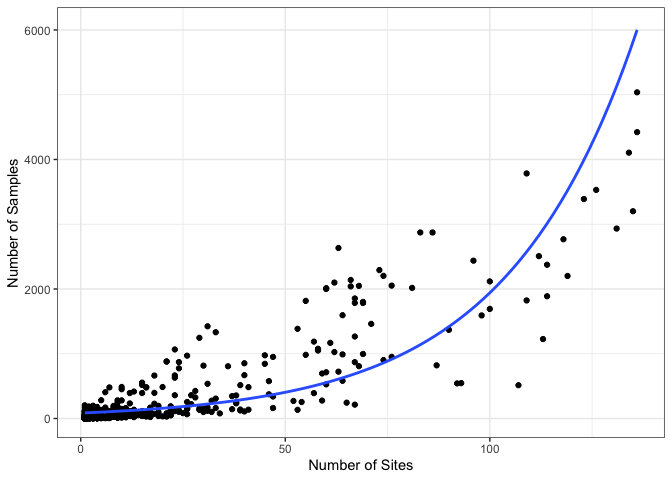
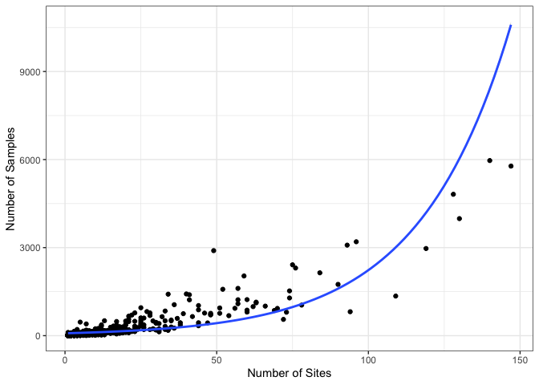
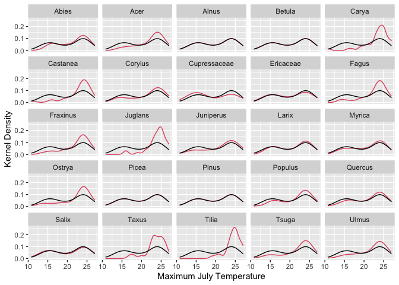

## 1. Introduction

This document is intended to act as a primer for the use of the new Neotoma R package, `neotoma2`, for working with **diatom** data.  Some users may be working with this document as part of a workshop for which there is a Binder instance. The Binder instance will run RStudio in your browser, with all the required packages installed.

If you are using this workflow on its own, or want to use the package directly, [the `neotoma2` package](https://github.com/NeotomaDB/neotoma2) is available on GitHub. This workflow uses the development version (1.1.1.9000 or later), which you can install by running:

```r
install.packages("remotes")
remotes::install_github("NeotomaDB/neotoma2", ref = "dev")
library(neotoma2)
```

This workshop will also require other packages. To maintain the flow of this document we've placed instructions at the end of the document in the section labelled "[Installing packages on your own](#localinstall)".

## 2. Learning Goals

In this tutorial you will learn how to:

* Search for sites using site names and geographic parameters -- [Site Searches](#3-site-searches)
* Filter results by dataset type (diatoms, diatom surface samples, water chemistry) and by whether a record has a chronology -- [Filter Results](#33-filter-records-tabset)
* Start from a list of site IDs in a spreadsheet (or any other file) -- [Sites from a File](#34-sites-from-a-file-tabset)
* Obtain sample information for the selected datasets and harmonize diatom taxonomy -- [Sample Information](#35-pulling-in-sample-data)
* Perform basic analysis including a stratigraphic diagram, change in diatom habit through time, and the link between diatoms and water chemistry (pH) -- [Basic Analysis](#4-simple-analytics)

### 2.1. Getting Help with Neotoma

If you're planning on working with Neotoma, please join us on [Slack](https://join.slack.com/t/neotomadb/shared_invite/zt-cvsv53ep-wjGeCTkq7IhP6eUNA9NxYQ) where we manage a channel specifically for questions about the R package. You may also wish to join our Google Groups mailing list, please [contact us](mailto:neotoma-contact@googlegroups.com) to be added.

### 2.2 Understanding Data Structures in Neotoma

Data in the Neotoma database itself is structured as a set of linked relationships to express the different elements of paleoecological analysis: space and time, raw data, scientific methods and data models. Because paleoecology is such a broad discipline these relationships can be complex, and as such, the database itself is highly structured. If you want to better understand concepts within the database, you can read the [Neotoma Database Manual](https://open.neotomadb.org/manual), or take a look at [the database schema itself](https://open.neotomadb.org/dbschema).

In this workshop we want to highlight two key structural concepts:
  
  1. The way data is structured conceptually within Neotoma (Sites, Collection Units and Datasets).
  2. The way that this structure is adapted within the `neotoma2` R package.

### 2.2.1 Data Structure in the Neotoma Database

{width=50%}

Data in Neotoma is associated with sites -- specific locations with lat/long coordinates.

Within a **site**, there may be one or more [**collection units**](https://open.neotomadb.org/manual/dataset-collection-related-tables-1.html#CollectionUnits) -- locations at which samples are physically collected within the site. For example, an archaeological **site** may have one or more **collection units**, pits within a broader dig site; a diatom sampling **site** on a lake may have multiple **collection units** -- core sites within the lake basin. Collection units may have higher resolution GPS locations than the site location, but are considered to be part of the broader site.

Data within a **collection unit** is collected at various [**analysis units**](https://open.neotomadb.org/manual/sample-related-tables-1.html#AnalysisUnits). Any data sampled within an analysis unit is grouped by the dataset type (charcoal, diatom, dinoflagellate, etc.) and aggregated into a [**sample**](https://open.neotomadb.org/manual/sample-related-tables-1.html#Samples). The set of samples for a collection unit of a particular dataset type is then assigned to a [**dataset**](https://open.neotomadb.org/manual/dataset-collection-related-tables-1.html#Datasets).

### 2.2.2 Data Structures in `neotoma2`


If we look at the [UML diagram](https://en.wikipedia.org/wiki/Unified_Modeling_Language) for the objects in the `neotoma2` R package we can see that the data structure generally mimics the structure within the database itself.  As we will see in the [Site Searches section](#3-site-searches), we can search for these objects, and begin to manipulate them (in the [Simple Analysis section](#4-simple-analytics)).

It is important to note: *within the `neotoma2` R package, most objects are `sites` objects, they just contain more or less data*.  There are a set of functions that can operate on `sites`.  As we add to `sites` objects, using `get_datasets()` or `get_downloads()`, we are able to use more of these helper functions.

### 2.2.3 Piping in `R` {.tabset}

Piping is a technique that simplifies the process of chaining multiple operations on a data object. It involves using either of these operators: `|>` or `%>%`. `|>` is a base R operator while `%>%` comes from the `tidyverse` ecosystem in R. In `neotoma2` we use `%>%`.

The pipe operator works as a real-life pipe, which carries water from one location to another. In programming, the output of the function on the left-hand side of the pipe is taken as the initial argument for the function on the right-hand side of the pipe. It helps by making code easier to write and read. Additionally, it reduces the number of intermediate objects created during data processing, which can make code more memory-efficient and faster.

Without using pipes you can use the `neotoma2` R package to retrieve a site and then plot it by doing:

```r
# Retrieve the site
plot_site <- neotoma2::get_sites(sitename = "%Swamp%")
# Plot the site
neotoma2::plotLeaflet(object = plot_site)
```

This would create a variable `plot_site` that we will not need any more, but it was necessary so that we could pass it to the `plotLeaflet` function.

With the pipe (`%>%`) we do not need to create the variable, we can just rewrite our code.  Notice that `plotLeaflet()` doesn't need the `object` argument because the response of `get_sites(sitename = "%Swamp%")` gets passed directly into the function.

#### 2.2.3.1. Code


``` r
# get_sites and pipe. The `object` parameter for plotLeaflet will be the
# result of the `get_sites()` function.
get_sites(sitename = "%Swamp%") %>%
  plotLeaflet()
```
#### 2.2.3.2. Result


```{=html}
<div class="leaflet html-widget html-fill-item" id="htmlwidget-03e09c8520c1ad9c93a7" style="width:672px;height:480px;"></div>
<script type="application/json" data-for="htmlwidget-03e09c8520c1ad9c93a7">{"x":{"options":{"crs":{"crsClass":"L.CRS.EPSG3857","code":null,"proj4def":null,"projectedBounds":null,"options":{}}},"calls":[{"method":"addTiles","args":["https://{s}.tile.openstreetmap.org/{z}/{x}/{y}.png",null,null,{"minZoom":0,"maxZoom":18,"tileSize":256,"subdomains":"abc","errorTileUrl":"","tms":false,"noWrap":false,"zoomOffset":0,"zoomReverse":false,"opacity":1,"zIndex":1,"detectRetina":false,"attribution":"&copy; <a href=\"https://openstreetmap.org/copyright/\">OpenStreetMap<\/a>,  <a href=\"https://opendatacommons.org/licenses/odbl/\">ODbL<\/a>"}]},{"method":"addCircleMarkers","args":[[-36.51667,42.51667,36.65,36.66667,36.58333,48.75,46.51667,40.48333,44.18,-3.43333,44.89167,37.95,41.95,46.36139,40.11667,-41.12666,-40.529062,-35.7077,41.933788,43.095992,43.095252,42.5372,42.2384,39.535,42.3272],[149.5,-72.21250000000001,-76.47917,-76.36667,-76.45,28.25,32.61667,-75.66667,-79.44,29.61667,-93.69167,-119.81667,-71.03333000000001,19.99417,-83.25,144.67463,144.749224,148.885604,-70.76151400000001,-78.01244,-78.02198200000001,-72.18356,-73.42060000000001,-79.53879999999999,-73.49639999999999],10,null,null,{"interactive":true,"draggable":false,"keyboard":true,"title":"","alt":"","zIndexOffset":0,"opacity":1,"riseOnHover":true,"riseOffset":250,"stroke":true,"color":"#03F","weight":5,"opacity.1":0.5,"fill":true,"fillColor":"#03F","fillOpacity":0.2},{"showCoverageOnHover":true,"zoomToBoundsOnClick":true,"spiderfyOnMaxZoom":true,"removeOutsideVisibleBounds":true,"spiderLegPolylineOptions":{"weight":1.5,"color":"#222","opacity":0.5},"freezeAtZoom":false},null,["<b>Bega Swamp<\/b><br><b>Description:<\/b> Species of Empodisma, Lepidosperma and Restio cover the major part of the swamp surface and also generate most of the peat formation inside the swamp.\r\nThe swamp is surrounded by wet sclerophyll (tall, open), Eucalyptus-dominated forest with an understorey of shrubs. The ground cover of the forest consists mainly of grasses with a number of other species.<br><a href=http://apps.neotomadb.org/explorer/?siteids=247>Explorer Link<\/a>","<b>Tom Swamp<\/b><br><b>Description:<\/b> Larix-Picea mariana-Sphagnum bog. Physiography: rolling topog.- valley between ridges. Surrounding vegetation: oak with mixed hardwd/hemlock/white pine.<br><a href=http://apps.neotomadb.org/explorer/?siteids=562>Explorer Link<\/a>","<b>Great Dismal Swamp<\/b><br><b>Description:<\/b> NA<br><a href=http://apps.neotomadb.org/explorer/?siteids=676>Explorer Link<\/a>","<b>Great Dismal Swamp<\/b><br><b>Description:<\/b> NA<br><a href=http://apps.neotomadb.org/explorer/?siteids=678>Explorer Link<\/a>","<b>Great Dismal Swamp<\/b><br><b>Description:<\/b> NA<br><a href=http://apps.neotomadb.org/explorer/?siteids=679>Explorer Link<\/a>","<b>Dovjok Swamp<\/b><br><b>Description:<\/b> Floodplain Phragmites fen. Physiography: floodplain in Murafa Basin. Surrounding vegetation: herb steppe, Quercus/Carpinus forest.<br><a href=http://apps.neotomadb.org/explorer/?siteids=703>Explorer Link<\/a>","<b>Kardashinski Swamp<\/b><br><b>Description:<\/b> Phragmites fen. Physiography: Floodplain of Dniepr River. Vegetation formation: Steppe.<br><a href=http://apps.neotomadb.org/explorer/?siteids=1403>Explorer Link<\/a>","<b>Longswamp<\/b><br><b>Description:<\/b> NA<br><a href=http://apps.neotomadb.org/explorer/?siteids=1610>Explorer Link<\/a>","<b>Rose Swamp<\/b><br><b>Description:<\/b> Swamp in drumlin field. Physiography: Newmarket till plain. Surrounding vegetation: Pinus/Tsuga/Juniperus/Acer/Fagus/Ulmus.<br><a href=http://apps.neotomadb.org/explorer/?siteids=2210>Explorer Link<\/a>","<b>Rusaka Swamp<\/b><br><b>Description:<\/b> Raised mire, drained for agriculture. Physiography: Burundi highlands. Surrounding vegetation: sweet potato, bean, and manihot fields.<br><a href=http://apps.neotomadb.org/explorer/?siteids=2233>Explorer Link<\/a>","<b>Stone Lake Tamarack Swamp<\/b><br><b>Description:<\/b> Larix swamp. Physiography: low rolling relief. Surrounding vegetation: Larix/Salix/Cornus/Typha.<br><a href=http://apps.neotomadb.org/explorer/?siteids=2519>Explorer Link<\/a>","<b>Swamp Lake<\/b><br><b>Description:<\/b> Small lake. Physiography: Sierra Nevada Mountain Range. Surrounding vegetation: Pinus ponderosa, Pinus jeffreyi.<br><a href=http://apps.neotomadb.org/explorer/?siteids=2529>Explorer Link<\/a>","<b>Titicut Swamp<\/b><br><b>Description:<\/b> Kettle lake. Physiography: glaciated Tauton River Valley. Surrounding vegetation: Acer/Ilex/Clethra/Vaccinium.<br><a href=http://apps.neotomadb.org/explorer/?siteids=2554>Explorer Link<\/a>","<b>Zsombó Swamp<\/b><br><b>Description:<\/b> Swamp area formed between drift sand dun. Surrounding vegetation: fragments of riparian forest.<br><a href=http://apps.neotomadb.org/explorer/?siteids=3523>Explorer Link<\/a>","<b>Wild Cat Swamp [OSU-14925]<\/b><br><b>Description:<\/b> NA<br><a href=http://apps.neotomadb.org/explorer/?siteids=6385>Explorer Link<\/a>","<b>Sundown Swamp<\/b><br><b>Description:<\/b> Interdunal Melaleuca ericifolia swamp. Physiography: Coastal plateau with dunes. Surrounding vegetation: Epacris- Leptospermum heath.<br><a href=http://apps.neotomadb.org/explorer/?siteids=10009>Explorer Link<\/a>","<b>Stockyard Swamp<\/b><br><b>Description:<\/b> Seasonally inundated interdunal pond on Hunter Island. Tall Melaleuca ericifolia thicket occur on northern and eastern sides. Physiography: stabilised coastal dunefield. Surrounding vegetation: sedge fen, Eucalyptus woodland, and pasture.<br><a href=http://apps.neotomadb.org/explorer/?siteids=10016>Explorer Link<\/a>","<b>Rotten Swamp<\/b><br><b>Description:<\/b> Subalpine Sphagnum–Epacris shrub bog with Empodisma fen and Carex fen. Surrounding vegetation: Eucalyptus open forest.<br><a href=http://apps.neotomadb.org/explorer/?siteids=10024>Explorer Link<\/a>","<b>Makepeace Cedar Swamp<\/b><br><b>Description:<\/b> Closed basin mire located in sandy outwash along the margin of the Monk's Hill recessional moraine. Surrounding vegetation: Quercus, Pinus strobus, Betula, Acer rubrum, Tsuga canadensis, and Fagus grandifolia. Grass with cedar immediately at site.<br><a href=http://apps.neotomadb.org/explorer/?siteids=10076>Explorer Link<\/a>","<b>Byron-Bergen Swamp (Site 2)<\/b><br><b>Description:<\/b> Open marl fen. Surrounding vegetation -- Sedges: Eleocharis rostellata. Trees: Thuja occidentalis, Larix laricina, Pinus strobus. Shrubs: Myrica pensylvanica, Rhamnus alnifolia, Ledum groenlandicum.<br><a href=http://apps.neotomadb.org/explorer/?siteids=10155>Explorer Link<\/a>","<b>Byron-Bergen Swamp (Site 1)<\/b><br><b>Description:<\/b> Closed-canopy swamp forest. Surrounding vegetation: Pinus strobus, Acer rubrum, Tsuga canadensis, Acer saccharum, Thuja occidentalis, Betua alleghaniensis, Fraxinus sp., Zanthoxylum americanum.<br><a href=http://apps.neotomadb.org/explorer/?siteids=10157>Explorer Link<\/a>","<b>Black Gum Swamp<\/b><br><b>Description:<\/b> Swamp that occupies an irregularly shaped basin that drains to the southwest through an intermittent stream. Surrounding vegetation: Picea rubens, Nyssa sylvatica, and Acer rubrum in the overstory. Ilex, Nemopanthus, Vaccinium, and Viburnum in the understory. Ground layer of Sphagnum, Osmunda, and herbs.<br><a href=http://apps.neotomadb.org/explorer/?siteids=10172>Explorer Link<\/a>","<b>Alford Swamp<\/b><br><b>Description:<\/b> Elongate swampy area in glacial drift. Red maple trees and juneberry with a ground cover of sedge, Sphagnum, marsh marigold, Osmunda, and other fern types.<br><a href=http://apps.neotomadb.org/explorer/?siteids=10177>Explorer Link<\/a>","<b>Cranesville Pine Swamp<\/b><br><b>Description:<\/b> Swamp in an elongate depression on the Appalachian Plateau, Allegheny Mountains Section. . . . . . Surrounding vegetation: Ground cover is hummock sedge and Sphagnum moss interspersed with Osmunda, cattail, skunk cabbage, Rhododendron, and alder in the wetter sites. Tree cover is predominantly spruce with tamarack and red maple of secondary importance.<br><a href=http://apps.neotomadb.org/explorer/?siteids=10179>Explorer Link<\/a>","<b>State Line Swamp<\/b><br><b>Description:<\/b> Swamp in glacial drift. Surrounding vegetation: White pine, hemlock, and red maple with a substratum of Sphagnum and Osmunda.<br><a href=http://apps.neotomadb.org/explorer/?siteids=10182>Explorer Link<\/a>"],null,null,{"interactive":false,"permanent":false,"direction":"auto","opacity":1,"offset":[0,0],"textsize":"10px","textOnly":false,"className":"","sticky":true},null]}],"limits":{"lat":[-41.12666,48.75],"lng":[-119.81667,149.5]}},"evals":[],"jsHooks":[]}</script>
```


## 3. Site Searches

### 3.1. `get_sites()`

There are several ways to find sites in `neotoma2`, but we think of `sites` as being spatial objects primarily. They have names, locations, and are found within the context of geopolitical units, but within the API and the package, the site itself does not have associated information about taxa, dataset types or ages.  It is simply the container into which we add that information.  So, when we search for sites we can search by:

| Parameter | Description |
| --------- | ----------- |
| sitename | A valid site name (case insensitive) using `%` as a wildcard. |
| siteid | A unique numeric site id from the Neotoma Database |
| loc | A bounding box vector, geoJSON or WKT string. |
| altmin | Lower altitude bound for sites. |
| altmax | Upper altitude bound for site locations. |
| database | The constituent database from which the records are pulled. |
| datasettype | The kind of dataset (see `get_table("datasettypes")`) |
| datasetid | Unique numeric dataset identifier in Neotoma |
| doi | A valid dataset DOI in Neotoma |
| gpid | A unique numeric identifier, or text string identifying a geopolitical unit in Neotoma |
| keywords | Unique sample keywords for records in Neotoma. |
| contacts | A name or numeric id for individuals associuated with sites. |
| taxa | Unique numeric identifiers or taxon names associated with sites. |

All sites in Neotoma contain one or more datasets. It's worth noting that the results of these search parameters may be slightly unexpected. For example, searching for sites by sitename, latitude, or altitude will return all of the datasets for the particular site. Searching for terms such as datasettype, datasetid or taxa will return the site, but the only datasets returned will be those matching the dataset-specific search terms. We'll see this later.

#### 3.1.1. Site names: `sitename="%Lake%"` {.tabset}

We may know exactly what site we're looking for ("Arbutus Lake"), or have an approximate guess for the site name (for example, we know it's something like "Arbutus Lake" or "Lake Arbutus", but we're not sure how it was entered specifically), or we may want to search all sites that have a specific term, for example, *Lake*.

We use the general format: `get_sites(sitename="%Lake%")` for searching by name.

PostgreSQL (and the API) uses the percent sign as a wildcard.  So `"%Lake%"` would pick up ["Arbutus Lake"](https://data.neotomadb.org/710) for us, and it would also pick up any site where "lake" is part of a longer word, such as "Lakeside" or "Blake".  Note that the search query is also case insensitive, so you could simply write `"%LAKE%"`.

##### 3.1.1.1. Code


``` r
lake_sites <- neotoma2::get_sites(sitename = "%Lake%")
plotLeaflet(lake_sites)
```

##### 3.1.1.2. Result


```{=html}
<div class="leaflet html-widget html-fill-item" id="htmlwidget-7b4c7a45fe4ba7e2f109" style="width:672px;height:480px;"></div>
<script type="application/json" data-for="htmlwidget-7b4c7a45fe4ba7e2f109">{"x":{"options":{"crs":{"crsClass":"L.CRS.EPSG3857","code":null,"proj4def":null,"projectedBounds":null,"options":{}}},"calls":[{"method":"addTiles","args":["https://{s}.tile.openstreetmap.org/{z}/{x}/{y}.png",null,null,{"minZoom":0,"maxZoom":18,"tileSize":256,"subdomains":"abc","errorTileUrl":"","tms":false,"noWrap":false,"zoomOffset":0,"zoomReverse":false,"opacity":1,"zIndex":1,"detectRetina":false,"attribution":"&copy; <a href=\"https://openstreetmap.org/copyright/\">OpenStreetMap<\/a>,  <a href=\"https://opendatacommons.org/licenses/odbl/\">ODbL<\/a>"}]},{"method":"addCircleMarkers","args":[[53.33333,52.51667,44.80156,46.20611,60.13667,48.15,46.185826,46.25,42.28,44.5,46.41667,46.701316,64.65000000000001,67.13333,-62.62861,45.38,47.119368,78.49167,52.2,30.62222,37.59583,44.3,45.8,46.12806,65.21666999999999],[-60.58333,-57.03333,-94.55982,-95.29361,152.31278,-91.12,-89.70308200000001,-89.90000000000001,-73.88,-89.5,-92.71666999999999,-85.03963999999999,-128.08333,-153.9,-61.13472,-79.51000000000001,-95.402114,-76.78,-10.30833,-83.25389,-119.00833,-77.91667,-122.49167,-93.70389,-127.05],10,null,null,{"interactive":true,"draggable":false,"keyboard":true,"title":"","alt":"","zIndexOffset":0,"opacity":1,"riseOnHover":true,"riseOffset":250,"stroke":true,"color":"#03F","weight":5,"opacity.1":0.5,"fill":true,"fillColor":"#03F","fillOpacity":0.2},{"showCoverageOnHover":true,"zoomToBoundsOnClick":true,"spiderfyOnMaxZoom":true,"removeOutsideVisibleBounds":true,"spiderLegPolylineOptions":{"weight":1.5,"color":"#222","opacity":0.5},"freezeAtZoom":false},null,["<b>Alexander Lake<\/b><br><b>Description:<\/b> Physiography: rolling glacial till, eskers, kettles,.<br><a href=http://apps.neotomadb.org/explorer/?siteids=24>Explorer Link<\/a>","<b>Alexis Lake<\/b><br><b>Description:<\/b> Lake in Alexis River watershed. Physiography: Mecatina Plateau/Laurentian region. Surrounding vegetation: Black Spruce, Lichen Barrens.<br><a href=http://apps.neotomadb.org/explorer/?siteids=25>Explorer Link<\/a>","<b>Lake Allie<\/b><br><b>Description:<\/b> Kettle lake. Physiography: rolling stagnation moraine.<br><a href=http://apps.neotomadb.org/explorer/?siteids=29>Explorer Link<\/a>","<b>Almora Lake<\/b><br><b>Description:<\/b> Lake with emergent reed vegetation. Physiography: Parkers Prairie sandplain. Surrounding vegetation: agriculture.<br><a href=http://apps.neotomadb.org/explorer/?siteids=30>Explorer Link<\/a>","<b>Alut Lake<\/b><br><b>Description:<\/b> Tectonic lake. Physiography: valley in mountains. Surrounding vegetation: Larix forest.<br><a href=http://apps.neotomadb.org/explorer/?siteids=31>Explorer Link<\/a>","<b>Hungry Jack Lake<\/b><br><b>Description:<\/b> NA<br><a href=http://apps.neotomadb.org/explorer/?siteids=195>Explorer Link<\/a>","<b>Hells Kitchen Lake<\/b><br><b>Description:<\/b> Kettle lake. Physiography: steep topography. Surrounding vegetation: Betula, Populus, Acer.<br><a href=http://apps.neotomadb.org/explorer/?siteids=196>Explorer Link<\/a>","<b>Lake Mary<\/b><br><b>Description:<\/b> Meromictic lake on Woodfordian till. Physiography: rolling till plain. Surrounding vegetation: white cedar/alder.<br><a href=http://apps.neotomadb.org/explorer/?siteids=197>Explorer Link<\/a>","<b>Greens Lake<\/b><br><b>Description:<\/b> NA<br><a href=http://apps.neotomadb.org/explorer/?siteids=198>Explorer Link<\/a>","<b>Emily Lake<\/b><br><b>Description:<\/b> NA<br><a href=http://apps.neotomadb.org/explorer/?siteids=199>Explorer Link<\/a>","<b>Anderson Lake<\/b><br><b>Description:<\/b> Physiography: Nickerson Moraine. Surrounding vegetation: maple-basswood, Juglans cinerea.<br><a href=http://apps.neotomadb.org/explorer/?siteids=202>Explorer Link<\/a>","<b>Andrus Lake<\/b><br><b>Description:<\/b> Seepage lake. Physiography: flat sandy glacial lake bottom. Surrounding vegetation: Pinus/Betula/Quercus/Acer.<br><a href=http://apps.neotomadb.org/explorer/?siteids=205>Explorer Link<\/a>","<b>Andy Lake<\/b><br><b>Description:<\/b> Lake dammed by a Mountain River moraine. Physiography: Mackenzie Mountains. Surrounding vegetation: shrub tundra.<br><a href=http://apps.neotomadb.org/explorer/?siteids=206>Explorer Link<\/a>","<b>Angal Lake<\/b><br><b>Description:<\/b> Cirque lake. Physiography: mountainous. Surrounding vegetation: Betula shrub tundra.<br><a href=http://apps.neotomadb.org/explorer/?siteids=207>Explorer Link<\/a>","<b>Lake Åsa<\/b><br><b>Description:<\/b> Lake inside President Beaches. Physiography: above Holocene sea-level. Surrounding vegetation: sparse mosses and lichens.<br><a href=http://apps.neotomadb.org/explorer/?siteids=216>Explorer Link<\/a>","<b>Axe Lake<\/b><br><b>Description:<\/b> NA<br><a href=http://apps.neotomadb.org/explorer/?siteids=219>Explorer Link<\/a>","<b>Bad Medicine Lake<\/b><br><b>Description:<\/b> Kettle lake. Physiography: Itaska Moraine, rolling. Surrounding vegetation: Pinus banksiana, Populus, Betula.<br><a href=http://apps.neotomadb.org/explorer/?siteids=221>Explorer Link<\/a>","<b>Baird Inlet [Rock Basin Lake]<\/b><br><b>Description:<\/b> Closed steep sided ice excavated basin. Physiography: granulite gneiss massif, valley glaciers. Surrounding vegetation: Empetrum/Vaccinium heath, mossy heaths.<br><a href=http://apps.neotomadb.org/explorer/?siteids=222>Explorer Link<\/a>","<b>Ballinloghig Lake<\/b><br><b>Description:<\/b> Lake with marginal fen. Physiography: Southern slope of Slieve Mish mountains. Surrounding vegetation: Blanket bog, heath, pasture and woodland.<br><a href=http://apps.neotomadb.org/explorer/?siteids=223>Explorer Link<\/a>","<b>Barchampe Lake<\/b><br><b>Description:<\/b> Sinkhole pond. Physiography: Gulf Coastal Plain, level. Surrounding vegetation: pine/oak forest.<br><a href=http://apps.neotomadb.org/explorer/?siteids=229>Explorer Link<\/a>","<b>Barrett Lake<\/b><br><b>Description:<\/b> Glacial scour lake. Physiography: Sierra Nevada mountains. Surrounding vegetation: lodgepole/limber pine, mountain hemlock.<br><a href=http://apps.neotomadb.org/explorer/?siteids=231>Explorer Link<\/a>","<b>Barry Lake<\/b><br><b>Description:<\/b> Lake of glacial origin. Physiography: Peterborough drumlin field, rolling.<br><a href=http://apps.neotomadb.org/explorer/?siteids=232>Explorer Link<\/a>","<b>Battle Ground Lake<\/b><br><b>Description:<\/b> Volcanic crater. Physiography: Puget Trough. Surrounding vegetation: second-growth Pseudotsuga/decid forest.<br><a href=http://apps.neotomadb.org/explorer/?siteids=236>Explorer Link<\/a>","<b>Black Bass Lake<\/b><br><b>Description:<\/b> Kettle lake. Physiography: Mille Lacs Moraine, rolling.<br><a href=http://apps.neotomadb.org/explorer/?siteids=238>Explorer Link<\/a>","<b>Beach Lake<\/b><br><b>Description:<\/b> Physiography: Mackenzie Valley.<br><a href=http://apps.neotomadb.org/explorer/?siteids=241>Explorer Link<\/a>"],null,null,{"interactive":false,"permanent":false,"direction":"auto","opacity":1,"offset":[0,0],"textsize":"10px","textOnly":false,"className":"","sticky":true},null]}],"limits":{"lat":[-62.62861,78.49167],"lng":[-153.9,152.31278]}},"evals":[],"jsHooks":[]}</script>
```

#### 3.1.2. Location: `loc=c()` {.tabset}

The `neotoma` package used a bounding box for locations, structured as a vector of latitude and longitude values: `c(xmin, ymin, xmax, ymax)`.  The `neotoma2` R package supports both this simple bounding box, but also more complex spatial objects, using the [`sf` package](https://r-spatial.github.io/sf/). Using the `sf` package allows us to more easily work with raster and polygon data in R, and to select sites from more complex spatial objects.  The `loc` parameter works with the simple vector, [WKT](https://arthur-e.github.io/Wicket/sandbox-gmaps3.html), [geoJSON](http://geojson.io/#map=2/20.0/0.0) objects and native `sf` objects in R.

Here we look for sites using a location. We're using a rough rectangle around the Philadelphia area: southeastern Pennsylvania, southern New Jersey and the coast out to Barnegat Bay.  To work with this spatial object in R we also transformed the `geojson_str` element to an object for the `sf` package.  There are many other tools to work with spatial objects in R. Regardless of how you get the data into R, `neotoma2` works with almost all objects in the `sf` package.


``` r
geojson_str <- '{"coordinates":
  [[[-80.52, 42.27],
    [-79.76, 42.27],
    [-75.36, 42.00],
    [-74.69, 41.36],
    [-74.77, 40.22],
    [-75.79, 39.72],
    [-80.52, 39.72],
    [-80.52, 42.27]]],
  "type":"Polygon"}'

penn_sf <- geojsonsf::geojson_sf(geojson_str)

# Note here we use the `all_data` flag to capture all the sites.
penn_sites <- neotoma2::get_sites(loc = penn_sf, all_data = TRUE)
```

You can always simply `plot()` the `sites` objects, but you will lose some of the geographic context.  The `plotLeaflet()` function returns a `leaflet()` map, and allows you to further customize it, or add additional spatial data (like our original bounding polygon, `penn_sf`, which works directly with the R `leaflet` package):

##### 3.1.2.1. Code


``` r
neotoma2::plotLeaflet(penn_sites) %>%
  leaflet::addPolygons(
    map = .,
    data = penn_sf,
    color = "green"
  )
```

##### 3.1.2.2. Result


```{=html}
<div class="leaflet html-widget html-fill-item" id="htmlwidget-f8fbec535f4807e02c7c" style="width:672px;height:480px;"></div>
<script type="application/json" data-for="htmlwidget-f8fbec535f4807e02c7c">{"x":{"options":{"crs":{"crsClass":"L.CRS.EPSG3857","code":null,"proj4def":null,"projectedBounds":null,"options":{}}},"calls":[{"method":"addTiles","args":["https://{s}.tile.openstreetmap.org/{z}/{x}/{y}.png",null,null,{"minZoom":0,"maxZoom":18,"tileSize":256,"subdomains":"abc","errorTileUrl":"","tms":false,"noWrap":false,"zoomOffset":0,"zoomReverse":false,"opacity":1,"zIndex":1,"detectRetina":false,"attribution":"&copy; <a href=\"https://openstreetmap.org/copyright/\">OpenStreetMap<\/a>,  <a href=\"https://opendatacommons.org/licenses/odbl/\">ODbL<\/a>"}]},{"method":"addCircleMarkers","args":[[42.1,41.75,41.62,41.73,41.83,41.72,41.87,41.73,41.88,41.9,41.58,41.52,41.48,41.3,41.12,40.83,40.62,40.07,40.23,40.33,40.45,40.85,40.82,41.05,41.18,41.27,41.6,41.78,41.77,41.9,39.76667,39.96667,41.76667,41.134956,41.376234,41.381678,40.48333,40.8,41.91667,41.250252,41.67389,41.070562,41.03779,40.08333,40.47222,40.36778,40,40.28667,40.25,40.00889,39.91944,40.11667,40.86667,40.75,40.75,40.11667,40.08333,40,40.01667,40.11667,40.89278,41.36667,41.11667,40.5,39.86667,40.20611,40.25,40.39139,39.86667,41.80833,40.11667,40.03194,41.12,40.86667,42.11667,40.36667,41.5,41.1,40.36667,40.36667,40.36667,40.61667,39.75,39.75,39.75,41.67917,39.86667,40.36667,40.36667,40.5,41.04694,40.36667,41.0287,41.61737,40.73,39.7776,42.103496,42.005986,40.999136,39.861574,41.004116,41.240584,41.029474,40.92805,40.91079,40.79971,40.40024,40.94679600000001,40.96557,41.16568,40.85742,41.004938,41.002726,40.980152,41.030956,40.85901,41.20037,40.966662,40.869286,41.02795,41.017,41.14858,41.084816,40.97163,39.82194,39.93824,40.008348,40.13763,40.15966,39.94468,39.94468,39.94468,39.85742,40.05739,39.978688,39.95472,39.911274,40.03174,39.954208,40.037308,39.778068,40.03883,40.110606,39.91387,40.418592,41.141066,40.10323,41.951486,41.95944,40.10306,39.75,40.46163,40.27035,40.87358,41.5555,40.49158,41.41393,41.1113,41.97137,41.09921,40.35386,40.35741,40.16155,40.11146,40.8634,40.80374,39.76851,42.05397,40.951648,41.039182,41.106606,40.810572,41.6334,41.69517,40.62803,41.90973,41.632522,41.601102,41.527,41.762172,41.392074,41.350228,41.611842,41.287966,41.318424,41.405174,41.916496,41.838214,41.831472,41.83864,41.298616,41.311266,41.823528,41.26646,41.26969,41.580406,41.32332,41.250458,41.819208,41.7952,41.771,41.726642,41.3542,41.822734,41.830246,41.732272,41.515666,41.81333,41.571444,41.404608,40.951168,41.5724,40.917406,40.067,40.117,41.35,41.55,41.867,40.92389,40.925,40.7918,41.58822,41.5477,41.55711,41.61872,41.55389],[-78.75,-79.17,-78.75,-78.42,-77.95,-77.77,-77.05,-77.3,-76.72,-76.23,-76.17,-76.59999999999999,-77.03,-76.58,-76.52249999999999,-76.37,-76.05,-75.83,-75.53,-75.48,-75.52,-75.8,-76.05,-75.93000000000001,-75.75,-76.08,-75.75,-75.53,-76.58,-75.31999999999999,-78.55,-77.55,-75.83333,-75.02775,-75.09430999999999,-75.292108,-75.66667,-77.41667,-77.925,-74.987792,-76.34999999999999,-74.840226,-75.26551000000001,-78.65000000000001,-80.04971999999999,-80.11888999999999,-76.25,-80.48333,-79.36667,-79.85111000000001,-79.96722,-80.25,-79.86667,-79.36667,-79.36667,-80.11667,-78.65000000000001,-78.86667,-76.72499999999999,-79.11667,-77.43944,-79.8,-80.36667,-75.11667,-80.25,-80.2075,-75.36667,-79.62306,-79.75,-76.48333,-79.75,-79.6375,-74.96111000000001,-75,-78.61667,-78.25,-75,-74.98333,-79.75,-79.75,-78.36667,-80.36667,-79.25,-79.36667,-79.86667,-76.35278,-80.11667,-78.36667,-80.25,-79.25,-75.11083000000001,-80.36667,-75.70491,-79.63867999999999,-77.76179999999999,-79.2152,-79.728262,-75.48098400000001,-74.914564,-75.783316,-74.739318,-74.83349800000001,-74.77562399999999,-74.77043,-74.81707,-74.78494999999999,-74.84183,-74.89138199999999,-74.73584,-74.777652,-74.98593000000001,-74.940196,-75.074268,-74.768956,-74.716756,-74.98390999999999,-74.77,-74.73585199999999,-74.747218,-74.753288,-74.733,-74.81351599999999,-74.816812,-74.981848,-76.4975,-75.61057799999999,-75.438012,-75.743602,-75.74480800000001,-75.65335,-75.65335,-75.65335,-75.64042000000001,-75.421764,-75.607316,-75.53273399999999,-75.860972,-75.81706,-75.65444599999999,-79.724796,-79.22226000000001,-77.270308,-77.695054,-78.055764,-76.599418,-76.082746,-75.4242,-79.75923999999999,-76.5275,-75.425,-76.875,-79.56744999999999,-78.68226,-75.58091,-75.70705,-78.46066,-75.02536000000001,-75.4575,-75.87948,-75.52182999999999,-78.62336999999999,-78.11906999999999,-79.05297,-75.86457,-76.77414,-77.17856,-79.38082,-78.89012,-74.782038,-74.99679800000001,-74.89283,-74.795862,-76.84081,-75.13142000000001,-74.85057,-75.33784,-75.078806,-75.16224,-75.08423000000001,-75.38999200000001,-74.90223,-75.171502,-75.15983200000001,-75.160546,-74.94182599999999,-75.275246,-75.372326,-75.40561799999999,-75.41301,-75.321578,-75.16844399999999,-74.92747800000001,-75.35514999999999,-75.010914,-74.942262,-75.087406,-75.25803999999999,-75.06117999999999,-75.41144,-75.18526,-75.32651800000001,-75.22817000000001,-75.13873,-75.337254,-75.344114,-75.103962,-75.09405199999999,-75.199202,-75.083168,-75.13181399999999,-74.74535,-74.982,-74.748946,-76.90000000000001,-78.633,-76.31699999999999,-78.59999999999999,-77.5,-74.99388999999999,-74.89306000000001,-77.5081,-74.98752,-80.36621,-80.36857000000001,-80.40868,-80.36833],10,null,null,{"interactive":true,"draggable":false,"keyboard":true,"title":"","alt":"","zIndexOffset":0,"opacity":1,"riseOnHover":true,"riseOffset":250,"stroke":true,"color":"#03F","weight":5,"opacity.1":0.5,"fill":true,"fillColor":"#03F","fillOpacity":0.2},{"showCoverageOnHover":true,"zoomToBoundsOnClick":true,"spiderfyOnMaxZoom":true,"removeOutsideVisibleBounds":true,"spiderLegPolylineOptions":{"weight":1.5,"color":"#222","opacity":0.5},"freezeAtZoom":false},null,["<b>Site 50 (Swain unpublished)<\/b><br><b>Description:<\/b> NA<br><a href=http://apps.neotomadb.org/explorer/?siteids=120>Explorer Link<\/a>","<b>Site 51 (Swain unpublished)<\/b><br><b>Description:<\/b> NA<br><a href=http://apps.neotomadb.org/explorer/?siteids=121>Explorer Link<\/a>","<b>Site 52 (Swain unpublished)<\/b><br><b>Description:<\/b> NA<br><a href=http://apps.neotomadb.org/explorer/?siteids=122>Explorer Link<\/a>","<b>Site 53 (Swain unpublished)<\/b><br><b>Description:<\/b> NA<br><a href=http://apps.neotomadb.org/explorer/?siteids=123>Explorer Link<\/a>","<b>Site 54 (Swain unpublished)<\/b><br><b>Description:<\/b> NA<br><a href=http://apps.neotomadb.org/explorer/?siteids=124>Explorer Link<\/a>","<b>Site 55 (Swain unpublished)<\/b><br><b>Description:<\/b> NA<br><a href=http://apps.neotomadb.org/explorer/?siteids=125>Explorer Link<\/a>","<b>Site 56 (Swain unpublished)<\/b><br><b>Description:<\/b> NA<br><a href=http://apps.neotomadb.org/explorer/?siteids=126>Explorer Link<\/a>","<b>Site 57 (Swain unpublished)<\/b><br><b>Description:<\/b> NA<br><a href=http://apps.neotomadb.org/explorer/?siteids=127>Explorer Link<\/a>","<b>Site 58 (Swain unpublished)<\/b><br><b>Description:<\/b> NA<br><a href=http://apps.neotomadb.org/explorer/?siteids=128>Explorer Link<\/a>","<b>Site 59 (Swain unpublished)<\/b><br><b>Description:<\/b> NA<br><a href=http://apps.neotomadb.org/explorer/?siteids=129>Explorer Link<\/a>","<b>Site 60 (Swain unpublished)<\/b><br><b>Description:<\/b> NA<br><a href=http://apps.neotomadb.org/explorer/?siteids=130>Explorer Link<\/a>","<b>Site 61 (Swain unpublished)<\/b><br><b>Description:<\/b> NA<br><a href=http://apps.neotomadb.org/explorer/?siteids=131>Explorer Link<\/a>","<b>Site 62 (Swain unpublished)<\/b><br><b>Description:<\/b> NA<br><a href=http://apps.neotomadb.org/explorer/?siteids=132>Explorer Link<\/a>","<b>Site 63 (Swain unpublished)<\/b><br><b>Description:<\/b> NA<br><a href=http://apps.neotomadb.org/explorer/?siteids=133>Explorer Link<\/a>","<b>Site 64 (Swain unpublished)<\/b><br><b>Description:<\/b> NA<br><a href=http://apps.neotomadb.org/explorer/?siteids=134>Explorer Link<\/a>","<b>Site 65 (Swain unpublished)<\/b><br><b>Description:<\/b> NA<br><a href=http://apps.neotomadb.org/explorer/?siteids=135>Explorer Link<\/a>","<b>Site 66 (Swain unpublished)<\/b><br><b>Description:<\/b> NA<br><a href=http://apps.neotomadb.org/explorer/?siteids=136>Explorer Link<\/a>","<b>Site 67 (Swain unpublished)<\/b><br><b>Description:<\/b> NA<br><a href=http://apps.neotomadb.org/explorer/?siteids=137>Explorer Link<\/a>","<b>Site 68 (Swain unpublished)<\/b><br><b>Description:<\/b> NA<br><a href=http://apps.neotomadb.org/explorer/?siteids=138>Explorer Link<\/a>","<b>Site 69 (Swain unpublished)<\/b><br><b>Description:<\/b> NA<br><a href=http://apps.neotomadb.org/explorer/?siteids=139>Explorer Link<\/a>","<b>Site 70 (Swain unpublished)<\/b><br><b>Description:<\/b> NA<br><a href=http://apps.neotomadb.org/explorer/?siteids=140>Explorer Link<\/a>","<b>Site 71 (Swain unpublished)<\/b><br><b>Description:<\/b> NA<br><a href=http://apps.neotomadb.org/explorer/?siteids=141>Explorer Link<\/a>","<b>Site 72 (Swain unpublished)<\/b><br><b>Description:<\/b> NA<br><a href=http://apps.neotomadb.org/explorer/?siteids=142>Explorer Link<\/a>","<b>Site 73 (Swain unpublished)<\/b><br><b>Description:<\/b> NA<br><a href=http://apps.neotomadb.org/explorer/?siteids=143>Explorer Link<\/a>","<b>Site 74 (Swain unpublished)<\/b><br><b>Description:<\/b> NA<br><a href=http://apps.neotomadb.org/explorer/?siteids=144>Explorer Link<\/a>","<b>Site 75 (Swain unpublished)<\/b><br><b>Description:<\/b> NA<br><a href=http://apps.neotomadb.org/explorer/?siteids=145>Explorer Link<\/a>","<b>Site 76 (Swain unpublished)<\/b><br><b>Description:<\/b> NA<br><a href=http://apps.neotomadb.org/explorer/?siteids=146>Explorer Link<\/a>","<b>Site 77 (Swain unpublished)<\/b><br><b>Description:<\/b> NA<br><a href=http://apps.neotomadb.org/explorer/?siteids=147>Explorer Link<\/a>","<b>Site 108 (Swain unpublished)<\/b><br><b>Description:<\/b> NA<br><a href=http://apps.neotomadb.org/explorer/?siteids=178>Explorer Link<\/a>","<b>Site 111 (Swain unpublished)<\/b><br><b>Description:<\/b> NA<br><a href=http://apps.neotomadb.org/explorer/?siteids=181>Explorer Link<\/a>","<b>Big Pond<\/b><br><b>Description:<\/b> NA<br><a href=http://apps.neotomadb.org/explorer/?siteids=268>Explorer Link<\/a>","<b>Crider's Pond<\/b><br><b>Description:<\/b> NA<br><a href=http://apps.neotomadb.org/explorer/?siteids=510>Explorer Link<\/a>","<b>Ely Lake<\/b><br><b>Description:<\/b> Small lake, no bog or fen on margin.<br><a href=http://apps.neotomadb.org/explorer/?siteids=775>Explorer Link<\/a>","<b>First<\/b><br><b>Description:<\/b> NA<br><a href=http://apps.neotomadb.org/explorer/?siteids=807>Explorer Link<\/a>","<b>Giles<\/b><br><b>Description:<\/b> Lake. Physiography: glaciated mountains. Surrounding vegetation: mixed deciduous/coniferous forest.<br><a href=http://apps.neotomadb.org/explorer/?siteids=844>Explorer Link<\/a>","<b>Lacawac<\/b><br><b>Description:<\/b> NA<br><a href=http://apps.neotomadb.org/explorer/?siteids=1530>Explorer Link<\/a>","<b>Longswamp<\/b><br><b>Description:<\/b> NA<br><a href=http://apps.neotomadb.org/explorer/?siteids=1610>Explorer Link<\/a>","<b>Panther Run Pond<\/b><br><b>Description:<\/b> NA<br><a href=http://apps.neotomadb.org/explorer/?siteids=1789>Explorer Link<\/a>","<b>Rose Lake<\/b><br><b>Description:<\/b> Ice-block depr. lake on term. moraine. Physiography: Appalachian Plateau. Surrounding vegetation: mixed hardwood forest dom. by Tsuga.<br><a href=http://apps.neotomadb.org/explorer/?siteids=2212>Explorer Link<\/a>","<b>Silver<\/b><br><b>Description:<\/b> NA<br><a href=http://apps.neotomadb.org/explorer/?siteids=2304>Explorer Link<\/a>","<b>Spring Lake<\/b><br><b>Description:<\/b> NA<br><a href=http://apps.neotomadb.org/explorer/?siteids=2507>Explorer Link<\/a>","<b>Swartswood Lake<\/b><br><b>Description:<\/b> Lake formed by glacial drift damming the stream flow. Physiography: glaciated mountains. Surrounding vegetation: mixed deciduous/coniferous forest.<br><a href=http://apps.neotomadb.org/explorer/?siteids=2531>Explorer Link<\/a>","<b>Tannersville Bog<\/b><br><b>Description:<\/b> Poor fen dominated by black spruce (Picea mariana), tamarack (Larix laricina), and an understory of ericaceous shrubs and Sphagnum mosses<br><a href=http://apps.neotomadb.org/explorer/?siteids=2536>Explorer Link<\/a>","<b>New Paris No. 4<\/b><br><b>Description:<\/b> Sinkhole along the west flank of Chestnut Ridge.<br><a href=http://apps.neotomadb.org/explorer/?siteids=3558>Explorer Link<\/a>","<b>McKees Rocks Village [36AL16]<\/b><br><b>Description:<\/b> NA<br><a href=http://apps.neotomadb.org/explorer/?siteids=3602>Explorer Link<\/a>","<b>Drew [36AL62]<\/b><br><b>Description:<\/b> NA<br><a href=http://apps.neotomadb.org/explorer/?siteids=3603>Explorer Link<\/a>","<b>Eschelman [36LA12]<\/b><br><b>Description:<\/b> NA<br><a href=http://apps.neotomadb.org/explorer/?siteids=3605>Explorer Link<\/a>","<b>Meadowcroft Rockshelter [36WH297]<\/b><br><b>Description:<\/b> NA<br><a href=http://apps.neotomadb.org/explorer/?siteids=3608>Explorer Link<\/a>","<b>Janitor [36WM21]<\/b><br><b>Description:<\/b> NA<br><a href=http://apps.neotomadb.org/explorer/?siteids=3609>Explorer Link<\/a>","<b>Campbell [36FA26]<\/b><br><b>Description:<\/b> NA<br><a href=http://apps.neotomadb.org/explorer/?siteids=3611>Explorer Link<\/a>","<b>Hartley [36GR23]<\/b><br><b>Description:<\/b> NA<br><a href=http://apps.neotomadb.org/explorer/?siteids=3612>Explorer Link<\/a>","<b>Mathies Mine Village [36WH54]<\/b><br><b>Description:<\/b> NA<br><a href=http://apps.neotomadb.org/explorer/?siteids=3613>Explorer Link<\/a>","<b>Bonnie Brook [36BT43]<\/b><br><b>Description:<\/b> NA<br><a href=http://apps.neotomadb.org/explorer/?siteids=3614>Explorer Link<\/a>","<b>Murphy's Old House [36AR129]<\/b><br><b>Description:<\/b> NA<br><a href=http://apps.neotomadb.org/explorer/?siteids=3615>Explorer Link<\/a>","<b>Wadding Shelter [36AR21]<\/b><br><b>Description:<\/b> NA<br><a href=http://apps.neotomadb.org/explorer/?siteids=3616>Explorer Link<\/a>","<b>Boyle [36WH19]<\/b><br><b>Description:<\/b> NA<br><a href=http://apps.neotomadb.org/explorer/?siteids=3618>Explorer Link<\/a>","<b>New Paris #2<\/b><br><b>Description:<\/b> NA<br><a href=http://apps.neotomadb.org/explorer/?siteids=3866>Explorer Link<\/a>","<b>Gnagey [36SO55]<\/b><br><b>Description:<\/b> NA<br><a href=http://apps.neotomadb.org/explorer/?siteids=3867>Explorer Link<\/a>","<b>Bootlegger Sink<\/b><br><b>Description:<\/b> NA<br><a href=http://apps.neotomadb.org/explorer/?siteids=4338>Explorer Link<\/a>","<b>Fort Ligonier<\/b><br><b>Description:<\/b> NA<br><a href=http://apps.neotomadb.org/explorer/?siteids=4339>Explorer Link<\/a>","<b>Hosterman's Pit<\/b><br><b>Description:<\/b> NA<br><a href=http://apps.neotomadb.org/explorer/?siteids=4341>Explorer Link<\/a>","<b>Quaker State Rockshelter [36VE27]<\/b><br><b>Description:<\/b> NA<br><a href=http://apps.neotomadb.org/explorer/?siteids=4342>Explorer Link<\/a>","<b>Clarksville Deer<\/b><br><b>Description:<\/b> NA<br><a href=http://apps.neotomadb.org/explorer/?siteids=4343>Explorer Link<\/a>","<b>Overpeck [36BU5]<\/b><br><b>Description:<\/b> NA<br><a href=http://apps.neotomadb.org/explorer/?siteids=4348>Explorer Link<\/a>","<b>Fisher [36GR21]<\/b><br><b>Description:<\/b> NA<br><a href=http://apps.neotomadb.org/explorer/?siteids=4349>Explorer Link<\/a>","<b>Wylie Site #1 [36WH274]<\/b><br><b>Description:<\/b> NA<br><a href=http://apps.neotomadb.org/explorer/?siteids=4350>Explorer Link<\/a>","<b>Unami Creek Shelter [36MG19]<\/b><br><b>Description:<\/b> NA<br><a href=http://apps.neotomadb.org/explorer/?siteids=4351>Explorer Link<\/a>","<b>Ryan [36WM23]<\/b><br><b>Description:<\/b> NA<br><a href=http://apps.neotomadb.org/explorer/?siteids=4354>Explorer Link<\/a>","<b>Novak [36FA34]<\/b><br><b>Description:<\/b> NA<br><a href=http://apps.neotomadb.org/explorer/?siteids=4358>Explorer Link<\/a>","<b>Blockman [36BR83]<\/b><br><b>Description:<\/b> NA<br><a href=http://apps.neotomadb.org/explorer/?siteids=4359>Explorer Link<\/a>","<b>Household [36WM61]<\/b><br><b>Description:<\/b> NA<br><a href=http://apps.neotomadb.org/explorer/?siteids=4360>Explorer Link<\/a>","<b>Howarth-Nelson [36FA40]<\/b><br><b>Description:<\/b> NA<br><a href=http://apps.neotomadb.org/explorer/?siteids=4361>Explorer Link<\/a>","<b>Faucett [36PI13A]<\/b><br><b>Description:<\/b> NA<br><a href=http://apps.neotomadb.org/explorer/?siteids=4364>Explorer Link<\/a>","<b>Gray [28WA580]<\/b><br><b>Description:<\/b> NA<br><a href=http://apps.neotomadb.org/explorer/?siteids=4366>Explorer Link<\/a>","<b>Vanatta [30CA46]<\/b><br><b>Description:<\/b> NA<br><a href=http://apps.neotomadb.org/explorer/?siteids=4412>Explorer Link<\/a>","<b>Frankstown Cave<\/b><br><b>Description:<\/b> NA<br><a href=http://apps.neotomadb.org/explorer/?siteids=4420>Explorer Link<\/a>","<b>Ten Mile River Rockshelter<\/b><br><b>Description:<\/b> NA<br><a href=http://apps.neotomadb.org/explorer/?siteids=4443>Explorer Link<\/a>","<b>Rosenkrans [212378889]<\/b><br><b>Description:<\/b> NA<br><a href=http://apps.neotomadb.org/explorer/?siteids=4458>Explorer Link<\/a>","<b>Blawnox [36AL19]<\/b><br><b>Description:<\/b> NA<br><a href=http://apps.neotomadb.org/explorer/?siteids=4494>Explorer Link<\/a>","<b>Sheep Rock Shelter [36HU1]<\/b><br><b>Description:<\/b> NA<br><a href=http://apps.neotomadb.org/explorer/?siteids=5652>Explorer Link<\/a>","<b>Hollidaysburg Fissure<\/b><br><b>Description:<\/b> NA<br><a href=http://apps.neotomadb.org/explorer/?siteids=5655>Explorer Link<\/a>","<b>Shipingport [36BV4]<\/b><br><b>Description:<\/b> NA<br><a href=http://apps.neotomadb.org/explorer/?siteids=5729>Explorer Link<\/a>","<b>Fort Hill<\/b><br><b>Description:<\/b> NA<br><a href=http://apps.neotomadb.org/explorer/?siteids=5730>Explorer Link<\/a>","<b>Martin<\/b><br><b>Description:<\/b> NA<br><a href=http://apps.neotomadb.org/explorer/?siteids=5731>Explorer Link<\/a>","<b>Phillips<\/b><br><b>Description:<\/b> NA<br><a href=http://apps.neotomadb.org/explorer/?siteids=5732>Explorer Link<\/a>","<b>Newton [CM-1342]<\/b><br><b>Description:<\/b> NA<br><a href=http://apps.neotomadb.org/explorer/?siteids=5804>Explorer Link<\/a>","<b>Varner [36GR1]<\/b><br><b>Description:<\/b> NA<br><a href=http://apps.neotomadb.org/explorer/?siteids=5885>Explorer Link<\/a>","<b>Gromiller Cave [36BL1]<\/b><br><b>Description:<\/b> NA<br><a href=http://apps.neotomadb.org/explorer/?siteids=5896>Explorer Link<\/a>","<b>Scarem [36WH22]<\/b><br><b>Description:<\/b> NA<br><a href=http://apps.neotomadb.org/explorer/?siteids=5897>Explorer Link<\/a>","<b>Johnston [36IN2]<\/b><br><b>Description:<\/b> NA<br><a href=http://apps.neotomadb.org/explorer/?siteids=5898>Explorer Link<\/a>","<b>Marshalls Creek<\/b><br><b>Description:<\/b> NA<br><a href=http://apps.neotomadb.org/explorer/?siteids=5899>Explorer Link<\/a>","<b>Buchanan Rock Shelter [36BV83]<\/b><br><b>Description:<\/b> NA<br><a href=http://apps.neotomadb.org/explorer/?siteids=5900>Explorer Link<\/a>","<b>Big Spring<\/b><br><b>Description:<\/b> This spring has its vent on a wooded hillside in a sandstone and conglomerate outcrop. Upland vegetation: Terrestrial Plant Community: Tsuga canadensis, Fagus grandifolia, Pinus resiosa, P. strobus, Ulums, Rhododendron, Acer, and Quercus.<br><a href=http://apps.neotomadb.org/explorer/?siteids=9790>Explorer Link<\/a>","<b>Titusville<\/b><br><b>Description:<\/b> The site is located 1.7 km northeast of the Drake Oil Well historic site and 2.5 km southeast of Titusville, on the south valley wall of Pine Creek, Venango County, Pennsylvania (41°36'58''N 79°38'22''W.; elev. 365 m; Titusville South PA, 7.5' quadrangle) in the glaciated portion of the Allegheny Plateau.<br><a href=http://apps.neotomadb.org/explorer/?siteids=10018>Explorer Link<\/a>","<b>Bear Meadows Bog<\/b><br><b>Description:<\/b> Bog in a depression between high ridges in the Ridge and Valley Section of the Folded Appalachians. . . . . . . Surrounding vegetation: Sedges, Sphagnum, Hypericum virginicum, Lysimachia terrestris, Alnus rugosa, Vaccinium, Spirea. Trees consist of hemlock, white pine, red maple, black spruce, balsam fir, and black gum.<br><a href=http://apps.neotomadb.org/explorer/?siteids=10178>Explorer Link<\/a>","<b>Mount Davis Marsh<\/b><br><b>Description:<\/b> Westward draining depression in the Allegheny Mountains Section of the Appalachian Plateau. Near Mount Davis, the highest point in the state. Surrounding vegetation: Open sedge and grass marsh.<br><a href=http://apps.neotomadb.org/explorer/?siteids=10181>Explorer Link<\/a>","<b>Findley Lake<\/b><br><b>Description:<\/b> The Lake was created in 1812 when the outlet of two ponds was dammed. A larger dam was built in the 20th century. The two deep holes correspond to the original ponds. Very dilute with a very muddy bottom (not sandy) and algal blooms.<br><a href=http://apps.neotomadb.org/explorer/?siteids=10257>Explorer Link<\/a>","<b>Guestward Ho Lake<\/b><br><b>Description:<\/b> Lake was previously all wetlands, but ca. 1960 a small dam was constructed to make the lake. It's fed by a stream and springs on the north side of the lake. Upland vegetation: Tsuga, Betula, Acer, and Pinus.<br><a href=http://apps.neotomadb.org/explorer/?siteids=10406>Explorer Link<\/a>","<b>White Lake<\/b><br><b>Description:<\/b> White Lake is located in a glaciated limestone valley in northwestern New Jersey. The lake is primarily recharged by groundwater.<br><a href=http://apps.neotomadb.org/explorer/?siteids=10415>Explorer Link<\/a>","<b>White Clay Creek<\/b><br><b>Description:<\/b> Site is in the Piedmont physiographic province. of the Appalachian Highlands along the eastern branch of White Clay Creek, which is a 3rd order stream within the Christina River drainage system, which eventually feeds into the Delaware Bay. Land adjacent to the creek is approximately 52% open pasture, 22% agriculture, 3% residential, and 23% forested, the latter mostly in some stage of regrowth following restoration.<br><a href=http://apps.neotomadb.org/explorer/?siteids=11908>Explorer Link<\/a>","<b>Gardners Pond<\/b><br><b>Description:<\/b> NA<br><a href=http://apps.neotomadb.org/explorer/?siteids=13037>Explorer Link<\/a>","<b>Kittatinny Camp Lake<\/b><br><b>Description:<\/b> NA<br><a href=http://apps.neotomadb.org/explorer/?siteids=13039>Explorer Link<\/a>","<b>Muckshaw Pond<\/b><br><b>Description:<\/b> NA<br><a href=http://apps.neotomadb.org/explorer/?siteids=13076>Explorer Link<\/a>","<b>Watchu Pond<\/b><br><b>Description:<\/b> NA<br><a href=http://apps.neotomadb.org/explorer/?siteids=13158>Explorer Link<\/a>","<b>Allamuchy Pond<\/b><br><b>Description:<\/b> NA<br><a href=http://apps.neotomadb.org/explorer/?siteids=13182>Explorer Link<\/a>","<b>George Lake<\/b><br><b>Description:<\/b> NA<br><a href=http://apps.neotomadb.org/explorer/?siteids=13183>Explorer Link<\/a>","<b>Amwell Lake<\/b><br><b>Description:<\/b> NA<br><a href=http://apps.neotomadb.org/explorer/?siteids=13190>Explorer Link<\/a>","<b>Glovers Pond<\/b><br><b>Description:<\/b> NA<br><a href=http://apps.neotomadb.org/explorer/?siteids=13193>Explorer Link<\/a>","<b>Panther Lake<\/b><br><b>Description:<\/b> NA<br><a href=http://apps.neotomadb.org/explorer/?siteids=13200>Explorer Link<\/a>","<b>Culvers Lake<\/b><br><b>Description:<\/b> NA<br><a href=http://apps.neotomadb.org/explorer/?siteids=13202>Explorer Link<\/a>","<b>Mountain Lake<\/b><br><b>Description:<\/b> NA<br><a href=http://apps.neotomadb.org/explorer/?siteids=13215>Explorer Link<\/a>","<b>Spring Valley Lake<\/b><br><b>Description:<\/b> NA<br><a href=http://apps.neotomadb.org/explorer/?siteids=13218>Explorer Link<\/a>","<b>Sunfish Pond<\/b><br><b>Description:<\/b> NA<br><a href=http://apps.neotomadb.org/explorer/?siteids=13219>Explorer Link<\/a>","<b>Turtle Pond<\/b><br><b>Description:<\/b> NA<br><a href=http://apps.neotomadb.org/explorer/?siteids=13222>Explorer Link<\/a>","<b>Iliff Lake<\/b><br><b>Description:<\/b> NA<br><a href=http://apps.neotomadb.org/explorer/?siteids=13223>Explorer Link<\/a>","<b>Liberty Lake<\/b><br><b>Description:<\/b> NA<br><a href=http://apps.neotomadb.org/explorer/?siteids=13237>Explorer Link<\/a>","<b>Stony Lake<\/b><br><b>Description:<\/b> NA<br><a href=http://apps.neotomadb.org/explorer/?siteids=13239>Explorer Link<\/a>","<b>Panther Lake<\/b><br><b>Description:<\/b> NA<br><a href=http://apps.neotomadb.org/explorer/?siteids=13244>Explorer Link<\/a>","<b>Budd Lake<\/b><br><b>Description:<\/b> NA<br><a href=http://apps.neotomadb.org/explorer/?siteids=13252>Explorer Link<\/a>","<b>Stickle Pond<\/b><br><b>Description:<\/b> NA<br><a href=http://apps.neotomadb.org/explorer/?siteids=13261>Explorer Link<\/a>","<b>Lake Aeroflex<\/b><br><b>Description:<\/b> NA<br><a href=http://apps.neotomadb.org/explorer/?siteids=13264>Explorer Link<\/a>","<b>Lake Owassa<\/b><br><b>Description:<\/b> NA<br><a href=http://apps.neotomadb.org/explorer/?siteids=13265>Explorer Link<\/a>","<b>Little Swartswood Lake<\/b><br><b>Description:<\/b> NA<br><a href=http://apps.neotomadb.org/explorer/?siteids=13266>Explorer Link<\/a>","<b>Cedar Lake<\/b><br><b>Description:<\/b> NA<br><a href=http://apps.neotomadb.org/explorer/?siteids=13270>Explorer Link<\/a>","<b>Muddy Creek<\/b><br><b>Description:<\/b> NA<br><a href=http://apps.neotomadb.org/explorer/?siteids=13285>Explorer Link<\/a>","<b>Bradford Acres Pond<\/b><br><b>Description:<\/b> NA<br><a href=http://apps.neotomadb.org/explorer/?siteids=13317>Explorer Link<\/a>","<b>Crawford Pond<\/b><br><b>Description:<\/b> NA<br><a href=http://apps.neotomadb.org/explorer/?siteids=13318>Explorer Link<\/a>","<b>Crow Hill<\/b><br><b>Description:<\/b> NA<br><a href=http://apps.neotomadb.org/explorer/?siteids=13319>Explorer Link<\/a>","<b>Flagg Pond<\/b><br><b>Description:<\/b> NA<br><a href=http://apps.neotomadb.org/explorer/?siteids=13320>Explorer Link<\/a>","<b>Georgia Farm<\/b><br><b>Description:<\/b> NA<br><a href=http://apps.neotomadb.org/explorer/?siteids=13321>Explorer Link<\/a>","<b>Georgia Farm 2<\/b><br><b>Description:<\/b> NA<br><a href=http://apps.neotomadb.org/explorer/?siteids=13322>Explorer Link<\/a>","<b>Georgia Farm 3<\/b><br><b>Description:<\/b> NA<br><a href=http://apps.neotomadb.org/explorer/?siteids=13323>Explorer Link<\/a>","<b>Hamorton Woods<\/b><br><b>Description:<\/b> NA<br><a href=http://apps.neotomadb.org/explorer/?siteids=13324>Explorer Link<\/a>","<b>Hammer Hallow<\/b><br><b>Description:<\/b> NA<br><a href=http://apps.neotomadb.org/explorer/?siteids=13325>Explorer Link<\/a>","<b>North Hills<\/b><br><b>Description:<\/b> NA<br><a href=http://apps.neotomadb.org/explorer/?siteids=13326>Explorer Link<\/a>","<b>Penn Woods<\/b><br><b>Description:<\/b> NA<br><a href=http://apps.neotomadb.org/explorer/?siteids=13327>Explorer Link<\/a>","<b>Runnymede<\/b><br><b>Description:<\/b> NA<br><a href=http://apps.neotomadb.org/explorer/?siteids=13328>Explorer Link<\/a>","<b>Vollmecke Farm<\/b><br><b>Description:<\/b> NA<br><a href=http://apps.neotomadb.org/explorer/?siteids=13329>Explorer Link<\/a>","<b>Wagner Pond<\/b><br><b>Description:<\/b> NA<br><a href=http://apps.neotomadb.org/explorer/?siteids=13330>Explorer Link<\/a>","<b>Virgin Run Lake<\/b><br><b>Description:<\/b> Lake is of glacial origin. . Terrestrial Plant Community: willows, pine, maple, and oak.<br><a href=http://apps.neotomadb.org/explorer/?siteids=13589>Explorer Link<\/a>","<b>High Point Lake<\/b><br><b>Description:<\/b> A dammed public access river. . Terrestrial Plant Community: pine, maple, and oak.<br><a href=http://apps.neotomadb.org/explorer/?siteids=13590>Explorer Link<\/a>","<b>Laurel Lake [Laurel Forge Pond]<\/b><br><b>Description:<\/b> Lake is formed by a dammed river. . Terrestrial Plant Community: pine, maple, oak, and willow.<br><a href=http://apps.neotomadb.org/explorer/?siteids=13601>Explorer Link<\/a>","<b>Letterkenny Reservoir<\/b><br><b>Description:<\/b> Natural water reservoir caused by damming of the lake. . Terrestrial Plant Community: alder, sycamore, oak, maple, willow, locust, and pine.<br><a href=http://apps.neotomadb.org/explorer/?siteids=13602>Explorer Link<\/a>","<b>Meadow Grounds Lake<\/b><br><b>Description:<\/b> Lake was formed by tectonic activity. Terrestrial Plant Community: oak, walnut, pine, and maple.<br><a href=http://apps.neotomadb.org/explorer/?siteids=13603>Explorer Link<\/a>","<b>Memorial Lake<\/b><br><b>Description:<\/b> Lake is of Glacial Origin. . Terrestrial Plant Community: oak, maple, sycamore, alder, and white pine.<br><a href=http://apps.neotomadb.org/explorer/?siteids=13610>Explorer Link<\/a>","<b>Lily Lake<\/b><br><b>Description:<\/b> Fluvial Origin Lake. Terrestrial Plant Community: alder, willow, oak, maple, red pine, and white pine.<br><a href=http://apps.neotomadb.org/explorer/?siteids=13613>Explorer Link<\/a>","<b>Port Kennedy<\/b><br><b>Description:<\/b> The fossils come from a 45cm thick organic clay at about 14m depth in sinkhole deposits discovered during limestone quarrying operations in the 1870's. Subsequently the quarry became an asbestos dump and is currently undergoing remediation.<br><a href=http://apps.neotomadb.org/explorer/?siteids=14309>Explorer Link<\/a>","<b>Titus Peatland<\/b><br><b>Description:<\/b> Open floating-mat peatland with low-lying ericaceous shrubs, sedges,Sphagnum mosses, and clubmoss.<br><a href=http://apps.neotomadb.org/explorer/?siteids=16937>Explorer Link<\/a>","<b>Chemung Mastodon<\/b><br><b>Description:<\/b> gravel pit located 1 km SE of Village of Chemung, NY in Bradford County, Pennsylvania<br><a href=http://apps.neotomadb.org/explorer/?siteids=17860>Explorer Link<\/a>","<b>Port Kennedy Cave<\/b><br><b>Description:<\/b> NA<br><a href=http://apps.neotomadb.org/explorer/?siteids=22217>Explorer Link<\/a>","<b>Hanover Quarry Fissure<\/b><br><b>Description:<\/b> NA<br><a href=http://apps.neotomadb.org/explorer/?siteids=22557>Explorer Link<\/a>","<b>Beaver Run Reservoir<\/b><br><b>Description:<\/b> NA<br><a href=http://apps.neotomadb.org/explorer/?siteids=22738>Explorer Link<\/a>","<b>Beaverdale Reservoir<\/b><br><b>Description:<\/b> NA<br><a href=http://apps.neotomadb.org/explorer/?siteids=22739>Explorer Link<\/a>","<b>Beltzville Lake<\/b><br><b>Description:<\/b> NA<br><a href=http://apps.neotomadb.org/explorer/?siteids=22745>Explorer Link<\/a>","<b>Lackawanna Lake<\/b><br><b>Description:<\/b> NA<br><a href=http://apps.neotomadb.org/explorer/?siteids=22946>Explorer Link<\/a>","<b>Lake Altoona<\/b><br><b>Description:<\/b> NA<br><a href=http://apps.neotomadb.org/explorer/?siteids=22950>Explorer Link<\/a>","<b>Lake Greeley<\/b><br><b>Description:<\/b> NA<br><a href=http://apps.neotomadb.org/explorer/?siteids=22967>Explorer Link<\/a>","<b>Lake Naomi<\/b><br><b>Description:<\/b> NA<br><a href=http://apps.neotomadb.org/explorer/?siteids=22994>Explorer Link<\/a>","<b>Lake Stanmore<\/b><br><b>Description:<\/b> NA<br><a href=http://apps.neotomadb.org/explorer/?siteids=23020>Explorer Link<\/a>","<b>Pocono Lake<\/b><br><b>Description:<\/b> NA<br><a href=http://apps.neotomadb.org/explorer/?siteids=23123>Explorer Link<\/a>","<b>Portage Reservoir<\/b><br><b>Description:<\/b> NA<br><a href=http://apps.neotomadb.org/explorer/?siteids=23125>Explorer Link<\/a>","<b>Raystown Lake<\/b><br><b>Description:<\/b> NA<br><a href=http://apps.neotomadb.org/explorer/?siteids=23133>Explorer Link<\/a>","<b>Stoughton Lake<\/b><br><b>Description:<\/b> NA<br><a href=http://apps.neotomadb.org/explorer/?siteids=23174>Explorer Link<\/a>","<b>Struble Lake<\/b><br><b>Description:<\/b> NA<br><a href=http://apps.neotomadb.org/explorer/?siteids=23176>Explorer Link<\/a>","<b>Sunbury WS #5<\/b><br><b>Description:<\/b> NA<br><a href=http://apps.neotomadb.org/explorer/?siteids=23180>Explorer Link<\/a>","<b>Walker Lake<\/b><br><b>Description:<\/b> NA<br><a href=http://apps.neotomadb.org/explorer/?siteids=23207>Explorer Link<\/a>","<b>Youghiogheny River Lake<\/b><br><b>Description:<\/b> NA<br><a href=http://apps.neotomadb.org/explorer/?siteids=23239>Explorer Link<\/a>","<b>Allegheny Reservoir<\/b><br><b>Description:<\/b> NA<br><a href=http://apps.neotomadb.org/explorer/?siteids=24281>Explorer Link<\/a>","<b>Lake Tranquility<\/b><br><b>Description:<\/b> NA<br><a href=http://apps.neotomadb.org/explorer/?siteids=24331>Explorer Link<\/a>","<b>Catfish Pond<\/b><br><b>Description:<\/b> NA<br><a href=http://apps.neotomadb.org/explorer/?siteids=24336>Explorer Link<\/a>","<b>Lake Success<\/b><br><b>Description:<\/b> NA<br><a href=http://apps.neotomadb.org/explorer/?siteids=24338>Explorer Link<\/a>","<b>Koehler's Pond<\/b><br><b>Description:<\/b> NA<br><a href=http://apps.neotomadb.org/explorer/?siteids=24341>Explorer Link<\/a>","<b>Lake Nephawin<\/b><br><b>Description:<\/b> NA<br><a href=http://apps.neotomadb.org/explorer/?siteids=24532>Explorer Link<\/a>","<b>Laurel Lake<\/b><br><b>Description:<\/b> NA<br><a href=http://apps.neotomadb.org/explorer/?siteids=24551>Explorer Link<\/a>","<b>Round Valley Reservoir<\/b><br><b>Description:<\/b> NA<br><a href=http://apps.neotomadb.org/explorer/?siteids=24676>Explorer Link<\/a>","<b>Starlight Lake<\/b><br><b>Description:<\/b> NA<br><a href=http://apps.neotomadb.org/explorer/?siteids=24713>Explorer Link<\/a>","<b>Barkley<\/b><br><b>Description:<\/b> NA<br><a href=http://apps.neotomadb.org/explorer/?siteids=26174>Explorer Link<\/a>","<b>Beach<\/b><br><b>Description:<\/b> NA<br><a href=http://apps.neotomadb.org/explorer/?siteids=26175>Explorer Link<\/a>","<b>Big Corilla<\/b><br><b>Description:<\/b> NA<br><a href=http://apps.neotomadb.org/explorer/?siteids=26176>Explorer Link<\/a>","<b>Bigelow<\/b><br><b>Description:<\/b> NA<br><a href=http://apps.neotomadb.org/explorer/?siteids=26177>Explorer Link<\/a>","<b>Little Brink Lake (Little Twin Lake)<\/b><br><b>Description:<\/b> NA<br><a href=http://apps.neotomadb.org/explorer/?siteids=26178>Explorer Link<\/a>","<b>Bruce<\/b><br><b>Description:<\/b> NA<br><a href=http://apps.neotomadb.org/explorer/?siteids=26179>Explorer Link<\/a>","<b>Chestnut<\/b><br><b>Description:<\/b> NA<br><a href=http://apps.neotomadb.org/explorer/?siteids=26180>Explorer Link<\/a>","<b>Earnest<\/b><br><b>Description:<\/b> NA<br><a href=http://apps.neotomadb.org/explorer/?siteids=26181>Explorer Link<\/a>","<b>Goldkey<\/b><br><b>Description:<\/b> NA<br><a href=http://apps.neotomadb.org/explorer/?siteids=26182>Explorer Link<\/a>","<b>Goose<\/b><br><b>Description:<\/b> NA<br><a href=http://apps.neotomadb.org/explorer/?siteids=26183>Explorer Link<\/a>","<b>Hiawatha<\/b><br><b>Description:<\/b> NA<br><a href=http://apps.neotomadb.org/explorer/?siteids=26184>Explorer Link<\/a>","<b>Hickory<\/b><br><b>Description:<\/b> NA<br><a href=http://apps.neotomadb.org/explorer/?siteids=26185>Explorer Link<\/a>","<b>Little Hickory Lake<\/b><br><b>Description:<\/b> NA<br><a href=http://apps.neotomadb.org/explorer/?siteids=26186>Explorer Link<\/a>","<b>High<\/b><br><b>Description:<\/b> NA<br><a href=http://apps.neotomadb.org/explorer/?siteids=26187>Explorer Link<\/a>","<b>Laura<\/b><br><b>Description:<\/b> NA<br><a href=http://apps.neotomadb.org/explorer/?siteids=26188>Explorer Link<\/a>","<b>Lake Logtavern Lake<\/b><br><b>Description:<\/b> NA<br><a href=http://apps.neotomadb.org/explorer/?siteids=26189>Explorer Link<\/a>","<b>LONG<\/b><br><b>Description:<\/b> NA<br><a href=http://apps.neotomadb.org/explorer/?siteids=26190>Explorer Link<\/a>","<b>Little Mud Pond<\/b><br><b>Description:<\/b> NA<br><a href=http://apps.neotomadb.org/explorer/?siteids=26191>Explorer Link<\/a>","<b>Nichecronk<\/b><br><b>Description:<\/b> NA<br><a href=http://apps.neotomadb.org/explorer/?siteids=26192>Explorer Link<\/a>","<b>Panther<\/b><br><b>Description:<\/b> NA<br><a href=http://apps.neotomadb.org/explorer/?siteids=26193>Explorer Link<\/a>","<b>Paupack<\/b><br><b>Description:<\/b> NA<br><a href=http://apps.neotomadb.org/explorer/?siteids=26194>Explorer Link<\/a>","<b>Porters<\/b><br><b>Description:<\/b> NA<br><a href=http://apps.neotomadb.org/explorer/?siteids=26195>Explorer Link<\/a>","<b>Poyntelle<\/b><br><b>Description:<\/b> NA<br><a href=http://apps.neotomadb.org/explorer/?siteids=26196>Explorer Link<\/a>","<b>Price<\/b><br><b>Description:<\/b> NA<br><a href=http://apps.neotomadb.org/explorer/?siteids=26197>Explorer Link<\/a>","<b>Rock<\/b><br><b>Description:<\/b> NA<br><a href=http://apps.neotomadb.org/explorer/?siteids=26198>Explorer Link<\/a>","<b>Rose<\/b><br><b>Description:<\/b> NA<br><a href=http://apps.neotomadb.org/explorer/?siteids=26199>Explorer Link<\/a>","<b>Scott<\/b><br><b>Description:<\/b> NA<br><a href=http://apps.neotomadb.org/explorer/?siteids=26200>Explorer Link<\/a>","<b>Sly<\/b><br><b>Description:<\/b> NA<br><a href=http://apps.neotomadb.org/explorer/?siteids=26201>Explorer Link<\/a>","<b>Spruce<\/b><br><b>Description:<\/b> NA<br><a href=http://apps.neotomadb.org/explorer/?siteids=26202>Explorer Link<\/a>","<b>Swago<\/b><br><b>Description:<\/b> NA<br><a href=http://apps.neotomadb.org/explorer/?siteids=26203>Explorer Link<\/a>","<b>Tedyusk<\/b><br><b>Description:<\/b> NA<br><a href=http://apps.neotomadb.org/explorer/?siteids=26204>Explorer Link<\/a>","<b>Union<\/b><br><b>Description:<\/b> NA<br><a href=http://apps.neotomadb.org/explorer/?siteids=26205>Explorer Link<\/a>","<b>Welcome<\/b><br><b>Description:<\/b> NA<br><a href=http://apps.neotomadb.org/explorer/?siteids=26206>Explorer Link<\/a>","<b>Whitedeer<\/b><br><b>Description:<\/b> NA<br><a href=http://apps.neotomadb.org/explorer/?siteids=26207>Explorer Link<\/a>","<b>Cranberry Lake<\/b><br><b>Description:<\/b> NA<br><a href=http://apps.neotomadb.org/explorer/?siteids=26253>Explorer Link<\/a>","<b>Davis Pond<\/b><br><b>Description:<\/b> NA<br><a href=http://apps.neotomadb.org/explorer/?siteids=26260>Explorer Link<\/a>","<b>Waterloo Lakes<\/b><br><b>Description:<\/b> NA<br><a href=http://apps.neotomadb.org/explorer/?siteids=26487>Explorer Link<\/a>","<b>406<\/b><br><b>Description:<\/b> NA<br><a href=http://apps.neotomadb.org/explorer/?siteids=31251>Explorer Link<\/a>","<b>407<\/b><br><b>Description:<\/b> NA<br><a href=http://apps.neotomadb.org/explorer/?siteids=31254>Explorer Link<\/a>","<b>812<\/b><br><b>Description:<\/b> NA<br><a href=http://apps.neotomadb.org/explorer/?siteids=31280>Explorer Link<\/a>","<b>813<\/b><br><b>Description:<\/b> NA<br><a href=http://apps.neotomadb.org/explorer/?siteids=31281>Explorer Link<\/a>","<b>BECL360<\/b><br><b>Description:<\/b> NA<br><a href=http://apps.neotomadb.org/explorer/?siteids=31393>Explorer Link<\/a>","<b>Mount Hermon<\/b><br><b>Description:<\/b> NA<br><a href=http://apps.neotomadb.org/explorer/?siteids=31752>Explorer Link<\/a>","<b>Fairy Hole Rockshelter<\/b><br><b>Description:<\/b> NA<br><a href=http://apps.neotomadb.org/explorer/?siteids=31963>Explorer Link<\/a>","<b>Panther Run Pond<\/b><br><b>Description:<\/b> NA<br><a href=http://apps.neotomadb.org/explorer/?siteids=32881>Explorer Link<\/a>","<b>Swamp Pond<\/b><br><b>Description:<\/b> NA<br><a href=http://apps.neotomadb.org/explorer/?siteids=37630>Explorer Link<\/a>","<b>Crystal Lake<\/b><br><b>Description:<\/b> Pond within peat bog. Surrounding vegetation: Beech- Maple Forest.<br><a href=http://apps.neotomadb.org/explorer/?siteids=37635>Explorer Link<\/a>","<b>Dollar Lake<\/b><br><b>Description:<\/b> Small pond in bog surrounded by Beech-Maple forest<br><a href=http://apps.neotomadb.org/explorer/?siteids=37688>Explorer Link<\/a>","<b>Old Log Road<\/b><br><b>Description:<\/b> Peat bog surrounded by beech-maple hardwood forest.<br><a href=http://apps.neotomadb.org/explorer/?siteids=37689>Explorer Link<\/a>","<b>Mud Lake<\/b><br><b>Description:<\/b> Pond within peatland; northern hardwood forest surrounding<br><a href=http://apps.neotomadb.org/explorer/?siteids=37690>Explorer Link<\/a>"],null,null,{"interactive":false,"permanent":false,"direction":"auto","opacity":1,"offset":[0,0],"textsize":"10px","textOnly":false,"className":"","sticky":true},null]},{"method":"addPolygons","args":[[[[{"lng":[-80.52,-79.76000000000001,-75.36,-74.69,-74.77,-75.79000000000001,-80.52,-80.52],"lat":[42.27,42.27,42,41.36,40.22,39.72,39.72,42.27]}]]],null,null,{"interactive":true,"className":"","stroke":true,"color":"green","weight":5,"opacity":0.5,"fill":true,"fillColor":"green","fillOpacity":0.2,"smoothFactor":1,"noClip":false},null,null,null,{"interactive":false,"permanent":false,"direction":"auto","opacity":1,"offset":[0,0],"textsize":"10px","textOnly":false,"className":"","sticky":true},null]}],"limits":{"lat":[39.72,42.27],"lng":[-80.52,-74.69]}},"evals":[],"jsHooks":[]}</script>
```

#### 3.1.3. Site Helpers {.tabset}

If we look at the [data structure diagram](#222-data-structures-in-neotoma2) for the objects in the `neotoma2` R package we can see that there are a set of functions that can operate on `sites`.  As we add to `sites` objects, using `get_datasets()` or `get_downloads()`, we are able to use more of these helper functions.

As it is, we can take advantage of functions like `summary()` to get a more complete sense of the types of data we have in `penn_sites`.  The following code gives the summary table. We do some R magic here to change the way the data is displayed (turning it into a `datatable()` object), but the main piece is the `summary()` call.

##### 3.1.3.1. Code


``` r
# Give information about the sites themselves, site names &cetera.
neotoma2::summary(penn_sites)
# Give the unique identifiers for sites, collection units and datasets found at
# those sites.
neotoma2::getids(penn_sites)
```

##### 3.1.3.2. Result


```{=html}
<div class="datatables html-widget html-fill-item" id="htmlwidget-c46aece85442fe8da8e6" style="width:100%;height:auto;"></div>
<script type="application/json" data-for="htmlwidget-c46aece85442fe8da8e6">{"x":{"filter":"none","vertical":false,"data":[[120,121,122,123,124,125,126,127,128,129,130,131,132,133,134,135,136,137,138,139,140,141,142,143,144,145,146,147,178,181,268,510,775,807,807,807,844,844,844,1530,1530,1530,1610,1789,2212,2304,2304,2304,2507,2531,2531,2536,2536,2536,2536,2536,2536,2536,2536,2536,2536,2536,2536,2536,2536,2536,2536,2536,2536,2536,2536,2536,2536,2536,2536,2536,2536,2536,2536,2536,2536,2536,2536,2536,2536,2536,2536,2536,2536,2536,2536,2536,2536,2536,2536,2536,2536,2536,2536,2536,3558,3558,3558,3602,3603,3605,3608,3609,3611,3612,3613,3614,3615,3616,3618,3866,3867,4338,4339,4341,4342,4343,4348,4349,4350,4351,4354,4358,4359,4360,4361,4364,4366,4412,4420,4443,4458,4494,5652,5655,5729,5730,5731,5732,5804,5885,5896,5897,5898,5899,5899,5900,9790,10018,10178,10181,10257,10406,10415,11908,13037,13037,13039,13076,13158,13182,13183,13190,13193,13200,13202,13202,13215,13215,13218,13219,13219,13222,13223,13223,13237,13239,13244,13252,13261,13264,13265,13266,13270,13285,13317,13318,13319,13320,13321,13322,13323,13324,13325,13326,13327,13328,13329,13330,13589,13590,13601,13602,13603,13610,13613,14309,16937,16937,16937,16937,16937,16937,16937,16937,16937,16937,16937,16937,16937,16937,16937,16937,16937,16937,16937,16937,17860,22217,22557,22738,22738,22739,22739,22745,22745,22946,22946,22950,22950,22967,22967,22994,22994,23020,23020,23123,23123,23125,23125,23133,23133,23174,23174,23176,23176,23180,23180,23207,23207,23239,23239,24281,24331,24331,24331,24336,24338,24341,24532,24532,24551,24551,24676,24676,24713,24713,26174,26174,26175,26175,26176,26176,26177,26177,26178,26178,26179,26179,26180,26180,26181,26181,26182,26182,26183,26183,26184,26184,26185,26185,26186,26186,26187,26187,26188,26188,26189,26189,26190,26190,26191,26191,26192,26192,26193,26193,26194,26194,26195,26195,26196,26196,26197,26197,26198,26198,26199,26199,26200,26200,26201,26201,26202,26202,26203,26203,26204,26204,26205,26205,26206,26206,26207,26207,26253,26253,26260,26260,26260,26260,26260,26487,26487,26487,26487,26487,26487,31251,31254,31280,31281,31393,31752,31963,32881,37630,37630,37635,37688,37689,37690],["Site 50 (Swain unpublished)","Site 51 (Swain unpublished)","Site 52 (Swain unpublished)","Site 53 (Swain unpublished)","Site 54 (Swain unpublished)","Site 55 (Swain unpublished)","Site 56 (Swain unpublished)","Site 57 (Swain unpublished)","Site 58 (Swain unpublished)","Site 59 (Swain unpublished)","Site 60 (Swain unpublished)","Site 61 (Swain unpublished)","Site 62 (Swain unpublished)","Site 63 (Swain unpublished)","Site 64 (Swain unpublished)","Site 65 (Swain unpublished)","Site 66 (Swain unpublished)","Site 67 (Swain unpublished)","Site 68 (Swain unpublished)","Site 69 (Swain unpublished)","Site 70 (Swain unpublished)","Site 71 (Swain unpublished)","Site 72 (Swain unpublished)","Site 73 (Swain unpublished)","Site 74 (Swain unpublished)","Site 75 (Swain unpublished)","Site 76 (Swain unpublished)","Site 77 (Swain unpublished)","Site 108 (Swain unpublished)","Site 111 (Swain unpublished)","Big Pond","Crider's Pond","Ely Lake","First","First","First","Giles","Giles","Giles","Lacawac","Lacawac","Lacawac","Longswamp","Panther Run Pond","Rose Lake","Silver","Silver","Silver","Spring Lake","Swartswood Lake","Swartswood Lake","Tannersville Bog","Tannersville Bog","Tannersville Bog","Tannersville Bog","Tannersville Bog","Tannersville Bog","Tannersville Bog","Tannersville Bog","Tannersville Bog","Tannersville Bog","Tannersville Bog","Tannersville Bog","Tannersville Bog","Tannersville Bog","Tannersville Bog","Tannersville Bog","Tannersville Bog","Tannersville Bog","Tannersville Bog","Tannersville Bog","Tannersville Bog","Tannersville Bog","Tannersville Bog","Tannersville Bog","Tannersville Bog","Tannersville Bog","Tannersville Bog","Tannersville Bog","Tannersville Bog","Tannersville Bog","Tannersville Bog","Tannersville Bog","Tannersville Bog","Tannersville Bog","Tannersville Bog","Tannersville Bog","Tannersville Bog","Tannersville Bog","Tannersville Bog","Tannersville Bog","Tannersville Bog","Tannersville Bog","Tannersville Bog","Tannersville Bog","Tannersville Bog","Tannersville Bog","Tannersville Bog","Tannersville Bog","Tannersville Bog","New Paris No. 4","New Paris No. 4","New Paris No. 4","McKees Rocks Village [36AL16]","Drew [36AL62]","Eschelman [36LA12]","Meadowcroft Rockshelter [36WH297]","Janitor [36WM21]","Campbell [36FA26]","Hartley [36GR23]","Mathies Mine Village [36WH54]","Bonnie Brook [36BT43]","Murphy's Old House [36AR129]","Wadding Shelter [36AR21]","Boyle [36WH19]","New Paris #2","Gnagey [36SO55]","Bootlegger Sink","Fort Ligonier","Hosterman's Pit","Quaker State Rockshelter [36VE27]","Clarksville Deer","Overpeck [36BU5]","Fisher [36GR21]","Wylie Site #1 [36WH274]","Unami Creek Shelter [36MG19]","Ryan [36WM23]","Novak [36FA34]","Blockman [36BR83]","Household [36WM61]","Howarth-Nelson [36FA40]","Faucett [36PI13A]","Gray [28WA580]","Vanatta [30CA46]","Frankstown Cave","Ten Mile River Rockshelter","Rosenkrans [212378889]","Blawnox [36AL19]","Sheep Rock Shelter [36HU1]","Hollidaysburg Fissure","Shipingport [36BV4]","Fort Hill","Martin","Phillips","Newton [CM-1342]","Varner [36GR1]","Gromiller Cave [36BL1]","Scarem [36WH22]","Johnston [36IN2]","Marshalls Creek","Marshalls Creek","Buchanan Rock Shelter [36BV83]","Big Spring","Titusville","Bear Meadows Bog","Mount Davis Marsh","Findley Lake","Guestward Ho Lake","White Lake","White Clay Creek","Gardners Pond","Gardners Pond","Kittatinny Camp Lake","Muckshaw Pond","Watchu Pond","Allamuchy Pond","George Lake","Amwell Lake","Glovers Pond","Panther Lake","Culvers Lake","Culvers Lake","Mountain Lake","Mountain Lake","Spring Valley Lake","Sunfish Pond","Sunfish Pond","Turtle Pond","Iliff Lake","Iliff Lake","Liberty Lake","Stony Lake","Panther Lake","Budd Lake","Stickle Pond","Lake Aeroflex","Lake Owassa","Little Swartswood Lake","Cedar Lake","Muddy Creek","Bradford Acres Pond","Crawford Pond","Crow Hill","Flagg Pond","Georgia Farm","Georgia Farm 2","Georgia Farm 3","Hamorton Woods","Hammer Hallow","North Hills","Penn Woods","Runnymede","Vollmecke Farm","Wagner Pond","Virgin Run Lake","High Point Lake","Laurel Lake [Laurel Forge Pond]","Letterkenny Reservoir","Meadow Grounds Lake","Memorial Lake","Lily Lake","Port Kennedy","Titus Peatland","Titus Peatland","Titus Peatland","Titus Peatland","Titus Peatland","Titus Peatland","Titus Peatland","Titus Peatland","Titus Peatland","Titus Peatland","Titus Peatland","Titus Peatland","Titus Peatland","Titus Peatland","Titus Peatland","Titus Peatland","Titus Peatland","Titus Peatland","Titus Peatland","Titus Peatland","Chemung Mastodon","Port Kennedy Cave","Hanover Quarry Fissure","Beaver Run Reservoir","Beaver Run Reservoir","Beaverdale Reservoir","Beaverdale Reservoir","Beltzville Lake","Beltzville Lake","Lackawanna Lake","Lackawanna Lake","Lake Altoona","Lake Altoona","Lake Greeley","Lake Greeley","Lake Naomi","Lake Naomi","Lake Stanmore","Lake Stanmore","Pocono Lake","Pocono Lake","Portage Reservoir","Portage Reservoir","Raystown Lake","Raystown Lake","Stoughton Lake","Stoughton Lake","Struble Lake","Struble Lake","Sunbury WS #5","Sunbury WS #5","Walker Lake","Walker Lake","Youghiogheny River Lake","Youghiogheny River Lake","Allegheny Reservoir","Lake Tranquility","Lake Tranquility","Lake Tranquility","Catfish Pond","Lake Success","Koehler's Pond","Lake Nephawin","Lake Nephawin","Laurel Lake","Laurel Lake","Round Valley Reservoir","Round Valley Reservoir","Starlight Lake","Starlight Lake","Barkley","Barkley","Beach","Beach","Big Corilla","Big Corilla","Bigelow","Bigelow","Little Brink Lake (Little Twin Lake)","Little Brink Lake (Little Twin Lake)","Bruce","Bruce","Chestnut","Chestnut","Earnest","Earnest","Goldkey","Goldkey","Goose","Goose","Hiawatha","Hiawatha","Hickory","Hickory","Little Hickory Lake","Little Hickory Lake","High","High","Laura","Laura","Lake Logtavern Lake","Lake Logtavern Lake","LONG","LONG","Little Mud Pond","Little Mud Pond","Nichecronk","Nichecronk","Panther","Panther","Paupack","Paupack","Porters","Porters","Poyntelle","Poyntelle","Price","Price","Rock","Rock","Rose","Rose","Scott","Scott","Sly","Sly","Spruce","Spruce","Swago","Swago","Tedyusk","Tedyusk","Union","Union","Welcome","Welcome","Whitedeer","Whitedeer","Cranberry Lake","Cranberry Lake","Davis Pond","Davis Pond","Davis Pond","Davis Pond","Davis Pond","Waterloo Lakes","Waterloo Lakes","Waterloo Lakes","Waterloo Lakes","Waterloo Lakes","Waterloo Lakes","406","407","812","813","BECL360","Mount Hermon","Fairy Hole Rockshelter","Panther Run Pond","Swamp Pond","Swamp Pond","Crystal Lake","Dollar Lake","Old Log Road","Mud Lake"],["AMS050","AMS051","AMS052","AMS053","AMS054","AMS055","AMS056","AMS057","AMS058","AMS059","AMS060","AMS061","AMS062","AMS063","AMS064","AMS065","AMS066","AMS067","AMS068","AMS069","AMS070","AMS071","AMS072","AMS073","AMS074","AMS075","AMS076","AMS077","AMS108","AMS111","BIGPOND","CRIDERS","ELYLAKE","FIRST","PC0041","PC41_WC","GILES","PC0030","PC30_WC","LACAWAC","PC0042","PC42_WC","LONGSWMP","PANTHER","ROSELK","PC0039","PC39_WC","SILVERPA","SPRINGLK","SWART14","SWARTS","TANBOG07","TANNER1","TANNER10","TANNER11","TANNER12","TANNER13","TANNER15","TANNER16","TANNER17","TANNER18","TANNER19","TANNER2","TANNER20","TANNER21","TANNER22","TANNER23","TANNER24","TANNER25","TANNER26","TANNER27","TANNER28","TANNER29","TANNER3","TANNER30","TANNER31","TANNER33","TANNER34","TANNER35","TANNER36","TANNER37","TANNER38","TANNER39","TANNER4","TANNER40","TANNER41","TANNER42","TANNER43","TANNER44","TANNER45","TANNER46","TANNER47","TANNER48","TANNER49","TANNER5","TANNER6","TANNER7","TANNER8","TANNER9","TANNERSV","NPARIS4","NWPARIS4","PARIS4","MCKEES","DREW","ESCHELMN","MEADCRFT","JANITOR","CAMBELPA","HARTLEY","MATHIES","BONNIEBR","MURPHYS","WADDING","BOYLE","NWPARIS2","GNAGEY","BTLGRSNK","LIGONIER","HOSTERPT","QUAKERST","CLRKDEER","OVERPECK","FISHERPA","WYLIE1","UNAMI","RYAN","NOVAK","BLOCKMAN","HOUSHOLD","HOWANELS","FAUCETT","GRAY","VANATTA","FRANKTWN","TENMIRIV","ROSNKRAN","BLAWNOX","SHEEPRCK","HOLDAYFS","SHIPGPRT","FORTHILL","MARTIN","PHLPSPA","NEWTON","VARNER","GROMILCV","SCAREM","JOHNSTPA","LEAPSBOG","MARSHCR","BUCHANRS","NANODE469","TITUSVILLE","BEARMDWS","MTDAVIS","NANODE268","NANODE323","WL02-1","WHITCLAY","GARDNE11","GARDNE15","KITTAT15","MUCKSH15","WATCHU08","ALLAMU10","GEORGE10","AMWELL10","GLOVER10","PANTHE10","CULVER10","CULVER14","MOUNTA10","MOUNTA14","SPRVAL10","SUNFIS10","SUNFIS14","TURTLE10","ILIFF10","ILLIFF14","LIBERT11","STONY11","PANTHE14","BUDDLA14","STICKL14","AEROFL14","OWASSA14","SWARTS14","CEDLAK14","DAMLEG03","BRADFO05","CRAWFO05","CROWHI05","FLAGG05","GEORGI05","GEORG205","GEOR305","HAMOR105","HAMMER05","NORTH05","PENNWO05","RUNNY05","VOLLME05","WAGNER05","NANODE#(&amp;","NANODE399","NANODE446","NANODE445","NANODE444","NANODE457","NANODE470","PORTKENNED","TI1","TI10","TI11","TI12","TI13","TI14","TI15","TI16","TI17","TI18","TI19","TI2","TI20","TI3","TI4","TI5","TI6","TI7","TI8","TI9","FM4888","FM3075","FM3060","NLA0509","NLA0509WC","NLAR34","NLAR34WC","NLA1465","NLA1465WC","NLA0661","NLA0661WC","NLA0386","NLA0386WC","NLA0869","NLA0869WC","NLA0185","NLA0185WC","NLA0405","NLA0405WC","NLA1209","NLA1209WC","NLA1789","NLA1789WC","NLA0514","NLA0514WC","NLA0765","NLA0765WC","NLA1145","NLA1145WC","NLA0377","NLA0377WC","NLA1401","NLA1401WC","NLA0066","NLA0066WC","ALLEGHEN","L TRANQ","NLA0781D","NLA0781WC","CATFISH","L SUCCES","KOEHLER'","NLA0149D","NLA0149WC","NLA637D","NLA637WC","NLA0333D","NLA0333WC","NLA0469D","NLA0469WC","PC0015","PC15_WC","PC0017","PC17_WC","PC0021","PC21_WC","PC0012","PC12_WC","PC0031","PC31_WC","PC0032","PC32_WC","PC0016","PC16_WC","PC0036","PC36_WC","PC0034","PC34_WC","PC0019","PC19_WC","PC0001","PC01_WC","PC002","PC2_WC","PC003","PC3_WC","PC005","PC5_WC","PC0043","PC43_WC","PC0035","PC35_WC","PC0008","PC08_WC","PC0038","PC38_WC","PC0040","PC40_WC","PC0018","PC18_WC","PC0023","PC23_WC","PC0037","PC37_WC","PC0004","PC04_WC","PC0010","PC10_WC","PC0011","PC11_WC","PC0014","PC14_WC","PC0033","PC33_WC","PC0007","PC07_WC","PC0006","PC06_WC","PC0013","PC13_WC","PC0022","PC22_WC","PC0009","PC09_WC","PC0020","PC20_WC","PC0024","PC24_WC","NJ002","NJ002_WC","NY757","NY757_2","NY757_3","NY757_4","NY757_WC","NJ003","NJ003_2","NJ003_3","NJ003_4","NJ003_5","NJ003_WC","WHT3029","WHT3030","WHT3069","WHT3070","WHT3179","HERMON","FAIRYHL","WHT107","SWAMPOND","SWMPPDWC","CRYSCRAW","DOLLARPA","MUDLAKEP","MUDLAK"],[0,0,0,0,0,0,0,0,0,0,0,0,0,0,0,0,0,0,0,0,0,0,0,0,0,0,0,0,0,0,0,0,0,0,0,0,0,0,0,0,0,0,0,0,0,0,0,0,0,0,0,0,0,0,0,0,0,0,0,0,0,0,0,0,0,0,0,0,0,0,0,0,0,0,0,0,0,0,0,0,0,0,0,0,0,0,0,0,0,0,0,0,0,0,0,0,0,0,0,0,0,0,0,0,0,0,0,0,0,0,0,0,0,0,0,0,0,0,0,0,0,0,0,0,0,0,0,0,0,0,0,0,0,0,0,0,0,0,0,0,0,0,0,0,0,0,0,0,0,0,0,0,0,0,0,0,0,0,0,0,0,0,0,0,0,0,0,0,0,0,0,0,0,0,0,0,0,0,0,0,0,0,0,0,0,0,0,0,0,0,0,0,0,0,0,0,0,0,0,0,0,0,0,0,0,0,0,0,0,0,0,0,0,0,0,0,0,0,0,0,0,0,0,0,0,0,0,0,0,0,0,0,0,0,0,0,0,0,0,0,0,0,0,0,0,0,0,0,0,0,0,0,0,0,0,0,0,0,0,0,0,0,0,0,0,0,0,0,0,0,0,0,0,0,0,0,0,0,0,0,0,0,0,0,0,0,0,0,0,0,0,0,0,0,0,0,0,0,0,0,0,0,0,0,0,0,0,0,0,0,0,0,0,0,0,0,0,0,0,0,0,0,0,0,0,0,0,0,0,0,0,0,0,0,0,0,0,0,0,0,0,0,0,0,0,0,0,0,0,0,0,0,0,0,0,0,0,0,0,0,0,0,0,0,0,0,0,0,0,0,0,0,0,0,0,0,0],[1,1,1,1,1,1,1,1,1,1,1,1,1,1,1,1,1,1,1,1,1,1,1,1,1,1,1,1,1,1,2,2,1,1,1,1,3,1,1,2,1,1,2,2,2,1,1,2,2,1,2,2,1,1,1,1,1,1,1,1,1,1,1,1,1,1,1,1,1,1,1,1,1,1,1,1,1,1,1,1,1,1,1,1,1,1,1,1,1,1,1,1,1,1,1,1,1,1,1,2,2,2,2,2,2,1,2,1,2,2,1,1,1,1,1,2,2,2,1,2,1,2,1,1,2,1,2,1,2,2,2,3,3,1,2,2,2,1,3,2,1,2,2,1,2,1,1,2,1,2,2,1,2,2,1,1,2,2,3,2,2,2,2,1,2,2,2,2,2,2,2,2,2,1,2,2,1,2,2,1,2,2,2,1,1,1,1,1,1,1,2,2,2,2,2,1,1,2,2,2,2,2,2,2,2,2,2,2,2,2,2,1,1,1,1,1,1,1,1,1,1,1,1,1,1,1,1,1,1,1,1,1,2,1,1,1,1,1,1,1,1,1,1,1,1,1,1,1,1,1,1,1,1,1,1,1,1,1,1,1,1,1,1,1,1,1,1,1,1,2,1,1,1,1,2,1,2,1,2,1,2,1,1,1,1,1,1,1,1,1,1,1,1,1,1,1,1,1,1,1,1,1,1,1,1,1,1,1,1,1,1,1,1,1,1,1,1,1,1,1,1,1,1,1,1,1,1,1,1,1,1,1,1,1,1,1,1,1,1,1,1,1,1,1,1,1,1,1,1,1,2,1,2,2,2,2,1,2,2,1,2,2,1,1,1,1,1,1,2,2,1,1,1,2,1,1,1],["pollen surface sample","pollen surface sample","pollen surface sample","pollen surface sample","pollen surface sample","pollen surface sample","pollen surface sample","pollen surface sample","pollen surface sample","pollen surface sample","pollen surface sample","pollen surface sample","pollen surface sample","pollen surface sample","pollen surface sample","pollen surface sample","pollen surface sample","pollen surface sample","pollen surface sample","pollen surface sample","pollen surface sample","pollen surface sample","pollen surface sample","pollen surface sample","pollen surface sample","pollen surface sample","pollen surface sample","pollen surface sample","pollen surface sample","pollen surface sample","pollen,geochronologic","pollen,geochronologic","pollen","pollen","diatom surface sample","water chemistry","pollen,geochronologic,diatom","diatom surface sample","water chemistry","pollen,geochronologic","diatom surface sample","water chemistry","pollen,geochronologic","pollen,geochronologic","pollen,geochronologic","diatom surface sample","water chemistry","pollen,geochronologic","pollen,geochronologic","diatom surface sample","pollen,geochronologic","geochronologic,pollen","testate amoebae surface sample","testate amoebae surface sample","testate amoebae surface sample","testate amoebae surface sample","testate amoebae surface sample","testate amoebae surface sample","testate amoebae surface sample","testate amoebae surface sample","testate amoebae surface sample","testate amoebae surface sample","testate amoebae surface sample","testate amoebae surface sample","testate amoebae surface sample","testate amoebae surface sample","testate amoebae surface sample","testate amoebae surface sample","testate amoebae surface sample","testate amoebae surface sample","testate amoebae surface sample","testate amoebae surface sample","testate amoebae surface sample","testate amoebae surface sample","testate amoebae surface sample","testate amoebae surface sample","testate amoebae surface sample","testate amoebae surface sample","testate amoebae surface sample","testate amoebae surface sample","testate amoebae surface sample","testate amoebae surface sample","testate amoebae surface sample","testate amoebae surface sample","testate amoebae surface sample","testate amoebae surface sample","testate amoebae surface sample","testate amoebae surface sample","testate amoebae surface sample","testate amoebae surface sample","testate amoebae surface sample","testate amoebae surface sample","testate amoebae surface sample","testate amoebae surface sample","testate amoebae surface sample","testate amoebae surface sample","testate amoebae surface sample","testate amoebae surface sample","testate amoebae surface sample","pollen,geochronologic","geochronologic,vertebrate fauna","vertebrate fauna,geochronologic","geochronologic,vertebrate fauna","vertebrate fauna,geochronologic","vertebrate fauna,geochronologic","vertebrate fauna","vertebrate fauna,geochronologic","vertebrate fauna","vertebrate fauna,geochronologic","vertebrate fauna,geochronologic","vertebrate fauna","vertebrate fauna","vertebrate fauna","vertebrate fauna","vertebrate fauna","vertebrate fauna,geochronologic","vertebrate fauna,geochronologic","vertebrate fauna,geochronologic","vertebrate fauna","vertebrate fauna,geochronologic","vertebrate fauna","vertebrate fauna,geochronologic","vertebrate fauna","vertebrate fauna","vertebrate fauna,geochronologic","vertebrate fauna","vertebrate fauna,geochronologic","vertebrate fauna","vertebrate fauna,macroinvertebrate","vertebrate fauna,macroinvertebrate","vertebrate fauna,geochronologic","vertebrate fauna,geochronologic,macroinvertebrate","vertebrate fauna,geochronologic,macroinvertebrate","vertebrate fauna","vertebrate fauna,geochronologic","vertebrate fauna,macroinvertebrate","vertebrate fauna,geochronologic","vertebrate fauna","vertebrate fauna,macroinvertebrate,geochronologic","vertebrate fauna,geochronologic","vertebrate fauna","vertebrate fauna,geochronologic","vertebrate fauna,geochronologic","vertebrate fauna","vertebrate fauna,geochronologic","vertebrate fauna","vertebrate fauna","vertebrate fauna,macroinvertebrate","vertebrate fauna","vertebrate fauna,geochronologic","geochronologic,vertebrate fauna","vertebrate fauna","water chemistry,ostracode surface sample","geochronologic,insect","pollen","pollen","water chemistry,ostracode surface sample","water chemistry,ostracode surface sample","geochronologic,plant macrofossil,pollen","geochronologic,plant macrofossil","water chemistry,diatom surface sample","water chemistry,diatom surface sample","water chemistry,diatom surface sample","diatom surface sample","water chemistry,diatom surface sample","water chemistry,diatom surface sample","water chemistry,diatom surface sample","water chemistry,diatom surface sample","water chemistry,diatom surface sample","water chemistry,diatom surface sample","water chemistry,diatom surface sample","water chemistry,diatom surface sample","water chemistry,diatom surface sample","diatom surface sample","water chemistry,diatom surface sample","water chemistry,diatom surface sample","diatom surface sample","water chemistry,diatom","water chemistry,diatom surface sample","diatom surface sample","water chemistry,diatom surface sample","water chemistry,diatom surface sample","water chemistry,diatom surface sample","diatom surface sample","diatom surface sample","diatom surface sample","diatom surface sample","diatom surface sample","diatom surface sample","diatom","water chemistry,diatom surface sample","water chemistry,diatom surface sample","water chemistry,diatom","water chemistry,diatom surface sample","water chemistry,diatom","diatom surface sample","diatom surface sample","water chemistry,diatom surface sample","water chemistry,diatom surface sample","water chemistry,diatom surface sample","water chemistry,diatom surface sample","water chemistry,diatom surface sample","water chemistry,diatom surface sample","water chemistry,diatom surface sample","water chemistry,ostracode surface sample","water chemistry,ostracode surface sample","water chemistry,ostracode surface sample","water chemistry,ostracode surface sample","water chemistry,ostracode surface sample","water chemistry,ostracode surface sample","water chemistry,ostracode surface sample","insect","testate amoebae surface sample","testate amoebae surface sample","testate amoebae surface sample","testate amoebae surface sample","testate amoebae surface sample","testate amoebae surface sample","testate amoebae surface sample","testate amoebae surface sample","testate amoebae surface sample","testate amoebae surface sample","testate amoebae surface sample","testate amoebae surface sample","testate amoebae surface sample","testate amoebae surface sample","testate amoebae surface sample","testate amoebae surface sample","testate amoebae surface sample","testate amoebae surface sample","testate amoebae surface sample","testate amoebae surface sample","geochronologic,vertebrate fauna","vertebrate fauna","vertebrate fauna","diatom surface sample","water chemistry","diatom surface sample","water chemistry","diatom surface sample","water chemistry","diatom","water chemistry","diatom","water chemistry","diatom","water chemistry","diatom","water chemistry","diatom","water chemistry","diatom","water chemistry","diatom","water chemistry","diatom","water chemistry","diatom","water chemistry","diatom","water chemistry","diatom","water chemistry","diatom","water chemistry","diatom","water chemistry","diatom surface sample","diatom surface sample","diatom surface sample,diatom bottom sample","water chemistry","diatom surface sample","diatom surface sample","diatom surface sample","diatom surface sample,diatom bottom sample","water chemistry","diatom surface sample,diatom bottom sample","water chemistry","diatom surface sample,diatom bottom sample","water chemistry","diatom surface sample,diatom bottom sample","water chemistry","diatom surface sample","water chemistry","diatom surface sample","water chemistry","diatom surface sample","water chemistry","diatom surface sample","water chemistry","diatom surface sample","water chemistry","diatom surface sample","water chemistry","diatom surface sample","water chemistry","diatom surface sample","water chemistry","diatom surface sample","water chemistry","diatom surface sample","water chemistry","diatom surface sample","water chemistry","diatom surface sample","water chemistry","diatom surface sample","water chemistry","diatom surface sample","water chemistry","diatom surface sample","water chemistry","diatom surface sample","water chemistry","diatom surface sample","water chemistry","diatom surface sample","water chemistry","diatom surface sample","water chemistry","diatom surface sample","water chemistry","diatom surface sample","water chemistry","diatom surface sample","water chemistry","diatom surface sample","water chemistry","diatom surface sample","water chemistry","diatom surface sample","water chemistry","diatom surface sample","water chemistry","diatom surface sample","water chemistry","diatom surface sample","water chemistry","diatom surface sample","water chemistry","diatom surface sample","water chemistry","diatom surface sample","water chemistry","diatom surface sample","water chemistry","diatom surface sample","water chemistry","diatom surface sample","water chemistry","diatom surface sample,diatom bottom sample","water chemistry","diatom surface sample,diatom bottom sample","diatom surface sample,diatom bottom sample","diatom surface sample,diatom bottom sample","diatom surface sample,diatom bottom sample","water chemistry","diatom surface sample,diatom bottom sample","diatom surface sample,diatom bottom sample","diatom surface sample","diatom surface sample,diatom bottom sample","diatom surface sample,diatom bottom sample","water chemistry","pollen surface sample","pollen surface sample","pollen surface sample","pollen surface sample","pollen surface sample","geochronologic,vertebrate fauna","geochronologic,vertebrate fauna","pollen surface sample","diatom surface sample","water chemistry","geochronologic,pollen","pollen","pollen","pollen"]],"container":"<table class=\"display\">\n  <thead>\n    <tr>\n      <th>siteid<\/th>\n      <th>sitename<\/th>\n      <th>collunit_name<\/th>\n      <th>n_chronologies<\/th>\n      <th>n_datasets<\/th>\n      <th>dataset_types<\/th>\n    <\/tr>\n  <\/thead>\n<\/table>","options":{"scrollX":"100%","dom":"t","columnDefs":[{"className":"dt-right","targets":[0,3,4]},{"name":"siteid","targets":0},{"name":"sitename","targets":1},{"name":"collunit_name","targets":2},{"name":"n_chronologies","targets":3},{"name":"n_datasets","targets":4},{"name":"dataset_types","targets":5}],"order":[],"autoWidth":false,"orderClasses":false}},"evals":[],"jsHooks":[]}</script>
```

In this document we list only the first 10 records (there are more, you can use `length(penn_sites)` to see how many sites you've got). The `dataset_types` column shows what each site holds: mostly diatoms and water chemistry, but also pollen, geochronologic data and other types. We can see that there are no chronologies associated with the `site` objects (`n_chronologies` is 0). This is because, at present, we have not pulled in the `dataset` information we need. In Neotoma, a chronology is associated with a collection unit (and that metadata is pulled by `get_datasets()` or `get_downloads()`). All we know from `get_sites()` are the kinds of datasets we have and the location of the sites that contain the datasets.

### 3.2. Searching for datasets: {.tabset}

We know that within Neotoma, collection units and datasets are contained within sites.  Similarly, a `sites` object contains `collectionunits` which contain `datasets`. From the table above we can see that the sites we've looked at contain a mix of dataset types. We could write something like this: `table(unlist(strsplit(summary(penn_sites)$dataset_types, ",")))` to see the different datasettypes and their counts.

With a `sites` object we can directly call `get_datasets()`, to pull in more metadata about the datasets.  The `get_datasets()` method also supports any of the search terms listed above in the [Site Search](#3-site-searches) section. At any time we can use `datasets()` to get more information about any datasets that a `sites` object may contain.  Compare the output of `datasets(penn_sites)` to the output of a similar call using the following:

#### 3.2.1. Code


``` r
penn_datasets <- neotoma2::get_datasets(penn_sites)

datasets(penn_datasets)

# How many datasets of each type are there?
table(datasets(penn_datasets)$datasettype)
```

#### 3.2.2. Result


```{=html}
<div class="datatables html-widget html-fill-item" id="htmlwidget-93cc8b3250666155ab80" style="width:100%;height:auto;"></div>
<script type="application/json" data-for="htmlwidget-93cc8b3250666155ab80">{"x":{"filter":"none","vertical":false,"data":[["1","2","3","4","5","6","7","8","9","10","11","12","13","14","15","16","17","18","19","20","21","22","23","24","25","26","27","28","29","30","31","32","33","34","35","36","37","38","39","40","41","42","43","44","45","46","47","48","49","50","51","52","53","54","55","56","57","58","59","60","61","62","63","64","65","66","67","68","69","70","71","72","73","74","75","76","77","78","79","80","81","82","83","84","85","86","87","88","89","90","91","92","93","94","95","96","97","98","99","100","101","102","103","104","105","106","107","108","109","110","111","112","113","114","115","116","117","118","119","120","121","122","123","124","125","126","127","128","129","130","131","132","133","134","135","136","137","138","139","140","141","142","143","144","145","146","147","148","149","150","151","152","153","154","155","156","157","158","159","160","161","162","163","164","165","166","167","168","169","170","171","172","173","174","175","176","177","178","179","180","181","182","183","184","185","186","187","188","189","190","191","192","193","194","195","196","197","198","199","200","201","202","203","204","205","206","207","208","209","210","211","212","213","214","215","216","217","218","219","220","221","222","223","224","225","226","227","228","229","230","231","232","233","234","235","236","237","238","239","240","241","242","243","244","245","246","247","248","249","250","251","252","253","254","255","256","257","258","259","260","261","262","263","264","265","266","267","268","269","270","271","272","273","274","275","276","277","278","279","280","281","282","283","284","285","286","287","288","289","290","291","292","293","294","295","296","297","298","299","300","301","302","303","304","305","306","307","308","309","310","311","312","313","314","315","316","317","318","319","320","321","322","323","324","325","326","327","328","329","330","331","332","333","334","335","336","337","338","339","340","341","342","343","344","345","346","347","348","349","350","351","352","353","354","355","356","357","358","359","360","361","362","363","364","365","366","367","368","369","370","371","372","373","374","375","376","377","378","379","380","381","382","383","384","385","386","387","388","389","390","391","392","393","394","395","396","397","398","399","400","401","402","403","404","405","406","407","408","409","410","411","412","413","414","415","416","417","418","419","420","421","422","423","424","425","426","427","428","429","430","431","432","433","434","435","436","437","438","439","440","441","442","443","444","445","446","447","448","449","450","451","452","453","454","455","456","457","458","459","460","461","462","463","464","465","466","467","468","469","470","471","472","473","474","475","476","477","478","479","480","481","482","483","484","485","486","487"],[120,121,122,123,124,125,126,127,128,129,130,131,132,133,134,135,136,137,138,139,140,141,142,143,144,145,146,147,178,181,274,7928,523,8029,795,831,45664,45740,873,8139,45653,45665,45741,1568,8283,45672,45748,1661,8349,1848,8468,2289,8568,2386,8630,45686,45762,2591,8649,2621,8667,19772,2626,8672,15865,15866,25944,25945,25946,25947,25948,25949,25950,25951,25952,25953,25954,25955,25956,25957,25958,25959,25960,25961,25962,25963,25964,25965,25966,25967,25968,25969,25970,25971,25972,25973,25974,25975,25976,25977,25978,25979,25980,25981,25982,25983,25984,25985,25986,25987,25988,25989,25990,4591,9292,49230,49231,61220,61221,4644,9322,4645,9323,4647,4650,9326,4651,4653,9327,4654,9328,4655,4656,4657,4658,4660,4936,9449,4937,9450,5485,9674,5486,5488,9675,5489,5490,9676,5495,5496,5497,9678,5498,5501,9679,5505,5506,10699,5507,10700,5508,9680,5511,9682,10702,5513,9684,10703,5559,5567,9699,5590,10723,5618,9709,5655,6974,10864,61454,6977,10169,7055,7056,61460,7057,61461,7058,7132,10230,7216,7228,7229,10892,7230,7231,10251,61280,61281,7232,14479,14480,14992,14993,15335,15338,15526,15527,15867,15868,15890,15891,15892,18058,18059,19341,19342,19697,19698,19345,19346,19412,19530,19531,19578,19579,19580,19581,19593,19594,19599,19600,19613,19614,19623,19624,19730,19731,19659,19660,19738,19667,19668,19669,19670,19740,19675,19676,19677,19678,19741,19709,19710,19715,19716,19728,19729,19752,19764,19768,19769,19770,19774,19808,19871,19872,19873,19874,19875,19876,19877,19878,19879,19880,19881,19882,19883,19884,19885,19886,19887,19888,19889,19890,19891,19892,19893,19894,19895,19896,20526,20527,20528,20529,20550,20551,20552,20553,20554,20555,20570,20571,20576,20577,22398,27783,27784,27785,27786,27787,27788,27789,27790,27791,27792,27793,27794,27795,27796,27797,27798,27799,27800,27801,27802,30070,30071,38447,39179,39461,41964,39462,41965,39467,41971,39679,42092,39683,42096,39701,42145,39729,42217,39757,42235,39864,42339,39866,42341,39874,42349,39917,42436,39919,42438,39923,42442,39951,42472,39986,42508,42748,42807,43236,50417,54854,42812,42814,42817,43224,50405,54842,43247,51446,54901,43391,51578,55033,43434,51621,55088,45656,45732,45657,45733,45658,45734,45659,45735,45660,45736,45661,45737,45662,45738,45663,45739,45666,45742,45667,45743,45668,45744,45669,45745,45670,45746,45671,45747,45673,45749,45674,45750,45675,45751,45676,45752,45677,45753,45678,45754,45679,45755,45680,45756,45681,45757,45682,45758,45683,45759,45684,45760,45685,45761,45687,45763,45688,45764,45689,45765,45690,45766,45691,45767,45692,45768,45693,45769,45855,49667,55260,45862,49674,55267,49928,55541,55493,49989,50030,55535,46109,55463,49860,55555,49896,49938,55550,50020,55524,50050,59006,59009,59035,59036,59168,59886,59887,60144,60145,61331,69564,74082,69569,69570,69681,69687,69688],["North American Pollen Database","North American Pollen Database","North American Pollen Database","North American Pollen Database","North American Pollen Database","North American Pollen Database","North American Pollen Database","North American Pollen Database","North American Pollen Database","North American Pollen Database","North American Pollen Database","North American Pollen Database","North American Pollen Database","North American Pollen Database","North American Pollen Database","North American Pollen Database","North American Pollen Database","North American Pollen Database","North American Pollen Database","North American Pollen Database","North American Pollen Database","North American Pollen Database","North American Pollen Database","North American Pollen Database","North American Pollen Database","North American Pollen Database","North American Pollen Database","North American Pollen Database","North American Pollen Database","North American Pollen Database","North American Pollen Database","North American Pollen Database","North American Pollen Database","North American Pollen Database","North American Pollen Database","North American Pollen Database","Diatom Paleolimnology Data Cooperative (DPDC)","Diatom Paleolimnology Data Cooperative (DPDC)","North American Pollen Database","North American Pollen Database","Diatom Paleolimnology Data Cooperative (DPDC)","Diatom Paleolimnology Data Cooperative (DPDC)","Diatom Paleolimnology Data Cooperative (DPDC)","North American Pollen Database","North American Pollen Database","Diatom Paleolimnology Data Cooperative (DPDC)","Diatom Paleolimnology Data Cooperative (DPDC)","North American Pollen Database","North American Pollen Database","North American Pollen Database","North American Pollen Database","North American Pollen Database","North American Pollen Database","North American Pollen Database","North American Pollen Database","Diatom Paleolimnology Data Cooperative (DPDC)","Diatom Paleolimnology Data Cooperative (DPDC)","North American Pollen Database","North American Pollen Database","North American Pollen Database","North American Pollen Database","Diatom Paleolimnology Data Cooperative (DPDC)","North American Pollen Database","North American Pollen Database","North American Pollen Database","North American Pollen Database","Neotoma Testate Amoebae Database","Neotoma Testate Amoebae Database","Neotoma Testate Amoebae Database","Neotoma Testate Amoebae Database","Neotoma Testate Amoebae Database","Neotoma Testate Amoebae Database","Neotoma Testate Amoebae Database","Neotoma Testate Amoebae Database","Neotoma Testate Amoebae Database","Neotoma Testate Amoebae Database","Neotoma Testate Amoebae Database","Neotoma Testate Amoebae Database","Neotoma Testate Amoebae Database","Neotoma Testate Amoebae Database","Neotoma Testate Amoebae Database","Neotoma Testate Amoebae Database","Neotoma Testate Amoebae Database","Neotoma Testate Amoebae Database","Neotoma Testate Amoebae Database","Neotoma Testate Amoebae Database","Neotoma Testate Amoebae Database","Neotoma Testate Amoebae Database","Neotoma Testate Amoebae Database","Neotoma Testate Amoebae Database","Neotoma Testate Amoebae Database","Neotoma Testate Amoebae Database","Neotoma Testate Amoebae Database","Neotoma Testate Amoebae Database","Neotoma Testate Amoebae Database","Neotoma Testate Amoebae Database","Neotoma Testate Amoebae Database","Neotoma Testate Amoebae Database","Neotoma Testate Amoebae Database","Neotoma Testate Amoebae Database","Neotoma Testate Amoebae Database","Neotoma Testate Amoebae Database","Neotoma Testate Amoebae Database","Neotoma Testate Amoebae Database","Neotoma Testate Amoebae Database","Neotoma Testate Amoebae Database","Neotoma Testate Amoebae Database","Neotoma Testate Amoebae Database","Neotoma Testate Amoebae Database","Neotoma Testate Amoebae Database","Neotoma Testate Amoebae Database","Neotoma Testate Amoebae Database","Neotoma Testate Amoebae Database","FAUNMAP","FAUNMAP","FAUNMAP","FAUNMAP","Neotoma","Neotoma","FAUNMAP","FAUNMAP","FAUNMAP","FAUNMAP","FAUNMAP","FAUNMAP","FAUNMAP","FAUNMAP","FAUNMAP","FAUNMAP","FAUNMAP","FAUNMAP","FAUNMAP","FAUNMAP","FAUNMAP","FAUNMAP","FAUNMAP","FAUNMAP","FAUNMAP","FAUNMAP","FAUNMAP","FAUNMAP","FAUNMAP","FAUNMAP","FAUNMAP","FAUNMAP","FAUNMAP","FAUNMAP","FAUNMAP","FAUNMAP","FAUNMAP","FAUNMAP","FAUNMAP","FAUNMAP","FAUNMAP","FAUNMAP","FAUNMAP","FAUNMAP",null,"FAUNMAP",null,"FAUNMAP","FAUNMAP","FAUNMAP","FAUNMAP",null,"FAUNMAP","FAUNMAP",null,"FAUNMAP","FAUNMAP","FAUNMAP","FAUNMAP",null,"FAUNMAP","FAUNMAP","FAUNMAP","FAUNMAP",null,null,"FAUNMAP","FAUNMAP","FAUNMAP","FAUNMAP",null,"FAUNMAP",null,"FAUNMAP","FAUNMAP","FAUNMAP","FAUNMAP","FAUNMAP","FAUNMAP",null,"FAUNMAP","FAUNMAP","FAUNMAP","Neotoma","Neotoma","FAUNMAP","North American Non-Marine Ostracode Database Project (NANODe)","North American Non-Marine Ostracode Database Project (NANODe)","NDSU Insect Database","NDSU Insect Database","North American Pollen Database","North American Pollen Database","North American Non-Marine Ostracode Database Project (NANODe)","North American Non-Marine Ostracode Database Project (NANODe)","North American Non-Marine Ostracode Database Project (NANODe)","North American Non-Marine Ostracode Database Project (NANODe)","North American Pollen Database","North American Plant Macrofossil Database","North American Pollen Database","North American Plant Macrofossil Database","North American Plant Macrofossil Database","Diatom Paleolimnology Data Cooperative (DPDC)","Diatom Paleolimnology Data Cooperative (DPDC)","Diatom Paleolimnology Data Cooperative (DPDC)","Diatom Paleolimnology Data Cooperative (DPDC)","Diatom Paleolimnology Data Cooperative (DPDC)","Diatom Paleolimnology Data Cooperative (DPDC)","Diatom Paleolimnology Data Cooperative (DPDC)","Diatom Paleolimnology Data Cooperative (DPDC)","Diatom Paleolimnology Data Cooperative (DPDC)","Diatom Paleolimnology Data Cooperative (DPDC)","Diatom Paleolimnology Data Cooperative (DPDC)","Diatom Paleolimnology Data Cooperative (DPDC)","Diatom Paleolimnology Data Cooperative (DPDC)","Diatom Paleolimnology Data Cooperative (DPDC)","Diatom Paleolimnology Data Cooperative (DPDC)","Diatom Paleolimnology Data Cooperative (DPDC)","Diatom Paleolimnology Data Cooperative (DPDC)","Diatom Paleolimnology Data Cooperative (DPDC)","Diatom Paleolimnology Data Cooperative (DPDC)","Diatom Paleolimnology Data Cooperative (DPDC)","Diatom Paleolimnology Data Cooperative (DPDC)","Diatom Paleolimnology Data Cooperative (DPDC)","Diatom Paleolimnology Data Cooperative (DPDC)","Diatom Paleolimnology Data Cooperative (DPDC)","Diatom Paleolimnology Data Cooperative (DPDC)","Diatom Paleolimnology Data Cooperative (DPDC)","Diatom Paleolimnology Data Cooperative (DPDC)","Diatom Paleolimnology Data Cooperative (DPDC)","Diatom Paleolimnology Data Cooperative (DPDC)","Diatom Paleolimnology Data Cooperative (DPDC)","Diatom Paleolimnology Data Cooperative (DPDC)","Diatom Paleolimnology Data Cooperative (DPDC)","Diatom Paleolimnology Data Cooperative (DPDC)","Diatom Paleolimnology Data Cooperative (DPDC)","Diatom Paleolimnology Data Cooperative (DPDC)","Diatom Paleolimnology Data Cooperative (DPDC)","Diatom Paleolimnology Data Cooperative (DPDC)","Diatom Paleolimnology Data Cooperative (DPDC)","Diatom Paleolimnology Data Cooperative (DPDC)","Diatom Paleolimnology Data Cooperative (DPDC)","Diatom Paleolimnology Data Cooperative (DPDC)","Diatom Paleolimnology Data Cooperative (DPDC)","Diatom Paleolimnology Data Cooperative (DPDC)","Diatom Paleolimnology Data Cooperative (DPDC)","Diatom Paleolimnology Data Cooperative (DPDC)","Diatom Paleolimnology Data Cooperative (DPDC)","Diatom Paleolimnology Data Cooperative (DPDC)","Diatom Paleolimnology Data Cooperative (DPDC)","Diatom Paleolimnology Data Cooperative (DPDC)","Diatom Paleolimnology Data Cooperative (DPDC)","Diatom Paleolimnology Data Cooperative (DPDC)","Diatom Paleolimnology Data Cooperative (DPDC)","Diatom Paleolimnology Data Cooperative (DPDC)","Diatom Paleolimnology Data Cooperative (DPDC)","Diatom Paleolimnology Data Cooperative (DPDC)","Diatom Paleolimnology Data Cooperative (DPDC)","Diatom Paleolimnology Data Cooperative (DPDC)","Diatom Paleolimnology Data Cooperative (DPDC)","Diatom Paleolimnology Data Cooperative (DPDC)","Diatom Paleolimnology Data Cooperative (DPDC)","Diatom Paleolimnology Data Cooperative (DPDC)","Diatom Paleolimnology Data Cooperative (DPDC)","Diatom Paleolimnology Data Cooperative (DPDC)","Diatom Paleolimnology Data Cooperative (DPDC)","Diatom Paleolimnology Data Cooperative (DPDC)","Diatom Paleolimnology Data Cooperative (DPDC)","Diatom Paleolimnology Data Cooperative (DPDC)","Diatom Paleolimnology Data Cooperative (DPDC)","Diatom Paleolimnology Data Cooperative (DPDC)","Diatom Paleolimnology Data Cooperative (DPDC)","Diatom Paleolimnology Data Cooperative (DPDC)","Diatom Paleolimnology Data Cooperative (DPDC)","Diatom Paleolimnology Data Cooperative (DPDC)","Diatom Paleolimnology Data Cooperative (DPDC)","Diatom Paleolimnology Data Cooperative (DPDC)","North American Non-Marine Ostracode Database Project (NANODe)","North American Non-Marine Ostracode Database Project (NANODe)","North American Non-Marine Ostracode Database Project (NANODe)","North American Non-Marine Ostracode Database Project (NANODe)","North American Non-Marine Ostracode Database Project (NANODe)","North American Non-Marine Ostracode Database Project (NANODe)","North American Non-Marine Ostracode Database Project (NANODe)","North American Non-Marine Ostracode Database Project (NANODe)","North American Non-Marine Ostracode Database Project (NANODe)","North American Non-Marine Ostracode Database Project (NANODe)","North American Non-Marine Ostracode Database Project (NANODe)","North American Non-Marine Ostracode Database Project (NANODe)","North American Non-Marine Ostracode Database Project (NANODe)","North American Non-Marine Ostracode Database Project (NANODe)","NDSU Insect Database","Neotoma Testate Amoebae Database","Neotoma Testate Amoebae Database","Neotoma Testate Amoebae Database","Neotoma Testate Amoebae Database","Neotoma Testate Amoebae Database","Neotoma Testate Amoebae Database","Neotoma Testate Amoebae Database","Neotoma Testate Amoebae Database","Neotoma Testate Amoebae Database","Neotoma Testate Amoebae Database","Neotoma Testate Amoebae Database","Neotoma Testate Amoebae Database","Neotoma Testate Amoebae Database","Neotoma Testate Amoebae Database","Neotoma Testate Amoebae Database","Neotoma Testate Amoebae Database","Neotoma Testate Amoebae Database","Neotoma Testate Amoebae Database","Neotoma Testate Amoebae Database","Neotoma Testate Amoebae Database","FAUNMAP","FAUNMAP","FAUNMAP","FAUNMAP","Diatom Paleolimnology Data Cooperative (DPDC)","Diatom Paleolimnology Data Cooperative (DPDC)","Diatom Paleolimnology Data Cooperative (DPDC)","Diatom Paleolimnology Data Cooperative (DPDC)","Diatom Paleolimnology Data Cooperative (DPDC)","Diatom Paleolimnology Data Cooperative (DPDC)","Diatom Paleolimnology Data Cooperative (DPDC)","Diatom Paleolimnology Data Cooperative (DPDC)","Diatom Paleolimnology Data Cooperative (DPDC)","Diatom Paleolimnology Data Cooperative (DPDC)","Diatom Paleolimnology Data Cooperative (DPDC)","Diatom Paleolimnology Data Cooperative (DPDC)","Diatom Paleolimnology Data Cooperative (DPDC)","Diatom Paleolimnology Data Cooperative (DPDC)","Diatom Paleolimnology Data Cooperative (DPDC)","Diatom Paleolimnology Data Cooperative (DPDC)","Diatom Paleolimnology Data Cooperative (DPDC)","Diatom Paleolimnology Data Cooperative (DPDC)","Diatom Paleolimnology Data Cooperative (DPDC)","Diatom Paleolimnology Data Cooperative (DPDC)","Diatom Paleolimnology Data Cooperative (DPDC)","Diatom Paleolimnology Data Cooperative (DPDC)","Diatom Paleolimnology Data Cooperative (DPDC)","Diatom Paleolimnology Data Cooperative (DPDC)","Diatom Paleolimnology Data Cooperative (DPDC)","Diatom Paleolimnology Data Cooperative (DPDC)","Diatom Paleolimnology Data Cooperative (DPDC)","Diatom Paleolimnology Data Cooperative (DPDC)","Diatom Paleolimnology Data Cooperative (DPDC)","Diatom Paleolimnology Data Cooperative (DPDC)","Diatom Paleolimnology Data Cooperative (DPDC)","Diatom Paleolimnology Data Cooperative (DPDC)","Diatom Paleolimnology Data Cooperative (DPDC)","Diatom Paleolimnology Data Cooperative (DPDC)","Diatom Paleolimnology Data Cooperative (DPDC)","Diatom Paleolimnology Data Cooperative (DPDC)","Diatom Paleolimnology Data Cooperative (DPDC)","Diatom Paleolimnology Data Cooperative (DPDC)","Diatom Paleolimnology Data Cooperative (DPDC)","Diatom Paleolimnology Data Cooperative (DPDC)","Diatom Paleolimnology Data Cooperative (DPDC)","Diatom Paleolimnology Data Cooperative (DPDC)","Diatom Paleolimnology Data Cooperative (DPDC)","Diatom Paleolimnology Data Cooperative (DPDC)","Diatom Paleolimnology Data Cooperative (DPDC)","Diatom Paleolimnology Data Cooperative (DPDC)","Diatom Paleolimnology Data Cooperative (DPDC)","Diatom Paleolimnology Data Cooperative (DPDC)","Diatom Paleolimnology Data Cooperative (DPDC)","Diatom Paleolimnology Data Cooperative (DPDC)","Diatom Paleolimnology Data Cooperative (DPDC)","Diatom Paleolimnology Data Cooperative (DPDC)","Diatom Paleolimnology Data Cooperative (DPDC)","Diatom Paleolimnology Data Cooperative (DPDC)","Diatom Paleolimnology Data Cooperative (DPDC)","Diatom Paleolimnology Data Cooperative (DPDC)","Diatom Paleolimnology Data Cooperative (DPDC)","Diatom Paleolimnology Data Cooperative (DPDC)","Diatom Paleolimnology Data Cooperative (DPDC)","Diatom Paleolimnology Data Cooperative (DPDC)","Diatom Paleolimnology Data Cooperative (DPDC)","Diatom Paleolimnology Data Cooperative (DPDC)","Diatom Paleolimnology Data Cooperative (DPDC)","Diatom Paleolimnology Data Cooperative (DPDC)","Diatom Paleolimnology Data Cooperative (DPDC)","Diatom Paleolimnology Data Cooperative (DPDC)","Diatom Paleolimnology Data Cooperative (DPDC)","Diatom Paleolimnology Data Cooperative (DPDC)","Diatom Paleolimnology Data Cooperative (DPDC)","Diatom Paleolimnology Data Cooperative (DPDC)","Diatom Paleolimnology Data Cooperative (DPDC)","Diatom Paleolimnology Data Cooperative (DPDC)","Diatom Paleolimnology Data Cooperative (DPDC)","Diatom Paleolimnology Data Cooperative (DPDC)","Diatom Paleolimnology Data Cooperative (DPDC)","Diatom Paleolimnology Data Cooperative (DPDC)","Diatom Paleolimnology Data Cooperative (DPDC)","Diatom Paleolimnology Data Cooperative (DPDC)","Diatom Paleolimnology Data Cooperative (DPDC)","Diatom Paleolimnology Data Cooperative (DPDC)","Diatom Paleolimnology Data Cooperative (DPDC)","Diatom Paleolimnology Data Cooperative (DPDC)","Diatom Paleolimnology Data Cooperative (DPDC)","Diatom Paleolimnology Data Cooperative (DPDC)","Diatom Paleolimnology Data Cooperative (DPDC)","Diatom Paleolimnology Data Cooperative (DPDC)","Diatom Paleolimnology Data Cooperative (DPDC)","Diatom Paleolimnology Data Cooperative (DPDC)","Diatom Paleolimnology Data Cooperative (DPDC)","Diatom Paleolimnology Data Cooperative (DPDC)","Diatom Paleolimnology Data Cooperative (DPDC)","Diatom Paleolimnology Data Cooperative (DPDC)","Diatom Paleolimnology Data Cooperative (DPDC)","Diatom Paleolimnology Data Cooperative (DPDC)","Diatom Paleolimnology Data Cooperative (DPDC)","Diatom Paleolimnology Data Cooperative (DPDC)","Diatom Paleolimnology Data Cooperative (DPDC)","Diatom Paleolimnology Data Cooperative (DPDC)","Diatom Paleolimnology Data Cooperative (DPDC)","Diatom Paleolimnology Data Cooperative (DPDC)","Diatom Paleolimnology Data Cooperative (DPDC)","Diatom Paleolimnology Data Cooperative (DPDC)","Diatom Paleolimnology Data Cooperative (DPDC)","Diatom Paleolimnology Data Cooperative (DPDC)","Diatom Paleolimnology Data Cooperative (DPDC)","Diatom Paleolimnology Data Cooperative (DPDC)","Diatom Paleolimnology Data Cooperative (DPDC)","Diatom Paleolimnology Data Cooperative (DPDC)","Diatom Paleolimnology Data Cooperative (DPDC)","Diatom Paleolimnology Data Cooperative (DPDC)","Diatom Paleolimnology Data Cooperative (DPDC)","Diatom Paleolimnology Data Cooperative (DPDC)","Diatom Paleolimnology Data Cooperative (DPDC)","Diatom Paleolimnology Data Cooperative (DPDC)","Diatom Paleolimnology Data Cooperative (DPDC)","Diatom Paleolimnology Data Cooperative (DPDC)","Diatom Paleolimnology Data Cooperative (DPDC)","Diatom Paleolimnology Data Cooperative (DPDC)","Diatom Paleolimnology Data Cooperative (DPDC)","Diatom Paleolimnology Data Cooperative (DPDC)","Diatom Paleolimnology Data Cooperative (DPDC)","Diatom Paleolimnology Data Cooperative (DPDC)","Diatom Paleolimnology Data Cooperative (DPDC)","Diatom Paleolimnology Data Cooperative (DPDC)","Diatom Paleolimnology Data Cooperative (DPDC)","Diatom Paleolimnology Data Cooperative (DPDC)","Diatom Paleolimnology Data Cooperative (DPDC)","Diatom Paleolimnology Data Cooperative (DPDC)","Diatom Paleolimnology Data Cooperative (DPDC)","Diatom Paleolimnology Data Cooperative (DPDC)","Diatom Paleolimnology Data Cooperative (DPDC)","Diatom Paleolimnology Data Cooperative (DPDC)","Diatom Paleolimnology Data Cooperative (DPDC)","Diatom Paleolimnology Data Cooperative (DPDC)","Diatom Paleolimnology Data Cooperative (DPDC)","Diatom Paleolimnology Data Cooperative (DPDC)","Diatom Paleolimnology Data Cooperative (DPDC)","Diatom Paleolimnology Data Cooperative (DPDC)","Diatom Paleolimnology Data Cooperative (DPDC)","Diatom Paleolimnology Data Cooperative (DPDC)","Diatom Paleolimnology Data Cooperative (DPDC)","Diatom Paleolimnology Data Cooperative (DPDC)","North American Pollen Database","North American Pollen Database","North American Pollen Database","North American Pollen Database","North American Pollen Database","Neotoma","Neotoma","Neotoma","Neotoma","North American Pollen Database","Diatom Paleolimnology Data Cooperative (DPDC)","Diatom Paleolimnology Data Cooperative (DPDC)","North American Pollen Database","North American Pollen Database","North American Pollen Database","North American Pollen Database","North American Pollen Database"],["pollen surface sample","pollen surface sample","pollen surface sample","pollen surface sample","pollen surface sample","pollen surface sample","pollen surface sample","pollen surface sample","pollen surface sample","pollen surface sample","pollen surface sample","pollen surface sample","pollen surface sample","pollen surface sample","pollen surface sample","pollen surface sample","pollen surface sample","pollen surface sample","pollen surface sample","pollen surface sample","pollen surface sample","pollen surface sample","pollen surface sample","pollen surface sample","pollen surface sample","pollen surface sample","pollen surface sample","pollen surface sample","pollen surface sample","pollen surface sample","pollen","geochronologic","pollen","geochronologic","pollen","pollen","diatom surface sample","water chemistry","pollen","geochronologic","diatom","diatom surface sample","water chemistry","pollen","geochronologic","diatom surface sample","water chemistry","pollen","geochronologic","pollen","geochronologic","pollen","geochronologic","pollen","geochronologic","diatom surface sample","water chemistry","pollen","geochronologic","pollen","geochronologic","diatom surface sample","pollen","geochronologic","geochronologic","pollen","testate amoebae surface sample","testate amoebae surface sample","testate amoebae surface sample","testate amoebae surface sample","testate amoebae surface sample","testate amoebae surface sample","testate amoebae surface sample","testate amoebae surface sample","testate amoebae surface sample","testate amoebae surface sample","testate amoebae surface sample","testate amoebae surface sample","testate amoebae surface sample","testate amoebae surface sample","testate amoebae surface sample","testate amoebae surface sample","testate amoebae surface sample","testate amoebae surface sample","testate amoebae surface sample","testate amoebae surface sample","testate amoebae surface sample","testate amoebae surface sample","testate amoebae surface sample","testate amoebae surface sample","testate amoebae surface sample","testate amoebae surface sample","testate amoebae surface sample","testate amoebae surface sample","testate amoebae surface sample","testate amoebae surface sample","testate amoebae surface sample","testate amoebae surface sample","testate amoebae surface sample","testate amoebae surface sample","testate amoebae surface sample","testate amoebae surface sample","testate amoebae surface sample","testate amoebae surface sample","testate amoebae surface sample","testate amoebae surface sample","testate amoebae surface sample","testate amoebae surface sample","testate amoebae surface sample","testate amoebae surface sample","testate amoebae surface sample","testate amoebae surface sample","testate amoebae surface sample","vertebrate fauna","geochronologic","geochronologic","vertebrate fauna","geochronologic","vertebrate fauna","vertebrate fauna","geochronologic","vertebrate fauna","geochronologic","vertebrate fauna","vertebrate fauna","geochronologic","vertebrate fauna","vertebrate fauna","geochronologic","vertebrate fauna","geochronologic","vertebrate fauna","vertebrate fauna","vertebrate fauna","vertebrate fauna","vertebrate fauna","vertebrate fauna","geochronologic","vertebrate fauna","geochronologic","vertebrate fauna","geochronologic","vertebrate fauna","vertebrate fauna","geochronologic","vertebrate fauna","vertebrate fauna","geochronologic","vertebrate fauna","vertebrate fauna","vertebrate fauna","geochronologic","vertebrate fauna","vertebrate fauna","geochronologic","vertebrate fauna","vertebrate fauna","macroinvertebrate","vertebrate fauna","macroinvertebrate","vertebrate fauna","geochronologic","vertebrate fauna","geochronologic","macroinvertebrate","vertebrate fauna","geochronologic","macroinvertebrate","vertebrate fauna","vertebrate fauna","geochronologic","vertebrate fauna","macroinvertebrate","vertebrate fauna","geochronologic","vertebrate fauna","vertebrate fauna","macroinvertebrate","geochronologic","vertebrate fauna","geochronologic","vertebrate fauna","vertebrate fauna","geochronologic","vertebrate fauna","geochronologic","vertebrate fauna","vertebrate fauna","geochronologic","vertebrate fauna","vertebrate fauna","vertebrate fauna","macroinvertebrate","vertebrate fauna","vertebrate fauna","geochronologic","geochronologic","vertebrate fauna","vertebrate fauna","water chemistry","ostracode surface sample","geochronologic","insect","pollen","pollen","water chemistry","ostracode surface sample","water chemistry","ostracode surface sample","geochronologic","plant macrofossil","pollen","geochronologic","plant macrofossil","water chemistry","diatom surface sample","water chemistry","diatom surface sample","water chemistry","diatom surface sample","diatom surface sample","water chemistry","diatom surface sample","water chemistry","diatom surface sample","water chemistry","diatom surface sample","water chemistry","diatom surface sample","water chemistry","diatom surface sample","water chemistry","diatom surface sample","water chemistry","diatom surface sample","water chemistry","diatom surface sample","water chemistry","diatom surface sample","diatom surface sample","water chemistry","diatom surface sample","water chemistry","diatom surface sample","diatom surface sample","water chemistry","diatom","water chemistry","diatom surface sample","diatom surface sample","water chemistry","diatom surface sample","water chemistry","diatom surface sample","water chemistry","diatom surface sample","diatom surface sample","diatom surface sample","diatom surface sample","diatom surface sample","diatom surface sample","diatom surface sample","diatom","water chemistry","diatom surface sample","water chemistry","diatom surface sample","water chemistry","diatom","water chemistry","diatom surface sample","water chemistry","diatom","diatom surface sample","diatom surface sample","water chemistry","diatom surface sample","water chemistry","diatom surface sample","water chemistry","diatom surface sample","water chemistry","diatom surface sample","water chemistry","diatom surface sample","water chemistry","diatom surface sample","water chemistry","diatom surface sample","water chemistry","ostracode surface sample","water chemistry","ostracode surface sample","water chemistry","ostracode surface sample","water chemistry","ostracode surface sample","water chemistry","ostracode surface sample","water chemistry","ostracode surface sample","water chemistry","ostracode surface sample","insect","testate amoebae surface sample","testate amoebae surface sample","testate amoebae surface sample","testate amoebae surface sample","testate amoebae surface sample","testate amoebae surface sample","testate amoebae surface sample","testate amoebae surface sample","testate amoebae surface sample","testate amoebae surface sample","testate amoebae surface sample","testate amoebae surface sample","testate amoebae surface sample","testate amoebae surface sample","testate amoebae surface sample","testate amoebae surface sample","testate amoebae surface sample","testate amoebae surface sample","testate amoebae surface sample","testate amoebae surface sample","geochronologic","vertebrate fauna","vertebrate fauna","vertebrate fauna","diatom surface sample","water chemistry","diatom surface sample","water chemistry","diatom surface sample","water chemistry","diatom","water chemistry","diatom","water chemistry","diatom","water chemistry","diatom","water chemistry","diatom","water chemistry","diatom","water chemistry","diatom","water chemistry","diatom","water chemistry","diatom","water chemistry","diatom","water chemistry","diatom","water chemistry","diatom","water chemistry","diatom","water chemistry","diatom surface sample","diatom surface sample","water chemistry","diatom surface sample","diatom bottom sample","diatom surface sample","diatom surface sample","diatom surface sample","water chemistry","diatom surface sample","diatom bottom sample","water chemistry","diatom surface sample","diatom bottom sample","water chemistry","diatom surface sample","diatom bottom sample","water chemistry","diatom surface sample","diatom bottom sample","diatom surface sample","water chemistry","diatom surface sample","water chemistry","diatom surface sample","water chemistry","diatom surface sample","water chemistry","diatom surface sample","water chemistry","diatom surface sample","water chemistry","diatom surface sample","water chemistry","diatom surface sample","water chemistry","diatom surface sample","water chemistry","diatom surface sample","water chemistry","diatom surface sample","water chemistry","diatom surface sample","water chemistry","diatom surface sample","water chemistry","diatom surface sample","water chemistry","diatom surface sample","water chemistry","diatom surface sample","water chemistry","diatom surface sample","water chemistry","diatom surface sample","water chemistry","diatom surface sample","water chemistry","diatom surface sample","water chemistry","diatom surface sample","water chemistry","diatom surface sample","water chemistry","diatom surface sample","water chemistry","diatom surface sample","water chemistry","diatom surface sample","water chemistry","diatom surface sample","water chemistry","diatom surface sample","water chemistry","diatom surface sample","water chemistry","diatom surface sample","water chemistry","diatom surface sample","water chemistry","diatom surface sample","water chemistry","diatom surface sample","water chemistry","diatom surface sample","water chemistry","diatom surface sample","water chemistry","water chemistry","diatom surface sample","diatom bottom sample","water chemistry","diatom surface sample","diatom bottom sample","diatom surface sample","diatom bottom sample","diatom bottom sample","diatom surface sample","diatom surface sample","diatom bottom sample","water chemistry","diatom bottom sample","diatom surface sample","diatom bottom sample","diatom surface sample","diatom surface sample","diatom bottom sample","diatom surface sample","diatom bottom sample","diatom surface sample","pollen surface sample","pollen surface sample","pollen surface sample","pollen surface sample","pollen surface sample","geochronologic","vertebrate fauna","geochronologic","vertebrate fauna","pollen surface sample","diatom surface sample","water chemistry","geochronologic","pollen","pollen","pollen","pollen"],[null,null,null,null,null,null,null,null,null,null,null,null,null,null,null,null,null,null,null,null,null,null,null,null,null,null,null,null,null,null,11000,null,15744,null,2370,179,-34,-33,null,null,null,-34,-33,904,null,-34,-33,12507,null,13644,null,14432,null,787,null,-34,-33,13678,null,1962,null,-60,16244,null,null,11599,-58,-58,-58,-58,-58,-58,-58,-58,-58,-58,-58,-58,-58,-58,-58,-58,-58,-58,-58,-58,-58,-58,-58,-58,-58,-58,-58,-58,-58,-58,-58,-58,-58,-58,-58,-58,-58,-58,-58,-58,-58,-58,-58,-58,-58,-58,-58,11910,null,null,11685,null,null,620,null,950,null,350,21380,null,1050,520,null,250,null,2200,1050,1050,1050,2200,1875,null,1030,null,11080,null,192,9240,null,2050,1150,null,3000,1650,10000,null,10000,1050,null,1250,490,null,325,null,530,null,1160,null,null,690,null,null,200,13740,null,4150,null,2560,null,1650,400,null,null,11000,null,1450,500,null,500,null,500,15000,null,750,10000,400,null,400,12160,null,null,null,1650,-45,-45,null,57000,null,null,-43,-43,-44,-44,null,null,14302,null,333,-57,-57,-60,-60,-57,-57,-57,-60,-60,-59,-59,-59,-59,-59,-59,-59,-59,-59,-59,-59,-59,-60,-60,-58,-58,-60,-58,-58,-58,-58,-60,-58,-58,-58,-58,-60,-60,-60,-60,-60,-60,-60,-60,-60,-60,-60,-60,-60,null,-55,-55,-55,-55,-55,-55,-55,-55,-55,-55,null,null,-55,-55,-55,-55,-55,-55,-55,-55,-55,-55,-55,-55,-55,-55,-45,-45,-45,-45,-45,-45,-45,-45,-45,-45,-45,-45,-45,-45,850000,-58,-58,-58,-58,-58,-58,-58,-58,-58,-58,-58,-58,-58,-58,-58,-58,-58,-58,-58,-58,null,16800,1900000,2580000,-57,-57,-57,-57,-57,-57,null,-57,null,-57,null,-57,null,-57,null,-57,null,-57,null,-57,null,-57,null,-57,null,-57,null,-57,null,-57,null,-57,-67,-67,-57,-57,null,-67,-67,-68,-57,-57,null,-57,-57,null,-57,-57,null,-57,-57,null,-34,-33,-34,-33,-34,-33,-34,-33,-34,-33,-34,-33,-34,-33,-34,-33,-34,-33,-34,-33,-34,-33,-34,-33,-34,-33,-34,-33,-34,-33,-34,-33,-34,-33,-34,-33,-34,-33,-34,-33,-34,-33,-34,-33,-34,-33,-34,-33,-34,-33,-34,-33,-34,-33,-34,-33,-34,-33,-34,-33,-34,-33,-34,-33,-34,-33,-34,-33,-41,-41,null,-44,-44,null,-45,null,null,-44,-45,null,-41,null,-41,null,-41,-46,null,-45,null,-45,-25,-14,-25,-25,-20,null,null,null,null,-10,-70,-70,null,null,null,null,null],[null,null,null,null,null,null,null,null,null,null,null,null,null,null,null,null,null,null,null,null,null,null,null,null,null,null,null,null,null,null,0,null,0,null,10,-34,-34,-35,null,null,null,-34,-35,-35,null,-34,-35,0,null,0,null,75,null,-17,null,-34,-35,0,null,-14,null,-64,0,null,null,-57,-58,-58,-58,-58,-58,-58,-58,-58,-58,-58,-58,-58,-58,-58,-58,-58,-58,-58,-58,-58,-58,-58,-58,-58,-58,-58,-58,-58,-58,-58,-58,-58,-58,-58,-58,-58,-58,-58,-58,-58,-58,-58,-58,-58,-58,-58,-58,11300,null,null,11685,null,null,400,null,590,null,325,1,null,350,520,null,250,null,1650,350,350,350,1050,1875,null,760,null,3722,null,184,9240,null,1050,1150,null,1150,1150,710,null,1,350,null,1150,490,null,325,null,180,null,540,null,null,690,null,null,160,13740,null,1150,null,2400,null,1,1,null,null,11000,null,350,1,null,1,null,1,12600,null,550,1,350,null,350,12120,null,null,null,1,-45,-45,null,29000,null,null,-43,-43,-44,-44,null,null,9454,null,267,-62,-62,-62,-62,-62,-62,-65,-60,-60,-60,-60,-60,-60,-60,-60,-60,-60,-60,-60,-60,-60,-64,-64,-60,-60,-64,-60,-60,-60,-60,-64,-60,-60,-60,-60,-64,-62,-62,-62,-62,-64,-64,-64,-64,-64,-64,-64,-64,null,-55,-55,-55,-55,-55,-55,-55,-55,-55,-55,null,null,-55,-55,-55,-55,-55,-55,-55,-55,-55,-55,-55,-55,-55,-55,-45,-45,-45,-45,-45,-45,-45,-45,-45,-45,-45,-45,-45,-45,400000,-58,-58,-58,-58,-58,-58,-58,-58,-58,-58,-58,-58,-58,-58,-58,-58,-58,-58,-58,-58,null,15530,150000,11800,-57,-57,-57,-57,-57,-57,null,-57,null,-57,null,-57,null,-57,null,-57,null,-57,null,-57,null,-57,null,-57,null,-57,null,-57,null,-57,null,-57,-67,-67,-57,-57,null,-67,-67,-68,-57,-57,null,-57,-57,null,-57,-57,null,-57,-57,null,-34,-35,-34,-35,-34,-35,-34,-35,-34,-35,-34,-35,-34,-35,-34,-35,-34,-35,-34,-35,-34,-35,-34,-35,-34,-35,-34,-35,-34,-35,-34,-35,-34,-35,-34,-35,-34,-35,-34,-35,-34,-35,-34,-35,-34,-35,-34,-35,-34,-35,-34,-35,-34,-35,-34,-35,-34,-35,-34,-35,-34,-35,-34,-35,-34,-35,-34,-35,-41,-41,null,-44,-44,null,-45,null,null,-44,-45,null,-41,null,-41,null,-41,-46,null,-45,null,-45,-25,-14,-25,-25,-20,null,null,null,null,-50,-70,-71,null,null,null,null,null],[null,null,null,null,null,null,null,null,null,null,null,null,null,null,null,null,null,null,null,null,null,null,null,null,null,null,null,null,null,null,"Radiocarbon years BP",null,"Radiocarbon years BP",null,"Varve years BP","Calendar years BP","Calendar years BP","Calendar years BP",null,null,null,"Calendar years BP","Calendar years BP","Calibrated radiocarbon years BP",null,"Calendar years BP","Calendar years BP","Radiocarbon years BP",null,"Radiocarbon years BP",null,"Radiocarbon years BP",null,"Calibrated radiocarbon years BP",null,"Calendar years BP","Calendar years BP","Radiocarbon years BP",null,"Calibrated radiocarbon years BP",null,"Calendar years BP","Radiocarbon years BP",null,null,"Calibrated radiocarbon years BP","Calendar years BP","Calendar years BP","Calendar years BP","Calendar years BP","Calendar years BP","Calendar years BP","Calendar years BP","Calendar years BP","Calendar years BP","Calendar years BP","Calendar years BP","Calendar years BP","Calendar years BP","Calendar years BP","Calendar years BP","Calendar years BP","Calendar years BP","Calendar years BP","Calendar years BP","Calendar years BP","Calendar years BP","Calendar years BP","Calendar years BP","Calendar years BP","Calendar years BP","Calendar years BP","Calendar years BP","Calendar years BP","Calendar years BP","Calendar years BP","Calendar years BP","Calendar years BP","Calendar years BP","Calendar years BP","Calendar years BP","Calendar years BP","Calendar years BP","Calendar years BP","Calendar years BP","Calendar years BP","Calendar years BP","Calendar years BP","Calendar years BP","Calendar years BP","Calendar years BP","Calendar years BP","Calendar years BP","Radiocarbon years BP",null,null,"Radiocarbon years BP",null,null,"Radiocarbon years BP",null,"Radiocarbon years BP",null,"Radiocarbon years BP","Radiocarbon years BP",null,"Radiocarbon years BP","Radiocarbon years BP",null,"Radiocarbon years BP",null,"Radiocarbon years BP","Radiocarbon years BP","Radiocarbon years BP","Radiocarbon years BP","Radiocarbon years BP","Radiocarbon years BP",null,"Radiocarbon years BP",null,"Radiocarbon years BP",null,"Radiocarbon years BP","Radiocarbon years BP",null,"Radiocarbon years BP","Radiocarbon years BP",null,"Radiocarbon years BP","Radiocarbon years BP","Radiocarbon years BP",null,"Radiocarbon years BP","Radiocarbon years BP",null,"Radiocarbon years BP","Radiocarbon years BP",null,"Radiocarbon years BP",null,"Radiocarbon years BP",null,"Radiocarbon years BP",null,null,"Radiocarbon years BP",null,null,"Radiocarbon years BP","Radiocarbon years BP",null,"Radiocarbon years BP",null,"Radiocarbon years BP",null,"Radiocarbon years BP","Radiocarbon years BP",null,null,"Radiocarbon years BP",null,"Radiocarbon years BP","Radiocarbon years BP",null,"Radiocarbon years BP",null,"Radiocarbon years BP","Radiocarbon years BP",null,"Radiocarbon years BP","Radiocarbon years BP","Radiocarbon years BP",null,"Radiocarbon years BP","Radiocarbon years BP",null,null,null,"Radiocarbon years BP","Calendar years BP","Calendar years BP",null,"Calibrated radiocarbon years BP",null,null,"Calendar years BP","Calendar years BP","Calendar years BP","Calendar years BP",null,null,"Calibrated radiocarbon years BP",null,"Calibrated radiocarbon years BP","Calendar years BP","Calendar years BP","Calendar years BP","Calendar years BP","Calendar years BP","Calendar years BP","Calendar years BP","Calendar years BP","Calendar years BP","Calendar years BP","Calendar years BP","Calendar years BP","Calendar years BP","Calendar years BP","Calendar years BP","Calendar years BP","Calendar years BP","Calendar years BP","Calendar years BP","Calendar years BP","Calendar years BP","Calendar years BP","Calendar years BP","Calendar years BP","Calendar years BP","Calendar years BP","Calendar years BP","Calendar years BP","Calendar years BP","Calendar years BP","Calendar years BP","Calendar years BP","Calendar years BP","Calendar years BP","Calendar years BP","Calendar years BP","Calendar years BP","Calendar years BP","Calendar years BP","Calendar years BP","Calendar years BP","Calendar years BP","Calendar years BP","Calendar years BP","Calendar years BP","Calendar years BP","Calendar years BP","Calendar years BP",null,"Calendar years BP","Calendar years BP","Calendar years BP","Calendar years BP","Calendar years BP","Calendar years BP","Calendar years BP","Calendar years BP","Calendar years BP","Calendar years BP",null,null,"Calendar years BP","Calendar years BP","Calendar years BP","Calendar years BP","Calendar years BP","Calendar years BP","Calendar years BP","Calendar years BP","Calendar years BP","Calendar years BP","Calendar years BP","Calendar years BP","Calendar years BP","Calendar years BP","Calendar years BP","Calendar years BP","Calendar years BP","Calendar years BP","Calendar years BP","Calendar years BP","Calendar years BP","Calendar years BP","Calendar years BP","Calendar years BP","Calendar years BP","Calendar years BP","Calendar years BP","Calendar years BP","Calendar years BP","Calendar years BP","Calendar years BP","Calendar years BP","Calendar years BP","Calendar years BP","Calendar years BP","Calendar years BP","Calendar years BP","Calendar years BP","Calendar years BP","Calendar years BP","Calendar years BP","Calendar years BP","Calendar years BP","Calendar years BP","Calendar years BP","Calendar years BP","Calendar years BP","Calendar years BP","Calendar years BP",null,"Calendar years BP","Calendar years BP","Calendar years BP","Calendar years BP","Calendar years BP","Calendar years BP","Calendar years BP","Calendar years BP","Calendar years BP",null,"Calendar years BP",null,"Calendar years BP",null,"Calendar years BP",null,"Calendar years BP",null,"Calendar years BP",null,"Calendar years BP",null,"Calendar years BP",null,"Calendar years BP",null,"Calendar years BP",null,"Calendar years BP",null,"Calendar years BP",null,"Calendar years BP",null,"Calendar years BP","Calendar years BP","Calendar years BP","Calendar years BP","Calendar years BP",null,"Calendar years BP","Calendar years BP","Calendar years BP","Calendar years BP","Calendar years BP",null,"Calendar years BP","Calendar years BP",null,"Calendar years BP","Calendar years BP",null,"Calendar years BP","Calendar years BP",null,"Calendar years BP","Calendar years BP","Calendar years BP","Calendar years BP","Calendar years BP","Calendar years BP","Calendar years BP","Calendar years BP","Calendar years BP","Calendar years BP","Calendar years BP","Calendar years BP","Calendar years BP","Calendar years BP","Calendar years BP","Calendar years BP","Calendar years BP","Calendar years BP","Calendar years BP","Calendar years BP","Calendar years BP","Calendar years BP","Calendar years BP","Calendar years BP","Calendar years BP","Calendar years BP","Calendar years BP","Calendar years BP","Calendar years BP","Calendar years BP","Calendar years BP","Calendar years BP","Calendar years BP","Calendar years BP","Calendar years BP","Calendar years BP","Calendar years BP","Calendar years BP","Calendar years BP","Calendar years BP","Calendar years BP","Calendar years BP","Calendar years BP","Calendar years BP","Calendar years BP","Calendar years BP","Calendar years BP","Calendar years BP","Calendar years BP","Calendar years BP","Calendar years BP","Calendar years BP","Calendar years BP","Calendar years BP","Calendar years BP","Calendar years BP","Calendar years BP","Calendar years BP","Calendar years BP","Calendar years BP","Calendar years BP","Calendar years BP","Calendar years BP","Calendar years BP","Calendar years BP","Calendar years BP","Calendar years BP","Calendar years BP","Calendar years BP","Calendar years BP",null,"Calendar years BP","Calendar years BP",null,"Calendar years BP",null,null,"Calendar years BP","Calendar years BP",null,"Calendar years BP",null,"Calendar years BP",null,"Calendar years BP","Calendar years BP",null,"Calendar years BP",null,"Calendar years BP","Calendar years BP","Calendar years BP","Calendar years BP","Calendar years BP","Calendar years BP",null,null,null,null,"Calendar years BP","Calendar years BP","Calendar years BP",null,null,null,null,null],["2013-09-30","2013-09-30","2013-09-30","2013-09-30","2013-09-30","2013-09-30","2013-09-30","2013-09-30","2013-09-30","2013-09-30","2013-09-30","2013-09-30","2013-09-30","2013-09-30","2013-09-30","2013-09-30","2013-09-30","2013-09-30","2013-09-30","2013-09-30","2013-09-30","2013-09-30","2013-09-30","2013-09-30","2013-09-30","2013-09-30","2013-09-30","2013-09-30","2013-09-30","2013-09-30","2013-09-30","2013-09-30","2013-09-30","2013-09-30","2013-09-30","2013-09-30","2019-08-21","2019-08-23","2013-09-30","2013-09-30","2019-08-19","2019-08-21","2019-08-23","2013-09-30","2013-09-30","2019-08-21","2019-08-23","2013-09-30","2013-09-30","2013-09-30","2013-09-30","2013-09-30","2013-09-30","2013-09-30","2013-09-30","2019-08-21","2019-08-23","2013-09-30","2013-09-30","2013-09-30","2013-09-30","2016-04-18","2013-09-30","2013-09-30","2015-05-09","2015-05-09","2018-04-16","2018-04-16","2018-04-16","2018-04-16","2018-04-16","2018-04-16","2018-04-16","2018-04-16","2018-04-16","2018-04-16","2018-04-16","2018-04-16","2018-04-16","2018-04-16","2018-04-16","2018-04-16","2018-04-16","2018-04-16","2018-04-16","2018-04-16","2018-04-16","2018-04-16","2018-04-16","2018-04-16","2018-04-16","2018-04-16","2018-04-16","2018-04-16","2018-04-16","2018-04-16","2018-04-16","2018-04-16","2018-04-16","2018-04-16","2018-04-16","2018-04-16","2018-04-16","2018-04-16","2018-04-16","2018-04-16","2018-04-16","2018-04-16","2018-04-16","2018-04-16","2018-04-16","2018-04-16","2018-04-16","2013-09-30","2013-09-30","2021-04-10","2021-04-10","2024-12-03","2024-12-03","2013-09-30","2013-09-30","2013-09-30","2013-09-30","2013-09-30","2013-09-30","2013-09-30","2013-09-30","2013-09-30","2013-09-30","2013-09-30","2013-09-30","2013-09-30","2013-09-30","2013-09-30","2013-09-30","2013-09-30","2013-09-30","2013-09-30","2013-09-30","2013-09-30","2013-09-30","2013-09-30","2013-09-30","2013-09-30","2013-09-30","2013-09-30","2013-09-30","2013-09-30","2013-09-30","2013-09-30","2013-09-30","2013-09-30","2013-09-30","2013-09-30","2013-09-30","2013-09-30","2013-09-30","2013-09-30","2013-09-30","2013-09-30","2013-09-30","2013-09-30","2013-09-30","2013-09-30","2013-09-30","2013-09-30","2013-09-30","2013-09-30","2013-09-30","2013-09-30","2013-09-30","2013-09-30","2013-09-30","2013-09-30","2013-09-30","2013-09-30","2013-09-30","2013-09-30","2025-01-16","2013-09-30","2013-09-30","2013-09-30","2013-09-30","2025-01-16","2013-09-30","2025-01-16","2013-09-30","2013-09-30","2013-09-30","2013-09-30","2013-09-30","2013-09-30","2013-09-30","2013-09-30","2013-09-30","2013-09-30","2024-12-19","2024-12-19","2013-09-30","2014-08-24","2014-08-24","2014-12-04","2014-12-04","2015-03-12","2015-03-13","2015-03-27","2015-03-27","2015-05-11","2015-05-11","2015-05-13","2015-05-13","2015-05-13","2016-01-13","2016-01-13","2016-03-30","2016-03-30","2016-04-13","2016-04-13","2016-03-30","2016-03-30","2016-04-05","2016-04-08","2016-04-08","2016-04-08","2016-04-08","2016-04-08","2016-04-08","2016-04-11","2016-04-11","2016-04-11","2016-04-11","2016-04-11","2016-04-11","2016-04-12","2016-04-12","2016-04-14","2016-04-14","2016-04-12","2016-04-12","2016-04-15","2016-04-12","2016-04-12","2016-04-12","2016-04-12","2016-04-15","2016-04-12","2016-04-12","2016-04-12","2016-04-12","2016-04-15","2016-04-13","2016-04-13","2016-04-13","2016-04-13","2016-04-14","2016-04-14","2016-04-15","2016-04-18","2016-04-18","2016-04-18","2016-04-18","2016-04-18","2016-04-27","2016-05-27","2016-05-27","2016-05-27","2016-05-27","2016-05-27","2016-05-27","2016-05-27","2016-05-27","2016-05-27","2016-05-27","2016-05-27","2016-05-27","2016-05-27","2016-05-27","2016-05-27","2016-05-27","2016-05-27","2016-05-27","2016-05-27","2016-05-27","2016-05-27","2016-05-27","2016-05-27","2016-05-27","2016-05-27","2016-05-27","2016-09-21","2016-09-21","2016-09-21","2016-09-21","2016-09-22","2016-09-22","2016-09-22","2016-09-22","2016-09-22","2016-09-22","2016-09-28","2016-09-28","2016-09-28","2016-09-28","2017-10-16","2018-05-31","2018-05-31","2018-05-31","2018-05-31","2018-05-31","2018-05-31","2018-05-31","2018-05-31","2018-05-31","2018-05-31","2018-05-31","2018-05-31","2018-05-31","2018-05-31","2018-05-31","2018-05-31","2018-05-31","2018-05-31","2018-05-31","2018-05-31","2018-06-08","2018-06-08","2018-07-05","2018-08-07","2018-08-31","2019-04-29","2018-08-31","2019-04-29","2018-08-31","2019-04-29","2018-09-06","2019-05-01","2018-09-06","2019-05-01","2018-09-06","2019-05-01","2018-09-06","2019-05-03","2018-09-10","2019-05-03","2018-09-11","2019-05-03","2018-09-11","2019-05-03","2018-09-11","2019-05-03","2018-09-11","2019-05-06","2018-09-11","2019-05-06","2018-09-11","2019-05-06","2018-09-11","2019-05-06","2018-09-12","2019-05-06","2019-05-29","2019-05-29","2019-06-10","2021-08-05","2022-10-20","2019-05-29","2019-05-29","2019-05-29","2019-06-10","2021-08-05","2022-10-20","2019-06-10","2021-08-16","2022-10-22","2019-06-12","2021-08-16","2022-10-23","2019-06-12","2021-08-16","2022-10-24","2019-08-21","2019-08-23","2019-08-21","2019-08-23","2019-08-21","2019-08-23","2019-08-21","2019-08-23","2019-08-21","2019-08-23","2019-08-21","2019-08-23","2019-08-21","2019-08-23","2019-08-21","2019-08-23","2019-08-21","2019-08-23","2019-08-21","2019-08-23","2019-08-21","2019-08-23","2019-08-21","2019-08-23","2019-08-21","2019-08-23","2019-08-21","2019-08-23","2019-08-21","2019-08-23","2019-08-21","2019-08-23","2019-08-21","2019-08-23","2019-08-21","2019-08-23","2019-08-21","2019-08-23","2019-08-21","2019-08-23","2019-08-21","2019-08-23","2019-08-21","2019-08-23","2019-08-21","2019-08-23","2019-08-21","2019-08-23","2019-08-21","2019-08-23","2019-08-21","2019-08-23","2019-08-21","2019-08-23","2019-08-21","2019-08-23","2019-08-21","2019-08-23","2019-08-21","2019-08-23","2019-08-21","2019-08-23","2019-08-21","2019-08-23","2019-08-21","2019-08-23","2019-08-21","2019-08-23","2019-09-06","2021-06-11","2022-10-26","2019-09-06","2021-06-11","2022-10-26","2021-06-22","2022-10-29","2022-10-28","2021-06-26","2021-06-27","2022-10-29","2019-09-06","2022-10-28","2021-06-11","2022-10-29","2021-06-15","2021-06-22","2022-10-29","2021-06-26","2022-10-28","2021-06-27","2024-06-14","2024-06-14","2024-06-15","2024-06-15","2024-06-29","2024-08-31","2024-08-31","2024-09-27","2024-09-27","2025-01-09","2026-01-27","2026-03-19","2026-01-28","2026-01-28","2026-02-09","2026-02-11","2026-02-11"],[null,null,null,null,null,null,null,null,null,null,null,null,null,null,null,null,null,null,null,null,null,null,null,null,null,null,null,null,null,null,"Recorded values were derived by applying percentages to a pollen sum. No counts at 30 cm due to poor pollen preservation.",null,"Recorded values were derived by applying percentages to a pollen sum.",null,"Sample levels are varve years, not cm.",null,"Microscope slides are in the Academy of Natural Sciences Diatom Herbarium.  The set of taxonomic names used by Noma Ann Roberts, who did the original counts, was updated to taxonomy used in the PIRLA project by Jacquiline Huvane.  This was done during a workshop that also involved Sushil Dixit.  PIRLA = Paleoecological Investigation of Recent Lake Acidification.  At least 1000 valves were counted per sample.\r\n\r\nResults of the Pocono calibration study have not been published, though a manuscript was prepared.  Detailed and extensive documentation of the project are on paper and archived in the ANSP Library archives.","Results of the Pocono calibration study have not been published, though a manuscript was prepared.  Detailed and extensive documentation of the project are on paper and archived in the ANSP Library archives.\r\n\r\nAll water chemistry values are averages for samples collected from 1983 - 1985.  Total phosphorus data were not uploaded.  Values for all lakes were less than the detection level of 20 ug/L.  Aluminum values are Total Aluminum.\nThis dataset was originally uploaded to the Academy of Natural Sciences of Drexel University constituent database, which was merged into the Diatom Paleolimnology Data Cooperative (DPDC) constituent database in July 2026.",null,null,"Microscope slides are located in the Academy of Natural Sciences Diatom Herbarium.  The Herbarium also has much written data collected by John Sherman.\r\n\r\nThere are no publications for this study.  Investigations were performed at the Academy of Natural Sciences of Philadelphia.  Dr. John Sherman was the lead investigator.  Work was done as part of a larger study to assess acidification of Pocono Mountan lakes.  Other cores were studied and a surface sample calibration dataset was developed.  The original diatom taxonomy was uspdated by Dr. Jacquiline Huvane to be consistent with that used in the PIRLA project (Paleoecological Investigation of Recent Lake Acidification).\r\n\r\nEmily Russell analyzed pollen from this core.  Pb-210 dating was done by Dan Engstrom.  Limnological data available at: https://sc.lib.miamioh.edu/handle/2374.MIA/6368 - as of 16 Aug 2019.","Microscope slides are in the Academy of Natural Sciences Diatom Herbarium.  The set of taxonomic names used by Noma Ann Roberts, who did the original counts, was updated to taxonomy used in the PIRLA project by Jacquiline Huvane.  This was done during a workshop that also involved Sushil Dixit.  PIRLA = Paleoecological Investigation of Recent Lake Acidification.  At least 1000 valves were counted per sample.\r\n\r\nResults of the Pocono calibration study have not been published, though a manuscript was prepared.  Detailed and extensive documentation of the project are on paper and archived in the ANSP Library archives.","Results of the Pocono calibration study have not been published, though a manuscript was prepared.  Detailed and extensive documentation of the project are on paper and archived in the ANSP Library archives.\r\n\r\nAll water chemistry values are averages for samples collected from 1983 - 1985.  Total phosphorus data were not uploaded.  Values for all lakes were less than the detection level of 20 ug/L.  Aluminum values are Total Aluminum.\nThis dataset was originally uploaded to the Academy of Natural Sciences of Drexel University constituent database, which was merged into the Diatom Paleolimnology Data Cooperative (DPDC) constituent database in July 2026.",null,null,"Microscope slides are in the Academy of Natural Sciences Diatom Herbarium.  The set of taxonomic names used by Noma Ann Roberts, who did the original counts, was updated to taxonomy used in the PIRLA project by Jacquiline Huvane.  This was done during a workshop that also involved Sushil Dixit.  PIRLA = Paleoecological Investigation of Recent Lake Acidification.  At least 1000 valves were counted per sample.\r\n\r\nResults of the Pocono calibration study have not been published, though a manuscript was prepared.  Detailed and extensive documentation of the project are on paper and archived in the ANSP Library archives.","Results of the Pocono calibration study have not been published, though a manuscript was prepared.  Detailed and extensive documentation of the project are on paper and archived in the ANSP Library archives.\r\n\r\nAll water chemistry values are averages for samples collected from 1983 - 1985.  Total phosphorus data were not uploaded.  Values for all lakes were less than the detection level of 20 ug/L.  Aluminum values are Total Aluminum.\nThis dataset was originally uploaded to the Academy of Natural Sciences of Drexel University constituent database, which was merged into the Diatom Paleolimnology Data Cooperative (DPDC) constituent database in July 2026.","Recorded values were derived by applying percentages to a pollen sum.",null,"Recorded values were derived by applying percentages to a pollen sum.",null,null,null,null,null,"Microscope slides are in the Academy of Natural Sciences Diatom Herbarium.  The set of taxonomic names used by Noma Ann Roberts, who did the original counts, was updated to taxonomy used in the PIRLA project by Jacquiline Huvane.  This was done during a workshop that also involved Sushil Dixit.  PIRLA = Paleoecological Investigation of Recent Lake Acidification.  At least 1000 valves were counted per sample.\r\n\r\nResults of the Pocono calibration study have not been published, though a manuscript was prepared.  Detailed and extensive documentation of the project are on paper and archived in the ANSP Library archives.","Results of the Pocono calibration study have not been published, though a manuscript was prepared.  Detailed and extensive documentation of the project are on paper and archived in the ANSP Library archives.\r\n\r\nAll water chemistry values are averages for samples collected from 1983 - 1985.  Total phosphorus data were not uploaded.  Values for all lakes were less than the detection level of 20 ug/L.  Aluminum values are Total Aluminum.\nThis dataset was originally uploaded to the Academy of Natural Sciences of Drexel University constituent database, which was merged into the Diatom Paleolimnology Data Cooperative (DPDC) constituent database in July 2026.",null,null,null,null,"This dataset was originally uploaded to the Academy of Natural Sciences of Drexel University constituent database, which was merged into the Diatom Paleolimnology Data Cooperative (DPDC) constituent database in July 2026.",null,null,null,null,null,null,null,null,null,null,null,null,null,null,null,null,null,null,null,null,null,null,null,null,null,null,null,null,null,null,null,null,null,null,null,null,null,null,null,null,null,null,null,null,null,null,null,null,null,null,null,"Synonymizations made from original publication:\r\nEptesicus grandis -&gt; Eptesicus fuscus\r\nPitymys pinetorum -&gt; Microtus pinetorum\r\nMustela rixosa -&gt; Mustela nivalis\r\nPhenacomys ungava -&gt; Phenacomys intermedius\r\nCitellus tridecemlineatus -&gt; Spermophilus tridecemlineatus\r\nMicrosorex hoyi -&gt; Sorex hoyi\r\nTamiasciurus hudsonicus tenuidens -&gt; Tamiasciurus hudsonicus",null,null,null,null,null,null,null,null,null,null,null,null,null,null,null,null,null,null,null,null,null,null,"Synonymization made from original publication:\r\nPitymys pinetorum -&gt; Microtus pinetorum",null,null,null,"Synonymization made from original publication:\r\nEptesicus grandis cf. -&gt; Eptesicus sp.",null,null,null,null,null,null,null,null,null,null,null,null,null,null,null,null,null,null,null,null,null,null,null,null,null,null,null,null,"Synonymizations made from original publication:\r\nArctodus haplodon -&gt; Arctodus sp.\r\nDicotyles pennsylvanicus -&gt; Mylohyus nasutus\r\nPeromyscus canadensis -&gt; Peromyscus sp.\r\nSorex frankstownsis -&gt; Sorex cinereus\r\nTapirus terrestris -&gt; Tapirus sp.",null,null,null,null,null,null,"Synonymization made from original publication:\r\nPitymys pinetorum -&gt; Microtus pinetorum",null,"Dataset added as part of Syverson et al. small mammal work.","Synonymizations made from original publication:\r\nPedomys ochrogaster -&gt; Microtus ochrogaster\r\nPitymys pinetorum -&gt; Microtus pinetorum\r\nCitellus tridecemlineatus -&gt; Spermophilus tridecemlineatus",null,null,null,"Dataset added as part of Syverson et al. small mammal work.",null,"Dataset added as part of Syverson et al. small mammal work.",null,null,null,null,null,null,null,null,null,null,null,null,"Synonymization made from original publication:\r\nDidelphis marsupialis -&gt; Didelphis virginiana","Biota present at time of sampling: algae (greens), aquatic insects, deer, and emergent plants (moss and ferns).\r\n",null,null,null,"There are no dates associated with this core.","There are no dates associated with this core.",null,null,null,null,null,null,null,null,null,"This dataset was originally uploaded to the Academy of Natural Sciences of Drexel University constituent database, which was merged into the Diatom Paleolimnology Data Cooperative (DPDC) constituent database in July 2026.","This dataset was originally uploaded to the Academy of Natural Sciences of Drexel University constituent database, which was merged into the Diatom Paleolimnology Data Cooperative (DPDC) constituent database in July 2026.","This dataset was originally uploaded to the Academy of Natural Sciences of Drexel University constituent database, which was merged into the Diatom Paleolimnology Data Cooperative (DPDC) constituent database in July 2026.","This dataset was originally uploaded to the Academy of Natural Sciences of Drexel University constituent database, which was merged into the Diatom Paleolimnology Data Cooperative (DPDC) constituent database in July 2026.","This dataset was originally uploaded to the Academy of Natural Sciences of Drexel University constituent database, which was merged into the Diatom Paleolimnology Data Cooperative (DPDC) constituent database in July 2026.","This dataset was originally uploaded to the Academy of Natural Sciences of Drexel University constituent database, which was merged into the Diatom Paleolimnology Data Cooperative (DPDC) constituent database in July 2026.","This dataset was originally uploaded to the Academy of Natural Sciences of Drexel University constituent database, which was merged into the Diatom Paleolimnology Data Cooperative (DPDC) constituent database in July 2026.","This dataset was originally uploaded to the Academy of Natural Sciences of Drexel University constituent database, which was merged into the Diatom Paleolimnology Data Cooperative (DPDC) constituent database in July 2026.","This dataset was originally uploaded to the Academy of Natural Sciences of Drexel University constituent database, which was merged into the Diatom Paleolimnology Data Cooperative (DPDC) constituent database in July 2026.","This dataset was originally uploaded to the Academy of Natural Sciences of Drexel University constituent database, which was merged into the Diatom Paleolimnology Data Cooperative (DPDC) constituent database in July 2026.","This dataset was originally uploaded to the Academy of Natural Sciences of Drexel University constituent database, which was merged into the Diatom Paleolimnology Data Cooperative (DPDC) constituent database in July 2026.","This dataset was originally uploaded to the Academy of Natural Sciences of Drexel University constituent database, which was merged into the Diatom Paleolimnology Data Cooperative (DPDC) constituent database in July 2026.","This dataset was originally uploaded to the Academy of Natural Sciences of Drexel University constituent database, which was merged into the Diatom Paleolimnology Data Cooperative (DPDC) constituent database in July 2026.","This dataset was originally uploaded to the Academy of Natural Sciences of Drexel University constituent database, which was merged into the Diatom Paleolimnology Data Cooperative (DPDC) constituent database in July 2026.","This dataset was originally uploaded to the Academy of Natural Sciences of Drexel University constituent database, which was merged into the Diatom Paleolimnology Data Cooperative (DPDC) constituent database in July 2026.","This dataset was originally uploaded to the Academy of Natural Sciences of Drexel University constituent database, which was merged into the Diatom Paleolimnology Data Cooperative (DPDC) constituent database in July 2026.","This dataset was originally uploaded to the Academy of Natural Sciences of Drexel University constituent database, which was merged into the Diatom Paleolimnology Data Cooperative (DPDC) constituent database in July 2026.","This dataset was originally uploaded to the Academy of Natural Sciences of Drexel University constituent database, which was merged into the Diatom Paleolimnology Data Cooperative (DPDC) constituent database in July 2026.","This dataset was originally uploaded to the Academy of Natural Sciences of Drexel University constituent database, which was merged into the Diatom Paleolimnology Data Cooperative (DPDC) constituent database in July 2026.","This dataset was originally uploaded to the Academy of Natural Sciences of Drexel University constituent database, which was merged into the Diatom Paleolimnology Data Cooperative (DPDC) constituent database in July 2026.","This dataset was originally uploaded to the Academy of Natural Sciences of Drexel University constituent database, which was merged into the Diatom Paleolimnology Data Cooperative (DPDC) constituent database in July 2026.","This dataset was originally uploaded to the Academy of Natural Sciences of Drexel University constituent database, which was merged into the Diatom Paleolimnology Data Cooperative (DPDC) constituent database in July 2026.","This dataset was originally uploaded to the Academy of Natural Sciences of Drexel University constituent database, which was merged into the Diatom Paleolimnology Data Cooperative (DPDC) constituent database in July 2026.","This dataset was originally uploaded to the Academy of Natural Sciences of Drexel University constituent database, which was merged into the Diatom Paleolimnology Data Cooperative (DPDC) constituent database in July 2026.","This dataset was originally uploaded to the Academy of Natural Sciences of Drexel University constituent database, which was merged into the Diatom Paleolimnology Data Cooperative (DPDC) constituent database in July 2026.","This dataset was originally uploaded to the Academy of Natural Sciences of Drexel University constituent database, which was merged into the Diatom Paleolimnology Data Cooperative (DPDC) constituent database in July 2026.","This dataset was originally uploaded to the Academy of Natural Sciences of Drexel University constituent database, which was merged into the Diatom Paleolimnology Data Cooperative (DPDC) constituent database in July 2026.","This dataset was originally uploaded to the Academy of Natural Sciences of Drexel University constituent database, which was merged into the Diatom Paleolimnology Data Cooperative (DPDC) constituent database in July 2026.","This dataset was originally uploaded to the Academy of Natural Sciences of Drexel University constituent database, which was merged into the Diatom Paleolimnology Data Cooperative (DPDC) constituent database in July 2026.","This dataset was originally uploaded to the Academy of Natural Sciences of Drexel University constituent database, which was merged into the Diatom Paleolimnology Data Cooperative (DPDC) constituent database in July 2026.","This dataset was originally uploaded to the Academy of Natural Sciences of Drexel University constituent database, which was merged into the Diatom Paleolimnology Data Cooperative (DPDC) constituent database in July 2026.","This dataset was originally uploaded to the Academy of Natural Sciences of Drexel University constituent database, which was merged into the Diatom Paleolimnology Data Cooperative (DPDC) constituent database in July 2026.","This dataset was originally uploaded to the Academy of Natural Sciences of Drexel University constituent database, which was merged into the Diatom Paleolimnology Data Cooperative (DPDC) constituent database in July 2026.","This dataset was originally uploaded to the Academy of Natural Sciences of Drexel University constituent database, which was merged into the Diatom Paleolimnology Data Cooperative (DPDC) constituent database in July 2026.","This dataset was originally uploaded to the Academy of Natural Sciences of Drexel University constituent database, which was merged into the Diatom Paleolimnology Data Cooperative (DPDC) constituent database in July 2026.","This dataset was originally uploaded to the Academy of Natural Sciences of Drexel University constituent database, which was merged into the Diatom Paleolimnology Data Cooperative (DPDC) constituent database in July 2026.","This dataset was originally uploaded to the Academy of Natural Sciences of Drexel University constituent database, which was merged into the Diatom Paleolimnology Data Cooperative (DPDC) constituent database in July 2026.","This dataset was originally uploaded to the Academy of Natural Sciences of Drexel University constituent database, which was merged into the Diatom Paleolimnology Data Cooperative (DPDC) constituent database in July 2026.","This dataset was originally uploaded to the Academy of Natural Sciences of Drexel University constituent database, which was merged into the Diatom Paleolimnology Data Cooperative (DPDC) constituent database in July 2026.","This dataset was originally uploaded to the Academy of Natural Sciences of Drexel University constituent database, which was merged into the Diatom Paleolimnology Data Cooperative (DPDC) constituent database in July 2026.","This dataset was originally uploaded to the Academy of Natural Sciences of Drexel University constituent database, which was merged into the Diatom Paleolimnology Data Cooperative (DPDC) constituent database in July 2026.","This dataset was originally uploaded to the Academy of Natural Sciences of Drexel University constituent database, which was merged into the Diatom Paleolimnology Data Cooperative (DPDC) constituent database in July 2026.","This dataset was originally uploaded to the Academy of Natural Sciences of Drexel University constituent database, which was merged into the Diatom Paleolimnology Data Cooperative (DPDC) constituent database in July 2026.","This dataset was originally uploaded to the Academy of Natural Sciences of Drexel University constituent database, which was merged into the Diatom Paleolimnology Data Cooperative (DPDC) constituent database in July 2026.","This dataset was originally uploaded to the Academy of Natural Sciences of Drexel University constituent database, which was merged into the Diatom Paleolimnology Data Cooperative (DPDC) constituent database in July 2026.","This dataset was originally uploaded to the Academy of Natural Sciences of Drexel University constituent database, which was merged into the Diatom Paleolimnology Data Cooperative (DPDC) constituent database in July 2026.","This dataset was originally uploaded to the Academy of Natural Sciences of Drexel University constituent database, which was merged into the Diatom Paleolimnology Data Cooperative (DPDC) constituent database in July 2026.","This dataset was originally uploaded to the Academy of Natural Sciences of Drexel University constituent database, which was merged into the Diatom Paleolimnology Data Cooperative (DPDC) constituent database in July 2026.","This dataset was originally uploaded to the Academy of Natural Sciences of Drexel University constituent database, which was merged into the Diatom Paleolimnology Data Cooperative (DPDC) constituent database in July 2026.","This dataset was originally uploaded to the Academy of Natural Sciences of Drexel University constituent database, which was merged into the Diatom Paleolimnology Data Cooperative (DPDC) constituent database in July 2026.","This dataset was originally uploaded to the Academy of Natural Sciences of Drexel University constituent database, which was merged into the Diatom Paleolimnology Data Cooperative (DPDC) constituent database in July 2026.","This dataset was originally uploaded to the Academy of Natural Sciences of Drexel University constituent database, which was merged into the Diatom Paleolimnology Data Cooperative (DPDC) constituent database in July 2026.","This dataset was originally uploaded to the Academy of Natural Sciences of Drexel University constituent database, which was merged into the Diatom Paleolimnology Data Cooperative (DPDC) constituent database in July 2026.","This dataset was originally uploaded to the Academy of Natural Sciences of Drexel University constituent database, which was merged into the Diatom Paleolimnology Data Cooperative (DPDC) constituent database in July 2026.","This dataset was originally uploaded to the Academy of Natural Sciences of Drexel University constituent database, which was merged into the Diatom Paleolimnology Data Cooperative (DPDC) constituent database in July 2026.","This dataset was originally uploaded to the Academy of Natural Sciences of Drexel University constituent database, which was merged into the Diatom Paleolimnology Data Cooperative (DPDC) constituent database in July 2026.","This dataset was originally uploaded to the Academy of Natural Sciences of Drexel University constituent database, which was merged into the Diatom Paleolimnology Data Cooperative (DPDC) constituent database in July 2026.","This dataset was originally uploaded to the Academy of Natural Sciences of Drexel University constituent database, which was merged into the Diatom Paleolimnology Data Cooperative (DPDC) constituent database in July 2026.","This dataset was originally uploaded to the Academy of Natural Sciences of Drexel University constituent database, which was merged into the Diatom Paleolimnology Data Cooperative (DPDC) constituent database in July 2026.","This dataset was originally uploaded to the Academy of Natural Sciences of Drexel University constituent database, which was merged into the Diatom Paleolimnology Data Cooperative (DPDC) constituent database in July 2026.","This dataset was originally uploaded to the Academy of Natural Sciences of Drexel University constituent database, which was merged into the Diatom Paleolimnology Data Cooperative (DPDC) constituent database in July 2026.","This dataset was originally uploaded to the Academy of Natural Sciences of Drexel University constituent database, which was merged into the Diatom Paleolimnology Data Cooperative (DPDC) constituent database in July 2026.","This dataset was originally uploaded to the Academy of Natural Sciences of Drexel University constituent database, which was merged into the Diatom Paleolimnology Data Cooperative (DPDC) constituent database in July 2026.","This dataset was originally uploaded to the Academy of Natural Sciences of Drexel University constituent database, which was merged into the Diatom Paleolimnology Data Cooperative (DPDC) constituent database in July 2026.","This dataset was originally uploaded to the Academy of Natural Sciences of Drexel University constituent database, which was merged into the Diatom Paleolimnology Data Cooperative (DPDC) constituent database in July 2026.","This dataset was originally uploaded to the Academy of Natural Sciences of Drexel University constituent database, which was merged into the Diatom Paleolimnology Data Cooperative (DPDC) constituent database in July 2026.","This dataset was originally uploaded to the Academy of Natural Sciences of Drexel University constituent database, which was merged into the Diatom Paleolimnology Data Cooperative (DPDC) constituent database in July 2026.","This dataset was originally uploaded to the Academy of Natural Sciences of Drexel University constituent database, which was merged into the Diatom Paleolimnology Data Cooperative (DPDC) constituent database in July 2026.","This dataset was originally uploaded to the Academy of Natural Sciences of Drexel University constituent database, which was merged into the Diatom Paleolimnology Data Cooperative (DPDC) constituent database in July 2026.","This dataset was originally uploaded to the Academy of Natural Sciences of Drexel University constituent database, which was merged into the Diatom Paleolimnology Data Cooperative (DPDC) constituent database in July 2026.","This dataset was originally uploaded to the Academy of Natural Sciences of Drexel University constituent database, which was merged into the Diatom Paleolimnology Data Cooperative (DPDC) constituent database in July 2026.","This dataset was originally uploaded to the Academy of Natural Sciences of Drexel University constituent database, which was merged into the Diatom Paleolimnology Data Cooperative (DPDC) constituent database in July 2026.","This dataset was originally uploaded to the Academy of Natural Sciences of Drexel University constituent database, which was merged into the Diatom Paleolimnology Data Cooperative (DPDC) constituent database in July 2026.","This dataset was originally uploaded to the Academy of Natural Sciences of Drexel University constituent database, which was merged into the Diatom Paleolimnology Data Cooperative (DPDC) constituent database in July 2026.","This dataset was originally uploaded to the Academy of Natural Sciences of Drexel University constituent database, which was merged into the Diatom Paleolimnology Data Cooperative (DPDC) constituent database in July 2026.",null,null,null,null,null,null,null,null,null,null,null,null,null,null,null,null,null,null,null,null,null,null,null,null,null,null,null,null,null,null,null,null,null,null,null,null,"Initially coded by Bart Weis on 10 Sep 2001.\r\nNearly entire bone was destroyed for radiocarbon dating.  Remnant of bone MAY be at University of New York, Dept. of Geology.","Initially coded by Bart Weis on 29 Jun 1999. Coding update on 6 Jan 2002.","Initially coded by Bart Weis on 28 May 1999. Coding update on 25 Jan 2002.","Taxonomic nomenclature is that origninally used by the analysts.  Names have not been lumped.\nThis dataset was originally uploaded to the Academy of Natural Sciences of Drexel University constituent database, which was merged into the Diatom Paleolimnology Data Cooperative (DPDC) constituent database in July 2026.","Water chemistry samples were collected from the epilimnion using a 2 m PVC tube.  Sampling depth was 2 m unless euphotic zone (Secchi disk depth x 2) was &lt;2m, in which case, water sampling depth was equal to the euphotic zone.  All methods are described in EPA NLA publications.  Basic measurement data were added to Neotoma; flags and tags were not.  Data and documentation are available from the EPA website https://www.epa.gov/national-aquatic-resource-surveys/data-national-aquatic-resource-surveys (as of April 2019).\nThis dataset was originally uploaded to the Academy of Natural Sciences of Drexel University constituent database, which was merged into the Diatom Paleolimnology Data Cooperative (DPDC) constituent database in July 2026.","Taxonomic nomenclature is that origninally used by the analysts.  Names have not been lumped.\nThis dataset was originally uploaded to the Academy of Natural Sciences of Drexel University constituent database, which was merged into the Diatom Paleolimnology Data Cooperative (DPDC) constituent database in July 2026.","Water chemistry samples were collected from the epilimnion using a 2 m PVC tube.  Sampling depth was 2 m unless euphotic zone (Secchi disk depth x 2) was &lt;2m, in which case, water sampling depth was equal to the euphotic zone.  All methods are described in EPA NLA publications.  Basic measurement data were added to Neotoma; flags and tags were not.  Data and documentation are available from the EPA website https://www.epa.gov/national-aquatic-resource-surveys/data-national-aquatic-resource-surveys (as of April 2019).\nThis dataset was originally uploaded to the Academy of Natural Sciences of Drexel University constituent database, which was merged into the Diatom Paleolimnology Data Cooperative (DPDC) constituent database in July 2026.","Taxonomic nomenclature is that origninally used by the analysts.  Names have not been lumped.\nThis dataset was originally uploaded to the Academy of Natural Sciences of Drexel University constituent database, which was merged into the Diatom Paleolimnology Data Cooperative (DPDC) constituent database in July 2026.","Water chemistry samples were collected from the epilimnion using a 2 m PVC tube.  Sampling depth was 2 m unless euphotic zone (Secchi disk depth x 2) was &lt;2m, in which case, water sampling depth was equal to the euphotic zone.  All methods are described in EPA NLA publications.  Basic measurement data were added to Neotoma; flags and tags were not.  Data and documentation are available from the EPA website https://www.epa.gov/national-aquatic-resource-surveys/data-national-aquatic-resource-surveys (as of April 2019).\nThis dataset was originally uploaded to the Academy of Natural Sciences of Drexel University constituent database, which was merged into the Diatom Paleolimnology Data Cooperative (DPDC) constituent database in July 2026.","Taxonomic nomenclature is that origninally used by the analysts.  Names have not been lumped.\nThis dataset was originally uploaded to the Academy of Natural Sciences of Drexel University constituent database, which was merged into the Diatom Paleolimnology Data Cooperative (DPDC) constituent database in July 2026.","Taxonomic nomenclature is that origninally used by the analysts.  Names have not been lumped.\r\n“Water chemistry samples were collected from the epilimnion using a 2 m PVC tube.  Sampling depth was 2 m unless euphotic zone (Secchi disk depth x 2) was &lt;2m, in which case, water sampling depth was equal to the euphotic zone.  All methods are described in EPA NLA publications.  Basic measurement data were added to Neotoma; flags and tags were not.  Data and documentation are available from the EPA website https://www.epa.gov/national-aquatic-resource-surveys/data-national-aquatic-resource-surveys (as of April 2019).”\nThis dataset was originally uploaded to the Academy of Natural Sciences of Drexel University constituent database, which was merged into the Diatom Paleolimnology Data Cooperative (DPDC) constituent database in July 2026.","Taxonomic nomenclature is that origninally used by the analysts.  Names have not been lumped.\nThis dataset was originally uploaded to the Academy of Natural Sciences of Drexel University constituent database, which was merged into the Diatom Paleolimnology Data Cooperative (DPDC) constituent database in July 2026.","Taxonomic nomenclature is that origninally used by the analysts.  Names have not been lumped.\r\n“Water chemistry samples were collected from the epilimnion using a 2 m PVC tube.  Sampling depth was 2 m unless euphotic zone (Secchi disk depth x 2) was &lt;2m, in which case, water sampling depth was equal to the euphotic zone.  All methods are described in EPA NLA publications.  Basic measurement data were added to Neotoma; flags and tags were not.  Data and documentation are available from the EPA website https://www.epa.gov/national-aquatic-resource-surveys/data-national-aquatic-resource-surveys (as of April 2019).”\nThis dataset was originally uploaded to the Academy of Natural Sciences of Drexel University constituent database, which was merged into the Diatom Paleolimnology Data Cooperative (DPDC) constituent database in July 2026.","Taxonomic nomenclature is that origninally used by the analysts.  Names have not been lumped.\nThis dataset was originally uploaded to the Academy of Natural Sciences of Drexel University constituent database, which was merged into the Diatom Paleolimnology Data Cooperative (DPDC) constituent database in July 2026.","Taxonomic nomenclature is that origninally used by the analysts.  Names have not been lumped.\r\n“Water chemistry samples were collected from the epilimnion using a 2 m PVC tube.  Sampling depth was 2 m unless euphotic zone (Secchi disk depth x 2) was &lt;2m, in which case, water sampling depth was equal to the euphotic zone.  All methods are described in EPA NLA publications.  Basic measurement data were added to Neotoma; flags and tags were not.  Data and documentation are available from the EPA website https://www.epa.gov/national-aquatic-resource-surveys/data-national-aquatic-resource-surveys (as of April 2019).”\nThis dataset was originally uploaded to the Academy of Natural Sciences of Drexel University constituent database, which was merged into the Diatom Paleolimnology Data Cooperative (DPDC) constituent database in July 2026.","Taxonomic nomenclature is that origninally used by the analysts.  Names have not been lumped.\nThis dataset was originally uploaded to the Academy of Natural Sciences of Drexel University constituent database, which was merged into the Diatom Paleolimnology Data Cooperative (DPDC) constituent database in July 2026.","Taxonomic nomenclature is that origninally used by the analysts.  Names have not been lumped.\r\n“Water chemistry samples were collected from the epilimnion using a 2 m PVC tube.  Sampling depth was 2 m unless euphotic zone (Secchi disk depth x 2) was &lt;2m, in which case, water sampling depth was equal to the euphotic zone.  All methods are described in EPA NLA publications.  Basic measurement data were added to Neotoma; flags and tags were not.  Data and documentation are available from the EPA website https://www.epa.gov/national-aquatic-resource-surveys/data-national-aquatic-resource-surveys (as of April 2019).”\nThis dataset was originally uploaded to the Academy of Natural Sciences of Drexel University constituent database, which was merged into the Diatom Paleolimnology Data Cooperative (DPDC) constituent database in July 2026.","Taxonomic nomenclature is that origninally used by the analysts.  Names have not been lumped.\nThis dataset was originally uploaded to the Academy of Natural Sciences of Drexel University constituent database, which was merged into the Diatom Paleolimnology Data Cooperative (DPDC) constituent database in July 2026.","Taxonomic nomenclature is that origninally used by the analysts.  Names have not been lumped.\r\n“Water chemistry samples were collected from the epilimnion using a 2 m PVC tube.  Sampling depth was 2 m unless euphotic zone (Secchi disk depth x 2) was &lt;2m, in which case, water sampling depth was equal to the euphotic zone.  All methods are described in EPA NLA publications.  Basic measurement data were added to Neotoma; flags and tags were not.  Data and documentation are available from the EPA website https://www.epa.gov/national-aquatic-resource-surveys/data-national-aquatic-resource-surveys (as of April 2019).”\nThis dataset was originally uploaded to the Academy of Natural Sciences of Drexel University constituent database, which was merged into the Diatom Paleolimnology Data Cooperative (DPDC) constituent database in July 2026.","Taxonomic nomenclature is that origninally used by the analysts.  Names have not been lumped.\nThis dataset was originally uploaded to the Academy of Natural Sciences of Drexel University constituent database, which was merged into the Diatom Paleolimnology Data Cooperative (DPDC) constituent database in July 2026.","Taxonomic nomenclature is that origninally used by the analysts.  Names have not been lumped.\r\n“Water chemistry samples were collected from the epilimnion using a 2 m PVC tube.  Sampling depth was 2 m unless euphotic zone (Secchi disk depth x 2) was &lt;2m, in which case, water sampling depth was equal to the euphotic zone.  All methods are described in EPA NLA publications.  Basic measurement data were added to Neotoma; flags and tags were not.  Data and documentation are available from the EPA website https://www.epa.gov/national-aquatic-resource-surveys/data-national-aquatic-resource-surveys (as of April 2019).”\nThis dataset was originally uploaded to the Academy of Natural Sciences of Drexel University constituent database, which was merged into the Diatom Paleolimnology Data Cooperative (DPDC) constituent database in July 2026.","Taxonomic nomenclature is that origninally used by the analysts.  Names have not been lumped.\nThis dataset was originally uploaded to the Academy of Natural Sciences of Drexel University constituent database, which was merged into the Diatom Paleolimnology Data Cooperative (DPDC) constituent database in July 2026.","Taxonomic nomenclature is that origninally used by the analysts.  Names have not been lumped.\r\n“Water chemistry samples were collected from the epilimnion using a 2 m PVC tube.  Sampling depth was 2 m unless euphotic zone (Secchi disk depth x 2) was &lt;2m, in which case, water sampling depth was equal to the euphotic zone.  All methods are described in EPA NLA publications.  Basic measurement data were added to Neotoma; flags and tags were not.  Data and documentation are available from the EPA website https://www.epa.gov/national-aquatic-resource-surveys/data-national-aquatic-resource-surveys (as of April 2019).”\nThis dataset was originally uploaded to the Academy of Natural Sciences of Drexel University constituent database, which was merged into the Diatom Paleolimnology Data Cooperative (DPDC) constituent database in July 2026.","Taxonomic nomenclature is that origninally used by the analysts.  Names have not been lumped.\nThis dataset was originally uploaded to the Academy of Natural Sciences of Drexel University constituent database, which was merged into the Diatom Paleolimnology Data Cooperative (DPDC) constituent database in July 2026.","Taxonomic nomenclature is that origninally used by the analysts.  Names have not been lumped.\r\n“Water chemistry samples were collected from the epilimnion using a 2 m PVC tube.  Sampling depth was 2 m unless euphotic zone (Secchi disk depth x 2) was &lt;2m, in which case, water sampling depth was equal to the euphotic zone.  All methods are described in EPA NLA publications.  Basic measurement data were added to Neotoma; flags and tags were not.  Data and documentation are available from the EPA website https://www.epa.gov/national-aquatic-resource-surveys/data-national-aquatic-resource-surveys (as of April 2019).”\nThis dataset was originally uploaded to the Academy of Natural Sciences of Drexel University constituent database, which was merged into the Diatom Paleolimnology Data Cooperative (DPDC) constituent database in July 2026.","Taxonomic nomenclature is that origninally used by the analysts.  Names have not been lumped.\nThis dataset was originally uploaded to the Academy of Natural Sciences of Drexel University constituent database, which was merged into the Diatom Paleolimnology Data Cooperative (DPDC) constituent database in July 2026.","Taxonomic nomenclature is that origninally used by the analysts.  Names have not been lumped.\r\n“Water chemistry samples were collected from the epilimnion using a 2 m PVC tube.  Sampling depth was 2 m unless euphotic zone (Secchi disk depth x 2) was &lt;2m, in which case, water sampling depth was equal to the euphotic zone.  All methods are described in EPA NLA publications.  Basic measurement data were added to Neotoma; flags and tags were not.  Data and documentation are available from the EPA website https://www.epa.gov/national-aquatic-resource-surveys/data-national-aquatic-resource-surveys (as of April 2019).”\nThis dataset was originally uploaded to the Academy of Natural Sciences of Drexel University constituent database, which was merged into the Diatom Paleolimnology Data Cooperative (DPDC) constituent database in July 2026.","Taxonomic nomenclature is that origninally used by the analysts.  Names have not been lumped.\nThis dataset was originally uploaded to the Academy of Natural Sciences of Drexel University constituent database, which was merged into the Diatom Paleolimnology Data Cooperative (DPDC) constituent database in July 2026.","Taxonomic nomenclature is that origninally used by the analysts.  Names have not been lumped.\r\n“Water chemistry samples were collected from the epilimnion using a 2 m PVC tube.  Sampling depth was 2 m unless euphotic zone (Secchi disk depth x 2) was &lt;2m, in which case, water sampling depth was equal to the euphotic zone.  All methods are described in EPA NLA publications.  Basic measurement data were added to Neotoma; flags and tags were not.  Data and documentation are available from the EPA website https://www.epa.gov/national-aquatic-resource-surveys/data-national-aquatic-resource-surveys (as of April 2019).”\nThis dataset was originally uploaded to the Academy of Natural Sciences of Drexel University constituent database, which was merged into the Diatom Paleolimnology Data Cooperative (DPDC) constituent database in July 2026.","Taxonomic nomenclature is that origninally used by the analysts.  Names have not been lumped.\nThis dataset was originally uploaded to the Academy of Natural Sciences of Drexel University constituent database, which was merged into the Diatom Paleolimnology Data Cooperative (DPDC) constituent database in July 2026.","Taxonomic nomenclature is that origninally used by the analysts.  Names have not been lumped.\r\n“Water chemistry samples were collected from the epilimnion using a 2 m PVC tube.  Sampling depth was 2 m unless euphotic zone (Secchi disk depth x 2) was &lt;2m, in which case, water sampling depth was equal to the euphotic zone.  All methods are described in EPA NLA publications.  Basic measurement data were added to Neotoma; flags and tags were not.  Data and documentation are available from the EPA website https://www.epa.gov/national-aquatic-resource-surveys/data-national-aquatic-resource-surveys (as of April 2019).”\nThis dataset was originally uploaded to the Academy of Natural Sciences of Drexel University constituent database, which was merged into the Diatom Paleolimnology Data Cooperative (DPDC) constituent database in July 2026.","Taxonomic nomenclature is that origninally used by the analysts.  Names have not been lumped.\nThis dataset was originally uploaded to the Academy of Natural Sciences of Drexel University constituent database, which was merged into the Diatom Paleolimnology Data Cooperative (DPDC) constituent database in July 2026.","Taxonomic nomenclature is that origninally used by the analysts.  Names have not been lumped.\r\n“Water chemistry samples were collected from the epilimnion using a 2 m PVC tube.  Sampling depth was 2 m unless euphotic zone (Secchi disk depth x 2) was &lt;2m, in which case, water sampling depth was equal to the euphotic zone.  All methods are described in EPA NLA publications.  Basic measurement data were added to Neotoma; flags and tags were not.  Data and documentation are available from the EPA website https://www.epa.gov/national-aquatic-resource-surveys/data-national-aquatic-resource-surveys (as of April 2019).”\nThis dataset was originally uploaded to the Academy of Natural Sciences of Drexel University constituent database, which was merged into the Diatom Paleolimnology Data Cooperative (DPDC) constituent database in July 2026.","Taxonomic nomenclature is that origninally used by the analysts.  Names have not been lumped.\nThis dataset was originally uploaded to the Academy of Natural Sciences of Drexel University constituent database, which was merged into the Diatom Paleolimnology Data Cooperative (DPDC) constituent database in July 2026.","Taxonomic nomenclature is that origninally used by the analysts.  Names have not been lumped.\r\n“Water chemistry samples were collected from the epilimnion using a 2 m PVC tube.  Sampling depth was 2 m unless euphotic zone (Secchi disk depth x 2) was &lt;2m, in which case, water sampling depth was equal to the euphotic zone.  All methods are described in EPA NLA publications.  Basic measurement data were added to Neotoma; flags and tags were not.  Data and documentation are available from the EPA website https://www.epa.gov/national-aquatic-resource-surveys/data-national-aquatic-resource-surveys (as of April 2019).”\nThis dataset was originally uploaded to the Academy of Natural Sciences of Drexel University constituent database, which was merged into the Diatom Paleolimnology Data Cooperative (DPDC) constituent database in July 2026.","All lakes were sampled as part of the US EPA's 2017 National Lake Assessment.\r\n\r\nSurface sediment samples were collected by crews from individual state agencies at the time they were doing other sampling for the EPA National Lake Survey.  Samples from sediment core intervals 0-1 and 1-2 cm were both saved.  Diatom analysis was performed on the combined material from both intervals (0-2 cm).  No core material was saved for future analysis.\r\n\r\nNo data on lake or watershed characteristics were available from EPA at the time data were entered into Neotoma (November 2018).  Data are expected to be available in the future at: https://www.epa.gov/national-aquatic-resource-surveys/nla\r\n-------\r\n\r\nFrom NE Voucher flora website:https://diatoms.org/projects/northeast-lakes-regional-flora\r\n\r\n\"This project is a model for ensuring taxonomic consistency across analysts by 1) use of Battarbee Chambers, 2) randomizing sample assignment to analysts, 3) developing a pre-voucher flora, 4) coordinating analysts through weekly webinars, 5) ensuring 20% repeat counts (10% and self 10% cross QA/QC), 6) documenting taxon names and sources, and 7) thorough project documentation.\r\n\r\n1) Sediments from 106 lakes in the northeast were processed to produce quantitative slides, through the use of Battarbee Chambers.\r\n\r\n2) The samples, along with 6 replicate samples, were randomized for assignment to 3 analysts.\r\n\r\n3) A pre-voucher flora based on over 4000 digital images was developed to represent the taxonomic diversity and morphologic range of species.\r\n\r\n4) Seven weekly webinars were held for analysts to discuss problematic taxa and highlight new taxa added to the flora as they were encountered. Newly encountered taxa were imaged and incorporated into a weekly updated flora. We led a workshop with the analysts and other interested experts at the Diatom Herbarium at the Academy of Natural Sciences in Philadelphia on March 27-30, 2018 to assign species names and resolve difficult species boundaries in this project. \r\n\r\n5) A rigorous QA/QC procedure documents analyst self consistency and cross analyst consistency.\r\n\r\n6, 7) The flora, taxon names, references and R scripts documenting the project and preparing the data for analysis are available at the INSTAAR link. \r\n\r\nFunding\r\nUS Environmental Protection Agency\r\nRegional Voucher Flora and taxon webpages for North Eastern Lakes - Sarah Spaulding\r\n--------------\r\nA set of slides is archived in the Diatom Herbarium at the Academy of Natural Sciences\nThis dataset was originally uploaded to the Academy of Natural Sciences of Drexel University constituent database, which was merged into the Diatom Paleolimnology Data Cooperative (DPDC) constituent database in July 2026.","All lakes were sampled as part of the US EPA's 2017 National Lake Assessment.\r\n\r\nSurface sediment samples were collected by crews from individual state agencies at the time they were doing other sampling for the EPA National Lake Survey.  Samples from sediment core intervals 0-1 and 1-2 cm were both saved.  Diatom analysis was performed on the combined material from both intervals (0-2 cm).  No core material was saved for future analysis.\r\n\r\nNo data on lake or watershed characteristics were available from EPA at the time data were entered into Neotoma (November 2018).  Data are expected to be available in the future at: https://www.epa.gov/national-aquatic-resource-surveys/nla\r\n-------\r\n\r\nFrom NE Voucher flora website:https://diatoms.org/projects/northeast-lakes-regional-flora\r\n\r\n\"This project is a model for ensuring taxonomic consistency across analysts by 1) use of Battarbee Chambers, 2) randomizing sample assignment to analysts, 3) developing a pre-voucher flora, 4) coordinating analysts through weekly webinars, 5) ensuring 20% repeat counts (10% and self 10% cross QA/QC), 6) documenting taxon names and sources, and 7) thorough project documentation.\r\n\r\n1) Sediments from 106 lakes in the northeast were processed to produce quantitative slides, through the use of Battarbee Chambers.\r\n\r\n2) The samples, along with 6 replicate samples, were randomized for assignment to 3 analysts.\r\n\r\n3) A pre-voucher flora based on over 4000 digital images was developed to represent the taxonomic diversity and morphologic range of species.\r\n\r\n4) Seven weekly webinars were held for analysts to discuss problematic taxa and highlight new taxa added to the flora as they were encountered. Newly encountered taxa were imaged and incorporated into a weekly updated flora. We led a workshop with the analysts and other interested experts at the Diatom Herbarium at the Academy of Natural Sciences in Philadelphia on March 27-30, 2018 to assign species names and resolve difficult species boundaries in this project. \r\n\r\n5) A rigorous QA/QC procedure documents analyst self consistency and cross analyst consistency.\r\n\r\n6, 7) The flora, taxon names, references and R scripts documenting the project and preparing the data for analysis are available at the INSTAAR link. \r\n\r\nFunding\r\nUS Environmental Protection Agency\r\nRegional Voucher Flora and taxon webpages for North Eastern Lakes - Sarah Spaulding\r\n--------------\r\nA set of slides is archived in the Diatom Herbarium at the Academy of Natural Sciences\nThis dataset was originally uploaded to the Academy of Natural Sciences of Drexel University constituent database, which was merged into the Diatom Paleolimnology Data Cooperative (DPDC) constituent database in July 2026.","“Water chemistry samples were collected from the epilimnion using a 2 m PVC tube.  Sampling depth was 2 m unless euphotic zone (Secchi disk depth x 2) was &lt;2m, in which case, water sampling depth was equal to the euphotic zone.  All methods are described in EPA NLA publications.  Basic measurement data were added to Neotoma; flags and tags were not.  Data and documentation are available from the EPA website https://www.epa.gov/national-aquatic-resource-surveys/data-national-aquatic-resource-surveys (as of April 2019).”\nThis dataset was originally uploaded to the Academy of Natural Sciences of Drexel University constituent database, which was merged into the Diatom Paleolimnology Data Cooperative (DPDC) constituent database in July 2026.","The Academy of Natural Sciences of Philadelphia Diatom Herbarium has slides from the eastern and midwestern parts of the US.\nThis dataset was originally uploaded to the Academy of Natural Sciences of Drexel University constituent database, which was merged into the Diatom Paleolimnology Data Cooperative (DPDC) constituent database in July 2026.","The Academy of Natural Sciences of Philadelphia Diatom Herbarium has slides from the eastern and midwestern parts of the US.\nThis dataset was originally uploaded to the Academy of Natural Sciences of Drexel University constituent database, which was merged into the Diatom Paleolimnology Data Cooperative (DPDC) constituent database in July 2026.","All lakes were sampled as part of the US EPA's 2017 National Lake Assessment.\r\n\r\nSurface sediment samples were collected by crews from individual state agencies at the time they were doing other sampling for the EPA National Lake Survey.  Samples from sediment core intervals 0-1 and 1-2 cm were both saved.  Diatom analysis was performed on the combined material from both intervals (0-2 cm).  No core material was saved for future analysis.\r\n\r\nNo data on lake or watershed characteristics were available from EPA at the time data were entered into Neotoma (November 2018).  Data are expected to be available in the future at: https://www.epa.gov/national-aquatic-resource-surveys/nla\r\n-------\r\n\r\nFrom NE Voucher flora website:https://diatoms.org/projects/northeast-lakes-regional-flora\r\n\r\n\"This project is a model for ensuring taxonomic consistency across analysts by 1) use of Battarbee Chambers, 2) randomizing sample assignment to analysts, 3) developing a pre-voucher flora, 4) coordinating analysts through weekly webinars, 5) ensuring 20% repeat counts (10% and self 10% cross QA/QC), 6) documenting taxon names and sources, and 7) thorough project documentation.\r\n\r\n1) Sediments from 106 lakes in the northeast were processed to produce quantitative slides, through the use of Battarbee Chambers.\r\n\r\n2) The samples, along with 6 replicate samples, were randomized for assignment to 3 analysts.\r\n\r\n3) A pre-voucher flora based on over 4000 digital images was developed to represent the taxonomic diversity and morphologic range of species.\r\n\r\n4) Seven weekly webinars were held for analysts to discuss problematic taxa and highlight new taxa added to the flora as they were encountered. Newly encountered taxa were imaged and incorporated into a weekly updated flora. We led a workshop with the analysts and other interested experts at the Diatom Herbarium at the Academy of Natural Sciences in Philadelphia on March 27-30, 2018 to assign species names and resolve difficult species boundaries in this project. \r\n\r\n5) A rigorous QA/QC procedure documents analyst self consistency and cross analyst consistency.\r\n\r\n6, 7) The flora, taxon names, references and R scripts documenting the project and preparing the data for analysis are available at the INSTAAR link. \r\n\r\nFunding\r\nUS Environmental Protection Agency\r\nRegional Voucher Flora and taxon webpages for North Eastern Lakes - Sarah Spaulding\r\n--------------\r\nA set of slides is archived in the Diatom Herbarium at the Academy of Natural Sciences\nThis dataset was originally uploaded to the Academy of Natural Sciences of Drexel University constituent database, which was merged into the Diatom Paleolimnology Data Cooperative (DPDC) constituent database in July 2026.","All lakes were sampled as part of the US EPA's 2017 National Lake Assessment.\r\n\r\nSurface sediment samples were collected by crews from individual state agencies at the time they were doing other sampling for the EPA National Lake Survey.  Samples from sediment core intervals 0-1 and 1-2 cm were both saved.  Diatom analysis was performed on the combined material from both intervals (0-2 cm).  No core material was saved for future analysis.\r\n\r\nNo data on lake or watershed characteristics were available from EPA at the time data were entered into Neotoma (November 2018).  Data are expected to be available in the future at: https://www.epa.gov/national-aquatic-resource-surveys/nla\r\n-------\r\n\r\nFrom NE Voucher flora website:https://diatoms.org/projects/northeast-lakes-regional-flora\r\n\r\n\"This project is a model for ensuring taxonomic consistency across analysts by 1) use of Battarbee Chambers, 2) randomizing sample assignment to analysts, 3) developing a pre-voucher flora, 4) coordinating analysts through weekly webinars, 5) ensuring 20% repeat counts (10% and self 10% cross QA/QC), 6) documenting taxon names and sources, and 7) thorough project documentation.\r\n\r\n1) Sediments from 106 lakes in the northeast were processed to produce quantitative slides, through the use of Battarbee Chambers.\r\n\r\n2) The samples, along with 6 replicate samples, were randomized for assignment to 3 analysts.\r\n\r\n3) A pre-voucher flora based on over 4000 digital images was developed to represent the taxonomic diversity and morphologic range of species.\r\n\r\n4) Seven weekly webinars were held for analysts to discuss problematic taxa and highlight new taxa added to the flora as they were encountered. Newly encountered taxa were imaged and incorporated into a weekly updated flora. We led a workshop with the analysts and other interested experts at the Diatom Herbarium at the Academy of Natural Sciences in Philadelphia on March 27-30, 2018 to assign species names and resolve difficult species boundaries in this project. \r\n\r\n5) A rigorous QA/QC procedure documents analyst self consistency and cross analyst consistency.\r\n\r\n6, 7) The flora, taxon names, references and R scripts documenting the project and preparing the data for analysis are available at the INSTAAR link. \r\n\r\nFunding\r\nUS Environmental Protection Agency\r\nRegional Voucher Flora and taxon webpages for North Eastern Lakes - Sarah Spaulding\r\n--------------\r\nA set of slides is archived in the Diatom Herbarium at the Academy of Natural Sciences\nThis dataset was originally uploaded to the Academy of Natural Sciences of Drexel University constituent database, which was merged into the Diatom Paleolimnology Data Cooperative (DPDC) constituent database in July 2026.","All lakes were sampled as part of the US EPA's 2017 National Lake Assessment.\r\n\r\nSurface sediment samples were collected by crews from individual state agencies at the time they were doing other sampling for the EPA National Lake Survey.  Samples from sediment core intervals 0-1 and 1-2 cm were both saved.  Diatom analysis was performed on the combined material from both intervals (0-2 cm).  No core material was saved for future analysis.\r\n\r\nNo data on lake or watershed characteristics were available from EPA at the time data were entered into Neotoma (November 2018).  Data are expected to be available in the future at: https://www.epa.gov/national-aquatic-resource-surveys/nla\r\n-------\r\n\r\nFrom NE Voucher flora website:https://diatoms.org/projects/northeast-lakes-regional-flora\r\n\r\n\"This project is a model for ensuring taxonomic consistency across analysts by 1) use of Battarbee Chambers, 2) randomizing sample assignment to analysts, 3) developing a pre-voucher flora, 4) coordinating analysts through weekly webinars, 5) ensuring 20% repeat counts (10% and self 10% cross QA/QC), 6) documenting taxon names and sources, and 7) thorough project documentation.\r\n\r\n1) Sediments from 106 lakes in the northeast were processed to produce quantitative slides, through the use of Battarbee Chambers.\r\n\r\n2) The samples, along with 6 replicate samples, were randomized for assignment to 3 analysts.\r\n\r\n3) A pre-voucher flora based on over 4000 digital images was developed to represent the taxonomic diversity and morphologic range of species.\r\n\r\n4) Seven weekly webinars were held for analysts to discuss problematic taxa and highlight new taxa added to the flora as they were encountered. Newly encountered taxa were imaged and incorporated into a weekly updated flora. We led a workshop with the analysts and other interested experts at the Diatom Herbarium at the Academy of Natural Sciences in Philadelphia on March 27-30, 2018 to assign species names and resolve difficult species boundaries in this project. \r\n\r\n5) A rigorous QA/QC procedure documents analyst self consistency and cross analyst consistency.\r\n\r\n6, 7) The flora, taxon names, references and R scripts documenting the project and preparing the data for analysis are available at the INSTAAR link. \r\n\r\nFunding\r\nUS Environmental Protection Agency\r\nRegional Voucher Flora and taxon webpages for North Eastern Lakes - Sarah Spaulding\r\n--------------\r\nA set of slides is archived in the Diatom Herbarium at the Academy of Natural Sciences\nThis dataset was originally uploaded to the Academy of Natural Sciences of Drexel University constituent database, which was merged into the Diatom Paleolimnology Data Cooperative (DPDC) constituent database in July 2026.","“Water chemistry samples were collected from the epilimnion using a 2 m PVC tube.  Sampling depth was 2 m unless euphotic zone (Secchi disk depth x 2) was &lt;2m, in which case, water sampling depth was equal to the euphotic zone.  All methods are described in EPA NLA publications.  Basic measurement data were added to Neotoma; flags and tags were not.  Data and documentation are available from the EPA website https://www.epa.gov/national-aquatic-resource-surveys/data-national-aquatic-resource-surveys (as of April 2019).”\nThis dataset was originally uploaded to the Academy of Natural Sciences of Drexel University constituent database, which was merged into the Diatom Paleolimnology Data Cooperative (DPDC) constituent database in July 2026.","The Academy of Natural Sciences of Philadelphia Diatom Herbarium has slides from the eastern and midwestern parts of the US.\nThis dataset was originally uploaded to the Academy of Natural Sciences of Drexel University constituent database, which was merged into the Diatom Paleolimnology Data Cooperative (DPDC) constituent database in July 2026.","The Academy of Natural Sciences of Philadelphia Diatom Herbarium has slides from the eastern and midwestern parts of the US.\nThis dataset was originally uploaded to the Academy of Natural Sciences of Drexel University constituent database, which was merged into the Diatom Paleolimnology Data Cooperative (DPDC) constituent database in July 2026.","“Water chemistry samples were collected from the epilimnion using a 2 m PVC tube.  Sampling depth was 2 m unless euphotic zone (Secchi disk depth x 2) was &lt;2m, in which case, water sampling depth was equal to the euphotic zone.  All methods are described in EPA NLA publications.  Basic measurement data were added to Neotoma; flags and tags were not.  Data and documentation are available from the EPA website https://www.epa.gov/national-aquatic-resource-surveys/data-national-aquatic-resource-surveys (as of April 2019).”\nThis dataset was originally uploaded to the Academy of Natural Sciences of Drexel University constituent database, which was merged into the Diatom Paleolimnology Data Cooperative (DPDC) constituent database in July 2026.","“Water chemistry samples were collected from the epilimnion using a 2 m PVC tube.  Sampling depth was 2 m unless euphotic zone (Secchi disk depth x 2) was &lt;2m, in which case, water sampling depth was equal to the euphotic zone.  All methods are described in EPA NLA publications.  Basic measurement data were added to Neotoma; flags and tags were not.  Data and documentation are available from the EPA website https://www.epa.gov/national-aquatic-resource-surveys/data-national-aquatic-resource-surveys (as of April 2019).”\nThis dataset was originally uploaded to the Academy of Natural Sciences of Drexel University constituent database, which was merged into the Diatom Paleolimnology Data Cooperative (DPDC) constituent database in July 2026.","Diatom slides for lakes in the Eastern US are archived in the Diatom Herbarium at the Academy of Natural Sciences in Philadelphia.\nThis dataset was originally uploaded to the Academy of Natural Sciences of Drexel University constituent database, which was merged into the Diatom Paleolimnology Data Cooperative (DPDC) constituent database in July 2026.","“Water chemistry samples were collected from the epilimnion using a 2 m PVC tube.  Sampling depth was 2 m unless euphotic zone (Secchi disk depth x 2) was &lt;2m, in which case, water sampling depth was equal to the euphotic zone.  All methods are described in EPA NLA publications.  Basic measurement data were added to Neotoma; flags and tags were not.  Data and documentation are available from the EPA website https://www.epa.gov/national-aquatic-resource-surveys/data-national-aquatic-resource-surveys (as of April 2019).”\nThis dataset was originally uploaded to the Academy of Natural Sciences of Drexel University constituent database, which was merged into the Diatom Paleolimnology Data Cooperative (DPDC) constituent database in July 2026.","“Water chemistry samples were collected from the epilimnion using a 2 m PVC tube.  Sampling depth was 2 m unless euphotic zone (Secchi disk depth x 2) was &lt;2m, in which case, water sampling depth was equal to the euphotic zone.  All methods are described in EPA NLA publications.  Basic measurement data were added to Neotoma; flags and tags were not.  Data and documentation are available from the EPA website https://www.epa.gov/national-aquatic-resource-surveys/data-national-aquatic-resource-surveys (as of April 2019).”\nThis dataset was originally uploaded to the Academy of Natural Sciences of Drexel University constituent database, which was merged into the Diatom Paleolimnology Data Cooperative (DPDC) constituent database in July 2026.","Diatom microscope slides are in the Diatom Herbarium at the Academy of Natural Sciences of Philadelphia.\nThis dataset was originally uploaded to the Academy of Natural Sciences of Drexel University constituent database, which was merged into the Diatom Paleolimnology Data Cooperative (DPDC) constituent database in July 2026.","“Water chemistry samples were collected from the epilimnion using a 2 m PVC tube.  Sampling depth was 2 m unless euphotic zone (Secchi disk depth x 2) was &lt;2m, in which case, water sampling depth was equal to the euphotic zone.  All methods are described in EPA NLA publications.  Basic measurement data were added to Neotoma; flags and tags were not.  Data and documentation are available from the EPA website https://www.epa.gov/national-aquatic-resource-surveys/data-national-aquatic-resource-surveys (as of April 2019).”\nThis dataset was originally uploaded to the Academy of Natural Sciences of Drexel University constituent database, which was merged into the Diatom Paleolimnology Data Cooperative (DPDC) constituent database in July 2026.","“Water chemistry samples were collected from the epilimnion using a 2 m PVC tube.  Sampling depth was 2 m unless euphotic zone (Secchi disk depth x 2) was &lt;2m, in which case, water sampling depth was equal to the euphotic zone.  All methods are described in EPA NLA publications.  Basic measurement data were added to Neotoma; flags and tags were not.  Data and documentation are available from the EPA website https://www.epa.gov/national-aquatic-resource-surveys/data-national-aquatic-resource-surveys (as of April 2019).”\nThis dataset was originally uploaded to the Academy of Natural Sciences of Drexel University constituent database, which was merged into the Diatom Paleolimnology Data Cooperative (DPDC) constituent database in July 2026.","Diatom slides for sites in the eastern USA are in the Diatom Herbarium at the Academy of Natural Sciences in Philadelphia.\nThis dataset was originally uploaded to the Academy of Natural Sciences of Drexel University constituent database, which was merged into the Diatom Paleolimnology Data Cooperative (DPDC) constituent database in July 2026.","Microscope slides are in the Academy of Natural Sciences Diatom Herbarium.  The set of taxonomic names used by Noma Ann Roberts, who did the original counts, was updated to taxonomy used in the PIRLA project by Jacquiline Huvane.  This was done during a workshop that also involved Sushil Dixit.  PIRLA = Paleoecological Investigation of Recent Lake Acidification.  At least 1000 valves were counted per sample.\r\n\r\nResults of the Pocono calibration study have not been published, though a manuscript was prepared.  Detailed and extensive documentation of the project are on paper and archived in the ANSP Library archives.","Results of the Pocono calibration study have not been published, though a manuscript was prepared.  Detailed and extensive documentation of the project are on paper and archived in the ANSP Library archives.\r\n\r\nAll water chemistry values are averages for samples collected from 1983 - 1985.  Total phosphorus data were not uploaded.  Values for all lakes were less than the detection level of 20 ug/L.  Aluminum values are Total Aluminum.\nThis dataset was originally uploaded to the Academy of Natural Sciences of Drexel University constituent database, which was merged into the Diatom Paleolimnology Data Cooperative (DPDC) constituent database in July 2026.","Microscope slides are in the Academy of Natural Sciences Diatom Herbarium.  The set of taxonomic names used by Noma Ann Roberts, who did the original counts, was updated to taxonomy used in the PIRLA project by Jacquiline Huvane.  This was done during a workshop that also involved Sushil Dixit.  PIRLA = Paleoecological Investigation of Recent Lake Acidification.  At least 1000 valves were counted per sample.\r\n\r\nResults of the Pocono calibration study have not been published, though a manuscript was prepared.  Detailed and extensive documentation of the project are on paper and archived in the ANSP Library archives.","Results of the Pocono calibration study have not been published, though a manuscript was prepared.  Detailed and extensive documentation of the project are on paper and archived in the ANSP Library archives.\r\n\r\nAll water chemistry values are averages for samples collected from 1983 - 1985.  Total phosphorus data were not uploaded.  Values for all lakes were less than the detection level of 20 ug/L.  Aluminum values are Total Aluminum.\nThis dataset was originally uploaded to the Academy of Natural Sciences of Drexel University constituent database, which was merged into the Diatom Paleolimnology Data Cooperative (DPDC) constituent database in July 2026.","Microscope slides are in the Academy of Natural Sciences Diatom Herbarium.  The set of taxonomic names used by Noma Ann Roberts, who did the original counts, was updated to taxonomy used in the PIRLA project by Jacquiline Huvane.  This was done during a workshop that also involved Sushil Dixit.  PIRLA = Paleoecological Investigation of Recent Lake Acidification.  At least 1000 valves were counted per sample.\r\n\r\nResults of the Pocono calibration study have not been published, though a manuscript was prepared.  Detailed and extensive documentation of the project are on paper and archived in the ANSP Library archives.","Results of the Pocono calibration study have not been published, though a manuscript was prepared.  Detailed and extensive documentation of the project are on paper and archived in the ANSP Library archives.\r\n\r\nAll water chemistry values are averages for samples collected from 1983 - 1985.  Total phosphorus data were not uploaded.  Values for all lakes were less than the detection level of 20 ug/L.  Aluminum values are Total Aluminum.\nThis dataset was originally uploaded to the Academy of Natural Sciences of Drexel University constituent database, which was merged into the Diatom Paleolimnology Data Cooperative (DPDC) constituent database in July 2026.","Microscope slides are in the Academy of Natural Sciences Diatom Herbarium.  The set of taxonomic names used by Noma Ann Roberts, who did the original counts, was updated to taxonomy used in the PIRLA project by Jacquiline Huvane.  This was done during a workshop that also involved Sushil Dixit.  PIRLA = Paleoecological Investigation of Recent Lake Acidification.  At least 1000 valves were counted per sample.\r\n\r\nResults of the Pocono calibration study have not been published, though a manuscript was prepared.  Detailed and extensive documentation of the project are on paper and archived in the ANSP Library archives.","Results of the Pocono calibration study have not been published, though a manuscript was prepared.  Detailed and extensive documentation of the project are on paper and archived in the ANSP Library archives.\r\n\r\nAll water chemistry values are averages for samples collected from 1983 - 1985.  Total phosphorus data were not uploaded.  Values for all lakes were less than the detection level of 20 ug/L.  Aluminum values are Total Aluminum.\nThis dataset was originally uploaded to the Academy of Natural Sciences of Drexel University constituent database, which was merged into the Diatom Paleolimnology Data Cooperative (DPDC) constituent database in July 2026.","Microscope slides are in the Academy of Natural Sciences Diatom Herbarium.  The set of taxonomic names used by Noma Ann Roberts, who did the original counts, was updated to taxonomy used in the PIRLA project by Jacquiline Huvane.  This was done during a workshop that also involved Sushil Dixit.  PIRLA = Paleoecological Investigation of Recent Lake Acidification.  At least 1000 valves were counted per sample.\r\n\r\nResults of the Pocono calibration study have not been published, though a manuscript was prepared.  Detailed and extensive documentation of the project are on paper and archived in the ANSP Library archives.","Results of the Pocono calibration study have not been published, though a manuscript was prepared.  Detailed and extensive documentation of the project are on paper and archived in the ANSP Library archives.\r\n\r\nAll water chemistry values are averages for samples collected from 1983 - 1985.  Total phosphorus data were not uploaded.  Values for all lakes were less than the detection level of 20 ug/L.  Aluminum values are Total Aluminum.\nThis dataset was originally uploaded to the Academy of Natural Sciences of Drexel University constituent database, which was merged into the Diatom Paleolimnology Data Cooperative (DPDC) constituent database in July 2026.","Microscope slides are in the Academy of Natural Sciences Diatom Herbarium.  The set of taxonomic names used by Noma Ann Roberts, who did the original counts, was updated to taxonomy used in the PIRLA project by Jacquiline Huvane.  This was done during a workshop that also involved Sushil Dixit.  PIRLA = Paleoecological Investigation of Recent Lake Acidification.  At least 1000 valves were counted per sample.\r\n\r\nResults of the Pocono calibration study have not been published, though a manuscript was prepared.  Detailed and extensive documentation of the project are on paper and archived in the ANSP Library archives.","Results of the Pocono calibration study have not been published, though a manuscript was prepared.  Detailed and extensive documentation of the project are on paper and archived in the ANSP Library archives.\r\n\r\nAll water chemistry values are averages for samples collected from 1983 - 1985.  Total phosphorus data were not uploaded.  Values for all lakes were less than the detection level of 20 ug/L.  Aluminum values are Total Aluminum.\nThis dataset was originally uploaded to the Academy of Natural Sciences of Drexel University constituent database, which was merged into the Diatom Paleolimnology Data Cooperative (DPDC) constituent database in July 2026.","Microscope slides are in the Academy of Natural Sciences Diatom Herbarium.  The set of taxonomic names used by Noma Ann Roberts, who did the original counts, was updated to taxonomy used in the PIRLA project by Jacquiline Huvane.  This was done during a workshop that also involved Sushil Dixit.  PIRLA = Paleoecological Investigation of Recent Lake Acidification.  At least 1000 valves were counted per sample.\r\n\r\nResults of the Pocono calibration study have not been published, though a manuscript was prepared.  Detailed and extensive documentation of the project are on paper and archived in the ANSP Library archives.","Results of the Pocono calibration study have not been published, though a manuscript was prepared.  Detailed and extensive documentation of the project are on paper and archived in the ANSP Library archives.\r\n\r\nAll water chemistry values are averages for samples collected from 1983 - 1985.  Total phosphorus data were not uploaded.  Values for all lakes were less than the detection level of 20 ug/L.  Aluminum values are Total Aluminum.\nThis dataset was originally uploaded to the Academy of Natural Sciences of Drexel University constituent database, which was merged into the Diatom Paleolimnology Data Cooperative (DPDC) constituent database in July 2026.","Microscope slides are in the Academy of Natural Sciences Diatom Herbarium.  The set of taxonomic names used by Noma Ann Roberts, who did the original counts, was updated to taxonomy used in the PIRLA project by Jacquiline Huvane.  This was done during a workshop that also involved Sushil Dixit.  PIRLA = Paleoecological Investigation of Recent Lake Acidification.  At least 1000 valves were counted per sample.\r\n\r\nResults of the Pocono calibration study have not been published, though a manuscript was prepared.  Detailed and extensive documentation of the project are on paper and archived in the ANSP Library archives.","Results of the Pocono calibration study have not been published, though a manuscript was prepared.  Detailed and extensive documentation of the project are on paper and archived in the ANSP Library archives.\r\n\r\nAll water chemistry values are averages for samples collected from 1983 - 1985.  Total phosphorus data were not uploaded.  Values for all lakes were less than the detection level of 20 ug/L.  Aluminum values are Total Aluminum.\nThis dataset was originally uploaded to the Academy of Natural Sciences of Drexel University constituent database, which was merged into the Diatom Paleolimnology Data Cooperative (DPDC) constituent database in July 2026.","Microscope slides are in the Academy of Natural Sciences Diatom Herbarium.  The set of taxonomic names used by Noma Ann Roberts, who did the original counts, was updated to taxonomy used in the PIRLA project by Jacquiline Huvane.  This was done during a workshop that also involved Sushil Dixit.  PIRLA = Paleoecological Investigation of Recent Lake Acidification.  At least 1000 valves were counted per sample.\r\n\r\nResults of the Pocono calibration study have not been published, though a manuscript was prepared.  Detailed and extensive documentation of the project are on paper and archived in the ANSP Library archives.","Results of the Pocono calibration study have not been published, though a manuscript was prepared.  Detailed and extensive documentation of the project are on paper and archived in the ANSP Library archives.\r\n\r\nAll water chemistry values are averages for samples collected from 1983 - 1985.  Total phosphorus data were not uploaded.  Values for all lakes were less than the detection level of 20 ug/L.  Aluminum values are Total Aluminum.\nThis dataset was originally uploaded to the Academy of Natural Sciences of Drexel University constituent database, which was merged into the Diatom Paleolimnology Data Cooperative (DPDC) constituent database in July 2026.","Microscope slides are in the Academy of Natural Sciences Diatom Herbarium.  The set of taxonomic names used by Noma Ann Roberts, who did the original counts, was updated to taxonomy used in the PIRLA project by Jacquiline Huvane.  This was done during a workshop that also involved Sushil Dixit.  PIRLA = Paleoecological Investigation of Recent Lake Acidification.  At least 1000 valves were counted per sample.\r\n\r\nResults of the Pocono calibration study have not been published, though a manuscript was prepared.  Detailed and extensive documentation of the project are on paper and archived in the ANSP Library archives.","Results of the Pocono calibration study have not been published, though a manuscript was prepared.  Detailed and extensive documentation of the project are on paper and archived in the ANSP Library archives.\r\n\r\nAll water chemistry values are averages for samples collected from 1983 - 1985.  Total phosphorus data were not uploaded.  Values for all lakes were less than the detection level of 20 ug/L.  Aluminum values are Total Aluminum.\nThis dataset was originally uploaded to the Academy of Natural Sciences of Drexel University constituent database, which was merged into the Diatom Paleolimnology Data Cooperative (DPDC) constituent database in July 2026.","Microscope slides are in the Academy of Natural Sciences Diatom Herbarium.  The set of taxonomic names used by Noma Ann Roberts, who did the original counts, was updated to taxonomy used in the PIRLA project by Jacquiline Huvane.  This was done during a workshop that also involved Sushil Dixit.  PIRLA = Paleoecological Investigation of Recent Lake Acidification.  At least 1000 valves were counted per sample.\r\n\r\nResults of the Pocono calibration study have not been published, though a manuscript was prepared.  Detailed and extensive documentation of the project are on paper and archived in the ANSP Library archives.","Results of the Pocono calibration study have not been published, though a manuscript was prepared.  Detailed and extensive documentation of the project are on paper and archived in the ANSP Library archives.\r\n\r\nAll water chemistry values are averages for samples collected from 1983 - 1985.  Total phosphorus data were not uploaded.  Values for all lakes were less than the detection level of 20 ug/L.  Aluminum values are Total Aluminum.\nThis dataset was originally uploaded to the Academy of Natural Sciences of Drexel University constituent database, which was merged into the Diatom Paleolimnology Data Cooperative (DPDC) constituent database in July 2026.","Microscope slides are in the Academy of Natural Sciences Diatom Herbarium.  The set of taxonomic names used by Noma Ann Roberts, who did the original counts, was updated to taxonomy used in the PIRLA project by Jacquiline Huvane.  This was done during a workshop that also involved Sushil Dixit.  PIRLA = Paleoecological Investigation of Recent Lake Acidification.  At least 1000 valves were counted per sample.\r\n\r\nResults of the Pocono calibration study have not been published, though a manuscript was prepared.  Detailed and extensive documentation of the project are on paper and archived in the ANSP Library archives.","Results of the Pocono calibration study have not been published, though a manuscript was prepared.  Detailed and extensive documentation of the project are on paper and archived in the ANSP Library archives.\r\n\r\nAll water chemistry values are averages for samples collected from 1983 - 1985.  Total phosphorus data were not uploaded.  Values for all lakes were less than the detection level of 20 ug/L.  Aluminum values are Total Aluminum.\nThis dataset was originally uploaded to the Academy of Natural Sciences of Drexel University constituent database, which was merged into the Diatom Paleolimnology Data Cooperative (DPDC) constituent database in July 2026.","Microscope slides are in the Academy of Natural Sciences Diatom Herbarium.  The set of taxonomic names used by Noma Ann Roberts, who did the original counts, was updated to taxonomy used in the PIRLA project by Jacquiline Huvane.  This was done during a workshop that also involved Sushil Dixit.  PIRLA = Paleoecological Investigation of Recent Lake Acidification.  At least 1000 valves were counted per sample.\r\n\r\nResults of the Pocono calibration study have not been published, though a manuscript was prepared.  Detailed and extensive documentation of the project are on paper and archived in the ANSP Library archives.","Results of the Pocono calibration study have not been published, though a manuscript was prepared.  Detailed and extensive documentation of the project are on paper and archived in the ANSP Library archives.\r\n\r\nAll water chemistry values are averages for samples collected from 1983 - 1985.  Total phosphorus data were not uploaded.  Values for all lakes were less than the detection level of 20 ug/L.  Aluminum values are Total Aluminum.\nThis dataset was originally uploaded to the Academy of Natural Sciences of Drexel University constituent database, which was merged into the Diatom Paleolimnology Data Cooperative (DPDC) constituent database in July 2026.","Microscope slides are in the Academy of Natural Sciences Diatom Herbarium.  The set of taxonomic names used by Noma Ann Roberts, who did the original counts, was updated to taxonomy used in the PIRLA project by Jacquiline Huvane.  This was done during a workshop that also involved Sushil Dixit.  PIRLA = Paleoecological Investigation of Recent Lake Acidification.  At least 1000 valves were counted per sample.\r\n\r\nResults of the Pocono calibration study have not been published, though a manuscript was prepared.  Detailed and extensive documentation of the project are on paper and archived in the ANSP Library archives.","Results of the Pocono calibration study have not been published, though a manuscript was prepared.  Detailed and extensive documentation of the project are on paper and archived in the ANSP Library archives.\r\n\r\nAll water chemistry values are averages for samples collected from 1983 - 1985.  Total phosphorus data were not uploaded.  Values for all lakes were less than the detection level of 20 ug/L.  Aluminum values are Total Aluminum.\nThis dataset was originally uploaded to the Academy of Natural Sciences of Drexel University constituent database, which was merged into the Diatom Paleolimnology Data Cooperative (DPDC) constituent database in July 2026.","Microscope slides are in the Academy of Natural Sciences Diatom Herbarium.  The set of taxonomic names used by Noma Ann Roberts, who did the original counts, was updated to taxonomy used in the PIRLA project by Jacquiline Huvane.  This was done during a workshop that also involved Sushil Dixit.  PIRLA = Paleoecological Investigation of Recent Lake Acidification.  At least 1000 valves were counted per sample.\r\n\r\nResults of the Pocono calibration study have not been published, though a manuscript was prepared.  Detailed and extensive documentation of the project are on paper and archived in the ANSP Library archives.","Results of the Pocono calibration study have not been published, though a manuscript was prepared.  Detailed and extensive documentation of the project are on paper and archived in the ANSP Library archives.\r\n\r\nAll water chemistry values are averages for samples collected from 1983 - 1985.  Total phosphorus data were not uploaded.  Values for all lakes were less than the detection level of 20 ug/L.  Aluminum values are Total Aluminum.\nThis dataset was originally uploaded to the Academy of Natural Sciences of Drexel University constituent database, which was merged into the Diatom Paleolimnology Data Cooperative (DPDC) constituent database in July 2026.","Microscope slides are in the Academy of Natural Sciences Diatom Herbarium.  The set of taxonomic names used by Noma Ann Roberts, who did the original counts, was updated to taxonomy used in the PIRLA project by Jacquiline Huvane.  This was done during a workshop that also involved Sushil Dixit.  PIRLA = Paleoecological Investigation of Recent Lake Acidification.  At least 1000 valves were counted per sample.\r\n\r\nResults of the Pocono calibration study have not been published, though a manuscript was prepared.  Detailed and extensive documentation of the project are on paper and archived in the ANSP Library archives.","Results of the Pocono calibration study have not been published, though a manuscript was prepared.  Detailed and extensive documentation of the project are on paper and archived in the ANSP Library archives.\r\n\r\nAll water chemistry values are averages for samples collected from 1983 - 1985.  Total phosphorus data were not uploaded.  Values for all lakes were less than the detection level of 20 ug/L.  Aluminum values are Total Aluminum.\nThis dataset was originally uploaded to the Academy of Natural Sciences of Drexel University constituent database, which was merged into the Diatom Paleolimnology Data Cooperative (DPDC) constituent database in July 2026.","Microscope slides are in the Academy of Natural Sciences Diatom Herbarium.  The set of taxonomic names used by Noma Ann Roberts, who did the original counts, was updated to taxonomy used in the PIRLA project by Jacquiline Huvane.  This was done during a workshop that also involved Sushil Dixit.  PIRLA = Paleoecological Investigation of Recent Lake Acidification.  At least 1000 valves were counted per sample.\r\n\r\nResults of the Pocono calibration study have not been published, though a manuscript was prepared.  Detailed and extensive documentation of the project are on paper and archived in the ANSP Library archives.","Results of the Pocono calibration study have not been published, though a manuscript was prepared.  Detailed and extensive documentation of the project are on paper and archived in the ANSP Library archives.\r\n\r\nAll water chemistry values are averages for samples collected from 1983 - 1985.  Total phosphorus data were not uploaded.  Values for all lakes were less than the detection level of 20 ug/L.  Aluminum values are Total Aluminum.\nThis dataset was originally uploaded to the Academy of Natural Sciences of Drexel University constituent database, which was merged into the Diatom Paleolimnology Data Cooperative (DPDC) constituent database in July 2026.","Microscope slides are in the Academy of Natural Sciences Diatom Herbarium.  The set of taxonomic names used by Noma Ann Roberts, who did the original counts, was updated to taxonomy used in the PIRLA project by Jacquiline Huvane.  This was done during a workshop that also involved Sushil Dixit.  PIRLA = Paleoecological Investigation of Recent Lake Acidification.  At least 1000 valves were counted per sample.\r\n\r\nResults of the Pocono calibration study have not been published, though a manuscript was prepared.  Detailed and extensive documentation of the project are on paper and archived in the ANSP Library archives.","Results of the Pocono calibration study have not been published, though a manuscript was prepared.  Detailed and extensive documentation of the project are on paper and archived in the ANSP Library archives.\r\n\r\nAll water chemistry values are averages for samples collected from 1983 - 1985.  Total phosphorus data were not uploaded.  Values for all lakes were less than the detection level of 20 ug/L.  Aluminum values are Total Aluminum.\nThis dataset was originally uploaded to the Academy of Natural Sciences of Drexel University constituent database, which was merged into the Diatom Paleolimnology Data Cooperative (DPDC) constituent database in July 2026.","Microscope slides are in the Academy of Natural Sciences Diatom Herbarium.  The set of taxonomic names used by Noma Ann Roberts, who did the original counts, was updated to taxonomy used in the PIRLA project by Jacquiline Huvane.  This was done during a workshop that also involved Sushil Dixit.  PIRLA = Paleoecological Investigation of Recent Lake Acidification.  At least 1000 valves were counted per sample.\r\n\r\nResults of the Pocono calibration study have not been published, though a manuscript was prepared.  Detailed and extensive documentation of the project are on paper and archived in the ANSP Library archives.","Results of the Pocono calibration study have not been published, though a manuscript was prepared.  Detailed and extensive documentation of the project are on paper and archived in the ANSP Library archives.\r\n\r\nAll water chemistry values are averages for samples collected from 1983 - 1985.  Total phosphorus data were not uploaded.  Values for all lakes were less than the detection level of 20 ug/L.  Aluminum values are Total Aluminum.\nThis dataset was originally uploaded to the Academy of Natural Sciences of Drexel University constituent database, which was merged into the Diatom Paleolimnology Data Cooperative (DPDC) constituent database in July 2026.","Microscope slides are in the Academy of Natural Sciences Diatom Herbarium.  The set of taxonomic names used by Noma Ann Roberts, who did the original counts, was updated to taxonomy used in the PIRLA project by Jacquiline Huvane.  This was done during a workshop that also involved Sushil Dixit.  PIRLA = Paleoecological Investigation of Recent Lake Acidification.  At least 1000 valves were counted per sample.\r\n\r\nResults of the Pocono calibration study have not been published, though a manuscript was prepared.  Detailed and extensive documentation of the project are on paper and archived in the ANSP Library archives.","Results of the Pocono calibration study have not been published, though a manuscript was prepared.  Detailed and extensive documentation of the project are on paper and archived in the ANSP Library archives.\r\n\r\nAll water chemistry values are averages for samples collected from 1983 - 1985.  Total phosphorus data were not uploaded.  Values for all lakes were less than the detection level of 20 ug/L.  Aluminum values are Total Aluminum.\nThis dataset was originally uploaded to the Academy of Natural Sciences of Drexel University constituent database, which was merged into the Diatom Paleolimnology Data Cooperative (DPDC) constituent database in July 2026.","Microscope slides are in the Academy of Natural Sciences Diatom Herbarium.  The set of taxonomic names used by Noma Ann Roberts, who did the original counts, was updated to taxonomy used in the PIRLA project by Jacquiline Huvane.  This was done during a workshop that also involved Sushil Dixit.  PIRLA = Paleoecological Investigation of Recent Lake Acidification.  At least 1000 valves were counted per sample.\r\n\r\nResults of the Pocono calibration study have not been published, though a manuscript was prepared.  Detailed and extensive documentation of the project are on paper and archived in the ANSP Library archives.","Results of the Pocono calibration study have not been published, though a manuscript was prepared.  Detailed and extensive documentation of the project are on paper and archived in the ANSP Library archives.\r\n\r\nAll water chemistry values are averages for samples collected from 1983 - 1985.  Total phosphorus data were not uploaded.  Values for all lakes were less than the detection level of 20 ug/L.  Aluminum values are Total Aluminum.\nThis dataset was originally uploaded to the Academy of Natural Sciences of Drexel University constituent database, which was merged into the Diatom Paleolimnology Data Cooperative (DPDC) constituent database in July 2026.","Microscope slides are in the Academy of Natural Sciences Diatom Herbarium.  The set of taxonomic names used by Noma Ann Roberts, who did the original counts, was updated to taxonomy used in the PIRLA project by Jacquiline Huvane.  This was done during a workshop that also involved Sushil Dixit.  PIRLA = Paleoecological Investigation of Recent Lake Acidification.  At least 1000 valves were counted per sample.\r\n\r\nResults of the Pocono calibration study have not been published, though a manuscript was prepared.  Detailed and extensive documentation of the project are on paper and archived in the ANSP Library archives.","Results of the Pocono calibration study have not been published, though a manuscript was prepared.  Detailed and extensive documentation of the project are on paper and archived in the ANSP Library archives.\r\n\r\nAll water chemistry values are averages for samples collected from 1983 - 1985.  Total phosphorus data were not uploaded.  Values for all lakes were less than the detection level of 20 ug/L.  Aluminum values are Total Aluminum.\nThis dataset was originally uploaded to the Academy of Natural Sciences of Drexel University constituent database, which was merged into the Diatom Paleolimnology Data Cooperative (DPDC) constituent database in July 2026.","Microscope slides are in the Academy of Natural Sciences Diatom Herbarium.  The set of taxonomic names used by Noma Ann Roberts, who did the original counts, was updated to taxonomy used in the PIRLA project by Jacquiline Huvane.  This was done during a workshop that also involved Sushil Dixit.  PIRLA = Paleoecological Investigation of Recent Lake Acidification.  At least 1000 valves were counted per sample.\r\n\r\nResults of the Pocono calibration study have not been published, though a manuscript was prepared.  Detailed and extensive documentation of the project are on paper and archived in the ANSP Library archives.","Results of the Pocono calibration study have not been published, though a manuscript was prepared.  Detailed and extensive documentation of the project are on paper and archived in the ANSP Library archives.\r\n\r\nAll water chemistry values are averages for samples collected from 1983 - 1985.  Total phosphorus data were not uploaded.  Values for all lakes were less than the detection level of 20 ug/L.  Aluminum values are Total Aluminum.\nThis dataset was originally uploaded to the Academy of Natural Sciences of Drexel University constituent database, which was merged into the Diatom Paleolimnology Data Cooperative (DPDC) constituent database in July 2026.","Microscope slides are in the Academy of Natural Sciences Diatom Herbarium.  The set of taxonomic names used by Noma Ann Roberts, who did the original counts, was updated to taxonomy used in the PIRLA project by Jacquiline Huvane.  This was done during a workshop that also involved Sushil Dixit.  PIRLA = Paleoecological Investigation of Recent Lake Acidification.  At least 1000 valves were counted per sample.\r\n\r\nResults of the Pocono calibration study have not been published, though a manuscript was prepared.  Detailed and extensive documentation of the project are on paper and archived in the ANSP Library archives.","Results of the Pocono calibration study have not been published, though a manuscript was prepared.  Detailed and extensive documentation of the project are on paper and archived in the ANSP Library archives.\r\n\r\nAll water chemistry values are averages for samples collected from 1983 - 1985.  Total phosphorus data were not uploaded.  Values for all lakes were less than the detection level of 20 ug/L.  Aluminum values are Total Aluminum.\nThis dataset was originally uploaded to the Academy of Natural Sciences of Drexel University constituent database, which was merged into the Diatom Paleolimnology Data Cooperative (DPDC) constituent database in July 2026.","Microscope slides are in the Academy of Natural Sciences Diatom Herbarium.  The set of taxonomic names used by Noma Ann Roberts, who did the original counts, was updated to taxonomy used in the PIRLA project by Jacquiline Huvane.  This was done during a workshop that also involved Sushil Dixit.  PIRLA = Paleoecological Investigation of Recent Lake Acidification.  At least 1000 valves were counted per sample.\r\n\r\nResults of the Pocono calibration study have not been published, though a manuscript was prepared.  Detailed and extensive documentation of the project are on paper and archived in the ANSP Library archives.","Results of the Pocono calibration study have not been published, though a manuscript was prepared.  Detailed and extensive documentation of the project are on paper and archived in the ANSP Library archives.\r\n\r\nAll water chemistry values are averages for samples collected from 1983 - 1985.  Total phosphorus data were not uploaded.  Values for all lakes were less than the detection level of 20 ug/L.  Aluminum values are Total Aluminum.\nThis dataset was originally uploaded to the Academy of Natural Sciences of Drexel University constituent database, which was merged into the Diatom Paleolimnology Data Cooperative (DPDC) constituent database in July 2026.","Microscope slides are in the Academy of Natural Sciences Diatom Herbarium.  The set of taxonomic names used by Noma Ann Roberts, who did the original counts, was updated to taxonomy used in the PIRLA project by Jacquiline Huvane.  This was done during a workshop that also involved Sushil Dixit.  PIRLA = Paleoecological Investigation of Recent Lake Acidification.  At least 1000 valves were counted per sample.\r\n\r\nResults of the Pocono calibration study have not been published, though a manuscript was prepared.  Detailed and extensive documentation of the project are on paper and archived in the ANSP Library archives.","Results of the Pocono calibration study have not been published, though a manuscript was prepared.  Detailed and extensive documentation of the project are on paper and archived in the ANSP Library archives.\r\n\r\nAll water chemistry values are averages for samples collected from 1983 - 1985.  Total phosphorus data were not uploaded.  Values for all lakes were less than the detection level of 20 ug/L.  Aluminum values are Total Aluminum.\nThis dataset was originally uploaded to the Academy of Natural Sciences of Drexel University constituent database, which was merged into the Diatom Paleolimnology Data Cooperative (DPDC) constituent database in July 2026.","Microscope slides are in the Academy of Natural Sciences Diatom Herbarium.  The set of taxonomic names used by Noma Ann Roberts, who did the original counts, was updated to taxonomy used in the PIRLA project by Jacquiline Huvane.  This was done during a workshop that also involved Sushil Dixit.  PIRLA = Paleoecological Investigation of Recent Lake Acidification.  At least 1000 valves were counted per sample.\r\n\r\nResults of the Pocono calibration study have not been published, though a manuscript was prepared.  Detailed and extensive documentation of the project are on paper and archived in the ANSP Library archives.","Results of the Pocono calibration study have not been published, though a manuscript was prepared.  Detailed and extensive documentation of the project are on paper and archived in the ANSP Library archives.\r\n\r\nAll water chemistry values are averages for samples collected from 1983 - 1985.  Total phosphorus data were not uploaded.  Values for all lakes were less than the detection level of 20 ug/L.  Aluminum values are Total Aluminum.\nThis dataset was originally uploaded to the Academy of Natural Sciences of Drexel University constituent database, which was merged into the Diatom Paleolimnology Data Cooperative (DPDC) constituent database in July 2026.","Microscope slides are in the Academy of Natural Sciences Diatom Herbarium.  The set of taxonomic names used by Noma Ann Roberts, who did the original counts, was updated to taxonomy used in the PIRLA project by Jacquiline Huvane.  This was done during a workshop that also involved Sushil Dixit.  PIRLA = Paleoecological Investigation of Recent Lake Acidification.  At least 1000 valves were counted per sample.\r\n\r\nResults of the Pocono calibration study have not been published, though a manuscript was prepared.  Detailed and extensive documentation of the project are on paper and archived in the ANSP Library archives.","Results of the Pocono calibration study have not been published, though a manuscript was prepared.  Detailed and extensive documentation of the project are on paper and archived in the ANSP Library archives.\r\n\r\nAll water chemistry values are averages for samples collected from 1983 - 1985.  Total phosphorus data were not uploaded.  Values for all lakes were less than the detection level of 20 ug/L.  Aluminum values are Total Aluminum.\nThis dataset was originally uploaded to the Academy of Natural Sciences of Drexel University constituent database, which was merged into the Diatom Paleolimnology Data Cooperative (DPDC) constituent database in July 2026.","Microscope slides are in the Academy of Natural Sciences Diatom Herbarium.  The set of taxonomic names used by Noma Ann Roberts, who did the original counts, was updated to taxonomy used in the PIRLA project by Jacquiline Huvane.  This was done during a workshop that also involved Sushil Dixit.  PIRLA = Paleoecological Investigation of Recent Lake Acidification.  At least 1000 valves were counted per sample.\r\n\r\nResults of the Pocono calibration study have not been published, though a manuscript was prepared.  Detailed and extensive documentation of the project are on paper and archived in the ANSP Library archives.","Results of the Pocono calibration study have not been published, though a manuscript was prepared.  Detailed and extensive documentation of the project are on paper and archived in the ANSP Library archives.\r\n\r\nAll water chemistry values are averages for samples collected from 1983 - 1985.  Total phosphorus data were not uploaded.  Values for all lakes were less than the detection level of 20 ug/L.  Aluminum values are Total Aluminum.\nThis dataset was originally uploaded to the Academy of Natural Sciences of Drexel University constituent database, which was merged into the Diatom Paleolimnology Data Cooperative (DPDC) constituent database in July 2026.","Microscope slides are in the Academy of Natural Sciences Diatom Herbarium.  The set of taxonomic names used by Noma Ann Roberts, who did the original counts, was updated to taxonomy used in the PIRLA project by Jacquiline Huvane.  This was done during a workshop that also involved Sushil Dixit.  PIRLA = Paleoecological Investigation of Recent Lake Acidification.  At least 1000 valves were counted per sample.\r\n\r\nResults of the Pocono calibration study have not been published, though a manuscript was prepared.  Detailed and extensive documentation of the project are on paper and archived in the ANSP Library archives.","Results of the Pocono calibration study have not been published, though a manuscript was prepared.  Detailed and extensive documentation of the project are on paper and archived in the ANSP Library archives.\r\n\r\nAll water chemistry values are averages for samples collected from 1983 - 1985.  Total phosphorus data were not uploaded.  Values for all lakes were less than the detection level of 20 ug/L.  Aluminum values are Total Aluminum.\nThis dataset was originally uploaded to the Academy of Natural Sciences of Drexel University constituent database, which was merged into the Diatom Paleolimnology Data Cooperative (DPDC) constituent database in July 2026.","Microscope slides are in the Academy of Natural Sciences Diatom Herbarium.  The set of taxonomic names used by Noma Ann Roberts, who did the original counts, was updated to taxonomy used in the PIRLA project by Jacquiline Huvane.  This was done during a workshop that also involved Sushil Dixit.  PIRLA = Paleoecological Investigation of Recent Lake Acidification.  At least 1000 valves were counted per sample.\r\n\r\nResults of the Pocono calibration study have not been published, though a manuscript was prepared.  Detailed and extensive documentation of the project are on paper and archived in the ANSP Library archives.","Results of the Pocono calibration study have not been published, though a manuscript was prepared.  Detailed and extensive documentation of the project are on paper and archived in the ANSP Library archives.\r\n\r\nAll water chemistry values are averages for samples collected from 1983 - 1985.  Total phosphorus data were not uploaded.  Values for all lakes were less than the detection level of 20 ug/L.  Aluminum values are Total Aluminum.\nThis dataset was originally uploaded to the Academy of Natural Sciences of Drexel University constituent database, which was merged into the Diatom Paleolimnology Data Cooperative (DPDC) constituent database in July 2026.","Microscope slides are in the Academy of Natural Sciences Diatom Herbarium.  The set of taxonomic names used by Noma Ann Roberts, who did the original counts, was updated to taxonomy used in the PIRLA project by Jacquiline Huvane.  This was done during a workshop that also involved Sushil Dixit.  PIRLA = Paleoecological Investigation of Recent Lake Acidification.  At least 1000 valves were counted per sample.\r\n\r\nResults of the Pocono calibration study have not been published, though a manuscript was prepared.  Detailed and extensive documentation of the project are on paper and archived in the ANSP Library archives.","Results of the Pocono calibration study have not been published, though a manuscript was prepared.  Detailed and extensive documentation of the project are on paper and archived in the ANSP Library archives.\r\n\r\nAll water chemistry values are averages for samples collected from 1983 - 1985.  Total phosphorus data were not uploaded.  Values for all lakes were less than the detection level of 20 ug/L.  Aluminum values are Total Aluminum.\nThis dataset was originally uploaded to the Academy of Natural Sciences of Drexel University constituent database, which was merged into the Diatom Paleolimnology Data Cooperative (DPDC) constituent database in July 2026.","Microscope slides are in the Academy of Natural Sciences Diatom Herbarium.  The set of taxonomic names used by Noma Ann Roberts, who did the original counts, was updated to taxonomy used in the PIRLA project by Jacquiline Huvane.  This was done during a workshop that also involved Sushil Dixit.  PIRLA = Paleoecological Investigation of Recent Lake Acidification.  At least 1000 valves were counted per sample.\r\n\r\nResults of the Pocono calibration study have not been published, though a manuscript was prepared.  Detailed and extensive documentation of the project are on paper and archived in the ANSP Library archives.","Results of the Pocono calibration study have not been published, though a manuscript was prepared.  Detailed and extensive documentation of the project are on paper and archived in the ANSP Library archives.\r\n\r\nAll water chemistry values are averages for samples collected from 1983 - 1985.  Total phosphorus data were not uploaded.  Values for all lakes were less than the detection level of 20 ug/L.  Aluminum values are Total Aluminum.\nThis dataset was originally uploaded to the Academy of Natural Sciences of Drexel University constituent database, which was merged into the Diatom Paleolimnology Data Cooperative (DPDC) constituent database in July 2026.","Microscope slides are in the Academy of Natural Sciences Diatom Herbarium.  The set of taxonomic names used by Noma Ann Roberts, who did the original counts, was updated to taxonomy used in the PIRLA project by Jacquiline Huvane.  This was done during a workshop that also involved Sushil Dixit.  PIRLA = Paleoecological Investigation of Recent Lake Acidification.  At least 1000 valves were counted per sample.\r\n\r\nResults of the Pocono calibration study have not been published, though a manuscript was prepared.  Detailed and extensive documentation of the project are on paper and archived in the ANSP Library archives.","Results of the Pocono calibration study have not been published, though a manuscript was prepared.  Detailed and extensive documentation of the project are on paper and archived in the ANSP Library archives.\r\n\r\nAll water chemistry values are averages for samples collected from 1983 - 1985.  Total phosphorus data were not uploaded.  Values for all lakes were less than the detection level of 20 ug/L.  Aluminum values are Total Aluminum.\nThis dataset was originally uploaded to the Academy of Natural Sciences of Drexel University constituent database, which was merged into the Diatom Paleolimnology Data Cooperative (DPDC) constituent database in July 2026.","From Dixit et al 1999:\r\n\"In addition to various limnological measurements made in the field, water samples were collected for detailed chemical analysis (Baker et al. 1997). These water samples were taken from the 1.5-m water depth, or from the 0.5-m depth if the lake was &lt;2 m deep. The details of field sampling protocols and methods used for the chemical analysis in EMAP-SW are presented in Baker et al. (1997). The EMAP-SW resource group provided all the necessary physical, chemical, and land use data for the study lakes. These data can be found on EMAP’s web site (http://www.epa.gov/emap/ html/dataI/surfwatr/data/nelakes).\"\r\n\r\nEach lake was sampled once at the same time the core was taken.\nThis dataset was originally uploaded to the Academy of Natural Sciences of Drexel University constituent database, which was merged into the Diatom Paleolimnology Data Cooperative (DPDC) constituent database in July 2026.","Diatom slides are in the Diatom Herbarium at the Academy of Natural Sciences of Drexel Univeristy.  Diatom taxonomy adheres to that used in the PIRLA project (Paleoecological Investigation of Recent Acidification).\nThis dataset was originally uploaded to the Academy of Natural Sciences of Drexel University constituent database, which was merged into the Diatom Paleolimnology Data Cooperative (DPDC) constituent database in July 2026.","Diatom slides are in the Diatom Herbarium at the Academy of Natural Sciences of Drexel Univeristy.  Diatom taxonomy adheres to that used in the PIRLA project (Paleoecological Investigation of Recent Acidification).\nThis dataset was originally uploaded to the Academy of Natural Sciences of Drexel University constituent database, which was merged into the Diatom Paleolimnology Data Cooperative (DPDC) constituent database in July 2026.","From Dixit et al 1999:\r\n\"In addition to various limnological measurements made in the field, water samples were collected for detailed chemical analysis (Baker et al. 1997). These water samples were taken from the 1.5-m water depth, or from the 0.5-m depth if the lake was &lt;2 m deep. The details of field sampling protocols and methods used for the chemical analysis in EMAP-SW are presented in Baker et al. (1997). The EMAP-SW resource group provided all the necessary physical, chemical, and land use data for the study lakes. These data can be found on EMAP’s web site (http://www.epa.gov/emap/ html/dataI/surfwatr/data/nelakes).\"\r\n\r\nEach lake was sampled once at the same time the core was taken.\nThis dataset was originally uploaded to the Academy of Natural Sciences of Drexel University constituent database, which was merged into the Diatom Paleolimnology Data Cooperative (DPDC) constituent database in July 2026.","Diatom slides are in the Diatom Herbarium at the Academy of Natural Sciences of Drexel Univeristy.  Diatom taxonomy adheres to that used in the PIRLA project (Paleoecological Investigation of Recent Acidification).\nThis dataset was originally uploaded to the Academy of Natural Sciences of Drexel University constituent database, which was merged into the Diatom Paleolimnology Data Cooperative (DPDC) constituent database in July 2026.","Diatom slides are in the Diatom Herbarium at the Academy of Natural Sciences of Drexel Univeristy.  Diatom taxonomy adheres to that used in the PIRLA project (Paleoecological Investigation of Recent Acidification).\nThis dataset was originally uploaded to the Academy of Natural Sciences of Drexel University constituent database, which was merged into the Diatom Paleolimnology Data Cooperative (DPDC) constituent database in July 2026.","Diatom slides are at Academy of Natural Sciences of Philadalphia Diatom Herbarium.\nThis dataset was originally uploaded to the Academy of Natural Sciences of Drexel University constituent database, which was merged into the Diatom Paleolimnology Data Cooperative (DPDC) constituent database in July 2026.","Diatom slides are in the Diatom Herbarium at the Academy of Natural Sciences of Drexel Univeristy.  Diatom taxonomy adheres to that used in the PIRLA project (Paleoecological Investigation of Recent Acidification).\nThis dataset was originally uploaded to the Academy of Natural Sciences of Drexel University constituent database, which was merged into the Diatom Paleolimnology Data Cooperative (DPDC) constituent database in July 2026.","Diatom slides are in the Diatom Herbarium at the Academy of Natural Sciences of Drexel Univeristy.  Diatom taxonomy adheres to that used in the PIRLA project (Paleoecological Investigation of Recent Acidification).\nThis dataset was originally uploaded to the Academy of Natural Sciences of Drexel University constituent database, which was merged into the Diatom Paleolimnology Data Cooperative (DPDC) constituent database in July 2026.","The Academy of Natural Sciences of Philadelphia Diatom Herbarium has the diatom slides.  Samples are part of the \"Environ Mon Assess Proj ( EMAP) NE Surface Waters\"  aggregate dataset.  They are the second set ()of up to 5 sets) of samples (replicate set 2) of some of the main set of study lakes.\nThis dataset was originally uploaded to the Academy of Natural Sciences of Drexel University constituent database, which was merged into the Diatom Paleolimnology Data Cooperative (DPDC) constituent database in July 2026.","Diatom slides are at Academy of Natural Sciences of Philadalphia Diatom Herbarium. Samples are part of the \"Environ Mon Assess Proj ( EMAP) NE Surface Waters\"  aggregate dataset.  They are the third set (of up to 5 sets) of samples (replicate set 3) of some of the main set of study lakes.\nThis dataset was originally uploaded to the Academy of Natural Sciences of Drexel University constituent database, which was merged into the Diatom Paleolimnology Data Cooperative (DPDC) constituent database in July 2026.","Diatom slides are in the Diatom Herbarium at the Academy of Natural Sciences of Drexel Univeristy.  Diatom taxonomy adheres to that used in the PIRLA project (Paleoecological Investigation of Recent Acidification).\nThis dataset was originally uploaded to the Academy of Natural Sciences of Drexel University constituent database, which was merged into the Diatom Paleolimnology Data Cooperative (DPDC) constituent database in July 2026.","From Dixit et al 1999:\r\n\"In addition to various limnological measurements made in the field, water samples were collected for detailed chemical analysis (Baker et al. 1997). These water samples were taken from the 1.5-m water depth, or from the 0.5-m depth if the lake was &lt;2 m deep. The details of field sampling protocols and methods used for the chemical analysis in EMAP-SW are presented in Baker et al. (1997). The EMAP-SW resource group provided all the necessary physical, chemical, and land use data for the study lakes. These data can be found on EMAP’s web site (http://www.epa.gov/emap/ html/dataI/surfwatr/data/nelakes).\"\r\n\r\nEach lake was sampled once at the same time the core was taken.\nThis dataset was originally uploaded to the Academy of Natural Sciences of Drexel University constituent database, which was merged into the Diatom Paleolimnology Data Cooperative (DPDC) constituent database in July 2026.","Diatom slides are in the Diatom Herbarium at the Academy of Natural Sciences of Drexel Univeristy.  Diatom taxonomy adheres to that used in the PIRLA project (Paleoecological Investigation of Recent Acidification).\nThis dataset was originally uploaded to the Academy of Natural Sciences of Drexel University constituent database, which was merged into the Diatom Paleolimnology Data Cooperative (DPDC) constituent database in July 2026.","Diatom slides are in the Diatom Herbarium at the Academy of Natural Sciences of Drexel Univeristy.  Diatom taxonomy adheres to that used in the PIRLA project (Paleoecological Investigation of Recent Acidification).\nThis dataset was originally uploaded to the Academy of Natural Sciences of Drexel University constituent database, which was merged into the Diatom Paleolimnology Data Cooperative (DPDC) constituent database in July 2026.","Diatom slides are in the Diatom Herbarium at the Academy of Natural Sciences of Drexel Univeristy.  Diatom taxonomy adheres to that used in the PIRLA project (Paleoecological Investigation of Recent Acidification).  Core is the 5th replicate core from the lake.\nThis dataset was originally uploaded to the Academy of Natural Sciences of Drexel University constituent database, which was merged into the Diatom Paleolimnology Data Cooperative (DPDC) constituent database in July 2026.","Diatom slides are at Academy of Natural Sciences of Philadalphia Diatom Herbarium. \nThis dataset was originally uploaded to the Academy of Natural Sciences of Drexel University constituent database, which was merged into the Diatom Paleolimnology Data Cooperative (DPDC) constituent database in July 2026.","Diatom slides are at Academy of Natural Sciences of Philadalphia Diatom Herbarium.\nThis dataset was originally uploaded to the Academy of Natural Sciences of Drexel University constituent database, which was merged into the Diatom Paleolimnology Data Cooperative (DPDC) constituent database in July 2026.","Diatom slides are in the Diatom Herbarium at the Academy of Natural Sciences of Drexel Univeristy.  Diatom taxonomy adheres to that used in the PIRLA project (Paleoecological Investigation of Recent Acidification).\nThis dataset was originally uploaded to the Academy of Natural Sciences of Drexel University constituent database, which was merged into the Diatom Paleolimnology Data Cooperative (DPDC) constituent database in July 2026.","The Academy of Natural Sciences of Philadelphia Diatom Herbarium has the diatom slides.  Samples are part of the \"Environ Mon Assess Proj ( EMAP) NE Surface Waters\"  aggregate dataset.  They are the second set ()of up to 5 sets) of samples (replicate set 2) of some of the main set of study lakes.\nThis dataset was originally uploaded to the Academy of Natural Sciences of Drexel University constituent database, which was merged into the Diatom Paleolimnology Data Cooperative (DPDC) constituent database in July 2026.","Diatom slides are in the Diatom Herbarium at the Academy of Natural Sciences of Drexel Univeristy.  Diatom taxonomy adheres to that used in the PIRLA project (Paleoecological Investigation of Recent Acidification).\nThis dataset was originally uploaded to the Academy of Natural Sciences of Drexel University constituent database, which was merged into the Diatom Paleolimnology Data Cooperative (DPDC) constituent database in July 2026.","Diatom slides are at Academy of Natural Sciences of Philadalphia Diatom Herbarium. Samples are part of the \"Environ Mon Assess Proj ( EMAP) NE Surface Waters\"  aggregate dataset.  They are the third set (of up to 5 sets) of samples (replicate set 3) of some of the main set of study lakes.\nThis dataset was originally uploaded to the Academy of Natural Sciences of Drexel University constituent database, which was merged into the Diatom Paleolimnology Data Cooperative (DPDC) constituent database in July 2026.","This record is from the Whitmore 2005 North American Modern Pollen Dataset and may not be reflective of the complete original pollen record. The NAMPD used only a subset of taxa.","This record is from the Whitmore 2005 North American Modern Pollen Dataset and may not be reflective of the complete original pollen record. The NAMPD used only a subset of taxa.","This record is from the Whitmore 2005 North American Modern Pollen Dataset and may not be reflective of the complete original pollen record. The NAMPD used only a subset of taxa.","This record is from the Whitmore 2005 North American Modern Pollen Dataset and may not be reflective of the complete original pollen record. The NAMPD used only a subset of taxa.","This record is from the Whitmore 2005 North American Modern Pollen Dataset and may not be reflective of the complete original pollen record. The NAMPD used only a subset of taxa.",null,null,null,null,"This record is from the Whitmore 2005 North American Modern Pollen Dataset and may not be reflective of the complete original pollen record. The NAMPD used only a subset of taxa.","The lake sediment diatom sampling method is outlined in the 2012 National Lakes Assessment Field Operations Manual (EPA, 2012).\nThis dataset was originally uploaded to the Academy of Natural Sciences of Drexel University constituent database, which was merged into the Diatom Paleolimnology Data Cooperative (DPDC) constituent database in July 2026.","The lake sediment diatom sampling method is outlined in the 2012 National Lakes Assessment Field Operations Manual (EPA, 2012).\nThis dataset was originally uploaded to the Academy of Natural Sciences of Drexel University constituent database, which was merged into the Diatom Paleolimnology Data Cooperative (DPDC) constituent database in July 2026.",null,null,null,"Digitized from publication figure","Data digitized from publication"]],"container":"<table class=\"display\">\n  <thead>\n    <tr>\n      <th> <\/th>\n      <th>datasetid<\/th>\n      <th>database<\/th>\n      <th>datasettype<\/th>\n      <th>age_range_old<\/th>\n      <th>age_range_young<\/th>\n      <th>age_units<\/th>\n      <th>recdatecreated<\/th>\n      <th>notes<\/th>\n    <\/tr>\n  <\/thead>\n<\/table>","options":{"scrollX":"100%","dom":"t","columnDefs":[{"className":"dt-right","targets":[1,4,5]},{"orderable":false,"targets":0},{"name":" ","targets":0},{"name":"datasetid","targets":1},{"name":"database","targets":2},{"name":"datasettype","targets":3},{"name":"age_range_old","targets":4},{"name":"age_range_young","targets":5},{"name":"age_units","targets":6},{"name":"recdatecreated","targets":7},{"name":"notes","targets":8}],"order":[],"autoWidth":false,"orderClasses":false}},"evals":[],"jsHooks":[]}</script>
```

You can see that this provides information only about the specific dataset, not the site! For a more complete record we can join site information from `summary()` to dataset information using `datasets()` using the `getids()` function which links sites, and all the collection units and datasets they contain.

### 3.3. Filter Records {.tabset}

If we choose to pull in information about only certain dataset types, or if there is additional filtering we want to do before we download the data, we can use the `filter()` function.  Neotoma holds several diatom-related dataset types. Run `neotoma2::get_table("datasettypes")` to see the ones available to you. Here we keep `diatom` (sediment cores), `diatom surface sample` (modern samples used to calibrate relationships with the environment) and `water chemistry`.  If we then want only the sediment cores that have a known chronology, we can filter by `datasettype` and by the presence of an `age_range_young`, which would indicate that there is a chronology that defines bounds for ages within the record.

#### 3.3.1. Code


``` r
diatom_types <- c("diatom", "diatom surface sample", "water chemistry")

penn_diatoms <- penn_datasets %>%
  neotoma2::filter(datasettype %in% diatom_types)

penn_cores <- penn_datasets %>%
  neotoma2::filter(datasettype == "diatom", !is.na(age_range_young))

neotoma2::summary(penn_cores)

# We've removed records, so the new objects should be shorter than the original.
length(penn_diatoms) < length(penn_datasets)
length(penn_cores) < length(penn_diatoms)
```

#### 3.3.2. Result


```{=html}
<div class="datatables html-widget html-fill-item" id="htmlwidget-c053baeee5eb8e01ff10" style="width:100%;height:auto;"></div>
<script type="application/json" data-for="htmlwidget-c053baeee5eb8e01ff10">{"x":{"filter":"none","vertical":false,"data":[["1","2","3"],[13222,13319,13321],["Turtle Pond","Crow Hill","Georgia Farm"],["TURTLE10","CROWHI05","GEORGI05"],[0,0,0],[1,1,1],["diatom","diatom","diatom"]],"container":"<table class=\"display\">\n  <thead>\n    <tr>\n      <th> <\/th>\n      <th>siteid<\/th>\n      <th>sitename<\/th>\n      <th>collunit_name<\/th>\n      <th>n_chronologies<\/th>\n      <th>n_datasets<\/th>\n      <th>dataset_types<\/th>\n    <\/tr>\n  <\/thead>\n<\/table>","options":{"scrollX":"100%","dom":"t","columnDefs":[{"className":"dt-right","targets":[1,4,5]},{"orderable":false,"targets":0},{"name":" ","targets":0},{"name":"siteid","targets":1},{"name":"sitename","targets":2},{"name":"collunit_name","targets":3},{"name":"n_chronologies","targets":4},{"name":"n_datasets","targets":5},{"name":"dataset_types","targets":6}],"order":[],"autoWidth":false,"orderClasses":false}},"evals":[],"jsHooks":[]}</script>
```

We can see now that the data table looks different (comparing it to the [table above](#312-result)), and there are fewer total sites. Again, there is no explicit chronology for these records, we need to pull down the complete download for these records, but we begin to get a sense of what kind of data we have.

#### 3.3.3. Which sites have both diatoms and water chemistry? {-}

Many diatom questions, such as reconstructing lake pH or nutrients, need diatom counts *and* measured water chemistry from the same place. We can find those sites by linking each dataset to its site with `getids()`, and then checking which dataset types each site holds. Because we join on `siteid` only, there is no need to match on names or coordinates. We put the three possible outcomes in a fixed order, so the legend colors always mean the same thing.


``` r
# One row per site, flagging which kinds of data it has.
coverage <- getids(penn_diatoms) %>%
  mutate(across(c(siteid, datasetid), as.numeric)) %>%
  inner_join(
    datasets(penn_diatoms) %>%
      as.data.frame() %>%
      mutate(datasetid = as.numeric(datasetid)) %>%
      select(datasetid, datasettype),
    by = "datasetid"
  ) %>%
  group_by(siteid) %>%
  summarise(
    has_diatoms = any(datasettype %in% c("diatom", "diatom surface sample")),
    has_chem = any(datasettype == "water chemistry"),
    .groups = "drop"
  ) %>%
  mutate(coverage = factor(
    case_when(
      has_diatoms & has_chem ~ "Diatoms + water chemistry",
      has_diatoms ~ "Diatoms only",
      TRUE ~ "Water chemistry only"
    ),
    levels = c(
      "Diatoms + water chemistry", "Diatoms only", "Water chemistry only"
    )
  ))

# Add the site names and coordinates, then map.
coverage_sites <- as.data.frame(penn_diatoms) %>%
  mutate(siteid = as.numeric(siteid)) %>%
  distinct(siteid, sitename, lat, long) %>%
  inner_join(coverage, by = "siteid")

pal <- leaflet::colorFactor(
  c("#1b7837", "#e08214", "#2166ac"),
  levels = levels(coverage_sites$coverage)
)

leaflet::leaflet(coverage_sites) %>%
  leaflet::addTiles() %>%
  leaflet::addCircleMarkers(
    lng = ~long, lat = ~lat, color = ~ pal(coverage),
    radius = 6, fillOpacity = 0.8,
    popup = ~ paste0(
      "<b>", sitename, "</b><br>", coverage,
      "<br><a href='http://apps.neotomadb.org/explorer/?siteids=", siteid,
      "' target='_blank'>Explorer link</a>"
    )
  ) %>%
  leaflet::addLegend(
    "bottomright",
    pal = pal, values = ~coverage, title = "Data available"
  )
```

```{=html}
<div class="leaflet html-widget html-fill-item" id="htmlwidget-732fdf4d9207f1b37f00" style="width:672px;height:480px;"></div>
<script type="application/json" data-for="htmlwidget-732fdf4d9207f1b37f00">{"x":{"options":{"crs":{"crsClass":"L.CRS.EPSG3857","code":null,"proj4def":null,"projectedBounds":null,"options":{}}},"calls":[{"method":"addTiles","args":["https://{s}.tile.openstreetmap.org/{z}/{x}/{y}.png",null,null,{"minZoom":0,"maxZoom":18,"tileSize":256,"subdomains":"abc","errorTileUrl":"","tms":false,"noWrap":false,"zoomOffset":0,"zoomReverse":false,"opacity":1,"zIndex":1,"detectRetina":false,"attribution":"&copy; <a href=\"https://openstreetmap.org/copyright/\">OpenStreetMap<\/a>,  <a href=\"https://opendatacommons.org/licenses/odbl/\">ODbL<\/a>"}]},{"method":"addCircleMarkers","args":[[41.134956,41.376234,41.381678,41.250252,41.070562,41.0287,42.103496,42.005986,41.004116,41.240584,41.029474,40.92805,40.91079,40.79971,40.40024,40.94679600000001,40.96557,41.16568,40.85742,41.004938,41.002726,40.980152,41.030956,40.85901,41.20037,40.966662,40.869286,41.02795,41.017,41.14858,41.084816,40.97163,39.82194,39.93824,40.008348,40.13763,40.15966,39.94468,39.94468,39.94468,39.85742,40.05739,39.978688,39.95472,39.911274,40.03174,39.954208,40.037308,39.778068,40.03883,40.110606,39.91387,40.418592,41.141066,40.46163,40.27035,40.87358,41.5555,40.49158,41.41393,41.1113,41.97137,41.09921,40.35386,40.35741,40.16155,40.11146,40.8634,40.80374,39.76851,42.05397,40.951648,41.039182,41.106606,40.810572,41.6334,41.69517,40.62803,41.90973,41.632522,41.601102,41.527,41.762172,41.392074,41.350228,41.611842,41.287966,41.318424,41.405174,41.916496,41.838214,41.831472,41.83864,41.298616,41.311266,41.823528,41.26646,41.26969,41.580406,41.32332,41.250458,41.819208,41.7952,41.771,41.726642,41.3542,41.822734,41.830246,41.732272,41.515666,41.81333,41.571444,41.404608,40.951168,41.5724,40.917406,41.58822],[-75.02775,-75.09430999999999,-75.292108,-74.987792,-74.840226,-75.70491,-79.728262,-75.48098400000001,-74.739318,-74.83349800000001,-74.77562399999999,-74.77043,-74.81707,-74.78494999999999,-74.84183,-74.89138199999999,-74.73584,-74.777652,-74.98593000000001,-74.940196,-75.074268,-74.768956,-74.716756,-74.98390999999999,-74.77,-74.73585199999999,-74.747218,-74.753288,-74.733,-74.81351599999999,-74.816812,-74.981848,-76.4975,-75.61057799999999,-75.438012,-75.743602,-75.74480800000001,-75.65335,-75.65335,-75.65335,-75.64042000000001,-75.421764,-75.607316,-75.53273399999999,-75.860972,-75.81706,-75.65444599999999,-79.724796,-79.22226000000001,-77.270308,-77.695054,-78.055764,-76.599418,-76.082746,-79.56744999999999,-78.68226,-75.58091,-75.70705,-78.46066,-75.02536000000001,-75.4575,-75.87948,-75.52182999999999,-78.62336999999999,-78.11906999999999,-79.05297,-75.86457,-76.77414,-77.17856,-79.38082,-78.89012,-74.782038,-74.99679800000001,-74.89283,-74.795862,-76.84081,-75.13142000000001,-74.85057,-75.33784,-75.078806,-75.16224,-75.08423000000001,-75.38999200000001,-74.90223,-75.171502,-75.15983200000001,-75.160546,-74.94182599999999,-75.275246,-75.372326,-75.40561799999999,-75.41301,-75.321578,-75.16844399999999,-74.92747800000001,-75.35514999999999,-75.010914,-74.942262,-75.087406,-75.25803999999999,-75.06117999999999,-75.41144,-75.18526,-75.32651800000001,-75.22817000000001,-75.13873,-75.337254,-75.344114,-75.103962,-75.09405199999999,-75.199202,-75.083168,-75.13181399999999,-74.74535,-74.982,-74.748946,-74.98752],6,null,null,{"interactive":true,"className":"","stroke":true,"color":["#1B7837","#1B7837","#1B7837","#1B7837","#E08214","#2166AC","#2166AC","#2166AC","#1B7837","#1B7837","#E08214","#1B7837","#1B7837","#1B7837","#1B7837","#1B7837","#1B7837","#1B7837","#1B7837","#1B7837","#1B7837","#1B7837","#1B7837","#1B7837","#1B7837","#1B7837","#E08214","#E08214","#E08214","#E08214","#E08214","#E08214","#E08214","#1B7837","#1B7837","#1B7837","#1B7837","#1B7837","#E08214","#E08214","#1B7837","#1B7837","#1B7837","#1B7837","#1B7837","#1B7837","#1B7837","#2166AC","#2166AC","#2166AC","#2166AC","#2166AC","#2166AC","#2166AC","#1B7837","#1B7837","#1B7837","#1B7837","#1B7837","#1B7837","#1B7837","#1B7837","#1B7837","#1B7837","#1B7837","#1B7837","#1B7837","#1B7837","#1B7837","#1B7837","#E08214","#1B7837","#E08214","#E08214","#E08214","#1B7837","#1B7837","#1B7837","#1B7837","#1B7837","#1B7837","#1B7837","#1B7837","#1B7837","#1B7837","#1B7837","#1B7837","#1B7837","#1B7837","#1B7837","#1B7837","#1B7837","#1B7837","#1B7837","#1B7837","#1B7837","#1B7837","#1B7837","#1B7837","#1B7837","#1B7837","#1B7837","#1B7837","#1B7837","#1B7837","#1B7837","#1B7837","#1B7837","#1B7837","#1B7837","#1B7837","#1B7837","#1B7837","#1B7837","#1B7837","#1B7837","#1B7837"],"weight":5,"opacity":0.5,"fill":true,"fillColor":["#1B7837","#1B7837","#1B7837","#1B7837","#E08214","#2166AC","#2166AC","#2166AC","#1B7837","#1B7837","#E08214","#1B7837","#1B7837","#1B7837","#1B7837","#1B7837","#1B7837","#1B7837","#1B7837","#1B7837","#1B7837","#1B7837","#1B7837","#1B7837","#1B7837","#1B7837","#E08214","#E08214","#E08214","#E08214","#E08214","#E08214","#E08214","#1B7837","#1B7837","#1B7837","#1B7837","#1B7837","#E08214","#E08214","#1B7837","#1B7837","#1B7837","#1B7837","#1B7837","#1B7837","#1B7837","#2166AC","#2166AC","#2166AC","#2166AC","#2166AC","#2166AC","#2166AC","#1B7837","#1B7837","#1B7837","#1B7837","#1B7837","#1B7837","#1B7837","#1B7837","#1B7837","#1B7837","#1B7837","#1B7837","#1B7837","#1B7837","#1B7837","#1B7837","#E08214","#1B7837","#E08214","#E08214","#E08214","#1B7837","#1B7837","#1B7837","#1B7837","#1B7837","#1B7837","#1B7837","#1B7837","#1B7837","#1B7837","#1B7837","#1B7837","#1B7837","#1B7837","#1B7837","#1B7837","#1B7837","#1B7837","#1B7837","#1B7837","#1B7837","#1B7837","#1B7837","#1B7837","#1B7837","#1B7837","#1B7837","#1B7837","#1B7837","#1B7837","#1B7837","#1B7837","#1B7837","#1B7837","#1B7837","#1B7837","#1B7837","#1B7837","#1B7837","#1B7837","#1B7837","#1B7837"],"fillOpacity":0.8},null,null,["<b>First<\/b><br>Diatoms + water chemistry<br><a href='http://apps.neotomadb.org/explorer/?siteids=807' target='_blank'>Explorer link<\/a>","<b>Giles<\/b><br>Diatoms + water chemistry<br><a href='http://apps.neotomadb.org/explorer/?siteids=844' target='_blank'>Explorer link<\/a>","<b>Lacawac<\/b><br>Diatoms + water chemistry<br><a href='http://apps.neotomadb.org/explorer/?siteids=1530' target='_blank'>Explorer link<\/a>","<b>Silver<\/b><br>Diatoms + water chemistry<br><a href='http://apps.neotomadb.org/explorer/?siteids=2304' target='_blank'>Explorer link<\/a>","<b>Swartswood Lake<\/b><br>Diatoms only<br><a href='http://apps.neotomadb.org/explorer/?siteids=2531' target='_blank'>Explorer link<\/a>","<b>Big Spring<\/b><br>Water chemistry only<br><a href='http://apps.neotomadb.org/explorer/?siteids=9790' target='_blank'>Explorer link<\/a>","<b>Findley Lake<\/b><br>Water chemistry only<br><a href='http://apps.neotomadb.org/explorer/?siteids=10257' target='_blank'>Explorer link<\/a>","<b>Guestward Ho Lake<\/b><br>Water chemistry only<br><a href='http://apps.neotomadb.org/explorer/?siteids=10406' target='_blank'>Explorer link<\/a>","<b>Gardners Pond<\/b><br>Diatoms + water chemistry<br><a href='http://apps.neotomadb.org/explorer/?siteids=13037' target='_blank'>Explorer link<\/a>","<b>Kittatinny Camp Lake<\/b><br>Diatoms + water chemistry<br><a href='http://apps.neotomadb.org/explorer/?siteids=13039' target='_blank'>Explorer link<\/a>","<b>Muckshaw Pond<\/b><br>Diatoms only<br><a href='http://apps.neotomadb.org/explorer/?siteids=13076' target='_blank'>Explorer link<\/a>","<b>Watchu Pond<\/b><br>Diatoms + water chemistry<br><a href='http://apps.neotomadb.org/explorer/?siteids=13158' target='_blank'>Explorer link<\/a>","<b>Allamuchy Pond<\/b><br>Diatoms + water chemistry<br><a href='http://apps.neotomadb.org/explorer/?siteids=13182' target='_blank'>Explorer link<\/a>","<b>George Lake<\/b><br>Diatoms + water chemistry<br><a href='http://apps.neotomadb.org/explorer/?siteids=13183' target='_blank'>Explorer link<\/a>","<b>Amwell Lake<\/b><br>Diatoms + water chemistry<br><a href='http://apps.neotomadb.org/explorer/?siteids=13190' target='_blank'>Explorer link<\/a>","<b>Glovers Pond<\/b><br>Diatoms + water chemistry<br><a href='http://apps.neotomadb.org/explorer/?siteids=13193' target='_blank'>Explorer link<\/a>","<b>Panther Lake<\/b><br>Diatoms + water chemistry<br><a href='http://apps.neotomadb.org/explorer/?siteids=13200' target='_blank'>Explorer link<\/a>","<b>Culvers Lake<\/b><br>Diatoms + water chemistry<br><a href='http://apps.neotomadb.org/explorer/?siteids=13202' target='_blank'>Explorer link<\/a>","<b>Mountain Lake<\/b><br>Diatoms + water chemistry<br><a href='http://apps.neotomadb.org/explorer/?siteids=13215' target='_blank'>Explorer link<\/a>","<b>Spring Valley Lake<\/b><br>Diatoms + water chemistry<br><a href='http://apps.neotomadb.org/explorer/?siteids=13218' target='_blank'>Explorer link<\/a>","<b>Sunfish Pond<\/b><br>Diatoms + water chemistry<br><a href='http://apps.neotomadb.org/explorer/?siteids=13219' target='_blank'>Explorer link<\/a>","<b>Turtle Pond<\/b><br>Diatoms + water chemistry<br><a href='http://apps.neotomadb.org/explorer/?siteids=13222' target='_blank'>Explorer link<\/a>","<b>Iliff Lake<\/b><br>Diatoms + water chemistry<br><a href='http://apps.neotomadb.org/explorer/?siteids=13223' target='_blank'>Explorer link<\/a>","<b>Liberty Lake<\/b><br>Diatoms + water chemistry<br><a href='http://apps.neotomadb.org/explorer/?siteids=13237' target='_blank'>Explorer link<\/a>","<b>Stony Lake<\/b><br>Diatoms + water chemistry<br><a href='http://apps.neotomadb.org/explorer/?siteids=13239' target='_blank'>Explorer link<\/a>","<b>Panther Lake<\/b><br>Diatoms + water chemistry<br><a href='http://apps.neotomadb.org/explorer/?siteids=13244' target='_blank'>Explorer link<\/a>","<b>Budd Lake<\/b><br>Diatoms only<br><a href='http://apps.neotomadb.org/explorer/?siteids=13252' target='_blank'>Explorer link<\/a>","<b>Stickle Pond<\/b><br>Diatoms only<br><a href='http://apps.neotomadb.org/explorer/?siteids=13261' target='_blank'>Explorer link<\/a>","<b>Lake Aeroflex<\/b><br>Diatoms only<br><a href='http://apps.neotomadb.org/explorer/?siteids=13264' target='_blank'>Explorer link<\/a>","<b>Lake Owassa<\/b><br>Diatoms only<br><a href='http://apps.neotomadb.org/explorer/?siteids=13265' target='_blank'>Explorer link<\/a>","<b>Little Swartswood Lake<\/b><br>Diatoms only<br><a href='http://apps.neotomadb.org/explorer/?siteids=13266' target='_blank'>Explorer link<\/a>","<b>Cedar Lake<\/b><br>Diatoms only<br><a href='http://apps.neotomadb.org/explorer/?siteids=13270' target='_blank'>Explorer link<\/a>","<b>Muddy Creek<\/b><br>Diatoms only<br><a href='http://apps.neotomadb.org/explorer/?siteids=13285' target='_blank'>Explorer link<\/a>","<b>Bradford Acres Pond<\/b><br>Diatoms + water chemistry<br><a href='http://apps.neotomadb.org/explorer/?siteids=13317' target='_blank'>Explorer link<\/a>","<b>Crawford Pond<\/b><br>Diatoms + water chemistry<br><a href='http://apps.neotomadb.org/explorer/?siteids=13318' target='_blank'>Explorer link<\/a>","<b>Crow Hill<\/b><br>Diatoms + water chemistry<br><a href='http://apps.neotomadb.org/explorer/?siteids=13319' target='_blank'>Explorer link<\/a>","<b>Flagg Pond<\/b><br>Diatoms + water chemistry<br><a href='http://apps.neotomadb.org/explorer/?siteids=13320' target='_blank'>Explorer link<\/a>","<b>Georgia Farm<\/b><br>Diatoms + water chemistry<br><a href='http://apps.neotomadb.org/explorer/?siteids=13321' target='_blank'>Explorer link<\/a>","<b>Georgia Farm 2<\/b><br>Diatoms only<br><a href='http://apps.neotomadb.org/explorer/?siteids=13322' target='_blank'>Explorer link<\/a>","<b>Georgia Farm 3<\/b><br>Diatoms only<br><a href='http://apps.neotomadb.org/explorer/?siteids=13323' target='_blank'>Explorer link<\/a>","<b>Hamorton Woods<\/b><br>Diatoms + water chemistry<br><a href='http://apps.neotomadb.org/explorer/?siteids=13324' target='_blank'>Explorer link<\/a>","<b>Hammer Hallow<\/b><br>Diatoms + water chemistry<br><a href='http://apps.neotomadb.org/explorer/?siteids=13325' target='_blank'>Explorer link<\/a>","<b>North Hills<\/b><br>Diatoms + water chemistry<br><a href='http://apps.neotomadb.org/explorer/?siteids=13326' target='_blank'>Explorer link<\/a>","<b>Penn Woods<\/b><br>Diatoms + water chemistry<br><a href='http://apps.neotomadb.org/explorer/?siteids=13327' target='_blank'>Explorer link<\/a>","<b>Runnymede<\/b><br>Diatoms + water chemistry<br><a href='http://apps.neotomadb.org/explorer/?siteids=13328' target='_blank'>Explorer link<\/a>","<b>Vollmecke Farm<\/b><br>Diatoms + water chemistry<br><a href='http://apps.neotomadb.org/explorer/?siteids=13329' target='_blank'>Explorer link<\/a>","<b>Wagner Pond<\/b><br>Diatoms + water chemistry<br><a href='http://apps.neotomadb.org/explorer/?siteids=13330' target='_blank'>Explorer link<\/a>","<b>Virgin Run Lake<\/b><br>Water chemistry only<br><a href='http://apps.neotomadb.org/explorer/?siteids=13589' target='_blank'>Explorer link<\/a>","<b>High Point Lake<\/b><br>Water chemistry only<br><a href='http://apps.neotomadb.org/explorer/?siteids=13590' target='_blank'>Explorer link<\/a>","<b>Laurel Lake [Laurel Forge Pond]<\/b><br>Water chemistry only<br><a href='http://apps.neotomadb.org/explorer/?siteids=13601' target='_blank'>Explorer link<\/a>","<b>Letterkenny Reservoir<\/b><br>Water chemistry only<br><a href='http://apps.neotomadb.org/explorer/?siteids=13602' target='_blank'>Explorer link<\/a>","<b>Meadow Grounds Lake<\/b><br>Water chemistry only<br><a href='http://apps.neotomadb.org/explorer/?siteids=13603' target='_blank'>Explorer link<\/a>","<b>Memorial Lake<\/b><br>Water chemistry only<br><a href='http://apps.neotomadb.org/explorer/?siteids=13610' target='_blank'>Explorer link<\/a>","<b>Lily Lake<\/b><br>Water chemistry only<br><a href='http://apps.neotomadb.org/explorer/?siteids=13613' target='_blank'>Explorer link<\/a>","<b>Beaver Run Reservoir<\/b><br>Diatoms + water chemistry<br><a href='http://apps.neotomadb.org/explorer/?siteids=22738' target='_blank'>Explorer link<\/a>","<b>Beaverdale Reservoir<\/b><br>Diatoms + water chemistry<br><a href='http://apps.neotomadb.org/explorer/?siteids=22739' target='_blank'>Explorer link<\/a>","<b>Beltzville Lake<\/b><br>Diatoms + water chemistry<br><a href='http://apps.neotomadb.org/explorer/?siteids=22745' target='_blank'>Explorer link<\/a>","<b>Lackawanna Lake<\/b><br>Diatoms + water chemistry<br><a href='http://apps.neotomadb.org/explorer/?siteids=22946' target='_blank'>Explorer link<\/a>","<b>Lake Altoona<\/b><br>Diatoms + water chemistry<br><a href='http://apps.neotomadb.org/explorer/?siteids=22950' target='_blank'>Explorer link<\/a>","<b>Lake Greeley<\/b><br>Diatoms + water chemistry<br><a href='http://apps.neotomadb.org/explorer/?siteids=22967' target='_blank'>Explorer link<\/a>","<b>Lake Naomi<\/b><br>Diatoms + water chemistry<br><a href='http://apps.neotomadb.org/explorer/?siteids=22994' target='_blank'>Explorer link<\/a>","<b>Lake Stanmore<\/b><br>Diatoms + water chemistry<br><a href='http://apps.neotomadb.org/explorer/?siteids=23020' target='_blank'>Explorer link<\/a>","<b>Pocono Lake<\/b><br>Diatoms + water chemistry<br><a href='http://apps.neotomadb.org/explorer/?siteids=23123' target='_blank'>Explorer link<\/a>","<b>Portage Reservoir<\/b><br>Diatoms + water chemistry<br><a href='http://apps.neotomadb.org/explorer/?siteids=23125' target='_blank'>Explorer link<\/a>","<b>Raystown Lake<\/b><br>Diatoms + water chemistry<br><a href='http://apps.neotomadb.org/explorer/?siteids=23133' target='_blank'>Explorer link<\/a>","<b>Stoughton Lake<\/b><br>Diatoms + water chemistry<br><a href='http://apps.neotomadb.org/explorer/?siteids=23174' target='_blank'>Explorer link<\/a>","<b>Struble Lake<\/b><br>Diatoms + water chemistry<br><a href='http://apps.neotomadb.org/explorer/?siteids=23176' target='_blank'>Explorer link<\/a>","<b>Sunbury WS #5<\/b><br>Diatoms + water chemistry<br><a href='http://apps.neotomadb.org/explorer/?siteids=23180' target='_blank'>Explorer link<\/a>","<b>Walker Lake<\/b><br>Diatoms + water chemistry<br><a href='http://apps.neotomadb.org/explorer/?siteids=23207' target='_blank'>Explorer link<\/a>","<b>Youghiogheny River Lake<\/b><br>Diatoms + water chemistry<br><a href='http://apps.neotomadb.org/explorer/?siteids=23239' target='_blank'>Explorer link<\/a>","<b>Allegheny Reservoir<\/b><br>Diatoms only<br><a href='http://apps.neotomadb.org/explorer/?siteids=24281' target='_blank'>Explorer link<\/a>","<b>Lake Tranquility<\/b><br>Diatoms + water chemistry<br><a href='http://apps.neotomadb.org/explorer/?siteids=24331' target='_blank'>Explorer link<\/a>","<b>Catfish Pond<\/b><br>Diatoms only<br><a href='http://apps.neotomadb.org/explorer/?siteids=24336' target='_blank'>Explorer link<\/a>","<b>Lake Success<\/b><br>Diatoms only<br><a href='http://apps.neotomadb.org/explorer/?siteids=24338' target='_blank'>Explorer link<\/a>","<b>Koehler's Pond<\/b><br>Diatoms only<br><a href='http://apps.neotomadb.org/explorer/?siteids=24341' target='_blank'>Explorer link<\/a>","<b>Lake Nephawin<\/b><br>Diatoms + water chemistry<br><a href='http://apps.neotomadb.org/explorer/?siteids=24532' target='_blank'>Explorer link<\/a>","<b>Laurel Lake<\/b><br>Diatoms + water chemistry<br><a href='http://apps.neotomadb.org/explorer/?siteids=24551' target='_blank'>Explorer link<\/a>","<b>Round Valley Reservoir<\/b><br>Diatoms + water chemistry<br><a href='http://apps.neotomadb.org/explorer/?siteids=24676' target='_blank'>Explorer link<\/a>","<b>Starlight Lake<\/b><br>Diatoms + water chemistry<br><a href='http://apps.neotomadb.org/explorer/?siteids=24713' target='_blank'>Explorer link<\/a>","<b>Barkley<\/b><br>Diatoms + water chemistry<br><a href='http://apps.neotomadb.org/explorer/?siteids=26174' target='_blank'>Explorer link<\/a>","<b>Beach<\/b><br>Diatoms + water chemistry<br><a href='http://apps.neotomadb.org/explorer/?siteids=26175' target='_blank'>Explorer link<\/a>","<b>Big Corilla<\/b><br>Diatoms + water chemistry<br><a href='http://apps.neotomadb.org/explorer/?siteids=26176' target='_blank'>Explorer link<\/a>","<b>Bigelow<\/b><br>Diatoms + water chemistry<br><a href='http://apps.neotomadb.org/explorer/?siteids=26177' target='_blank'>Explorer link<\/a>","<b>Little Brink Lake (Little Twin Lake)<\/b><br>Diatoms + water chemistry<br><a href='http://apps.neotomadb.org/explorer/?siteids=26178' target='_blank'>Explorer link<\/a>","<b>Bruce<\/b><br>Diatoms + water chemistry<br><a href='http://apps.neotomadb.org/explorer/?siteids=26179' target='_blank'>Explorer link<\/a>","<b>Chestnut<\/b><br>Diatoms + water chemistry<br><a href='http://apps.neotomadb.org/explorer/?siteids=26180' target='_blank'>Explorer link<\/a>","<b>Earnest<\/b><br>Diatoms + water chemistry<br><a href='http://apps.neotomadb.org/explorer/?siteids=26181' target='_blank'>Explorer link<\/a>","<b>Goldkey<\/b><br>Diatoms + water chemistry<br><a href='http://apps.neotomadb.org/explorer/?siteids=26182' target='_blank'>Explorer link<\/a>","<b>Goose<\/b><br>Diatoms + water chemistry<br><a href='http://apps.neotomadb.org/explorer/?siteids=26183' target='_blank'>Explorer link<\/a>","<b>Hiawatha<\/b><br>Diatoms + water chemistry<br><a href='http://apps.neotomadb.org/explorer/?siteids=26184' target='_blank'>Explorer link<\/a>","<b>Hickory<\/b><br>Diatoms + water chemistry<br><a href='http://apps.neotomadb.org/explorer/?siteids=26185' target='_blank'>Explorer link<\/a>","<b>Little Hickory Lake<\/b><br>Diatoms + water chemistry<br><a href='http://apps.neotomadb.org/explorer/?siteids=26186' target='_blank'>Explorer link<\/a>","<b>High<\/b><br>Diatoms + water chemistry<br><a href='http://apps.neotomadb.org/explorer/?siteids=26187' target='_blank'>Explorer link<\/a>","<b>Laura<\/b><br>Diatoms + water chemistry<br><a href='http://apps.neotomadb.org/explorer/?siteids=26188' target='_blank'>Explorer link<\/a>","<b>Lake Logtavern Lake<\/b><br>Diatoms + water chemistry<br><a href='http://apps.neotomadb.org/explorer/?siteids=26189' target='_blank'>Explorer link<\/a>","<b>LONG<\/b><br>Diatoms + water chemistry<br><a href='http://apps.neotomadb.org/explorer/?siteids=26190' target='_blank'>Explorer link<\/a>","<b>Little Mud Pond<\/b><br>Diatoms + water chemistry<br><a href='http://apps.neotomadb.org/explorer/?siteids=26191' target='_blank'>Explorer link<\/a>","<b>Nichecronk<\/b><br>Diatoms + water chemistry<br><a href='http://apps.neotomadb.org/explorer/?siteids=26192' target='_blank'>Explorer link<\/a>","<b>Panther<\/b><br>Diatoms + water chemistry<br><a href='http://apps.neotomadb.org/explorer/?siteids=26193' target='_blank'>Explorer link<\/a>","<b>Paupack<\/b><br>Diatoms + water chemistry<br><a href='http://apps.neotomadb.org/explorer/?siteids=26194' target='_blank'>Explorer link<\/a>","<b>Porters<\/b><br>Diatoms + water chemistry<br><a href='http://apps.neotomadb.org/explorer/?siteids=26195' target='_blank'>Explorer link<\/a>","<b>Poyntelle<\/b><br>Diatoms + water chemistry<br><a href='http://apps.neotomadb.org/explorer/?siteids=26196' target='_blank'>Explorer link<\/a>","<b>Price<\/b><br>Diatoms + water chemistry<br><a href='http://apps.neotomadb.org/explorer/?siteids=26197' target='_blank'>Explorer link<\/a>","<b>Rock<\/b><br>Diatoms + water chemistry<br><a href='http://apps.neotomadb.org/explorer/?siteids=26198' target='_blank'>Explorer link<\/a>","<b>Rose<\/b><br>Diatoms + water chemistry<br><a href='http://apps.neotomadb.org/explorer/?siteids=26199' target='_blank'>Explorer link<\/a>","<b>Scott<\/b><br>Diatoms + water chemistry<br><a href='http://apps.neotomadb.org/explorer/?siteids=26200' target='_blank'>Explorer link<\/a>","<b>Sly<\/b><br>Diatoms + water chemistry<br><a href='http://apps.neotomadb.org/explorer/?siteids=26201' target='_blank'>Explorer link<\/a>","<b>Spruce<\/b><br>Diatoms + water chemistry<br><a href='http://apps.neotomadb.org/explorer/?siteids=26202' target='_blank'>Explorer link<\/a>","<b>Swago<\/b><br>Diatoms + water chemistry<br><a href='http://apps.neotomadb.org/explorer/?siteids=26203' target='_blank'>Explorer link<\/a>","<b>Tedyusk<\/b><br>Diatoms + water chemistry<br><a href='http://apps.neotomadb.org/explorer/?siteids=26204' target='_blank'>Explorer link<\/a>","<b>Union<\/b><br>Diatoms + water chemistry<br><a href='http://apps.neotomadb.org/explorer/?siteids=26205' target='_blank'>Explorer link<\/a>","<b>Welcome<\/b><br>Diatoms + water chemistry<br><a href='http://apps.neotomadb.org/explorer/?siteids=26206' target='_blank'>Explorer link<\/a>","<b>Whitedeer<\/b><br>Diatoms + water chemistry<br><a href='http://apps.neotomadb.org/explorer/?siteids=26207' target='_blank'>Explorer link<\/a>","<b>Cranberry Lake<\/b><br>Diatoms + water chemistry<br><a href='http://apps.neotomadb.org/explorer/?siteids=26253' target='_blank'>Explorer link<\/a>","<b>Davis Pond<\/b><br>Diatoms + water chemistry<br><a href='http://apps.neotomadb.org/explorer/?siteids=26260' target='_blank'>Explorer link<\/a>","<b>Waterloo Lakes<\/b><br>Diatoms + water chemistry<br><a href='http://apps.neotomadb.org/explorer/?siteids=26487' target='_blank'>Explorer link<\/a>","<b>Swamp Pond<\/b><br>Diatoms + water chemistry<br><a href='http://apps.neotomadb.org/explorer/?siteids=37630' target='_blank'>Explorer link<\/a>"],null,null,{"interactive":false,"permanent":false,"direction":"auto","opacity":1,"offset":[0,0],"textsize":"10px","textOnly":false,"className":"","sticky":true},null]},{"method":"addLegend","args":[{"colors":["#1B7837","#E08214","#2166AC"],"labels":["Diatoms + water chemistry","Diatoms only","Water chemistry only"],"na_color":null,"na_label":"NA","opacity":0.5,"position":"bottomright","type":"factor","title":"Data available","extra":null,"layerId":null,"className":"info legend","group":null}]}],"limits":{"lat":[39.76851,42.103496],"lng":[-79.728262,-74.716756]}},"evals":[],"jsHooks":[]}</script>
```

Click a point to see the site name and a link to the [Neotoma Explorer](http://apps.neotomadb.org/explorer/). The table of counts is `table(coverage$coverage)`.

### 3.4. Sites from a File {.tabset}

Often you will not start from a place or a name, but from a **list of sites you already have**: a training set that your lab assembled, the sites in a published paper, or an "aggregate dataset" kept in a spreadsheet. Here we have such a list in `data/aggregate_sites_NorthAmerica.xlsx`: 2,233 North American Neotoma site IDs, in a single column called `Neotoma Site ID`.

Because a list like this can arrive as an Excel sheet, a `csv`, a text file or an `RDS` file, we use a small helper, `read_site_ids()`, that works the same way for all of them. It looks at the file extension, finds the column that holds the site IDs (or you can name it with `col =`), and returns a clean vector of unique integer IDs with the empty cells removed. If it cannot tell which column to use, it stops and lists the column names rather than guessing.


``` r
# A .txt file is either one ID per line, or a delimited table with a header.
read_text_ids <- function(path) {
  lines <- readLines(path, warn = FALSE)
  lines <- trimws(lines[nzchar(trimws(lines))])
  if (all(grepl("^[0-9]+$", lines))) {
    return(as.integer(lines))
  }
  seps <- c(",", "\t", ";", "|")
  counts <- vapply(seps, function(s) {
    lengths(regmatches(lines[1], gregexpr(s, lines[1], fixed = TRUE)))
  }, integer(1))
  readr::read_delim(path, delim = seps[which.max(counts)], show_col_types = FALSE)
}

read_site_ids <- function(path, col = NULL, sheet = 1) {
  if (!file.exists(path)) stop("File not found: ", path, call. = FALSE)
  ext <- tolower(tools::file_ext(path))

  raw <- switch(ext,
    xlsx = ,
    xls = readxl::read_excel(path, sheet = sheet),
    csv = readr::read_csv(path, show_col_types = FALSE),
    tsv = readr::read_tsv(path, show_col_types = FALSE),
    txt = read_text_ids(path),
    rds = readRDS(path),
    stop("Unsupported file type '.", ext, "'. ",
         "Use xlsx, xls, csv, tsv, txt or rds.", call. = FALSE)
  )

  if (!is.data.frame(raw)) {
    ids <- raw # an RDS file that holds a plain vector
  } else {
    if (is.null(col)) {
      # Compare column names ignoring case, spaces and punctuation.
      clean_names <- gsub("[^a-z0-9]", "", tolower(names(raw)))
      hit <- which(clean_names %in% c("siteid", "neotomasiteid"))
      col <- if (ncol(raw) == 1) {
        1
      } else if (length(hit) == 1) {
        hit
      } else {
        stop("Could not tell which column holds site IDs. Columns found: ",
             paste(names(raw), collapse = ", "),
             ". Use col = \"<column name>\".", call. = FALSE)
      }
    }
    ids <- raw[[col]]
  }

  ids <- unique(stats::na.omit(suppressWarnings(as.integer(ids))))
  message(length(ids), " unique site IDs read from ", basename(path))
  ids
}
```

#### 3.4.1. Code

Once we have the IDs, we hand them straight to `get_sites()`. A long vector is no problem: `neotoma2` splits it into several requests for you.


``` r
aggregate_ids <- read_site_ids("data/aggregate_sites_NorthAmerica.xlsx")
aggregate_sites <- neotoma2::get_sites(aggregate_ids)

plotLeaflet(aggregate_sites)
```

#### 3.4.2. Result


```{=html}
<div class="leaflet html-widget html-fill-item" id="htmlwidget-70647eae9e6e5757ee44" style="width:672px;height:480px;"></div>
<script type="application/json" data-for="htmlwidget-70647eae9e6e5757ee44">{"x":{"options":{"crs":{"crsClass":"L.CRS.EPSG3857","code":null,"proj4def":null,"projectedBounds":null,"options":{}}},"calls":[{"method":"addTiles","args":["https://{s}.tile.openstreetmap.org/{z}/{x}/{y}.png",null,null,{"minZoom":0,"maxZoom":18,"tileSize":256,"subdomains":"abc","errorTileUrl":"","tms":false,"noWrap":false,"zoomOffset":0,"zoomReverse":false,"opacity":1,"zIndex":1,"detectRetina":false,"attribution":"&copy; <a href=\"https://openstreetmap.org/copyright/\">OpenStreetMap<\/a>,  <a href=\"https://opendatacommons.org/licenses/odbl/\">ODbL<\/a>"}]},{"method":"addCircleMarkers","args":[[43.986946,44.13248400000001,44.398608,44.095356,43.839228,44.329984,44.313704,44.092274,43.550406,43.618196,44.03871400000001,43.831658,44.312902,43.861148,44.142782,44.381974,43.831862,44.181964,43.832062,44.123988,44.122564,44.106814,44.259604,44.048486,44.130742,44.54430199999999,44.142018,44.041472,44.264042,44.189516,44.124716,44.147978,44.019466,44.359584,44.130838,43.254086,43.56444,43.826934,43.99722,44.30555,43.85611,43.81361,44.049448,44.400728,43.17916,44.437812,43.771262,43.99527,43.78916,44.58083,43.877326,43.25833,43.832912,44.10083,43.335846,43.79574,43.50944,44.352056,43.23555,43.91666,43.546548,43.567692,43.691494,44.37222,44.65722,43.855988,43.956654,43.849392,44.112188,44.293368,44.696536,43.75638,44.66055,44.38805,44.110422,43.21944,43.639074,44.34333,44.338556,43.990244,43.784194,44.183856,43.817942,43.81138,43.588534,43.430232,43.805286,43.62944599999999,43.595372,43.931614,43.341006,43.126838,43.857412,43.19416,43.314016,44.002994,43.510528,43.44214,44.34472,43.346716,46.701316,45.779154,45.985066,45.8532,47.706578,52.41667,52.45,52.55,52.6,52.73333,52.6,52.86667,52.4,52.5,52.2,52.36667,52.58333,52.08333,52.08333,52.13333,52.2,53.61667,53.61667,53.63333,53.6,53.68333,53.71667,54.71667,54.36667,54.41667,54.46667,55.23333,55.21667,55.1,54.88333,57.16667,57.26667,56.65,56.58333,56.28333,56.3,55.03333,54.86667,54.9,54.76667,54.86667,54.6,54.88333,55.13333,55.45,48.227368,46.426206,52.26667,48.02276,45.924294,46.004028,43.767308,29.67583,30.522838,29.27222,29.23194,29.07583,29.73833,29.0225,29.13583,29.06139,29.23194,29.125,29.19556,28.97778,29.199366,29.425,29.03778,29.25833,29.10972,29.16194,29.15,29.96389,29.41667,29.69722,29.18333,29.1475,28.99639,29.13778,29.12778,29.05,29.19667,29.10389,29.16333,57.25,56.7,48.203876,43.96527,43.18805,43.68333,43.92916,43.63055,43.82638,43.81361,43.9875,44.24694,44.52388,46.024324,43.079876,42.917566,44.637058,46.463104,45.82638,45.790264,45.796646,45.840916,46.598748,45.35416,45.724872,46.453376,46.44043,46.043818,45.81716400000001,45.869174,45.88805,47.999894,45.91055,46.439876,45.996946,45.90518,45.790364,45.775,46.10111,46.064988,46.60069,48.025108,48.228352,46.537058,45.72444,47.991458,48.005224,46.58855800000001,45.80138,45.372702,48.0005,43.903222,45.144416,43.760286,45.00507,43.88114,44.107318,44.260352,45.030664,42.831274,45.463198,44.176886,44.76162,44.426246,43.955634,43.303548,45.72741199999999,45.50816,42.909852,43.785,47.16413,44.762962,44.811302,44.28067,43.85667400000001,44.735972,45.927696,44.002362,44.91308,44.26531,44.01825,44.70472,43.865162,44.88716,45.0373,44.006782,43.858852,44.67124,44.894334,44.633812,45.018524,44.413484,44.306922,44.909646,44.246426,45.200242,44.632746,44.198786,44.334922,43.30721,44.563508,44.749692,46.277152,44.527644,45.188268,44.01288,44.444936,45.024578,44.595712,44.45988,52.605576,47.07343,44.98282,46.854858,52.67034,46.65648,45.27536,46.931034,44.436888,47.89178,48.029428,46.742646,47.907416,45.691746,43.98615,46.816652,46.880856,48.247126,37.588004,48.025184,47.962948,48.014636,47.943014,47.858526,47.844544,47.906094,47.874872,47.972674,45.517306,44.594252,44.561676,43.952524,45.408002,52.137616,38.161302,38.027852,52.67,52.272588,51.796028,49.229088,52.292448,52.488518,44.56839,36.445458,37.564438,39.356174,37.575746,37.545524,36.770986,36.461368,37.518186,36.561228,36.498754,37.38012,36.800254,37.430948,37.642244,36.597254,37.444054,37.384298,37.673062,38.875424,36.764606,37.830478,36.936714,36.536986,37.53825,38.870356,37.523688,37.84462,36.419236,36.422234,36.414994,37.83491,37.414376,37.431816,36.609098,51.86383,50.11602600000001,52.44776,46.001884,48.056368,49.032514,47.96623599999999,51.836112,48.000758,45.576732,52.200302,52.611036,52.676834,45.51666,52.55256,52.12064,50.265612,52.291234,52.74362199999999,52.327844,52.84104199999999,52.76666,52.120216,49.401658,42.7475,41.16743,38.1479,41.92392,45.747634,45.138288,46.959202,43.5253,46.35278,43.832022,44.917086,43.290304,41.240802,43.190028,44.906524,41.9519,46.5555,39.6534,45.338558,43.31528,47.21368,42.443,43.8519,44.8855,41.763928,44.13778,43.76528,42.7959,42.1239,43.84833,42.9388,42.9572,41.428678,42.55699,43.415974,43.83167,41.4645,43.167056,40.951168,45.073484,45.0494,43.1252,43.827892,44.14111,39.6117,41.5724,46.766436,42.767952,45.5188,39.2262,43.88772,41.6475,45.776136,43.7409,43.191246,42.314226,42.15194,44.67722,43.6504,44.264466,41.6264,39.450416,45.931706,42.983248,41.2187,43.73411,44.4098,44.1144,42.14417,41.676434,42.310606,44.130636,43.658962,46.162002,44.242084,45.4996,44.4542,42.7395,43.600702,44.410372,42.335742,42.78682999999999,42.1223,42.0108,43.787,44.94778,42.3317,44.3212,43.472272,41.652,42.5734,42.5014,44.659218,38.862402,38.043302,37.922374,37.925588,36.800452,37.388172,36.884826,43.3468,44.402802,43.621142,45.35374,42.296158,46.97379400000001,41.180162,42.1342,47.181302,43.910678,43.6891,44.260972,46.341948,43.511278,45.959878,45.62847,46.14251,45.281,45.7064,41.904656,44.3491,41.79376,42.63343,42.9937,45.3532,39.8537,41.599422,46.1377,45.3222,42.077922,43.040252,43.13,44.3291,43.587936,42.452306,45.5225,41.881596,45.3178,46.777726,46.175978,43.898898,44.431372,42.3433,44.279858,46.38111,46.034052,46.0379,41.8509,41.232058,46.80523,43.468736,42.544028,44.413726,42.11091,42.236936,42.984444,42.114204,39.873,41.3929,46.373446,41.4878,43.9518,43.92818,44.1997,45.925318,43.4084,40.751314,43.391138,42.7766,42.7394,44.242866,42.53417,41.68,40.9602,43.15,43.401584,44.008722,44.0091,43.471966,41.91124,43.779588,41.9222,42.9436,45.1551,44.8582,44.667804,45.285334,43.405378,42.9375,45.747,40.9824,47.0824,42.6988,41.595478,43.381,44.8668,42.123166,43.7393,42.661784,43.608382,41.134956,41.376234,41.381678,41.250252,41.48857,30.53714,38.81717,37.50728,40.15669,45.17199,46.53836,48.39248,44.36456,40.67141,34.91384,38.75947,38.12542,48.75171,39.33202,39.29722,47.82117,37.66794,47.64356,42.7427,43.840026,46.944048,41.632522,41.601102,41.527,41.762172,41.392074,41.350228,41.611842,41.287966,41.318424,41.405174,41.916496,41.838214,41.831472,41.83864,41.298616,41.311266,41.823528,41.26646,41.26969,41.580406,41.32332,41.250458,41.819208,41.7952,41.771,41.726642,41.3542,41.822734,41.830246,41.732272,41.515666,41.81333,41.571444,41.404608,43.6092,40.776042,44.6632,44.18651,44.644,42.353,42.9749,44.414594,43.537894,44.093156,42.7746,43.1813,45.522672,44.5202,44.7741,44.64679,42.797334,45.595812,44.8959,46.11945,43.88361,45.299944,42.138,40.917406,41.537314,42.037984,41.4637,47.1998,43.006516,42.113244,41.421044,42.550366,42.3388,44.349844,44.363448,42.4863,45.0866,44.304,40.140154,41.5224,44.88833,43.890978,47.304908,46.235292,47.187678,44.373748,38.379808,34.24558,41.99076,39.4692,37.94635,29.49147,39.92062,39.46728,48.41877,41.57777,41.89706,47.9485,43.73474,41.55977,35.55993,42.62695,41.27976,41.28362,46.1386,45.4086,42.93075,35.14239,41.551,48.00822,45.8734,47.48939,45.88101,42.61823,41.92029,43.92369,44.63943,33.29944,41.37197,42.30713,41.0771,44.32794,45.78575,48.31406,48.67194,44.29998,32.67018,45.95096,42.32383,43.32536,46.34567,44.58636,47.39595,42.34421,48.24775,47.46562,41.36944,41.37986,48.45741,41.65016,43.85268,42.12122,44.02384,28.16664,38.64383,47.61487,38.98848,48.39382,29.45531,45.41455,43.29636,28.02626,42.3238,45.91676,40.67878,46.96596,45.16506,46.94464,44.95223,48.0189,46.30058,41.76027,41.90887,47.8647,46.36689,45.15222,33.14558,42.50465,45.23855,45.35265,43.83822,46.29254,45.44016,45.77329,46.70134,48.05648,45.99295,48.89602,44.543872,46.47569,41.78008,44.90737,41.57788,48.89406,43.13965,46.97285,41.68687,40.91153,47.19205,45.75282,46.13959,42.94296,42.53594,44.8364,41.70545,45.29,42.478718,46.167698,42.76983,43.81382,47.7287,42.35497,33.85862,41.35719,45.50213,41.84818,46.99493,34.12004,41.33744,45.90764,44.9826,45.11769,44.6421,39.00356,43.10064,42.42304,41.71308,28.63736,43.4522,43.96359,44.50624,46.43164,47.06284,45.228458,43.3058,46.41951,43.17766,44.761516,41.58504,48.1358,42.25856,42.49353,47.52073,47.57177,41.83996,41.41506,44.53736,44.87173,28.62097,44.43081,47.45725,48.24615,40.80705,42.51691,44.52251,42.58198,44.70839,47.44869,31.66684,43.74156,46.47136,28.8253,28.0921,45.52824,47.2331,28.3232,35.75956,45.63873,45.00158,44.9288,46.60064,42.96547,41.38426,47.40931,45.49016,48.70868,47.92616,28.63214,28.57332,28.84218,27.94019,41.6334,43.09952,42.36492,41.73475,46.92838,46.9518,44.79759,48.16528,47.12818,37.569944,42.267312,44.407404,45.63558,44.839572,40.951648,44.446002,26.93623,46.08392,44.71864,46.38197,47.57601,27.84729,28.10243,28.06127,45.88174,39.01485,41.69699,44.00552,29.08006,28.91617,41.44986,40.59294,41.69517,28.56369,44.30175,46.9863,39.58892,44.94117,42.73174,43.80795,41.72093,44.15404,42.52697,45.28365,42.37329,47.07144,43.95296,47.17784,47.59161,45.85043,45.33667,42.69132,44.34881,41.65548,46.43678,46.19906,47.46149,46.25503,44.875642,48.02025,47.89085,43.21838,39.5539,45.4545,44.64519,42.77239,44.32355,39.1716,43.49985,45.76883,46.56718,30.21124,38.96688,46.04072,42.53264,45.98738,47.57069,41.5534,45.219,45.50053,42.74496,40.08076,33.15857,46.02793,30.47159,41.68315,47.18441,42.14994,48.66029,41.41314,46.27199,43.23106,47.91515,45.81215,37.5242,45.25938,36.7873,44.43065,44.19244,42.92535,46.7633,42.48541,42.14002,41.97099,45.30108,39.41623,45.55715,44.152602,41.752532,42.732648,41.860474,42.02157,44.764906,43.454088,37.353884,37.399606,37.408,37.442874,37.38315,43.49636,41.56235,43.20849,42.41647,48.085384,41.56832,41.17205,30.11841,41.93461,44.94844,46.25212,42.52617,46.57882,43.92943,43.92921,43.64335,46.86973,42.426,43.21856,46.82219,42.54199,44.0428,45.99791,45.76469,46.96117,42.45326,45.89625,38.55949,42.5651,38.75601,45.84992,46.87139,27.74199,43.57477,43.37516,47.66726,44.82453,48.15402,42.383,47.09946,45.97263,41.3941,44.8585,29.839142,42.92256,48.18443,39.17534,44.02361,41.40044,39.74858,41.89097,42.40713,41.78763,45.07364,46.36895,48.96243,41.43839,43.55819,41.67863,45.39185,44.94196,48.92435,43.71379,44.02665,45.58065,43.49624,47.12281,45.88816,45.20707,47.06936,42.82731,42.04005,41.90973,42.40484,43.15032,46.94267,39.71572,44.30658,41.68899,42.39865,47.31108,43.54592,43.45913,43.95898,43.9911,41.51786,42.61644,31.70974,43.34114,43.53474,37.30166,49.687642,49.742532,49.65288,49.808978,49.621128,49.693508,49.738766,49.742812,49.671868,49.674804,49.64067,49.64389,49.649438,49.650366,49.686626,49.681054,49.626882,49.623716,49.689454,49.688856,49.686958,49.742776,49.720284,49.710386,49.699128,49.696076,49.74795,49.712408,41.87702,43.835508,25.6557,42.78878,44.36243,42.276,48.40689,41.32291,45.7993,38.66087,43.7963,40.68364,39.98586,28.86654,45.75699,44.32605,40.68975,47.42776,41.80079,40.18092,48.17781,47.31453,47.83493,47.19306,43.3553,47.67254,44.23115,42.4783,44.95429,47.9749,43.19953,43.73613,41.49585,38.7036,42.70548,42.00008,47.9188,45.32625,42.47148,42.57821,43.46133,42.18669,46.41279,48.45509,42.53347,43.02337,48.71606,43.53425,41.95741,41.93752,44.68401,43.70497,41.51134,46.89198,46.37421,45.91704,46.11444,45.09336,46.1318,45.6435,48.2861,36.59009,44.92721,46.64962,47.57885,47.34438,47.07428,45.18456,30.83484,44.726192,44.642328,44.674252,44.68823,44.673206,44.825144,44.683888,44.801162,44.669936,44.814602,44.773532,44.662292,44.810778,44.793688,44.624586,44.638152,44.637776,44.69818,44.73921199999999,44.779972,44.907122,44.692948,44.688732,44.625938,44.642044,44.694212,44.689212,44.62136,44.702268,44.775958,44.690078,44.67344,44.714106,44.57625,44.748946,44.732654,44.779972,39.861574,44.76306200000001,44.618554,44.678496,44.65388,44.720002,44.83933800000001,44.64975,44.675018,41.184444,49.680846,49.703044,49.785418,49.79714,49.658724,49.752502,49.752384,49.757208,49.747996,49.813144,49.67149,49.508762,49.346674,49.31296,49.1013,49.139142,49.072246,49.70726,48.467394,48.865578,49.504654,48.877372,49.264056,48.502556,48.404808,48.81004,49.39942,49.523384,48.518578,48.932026,48.29737,48.525562,48.808894,48.806288,48.80467,48.935932,48.884276,49.205598,48.9219,48.475946,48.985388,49.343522,48.264584,48.42878,49.605728,49.150992,49.390074,49.047174,49.13108,48.47217,48.360642,48.32338,48.331424,44.80156,47.92417,45.41111,48.18333,47.35,44.79964,47.16989599999999,44.6159,44.353702,44.359454,45.590222,47.11934,43.901058,45.160466,43.786424,43.67599,43.55799,43.638548,43.621126,43.721764,47.16553800000001,47.162702,47.16995,44.118776,46.404964,46.43227,46.402832,46.31373,46.28120000000001,47.820642,44.876462,47.94490800000001,48.136288,48.177896,48.178198,48.17044,48.170392,47.366688,47.464176,47.525382,47.99088399999999,47.828322,46.153986,46.205424,44.95957,44.920712,44.940304,44.920166,44.955846,46.833188,46.85185999999999,47.177574,47.13775,47.296008,44.391156,44.87722,44.835842,45.270004,44.997578,44.370666,44.99268,45.055646,45.246748,45.107572,44.18329600000001,44.331406,44.967148,44.894726,47.97049,47.959466,47.978566,47.958664,47.34999,48.24246,48.012992,45.354936,45.300742,45.284784,45.30898,44.905892,45.164478,45.01516,46.433166,44.788044,45.814184,45.019102,45.259672,45.16744,45.16667,45.018102,45.03136,45.04475,45.661894,45.319956,45.628516,45.592274,45.579396,44.821288,44.678706,47.116616,41.77,42.43872,45.78056,47.91667,44.87472,47.192748,43.90234,47.152472,43.518518,47.227286,44.352516,43.925392,43.875622,46.376894,48.238276,48.17135800000001,46.687362,47.47075,46.18309,44.980564,46.865984,46.815206,47.12305,47.206008,45.252258,44.22857,45.138264,44.55005,45.188738,44.941326,46.483326,47.95485799999999,47.72589,44.367548,45.370372,45.155616,45.22886,44.924844,45.162004,45.57411,44.991418,45.04014,44.22493,45.372556,39.6992,40.737206,39.335786,40.910296,40.871,39.15547,39.925258,39.708524,39.375006,41.057182,41.004116,39.66829,41.240584,41.909778,43.432202,44.945286,44.95342,41.592402,41.899174,42.512864,42.42815,41.698448,41.683536,41.773538,41.790282,40.128972,39.19533,39.80567,40.410836,40.556,40.244052,41.029474,40.310118,66.86499999999999,44.05125,45.32608,41.374204,41.63463,41.50885,41.722196,41.512976,41.737104,41.722608,41.489982,41.810498,41.58217,43.43901,43.623622,44.569828,43.445622,43.579842,43.178952,47.129986,47.099568,45.840278,41.022652,43.431144,43.562442,42.88477,44.441354,42.70567,42.915554,43.928452,43.66591,43.246602,42.921192,43.4712,44.967796,43.75838,42.151226,44.53465,44.329836,43.64286199999999,44.53533,44.914896,44.44226,43.63287,44.488422,44.36129,40.92805,39.473544,39.49464,39.817248,40.0537,39.34609,39.602204,39.59078,39.68103,40.276772,40.80261,40.91079,40.79971,40.40024,40.96649,41.093158,40.94679600000001,40.95226,41.073358,41.1429,41.08112,41.13718,41.05907,40.96557,40.99154,41.16568,41.178252,40.880264,40.712042,39.55774,39.394312,39.732726,40.83406400000001,39.78917,39.859332,40.467422,40.93681,40.9062,40.85742,40.983052,41.0121,41.004938,41.002726,40.974214,40.980152,41.030956,41.070778,40.197958,41.056048,39.75327,40.909676,40.87098,40.429932,39.433104,40.410798,40.85901,41.20037,40.635106,40.255696,39.817672,41.136996,40.966662,39.93824,40.008348,40.13763,40.15966,39.94468,39.94468,39.94468,39.85742,40.05739,39.978688,39.95472,39.911274,40.03174,39.954208,41.002606,40.47118,40.931736,41.032802,41.316806,39.81472,41.139,41.185078,40.869286,41.08754,41.18018,40.987496,39.780334,40.93731,41.14541,41.02795,41.04285,41.017,41.14858,41.084816,41.097246,41.152,40.97163,41.001346,41.031698,41.00139,45.247794,45.20661,45.08767,45.403828,45.213074,45.249512,45.050894,45.072102,45.092684,45.0534,45.148506,44.934034,45.177106,45.178846,45.18907,45.200374,45.179514,45.39012,45.022194,45.15204,45.378522,45.203066,45.130806,45.221998,46.37027,46.927086,46.288594,46.93129,46.035438,46.093942,46.067246,46.365514,46.13333,46.058842,46.024358,46.117644,47.28087,46.576958,46.698046,46.46117,46.490806,46.437104,46.32379,46.4549,47.38208,47.08769,47.37703999999999,47.381176,46.47021,46.744126,46.675708,46.80327,46.678818,46.703986,46.73499,46.708638,46.751182,46.709314,46.753482,46.142734,46.118022,46.13942400000001,46.1069,46.110548,46.05593200000001,46.061982,46.103454,46.132692,46.085386,46.05253,46.084364,46.044644,58.953572,44.738874,44.380262,44.300928,46.742226,46.704076,46.72901,46.713214,44.448638,44.4592,44.314254,44.309514,46.711056,46.764352,44.44697,44.306126,44.07644000000001,43.890452,42.05397,46.104068,41.50124,44.41776,44.623082,44.674272,44.984504,44.60992,44.529102,44.648492,44.676386,44.675424,43.752394,43.76348,44.704352,44.7119,43.0525,44.75663,44.2506,44.71534,44.4211,43.7475,43.6664,44.295,44.45916,43.1236,44.77803,44.60626,43.8875,44.3172,44.74891,44.42841,43.64917,44.74634,44.93,42.74678,44.705,44.9544,44.5583,44.91032,43.41137,43.565,44.462772,44.40569,44.328018,44.74801,43.892124,43.754454,44.730596,44.353366,44.981844,42.736068,43.431208,43.74807,43.468378,44.931456,45.001196,44.885032,44.810692,44.703686,44.924684,44.351936,58.960108,58.947168,58.945254,58.961188,58.920762,58.941022,58.989876,58.98124,58.864648,58.743152,58.559708,58.48253,58.43596,58.622604,58.603428,58.60548,58.511612,58.537948,58.334808,58.348826,58.354148,45.25367,60.945,41.989312,41.84357,41.950492,41.139272,41.411204,42.538468,44.051024,42.166478,45.777916,44.21002,45.332018,43.77174,43.972192,46.433914,44.067946,46.47429,44.95496,43.82894,46.02908,44.415006,44.65394999999999,47.104948,46.056554,44.436818,44.992254,45.39669,43.966754,42.535808,43.527454,43.971268,43.366106,42.770484,43.32722200000001,43.877004,43.4821,44.086372,42.83358,43.838312,45.237802,40.92946,39.96833,39.407486,39.85198,41.039182,40.225162,41.106606,39.934856,40.972352,40.810572,43.242024,44.37937,44.734208,41.881024,41.433906,41.788002,41.449992,41.749792,41.136564,42.929708,42.355494,43.49557,44.085962,43.451266,61.617,61.226876,61.12,59.98,60.77758,61.484464,61.069222,61.43,61.115,61.155932,60.99,61.044,61.262,60.618,61.769732,61.079,61.91,59.685,59.99,59.98,60.98,60.742,61.073214,60.955,61.167,60.696,61.923,60.806,61.166,61.162,60.318,60.166088,61.12,59.611,61.577,42.5433,42.45836,41.21443,41.73163,59.888,60.69,61.93896,61.42,40.48123,41.77056,40.06,40.688,40.59927,40.40326,42.681,42.44748,40.28269,40.45755,41.77361,40.28909,40.41018,42.21771,41.05828,41.726,42.826,40.24,42.543,42.282,41.663,41.5604,41.80833,41.74667,40.35139,41.82278,42.55019,42.05341,41.80139,41.74778,41.8225,41.55306,41.5604,41.076,41.76944,41.75417,42.486,40.32099,40.633,41.81389,41.82722,41.77611,41.554,41.79833,41.75833,42.3533,41.731,41.781,42.40386,41.72611,40.4343,40.45125,40.59197,42.526,41.82944,42.47447,42.158,41.83333,51.999774,51.988812,51.775088,51.640722,51.648412,51.396768,51.273438,51.265182,51.289538,51.022706,51.030154,51.034508,51.039334,51.05781,51.030006,51.063342,51.442748,51.465,52.004684,52.03171,51.972514,52.037572,52.044208,52.048456,51.956976,51.971798,51.990038,51.871866,51.868244,49.71204,49.777218,49.823632,49.517898,49.528922,49.647842,50.83197,50.506314,49.956106,49.931088,49.74142,49.6855,49.340374,49.919224,49.94961,52.496,52.4968,49.301498,49.025886,49.039758,49.027648,49.078176,49.24268,49.231726,49.207868,49.070814,51.861008,51.86663,51.865384,51.901554,51.905494,51.887858,51.906602,51.948762,51.805918,51.84532,51.712962,51.440872,51.346042,51.3538,51.82951,51.656246,51.367156,51.389926,51.31149600000001,51.682454,51.327328,51.327856,51.336748,51.33501,51.29954,51.074068,50.623936,50.555608,50.609946,50.619222,50.623266,50.578572,50.569576,50.551026,50.521218,50.73374,50.788174,50.796418,50.805,50.585282,50.584526,50.594,50.893548,50.848256,50.990212,50.62041199999999,50.580144,50.546162,50.522738,50.50818,50.799582,50.795174,50.78251599999999,50.7676,50.840778,50.58833,50.603072,50.527886,50.570596,50.583262,50.51267,50.52107,50.601894,50.663998,50.789436,50.82285,50.793156,50.788268,49.321378,49.362228,49.544606,49.347172,49.571896,49.505284,49.093254,49.19768000000001,49.282916,52.109388,52.106936,52.09599,52.07019,52.054368,52.046406,52.04228,52.038912,52.414928,52.295986,52.269446,52.29335,52.402896,52.481396,52.481892,51.890544,51.85352200000001,51.878082,51.910156,51.895392,51.889848,52.14139,52.171426,52.175772,52.195138,52.382808,52.462598,52.424954,52.42133,51.786552,51.834132,51.94308,51.54825,51.434932,51.457604,51.453406,51.392758,51.299654,51.58442,null,51.704448,51.32683,51.350572,51.392588,51.3637,51.30834,51.276696,51.228206,51.34102,50.66167,50.66833,50.581128,50.584572,50.612284,50.541376,50.478978,50.66245,50.291772,50.35303,50.384096,50.4714,50.07663,50.565862,50.59167,50.697428,51.330564,51.225,51.18311600000001,50.832084,50.676762,46.17972,46.45956,47.42252,46.53037,46.64508,47.23333,47.17889,46.45805,47.17142,46.77195,47.16562,46.36325,47.03732,46.4185,46.80791,47.01018,46.43377,47.27004,46.91302,47.03694,46.76112,47.31181,47.2118,46.44242,46.8128,47.30157,47.46315,46.680738,47.27392,47.12285,46.45119,47.53833,47.13056,46.39098,46.61044,46.06,46.29502,46.92,46.76746,47.53545,46.86238,46.67797,47.18641,46.24124,46.09611,46.86665,46.72104,47.10372,46.42723,46.84142,47.26111,47.33875,47.40163,46.94394,47.0425,46.35725,46.52544,47.41852,46.29962,46.85263],[-74.242394,-73.967688,-74.28786599999999,-74.863294,-73.594082,-73.900002,-74.37695600000001,-74.85121599999999,-73.97349,-74.66325000000001,-74.25317,-74.17104,-74.372102,-74.164002,-73.74041199999999,-74.29865599999999,-73.70831799999999,-73.97021600000001,-74.12082599999999,-74.46775599999999,-73.97985800000001,-73.935608,-74.15165999999999,-74.95309,-74.42626799999999,-74.076458,-74.968172,-73.602648,-74.144684,-74.305356,-73.73328600000001,-74.056184,-74.22046800000001,-75.26826199999999,-73.94417,-74.315254,-75.22666,-74.855136,-73.83055,-74.35693999999999,-74.84583000000001,-74.80694,-74.949054,-74.28267,-74.46250000000001,-74.294376,-74.852716,-75.06916,-74.81277,-74.07638,-74.16274800000001,-74.53055000000001,-74.799182,-75.06861000000001,-74.96023,-74.86241,-75.19722,-74.436722,-74.4525,-75.01666,-74.060568,-74.970242,-75.063574,-74.28972,-74.49583,-74.82158600000001,-74.959964,-75.04539,-74.76529599999999,-74.162206,-74.326184,-74.91665999999999,-74.49805000000001,-74.3775,-73.98782,-74.59166,-74.29006600000001,-74.39749999999999,-74.38092400000001,-75.018946,-74.851866,-74.601608,-74.284324,-74.88333,-74.56446200000001,-74.72574800000001,-74.82937199999999,-74.653848,-74.993768,-74.184478,-74.454016,-74.589168,-74.09086000000001,-74.552938,-74.79333199999999,-74.83491599999999,-74.894092,-74.061392,-74.30055,-74.71406999999999,-85.03963999999999,-89.4935,-89.38065,-89.313518,-91.632396,-56.66667,-56.53333,-56.28333,-56.18333,-56.38333,-56.66667,-56.7,-57.03333,-57.36667,-57.43333,-57.71667,-57.81667,-57.83333,-57.86667,-57.45,-57.55,-60.9,-60.75,-60.68333,-60.61667,-60.31667,-60.23333,-60.15,-61.15,-61.25,-61.2,-62.65,-62.25,-62.2,-62.45,-63.16667,-62.86667,-64.5,-64.5,-63.95,-64.18333,-62.65,-62.73333,-62.71667,-63.03333,-63.25,-63.11667,-63.03333,-63.2,-62.03333,-92.16190399999999,-84.95451,-58.05,-91.894766,-89.62652800000001,-89.63869600000001,-74.62087200000001,-82.00861,-85.34183,-81.91527000000001,-81.85415999999999,-81.83194,-82.01805,-81.66861,-81.56083,-81.83333,-81.90306,-81.64722,-81.92167000000001,-81.55556,-81.83889600000001,-81.77361000000001,-81.82250000000001,-81.86667,-81.675,-81.91527000000001,-81.83056000000001,-82,-81.935,-81.99722,-81.83611000000001,-81.6075,-81.72722,-81.61360999999999,-81.89583,-81.82472,-81.935,-81.65833000000001,-81.62806,-62.76666,-64.15000000000001,-92.17962,-74.15027000000001,-74.5,-74.92111,-75.03333000000001,-74.30333,-74.88972,-74.84027,-75.22499999999999,-71.25139,-97.16007999999999,-97.386878,-73.019944,-72.916894,-68.078654,-85.71765600000001,-88.74583,-89.63194800000001,-89.666634,-89.72173400000001,-85.67198999999999,-89.22055,-89.42229599999999,-86.26107400000001,-85.697794,-89.71691199999999,-89.58394,-89.865144,-89.22027,-91.864378,-89.70833,-85.64659,-89.703422,-88.96100800000001,-89.643946,-88.54304999999999,-89.42222,-89.605452,-85.66114399999999,-91.91771,-92.174916,-86.089028,-89.65138,-91.884124,-91.972858,-85.51188999999999,-89.30694,-89.208912,-91.884106,-71.604876,-70.33203400000001,-71.23271799999999,-71.94264,-71.50905800000001,-71.58205,-71.19525400000001,-68.192466,-71.444794,-69.28108,-71.429762,-68.556314,-72.43773400000001,-70.787964,-72.95974199999999,-70.232032,-69.405422,-71.69038,-73.18056,-68.81044,-70.5307,-68.42973000000001,-69.85796000000001,-71.51634199999999,-72.78592399999999,-68.951286,-71.98894800000001,-70.538026,-72.227846,-71.584174,-70.66916999999999,-70.41549000000001,-70.60340599999999,-68.198956,-71.50479399999999,-71.54563,-68.641616,-70.645144,-68.08881,-67.70760800000001,-72.432502,-72.27960399999999,-67.89266599999999,-72.329204,-69.52601,-68.085148,-70.61175800000001,-68.270006,-72.06318400000001,-70.973664,-70.542514,-69.79720399999999,-71.392492,-68.185992,-71.506832,-72.429394,-69.205072,-73.064702,-70.39939200000001,-105.288,-98.58997600000001,-97.35270199999999,-98.160882,-105.64067,-99.57738000000001,-97.309856,-98.30165599999999,-96.970224,-98.739548,-100.279522,-99.5017,-98.73275199999999,-97.457168,-97.17582399999999,-99.752594,-99.42394,-99.24006199999999,-118.859854,-99.232636,-99.10214599999999,-98.890688,-98.82317,-98.703198,-98.788166,-98.441582,-98.36410000000001,-98.379912,-97.453108,-97.20188,-97.094784,-97.034068,-97.417486,-105.110256,-119.340162,-119.232208,-107.09,-105.204052,-108.59316,-105.913886,-105.174762,-105.001042,-98.12948,-118.552724,-118.96874,-120.633332,-119.39256,-118.861944,-118.404906,-118.552194,-118.8686,-118.27287,-118.229954,-118.764208,-118.386538,-118.742958,-119.382866,-118.676278,-118.761716,-118.756552,-119.307726,-120.138046,-118.389808,-119.239652,-118.421358,-118.557028,-118.883642,-120.1378,-118.874658,-119.425512,-118.61405,-118.616272,-118.617752,-119.211458,-118.770974,-118.769536,-118.652858,-104.41912,-109.879338,-105.667226,-99.073902,-99.11855,-104.437632,-98.649672,-103.584458,-99.26807599999999,-97.35039599999999,-106.294316,-107.031242,-109.951516,-97.43333,-105.39495,-108.82241,-108.39922,-108.55577,-109.7249,-105.739772,-106.960134,-106.98333,-108.29533,-105.5242,-71.55056,-74.33546,-119.36619,-72.219774,-69.224694,-68.00310399999999,-68.89376799999999,-74.0224,-69.0575,-72.23567600000001,-69.248474,-74.169656,-73.31932400000001,-70.932756,-69.634844,-71.20650000000001,-68.8708,-74.6534,-69.604178,-74.19444,-68.4671,-74.4552,-74.4714,-69.5748,-74.874758,-74.29583,-73.18389000000001,-71.2585,-72.0886,-70.44361000000001,-72.1352,-72.12269999999999,-73.84128,-78.85345,-71.474586,-70.42583,-72.82899999999999,-71.965906,-74.74535,-67.300954,-67.57470000000001,-76.4823,-76.12802600000001,-69.48539,-75.2538,-74.982,-69.8351,-71.5864,-68.73399999999999,-74.88460000000001,-72.229928,-72.98820000000001,-68.989752,-74.88160000000001,-71.776298,-78.97880000000001,-71.08889000000001,-68.39806,-74.91030000000001,-72.264988,-73.0334,-74.754762,-69.168114,-71.766234,-73.2919,-73.878534,-73.4443,-74.65479999999999,-71.02028,-72.375794,-71.87799600000001,-74.620678,-74.884062,-68.566508,-75.834614,-69.82628000000001,-69.92789999999999,-71.9345,-70.99047,-72.22155000000001,-71.889078,-71.059544,-71.37390000000001,-74.0732,-71.4939,-67.39634,-75.79900000000001,-73.9738,-74.382902,-73.0476,-71.74120000000001,-72.431,-69.03620000000001,-120.068178,-119.289814,-119.267592,-119.27978,-118.399936,-118.767644,-118.384392,-72.5065,-72.41725,-71.267202,-67.92197,-72.565382,-68.8518,-74.27658600000001,-70.7106,-69.104496,-74.774344,-74.9212,-70.79742399999999,-69.08094,-74.04765399999999,-70.15875799999999,-70.09893,-69.63084000000001,-67.845,-69.60769999999999,-71.57986799999999,-69.95569999999999,-71.433226,-74.32448600000001,-71.3549,-68.467,-74.7928,-74.671892,-69.242,-69.24469999999999,-73.09608999999999,-74.99333,-78.42,-74.11879999999999,-70.934264,-77.63251600000001,-69.4004,-71.53674199999999,-69.84716,-68.68454200000001,-69.320218,-74.45365,-72.356528,-72.2317,-69.416184,-68.99769000000001,-69.102766,-69.0981,-74.6626,-73.75463999999999,-69.06930799999999,-74.69714999999999,-76.01248,-72.04068600000001,-76.21884,-74.24780799999999,-72.06824800000001,-71.742794,-74.83410000000001,-73.85015399999999,-68.35847,-72.2015,-73.74679999999999,-70.46476,-71.86709999999999,-69.410168,-74.5526,-74.624112,-71.489558,-75.4961,-71.9074,-70.797246,-72.11528,-71.682,-73.80410000000001,-78.38,-70.758708,-71.654076,-71.6538,-74.383206,-70.839152,-73.776054,-70.54300000000001,-72.1281,-71.17149999999999,-67.4943,-72.226826,-70.27742600000001,-71.421274,-72.077,-69.5686,-74.4402,-68.40689999999999,-76.8121,-74.70540600000001,-72.501,-71.02070000000001,-71.700806,-73.5783,-73.636038,-71.970472,-75.02775,-75.09430999999999,-75.292108,-74.987792,-71.873842,-92.4431,-95.54639,-96.22951999999999,-96.77970000000001,-100.06377,-106.00712,-112.51923,-101.05452,-99.05552,-98.73027999999999,-97.16289999999999,-96.31124,-108.05247,-97.37482,-91.00152,-105.04911,-88.83968,-109.18379,-72.6114,-71.127782,-68.85382199999999,-75.078806,-75.16224,-75.08423000000001,-75.38999200000001,-74.90223,-75.171502,-75.15983200000001,-75.160546,-74.94182599999999,-75.275246,-75.372326,-75.40561799999999,-75.41301,-75.321578,-75.16844399999999,-74.92747800000001,-75.35514999999999,-75.010914,-74.942262,-75.087406,-75.25803999999999,-75.06117999999999,-75.41144,-75.18526,-75.32651800000001,-75.22817000000001,-75.13873,-75.337254,-75.344114,-75.103962,-75.09405199999999,-75.199202,-75.083168,-75.13181399999999,-71.9701,-73.97183199999999,-68.72369999999999,-72.09957199999999,-72.2043,-78.6789,-72.1048,-69.986884,-73.70290200000001,-74.64522599999999,-76.13549999999999,-71.5926,-70.52321600000001,-74.69349800000001,-71.0368,-69.3323,-70.93144599999999,-68.96373,-68.2282,-68.53916,-74.76194,-68.12795800000001,-72.0612,-74.748946,-71.18246600000001,-71.846514,-72.1489,-68.7218,-76.04110399999999,-71.690138,-73.821208,-72.431854,-71.5684,-74.50023400000001,-74.44892400000001,-73.1067,-69.7745,-74.8104,-74.03439,-71.5226,-88.47944,-93.351012,-112.430512,-94.342476,-95.219544,-121.87479,-115.10848,-113.57936,-103.61424,-79.49911,-122.62475,-101.15634,-83.00425,-114.85442,-117.66405,-71.78943,-73.4472,-91.39296,-73.18436,-71.47908,-105.1612,-100.61213,-85.70518,-85.7897,-89.55289,-96.62636000000001,-109.65346,-90.45780000000001,-85.28682000000001,-116.97012,-87.80068,-116.68656,-91.24995,-83.50588999999999,-71.76906,-96.95104000000001,-85.78652,-81.89268,-106.25025,-96.33165,-86.46356,-97.11672,-88.36579,-100.75872,-114.73182,-115.25396,-94.0772,-99.13645,-85.46733999999999,-113.92374,-68.59434,-72.31186,-94.56184,-79.32039,-98.89148,-116.60215,-87.43214,-71.7948,-116.8245,-85.08176,-84.77215,-84.32304000000001,-124.07961,-81.83271999999999,-75.54742,-100.82706,-75.51764,-122.65624,-81.49558,-84.80371,-71.4281,-81.90969,-72.09211999999999,-95.39655,-110.76171,-68.85699,-84.9776,-68.87112999999999,-72.11517000000001,-98.89294,-87.77936,-70.65792,-85.89437,-101.51372,-99.51186,-68.09833,-90.35508,-100.53036,-94.9529,-89.47239999999999,-85.07388,-95.74850000000001,-97.26232,-99.64100999999999,-95.74772,-117.40861,-95.68761000000001,-99.71392,-110.836598,-88.19189,-102.450466,-93.24357599999999,-85.66354,-112.16802,-94.66049,-95.65521,-71.61087999999999,-86.33837,-122.97256,-69.07722,-90.20944,-109.80672,-92.4014,-67.8819,-71.45889,-98.76205,-92.389336,-69.002662,-71.99993000000001,-88.99785,-119.5926,-71.47978999999999,-90.5421,-72.04013,-92.42759,-70.61767999999999,-88.75915999999999,-91.56104999999999,-85.59855,-89.91696,-109.53853,-97.5264,-111.39636,-87.18335999999999,-72.08862000000001,-83.9967,-70.08954,-81.13760000000001,-124.246,-121.78048,-70.72262000000001,-87.08228,-95.1812,-117.27348,-94.69024,-124.0355,-72.06616,-71.95424199999999,-84.93076000000001,-117.69152,-71.89176,-77.14037,-116.56435,-122.70503,-72.19613,-86.47387999999999,-97.15487,-96.63531999999999,-81.62199,-83.92049,-88.09979,-114.12001,-110.40529,-83.79582000000001,-73.29263,-83.84599,-96.47789,-116.79869,-91.50917,-97.60321,-89.57932,-81.83672,-81.70713000000001,-96.07408,-100.05948,-81.22725,-105.14447,-97.34187,-94.33241,-97.20985,-88.11726,-89.25185,-73.50315999999999,-122.7844,-95.36490999999999,-122.32771,-114.4033,-81.35534,-81.77025,-81.27307,-81.65127,-76.84081,-88.45255,-122.21421,-102.39754,-94.04080999999999,-68.843,-71.86972,-92.10722,-88.319204,-115.226026,-93.637956,-68.26988800000001,-70.35315,-71.13522400000001,-74.782038,-71.81395000000001,-80.8663,-88.76232,-72.23412,-88.72471,-122.08368,-82.77867000000001,-82.72114999999999,-82.27728999999999,-95.33234,-95.29000000000001,-73.36399,-88.41583,-81.44110999999999,-81.73899,-73.28916,-115.39428,-75.13142000000001,-81.43795,-110.62854,-122.56903,-118.67232,-109.52492,-94.90058000000001,-87.9783,-85.00769,-74.44476,-100.71726,-93.84704000000001,-88.12715,-94.60247,-74.44901,-68.23139999999999,-93.39165,-99.26441,-70.66749,-71.37036000000001,-74.40149,-70.33517999999999,-93.95778,-89.29398,-92.43469,-88.08996999999999,-68.228302,-115.03454,-116.89338,-88.31153,-75.71879,-97.67084,-71.65362599999999,-118.44684,-89.19099,-119.90119,-86.02363,-94.67026,-94.32427,-82.83441000000001,-75.50049,-86.80571999999999,-100.59127,-89.35047,-117.68899,-85.44423999999999,-68.07777,-88.79465,-83.31057,-83.03282,-107.22141,-98.94485,-88.61259,-73.14652,-119.36398,-101.83845,-122.81678,-85.73417999999999,-99.38088,-86.28843999999999,-90.34231,-99.76604,-112.78407,-94.96441,-89.17573,-96.2903,-93.89785999999999,-109.50443,-96.21519000000001,-94.63033,-101.80949,-71.19898999999999,-95.11805,-75.68871,-97.41707,-95.76970799999999,-102.41628,-72.104046,-71.55423399999999,-73.48351000000001,-67.70031400000001,-73.590996,-109.03609,-109.041708,-109.025,-108.983028,-109.072074,-94.58565,-85.39243,-75.93516,-99.29106,-124.641528,-71.91051,-85.93794,-82.40921,-85.33089,-116.08932,-96.03636,-100.66844,-94.17532,-86.43465,-114.84039,-110.7966,-95.72856,-84.93952,-85.468,-94.53354,-72.95779,-70.52697999999999,-89.54369,-90.66067,-68.84294,-100.64994,-99.10162,-75.56227,-100.49278,-75.21504,-95.71391,-119.57087,-81.49933,-97.05873,-93.4683,-90.9897,-96.61489,-117.319,-86.04986,-113.40753,-90.50816,-71.66573,-69.23989,-81.958456,-102.03839,-116.52798,-75.53216999999999,-111.60373,-85.37103,-105.04477,-71.68494,-102.45339,-102.52194,-93.12658,-69.22775,-115.11661,-93.55097000000001,-73.43961,-86.3695,-96.09372,-94.03191,-100.30535,-121.76654,-121.74563,-92.04002,-72.91849000000001,-93.8805,-93.27558999999999,-68.20917,-92.00105000000001,-83.74694,-123.02033,-75.33784,-101.70248,-85.47564,-95.26724,-86.21163,-118.68504,-71.64332,-84.05681,-121.29906,-89.36445999999999,-94.94775,-87.94398,-86.10689000000001,-85.30058,-85.20169,-91.37125,-95.12645000000001,-96.96004000000001,-115.12663,-93.851844,-93.836772,-93.72754,-93.801768,-93.823624,-93.84038199999999,-93.82073799999999,-93.82374399999999,-93.757082,-93.77932,-93.854992,-93.83593399999999,-93.847176,-93.8519,-93.93270600000001,-93.930908,-93.83167800000001,-93.81229399999999,-93.718924,-93.745598,-93.819458,-93.800342,-93.77797600000001,-93.777034,-93.62893800000001,-93.61627800000001,-93.846962,-93.82115400000001,-73.04304999999999,-71.095232,-80.71056,-88.21979,-69.11168000000001,-84.21804,-102.93981,-85.75478,-69.88994,-119.52635,-122.01754,-110.95479,-107.23178,-81.68246000000001,-97.32017999999999,-72.33304,-110.38476,-123.07412,-72.52468,-105.03868,-100.29421,-99.40572,-100.57568,-99.32424,-109.38347,-93.75949,-93.52894999999999,-86.06684,-118.18599,-90.74590000000001,-71.24741,-122.03825,-85.43352,-118.71797,-71.92427000000001,-71.76889,-120.16488,-92.42496,-85.5257,-100.68862,-95.17278,-85.57347,-95.49202,-114.388,-100.64584,-72.01599,-103.14332,-71.50525,-103.52551,-73.4545,-95.53233,-86.42622,-71.57317999999999,-99.08101000000001,-98.99124,-97.02426,-99.42453,-97.75438,-91.61046,-99.23111,-101.90476,-89.26975,-97.43983,-99.42139,-96.23532,-100.04583,-99.63069,-97.786,-93.43655,-63.621412,-63.671504,-63.510168,-63.498448,-63.76475,-63.652174,-63.577296,-63.748822,-63.553046,-63.595268,-63.612798,-63.526242,-63.570208,-63.608438,-63.61005,-63.624634,-63.645344,-63.57651,-63.500634,-63.655136,-63.6037,-63.516748,-63.577348,-63.603426,-63.70509,-63.69772,-63.523302,-63.644522,-63.506222,-63.75639,-63.55514,-63.5508,-63.69061,-63.55514,-63.628316,-63.70311,-63.65536,-75.783316,-63.589314,-63.598894,-63.5573,-63.46982000000001,-63.55306,-63.613896,-63.501904,-63.541026,-74.353618,-93.755576,-93.828818,-93.809472,-93.81323400000001,-93.73495199999999,-93.809408,-93.79859,-93.787914,-93.834946,-93.775262,-93.961454,-79.239784,-79.209458,-79.189584,-79.050038,-79.096378,-79.434646,-79.32227399999999,-78.722078,-78.64458400000001,-79.33378399999999,-78.66562,-79.13340600000001,-78.701246,-79.40085000000001,-78.831548,-79.25109999999999,-79.25074000000001,-78.683818,-79.012754,-78.89721800000001,-79.47115600000001,-79.16418400000001,-79.16703800000001,-79.16545599999999,-79.180448,-78.658438,-79.13734199999999,-78.88963199999999,-78.818108,-79.232978,-79.20256000000001,-79.067026,-78.687524,-79.299772,-79.098894,-79.24851000000001,-79.422754,-79.08698199999999,-78.83333400000001,-79.090352,-79.285856,-79.321398,-94.55982,-91.99472,-93.19722,-92.18333,-91.8,-93.16014,-95.70539199999999,-95.6825,-93.367772,-96.09720800000001,-93.069822,-95.40136199999999,-94.664142,-93.89805,-94.737252,-94.70520399999999,-94.58054200000001,-94.46829200000001,-94.4708,-94.461146,-95.16848400000001,-95.16640199999999,-95.168886,-95.709114,-92.75460000000001,-92.78418000000001,-92.78765,-92.821292,-92.86859200000001,-91.55830399999999,-93.60900599999999,-91.757334,-92.147384,-90.805294,-90.83647000000001,-90.73868400000001,-90.72770799999999,-91.90820600000001,-93.63794,-93.641666,-91.90705199999999,-91.632808,-93.05468399999999,-93.04879600000001,-93.32289800000001,-93.307236,-93.313644,-93.23724199999999,-93.307688,-93.90854,-93.984438,-95.686792,-95.793266,-95.881702,-93.32599599999999,-93.431218,-93.524626,-92.953298,-93.113854,-93.39783,-94.95296999999999,-95.00949,-94.91270799999999,-94.16958600000001,-93.80435799999999,-93.447504,-93.324848,-93.54472199999999,-91.879774,-91.85497000000001,-91.83028399999999,-91.872286,-91.888724,-91.62326400000001,-91.59615000000001,-92.84604999999999,-92.86764000000001,-92.860996,-95.04576399999999,-92.982158,-92.831806,-92.926102,-94.253906,-93.143494,-93.334446,-92.852818,-93.00416600000001,-92.822828,-92.8,-93.07147000000001,-93.12701,-93.11693799999999,-93.243458,-92.949202,-93.080564,-93.05677,-93.037786,-93.16486399999999,-63.50554200000001,-96.012174,-70.02,-71.340802,-93.27306,-91.86667,-93.09999999999999,-95.787316,-93.41842200000001,-95.459892,-94.46767800000001,-95.27434600000001,-96.02835399999999,-95.43491999999999,-95.45388600000001,-92.76090000000001,-90.942218,-90.726826,-94.221568,-93.639072,-93.0818,-93.323858,-93.99147000000001,-93.999156,-95.52869,-95.894352,-92.945638,-93.617904,-95.031294,-95.61612600000001,-92.71402,-94.726232,-95.964388,-95.08172399999999,-91.63579,-93.44630600000001,-92.778632,-92.80550600000001,-92.805532,-92.900244,-92.83935,-93.15594,-93.33614,-93.091004,-93.547482,-93.081526,-75.45,-74.30457199999999,-75.200666,-74.474208,-74.6285,-74.81,-75.07272,-75.007756,-74.944632,-74.40992,-74.739318,-74.522076,-74.83349800000001,-71.651444,-72.059702,-71.325654,-71.717866,-72.503518,-71.40779599999999,-71.080082,-71.39082000000001,-73.222262,-73.47942599999999,-71.44686799999999,-71.443704,-74.28279999999999,-74.82529,-74.90058999999999,-74.242786,-74.6311,-74.34146800000001,-74.77562399999999,-74.513932,-67.4143,-70.433864,-68.05184,-72.317244,-71.556488,-71.87383,-70.127668,-72.73255,-70.072298,-71.41360399999999,-72.416262,-70.625778,-71.67437,-72.69867000000001,-72.157584,-71.044742,-71.809348,-71.370758,-72.16790400000001,-99.29916800000001,-99.29844,-93.04427800000001,-74.624246,-72.022058,-71.08827000000001,-71.57896,-71.607238,-71.99755,-72.12147,-72.049042,-72.0367,-71.180142,-71.150222,-71.30924999999999,-72.87875000000001,-73.28333000000001,-72.0111,-72.52535,-72.26307200000001,-73.214608,-73.100104,-72.095516,-72.356078,-73.26981000000001,-71.69354800000001,-73.08414,-74.77043,-75.24532600000001,-75.33890600000001,-75.01141800000001,-74.85963599999999,-75.18164,-74.88683999999999,-74.86413,-75.26352200000001,-73.988816,-73.99926000000001,-74.81707,-74.78494999999999,-74.84183,-74.49565,-74.539276,-74.89138199999999,-74.50111,-74.581154,-74.56362,-74.19096999999999,-74.22781999999999,-74.36778,-74.73584,-74.69550600000001,-74.777652,-74.434398,-74.460778,-74.635806,-75.3352,-74.75118599999999,-75.282748,-74.4135,-75.13642,-74.801806,-74.426704,-74.444726,-74.517544,-74.98593000000001,-74.539342,-74.29688,-74.940196,-75.074268,-74.356652,-74.768956,-74.716756,-74.274022,-74.48338800000001,-74.482214,-75.06062,-74.474238,-74.62853,-74.475908,-75.24023200000001,-74.24274799999999,-74.98390999999999,-74.77,-74.456056,-74.725678,-74.85889999999999,-74.227692,-74.73585199999999,-75.61057799999999,-75.438012,-75.743602,-75.74480800000001,-75.65335,-75.65335,-75.65335,-75.64042000000001,-75.421764,-75.607316,-75.53273399999999,-75.860972,-75.81706,-75.65444599999999,-74.498868,-74.41929,-74.375322,-74.241086,-74.667428,-74.456478,-74.39400000000001,-74.347396,-74.747218,-74.649,-74.426056,-74.22174800000001,-74.482692,-74.64303600000001,-74.32977200000001,-74.753288,-74.702442,-74.733,-74.81351599999999,-74.816812,-74.64095399999999,-74.524,-74.981848,-74.242676,-74.18179600000001,-74.229,-78.619586,-78.642332,-78.81044999999999,-79.010912,-78.57109800000001,-78.58904800000001,-79.098732,-79.447478,-78.670146,-79.178832,-78.46782,-79.406434,-78.436632,-78.823194,-78.948172,-78.707086,-78.55015,-79.009996,-78.616756,-78.831024,-79.091352,-79.54903,-78.47555,-79.026304,-81.04861,-80.891158,-81.100146,-80.70862,-81.444602,-81.23325,-81.289778,-81.06577799999999,-81.19944,-81.283276,-81.40070799999999,-81.11940800000001,-80.832678,-80.984686,-81.116732,-80.86509,-81.097984,-81.02591,-81.200776,-80.88014,-80.63068,-80.84229000000001,-80.63902400000001,-80.649602,-80.96161599999999,-81.137294,-80.825732,-80.94257399999999,-81.537156,-80.867136,-81.13289400000001,-81.38500400000001,-80.856312,-80.83867000000001,-80.87697199999999,-81.211106,-81.25848999999999,-81.29367999999999,-81.5625,-81.593486,-81.32756000000001,-81.359838,-81.561876,-81.53349,-81.31193400000001,-81.40947800000001,-81.303456,-81.4135,-136.315734,-71.97785800000001,-65.18858,-65.351754,-60.524092,-60.58256,-60.43444,-60.39799,-65.26937199999999,-65.29302,-65.367186,-65.298444,-60.5411,-60.63082199999999,-65.349478,-65.332958,-72.58762800000001,-73.052932,-78.89012,-68.76942,-71.565344,-72.946752,-72.26350000000001,-72.377128,-71.930858,-72.50311600000001,-72.167314,-72.534576,-72.15232400000001,-72.146278,-73.154702,-73.278766,-72.073176,-72.072582,-73.03279999999999,-72.60216,-73.13420000000001,-71.91882,-72.4575,-73.1828,-73.24169999999999,-72.3228,-72.49594999999999,-72.94280000000001,-71.7996,-72.50329000000001,-73.0856,-72.2122,-72.02410999999999,-72.23009999999999,-72.81303,-72.59945,-72.1044,-72.83604,-71.745,-72.6489,-72.31,-71.84307,-72.90855999999999,-72.7597,-72.398,-72.442746,-72.21124400000001,-72.01804199999999,-72.30709800000001,-73.272228,-72.15792,-72.96487399999999,-71.70621,-72.509568,-73.203656,-72.40339,-72.757186,-71.87091000000001,-71.926136,-71.99618599999999,-71.850336,-72.293566,-72.259614,-72.292428,-136.225026,-136.011382,-136.260792,-136.00677,-136.200652,-136.028398,-136.164742,-136.106442,-136.048904,-136.511292,-135.870664,-135.855052,-136.080216,-137.55275,-137.594918,-137.574938,-137.298936,-137.35923,-135.66349,-135.661148,-135.613312,-69.92091000000001,-137.976,-71.598316,-72.10811,-73.466506,-73.62366400000001,-72.53030200000001,-73.960212,-71.89093,-73.11921600000001,-69.12523399999999,-69.525396,-69.26565599999999,-70.607958,-69.49621399999999,-69.147322,-69.28885,-68.27616,-70.055786,-70.91656400000001,-68.067964,-70.263704,-68.076536,-68.871312,-69.90954000000001,-69.15350000000001,-69.31867,-70.76813,-70.74708000000001,-73.60481,-71.514574,-71.13369400000001,-71.246092,-71.42396799999999,-71.871184,-71.752678,-71.305564,-71.00934000000001,-72.472582,-71.224226,-71.201328,-74.548812,-74.57863,-74.78098799999999,-74.78959,-74.99679800000001,-74.005562,-74.89283,-74.92432000000001,-74.24909599999999,-74.795862,-74.491232,-74.366016,-74.06616200000001,-71.69253,-71.489788,-71.469086,-71.51421000000001,-71.40696799999999,-73.923784,-73.781278,-79.32585399999999,-72.39735,-72.293554,-72.702162,-139.592,-136.953766,-138.44,-136.82,-135.448062,-137.144444,-138.377542,-137.05,-138.43,-138.430944,-138.175,-138.362,-138.643,-137.283,-139.980582,-138.372,-140.27,-136.583,-136.84,-136.83,-138.15,-135.043,-136.99074,-138.105,-138.431,-135.281,-140.316,-137.483,-138.427,-138.429,-137.107,-136.997108,-138.44,-136.449,-139.388,-100.7275,-103.11643,-101.65224,-102.43634,-136.736,-135.08,-140.362246,-137.03,-98.29488000000001,-102.5244,-96.694,-99.363,-100.2217,-99.0098,-103.519,-103.00273,-101.45093,-98.35561,-102.6003,-96.51671,-99.17408,-99.44168999999999,-100.40002,-102.374,-99.914,-97.05,-100.63,-102.476,-101.288,-103.56193,-102.4103,-102.4303,-100.55659,-102.4156,-102.47239,-103.17178,-102.4992,-102.5119,-102.3867,-103.2972,-103.56193,-97.17,-102.5164,-102.5075,-100.511,-98.29129,-96.051,-102.4111,-102.4739,-102.4575,-101.256,-102.4181,-102.3706,-101.11562,-101.476,-102.495,-101.15572,-102.4953,-98.44113,-100.44255,-100.18161,-100.721,-102.4981,-103.17618,-102.59,-102.6822,-122.174188,-122.154734,-122.281504,-122.133586,-122.143756,-121.918272,-121.619752,-121.599872,-121.715618,-121.547086,-121.55103,-121.548932,-121.550442,-121.563654,-121.691628,-121.575382,-121.421582,-121.38667,-122.080464,-122.050536,-122.348858,-122.31717,-122.365722,-122.323282,-122.380074,-122.41941,-122.431774,-122.489418,-122.486984,-115.678526,-115.737756,-115.624082,-115.72407,-115.71922,-115.645172,-116.407644,-116.097918,-115.766106,-115.657644,-115.825666,-115.859036,-115.834694,-115.805332,-115.798056,-86.23399999999999,-86.23399999999999,-119.571476,-119.563736,-119.561376,-119.653042,-119.567576,-119.632162,-119.62625,-119.615288,-119.571626,-122.491198,-122.5013,-122.511934,-122.517054,-122.557542,-122.60579,-122.608102,-122.369406,-121.301322,-121.273816,-121.330672,-121.37892,-121.393244,-121.245448,-121.234598,-121.259916,-121.309166,-121.302676,-121.00776,-121.373264,-121.485418,-121.519004,-121.562052,-121.560274,-121.253118,-121.585064,-120.031806,-120.103188,-120.421136,-120.446814,-120.444958,-120.466638,-120.091384,-120.237474,-120.257548,-120.407184,-120.441106,-120.45931,-120.44833,-120.292674,-120.250704,-120.257482,-120.189144,-120.108356,-120.123218,-120.05049,-120.08859,-120.140272,-120.145658,-120.294996,-120.408374,-120.411752,-120.410432,-120.42757,-120.476822,-120.31333,-120.24601,-120.301386,-120.348538,-120.391462,-120.47913,-120.46175,-120.470616,-120.435198,-120.453,-120.459532,-120.365794,-120.357556,-119.726354,-115.866518,-115.779832,-115.85369,-115.520198,-115.49957,-119.556802,-119.541138,-119.535952,-122.56588,-122.544646,-122.52978,-122.489056,-122.47446,-122.46424,-122.465028,-122.553798,-122.477252,-122.382338,-122.35007,-122.040596,-122.301422,-122.315014,-122.324368,-121.776272,-121.75712,-121.697342,-121.95219,-121.800512,-121.825136,-121.4817,-121.545014,-121.764426,-121.86715,-121.851424,-121.226956,-121.317884,-121.272448,-121.648246,-121.403528,-121.476272,-121.172252,-121.063138,-121.111492,-121.154718,-121.2171,-121.37647,-121.452086,null,-121.346328,-121.633942,-121.643252,-121.881608,-121.77497,-121.79996,-121.691382,-121.592044,-121.3142,-120.51167,-120.49,-120.596304,-120.681998,-120.66679,-120.635064,-120.482462,-120.45071,-120.320186,-120.379878,-120.18143,-120.154824,-120.647048,-121.346346,-121.34,-121.244652,-119.847244,-120.29167,-120.34082,-116.390076,-116.24924,-81.14102,-80.85402000000001,-80.27573,-81.55709,-80.56923999999999,-80.11113,-81.17667,-80.97163,-80.61041,-81.77321000000001,-80.25962,-81.0163,-80.30428999999999,-81.03306000000001,-80.52036,-80.66311,-82.19138,-80.5532,-80.88272000000001,-80.69972,-81.55186,-79.93326999999999,-80.91797,-81.04098999999999,-80.99609,-80.42928000000001,-80.13488,-80.46627000000001,-80.48027,-80.85185,-80.94753,-80.05291,-81.09028000000001,-81.03901999999999,-82.18076000000001,-81.1741,-81.43867,-80.62194,-80.60836,-80.20505,-80.94009,-80.42306000000001,-80.65479999999999,-81.21632,-81.24666999999999,-80.79199,-81.12975,-80.52224,-81.01423,-80.64574,-80.82528000000001,-80.11172000000001,-80.61456,-80.78771,-81.00082999999999,-81.07156000000001,-81.62785,-80.59701,-80.99506,-80.6339],10,null,null,{"interactive":true,"draggable":false,"keyboard":true,"title":"","alt":"","zIndexOffset":0,"opacity":1,"riseOnHover":true,"riseOffset":250,"stroke":true,"color":"#03F","weight":5,"opacity.1":0.5,"fill":true,"fillColor":"#03F","fillOpacity":0.2},{"showCoverageOnHover":true,"zoomToBoundsOnClick":true,"spiderfyOnMaxZoom":true,"removeOutsideVisibleBounds":true,"spiderLegPolylineOptions":{"weight":1.5,"color":"#222","opacity":0.5},"freezeAtZoom":false},null,["<b>Arbutus Lake<\/b><br><b>Description:<\/b> NA<br><a href=http://apps.neotomadb.org/explorer/?siteids=710>Explorer Link<\/a>","<b>Avalanche Lake<\/b><br><b>Description:<\/b> NA<br><a href=http://apps.neotomadb.org/explorer/?siteids=711>Explorer Link<\/a>","<b>Bear Pond<\/b><br><b>Description:<\/b> NA<br><a href=http://apps.neotomadb.org/explorer/?siteids=712>Explorer Link<\/a>","<b>Cat Mountain Pond<\/b><br><b>Description:<\/b> NA<br><a href=http://apps.neotomadb.org/explorer/?siteids=713>Explorer Link<\/a>","<b>Clear P. (P.L.)<\/b><br><b>Description:<\/b> NA<br><a href=http://apps.neotomadb.org/explorer/?siteids=714>Explorer Link<\/a>","<b>Copperas Pond (Wilmington Notch)<\/b><br><b>Description:<\/b> NA<br><a href=http://apps.neotomadb.org/explorer/?siteids=715>Explorer Link<\/a>","<b>Copperas Pond (Fish Creek)<\/b><br><b>Description:<\/b> NA<br><a href=http://apps.neotomadb.org/explorer/?siteids=716>Explorer Link<\/a>","<b>Cowhorn Pond<\/b><br><b>Description:<\/b> NA<br><a href=http://apps.neotomadb.org/explorer/?siteids=717>Explorer Link<\/a>","<b>Crane Mountain Pond<\/b><br><b>Description:<\/b> NA<br><a href=http://apps.neotomadb.org/explorer/?siteids=718>Explorer Link<\/a>","<b>Deep Lake<\/b><br><b>Description:<\/b> NA<br><a href=http://apps.neotomadb.org/explorer/?siteids=720>Explorer Link<\/a>","<b>Deer Lake<\/b><br><b>Description:<\/b> NA<br><a href=http://apps.neotomadb.org/explorer/?siteids=721>Explorer Link<\/a>","<b>Dunk Pond<\/b><br><b>Description:<\/b> NA<br><a href=http://apps.neotomadb.org/explorer/?siteids=722>Explorer Link<\/a>","<b>East Copperas Pond<\/b><br><b>Description:<\/b> NA<br><a href=http://apps.neotomadb.org/explorer/?siteids=723>Explorer Link<\/a>","<b>Frank Pond<\/b><br><b>Description:<\/b> NA<br><a href=http://apps.neotomadb.org/explorer/?siteids=724>Explorer Link<\/a>","<b>Giant Washbowl<\/b><br><b>Description:<\/b> NA<br><a href=http://apps.neotomadb.org/explorer/?siteids=725>Explorer Link<\/a>","<b>Green Pond<\/b><br><b>Description:<\/b> NA<br><a href=http://apps.neotomadb.org/explorer/?siteids=726>Explorer Link<\/a>","<b>Gull Pond<\/b><br><b>Description:<\/b> NA<br><a href=http://apps.neotomadb.org/explorer/?siteids=727>Explorer Link<\/a>","<b>Heart Lake<\/b><br><b>Description:<\/b> NA<br><a href=http://apps.neotomadb.org/explorer/?siteids=728>Explorer Link<\/a>","<b>Huntley Pond<\/b><br><b>Description:<\/b> NA<br><a href=http://apps.neotomadb.org/explorer/?siteids=729>Explorer Link<\/a>","<b>Lake Madeleine [Jenkins Pond]<\/b><br><b>Description:<\/b> NA<br><a href=http://apps.neotomadb.org/explorer/?siteids=730>Explorer Link<\/a>","<b>Lake Colden<\/b><br><b>Description:<\/b> NA<br><a href=http://apps.neotomadb.org/explorer/?siteids=732>Explorer Link<\/a>","<b>Lake Tear of the Clouds<\/b><br><b>Description:<\/b> glacial 'plucked' basin in bedrock.<br><a href=http://apps.neotomadb.org/explorer/?siteids=734>Explorer Link<\/a>","<b>Little Pine Pond<\/b><br><b>Description:<\/b> NA<br><a href=http://apps.neotomadb.org/explorer/?siteids=735>Explorer Link<\/a>","<b>Little Shallow Pond<\/b><br><b>Description:<\/b> NA<br><a href=http://apps.neotomadb.org/explorer/?siteids=736>Explorer Link<\/a>","<b>Heavens Lake [Long Pond (TL)]<\/b><br><b>Description:<\/b> NA<br><a href=http://apps.neotomadb.org/explorer/?siteids=737>Explorer Link<\/a>","<b>Mountain Pond<\/b><br><b>Description:<\/b> NA<br><a href=http://apps.neotomadb.org/explorer/?siteids=739>Explorer Link<\/a>","<b>Nick's Pond<\/b><br><b>Description:<\/b> NA<br><a href=http://apps.neotomadb.org/explorer/?siteids=740>Explorer Link<\/a>","<b>Parch Pond<\/b><br><b>Description:<\/b> NA<br><a href=http://apps.neotomadb.org/explorer/?siteids=741>Explorer Link<\/a>","<b>Pine Pond<\/b><br><b>Description:<\/b> NA<br><a href=http://apps.neotomadb.org/explorer/?siteids=742>Explorer Link<\/a>","<b>Rock Pond<\/b><br><b>Description:<\/b> NA<br><a href=http://apps.neotomadb.org/explorer/?siteids=743>Explorer Link<\/a>","<b>Round P.<\/b><br><b>Description:<\/b> NA<br><a href=http://apps.neotomadb.org/explorer/?siteids=744>Explorer Link<\/a>","<b>Upper Wallface Pond<\/b><br><b>Description:<\/b> NA<br><a href=http://apps.neotomadb.org/explorer/?siteids=745>Explorer Link<\/a>","<b>Wolf L. (H.F.)<\/b><br><b>Description:<\/b> NA<br><a href=http://apps.neotomadb.org/explorer/?siteids=746>Explorer Link<\/a>","<b>Trout L. (Ed.)<\/b><br><b>Description:<\/b> NA<br><a href=http://apps.neotomadb.org/explorer/?siteids=13539>Explorer Link<\/a>","<b>Lake Arnold<\/b><br><b>Description:<\/b> NA<br><a href=http://apps.neotomadb.org/explorer/?siteids=14223>Explorer Link<\/a>","<b>Woods L. (S.L.)<\/b><br><b>Description:<\/b> NA<br><a href=http://apps.neotomadb.org/explorer/?siteids=16574>Explorer Link<\/a>","<b>Barnes Lake<\/b><br><b>Description:<\/b> NA<br><a href=http://apps.neotomadb.org/explorer/?siteids=17800>Explorer Link<\/a>","<b>Big Moose Lake<\/b><br><b>Description:<\/b> NA<br><a href=http://apps.neotomadb.org/explorer/?siteids=17914>Explorer Link<\/a>","<b>Clear Pond (E.L.)<\/b><br><b>Description:<\/b> NA<br><a href=http://apps.neotomadb.org/explorer/?siteids=17990>Explorer Link<\/a>","<b>Little Echo Pond<\/b><br><b>Description:<\/b> NA<br><a href=http://apps.neotomadb.org/explorer/?siteids=18648>Explorer Link<\/a>","<b>Merriam Lake<\/b><br><b>Description:<\/b> NA<br><a href=http://apps.neotomadb.org/explorer/?siteids=18650>Explorer Link<\/a>","<b>Queer Lake<\/b><br><b>Description:<\/b> Site notes see: Charles, D.F., M.W. Binford, and E.T. Furlong. 1990.<br><a href=http://apps.neotomadb.org/explorer/?siteids=18688>Explorer Link<\/a>","<b>Washbowl Pond<\/b><br><b>Description:<\/b> NA<br><a href=http://apps.neotomadb.org/explorer/?siteids=22911>Explorer Link<\/a>","<b>Bog Pond<\/b><br><b>Description:<\/b> NA<br><a href=http://apps.neotomadb.org/explorer/?siteids=23410>Explorer Link<\/a>","<b>Bellows L.<\/b><br><b>Description:<\/b> NA<br><a href=http://apps.neotomadb.org/explorer/?siteids=24430>Explorer Link<\/a>","<b>Black P.<\/b><br><b>Description:<\/b> NA<br><a href=http://apps.neotomadb.org/explorer/?siteids=24431>Explorer Link<\/a>","<b>Bubb L.<\/b><br><b>Description:<\/b> NA<br><a href=http://apps.neotomadb.org/explorer/?siteids=24432>Explorer Link<\/a>","<b>Buck P.<\/b><br><b>Description:<\/b> NA<br><a href=http://apps.neotomadb.org/explorer/?siteids=24433>Explorer Link<\/a>","<b>Cascade L.<\/b><br><b>Description:<\/b> NA<br><a href=http://apps.neotomadb.org/explorer/?siteids=24434>Explorer Link<\/a>","<b>Catamount P.<\/b><br><b>Description:<\/b> NA<br><a href=http://apps.neotomadb.org/explorer/?siteids=24435>Explorer Link<\/a>","<b>Cheney Pond<\/b><br><b>Description:<\/b> Glacial origin lake.<br><a href=http://apps.neotomadb.org/explorer/?siteids=24436>Explorer Link<\/a>","<b>Chub L.<\/b><br><b>Description:<\/b> NA<br><a href=http://apps.neotomadb.org/explorer/?siteids=24437>Explorer Link<\/a>","<b>Constable P.<\/b><br><b>Description:<\/b> NA<br><a href=http://apps.neotomadb.org/explorer/?siteids=24438>Explorer Link<\/a>","<b>Crystal L.<\/b><br><b>Description:<\/b> NA<br><a href=http://apps.neotomadb.org/explorer/?siteids=24439>Explorer Link<\/a>","<b>Curtis L.<\/b><br><b>Description:<\/b> NA<br><a href=http://apps.neotomadb.org/explorer/?siteids=24440>Explorer Link<\/a>","<b>Dart Lake<\/b><br><b>Description:<\/b> NA<br><a href=http://apps.neotomadb.org/explorer/?siteids=24441>Explorer Link<\/a>","<b>Doe P.<\/b><br><b>Description:<\/b> NA<br><a href=http://apps.neotomadb.org/explorer/?siteids=24442>Explorer Link<\/a>","<b>Dry Channel P.<\/b><br><b>Description:<\/b> NA<br><a href=http://apps.neotomadb.org/explorer/?siteids=24443>Explorer Link<\/a>","<b>Duck L.<\/b><br><b>Description:<\/b> NA<br><a href=http://apps.neotomadb.org/explorer/?siteids=24444>Explorer Link<\/a>","<b>Evergreen L.<\/b><br><b>Description:<\/b> NA<br><a href=http://apps.neotomadb.org/explorer/?siteids=24445>Explorer Link<\/a>","<b>Fish Ponds (NE)<\/b><br><b>Description:<\/b> NA<br><a href=http://apps.neotomadb.org/explorer/?siteids=24446>Explorer Link<\/a>","<b>Fourth L. (Bisby Lakes)<\/b><br><b>Description:<\/b> NA<br><a href=http://apps.neotomadb.org/explorer/?siteids=24447>Explorer Link<\/a>","<b>Grass P. (H.W.)<\/b><br><b>Description:<\/b> NA<br><a href=http://apps.neotomadb.org/explorer/?siteids=24448>Explorer Link<\/a>","<b>Grass P. (L.C.)<\/b><br><b>Description:<\/b> NA<br><a href=http://apps.neotomadb.org/explorer/?siteids=24449>Explorer Link<\/a>","<b>Grass P. (S.C.)<\/b><br><b>Description:<\/b> NA<br><a href=http://apps.neotomadb.org/explorer/?siteids=24450>Explorer Link<\/a>","<b>Gull L. (South)<\/b><br><b>Description:<\/b> NA<br><a href=http://apps.neotomadb.org/explorer/?siteids=24451>Explorer Link<\/a>","<b>Hawk P.<\/b><br><b>Description:<\/b> NA<br><a href=http://apps.neotomadb.org/explorer/?siteids=24452>Explorer Link<\/a>","<b>Hitchcock L.<\/b><br><b>Description:<\/b> NA<br><a href=http://apps.neotomadb.org/explorer/?siteids=24453>Explorer Link<\/a>","<b>John P.<\/b><br><b>Description:<\/b> NA<br><a href=http://apps.neotomadb.org/explorer/?siteids=24454>Explorer Link<\/a>","<b>Kiwassa L.<\/b><br><b>Description:<\/b> NA<br><a href=http://apps.neotomadb.org/explorer/?siteids=24455>Explorer Link<\/a>","<b>Lake Frances<\/b><br><b>Description:<\/b> NA<br><a href=http://apps.neotomadb.org/explorer/?siteids=24456>Explorer Link<\/a>","<b>Lake Rondaxe<\/b><br><b>Description:<\/b> NA<br><a href=http://apps.neotomadb.org/explorer/?siteids=24457>Explorer Link<\/a>","<b>Little Clear P.<\/b><br><b>Description:<\/b> NA<br><a href=http://apps.neotomadb.org/explorer/?siteids=24458>Explorer Link<\/a>","<b>Little Long P.<\/b><br><b>Description:<\/b> NA<br><a href=http://apps.neotomadb.org/explorer/?siteids=24459>Explorer Link<\/a>","<b>Livingston P.<\/b><br><b>Description:<\/b> NA<br><a href=http://apps.neotomadb.org/explorer/?siteids=24460>Explorer Link<\/a>","<b>Long L. (C.L.)<\/b><br><b>Description:<\/b> NA<br><a href=http://apps.neotomadb.org/explorer/?siteids=24461>Explorer Link<\/a>","<b>Long P. (K.R.)<\/b><br><b>Description:<\/b> NA<br><a href=http://apps.neotomadb.org/explorer/?siteids=24462>Explorer Link<\/a>","<b>Marsh P.<\/b><br><b>Description:<\/b> NA<br><a href=http://apps.neotomadb.org/explorer/?siteids=24463>Explorer Link<\/a>","<b>Middle P.<\/b><br><b>Description:<\/b> NA<br><a href=http://apps.neotomadb.org/explorer/?siteids=24464>Explorer Link<\/a>","<b>Middle South P.<\/b><br><b>Description:<\/b> NA<br><a href=http://apps.neotomadb.org/explorer/?siteids=24465>Explorer Link<\/a>","<b>Moss L.<\/b><br><b>Description:<\/b> NA<br><a href=http://apps.neotomadb.org/explorer/?siteids=24466>Explorer Link<\/a>","<b>Mt. Arab L.<\/b><br><b>Description:<\/b> NA<br><a href=http://apps.neotomadb.org/explorer/?siteids=24467>Explorer Link<\/a>","<b>Unknown P.<\/b><br><b>Description:<\/b> NA<br><a href=http://apps.neotomadb.org/explorer/?siteids=24473>Explorer Link<\/a>","<b>West P.<\/b><br><b>Description:<\/b> NA<br><a href=http://apps.neotomadb.org/explorer/?siteids=24474>Explorer Link<\/a>","<b>Whitney L.<\/b><br><b>Description:<\/b> NA<br><a href=http://apps.neotomadb.org/explorer/?siteids=24475>Explorer Link<\/a>","<b>Wilmurt L.<\/b><br><b>Description:<\/b> NA<br><a href=http://apps.neotomadb.org/explorer/?siteids=24476>Explorer Link<\/a>","<b>Windfall Pond<\/b><br><b>Description:<\/b> NA<br><a href=http://apps.neotomadb.org/explorer/?siteids=24477>Explorer Link<\/a>","<b>Wolf L. (W.C.)<\/b><br><b>Description:<\/b> NA<br><a href=http://apps.neotomadb.org/explorer/?siteids=24478>Explorer Link<\/a>","<b>Woodhull L.<\/b><br><b>Description:<\/b> NA<br><a href=http://apps.neotomadb.org/explorer/?siteids=24479>Explorer Link<\/a>","<b>Zack P.<\/b><br><b>Description:<\/b> NA<br><a href=http://apps.neotomadb.org/explorer/?siteids=24481>Explorer Link<\/a>","<b>Mud L. (S.L.)<\/b><br><b>Description:<\/b> NA<br><a href=http://apps.neotomadb.org/explorer/?siteids=24482>Explorer Link<\/a>","<b>Mud P. (no name)<\/b><br><b>Description:<\/b> NA<br><a href=http://apps.neotomadb.org/explorer/?siteids=24483>Explorer Link<\/a>","<b>Nate P.<\/b><br><b>Description:<\/b> NA<br><a href=http://apps.neotomadb.org/explorer/?siteids=24484>Explorer Link<\/a>","<b>Nine Corner L.<\/b><br><b>Description:<\/b> NA<br><a href=http://apps.neotomadb.org/explorer/?siteids=24485>Explorer Link<\/a>","<b>North Branch L.<\/b><br><b>Description:<\/b> NA<br><a href=http://apps.neotomadb.org/explorer/?siteids=24486>Explorer Link<\/a>","<b>Partlow L.<\/b><br><b>Description:<\/b> NA<br><a href=http://apps.neotomadb.org/explorer/?siteids=24489>Explorer Link<\/a>","<b>South L. (East Branch)<\/b><br><b>Description:<\/b> NA<br><a href=http://apps.neotomadb.org/explorer/?siteids=24492>Explorer Link<\/a>","<b>St. John L.<\/b><br><b>Description:<\/b> NA<br><a href=http://apps.neotomadb.org/explorer/?siteids=24494>Explorer Link<\/a>","<b>Sunday P.<\/b><br><b>Description:<\/b> NA<br><a href=http://apps.neotomadb.org/explorer/?siteids=24495>Explorer Link<\/a>","<b>Trout L. (P.L.)<\/b><br><b>Description:<\/b> NA<br><a href=http://apps.neotomadb.org/explorer/?siteids=24497>Explorer Link<\/a>","<b>Andrus Lake<\/b><br><b>Description:<\/b> Seepage lake. Physiography: flat sandy glacial lake bottom. Surrounding vegetation: Pinus/Betula/Quercus/Acer.<br><a href=http://apps.neotomadb.org/explorer/?siteids=205>Explorer Link<\/a>","<b>Brown Lake<\/b><br><b>Description:<\/b> NA<br><a href=http://apps.neotomadb.org/explorer/?siteids=306>Explorer Link<\/a>","<b>Camp 12 Lake<\/b><br><b>Description:<\/b> Seepage lake. Physiography: gently rolling sandy terrain. Surrounding vegetation: Acer/Quercus/Betula/Pinus/Populus.<br><a href=http://apps.neotomadb.org/explorer/?siteids=326>Explorer Link<\/a>","<b>Denton Lake<\/b><br><b>Description:<\/b> Seepage lake.<br><a href=http://apps.neotomadb.org/explorer/?siteids=663>Explorer Link<\/a>","<b>Dunnigan Lake<\/b><br><b>Description:<\/b> Shallow seepage lake. Surrounding vegetation: pine/aspen/spruce.<br><a href=http://apps.neotomadb.org/explorer/?siteids=755>Explorer Link<\/a>","<b>4 [HFL4]<\/b><br><b>Description:<\/b> Small lake with no inflowing stream. Surrounding vegetation: muskeg.<br><a href=http://apps.neotomadb.org/explorer/?siteids=1004>Explorer Link<\/a>","<b>5 [HFL5]<\/b><br><b>Description:<\/b> Small lake with no inflowing stream. Surrounding vegetation: Spruce-fir forest.<br><a href=http://apps.neotomadb.org/explorer/?siteids=1005>Explorer Link<\/a>","<b>6 [HFL6]<\/b><br><b>Description:<\/b> Small lake with no inflowing stream. Surrounding vegetation: Spruce-fir forest.<br><a href=http://apps.neotomadb.org/explorer/?siteids=1006>Explorer Link<\/a>","<b>7 [HFL7]<\/b><br><b>Description:<\/b> Small lake with no inflowing stream. Surrounding vegetation: Spruce-fir forest.<br><a href=http://apps.neotomadb.org/explorer/?siteids=1007>Explorer Link<\/a>","<b>8 [HFL8]<\/b><br><b>Description:<\/b> Small lake with no inflowing stream. Surrounding vegetation: Spruce-fir forest.<br><a href=http://apps.neotomadb.org/explorer/?siteids=1008>Explorer Link<\/a>","<b>9 [HFL9]<\/b><br><b>Description:<\/b> Small lake with no inflowing stream. Surrounding vegetation: Spruce-fir forest.<br><a href=http://apps.neotomadb.org/explorer/?siteids=1009>Explorer Link<\/a>","<b>10 [HFL10]<\/b><br><b>Description:<\/b> Small lake with no inflowing stream. Surrounding vegetation: muskeg.<br><a href=http://apps.neotomadb.org/explorer/?siteids=1010>Explorer Link<\/a>","<b>11 [HFL11]<\/b><br><b>Description:<\/b> Small lake with no inflowing stream. Surrounding vegetation: muskeg.<br><a href=http://apps.neotomadb.org/explorer/?siteids=1011>Explorer Link<\/a>","<b>12 [HFL12]<\/b><br><b>Description:<\/b> Small lake with no inflowing stream. Surrounding vegetation: muskeg.<br><a href=http://apps.neotomadb.org/explorer/?siteids=1012>Explorer Link<\/a>","<b>13 [HFL13]<\/b><br><b>Description:<\/b> Small lake with no inflowing stream. Surrounding vegetation: muskeg.<br><a href=http://apps.neotomadb.org/explorer/?siteids=1013>Explorer Link<\/a>","<b>14 [HFL14]<\/b><br><b>Description:<\/b> Small lake with no inflowing stream. Surrounding vegetation: muskeg.<br><a href=http://apps.neotomadb.org/explorer/?siteids=1014>Explorer Link<\/a>","<b>15 [HFL15]<\/b><br><b>Description:<\/b> Small lake with no inflowing stream. Surrounding vegetation: muskeg.<br><a href=http://apps.neotomadb.org/explorer/?siteids=1015>Explorer Link<\/a>","<b>16 [HFL16]<\/b><br><b>Description:<\/b> Small lake with no inflowing stream. Surrounding vegetation: Spruce-fir forest.<br><a href=http://apps.neotomadb.org/explorer/?siteids=1016>Explorer Link<\/a>","<b>17 [HFL17]<\/b><br><b>Description:<\/b> Small lake with no inflowing stream. Surrounding vegetation: Spruce-fir forest.<br><a href=http://apps.neotomadb.org/explorer/?siteids=1017>Explorer Link<\/a>","<b>19 [HFL19]<\/b><br><b>Description:<\/b> Small lake with no inflowing stream. Surrounding vegetation: muskeg.<br><a href=http://apps.neotomadb.org/explorer/?siteids=1018>Explorer Link<\/a>","<b>20 [HFL20]<\/b><br><b>Description:<\/b> Small lake with no inflowing stream. Surrounding vegetation: muskeg.<br><a href=http://apps.neotomadb.org/explorer/?siteids=1019>Explorer Link<\/a>","<b>21 [HFL21]<\/b><br><b>Description:<\/b> Small lake with no inflowing stream. Surrounding vegetation: Spruce-fir forest.<br><a href=http://apps.neotomadb.org/explorer/?siteids=1020>Explorer Link<\/a>","<b>22 [HFL22]<\/b><br><b>Description:<\/b> Small lake with no inflowing stream. Surrounding vegetation: Spruce-fir forest.<br><a href=http://apps.neotomadb.org/explorer/?siteids=1021>Explorer Link<\/a>","<b>23 [HFL23]<\/b><br><b>Description:<\/b> Small lake with no inflowing stream. Surrounding vegetation: Spruce-fir forest.<br><a href=http://apps.neotomadb.org/explorer/?siteids=1022>Explorer Link<\/a>","<b>24 [HFL24]<\/b><br><b>Description:<\/b> Small lake with no inflowing stream. Surrounding vegetation: Spruce-fir forest.<br><a href=http://apps.neotomadb.org/explorer/?siteids=1023>Explorer Link<\/a>","<b>25 [HFL25]<\/b><br><b>Description:<\/b> Small lake with no inflowing stream. Surrounding vegetation: Spruce-fir forest.<br><a href=http://apps.neotomadb.org/explorer/?siteids=1024>Explorer Link<\/a>","<b>26 [HFL26]<\/b><br><b>Description:<\/b> Small lake with no inflowing stream. Surrounding vegetation: Spruce-fir forest.<br><a href=http://apps.neotomadb.org/explorer/?siteids=1025>Explorer Link<\/a>","<b>27 [HFL27]<\/b><br><b>Description:<\/b> Small lake with no inflowing stream. Surrounding vegetation: Spruce-fir forest.<br><a href=http://apps.neotomadb.org/explorer/?siteids=1026>Explorer Link<\/a>","<b>29 [HFL29]<\/b><br><b>Description:<\/b> Small lake with no inflowing stream. Surrounding vegetation: Spruce-lichen woodland.<br><a href=http://apps.neotomadb.org/explorer/?siteids=1028>Explorer Link<\/a>","<b>30 [HFL30]<\/b><br><b>Description:<\/b> Small lake with no inflowing stream. Surrounding vegetation: Spruce-lichen woodland.<br><a href=http://apps.neotomadb.org/explorer/?siteids=1029>Explorer Link<\/a>","<b>32 [HFL32]<\/b><br><b>Description:<\/b> Small lake with no inflowing stream. Surrounding vegetation: Spruce-lichen woodland.<br><a href=http://apps.neotomadb.org/explorer/?siteids=1031>Explorer Link<\/a>","<b>37 [HFL37]<\/b><br><b>Description:<\/b> Small lake with no inflowing stream. Surrounding vegetation: dry tundra.<br><a href=http://apps.neotomadb.org/explorer/?siteids=1036>Explorer Link<\/a>","<b>38 [HFL38]<\/b><br><b>Description:<\/b> Small lake with no inflowing stream. Surrounding vegetation: dry tundra.<br><a href=http://apps.neotomadb.org/explorer/?siteids=1037>Explorer Link<\/a>","<b>39 [HFL39]<\/b><br><b>Description:<\/b> Small lake with no inflowing stream. Surrounding vegetation: dry tundra.<br><a href=http://apps.neotomadb.org/explorer/?siteids=1038>Explorer Link<\/a>","<b>40 [HFL40]<\/b><br><b>Description:<\/b> Small lake with no inflowing stream. Surrounding vegetation: dry tundra.<br><a href=http://apps.neotomadb.org/explorer/?siteids=1039>Explorer Link<\/a>","<b>44 [HFL44]<\/b><br><b>Description:<\/b> Small lake with no inflowing stream. Surrounding vegetation: dry tundra.<br><a href=http://apps.neotomadb.org/explorer/?siteids=1043>Explorer Link<\/a>","<b>47 [HFL47]<\/b><br><b>Description:<\/b> Small lake with no inflowing stream. Surrounding vegetation: dry tundra.<br><a href=http://apps.neotomadb.org/explorer/?siteids=1046>Explorer Link<\/a>","<b>51 [HFL51]<\/b><br><b>Description:<\/b> Small lake with no inflowing stream. Surrounding vegetation: wet tundra.<br><a href=http://apps.neotomadb.org/explorer/?siteids=1048>Explorer Link<\/a>","<b>52 [HFL52]<\/b><br><b>Description:<\/b> Small lake with no inflowing stream. Surrounding vegetation: wet tundra.<br><a href=http://apps.neotomadb.org/explorer/?siteids=1049>Explorer Link<\/a>","<b>54 [HFL54]<\/b><br><b>Description:<\/b> Small lake with no inflowing stream. Surrounding vegetation: wet tundra.<br><a href=http://apps.neotomadb.org/explorer/?siteids=1051>Explorer Link<\/a>","<b>55 [HFL55]<\/b><br><b>Description:<\/b> Small lake with no inflowing stream. Surrounding vegetation: dry tundra.<br><a href=http://apps.neotomadb.org/explorer/?siteids=1052>Explorer Link<\/a>","<b>57 [HFL57]<\/b><br><b>Description:<\/b> Small lake with no inflowing stream. Surrounding vegetation: forest tundra.<br><a href=http://apps.neotomadb.org/explorer/?siteids=1054>Explorer Link<\/a>","<b>58 [HFL58]<\/b><br><b>Description:<\/b> Small lake with no inflowing stream. Surrounding vegetation: forest tundra.<br><a href=http://apps.neotomadb.org/explorer/?siteids=1055>Explorer Link<\/a>","<b>59 [HFL59]<\/b><br><b>Description:<\/b> Small lake with no inflowing stream. Surrounding vegetation: forest tundra.<br><a href=http://apps.neotomadb.org/explorer/?siteids=1056>Explorer Link<\/a>","<b>60 [HFL60]<\/b><br><b>Description:<\/b> Small lake with no inflowing stream. Surrounding vegetation: forest tundra.<br><a href=http://apps.neotomadb.org/explorer/?siteids=1057>Explorer Link<\/a>","<b>61 [HFL61]<\/b><br><b>Description:<\/b> Small lake with no inflowing stream. Surrounding vegetation: forest tundra.<br><a href=http://apps.neotomadb.org/explorer/?siteids=1058>Explorer Link<\/a>","<b>62 [HFL62]<\/b><br><b>Description:<\/b> Small lake with no inflowing stream. Surrounding vegetation: forest tundra.<br><a href=http://apps.neotomadb.org/explorer/?siteids=1059>Explorer Link<\/a>","<b>63 [HFL63]<\/b><br><b>Description:<\/b> Small lake with no inflowing stream. Surrounding vegetation: forest tundra.<br><a href=http://apps.neotomadb.org/explorer/?siteids=1060>Explorer Link<\/a>","<b>65 [HFL65]<\/b><br><b>Description:<\/b> Small lake with no inflowing stream. Surrounding vegetation: forest tundra.<br><a href=http://apps.neotomadb.org/explorer/?siteids=1062>Explorer Link<\/a>","<b>69 [HFL69]<\/b><br><b>Description:<\/b> Small lake with no inflowing stream. Surrounding vegetation: forest tundra.<br><a href=http://apps.neotomadb.org/explorer/?siteids=1066>Explorer Link<\/a>","<b>Hustler Lake<\/b><br><b>Description:<\/b> Drainage lake in Boundary Waters Area. Surrounding vegetation: pine/aspen/spruce.<br><a href=http://apps.neotomadb.org/explorer/?siteids=1105>Explorer Link<\/a>","<b>McNearney Lake<\/b><br><b>Description:<\/b> Seepage lake. Physiography: gently rolling terrain. Surrounding vegetation: Pinus/Tsuga/Acer/Fagus/Populus.<br><a href=http://apps.neotomadb.org/explorer/?siteids=1669>Explorer Link<\/a>","<b>18 [Moraine Lake]<\/b><br><b>Description:<\/b> NA<br><a href=http://apps.neotomadb.org/explorer/?siteids=1712>Explorer Link<\/a>","<b>Nels Lake<\/b><br><b>Description:<\/b> Drainage lake. Surrounding vegetation: pine/aspen/spruce.<br><a href=http://apps.neotomadb.org/explorer/?siteids=1735>Explorer Link<\/a>","<b>Otto Mielke Lake<\/b><br><b>Description:<\/b> NA<br><a href=http://apps.neotomadb.org/explorer/?siteids=1781>Explorer Link<\/a>","<b>Little John Jr. Lake<\/b><br><b>Description:<\/b> NA<br><a href=http://apps.neotomadb.org/explorer/?siteids=2719>Explorer Link<\/a>","<b>Sagamore Lake<\/b><br><b>Description:<\/b> Relatively oligotrophic, with soft water; bedrock and overlying deposits are granite.<br><a href=http://apps.neotomadb.org/explorer/?siteids=16608>Explorer Link<\/a>","<b>Lake Barco<\/b><br><b>Description:<\/b> NA<br><a href=http://apps.neotomadb.org/explorer/?siteids=19661>Explorer Link<\/a>","<b>Mirrow Lake [Mulehead Pond]<\/b><br><b>Description:<\/b> Seepage Lake<br><a href=http://apps.neotomadb.org/explorer/?siteids=19704>Explorer Link<\/a>","<b>Fore lake<\/b><br><b>Description:<\/b> Seepage Lake<br><a href=http://apps.neotomadb.org/explorer/?siteids=19710>Explorer Link<\/a>","<b>Lake Lou<\/b><br><b>Description:<\/b> Seepage Lake<br><a href=http://apps.neotomadb.org/explorer/?siteids=19711>Explorer Link<\/a>","<b>Lake Mary<\/b><br><b>Description:<\/b> Seepage Lake<br><a href=http://apps.neotomadb.org/explorer/?siteids=19712>Explorer Link<\/a>","<b>Lake Suggs<\/b><br><b>Description:<\/b> Seepage Lake<br><a href=http://apps.neotomadb.org/explorer/?siteids=19713>Explorer Link<\/a>","<b>Baptist<\/b><br><b>Description:<\/b> NA<br><a href=http://apps.neotomadb.org/explorer/?siteids=22463>Explorer Link<\/a>","<b>Boyd<\/b><br><b>Description:<\/b> NA<br><a href=http://apps.neotomadb.org/explorer/?siteids=22464>Explorer Link<\/a>","<b>Catherine<\/b><br><b>Description:<\/b> NA<br><a href=http://apps.neotomadb.org/explorer/?siteids=22465>Explorer Link<\/a>","<b>Lake Charles<\/b><br><b>Description:<\/b> NA<br><a href=http://apps.neotomadb.org/explorer/?siteids=22466>Explorer Link<\/a>","<b>Chain of lakes<\/b><br><b>Description:<\/b> NA<br><a href=http://apps.neotomadb.org/explorer/?siteids=22467>Explorer Link<\/a>","<b>Church (Prairie) Lake<\/b><br><b>Description:<\/b> NA<br><a href=http://apps.neotomadb.org/explorer/?siteids=22468>Explorer Link<\/a>","<b>Clearwater Lake<\/b><br><b>Description:<\/b> NA<br><a href=http://apps.neotomadb.org/explorer/?siteids=22469>Explorer Link<\/a>","<b>Deer Lake<\/b><br><b>Description:<\/b> NA<br><a href=http://apps.neotomadb.org/explorer/?siteids=22470>Explorer Link<\/a>","<b>Lake Delancy<\/b><br><b>Description:<\/b> NA<br><a href=http://apps.neotomadb.org/explorer/?siteids=22471>Explorer Link<\/a>","<b>Doe Lake<\/b><br><b>Description:<\/b> NA<br><a href=http://apps.neotomadb.org/explorer/?siteids=22472>Explorer Link<\/a>","<b>Lake Eaton<\/b><br><b>Description:<\/b> NA<br><a href=http://apps.neotomadb.org/explorer/?siteids=22473>Explorer Link<\/a>","<b>Farles Lake<\/b><br><b>Description:<\/b> NA<br><a href=http://apps.neotomadb.org/explorer/?siteids=22474>Explorer Link<\/a>","<b>Lake Gobbler<\/b><br><b>Description:<\/b> NA<br><a href=http://apps.neotomadb.org/explorer/?siteids=22492>Explorer Link<\/a>","<b>Halfmoon Lake<\/b><br><b>Description:<\/b> NA<br><a href=http://apps.neotomadb.org/explorer/?siteids=22493>Explorer Link<\/a>","<b>Lake Kingsley<\/b><br><b>Description:<\/b> NA<br><a href=http://apps.neotomadb.org/explorer/?siteids=22508>Explorer Link<\/a>","<b>Lake Laura [cat head]<\/b><br><b>Description:<\/b> NA<br><a href=http://apps.neotomadb.org/explorer/?siteids=22509>Explorer Link<\/a>","<b>McCloud Lake<\/b><br><b>Description:<\/b> NA<br><a href=http://apps.neotomadb.org/explorer/?siteids=22510>Explorer Link<\/a>","<b>Mill Dam<\/b><br><b>Description:<\/b> NA<br><a href=http://apps.neotomadb.org/explorer/?siteids=22511>Explorer Link<\/a>","<b>North Grasshopper Lake<\/b><br><b>Description:<\/b> NA<br><a href=http://apps.neotomadb.org/explorer/?siteids=22512>Explorer Link<\/a>","<b>Nicatoon Lake<\/b><br><b>Description:<\/b> NA<br><a href=http://apps.neotomadb.org/explorer/?siteids=22513>Explorer Link<\/a>","<b>South Grasshopper Lake<\/b><br><b>Description:<\/b> NA<br><a href=http://apps.neotomadb.org/explorer/?siteids=22514>Explorer Link<\/a>","<b>Sunrise Lake<\/b><br><b>Description:<\/b> NA<br><a href=http://apps.neotomadb.org/explorer/?siteids=22515>Explorer Link<\/a>","<b>Trout Lake<\/b><br><b>Description:<\/b> NA<br><a href=http://apps.neotomadb.org/explorer/?siteids=22516>Explorer Link<\/a>","<b>Waldena Lake<\/b><br><b>Description:<\/b> NA<br><a href=http://apps.neotomadb.org/explorer/?siteids=22517>Explorer Link<\/a>","<b>Yearling Pond<\/b><br><b>Description:<\/b> NA<br><a href=http://apps.neotomadb.org/explorer/?siteids=22518>Explorer Link<\/a>","<b>Wildcat<\/b><br><b>Description:<\/b> NA<br><a href=http://apps.neotomadb.org/explorer/?siteids=22519>Explorer Link<\/a>","<b>48 [HFL48]<\/b><br><b>Description:<\/b> NA<br><a href=http://apps.neotomadb.org/explorer/?siteids=22550>Explorer Link<\/a>","<b>49 [HFL49]<\/b><br><b>Description:<\/b> NA<br><a href=http://apps.neotomadb.org/explorer/?siteids=22551>Explorer Link<\/a>","<b>Agawato Lake<\/b><br><b>Description:<\/b> NA<br><a href=http://apps.neotomadb.org/explorer/?siteids=22578>Explorer Link<\/a>","<b>Woodruff P.<\/b><br><b>Description:<\/b> NA<br><a href=http://apps.neotomadb.org/explorer/?siteids=24480>Explorer Link<\/a>","<b>Otter L.<\/b><br><b>Description:<\/b> NA<br><a href=http://apps.neotomadb.org/explorer/?siteids=24487>Explorer Link<\/a>","<b>Panther P.<\/b><br><b>Description:<\/b> NA<br><a href=http://apps.neotomadb.org/explorer/?siteids=24488>Explorer Link<\/a>","<b>Raven L.<\/b><br><b>Description:<\/b> NA<br><a href=http://apps.neotomadb.org/explorer/?siteids=24490>Explorer Link<\/a>","<b>Rock P. (K.R.)<\/b><br><b>Description:<\/b> NA<br><a href=http://apps.neotomadb.org/explorer/?siteids=24491>Explorer Link<\/a>","<b>Squash P.<\/b><br><b>Description:<\/b> NA<br><a href=http://apps.neotomadb.org/explorer/?siteids=24493>Explorer Link<\/a>","<b>Townsend P.<\/b><br><b>Description:<\/b> NA<br><a href=http://apps.neotomadb.org/explorer/?siteids=24496>Explorer Link<\/a>","<b>Twin Ponds (Eastern)<\/b><br><b>Description:<\/b> NA<br><a href=http://apps.neotomadb.org/explorer/?siteids=24498>Explorer Link<\/a>","<b>Lost P.<\/b><br><b>Description:<\/b> NA<br><a href=http://apps.neotomadb.org/explorer/?siteids=1615>Explorer Link<\/a>","<b>Lake Albert<\/b><br><b>Description:<\/b> NA<br><a href=http://apps.neotomadb.org/explorer/?siteids=8553>Explorer Link<\/a>","<b>Alkali Lake<\/b><br><b>Description:<\/b> Kettle lake on stagnation moraine.<br><a href=http://apps.neotomadb.org/explorer/?siteids=9770>Explorer Link<\/a>","<b>Branch P.<\/b><br><b>Description:<\/b> NA<br><a href=http://apps.neotomadb.org/explorer/?siteids=13048>Explorer Link<\/a>","<b>Haystack Pond<\/b><br><b>Description:<\/b> NA<br><a href=http://apps.neotomadb.org/explorer/?siteids=18865>Explorer Link<\/a>","<b>Little Long P.<\/b><br><b>Description:<\/b> NA<br><a href=http://apps.neotomadb.org/explorer/?siteids=18872>Explorer Link<\/a>","<b>Bass Lake<\/b><br><b>Description:<\/b> NA<br><a href=http://apps.neotomadb.org/explorer/?siteids=22605>Explorer Link<\/a>","<b>Bastile Lake<\/b><br><b>Description:<\/b> NA<br><a href=http://apps.neotomadb.org/explorer/?siteids=22606>Explorer Link<\/a>","<b>Big Carr Lake<\/b><br><b>Description:<\/b> NA<br><a href=http://apps.neotomadb.org/explorer/?siteids=22607>Explorer Link<\/a>","<b>Bird Lake<\/b><br><b>Description:<\/b> NA<br><a href=http://apps.neotomadb.org/explorer/?siteids=22608>Explorer Link<\/a>","<b>Bolger Lake<\/b><br><b>Description:<\/b> NA<br><a href=http://apps.neotomadb.org/explorer/?siteids=22609>Explorer Link<\/a>","<b>Camp 8 Lake<\/b><br><b>Description:<\/b> NA<br><a href=http://apps.neotomadb.org/explorer/?siteids=22610>Explorer Link<\/a>","<b>Clear Lake<\/b><br><b>Description:<\/b> NA<br><a href=http://apps.neotomadb.org/explorer/?siteids=22611>Explorer Link<\/a>","<b>Crystal Lake<\/b><br><b>Description:<\/b> NA<br><a href=http://apps.neotomadb.org/explorer/?siteids=22612>Explorer Link<\/a>","<b>Cusino Lake<\/b><br><b>Description:<\/b> NA<br><a href=http://apps.neotomadb.org/explorer/?siteids=22613>Explorer Link<\/a>","<b>Deadman's Lake<\/b><br><b>Description:<\/b> NA<br><a href=http://apps.neotomadb.org/explorer/?siteids=22614>Explorer Link<\/a>","<b>Diamond Lake<\/b><br><b>Description:<\/b> NA<br><a href=http://apps.neotomadb.org/explorer/?siteids=22615>Explorer Link<\/a>","<b>Dorothy Lake<\/b><br><b>Description:<\/b> NA<br><a href=http://apps.neotomadb.org/explorer/?siteids=22616>Explorer Link<\/a>","<b>Franklin Lake<\/b><br><b>Description:<\/b> NA<br><a href=http://apps.neotomadb.org/explorer/?siteids=22617>Explorer Link<\/a>","<b>Gordon Lake<\/b><br><b>Description:<\/b> NA<br><a href=http://apps.neotomadb.org/explorer/?siteids=22618>Explorer Link<\/a>","<b>Grassy Lake<\/b><br><b>Description:<\/b> NA<br><a href=http://apps.neotomadb.org/explorer/?siteids=22619>Explorer Link<\/a>","<b>Hillis Lake<\/b><br><b>Description:<\/b> NA<br><a href=http://apps.neotomadb.org/explorer/?siteids=22620>Explorer Link<\/a>","<b>Kelly Lake<\/b><br><b>Description:<\/b> NA<br><a href=http://apps.neotomadb.org/explorer/?siteids=22621>Explorer Link<\/a>","<b>Little Rock Lake<\/b><br><b>Description:<\/b> NA<br><a href=http://apps.neotomadb.org/explorer/?siteids=22622>Explorer Link<\/a>","<b>Luna Lake<\/b><br><b>Description:<\/b> NA<br><a href=http://apps.neotomadb.org/explorer/?siteids=22623>Explorer Link<\/a>","<b>McGrath Lake<\/b><br><b>Description:<\/b> NA<br><a href=http://apps.neotomadb.org/explorer/?siteids=22624>Explorer Link<\/a>","<b>Morgan<\/b><br><b>Description:<\/b> NA<br><a href=http://apps.neotomadb.org/explorer/?siteids=22625>Explorer Link<\/a>","<b>Nineweb Lake<\/b><br><b>Description:<\/b> NA<br><a href=http://apps.neotomadb.org/explorer/?siteids=22626>Explorer Link<\/a>","<b>Pallette Lake<\/b><br><b>Description:<\/b> NA<br><a href=http://apps.neotomadb.org/explorer/?siteids=22627>Explorer Link<\/a>","<b>Pretty Lake<\/b><br><b>Description:<\/b> NA<br><a href=http://apps.neotomadb.org/explorer/?siteids=22628>Explorer Link<\/a>","<b>Regenbog Lake<\/b><br><b>Description:<\/b> NA<br><a href=http://apps.neotomadb.org/explorer/?siteids=22629>Explorer Link<\/a>","<b>Ruby Lake<\/b><br><b>Description:<\/b> NA<br><a href=http://apps.neotomadb.org/explorer/?siteids=22630>Explorer Link<\/a>","<b>Sand Lake 1<\/b><br><b>Description:<\/b> NA<br><a href=http://apps.neotomadb.org/explorer/?siteids=22631>Explorer Link<\/a>","<b>Sand Lake 2<\/b><br><b>Description:<\/b> NA<br><a href=http://apps.neotomadb.org/explorer/?siteids=22632>Explorer Link<\/a>","<b>Sletten<\/b><br><b>Description:<\/b> NA<br><a href=http://apps.neotomadb.org/explorer/?siteids=22633>Explorer Link<\/a>","<b>Slim Lake<\/b><br><b>Description:<\/b> NA<br><a href=http://apps.neotomadb.org/explorer/?siteids=22634>Explorer Link<\/a>","<b>Stuart Lake<\/b><br><b>Description:<\/b> NA<br><a href=http://apps.neotomadb.org/explorer/?siteids=22635>Explorer Link<\/a>","<b>Sugar Camp<\/b><br><b>Description:<\/b> NA<br><a href=http://apps.neotomadb.org/explorer/?siteids=22636>Explorer Link<\/a>","<b>Summit Lake<\/b><br><b>Description:<\/b> NA<br><a href=http://apps.neotomadb.org/explorer/?siteids=22637>Explorer Link<\/a>","<b>Tee Lake<\/b><br><b>Description:<\/b> NA<br><a href=http://apps.neotomadb.org/explorer/?siteids=22638>Explorer Link<\/a>","<b>Cone P.<\/b><br><b>Description:<\/b> NA<br><a href=http://apps.neotomadb.org/explorer/?siteids=24185>Explorer Link<\/a>","<b>(The) Horns P.<\/b><br><b>Description:<\/b> NA<br><a href=http://apps.neotomadb.org/explorer/?siteids=25899>Explorer Link<\/a>","<b>Bean P.<\/b><br><b>Description:<\/b> NA<br><a href=http://apps.neotomadb.org/explorer/?siteids=25900>Explorer Link<\/a>","<b>Beaver (hollnd)<\/b><br><b>Description:<\/b> NA<br><a href=http://apps.neotomadb.org/explorer/?siteids=25901>Explorer Link<\/a>","<b>Black Mountain P.<\/b><br><b>Description:<\/b> NA<br><a href=http://apps.neotomadb.org/explorer/?siteids=25902>Explorer Link<\/a>","<b>Black P.<\/b><br><b>Description:<\/b> NA<br><a href=http://apps.neotomadb.org/explorer/?siteids=25903>Explorer Link<\/a>","<b>Carter P. (Upper)<\/b><br><b>Description:<\/b> NA<br><a href=http://apps.neotomadb.org/explorer/?siteids=25904>Explorer Link<\/a>","<b>Crystal P.<\/b><br><b>Description:<\/b> NA<br><a href=http://apps.neotomadb.org/explorer/?siteids=25905>Explorer Link<\/a>","<b>Darrah P.<\/b><br><b>Description:<\/b> NA<br><a href=http://apps.neotomadb.org/explorer/?siteids=25906>Explorer Link<\/a>","<b>East Chairback P.<\/b><br><b>Description:<\/b> NA<br><a href=http://apps.neotomadb.org/explorer/?siteids=25907>Explorer Link<\/a>","<b>Ethan P.<\/b><br><b>Description:<\/b> NA<br><a href=http://apps.neotomadb.org/explorer/?siteids=25908>Explorer Link<\/a>","<b>Fitts P.<\/b><br><b>Description:<\/b> NA<br><a href=http://apps.neotomadb.org/explorer/?siteids=25909>Explorer Link<\/a>","<b>Goodall P.<\/b><br><b>Description:<\/b> NA<br><a href=http://apps.neotomadb.org/explorer/?siteids=25910>Explorer Link<\/a>","<b>Granger P.<\/b><br><b>Description:<\/b> NA<br><a href=http://apps.neotomadb.org/explorer/?siteids=25911>Explorer Link<\/a>","<b>Griffith P.<\/b><br><b>Description:<\/b> NA<br><a href=http://apps.neotomadb.org/explorer/?siteids=25912>Explorer Link<\/a>","<b>Heald P.<\/b><br><b>Description:<\/b> NA<br><a href=http://apps.neotomadb.org/explorer/?siteids=25913>Explorer Link<\/a>","<b>Horseshoe Pond<\/b><br><b>Description:<\/b> NA<br><a href=http://apps.neotomadb.org/explorer/?siteids=25914>Explorer Link<\/a>","<b>Horton P.<\/b><br><b>Description:<\/b> NA<br><a href=http://apps.neotomadb.org/explorer/?siteids=25915>Explorer Link<\/a>","<b>Huff Pond<\/b><br><b>Description:<\/b> NA<br><a href=http://apps.neotomadb.org/explorer/?siteids=25916>Explorer Link<\/a>","<b>Hunnewell<\/b><br><b>Description:<\/b> NA<br><a href=http://apps.neotomadb.org/explorer/?siteids=25917>Explorer Link<\/a>","<b>Jackson P.<\/b><br><b>Description:<\/b> NA<br><a href=http://apps.neotomadb.org/explorer/?siteids=25918>Explorer Link<\/a>","<b>Jellison Hill P.<\/b><br><b>Description:<\/b> NA<br><a href=http://apps.neotomadb.org/explorer/?siteids=25919>Explorer Link<\/a>","<b>Jamies<\/b><br><b>Description:<\/b> NA<br><a href=http://apps.neotomadb.org/explorer/?siteids=25920>Explorer Link<\/a>","<b>Kiah P.<\/b><br><b>Description:<\/b> NA<br><a href=http://apps.neotomadb.org/explorer/?siteids=25921>Explorer Link<\/a>","<b>Kings Hill P.<\/b><br><b>Description:<\/b> NA<br><a href=http://apps.neotomadb.org/explorer/?siteids=25922>Explorer Link<\/a>","<b>Klondike P.<\/b><br><b>Description:<\/b> NA<br><a href=http://apps.neotomadb.org/explorer/?siteids=25923>Explorer Link<\/a>","<b>Lake Constance<\/b><br><b>Description:<\/b> NA<br><a href=http://apps.neotomadb.org/explorer/?siteids=25924>Explorer Link<\/a>","<b>Ledge P.<\/b><br><b>Description:<\/b> NA<br><a href=http://apps.neotomadb.org/explorer/?siteids=25925>Explorer Link<\/a>","<b>Levi P.<\/b><br><b>Description:<\/b> NA<br><a href=http://apps.neotomadb.org/explorer/?siteids=25926>Explorer Link<\/a>","<b>Little East P.<\/b><br><b>Description:<\/b> NA<br><a href=http://apps.neotomadb.org/explorer/?siteids=25927>Explorer Link<\/a>","<b>Little Ellis (Garland)<\/b><br><b>Description:<\/b> NA<br><a href=http://apps.neotomadb.org/explorer/?siteids=25928>Explorer Link<\/a>","<b>Little Sebago L.<\/b><br><b>Description:<\/b> NA<br><a href=http://apps.neotomadb.org/explorer/?siteids=25929>Explorer Link<\/a>","<b>Long P. (Beaver Mt.)<\/b><br><b>Description:<\/b> NA<br><a href=http://apps.neotomadb.org/explorer/?siteids=25930>Explorer Link<\/a>","<b>Loon P.<\/b><br><b>Description:<\/b> NA<br><a href=http://apps.neotomadb.org/explorer/?siteids=25931>Explorer Link<\/a>","<b>Lower Greeley P.<\/b><br><b>Description:<\/b> NA<br><a href=http://apps.neotomadb.org/explorer/?siteids=25932>Explorer Link<\/a>","<b>Middle Hall P.<\/b><br><b>Description:<\/b> NA<br><a href=http://apps.neotomadb.org/explorer/?siteids=25933>Explorer Link<\/a>","<b>Moulton P.<\/b><br><b>Description:<\/b> NA<br><a href=http://apps.neotomadb.org/explorer/?siteids=25934>Explorer Link<\/a>","<b>Mountain P. (Rangeley)<\/b><br><b>Description:<\/b> NA<br><a href=http://apps.neotomadb.org/explorer/?siteids=25935>Explorer Link<\/a>","<b>Mud P.<\/b><br><b>Description:<\/b> NA<br><a href=http://apps.neotomadb.org/explorer/?siteids=25936>Explorer Link<\/a>","<b>North Beaverdam L.<\/b><br><b>Description:<\/b> NA<br><a href=http://apps.neotomadb.org/explorer/?siteids=25937>Explorer Link<\/a>","<b>North King P.<\/b><br><b>Description:<\/b> NA<br><a href=http://apps.neotomadb.org/explorer/?siteids=25938>Explorer Link<\/a>","<b>Osmore P.<\/b><br><b>Description:<\/b> NA<br><a href=http://apps.neotomadb.org/explorer/?siteids=25939>Explorer Link<\/a>","<b>Peep L.<\/b><br><b>Description:<\/b> NA<br><a href=http://apps.neotomadb.org/explorer/?siteids=25940>Explorer Link<\/a>","<b>Pigeon P.<\/b><br><b>Description:<\/b> NA<br><a href=http://apps.neotomadb.org/explorer/?siteids=25941>Explorer Link<\/a>","<b>Piper P.<\/b><br><b>Description:<\/b> NA<br><a href=http://apps.neotomadb.org/explorer/?siteids=25942>Explorer Link<\/a>","<b>Salmon P.<\/b><br><b>Description:<\/b> NA<br><a href=http://apps.neotomadb.org/explorer/?siteids=25943>Explorer Link<\/a>","<b>Sand P.<\/b><br><b>Description:<\/b> NA<br><a href=http://apps.neotomadb.org/explorer/?siteids=25944>Explorer Link<\/a>","<b>Sargent Mountain P.<\/b><br><b>Description:<\/b> NA<br><a href=http://apps.neotomadb.org/explorer/?siteids=25945>Explorer Link<\/a>","<b>Solitude P.<\/b><br><b>Description:<\/b> NA<br><a href=http://apps.neotomadb.org/explorer/?siteids=25946>Explorer Link<\/a>","<b>Speck P.<\/b><br><b>Description:<\/b> NA<br><a href=http://apps.neotomadb.org/explorer/?siteids=25947>Explorer Link<\/a>","<b>Tumbledown P.<\/b><br><b>Description:<\/b> NA<br><a href=http://apps.neotomadb.org/explorer/?siteids=25948>Explorer Link<\/a>","<b>Turner P.<\/b><br><b>Description:<\/b> NA<br><a href=http://apps.neotomadb.org/explorer/?siteids=25949>Explorer Link<\/a>","<b>Unknown P.<\/b><br><b>Description:<\/b> NA<br><a href=http://apps.neotomadb.org/explorer/?siteids=25950>Explorer Link<\/a>","<b>Unnamed P.<\/b><br><b>Description:<\/b> NA<br><a href=http://apps.neotomadb.org/explorer/?siteids=25951>Explorer Link<\/a>","<b>Upper Greeley P.<\/b><br><b>Description:<\/b> NA<br><a href=http://apps.neotomadb.org/explorer/?siteids=25952>Explorer Link<\/a>","<b>Walton P.<\/b><br><b>Description:<\/b> NA<br><a href=http://apps.neotomadb.org/explorer/?siteids=25953>Explorer Link<\/a>","<b>West Garland P.<\/b><br><b>Description:<\/b> NA<br><a href=http://apps.neotomadb.org/explorer/?siteids=25954>Explorer Link<\/a>","<b>Westford P.<\/b><br><b>Description:<\/b> NA<br><a href=http://apps.neotomadb.org/explorer/?siteids=25955>Explorer Link<\/a>","<b>Worthley P.<\/b><br><b>Description:<\/b> NA<br><a href=http://apps.neotomadb.org/explorer/?siteids=25956>Explorer Link<\/a>","<b>Basin<\/b><br><b>Description:<\/b> NA<br><a href=http://apps.neotomadb.org/explorer/?siteids=28900>Explorer Link<\/a>","<b>Spiritwood Lake<\/b><br><b>Description:<\/b> NA<br><a href=http://apps.neotomadb.org/explorer/?siteids=1222>Explorer Link<\/a>","<b>Medicine Lake<\/b><br><b>Description:<\/b> Northern Great Plains.  Lake in glacial outwash channel. Physiography: Prairie Coteau.The predominant vegetation in the region was tallgrass prairie prior to Euroamerican settlement. The region is poorly drained and contains multiple wetlands and shallow lakes, many of them closed-basin.<br><a href=http://apps.neotomadb.org/explorer/?siteids=1676>Explorer Link<\/a>","<b>Moon Lake<\/b><br><b>Description:<\/b> Kettle lake. Physiography: rolling end moraine. Native vegetaton: transition from tallgrass to mixed grass prairie. Heavily agricultural today.<br><a href=http://apps.neotomadb.org/explorer/?siteids=1711>Explorer Link<\/a>","<b>Wakaw<\/b><br><b>Description:<\/b> NA<br><a href=http://apps.neotomadb.org/explorer/?siteids=1997>Explorer Link<\/a>","<b>Alkaline Lake<\/b><br><b>Description:<\/b> Large pair of lakes separated by a causeway and surrounded by farmlands. The shoreline is sandy with a narrow beach and the lake is surrounded by wetlands. The lake basin is situated on a morraine and is at a topographic low point. This lake experiences substantial wind energy and the beaches of the southern lake are gravelly. Terrestrial Plant Community: grass and farmland with cottonwoods on high ground away from lake.<br><a href=http://apps.neotomadb.org/explorer/?siteids=8556>Explorer Link<\/a>","<b>Bitter Lake<\/b><br><b>Description:<\/b> Glacial kettle lake. From 1995 to 2011, the lake rose ~8 m and expanded from ~1480 ha to >7700 ha in area. Formerly saline, the lake is now a productive fishery. <br><a href=http://apps.neotomadb.org/explorer/?siteids=9651>Explorer Link<\/a>","<b>Eckelson Lake<\/b><br><b>Description:<\/b> Long linear lake occupies a former glacial meltwater channel. Size varies greatly depending on fluctuations in water level.<br><a href=http://apps.neotomadb.org/explorer/?siteids=9671>Explorer Link<\/a>","<b>Lake Oakwood<\/b><br><b>Description:<\/b> Large, shallow glacial kettle lake on the Prairie Coteau. Landscape heavily agricultural: corn and soybeans, some pasture.<br><a href=http://apps.neotomadb.org/explorer/?siteids=9678>Explorer Link<\/a>","<b>Elbow Lake<\/b><br><b>Description:<\/b> Kettle lake.<br><a href=http://apps.neotomadb.org/explorer/?siteids=9679>Explorer Link<\/a>","<b>Round Lake<\/b><br><b>Description:<\/b> Kettle lake.<br><a href=http://apps.neotomadb.org/explorer/?siteids=9680>Explorer Link<\/a>","<b>Lake George<\/b><br><b>Description:<\/b> Deep saline ice thrust lake on the Missouri Coteau. Lake level began rising in the late 1990s, and Lake George merged with Pepper Lake to the south in 2012. <br><a href=http://apps.neotomadb.org/explorer/?siteids=9681>Explorer Link<\/a>","<b>Free Peoples Lake<\/b><br><b>Description:<\/b> Kettle lake.<br><a href=http://apps.neotomadb.org/explorer/?siteids=9682>Explorer Link<\/a>","<b>Roy Lake<\/b><br><b>Description:<\/b> NA<br><a href=http://apps.neotomadb.org/explorer/?siteids=9701>Explorer Link<\/a>","<b>Lake Herman<\/b><br><b>Description:<\/b> Large glacial kettle lake on the Prairie Coteau.<br><a href=http://apps.neotomadb.org/explorer/?siteids=9702>Explorer Link<\/a>","<b>Lake Isabel<\/b><br><b>Description:<\/b> Lake lies on the Missouri Coteau in the Long Lake trough, which is the drift filled valley of the ancestral Cannonball River.<br><a href=http://apps.neotomadb.org/explorer/?siteids=9703>Explorer Link<\/a>","<b>Stink Lake<\/b><br><b>Description:<\/b> Alkalline glacial origin lake.<br><a href=http://apps.neotomadb.org/explorer/?siteids=9704>Explorer Link<\/a>","<b>Stink Lake<\/b><br><b>Description:<\/b> NA<br><a href=http://apps.neotomadb.org/explorer/?siteids=9709>Explorer Link<\/a>","<b>Convict L.<\/b><br><b>Description:<\/b> NA<br><a href=http://apps.neotomadb.org/explorer/?siteids=9712>Explorer Link<\/a>","<b>Round Lake<\/b><br><b>Description:<\/b> Glacial origin lake, currently connected to Devils Lake. <br><a href=http://apps.neotomadb.org/explorer/?siteids=9715>Explorer Link<\/a>","<b>Twin Lakes (Be)<\/b><br><b>Description:<\/b> NA<br><a href=http://apps.neotomadb.org/explorer/?siteids=9716>Explorer Link<\/a>","<b>Devils Lake, Mission Bay<\/b><br><b>Description:<\/b> Very large closed basin, ice-thrust lake, which lies in a preglacial valley. Water level has varied dramatically during the historical period. MIssion Bay has a maximum depth of about 13 m.<br><a href=http://apps.neotomadb.org/explorer/?siteids=9732>Explorer Link<\/a>","<b>Spring Lake<\/b><br><b>Description:<\/b> Formerly separated from Devils Lake, but now conjoined due to rising water levels in Devils Lake. <br><a href=http://apps.neotomadb.org/explorer/?siteids=9739>Explorer Link<\/a>","<b>Shin Bone Lake<\/b><br><b>Description:<\/b> shallow kettle lake<br><a href=http://apps.neotomadb.org/explorer/?siteids=9749>Explorer Link<\/a>","<b>Horseshoe Lake<\/b><br><b>Description:<\/b> Lake in stagnation moraine.<br><a href=http://apps.neotomadb.org/explorer/?siteids=9750>Explorer Link<\/a>","<b>West Stump Lake<\/b><br><b>Description:<\/b> West Stump Lake and East Stump Lake lie in the overflow channel of Devils Lake. In the summer of 1999, Devil's lake began to spill out Jerusalem Coulee into Stump Lake, which resulted in a water level rise of 13 m and the merging of West and East Stump Lakes.<br><a href=http://apps.neotomadb.org/explorer/?siteids=9763>Explorer Link<\/a>","<b>East Stump Lake<\/b><br><b>Description:<\/b> East Stump Lake and West Stump Lake lie in the overflow channel of Devils Lake. In the summer of 1999, Devil's lake began to spill out Jerusalem Coulee into Stump Lake, which resulted in a water level rise of 13 m and the merging of East and West Stump Lakes.<br><a href=http://apps.neotomadb.org/explorer/?siteids=9764>Explorer Link<\/a>","<b>Coon Lake<\/b><br><b>Description:<\/b> Lake occupies glacial meltwater channel, which flowed into the Stump Lake basin.<br><a href=http://apps.neotomadb.org/explorer/?siteids=9765>Explorer Link<\/a>","<b>Hazelden Lake<\/b><br><b>Description:<\/b> Glacial kettle lake on the Prairie Coteau.<br><a href=http://apps.neotomadb.org/explorer/?siteids=9767>Explorer Link<\/a>","<b>Lake Norden<\/b><br><b>Description:<\/b> Glacial kettle lake on the Prairie Coteau.<br><a href=http://apps.neotomadb.org/explorer/?siteids=9772>Explorer Link<\/a>","<b>Lake Poinsett<\/b><br><b>Description:<\/b> Large kettle lake on the Prairie Coteau.<br><a href=http://apps.neotomadb.org/explorer/?siteids=9775>Explorer Link<\/a>","<b>Lake Madison<\/b><br><b>Description:<\/b> Large kettle lake on the Prairie Coteau.<br><a href=http://apps.neotomadb.org/explorer/?siteids=9776>Explorer Link<\/a>","<b>Waubay Lake<\/b><br><b>Description:<\/b> Large kettle lake on the Prairie Coteau.<br><a href=http://apps.neotomadb.org/explorer/?siteids=11764>Explorer Link<\/a>","<b>Humboldt Lake<\/b><br><b>Description:<\/b> Humboldt Lake in central Saskatchewan, also at the edge of the mixed-grass prairie, is presently alkaline and subsaline (salinity 51.4 g L^-1), and has a maximum depth of 6.3 m. The SA is ~6.4km2, with a WA of ~94km2 and a WA/SA ratio of ~15.<br><a href=http://apps.neotomadb.org/explorer/?siteids=13631>Explorer Link<\/a>","<b>Eastern Twin L.<\/b><br><b>Description:<\/b> NA<br><a href=http://apps.neotomadb.org/explorer/?siteids=13740>Explorer Link<\/a>","<b>Lundy L.<\/b><br><b>Description:<\/b> NA<br><a href=http://apps.neotomadb.org/explorer/?siteids=13742>Explorer Link<\/a>","<b>Redberry Lake<\/b><br><b>Description:<\/b> Delorme Site Codes; Land, 3; Physical, 2; Sediment, H; Aquatic, A; Distance From Shore: 9<br><a href=http://apps.neotomadb.org/explorer/?siteids=17712>Explorer Link<\/a>","<b>Waldsea<\/b><br><b>Description:<\/b> Delorme Site Codes; Land, 3; Physical, 2; Sediment, H; Aquatic, A; Distance From Shore: 4<br><a href=http://apps.neotomadb.org/explorer/?siteids=18114>Explorer Link<\/a>","<b>Opunitia<\/b><br><b>Description:<\/b> Delorme Site Codes; Land, 2; Physical, 2; Sediment, S; Aquatic, A; Distance From Shore: 6<br><a href=http://apps.neotomadb.org/explorer/?siteids=18495>Explorer Link<\/a>","<b>Fife<\/b><br><b>Description:<\/b> Delorme Site Codes; Land, 1; Physical, 2; Sediment, H; Aquatic, A; Distance From Shore: 6<br><a href=http://apps.neotomadb.org/explorer/?siteids=18983>Explorer Link<\/a>","<b>Deadmoose<\/b><br><b>Description:<\/b> Delorme Site Codes; Land, 3; Physical, 2; Sediment, S; Aquatic, A; Distance From Shore: 9<br><a href=http://apps.neotomadb.org/explorer/?siteids=19022>Explorer Link<\/a>","<b>Lenore<\/b><br><b>Description:<\/b> Delorme Site Codes; Land, 3; Physical, 2; Sediment, S; Aquatic, A; Distance From Shore: 6<br><a href=http://apps.neotomadb.org/explorer/?siteids=19033>Explorer Link<\/a>","<b>Lake Byron<\/b><br><b>Description:<\/b> NA<br><a href=http://apps.neotomadb.org/explorer/?siteids=24504>Explorer Link<\/a>","<b>Amphitheater Lake<\/b><br><b>Description:<\/b> NA<br><a href=http://apps.neotomadb.org/explorer/?siteids=26507>Explorer Link<\/a>","<b>Barney L.<\/b><br><b>Description:<\/b> NA<br><a href=http://apps.neotomadb.org/explorer/?siteids=26508>Explorer Link<\/a>","<b>Blue L.<\/b><br><b>Description:<\/b> NA<br><a href=http://apps.neotomadb.org/explorer/?siteids=26509>Explorer Link<\/a>","<b>Breeze L.<\/b><br><b>Description:<\/b> NA<br><a href=http://apps.neotomadb.org/explorer/?siteids=26510>Explorer Link<\/a>","<b>Bright Dot L.<\/b><br><b>Description:<\/b> NA<br><a href=http://apps.neotomadb.org/explorer/?siteids=26511>Explorer Link<\/a>","<b>Bullfrog L.<\/b><br><b>Description:<\/b> NA<br><a href=http://apps.neotomadb.org/explorer/?siteids=26512>Explorer Link<\/a>","<b>Columbine L.<\/b><br><b>Description:<\/b> NA<br><a href=http://apps.neotomadb.org/explorer/?siteids=26513>Explorer Link<\/a>","<b>Constance L.<\/b><br><b>Description:<\/b> NA<br><a href=http://apps.neotomadb.org/explorer/?siteids=26514>Explorer Link<\/a>","<b>Consultation L.<\/b><br><b>Description:<\/b> NA<br><a href=http://apps.neotomadb.org/explorer/?siteids=26515>Explorer Link<\/a>","<b>Cottonwood Lake<\/b><br><b>Description:<\/b> NA<br><a href=http://apps.neotomadb.org/explorer/?siteids=26516>Explorer Link<\/a>","<b>Dade L.<\/b><br><b>Description:<\/b> NA<br><a href=http://apps.neotomadb.org/explorer/?siteids=26517>Explorer Link<\/a>","<b>Dragon L.<\/b><br><b>Description:<\/b> NA<br><a href=http://apps.neotomadb.org/explorer/?siteids=26518>Explorer Link<\/a>","<b>Eastern Brook Lake<\/b><br><b>Description:<\/b> NA<br><a href=http://apps.neotomadb.org/explorer/?siteids=26519>Explorer Link<\/a>","<b>Edna L.<\/b><br><b>Description:<\/b> NA<br><a href=http://apps.neotomadb.org/explorer/?siteids=26520>Explorer Link<\/a>","<b>Emerald Lake<\/b><br><b>Description:<\/b> NA<br><a href=http://apps.neotomadb.org/explorer/?siteids=26521>Explorer Link<\/a>","<b>Fairy Shrimp L.<\/b><br><b>Description:<\/b> NA<br><a href=http://apps.neotomadb.org/explorer/?siteids=26522>Explorer Link<\/a>","<b>Gem L.<\/b><br><b>Description:<\/b> NA<br><a href=http://apps.neotomadb.org/explorer/?siteids=26523>Explorer Link<\/a>","<b>Harriet L.<\/b><br><b>Description:<\/b> NA<br><a href=http://apps.neotomadb.org/explorer/?siteids=26524>Explorer Link<\/a>","<b>Heather (Tahoe) L.<\/b><br><b>Description:<\/b> NA<br><a href=http://apps.neotomadb.org/explorer/?siteids=26525>Explorer Link<\/a>","<b>Kearsarge L.<\/b><br><b>Description:<\/b> NA<br><a href=http://apps.neotomadb.org/explorer/?siteids=26526>Explorer Link<\/a>","<b>Kuna L. (11600)<\/b><br><b>Description:<\/b> NA<br><a href=http://apps.neotomadb.org/explorer/?siteids=26527>Explorer Link<\/a>","<b>Lake 45<\/b><br><b>Description:<\/b> NA<br><a href=http://apps.neotomadb.org/explorer/?siteids=26528>Explorer Link<\/a>","<b>Lake 5<\/b><br><b>Description:<\/b> NA<br><a href=http://apps.neotomadb.org/explorer/?siteids=26529>Explorer Link<\/a>","<b>Lake Dorothy<\/b><br><b>Description:<\/b> NA<br><a href=http://apps.neotomadb.org/explorer/?siteids=26530>Explorer Link<\/a>","<b>Lake LeConte<\/b><br><b>Description:<\/b> NA<br><a href=http://apps.neotomadb.org/explorer/?siteids=26531>Explorer Link<\/a>","<b>U Lake Wit-So-Nah-Pah<\/b><br><b>Description:<\/b> NA<br><a href=http://apps.neotomadb.org/explorer/?siteids=26532>Explorer Link<\/a>","<b>Lower Cathedral L.<\/b><br><b>Description:<\/b> NA<br><a href=http://apps.neotomadb.org/explorer/?siteids=26533>Explorer Link<\/a>","<b>Mosquito Lake 1<\/b><br><b>Description:<\/b> NA<br><a href=http://apps.neotomadb.org/explorer/?siteids=26534>Explorer Link<\/a>","<b>Mosquito Lake 3<\/b><br><b>Description:<\/b> NA<br><a href=http://apps.neotomadb.org/explorer/?siteids=26535>Explorer Link<\/a>","<b>Mosquito Lake 5<\/b><br><b>Description:<\/b> NA<br><a href=http://apps.neotomadb.org/explorer/?siteids=26536>Explorer Link<\/a>","<b>Parker Pass L.<\/b><br><b>Description:<\/b> NA<br><a href=http://apps.neotomadb.org/explorer/?siteids=26537>Explorer Link<\/a>","<b>Ruby L.<\/b><br><b>Description:<\/b> NA<br><a href=http://apps.neotomadb.org/explorer/?siteids=26538>Explorer Link<\/a>","<b>Summit L.<\/b><br><b>Description:<\/b> NA<br><a href=http://apps.neotomadb.org/explorer/?siteids=26539>Explorer Link<\/a>","<b>Tablemeadow L.<\/b><br><b>Description:<\/b> NA<br><a href=http://apps.neotomadb.org/explorer/?siteids=26540>Explorer Link<\/a>","<b>Big Quill<\/b><br><b>Description:<\/b> NA<br><a href=http://apps.neotomadb.org/explorer/?siteids=28901>Explorer Link<\/a>","<b>Bitter<\/b><br><b>Description:<\/b> NA<br><a href=http://apps.neotomadb.org/explorer/?siteids=28902>Explorer Link<\/a>","<b>Boucher<\/b><br><b>Description:<\/b> NA<br><a href=http://apps.neotomadb.org/explorer/?siteids=28903>Explorer Link<\/a>","<b>Coldwater Lake<\/b><br><b>Description:<\/b> a small shallow basin in the Missouri Coteau of eastern North Dakota. The lake lies within Burnstad drift – a Late Wisconsin morainal deposit of the James lobe of the Laurentide ice sheet – and is underlain by Pierre Shale, an Upper Cretaceous marine formation.<br><a href=http://apps.neotomadb.org/explorer/?siteids=28908>Explorer Link<\/a>","<b>Devils<\/b><br><b>Description:<\/b> NA<br><a href=http://apps.neotomadb.org/explorer/?siteids=28909>Explorer Link<\/a>","<b>E. Coteau<\/b><br><b>Description:<\/b> NA<br><a href=http://apps.neotomadb.org/explorer/?siteids=28910>Explorer Link<\/a>","<b>E. Devils<\/b><br><b>Description:<\/b> NA<br><a href=http://apps.neotomadb.org/explorer/?siteids=28911>Explorer Link<\/a>","<b>Fishing<\/b><br><b>Description:<\/b> NA<br><a href=http://apps.neotomadb.org/explorer/?siteids=28912>Explorer Link<\/a>","<b>Long<\/b><br><b>Description:<\/b> NA<br><a href=http://apps.neotomadb.org/explorer/?siteids=28913>Explorer Link<\/a>","<b>Piyas<\/b><br><b>Description:<\/b> NA<br><a href=http://apps.neotomadb.org/explorer/?siteids=28914>Explorer Link<\/a>","<b>Porter<\/b><br><b>Description:<\/b> NA<br><a href=http://apps.neotomadb.org/explorer/?siteids=28915>Explorer Link<\/a>","<b>Rabbit<\/b><br><b>Description:<\/b> NA<br><a href=http://apps.neotomadb.org/explorer/?siteids=28916>Explorer Link<\/a>","<b>Reflex<\/b><br><b>Description:<\/b> NA<br><a href=http://apps.neotomadb.org/explorer/?siteids=28917>Explorer Link<\/a>","<b>Roslyn Pond<\/b><br><b>Description:<\/b> NA<br><a href=http://apps.neotomadb.org/explorer/?siteids=28918>Explorer Link<\/a>","<b>Sayer<\/b><br><b>Description:<\/b> NA<br><a href=http://apps.neotomadb.org/explorer/?siteids=28919>Explorer Link<\/a>","<b>Tramping<\/b><br><b>Description:<\/b> NA<br><a href=http://apps.neotomadb.org/explorer/?siteids=28920>Explorer Link<\/a>","<b>Antelope<\/b><br><b>Description:<\/b> NA<br><a href=http://apps.neotomadb.org/explorer/?siteids=28921>Explorer Link<\/a>","<b>Aroma<\/b><br><b>Description:<\/b> NA<br><a href=http://apps.neotomadb.org/explorer/?siteids=28922>Explorer Link<\/a>","<b>Manito<\/b><br><b>Description:<\/b> NA<br><a href=http://apps.neotomadb.org/explorer/?siteids=28923>Explorer Link<\/a>","<b>Muskiki<\/b><br><b>Description:<\/b> NA<br><a href=http://apps.neotomadb.org/explorer/?siteids=28924>Explorer Link<\/a>","<b>N.Blaine<\/b><br><b>Description:<\/b> NA<br><a href=http://apps.neotomadb.org/explorer/?siteids=28925>Explorer Link<\/a>","<b>S. Blaine<\/b><br><b>Description:<\/b> NA<br><a href=http://apps.neotomadb.org/explorer/?siteids=28926>Explorer Link<\/a>","<b>Whiteshore<\/b><br><b>Description:<\/b> NA<br><a href=http://apps.neotomadb.org/explorer/?siteids=28927>Explorer Link<\/a>","<b>Willowbunch<\/b><br><b>Description:<\/b> NA<br><a href=http://apps.neotomadb.org/explorer/?siteids=28928>Explorer Link<\/a>","<b>Flints Pond<\/b><br><b>Description:<\/b> NA<br><a href=http://apps.neotomadb.org/explorer/?siteids=13108>Explorer Link<\/a>","<b>Greenwood Lake<\/b><br><b>Description:<\/b> NA<br><a href=http://apps.neotomadb.org/explorer/?siteids=13232>Explorer Link<\/a>","<b>Western Twin L.<\/b><br><b>Description:<\/b> NA<br><a href=http://apps.neotomadb.org/explorer/?siteids=13741>Explorer Link<\/a>","<b>Bissonette Pond<\/b><br><b>Description:<\/b> NA<br><a href=http://apps.neotomadb.org/explorer/?siteids=23285>Explorer Link<\/a>","<b>Female Pond<\/b><br><b>Description:<\/b> NA<br><a href=http://apps.neotomadb.org/explorer/?siteids=23369>Explorer Link<\/a>","<b>Fourth Machias Lake<\/b><br><b>Description:<\/b> NA<br><a href=http://apps.neotomadb.org/explorer/?siteids=23379>Explorer Link<\/a>","<b>Gardner Pond<\/b><br><b>Description:<\/b> NA<br><a href=http://apps.neotomadb.org/explorer/?siteids=23382>Explorer Link<\/a>","<b>Garnet Lake<\/b><br><b>Description:<\/b> NA<br><a href=http://apps.neotomadb.org/explorer/?siteids=24289>Explorer Link<\/a>","<b>Big Reed Pond<\/b><br><b>Description:<\/b> NA<br><a href=http://apps.neotomadb.org/explorer/?siteids=24385>Explorer Link<\/a>","<b>Abanaki<\/b><br><b>Description:<\/b> NA<br><a href=http://apps.neotomadb.org/explorer/?siteids=26224>Explorer Link<\/a>","<b>Alder Brook Stream<\/b><br><b>Description:<\/b> NA<br><a href=http://apps.neotomadb.org/explorer/?siteids=26225>Explorer Link<\/a>","<b>Alexandra Lake<\/b><br><b>Description:<\/b> NA<br><a href=http://apps.neotomadb.org/explorer/?siteids=26226>Explorer Link<\/a>","<b>Aspetuck Reservoir<\/b><br><b>Description:<\/b> NA<br><a href=http://apps.neotomadb.org/explorer/?siteids=26227>Explorer Link<\/a>","<b>Barbadoes Pond<\/b><br><b>Description:<\/b> NA<br><a href=http://apps.neotomadb.org/explorer/?siteids=26228>Explorer Link<\/a>","<b>Barker Pond<\/b><br><b>Description:<\/b> NA<br><a href=http://apps.neotomadb.org/explorer/?siteids=26229>Explorer Link<\/a>","<b>Barrowsville Pond<\/b><br><b>Description:<\/b> NA<br><a href=http://apps.neotomadb.org/explorer/?siteids=26230>Explorer Link<\/a>","<b>Bartlett Pond<\/b><br><b>Description:<\/b> NA<br><a href=http://apps.neotomadb.org/explorer/?siteids=26231>Explorer Link<\/a>","<b>Batsto River Reservoir<\/b><br><b>Description:<\/b> NA<br><a href=http://apps.neotomadb.org/explorer/?siteids=26232>Explorer Link<\/a>","<b>Bear Pond<\/b><br><b>Description:<\/b> NA<br><a href=http://apps.neotomadb.org/explorer/?siteids=26233>Explorer Link<\/a>","<b>Bennett Lake<\/b><br><b>Description:<\/b> NA<br><a href=http://apps.neotomadb.org/explorer/?siteids=26234>Explorer Link<\/a>","<b>Black<\/b><br><b>Description:<\/b> NA<br><a href=http://apps.neotomadb.org/explorer/?siteids=26235>Explorer Link<\/a>","<b>Blenheim Gilboa Rese.<\/b><br><b>Description:<\/b> NA<br><a href=http://apps.neotomadb.org/explorer/?siteids=26236>Explorer Link<\/a>","<b>Blue Mountain Lake<\/b><br><b>Description:<\/b> NA<br><a href=http://apps.neotomadb.org/explorer/?siteids=26237>Explorer Link<\/a>","<b>Bog Pond<\/b><br><b>Description:<\/b> NA<br><a href=http://apps.neotomadb.org/explorer/?siteids=26238>Explorer Link<\/a>","<b>Briscoe Lake<\/b><br><b>Description:<\/b> NA<br><a href=http://apps.neotomadb.org/explorer/?siteids=26239>Explorer Link<\/a>","<b>Brueyer Pond<\/b><br><b>Description:<\/b> NA<br><a href=http://apps.neotomadb.org/explorer/?siteids=26240>Explorer Link<\/a>","<b>Burr Pond<\/b><br><b>Description:<\/b> NA<br><a href=http://apps.neotomadb.org/explorer/?siteids=26241>Explorer Link<\/a>","<b>Canobie Lake<\/b><br><b>Description:<\/b> NA<br><a href=http://apps.neotomadb.org/explorer/?siteids=26242>Explorer Link<\/a>","<b>Cedar Pond<\/b><br><b>Description:<\/b> NA<br><a href=http://apps.neotomadb.org/explorer/?siteids=26243>Explorer Link<\/a>","<b>Chaffin Pond<\/b><br><b>Description:<\/b> NA<br><a href=http://apps.neotomadb.org/explorer/?siteids=26244>Explorer Link<\/a>","<b>Chesham Pond<\/b><br><b>Description:<\/b> NA<br><a href=http://apps.neotomadb.org/explorer/?siteids=26245>Explorer Link<\/a>","<b>Childs Bog<\/b><br><b>Description:<\/b> NA<br><a href=http://apps.neotomadb.org/explorer/?siteids=26246>Explorer Link<\/a>","<b>Clear Lake<\/b><br><b>Description:<\/b> NA<br><a href=http://apps.neotomadb.org/explorer/?siteids=26247>Explorer Link<\/a>","<b>Clear Lake (Erie)<\/b><br><b>Description:<\/b> NA<br><a href=http://apps.neotomadb.org/explorer/?siteids=26248>Explorer Link<\/a>","<b>Clough Pond<\/b><br><b>Description:<\/b> NA<br><a href=http://apps.neotomadb.org/explorer/?siteids=26249>Explorer Link<\/a>","<b>Collins Pond<\/b><br><b>Description:<\/b> NA<br><a href=http://apps.neotomadb.org/explorer/?siteids=26250>Explorer Link<\/a>","<b>Community Lake<\/b><br><b>Description:<\/b> NA<br><a href=http://apps.neotomadb.org/explorer/?siteids=26251>Explorer Link<\/a>","<b>Contention Pond<\/b><br><b>Description:<\/b> NA<br><a href=http://apps.neotomadb.org/explorer/?siteids=26252>Explorer Link<\/a>","<b>Cranberry Lake<\/b><br><b>Description:<\/b> NA<br><a href=http://apps.neotomadb.org/explorer/?siteids=26253>Explorer Link<\/a>","<b>Cranberry Pond<\/b><br><b>Description:<\/b> NA<br><a href=http://apps.neotomadb.org/explorer/?siteids=26254>Explorer Link<\/a>","<b>Crawford Lake<\/b><br><b>Description:<\/b> NA<br><a href=http://apps.neotomadb.org/explorer/?siteids=26255>Explorer Link<\/a>","<b>Cross Lake<\/b><br><b>Description:<\/b> NA<br><a href=http://apps.neotomadb.org/explorer/?siteids=26256>Explorer Link<\/a>","<b>Crystal Lake<\/b><br><b>Description:<\/b> NA<br><a href=http://apps.neotomadb.org/explorer/?siteids=26257>Explorer Link<\/a>","<b>Damariscotta Lake<\/b><br><b>Description:<\/b> NA<br><a href=http://apps.neotomadb.org/explorer/?siteids=26258>Explorer Link<\/a>","<b>Daretown Lake<\/b><br><b>Description:<\/b> NA<br><a href=http://apps.neotomadb.org/explorer/?siteids=26259>Explorer Link<\/a>","<b>Davis Pond<\/b><br><b>Description:<\/b> NA<br><a href=http://apps.neotomadb.org/explorer/?siteids=26260>Explorer Link<\/a>","<b>Depot Lake<\/b><br><b>Description:<\/b> NA<br><a href=http://apps.neotomadb.org/explorer/?siteids=26261>Explorer Link<\/a>","<b>Dunklee Pond<\/b><br><b>Description:<\/b> NA<br><a href=http://apps.neotomadb.org/explorer/?siteids=26262>Explorer Link<\/a>","<b>East Branch Lake<\/b><br><b>Description:<\/b> NA<br><a href=http://apps.neotomadb.org/explorer/?siteids=26263>Explorer Link<\/a>","<b>East Creek Pond<\/b><br><b>Description:<\/b> NA<br><a href=http://apps.neotomadb.org/explorer/?siteids=26264>Explorer Link<\/a>","<b>Fairlee<\/b><br><b>Description:<\/b> NA<br><a href=http://apps.neotomadb.org/explorer/?siteids=26265>Explorer Link<\/a>","<b>Fall Mountain Lake<\/b><br><b>Description:<\/b> NA<br><a href=http://apps.neotomadb.org/explorer/?siteids=26266>Explorer Link<\/a>","<b>First Debsconeag<\/b><br><b>Description:<\/b> NA<br><a href=http://apps.neotomadb.org/explorer/?siteids=26267>Explorer Link<\/a>","<b>Forth Chain Lake<\/b><br><b>Description:<\/b> NA<br><a href=http://apps.neotomadb.org/explorer/?siteids=26268>Explorer Link<\/a>","<b>French<\/b><br><b>Description:<\/b> NA<br><a href=http://apps.neotomadb.org/explorer/?siteids=26269>Explorer Link<\/a>","<b>Gerlach Pond<\/b><br><b>Description:<\/b> NA<br><a href=http://apps.neotomadb.org/explorer/?siteids=26270>Explorer Link<\/a>","<b>Glen Echo Pond<\/b><br><b>Description:<\/b> NA<br><a href=http://apps.neotomadb.org/explorer/?siteids=26271>Explorer Link<\/a>","<b>Graham Lake<\/b><br><b>Description:<\/b> NA<br><a href=http://apps.neotomadb.org/explorer/?siteids=26272>Explorer Link<\/a>","<b>Green Lake<\/b><br><b>Description:<\/b> NA<br><a href=http://apps.neotomadb.org/explorer/?siteids=26273>Explorer Link<\/a>","<b>Groton<\/b><br><b>Description:<\/b> NA<br><a href=http://apps.neotomadb.org/explorer/?siteids=26274>Explorer Link<\/a>","<b>Hancock Brook Lake<\/b><br><b>Description:<\/b> NA<br><a href=http://apps.neotomadb.org/explorer/?siteids=26275>Explorer Link<\/a>","<b>Harding Lakes<\/b><br><b>Description:<\/b> NA<br><a href=http://apps.neotomadb.org/explorer/?siteids=26276>Explorer Link<\/a>","<b>Harrington<\/b><br><b>Description:<\/b> NA<br><a href=http://apps.neotomadb.org/explorer/?siteids=26277>Explorer Link<\/a>","<b>Haunted Lake<\/b><br><b>Description:<\/b> NA<br><a href=http://apps.neotomadb.org/explorer/?siteids=26278>Explorer Link<\/a>","<b>Hemlock Reservoir<\/b><br><b>Description:<\/b> NA<br><a href=http://apps.neotomadb.org/explorer/?siteids=26279>Explorer Link<\/a>","<b>Hidden Lake<\/b><br><b>Description:<\/b> NA<br><a href=http://apps.neotomadb.org/explorer/?siteids=26280>Explorer Link<\/a>","<b>Highlands Forge Lake<\/b><br><b>Description:<\/b> NA<br><a href=http://apps.neotomadb.org/explorer/?siteids=26281>Explorer Link<\/a>","<b>Hitchins Pond<\/b><br><b>Description:<\/b> NA<br><a href=http://apps.neotomadb.org/explorer/?siteids=26282>Explorer Link<\/a>","<b>Holbrook Lake<\/b><br><b>Description:<\/b> NA<br><a href=http://apps.neotomadb.org/explorer/?siteids=26343>Explorer Link<\/a>","<b>Holbrook Pond<\/b><br><b>Description:<\/b> NA<br><a href=http://apps.neotomadb.org/explorer/?siteids=26344>Explorer Link<\/a>","<b>Holden Reservoir<\/b><br><b>Description:<\/b> NA<br><a href=http://apps.neotomadb.org/explorer/?siteids=26345>Explorer Link<\/a>","<b>Horseshoe Lake<\/b><br><b>Description:<\/b> NA<br><a href=http://apps.neotomadb.org/explorer/?siteids=26346>Explorer Link<\/a>","<b>Horshoe Pond (Herkimer)<\/b><br><b>Description:<\/b> NA<br><a href=http://apps.neotomadb.org/explorer/?siteids=26347>Explorer Link<\/a>","<b>Hot Pond<\/b><br><b>Description:<\/b> NA<br><a href=http://apps.neotomadb.org/explorer/?siteids=26348>Explorer Link<\/a>","<b>Hyde Lake<\/b><br><b>Description:<\/b> NA<br><a href=http://apps.neotomadb.org/explorer/?siteids=26349>Explorer Link<\/a>","<b>Indian Pond<\/b><br><b>Description:<\/b> NA<br><a href=http://apps.neotomadb.org/explorer/?siteids=26350>Explorer Link<\/a>","<b>Ingham Pond<\/b><br><b>Description:<\/b> NA<br><a href=http://apps.neotomadb.org/explorer/?siteids=26351>Explorer Link<\/a>","<b>Island Pond<\/b><br><b>Description:<\/b> NA<br><a href=http://apps.neotomadb.org/explorer/?siteids=26352>Explorer Link<\/a>","<b>Ivanhoe Pond<\/b><br><b>Description:<\/b> NA<br><a href=http://apps.neotomadb.org/explorer/?siteids=26353>Explorer Link<\/a>","<b>Joes<\/b><br><b>Description:<\/b> NA<br><a href=http://apps.neotomadb.org/explorer/?siteids=26354>Explorer Link<\/a>","<b>Kendall Reservoir<\/b><br><b>Description:<\/b> NA<br><a href=http://apps.neotomadb.org/explorer/?siteids=26355>Explorer Link<\/a>","<b>Kenoza Lake<\/b><br><b>Description:<\/b> NA<br><a href=http://apps.neotomadb.org/explorer/?siteids=26356>Explorer Link<\/a>","<b>Kingsbury Pond<\/b><br><b>Description:<\/b> NA<br><a href=http://apps.neotomadb.org/explorer/?siteids=26357>Explorer Link<\/a>","<b>Kingston Reservoir  #4<\/b><br><b>Description:<\/b> NA<br><a href=http://apps.neotomadb.org/explorer/?siteids=26358>Explorer Link<\/a>","<b>Kusumpe Pond<\/b><br><b>Description:<\/b> NA<br><a href=http://apps.neotomadb.org/explorer/?siteids=26359>Explorer Link<\/a>","<b>Lake Cathance<\/b><br><b>Description:<\/b> NA<br><a href=http://apps.neotomadb.org/explorer/?siteids=26360>Explorer Link<\/a>","<b>Lake Petonia<\/b><br><b>Description:<\/b> NA<br><a href=http://apps.neotomadb.org/explorer/?siteids=26361>Explorer Link<\/a>","<b>Lake Placid<\/b><br><b>Description:<\/b> NA<br><a href=http://apps.neotomadb.org/explorer/?siteids=26362>Explorer Link<\/a>","<b>Lake Pleasant<\/b><br><b>Description:<\/b> NA<br><a href=http://apps.neotomadb.org/explorer/?siteids=26363>Explorer Link<\/a>","<b>Lake Plymouth<\/b><br><b>Description:<\/b> NA<br><a href=http://apps.neotomadb.org/explorer/?siteids=26364>Explorer Link<\/a>","<b>Lake Whalom<\/b><br><b>Description:<\/b> NA<br><a href=http://apps.neotomadb.org/explorer/?siteids=26365>Explorer Link<\/a>","<b>Lake Wyola<\/b><br><b>Description:<\/b> NA<br><a href=http://apps.neotomadb.org/explorer/?siteids=26366>Explorer Link<\/a>","<b>Lily Pond<\/b><br><b>Description:<\/b> NA<br><a href=http://apps.neotomadb.org/explorer/?siteids=26367>Explorer Link<\/a>","<b>Upper Angora L.<\/b><br><b>Description:<\/b> NA<br><a href=http://apps.neotomadb.org/explorer/?siteids=26541>Explorer Link<\/a>","<b>Upper Frog L.<\/b><br><b>Description:<\/b> NA<br><a href=http://apps.neotomadb.org/explorer/?siteids=26542>Explorer Link<\/a>","<b>Upper Gaylor L.<\/b><br><b>Description:<\/b> NA<br><a href=http://apps.neotomadb.org/explorer/?siteids=26543>Explorer Link<\/a>","<b>Upper Granite L.<\/b><br><b>Description:<\/b> NA<br><a href=http://apps.neotomadb.org/explorer/?siteids=26544>Explorer Link<\/a>","<b>Upper Rae L.<\/b><br><b>Description:<\/b> NA<br><a href=http://apps.neotomadb.org/explorer/?siteids=26545>Explorer Link<\/a>","<b>Upper Treasure L.<\/b><br><b>Description:<\/b> NA<br><a href=http://apps.neotomadb.org/explorer/?siteids=26546>Explorer Link<\/a>","<b>Woods L.<\/b><br><b>Description:<\/b> NA<br><a href=http://apps.neotomadb.org/explorer/?siteids=26547>Explorer Link<\/a>","<b>North Springfield Reservoir<\/b><br><b>Description:<\/b> NA<br><a href=http://apps.neotomadb.org/explorer/?siteids=13105>Explorer Link<\/a>","<b>Sabin Pond<\/b><br><b>Description:<\/b> NA<br><a href=http://apps.neotomadb.org/explorer/?siteids=13144>Explorer Link<\/a>","<b>Mirror Lake (Carroll)<\/b><br><b>Description:<\/b> NA<br><a href=http://apps.neotomadb.org/explorer/?siteids=22384>Explorer Link<\/a>","<b>Pleasant Lake<\/b><br><b>Description:<\/b> NA<br><a href=http://apps.neotomadb.org/explorer/?siteids=24649>Explorer Link<\/a>","<b>Lithia Springs Reservoir<\/b><br><b>Description:<\/b> NA<br><a href=http://apps.neotomadb.org/explorer/?siteids=26368>Explorer Link<\/a>","<b>Little Black Ponds<\/b><br><b>Description:<\/b> NA<br><a href=http://apps.neotomadb.org/explorer/?siteids=26369>Explorer Link<\/a>","<b>Little Cedar Pond<\/b><br><b>Description:<\/b> NA<br><a href=http://apps.neotomadb.org/explorer/?siteids=26370>Explorer Link<\/a>","<b>Little Creeks Pond<\/b><br><b>Description:<\/b> NA<br><a href=http://apps.neotomadb.org/explorer/?siteids=26371>Explorer Link<\/a>","<b>Little Falls Pond<\/b><br><b>Description:<\/b> NA<br><a href=http://apps.neotomadb.org/explorer/?siteids=26372>Explorer Link<\/a>","<b>Little Lilly Pond<\/b><br><b>Description:<\/b> NA<br><a href=http://apps.neotomadb.org/explorer/?siteids=26373>Explorer Link<\/a>","<b>Little Moose Lake<\/b><br><b>Description:<\/b> NA<br><a href=http://apps.neotomadb.org/explorer/?siteids=26374>Explorer Link<\/a>","<b>Little Papoose Pond<\/b><br><b>Description:<\/b> NA<br><a href=http://apps.neotomadb.org/explorer/?siteids=26375>Explorer Link<\/a>","<b>Little Reed Pond<\/b><br><b>Description:<\/b> NA<br><a href=http://apps.neotomadb.org/explorer/?siteids=26376>Explorer Link<\/a>","<b>Lixard Pond<\/b><br><b>Description:<\/b> NA<br><a href=http://apps.neotomadb.org/explorer/?siteids=26377>Explorer Link<\/a>","<b>Long Pond 256<\/b><br><b>Description:<\/b> NA<br><a href=http://apps.neotomadb.org/explorer/?siteids=26378>Explorer Link<\/a>","<b>Long (Jackman)<\/b><br><b>Description:<\/b> NA<br><a href=http://apps.neotomadb.org/explorer/?siteids=26379>Explorer Link<\/a>","<b>Loon Lake<\/b><br><b>Description:<\/b> NA<br><a href=http://apps.neotomadb.org/explorer/?siteids=26380>Explorer Link<\/a>","<b>Lower Oxbrook Lake<\/b><br><b>Description:<\/b> NA<br><a href=http://apps.neotomadb.org/explorer/?siteids=26381>Explorer Link<\/a>","<b>Lucky Pond<\/b><br><b>Description:<\/b> NA<br><a href=http://apps.neotomadb.org/explorer/?siteids=26382>Explorer Link<\/a>","<b>Mansi's Pond<\/b><br><b>Description:<\/b> NA<br><a href=http://apps.neotomadb.org/explorer/?siteids=26383>Explorer Link<\/a>","<b>Maranacook Lake<\/b><br><b>Description:<\/b> NA<br><a href=http://apps.neotomadb.org/explorer/?siteids=26384>Explorer Link<\/a>","<b>Mashapoag<\/b><br><b>Description:<\/b> NA<br><a href=http://apps.neotomadb.org/explorer/?siteids=26385>Explorer Link<\/a>","<b>Masick's Pond<\/b><br><b>Description:<\/b> NA<br><a href=http://apps.neotomadb.org/explorer/?siteids=26386>Explorer Link<\/a>","<b>Massabesic Lake<\/b><br><b>Description:<\/b> NA<br><a href=http://apps.neotomadb.org/explorer/?siteids=26387>Explorer Link<\/a>","<b>Mattanawcook Pond<\/b><br><b>Description:<\/b> NA<br><a href=http://apps.neotomadb.org/explorer/?siteids=26388>Explorer Link<\/a>","<b>Medford Lakes<\/b><br><b>Description:<\/b> NA<br><a href=http://apps.neotomadb.org/explorer/?siteids=26389>Explorer Link<\/a>","<b>Melody Lake<\/b><br><b>Description:<\/b> NA<br><a href=http://apps.neotomadb.org/explorer/?siteids=26390>Explorer Link<\/a>","<b>Midnight Pond<\/b><br><b>Description:<\/b> NA<br><a href=http://apps.neotomadb.org/explorer/?siteids=26391>Explorer Link<\/a>","<b>Mill Brook Pond<\/b><br><b>Description:<\/b> NA<br><a href=http://apps.neotomadb.org/explorer/?siteids=26392>Explorer Link<\/a>","<b>Mirror Lake<\/b><br><b>Description:<\/b> NA<br><a href=http://apps.neotomadb.org/explorer/?siteids=26393>Explorer Link<\/a>","<b>Mirror Lake (Herkimer)<\/b><br><b>Description:<\/b> NA<br><a href=http://apps.neotomadb.org/explorer/?siteids=26394>Explorer Link<\/a>","<b>Mohawk Pool<\/b><br><b>Description:<\/b> NA<br><a href=http://apps.neotomadb.org/explorer/?siteids=26395>Explorer Link<\/a>","<b>Moody Pond<\/b><br><b>Description:<\/b> NA<br><a href=http://apps.neotomadb.org/explorer/?siteids=26396>Explorer Link<\/a>","<b>Moose Pond<\/b><br><b>Description:<\/b> NA<br><a href=http://apps.neotomadb.org/explorer/?siteids=26397>Explorer Link<\/a>","<b>Mosko Pond<\/b><br><b>Description:<\/b> NA<br><a href=http://apps.neotomadb.org/explorer/?siteids=26398>Explorer Link<\/a>","<b>Mountain Brook Pond<\/b><br><b>Description:<\/b> NA<br><a href=http://apps.neotomadb.org/explorer/?siteids=26399>Explorer Link<\/a>","<b>Mountaindale Reservoir<\/b><br><b>Description:<\/b> NA<br><a href=http://apps.neotomadb.org/explorer/?siteids=26400>Explorer Link<\/a>","<b>Moxie Pond<\/b><br><b>Description:<\/b> NA<br><a href=http://apps.neotomadb.org/explorer/?siteids=26401>Explorer Link<\/a>","<b>Mud Pond<\/b><br><b>Description:<\/b> NA<br><a href=http://apps.neotomadb.org/explorer/?siteids=26402>Explorer Link<\/a>","<b>Mud Pond (Piscataquis)<\/b><br><b>Description:<\/b> NA<br><a href=http://apps.neotomadb.org/explorer/?siteids=26403>Explorer Link<\/a>","<b>Mud Pomd (Hamilton)<\/b><br><b>Description:<\/b> NA<br><a href=http://apps.neotomadb.org/explorer/?siteids=26404>Explorer Link<\/a>","<b>Mud Pond (VT)<\/b><br><b>Description:<\/b> NA<br><a href=http://apps.neotomadb.org/explorer/?siteids=26405>Explorer Link<\/a>","<b>Muddy Brook Pond<\/b><br><b>Description:<\/b> NA<br><a href=http://apps.neotomadb.org/explorer/?siteids=26406>Explorer Link<\/a>","<b>Muddy Pond<\/b><br><b>Description:<\/b> NA<br><a href=http://apps.neotomadb.org/explorer/?siteids=26407>Explorer Link<\/a>","<b>Munsungan Lake<\/b><br><b>Description:<\/b> NA<br><a href=http://apps.neotomadb.org/explorer/?siteids=26408>Explorer Link<\/a>","<b>Nesowadnehunk<\/b><br><b>Description:<\/b> NA<br><a href=http://apps.neotomadb.org/explorer/?siteids=26409>Explorer Link<\/a>","<b>Nesowadnehunk Lake<\/b><br><b>Description:<\/b> NA<br><a href=http://apps.neotomadb.org/explorer/?siteids=26410>Explorer Link<\/a>","<b>Neversink Reservoir<\/b><br><b>Description:<\/b> NA<br><a href=http://apps.neotomadb.org/explorer/?siteids=26411>Explorer Link<\/a>","<b>New Croton Reservoir<\/b><br><b>Description:<\/b> NA<br><a href=http://apps.neotomadb.org/explorer/?siteids=26412>Explorer Link<\/a>","<b>No Name<\/b><br><b>Description:<\/b> NA<br><a href=http://apps.neotomadb.org/explorer/?siteids=26413>Explorer Link<\/a>","<b>No Name (Hamilton)<\/b><br><b>Description:<\/b> NA<br><a href=http://apps.neotomadb.org/explorer/?siteids=26414>Explorer Link<\/a>","<b>No Name (Cortland)<\/b><br><b>Description:<\/b> NA<br><a href=http://apps.neotomadb.org/explorer/?siteids=26415>Explorer Link<\/a>","<b>No Name ((Caledonia)<\/b><br><b>Description:<\/b> NA<br><a href=http://apps.neotomadb.org/explorer/?siteids=26416>Explorer Link<\/a>","<b>No Name (Owego Ibm Pond)<\/b><br><b>Description:<\/b> NA<br><a href=http://apps.neotomadb.org/explorer/?siteids=26417>Explorer Link<\/a>","<b>No Name (Renzo Pond)<\/b><br><b>Description:<\/b> NA<br><a href=http://apps.neotomadb.org/explorer/?siteids=26418>Explorer Link<\/a>","<b>Nubanusit<\/b><br><b>Description:<\/b> NA<br><a href=http://apps.neotomadb.org/explorer/?siteids=26419>Explorer Link<\/a>","<b>Number Six Reservoir<\/b><br><b>Description:<\/b> NA<br><a href=http://apps.neotomadb.org/explorer/?siteids=26420>Explorer Link<\/a>","<b>Oakwood Lakes<\/b><br><b>Description:<\/b> NA<br><a href=http://apps.neotomadb.org/explorer/?siteids=26421>Explorer Link<\/a>","<b>Oscawanna Lake<\/b><br><b>Description:<\/b> NA<br><a href=http://apps.neotomadb.org/explorer/?siteids=26422>Explorer Link<\/a>","<b>Otter Pond<\/b><br><b>Description:<\/b> NA<br><a href=http://apps.neotomadb.org/explorer/?siteids=26423>Explorer Link<\/a>","<b>Oxoboxo Lake<\/b><br><b>Description:<\/b> NA<br><a href=http://apps.neotomadb.org/explorer/?siteids=26424>Explorer Link<\/a>","<b>Palmer Pond<\/b><br><b>Description:<\/b> NA<br><a href=http://apps.neotomadb.org/explorer/?siteids=26425>Explorer Link<\/a>","<b>Panther Pond<\/b><br><b>Description:<\/b> NA<br><a href=http://apps.neotomadb.org/explorer/?siteids=26426>Explorer Link<\/a>","<b>Pearl Lake<\/b><br><b>Description:<\/b> NA<br><a href=http://apps.neotomadb.org/explorer/?siteids=26427>Explorer Link<\/a>","<b>Pine Stream Flowage<\/b><br><b>Description:<\/b> NA<br><a href=http://apps.neotomadb.org/explorer/?siteids=26428>Explorer Link<\/a>","<b>Piseco Lake<\/b><br><b>Description:<\/b> NA<br><a href=http://apps.neotomadb.org/explorer/?siteids=26429>Explorer Link<\/a>","<b>Pleasant Valley Lake<\/b><br><b>Description:<\/b> NA<br><a href=http://apps.neotomadb.org/explorer/?siteids=26430>Explorer Link<\/a>","<b>Pond North Hills Corner<\/b><br><b>Description:<\/b> NA<br><a href=http://apps.neotomadb.org/explorer/?siteids=26431>Explorer Link<\/a>","<b>Poolville Pond<\/b><br><b>Description:<\/b> NA<br><a href=http://apps.neotomadb.org/explorer/?siteids=26432>Explorer Link<\/a>","<b>Pratt Pond<\/b><br><b>Description:<\/b> NA<br><a href=http://apps.neotomadb.org/explorer/?siteids=26433>Explorer Link<\/a>","<b>Proctor Pond<\/b><br><b>Description:<\/b> NA<br><a href=http://apps.neotomadb.org/explorer/?siteids=26434>Explorer Link<\/a>","<b>Queen Lake<\/b><br><b>Description:<\/b> NA<br><a href=http://apps.neotomadb.org/explorer/?siteids=26435>Explorer Link<\/a>","<b>Quidnick Reservoir<\/b><br><b>Description:<\/b> NA<br><a href=http://apps.neotomadb.org/explorer/?siteids=26436>Explorer Link<\/a>","<b>Reservoir No. 1<\/b><br><b>Description:<\/b> NA<br><a href=http://apps.neotomadb.org/explorer/?siteids=26437>Explorer Link<\/a>","<b>Ringneck Marsh<\/b><br><b>Description:<\/b> NA<br><a href=http://apps.neotomadb.org/explorer/?siteids=26438>Explorer Link<\/a>","<b>Round Pond<\/b><br><b>Description:<\/b> NA<br><a href=http://apps.neotomadb.org/explorer/?siteids=26439>Explorer Link<\/a>","<b>Russell<\/b><br><b>Description:<\/b> NA<br><a href=http://apps.neotomadb.org/explorer/?siteids=26440>Explorer Link<\/a>","<b>Russell Pond<\/b><br><b>Description:<\/b> NA<br><a href=http://apps.neotomadb.org/explorer/?siteids=26441>Explorer Link<\/a>","<b>Sacandaga Lake<\/b><br><b>Description:<\/b> NA<br><a href=http://apps.neotomadb.org/explorer/?siteids=26442>Explorer Link<\/a>","<b>Savery Pond<\/b><br><b>Description:<\/b> NA<br><a href=http://apps.neotomadb.org/explorer/?siteids=26443>Explorer Link<\/a>","<b>Schroon Lake<\/b><br><b>Description:<\/b> NA<br><a href=http://apps.neotomadb.org/explorer/?siteids=26444>Explorer Link<\/a>","<b>Scokes Pond<\/b><br><b>Description:<\/b> NA<br><a href=http://apps.neotomadb.org/explorer/?siteids=26445>Explorer Link<\/a>","<b>Seavers Reservoir<\/b><br><b>Description:<\/b> NA<br><a href=http://apps.neotomadb.org/explorer/?siteids=26446>Explorer Link<\/a>","<b>Second Connecticut Lake<\/b><br><b>Description:<\/b> NA<br><a href=http://apps.neotomadb.org/explorer/?siteids=26447>Explorer Link<\/a>","<b>Second Lake<\/b><br><b>Description:<\/b> NA<br><a href=http://apps.neotomadb.org/explorer/?siteids=26448>Explorer Link<\/a>","<b>Shadow (glover)<\/b><br><b>Description:<\/b> NA<br><a href=http://apps.neotomadb.org/explorer/?siteids=26449>Explorer Link<\/a>","<b>Shaw Pond<\/b><br><b>Description:<\/b> NA<br><a href=http://apps.neotomadb.org/explorer/?siteids=26450>Explorer Link<\/a>","<b>Shellcamp Pond<\/b><br><b>Description:<\/b> NA<br><a href=http://apps.neotomadb.org/explorer/?siteids=26451>Explorer Link<\/a>","<b>Skatutakee Lake<\/b><br><b>Description:<\/b> NA<br><a href=http://apps.neotomadb.org/explorer/?siteids=26452>Explorer Link<\/a>","<b>Spencer Pond<\/b><br><b>Description:<\/b> NA<br><a href=http://apps.neotomadb.org/explorer/?siteids=26453>Explorer Link<\/a>","<b>Splitrock Reservoir<\/b><br><b>Description:<\/b> NA<br><a href=http://apps.neotomadb.org/explorer/?siteids=26454>Explorer Link<\/a>","<b>Square Lake<\/b><br><b>Description:<\/b> NA<br><a href=http://apps.neotomadb.org/explorer/?siteids=26455>Explorer Link<\/a>","<b>Srmack's Quarry<\/b><br><b>Description:<\/b> NA<br><a href=http://apps.neotomadb.org/explorer/?siteids=26456>Explorer Link<\/a>","<b>St.josephs Lake<\/b><br><b>Description:<\/b> NA<br><a href=http://apps.neotomadb.org/explorer/?siteids=26457>Explorer Link<\/a>","<b>Stoughton Pond<\/b><br><b>Description:<\/b> NA<br><a href=http://apps.neotomadb.org/explorer/?siteids=26458>Explorer Link<\/a>","<b>Sturtevant Pond<\/b><br><b>Description:<\/b> NA<br><a href=http://apps.neotomadb.org/explorer/?siteids=26459>Explorer Link<\/a>","<b>Swans Pond<\/b><br><b>Description:<\/b> NA<br><a href=http://apps.neotomadb.org/explorer/?siteids=26460>Explorer Link<\/a>","<b>Swede Pond<\/b><br><b>Description:<\/b> NA<br><a href=http://apps.neotomadb.org/explorer/?siteids=26461>Explorer Link<\/a>","<b>Synders Lake<\/b><br><b>Description:<\/b> NA<br><a href=http://apps.neotomadb.org/explorer/?siteids=26462>Explorer Link<\/a>","<b>Tewksbury<\/b><br><b>Description:<\/b> NA<br><a href=http://apps.neotomadb.org/explorer/?siteids=26463>Explorer Link<\/a>","<b>First<\/b><br><b>Description:<\/b> NA<br><a href=http://apps.neotomadb.org/explorer/?siteids=807>Explorer Link<\/a>","<b>Giles<\/b><br><b>Description:<\/b> Lake. Physiography: glaciated mountains. Surrounding vegetation: mixed deciduous/coniferous forest.<br><a href=http://apps.neotomadb.org/explorer/?siteids=844>Explorer Link<\/a>","<b>Lacawac<\/b><br><b>Description:<\/b> NA<br><a href=http://apps.neotomadb.org/explorer/?siteids=1530>Explorer Link<\/a>","<b>Silver<\/b><br><b>Description:<\/b> NA<br><a href=http://apps.neotomadb.org/explorer/?siteids=2304>Explorer Link<\/a>","<b>Wyassup Lake<\/b><br><b>Description:<\/b> NA<br><a href=http://apps.neotomadb.org/explorer/?siteids=13056>Explorer Link<\/a>","<b>NLA06608-3911<\/b><br><b>Description:<\/b> NA<br><a href=http://apps.neotomadb.org/explorer/?siteids=22680>Explorer Link<\/a>","<b>NLA06608-0312<\/b><br><b>Description:<\/b> NA<br><a href=http://apps.neotomadb.org/explorer/?siteids=22681>Explorer Link<\/a>","<b>NLA06608-0744<\/b><br><b>Description:<\/b> NA<br><a href=http://apps.neotomadb.org/explorer/?siteids=22682>Explorer Link<\/a>","<b>NLA06608-3660<\/b><br><b>Description:<\/b> NA<br><a href=http://apps.neotomadb.org/explorer/?siteids=22683>Explorer Link<\/a>","<b>NLA06608-0755<\/b><br><b>Description:<\/b> NA<br><a href=http://apps.neotomadb.org/explorer/?siteids=22684>Explorer Link<\/a>","<b>NLA06608-1462<\/b><br><b>Description:<\/b> NA<br><a href=http://apps.neotomadb.org/explorer/?siteids=22685>Explorer Link<\/a>","<b>NLA06608-1344<\/b><br><b>Description:<\/b> NA<br><a href=http://apps.neotomadb.org/explorer/?siteids=22686>Explorer Link<\/a>","<b>NLA06608-0179<\/b><br><b>Description:<\/b> NA<br><a href=http://apps.neotomadb.org/explorer/?siteids=22687>Explorer Link<\/a>","<b>NLA06608-0692<\/b><br><b>Description:<\/b> NA<br><a href=http://apps.neotomadb.org/explorer/?siteids=22688>Explorer Link<\/a>","<b>NLA06608-0284<\/b><br><b>Description:<\/b> NA<br><a href=http://apps.neotomadb.org/explorer/?siteids=22689>Explorer Link<\/a>","<b>NLA06608-1208<\/b><br><b>Description:<\/b> NA<br><a href=http://apps.neotomadb.org/explorer/?siteids=22690>Explorer Link<\/a>","<b>NLA06608-1256<\/b><br><b>Description:<\/b> NA<br><a href=http://apps.neotomadb.org/explorer/?siteids=22691>Explorer Link<\/a>","<b>NLA06608-0496<\/b><br><b>Description:<\/b> NA<br><a href=http://apps.neotomadb.org/explorer/?siteids=22692>Explorer Link<\/a>","<b>NLA06608-0588<\/b><br><b>Description:<\/b> NA<br><a href=http://apps.neotomadb.org/explorer/?siteids=22693>Explorer Link<\/a>","<b>NLA06608-1232<\/b><br><b>Description:<\/b> NA<br><a href=http://apps.neotomadb.org/explorer/?siteids=22694>Explorer Link<\/a>","<b>NLA06608-1510<\/b><br><b>Description:<\/b> NA<br><a href=http://apps.neotomadb.org/explorer/?siteids=22695>Explorer Link<\/a>","<b>NLA06608-1060<\/b><br><b>Description:<\/b> NA<br><a href=http://apps.neotomadb.org/explorer/?siteids=22696>Explorer Link<\/a>","<b>NLA06608-1002<\/b><br><b>Description:<\/b> NA<br><a href=http://apps.neotomadb.org/explorer/?siteids=22697>Explorer Link<\/a>","<b>Weatherhead Hollow Pond<\/b><br><b>Description:<\/b> NA<br><a href=http://apps.neotomadb.org/explorer/?siteids=24361>Explorer Link<\/a>","<b>Trout Pond<\/b><br><b>Description:<\/b> NA<br><a href=http://apps.neotomadb.org/explorer/?siteids=24739>Explorer Link<\/a>","<b>Upper<\/b><br><b>Description:<\/b> NA<br><a href=http://apps.neotomadb.org/explorer/?siteids=24752>Explorer Link<\/a>","<b>Barkley<\/b><br><b>Description:<\/b> NA<br><a href=http://apps.neotomadb.org/explorer/?siteids=26174>Explorer Link<\/a>","<b>Beach<\/b><br><b>Description:<\/b> NA<br><a href=http://apps.neotomadb.org/explorer/?siteids=26175>Explorer Link<\/a>","<b>Big Corilla<\/b><br><b>Description:<\/b> NA<br><a href=http://apps.neotomadb.org/explorer/?siteids=26176>Explorer Link<\/a>","<b>Bigelow<\/b><br><b>Description:<\/b> NA<br><a href=http://apps.neotomadb.org/explorer/?siteids=26177>Explorer Link<\/a>","<b>Little Brink Lake (Little Twin Lake)<\/b><br><b>Description:<\/b> NA<br><a href=http://apps.neotomadb.org/explorer/?siteids=26178>Explorer Link<\/a>","<b>Bruce<\/b><br><b>Description:<\/b> NA<br><a href=http://apps.neotomadb.org/explorer/?siteids=26179>Explorer Link<\/a>","<b>Chestnut<\/b><br><b>Description:<\/b> NA<br><a href=http://apps.neotomadb.org/explorer/?siteids=26180>Explorer Link<\/a>","<b>Earnest<\/b><br><b>Description:<\/b> NA<br><a href=http://apps.neotomadb.org/explorer/?siteids=26181>Explorer Link<\/a>","<b>Goldkey<\/b><br><b>Description:<\/b> NA<br><a href=http://apps.neotomadb.org/explorer/?siteids=26182>Explorer Link<\/a>","<b>Goose<\/b><br><b>Description:<\/b> NA<br><a href=http://apps.neotomadb.org/explorer/?siteids=26183>Explorer Link<\/a>","<b>Hiawatha<\/b><br><b>Description:<\/b> NA<br><a href=http://apps.neotomadb.org/explorer/?siteids=26184>Explorer Link<\/a>","<b>Hickory<\/b><br><b>Description:<\/b> NA<br><a href=http://apps.neotomadb.org/explorer/?siteids=26185>Explorer Link<\/a>","<b>Little Hickory Lake<\/b><br><b>Description:<\/b> NA<br><a href=http://apps.neotomadb.org/explorer/?siteids=26186>Explorer Link<\/a>","<b>High<\/b><br><b>Description:<\/b> NA<br><a href=http://apps.neotomadb.org/explorer/?siteids=26187>Explorer Link<\/a>","<b>Laura<\/b><br><b>Description:<\/b> NA<br><a href=http://apps.neotomadb.org/explorer/?siteids=26188>Explorer Link<\/a>","<b>Lake Logtavern Lake<\/b><br><b>Description:<\/b> NA<br><a href=http://apps.neotomadb.org/explorer/?siteids=26189>Explorer Link<\/a>","<b>LONG<\/b><br><b>Description:<\/b> NA<br><a href=http://apps.neotomadb.org/explorer/?siteids=26190>Explorer Link<\/a>","<b>Little Mud Pond<\/b><br><b>Description:<\/b> NA<br><a href=http://apps.neotomadb.org/explorer/?siteids=26191>Explorer Link<\/a>","<b>Nichecronk<\/b><br><b>Description:<\/b> NA<br><a href=http://apps.neotomadb.org/explorer/?siteids=26192>Explorer Link<\/a>","<b>Panther<\/b><br><b>Description:<\/b> NA<br><a href=http://apps.neotomadb.org/explorer/?siteids=26193>Explorer Link<\/a>","<b>Paupack<\/b><br><b>Description:<\/b> NA<br><a href=http://apps.neotomadb.org/explorer/?siteids=26194>Explorer Link<\/a>","<b>Porters<\/b><br><b>Description:<\/b> NA<br><a href=http://apps.neotomadb.org/explorer/?siteids=26195>Explorer Link<\/a>","<b>Poyntelle<\/b><br><b>Description:<\/b> NA<br><a href=http://apps.neotomadb.org/explorer/?siteids=26196>Explorer Link<\/a>","<b>Price<\/b><br><b>Description:<\/b> NA<br><a href=http://apps.neotomadb.org/explorer/?siteids=26197>Explorer Link<\/a>","<b>Rock<\/b><br><b>Description:<\/b> NA<br><a href=http://apps.neotomadb.org/explorer/?siteids=26198>Explorer Link<\/a>","<b>Rose<\/b><br><b>Description:<\/b> NA<br><a href=http://apps.neotomadb.org/explorer/?siteids=26199>Explorer Link<\/a>","<b>Scott<\/b><br><b>Description:<\/b> NA<br><a href=http://apps.neotomadb.org/explorer/?siteids=26200>Explorer Link<\/a>","<b>Sly<\/b><br><b>Description:<\/b> NA<br><a href=http://apps.neotomadb.org/explorer/?siteids=26201>Explorer Link<\/a>","<b>Spruce<\/b><br><b>Description:<\/b> NA<br><a href=http://apps.neotomadb.org/explorer/?siteids=26202>Explorer Link<\/a>","<b>Swago<\/b><br><b>Description:<\/b> NA<br><a href=http://apps.neotomadb.org/explorer/?siteids=26203>Explorer Link<\/a>","<b>Tedyusk<\/b><br><b>Description:<\/b> NA<br><a href=http://apps.neotomadb.org/explorer/?siteids=26204>Explorer Link<\/a>","<b>Union<\/b><br><b>Description:<\/b> NA<br><a href=http://apps.neotomadb.org/explorer/?siteids=26205>Explorer Link<\/a>","<b>Welcome<\/b><br><b>Description:<\/b> NA<br><a href=http://apps.neotomadb.org/explorer/?siteids=26206>Explorer Link<\/a>","<b>Whitedeer<\/b><br><b>Description:<\/b> NA<br><a href=http://apps.neotomadb.org/explorer/?siteids=26207>Explorer Link<\/a>","<b>Tewksbury Pond<\/b><br><b>Description:<\/b> NA<br><a href=http://apps.neotomadb.org/explorer/?siteids=26464>Explorer Link<\/a>","<b>The Lake<\/b><br><b>Description:<\/b> NA<br><a href=http://apps.neotomadb.org/explorer/?siteids=26465>Explorer Link<\/a>","<b>Thurston Pond<\/b><br><b>Description:<\/b> NA<br><a href=http://apps.neotomadb.org/explorer/?siteids=26466>Explorer Link<\/a>","<b>Ticklenaked<\/b><br><b>Description:<\/b> NA<br><a href=http://apps.neotomadb.org/explorer/?siteids=26467>Explorer Link<\/a>","<b>Tildys Pond<\/b><br><b>Description:<\/b> NA<br><a href=http://apps.neotomadb.org/explorer/?siteids=26468>Explorer Link<\/a>","<b>Timber Lake<\/b><br><b>Description:<\/b> NA<br><a href=http://apps.neotomadb.org/explorer/?siteids=26469>Explorer Link<\/a>","<b>Tolman Pond<\/b><br><b>Description:<\/b> NA<br><a href=http://apps.neotomadb.org/explorer/?siteids=26470>Explorer Link<\/a>","<b>Torsey<\/b><br><b>Description:<\/b> NA<br><a href=http://apps.neotomadb.org/explorer/?siteids=26471>Explorer Link<\/a>","<b>Trout Lake<\/b><br><b>Description:<\/b> NA<br><a href=http://apps.neotomadb.org/explorer/?siteids=26472>Explorer Link<\/a>","<b>Trout Pond (St. Lawrence)<\/b><br><b>Description:<\/b> NA<br><a href=http://apps.neotomadb.org/explorer/?siteids=26473>Explorer Link<\/a>","<b>Tully Lake<\/b><br><b>Description:<\/b> NA<br><a href=http://apps.neotomadb.org/explorer/?siteids=26474>Explorer Link<\/a>","<b>Turkey Pond<\/b><br><b>Description:<\/b> NA<br><a href=http://apps.neotomadb.org/explorer/?siteids=26475>Explorer Link<\/a>","<b>Twin Island Pond<\/b><br><b>Description:<\/b> NA<br><a href=http://apps.neotomadb.org/explorer/?siteids=26476>Explorer Link<\/a>","<b>Twin Ponds (E)<\/b><br><b>Description:<\/b> NA<br><a href=http://apps.neotomadb.org/explorer/?siteids=26477>Explorer Link<\/a>","<b>Umbagog Lake<\/b><br><b>Description:<\/b> NA<br><a href=http://apps.neotomadb.org/explorer/?siteids=26478>Explorer Link<\/a>","<b>Unity Pond<\/b><br><b>Description:<\/b> NA<br><a href=http://apps.neotomadb.org/explorer/?siteids=26479>Explorer Link<\/a>","<b>Upper Artichoke Reservoir<\/b><br><b>Description:<\/b> NA<br><a href=http://apps.neotomadb.org/explorer/?siteids=26480>Explorer Link<\/a>","<b>Upper Jo-mary Lake<\/b><br><b>Description:<\/b> NA<br><a href=http://apps.neotomadb.org/explorer/?siteids=26481>Explorer Link<\/a>","<b>Upper Middle Branch Pond<\/b><br><b>Description:<\/b> NA<br><a href=http://apps.neotomadb.org/explorer/?siteids=26482>Explorer Link<\/a>","<b>Upper Shin Pond<\/b><br><b>Description:<\/b> NA<br><a href=http://apps.neotomadb.org/explorer/?siteids=26483>Explorer Link<\/a>","<b>Upper Sister Lake<\/b><br><b>Description:<\/b> NA<br><a href=http://apps.neotomadb.org/explorer/?siteids=26484>Explorer Link<\/a>","<b>Upper Sysladobsis Lake<\/b><br><b>Description:<\/b> NA<br><a href=http://apps.neotomadb.org/explorer/?siteids=26485>Explorer Link<\/a>","<b>Walker Pond<\/b><br><b>Description:<\/b> NA<br><a href=http://apps.neotomadb.org/explorer/?siteids=26486>Explorer Link<\/a>","<b>Waterloo Lakes<\/b><br><b>Description:<\/b> NA<br><a href=http://apps.neotomadb.org/explorer/?siteids=26487>Explorer Link<\/a>","<b>Watson Reservoir<\/b><br><b>Description:<\/b> NA<br><a href=http://apps.neotomadb.org/explorer/?siteids=26488>Explorer Link<\/a>","<b>Webster<\/b><br><b>Description:<\/b> NA<br><a href=http://apps.neotomadb.org/explorer/?siteids=26489>Explorer Link<\/a>","<b>Wheeler Pond<\/b><br><b>Description:<\/b> NA<br><a href=http://apps.neotomadb.org/explorer/?siteids=26490>Explorer Link<\/a>","<b>Wheelock Lake<\/b><br><b>Description:<\/b> NA<br><a href=http://apps.neotomadb.org/explorer/?siteids=26491>Explorer Link<\/a>","<b>White Lake<\/b><br><b>Description:<\/b> NA<br><a href=http://apps.neotomadb.org/explorer/?siteids=26492>Explorer Link<\/a>","<b>Whitins Pond<\/b><br><b>Description:<\/b> NA<br><a href=http://apps.neotomadb.org/explorer/?siteids=26493>Explorer Link<\/a>","<b>Wiccopee Reservoir (N)<\/b><br><b>Description:<\/b> NA<br><a href=http://apps.neotomadb.org/explorer/?siteids=26494>Explorer Link<\/a>","<b>Wickett Pond<\/b><br><b>Description:<\/b> NA<br><a href=http://apps.neotomadb.org/explorer/?siteids=26495>Explorer Link<\/a>","<b>Williams Lake<\/b><br><b>Description:<\/b> NA<br><a href=http://apps.neotomadb.org/explorer/?siteids=26496>Explorer Link<\/a>","<b>Willis Pond (E)<\/b><br><b>Description:<\/b> NA<br><a href=http://apps.neotomadb.org/explorer/?siteids=26497>Explorer Link<\/a>","<b>Windfall Pond<\/b><br><b>Description:<\/b> NA<br><a href=http://apps.neotomadb.org/explorer/?siteids=26498>Explorer Link<\/a>","<b>Windsor Reservoir<\/b><br><b>Description:<\/b> NA<br><a href=http://apps.neotomadb.org/explorer/?siteids=26499>Explorer Link<\/a>","<b>Withee Pond<\/b><br><b>Description:<\/b> NA<br><a href=http://apps.neotomadb.org/explorer/?siteids=26500>Explorer Link<\/a>","<b>Wolf Pond<\/b><br><b>Description:<\/b> NA<br><a href=http://apps.neotomadb.org/explorer/?siteids=26501>Explorer Link<\/a>","<b>Wreck Pond (Largest)<\/b><br><b>Description:<\/b> NA<br><a href=http://apps.neotomadb.org/explorer/?siteids=26502>Explorer Link<\/a>","<b>Yawgoo Millpond<\/b><br><b>Description:<\/b> NA<br><a href=http://apps.neotomadb.org/explorer/?siteids=26503>Explorer Link<\/a>","<b>Berry Lake<\/b><br><b>Description:<\/b> NA<br><a href=http://apps.neotomadb.org/explorer/?siteids=2625>Explorer Link<\/a>","<b>Beaver Lake<\/b><br><b>Description:<\/b> NA<br><a href=http://apps.neotomadb.org/explorer/?siteids=9594>Explorer Link<\/a>","<b>Bean Lake<\/b><br><b>Description:<\/b> NA<br><a href=http://apps.neotomadb.org/explorer/?siteids=9596>Explorer Link<\/a>","<b>Crow Wing<\/b><br><b>Description:<\/b> NA<br><a href=http://apps.neotomadb.org/explorer/?siteids=9929>Explorer Link<\/a>","<b>Elk Lake<\/b><br><b>Description:<\/b> NA<br><a href=http://apps.neotomadb.org/explorer/?siteids=10091>Explorer Link<\/a>","<b>Big Lake<\/b><br><b>Description:<\/b> NA<br><a href=http://apps.neotomadb.org/explorer/?siteids=13393>Explorer Link<\/a>","<b>Adams-McGill Reservoir<\/b><br><b>Description:<\/b> NA<br><a href=http://apps.neotomadb.org/explorer/?siteids=22698>Explorer Link<\/a>","<b>Alamo<\/b><br><b>Description:<\/b> NA<br><a href=http://apps.neotomadb.org/explorer/?siteids=22699>Explorer Link<\/a>","<b>Alice Lake<\/b><br><b>Description:<\/b> NA<br><a href=http://apps.neotomadb.org/explorer/?siteids=22700>Explorer Link<\/a>","<b>Alpine (Hulls) Lake<\/b><br><b>Description:<\/b> NA<br><a href=http://apps.neotomadb.org/explorer/?siteids=22701>Explorer Link<\/a>","<b>Alpine Lake<\/b><br><b>Description:<\/b> NA<br><a href=http://apps.neotomadb.org/explorer/?siteids=22702>Explorer Link<\/a>","<b>Amistad Reservoir<\/b><br><b>Description:<\/b> NA<br><a href=http://apps.neotomadb.org/explorer/?siteids=22703>Explorer Link<\/a>","<b>Anderson Lake<\/b><br><b>Description:<\/b> NA<br><a href=http://apps.neotomadb.org/explorer/?siteids=22704>Explorer Link<\/a>","<b>Bassett Lake<\/b><br><b>Description:<\/b> NA<br><a href=http://apps.neotomadb.org/explorer/?siteids=23272>Explorer Link<\/a>","<b>Bayley<\/b><br><b>Description:<\/b> NA<br><a href=http://apps.neotomadb.org/explorer/?siteids=23273>Explorer Link<\/a>","<b>Beach Pond<\/b><br><b>Description:<\/b> NA<br><a href=http://apps.neotomadb.org/explorer/?siteids=23274>Explorer Link<\/a>","<b>Beardsley Pond<\/b><br><b>Description:<\/b> NA<br><a href=http://apps.neotomadb.org/explorer/?siteids=23275>Explorer Link<\/a>","<b>Becoosin Lake<\/b><br><b>Description:<\/b> NA<br><a href=http://apps.neotomadb.org/explorer/?siteids=23276>Explorer Link<\/a>","<b>Beebe Lake<\/b><br><b>Description:<\/b> NA<br><a href=http://apps.neotomadb.org/explorer/?siteids=23277>Explorer Link<\/a>","<b>Belleville Pond<\/b><br><b>Description:<\/b> NA<br><a href=http://apps.neotomadb.org/explorer/?siteids=23278>Explorer Link<\/a>","<b>Bentley Lake<\/b><br><b>Description:<\/b> NA<br><a href=http://apps.neotomadb.org/explorer/?siteids=23279>Explorer Link<\/a>","<b>Big Alkali Lake<\/b><br><b>Description:<\/b> NA<br><a href=http://apps.neotomadb.org/explorer/?siteids=23280>Explorer Link<\/a>","<b>Big Barbee Lake<\/b><br><b>Description:<\/b> NA<br><a href=http://apps.neotomadb.org/explorer/?siteids=23281>Explorer Link<\/a>","<b>Big Chapman<\/b><br><b>Description:<\/b> NA<br><a href=http://apps.neotomadb.org/explorer/?siteids=23282>Explorer Link<\/a>","<b>Big Gibson Lake<\/b><br><b>Description:<\/b> NA<br><a href=http://apps.neotomadb.org/explorer/?siteids=23283>Explorer Link<\/a>","<b>Big Stone Lake<\/b><br><b>Description:<\/b> NA<br><a href=http://apps.neotomadb.org/explorer/?siteids=23284>Explorer Link<\/a>","<b>Black Lake<\/b><br><b>Description:<\/b> NA<br><a href=http://apps.neotomadb.org/explorer/?siteids=23286>Explorer Link<\/a>","<b>Blackfish Lake<\/b><br><b>Description:<\/b> NA<br><a href=http://apps.neotomadb.org/explorer/?siteids=23287>Explorer Link<\/a>","<b>Blackman Lake<\/b><br><b>Description:<\/b> NA<br><a href=http://apps.neotomadb.org/explorer/?siteids=23288>Explorer Link<\/a>","<b>Blanchard Lake<\/b><br><b>Description:<\/b> NA<br><a href=http://apps.neotomadb.org/explorer/?siteids=23289>Explorer Link<\/a>","<b>Blomgren<\/b><br><b>Description:<\/b> NA<br><a href=http://apps.neotomadb.org/explorer/?siteids=23290>Explorer Link<\/a>","<b>Blue Lake<\/b><br><b>Description:<\/b> NA<br><a href=http://apps.neotomadb.org/explorer/?siteids=23295>Explorer Link<\/a>","<b>Blueberry Lake<\/b><br><b>Description:<\/b> NA<br><a href=http://apps.neotomadb.org/explorer/?siteids=23296>Explorer Link<\/a>","<b>Bogie Lake<\/b><br><b>Description:<\/b> NA<br><a href=http://apps.neotomadb.org/explorer/?siteids=23297>Explorer Link<\/a>","<b>Bowdish Reservoir<\/b><br><b>Description:<\/b> NA<br><a href=http://apps.neotomadb.org/explorer/?siteids=23298>Explorer Link<\/a>","<b>Brant Lake<\/b><br><b>Description:<\/b> NA<br><a href=http://apps.neotomadb.org/explorer/?siteids=23299>Explorer Link<\/a>","<b>Bridge Lake<\/b><br><b>Description:<\/b> NA<br><a href=http://apps.neotomadb.org/explorer/?siteids=23300>Explorer Link<\/a>","<b>Brierpatch Lake<\/b><br><b>Description:<\/b> NA<br><a href=http://apps.neotomadb.org/explorer/?siteids=23301>Explorer Link<\/a>","<b>Brooklyn Lake<\/b><br><b>Description:<\/b> NA<br><a href=http://apps.neotomadb.org/explorer/?siteids=23302>Explorer Link<\/a>","<b>Browns Lake<\/b><br><b>Description:<\/b> NA<br><a href=http://apps.neotomadb.org/explorer/?siteids=23303>Explorer Link<\/a>","<b>Bruce Lake<\/b><br><b>Description:<\/b> NA<br><a href=http://apps.neotomadb.org/explorer/?siteids=23304>Explorer Link<\/a>","<b>Brush Lake<\/b><br><b>Description:<\/b> NA<br><a href=http://apps.neotomadb.org/explorer/?siteids=23305>Explorer Link<\/a>","<b>Buckskin Lake<\/b><br><b>Description:<\/b> NA<br><a href=http://apps.neotomadb.org/explorer/?siteids=23306>Explorer Link<\/a>","<b>Buffalo Lodge Lake<\/b><br><b>Description:<\/b> NA<br><a href=http://apps.neotomadb.org/explorer/?siteids=23307>Explorer Link<\/a>","<b>Bull Lake<\/b><br><b>Description:<\/b> NA<br><a href=http://apps.neotomadb.org/explorer/?siteids=23308>Explorer Link<\/a>","<b>Bull Trout Lake<\/b><br><b>Description:<\/b> NA<br><a href=http://apps.neotomadb.org/explorer/?siteids=23309>Explorer Link<\/a>","<b>Caddo Lake<\/b><br><b>Description:<\/b> NA<br><a href=http://apps.neotomadb.org/explorer/?siteids=23310>Explorer Link<\/a>","<b>Camp Lake<\/b><br><b>Description:<\/b> NA<br><a href=http://apps.neotomadb.org/explorer/?siteids=23311>Explorer Link<\/a>","<b>Campbell Lake<\/b><br><b>Description:<\/b> NA<br><a href=http://apps.neotomadb.org/explorer/?siteids=23312>Explorer Link<\/a>","<b>Carey Lake<\/b><br><b>Description:<\/b> NA<br><a href=http://apps.neotomadb.org/explorer/?siteids=23313>Explorer Link<\/a>","<b>Carry Pond<\/b><br><b>Description:<\/b> NA<br><a href=http://apps.neotomadb.org/explorer/?siteids=23314>Explorer Link<\/a>","<b>Caspian Lake<\/b><br><b>Description:<\/b> NA<br><a href=http://apps.neotomadb.org/explorer/?siteids=23315>Explorer Link<\/a>","<b>Cass Lake<\/b><br><b>Description:<\/b> NA<br><a href=http://apps.neotomadb.org/explorer/?siteids=23316>Explorer Link<\/a>","<b>Cassadaga Lake<\/b><br><b>Description:<\/b> NA<br><a href=http://apps.neotomadb.org/explorer/?siteids=23317>Explorer Link<\/a>","<b>Cavanaugh Lake<\/b><br><b>Description:<\/b> NA<br><a href=http://apps.neotomadb.org/explorer/?siteids=23318>Explorer Link<\/a>","<b>Cave Lake<\/b><br><b>Description:<\/b> NA<br><a href=http://apps.neotomadb.org/explorer/?siteids=23319>Explorer Link<\/a>","<b>Cedar Lake<\/b><br><b>Description:<\/b> NA<br><a href=http://apps.neotomadb.org/explorer/?siteids=23320>Explorer Link<\/a>","<b>Chapman Pond<\/b><br><b>Description:<\/b> NA<br><a href=http://apps.neotomadb.org/explorer/?siteids=23321>Explorer Link<\/a>","<b>Chase Lake<\/b><br><b>Description:<\/b> NA<br><a href=http://apps.neotomadb.org/explorer/?siteids=23322>Explorer Link<\/a>","<b>Cheeseboro Lake<\/b><br><b>Description:<\/b> NA<br><a href=http://apps.neotomadb.org/explorer/?siteids=23323>Explorer Link<\/a>","<b>Clark Co. Lake<\/b><br><b>Description:<\/b> NA<br><a href=http://apps.neotomadb.org/explorer/?siteids=23324>Explorer Link<\/a>","<b>Clark Lake<\/b><br><b>Description:<\/b> NA<br><a href=http://apps.neotomadb.org/explorer/?siteids=23325>Explorer Link<\/a>","<b>Clear Lake<\/b><br><b>Description:<\/b> NA<br><a href=http://apps.neotomadb.org/explorer/?siteids=23326>Explorer Link<\/a>","<b>Clearwater Lake<\/b><br><b>Description:<\/b> NA<br><a href=http://apps.neotomadb.org/explorer/?siteids=23327>Explorer Link<\/a>","<b>Concord Pond<\/b><br><b>Description:<\/b> NA<br><a href=http://apps.neotomadb.org/explorer/?siteids=23328>Explorer Link<\/a>","<b>Cottonwood Lake (Mc)<\/b><br><b>Description:<\/b> NA<br><a href=http://apps.neotomadb.org/explorer/?siteids=23329>Explorer Link<\/a>","<b>Coursey Pond<\/b><br><b>Description:<\/b> NA<br><a href=http://apps.neotomadb.org/explorer/?siteids=23330>Explorer Link<\/a>","<b>Cranberry<\/b><br><b>Description:<\/b> NA<br><a href=http://apps.neotomadb.org/explorer/?siteids=23331>Explorer Link<\/a>","<b>Crescent Lake<\/b><br><b>Description:<\/b> NA<br><a href=http://apps.neotomadb.org/explorer/?siteids=23332>Explorer Link<\/a>","<b>Crooked Lake<\/b><br><b>Description:<\/b> NA<br><a href=http://apps.neotomadb.org/explorer/?siteids=23333>Explorer Link<\/a>","<b>Crooked Pond<\/b><br><b>Description:<\/b> NA<br><a href=http://apps.neotomadb.org/explorer/?siteids=23334>Explorer Link<\/a>","<b>Crystal Lake<\/b><br><b>Description:<\/b> NA<br><a href=http://apps.neotomadb.org/explorer/?siteids=23335>Explorer Link<\/a>","<b>Cusky Pond<\/b><br><b>Description:<\/b> NA<br><a href=http://apps.neotomadb.org/explorer/?siteids=23336>Explorer Link<\/a>","<b>Darling<\/b><br><b>Description:<\/b> NA<br><a href=http://apps.neotomadb.org/explorer/?siteids=23343>Explorer Link<\/a>","<b>Dean Lake<\/b><br><b>Description:<\/b> NA<br><a href=http://apps.neotomadb.org/explorer/?siteids=23344>Explorer Link<\/a>","<b>Debouille Lake<\/b><br><b>Description:<\/b> NA<br><a href=http://apps.neotomadb.org/explorer/?siteids=23345>Explorer Link<\/a>","<b>Deer Lake<\/b><br><b>Description:<\/b> NA<br><a href=http://apps.neotomadb.org/explorer/?siteids=23346>Explorer Link<\/a>","<b>Denny Pond<\/b><br><b>Description:<\/b> NA<br><a href=http://apps.neotomadb.org/explorer/?siteids=23347>Explorer Link<\/a>","<b>Derby Lake<\/b><br><b>Description:<\/b> NA<br><a href=http://apps.neotomadb.org/explorer/?siteids=23348>Explorer Link<\/a>","<b>Devils Lake<\/b><br><b>Description:<\/b> NA<br><a href=http://apps.neotomadb.org/explorer/?siteids=23349>Explorer Link<\/a>","<b>Dewey Lake<\/b><br><b>Description:<\/b> NA<br><a href=http://apps.neotomadb.org/explorer/?siteids=23350>Explorer Link<\/a>","<b>Dick's Pond<\/b><br><b>Description:<\/b> NA<br><a href=http://apps.neotomadb.org/explorer/?siteids=23351>Explorer Link<\/a>","<b>Donnell Lake<\/b><br><b>Description:<\/b> NA<br><a href=http://apps.neotomadb.org/explorer/?siteids=23352>Explorer Link<\/a>","<b>Douglas Pond?<\/b><br><b>Description:<\/b> NA<br><a href=http://apps.neotomadb.org/explorer/?siteids=23353>Explorer Link<\/a>","<b>Doyles Lake<\/b><br><b>Description:<\/b> NA<br><a href=http://apps.neotomadb.org/explorer/?siteids=23354>Explorer Link<\/a>","<b>Duck Lake<\/b><br><b>Description:<\/b> NA<br><a href=http://apps.neotomadb.org/explorer/?siteids=23355>Explorer Link<\/a>","<b>Eagle Lake<\/b><br><b>Description:<\/b> NA<br><a href=http://apps.neotomadb.org/explorer/?siteids=23356>Explorer Link<\/a>","<b>East Twin Lake<\/b><br><b>Description:<\/b> NA<br><a href=http://apps.neotomadb.org/explorer/?siteids=23357>Explorer Link<\/a>","<b>East Woodcock Lake<\/b><br><b>Description:<\/b> NA<br><a href=http://apps.neotomadb.org/explorer/?siteids=23358>Explorer Link<\/a>","<b>Echo Lake<\/b><br><b>Description:<\/b> NA<br><a href=http://apps.neotomadb.org/explorer/?siteids=23359>Explorer Link<\/a>","<b>Eight Point Lake<\/b><br><b>Description:<\/b> NA<br><a href=http://apps.neotomadb.org/explorer/?siteids=23360>Explorer Link<\/a>","<b>Elbow Lake<\/b><br><b>Description:<\/b> NA<br><a href=http://apps.neotomadb.org/explorer/?siteids=23361>Explorer Link<\/a>","<b>Enemy Swim Lake<\/b><br><b>Description:<\/b> NA<br><a href=http://apps.neotomadb.org/explorer/?siteids=23362>Explorer Link<\/a>","<b>Eureka Lake<\/b><br><b>Description:<\/b> NA<br><a href=http://apps.neotomadb.org/explorer/?siteids=23363>Explorer Link<\/a>","<b>Fairy Lake<\/b><br><b>Description:<\/b> NA<br><a href=http://apps.neotomadb.org/explorer/?siteids=23364>Explorer Link<\/a>","<b>Fan Lake<\/b><br><b>Description:<\/b> NA<br><a href=http://apps.neotomadb.org/explorer/?siteids=23365>Explorer Link<\/a>","<b>Fanny Lake<\/b><br><b>Description:<\/b> NA<br><a href=http://apps.neotomadb.org/explorer/?siteids=23366>Explorer Link<\/a>","<b>Fayant Lake<\/b><br><b>Description:<\/b> NA<br><a href=http://apps.neotomadb.org/explorer/?siteids=23367>Explorer Link<\/a>","<b>Feather Lake<\/b><br><b>Description:<\/b> Located in Lower Geyser Basin of the Yellowstone Plateau ecoregion. Surrounding vegetation is hydrothermal grassland where soil temperatures >12 C and Pinus contorta forest elsewhere.<br><a href=http://apps.neotomadb.org/explorer/?siteids=23368>Explorer Link<\/a>","<b>Fence Lake<\/b><br><b>Description:<\/b> NA<br><a href=http://apps.neotomadb.org/explorer/?siteids=23370>Explorer Link<\/a>","<b>Goose Lake<\/b><br><b>Description:<\/b> NA<br><a href=http://apps.neotomadb.org/explorer/?siteids=10365>Explorer Link<\/a>","<b>Lake Nokomis<\/b><br><b>Description:<\/b> NA<br><a href=http://apps.neotomadb.org/explorer/?siteids=11666>Explorer Link<\/a>","<b>Fish Lake<\/b><br><b>Description:<\/b> NA<br><a href=http://apps.neotomadb.org/explorer/?siteids=23371>Explorer Link<\/a>","<b>Fitzpatrick Lake<\/b><br><b>Description:<\/b> NA<br><a href=http://apps.neotomadb.org/explorer/?siteids=23372>Explorer Link<\/a>","<b>Five Island Lake<\/b><br><b>Description:<\/b> NA<br><a href=http://apps.neotomadb.org/explorer/?siteids=23373>Explorer Link<\/a>","<b>Flat Lake<\/b><br><b>Description:<\/b> NA<br><a href=http://apps.neotomadb.org/explorer/?siteids=23374>Explorer Link<\/a>","<b>Flat River Reservoir<\/b><br><b>Description:<\/b> NA<br><a href=http://apps.neotomadb.org/explorer/?siteids=23375>Explorer Link<\/a>","<b>Fletcher Lake<\/b><br><b>Description:<\/b> NA<br><a href=http://apps.neotomadb.org/explorer/?siteids=23376>Explorer Link<\/a>","<b>Forbes Lake<\/b><br><b>Description:<\/b> NA<br><a href=http://apps.neotomadb.org/explorer/?siteids=23377>Explorer Link<\/a>","<b>Fourth Debsconeag Lake<\/b><br><b>Description:<\/b> NA<br><a href=http://apps.neotomadb.org/explorer/?siteids=23378>Explorer Link<\/a>","<b>Fox Lake<\/b><br><b>Description:<\/b> NA<br><a href=http://apps.neotomadb.org/explorer/?siteids=23380>Explorer Link<\/a>","<b>Freemont Lake<\/b><br><b>Description:<\/b> NA<br><a href=http://apps.neotomadb.org/explorer/?siteids=23381>Explorer Link<\/a>","<b>George Wyth Lake<\/b><br><b>Description:<\/b> NA<br><a href=http://apps.neotomadb.org/explorer/?siteids=23383>Explorer Link<\/a>","<b>Goose Pond<\/b><br><b>Description:<\/b> NA<br><a href=http://apps.neotomadb.org/explorer/?siteids=23384>Explorer Link<\/a>","<b>Gorton Pond<\/b><br><b>Description:<\/b> NA<br><a href=http://apps.neotomadb.org/explorer/?siteids=23385>Explorer Link<\/a>","<b>Grass Lake<\/b><br><b>Description:<\/b> NA<br><a href=http://apps.neotomadb.org/explorer/?siteids=23386>Explorer Link<\/a>","<b>Green Belt Lake<\/b><br><b>Description:<\/b> NA<br><a href=http://apps.neotomadb.org/explorer/?siteids=24273>Explorer Link<\/a>","<b>Hudson Pond<\/b><br><b>Description:<\/b> NA<br><a href=http://apps.neotomadb.org/explorer/?siteids=24295>Explorer Link<\/a>","<b>Grassy Pond<\/b><br><b>Description:<\/b> NA<br><a href=http://apps.neotomadb.org/explorer/?siteids=24387>Explorer Link<\/a>","<b>Green Lake<\/b><br><b>Description:<\/b> NA<br><a href=http://apps.neotomadb.org/explorer/?siteids=24388>Explorer Link<\/a>","<b>Grimes<\/b><br><b>Description:<\/b> NA<br><a href=http://apps.neotomadb.org/explorer/?siteids=24389>Explorer Link<\/a>","<b>Grist Millpond<\/b><br><b>Description:<\/b> NA<br><a href=http://apps.neotomadb.org/explorer/?siteids=24390>Explorer Link<\/a>","<b>Grittman Lake<\/b><br><b>Description:<\/b> NA<br><a href=http://apps.neotomadb.org/explorer/?siteids=24391>Explorer Link<\/a>","<b>Groton Reservoir<\/b><br><b>Description:<\/b> NA<br><a href=http://apps.neotomadb.org/explorer/?siteids=24392>Explorer Link<\/a>","<b>Half Moon Lake<\/b><br><b>Description:<\/b> NA<br><a href=http://apps.neotomadb.org/explorer/?siteids=24394>Explorer Link<\/a>","<b>Halfway Pond<\/b><br><b>Description:<\/b> NA<br><a href=http://apps.neotomadb.org/explorer/?siteids=24395>Explorer Link<\/a>","<b>Hall Lake<\/b><br><b>Description:<\/b> NA<br><a href=http://apps.neotomadb.org/explorer/?siteids=24396>Explorer Link<\/a>","<b>Hannaberry Lake<\/b><br><b>Description:<\/b> NA<br><a href=http://apps.neotomadb.org/explorer/?siteids=24397>Explorer Link<\/a>","<b>Harper Lake<\/b><br><b>Description:<\/b> NA<br><a href=http://apps.neotomadb.org/explorer/?siteids=24398>Explorer Link<\/a>","<b>Haskell Lake<\/b><br><b>Description:<\/b> NA<br><a href=http://apps.neotomadb.org/explorer/?siteids=24399>Explorer Link<\/a>","<b>Heart Lake<\/b><br><b>Description:<\/b> NA<br><a href=http://apps.neotomadb.org/explorer/?siteids=24400>Explorer Link<\/a>","<b>Heggs<\/b><br><b>Description:<\/b> NA<br><a href=http://apps.neotomadb.org/explorer/?siteids=24401>Explorer Link<\/a>","<b>Henry's Lake<\/b><br><b>Description:<\/b> NA<br><a href=http://apps.neotomadb.org/explorer/?siteids=24402>Explorer Link<\/a>","<b>Hert Lake<\/b><br><b>Description:<\/b> NA<br><a href=http://apps.neotomadb.org/explorer/?siteids=24403>Explorer Link<\/a>","<b>Highland Lake<\/b><br><b>Description:<\/b> NA<br><a href=http://apps.neotomadb.org/explorer/?siteids=24404>Explorer Link<\/a>","<b>Hi-Land Lake<\/b><br><b>Description:<\/b> NA<br><a href=http://apps.neotomadb.org/explorer/?siteids=24405>Explorer Link<\/a>","<b>Hinkley's Pond<\/b><br><b>Description:<\/b> NA<br><a href=http://apps.neotomadb.org/explorer/?siteids=24406>Explorer Link<\/a>","<b>Horseshoe Lake<\/b><br><b>Description:<\/b> NA<br><a href=http://apps.neotomadb.org/explorer/?siteids=24407>Explorer Link<\/a>","<b>Horsfall Lake<\/b><br><b>Description:<\/b> NA<br><a href=http://apps.neotomadb.org/explorer/?siteids=24408>Explorer Link<\/a>","<b>Hosmer Lake<\/b><br><b>Description:<\/b> NA<br><a href=http://apps.neotomadb.org/explorer/?siteids=24409>Explorer Link<\/a>","<b>Howard<\/b><br><b>Description:<\/b> NA<br><a href=http://apps.neotomadb.org/explorer/?siteids=24410>Explorer Link<\/a>","<b>Howe Lake<\/b><br><b>Description:<\/b> NA<br><a href=http://apps.neotomadb.org/explorer/?siteids=24411>Explorer Link<\/a>","<b>Hungry Man Lake<\/b><br><b>Description:<\/b> NA<br><a href=http://apps.neotomadb.org/explorer/?siteids=24412>Explorer Link<\/a>","<b>Ice Lake<\/b><br><b>Description:<\/b> NA<br><a href=http://apps.neotomadb.org/explorer/?siteids=24413>Explorer Link<\/a>","<b>Ingham Lake<\/b><br><b>Description:<\/b> NA<br><a href=http://apps.neotomadb.org/explorer/?siteids=24414>Explorer Link<\/a>","<b>Island Lake<\/b><br><b>Description:<\/b> NA<br><a href=http://apps.neotomadb.org/explorer/?siteids=24415>Explorer Link<\/a>","<b>Island Pond<\/b><br><b>Description:<\/b> NA<br><a href=http://apps.neotomadb.org/explorer/?siteids=24416>Explorer Link<\/a>","<b>Jobs<\/b><br><b>Description:<\/b> NA<br><a href=http://apps.neotomadb.org/explorer/?siteids=24417>Explorer Link<\/a>","<b>Johnson Lake<\/b><br><b>Description:<\/b> NA<br><a href=http://apps.neotomadb.org/explorer/?siteids=24418>Explorer Link<\/a>","<b>Jump-off Joe Lake<\/b><br><b>Description:<\/b> NA<br><a href=http://apps.neotomadb.org/explorer/?siteids=24419>Explorer Link<\/a>","<b>Kettle Brook Reservoir #1<\/b><br><b>Description:<\/b> NA<br><a href=http://apps.neotomadb.org/explorer/?siteids=24420>Explorer Link<\/a>","<b>Keula Lake<\/b><br><b>Description:<\/b> NA<br><a href=http://apps.neotomadb.org/explorer/?siteids=24421>Explorer Link<\/a>","<b>Killarney Lake<\/b><br><b>Description:<\/b> NA<br><a href=http://apps.neotomadb.org/explorer/?siteids=24422>Explorer Link<\/a>","<b>Kitsap Lake<\/b><br><b>Description:<\/b> NA<br><a href=http://apps.neotomadb.org/explorer/?siteids=24423>Explorer Link<\/a>","<b>Knowlton Pond<\/b><br><b>Description:<\/b> NA<br><a href=http://apps.neotomadb.org/explorer/?siteids=24424>Explorer Link<\/a>","<b>Koontz Lake<\/b><br><b>Description:<\/b> NA<br><a href=http://apps.neotomadb.org/explorer/?siteids=24425>Explorer Link<\/a>","<b>Lake Albert<\/b><br><b>Description:<\/b> NA<br><a href=http://apps.neotomadb.org/explorer/?siteids=24426>Explorer Link<\/a>","<b>Lake Alice<\/b><br><b>Description:<\/b> NA<br><a href=http://apps.neotomadb.org/explorer/?siteids=24427>Explorer Link<\/a>","<b>Lake Apopka<\/b><br><b>Description:<\/b> NA<br><a href=http://apps.neotomadb.org/explorer/?siteids=24428>Explorer Link<\/a>","<b>Lake Au Sable<\/b><br><b>Description:<\/b> NA<br><a href=http://apps.neotomadb.org/explorer/?siteids=24429>Explorer Link<\/a>","<b>Lake Bailey<\/b><br><b>Description:<\/b> NA<br><a href=http://apps.neotomadb.org/explorer/?siteids=24499>Explorer Link<\/a>","<b>Lake Blaine<\/b><br><b>Description:<\/b> NA<br><a href=http://apps.neotomadb.org/explorer/?siteids=24500>Explorer Link<\/a>","<b>Lake Blanchard<\/b><br><b>Description:<\/b> NA<br><a href=http://apps.neotomadb.org/explorer/?siteids=24501>Explorer Link<\/a>","<b>Lake Brighton<\/b><br><b>Description:<\/b> NA<br><a href=http://apps.neotomadb.org/explorer/?siteids=24502>Explorer Link<\/a>","<b>Lake Champlain<\/b><br><b>Description:<\/b> NA<br><a href=http://apps.neotomadb.org/explorer/?siteids=24505>Explorer Link<\/a>","<b>Lake Chemung<\/b><br><b>Description:<\/b> NA<br><a href=http://apps.neotomadb.org/explorer/?siteids=24506>Explorer Link<\/a>","<b>Lake Cochrane<\/b><br><b>Description:<\/b> Northern Great Plains.  The predominant \r\nvegetation in the region was tallgrass prairie prior to Euroamerican settlement. The region is poorly drained and contains multiple wetlands and shallow lakes, many of them closed-basin.<br><a href=http://apps.neotomadb.org/explorer/?siteids=24507>Explorer Link<\/a>","<b>Lake Coeur D'Alene<\/b><br><b>Description:<\/b> NA<br><a href=http://apps.neotomadb.org/explorer/?siteids=24508>Explorer Link<\/a>","<b>Lake Concordia<\/b><br><b>Description:<\/b> NA<br><a href=http://apps.neotomadb.org/explorer/?siteids=24509>Explorer Link<\/a>","<b>Lake Eli<\/b><br><b>Description:<\/b> NA<br><a href=http://apps.neotomadb.org/explorer/?siteids=24510>Explorer Link<\/a>","<b>Lake Gogebic<\/b><br><b>Description:<\/b> NA<br><a href=http://apps.neotomadb.org/explorer/?siteids=24511>Explorer Link<\/a>","<b>Lake Griffin<\/b><br><b>Description:<\/b> NA<br><a href=http://apps.neotomadb.org/explorer/?siteids=24512>Explorer Link<\/a>","<b>Lake Haines<\/b><br><b>Description:<\/b> NA<br><a href=http://apps.neotomadb.org/explorer/?siteids=24513>Explorer Link<\/a>","<b>Lake Hattie<\/b><br><b>Description:<\/b> NA<br><a href=http://apps.neotomadb.org/explorer/?siteids=24514>Explorer Link<\/a>","<b>Lake Helen<\/b><br><b>Description:<\/b> NA<br><a href=http://apps.neotomadb.org/explorer/?siteids=24515>Explorer Link<\/a>","<b>Lake Hinden<\/b><br><b>Description:<\/b> NA<br><a href=http://apps.neotomadb.org/explorer/?siteids=24516>Explorer Link<\/a>","<b>Lake Isabel<\/b><br><b>Description:<\/b> NA<br><a href=http://apps.neotomadb.org/explorer/?siteids=24517>Explorer Link<\/a>","<b>Lake Isabella<\/b><br><b>Description:<\/b> NA<br><a href=http://apps.neotomadb.org/explorer/?siteids=24518>Explorer Link<\/a>","<b>Lake Jennie<\/b><br><b>Description:<\/b> NA<br><a href=http://apps.neotomadb.org/explorer/?siteids=24519>Explorer Link<\/a>","<b>Lake Kampeska<\/b><br><b>Description:<\/b> NA<br><a href=http://apps.neotomadb.org/explorer/?siteids=24520>Explorer Link<\/a>","<b>Lake Keewaydin<\/b><br><b>Description:<\/b> NA<br><a href=http://apps.neotomadb.org/explorer/?siteids=24521>Explorer Link<\/a>","<b>Lake Kegonsa<\/b><br><b>Description:<\/b> NA<br><a href=http://apps.neotomadb.org/explorer/?siteids=24522>Explorer Link<\/a>","<b>Lake Kenosia<\/b><br><b>Description:<\/b> NA<br><a href=http://apps.neotomadb.org/explorer/?siteids=24523>Explorer Link<\/a>","<b>Lake Koeneman<\/b><br><b>Description:<\/b> NA<br><a href=http://apps.neotomadb.org/explorer/?siteids=24524>Explorer Link<\/a>","<b>Lake Linka<\/b><br><b>Description:<\/b> NA<br><a href=http://apps.neotomadb.org/explorer/?siteids=24525>Explorer Link<\/a>","<b>Lake Louise<\/b><br><b>Description:<\/b> NA<br><a href=http://apps.neotomadb.org/explorer/?siteids=24526>Explorer Link<\/a>","<b>Lake Mary Ronan<\/b><br><b>Description:<\/b> NA<br><a href=http://apps.neotomadb.org/explorer/?siteids=24527>Explorer Link<\/a>","<b>Lake Minnehaha<\/b><br><b>Description:<\/b> NA<br><a href=http://apps.neotomadb.org/explorer/?siteids=24528>Explorer Link<\/a>","<b>Lake Minneola<\/b><br><b>Description:<\/b> NA<br><a href=http://apps.neotomadb.org/explorer/?siteids=24529>Explorer Link<\/a>","<b>Lake Monroe<\/b><br><b>Description:<\/b> NA<br><a href=http://apps.neotomadb.org/explorer/?siteids=24530>Explorer Link<\/a>","<b>Lake Myrtle<\/b><br><b>Description:<\/b> NA<br><a href=http://apps.neotomadb.org/explorer/?siteids=24531>Explorer Link<\/a>","<b>Lake Nephawin<\/b><br><b>Description:<\/b> NA<br><a href=http://apps.neotomadb.org/explorer/?siteids=24532>Explorer Link<\/a>","<b>Lake Oconomowoc<\/b><br><b>Description:<\/b> NA<br><a href=http://apps.neotomadb.org/explorer/?siteids=24533>Explorer Link<\/a>","<b>Lake of the Woods<\/b><br><b>Description:<\/b> NA<br><a href=http://apps.neotomadb.org/explorer/?siteids=24534>Explorer Link<\/a>","<b>Island Lake (Ga)<\/b><br><b>Description:<\/b> NA<br><a href=http://apps.neotomadb.org/explorer/?siteids=24805>Explorer Link<\/a>","<b>Island Lake (Ca)<\/b><br><b>Description:<\/b> NA<br><a href=http://apps.neotomadb.org/explorer/?siteids=24806>Explorer Link<\/a>","<b>Island Pond (Ar)<\/b><br><b>Description:<\/b> NA<br><a href=http://apps.neotomadb.org/explorer/?siteids=24807>Explorer Link<\/a>","<b>Island Pond (Es)<\/b><br><b>Description:<\/b> NA<br><a href=http://apps.neotomadb.org/explorer/?siteids=24808>Explorer Link<\/a>","<b>Lamb Lake<\/b><br><b>Description:<\/b> NA<br><a href=http://apps.neotomadb.org/explorer/?siteids=1564>Explorer Link<\/a>","<b>Mud Lake (Ho)<\/b><br><b>Description:<\/b> NA<br><a href=http://apps.neotomadb.org/explorer/?siteids=10034>Explorer Link<\/a>","<b>Nesbitt Lake<\/b><br><b>Description:<\/b> NA<br><a href=http://apps.neotomadb.org/explorer/?siteids=10273>Explorer Link<\/a>","<b>Little Wall Lake<\/b><br><b>Description:<\/b> NA<br><a href=http://apps.neotomadb.org/explorer/?siteids=13768>Explorer Link<\/a>","<b>Lake Wood<\/b><br><b>Description:<\/b> NA<br><a href=http://apps.neotomadb.org/explorer/?siteids=14288>Explorer Link<\/a>","<b>Little Big Wood Lake<\/b><br><b>Description:<\/b> NA<br><a href=http://apps.neotomadb.org/explorer/?siteids=24294>Explorer Link<\/a>","<b>Little Greenough Pond<\/b><br><b>Description:<\/b> NA<br><a href=http://apps.neotomadb.org/explorer/?siteids=24319>Explorer Link<\/a>","<b>Lake Tranquility<\/b><br><b>Description:<\/b> NA<br><a href=http://apps.neotomadb.org/explorer/?siteids=24331>Explorer Link<\/a>","<b>Miles Pond<\/b><br><b>Description:<\/b> NA<br><a href=http://apps.neotomadb.org/explorer/?siteids=24355>Explorer Link<\/a>","<b>Lake Okeechobee<\/b><br><b>Description:<\/b> NA<br><a href=http://apps.neotomadb.org/explorer/?siteids=24535>Explorer Link<\/a>","<b>Lake Ottawa<\/b><br><b>Description:<\/b> NA<br><a href=http://apps.neotomadb.org/explorer/?siteids=24536>Explorer Link<\/a>","<b>Lake Parker<\/b><br><b>Description:<\/b> NA<br><a href=http://apps.neotomadb.org/explorer/?siteids=24537>Explorer Link<\/a>","<b>Lake Sainte Kathryn<\/b><br><b>Description:<\/b> NA<br><a href=http://apps.neotomadb.org/explorer/?siteids=24538>Explorer Link<\/a>","<b>Lake Sammamish<\/b><br><b>Description:<\/b> NA<br><a href=http://apps.neotomadb.org/explorer/?siteids=24539>Explorer Link<\/a>","<b>Lake Seminole<\/b><br><b>Description:<\/b> NA<br><a href=http://apps.neotomadb.org/explorer/?siteids=24540>Explorer Link<\/a>","<b>Lake Tarpon<\/b><br><b>Description:<\/b> NA<br><a href=http://apps.neotomadb.org/explorer/?siteids=24541>Explorer Link<\/a>","<b>Lake Thonotosass<\/b><br><b>Description:<\/b> NA<br><a href=http://apps.neotomadb.org/explorer/?siteids=24542>Explorer Link<\/a>","<b>Lake Victoria<\/b><br><b>Description:<\/b> NA<br><a href=http://apps.neotomadb.org/explorer/?siteids=24543>Explorer Link<\/a>","<b>Lake View Lake<\/b><br><b>Description:<\/b> NA<br><a href=http://apps.neotomadb.org/explorer/?siteids=24544>Explorer Link<\/a>","<b>Lake Waramaug<\/b><br><b>Description:<\/b> NA<br><a href=http://apps.neotomadb.org/explorer/?siteids=24545>Explorer Link<\/a>","<b>Lake Winnebago<\/b><br><b>Description:<\/b> NA<br><a href=http://apps.neotomadb.org/explorer/?siteids=24546>Explorer Link<\/a>","<b>Lake Woodruff<\/b><br><b>Description:<\/b> NA<br><a href=http://apps.neotomadb.org/explorer/?siteids=24547>Explorer Link<\/a>","<b>Lake Yale<\/b><br><b>Description:<\/b> NA<br><a href=http://apps.neotomadb.org/explorer/?siteids=24548>Explorer Link<\/a>","<b>Lake Zoar<\/b><br><b>Description:<\/b> NA<br><a href=http://apps.neotomadb.org/explorer/?siteids=24549>Explorer Link<\/a>","<b>Lamoille Lake<\/b><br><b>Description:<\/b> NA<br><a href=http://apps.neotomadb.org/explorer/?siteids=24550>Explorer Link<\/a>","<b>Laurel Lake<\/b><br><b>Description:<\/b> NA<br><a href=http://apps.neotomadb.org/explorer/?siteids=24551>Explorer Link<\/a>","<b>Lawne Lake<\/b><br><b>Description:<\/b> NA<br><a href=http://apps.neotomadb.org/explorer/?siteids=24552>Explorer Link<\/a>","<b>Lewis Lake<\/b><br><b>Description:<\/b> NA<br><a href=http://apps.neotomadb.org/explorer/?siteids=24553>Explorer Link<\/a>","<b>Lewis Lake (Pi.)<\/b><br><b>Description:<\/b> NA<br><a href=http://apps.neotomadb.org/explorer/?siteids=24554>Explorer Link<\/a>","<b>Likes Lake<\/b><br><b>Description:<\/b> NA<br><a href=http://apps.neotomadb.org/explorer/?siteids=24555>Explorer Link<\/a>","<b>Little Bear Lake<\/b><br><b>Description:<\/b> NA<br><a href=http://apps.neotomadb.org/explorer/?siteids=24556>Explorer Link<\/a>","<b>Little Clear Lake<\/b><br><b>Description:<\/b> NA<br><a href=http://apps.neotomadb.org/explorer/?siteids=24557>Explorer Link<\/a>","<b>Little Elkhart Lake<\/b><br><b>Description:<\/b> NA<br><a href=http://apps.neotomadb.org/explorer/?siteids=24558>Explorer Link<\/a>","<b>Little Otter<\/b><br><b>Description:<\/b> NA<br><a href=http://apps.neotomadb.org/explorer/?siteids=24559>Explorer Link<\/a>","<b>Little Simon Pond<\/b><br><b>Description:<\/b> NA<br><a href=http://apps.neotomadb.org/explorer/?siteids=24560>Explorer Link<\/a>","<b>Long Lake<\/b><br><b>Description:<\/b> NA<br><a href=http://apps.neotomadb.org/explorer/?siteids=24561>Explorer Link<\/a>","<b>Long Lake(Wr.)<\/b><br><b>Description:<\/b> NA<br><a href=http://apps.neotomadb.org/explorer/?siteids=24562>Explorer Link<\/a>","<b>Long Lake (La.)<\/b><br><b>Description:<\/b> NA<br><a href=http://apps.neotomadb.org/explorer/?siteids=24563>Explorer Link<\/a>","<b>Long Lake(Ca.)<\/b><br><b>Description:<\/b> NA<br><a href=http://apps.neotomadb.org/explorer/?siteids=24564>Explorer Link<\/a>","<b>Long Lake (Ha.)<\/b><br><b>Description:<\/b> NA<br><a href=http://apps.neotomadb.org/explorer/?siteids=24565>Explorer Link<\/a>","<b>Long Lake (Ar.)<\/b><br><b>Description:<\/b> NA<br><a href=http://apps.neotomadb.org/explorer/?siteids=24566>Explorer Link<\/a>","<b>Long Lake (Main Bay)<\/b><br><b>Description:<\/b> NA<br><a href=http://apps.neotomadb.org/explorer/?siteids=24567>Explorer Link<\/a>","<b>Long Lake2<\/b><br><b>Description:<\/b> NA<br><a href=http://apps.neotomadb.org/explorer/?siteids=24568>Explorer Link<\/a>","<b>Long Pond<\/b><br><b>Description:<\/b> NA<br><a href=http://apps.neotomadb.org/explorer/?siteids=24569>Explorer Link<\/a>","<b>Long Pond (Hi.)<\/b><br><b>Description:<\/b> NA<br><a href=http://apps.neotomadb.org/explorer/?siteids=24570>Explorer Link<\/a>","<b>Long Pond (Fr.)<\/b><br><b>Description:<\/b> NA<br><a href=http://apps.neotomadb.org/explorer/?siteids=24571>Explorer Link<\/a>","<b>Long Pond (Ba.)<\/b><br><b>Description:<\/b> NA<br><a href=http://apps.neotomadb.org/explorer/?siteids=24572>Explorer Link<\/a>","<b>Lookout Lake<\/b><br><b>Description:<\/b> NA<br><a href=http://apps.neotomadb.org/explorer/?siteids=24573>Explorer Link<\/a>","<b>Loon Lake<\/b><br><b>Description:<\/b> NA<br><a href=http://apps.neotomadb.org/explorer/?siteids=24574>Explorer Link<\/a>","<b>Lost Lake<\/b><br><b>Description:<\/b> NA<br><a href=http://apps.neotomadb.org/explorer/?siteids=24575>Explorer Link<\/a>","<b>Lotto Lake<\/b><br><b>Description:<\/b> NA<br><a href=http://apps.neotomadb.org/explorer/?siteids=24576>Explorer Link<\/a>","<b>Lower Middle Branch<\/b><br><b>Description:<\/b> NA<br><a href=http://apps.neotomadb.org/explorer/?siteids=24577>Explorer Link<\/a>","<b>Lower Thompson Lake<\/b><br><b>Description:<\/b> NA<br><a href=http://apps.neotomadb.org/explorer/?siteids=24578>Explorer Link<\/a>","<b>Lower Twin Lake<\/b><br><b>Description:<\/b> NA<br><a href=http://apps.neotomadb.org/explorer/?siteids=24579>Explorer Link<\/a>","<b>Lowes Lake<\/b><br><b>Description:<\/b> NA<br><a href=http://apps.neotomadb.org/explorer/?siteids=24580>Explorer Link<\/a>","<b>Lums Pond<\/b><br><b>Description:<\/b> NA<br><a href=http://apps.neotomadb.org/explorer/?siteids=24581>Explorer Link<\/a>","<b>Lynn Lake<\/b><br><b>Description:<\/b> NA<br><a href=http://apps.neotomadb.org/explorer/?siteids=24582>Explorer Link<\/a>","<b>Maidstone Lake<\/b><br><b>Description:<\/b> NA<br><a href=http://apps.neotomadb.org/explorer/?siteids=24583>Explorer Link<\/a>","<b>Mann Lake<\/b><br><b>Description:<\/b> Artemisia tridentata, Juniperus occidentalis, Poaceae<br><a href=http://apps.neotomadb.org/explorer/?siteids=24584>Explorer Link<\/a>","<b>Marl Lake<\/b><br><b>Description:<\/b> NA<br><a href=http://apps.neotomadb.org/explorer/?siteids=24585>Explorer Link<\/a>","<b>Marlette Lake<\/b><br><b>Description:<\/b> NA<br><a href=http://apps.neotomadb.org/explorer/?siteids=24586>Explorer Link<\/a>","<b>Martin Lake<\/b><br><b>Description:<\/b> NA<br><a href=http://apps.neotomadb.org/explorer/?siteids=24587>Explorer Link<\/a>","<b>Mary Lake<\/b><br><b>Description:<\/b> NA<br><a href=http://apps.neotomadb.org/explorer/?siteids=24588>Explorer Link<\/a>","<b>Mayo Lake<\/b><br><b>Description:<\/b> NA<br><a href=http://apps.neotomadb.org/explorer/?siteids=24589>Explorer Link<\/a>","<b>McClellan Lake<\/b><br><b>Description:<\/b> NA<br><a href=http://apps.neotomadb.org/explorer/?siteids=24590>Explorer Link<\/a>","<b>McColley Pond<\/b><br><b>Description:<\/b> NA<br><a href=http://apps.neotomadb.org/explorer/?siteids=24593>Explorer Link<\/a>","<b>McDonald<\/b><br><b>Description:<\/b> NA<br><a href=http://apps.neotomadb.org/explorer/?siteids=24594>Explorer Link<\/a>","<b>McKeel Lake<\/b><br><b>Description:<\/b> NA<br><a href=http://apps.neotomadb.org/explorer/?siteids=24595>Explorer Link<\/a>","<b>McLeod Lake<\/b><br><b>Description:<\/b> NA<br><a href=http://apps.neotomadb.org/explorer/?siteids=24596>Explorer Link<\/a>","<b>Medical Lake<\/b><br><b>Description:<\/b> NA<br><a href=http://apps.neotomadb.org/explorer/?siteids=24597>Explorer Link<\/a>","<b>Messick Lake<\/b><br><b>Description:<\/b> NA<br><a href=http://apps.neotomadb.org/explorer/?siteids=24598>Explorer Link<\/a>","<b>Middle Chain Pond<\/b><br><b>Description:<\/b> NA<br><a href=http://apps.neotomadb.org/explorer/?siteids=24599>Explorer Link<\/a>","<b>Midget Lake<\/b><br><b>Description:<\/b> NA<br><a href=http://apps.neotomadb.org/explorer/?siteids=24600>Explorer Link<\/a>","<b>Mill Lake<\/b><br><b>Description:<\/b> NA<br><a href=http://apps.neotomadb.org/explorer/?siteids=24601>Explorer Link<\/a>","<b>Miller Antrim Lake<\/b><br><b>Description:<\/b> NA<br><a href=http://apps.neotomadb.org/explorer/?siteids=24602>Explorer Link<\/a>","<b>Mims Lake<\/b><br><b>Description:<\/b> NA<br><a href=http://apps.neotomadb.org/explorer/?siteids=24603>Explorer Link<\/a>","<b>Minnow Lake<\/b><br><b>Description:<\/b> NA<br><a href=http://apps.neotomadb.org/explorer/?siteids=24604>Explorer Link<\/a>","<b>Moon Lake<\/b><br><b>Description:<\/b> NA<br><a href=http://apps.neotomadb.org/explorer/?siteids=24605>Explorer Link<\/a>","<b>Morris Reservoir<\/b><br><b>Description:<\/b> NA<br><a href=http://apps.neotomadb.org/explorer/?siteids=24606>Explorer Link<\/a>","<b>Moses Lake<\/b><br><b>Description:<\/b> NA<br><a href=http://apps.neotomadb.org/explorer/?siteids=24607>Explorer Link<\/a>","<b>Mother Lake<\/b><br><b>Description:<\/b> NA<br><a href=http://apps.neotomadb.org/explorer/?siteids=24608>Explorer Link<\/a>","<b>Mountain Lake<\/b><br><b>Description:<\/b> NA<br><a href=http://apps.neotomadb.org/explorer/?siteids=24609>Explorer Link<\/a>","<b>Mud Lake<\/b><br><b>Description:<\/b> NA<br><a href=http://apps.neotomadb.org/explorer/?siteids=24610>Explorer Link<\/a>","<b>Mud Lake (Mc)<\/b><br><b>Description:<\/b> NA<br><a href=http://apps.neotomadb.org/explorer/?siteids=24611>Explorer Link<\/a>","<b>Muskegon Lake<\/b><br><b>Description:<\/b> NA<br><a href=http://apps.neotomadb.org/explorer/?siteids=24612>Explorer Link<\/a>","<b>Musquash<\/b><br><b>Description:<\/b> NA<br><a href=http://apps.neotomadb.org/explorer/?siteids=24613>Explorer Link<\/a>","<b>Mutske<\/b><br><b>Description:<\/b> NA<br><a href=http://apps.neotomadb.org/explorer/?siteids=24614>Explorer Link<\/a>","<b>Navajo Lake<\/b><br><b>Description:<\/b> NA<br><a href=http://apps.neotomadb.org/explorer/?siteids=24615>Explorer Link<\/a>","<b>Nest Lake<\/b><br><b>Description:<\/b> NA<br><a href=http://apps.neotomadb.org/explorer/?siteids=24616>Explorer Link<\/a>","<b>Nolen Blue Hole<\/b><br><b>Description:<\/b> NA<br><a href=http://apps.neotomadb.org/explorer/?siteids=24617>Explorer Link<\/a>","<b>North Ash Lake<\/b><br><b>Description:<\/b> NA<br><a href=http://apps.neotomadb.org/explorer/?siteids=24618>Explorer Link<\/a>","<b>North Eagle<\/b><br><b>Description:<\/b> NA<br><a href=http://apps.neotomadb.org/explorer/?siteids=24619>Explorer Link<\/a>","<b>North Fork Lake<\/b><br><b>Description:<\/b> NA<br><a href=http://apps.neotomadb.org/explorer/?siteids=24620>Explorer Link<\/a>","<b>North Mayfield<\/b><br><b>Description:<\/b> NA<br><a href=http://apps.neotomadb.org/explorer/?siteids=24621>Explorer Link<\/a>","<b>North Turn Lake<\/b><br><b>Description:<\/b> NA<br><a href=http://apps.neotomadb.org/explorer/?siteids=24622>Explorer Link<\/a>","<b>North Twin Lake<\/b><br><b>Description:<\/b> NA<br><a href=http://apps.neotomadb.org/explorer/?siteids=24623>Explorer Link<\/a>","<b>Norton Reservoir<\/b><br><b>Description:<\/b> NA<br><a href=http://apps.neotomadb.org/explorer/?siteids=24624>Explorer Link<\/a>","<b>Norway Lake<\/b><br><b>Description:<\/b> NA<br><a href=http://apps.neotomadb.org/explorer/?siteids=24625>Explorer Link<\/a>","<b>Noxontown Pond<\/b><br><b>Description:<\/b> NA<br><a href=http://apps.neotomadb.org/explorer/?siteids=24626>Explorer Link<\/a>","<b>Nutleg East<\/b><br><b>Description:<\/b> NA<br><a href=http://apps.neotomadb.org/explorer/?siteids=24627>Explorer Link<\/a>","<b>Sarah Lake<\/b><br><b>Description:<\/b> NA<br><a href=http://apps.neotomadb.org/explorer/?siteids=11631>Explorer Link<\/a>","<b>Roundup Lake<\/b><br><b>Description:<\/b> NA<br><a href=http://apps.neotomadb.org/explorer/?siteids=11767>Explorer Link<\/a>","<b>Sip Pond<\/b><br><b>Description:<\/b> NA<br><a href=http://apps.neotomadb.org/explorer/?siteids=13061>Explorer Link<\/a>","<b>Slack Reservoir<\/b><br><b>Description:<\/b> NA<br><a href=http://apps.neotomadb.org/explorer/?siteids=24276>Explorer Link<\/a>","<b>Riga Lake<\/b><br><b>Description:<\/b> NA<br><a href=http://apps.neotomadb.org/explorer/?siteids=24282>Explorer Link<\/a>","<b>Peaked Mountian Pond<\/b><br><b>Description:<\/b> NA<br><a href=http://apps.neotomadb.org/explorer/?siteids=24293>Explorer Link<\/a>","<b>Sly Pond<\/b><br><b>Description:<\/b> NA<br><a href=http://apps.neotomadb.org/explorer/?siteids=24345>Explorer Link<\/a>","<b>Hovenweep (Bridge Canyon)<\/b><br><b>Description:<\/b> Hovenweep National Monument is located on Cajon Mesa. Surrounding vegetation: Sage grassland. Artemisia tridentata is dominant, with various bunchgrasses, Shadscale, and Blackbrush. Dense to open stands of low to medium sized shrubs.<br><a href=http://apps.neotomadb.org/explorer/?siteids=24468>Explorer Link<\/a>","<b>Holly Ruin Group<\/b><br><b>Description:<\/b> Hovenweep National Monument is located on Cajon Mesa. Surrounding vegetation: Sage grassland. Artemisia tridentata is dominant, with various bunchgrasses, Shadscale, and Blackbrush. Dense to open stands of low to medium sized shrubs.<br><a href=http://apps.neotomadb.org/explorer/?siteids=24469>Explorer Link<\/a>","<b>Hackberry Ruin Group<\/b><br><b>Description:<\/b> Hovenweep National Monument is located on Cajon Mesa. Surrounding vegetation: Sage grassland. Artemisia tridentata is dominant, with various bunchgrasses, Shadscale, and Blackbrush. Dense to open stands of low to medium sized shrubs.<br><a href=http://apps.neotomadb.org/explorer/?siteids=24470>Explorer Link<\/a>","<b>Cutthroat Ruin Group<\/b><br><b>Description:<\/b> Hovenweep National Monument is located on Cajon Mesa. Surrounding vegetation: Pinyon Juniper Woodland. A zone of low, widely spaced tress usually less than 20 ft. in height with an understory of herbs and shrubs, often on nearly bare ground.<br><a href=http://apps.neotomadb.org/explorer/?siteids=24471>Explorer Link<\/a>","<b>Hovenweep (Ranger Station)<\/b><br><b>Description:<\/b> Hovenweep National Monument is located on Cajon Mesa. Surrounding vegetation: Sage grassland. Artemisia tridentata is dominant, with various bunchgrasses, Shadscale, and Blackbrush. Dense to open stands of low to medium sized shrubs.<br><a href=http://apps.neotomadb.org/explorer/?siteids=24472>Explorer Link<\/a>","<b>Okamanpeedan<\/b><br><b>Description:<\/b> NA<br><a href=http://apps.neotomadb.org/explorer/?siteids=24628>Explorer Link<\/a>","<b>Olin Lake<\/b><br><b>Description:<\/b> NA<br><a href=http://apps.neotomadb.org/explorer/?siteids=24629>Explorer Link<\/a>","<b>Oneida Lake<\/b><br><b>Description:<\/b> NA<br><a href=http://apps.neotomadb.org/explorer/?siteids=24630>Explorer Link<\/a>","<b>Otter Lake<\/b><br><b>Description:<\/b> NA<br><a href=http://apps.neotomadb.org/explorer/?siteids=24631>Explorer Link<\/a>","<b>Ozette Lake<\/b><br><b>Description:<\/b> NA<br><a href=http://apps.neotomadb.org/explorer/?siteids=24632>Explorer Link<\/a>","<b>Pachaug Pond<\/b><br><b>Description:<\/b> NA<br><a href=http://apps.neotomadb.org/explorer/?siteids=24633>Explorer Link<\/a>","<b>Palestine Lake (Ko)<\/b><br><b>Description:<\/b> NA<br><a href=http://apps.neotomadb.org/explorer/?siteids=24634>Explorer Link<\/a>","<b>Palestine Lake (Un)<\/b><br><b>Description:<\/b> NA<br><a href=http://apps.neotomadb.org/explorer/?siteids=24635>Explorer Link<\/a>","<b>Palmer Lake<\/b><br><b>Description:<\/b> NA<br><a href=http://apps.neotomadb.org/explorer/?siteids=24636>Explorer Link<\/a>","<b>Payette Lake<\/b><br><b>Description:<\/b> NA<br><a href=http://apps.neotomadb.org/explorer/?siteids=24637>Explorer Link<\/a>","<b>Pebble Lake<\/b><br><b>Description:<\/b> NA<br><a href=http://apps.neotomadb.org/explorer/?siteids=24638>Explorer Link<\/a>","<b>Pelican Lake<\/b><br><b>Description:<\/b> NA<br><a href=http://apps.neotomadb.org/explorer/?siteids=24639>Explorer Link<\/a>","<b>Pelican Lake (Cr)<\/b><br><b>Description:<\/b> NA<br><a href=http://apps.neotomadb.org/explorer/?siteids=24640>Explorer Link<\/a>","<b>Pere Marquette Lake<\/b><br><b>Description:<\/b> NA<br><a href=http://apps.neotomadb.org/explorer/?siteids=24641>Explorer Link<\/a>","<b>Perkins Lake<\/b><br><b>Description:<\/b> NA<br><a href=http://apps.neotomadb.org/explorer/?siteids=24642>Explorer Link<\/a>","<b>Phelps Lake<\/b><br><b>Description:<\/b> NA<br><a href=http://apps.neotomadb.org/explorer/?siteids=24643>Explorer Link<\/a>","<b>Pickerel<\/b><br><b>Description:<\/b> NA<br><a href=http://apps.neotomadb.org/explorer/?siteids=24644>Explorer Link<\/a>","<b>Pine Lake<\/b><br><b>Description:<\/b> NA<br><a href=http://apps.neotomadb.org/explorer/?siteids=24645>Explorer Link<\/a>","<b>Pine Lake (Ke)<\/b><br><b>Description:<\/b> NA<br><a href=http://apps.neotomadb.org/explorer/?siteids=24646>Explorer Link<\/a>","<b>Pine Mountian Lake<\/b><br><b>Description:<\/b> NA<br><a href=http://apps.neotomadb.org/explorer/?siteids=24647>Explorer Link<\/a>","<b>Plainfield Pond<\/b><br><b>Description:<\/b> NA<br><a href=http://apps.neotomadb.org/explorer/?siteids=24648>Explorer Link<\/a>","<b>Pleasant Lake (Ox)<\/b><br><b>Description:<\/b> NA<br><a href=http://apps.neotomadb.org/explorer/?siteids=24650>Explorer Link<\/a>","<b>Plum Lake<\/b><br><b>Description:<\/b> NA<br><a href=http://apps.neotomadb.org/explorer/?siteids=24651>Explorer Link<\/a>","<b>Price Lake<\/b><br><b>Description:<\/b> NA<br><a href=http://apps.neotomadb.org/explorer/?siteids=24652>Explorer Link<\/a>","<b>Pushineer Pond<\/b><br><b>Description:<\/b> NA<br><a href=http://apps.neotomadb.org/explorer/?siteids=24653>Explorer Link<\/a>","<b>Rat Lake<\/b><br><b>Description:<\/b> NA<br><a href=http://apps.neotomadb.org/explorer/?siteids=24654>Explorer Link<\/a>","<b>Rath Lake<\/b><br><b>Description:<\/b> NA<br><a href=http://apps.neotomadb.org/explorer/?siteids=24655>Explorer Link<\/a>","<b>Records Pond<\/b><br><b>Description:<\/b> NA<br><a href=http://apps.neotomadb.org/explorer/?siteids=24656>Explorer Link<\/a>","<b>Red Deer Lake<\/b><br><b>Description:<\/b> NA<br><a href=http://apps.neotomadb.org/explorer/?siteids=24657>Explorer Link<\/a>","<b>Red Mill Pond<\/b><br><b>Description:<\/b> NA<br><a href=http://apps.neotomadb.org/explorer/?siteids=24658>Explorer Link<\/a>","<b>Red Rock<\/b><br><b>Description:<\/b> NA<br><a href=http://apps.neotomadb.org/explorer/?siteids=24659>Explorer Link<\/a>","<b>Red Rock Lake<\/b><br><b>Description:<\/b> NA<br><a href=http://apps.neotomadb.org/explorer/?siteids=24660>Explorer Link<\/a>","<b>Reedy Lake<\/b><br><b>Description:<\/b> NA<br><a href=http://apps.neotomadb.org/explorer/?siteids=24661>Explorer Link<\/a>","<b>Rehfeldt Slough<\/b><br><b>Description:<\/b> NA<br><a href=http://apps.neotomadb.org/explorer/?siteids=24662>Explorer Link<\/a>","<b>Rice Lake<\/b><br><b>Description:<\/b> NA<br><a href=http://apps.neotomadb.org/explorer/?siteids=24663>Explorer Link<\/a>","<b>Richey Lake<\/b><br><b>Description:<\/b> NA<br><a href=http://apps.neotomadb.org/explorer/?siteids=24664>Explorer Link<\/a>","<b>Rush Lake<\/b><br><b>Description:<\/b> NA<br><a href=http://apps.neotomadb.org/explorer/?siteids=24677>Explorer Link<\/a>","<b>Sacheen Lake<\/b><br><b>Description:<\/b> NA<br><a href=http://apps.neotomadb.org/explorer/?siteids=24678>Explorer Link<\/a>","<b>Saddle Lake<\/b><br><b>Description:<\/b> NA<br><a href=http://apps.neotomadb.org/explorer/?siteids=24679>Explorer Link<\/a>","<b>Salmon Lake<\/b><br><b>Description:<\/b> NA<br><a href=http://apps.neotomadb.org/explorer/?siteids=24680>Explorer Link<\/a>","<b>Schnur Lake<\/b><br><b>Description:<\/b> NA<br><a href=http://apps.neotomadb.org/explorer/?siteids=24681>Explorer Link<\/a>","<b>School House Pond<\/b><br><b>Description:<\/b> NA<br><a href=http://apps.neotomadb.org/explorer/?siteids=24682>Explorer Link<\/a>","<b>Sebasticook Lake<\/b><br><b>Description:<\/b> NA<br><a href=http://apps.neotomadb.org/explorer/?siteids=24683>Explorer Link<\/a>","<b>Sheelar Lake<\/b><br><b>Description:<\/b> Sheelar Lake, Florida is likely a groundwater fed limestone sinkhole. Current vegetation surrounding the lake is predominantly fire adapted Pinus and Quercus.<br><a href=http://apps.neotomadb.org/explorer/?siteids=24684>Explorer Link<\/a>","<b>Shell Lake<\/b><br><b>Description:<\/b> NA<br><a href=http://apps.neotomadb.org/explorer/?siteids=24685>Explorer Link<\/a>","<b>Shepherd Lake<\/b><br><b>Description:<\/b> NA<br><a href=http://apps.neotomadb.org/explorer/?siteids=24686>Explorer Link<\/a>","<b>Silver Lake Dover<\/b><br><b>Description:<\/b> NA<br><a href=http://apps.neotomadb.org/explorer/?siteids=24687>Explorer Link<\/a>","<b>Singleton Pond<\/b><br><b>Description:<\/b> NA<br><a href=http://apps.neotomadb.org/explorer/?siteids=24688>Explorer Link<\/a>","<b>Skinner Lake<\/b><br><b>Description:<\/b> NA<br><a href=http://apps.neotomadb.org/explorer/?siteids=24689>Explorer Link<\/a>","<b>Sloans Lake<\/b><br><b>Description:<\/b> NA<br><a href=http://apps.neotomadb.org/explorer/?siteids=24690>Explorer Link<\/a>","<b>Smith and Sayles Reservoir<\/b><br><b>Description:<\/b> NA<br><a href=http://apps.neotomadb.org/explorer/?siteids=24691>Explorer Link<\/a>","<b>Smith Lake<\/b><br><b>Description:<\/b> NA<br><a href=http://apps.neotomadb.org/explorer/?siteids=24692>Explorer Link<\/a>","<b>Smith Lake (Ga)<\/b><br><b>Description:<\/b> NA<br><a href=http://apps.neotomadb.org/explorer/?siteids=24693>Explorer Link<\/a>","<b>Snail Lake<\/b><br><b>Description:<\/b> NA<br><a href=http://apps.neotomadb.org/explorer/?siteids=24694>Explorer Link<\/a>","<b>Soper Pond<\/b><br><b>Description:<\/b> NA<br><a href=http://apps.neotomadb.org/explorer/?siteids=24695>Explorer Link<\/a>","<b>Sophie Lake<\/b><br><b>Description:<\/b> NA<br><a href=http://apps.neotomadb.org/explorer/?siteids=24696>Explorer Link<\/a>","<b>South Banner Lake<\/b><br><b>Description:<\/b> NA<br><a href=http://apps.neotomadb.org/explorer/?siteids=24697>Explorer Link<\/a>","<b>South Bay Lake Champlain<\/b><br><b>Description:<\/b> NA<br><a href=http://apps.neotomadb.org/explorer/?siteids=24698>Explorer Link<\/a>","<b>South Chain Lake<\/b><br><b>Description:<\/b> NA<br><a href=http://apps.neotomadb.org/explorer/?siteids=24699>Explorer Link<\/a>","<b>South Dry Wood Lake<\/b><br><b>Description:<\/b> NA<br><a href=http://apps.neotomadb.org/explorer/?siteids=24700>Explorer Link<\/a>","<b>South Lake<\/b><br><b>Description:<\/b> NA<br><a href=http://apps.neotomadb.org/explorer/?siteids=24701>Explorer Link<\/a>","<b>South Loon Lake<\/b><br><b>Description:<\/b> NA<br><a href=http://apps.neotomadb.org/explorer/?siteids=24702>Explorer Link<\/a>","<b>South Twin Lake<\/b><br><b>Description:<\/b> NA<br><a href=http://apps.neotomadb.org/explorer/?siteids=24703>Explorer Link<\/a>","<b>Sparks Lake<\/b><br><b>Description:<\/b> NA<br><a href=http://apps.neotomadb.org/explorer/?siteids=24704>Explorer Link<\/a>","<b>Spring Lake<\/b><br><b>Description:<\/b> NA<br><a href=http://apps.neotomadb.org/explorer/?siteids=24705>Explorer Link<\/a>","<b>Spring Lake (Ru)<\/b><br><b>Description:<\/b> NA<br><a href=http://apps.neotomadb.org/explorer/?siteids=24706>Explorer Link<\/a>","<b>Spring Lake (Ca)<\/b><br><b>Description:<\/b> NA<br><a href=http://apps.neotomadb.org/explorer/?siteids=24707>Explorer Link<\/a>","<b>Spring Lake (Ka)<\/b><br><b>Description:<\/b> NA<br><a href=http://apps.neotomadb.org/explorer/?siteids=24708>Explorer Link<\/a>","<b>Spring Lake (Ha)<\/b><br><b>Description:<\/b> NA<br><a href=http://apps.neotomadb.org/explorer/?siteids=24709>Explorer Link<\/a>","<b>Sprinq Lake<\/b><br><b>Description:<\/b> NA<br><a href=http://apps.neotomadb.org/explorer/?siteids=24710>Explorer Link<\/a>","<b>Squaw Lake<\/b><br><b>Description:<\/b> NA<br><a href=http://apps.neotomadb.org/explorer/?siteids=24711>Explorer Link<\/a>","<b>Squaw Lakes<\/b><br><b>Description:<\/b> NA<br><a href=http://apps.neotomadb.org/explorer/?siteids=24712>Explorer Link<\/a>","<b>Starlight Lake<\/b><br><b>Description:<\/b> NA<br><a href=http://apps.neotomadb.org/explorer/?siteids=24713>Explorer Link<\/a>","<b>Steverson Lake<\/b><br><b>Description:<\/b> NA<br><a href=http://apps.neotomadb.org/explorer/?siteids=24714>Explorer Link<\/a>","<b>Stoner Lake<\/b><br><b>Description:<\/b> NA<br><a href=http://apps.neotomadb.org/explorer/?siteids=24715>Explorer Link<\/a>","<b>Straight Lake<\/b><br><b>Description:<\/b> NA<br><a href=http://apps.neotomadb.org/explorer/?siteids=24716>Explorer Link<\/a>","<b>Strakis Lake<\/b><br><b>Description:<\/b> NA<br><a href=http://apps.neotomadb.org/explorer/?siteids=24717>Explorer Link<\/a>","<b>Strawberry Lake<\/b><br><b>Description:<\/b> NA<br><a href=http://apps.neotomadb.org/explorer/?siteids=24718>Explorer Link<\/a>","<b>Stump Pond<\/b><br><b>Description:<\/b> NA<br><a href=http://apps.neotomadb.org/explorer/?siteids=24719>Explorer Link<\/a>","<b>Sullivan Lake<\/b><br><b>Description:<\/b> NA<br><a href=http://apps.neotomadb.org/explorer/?siteids=24720>Explorer Link<\/a>","<b>Swamp<\/b><br><b>Description:<\/b> NA<br><a href=http://apps.neotomadb.org/explorer/?siteids=24721>Explorer Link<\/a>","<b>Swan Lake<\/b><br><b>Description:<\/b> NA<br><a href=http://apps.neotomadb.org/explorer/?siteids=24722>Explorer Link<\/a>","<b>Swan Lake (Di)<\/b><br><b>Description:<\/b> NA<br><a href=http://apps.neotomadb.org/explorer/?siteids=24723>Explorer Link<\/a>","<b>Sy Lake<\/b><br><b>Description:<\/b> NA<br><a href=http://apps.neotomadb.org/explorer/?siteids=24724>Explorer Link<\/a>","<b>Tallman Lake<\/b><br><b>Description:<\/b> NA<br><a href=http://apps.neotomadb.org/explorer/?siteids=24725>Explorer Link<\/a>","<b>Tamarack Lake<\/b><br><b>Description:<\/b> NA<br><a href=http://apps.neotomadb.org/explorer/?siteids=24726>Explorer Link<\/a>","<b>Thornapple Lake<\/b><br><b>Description:<\/b> NA<br><a href=http://apps.neotomadb.org/explorer/?siteids=24727>Explorer Link<\/a>","<b>Thornburg Lake<\/b><br><b>Description:<\/b> NA<br><a href=http://apps.neotomadb.org/explorer/?siteids=27895>Explorer Link<\/a>","<b>West Okoboji Lake<\/b><br><b>Description:<\/b> NA<br><a href=http://apps.neotomadb.org/explorer/?siteids=1766>Explorer Link<\/a>","<b>Wall Lake<\/b><br><b>Description:<\/b> NA<br><a href=http://apps.neotomadb.org/explorer/?siteids=13370>Explorer Link<\/a>","<b>Upper Pahranagat Lake<\/b><br><b>Description:<\/b> NA<br><a href=http://apps.neotomadb.org/explorer/?siteids=13840>Explorer Link<\/a>","<b>Veronica Lake [ELA 256 (Enache et al 2011)]<\/b><br><b>Description:<\/b> The lakes are located within the Experimental Lakes Area (ELA), northwestern Ontario. The area is situated on the Canadian Shield with the bedrock constituted from Precambrian granites and gneisses. The lakes ranged from 2 to 30 m in maximum depth and their watersheds consist of thin, poorly developed soils that are dominated by Picea mariana (black spruce) and Pinus banksiana (jack pine) forests.<br><a href=http://apps.neotomadb.org/explorer/?siteids=14156>Explorer Link<\/a>","<b>ELA 111 (Enache et al 2011)<\/b><br><b>Description:<\/b> The lakes are located within the Experimental Lakes Area (ELA), northwestern Ontario. The area is situated on the Canadian Shield with the bedrock constituted from Precambrian granites and gneisses. The lakes ranged from 2 to 30 m in maximum depth and their watersheds consist of thin, poorly developed soils that are dominated by Picea mariana (black spruce) and Pinus banksiana (jack pine) forests.<br><a href=http://apps.neotomadb.org/explorer/?siteids=14157>Explorer Link<\/a>","<b>Boundary Lake [ELA 240 (Enache et al 2011)]<\/b><br><b>Description:<\/b> The lakes are located within the Experimental Lakes Area (ELA), northwestern Ontario. The area is situated on the Canadian Shield with the bedrock constituted from Precambrian granites and gneisses. The lakes ranged from 2 to 30 m in maximum depth and their watersheds consist of thin, poorly developed soils that are dominated by Picea mariana (black spruce) and Pinus banksiana (jack pine) forests.<br><a href=http://apps.neotomadb.org/explorer/?siteids=14158>Explorer Link<\/a>","<b>Windermere Lake [ELA 435 (Enache et al 2011)]<\/b><br><b>Description:<\/b> The lakes are located within the Experimental Lakes Area (ELA), northwestern Ontario. The area is situated on the Canadian Shield with the bedrock constituted from Precambrian granites and gneisses. The lakes ranged from 2 to 30 m in maximum depth and their watersheds consist of thin, poorly developed soils that are dominated by Picea mariana (black spruce) and Pinus banksiana (jack pine) forests.<br><a href=http://apps.neotomadb.org/explorer/?siteids=14159>Explorer Link<\/a>","<b>Wasp Lake [ELA 164 (Enache et al 2011)]<\/b><br><b>Description:<\/b> The lakes are located within the Experimental Lakes Area (ELA), northwestern Ontario. The area is situated on the Canadian Shield with the bedrock constituted from Precambrian granites and gneisses. The lakes ranged from 2 to 30 m in maximum depth and their watersheds consist of thin, poorly developed soils that are dominated by Picea mariana (black spruce) and Pinus banksiana (jack pine) forests.<br><a href=http://apps.neotomadb.org/explorer/?siteids=14164>Explorer Link<\/a>","<b>ELA 101 (Enache et al 2011)<\/b><br><b>Description:<\/b> in maximum depth and their watersheds consist of thin, poorly developed soils that are dominated by Picea mariana (black spruce) and Pinus banksiana (jack pine) forests.<br><a href=http://apps.neotomadb.org/explorer/?siteids=14166>Explorer Link<\/a>","<b>ELA 109 (Enache et al 2011)<\/b><br><b>Description:<\/b> The lakes are located within the Experimental Lakes Area (ELA), northwestern Ontario. The area is situated on the Canadian Shield with the bedrock constituted from Precambrian granites and gneisses. The lakes ranged from 2 to 30 m in maximum depth and their watersheds consist of thin, poorly developed soils that are dominated by Picea mariana (black spruce) and Pinus banksiana (jack pine) forests.<br><a href=http://apps.neotomadb.org/explorer/?siteids=14167>Explorer Link<\/a>","<b>ELA 110 (Enache et al 2011)<\/b><br><b>Description:<\/b> Lake 110 was experimentally manipulated in 1993 through the introduction of northern pike. . The lakes are located within the Experimental Lakes Area (ELA), northwestern Ontario. The area is situated on the Canadian Shield with the bedrock constituted from Precambrian granites and gneisses. The lakes ranged from 2 to 30 m in maximum depth and their watersheds consist of thin, poorly developed soils that are dominated by Picea mariana (black spruce) and Pinus banksiana (jack pine) forests.<br><a href=http://apps.neotomadb.org/explorer/?siteids=14168>Explorer Link<\/a>","<b>ELA 114 (Enache et al 2011)<\/b><br><b>Description:<\/b> Lake 114 was manipulated for epilimnetic acidification (1979–1986), including the addition of aluminum in 1984. The lakes are located within the Experimental Lakes Area (ELA), northwestern Ontario. The area is situated on the Canadian Shield with the bedrock constituted from Precambrian granites and gneisses. The lakes ranged from 2 to 30 m in maximum depth and their watersheds consist of thin, poorly developed soils that are dominated by Picea mariana (black spruce) and Pinus banksiana (jack pine) forests.<br><a href=http://apps.neotomadb.org/explorer/?siteids=14169>Explorer Link<\/a>","<b>ELA 115 (Enache et al 2011)<\/b><br><b>Description:<\/b> The lakes are located within the Experimental Lakes Area (ELA), northwestern Ontario. The area is situated on the Canadian Shield with the bedrock constituted from Precambrian granites and gneisses. The lakes ranged from 2 to 30 m in maximum depth and their watersheds consist of thin, poorly developed soils that are dominated by Picea mariana (black spruce) and Pinus banksiana (jack pine) forests.<br><a href=http://apps.neotomadb.org/explorer/?siteids=14170>Explorer Link<\/a>","<b>ELA 127 (Enache et al 2011)<\/b><br><b>Description:<\/b> The lakes are located within the Experimental Lakes Area (ELA), northwestern Ontario. The area is situated on the Canadian Shield with the bedrock constituted from Precambrian granites and gneisses. The lakes ranged from 2 to 30 m in maximum depth and their watersheds consist of thin, poorly developed soils that are dominated by Picea mariana (black spruce) and Pinus banksiana (jack pine) forests.<br><a href=http://apps.neotomadb.org/explorer/?siteids=14171>Explorer Link<\/a>","<b>ELA 129 (Enache et al 2011)<\/b><br><b>Description:<\/b> The lakes are located within the Experimental Lakes Area (ELA), northwestern Ontario. The area is situated on the Canadian Shield with the bedrock constituted from Precambrian granites and gneisses. The lakes ranged from 2 to 30 m in maximum depth and their watersheds consist of thin, poorly developed soils that are dominated by Picea mariana (black spruce) and Pinus banksiana (jack pine) forests.<br><a href=http://apps.neotomadb.org/explorer/?siteids=14172>Explorer Link<\/a>","<b>ELA 131 (Enache et al 2011)<\/b><br><b>Description:<\/b> The lakes are located within the Experimental Lakes Area (ELA), northwestern Ontario. The area is situated on the Canadian Shield with the bedrock constituted from Precambrian granites and gneisses. The lakes ranged from 2 to 30 m in maximum depth and their watersheds consist of thin, poorly developed soils that are dominated by Picea mariana (black spruce) and Pinus banksiana (jack pine) forests.<br><a href=http://apps.neotomadb.org/explorer/?siteids=14173>Explorer Link<\/a>","<b>ELA 132 (Enache et al 2011)<\/b><br><b>Description:<\/b> The lakes are located within the Experimental Lakes Area (ELA), northwestern Ontario. The area is situated on the Canadian Shield with the bedrock constituted from Precambrian granites and gneisses. The lakes ranged from 2 to 30 m in maximum depth and their watersheds consist of thin, poorly developed soils that are dominated by Picea mariana (black spruce) and Pinus banksiana (jack pine) forests.<br><a href=http://apps.neotomadb.org/explorer/?siteids=14174>Explorer Link<\/a>","<b>ELA 149 (Enache et al 2011)<\/b><br><b>Description:<\/b> The lakes are located within the Experimental Lakes Area (ELA), northwestern Ontario. The area is situated on the Canadian Shield with the bedrock constituted from Precambrian granites and gneisses. The lakes ranged from 2 to 30 m in maximum depth and their watersheds consist of thin, poorly developed soils that are dominated by Picea mariana (black spruce) and Pinus banksiana (jack pine) forests.<br><a href=http://apps.neotomadb.org/explorer/?siteids=14175>Explorer Link<\/a>","<b>ELA 150 (Enache et al 2011)<\/b><br><b>Description:<\/b> The lakes are located within the Experimental Lakes Area (ELA), northwestern Ontario. The area is situated on the Canadian Shield with the bedrock constituted from Precambrian granites and gneisses. The lakes ranged from 2 to 30 m in maximum depth and their watersheds consist of thin, poorly developed soils that are dominated by Picea mariana (black spruce) and Pinus banksiana (jack pine) forests.<br><a href=http://apps.neotomadb.org/explorer/?siteids=14176>Explorer Link<\/a>","<b>ELA 163 (Enache et al 2011)<\/b><br><b>Description:<\/b> The lakes are located within the Experimental Lakes Area (ELA), northwestern Ontario. The area is situated on the Canadian Shield with the bedrock constituted from Precambrian granites and gneisses. The lakes ranged from 2 to 30 m in maximum depth and their watersheds consist of thin, poorly developed soils that are dominated by Picea mariana (black spruce) and Pinus banksiana (jack pine) forests.<br><a href=http://apps.neotomadb.org/explorer/?siteids=14177>Explorer Link<\/a>","<b>Wasp Lake [ELA 165 (Enache et al 2011)]<\/b><br><b>Description:<\/b> The lakes are located within the Experimental Lakes Area (ELA), northwestern Ontario. The area is situated on the Canadian Shield with the bedrock constituted from Precambrian granites and gneisses. The lakes ranged from 2 to 30 m in maximum depth and their watersheds consist of thin, poorly developed soils that are dominated by Picea mariana (black spruce) and Pinus banksiana (jack pine) forests.<br><a href=http://apps.neotomadb.org/explorer/?siteids=14178>Explorer Link<\/a>","<b>ELA 224 (Enache et al 2011)<\/b><br><b>Description:<\/b> The lakes are located within the Experimental Lakes Area (ELA), northwestern Ontario. The area is situated on the Canadian Shield with the bedrock constituted from Precambrian granites and gneisses. The lakes ranged from 2 to 30 m in maximum depth and their watersheds consist of thin, poorly developed soils that are dominated by Picea mariana (black spruce) and Pinus banksiana (jack pine) forests.<br><a href=http://apps.neotomadb.org/explorer/?siteids=14179>Explorer Link<\/a>","<b>ELA 226 (Enache et al 2011)<\/b><br><b>Description:<\/b> Experiments conducted in Lake 226 include epilimnetic fertilization from 1973 to 1980, epilimnetic addition of radioisotope tracers (1977–1978; 1989) and metals (1987), and the lowering of water levels from 1995 to 1997. . The lakes are located within the Experimental Lakes Area (ELA), northwestern Ontario. The area is situated on the Canadian Shield with the bedrock constituted from Precambrian granites and gneisses. The lakes ranged from 2 to 30 m in maximum depth and their watersheds consist of thin, poorly developed soils that are dominated by Picea mariana (black spruce) and Pinus banksiana (jack pine) forests.<br><a href=http://apps.neotomadb.org/explorer/?siteids=14180>Explorer Link<\/a>","<b>ELA 257 (Enache et al 2011)<\/b><br><b>Description:<\/b> The lakes are located within the Experimental Lakes Area (ELA), northwestern Ontario. The area is situated on the Canadian Shield with the bedrock constituted from Precambrian granites and gneisses. The lakes ranged from 2 to 30 m in maximum depth and their watersheds consist of thin, poorly developed soils that are dominated by Picea mariana (black spruce) and Pinus banksiana (jack pine) forests.<br><a href=http://apps.neotomadb.org/explorer/?siteids=14181>Explorer Link<\/a>","<b>ELA 373 (Enache et al 2011)<\/b><br><b>Description:<\/b> The lakes are located within the Experimental Lakes Area (ELA), northwestern Ontario. The area is situated on the Canadian Shield with the bedrock constituted from Precambrian granites and gneisses. The lakes ranged from 2 to 30 m in maximum depth and their watersheds consist of thin, poorly developed soils that are dominated by Picea mariana (black spruce) and Pinus banksiana (jack pine) forests.<br><a href=http://apps.neotomadb.org/explorer/?siteids=14182>Explorer Link<\/a>","<b>ELA 377 (Enache et al 2011)<\/b><br><b>Description:<\/b> The lakes are located within the Experimental Lakes Area (ELA), northwestern Ontario. The area is situated on the Canadian Shield with the bedrock constituted from Precambrian granites and gneisses. The lakes ranged from 2 to 30 m in maximum depth and their watersheds consist of thin, poorly developed soils that are dominated by Picea mariana (black spruce) and Pinus banksiana (jack pine) forests.<br><a href=http://apps.neotomadb.org/explorer/?siteids=14183>Explorer Link<\/a>","<b>ELA 378 (Enache et al 2011)<\/b><br><b>Description:<\/b> The lakes are located within the Experimental Lakes Area (ELA), northwestern Ontario. The area is situated on the Canadian Shield with the bedrock constituted from Precambrian granites and gneisses. The lakes ranged from 2 to 30 m in maximum depth and their watersheds consist of thin, poorly developed soils that are dominated by Picea mariana (black spruce) and Pinus banksiana (jack pine) forests.<br><a href=http://apps.neotomadb.org/explorer/?siteids=14184>Explorer Link<\/a>","<b>ELA 383 (Enache et al 2011)<\/b><br><b>Description:<\/b> The lakes are located within the Experimental Lakes Area (ELA), northwestern Ontario. The area is situated on the Canadian Shield with the bedrock constituted from Precambrian granites and gneisses. The lakes ranged from 2 to 30 m in maximum depth and their watersheds consist of thin, poorly developed soils that are dominated by Picea mariana (black spruce) and Pinus banksiana (jack pine) forests.<br><a href=http://apps.neotomadb.org/explorer/?siteids=14185>Explorer Link<\/a>","<b>ELA 384 (Enache et al 2011)<\/b><br><b>Description:<\/b> The lakes are located within the Experimental Lakes Area (ELA), northwestern Ontario. The area is situated on the Canadian Shield with the bedrock constituted from Precambrian granites and gneisses. The lakes ranged from 2 to 30 m in maximum depth and their watersheds consist of thin, poorly developed soils that are dominated by Picea mariana (black spruce) and Pinus banksiana (jack pine) forests.<br><a href=http://apps.neotomadb.org/explorer/?siteids=14186>Explorer Link<\/a>","<b>ELA 93 (Enache et al 2011)<\/b><br><b>Description:<\/b> The lakes are located within the Experimental Lakes Area (ELA), northwestern Ontario. The area is situated on the Canadian Shield with the bedrock constituted from Precambrian granites and gneisses. The lakes ranged from 2 to 30 m in maximum depth and their watersheds consist of thin, poorly developed soils that are dominated by Picea mariana (black spruce) and Pinus banksiana (jack pine) forests.<br><a href=http://apps.neotomadb.org/explorer/?siteids=14195>Explorer Link<\/a>","<b>ELA 99 (Enache et al 2011)<\/b><br><b>Description:<\/b> The lakes are located within the Experimental Lakes Area (ELA), northwestern Ontario. The area is situated on the Canadian Shield with the bedrock constituted from Precambrian granites and gneisses. The lakes ranged from 2 to 30 m in maximum depth and their watersheds consist of thin, poorly developed soils that are dominated by Picea mariana (black spruce) and Pinus banksiana (jack pine) forests.<br><a href=http://apps.neotomadb.org/explorer/?siteids=14197>Explorer Link<\/a>","<b>West Hill Pond<\/b><br><b>Description:<\/b> NA<br><a href=http://apps.neotomadb.org/explorer/?siteids=24283>Explorer Link<\/a>","<b>Upper Danforth Pond<\/b><br><b>Description:<\/b> NA<br><a href=http://apps.neotomadb.org/explorer/?siteids=24318>Explorer Link<\/a>","<b>Site 64-E7 (Riegel 1965)<\/b><br><b>Description:<\/b> Cladium marsh and Eleocharis flat.<br><a href=http://apps.neotomadb.org/explorer/?siteids=24381>Explorer Link<\/a>","<b>Tichigan Lake<\/b><br><b>Description:<\/b> NA<br><a href=http://apps.neotomadb.org/explorer/?siteids=24728>Explorer Link<\/a>","<b>Tilden Pond<\/b><br><b>Description:<\/b> NA<br><a href=http://apps.neotomadb.org/explorer/?siteids=24729>Explorer Link<\/a>","<b>Tims Lake<\/b><br><b>Description:<\/b> NA<br><a href=http://apps.neotomadb.org/explorer/?siteids=24730>Explorer Link<\/a>","<b>Tioga Dam<\/b><br><b>Description:<\/b> NA<br><a href=http://apps.neotomadb.org/explorer/?siteids=24731>Explorer Link<\/a>","<b>Tippecanoe Lake<\/b><br><b>Description:<\/b> NA<br><a href=http://apps.neotomadb.org/explorer/?siteids=24732>Explorer Link<\/a>","<b>Tomhegan Pond<\/b><br><b>Description:<\/b> NA<br><a href=http://apps.neotomadb.org/explorer/?siteids=24733>Explorer Link<\/a>","<b>Topaz Lake<\/b><br><b>Description:<\/b> NA<br><a href=http://apps.neotomadb.org/explorer/?siteids=24734>Explorer Link<\/a>","<b>Torrey Lake<\/b><br><b>Description:<\/b> NA<br><a href=http://apps.neotomadb.org/explorer/?siteids=24735>Explorer Link<\/a>","<b>Trail Lake<\/b><br><b>Description:<\/b> NA<br><a href=http://apps.neotomadb.org/explorer/?siteids=24736>Explorer Link<\/a>","<b>Trappers Lake<\/b><br><b>Description:<\/b> NA<br><a href=http://apps.neotomadb.org/explorer/?siteids=24737>Explorer Link<\/a>","<b>Trout Lake<\/b><br><b>Description:<\/b> NA<br><a href=http://apps.neotomadb.org/explorer/?siteids=24738>Explorer Link<\/a>","<b>Turtlefoot Lake<\/b><br><b>Description:<\/b> NA<br><a href=http://apps.neotomadb.org/explorer/?siteids=24740>Explorer Link<\/a>","<b>Turtlehead Pond<\/b><br><b>Description:<\/b> NA<br><a href=http://apps.neotomadb.org/explorer/?siteids=24741>Explorer Link<\/a>","<b>Twin Lakes<\/b><br><b>Description:<\/b> NA<br><a href=http://apps.neotomadb.org/explorer/?siteids=24742>Explorer Link<\/a>","<b>U Lake<\/b><br><b>Description:<\/b> NA<br><a href=http://apps.neotomadb.org/explorer/?siteids=24743>Explorer Link<\/a>","<b>Union Pond<\/b><br><b>Description:<\/b> NA<br><a href=http://apps.neotomadb.org/explorer/?siteids=24744>Explorer Link<\/a>","<b>Union Reservoir<\/b><br><b>Description:<\/b> NA<br><a href=http://apps.neotomadb.org/explorer/?siteids=24745>Explorer Link<\/a>","<b>Unknown<\/b><br><b>Description:<\/b> NA<br><a href=http://apps.neotomadb.org/explorer/?siteids=24746>Explorer Link<\/a>","<b>Unnamed Lake<\/b><br><b>Description:<\/b> NA<br><a href=http://apps.neotomadb.org/explorer/?siteids=24747>Explorer Link<\/a>","<b>Unnamed Lake (Sh)<\/b><br><b>Description:<\/b> NA<br><a href=http://apps.neotomadb.org/explorer/?siteids=24748>Explorer Link<\/a>","<b>Unnamed Lake (St)<\/b><br><b>Description:<\/b> NA<br><a href=http://apps.neotomadb.org/explorer/?siteids=24749>Explorer Link<\/a>","<b>Upper Dinwoody Lake<\/b><br><b>Description:<\/b> NA<br><a href=http://apps.neotomadb.org/explorer/?siteids=24750>Explorer Link<\/a>","<b>Upper Hatch<\/b><br><b>Description:<\/b> NA<br><a href=http://apps.neotomadb.org/explorer/?siteids=24751>Explorer Link<\/a>","<b>Upper Sakatah Lake<\/b><br><b>Description:<\/b> NA<br><a href=http://apps.neotomadb.org/explorer/?siteids=24753>Explorer Link<\/a>","<b>Upper Scott<\/b><br><b>Description:<\/b> NA<br><a href=http://apps.neotomadb.org/explorer/?siteids=24754>Explorer Link<\/a>","<b>Van Patten Lake<\/b><br><b>Description:<\/b> NA<br><a href=http://apps.neotomadb.org/explorer/?siteids=24755>Explorer Link<\/a>","<b>Vesper Lake<\/b><br><b>Description:<\/b> NA<br><a href=http://apps.neotomadb.org/explorer/?siteids=24756>Explorer Link<\/a>","<b>Voydatch Pond<\/b><br><b>Description:<\/b> NA<br><a href=http://apps.neotomadb.org/explorer/?siteids=24757>Explorer Link<\/a>","<b>Waldo Lake<\/b><br><b>Description:<\/b> NA<br><a href=http://apps.neotomadb.org/explorer/?siteids=24758>Explorer Link<\/a>","<b>Waldron Lake<\/b><br><b>Description:<\/b> NA<br><a href=http://apps.neotomadb.org/explorer/?siteids=24759>Explorer Link<\/a>","<b>Walker Lake<\/b><br><b>Description:<\/b> NA<br><a href=http://apps.neotomadb.org/explorer/?siteids=24760>Explorer Link<\/a>","<b>Wallace Pond<\/b><br><b>Description:<\/b> NA<br><a href=http://apps.neotomadb.org/explorer/?siteids=24761>Explorer Link<\/a>","<b>Wallum Lake<\/b><br><b>Description:<\/b> NA<br><a href=http://apps.neotomadb.org/explorer/?siteids=24762>Explorer Link<\/a>","<b>Wapato<\/b><br><b>Description:<\/b> NA<br><a href=http://apps.neotomadb.org/explorer/?siteids=24763>Explorer Link<\/a>","<b>Wapogasset Lake<\/b><br><b>Description:<\/b> NA<br><a href=http://apps.neotomadb.org/explorer/?siteids=24764>Explorer Link<\/a>","<b>Warner Lake<\/b><br><b>Description:<\/b> NA<br><a href=http://apps.neotomadb.org/explorer/?siteids=24765>Explorer Link<\/a>","<b>Watts Lake<\/b><br><b>Description:<\/b> NA<br><a href=http://apps.neotomadb.org/explorer/?siteids=24766>Explorer Link<\/a>","<b>Welsh Lake<\/b><br><b>Description:<\/b> NA<br><a href=http://apps.neotomadb.org/explorer/?siteids=24767>Explorer Link<\/a>","<b>West Lake<\/b><br><b>Description:<\/b> NA<br><a href=http://apps.neotomadb.org/explorer/?siteids=24768>Explorer Link<\/a>","<b>West Leaf Lake<\/b><br><b>Description:<\/b> NA<br><a href=http://apps.neotomadb.org/explorer/?siteids=24769>Explorer Link<\/a>","<b>Whitefish Lake<\/b><br><b>Description:<\/b> NA<br><a href=http://apps.neotomadb.org/explorer/?siteids=24771>Explorer Link<\/a>","<b>Whitewater Lake<\/b><br><b>Description:<\/b> NA<br><a href=http://apps.neotomadb.org/explorer/?siteids=24772>Explorer Link<\/a>","<b>Willard Pond<\/b><br><b>Description:<\/b> NA<br><a href=http://apps.neotomadb.org/explorer/?siteids=24773>Explorer Link<\/a>","<b>Willow Lake<\/b><br><b>Description:<\/b> NA<br><a href=http://apps.neotomadb.org/explorer/?siteids=24774>Explorer Link<\/a>","<b>Winnisquam Lake<\/b><br><b>Description:<\/b> NA<br><a href=http://apps.neotomadb.org/explorer/?siteids=24775>Explorer Link<\/a>","<b>Winters Creek Lake<\/b><br><b>Description:<\/b> NA<br><a href=http://apps.neotomadb.org/explorer/?siteids=24776>Explorer Link<\/a>","<b>Wononpakook Lake<\/b><br><b>Description:<\/b> NA<br><a href=http://apps.neotomadb.org/explorer/?siteids=24777>Explorer Link<\/a>","<b>Wood Lake<\/b><br><b>Description:<\/b> NA<br><a href=http://apps.neotomadb.org/explorer/?siteids=24778>Explorer Link<\/a>","<b>Wyckoff Lake<\/b><br><b>Description:<\/b> NA<br><a href=http://apps.neotomadb.org/explorer/?siteids=24779>Explorer Link<\/a>","<b>Yawgoo Pond<\/b><br><b>Description:<\/b> NA<br><a href=http://apps.neotomadb.org/explorer/?siteids=24780>Explorer Link<\/a>","<b>NLA06608-0195<\/b><br><b>Description:<\/b> NA<br><a href=http://apps.neotomadb.org/explorer/?siteids=24810>Explorer Link<\/a>","<b>NLA06608-0259<\/b><br><b>Description:<\/b> NA<br><a href=http://apps.neotomadb.org/explorer/?siteids=24811>Explorer Link<\/a>","<b>NLA06608-0302<\/b><br><b>Description:<\/b> NA<br><a href=http://apps.neotomadb.org/explorer/?siteids=24812>Explorer Link<\/a>","<b>NLA06608-0339<\/b><br><b>Description:<\/b> NA<br><a href=http://apps.neotomadb.org/explorer/?siteids=24813>Explorer Link<\/a>","<b>NLA06608-0407<\/b><br><b>Description:<\/b> NA<br><a href=http://apps.neotomadb.org/explorer/?siteids=24814>Explorer Link<\/a>","<b>NLA06608-0414<\/b><br><b>Description:<\/b> NA<br><a href=http://apps.neotomadb.org/explorer/?siteids=24815>Explorer Link<\/a>","<b>NLA06608-0439<\/b><br><b>Description:<\/b> NA<br><a href=http://apps.neotomadb.org/explorer/?siteids=24816>Explorer Link<\/a>","<b>NLA06608-0442<\/b><br><b>Description:<\/b> NA<br><a href=http://apps.neotomadb.org/explorer/?siteids=24817>Explorer Link<\/a>","<b>NLA06608-0608<\/b><br><b>Description:<\/b> NA<br><a href=http://apps.neotomadb.org/explorer/?siteids=24819>Explorer Link<\/a>","<b>NLA06608-0663<\/b><br><b>Description:<\/b> NA<br><a href=http://apps.neotomadb.org/explorer/?siteids=24821>Explorer Link<\/a>","<b>NLA06608-0899<\/b><br><b>Description:<\/b> NA<br><a href=http://apps.neotomadb.org/explorer/?siteids=24823>Explorer Link<\/a>","<b>NLA06608-0915<\/b><br><b>Description:<\/b> NA<br><a href=http://apps.neotomadb.org/explorer/?siteids=24824>Explorer Link<\/a>","<b>NLA06608-1086<\/b><br><b>Description:<\/b> NA<br><a href=http://apps.neotomadb.org/explorer/?siteids=24826>Explorer Link<\/a>","<b>NLA06608-1155<\/b><br><b>Description:<\/b> NA<br><a href=http://apps.neotomadb.org/explorer/?siteids=24829>Explorer Link<\/a>","<b>NLA06608-1575<\/b><br><b>Description:<\/b> NA<br><a href=http://apps.neotomadb.org/explorer/?siteids=24830>Explorer Link<\/a>","<b>NLA06608-1735<\/b><br><b>Description:<\/b> NA<br><a href=http://apps.neotomadb.org/explorer/?siteids=24833>Explorer Link<\/a>","<b>Anderson Lake<\/b><br><b>Description:<\/b> NA<br><a href=http://apps.neotomadb.org/explorer/?siteids=11863>Explorer Link<\/a>","<b>Bayers<\/b><br><b>Description:<\/b> NA<br><a href=http://apps.neotomadb.org/explorer/?siteids=11864>Explorer Link<\/a>","<b>Bell Lake<\/b><br><b>Description:<\/b> NA<br><a href=http://apps.neotomadb.org/explorer/?siteids=11865>Explorer Link<\/a>","<b>Cranberry Lake<\/b><br><b>Description:<\/b> NA<br><a href=http://apps.neotomadb.org/explorer/?siteids=11866>Explorer Link<\/a>","<b>Frasers Lake<\/b><br><b>Description:<\/b> NA<br><a href=http://apps.neotomadb.org/explorer/?siteids=11867>Explorer Link<\/a>","<b>Kinsac lake<\/b><br><b>Description:<\/b> NA<br><a href=http://apps.neotomadb.org/explorer/?siteids=11868>Explorer Link<\/a>","<b>Little Albro Lake<\/b><br><b>Description:<\/b> NA<br><a href=http://apps.neotomadb.org/explorer/?siteids=11869>Explorer Link<\/a>","<b>Little Springfield<\/b><br><b>Description:<\/b> NA<br><a href=http://apps.neotomadb.org/explorer/?siteids=11870>Explorer Link<\/a>","<b>Maynard Lake<\/b><br><b>Description:<\/b> NA<br><a href=http://apps.neotomadb.org/explorer/?siteids=11871>Explorer Link<\/a>","<b>Miller Lake<\/b><br><b>Description:<\/b> NA<br><a href=http://apps.neotomadb.org/explorer/?siteids=11872>Explorer Link<\/a>","<b>Powder Mill<\/b><br><b>Description:<\/b> NA<br><a href=http://apps.neotomadb.org/explorer/?siteids=11873>Explorer Link<\/a>","<b>Russell Lake<\/b><br><b>Description:<\/b> NA<br><a href=http://apps.neotomadb.org/explorer/?siteids=11874>Explorer Link<\/a>","<b>Soldier Lake<\/b><br><b>Description:<\/b> NA<br><a href=http://apps.neotomadb.org/explorer/?siteids=11875>Explorer Link<\/a>","<b>Thomas Lake<\/b><br><b>Description:<\/b> NA<br><a href=http://apps.neotomadb.org/explorer/?siteids=11879>Explorer Link<\/a>","<b>Whimsical Lake<\/b><br><b>Description:<\/b> NA<br><a href=http://apps.neotomadb.org/explorer/?siteids=11880>Explorer Link<\/a>","<b>Chocolate Lake<\/b><br><b>Description:<\/b> NA<br><a href=http://apps.neotomadb.org/explorer/?siteids=11881>Explorer Link<\/a>","<b>First Chain Lake<\/b><br><b>Description:<\/b> NA<br><a href=http://apps.neotomadb.org/explorer/?siteids=11882>Explorer Link<\/a>","<b>Frenchman Lake<\/b><br><b>Description:<\/b> NA<br><a href=http://apps.neotomadb.org/explorer/?siteids=11883>Explorer Link<\/a>","<b>Lake Major<\/b><br><b>Description:<\/b> NA<br><a href=http://apps.neotomadb.org/explorer/?siteids=11884>Explorer Link<\/a>","<b>Second Chain Lake<\/b><br><b>Description:<\/b> NA<br><a href=http://apps.neotomadb.org/explorer/?siteids=11885>Explorer Link<\/a>","<b>Shubenacadie Grand Lake<\/b><br><b>Description:<\/b> NA<br><a href=http://apps.neotomadb.org/explorer/?siteids=11886>Explorer Link<\/a>","<b>Topsail Lake<\/b><br><b>Description:<\/b> NA<br><a href=http://apps.neotomadb.org/explorer/?siteids=11887>Explorer Link<\/a>","<b>Big Albro Lake<\/b><br><b>Description:<\/b> NA<br><a href=http://apps.neotomadb.org/explorer/?siteids=11888>Explorer Link<\/a>","<b>Frog Pond<\/b><br><b>Description:<\/b> NA<br><a href=http://apps.neotomadb.org/explorer/?siteids=11892>Explorer Link<\/a>","<b>Governor Lake<\/b><br><b>Description:<\/b> NA<br><a href=http://apps.neotomadb.org/explorer/?siteids=11893>Explorer Link<\/a>","<b>Kearney Lake<\/b><br><b>Description:<\/b> NA<br><a href=http://apps.neotomadb.org/explorer/?siteids=11894>Explorer Link<\/a>","<b>Lemont Lake<\/b><br><b>Description:<\/b> NA<br><a href=http://apps.neotomadb.org/explorer/?siteids=11895>Explorer Link<\/a>","<b>Long Lake<\/b><br><b>Description:<\/b> NA<br><a href=http://apps.neotomadb.org/explorer/?siteids=11896>Explorer Link<\/a>","<b>Loon Lake<\/b><br><b>Description:<\/b> NA<br><a href=http://apps.neotomadb.org/explorer/?siteids=11897>Explorer Link<\/a>","<b>McCabe Lake<\/b><br><b>Description:<\/b> NA<br><a href=http://apps.neotomadb.org/explorer/?siteids=11898>Explorer Link<\/a>","<b>Lake MicMac<\/b><br><b>Description:<\/b> NA<br><a href=http://apps.neotomadb.org/explorer/?siteids=11899>Explorer Link<\/a>","<b>Oat Hill<\/b><br><b>Description:<\/b> NA<br><a href=http://apps.neotomadb.org/explorer/?siteids=11900>Explorer Link<\/a>","<b>Paper Mill<\/b><br><b>Description:<\/b> NA<br><a href=http://apps.neotomadb.org/explorer/?siteids=11901>Explorer Link<\/a>","<b>Powers Pond<\/b><br><b>Description:<\/b> NA<br><a href=http://apps.neotomadb.org/explorer/?siteids=11902>Explorer Link<\/a>","<b>Rocky Lake<\/b><br><b>Description:<\/b> NA<br><a href=http://apps.neotomadb.org/explorer/?siteids=11903>Explorer Link<\/a>","<b>Sandy Lake<\/b><br><b>Description:<\/b> NA<br><a href=http://apps.neotomadb.org/explorer/?siteids=11904>Explorer Link<\/a>","<b>Second Lake<\/b><br><b>Description:<\/b> NA<br><a href=http://apps.neotomadb.org/explorer/?siteids=11906>Explorer Link<\/a>","<b>White Clay Creek<\/b><br><b>Description:<\/b> Site is in the Piedmont physiographic province. of the Appalachian Highlands along the eastern branch of White Clay Creek, which is a 3rd order stream within the Christina River drainage system, which eventually feeds into the Delaware Bay. Land adjacent to the creek is approximately 52% open pasture, 22% agriculture, 3% residential, and 23% forested, the latter mostly in some stage of regrowth following restoration.<br><a href=http://apps.neotomadb.org/explorer/?siteids=11908>Explorer Link<\/a>","<b>Lake William<\/b><br><b>Description:<\/b> NA<br><a href=http://apps.neotomadb.org/explorer/?siteids=11911>Explorer Link<\/a>","<b>Williams Lake<\/b><br><b>Description:<\/b> NA<br><a href=http://apps.neotomadb.org/explorer/?siteids=11912>Explorer Link<\/a>","<b>Lake Banook<\/b><br><b>Description:<\/b> NA<br><a href=http://apps.neotomadb.org/explorer/?siteids=11913>Explorer Link<\/a>","<b>Bisset Lake<\/b><br><b>Description:<\/b> NA<br><a href=http://apps.neotomadb.org/explorer/?siteids=11914>Explorer Link<\/a>","<b>Lake Charles<\/b><br><b>Description:<\/b> NA<br><a href=http://apps.neotomadb.org/explorer/?siteids=11915>Explorer Link<\/a>","<b>Fletchers Lake<\/b><br><b>Description:<\/b> NA<br><a href=http://apps.neotomadb.org/explorer/?siteids=11916>Explorer Link<\/a>","<b>Morris Lake<\/b><br><b>Description:<\/b> NA<br><a href=http://apps.neotomadb.org/explorer/?siteids=11917>Explorer Link<\/a>","<b>Pennhorn lake<\/b><br><b>Description:<\/b> NA<br><a href=http://apps.neotomadb.org/explorer/?siteids=11918>Explorer Link<\/a>","<b>West Pond<\/b><br><b>Description:<\/b> NA<br><a href=http://apps.neotomadb.org/explorer/?siteids=13255>Explorer Link<\/a>","<b>ELA 468 (Enache et al 2011)<\/b><br><b>Description:<\/b> The lakes are located within the Experimental Lakes Area (ELA), northwestern Ontario. The area is situated on the Canadian Shield with the bedrock constituted from Precambrian granites and gneisses. The lakes ranged from 2 to 30 m in maximum depth and their watersheds consist of thin, poorly developed soils that are dominated by Picea mariana (black spruce) and Pinus banksiana (jack pine) forests.<br><a href=http://apps.neotomadb.org/explorer/?siteids=14160>Explorer Link<\/a>","<b>ELA 631 (Enache et al 2011)<\/b><br><b>Description:<\/b> The lakes are located within the Experimental Lakes Area (ELA), northwestern Ontario. The area is situated on the Canadian Shield with the bedrock constituted from Precambrian granites and gneisses. The lakes ranged from 2 to 30 m in maximum depth and their watersheds consist of thin, poorly developed soils that are dominated by Picea mariana (black spruce) and Pinus banksiana (jack pine) forests.<br><a href=http://apps.neotomadb.org/explorer/?siteids=14161>Explorer Link<\/a>","<b>ELA 438 (Enache et al 2011)<\/b><br><b>Description:<\/b> The lakes are located within the Experimental Lakes Area (ELA), northwestern Ontario. The area is situated on the Canadian Shield with the bedrock constituted from Precambrian granites and gneisses. The lakes ranged from 2 to 30 m in maximum depth and their watersheds consist of thin, poorly developed soils that are dominated by Picea mariana (black spruce) and Pinus banksiana (jack pine) forests.<br><a href=http://apps.neotomadb.org/explorer/?siteids=14165>Explorer Link<\/a>","<b>ELA 436 (Enache et al 2011)<\/b><br><b>Description:<\/b> The lakes are located within the Experimental Lakes Area (ELA), northwestern Ontario. The area is situated on the Canadian Shield with the bedrock constituted from Precambrian granites and gneisses. The lakes ranged from 2 to 30 m in maximum depth and their watersheds consist of thin, poorly developed soils that are dominated by Picea mariana (black spruce) and Pinus banksiana (jack pine) forests.<br><a href=http://apps.neotomadb.org/explorer/?siteids=14187>Explorer Link<\/a>","<b>ELA 470 (Enache et al 2011)<\/b><br><b>Description:<\/b> The lakes are located within the Experimental Lakes Area (ELA), northwestern Ontario. The area is situated on the Canadian Shield with the bedrock constituted from Precambrian granites and gneisses. The lakes ranged from 2 to 30 m in maximum depth and their watersheds consist of thin, poorly developed soils that are dominated by Picea mariana (black spruce) and Pinus banksiana (jack pine) forests.<br><a href=http://apps.neotomadb.org/explorer/?siteids=14188>Explorer Link<\/a>","<b>ELA 625 (Enache et al 2011)<\/b><br><b>Description:<\/b> The lakes are located within the Experimental Lakes Area (ELA), northwestern Ontario. The area is situated on the Canadian Shield with the bedrock constituted from Precambrian granites and gneisses. The lakes ranged from 2 to 30 m in maximum depth and their watersheds consist of thin, poorly developed soils that are dominated by Picea mariana (black spruce) and Pinus banksiana (jack pine) forests.<br><a href=http://apps.neotomadb.org/explorer/?siteids=14189>Explorer Link<\/a>","<b>ELA 626 (Enache et al 2011)<\/b><br><b>Description:<\/b> The lakes are located within the Experimental Lakes Area (ELA), northwestern Ontario. The area is situated on the Canadian Shield with the bedrock constituted from Precambrian granites and gneisses. The lakes ranged from 2 to 30 m in maximum depth and their watersheds consist of thin, poorly developed soils that are dominated by Picea mariana (black spruce) and Pinus banksiana (jack pine) forests.<br><a href=http://apps.neotomadb.org/explorer/?siteids=14190>Explorer Link<\/a>","<b>ELA 627 (Enache et al 2011)<\/b><br><b>Description:<\/b> The lakes are located within the Experimental Lakes Area (ELA), northwestern Ontario. The area is situated on the Canadian Shield with the bedrock constituted from Precambrian granites and gneisses. The lakes ranged from 2 to 30 m in maximum depth and their watersheds consist of thin, poorly developed soils that are dominated by Picea mariana (black spruce) and Pinus banksiana (jack pine) forests.<br><a href=http://apps.neotomadb.org/explorer/?siteids=14191>Explorer Link<\/a>","<b>ELA 629 (Enache et al 2011)<\/b><br><b>Description:<\/b> The lakes are located within the Experimental Lakes Area (ELA), northwestern Ontario. The area is situated on the Canadian Shield with the bedrock constituted from Precambrian granites and gneisses. The lakes ranged from 2 to 30 m in maximum depth and their watersheds consist of thin, poorly developed soils that are dominated by Picea mariana (black spruce) and Pinus banksiana (jack pine) forests.<br><a href=http://apps.neotomadb.org/explorer/?siteids=14192>Explorer Link<\/a>","<b>ELA 651 (Enache et al 2011)<\/b><br><b>Description:<\/b> The lakes are located within the Experimental Lakes Area (ELA), northwestern Ontario. The area is situated on the Canadian Shield with the bedrock constituted from Precambrian granites and gneisses. The lakes ranged from 2 to 30 m in maximum depth and their watersheds consist of thin, poorly developed soils that are dominated by Picea mariana (black spruce) and Pinus banksiana (jack pine) forests.<br><a href=http://apps.neotomadb.org/explorer/?siteids=14193>Explorer Link<\/a>","<b>ELA 938 (Enache et al 2011)<\/b><br><b>Description:<\/b> The lakes are located within the Experimental Lakes Area (ELA), northwestern Ontario. The area is situated on the Canadian Shield with the bedrock constituted from Precambrian granites and gneisses. The lakes ranged from 2 to 30 m in maximum depth and their watersheds consist of thin, poorly developed soils that are dominated by Picea mariana (black spruce) and Pinus banksiana (jack pine) forests.<br><a href=http://apps.neotomadb.org/explorer/?siteids=14196>Explorer Link<\/a>","<b>Inconnu 19<\/b><br><b>Description:<\/b> NA<br><a href=http://apps.neotomadb.org/explorer/?siteids=27905>Explorer Link<\/a>","<b>Inconnu 24<\/b><br><b>Description:<\/b> NA<br><a href=http://apps.neotomadb.org/explorer/?siteids=27906>Explorer Link<\/a>","<b>Topus [Inconnu 25]<\/b><br><b>Description:<\/b> NA<br><a href=http://apps.neotomadb.org/explorer/?siteids=27907>Explorer Link<\/a>","<b>Lac Deux Montagnes [Des Montagnes]<\/b><br><b>Description:<\/b> NA<br><a href=http://apps.neotomadb.org/explorer/?siteids=27908>Explorer Link<\/a>","<b>Lac Aldas (Inconnu 39)<\/b><br><b>Description:<\/b> NA<br><a href=http://apps.neotomadb.org/explorer/?siteids=27909>Explorer Link<\/a>","<b>Lac Altura [Altona]<\/b><br><b>Description:<\/b> NA<br><a href=http://apps.neotomadb.org/explorer/?siteids=27910>Explorer Link<\/a>","<b>Lac Arsenault<\/b><br><b>Description:<\/b> NA<br><a href=http://apps.neotomadb.org/explorer/?siteids=27911>Explorer Link<\/a>","<b>Lac à la Truite [Brunet]<\/b><br><b>Description:<\/b> NA<br><a href=http://apps.neotomadb.org/explorer/?siteids=27912>Explorer Link<\/a>","<b>Lac Debau<\/b><br><b>Description:<\/b> NA<br><a href=http://apps.neotomadb.org/explorer/?siteids=27913>Explorer Link<\/a>","<b>Lac Dieppe<\/b><br><b>Description:<\/b> NA<br><a href=http://apps.neotomadb.org/explorer/?siteids=27914>Explorer Link<\/a>","<b>Lac Disson<\/b><br><b>Description:<\/b> NA<br><a href=http://apps.neotomadb.org/explorer/?siteids=27915>Explorer Link<\/a>","<b>Lac Ducharme<\/b><br><b>Description:<\/b> NA<br><a href=http://apps.neotomadb.org/explorer/?siteids=27916>Explorer Link<\/a>","<b>Lac Edrien<\/b><br><b>Description:<\/b> NA<br><a href=http://apps.neotomadb.org/explorer/?siteids=27917>Explorer Link<\/a>","<b>Lac Fabie<\/b><br><b>Description:<\/b> NA<br><a href=http://apps.neotomadb.org/explorer/?siteids=27918>Explorer Link<\/a>","<b>Lac Pas de Fond<\/b><br><b>Description:<\/b> NA<br><a href=http://apps.neotomadb.org/explorer/?siteids=27919>Explorer Link<\/a>","<b>Lac Garrot<\/b><br><b>Description:<\/b> NA<br><a href=http://apps.neotomadb.org/explorer/?siteids=27920>Explorer Link<\/a>","<b>Lac Gérin<\/b><br><b>Description:<\/b> NA<br><a href=http://apps.neotomadb.org/explorer/?siteids=27921>Explorer Link<\/a>","<b>Lac Highlift<\/b><br><b>Description:<\/b> NA<br><a href=http://apps.neotomadb.org/explorer/?siteids=27922>Explorer Link<\/a>","<b>Lac Kapekwacata<\/b><br><b>Description:<\/b> NA<br><a href=http://apps.neotomadb.org/explorer/?siteids=27923>Explorer Link<\/a>","<b>KC (Enache and Prairie 2002)<\/b><br><b>Description:<\/b> NA<br><a href=http://apps.neotomadb.org/explorer/?siteids=27924>Explorer Link<\/a>","<b>Lac Francis [KF (Enache and Prairie 2002)]<\/b><br><b>Description:<\/b> NA<br><a href=http://apps.neotomadb.org/explorer/?siteids=27925>Explorer Link<\/a>","<b>KG (Enache and Prairie 2002)<\/b><br><b>Description:<\/b> NA<br><a href=http://apps.neotomadb.org/explorer/?siteids=27926>Explorer Link<\/a>","<b>KH (Enache and Prairie 2002)<\/b><br><b>Description:<\/b> NA<br><a href=http://apps.neotomadb.org/explorer/?siteids=27927>Explorer Link<\/a>","<b>KI (Enache and Prairie 2002)<\/b><br><b>Description:<\/b> NA<br><a href=http://apps.neotomadb.org/explorer/?siteids=27928>Explorer Link<\/a>","<b>KJ (Enache and Prairie 2002)<\/b><br><b>Description:<\/b> NA<br><a href=http://apps.neotomadb.org/explorer/?siteids=27929>Explorer Link<\/a>","<b>KL (Enache and Prairie 2002)<\/b><br><b>Description:<\/b> NA<br><a href=http://apps.neotomadb.org/explorer/?siteids=27930>Explorer Link<\/a>","<b>Lac Landry<\/b><br><b>Description:<\/b> NA<br><a href=http://apps.neotomadb.org/explorer/?siteids=27931>Explorer Link<\/a>","<b>Lac Langy<\/b><br><b>Description:<\/b> NA<br><a href=http://apps.neotomadb.org/explorer/?siteids=27932>Explorer Link<\/a>","<b>Lac Lesage<\/b><br><b>Description:<\/b> NA<br><a href=http://apps.neotomadb.org/explorer/?siteids=27933>Explorer Link<\/a>","<b>Lac Leslee<\/b><br><b>Description:<\/b> NA<br><a href=http://apps.neotomadb.org/explorer/?siteids=27934>Explorer Link<\/a>","<b>Lac Long<\/b><br><b>Description:<\/b> NA<br><a href=http://apps.neotomadb.org/explorer/?siteids=27935>Explorer Link<\/a>","<b>Lac Marlon<\/b><br><b>Description:<\/b> NA<br><a href=http://apps.neotomadb.org/explorer/?siteids=27936>Explorer Link<\/a>","<b>Lac Matissard<\/b><br><b>Description:<\/b> NA<br><a href=http://apps.neotomadb.org/explorer/?siteids=27937>Explorer Link<\/a>","<b>Lac Morillon<\/b><br><b>Description:<\/b> NA<br><a href=http://apps.neotomadb.org/explorer/?siteids=27938>Explorer Link<\/a>","<b>Lac Petit Aldas<\/b><br><b>Description:<\/b> NA<br><a href=http://apps.neotomadb.org/explorer/?siteids=27939>Explorer Link<\/a>","<b>Lac Petoncle<\/b><br><b>Description:<\/b> NA<br><a href=http://apps.neotomadb.org/explorer/?siteids=27940>Explorer Link<\/a>","<b>Lac Poison<\/b><br><b>Description:<\/b> NA<br><a href=http://apps.neotomadb.org/explorer/?siteids=27941>Explorer Link<\/a>","<b>Lac Vert<\/b><br><b>Description:<\/b> NA<br><a href=http://apps.neotomadb.org/explorer/?siteids=27942>Explorer Link<\/a>","<b>Lac Vose<\/b><br><b>Description:<\/b> NA<br><a href=http://apps.neotomadb.org/explorer/?siteids=27943>Explorer Link<\/a>","<b>Lac Waite<\/b><br><b>Description:<\/b> NA<br><a href=http://apps.neotomadb.org/explorer/?siteids=27944>Explorer Link<\/a>","<b>Lac Lassus<\/b><br><b>Description:<\/b> NA<br><a href=http://apps.neotomadb.org/explorer/?siteids=27945>Explorer Link<\/a>","<b>Lac Rich<\/b><br><b>Description:<\/b> NA<br><a href=http://apps.neotomadb.org/explorer/?siteids=27946>Explorer Link<\/a>","<b>Lake Allie<\/b><br><b>Description:<\/b> Kettle lake. Physiography: rolling stagnation moraine.<br><a href=http://apps.neotomadb.org/explorer/?siteids=29>Explorer Link<\/a>","<b>Burntside Lake<\/b><br><b>Description:<\/b> Small lake.<br><a href=http://apps.neotomadb.org/explorer/?siteids=318>Explorer Link<\/a>","<b>Cedar Bog<\/b><br><b>Description:<\/b> Lake surrounded by Larix bog. Physiography: Anoka Sand Plain. Surrounding vegetation: Quercus ellipsoidalis, Thuja, Larix.<br><a href=http://apps.neotomadb.org/explorer/?siteids=344>Explorer Link<\/a>","<b>Dogfish Lake<\/b><br><b>Description:<\/b> NA<br><a href=http://apps.neotomadb.org/explorer/?siteids=697>Explorer Link<\/a>","<b>Kylen Lake<\/b><br><b>Description:<\/b> NA<br><a href=http://apps.neotomadb.org/explorer/?siteids=1526>Explorer Link<\/a>","<b>Lake Carlson<\/b><br><b>Description:<\/b> Lake on St. Croix moraine. Physiography: hilly terrain. Surrounding vegetation: pin oak/white oak/bur oak/ red oak.<br><a href=http://apps.neotomadb.org/explorer/?siteids=1548>Explorer Link<\/a>","<b>McCraney Lake<\/b><br><b>Description:<\/b> Kettle lake. Physiography: stagnation moraine, rolling.<br><a href=http://apps.neotomadb.org/explorer/?siteids=1664>Explorer Link<\/a>","<b>Cottonwood Lake<\/b><br><b>Description:<\/b> NA<br><a href=http://apps.neotomadb.org/explorer/?siteids=7532>Explorer Link<\/a>","<b>Kelly-Dudley Lake<\/b><br><b>Description:<\/b> NA<br><a href=http://apps.neotomadb.org/explorer/?siteids=9825>Explorer Link<\/a>","<b>Dead Coon Lake<\/b><br><b>Description:<\/b> Kettle lake on the eastern slope of the Prairie Coteau. Sandy shore with no real wetlands. <br><a href=http://apps.neotomadb.org/explorer/?siteids=9940>Explorer Link<\/a>","<b>Little Horseshoe Lake<\/b><br><b>Description:<\/b> Kettle lake. Native vegetation: northern hardwoods. Today mostly cleared for agriculture.<br><a href=http://apps.neotomadb.org/explorer/?siteids=10134>Explorer Link<\/a>","<b>Lake of the Valley<\/b><br><b>Description:<\/b> NA<br><a href=http://apps.neotomadb.org/explorer/?siteids=11614>Explorer Link<\/a>","<b>Long Lake<\/b><br><b>Description:<\/b> NA<br><a href=http://apps.neotomadb.org/explorer/?siteids=11615>Explorer Link<\/a>","<b>Buffalo Lake<\/b><br><b>Description:<\/b> NA<br><a href=http://apps.neotomadb.org/explorer/?siteids=11618>Explorer Link<\/a>","<b>Cedar Lake<\/b><br><b>Description:<\/b> NA<br><a href=http://apps.neotomadb.org/explorer/?siteids=11619>Explorer Link<\/a>","<b>Fox Lake<\/b><br><b>Description:<\/b> Fox Lake formed during the retreat of the Des Moines Lobe at the end of the Wisconsin glaciation about 12,000 years ago. Surrounding vegetation: row crop agriculture and some mixed deciduous trees (Quercus macrocarpa, Salix nigra, and Fraxinus pennsylvanica), grasses, and forbs at the lake edges.<br><a href=http://apps.neotomadb.org/explorer/?siteids=11620>Explorer Link<\/a>","<b>Bright Lake<\/b><br><b>Description:<\/b> NA<br><a href=http://apps.neotomadb.org/explorer/?siteids=11621>Explorer Link<\/a>","<b>Budd Lake<\/b><br><b>Description:<\/b> NA<br><a href=http://apps.neotomadb.org/explorer/?siteids=11623>Explorer Link<\/a>","<b>Hall Lake<\/b><br><b>Description:<\/b> NA<br><a href=http://apps.neotomadb.org/explorer/?siteids=11624>Explorer Link<\/a>","<b>Charlotte Lake<\/b><br><b>Description:<\/b> NA<br><a href=http://apps.neotomadb.org/explorer/?siteids=11625>Explorer Link<\/a>","<b>Arco Lake<\/b><br><b>Description:<\/b> NA<br><a href=http://apps.neotomadb.org/explorer/?siteids=11626>Explorer Link<\/a>","<b>Josephine Lake<\/b><br><b>Description:<\/b> NA<br><a href=http://apps.neotomadb.org/explorer/?siteids=11627>Explorer Link<\/a>","<b>Deming Lake<\/b><br><b>Description:<\/b> NA<br><a href=http://apps.neotomadb.org/explorer/?siteids=11628>Explorer Link<\/a>","<b>Lake Shetek<\/b><br><b>Description:<\/b> Lake is located on the Altamont Moraine of the Des Moines lobe. It lies in a former meltwater channel. Immediate shoreline wooded with most of the watershed agricultural.The lake is largest lake in southwestern Minnesota and is the headwaters of the Des Moines River.<br><a href=http://apps.neotomadb.org/explorer/?siteids=11633>Explorer Link<\/a>","<b>Island Lake<\/b><br><b>Description:<\/b> NA<br><a href=http://apps.neotomadb.org/explorer/?siteids=11635>Explorer Link<\/a>","<b>Coffee Lake<\/b><br><b>Description:<\/b> NA<br><a href=http://apps.neotomadb.org/explorer/?siteids=11637>Explorer Link<\/a>","<b>Lords Lake<\/b><br><b>Description:<\/b> NA<br><a href=http://apps.neotomadb.org/explorer/?siteids=11638>Explorer Link<\/a>","<b>First Lake<\/b><br><b>Description:<\/b> NA<br><a href=http://apps.neotomadb.org/explorer/?siteids=11639>Explorer Link<\/a>","<b>Long Lake<\/b><br><b>Description:<\/b> NA<br><a href=http://apps.neotomadb.org/explorer/?siteids=11640>Explorer Link<\/a>","<b>Bald Eagle Lake<\/b><br><b>Description:<\/b> NA<br><a href=http://apps.neotomadb.org/explorer/?siteids=11641>Explorer Link<\/a>","<b>Lake Minnewashta<\/b><br><b>Description:<\/b> NA<br><a href=http://apps.neotomadb.org/explorer/?siteids=11642>Explorer Link<\/a>","<b>Fall Lake<\/b><br><b>Description:<\/b> NA<br><a href=http://apps.neotomadb.org/explorer/?siteids=11644>Explorer Link<\/a>","<b>Meander Lake<\/b><br><b>Description:<\/b> NA<br><a href=http://apps.neotomadb.org/explorer/?siteids=11645>Explorer Link<\/a>","<b>Gneiss Lake<\/b><br><b>Description:<\/b> NA<br><a href=http://apps.neotomadb.org/explorer/?siteids=11648>Explorer Link<\/a>","<b>Maraboeuf Lake<\/b><br><b>Description:<\/b> NA<br><a href=http://apps.neotomadb.org/explorer/?siteids=11649>Explorer Link<\/a>","<b>Burnside Lake<\/b><br><b>Description:<\/b> NA<br><a href=http://apps.neotomadb.org/explorer/?siteids=11650>Explorer Link<\/a>","<b>Lake South of Burnside<\/b><br><b>Description:<\/b> NA<br><a href=http://apps.neotomadb.org/explorer/?siteids=11651>Explorer Link<\/a>","<b>Basset Lake<\/b><br><b>Description:<\/b> NA<br><a href=http://apps.neotomadb.org/explorer/?siteids=11652>Explorer Link<\/a>","<b>Kremer Lake<\/b><br><b>Description:<\/b> NA<br><a href=http://apps.neotomadb.org/explorer/?siteids=11654>Explorer Link<\/a>","<b>Caribou Lake<\/b><br><b>Description:<\/b> NA<br><a href=http://apps.neotomadb.org/explorer/?siteids=11656>Explorer Link<\/a>","<b>Fenske Lake<\/b><br><b>Description:<\/b> NA<br><a href=http://apps.neotomadb.org/explorer/?siteids=11657>Explorer Link<\/a>","<b>Nickel Lake<\/b><br><b>Description:<\/b> NA<br><a href=http://apps.neotomadb.org/explorer/?siteids=11659>Explorer Link<\/a>","<b>Bass Lake<\/b><br><b>Description:<\/b> NA<br><a href=http://apps.neotomadb.org/explorer/?siteids=11660>Explorer Link<\/a>","<b>Big Pine<\/b><br><b>Description:<\/b> NA<br><a href=http://apps.neotomadb.org/explorer/?siteids=11661>Explorer Link<\/a>","<b>Cedar Lake<\/b><br><b>Description:<\/b> NA<br><a href=http://apps.neotomadb.org/explorer/?siteids=11662>Explorer Link<\/a>","<b>Harriet Lake<\/b><br><b>Description:<\/b> NA<br><a href=http://apps.neotomadb.org/explorer/?siteids=11663>Explorer Link<\/a>","<b>Lake Calhoun<\/b><br><b>Description:<\/b> NA<br><a href=http://apps.neotomadb.org/explorer/?siteids=11664>Explorer Link<\/a>","<b>Hiawatha Lake<\/b><br><b>Description:<\/b> NA<br><a href=http://apps.neotomadb.org/explorer/?siteids=11665>Explorer Link<\/a>","<b>Lake of Isles<\/b><br><b>Description:<\/b> NA<br><a href=http://apps.neotomadb.org/explorer/?siteids=11668>Explorer Link<\/a>","<b>Leavitt Lake<\/b><br><b>Description:<\/b> NA<br><a href=http://apps.neotomadb.org/explorer/?siteids=11671>Explorer Link<\/a>","<b>Margaret Lake<\/b><br><b>Description:<\/b> NA<br><a href=http://apps.neotomadb.org/explorer/?siteids=11672>Explorer Link<\/a>","<b>Gull Lake<\/b><br><b>Description:<\/b> NA<br><a href=http://apps.neotomadb.org/explorer/?siteids=11674>Explorer Link<\/a>","<b>Nemec Lake<\/b><br><b>Description:<\/b> NA<br><a href=http://apps.neotomadb.org/explorer/?siteids=11675>Explorer Link<\/a>","<b>Gardner Lake<\/b><br><b>Description:<\/b> NA<br><a href=http://apps.neotomadb.org/explorer/?siteids=11676>Explorer Link<\/a>","<b>Fox Lake<\/b><br><b>Description:<\/b> NA<br><a href=http://apps.neotomadb.org/explorer/?siteids=11678>Explorer Link<\/a>","<b>Bryant Lake<\/b><br><b>Description:<\/b> NA<br><a href=http://apps.neotomadb.org/explorer/?siteids=11679>Explorer Link<\/a>","<b>Lake Riley<\/b><br><b>Description:<\/b> NA<br><a href=http://apps.neotomadb.org/explorer/?siteids=11680>Explorer Link<\/a>","<b>Forest Lake<\/b><br><b>Description:<\/b> NA<br><a href=http://apps.neotomadb.org/explorer/?siteids=11681>Explorer Link<\/a>","<b>McCarrons Lake<\/b><br><b>Description:<\/b> NA<br><a href=http://apps.neotomadb.org/explorer/?siteids=11682>Explorer Link<\/a>","<b>Lake Mazaska<\/b><br><b>Description:<\/b> NA<br><a href=http://apps.neotomadb.org/explorer/?siteids=11683>Explorer Link<\/a>","<b>Kandyohi Lake<\/b><br><b>Description:<\/b> NA<br><a href=http://apps.neotomadb.org/explorer/?siteids=11684>Explorer Link<\/a>","<b>Lake Wagonga<\/b><br><b>Description:<\/b> Also known as Wakanda or Waconda<br><a href=http://apps.neotomadb.org/explorer/?siteids=11685>Explorer Link<\/a>","<b>Green Lake<\/b><br><b>Description:<\/b> NA<br><a href=http://apps.neotomadb.org/explorer/?siteids=11686>Explorer Link<\/a>","<b>Cokato Lake<\/b><br><b>Description:<\/b> NA<br><a href=http://apps.neotomadb.org/explorer/?siteids=11687>Explorer Link<\/a>","<b>Madison Lake<\/b><br><b>Description:<\/b> NA<br><a href=http://apps.neotomadb.org/explorer/?siteids=11689>Explorer Link<\/a>","<b>Hunt Lake<\/b><br><b>Description:<\/b> NA<br><a href=http://apps.neotomadb.org/explorer/?siteids=11690>Explorer Link<\/a>","<b>Brownie Lake<\/b><br><b>Description:<\/b> NA<br><a href=http://apps.neotomadb.org/explorer/?siteids=11693>Explorer Link<\/a>","<b>Christmas Lake<\/b><br><b>Description:<\/b> NA<br><a href=http://apps.neotomadb.org/explorer/?siteids=11695>Explorer Link<\/a>","<b>High Lake<\/b><br><b>Description:<\/b> NA<br><a href=http://apps.neotomadb.org/explorer/?siteids=11697>Explorer Link<\/a>","<b>Bass Lake<\/b><br><b>Description:<\/b> NA<br><a href=http://apps.neotomadb.org/explorer/?siteids=11698>Explorer Link<\/a>","<b>Low Lake<\/b><br><b>Description:<\/b> NA<br><a href=http://apps.neotomadb.org/explorer/?siteids=11699>Explorer Link<\/a>","<b>Dry Lake<\/b><br><b>Description:<\/b> NA<br><a href=http://apps.neotomadb.org/explorer/?siteids=11700>Explorer Link<\/a>","<b>Hornby Lake<\/b><br><b>Description:<\/b> NA<br><a href=http://apps.neotomadb.org/explorer/?siteids=11701>Explorer Link<\/a>","<b>McIntyre Lake<\/b><br><b>Description:<\/b> NA<br><a href=http://apps.neotomadb.org/explorer/?siteids=11704>Explorer Link<\/a>","<b>Indiana Lake<\/b><br><b>Description:<\/b> NA<br><a href=http://apps.neotomadb.org/explorer/?siteids=11705>Explorer Link<\/a>","<b>Kroon Lake<\/b><br><b>Description:<\/b> NA<br><a href=http://apps.neotomadb.org/explorer/?siteids=11711>Explorer Link<\/a>","<b>Moody Lake<\/b><br><b>Description:<\/b> MN DNR Lake ID is 13002300, Chisago County<br><a href=http://apps.neotomadb.org/explorer/?siteids=11713>Explorer Link<\/a>","<b>Bone Lake<\/b><br><b>Description:<\/b> 82005400 is MN DNR Lake ID, Washington County<br><a href=http://apps.neotomadb.org/explorer/?siteids=11715>Explorer Link<\/a>","<b>Lake Andrew<\/b><br><b>Description:<\/b> NA<br><a href=http://apps.neotomadb.org/explorer/?siteids=11718>Explorer Link<\/a>","<b>Carver Lake<\/b><br><b>Description:<\/b> NA<br><a href=http://apps.neotomadb.org/explorer/?siteids=11720>Explorer Link<\/a>","<b>East Boot Lake<\/b><br><b>Description:<\/b> NA<br><a href=http://apps.neotomadb.org/explorer/?siteids=11721>Explorer Link<\/a>","<b>Lake Jane<\/b><br><b>Description:<\/b> NA<br><a href=http://apps.neotomadb.org/explorer/?siteids=11722>Explorer Link<\/a>","<b>Long Lake<\/b><br><b>Description:<\/b> NA<br><a href=http://apps.neotomadb.org/explorer/?siteids=11723>Explorer Link<\/a>","<b>Holland Lake<\/b><br><b>Description:<\/b> NA<br><a href=http://apps.neotomadb.org/explorer/?siteids=11725>Explorer Link<\/a>","<b>Devils Lake<\/b><br><b>Description:<\/b> NA<br><a href=http://apps.neotomadb.org/explorer/?siteids=11726>Explorer Link<\/a>","<b>Cloverdale Lake<\/b><br><b>Description:<\/b> NA<br><a href=http://apps.neotomadb.org/explorer/?siteids=11727>Explorer Link<\/a>","<b>Clear Lake<\/b><br><b>Description:<\/b> NA<br><a href=http://apps.neotomadb.org/explorer/?siteids=11729>Explorer Link<\/a>","<b>Mays Lake<\/b><br><b>Description:<\/b> NA<br><a href=http://apps.neotomadb.org/explorer/?siteids=11730>Explorer Link<\/a>","<b>Clear Lake<\/b><br><b>Description:<\/b> NA<br><a href=http://apps.neotomadb.org/explorer/?siteids=11731>Explorer Link<\/a>","<b>Gervais Lake<\/b><br><b>Description:<\/b> NA<br><a href=http://apps.neotomadb.org/explorer/?siteids=11732>Explorer Link<\/a>","<b>Lake Owasso<\/b><br><b>Description:<\/b> NA<br><a href=http://apps.neotomadb.org/explorer/?siteids=11733>Explorer Link<\/a>","<b>Lake Wabasso<\/b><br><b>Description:<\/b> NA<br><a href=http://apps.neotomadb.org/explorer/?siteids=11734>Explorer Link<\/a>","<b>Adams Lake<\/b><br><b>Description:<\/b> NA<br><a href=http://apps.neotomadb.org/explorer/?siteids=11735>Explorer Link<\/a>","<b>Comfort Lake<\/b><br><b>Description:<\/b> MN DNR Lake ID is 13005300, Chisago County\r\n<br><a href=http://apps.neotomadb.org/explorer/?siteids=11737>Explorer Link<\/a>","<b>Goose Lake<\/b><br><b>Description:<\/b> NA<br><a href=http://apps.neotomadb.org/explorer/?siteids=11740>Explorer Link<\/a>","<b>Big Horseshoe Lake<\/b><br><b>Description:<\/b> NA<br><a href=http://apps.neotomadb.org/explorer/?siteids=11741>Explorer Link<\/a>","<b>Fish Lake<\/b><br><b>Description:<\/b> NA<br><a href=http://apps.neotomadb.org/explorer/?siteids=11742>Explorer Link<\/a>","<b>Fish (Dakota)<\/b><br><b>Description:<\/b> NA<br><a href=http://apps.neotomadb.org/explorer/?siteids=11745>Explorer Link<\/a>","<b>Settle Lake<\/b><br><b>Description:<\/b> NA<br><a href=http://apps.neotomadb.org/explorer/?siteids=11919>Explorer Link<\/a>","<b>Cucumber Lake<\/b><br><b>Description:<\/b> NA<br><a href=http://apps.neotomadb.org/explorer/?siteids=13891>Explorer Link<\/a>","<b>Flax Pond<\/b><br><b>Description:<\/b> NA<br><a href=http://apps.neotomadb.org/explorer/?siteids=1688>Explorer Link<\/a>","<b>Walden Pond<\/b><br><b>Description:<\/b> NA<br><a href=http://apps.neotomadb.org/explorer/?siteids=1697>Explorer Link<\/a>","<b>Pennington Lake<\/b><br><b>Description:<\/b> Kettle lake. Physiography: McGrath Till Plain, gently rolling.<br><a href=http://apps.neotomadb.org/explorer/?siteids=1820>Explorer Link<\/a>","<b>Shagawa Lake<\/b><br><b>Description:<\/b> LGLA. Physiography: rolling glacial moriane and bedrock.<br><a href=http://apps.neotomadb.org/explorer/?siteids=2293>Explorer Link<\/a>","<b>Sunfish Lake<\/b><br><b>Description:<\/b> Kettle lake. Physiography: St. Croix Moraine, rolling.<br><a href=http://apps.neotomadb.org/explorer/?siteids=2524>Explorer Link<\/a>","<b>Quallen Lake [Terhell Pond]<\/b><br><b>Description:<\/b> Kettle lake. Physiography: stagnation moraine, rolling. Surrounding vegetation: maple-basswood forest, cultivated fields.<br><a href=http://apps.neotomadb.org/explorer/?siteids=2548>Explorer Link<\/a>","<b>Saint Olaf Lake<\/b><br><b>Description:<\/b> Lake lies at the head of a meltwater channel in stagnation moraine. Native vegetation oak scrub and tall-grass prairie. Today highly agricultural.<br><a href=http://apps.neotomadb.org/explorer/?siteids=10144>Explorer Link<\/a>","<b>Pickerel Lake<\/b><br><b>Description:<\/b> NA<br><a href=http://apps.neotomadb.org/explorer/?siteids=11612>Explorer Link<\/a>","<b>South Silver Lake<\/b><br><b>Description:<\/b> NA<br><a href=http://apps.neotomadb.org/explorer/?siteids=11622>Explorer Link<\/a>","<b>Squaw Lake<\/b><br><b>Description:<\/b> NA<br><a href=http://apps.neotomadb.org/explorer/?siteids=11629>Explorer Link<\/a>","<b>Wood Lake<\/b><br><b>Description:<\/b> NA<br><a href=http://apps.neotomadb.org/explorer/?siteids=11630>Explorer Link<\/a>","<b>Oaks Lake<\/b><br><b>Description:<\/b> NA<br><a href=http://apps.neotomadb.org/explorer/?siteids=11632>Explorer Link<\/a>","<b>Talcott Lake<\/b><br><b>Description:<\/b> NA<br><a href=http://apps.neotomadb.org/explorer/?siteids=11634>Explorer Link<\/a>","<b>Sturgeon Lake<\/b><br><b>Description:<\/b> NA<br><a href=http://apps.neotomadb.org/explorer/?siteids=11636>Explorer Link<\/a>","<b>Saganaga lake<\/b><br><b>Description:<\/b> NA<br><a href=http://apps.neotomadb.org/explorer/?siteids=11646>Explorer Link<\/a>","<b>Trout Bay<\/b><br><b>Description:<\/b> NA<br><a href=http://apps.neotomadb.org/explorer/?siteids=11647>Explorer Link<\/a>","<b>Whitefish Lake<\/b><br><b>Description:<\/b> NA<br><a href=http://apps.neotomadb.org/explorer/?siteids=11653>Explorer Link<\/a>","<b>Surprise lake<\/b><br><b>Description:<\/b> NA<br><a href=http://apps.neotomadb.org/explorer/?siteids=11655>Explorer Link<\/a>","<b>Pine Lake<\/b><br><b>Description:<\/b> NA<br><a href=http://apps.neotomadb.org/explorer/?siteids=11658>Explorer Link<\/a>","<b>Wirth Lake<\/b><br><b>Description:<\/b> NA<br><a href=http://apps.neotomadb.org/explorer/?siteids=11667>Explorer Link<\/a>","<b>Washburn lake<\/b><br><b>Description:<\/b> NA<br><a href=http://apps.neotomadb.org/explorer/?siteids=11669>Explorer Link<\/a>","<b>Woods Lake<\/b><br><b>Description:<\/b> NA<br><a href=http://apps.neotomadb.org/explorer/?siteids=11670>Explorer Link<\/a>","<b>Pike Lake<\/b><br><b>Description:<\/b> NA<br><a href=http://apps.neotomadb.org/explorer/?siteids=11673>Explorer Link<\/a>","<b>Waubun Lake<\/b><br><b>Description:<\/b> NA<br><a href=http://apps.neotomadb.org/explorer/?siteids=11677>Explorer Link<\/a>","<b>Shields Lake<\/b><br><b>Description:<\/b> MN DNR Lake ID is 82016200, Washington County<br><a href=http://apps.neotomadb.org/explorer/?siteids=11688>Explorer Link<\/a>","<b>Tetonka Lake<\/b><br><b>Description:<\/b> NA<br><a href=http://apps.neotomadb.org/explorer/?siteids=11691>Explorer Link<\/a>","<b>Willmar Lake<\/b><br><b>Description:<\/b> NA<br><a href=http://apps.neotomadb.org/explorer/?siteids=11692>Explorer Link<\/a>","<b>School Grove Lake<\/b><br><b>Description:<\/b> NA<br><a href=http://apps.neotomadb.org/explorer/?siteids=11694>Explorer Link<\/a>","<b>Pine Lake<\/b><br><b>Description:<\/b> NA<br><a href=http://apps.neotomadb.org/explorer/?siteids=11703>Explorer Link<\/a>","<b>Thompson Lake<\/b><br><b>Description:<\/b> NA<br><a href=http://apps.neotomadb.org/explorer/?siteids=11707>Explorer Link<\/a>","<b>Railroad Lake<\/b><br><b>Description:<\/b> NA<br><a href=http://apps.neotomadb.org/explorer/?siteids=11708>Explorer Link<\/a>","<b>Red Lake<\/b><br><b>Description:<\/b> NA<br><a href=http://apps.neotomadb.org/explorer/?siteids=11709>Explorer Link<\/a>","<b>Tony Lake<\/b><br><b>Description:<\/b> NA<br><a href=http://apps.neotomadb.org/explorer/?siteids=11710>Explorer Link<\/a>","<b>Shields Lake<\/b><br><b>Description:<\/b> NA<br><a href=http://apps.neotomadb.org/explorer/?siteids=11712>Explorer Link<\/a>","<b>Peterson Lake<\/b><br><b>Description:<\/b> NA<br><a href=http://apps.neotomadb.org/explorer/?siteids=11714>Explorer Link<\/a>","<b>Square Lake<\/b><br><b>Description:<\/b> NA<br><a href=http://apps.neotomadb.org/explorer/?siteids=11716>Explorer Link<\/a>","<b>Sand Lake<\/b><br><b>Description:<\/b> NA<br><a href=http://apps.neotomadb.org/explorer/?siteids=11717>Explorer Link<\/a>","<b>Powers Lake<\/b><br><b>Description:<\/b> NA<br><a href=http://apps.neotomadb.org/explorer/?siteids=11724>Explorer Link<\/a>","<b>West Boot Lake<\/b><br><b>Description:<\/b> NA<br><a href=http://apps.neotomadb.org/explorer/?siteids=11738>Explorer Link<\/a>","<b>Skogman Lake<\/b><br><b>Description:<\/b> NA<br><a href=http://apps.neotomadb.org/explorer/?siteids=11739>Explorer Link<\/a>","<b>Twin Lake<\/b><br><b>Description:<\/b> NA<br><a href=http://apps.neotomadb.org/explorer/?siteids=11743>Explorer Link<\/a>","<b>Twin Lake<\/b><br><b>Description:<\/b> NA<br><a href=http://apps.neotomadb.org/explorer/?siteids=11744>Explorer Link<\/a>","<b>Sakatah lake<\/b><br><b>Description:<\/b> NA<br><a href=http://apps.neotomadb.org/explorer/?siteids=11746>Explorer Link<\/a>","<b>Tamarack Lake<\/b><br><b>Description:<\/b> NA<br><a href=http://apps.neotomadb.org/explorer/?siteids=11762>Explorer Link<\/a>","<b>A.Clemente Inc. Pond<\/b><br><b>Description:<\/b> NA<br><a href=http://apps.neotomadb.org/explorer/?siteids=13027>Explorer Link<\/a>","<b>Campbells Pond<\/b><br><b>Description:<\/b> NA<br><a href=http://apps.neotomadb.org/explorer/?siteids=13028>Explorer Link<\/a>","<b>Cedar Lake<\/b><br><b>Description:<\/b> NA<br><a href=http://apps.neotomadb.org/explorer/?siteids=13029>Explorer Link<\/a>","<b>Ceadar Lake 2<\/b><br><b>Description:<\/b> NA<br><a href=http://apps.neotomadb.org/explorer/?siteids=13030>Explorer Link<\/a>","<b>Chesler Lake<\/b><br><b>Description:<\/b> NA<br><a href=http://apps.neotomadb.org/explorer/?siteids=13031>Explorer Link<\/a>","<b>Clint Millpond<\/b><br><b>Description:<\/b> NA<br><a href=http://apps.neotomadb.org/explorer/?siteids=13032>Explorer Link<\/a>","<b>Cooper River Lake<\/b><br><b>Description:<\/b> NA<br><a href=http://apps.neotomadb.org/explorer/?siteids=13033>Explorer Link<\/a>","<b>Crystal Spring Lake<\/b><br><b>Description:<\/b> NA<br><a href=http://apps.neotomadb.org/explorer/?siteids=13034>Explorer Link<\/a>","<b>Cumberland Pond<\/b><br><b>Description:<\/b> NA<br><a href=http://apps.neotomadb.org/explorer/?siteids=13035>Explorer Link<\/a>","<b>Echo Lake<\/b><br><b>Description:<\/b> NA<br><a href=http://apps.neotomadb.org/explorer/?siteids=13036>Explorer Link<\/a>","<b>Gardners Pond<\/b><br><b>Description:<\/b> NA<br><a href=http://apps.neotomadb.org/explorer/?siteids=13037>Explorer Link<\/a>","<b>Harrisville Lake<\/b><br><b>Description:<\/b> NA<br><a href=http://apps.neotomadb.org/explorer/?siteids=13038>Explorer Link<\/a>","<b>Kittatinny Camp Lake<\/b><br><b>Description:<\/b> NA<br><a href=http://apps.neotomadb.org/explorer/?siteids=13039>Explorer Link<\/a>","<b>Spring Grove Pond<\/b><br><b>Description:<\/b> NA<br><a href=http://apps.neotomadb.org/explorer/?siteids=13045>Explorer Link<\/a>","<b>Otter Pond<\/b><br><b>Description:<\/b> NA<br><a href=http://apps.neotomadb.org/explorer/?siteids=13046>Explorer Link<\/a>","<b>Little Diamond Pond<\/b><br><b>Description:<\/b> NA<br><a href=http://apps.neotomadb.org/explorer/?siteids=13047>Explorer Link<\/a>","<b>Little Averill<\/b><br><b>Description:<\/b> NA<br><a href=http://apps.neotomadb.org/explorer/?siteids=13049>Explorer Link<\/a>","<b>Pocotopaug Lake<\/b><br><b>Description:<\/b> NA<br><a href=http://apps.neotomadb.org/explorer/?siteids=13050>Explorer Link<\/a>","<b>Scott Pond<\/b><br><b>Description:<\/b> NA<br><a href=http://apps.neotomadb.org/explorer/?siteids=13051>Explorer Link<\/a>","<b>Lake Quannapowitt<\/b><br><b>Description:<\/b> NA<br><a href=http://apps.neotomadb.org/explorer/?siteids=13052>Explorer Link<\/a>","<b>White pond<\/b><br><b>Description:<\/b> NA<br><a href=http://apps.neotomadb.org/explorer/?siteids=13053>Explorer Link<\/a>","<b>Morris Reservoir<\/b><br><b>Description:<\/b> NA<br><a href=http://apps.neotomadb.org/explorer/?siteids=13054>Explorer Link<\/a>","<b>Hatch Pond<\/b><br><b>Description:<\/b> NA<br><a href=http://apps.neotomadb.org/explorer/?siteids=13055>Explorer Link<\/a>","<b>Blackamore Pond<\/b><br><b>Description:<\/b> NA<br><a href=http://apps.neotomadb.org/explorer/?siteids=13057>Explorer Link<\/a>","<b>Spectacle Pond<\/b><br><b>Description:<\/b> NA<br><a href=http://apps.neotomadb.org/explorer/?siteids=13058>Explorer Link<\/a>","<b>Bennetts Pond<\/b><br><b>Description:<\/b> NA<br><a href=http://apps.neotomadb.org/explorer/?siteids=13067>Explorer Link<\/a>","<b>Dennisville Lake<\/b><br><b>Description:<\/b> NA<br><a href=http://apps.neotomadb.org/explorer/?siteids=13070>Explorer Link<\/a>","<b>Flamingo Lake<\/b><br><b>Description:<\/b> NA<br><a href=http://apps.neotomadb.org/explorer/?siteids=13071>Explorer Link<\/a>","<b>Lefferts Lake<\/b><br><b>Description:<\/b> NA<br><a href=http://apps.neotomadb.org/explorer/?siteids=13072>Explorer Link<\/a>","<b>Japanese Garden<\/b><br><b>Description:<\/b> NA<br><a href=http://apps.neotomadb.org/explorer/?siteids=13074>Explorer Link<\/a>","<b>Millhurst Pond<\/b><br><b>Description:<\/b> NA<br><a href=http://apps.neotomadb.org/explorer/?siteids=13075>Explorer Link<\/a>","<b>Muckshaw Pond<\/b><br><b>Description:<\/b> NA<br><a href=http://apps.neotomadb.org/explorer/?siteids=13076>Explorer Link<\/a>","<b>Brainerd Lake<\/b><br><b>Description:<\/b> NA<br><a href=http://apps.neotomadb.org/explorer/?siteids=13078>Explorer Link<\/a>","<b>B9426<\/b><br><b>Description:<\/b> NA<br><a href=http://apps.neotomadb.org/explorer/?siteids=13080>Explorer Link<\/a>","<b>Tripp Pond<\/b><br><b>Description:<\/b> NA<br><a href=http://apps.neotomadb.org/explorer/?siteids=13087>Explorer Link<\/a>","<b>Keg Lake<\/b><br><b>Description:<\/b> NA<br><a href=http://apps.neotomadb.org/explorer/?siteids=13090>Explorer Link<\/a>","<b>Uncas Pond<\/b><br><b>Description:<\/b> NA<br><a href=http://apps.neotomadb.org/explorer/?siteids=13093>Explorer Link<\/a>","<b>Carr Pond<\/b><br><b>Description:<\/b> NA<br><a href=http://apps.neotomadb.org/explorer/?siteids=13095>Explorer Link<\/a>","<b>Billings Lake<\/b><br><b>Description:<\/b> NA<br><a href=http://apps.neotomadb.org/explorer/?siteids=13096>Explorer Link<\/a>","<b>Walkers Pond<\/b><br><b>Description:<\/b> NA<br><a href=http://apps.neotomadb.org/explorer/?siteids=13097>Explorer Link<\/a>","<b>Beseck Lake<\/b><br><b>Description:<\/b> NA<br><a href=http://apps.neotomadb.org/explorer/?siteids=13098>Explorer Link<\/a>","<b>Sheep Pond<\/b><br><b>Description:<\/b> NA<br><a href=http://apps.neotomadb.org/explorer/?siteids=13099>Explorer Link<\/a>","<b>Warwick Pond<\/b><br><b>Description:<\/b> NA<br><a href=http://apps.neotomadb.org/explorer/?siteids=13100>Explorer Link<\/a>","<b>Bashan Lake<\/b><br><b>Description:<\/b> NA<br><a href=http://apps.neotomadb.org/explorer/?siteids=13101>Explorer Link<\/a>","<b>White Island Pond<\/b><br><b>Description:<\/b> NA<br><a href=http://apps.neotomadb.org/explorer/?siteids=13102>Explorer Link<\/a>","<b>Boone Lake<\/b><br><b>Description:<\/b> NA<br><a href=http://apps.neotomadb.org/explorer/?siteids=13103>Explorer Link<\/a>","<b>Reservoir Pond<\/b><br><b>Description:<\/b> NA<br><a href=http://apps.neotomadb.org/explorer/?siteids=13104>Explorer Link<\/a>","<b>Lake Mascoma<\/b><br><b>Description:<\/b> NA<br><a href=http://apps.neotomadb.org/explorer/?siteids=13106>Explorer Link<\/a>","<b>Success Pond<\/b><br><b>Description:<\/b> NA<br><a href=http://apps.neotomadb.org/explorer/?siteids=13107>Explorer Link<\/a>","<b>Adder Pond (Hopkins Pond)<\/b><br><b>Description:<\/b> NA<br><a href=http://apps.neotomadb.org/explorer/?siteids=13109>Explorer Link<\/a>","<b>Lake Winnipesaukee<\/b><br><b>Description:<\/b> NA<br><a href=http://apps.neotomadb.org/explorer/?siteids=13110>Explorer Link<\/a>","<b>Sand Pond<\/b><br><b>Description:<\/b> NA<br><a href=http://apps.neotomadb.org/explorer/?siteids=13111>Explorer Link<\/a>","<b>Woodworth Lake 4<\/b><br><b>Description:<\/b> NA<br><a href=http://apps.neotomadb.org/explorer/?siteids=13313>Explorer Link<\/a>","<b>Woodworth Lake 2<\/b><br><b>Description:<\/b> NA<br><a href=http://apps.neotomadb.org/explorer/?siteids=13314>Explorer Link<\/a>","<b>Pokegamma Lake<\/b><br><b>Description:<\/b> NA<br><a href=http://apps.neotomadb.org/explorer/?siteids=13887>Explorer Link<\/a>","<b>Saginaw Lake<\/b><br><b>Description:<\/b> NA<br><a href=http://apps.neotomadb.org/explorer/?siteids=13079>Explorer Link<\/a>","<b>Little Sunapee Lake<\/b><br><b>Description:<\/b> NA<br><a href=http://apps.neotomadb.org/explorer/?siteids=13112>Explorer Link<\/a>","<b>Kingswood Lake<\/b><br><b>Description:<\/b> NA<br><a href=http://apps.neotomadb.org/explorer/?siteids=13113>Explorer Link<\/a>","<b>Baboosic Lake<\/b><br><b>Description:<\/b> NA<br><a href=http://apps.neotomadb.org/explorer/?siteids=13114>Explorer Link<\/a>","<b>Martin Meadow Pond<\/b><br><b>Description:<\/b> NA<br><a href=http://apps.neotomadb.org/explorer/?siteids=13119>Explorer Link<\/a>","<b>Lake Monnomonac<\/b><br><b>Description:<\/b> NA<br><a href=http://apps.neotomadb.org/explorer/?siteids=13120>Explorer Link<\/a>","<b>Howe Reservoir<\/b><br><b>Description:<\/b> NA<br><a href=http://apps.neotomadb.org/explorer/?siteids=13122>Explorer Link<\/a>","<b>Indian Pond<\/b><br><b>Description:<\/b> NA<br><a href=http://apps.neotomadb.org/explorer/?siteids=13124>Explorer Link<\/a>","<b>Canaan Street Lake<\/b><br><b>Description:<\/b> NA<br><a href=http://apps.neotomadb.org/explorer/?siteids=13126>Explorer Link<\/a>","<b>Bow Lake<\/b><br><b>Description:<\/b> NA<br><a href=http://apps.neotomadb.org/explorer/?siteids=13128>Explorer Link<\/a>","<b>Cub Pond<\/b><br><b>Description:<\/b> NA<br><a href=http://apps.neotomadb.org/explorer/?siteids=13130>Explorer Link<\/a>","<b>Sunset Lake<\/b><br><b>Description:<\/b> Lake access is on the West side of a floating bridge. Terrestrial Plant Community: conifers.<br><a href=http://apps.neotomadb.org/explorer/?siteids=13131>Explorer Link<\/a>","<b>Carmi<\/b><br><b>Description:<\/b> NA<br><a href=http://apps.neotomadb.org/explorer/?siteids=13132>Explorer Link<\/a>","<b>Doughty Pond<\/b><br><b>Description:<\/b> NA<br><a href=http://apps.neotomadb.org/explorer/?siteids=13133>Explorer Link<\/a>","<b>North Sibley Pond<\/b><br><b>Description:<\/b> NA<br><a href=http://apps.neotomadb.org/explorer/?siteids=13140>Explorer Link<\/a>","<b>Lake Elmore<\/b><br><b>Description:<\/b> NA<br><a href=http://apps.neotomadb.org/explorer/?siteids=13141>Explorer Link<\/a>","<b>Peacham Pond<\/b><br><b>Description:<\/b> NA<br><a href=http://apps.neotomadb.org/explorer/?siteids=13142>Explorer Link<\/a>","<b>Lake Bomoseen<\/b><br><b>Description:<\/b> NA<br><a href=http://apps.neotomadb.org/explorer/?siteids=13143>Explorer Link<\/a>","<b>Indian Brook Reservoir<\/b><br><b>Description:<\/b> NA<br><a href=http://apps.neotomadb.org/explorer/?siteids=13145>Explorer Link<\/a>","<b>Salem Little<\/b><br><b>Description:<\/b> NA<br><a href=http://apps.neotomadb.org/explorer/?siteids=13146>Explorer Link<\/a>","<b>East Long Pond<\/b><br><b>Description:<\/b> NA<br><a href=http://apps.neotomadb.org/explorer/?siteids=13148>Explorer Link<\/a>","<b>Old Marsh Pond<\/b><br><b>Description:<\/b> NA<br><a href=http://apps.neotomadb.org/explorer/?siteids=13150>Explorer Link<\/a>","<b>Neal Pond<\/b><br><b>Description:<\/b> NA<br><a href=http://apps.neotomadb.org/explorer/?siteids=13152>Explorer Link<\/a>","<b>Iroquois Lake<\/b><br><b>Description:<\/b> NA<br><a href=http://apps.neotomadb.org/explorer/?siteids=13154>Explorer Link<\/a>","<b>Watchu Pond<\/b><br><b>Description:<\/b> NA<br><a href=http://apps.neotomadb.org/explorer/?siteids=13158>Explorer Link<\/a>","<b>Silver Lake<\/b><br><b>Description:<\/b> NA<br><a href=http://apps.neotomadb.org/explorer/?siteids=13160>Explorer Link<\/a>","<b>Rhodo Lake<\/b><br><b>Description:<\/b> NA<br><a href=http://apps.neotomadb.org/explorer/?siteids=13163>Explorer Link<\/a>","<b>Laurel Lake<\/b><br><b>Description:<\/b> NA<br><a href=http://apps.neotomadb.org/explorer/?siteids=13165>Explorer Link<\/a>","<b>Lower Sylvan Lake<\/b><br><b>Description:<\/b> NA<br><a href=http://apps.neotomadb.org/explorer/?siteids=13167>Explorer Link<\/a>","<b>Lummis Mill Pond<\/b><br><b>Description:<\/b> NA<br><a href=http://apps.neotomadb.org/explorer/?siteids=13170>Explorer Link<\/a>","<b>Hospitality Lake<\/b><br><b>Description:<\/b> NA<br><a href=http://apps.neotomadb.org/explorer/?siteids=13172>Explorer Link<\/a>","<b>Albert Lake<\/b><br><b>Description:<\/b> NA<br><a href=http://apps.neotomadb.org/explorer/?siteids=13174>Explorer Link<\/a>","<b>Harrisonville Lake<\/b><br><b>Description:<\/b> NA<br><a href=http://apps.neotomadb.org/explorer/?siteids=13176>Explorer Link<\/a>","<b>Lake Takanassee<\/b><br><b>Description:<\/b> NA<br><a href=http://apps.neotomadb.org/explorer/?siteids=13178>Explorer Link<\/a>","<b>North Hudson Park Lake<\/b><br><b>Description:<\/b> NA<br><a href=http://apps.neotomadb.org/explorer/?siteids=13181>Explorer Link<\/a>","<b>Allamuchy Pond<\/b><br><b>Description:<\/b> NA<br><a href=http://apps.neotomadb.org/explorer/?siteids=13182>Explorer Link<\/a>","<b>George Lake<\/b><br><b>Description:<\/b> NA<br><a href=http://apps.neotomadb.org/explorer/?siteids=13183>Explorer Link<\/a>","<b>Amwell Lake<\/b><br><b>Description:<\/b> NA<br><a href=http://apps.neotomadb.org/explorer/?siteids=13190>Explorer Link<\/a>","<b>Girl Scout Pond<\/b><br><b>Description:<\/b> NA<br><a href=http://apps.neotomadb.org/explorer/?siteids=13191>Explorer Link<\/a>","<b>Tamarack Lake<\/b><br><b>Description:<\/b> NA<br><a href=http://apps.neotomadb.org/explorer/?siteids=13192>Explorer Link<\/a>","<b>Glovers Pond<\/b><br><b>Description:<\/b> NA<br><a href=http://apps.neotomadb.org/explorer/?siteids=13193>Explorer Link<\/a>","<b>Ames Lake<\/b><br><b>Description:<\/b> NA<br><a href=http://apps.neotomadb.org/explorer/?siteids=13194>Explorer Link<\/a>","<b>Heaters Pond<\/b><br><b>Description:<\/b> NA<br><a href=http://apps.neotomadb.org/explorer/?siteids=13195>Explorer Link<\/a>","<b>Heritage Lakes<\/b><br><b>Description:<\/b> NA<br><a href=http://apps.neotomadb.org/explorer/?siteids=13196>Explorer Link<\/a>","<b>Scarlet Oak Pond<\/b><br><b>Description:<\/b> NA<br><a href=http://apps.neotomadb.org/explorer/?siteids=13197>Explorer Link<\/a>","<b>Shepherd Lake<\/b><br><b>Description:<\/b> NA<br><a href=http://apps.neotomadb.org/explorer/?siteids=13198>Explorer Link<\/a>","<b>Algonquain Waters Lake<\/b><br><b>Description:<\/b> NA<br><a href=http://apps.neotomadb.org/explorer/?siteids=13199>Explorer Link<\/a>","<b>Panther Lake<\/b><br><b>Description:<\/b> NA<br><a href=http://apps.neotomadb.org/explorer/?siteids=13200>Explorer Link<\/a>","<b>Stag Pond<\/b><br><b>Description:<\/b> NA<br><a href=http://apps.neotomadb.org/explorer/?siteids=13201>Explorer Link<\/a>","<b>Culvers Lake<\/b><br><b>Description:<\/b> NA<br><a href=http://apps.neotomadb.org/explorer/?siteids=13202>Explorer Link<\/a>","<b>Wawayanda Lake<\/b><br><b>Description:<\/b> NA<br><a href=http://apps.neotomadb.org/explorer/?siteids=13203>Explorer Link<\/a>","<b>Rainbow Lakes<\/b><br><b>Description:<\/b> NA<br><a href=http://apps.neotomadb.org/explorer/?siteids=13204>Explorer Link<\/a>","<b>Ravine Lake<\/b><br><b>Description:<\/b> NA<br><a href=http://apps.neotomadb.org/explorer/?siteids=13205>Explorer Link<\/a>","<b>Sycamore Lake<\/b><br><b>Description:<\/b> NA<br><a href=http://apps.neotomadb.org/explorer/?siteids=13206>Explorer Link<\/a>","<b>Stephen Lake<\/b><br><b>Description:<\/b> NA<br><a href=http://apps.neotomadb.org/explorer/?siteids=13207>Explorer Link<\/a>","<b>Basgalore Lake<\/b><br><b>Description:<\/b> NA<br><a href=http://apps.neotomadb.org/explorer/?siteids=13208>Explorer Link<\/a>","<b>Bee Meadow Pond<\/b><br><b>Description:<\/b> NA<br><a href=http://apps.neotomadb.org/explorer/?siteids=13209>Explorer Link<\/a>","<b>Monongahela Lake<\/b><br><b>Description:<\/b> NA<br><a href=http://apps.neotomadb.org/explorer/?siteids=13210>Explorer Link<\/a>","<b>Lower Aetna Lake<\/b><br><b>Description:<\/b> NA<br><a href=http://apps.neotomadb.org/explorer/?siteids=13211>Explorer Link<\/a>","<b>Weston Mill Pond<\/b><br><b>Description:<\/b> NA<br><a href=http://apps.neotomadb.org/explorer/?siteids=13212>Explorer Link<\/a>","<b>Dixons Pond<\/b><br><b>Description:<\/b> NA<br><a href=http://apps.neotomadb.org/explorer/?siteids=13213>Explorer Link<\/a>","<b>Foxs Pond<\/b><br><b>Description:<\/b> NA<br><a href=http://apps.neotomadb.org/explorer/?siteids=13214>Explorer Link<\/a>","<b>Mountain Lake<\/b><br><b>Description:<\/b> NA<br><a href=http://apps.neotomadb.org/explorer/?siteids=13215>Explorer Link<\/a>","<b>Longwood Lake<\/b><br><b>Description:<\/b> NA<br><a href=http://apps.neotomadb.org/explorer/?siteids=13216>Explorer Link<\/a>","<b>Lower Twin Lake<\/b><br><b>Description:<\/b> NA<br><a href=http://apps.neotomadb.org/explorer/?siteids=13217>Explorer Link<\/a>","<b>Spring Valley Lake<\/b><br><b>Description:<\/b> NA<br><a href=http://apps.neotomadb.org/explorer/?siteids=13218>Explorer Link<\/a>","<b>Sunfish Pond<\/b><br><b>Description:<\/b> NA<br><a href=http://apps.neotomadb.org/explorer/?siteids=13219>Explorer Link<\/a>","<b>East Lake<\/b><br><b>Description:<\/b> NA<br><a href=http://apps.neotomadb.org/explorer/?siteids=13220>Explorer Link<\/a>","<b>Turtle Pond<\/b><br><b>Description:<\/b> NA<br><a href=http://apps.neotomadb.org/explorer/?siteids=13222>Explorer Link<\/a>","<b>Iliff Lake<\/b><br><b>Description:<\/b> NA<br><a href=http://apps.neotomadb.org/explorer/?siteids=13223>Explorer Link<\/a>","<b>Skyline Lakes<\/b><br><b>Description:<\/b> NA<br><a href=http://apps.neotomadb.org/explorer/?siteids=13224>Explorer Link<\/a>","<b>Stone Tavern<\/b><br><b>Description:<\/b> NA<br><a href=http://apps.neotomadb.org/explorer/?siteids=13225>Explorer Link<\/a>","<b>Greenwood Pond<\/b><br><b>Description:<\/b> NA<br><a href=http://apps.neotomadb.org/explorer/?siteids=13226>Explorer Link<\/a>","<b>Bells Lake<\/b><br><b>Description:<\/b> NA<br><a href=http://apps.neotomadb.org/explorer/?siteids=13227>Explorer Link<\/a>","<b>Cedar Lake 2<\/b><br><b>Description:<\/b> NA<br><a href=http://apps.neotomadb.org/explorer/?siteids=13228>Explorer Link<\/a>","<b>Chesler Lake<\/b><br><b>Description:<\/b> NA<br><a href=http://apps.neotomadb.org/explorer/?siteids=13229>Explorer Link<\/a>","<b>Farrington Lake<\/b><br><b>Description:<\/b> NA<br><a href=http://apps.neotomadb.org/explorer/?siteids=13231>Explorer Link<\/a>","<b>Jeddys Pond<\/b><br><b>Description:<\/b> NA<br><a href=http://apps.neotomadb.org/explorer/?siteids=13233>Explorer Link<\/a>","<b>Lefferts Lake_2011<\/b><br><b>Description:<\/b> NA<br><a href=http://apps.neotomadb.org/explorer/?siteids=13236>Explorer Link<\/a>","<b>Liberty Lake<\/b><br><b>Description:<\/b> NA<br><a href=http://apps.neotomadb.org/explorer/?siteids=13237>Explorer Link<\/a>","<b>Stony Lake<\/b><br><b>Description:<\/b> NA<br><a href=http://apps.neotomadb.org/explorer/?siteids=13239>Explorer Link<\/a>","<b>Watchung Lake<\/b><br><b>Description:<\/b> NA<br><a href=http://apps.neotomadb.org/explorer/?siteids=13240>Explorer Link<\/a>","<b>Colonial Lake<\/b><br><b>Description:<\/b> NA<br><a href=http://apps.neotomadb.org/explorer/?siteids=13241>Explorer Link<\/a>","<b>Braddocks Millpond<\/b><br><b>Description:<\/b> NA<br><a href=http://apps.neotomadb.org/explorer/?siteids=13242>Explorer Link<\/a>","<b>Sheppard Pond<\/b><br><b>Description:<\/b> NA<br><a href=http://apps.neotomadb.org/explorer/?siteids=13243>Explorer Link<\/a>","<b>Panther Lake<\/b><br><b>Description:<\/b> NA<br><a href=http://apps.neotomadb.org/explorer/?siteids=13244>Explorer Link<\/a>","<b>Bradford Acres Pond<\/b><br><b>Description:<\/b> NA<br><a href=http://apps.neotomadb.org/explorer/?siteids=13317>Explorer Link<\/a>","<b>Crawford Pond<\/b><br><b>Description:<\/b> NA<br><a href=http://apps.neotomadb.org/explorer/?siteids=13318>Explorer Link<\/a>","<b>Crow Hill<\/b><br><b>Description:<\/b> NA<br><a href=http://apps.neotomadb.org/explorer/?siteids=13319>Explorer Link<\/a>","<b>Flagg Pond<\/b><br><b>Description:<\/b> NA<br><a href=http://apps.neotomadb.org/explorer/?siteids=13320>Explorer Link<\/a>","<b>Georgia Farm<\/b><br><b>Description:<\/b> NA<br><a href=http://apps.neotomadb.org/explorer/?siteids=13321>Explorer Link<\/a>","<b>Georgia Farm 2<\/b><br><b>Description:<\/b> NA<br><a href=http://apps.neotomadb.org/explorer/?siteids=13322>Explorer Link<\/a>","<b>Georgia Farm 3<\/b><br><b>Description:<\/b> NA<br><a href=http://apps.neotomadb.org/explorer/?siteids=13323>Explorer Link<\/a>","<b>Hamorton Woods<\/b><br><b>Description:<\/b> NA<br><a href=http://apps.neotomadb.org/explorer/?siteids=13324>Explorer Link<\/a>","<b>Hammer Hallow<\/b><br><b>Description:<\/b> NA<br><a href=http://apps.neotomadb.org/explorer/?siteids=13325>Explorer Link<\/a>","<b>North Hills<\/b><br><b>Description:<\/b> NA<br><a href=http://apps.neotomadb.org/explorer/?siteids=13326>Explorer Link<\/a>","<b>Penn Woods<\/b><br><b>Description:<\/b> NA<br><a href=http://apps.neotomadb.org/explorer/?siteids=13327>Explorer Link<\/a>","<b>Runnymede<\/b><br><b>Description:<\/b> NA<br><a href=http://apps.neotomadb.org/explorer/?siteids=13328>Explorer Link<\/a>","<b>Vollmecke Farm<\/b><br><b>Description:<\/b> NA<br><a href=http://apps.neotomadb.org/explorer/?siteids=13329>Explorer Link<\/a>","<b>Wagner Pond<\/b><br><b>Description:<\/b> NA<br><a href=http://apps.neotomadb.org/explorer/?siteids=13330>Explorer Link<\/a>","<b>Green Pond<\/b><br><b>Description:<\/b> Small lake. Physiography: glaciated mountains. Surrounding vegetation: mixed deciduous/coniferous forest.<br><a href=http://apps.neotomadb.org/explorer/?siteids=953>Explorer Link<\/a>","<b>Weston Mill Pond<\/b><br><b>Description:<\/b> NA<br><a href=http://apps.neotomadb.org/explorer/?siteids=13245>Explorer Link<\/a>","<b>Valhalla Lake<\/b><br><b>Description:<\/b> NA<br><a href=http://apps.neotomadb.org/explorer/?siteids=13246>Explorer Link<\/a>","<b>Crystal Lake<\/b><br><b>Description:<\/b> NA<br><a href=http://apps.neotomadb.org/explorer/?siteids=13247>Explorer Link<\/a>","<b>Marcia Lake<\/b><br><b>Description:<\/b> NA<br><a href=http://apps.neotomadb.org/explorer/?siteids=13248>Explorer Link<\/a>","<b>Decou Pond<\/b><br><b>Description:<\/b> NA<br><a href=http://apps.neotomadb.org/explorer/?siteids=13249>Explorer Link<\/a>","<b>Terrace Pond<\/b><br><b>Description:<\/b> NA<br><a href=http://apps.neotomadb.org/explorer/?siteids=13250>Explorer Link<\/a>","<b>Surprise Lake<\/b><br><b>Description:<\/b> NA<br><a href=http://apps.neotomadb.org/explorer/?siteids=13251>Explorer Link<\/a>","<b>Budd Lake<\/b><br><b>Description:<\/b> NA<br><a href=http://apps.neotomadb.org/explorer/?siteids=13252>Explorer Link<\/a>","<b>White Lake-Sparta<\/b><br><b>Description:<\/b> NA<br><a href=http://apps.neotomadb.org/explorer/?siteids=13253>Explorer Link<\/a>","<b>Laurel Pond<\/b><br><b>Description:<\/b> NA<br><a href=http://apps.neotomadb.org/explorer/?siteids=13254>Explorer Link<\/a>","<b>Franklin Pond<\/b><br><b>Description:<\/b> NA<br><a href=http://apps.neotomadb.org/explorer/?siteids=13256>Explorer Link<\/a>","<b>Goose pond<\/b><br><b>Description:<\/b> NA<br><a href=http://apps.neotomadb.org/explorer/?siteids=13257>Explorer Link<\/a>","<b>Lake Hopatcong<\/b><br><b>Description:<\/b> NA<br><a href=http://apps.neotomadb.org/explorer/?siteids=13258>Explorer Link<\/a>","<b>Green Turtle Lake<\/b><br><b>Description:<\/b> NA<br><a href=http://apps.neotomadb.org/explorer/?siteids=13259>Explorer Link<\/a>","<b>Stickle Pond<\/b><br><b>Description:<\/b> NA<br><a href=http://apps.neotomadb.org/explorer/?siteids=13261>Explorer Link<\/a>","<b>Howell Pond<\/b><br><b>Description:<\/b> NA<br><a href=http://apps.neotomadb.org/explorer/?siteids=13263>Explorer Link<\/a>","<b>Lake Aeroflex<\/b><br><b>Description:<\/b> NA<br><a href=http://apps.neotomadb.org/explorer/?siteids=13264>Explorer Link<\/a>","<b>Lake Owassa<\/b><br><b>Description:<\/b> NA<br><a href=http://apps.neotomadb.org/explorer/?siteids=13265>Explorer Link<\/a>","<b>Little Swartswood Lake<\/b><br><b>Description:<\/b> NA<br><a href=http://apps.neotomadb.org/explorer/?siteids=13266>Explorer Link<\/a>","<b>Lake Grinnell (Lanes Pond)<\/b><br><b>Description:<\/b> NA<br><a href=http://apps.neotomadb.org/explorer/?siteids=13267>Explorer Link<\/a>","<b>Sand Pond<\/b><br><b>Description:<\/b> NA<br><a href=http://apps.neotomadb.org/explorer/?siteids=13269>Explorer Link<\/a>","<b>Cedar Lake<\/b><br><b>Description:<\/b> NA<br><a href=http://apps.neotomadb.org/explorer/?siteids=13270>Explorer Link<\/a>","<b>Hoppers Lake<\/b><br><b>Description:<\/b> NA<br><a href=http://apps.neotomadb.org/explorer/?siteids=13271>Explorer Link<\/a>","<b>Bunker Pond<\/b><br><b>Description:<\/b> NA<br><a href=http://apps.neotomadb.org/explorer/?siteids=13272>Explorer Link<\/a>","<b>Upper Blauvelt Lake<\/b><br><b>Description:<\/b> NA<br><a href=http://apps.neotomadb.org/explorer/?siteids=13273>Explorer Link<\/a>","<b>Kelly Lake<\/b><br><b>Description:<\/b> NA<br><a href=http://apps.neotomadb.org/explorer/?siteids=14006>Explorer Link<\/a>","<b>Kennisis Lake<\/b><br><b>Description:<\/b> NA<br><a href=http://apps.neotomadb.org/explorer/?siteids=14007>Explorer Link<\/a>","<b>Kushog Lake<\/b><br><b>Description:<\/b> Kushog Lake is the long thin lake.<br><a href=http://apps.neotomadb.org/explorer/?siteids=14008>Explorer Link<\/a>","<b>Little Clear<\/b><br><b>Description:<\/b> NA<br><a href=http://apps.neotomadb.org/explorer/?siteids=14009>Explorer Link<\/a>","<b>Little Redstone Lake<\/b><br><b>Description:<\/b> Delorme Site Codes; Land, 5; Physical, 1; Sediment, S; Aquatic, A<br><a href=http://apps.neotomadb.org/explorer/?siteids=14010>Explorer Link<\/a>","<b>Little Kennisis Lake<\/b><br><b>Description:<\/b> NA<br><a href=http://apps.neotomadb.org/explorer/?siteids=14013>Explorer Link<\/a>","<b>Leech Lake<\/b><br><b>Description:<\/b> NA<br><a href=http://apps.neotomadb.org/explorer/?siteids=14014>Explorer Link<\/a>","<b>Leonard Lake<\/b><br><b>Description:<\/b> NA<br><a href=http://apps.neotomadb.org/explorer/?siteids=14015>Explorer Link<\/a>","<b>Maple Lake<\/b><br><b>Description:<\/b> Delorme Site Codes; Land, 5; Physical, 2; Sediment, S; Aquatic, P<br><a href=http://apps.neotomadb.org/explorer/?siteids=14016>Explorer Link<\/a>","<b>McKay Lake<\/b><br><b>Description:<\/b> NA<br><a href=http://apps.neotomadb.org/explorer/?siteids=14017>Explorer Link<\/a>","<b>Moose Lake<\/b><br><b>Description:<\/b> Delorme Site Codes; Land, 5; Physical, 2; Sediment, H; Aquatic, P<br><a href=http://apps.neotomadb.org/explorer/?siteids=14018>Explorer Link<\/a>","<b>Lake Muskoka, Muskoka Bay<\/b><br><b>Description:<\/b> NA<br><a href=http://apps.neotomadb.org/explorer/?siteids=14019>Explorer Link<\/a>","<b>Oblong Lake<\/b><br><b>Description:<\/b> NA<br><a href=http://apps.neotomadb.org/explorer/?siteids=14021>Explorer Link<\/a>","<b>Plastic Lake<\/b><br><b>Description:<\/b> NA<br><a href=http://apps.neotomadb.org/explorer/?siteids=14022>Explorer Link<\/a>","<b>Red Chalk Lake<\/b><br><b>Description:<\/b> NA<br><a href=http://apps.neotomadb.org/explorer/?siteids=14023>Explorer Link<\/a>","<b>Red Pine Lake<\/b><br><b>Description:<\/b> NA<br><a href=http://apps.neotomadb.org/explorer/?siteids=14024>Explorer Link<\/a>","<b>Redstone Lake<\/b><br><b>Description:<\/b> NA<br><a href=http://apps.neotomadb.org/explorer/?siteids=14025>Explorer Link<\/a>","<b>Solitaire Lake<\/b><br><b>Description:<\/b> NA<br><a href=http://apps.neotomadb.org/explorer/?siteids=14026>Explorer Link<\/a>","<b>Soyer's Lake<\/b><br><b>Description:<\/b> NA<br><a href=http://apps.neotomadb.org/explorer/?siteids=14027>Explorer Link<\/a>","<b>St. Nora Lake<\/b><br><b>Description:<\/b> Delorme Site Codes; Land, 5; Physical, 2; Sediment, S; Aquatic, A<br><a href=http://apps.neotomadb.org/explorer/?siteids=14034>Explorer Link<\/a>","<b>Walker Lake<\/b><br><b>Description:<\/b> NA<br><a href=http://apps.neotomadb.org/explorer/?siteids=14035>Explorer Link<\/a>","<b>Young Lake<\/b><br><b>Description:<\/b> NA<br><a href=http://apps.neotomadb.org/explorer/?siteids=14036>Explorer Link<\/a>","<b>Glen Lake<\/b><br><b>Description:<\/b> NA<br><a href=http://apps.neotomadb.org/explorer/?siteids=14037>Explorer Link<\/a>","<b>Lake of Bays<\/b><br><b>Description:<\/b> Delorme Site Codes; Land, 5; Physical, 2; Sediment, S; Aquatic, A<br><a href=http://apps.neotomadb.org/explorer/?siteids=14038>Explorer Link<\/a>","<b>Clearwater Lake<\/b><br><b>Description:<\/b> NA<br><a href=http://apps.neotomadb.org/explorer/?siteids=14085>Explorer Link<\/a>","<b>Mountaintop Lake<\/b><br><b>Description:<\/b> This single basin lake is 4.9 ha in size, with a maximum depth of 9.5 m. Lakewater pH was about 4.6 prior to fertilization in 1976. Between July 8 and September 8, 1976, P and N were added as 20 : 40 : 0 fertilizer, and N was also added as ammonium nitrate<br><a href=http://apps.neotomadb.org/explorer/?siteids=14087>Explorer Link<\/a>","<b>Wavy Lake<\/b><br><b>Description:<\/b> NA<br><a href=http://apps.neotomadb.org/explorer/?siteids=14088>Explorer Link<\/a>","<b>Chiniguchi Lake<\/b><br><b>Description:<\/b> NA<br><a href=http://apps.neotomadb.org/explorer/?siteids=14089>Explorer Link<\/a>","<b>Acid Lake<\/b><br><b>Description:<\/b> The lakes are very oligotrophic and the terrestrial vegetation ranges from deciduous to coniferous forests. Extensive logging occurred in and around the park area from the1868s to the early 1900s.<br><a href=http://apps.neotomadb.org/explorer/?siteids=14090>Explorer Link<\/a>","<b>Johnnie Lake<\/b><br><b>Description:<\/b> NA<br><a href=http://apps.neotomadb.org/explorer/?siteids=14091>Explorer Link<\/a>","<b>Terry Lake<\/b><br><b>Description:<\/b> NA<br><a href=http://apps.neotomadb.org/explorer/?siteids=14092>Explorer Link<\/a>","<b>Swan Lake<\/b><br><b>Description:<\/b> NA<br><a href=http://apps.neotomadb.org/explorer/?siteids=14093>Explorer Link<\/a>","<b>Bell Lake<\/b><br><b>Description:<\/b> NA<br><a href=http://apps.neotomadb.org/explorer/?siteids=14094>Explorer Link<\/a>","<b>Carlyle Lake<\/b><br><b>Description:<\/b> NA<br><a href=http://apps.neotomadb.org/explorer/?siteids=14095>Explorer Link<\/a>","<b>George Lake<\/b><br><b>Description:<\/b> The lakes are very oligotrophic and the terrestrial vegetation ranges from deciduous to coniferous forests. Extensive logging occurred in and around the park area from the1868s to the early 1900s.<br><a href=http://apps.neotomadb.org/explorer/?siteids=14096>Explorer Link<\/a>","<b>Tyson Lake<\/b><br><b>Description:<\/b> NA<br><a href=http://apps.neotomadb.org/explorer/?siteids=14097>Explorer Link<\/a>","<b>Whitepine Lake<\/b><br><b>Description:<\/b> Located 90 km north of Sudbury in a forested area. It is a clear, dilute headwater lake, with a surface area of 67 ha, and a maximum depth of 22 m.<br><a href=http://apps.neotomadb.org/explorer/?siteids=14098>Explorer Link<\/a>","<b>Whitson Lake<\/b><br><b>Description:<\/b> NA<br><a href=http://apps.neotomadb.org/explorer/?siteids=14099>Explorer Link<\/a>","<b>Labelle Lake<\/b><br><b>Description:<\/b> It is a small (6.2 ha) single basin lake with a maximum depth of 10.2 m (Ontario Ministry of Environment, 1982). The lake is presently circumneutral, and limnological records do not indicate any recent acidification. In 1977, the lake was fertilized by the addition of nitrogen (N) as ammonium nitrate and phosphorus (P) as phosphoric acid.<br><a href=http://apps.neotomadb.org/explorer/?siteids=14100>Explorer Link<\/a>","<b>Baby Lake<\/b><br><b>Description:<\/b> NA<br><a href=http://apps.neotomadb.org/explorer/?siteids=14102>Explorer Link<\/a>","<b>Clarabelle Lake<\/b><br><b>Description:<\/b> NA<br><a href=http://apps.neotomadb.org/explorer/?siteids=14103>Explorer Link<\/a>","<b>Middle Lake<\/b><br><b>Description:<\/b> Lakewater pH was measured at about 4.4. in 1973. Thereafter, the lake was limed using calcium carbonate and hydroxide, and its pH was raised to its present value of about 7 (Yan & Dillon, 1984). The lake was also fertilized in 1975 and 1976 by only adding P as phosphoric acid<br><a href=http://apps.neotomadb.org/explorer/?siteids=14105>Explorer Link<\/a>","<b>Round Lake<\/b><br><b>Description:<\/b> NA<br><a href=http://apps.neotomadb.org/explorer/?siteids=14106>Explorer Link<\/a>","<b>Daisy Lake<\/b><br><b>Description:<\/b> Daisy Lake is a long (3km) and narrow (0.25 km), double basin lake with maximum and mean depths of 14.8 m and 5.2 m, respectively, located 2 km southwest of the Coniston Smelter. Present-day limnological characteristics indicate that the lake is very acidic (pH 4.7), and has highly elevated metal concentrations.<br><a href=http://apps.neotomadb.org/explorer/?siteids=14107>Explorer Link<\/a>","<b>Aurora Whitepine Lake<\/b><br><b>Description:<\/b> NA<br><a href=http://apps.neotomadb.org/explorer/?siteids=14108>Explorer Link<\/a>","<b>Bowland Lake<\/b><br><b>Description:<\/b> NA<br><a href=http://apps.neotomadb.org/explorer/?siteids=14109>Explorer Link<\/a>","<b>Whirligig Lake<\/b><br><b>Description:<\/b> Whirligig, Little Whitepine, and Whitepine are soft­water, oligotrophic lakes with low alkalinity and conductivity.<br><a href=http://apps.neotomadb.org/explorer/?siteids=14110>Explorer Link<\/a>","<b>Little Whitepine Lake<\/b><br><b>Description:<\/b> Whirligig, Little Whitepine, and Whitepine are soft­water, oligotrophic lakes with low alkalinity and conductivity.<br><a href=http://apps.neotomadb.org/explorer/?siteids=14111>Explorer Link<\/a>","<b>Ramsey Lake<\/b><br><b>Description:<\/b> NA<br><a href=http://apps.neotomadb.org/explorer/?siteids=14112>Explorer Link<\/a>","<b>Nickel Lake<\/b><br><b>Description:<\/b> NA<br><a href=http://apps.neotomadb.org/explorer/?siteids=14113>Explorer Link<\/a>","<b>Blue Lake<\/b><br><b>Description:<\/b> NA<br><a href=http://apps.neotomadb.org/explorer/?siteids=14114>Explorer Link<\/a>","<b>Cache Lake<\/b><br><b>Description:<\/b> NA<br><a href=http://apps.neotomadb.org/explorer/?siteids=14115>Explorer Link<\/a>","<b>Crab Lake<\/b><br><b>Description:<\/b> NA<br><a href=http://apps.neotomadb.org/explorer/?siteids=14116>Explorer Link<\/a>","<b>Ella Lake<\/b><br><b>Description:<\/b> NA<br><a href=http://apps.neotomadb.org/explorer/?siteids=14117>Explorer Link<\/a>","<b>Roland Lake<\/b><br><b>Description:<\/b> NA<br><a href=http://apps.neotomadb.org/explorer/?siteids=14118>Explorer Link<\/a>","<b>Seal Lake<\/b><br><b>Description:<\/b> NA<br><a href=http://apps.neotomadb.org/explorer/?siteids=14119>Explorer Link<\/a>","<b>Skynner Lake<\/b><br><b>Description:<\/b> NA<br><a href=http://apps.neotomadb.org/explorer/?siteids=14120>Explorer Link<\/a>","<b>Little Amy Lake<\/b><br><b>Description:<\/b> NA<br><a href=http://apps.neotomadb.org/explorer/?siteids=14123>Explorer Link<\/a>","<b>Selwyn Lake<\/b><br><b>Description:<\/b> NA<br><a href=http://apps.neotomadb.org/explorer/?siteids=14124>Explorer Link<\/a>","<b>Chain Lake<\/b><br><b>Description:<\/b> NA<br><a href=http://apps.neotomadb.org/explorer/?siteids=14125>Explorer Link<\/a>","<b>Clearsilver Lake<\/b><br><b>Description:<\/b> NA<br><a href=http://apps.neotomadb.org/explorer/?siteids=14126>Explorer Link<\/a>","<b>David Lake<\/b><br><b>Description:<\/b> NA<br><a href=http://apps.neotomadb.org/explorer/?siteids=14127>Explorer Link<\/a>","<b>Helen Lake<\/b><br><b>Description:<\/b> NA<br><a href=http://apps.neotomadb.org/explorer/?siteids=14128>Explorer Link<\/a>","<b>Ishmael Lake<\/b><br><b>Description:<\/b> NA<br><a href=http://apps.neotomadb.org/explorer/?siteids=14129>Explorer Link<\/a>","<b>Kakakise Lake<\/b><br><b>Description:<\/b> NA<br><a href=http://apps.neotomadb.org/explorer/?siteids=14130>Explorer Link<\/a>","<b>Killarney Lake<\/b><br><b>Description:<\/b> NA<br><a href=http://apps.neotomadb.org/explorer/?siteids=14131>Explorer Link<\/a>","<b>Low Lake<\/b><br><b>Description:<\/b> NA<br><a href=http://apps.neotomadb.org/explorer/?siteids=14134>Explorer Link<\/a>","<b>Nellie Lake<\/b><br><b>Description:<\/b> NA<br><a href=http://apps.neotomadb.org/explorer/?siteids=14135>Explorer Link<\/a>","<b>Norway Lake<\/b><br><b>Description:<\/b> NA<br><a href=http://apps.neotomadb.org/explorer/?siteids=14136>Explorer Link<\/a>","<b>O.S.A. Lake<\/b><br><b>Description:<\/b> NA<br><a href=http://apps.neotomadb.org/explorer/?siteids=14137>Explorer Link<\/a>","<b>Partridge Lake<\/b><br><b>Description:<\/b> NA<br><a href=http://apps.neotomadb.org/explorer/?siteids=14138>Explorer Link<\/a>","<b>Teardrop Lake<\/b><br><b>Description:<\/b> NA<br><a href=http://apps.neotomadb.org/explorer/?siteids=14139>Explorer Link<\/a>","<b>Plateau 2<\/b><br><b>Description:<\/b> The Lake formed about 10 years before present by glacial retreat<br><a href=http://apps.neotomadb.org/explorer/?siteids=27948>Explorer Link<\/a>","<b>Bald Hill<\/b><br><b>Description:<\/b> NA<br><a href=http://apps.neotomadb.org/explorer/?siteids=8587>Explorer Link<\/a>","<b>Grafton Lake<\/b><br><b>Description:<\/b> NA<br><a href=http://apps.neotomadb.org/explorer/?siteids=11760>Explorer Link<\/a>","<b>Pebbleloggitch Lake<\/b><br><b>Description:<\/b> NA<br><a href=http://apps.neotomadb.org/explorer/?siteids=11763>Explorer Link<\/a>","<b>Lake of Islands<\/b><br><b>Description:<\/b> NA<br><a href=http://apps.neotomadb.org/explorer/?siteids=11777>Explorer Link<\/a>","<b>White Hill Lake<\/b><br><b>Description:<\/b> NA<br><a href=http://apps.neotomadb.org/explorer/?siteids=11782>Explorer Link<\/a>","<b>Cradle Lake<\/b><br><b>Description:<\/b> NA<br><a href=http://apps.neotomadb.org/explorer/?siteids=11803>Explorer Link<\/a>","<b>Warren Lake<\/b><br><b>Description:<\/b> NA<br><a href=http://apps.neotomadb.org/explorer/?siteids=11812>Explorer Link<\/a>","<b>Big Dam Lake East<\/b><br><b>Description:<\/b> NA<br><a href=http://apps.neotomadb.org/explorer/?siteids=11826>Explorer Link<\/a>","<b>Big Dam Lake West<\/b><br><b>Description:<\/b> NA<br><a href=http://apps.neotomadb.org/explorer/?siteids=11827>Explorer Link<\/a>","<b>Peskawa Lake<\/b><br><b>Description:<\/b> NA<br><a href=http://apps.neotomadb.org/explorer/?siteids=11836>Explorer Link<\/a>","<b>Peskowesk Lake<\/b><br><b>Description:<\/b> NA<br><a href=http://apps.neotomadb.org/explorer/?siteids=11846>Explorer Link<\/a>","<b>Dundas (Lake 4)<\/b><br><b>Description:<\/b> NA<br><a href=http://apps.neotomadb.org/explorer/?siteids=11848>Explorer Link<\/a>","<b>Deer Lake<\/b><br><b>Description:<\/b> NA<br><a href=http://apps.neotomadb.org/explorer/?siteids=11858>Explorer Link<\/a>","<b>Frozen Ocean Lake<\/b><br><b>Description:<\/b> NA<br><a href=http://apps.neotomadb.org/explorer/?siteids=11860>Explorer Link<\/a>","<b>Beaverskin Lake<\/b><br><b>Description:<\/b> NA<br><a href=http://apps.neotomadb.org/explorer/?siteids=11861>Explorer Link<\/a>","<b>Rood Pond<\/b><br><b>Description:<\/b> Lake surrounded by conifers with some hardwoods of maple and birch. Accessible from the boat ramp. <br><a href=http://apps.neotomadb.org/explorer/?siteids=13580>Explorer Link<\/a>","<b>Silver (Leictr)<\/b><br><b>Description:<\/b> NA<br><a href=http://apps.neotomadb.org/explorer/?siteids=23152>Explorer Link<\/a>","<b>Allegheny Reservoir<\/b><br><b>Description:<\/b> NA<br><a href=http://apps.neotomadb.org/explorer/?siteids=24281>Explorer Link<\/a>","<b>Atwood<\/b><br><b>Description:<\/b> NA<br><a href=http://apps.neotomadb.org/explorer/?siteids=24307>Explorer Link<\/a>","<b>Barber Pond<\/b><br><b>Description:<\/b> NA<br><a href=http://apps.neotomadb.org/explorer/?siteids=24348>Explorer Link<\/a>","<b>Richmond<\/b><br><b>Description:<\/b> NA<br><a href=http://apps.neotomadb.org/explorer/?siteids=24356>Explorer Link<\/a>","<b>Long (GRNSBO)<\/b><br><b>Description:<\/b> NA<br><a href=http://apps.neotomadb.org/explorer/?siteids=24360>Explorer Link<\/a>","<b>Little Hosmer<\/b><br><b>Description:<\/b> NA<br><a href=http://apps.neotomadb.org/explorer/?siteids=24362>Explorer Link<\/a>","<b>Holland<\/b><br><b>Description:<\/b> NA<br><a href=http://apps.neotomadb.org/explorer/?siteids=24363>Explorer Link<\/a>","<b>Zack Woods<\/b><br><b>Description:<\/b> NA<br><a href=http://apps.neotomadb.org/explorer/?siteids=24364>Explorer Link<\/a>","<b>Stannard<\/b><br><b>Description:<\/b> NA<br><a href=http://apps.neotomadb.org/explorer/?siteids=24365>Explorer Link<\/a>","<b>Schofield<\/b><br><b>Description:<\/b> NA<br><a href=http://apps.neotomadb.org/explorer/?siteids=24366>Explorer Link<\/a>","<b>Round (SHEFLD)<\/b><br><b>Description:<\/b> NA<br><a href=http://apps.neotomadb.org/explorer/?siteids=24367>Explorer Link<\/a>","<b>Long (SHEFLD)<\/b><br><b>Description:<\/b> NA<br><a href=http://apps.neotomadb.org/explorer/?siteids=24368>Explorer Link<\/a>","<b>High (sudbry)<\/b><br><b>Description:<\/b> NA<br><a href=http://apps.neotomadb.org/explorer/?siteids=24369>Explorer Link<\/a>","<b>Spruce (Orwell)<\/b><br><b>Description:<\/b> NA<br><a href=http://apps.neotomadb.org/explorer/?siteids=24370>Explorer Link<\/a>","<b>Vail<\/b><br><b>Description:<\/b> NA<br><a href=http://apps.neotomadb.org/explorer/?siteids=24371>Explorer Link<\/a>","<b>Blake (Sutton)<\/b><br><b>Description:<\/b> NA<br><a href=http://apps.neotomadb.org/explorer/?siteids=24372>Explorer Link<\/a>","<b>Beebe (sundld)<\/b><br><b>Description:<\/b> NA<br><a href=http://apps.neotomadb.org/explorer/?siteids=27716>Explorer Link<\/a>","<b>Big Muddy<\/b><br><b>Description:<\/b> NA<br><a href=http://apps.neotomadb.org/explorer/?siteids=27717>Explorer Link<\/a>","<b>Cedar<\/b><br><b>Description:<\/b> NA<br><a href=http://apps.neotomadb.org/explorer/?siteids=27718>Explorer Link<\/a>","<b>Center<\/b><br><b>Description:<\/b> NA<br><a href=http://apps.neotomadb.org/explorer/?siteids=27719>Explorer Link<\/a>","<b>Cranberry Meadow<\/b><br><b>Description:<\/b> NA<br><a href=http://apps.neotomadb.org/explorer/?siteids=27720>Explorer Link<\/a>","<b>Echo (hubdtn)<\/b><br><b>Description:<\/b> NA<br><a href=http://apps.neotomadb.org/explorer/?siteids=27721>Explorer Link<\/a>","<b>Glen<\/b><br><b>Description:<\/b> NA<br><a href=http://apps.neotomadb.org/explorer/?siteids=27722>Explorer Link<\/a>","<b>Kettle<\/b><br><b>Description:<\/b> NA<br><a href=http://apps.neotomadb.org/explorer/?siteids=27723>Explorer Link<\/a>","<b>Little (elmore)<\/b><br><b>Description:<\/b> NA<br><a href=http://apps.neotomadb.org/explorer/?siteids=27724>Explorer Link<\/a>","<b>Little (winhll)<\/b><br><b>Description:<\/b> NA<br><a href=http://apps.neotomadb.org/explorer/?siteids=27725>Explorer Link<\/a>","<b>Mile<\/b><br><b>Description:<\/b> NA<br><a href=http://apps.neotomadb.org/explorer/?siteids=27726>Explorer Link<\/a>","<b>Mud (hydepk)<\/b><br><b>Description:<\/b> NA<br><a href=http://apps.neotomadb.org/explorer/?siteids=27727>Explorer Link<\/a>","<b>Mud (leictr)<\/b><br><b>Description:<\/b> NA<br><a href=http://apps.neotomadb.org/explorer/?siteids=27728>Explorer Link<\/a>","<b>Mud (peachm)<\/b><br><b>Description:<\/b> NA<br><a href=http://apps.neotomadb.org/explorer/?siteids=27729>Explorer Link<\/a>","<b>Mud (westmr)-w<\/b><br><b>Description:<\/b> NA<br><a href=http://apps.neotomadb.org/explorer/?siteids=27730>Explorer Link<\/a>","<b>Nojoe<\/b><br><b>Description:<\/b> NA<br><a href=http://apps.neotomadb.org/explorer/?siteids=27731>Explorer Link<\/a>","<b>Pico<\/b><br><b>Description:<\/b> NA<br><a href=http://apps.neotomadb.org/explorer/?siteids=27732>Explorer Link<\/a>","<b>Ritterbush<\/b><br><b>Description:<\/b> NA<br><a href=http://apps.neotomadb.org/explorer/?siteids=27733>Explorer Link<\/a>","<b>Salem<\/b><br><b>Description:<\/b> NA<br><a href=http://apps.neotomadb.org/explorer/?siteids=27734>Explorer Link<\/a>","<b>Shippee<\/b><br><b>Description:<\/b> NA<br><a href=http://apps.neotomadb.org/explorer/?siteids=27735>Explorer Link<\/a>","<b>South America<\/b><br><b>Description:<\/b> NA<br><a href=http://apps.neotomadb.org/explorer/?siteids=27736>Explorer Link<\/a>","<b>South Richford;<\/b><br><b>Description:<\/b> NA<br><a href=http://apps.neotomadb.org/explorer/?siteids=27737>Explorer Link<\/a>","<b>Tuttle (hardwk)<\/b><br><b>Description:<\/b> NA<br><a href=http://apps.neotomadb.org/explorer/?siteids=27738>Explorer Link<\/a>","<b>Unknown (avgor)<\/b><br><b>Description:<\/b> NA<br><a href=http://apps.neotomadb.org/explorer/?siteids=27739>Explorer Link<\/a>","<b>Wallingford<\/b><br><b>Description:<\/b> NA<br><a href=http://apps.neotomadb.org/explorer/?siteids=27740>Explorer Link<\/a>","<b>Woodward<\/b><br><b>Description:<\/b> NA<br><a href=http://apps.neotomadb.org/explorer/?siteids=27741>Explorer Link<\/a>","<b>Buck<\/b><br><b>Description:<\/b> NA<br><a href=http://apps.neotomadb.org/explorer/?siteids=27796>Explorer Link<\/a>","<b>Forest (calais)<\/b><br><b>Description:<\/b> NA<br><a href=http://apps.neotomadb.org/explorer/?siteids=27797>Explorer Link<\/a>","<b>Fosters<\/b><br><b>Description:<\/b> NA<br><a href=http://apps.neotomadb.org/explorer/?siteids=27798>Explorer Link<\/a>","<b>Long (westmr)<\/b><br><b>Description:<\/b> NA<br><a href=http://apps.neotomadb.org/explorer/?siteids=27799>Explorer Link<\/a>","<b>Miller<\/b><br><b>Description:<\/b> NA<br><a href=http://apps.neotomadb.org/explorer/?siteids=27800>Explorer Link<\/a>","<b>Sunset (benson)<\/b><br><b>Description:<\/b> NA<br><a href=http://apps.neotomadb.org/explorer/?siteids=27801>Explorer Link<\/a>","<b>Crystal (barton)<\/b><br><b>Description:<\/b> NA<br><a href=http://apps.neotomadb.org/explorer/?siteids=27816>Explorer Link<\/a>","<b>Gillett<\/b><br><b>Description:<\/b> NA<br><a href=http://apps.neotomadb.org/explorer/?siteids=27817>Explorer Link<\/a>","<b>Great Averill<\/b><br><b>Description:<\/b> NA<br><a href=http://apps.neotomadb.org/explorer/?siteids=27818>Explorer Link<\/a>","<b>Lily (vernon)<\/b><br><b>Description:<\/b> NA<br><a href=http://apps.neotomadb.org/explorer/?siteids=27819>Explorer Link<\/a>","<b>Little (wells)<\/b><br><b>Description:<\/b> NA<br><a href=http://apps.neotomadb.org/explorer/?siteids=27820>Explorer Link<\/a>","<b>Mitchell<\/b><br><b>Description:<\/b> NA<br><a href=http://apps.neotomadb.org/explorer/?siteids=27821>Explorer Link<\/a>","<b>Ninevah<\/b><br><b>Description:<\/b> NA<br><a href=http://apps.neotomadb.org/explorer/?siteids=27822>Explorer Link<\/a>","<b>Norton<\/b><br><b>Description:<\/b> NA<br><a href=http://apps.neotomadb.org/explorer/?siteids=27823>Explorer Link<\/a>","<b>Round (hollnd)<\/b><br><b>Description:<\/b> NA<br><a href=http://apps.neotomadb.org/explorer/?siteids=27824>Explorer Link<\/a>","<b>Seymour<\/b><br><b>Description:<\/b> NA<br><a href=http://apps.neotomadb.org/explorer/?siteids=27825>Explorer Link<\/a>","<b>Beecher<\/b><br><b>Description:<\/b> NA<br><a href=http://apps.neotomadb.org/explorer/?siteids=27826>Explorer Link<\/a>","<b>Hartwell<\/b><br><b>Description:<\/b> NA<br><a href=http://apps.neotomadb.org/explorer/?siteids=27827>Explorer Link<\/a>","<b>Walker (covnty)<\/b><br><b>Description:<\/b> NA<br><a href=http://apps.neotomadb.org/explorer/?siteids=27828>Explorer Link<\/a>","<b>Mollys Falls<\/b><br><b>Description:<\/b> NA<br><a href=http://apps.neotomadb.org/explorer/?siteids=27829>Explorer Link<\/a>","<b>Burroughs Glacier<\/b><br><b>Description:<\/b> The Lake formed about 25 years before present by glacial retreat<br><a href=http://apps.neotomadb.org/explorer/?siteids=27949>Explorer Link<\/a>","<b>Casement 2<\/b><br><b>Description:<\/b> The Lake formed about 20 years before present by glacial retreat<br><a href=http://apps.neotomadb.org/explorer/?siteids=27950>Explorer Link<\/a>","<b>Plateau 1<\/b><br><b>Description:<\/b> The Lake formed about 20 years before present by glacial retreat<br><a href=http://apps.neotomadb.org/explorer/?siteids=27951>Explorer Link<\/a>","<b>Seal River<\/b><br><b>Description:<\/b> The Lake formed about 30 years before present by glacial retreat<br><a href=http://apps.neotomadb.org/explorer/?siteids=27952>Explorer Link<\/a>","<b>Wachusett<\/b><br><b>Description:<\/b> The Lake formed about 30 years before present by glacial retreat<br><a href=http://apps.neotomadb.org/explorer/?siteids=27953>Explorer Link<\/a>","<b>Forest Creek<\/b><br><b>Description:<\/b> The Lake formed about 35 years before present by glacial retreat<br><a href=http://apps.neotomadb.org/explorer/?siteids=27954>Explorer Link<\/a>","<b>Wolf Creek<\/b><br><b>Description:<\/b> The Lake formed about 45 years before present by glacial retreat<br><a href=http://apps.neotomadb.org/explorer/?siteids=27955>Explorer Link<\/a>","<b>Nunatak<\/b><br><b>Description:<\/b> The Lake formed about 50 years before present by glacial retreat<br><a href=http://apps.neotomadb.org/explorer/?siteids=27956>Explorer Link<\/a>","<b>Klotz Hills<\/b><br><b>Description:<\/b> The Lake formed about 80 years before present by glacial retreat<br><a href=http://apps.neotomadb.org/explorer/?siteids=27957>Explorer Link<\/a>","<b>Charpentier<\/b><br><b>Description:<\/b> The Lake formed about 100 years before present by glacial retreat<br><a href=http://apps.neotomadb.org/explorer/?siteids=27958>Explorer Link<\/a>","<b>Hutchins Bay<\/b><br><b>Description:<\/b> The Lake formed about 160 years before present by glacial retreat<br><a href=http://apps.neotomadb.org/explorer/?siteids=27959>Explorer Link<\/a>","<b>Bartlett River<\/b><br><b>Description:<\/b> The Lake formed about 180 years before present by glacial retreat<br><a href=http://apps.neotomadb.org/explorer/?siteids=27960>Explorer Link<\/a>","<b>Ripple Cove<\/b><br><b>Description:<\/b> The Lake formed about 190 years before present by glacial retreat<br><a href=http://apps.neotomadb.org/explorer/?siteids=27961>Explorer Link<\/a>","<b>Coal Creek<\/b><br><b>Description:<\/b> The Lake formed about 350 years before present by glacial retreat<br><a href=http://apps.neotomadb.org/explorer/?siteids=27962>Explorer Link<\/a>","<b>Red Loon<\/b><br><b>Description:<\/b> The Lake formed about 350 years before present by glacial retreat<br><a href=http://apps.neotomadb.org/explorer/?siteids=27963>Explorer Link<\/a>","<b>Huscroft Lake<\/b><br><b>Description:<\/b> The Lake formed about 400 years before present by glacial retreat<br><a href=http://apps.neotomadb.org/explorer/?siteids=27964>Explorer Link<\/a>","<b>LaPerouse Lake<\/b><br><b>Description:<\/b> The Lake formed about 2700 years before present by glacial retreat<br><a href=http://apps.neotomadb.org/explorer/?siteids=27965>Explorer Link<\/a>","<b>Crillon<\/b><br><b>Description:<\/b> The Lake formed about 400 years before present by glacial retreat<br><a href=http://apps.neotomadb.org/explorer/?siteids=27966>Explorer Link<\/a>","<b>Pleasant 1<\/b><br><b>Description:<\/b> The Lake formed about 12000 years before present by glacial retreat<br><a href=http://apps.neotomadb.org/explorer/?siteids=27967>Explorer Link<\/a>","<b>Pleasant Muskeg<\/b><br><b>Description:<\/b> The Lake formed about 13000 years before present by glacial retreat<br><a href=http://apps.neotomadb.org/explorer/?siteids=27968>Explorer Link<\/a>","<b>Pleasant 3<\/b><br><b>Description:<\/b> The Lake formed about 13000 years before present by glacial retreat<br><a href=http://apps.neotomadb.org/explorer/?siteids=27969>Explorer Link<\/a>","<b>Pleasant P.<\/b><br><b>Description:<\/b> NA<br><a href=http://apps.neotomadb.org/explorer/?siteids=1450>Explorer Link<\/a>","<b>Sulphur Lake<\/b><br><b>Description:<\/b> Large two basined lake. Physiography: Shakwak Trench b Kluane Hills/Ruby Range. Surrounding vegetation: Picea glauca dominated forest.<br><a href=http://apps.neotomadb.org/explorer/?siteids=2522>Explorer Link<\/a>","<b>Slatersville Reservoir (Upper)<\/b><br><b>Description:<\/b> NA<br><a href=http://apps.neotomadb.org/explorer/?siteids=23156>Explorer Link<\/a>","<b>Halls Pond<\/b><br><b>Description:<\/b> NA<br><a href=http://apps.neotomadb.org/explorer/?siteids=24284>Explorer Link<\/a>","<b>Deep Lake<\/b><br><b>Description:<\/b> NA<br><a href=http://apps.neotomadb.org/explorer/?siteids=24285>Explorer Link<\/a>","<b>Grays Pond<\/b><br><b>Description:<\/b> NA<br><a href=http://apps.neotomadb.org/explorer/?siteids=24287>Explorer Link<\/a>","<b>Pattaconk Lake<\/b><br><b>Description:<\/b> NA<br><a href=http://apps.neotomadb.org/explorer/?siteids=24288>Explorer Link<\/a>","<b>Lawsons Lake<\/b><br><b>Description:<\/b> NA<br><a href=http://apps.neotomadb.org/explorer/?siteids=24290>Explorer Link<\/a>","<b>Long Pond<\/b><br><b>Description:<\/b> NA<br><a href=http://apps.neotomadb.org/explorer/?siteids=24291>Explorer Link<\/a>","<b>Lower Spectacle Pond<\/b><br><b>Description:<\/b> NA<br><a href=http://apps.neotomadb.org/explorer/?siteids=24292>Explorer Link<\/a>","<b>Eighth Debsconeag<\/b><br><b>Description:<\/b> NA<br><a href=http://apps.neotomadb.org/explorer/?siteids=24296>Explorer Link<\/a>","<b>Three corner pond 5384<\/b><br><b>Description:<\/b> NA<br><a href=http://apps.neotomadb.org/explorer/?siteids=24297>Explorer Link<\/a>","<b>Second buttermilk<\/b><br><b>Description:<\/b> NA<br><a href=http://apps.neotomadb.org/explorer/?siteids=24298>Explorer Link<\/a>","<b>Little Watchic<\/b><br><b>Description:<\/b> NA<br><a href=http://apps.neotomadb.org/explorer/?siteids=24299>Explorer Link<\/a>","<b>Little Pond<\/b><br><b>Description:<\/b> NA<br><a href=http://apps.neotomadb.org/explorer/?siteids=24300>Explorer Link<\/a>","<b>Unnamed<\/b><br><b>Description:<\/b> NA<br><a href=http://apps.neotomadb.org/explorer/?siteids=24302>Explorer Link<\/a>","<b>Havener<\/b><br><b>Description:<\/b> NA<br><a href=http://apps.neotomadb.org/explorer/?siteids=24303>Explorer Link<\/a>","<b>Cranberry<\/b><br><b>Description:<\/b> NA<br><a href=http://apps.neotomadb.org/explorer/?siteids=24304>Explorer Link<\/a>","<b>Gilman<\/b><br><b>Description:<\/b> NA<br><a href=http://apps.neotomadb.org/explorer/?siteids=24305>Explorer Link<\/a>","<b>Black<\/b><br><b>Description:<\/b> NA<br><a href=http://apps.neotomadb.org/explorer/?siteids=24306>Explorer Link<\/a>","<b>Skitacook<\/b><br><b>Description:<\/b> NA<br><a href=http://apps.neotomadb.org/explorer/?siteids=24308>Explorer Link<\/a>","<b>Nelson 3610<\/b><br><b>Description:<\/b> NA<br><a href=http://apps.neotomadb.org/explorer/?siteids=24309>Explorer Link<\/a>","<b>Myrick<\/b><br><b>Description:<\/b> NA<br><a href=http://apps.neotomadb.org/explorer/?siteids=24310>Explorer Link<\/a>","<b>McLean<\/b><br><b>Description:<\/b> NA<br><a href=http://apps.neotomadb.org/explorer/?siteids=24311>Explorer Link<\/a>","<b>Fourth St John Pond<\/b><br><b>Description:<\/b> NA<br><a href=http://apps.neotomadb.org/explorer/?siteids=24312>Explorer Link<\/a>","<b>Smiths Mill<\/b><br><b>Description:<\/b> NA<br><a href=http://apps.neotomadb.org/explorer/?siteids=24313>Explorer Link<\/a>","<b>Gould Pond<\/b><br><b>Description:<\/b> NA<br><a href=http://apps.neotomadb.org/explorer/?siteids=24314>Explorer Link<\/a>","<b>Crosby P.<\/b><br><b>Description:<\/b> NA<br><a href=http://apps.neotomadb.org/explorer/?siteids=24315>Explorer Link<\/a>","<b>PERLEY POND<\/b><br><b>Description:<\/b> NA<br><a href=http://apps.neotomadb.org/explorer/?siteids=24316>Explorer Link<\/a>","<b>Nassau Lake<\/b><br><b>Description:<\/b> NA<br><a href=http://apps.neotomadb.org/explorer/?siteids=24317>Explorer Link<\/a>","<b>Lake Winnisquam<\/b><br><b>Description:<\/b> NA<br><a href=http://apps.neotomadb.org/explorer/?siteids=24320>Explorer Link<\/a>","<b>Pequawket Pond<\/b><br><b>Description:<\/b> NA<br><a href=http://apps.neotomadb.org/explorer/?siteids=24321>Explorer Link<\/a>","<b>Brindle Pond<\/b><br><b>Description:<\/b> NA<br><a href=http://apps.neotomadb.org/explorer/?siteids=24322>Explorer Link<\/a>","<b>Ottarnic Pond<\/b><br><b>Description:<\/b> NA<br><a href=http://apps.neotomadb.org/explorer/?siteids=24323>Explorer Link<\/a>","<b>Beaver Pond<\/b><br><b>Description:<\/b> NA<br><a href=http://apps.neotomadb.org/explorer/?siteids=24324>Explorer Link<\/a>","<b>Ellsworth Pond<\/b><br><b>Description:<\/b> NA<br><a href=http://apps.neotomadb.org/explorer/?siteids=24325>Explorer Link<\/a>","<b>Hills Pond<\/b><br><b>Description:<\/b> NA<br><a href=http://apps.neotomadb.org/explorer/?siteids=24326>Explorer Link<\/a>","<b>Upper Kimball Pond<\/b><br><b>Description:<\/b> NA<br><a href=http://apps.neotomadb.org/explorer/?siteids=24327>Explorer Link<\/a>","<b>Kilburn Pond<\/b><br><b>Description:<\/b> NA<br><a href=http://apps.neotomadb.org/explorer/?siteids=24328>Explorer Link<\/a>","<b>White Lake<\/b><br><b>Description:<\/b> NA<br><a href=http://apps.neotomadb.org/explorer/?siteids=24329>Explorer Link<\/a>","<b>Third CT Lake<\/b><br><b>Description:<\/b> NA<br><a href=http://apps.neotomadb.org/explorer/?siteids=24330>Explorer Link<\/a>","<b>Mount Hope Lake<\/b><br><b>Description:<\/b> NA<br><a href=http://apps.neotomadb.org/explorer/?siteids=24332>Explorer Link<\/a>","<b>Mirror Lake<\/b><br><b>Description:<\/b> NA<br><a href=http://apps.neotomadb.org/explorer/?siteids=24333>Explorer Link<\/a>","<b>Maple Lake<\/b><br><b>Description:<\/b> NA<br><a href=http://apps.neotomadb.org/explorer/?siteids=24334>Explorer Link<\/a>","<b>Lake Stockwell<\/b><br><b>Description:<\/b> NA<br><a href=http://apps.neotomadb.org/explorer/?siteids=24335>Explorer Link<\/a>","<b>Catfish Pond<\/b><br><b>Description:<\/b> NA<br><a href=http://apps.neotomadb.org/explorer/?siteids=24336>Explorer Link<\/a>","<b>Sunset Lake<\/b><br><b>Description:<\/b> NA<br><a href=http://apps.neotomadb.org/explorer/?siteids=24337>Explorer Link<\/a>","<b>Lake Success<\/b><br><b>Description:<\/b> NA<br><a href=http://apps.neotomadb.org/explorer/?siteids=24338>Explorer Link<\/a>","<b>Lake Sarah<\/b><br><b>Description:<\/b> NA<br><a href=http://apps.neotomadb.org/explorer/?siteids=24339>Explorer Link<\/a>","<b>Point View Reservoir<\/b><br><b>Description:<\/b> NA<br><a href=http://apps.neotomadb.org/explorer/?siteids=24340>Explorer Link<\/a>","<b>Koehler's Pond<\/b><br><b>Description:<\/b> NA<br><a href=http://apps.neotomadb.org/explorer/?siteids=24341>Explorer Link<\/a>","<b>Brown Lake<\/b><br><b>Description:<\/b> NA<br><a href=http://apps.neotomadb.org/explorer/?siteids=24342>Explorer Link<\/a>","<b>Clamshell Pond<\/b><br><b>Description:<\/b> NA<br><a href=http://apps.neotomadb.org/explorer/?siteids=24343>Explorer Link<\/a>","<b>Mud Pond<\/b><br><b>Description:<\/b> NA<br><a href=http://apps.neotomadb.org/explorer/?siteids=24344>Explorer Link<\/a>","<b>Keech Pond<\/b><br><b>Description:<\/b> NA<br><a href=http://apps.neotomadb.org/explorer/?siteids=24346>Explorer Link<\/a>","<b>Silver Lake<\/b><br><b>Description:<\/b> NA<br><a href=http://apps.neotomadb.org/explorer/?siteids=24347>Explorer Link<\/a>","<b>Randall Pond<\/b><br><b>Description:<\/b> NA<br><a href=http://apps.neotomadb.org/explorer/?siteids=24349>Explorer Link<\/a>","<b>Peace Dale Reservoir<\/b><br><b>Description:<\/b> NA<br><a href=http://apps.neotomadb.org/explorer/?siteids=24350>Explorer Link<\/a>","<b>Posneganset Pond<\/b><br><b>Description:<\/b> NA<br><a href=http://apps.neotomadb.org/explorer/?siteids=24351>Explorer Link<\/a>","<b>Rockland Lake<\/b><br><b>Description:<\/b> NA<br><a href=http://apps.neotomadb.org/explorer/?siteids=24352>Explorer Link<\/a>","<b>Round Lake<\/b><br><b>Description:<\/b> NA<br><a href=http://apps.neotomadb.org/explorer/?siteids=24353>Explorer Link<\/a>","<b>Upper Cassadaga Lake<\/b><br><b>Description:<\/b> NA<br><a href=http://apps.neotomadb.org/explorer/?siteids=24354>Explorer Link<\/a>","<b>NHD2267<\/b><br><b>Description:<\/b> NA<br><a href=http://apps.neotomadb.org/explorer/?siteids=24357>Explorer Link<\/a>","<b>Waits<\/b><br><b>Description:<\/b> NA<br><a href=http://apps.neotomadb.org/explorer/?siteids=24358>Explorer Link<\/a>","<b>Rescue<\/b><br><b>Description:<\/b> NA<br><a href=http://apps.neotomadb.org/explorer/?siteids=24359>Explorer Link<\/a>","<b>Ash Lake<\/b><br><b>Description:<\/b> small pond with tephra from White River Ash<br><a href=http://apps.neotomadb.org/explorer/?siteids=28702>Explorer Link<\/a>","<b>Atthilu Lake<\/b><br><b>Description:<\/b> NA<br><a href=http://apps.neotomadb.org/explorer/?siteids=28703>Explorer Link<\/a>","<b>Axe Lake<\/b><br><b>Description:<\/b> NA<br><a href=http://apps.neotomadb.org/explorer/?siteids=28704>Explorer Link<\/a>","<b>Blanchard Lake<\/b><br><b>Description:<\/b> NA<br><a href=http://apps.neotomadb.org/explorer/?siteids=28705>Explorer Link<\/a>","<b>Cub Lake<\/b><br><b>Description:<\/b> NA<br><a href=http://apps.neotomadb.org/explorer/?siteids=28706>Explorer Link<\/a>","<b>Decourcy Lake<\/b><br><b>Description:<\/b> NA<br><a href=http://apps.neotomadb.org/explorer/?siteids=28707>Explorer Link<\/a>","<b>Emerald Lake<\/b><br><b>Description:<\/b> NA<br><a href=http://apps.neotomadb.org/explorer/?siteids=28708>Explorer Link<\/a>","<b>Equisetum<\/b><br><b>Description:<\/b> NA<br><a href=http://apps.neotomadb.org/explorer/?siteids=28709>Explorer Link<\/a>","<b>Fox Point Lake<\/b><br><b>Description:<\/b> small lake, 5.5 m Secchi depth<br><a href=http://apps.neotomadb.org/explorer/?siteids=28710>Explorer Link<\/a>","<b>Grayling Lake<\/b><br><b>Description:<\/b> NA<br><a href=http://apps.neotomadb.org/explorer/?siteids=28711>Explorer Link<\/a>","<b>Hungry Lake<\/b><br><b>Description:<\/b> small lake<br><a href=http://apps.neotomadb.org/explorer/?siteids=28712>Explorer Link<\/a>","<b>Jenny Lake<\/b><br><b>Description:<\/b> small lake, 3.2 m Secchi depth<br><a href=http://apps.neotomadb.org/explorer/?siteids=28713>Explorer Link<\/a>","<b>K801 Lake<\/b><br><b>Description:<\/b> small lake<br><a href=http://apps.neotomadb.org/explorer/?siteids=28714>Explorer Link<\/a>","<b>K805 Lake<\/b><br><b>Description:<\/b> small lake<br><a href=http://apps.neotomadb.org/explorer/?siteids=28715>Explorer Link<\/a>","<b>Lake K819<\/b><br><b>Description:<\/b> small lake<br><a href=http://apps.neotomadb.org/explorer/?siteids=28716>Explorer Link<\/a>","<b>Keyhole Lake<\/b><br><b>Description:<\/b> small lake, 4.5 m Secchi depth<br><a href=http://apps.neotomadb.org/explorer/?siteids=28717>Explorer Link<\/a>","<b>KL1 Lake<\/b><br><b>Description:<\/b> small pond<br><a href=http://apps.neotomadb.org/explorer/?siteids=28718>Explorer Link<\/a>","<b>Kusawak Lake<\/b><br><b>Description:<\/b> small lake<br><a href=http://apps.neotomadb.org/explorer/?siteids=28719>Explorer Link<\/a>","<b>L1<\/b><br><b>Description:<\/b> NA<br><a href=http://apps.neotomadb.org/explorer/?siteids=28720>Explorer Link<\/a>","<b>L2<\/b><br><b>Description:<\/b> NA<br><a href=http://apps.neotomadb.org/explorer/?siteids=28721>Explorer Link<\/a>","<b>Little Hungry Lake<\/b><br><b>Description:<\/b> NA<br><a href=http://apps.neotomadb.org/explorer/?siteids=28722>Explorer Link<\/a>","<b>Long Lake<\/b><br><b>Description:<\/b> small lake<br><a href=http://apps.neotomadb.org/explorer/?siteids=28723>Explorer Link<\/a>","<b>Otter Falls Lake<\/b><br><b>Description:<\/b> NA<br><a href=http://apps.neotomadb.org/explorer/?siteids=28724>Explorer Link<\/a>","<b>Patrick Lake<\/b><br><b>Description:<\/b> small lake<br><a href=http://apps.neotomadb.org/explorer/?siteids=28725>Explorer Link<\/a>","<b>PC Lake<\/b><br><b>Description:<\/b> small lake<br><a href=http://apps.neotomadb.org/explorer/?siteids=28726>Explorer Link<\/a>","<b>Petite Louise Lake<\/b><br><b>Description:<\/b> small lake<br><a href=http://apps.neotomadb.org/explorer/?siteids=28727>Explorer Link<\/a>","<b>Pickhandle Lake<\/b><br><b>Description:<\/b> small lake<br><a href=http://apps.neotomadb.org/explorer/?siteids=28728>Explorer Link<\/a>","<b>Pine Lake<\/b><br><b>Description:<\/b> small lake<br><a href=http://apps.neotomadb.org/explorer/?siteids=28729>Explorer Link<\/a>","<b>Rat Lake<\/b><br><b>Description:<\/b> small lake, 2.9 m Secchi depth<br><a href=http://apps.neotomadb.org/explorer/?siteids=28730>Explorer Link<\/a>","<b>Small Lake<\/b><br><b>Description:<\/b> small pond, 5.2 m Secchi depth<br><a href=http://apps.neotomadb.org/explorer/?siteids=28731>Explorer Link<\/a>","<b>St. Elias Lake<\/b><br><b>Description:<\/b> small lake<br><a href=http://apps.neotomadb.org/explorer/?siteids=28732>Explorer Link<\/a>","<b>Stella Lake<\/b><br><b>Description:<\/b> NA<br><a href=http://apps.neotomadb.org/explorer/?siteids=28733>Explorer Link<\/a>","<b>Teapot Lake<\/b><br><b>Description:<\/b> NA<br><a href=http://apps.neotomadb.org/explorer/?siteids=28734>Explorer Link<\/a>","<b>Three Guardsmen Lake<\/b><br><b>Description:<\/b> small lake<br><a href=http://apps.neotomadb.org/explorer/?siteids=28735>Explorer Link<\/a>","<b>Trout Lake<\/b><br><b>Description:<\/b> small lake<br><a href=http://apps.neotomadb.org/explorer/?siteids=28736>Explorer Link<\/a>","<b>Duck Lake<\/b><br><b>Description:<\/b> NA<br><a href=http://apps.neotomadb.org/explorer/?siteids=9972>Explorer Link<\/a>","<b>Box Butte Reservoir<\/b><br><b>Description:<\/b> NA<br><a href=http://apps.neotomadb.org/explorer/?siteids=22762>Explorer Link<\/a>","<b>Ogallala Lake<\/b><br><b>Description:<\/b> NA<br><a href=http://apps.neotomadb.org/explorer/?siteids=23102>Explorer Link<\/a>","<b>Hackberry Lake<\/b><br><b>Description:<\/b> NA<br><a href=http://apps.neotomadb.org/explorer/?siteids=27843>Explorer Link<\/a>","<b>West Twin Lake<\/b><br><b>Description:<\/b> small roadside lake<br><a href=http://apps.neotomadb.org/explorer/?siteids=28737>Explorer Link<\/a>","<b>WHA<\/b><br><b>Description:<\/b> NA<br><a href=http://apps.neotomadb.org/explorer/?siteids=28738>Explorer Link<\/a>","<b>Wolverine Lake<\/b><br><b>Description:<\/b> NA<br><a href=http://apps.neotomadb.org/explorer/?siteids=28739>Explorer Link<\/a>","<b>YF<\/b><br><b>Description:<\/b> NA<br><a href=http://apps.neotomadb.org/explorer/?siteids=28740>Explorer Link<\/a>","<b>Alda<\/b><br><b>Description:<\/b> NA<br><a href=http://apps.neotomadb.org/explorer/?siteids=28973>Explorer Link<\/a>","<b>Bean<\/b><br><b>Description:<\/b> NA<br><a href=http://apps.neotomadb.org/explorer/?siteids=28974>Explorer Link<\/a>","<b>Big Indian<\/b><br><b>Description:<\/b> NA<br><a href=http://apps.neotomadb.org/explorer/?siteids=28975>Explorer Link<\/a>","<b>Blue Hole<\/b><br><b>Description:<\/b> NA<br><a href=http://apps.neotomadb.org/explorer/?siteids=28976>Explorer Link<\/a>","<b>Brady Interchange<\/b><br><b>Description:<\/b> NA<br><a href=http://apps.neotomadb.org/explorer/?siteids=28977>Explorer Link<\/a>","<b>Bufflehead<\/b><br><b>Description:<\/b> NA<br><a href=http://apps.neotomadb.org/explorer/?siteids=28978>Explorer Link<\/a>","<b>Carter P. Johnson<\/b><br><b>Description:<\/b> NA<br><a href=http://apps.neotomadb.org/explorer/?siteids=28979>Explorer Link<\/a>","<b>Chadron<\/b><br><b>Description:<\/b> NA<br><a href=http://apps.neotomadb.org/explorer/?siteids=28980>Explorer Link<\/a>","<b>Champion<\/b><br><b>Description:<\/b> NA<br><a href=http://apps.neotomadb.org/explorer/?siteids=28981>Explorer Link<\/a>","<b>Cheyenne<\/b><br><b>Description:<\/b> NA<br><a href=http://apps.neotomadb.org/explorer/?siteids=28982>Explorer Link<\/a>","<b>Christ<\/b><br><b>Description:<\/b> NA<br><a href=http://apps.neotomadb.org/explorer/?siteids=28983>Explorer Link<\/a>","<b>Claytonia<\/b><br><b>Description:<\/b> NA<br><a href=http://apps.neotomadb.org/explorer/?siteids=28984>Explorer Link<\/a>","<b>Cochran<\/b><br><b>Description:<\/b> NA<br><a href=http://apps.neotomadb.org/explorer/?siteids=28985>Explorer Link<\/a>","<b>Coot Shallow<\/b><br><b>Description:<\/b> NA<br><a href=http://apps.neotomadb.org/explorer/?siteids=28986>Explorer Link<\/a>","<b>Cozad<\/b><br><b>Description:<\/b> NA<br><a href=http://apps.neotomadb.org/explorer/?siteids=28987>Explorer Link<\/a>","<b>Crane<\/b><br><b>Description:<\/b> NA<br><a href=http://apps.neotomadb.org/explorer/?siteids=28988>Explorer Link<\/a>","<b>Cub Creek N<\/b><br><b>Description:<\/b> NA<br><a href=http://apps.neotomadb.org/explorer/?siteids=28989>Explorer Link<\/a>","<b>Cub Creek S<\/b><br><b>Description:<\/b> NA<br><a href=http://apps.neotomadb.org/explorer/?siteids=28990>Explorer Link<\/a>","<b>Dewey<\/b><br><b>Description:<\/b> NA<br><a href=http://apps.neotomadb.org/explorer/?siteids=28991>Explorer Link<\/a>","<b>Diamond Bar<\/b><br><b>Description:<\/b> NA<br><a href=http://apps.neotomadb.org/explorer/?siteids=28992>Explorer Link<\/a>","<b>Dry<\/b><br><b>Description:<\/b> NA<br><a href=http://apps.neotomadb.org/explorer/?siteids=28993>Explorer Link<\/a>","<b>Fremont Slough<\/b><br><b>Description:<\/b> NA<br><a href=http://apps.neotomadb.org/explorer/?siteids=28994>Explorer Link<\/a>","<b>Gillet<\/b><br><b>Description:<\/b> NA<br><a href=http://apps.neotomadb.org/explorer/?siteids=28995>Explorer Link<\/a>","<b>Gimlet<\/b><br><b>Description:<\/b> NA<br><a href=http://apps.neotomadb.org/explorer/?siteids=28996>Explorer Link<\/a>","<b>Hayes Center<\/b><br><b>Description:<\/b> NA<br><a href=http://apps.neotomadb.org/explorer/?siteids=28997>Explorer Link<\/a>","<b>Heswett<\/b><br><b>Description:<\/b> NA<br><a href=http://apps.neotomadb.org/explorer/?siteids=28998>Explorer Link<\/a>","<b>Isham Dam<\/b><br><b>Description:<\/b> NA<br><a href=http://apps.neotomadb.org/explorer/?siteids=28999>Explorer Link<\/a>","<b>Kilpatrick<\/b><br><b>Description:<\/b> NA<br><a href=http://apps.neotomadb.org/explorer/?siteids=29000>Explorer Link<\/a>","<b>Lost<\/b><br><b>Description:<\/b> NA<br><a href=http://apps.neotomadb.org/explorer/?siteids=29001>Explorer Link<\/a>","<b>Lower Harrison<\/b><br><b>Description:<\/b> NA<br><a href=http://apps.neotomadb.org/explorer/?siteids=29002>Explorer Link<\/a>","<b>Maverick<\/b><br><b>Description:<\/b> NA<br><a href=http://apps.neotomadb.org/explorer/?siteids=29003>Explorer Link<\/a>","<b>Minatare<\/b><br><b>Description:<\/b> NA<br><a href=http://apps.neotomadb.org/explorer/?siteids=29004>Explorer Link<\/a>","<b>Morill<\/b><br><b>Description:<\/b> NA<br><a href=http://apps.neotomadb.org/explorer/?siteids=29005>Explorer Link<\/a>","<b>Oxbow Trails<\/b><br><b>Description:<\/b> NA<br><a href=http://apps.neotomadb.org/explorer/?siteids=29006>Explorer Link<\/a>","<b>Perin<\/b><br><b>Description:<\/b> NA<br><a href=http://apps.neotomadb.org/explorer/?siteids=29007>Explorer Link<\/a>","<b>Pond 28<\/b><br><b>Description:<\/b> NA<br><a href=http://apps.neotomadb.org/explorer/?siteids=29008>Explorer Link<\/a>","<b>Pony<\/b><br><b>Description:<\/b> NA<br><a href=http://apps.neotomadb.org/explorer/?siteids=29009>Explorer Link<\/a>","<b>Prairie<\/b><br><b>Description:<\/b> NA<br><a href=http://apps.neotomadb.org/explorer/?siteids=29010>Explorer Link<\/a>","<b>Prairie Owl<\/b><br><b>Description:<\/b> NA<br><a href=http://apps.neotomadb.org/explorer/?siteids=29011>Explorer Link<\/a>","<b>Read Head<\/b><br><b>Description:<\/b> NA<br><a href=http://apps.neotomadb.org/explorer/?siteids=29012>Explorer Link<\/a>","<b>Reno<\/b><br><b>Description:<\/b> NA<br><a href=http://apps.neotomadb.org/explorer/?siteids=29013>Explorer Link<\/a>","<b>Rush<\/b><br><b>Description:<\/b> NA<br><a href=http://apps.neotomadb.org/explorer/?siteids=29014>Explorer Link<\/a>","<b>Schick<\/b><br><b>Description:<\/b> NA<br><a href=http://apps.neotomadb.org/explorer/?siteids=29015>Explorer Link<\/a>","<b>School Section<\/b><br><b>Description:<\/b> NA<br><a href=http://apps.neotomadb.org/explorer/?siteids=29016>Explorer Link<\/a>","<b>Shafer<\/b><br><b>Description:<\/b> NA<br><a href=http://apps.neotomadb.org/explorer/?siteids=29017>Explorer Link<\/a>","<b>Shaup<\/b><br><b>Description:<\/b> NA<br><a href=http://apps.neotomadb.org/explorer/?siteids=29018>Explorer Link<\/a>","<b>Swan<\/b><br><b>Description:<\/b> NA<br><a href=http://apps.neotomadb.org/explorer/?siteids=29019>Explorer Link<\/a>","<b>Tree Claim<\/b><br><b>Description:<\/b> NA<br><a href=http://apps.neotomadb.org/explorer/?siteids=29020>Explorer Link<\/a>","<b>Two Mile<\/b><br><b>Description:<\/b> NA<br><a href=http://apps.neotomadb.org/explorer/?siteids=29021>Explorer Link<\/a>","<b>Upper Tree Claim<\/b><br><b>Description:<\/b> NA<br><a href=http://apps.neotomadb.org/explorer/?siteids=29022>Explorer Link<\/a>","<b>War Axe<\/b><br><b>Description:<\/b> NA<br><a href=http://apps.neotomadb.org/explorer/?siteids=29023>Explorer Link<\/a>","<b>Welfleet<\/b><br><b>Description:<\/b> NA<br><a href=http://apps.neotomadb.org/explorer/?siteids=29024>Explorer Link<\/a>","<b>West Gothenburg<\/b><br><b>Description:<\/b> NA<br><a href=http://apps.neotomadb.org/explorer/?siteids=29025>Explorer Link<\/a>","<b>West Long<\/b><br><b>Description:<\/b> NA<br><a href=http://apps.neotomadb.org/explorer/?siteids=29026>Explorer Link<\/a>","<b>Whitehead<\/b><br><b>Description:<\/b> NA<br><a href=http://apps.neotomadb.org/explorer/?siteids=29027>Explorer Link<\/a>","<b>Whitney<\/b><br><b>Description:<\/b> NA<br><a href=http://apps.neotomadb.org/explorer/?siteids=29028>Explorer Link<\/a>","<b>Wickson<\/b><br><b>Description:<\/b> NA<br><a href=http://apps.neotomadb.org/explorer/?siteids=29029>Explorer Link<\/a>","<b>Windmill<\/b><br><b>Description:<\/b> NA<br><a href=http://apps.neotomadb.org/explorer/?siteids=29030>Explorer Link<\/a>","<b>Sorenson Lake<\/b><br><b>Description:<\/b> NA<br><a href=http://apps.neotomadb.org/explorer/?siteids=29577>Explorer Link<\/a>","<b>Westwick Lake<\/b><br><b>Description:<\/b> NA<br><a href=http://apps.neotomadb.org/explorer/?siteids=29578>Explorer Link<\/a>","<b>Alkali Lake<\/b><br><b>Description:<\/b> NA<br><a href=http://apps.neotomadb.org/explorer/?siteids=29579>Explorer Link<\/a>","<b>Sting Lake<\/b><br><b>Description:<\/b> NA<br><a href=http://apps.neotomadb.org/explorer/?siteids=29580>Explorer Link<\/a>","<b>'Putrid Pond'<\/b><br><b>Description:<\/b> NA<br><a href=http://apps.neotomadb.org/explorer/?siteids=29581>Explorer Link<\/a>","<b>'White-2 (Le4) Pond'<\/b><br><b>Description:<\/b> NA<br><a href=http://apps.neotomadb.org/explorer/?siteids=29582>Explorer Link<\/a>","<b>Beaverdam Lake<\/b><br><b>Description:<\/b> NA<br><a href=http://apps.neotomadb.org/explorer/?siteids=29583>Explorer Link<\/a>","<b>C015 (Wilson et al. 1994)<\/b><br><b>Description:<\/b> NA<br><a href=http://apps.neotomadb.org/explorer/?siteids=29584>Explorer Link<\/a>","<b>'Liberty' Lake<\/b><br><b>Description:<\/b> NA<br><a href=http://apps.neotomadb.org/explorer/?siteids=29585>Explorer Link<\/a>","<b>Six-Mile Lake<\/b><br><b>Description:<\/b> NA<br><a href=http://apps.neotomadb.org/explorer/?siteids=29586>Explorer Link<\/a>","<b>Stick Lake ['Lake South Of Kersey']<\/b><br><b>Description:<\/b> NA<br><a href=http://apps.neotomadb.org/explorer/?siteids=29587>Explorer Link<\/a>","<b>Kersey Lake<\/b><br><b>Description:<\/b> NA<br><a href=http://apps.neotomadb.org/explorer/?siteids=29588>Explorer Link<\/a>","<b>Four-Mile Lake ['North Alkali']<\/b><br><b>Description:<\/b> NA<br><a href=http://apps.neotomadb.org/explorer/?siteids=29589>Explorer Link<\/a>","<b>Three-Mile Lake<\/b><br><b>Description:<\/b> NA<br><a href=http://apps.neotomadb.org/explorer/?siteids=29590>Explorer Link<\/a>","<b>Leighwood Lake<\/b><br><b>Description:<\/b> NA<br><a href=http://apps.neotomadb.org/explorer/?siteids=29591>Explorer Link<\/a>","<b>C023 (Wilson et al. 1994)<\/b><br><b>Description:<\/b> NA<br><a href=http://apps.neotomadb.org/explorer/?siteids=29592>Explorer Link<\/a>","<b>Eighty-Three Lake<\/b><br><b>Description:<\/b> NA<br><a href=http://apps.neotomadb.org/explorer/?siteids=29593>Explorer Link<\/a>","<b>'East of Eighty-Three'<\/b><br><b>Description:<\/b> NA<br><a href=http://apps.neotomadb.org/explorer/?siteids=29594>Explorer Link<\/a>","<b>Colpitt Lake<\/b><br><b>Description:<\/b> NA<br><a href=http://apps.neotomadb.org/explorer/?siteids=29595>Explorer Link<\/a>","<b>Brunson Lake<\/b><br><b>Description:<\/b> NA<br><a href=http://apps.neotomadb.org/explorer/?siteids=29596>Explorer Link<\/a>","<b>McIntyre Lake<\/b><br><b>Description:<\/b> NA<br><a href=http://apps.neotomadb.org/explorer/?siteids=29597>Explorer Link<\/a>","<b>Leeches Lake<\/b><br><b>Description:<\/b> NA<br><a href=http://apps.neotomadb.org/explorer/?siteids=29598>Explorer Link<\/a>","<b>Till Lake<\/b><br><b>Description:<\/b> NA<br><a href=http://apps.neotomadb.org/explorer/?siteids=29599>Explorer Link<\/a>","<b>C031 (Wilson et al. 1994)<\/b><br><b>Description:<\/b> NA<br><a href=http://apps.neotomadb.org/explorer/?siteids=29600>Explorer Link<\/a>","<b>'Big' Doc English Lake<\/b><br><b>Description:<\/b> NA<br><a href=http://apps.neotomadb.org/explorer/?siteids=29601>Explorer Link<\/a>","<b>Rock Lake<\/b><br><b>Description:<\/b> NA<br><a href=http://apps.neotomadb.org/explorer/?siteids=29602>Explorer Link<\/a>","<b>East Lake<\/b><br><b>Description:<\/b> NA<br><a href=http://apps.neotomadb.org/explorer/?siteids=29603>Explorer Link<\/a>","<b>C036 (Wilson et al. 1994)<\/b><br><b>Description:<\/b> NA<br><a href=http://apps.neotomadb.org/explorer/?siteids=29604>Explorer Link<\/a>","<b>C037 (Wilson et al. 1994)<\/b><br><b>Description:<\/b> NA<br><a href=http://apps.neotomadb.org/explorer/?siteids=29605>Explorer Link<\/a>","<b>Flat tire Lake<\/b><br><b>Description:<\/b> Site code: 93BC006<br><a href=http://apps.neotomadb.org/explorer/?siteids=29469>Explorer Link<\/a>","<b>Wasa Lake<\/b><br><b>Description:<\/b> Site code: 93BC007<br><a href=http://apps.neotomadb.org/explorer/?siteids=29470>Explorer Link<\/a>","<b>Lazy Lake<\/b><br><b>Description:<\/b> Site code: 93BC008<br><a href=http://apps.neotomadb.org/explorer/?siteids=29471>Explorer Link<\/a>","<b>Sylvan Lake<\/b><br><b>Description:<\/b> Site code: 93BC009<br><a href=http://apps.neotomadb.org/explorer/?siteids=29472>Explorer Link<\/a>","<b>Four Lakes [BC010]<\/b><br><b>Description:<\/b> Site code: 93BC010<br><a href=http://apps.neotomadb.org/explorer/?siteids=29473>Explorer Link<\/a>","<b>Campbell Lake<\/b><br><b>Description:<\/b> Site code: 93BC011<br><a href=http://apps.neotomadb.org/explorer/?siteids=29474>Explorer Link<\/a>","<b>Topaz Lake<\/b><br><b>Description:<\/b> Site code: 93BC012<br><a href=http://apps.neotomadb.org/explorer/?siteids=29475>Explorer Link<\/a>","<b>Lillian Lake<\/b><br><b>Description:<\/b> Site code: 93BC013<br><a href=http://apps.neotomadb.org/explorer/?siteids=29476>Explorer Link<\/a>","<b>Johnson Lake<\/b><br><b>Description:<\/b> Site code: 93BC014<br><a href=http://apps.neotomadb.org/explorer/?siteids=29477>Explorer Link<\/a>","<b>Premier Lake<\/b><br><b>Description:<\/b> Site code: 93BC015<br><a href=http://apps.neotomadb.org/explorer/?siteids=29478>Explorer Link<\/a>","<b>Hahas Lake<\/b><br><b>Description:<\/b> Site code: 93BC016<br><a href=http://apps.neotomadb.org/explorer/?siteids=29479>Explorer Link<\/a>","<b>McGinty Lake<\/b><br><b>Description:<\/b> Site code: 93BC017<br><a href=http://apps.neotomadb.org/explorer/?siteids=29480>Explorer Link<\/a>","<b>Moyie Lake<\/b><br><b>Description:<\/b> Site code: 93BC018<br><a href=http://apps.neotomadb.org/explorer/?siteids=29481>Explorer Link<\/a>","<b>Tamarack Lake<\/b><br><b>Description:<\/b> Site code: 93BC019<br><a href=http://apps.neotomadb.org/explorer/?siteids=29482>Explorer Link<\/a>","<b>Larchwood Lake<\/b><br><b>Description:<\/b> Site code: 93BC020<br><a href=http://apps.neotomadb.org/explorer/?siteids=29483>Explorer Link<\/a>","<b>ROF-F03<\/b><br><b>Description:<\/b> A shrub-rich bog that was most recently burned in 1991. Vegetation is predominantly Picea mariana, Rhododendron groenlandicum, and Sphagnum and Cladina spp. Chamadaphne calculata, Maianthemum trifolium,  Rubus chamaeomorus, Eriophorum vaginatum and Larix laricina are also present in the study area. Core location is on the center of the burnt area in a high hummock.  \r\n<br><a href=http://apps.neotomadb.org/explorer/?siteids=29485>Explorer Link<\/a>","<b>ROF-F02<\/b><br><b>Description:<\/b> A forested bog adjacent to an area that was burned in 1991. Vegetation is predominantly Picea mariana, Rhododendron groenlandicum, and Sphagnum and Cladina spp. Chamadaphne calculata, Maianthemum trifolium,  Rubus chamaeomorus, Eriophorum vaginatum and Larix laricina are also present in the study area. Core location is adjacent to a burned area in a low hummock. \r\n<br><a href=http://apps.neotomadb.org/explorer/?siteids=29486>Explorer Link<\/a>","<b>Green \"South\" Lake<\/b><br><b>Description:<\/b> Site code: 93BC022<br><a href=http://apps.neotomadb.org/explorer/?siteids=29487>Explorer Link<\/a>","<b>Kilpoola Lake<\/b><br><b>Description:<\/b> Site code: 93BC024<br><a href=http://apps.neotomadb.org/explorer/?siteids=29488>Explorer Link<\/a>","<b>Blue Lake<\/b><br><b>Description:<\/b> Site code: 93BC025<br><a href=http://apps.neotomadb.org/explorer/?siteids=29489>Explorer Link<\/a>","<b>Frank Lake<\/b><br><b>Description:<\/b> Site code: 93BC026<br><a href=http://apps.neotomadb.org/explorer/?siteids=29490>Explorer Link<\/a>","<b>Spotted Lake<\/b><br><b>Description:<\/b> Site code: 93BC027<br><a href=http://apps.neotomadb.org/explorer/?siteids=29491>Explorer Link<\/a>","<b>Ripley Lake<\/b><br><b>Description:<\/b> Site code: 93BC028<br><a href=http://apps.neotomadb.org/explorer/?siteids=29492>Explorer Link<\/a>","<b>Madden Lake<\/b><br><b>Description:<\/b> Site code: 93BC029<br><a href=http://apps.neotomadb.org/explorer/?siteids=29493>Explorer Link<\/a>","<b>Burnell Lake<\/b><br><b>Description:<\/b> Site code: 93BC030<br><a href=http://apps.neotomadb.org/explorer/?siteids=29494>Explorer Link<\/a>","<b>BC031 (Wilson et al. 1996)<\/b><br><b>Description:<\/b> Site code: 93BC031<br><a href=http://apps.neotomadb.org/explorer/?siteids=29495>Explorer Link<\/a>","<b>C038 (Wilson et al. 1994)<\/b><br><b>Description:<\/b> NA<br><a href=http://apps.neotomadb.org/explorer/?siteids=29606>Explorer Link<\/a>","<b>C039 (Wilson et al. 1994)<\/b><br><b>Description:<\/b> NA<br><a href=http://apps.neotomadb.org/explorer/?siteids=29607>Explorer Link<\/a>","<b>C040 (Wilson et al. 1994)<\/b><br><b>Description:<\/b> NA<br><a href=http://apps.neotomadb.org/explorer/?siteids=29608>Explorer Link<\/a>","<b>'Toosey' Lake<\/b><br><b>Description:<\/b> NA<br><a href=http://apps.neotomadb.org/explorer/?siteids=29609>Explorer Link<\/a>","<b>C042 (Wilson et al. 1994)<\/b><br><b>Description:<\/b> NA<br><a href=http://apps.neotomadb.org/explorer/?siteids=29610>Explorer Link<\/a>","<b>C043 (Wilson et al. 1994)<\/b><br><b>Description:<\/b> NA<br><a href=http://apps.neotomadb.org/explorer/?siteids=29611>Explorer Link<\/a>","<b>C044 (Wilson et al. 1994)<\/b><br><b>Description:<\/b> NA<br><a href=http://apps.neotomadb.org/explorer/?siteids=29612>Explorer Link<\/a>","<b>'Lower Doc English' Lake<\/b><br><b>Description:<\/b> NA<br><a href=http://apps.neotomadb.org/explorer/?siteids=29613>Explorer Link<\/a>","<b>Chub Lake<\/b><br><b>Description:<\/b> NA<br><a href=http://apps.neotomadb.org/explorer/?siteids=29614>Explorer Link<\/a>","<b>Timothy Lake<\/b><br><b>Description:<\/b> NA<br><a href=http://apps.neotomadb.org/explorer/?siteids=29615>Explorer Link<\/a>","<b>105 Mile Lake<\/b><br><b>Description:<\/b> NA<br><a href=http://apps.neotomadb.org/explorer/?siteids=29616>Explorer Link<\/a>","<b>C050 (Wilson et al. 1994)<\/b><br><b>Description:<\/b> NA<br><a href=http://apps.neotomadb.org/explorer/?siteids=29617>Explorer Link<\/a>","<b>Loch Lomond<\/b><br><b>Description:<\/b> NA<br><a href=http://apps.neotomadb.org/explorer/?siteids=29618>Explorer Link<\/a>","<b>C053 (Wilson et al. 1994)<\/b><br><b>Description:<\/b> NA<br><a href=http://apps.neotomadb.org/explorer/?siteids=29619>Explorer Link<\/a>","<b>Dempsey Lake<\/b><br><b>Description:<\/b> NA<br><a href=http://apps.neotomadb.org/explorer/?siteids=29620>Explorer Link<\/a>","<b>Stephenson Lake<\/b><br><b>Description:<\/b> NA<br><a href=http://apps.neotomadb.org/explorer/?siteids=29621>Explorer Link<\/a>","<b>C056 (Wilson et al. 1994)<\/b><br><b>Description:<\/b> NA<br><a href=http://apps.neotomadb.org/explorer/?siteids=29622>Explorer Link<\/a>","<b>C057 (Wilson et al. 1994)<\/b><br><b>Description:<\/b> NA<br><a href=http://apps.neotomadb.org/explorer/?siteids=29623>Explorer Link<\/a>","<b>C058 (Wilson et al. 1994)<\/b><br><b>Description:<\/b> NA<br><a href=http://apps.neotomadb.org/explorer/?siteids=29624>Explorer Link<\/a>","<b>Savon Lake<\/b><br><b>Description:<\/b> NA<br><a href=http://apps.neotomadb.org/explorer/?siteids=29625>Explorer Link<\/a>","<b>C061 (Wilson et al. 1994)<\/b><br><b>Description:<\/b> NA<br><a href=http://apps.neotomadb.org/explorer/?siteids=29626>Explorer Link<\/a>","<b>C062 (Wilson et al. 1994)<\/b><br><b>Description:<\/b> NA<br><a href=http://apps.neotomadb.org/explorer/?siteids=29627>Explorer Link<\/a>","<b>C063 (Wilson et al. 1994)<\/b><br><b>Description:<\/b> NA<br><a href=http://apps.neotomadb.org/explorer/?siteids=29628>Explorer Link<\/a>","<b>C064 (Wilson et al. 1994)<\/b><br><b>Description:<\/b> NA<br><a href=http://apps.neotomadb.org/explorer/?siteids=29629>Explorer Link<\/a>","<b>Marsden Lake<\/b><br><b>Description:<\/b> NA<br><a href=http://apps.neotomadb.org/explorer/?siteids=29630>Explorer Link<\/a>","<b>Salt Lake ['Clinton']<\/b><br><b>Description:<\/b> NA<br><a href=http://apps.neotomadb.org/explorer/?siteids=29631>Explorer Link<\/a>","<b>Buse Lake<\/b><br><b>Description:<\/b> NA<br><a href=http://apps.neotomadb.org/explorer/?siteids=29632>Explorer Link<\/a>","<b>Campbell Lake<\/b><br><b>Description:<\/b> NA<br><a href=http://apps.neotomadb.org/explorer/?siteids=29633>Explorer Link<\/a>","<b>Jacko Lake<\/b><br><b>Description:<\/b> NA<br><a href=http://apps.neotomadb.org/explorer/?siteids=29634>Explorer Link<\/a>","<b>Inks Lake<\/b><br><b>Description:<\/b> NA<br><a href=http://apps.neotomadb.org/explorer/?siteids=29635>Explorer Link<\/a>","<b>'Lake North of Inks'<\/b><br><b>Description:<\/b> NA<br><a href=http://apps.neotomadb.org/explorer/?siteids=29636>Explorer Link<\/a>","<b>Timber Lake<\/b><br><b>Description:<\/b> NA<br><a href=http://apps.neotomadb.org/explorer/?siteids=29637>Explorer Link<\/a>","<b>'Bestwick' Lake<\/b><br><b>Description:<\/b> NA<br><a href=http://apps.neotomadb.org/explorer/?siteids=29638>Explorer Link<\/a>","<b>Walker Lake<\/b><br><b>Description:<\/b> NA<br><a href=http://apps.neotomadb.org/explorer/?siteids=29639>Explorer Link<\/a>","<b>Shumway Lake<\/b><br><b>Description:<\/b> NA<br><a href=http://apps.neotomadb.org/explorer/?siteids=29640>Explorer Link<\/a>","<b>Batchelor Lake<\/b><br><b>Description:<\/b> NA<br><a href=http://apps.neotomadb.org/explorer/?siteids=29641>Explorer Link<\/a>","<b>Mirror Lake ('LB-1 Pond')<\/b><br><b>Description:<\/b> NA<br><a href=http://apps.neotomadb.org/explorer/?siteids=29642>Explorer Link<\/a>","<b>Lac du Bois<\/b><br><b>Description:<\/b> NA<br><a href=http://apps.neotomadb.org/explorer/?siteids=29643>Explorer Link<\/a>","<b>'McQueen Pond'<\/b><br><b>Description:<\/b> NA<br><a href=http://apps.neotomadb.org/explorer/?siteids=29644>Explorer Link<\/a>","<b>Separation Lake<\/b><br><b>Description:<\/b> NA<br><a href=http://apps.neotomadb.org/explorer/?siteids=29645>Explorer Link<\/a>","<b>'East Beresford' Lake<\/b><br><b>Description:<\/b> NA<br><a href=http://apps.neotomadb.org/explorer/?siteids=29646>Explorer Link<\/a>","<b>'North Beresford' Lake<\/b><br><b>Description:<\/b> NA<br><a href=http://apps.neotomadb.org/explorer/?siteids=29647>Explorer Link<\/a>","<b>Lyons Lake<\/b><br><b>Description:<\/b> NA<br><a href=http://apps.neotomadb.org/explorer/?siteids=29648>Explorer Link<\/a>","<b>Little Heffley Lake<\/b><br><b>Description:<\/b> NA<br><a href=http://apps.neotomadb.org/explorer/?siteids=29649>Explorer Link<\/a>","<b>Knouff Lake<\/b><br><b>Description:<\/b> NA<br><a href=http://apps.neotomadb.org/explorer/?siteids=29650>Explorer Link<\/a>","<b>Upper Buse Lake<\/b><br><b>Description:<\/b> NA<br><a href=http://apps.neotomadb.org/explorer/?siteids=29651>Explorer Link<\/a>","<b>Curry Lake<\/b><br><b>Description:<\/b> NA<br><a href=http://apps.neotomadb.org/explorer/?siteids=29652>Explorer Link<\/a>","<b>Scuitto Lake<\/b><br><b>Description:<\/b> NA<br><a href=http://apps.neotomadb.org/explorer/?siteids=29653>Explorer Link<\/a>","<b>Hosli Lake<\/b><br><b>Description:<\/b> NA<br><a href=http://apps.neotomadb.org/explorer/?siteids=29654>Explorer Link<\/a>","<b>Ussher Lake<\/b><br><b>Description:<\/b> NA<br><a href=http://apps.neotomadb.org/explorer/?siteids=29655>Explorer Link<\/a>","<b>K027 (Wilson et al. 1994)<\/b><br><b>Description:<\/b> NA<br><a href=http://apps.neotomadb.org/explorer/?siteids=29656>Explorer Link<\/a>","<b>K028 (Wilson et al. 1994)<\/b><br><b>Description:<\/b> NA<br><a href=http://apps.neotomadb.org/explorer/?siteids=29657>Explorer Link<\/a>","<b>Long Lake (Kamloops)<\/b><br><b>Description:<\/b> NA<br><a href=http://apps.neotomadb.org/explorer/?siteids=29658>Explorer Link<\/a>","<b>Grace Lake ['Southwest of Long']<\/b><br><b>Description:<\/b> NA<br><a href=http://apps.neotomadb.org/explorer/?siteids=29659>Explorer Link<\/a>","<b>Pass Lake<\/b><br><b>Description:<\/b> NA<br><a href=http://apps.neotomadb.org/explorer/?siteids=29660>Explorer Link<\/a>","<b>'North of Knutsford'<\/b><br><b>Description:<\/b> NA<br><a href=http://apps.neotomadb.org/explorer/?siteids=29661>Explorer Link<\/a>","<b>'Northeast of Beresford'<\/b><br><b>Description:<\/b> NA<br><a href=http://apps.neotomadb.org/explorer/?siteids=29662>Explorer Link<\/a>","<b>Flat Lake<\/b><br><b>Description:<\/b> NA<br><a href=http://apps.neotomadb.org/explorer/?siteids=29663>Explorer Link<\/a>","<b>Edith Lake<\/b><br><b>Description:<\/b> NA<br><a href=http://apps.neotomadb.org/explorer/?siteids=29664>Explorer Link<\/a>","<b>Goose Lake ['Northwest of Edith']<\/b><br><b>Description:<\/b> NA<br><a href=http://apps.neotomadb.org/explorer/?siteids=29665>Explorer Link<\/a>","<b>Stake Lake<\/b><br><b>Description:<\/b> NA<br><a href=http://apps.neotomadb.org/explorer/?siteids=29666>Explorer Link<\/a>","<b>McConnell Lake<\/b><br><b>Description:<\/b> NA<br><a href=http://apps.neotomadb.org/explorer/?siteids=29667>Explorer Link<\/a>","<b>Rush Lake ['North of Timber']<\/b><br><b>Description:<\/b> NA<br><a href=http://apps.neotomadb.org/explorer/?siteids=29668>Explorer Link<\/a>","<b>Bower Lake<\/b><br><b>Description:<\/b> NA<br><a href=http://apps.neotomadb.org/explorer/?siteids=29669>Explorer Link<\/a>","<b>'LB-2 Pond'<\/b><br><b>Description:<\/b> NA<br><a href=http://apps.neotomadb.org/explorer/?siteids=29670>Explorer Link<\/a>","<b>Mud Lake ['WSW of McQueen']<\/b><br><b>Description:<\/b> NA<br><a href=http://apps.neotomadb.org/explorer/?siteids=29671>Explorer Link<\/a>","<b>'West of Deep'<\/b><br><b>Description:<\/b> NA<br><a href=http://apps.neotomadb.org/explorer/?siteids=29672>Explorer Link<\/a>","<b>K045 (Wilson et al. 1994)<\/b><br><b>Description:<\/b> NA<br><a href=http://apps.neotomadb.org/explorer/?siteids=29673>Explorer Link<\/a>","<b>Horn Lake<\/b><br><b>Description:<\/b> Site code: 93BC021<br><a href=http://apps.neotomadb.org/explorer/?siteids=29675>Explorer Link<\/a>","<b>Monroe Lake<\/b><br><b>Description:<\/b> Site code: 93BC001<br><a href=http://apps.neotomadb.org/explorer/?siteids=29691>Explorer Link<\/a>","<b>Pattons Lake<\/b><br><b>Description:<\/b> Site code: 93BC002<br><a href=http://apps.neotomadb.org/explorer/?siteids=29692>Explorer Link<\/a>","<b>Mineral Lake<\/b><br><b>Description:<\/b> Site code: 93BC003<br><a href=http://apps.neotomadb.org/explorer/?siteids=29693>Explorer Link<\/a>","<b>Horseshoe Lake<\/b><br><b>Description:<\/b> Site code: 93BC004<br><a href=http://apps.neotomadb.org/explorer/?siteids=29694>Explorer Link<\/a>","<b>Alkaline Lake<\/b><br><b>Description:<\/b> Site code: 93BC005<br><a href=http://apps.neotomadb.org/explorer/?siteids=29695>Explorer Link<\/a>","<b>Deadman Lake<\/b><br><b>Description:<\/b> Site code: 93BC032<br><a href=http://apps.neotomadb.org/explorer/?siteids=29496>Explorer Link<\/a>","<b>Tugulnuit Lake [Tuc-el-nuit]<\/b><br><b>Description:<\/b> NA<br><a href=http://apps.neotomadb.org/explorer/?siteids=29497>Explorer Link<\/a>","<b>Vaseaux Lake<\/b><br><b>Description:<\/b> Site code: 93BC034<br><a href=http://apps.neotomadb.org/explorer/?siteids=29498>Explorer Link<\/a>","<b>Fish Lake<\/b><br><b>Description:<\/b> Site code: 93BC035<br><a href=http://apps.neotomadb.org/explorer/?siteids=29499>Explorer Link<\/a>","<b>BC036 (Wilson et al. 1996)<\/b><br><b>Description:<\/b> Site code: 93BC036<br><a href=http://apps.neotomadb.org/explorer/?siteids=29500>Explorer Link<\/a>","<b>BC037 (Wilson et al. 1996)<\/b><br><b>Description:<\/b> Site code: 93BC037<br><a href=http://apps.neotomadb.org/explorer/?siteids=29501>Explorer Link<\/a>","<b>Twin Lake<\/b><br><b>Description:<\/b> Site code: 93BC038<br><a href=http://apps.neotomadb.org/explorer/?siteids=29502>Explorer Link<\/a>","<b>Fox Lake [BC039]<\/b><br><b>Description:<\/b> Site code: 93BC039<br><a href=http://apps.neotomadb.org/explorer/?siteids=29503>Explorer Link<\/a>","<b>Goose Lake<\/b><br><b>Description:<\/b> Site code: 93BC040<br><a href=http://apps.neotomadb.org/explorer/?siteids=29504>Explorer Link<\/a>","<b>Lost Lake<\/b><br><b>Description:<\/b> Site code: 93BC041<br><a href=http://apps.neotomadb.org/explorer/?siteids=29505>Explorer Link<\/a>","<b>Drummond Lake<\/b><br><b>Description:<\/b> Site code: 93BC045<br><a href=http://apps.neotomadb.org/explorer/?siteids=29506>Explorer Link<\/a>","<b>Soap Lake<\/b><br><b>Description:<\/b> Site code: 93BC047<br><a href=http://apps.neotomadb.org/explorer/?siteids=29507>Explorer Link<\/a>","<b>Yorston Lake<\/b><br><b>Description:<\/b> Site code: 93BC048<br><a href=http://apps.neotomadb.org/explorer/?siteids=29508>Explorer Link<\/a>","<b>Coyote Lake<\/b><br><b>Description:<\/b> Site code: 93BC049<br><a href=http://apps.neotomadb.org/explorer/?siteids=29509>Explorer Link<\/a>","<b>Forest Lake<\/b><br><b>Description:<\/b> Site code: 93BC051<br><a href=http://apps.neotomadb.org/explorer/?siteids=29510>Explorer Link<\/a>","<b>McLeese Lake<\/b><br><b>Description:<\/b> Site code: 93BC052<br><a href=http://apps.neotomadb.org/explorer/?siteids=29511>Explorer Link<\/a>","<b>Cuisson Lake<\/b><br><b>Description:<\/b> Site code: 93BC053<br><a href=http://apps.neotomadb.org/explorer/?siteids=29512>Explorer Link<\/a>","<b>Rimrock Lake<\/b><br><b>Description:<\/b> Site code: 93BC054<br><a href=http://apps.neotomadb.org/explorer/?siteids=29513>Explorer Link<\/a>","<b>Parker Lake<\/b><br><b>Description:<\/b> Site code: 93BC055<br><a href=http://apps.neotomadb.org/explorer/?siteids=29514>Explorer Link<\/a>","<b>Dingwall Lake<\/b><br><b>Description:<\/b> Site code: 93BC056<br><a href=http://apps.neotomadb.org/explorer/?siteids=29515>Explorer Link<\/a>","<b>BC057 (Wilson et al. 1996)<\/b><br><b>Description:<\/b> Site code: 93BC057<br><a href=http://apps.neotomadb.org/explorer/?siteids=29516>Explorer Link<\/a>","<b>Chimney Lake<\/b><br><b>Description:<\/b> Site code: 93BC059<br><a href=http://apps.neotomadb.org/explorer/?siteids=29517>Explorer Link<\/a>","<b>Bobtail Lake<\/b><br><b>Description:<\/b> Site code: 93BC060<br><a href=http://apps.neotomadb.org/explorer/?siteids=29518>Explorer Link<\/a>","<b>Island Lake<\/b><br><b>Description:<\/b> Site code: 93BC061<br><a href=http://apps.neotomadb.org/explorer/?siteids=29519>Explorer Link<\/a>","<b>McIntosh Lake North<\/b><br><b>Description:<\/b> Site code: 93BC062<br><a href=http://apps.neotomadb.org/explorer/?siteids=29520>Explorer Link<\/a>","<b>Miner Lake<\/b><br><b>Description:<\/b> Site code: 93BC063<br><a href=http://apps.neotomadb.org/explorer/?siteids=29521>Explorer Link<\/a>","<b>Spokin Lake<\/b><br><b>Description:<\/b> Site code: 93BC064<br><a href=http://apps.neotomadb.org/explorer/?siteids=29522>Explorer Link<\/a>","<b>Dewar Lake<\/b><br><b>Description:<\/b> Site code: 93BC065<br><a href=http://apps.neotomadb.org/explorer/?siteids=29523>Explorer Link<\/a>","<b>Big Lake<\/b><br><b>Description:<\/b> Site code: 93BC066<br><a href=http://apps.neotomadb.org/explorer/?siteids=29524>Explorer Link<\/a>","<b>Whiffle Lake<\/b><br><b>Description:<\/b> Site code: 93BC067<br><a href=http://apps.neotomadb.org/explorer/?siteids=29525>Explorer Link<\/a>","<b>Ussa Lake<\/b><br><b>Description:<\/b> Site code: 93BC068<br><a href=http://apps.neotomadb.org/explorer/?siteids=29526>Explorer Link<\/a>","<b>Nikwit Lake<\/b><br><b>Description:<\/b> Site code: 93BC069<br><a href=http://apps.neotomadb.org/explorer/?siteids=29527>Explorer Link<\/a>","<b>Helena Lake<\/b><br><b>Description:<\/b> Site code: 93BC070<br><a href=http://apps.neotomadb.org/explorer/?siteids=29528>Explorer Link<\/a>","<b>Whitehorse Lake<\/b><br><b>Description:<\/b> Site code: 93BC071<br><a href=http://apps.neotomadb.org/explorer/?siteids=29529>Explorer Link<\/a>","<b>Rail Lake<\/b><br><b>Description:<\/b> Site code: 93BC072<br><a href=http://apps.neotomadb.org/explorer/?siteids=29530>Explorer Link<\/a>","<b>Irish Lake<\/b><br><b>Description:<\/b> Site code: 93BC073<br><a href=http://apps.neotomadb.org/explorer/?siteids=29531>Explorer Link<\/a>","<b>Little Green Lake<\/b><br><b>Description:<\/b> Site code: 93BC074<br><a href=http://apps.neotomadb.org/explorer/?siteids=29532>Explorer Link<\/a>","<b>Watch Lake<\/b><br><b>Description:<\/b> Site code: 93BC075<br><a href=http://apps.neotomadb.org/explorer/?siteids=29533>Explorer Link<\/a>","<b>Little Horse Lake<\/b><br><b>Description:<\/b> Site code: 93BC076<br><a href=http://apps.neotomadb.org/explorer/?siteids=29534>Explorer Link<\/a>","<b>Green Lake<\/b><br><b>Description:<\/b> Site code: 93BC077<br><a href=http://apps.neotomadb.org/explorer/?siteids=29535>Explorer Link<\/a>","<b>BC078 (Wilson et al. 1996)<\/b><br><b>Description:<\/b> Site code: 93BC078<br><a href=http://apps.neotomadb.org/explorer/?siteids=29536>Explorer Link<\/a>","<b>Valentine Lake<\/b><br><b>Description:<\/b> Site code: 93BC080<br><a href=http://apps.neotomadb.org/explorer/?siteids=29537>Explorer Link<\/a>","<b>Big Lake<\/b><br><b>Description:<\/b> Site code: 93BC066<br><a href=http://apps.neotomadb.org/explorer/?siteids=29538>Explorer Link<\/a>","<b>Watson Lake<\/b><br><b>Description:<\/b> Site code: 93BC082<br><a href=http://apps.neotomadb.org/explorer/?siteids=29539>Explorer Link<\/a>","<b>Last Chance Lake<\/b><br><b>Description:<\/b> Site code: 93BC083<br><a href=http://apps.neotomadb.org/explorer/?siteids=29540>Explorer Link<\/a>","<b>Alberta Lake<\/b><br><b>Description:<\/b> Site code: 93BC084<br><a href=http://apps.neotomadb.org/explorer/?siteids=29541>Explorer Link<\/a>","<b>White Lake<\/b><br><b>Description:<\/b> Site code: 93BC085<br><a href=http://apps.neotomadb.org/explorer/?siteids=29542>Explorer Link<\/a>","<b>Meadow Lake<\/b><br><b>Description:<\/b> Site code: 93BC086<br><a href=http://apps.neotomadb.org/explorer/?siteids=29543>Explorer Link<\/a>","<b>Big Bar Lake<\/b><br><b>Description:<\/b> Site code: 93BC087<br><a href=http://apps.neotomadb.org/explorer/?siteids=29544>Explorer Link<\/a>","<b>Little White Lake<\/b><br><b>Description:<\/b> Site code: 93BC088<br><a href=http://apps.neotomadb.org/explorer/?siteids=29545>Explorer Link<\/a>","<b>Trurans Lake<\/b><br><b>Description:<\/b> Site code: 93BC089<br><a href=http://apps.neotomadb.org/explorer/?siteids=29546>Explorer Link<\/a>","<b>BC090 (Wilson et al. 1996)<\/b><br><b>Description:<\/b> Site code: 93BC090<br><a href=http://apps.neotomadb.org/explorer/?siteids=29547>Explorer Link<\/a>","<b>BC091 (Wilson et al. 1996)<\/b><br><b>Description:<\/b> Site code: 93BC091<br><a href=http://apps.neotomadb.org/explorer/?siteids=29548>Explorer Link<\/a>","<b>BC094 (Wilson et al. 1996)<\/b><br><b>Description:<\/b> Site code: 93BC094<br><a href=http://apps.neotomadb.org/explorer/?siteids=29549>Explorer Link<\/a>","<b>Chuwhels<\/b><br><b>Description:<\/b> Site code: 93BC095<br><a href=http://apps.neotomadb.org/explorer/?siteids=29550>Explorer Link<\/a>","<b>Dominic Lake<\/b><br><b>Description:<\/b> Site code: 93BC096<br><a href=http://apps.neotomadb.org/explorer/?siteids=29551>Explorer Link<\/a>","<b>Durand Lake<\/b><br><b>Description:<\/b> Site code: 93BC097<br><a href=http://apps.neotomadb.org/explorer/?siteids=29552>Explorer Link<\/a>","<b>Face Lake<\/b><br><b>Description:<\/b> Site code: 93BC098<br><a href=http://apps.neotomadb.org/explorer/?siteids=29553>Explorer Link<\/a>","<b>Lac Le Jeune<\/b><br><b>Description:<\/b> Site code: 93BC099<br><a href=http://apps.neotomadb.org/explorer/?siteids=29554>Explorer Link<\/a>","<b>Ironmask Lake<\/b><br><b>Description:<\/b> Site code: 93BC100<br><a href=http://apps.neotomadb.org/explorer/?siteids=29555>Explorer Link<\/a>","<b>Peter Hope Lake<\/b><br><b>Description:<\/b> Site code: 93BC101<br><a href=http://apps.neotomadb.org/explorer/?siteids=29556>Explorer Link<\/a>","<b>Stump Lake<\/b><br><b>Description:<\/b> Site code: 93BC102<br><a href=http://apps.neotomadb.org/explorer/?siteids=29557>Explorer Link<\/a>","<b>Palmer Meadows Lake<\/b><br><b>Description:<\/b> Site code: 93BC103<br><a href=http://apps.neotomadb.org/explorer/?siteids=29558>Explorer Link<\/a>","<b>Roche Lake<\/b><br><b>Description:<\/b> Site code: 93BC104<br><a href=http://apps.neotomadb.org/explorer/?siteids=29559>Explorer Link<\/a>","<b>Marquart Lake<\/b><br><b>Description:<\/b> Site code: 93BC105<br><a href=http://apps.neotomadb.org/explorer/?siteids=29560>Explorer Link<\/a>","<b>Venables Lake<\/b><br><b>Description:<\/b> Site code: 93BC106<br><a href=http://apps.neotomadb.org/explorer/?siteids=29561>Explorer Link<\/a>","<b>BC107 (Wilson et al. 1996)<\/b><br><b>Description:<\/b> Site code: 93BC107<br><a href=http://apps.neotomadb.org/explorer/?siteids=29562>Explorer Link<\/a>","<b>Barnes Lake<\/b><br><b>Description:<\/b> Site code: 93BC108<br><a href=http://apps.neotomadb.org/explorer/?siteids=29563>Explorer Link<\/a>","<b>North Barriere Lake<\/b><br><b>Description:<\/b> Site code: 93BC109<br><a href=http://apps.neotomadb.org/explorer/?siteids=29564>Explorer Link<\/a>","<b>Scott Lake<\/b><br><b>Description:<\/b> Site code: 93BC110<br><a href=http://apps.neotomadb.org/explorer/?siteids=29565>Explorer Link<\/a>","<b>Dunsapie Lake<\/b><br><b>Description:<\/b> Site code: 93BC111<br><a href=http://apps.neotomadb.org/explorer/?siteids=29566>Explorer Link<\/a>","<b>Cleland Lake<\/b><br><b>Description:<\/b> Site code: 93BC112<br><a href=http://apps.neotomadb.org/explorer/?siteids=29567>Explorer Link<\/a>","<b>Upper Brady Lake<\/b><br><b>Description:<\/b> Site code: 93BC113<br><a href=http://apps.neotomadb.org/explorer/?siteids=29568>Explorer Link<\/a>","<b>Annie Lake<\/b><br><b>Description:<\/b> NA<br><a href=http://apps.neotomadb.org/explorer/?siteids=30337>Explorer Link<\/a>","<b>Alice Lake<\/b><br><b>Description:<\/b> NA<br><a href=http://apps.neotomadb.org/explorer/?siteids=30338>Explorer Link<\/a>","<b>Anvil Lake<\/b><br><b>Description:<\/b> NA<br><a href=http://apps.neotomadb.org/explorer/?siteids=30339>Explorer Link<\/a>","<b>Armstrong Lake<\/b><br><b>Description:<\/b> NA<br><a href=http://apps.neotomadb.org/explorer/?siteids=30340>Explorer Link<\/a>","<b>Ashagami Lake<\/b><br><b>Description:<\/b> NA<br><a href=http://apps.neotomadb.org/explorer/?siteids=30341>Explorer Link<\/a>","<b>Aston Lake<\/b><br><b>Description:<\/b> NA<br><a href=http://apps.neotomadb.org/explorer/?siteids=30342>Explorer Link<\/a>","<b>Barnet Lake<\/b><br><b>Description:<\/b> NA<br><a href=http://apps.neotomadb.org/explorer/?siteids=30343>Explorer Link<\/a>","<b>Bennett Lake<\/b><br><b>Description:<\/b> NA<br><a href=http://apps.neotomadb.org/explorer/?siteids=30344>Explorer Link<\/a>","<b>Bluesucker Lake<\/b><br><b>Description:<\/b> NA<br><a href=http://apps.neotomadb.org/explorer/?siteids=30345>Explorer Link<\/a>","<b>Bluewater Lake<\/b><br><b>Description:<\/b> NA<br><a href=http://apps.neotomadb.org/explorer/?siteids=30346>Explorer Link<\/a>","<b>Bob Lake<\/b><br><b>Description:<\/b> NA<br><a href=http://apps.neotomadb.org/explorer/?siteids=30347>Explorer Link<\/a>","<b>Chief Lake<\/b><br><b>Description:<\/b> NA<br><a href=http://apps.neotomadb.org/explorer/?siteids=30348>Explorer Link<\/a>","<b>Clearwater #2 Lake<\/b><br><b>Description:<\/b> NA<br><a href=http://apps.neotomadb.org/explorer/?siteids=30349>Explorer Link<\/a>","<b>Crooked Lake<\/b><br><b>Description:<\/b> NA<br><a href=http://apps.neotomadb.org/explorer/?siteids=30350>Explorer Link<\/a>","<b>Donald Lake<\/b><br><b>Description:<\/b> NA<br><a href=http://apps.neotomadb.org/explorer/?siteids=30351>Explorer Link<\/a>","<b>Dougherty Lake<\/b><br><b>Description:<\/b> NA<br><a href=http://apps.neotomadb.org/explorer/?siteids=30352>Explorer Link<\/a>","<b>East Bull Lake<\/b><br><b>Description:<\/b> NA<br><a href=http://apps.neotomadb.org/explorer/?siteids=30353>Explorer Link<\/a>","<b>Florence Lake<\/b><br><b>Description:<\/b> NA<br><a href=http://apps.neotomadb.org/explorer/?siteids=30354>Explorer Link<\/a>","<b>Fraleck Lake<\/b><br><b>Description:<\/b> NA<br><a href=http://apps.neotomadb.org/explorer/?siteids=30355>Explorer Link<\/a>","<b>Frederick Lake<\/b><br><b>Description:<\/b> NA<br><a href=http://apps.neotomadb.org/explorer/?siteids=30356>Explorer Link<\/a>","<b>Geneva Lake<\/b><br><b>Description:<\/b> NA<br><a href=http://apps.neotomadb.org/explorer/?siteids=30357>Explorer Link<\/a>","<b>Gullrock Lake<\/b><br><b>Description:<\/b> NA<br><a href=http://apps.neotomadb.org/explorer/?siteids=30358>Explorer Link<\/a>","<b>Haentschel Lake<\/b><br><b>Description:<\/b> NA<br><a href=http://apps.neotomadb.org/explorer/?siteids=30359>Explorer Link<\/a>","<b>Hannah Lake<\/b><br><b>Description:<\/b> NA<br><a href=http://apps.neotomadb.org/explorer/?siteids=30360>Explorer Link<\/a>","<b>Hutton Lake<\/b><br><b>Description:<\/b> NA<br><a href=http://apps.neotomadb.org/explorer/?siteids=30361>Explorer Link<\/a>","<b>Jim Edward Lake<\/b><br><b>Description:<\/b> NA<br><a href=http://apps.neotomadb.org/explorer/?siteids=30362>Explorer Link<\/a>","<b>Klock Lake<\/b><br><b>Description:<\/b> NA<br><a href=http://apps.neotomadb.org/explorer/?siteids=30363>Explorer Link<\/a>","<b>Washagami Lake<\/b><br><b>Description:<\/b> Delorme Site Codes; Land, 5; Physical, 2; Sediment, H; Aquatic, A<br><a href=http://apps.neotomadb.org/explorer/?siteids=19190>Explorer Link<\/a>","<b>Landers Lake<\/b><br><b>Description:<\/b> NA<br><a href=http://apps.neotomadb.org/explorer/?siteids=30364>Explorer Link<\/a>","<b>Laundrie Lake<\/b><br><b>Description:<\/b> NA<br><a href=http://apps.neotomadb.org/explorer/?siteids=30365>Explorer Link<\/a>","<b>Laurentian Lake<\/b><br><b>Description:<\/b> NA<br><a href=http://apps.neotomadb.org/explorer/?siteids=30366>Explorer Link<\/a>","<b>Lepha Lake<\/b><br><b>Description:<\/b> NA<br><a href=http://apps.neotomadb.org/explorer/?siteids=30367>Explorer Link<\/a>","<b>Little Burwash Lake<\/b><br><b>Description:<\/b> NA<br><a href=http://apps.neotomadb.org/explorer/?siteids=30368>Explorer Link<\/a>","<b>Lohi Lake<\/b><br><b>Description:<\/b> NA<br><a href=http://apps.neotomadb.org/explorer/?siteids=30369>Explorer Link<\/a>","<b>Madawanson Lake<\/b><br><b>Description:<\/b> NA<br><a href=http://apps.neotomadb.org/explorer/?siteids=30370>Explorer Link<\/a>","<b>Mahzenahzing Lake<\/b><br><b>Description:<\/b> NA<br><a href=http://apps.neotomadb.org/explorer/?siteids=30371>Explorer Link<\/a>","<b>Margaret Lake<\/b><br><b>Description:<\/b> NA<br><a href=http://apps.neotomadb.org/explorer/?siteids=30372>Explorer Link<\/a>","<b>Marjorie Lake<\/b><br><b>Description:<\/b> NA<br><a href=http://apps.neotomadb.org/explorer/?siteids=30373>Explorer Link<\/a>","<b>Matagamasi Lake<\/b><br><b>Description:<\/b> NA<br><a href=http://apps.neotomadb.org/explorer/?siteids=30374>Explorer Link<\/a>","<b>Mendelssohn Lake<\/b><br><b>Description:<\/b> NA<br><a href=http://apps.neotomadb.org/explorer/?siteids=30375>Explorer Link<\/a>","<b>Mowat Lake<\/b><br><b>Description:<\/b> NA<br><a href=http://apps.neotomadb.org/explorer/?siteids=30376>Explorer Link<\/a>","<b>Murray Lake<\/b><br><b>Description:<\/b> NA<br><a href=http://apps.neotomadb.org/explorer/?siteids=30377>Explorer Link<\/a>","<b>Pilgrim Lake<\/b><br><b>Description:<\/b> NA<br><a href=http://apps.neotomadb.org/explorer/?siteids=30378>Explorer Link<\/a>","<b>Reef Lake<\/b><br><b>Description:<\/b> NA<br><a href=http://apps.neotomadb.org/explorer/?siteids=30379>Explorer Link<\/a>","<b>Ruth Roy Lake<\/b><br><b>Description:<\/b> NA<br><a href=http://apps.neotomadb.org/explorer/?siteids=30380>Explorer Link<\/a>","<b>Sam Martin Lake<\/b><br><b>Description:<\/b> NA<br><a href=http://apps.neotomadb.org/explorer/?siteids=30381>Explorer Link<\/a>","<b>Sans Chambre<\/b><br><b>Description:<\/b> NA<br><a href=http://apps.neotomadb.org/explorer/?siteids=30382>Explorer Link<\/a>","<b>Seagram Lake<\/b><br><b>Description:<\/b> NA<br><a href=http://apps.neotomadb.org/explorer/?siteids=30383>Explorer Link<\/a>","<b>Silver Lake<\/b><br><b>Description:<\/b> NA<br><a href=http://apps.neotomadb.org/explorer/?siteids=30384>Explorer Link<\/a>","<b>Silvester Lake<\/b><br><b>Description:<\/b> NA<br><a href=http://apps.neotomadb.org/explorer/?siteids=30385>Explorer Link<\/a>","<b>Stull Lake<\/b><br><b>Description:<\/b> NA<br><a href=http://apps.neotomadb.org/explorer/?siteids=30386>Explorer Link<\/a>","<b>Sugar Lake<\/b><br><b>Description:<\/b> NA<br><a href=http://apps.neotomadb.org/explorer/?siteids=30387>Explorer Link<\/a>","<b>Sunnywater Lake<\/b><br><b>Description:<\/b> NA<br><a href=http://apps.neotomadb.org/explorer/?siteids=30388>Explorer Link<\/a>","<b>Telfer Lake<\/b><br><b>Description:<\/b> NA<br><a href=http://apps.neotomadb.org/explorer/?siteids=30389>Explorer Link<\/a>","<b>Tillie Lake<\/b><br><b>Description:<\/b> NA<br><a href=http://apps.neotomadb.org/explorer/?siteids=30390>Explorer Link<\/a>","<b>Tilton Lake<\/b><br><b>Description:<\/b> NA<br><a href=http://apps.neotomadb.org/explorer/?siteids=30391>Explorer Link<\/a>","<b>Totten Lake<\/b><br><b>Description:<\/b> NA<br><a href=http://apps.neotomadb.org/explorer/?siteids=30392>Explorer Link<\/a>","<b>Wabun Lake<\/b><br><b>Description:<\/b> NA<br><a href=http://apps.neotomadb.org/explorer/?siteids=30393>Explorer Link<\/a>","<b>White Oak Lake<\/b><br><b>Description:<\/b> NA<br><a href=http://apps.neotomadb.org/explorer/?siteids=30394>Explorer Link<\/a>","<b>Wolf Lake<\/b><br><b>Description:<\/b> NA<br><a href=http://apps.neotomadb.org/explorer/?siteids=30395>Explorer Link<\/a>"],null,null,{"interactive":false,"permanent":false,"direction":"auto","opacity":1,"offset":[0,0],"textsize":"10px","textOnly":false,"className":"","sticky":true},null]}],"limits":{"lat":[25.6557,66.86499999999999],"lng":[-140.362246,-56.18333]}},"evals":[],"jsHooks":[]}</script>
```

We asked for 2233 IDs and got back 2224 sites. A few IDs may not return a site, for example if a site has since been removed from Neotoma.

#### 3.4.3. Narrowing the list {-}

That is a lot of sites. Calls such as `get_datasets()` and `filter()` get slow as a `sites` object grows (they take minutes for a couple of thousand sites), so it pays to **narrow the list first** and only then ask for more detail. `as.data.frame()` on a `sites` object is fast and gives us the coordinates, so we can use `sf` to keep only the aggregate sites inside the Philadelphia rectangle we defined in [section 3.1.2](#312-location-loc-tabset). We then ask Neotoma for just those sites, get their datasets, and keep the diatom and water chemistry datasets (`diatom_types`, from [section 3.3](#33-filter-records-tabset)).

Note that we write `dplyr::filter()` for the table and `neotoma2::filter()` for the `sites` object, so that R never has to guess which one we mean.


``` r
aggregate_points <- aggregate_sites %>%
  as.data.frame() %>%
  dplyr::filter(!is.na(lat), !is.na(long)) %>%
  sf::st_as_sf(coords = c("long", "lat"), crs = 4326, remove = FALSE)

# Keep the sites that fall inside the Philadelphia polygon.
slice_ids <- aggregate_points$siteid[
  lengths(sf::st_within(aggregate_points, penn_sf)) > 0
]

aggregate_slice <- neotoma2::get_sites(slice_ids)

aggregate_datasets <- neotoma2::get_datasets(aggregate_slice) %>%
  neotoma2::filter(datasettype %in% diatom_types)
```

This leaves us with 88 sites from the list. These are mostly sites with a diatom surface sample and a matching water chemistry measurement, which is the basic ingredient of a diatom-based calibration (or *training*) set.


``` r
plotLeaflet(aggregate_slice) %>%
  leaflet::addPolygons(map = ., data = penn_sf, color = "green")
```

```{=html}
<div class="leaflet html-widget html-fill-item" id="htmlwidget-909641a29b8fb3923f83" style="width:672px;height:480px;"></div>
<script type="application/json" data-for="htmlwidget-909641a29b8fb3923f83">{"x":{"options":{"crs":{"crsClass":"L.CRS.EPSG3857","code":null,"proj4def":null,"projectedBounds":null,"options":{}}},"calls":[{"method":"addTiles","args":["https://{s}.tile.openstreetmap.org/{z}/{x}/{y}.png",null,null,{"minZoom":0,"maxZoom":18,"tileSize":256,"subdomains":"abc","errorTileUrl":"","tms":false,"noWrap":false,"zoomOffset":0,"zoomReverse":false,"opacity":1,"zIndex":1,"detectRetina":false,"attribution":"&copy; <a href=\"https://openstreetmap.org/copyright/\">OpenStreetMap<\/a>,  <a href=\"https://opendatacommons.org/licenses/odbl/\">ODbL<\/a>"}]},{"method":"addCircleMarkers","args":[[41.134956,41.376234,41.381678,41.250252,39.861574,41.004116,41.240584,41.029474,40.92805,40.91079,40.79971,40.40024,40.94679600000001,40.96557,41.16568,40.85742,41.004938,41.002726,40.980152,41.030956,40.85901,41.20037,40.966662,40.869286,41.02795,41.017,41.14858,41.084816,40.97163,39.93824,40.008348,40.13763,40.15966,39.94468,39.94468,39.94468,39.85742,40.05739,39.978688,39.95472,39.911274,40.03174,39.954208,42.05397,40.951648,41.039182,41.106606,40.810572,41.6334,41.69517,41.90973,41.632522,41.601102,41.527,41.762172,41.392074,41.350228,41.611842,41.287966,41.318424,41.405174,41.916496,41.838214,41.831472,41.83864,41.298616,41.311266,41.823528,41.26646,41.26969,41.580406,41.32332,41.250458,41.819208,41.7952,41.771,41.726642,41.3542,41.822734,41.830246,41.732272,41.515666,41.81333,41.571444,41.404608,40.951168,41.5724,40.917406],[-75.02775,-75.09430999999999,-75.292108,-74.987792,-75.783316,-74.739318,-74.83349800000001,-74.77562399999999,-74.77043,-74.81707,-74.78494999999999,-74.84183,-74.89138199999999,-74.73584,-74.777652,-74.98593000000001,-74.940196,-75.074268,-74.768956,-74.716756,-74.98390999999999,-74.77,-74.73585199999999,-74.747218,-74.753288,-74.733,-74.81351599999999,-74.816812,-74.981848,-75.61057799999999,-75.438012,-75.743602,-75.74480800000001,-75.65335,-75.65335,-75.65335,-75.64042000000001,-75.421764,-75.607316,-75.53273399999999,-75.860972,-75.81706,-75.65444599999999,-78.89012,-74.782038,-74.99679800000001,-74.89283,-74.795862,-76.84081,-75.13142000000001,-75.33784,-75.078806,-75.16224,-75.08423000000001,-75.38999200000001,-74.90223,-75.171502,-75.15983200000001,-75.160546,-74.94182599999999,-75.275246,-75.372326,-75.40561799999999,-75.41301,-75.321578,-75.16844399999999,-74.92747800000001,-75.35514999999999,-75.010914,-74.942262,-75.087406,-75.25803999999999,-75.06117999999999,-75.41144,-75.18526,-75.32651800000001,-75.22817000000001,-75.13873,-75.337254,-75.344114,-75.103962,-75.09405199999999,-75.199202,-75.083168,-75.13181399999999,-74.74535,-74.982,-74.748946],10,null,null,{"interactive":true,"draggable":false,"keyboard":true,"title":"","alt":"","zIndexOffset":0,"opacity":1,"riseOnHover":true,"riseOffset":250,"stroke":true,"color":"#03F","weight":5,"opacity.1":0.5,"fill":true,"fillColor":"#03F","fillOpacity":0.2},{"showCoverageOnHover":true,"zoomToBoundsOnClick":true,"spiderfyOnMaxZoom":true,"removeOutsideVisibleBounds":true,"spiderLegPolylineOptions":{"weight":1.5,"color":"#222","opacity":0.5},"freezeAtZoom":false},null,["<b>First<\/b><br><b>Description:<\/b> NA<br><a href=http://apps.neotomadb.org/explorer/?siteids=807>Explorer Link<\/a>","<b>Giles<\/b><br><b>Description:<\/b> Lake. Physiography: glaciated mountains. Surrounding vegetation: mixed deciduous/coniferous forest.<br><a href=http://apps.neotomadb.org/explorer/?siteids=844>Explorer Link<\/a>","<b>Lacawac<\/b><br><b>Description:<\/b> NA<br><a href=http://apps.neotomadb.org/explorer/?siteids=1530>Explorer Link<\/a>","<b>Silver<\/b><br><b>Description:<\/b> NA<br><a href=http://apps.neotomadb.org/explorer/?siteids=2304>Explorer Link<\/a>","<b>White Clay Creek<\/b><br><b>Description:<\/b> Site is in the Piedmont physiographic province. of the Appalachian Highlands along the eastern branch of White Clay Creek, which is a 3rd order stream within the Christina River drainage system, which eventually feeds into the Delaware Bay. Land adjacent to the creek is approximately 52% open pasture, 22% agriculture, 3% residential, and 23% forested, the latter mostly in some stage of regrowth following restoration.<br><a href=http://apps.neotomadb.org/explorer/?siteids=11908>Explorer Link<\/a>","<b>Gardners Pond<\/b><br><b>Description:<\/b> NA<br><a href=http://apps.neotomadb.org/explorer/?siteids=13037>Explorer Link<\/a>","<b>Kittatinny Camp Lake<\/b><br><b>Description:<\/b> NA<br><a href=http://apps.neotomadb.org/explorer/?siteids=13039>Explorer Link<\/a>","<b>Muckshaw Pond<\/b><br><b>Description:<\/b> NA<br><a href=http://apps.neotomadb.org/explorer/?siteids=13076>Explorer Link<\/a>","<b>Watchu Pond<\/b><br><b>Description:<\/b> NA<br><a href=http://apps.neotomadb.org/explorer/?siteids=13158>Explorer Link<\/a>","<b>Allamuchy Pond<\/b><br><b>Description:<\/b> NA<br><a href=http://apps.neotomadb.org/explorer/?siteids=13182>Explorer Link<\/a>","<b>George Lake<\/b><br><b>Description:<\/b> NA<br><a href=http://apps.neotomadb.org/explorer/?siteids=13183>Explorer Link<\/a>","<b>Amwell Lake<\/b><br><b>Description:<\/b> NA<br><a href=http://apps.neotomadb.org/explorer/?siteids=13190>Explorer Link<\/a>","<b>Glovers Pond<\/b><br><b>Description:<\/b> NA<br><a href=http://apps.neotomadb.org/explorer/?siteids=13193>Explorer Link<\/a>","<b>Panther Lake<\/b><br><b>Description:<\/b> NA<br><a href=http://apps.neotomadb.org/explorer/?siteids=13200>Explorer Link<\/a>","<b>Culvers Lake<\/b><br><b>Description:<\/b> NA<br><a href=http://apps.neotomadb.org/explorer/?siteids=13202>Explorer Link<\/a>","<b>Mountain Lake<\/b><br><b>Description:<\/b> NA<br><a href=http://apps.neotomadb.org/explorer/?siteids=13215>Explorer Link<\/a>","<b>Spring Valley Lake<\/b><br><b>Description:<\/b> NA<br><a href=http://apps.neotomadb.org/explorer/?siteids=13218>Explorer Link<\/a>","<b>Sunfish Pond<\/b><br><b>Description:<\/b> NA<br><a href=http://apps.neotomadb.org/explorer/?siteids=13219>Explorer Link<\/a>","<b>Turtle Pond<\/b><br><b>Description:<\/b> NA<br><a href=http://apps.neotomadb.org/explorer/?siteids=13222>Explorer Link<\/a>","<b>Iliff Lake<\/b><br><b>Description:<\/b> NA<br><a href=http://apps.neotomadb.org/explorer/?siteids=13223>Explorer Link<\/a>","<b>Liberty Lake<\/b><br><b>Description:<\/b> NA<br><a href=http://apps.neotomadb.org/explorer/?siteids=13237>Explorer Link<\/a>","<b>Stony Lake<\/b><br><b>Description:<\/b> NA<br><a href=http://apps.neotomadb.org/explorer/?siteids=13239>Explorer Link<\/a>","<b>Panther Lake<\/b><br><b>Description:<\/b> NA<br><a href=http://apps.neotomadb.org/explorer/?siteids=13244>Explorer Link<\/a>","<b>Budd Lake<\/b><br><b>Description:<\/b> NA<br><a href=http://apps.neotomadb.org/explorer/?siteids=13252>Explorer Link<\/a>","<b>Stickle Pond<\/b><br><b>Description:<\/b> NA<br><a href=http://apps.neotomadb.org/explorer/?siteids=13261>Explorer Link<\/a>","<b>Lake Aeroflex<\/b><br><b>Description:<\/b> NA<br><a href=http://apps.neotomadb.org/explorer/?siteids=13264>Explorer Link<\/a>","<b>Lake Owassa<\/b><br><b>Description:<\/b> NA<br><a href=http://apps.neotomadb.org/explorer/?siteids=13265>Explorer Link<\/a>","<b>Little Swartswood Lake<\/b><br><b>Description:<\/b> NA<br><a href=http://apps.neotomadb.org/explorer/?siteids=13266>Explorer Link<\/a>","<b>Cedar Lake<\/b><br><b>Description:<\/b> NA<br><a href=http://apps.neotomadb.org/explorer/?siteids=13270>Explorer Link<\/a>","<b>Bradford Acres Pond<\/b><br><b>Description:<\/b> NA<br><a href=http://apps.neotomadb.org/explorer/?siteids=13317>Explorer Link<\/a>","<b>Crawford Pond<\/b><br><b>Description:<\/b> NA<br><a href=http://apps.neotomadb.org/explorer/?siteids=13318>Explorer Link<\/a>","<b>Crow Hill<\/b><br><b>Description:<\/b> NA<br><a href=http://apps.neotomadb.org/explorer/?siteids=13319>Explorer Link<\/a>","<b>Flagg Pond<\/b><br><b>Description:<\/b> NA<br><a href=http://apps.neotomadb.org/explorer/?siteids=13320>Explorer Link<\/a>","<b>Georgia Farm<\/b><br><b>Description:<\/b> NA<br><a href=http://apps.neotomadb.org/explorer/?siteids=13321>Explorer Link<\/a>","<b>Georgia Farm 2<\/b><br><b>Description:<\/b> NA<br><a href=http://apps.neotomadb.org/explorer/?siteids=13322>Explorer Link<\/a>","<b>Georgia Farm 3<\/b><br><b>Description:<\/b> NA<br><a href=http://apps.neotomadb.org/explorer/?siteids=13323>Explorer Link<\/a>","<b>Hamorton Woods<\/b><br><b>Description:<\/b> NA<br><a href=http://apps.neotomadb.org/explorer/?siteids=13324>Explorer Link<\/a>","<b>Hammer Hallow<\/b><br><b>Description:<\/b> NA<br><a href=http://apps.neotomadb.org/explorer/?siteids=13325>Explorer Link<\/a>","<b>North Hills<\/b><br><b>Description:<\/b> NA<br><a href=http://apps.neotomadb.org/explorer/?siteids=13326>Explorer Link<\/a>","<b>Penn Woods<\/b><br><b>Description:<\/b> NA<br><a href=http://apps.neotomadb.org/explorer/?siteids=13327>Explorer Link<\/a>","<b>Runnymede<\/b><br><b>Description:<\/b> NA<br><a href=http://apps.neotomadb.org/explorer/?siteids=13328>Explorer Link<\/a>","<b>Vollmecke Farm<\/b><br><b>Description:<\/b> NA<br><a href=http://apps.neotomadb.org/explorer/?siteids=13329>Explorer Link<\/a>","<b>Wagner Pond<\/b><br><b>Description:<\/b> NA<br><a href=http://apps.neotomadb.org/explorer/?siteids=13330>Explorer Link<\/a>","<b>Allegheny Reservoir<\/b><br><b>Description:<\/b> NA<br><a href=http://apps.neotomadb.org/explorer/?siteids=24281>Explorer Link<\/a>","<b>Lake Tranquility<\/b><br><b>Description:<\/b> NA<br><a href=http://apps.neotomadb.org/explorer/?siteids=24331>Explorer Link<\/a>","<b>Catfish Pond<\/b><br><b>Description:<\/b> NA<br><a href=http://apps.neotomadb.org/explorer/?siteids=24336>Explorer Link<\/a>","<b>Lake Success<\/b><br><b>Description:<\/b> NA<br><a href=http://apps.neotomadb.org/explorer/?siteids=24338>Explorer Link<\/a>","<b>Koehler's Pond<\/b><br><b>Description:<\/b> NA<br><a href=http://apps.neotomadb.org/explorer/?siteids=24341>Explorer Link<\/a>","<b>Lake Nephawin<\/b><br><b>Description:<\/b> NA<br><a href=http://apps.neotomadb.org/explorer/?siteids=24532>Explorer Link<\/a>","<b>Laurel Lake<\/b><br><b>Description:<\/b> NA<br><a href=http://apps.neotomadb.org/explorer/?siteids=24551>Explorer Link<\/a>","<b>Starlight Lake<\/b><br><b>Description:<\/b> NA<br><a href=http://apps.neotomadb.org/explorer/?siteids=24713>Explorer Link<\/a>","<b>Barkley<\/b><br><b>Description:<\/b> NA<br><a href=http://apps.neotomadb.org/explorer/?siteids=26174>Explorer Link<\/a>","<b>Beach<\/b><br><b>Description:<\/b> NA<br><a href=http://apps.neotomadb.org/explorer/?siteids=26175>Explorer Link<\/a>","<b>Big Corilla<\/b><br><b>Description:<\/b> NA<br><a href=http://apps.neotomadb.org/explorer/?siteids=26176>Explorer Link<\/a>","<b>Bigelow<\/b><br><b>Description:<\/b> NA<br><a href=http://apps.neotomadb.org/explorer/?siteids=26177>Explorer Link<\/a>","<b>Little Brink Lake (Little Twin Lake)<\/b><br><b>Description:<\/b> NA<br><a href=http://apps.neotomadb.org/explorer/?siteids=26178>Explorer Link<\/a>","<b>Bruce<\/b><br><b>Description:<\/b> NA<br><a href=http://apps.neotomadb.org/explorer/?siteids=26179>Explorer Link<\/a>","<b>Chestnut<\/b><br><b>Description:<\/b> NA<br><a href=http://apps.neotomadb.org/explorer/?siteids=26180>Explorer Link<\/a>","<b>Earnest<\/b><br><b>Description:<\/b> NA<br><a href=http://apps.neotomadb.org/explorer/?siteids=26181>Explorer Link<\/a>","<b>Goldkey<\/b><br><b>Description:<\/b> NA<br><a href=http://apps.neotomadb.org/explorer/?siteids=26182>Explorer Link<\/a>","<b>Goose<\/b><br><b>Description:<\/b> NA<br><a href=http://apps.neotomadb.org/explorer/?siteids=26183>Explorer Link<\/a>","<b>Hiawatha<\/b><br><b>Description:<\/b> NA<br><a href=http://apps.neotomadb.org/explorer/?siteids=26184>Explorer Link<\/a>","<b>Hickory<\/b><br><b>Description:<\/b> NA<br><a href=http://apps.neotomadb.org/explorer/?siteids=26185>Explorer Link<\/a>","<b>Little Hickory Lake<\/b><br><b>Description:<\/b> NA<br><a href=http://apps.neotomadb.org/explorer/?siteids=26186>Explorer Link<\/a>","<b>High<\/b><br><b>Description:<\/b> NA<br><a href=http://apps.neotomadb.org/explorer/?siteids=26187>Explorer Link<\/a>","<b>Laura<\/b><br><b>Description:<\/b> NA<br><a href=http://apps.neotomadb.org/explorer/?siteids=26188>Explorer Link<\/a>","<b>Lake Logtavern Lake<\/b><br><b>Description:<\/b> NA<br><a href=http://apps.neotomadb.org/explorer/?siteids=26189>Explorer Link<\/a>","<b>LONG<\/b><br><b>Description:<\/b> NA<br><a href=http://apps.neotomadb.org/explorer/?siteids=26190>Explorer Link<\/a>","<b>Little Mud Pond<\/b><br><b>Description:<\/b> NA<br><a href=http://apps.neotomadb.org/explorer/?siteids=26191>Explorer Link<\/a>","<b>Nichecronk<\/b><br><b>Description:<\/b> NA<br><a href=http://apps.neotomadb.org/explorer/?siteids=26192>Explorer Link<\/a>","<b>Panther<\/b><br><b>Description:<\/b> NA<br><a href=http://apps.neotomadb.org/explorer/?siteids=26193>Explorer Link<\/a>","<b>Paupack<\/b><br><b>Description:<\/b> NA<br><a href=http://apps.neotomadb.org/explorer/?siteids=26194>Explorer Link<\/a>","<b>Porters<\/b><br><b>Description:<\/b> NA<br><a href=http://apps.neotomadb.org/explorer/?siteids=26195>Explorer Link<\/a>","<b>Poyntelle<\/b><br><b>Description:<\/b> NA<br><a href=http://apps.neotomadb.org/explorer/?siteids=26196>Explorer Link<\/a>","<b>Price<\/b><br><b>Description:<\/b> NA<br><a href=http://apps.neotomadb.org/explorer/?siteids=26197>Explorer Link<\/a>","<b>Rock<\/b><br><b>Description:<\/b> NA<br><a href=http://apps.neotomadb.org/explorer/?siteids=26198>Explorer Link<\/a>","<b>Rose<\/b><br><b>Description:<\/b> NA<br><a href=http://apps.neotomadb.org/explorer/?siteids=26199>Explorer Link<\/a>","<b>Scott<\/b><br><b>Description:<\/b> NA<br><a href=http://apps.neotomadb.org/explorer/?siteids=26200>Explorer Link<\/a>","<b>Sly<\/b><br><b>Description:<\/b> NA<br><a href=http://apps.neotomadb.org/explorer/?siteids=26201>Explorer Link<\/a>","<b>Spruce<\/b><br><b>Description:<\/b> NA<br><a href=http://apps.neotomadb.org/explorer/?siteids=26202>Explorer Link<\/a>","<b>Swago<\/b><br><b>Description:<\/b> NA<br><a href=http://apps.neotomadb.org/explorer/?siteids=26203>Explorer Link<\/a>","<b>Tedyusk<\/b><br><b>Description:<\/b> NA<br><a href=http://apps.neotomadb.org/explorer/?siteids=26204>Explorer Link<\/a>","<b>Union<\/b><br><b>Description:<\/b> NA<br><a href=http://apps.neotomadb.org/explorer/?siteids=26205>Explorer Link<\/a>","<b>Welcome<\/b><br><b>Description:<\/b> NA<br><a href=http://apps.neotomadb.org/explorer/?siteids=26206>Explorer Link<\/a>","<b>Whitedeer<\/b><br><b>Description:<\/b> NA<br><a href=http://apps.neotomadb.org/explorer/?siteids=26207>Explorer Link<\/a>","<b>Cranberry Lake<\/b><br><b>Description:<\/b> NA<br><a href=http://apps.neotomadb.org/explorer/?siteids=26253>Explorer Link<\/a>","<b>Davis Pond<\/b><br><b>Description:<\/b> NA<br><a href=http://apps.neotomadb.org/explorer/?siteids=26260>Explorer Link<\/a>","<b>Waterloo Lakes<\/b><br><b>Description:<\/b> NA<br><a href=http://apps.neotomadb.org/explorer/?siteids=26487>Explorer Link<\/a>"],null,null,{"interactive":false,"permanent":false,"direction":"auto","opacity":1,"offset":[0,0],"textsize":"10px","textOnly":false,"className":"","sticky":true},null]},{"method":"addPolygons","args":[[[[{"lng":[-80.52,-79.76000000000001,-75.36,-74.69,-74.77,-75.79000000000001,-80.52,-80.52],"lat":[42.27,42.27,42,41.36,40.22,39.72,39.72,42.27]}]]],null,null,{"interactive":true,"className":"","stroke":true,"color":"green","weight":5,"opacity":0.5,"fill":true,"fillColor":"green","fillOpacity":0.2,"smoothFactor":1,"noClip":false},null,null,null,{"interactive":false,"permanent":false,"direction":"auto","opacity":1,"offset":[0,0],"textsize":"10px","textOnly":false,"className":"","sticky":true},null]}],"limits":{"lat":[39.72,42.27],"lng":[-80.52,-74.69]}},"evals":[],"jsHooks":[]}</script>
```

### 3.5. Pulling in `sample()` data

Because sample data adds a lot of overhead (the object that includes the datasets with samples is many times larger than the `dataset` alone), we try to call `get_downloads()` after we've done our preliminary filtering. After `get_datasets()` you have enough information to filter based on location, time bounds and dataset type. When we move to `get_downloads()` we can do more fine-tuned filtering at the analysis unit or taxon level.

The following call can take some time, but we've frozen the object as an RDS data file. You can run this command on your own, and let it run for a bit, or you can just load the object in. (`neotoma2` downloads datasets in batches of 25, and remembers what it has already fetched during your session.)


``` r
## This line is commented out because we've already run it for you.
# nolint start
## aggregate_dl <- aggregate_datasets %>% get_downloads(all_data = TRUE)
## saveRDS(aggregate_dl, "data/aggregate_slice_download.RDS")
# nolint end
aggregate_dl <- readRDS("data/aggregate_slice_download.RDS")
```

Once we've downloaded, we now have information for each site about all the associated collection units, the datasets, and, for each dataset, all the samples associated with the datasets.  To extract all the samples we can call:


``` r
all_samp <- samples(aggregate_dl)
```

When we've done this, we get a `data.frame` that is 5422 rows long and 39 columns wide.  The reason the table is so wide is that we are returning data in a **long** format.  Each row contains all the information you should need to properly interpret it:


```
##  [1] "age"             "agetype"         "ageolder"        "ageyounger"     
##  [5] "chronologyid"    "chronologyname"  "units"           "value"          
##  [9] "context"         "element"         "taxonid"         "symmetry"       
## [13] "taxongroup"      "elementtype"     "variablename"    "ecologicalgroup"
## [17] "analysisunitid"  "sampleanalyst"   "sampleid"        "depth"          
## [21] "thickness"       "samplename"      "datasetid"       "database"       
## [25] "datasettype"     "age_range_old"   "age_range_young" "age_units"      
## [29] "recdatecreated"  "datasetnotes"    "siteid"          "sitename"       
## [33] "lat"             "long"            "area"            "sitenotes"      
## [37] "description"     "elev"            "collunitid"
```

For some dataset types, or analyses some of these columns may not be needed, however, for other dataset types they may be critically important.  To allow the `neotoma2` package to be as useful as possible for the community we've included as many as we can.

Our download holds three dataset types, and they use the same table in different ways. In the diatom datasets each row is the count of valves of a taxon, while in the water chemistry datasets each row is a measurement:


``` r
all_samp %>%
  dplyr::count(datasettype, ecologicalgroup, units, name = "rows") %>%
  dplyr::arrange(datasettype, dplyr::desc(rows)) %>%
  head(12) %>%
  DT::datatable(rownames = FALSE, options = list(scrollX = "100%", dom = "t"))
```

```{=html}
<div class="datatables html-widget html-fill-item" id="htmlwidget-284cb24f78ea5c0a4c67" style="width:100%;height:auto;"></div>
<script type="application/json" data-for="htmlwidget-284cb24f78ea5c0a4c67">{"x":{"filter":"none","vertical":false,"data":[["diatom","diatom surface sample","water chemistry","water chemistry","water chemistry","water chemistry","water chemistry","water chemistry","water chemistry","water chemistry","water chemistry","water chemistry"],["DIAT","DIAT","WCHM","WCHM","WCHM","WCHM","ELEM","WCHM","WCHM","WCHM","WCHM","IORG"],["NISP","NISP","μg/L","mg/L",null,"μS/cm","mg/L","m","units","NTU","μmho/cm","μg/L"],[237,4575,184,155,70,45,42,20,20,14,13,11]],"container":"<table class=\"display\">\n  <thead>\n    <tr>\n      <th>datasettype<\/th>\n      <th>ecologicalgroup<\/th>\n      <th>units<\/th>\n      <th>rows<\/th>\n    <\/tr>\n  <\/thead>\n<\/table>","options":{"scrollX":"100%","dom":"t","columnDefs":[{"className":"dt-right","targets":3},{"name":"datasettype","targets":0},{"name":"ecologicalgroup","targets":1},{"name":"units","targets":2},{"name":"rows","targets":3}],"order":[],"autoWidth":false,"orderClasses":false}},"evals":[],"jsHooks":[]}</script>
```

#### 3.5.1. Extracting Taxa {.tabset}

If you want to know what taxa we have in the record you can use the helper function `taxa()` on the sites object. The `taxa()` function gives us, not only the unique taxa, but two additional columns, `sites` and `samples` that tell us how many sites the taxa appear in, and how many samples the taxa appear in, to help us better understand how common individual taxa are.

Because we downloaded water chemistry as well as diatoms, `taxa()` also lists the chemical variables (pH, total phosphorus, and so on). In Neotoma, all of these are *variables*. The `ecologicalgroup` column tells them apart: `DIAT` for diatoms, and `WCHM` (or `ELEM`) for water chemistry.

##### 3.5.1.1. Code


``` r
neotomatx <- neotoma2::taxa(aggregate_dl)
```

##### 3.5.1.2. Results


```{=html}
<div class="datatables html-widget html-fill-item" id="htmlwidget-b99ac6d24517df6aa75b" style="width:100%;height:auto;"></div>
<script type="application/json" data-for="htmlwidget-b99ac6d24517df6aa75b">{"x":{"filter":"none","vertical":false,"data":[["Achnanthes helvetica","Achnanthes didyma","Achnanthes exigua var. heterovalva","Achnanthes levanderi var. helvetica","Achnanthes linearis","Achnanthes linearis fo. curta","Achnanthes marginulata","Achnanthes microcephala","Achnanthes minutissima","Achnanthes detha","Achnanthes laterostrata","Achnanthes hungarica","Achnanthes lapponica","Achnanthes conspicua","Achnanthes gracillima","Achnanthes lanceolata subsp. rostrata","Achnanthes montana","Actinella punctata","Amphora ovalis var. pediculus","Anomoeoneis serians","Anomoeoneis vitrea","Anomoeoneis sp. 3 PIRLA","Anomoeoneis zellensis","Anomoeoneis serians var. brachysira fo. thermalis","Anomoeoneis spp.","Asterionella formosa","Asterionella formosa var. gracillima","Asterionella ralfsii var. americana (&gt;45 µm)","Aulacoseira canadensis","Aulacoseira ambigua","Caloneis schumanniana var. biconstricta","Cocconeis placentula","Coscinodiscus spp.","Cyclotella comta","Cyclotella ocellata","Cyclotella stelligera","Cymatopleura solea","Cymbella cuspidata","Cymbella hebridica","Cymbella minuta fo. latens","Cymbella sp. 1 PIRLA","Cymbella sp. 2 PIRLA","Cymbella cf. schubartii","Cymbella descripta","Cymbella amphioxys","Cymbella hybrida","Diatoma anceps","Diploneis boldtiana","Eunotia arcus","Eunotia bactriana","Eunotia bigibba","Eunotia curvata","Eunotia curvata var. subarcuata","Eunotia elegans","Eunotia exigua","Eunotia fallax","Eunotia flexuosa","Eunotia flexuosa var. eurycephala","Eunotia hemicyclus","Eunotia incisa","Eunotia kocheliensis","Eunotia lunaris var. attenuata","Eunotia meisteri var. bidens","Eunotia microcephala","Eunotia naegelii","Eunotia pectinalis","Eunotia pectinalis var. minor","Eunotia pectinalis var. ventricosa","Eunotia praerupta","Eunotia rhomboidea","Eunotia sp. 31 PIRLA","Eunotia carolina var. 1 PIRLA","Eunotia sp. 2 PIRLA","Eunotia sp. 40 PIRLA","Eunotia incisa var. 4 PIRLA","Eunotia sp. 1 PIRLA","Eunotia bidentula var. 1 PIRLA","Eunotia zygodon","Eunotia vanheurckii var. intermedia","Fragilaria brevistriata","Fragilaria capucina","Fragilaria constricta","Fragilaria constricta fo. stricta","Fragilaria construens var. binodis","Fragilaria hungarica var. tumida","Fragilaria vaucheriae","Fragilaria virescens","Fragilaria virescens var. exigua","Fragilaria pinnata var. acuminata","Fragilaria pinnata vars.","Frustulia rhomboides","Frustulia rhomboides var. saxonica","Frustulia pseudomagaliesmontana","Gomphonema acuminatum","Gomphonema gracile","Melosira ambigua","Melosira lirata","Melosira lirata var. lacustris","Melosira nygaardii","Melosira distans vars.","Navicula cf. heimansii","Neidium iridis var. amphigomphus","Nitzschia gracilis","Nitzschia microcephala","Pinnularia braunii","Pinnularia maior","Pinnularia mesolepta","Pinnularia abaujensis var. lacustris","Stenopterobia intermedia","Surirella delicatissima","Surirella linearis var. constricta","Tabellaria flocculosa (strain IV, sensu Koppen)","Tabellaria quadriseptata","Actinocyclus normanii","Amphora spp.","Cyclotella michiganiana","Achnanthidium minutissimum","Achnanthidium altergracillima","Achnanthes helvetica","Achnanthes exigua var. heterovalva","Achnanthes lanceolata","Achnanthes levanderi","Achnanthes levanderi var. helvetica","Achnanthes linearis fo. curta","Achnanthes nodosa","Achnanthes detha","Achnanthes lanceolata subsp. rostrata","Achnanthes montana","Achnanthes oblongella","Achnanthes subhudsonis var. kraeuselii","Achnanthes lanceolata subsp. frequentissima","Achnanthes curtissima","Actinella punctata","Actinoptychus senarius","Amphipleura pellucida","Amphora ovalis","Amphora ovalis var. pediculus","Amphora veneta","Amphora inariensis","Amphora libyca","Amphora pediculus","Anomoeoneis serians","Anomoeoneis serians var. brachysira fo. thermalis","Asterionella formosa","Asterionella ralfsii var. americana","Asterionella ralfsii","Aulacoseira crassipunctata","Aulacoseira perglabra","Aulacoseira ambigua","Aulacoseira lirata","Aulacoseira subarctica","Aulacoseira granulata var. angustissima","Aulacoseira granulata","Aulacoseira italica","Aulacoseira alpigena","Aulacoseira valida","Aulacoseira granulata var. valida","Aulacoseira muzzanensis","Aulacoseira italica var. tenuissima","Caloneis bacillum","Caloneis silicula","Caloneis lewisii","Caloneis undulata","Caloneis schumanniana","Cocconeis placentula var. lineata","Cocconeis placentula","Cocconeis disculus","Cocconeis pediculus","Cocconeis pseudothumensis","Cocconeis neothumensis","Coscinodiscus spp.","Brachysira procera","Brachysira serians","Brachysira brebissonii","Brachysira vitrea","Cyclostephanos dubius","Cyclostephanos tholiformis","Cyclostephanos invisitatus","Cyclotella atomus","Cyclotella kuetzingiana var. radiosa","Cyclotella meneghiniana","Cyclotella ocellata","Cyclotella stelligera","Cyclotella striata","Cyclotella pseudostelligera","Cyclotella arentii","Cyclotella rossii","Cyclotella comensis","Cyclotella bodanica var. lemanica","Cyclotella meneghiniana PLUS quillensis","Cyclotella gamma","Cyclotella distinguenda","Cyclotella distinguenda var. unipunctata","Cyclotella sp. 1?","Craticula cuspidata","Craticula halophila","Craticula submolesta","Cymatopleura solea","Cymbella cistula","Cymbella naviculiformis","Cymbella pusilla","Cymbella cf. gaeumannii","Cymbella tumida","Cymbella proxima","Cymbella affinis","Cymbella helvetica","Cymbella schubartoides","Cymbella gracilis","Cymbella mesiana","Cymbella sp. 1?","Denticula kuetzingii","Diatoma mesodon","Diatoma tenuis","Diatoma vulgaris","Diploneis oblongella","Diploneis ovalis","Diploneis parma","Entomoneis ornata","Epithemia smithii","Epithemia adnata","Epithemia turgida","Eunotia arcus","Eunotia bidentula","Eunotia carolina","Eunotia curvata","Eunotia diodon","Eunotia elegans","Eunotia exigua","Eunotia fallax","Eunotia flexuosa","Eunotia formica","Eunotia hemicyclus","Eunotia incisa","Eunotia lapponica","Eunotia lunaris var. attenuata","Eunotia meisteri","Eunotia microcephala","Eunotia microcephala var. tridentata","Eunotia monodon","Eunotia naegelii","Eunotia pectinalis","Eunotia pectinalis var. minor","Eunotia pectinalis var. undulata","Eunotia pectinalis var. ventricosa","Eunotia praerupta","Eunotia rhomboidea","Eunotia rostellata","Eunotia septentrionalis","Eunotia serra","Eunotia serra var. diadema","Eunotia sp. 31 PIRLA","Eunotia sudetica","Eunotia tenella","Eunotia vanheurckii","Eunotia intermedia","Eunotia zasuminensis","Eunotia carolina var. 1 PIRLA","Eunotia sp. 18 PIRLA","Eunotia paludosa","Eunotia steineckei","Eunotia sp. 40 PIRLA","Eunotia incisa var. 4 PIRLA","Eunotia incisa var. 6 PIRLA","Eunotia sp. 1 PIRLA","Eunotia pirla","Eunotia bidentula var. 1 PIRLA","Eunotia sp. 30 PIRLA","Eunotia sp. 35 PIRLA","Eunotia tautoniensis","Eunotia sp. 54 PIRLA","Eunotia polydentula","Eunotia implicata","Eunotia muscicola var. tridentula","Eunotia faba","Eunotia vanheurckii var. intermedia","Eunotia glacialis","Eunotia minor","Eunotia bilunaris","Eunotia rhynchocephala","Eunotia circumborealis","Eunotia bilunaris var. mucophila","Eunotia bilunaris var. linearis","Eunotia spp.","Eunotia sp. 1 ?","Eunotia sp. 2 ?","Fragilaria bicapitata","Fragilaria brevistriata var. capitata","Fragilaria capucina","Fragilaria constricta","Fragilaria constricta fo. stricta","Fragilaria construens var. binodis","Fragilaria crotonensis","Fragilaria hungarica var. tumida","Fragilaria lata","Fragilaria pinnata var. intercedens","Fragilaria polygonata","Fragilaria vaucheriae","Fragilaria virescens","Fragilaria virescens var. capitata","Fragilaria acidobiontica","Fragilaria virescens var. exigua","Fragilaria pinnata var. acuminata","Fragilaria brevistriata var. inflata","Fragilaria pinnata vars.","Fragilaria pinnata var. lancettula fo. subcapitata","Fragilaria capucina var. mesolepta","Fragilaria fasciculata","Fragilaria construens var. exigua","Fragilaria vaucheriae var. capitellata","Fragilaria nanana","Fragilaria neoproducta","Fragilaria capucina var. gracilis","Fragilaria famelica","Fragilaria tenera","Fragilaria capucina var. rumpens","Fragilaria parasitica","Fragilaria sp. 1 ?","Frustulia rhomboides","Frustulia rhomboides var. capitata","Frustulia rhomboides var. saxonica","Frustulia pseudomagaliesmontana","Frustulia vulgaris","Frustulia weinholdii","Frustulia crassinervia","Frustulia saxonica","Gomphonema acuminatum","Gomphonema affine","Gomphonema angustatum","Gomphonema gracile","Gomphonema parvulum","Gomphonema subtile","Gomphonema truncatum","Gomphonema subclavatum","Gomphonema intricatum","Gomphonema angustatum var. productum","Gomphonema sphaerophorum","Gomphonema olivaceum","Gomphonema apuncto","Gomphonema augur","Gomphonema olivaceoides var. hutchinsoniana","Gomphonema rhombicum","Gomphonema pumilum","Gomphonema minusculum","Gomphonema clavatum","Gomphonema micropus","Gomphonema minutum","Gomphonema spp.","Gomphonema sp. 1?","Gomphonema sp. 2?","Gyrosigma acuminatum","Gyrosigma spencerii","Gyrosigma attenuatum","Gyrosigma obscurum","Gyrosigma wormleyi","Hantzschia amphioxys","Melosira granulata","Melosira granulata var. angustissima","Melosira lirata","Melosira distans var. tenella","Melosira perglabra","Melosira nygaardii","Melosira lirata fo. biseriata","Melosira distans vars.","Melosira italica var. tenuissima","Melosira varians","Melosira crenulata","Melosira spp.","Meridion circulare","Meridion circulare var. constrictum","Navicula angusta","Navicula arvensis","Navicula bremensis","Navicula cryptocephala","Navicula explanata","Navicula globulifera","Navicula gregaria","Navicula halophila","Navicula laterostrata","Navicula mediocris","Navicula minima","Navicula notha","Navicula pupula","Navicula pupula var. rectangularis","Navicula radiosa","Navicula radiosa var. parva","Navicula radiosa var. tenella","Navicula rhynchocephala var. amphiceros","Navicula seminulum","Navicula subatomoides","Navicula submolesta","Navicula submuralis","Navicula subtilissima","Navicula tridentula","Navicula vitabunda","Navicula cf. heimansii","Navicula leptostriata","Navicula aboensis","Navicula tripunctata","Navicula praeterita","Navicula tantula","Navicula cf. perparva","Navicula modica","Navicula vulpina","Navicula rhynchocephala","Navicula festiva","Navicula aurora","Navicula capitata var. hungarica","Navicula cf. capitata","Navicula cryptocephala var. exilis","Navicula cuspidata","Navicula decussis","Navicula spicula","Navicula tuscula","Navicula kotschyi","Navicula capitata","Navicula menisculus var. upsaliensis","Navicula wallacei","Navicula peregrina","Navicula elginensis","Navicula canalis","Navicula cincta","Navicula menisculus","Navicula salinarum","Navicula salinicola","Navicula symmetrica","Navicula tenelloides","Navicula viridula","Navicula hassiaca","Navicula absoluta","Navicula veneta","Navicula longicephala","Navicula cryptotenella","Navicula schadei","Navicula perminuta","Navicula subminuscula","Navicula germainii","Navicula wildii","Navicula capitatoradiata","Navicula lundii","Navicula cryptotenelloides","Navicula trivialis","Navicula densilineolata","Navicula spp.","Navicula sp. 1?","Navicula sp. 2?","Navicula sp. 3 ?","Navicula sp. 4 ?","Neidium affine","Neidium alpinum","Neidium dubium","Neidium iridis","Neidium iridis var. ampliatum","Neidium iridis var. amphigomphus","Neidium productum","Neidium alpinum var. quadripunctatum","Neidium apiculatum","Neidium affine var. capitatum","Neidium hercynicum","Neidium ampliatum","Neidium densestriatum","Neidium spp.","Nitzschia acicularioides","Nitzschia acicularis","Nitzschia amphibia","Nitzschia capitellata","Nitzschia denticula","Nitzschia dissipata","Nitzschia fonticola","Nitzschia frustulum","Nitzschia gracilis","Nitzschia hantzschiana","Nitzschia heufleriana","Nitzschia linearis","Nitzschia microcephala","Nitzschia palea","Nitzschia pumila","Nitzschia recta","Nitzschia subtilis","Nitzschia tropica","Nitzschia amphibioides","Nitzschia sigma","Nitzschia parvula","Nitzschia dissipata var. media","Nitzschia graciliformis","Nitzschia inconspicua","Nitzschia pusilla","Nitzschia subacicularis","Nitzschia perminuta","Nitzschia aequorea","Nitzschia bremensis","Nitzschia clausii","Nitzschia fasciculata","Nitzschia filiformis","Nitzschia intermedia","Nitzschia liebethruthii","Nitzschia linearis var. tenuis","Nitzschia paleacea","Nitzschia sigmoidea","Nitzschia sinuata var. tabellaria","Nitzschia vermicularis","Nitzschia lanceolata","Nitzschia brevissima","Nitzschia paleaeformis","Nitzschia commutata","Nitzschia palea var. debilis","Nitzschia bacillum","Nitzschia vasta","Nitzschia compressa var. vexans","Nitzschia agnita","Nitzschia draveillensis","Nitzschia tryblionella","Nitzschia radicula","Nitzschia nana","Nitzschia supralitorea","Nitzschia flexa","Nitzschia incognita","Nitzschia acidoclinata","Nitzschia tubicola","Nitzschia terrestris","Nitzschia lacuum","Nitzschia solita","Nitzschia scalpelliformis","Nitzschia wuellerstorffii","Nitzschia pseudofonticola","Nitzschia suchlandti","Nitzschia spp.","Nitzschia sp. 1?","Nitzschia sp. 2 ?","Nitzschia sp. 3 ?","Opephora olsenii","Pinnularia abaujensis","Pinnularia abaujensis var. linearis","Pinnularia abaujensis var. rostrata","Pinnularia hemiptera","Pinnularia biceps","Pinnularia biceps fo. petersenii","Pinnularia borealis","Pinnularia braunii","Pinnularia brebissonii","Pinnularia divergentissima","Pinnularia latevittata var. domingensis","Pinnularia maior","Pinnularia mesogongyla","Pinnularia microstauron","Pinnularia nodosa","Pinnularia obscura","Pinnularia subcapitata","Pinnularia sp. 11 PIRLA","Pinnularia substomatophora","Pinnularia viridis","Pinnularia abaujensis var. lacustris","Pinnularia sp. 9 PIRLA","Pinnularia borealis var. rectangularis","Pinnularia pogoii","Pinnularia polyonca","Pinnularia nodosa var. constricta fo. truncata","Pinnularia lundii","Pinnularia gibba","Pinnularia subgibba","Pinnularia subrostrata","Pinnularia interrupta","Pinnularia acoricola","Pinnularia spp.","Pinnularia sp. 1?","Pinnularia sp. 2?","Reimeria sinuata","Rhoicosphenia curvata","Rhopalodia gibba","Rhopalodia parallela","Stauroneis anceps","Stauroneis anceps fo. gracilis","Stauroneis anceps fo. linearis","Stauroneis smithii","Stauroneis livingstonii","Stauroneis nobilis var. baconiana","Stauroneis phoenicenteron","Stauroneis producta","Stauroneis staurolineata","Stauroneis nobilis var. gracilis","Stauroneis agrestis","Stauroneis acuta","Stauroneis thermicola","Stauroneis nobilis","Stauroneis anceps fo. gracilis PLUS vars. 1, 2, and 3","Stauroneis spp.","Stauroneis sp. 1?","Stenopterobia intermedia","Stenopterobia densestriata","Stenopterobia delicatissima","Stenopterobia curvula","Stenopterobia spp.","Stephanodiscus niagarae","Stephanodiscus parvus","Stephanodiscus hantzschii","Stephanodiscus alpinus","Stephanodiscus minutulus","Stephanodiscus medius","Stephanodiscus hantzschii fo. tenuis","Surirella angusta","Surirella biseriata","Surirella delicatissima","Surirella linearis","Surirella linearis var. constricta","Surirella robusta","Surirella delicatissima fo. tenuissima","Surirella minuta","Surirella brebissonii var. kuetzingii","Surirella brebissonii","Surirella amphioxys","Surirella elegans","Surirella bifrons","Surirella splendida","Surirella roba","Surirella spp.","Surirella sp. 1?","Surirella sp. 2 ?","Synedra amphicephala","Synedra filiformis var. exilis","Synedra sp. 5 PIRLA","Synedra incisa","Synedra minuscula","Synedra planktonica","Synedra parasitica","Synedra radians","Synedra rumpens","Synedra rumpens var. familiaris","Synedra ulna","Synedra ulna var. chaseana","Synedra pulchella","Synedra acus var. angustissima","Synedra fasciculata","Synedra goulardi","Synedra spp.","Tabellaria binalis","Tabellaria fenestrata","Tabellaria flocculosa","Tabellaria flocculosa (strain III, sensu Koppen)","Tabellaria flocculosa (strain IV, sensu Koppen)","Tabellaria flocculosa var. linearis","Tabellaria quadriseptata","Tabellaria flocculosa (strain IIIp, sensu Koppen)","Tabellaria ventricosa","Thalassiosira visurgis","Pseudostaurosira brevistriata","Bacillaria paradoxa","Actinocyclus normanii","Bacillariophyta undet. (pennate)","Undetermined Pennate sp. 1 ?","Undetermined Pennate sp. 2 ?","Bacillariophyta undet. (centric) sp. 1?","Aneumastus tuscula","Encyonema minutum","Encyonema silesiacum","Encyonema gaeumannii","Encyonema triangulum","Fallacia indifferens","Fallacia tenera","Karayevia clevei","Luticola mutica","Luticola goeppertiana","Planothidium lanceolatum","Planothidium peragalli","Sellaphora laevissima","Sellaphora pupula var. capitata","Sellaphora pupula","Sellaphora americana","Sellaphora bacillum","Sellaphora disjuncta","Sellaphora mutata","Sellaphora seminulum","Staurosira construens","Staurosira construens var. binodis","Staurosira construens var. venter","Staurosirella leptostauron","Staurosirella pinnata","Staurosirella leptostauron var. dubia","Tryblionella debilis","Tryblionella aerophila","Tryblionella calida","Tryblionella apiculata","Tryblionella hungarica","Tryblionella littoralis","Tryblionella levidensis","Tryblionella victoriae","Psammothidium bioretii","Psammothidium grischunum fo. daonensis","Psammothidium helveticum","Psammothidium marginulatum","Psammothidium rossii","Psammothidium subatomoides","Psammothidium ventralis","Eucocconeis flexella","Eucocconeis laevis","Lemnicola hungarica","Fragilariforma bicapitata","Fragilariforma constricta","Fragilariforma constricta fo. stricta","Fragilariforma hungarica var. tumida","Fragilariforma strangulata","Fragilariforma virescens","Placoneis clementis","Placoneis elginensis","Placoneis gastrum","Cavinula cocconeiformis","Cavinula scutelloides","Diadesmis confervacea","Diadesmis contenta","Kobayasiella subtilissima","Tabularia fasciculata","Encyonopsis cesatii","Encyonopsis microcephala","Synedra dilatata","Stephanodiscus vestibulis","Gomphonema patricki","Gomphonema kobayasii","Staurosirella berolinensis","Encyonema pergracile","Nitzschia archibaldii","Gomphonema pumilum var. rigidum","Navicula lanceolata","Navicula microcari","Aulacoseira spp.","Gomphonema lagenula","Gomphonema pumilum var. elegans","Aulacoseira herzogii","Aulacoseira nygaardii","Caloneis leptosoma","Nitzschia gessneri","Craticula ambigua","Paralia sulcata","Cyclotella cryptica","Brachysira garrensis","Amphiprora spp.","Cymbella naviculacea","Eunotia nymanniana","Gomphonema drutelingense","Gomphonema parvulum fo. saprophilum","Gomphonema italicum","Pinnularia pulchra","Achnanthidium pyrenaicum","Achnanthidium exiguum","Amphora copulata","Adlafia bryophila","Adlafia minuscula","Psammothidium altaicum","Psammothidium chlidanos","Planothidium delicatulum","Eucocconeis alpestris","Planothidium granum","Planothidium hauckianum","Planothidium joursacense","Planothidium frequentissimum","Planothidium rostratum","Rossithidium linearis","Rossithidium pusillum","Rossithidium petersenii","Psammothidium scoticum","Stauroforma exiguiformis","Fragilariforma lata","Fragilariforma polygonata","Pseudostaurosira robusta","Gomphonema exilissimum","Gomphonema parvulius","Gomphosphenia tackei","Geissleria acceptata","Mayamaea agrestis","Hippodonta capitata","Hippodonta hungarica","Microcostatus kuelbsii","Microcostatus krasskei","Chamaepinnularia krookii","Navicula vilaplanii","Chamaepinnularia mediocris","Navicula antonii","Craticula molestiformis","Fistulifera pelliculosa","Decussata placenta","Parlibellus protracta","Geissleria schoenfeldii","Chamaepinnularia soehrensis var. hassiaca","Navicula rostellata","Tryblionella acuminata","Hygropetra balfouriana","Rhoicosphenia abbreviata","Brachysira microcephala","Encyonopsis krammeri","Eunotia subarcuatoides","Gomphonema innocens","Achnanthidium latecephalum","Pseudostaurosira parasitica","Karayevia carissima","Karayevia suchlandtii","Karayevia ploenensis","Achnanthidium rivulare","Cymbella subturgidula","Navicula oligotraphenta","Aulacoseira lacustris","Aulacoseira lirata var. biseriata","Achnanthidium deflexum","Encyonema hebridicum","Ulnaria ulna","Tryblionella scalaris","Nupela vitiosa","Fragilaria distans","Frustulia krammeri","Aulacoseira tenella","Sellaphora hustedtii","Fragilaria capucina var. fragilarioides","Pseudostaurosira subsalina","Achnanthidium caledonicum","Platessa conspicua","Planothidium stewartii","Fragilaria radians","Discostella glomerata","Discostella pseudostelligera","Discostella stelligera","Discostella woltereckii","Pseudostaurosiropsis geocollegarum","Pseudostaurosira trainorii","Fragilaria sepes","Eolimna minima","Achnanthidium eutrophilum","Delphineis minutissima","Navicula hanseatica","Urosolenia eriensis","Frustulia bahlsii","Nitzschia hybrida","Discostella asterocostata","Cyclotella meduanae","Achnanthidium reimeri","Cyclotella gordonensis","Proschkinia bulnheimii","Pinnularia brauniana","Aulacoseira distans var. nivaloides","Cymbopleura subcuspidata","Cymbopleura naviculiformis","Psammothidium curtissimum","Karayevia oblongella","Halamphora montana","Halamphora veneta","Aulacoseira pusilla","Encyonema neogracile","Eunotia mucophila","Semiorbis hemicyclus","Fragilaria mesolepta","Fallacia maceria","Navicula escambia","Eolimna subminuscula","Tryblionella salinarum","Staurosirella martyi","Ulnaria acus","Urosolenia longiseta","Nitzschia linearis var. subtilis","Cymbella caespitosa","Ctenophora pulchella","Amphora spp.","Synedra acus","Achnanthes catenata","Fragilaria cf. crotonensis","Navicula integra","Cyclotella michiganiana","Cymbella neocistula","Cymbella subleptoceros","Encyonema spp.","Placoneis spp.","Staurosira elliptica","Oxyneis binalis var. elliptica","Pinnularia gibbiformis","Pinnularia silvatica","Staurosira venter","Aulacoseira sp. 1?","Chamaepinnularia sp. 1?","Pinnularia pluvianiformis","Eunotia macroglossa","Cyclotella meneghiniana var. 5 ANSP","Nitzschia cf. inconspicua UMICH","Cocconeis placentula var. lineata + euglypta","Rhaphoneis sp. 1 ?","Cyclostephanos cf. invisitatus UMICH","Skeletonema sp. 1 ?","Geissleria aikenensis","Synedra delicatissima var. angustissima","Eunotia sp. 1 NJSS DME","Eunotia sp. 2 NJSS DME","Eunotia sp. 3 NJSS DME","Fragilaria amphicephala","Synedra biceps","Sellaphora sp. 1?","Achnanthes reimeri","Aulacoseira subborealis","Achnanthidium minutissimum capitate morph","Craticula sp. 1 NJSS DME","Gomphonema augur var. turris","Aulacoseira coroniformis","Cyclotella sp. 2?","Eucocconeis sp. 1","Microcostatus maceria","Eunotia papilioforma","Encyonema sp.","Navicula sp.","Achnanthidium minutissimum var. gracillima","Navicula sp. 1 MUR DME","Gomphonema sp. 2 ANS NEW JERSEY KCP","Nitzschia balcanica","Brachysira gravida","Brachysira ocalanensis","Eunotia canicula","Frustulia rexii","Encyonopsis sp.","Fragilariforma sp.","Psammothidium sp.","Aulacoseira sp.","Nitzschia sp.","Pinnularia sp.","Undetermined Pennate","Gomphonema sp.","Eunotia sp.","Neidium sp.","Stenopterobia sp.","Diploneis sp. 1 ?","Gomphonema pala","Surirella sp.","Synedra pulchella var. lacerata","Eunotia fallax var. groenlandica","Navicula elginensis var. neglecta","Navicula viridula var. rostellata","Navicula menisculus var. grunowii","Staurosira aff. construens","Synedra parasitica var. subconstricta","Gomphonema sp. 27","Pinnularia subanglica","Brachysira intermedia","Eunotia ambivalens","Gomphonema cf. clevei UMICH","Aulacoseira sp. 2 NE Lakes","Brachysira sp. 4 NE Lakes","Caloneis sp. 11 NE Lakes","Encyonema sp. 2 NE Lakes","Encyonopsis sp. 2 NE Lakes","Eunotia sp. 10 NE Lakes","Eunotia sp. 11 NE Lakes","Eunotia sp. 5 NE Lakes","Eunotia sp. 8 NE Lakes","Fragilariforma sp. 1 NE Lakes","Fragilariforma sp. 2 NE Lakes","Fragilariforma sp. 4 NE Lakes","Frustulia sp. 1 NE Lakes","Gomphonema sp. 16 NE Lakes","Gomphonema sp. 8 NE Lakes","Navicula sp. 7 NE Lakes","Neidium hercynicum/Neidium sp. 4 NE Lakes","Neidium sp. 10 NE Lakes","Neidium sp. 14 NE Lakes","Fragilariforma constricta/Fragilariforma sp. 1 NE Lakes","Pinnularia sp. 25 NE Lakes","Pinnularia sp. 32 NE Lakes","Pinnularia sp. 37 NE Lakes","Pinnularia sp. 39 NE Lakes","Pinnularia sp. 42 NE Lakes","Pinnularia sp. 48 NE Lakes","Pinnularia sp. 49 NE Lakes","Pinnularia sp. 6 NE Lakes","Pinnularia sp. 60 NE Lakes/Pinnularia sp. 61 NE Lakes","Pinnularia sp. 8 NE Lakes","Pseudostaurosira brevistriata/Pseudostaurosira sp. 1 NE Lakes","Pseudostaurosira sp. 2 NE Lakes","Sellaphora sp. 11 NE Lakes","Sellaphora sp. 5 NE Lakes","Sellaphora sp. 8 NE Lakes","Staurosirella sp. 2 NE Lakes","Surirella sp. 1 NE Lakes","Surirella sp. 8 NE Lakes","Ulnaria sp. 1 NE Lakes","Ulnaria sp. 2 NE Lakes","Brachysira hannae","Cocconeis placentula sensu lato","Encyonopsis montana","Eunotia botuliformis","Eunotia chelonia","Eunotia cisalpina","Eunotia elena","Eunotia meisterioides","Eunotia novaeangliae","Eunotia pseudogroenlandica","Eunotia wiltschkorum","Fragilaria gracilis","Fragilaria pararumpens","Fragilaria pectinalis","Fragilaria perdelicatissima","Fragilaria saxoplanctonica","Fragilariforma marylandica","Gomphonema blandiculum","Gomphonema caperatum","Gomphonema gregarium","Gomphonema louisiananum","Gomphonema sp.42 SESQA","Gomphosphenia holmquistii","Hantzschia abundans","Kurtkrammeria recta","Lindavia intermedia","Navicula freesei","Navicula viridulacalcis subsp. neomundana","Nitzschia exilis","Nitzschia montanestris","Nitzschia soratensis","Pinnularia subfalaiseana","Pinnularia tirolensis","Placoneis anglica","Psammothidium daonense","Psammothidium frigidum","Pseudostaurosira americana","Sellaphora atomoides","Sellaphora auldreekie","Sellaphora blackfordensis","Sellaphora crassulexigua","Stauroneis heinii","Tryblionella plana var. fennica","Ulnaria grunowii","Aulacoseira alpigena/Aulacoseira subborealis/Aulacoseira sp. 3 NE Lakes","Aulacoseira nygaardii/A. occulta/A. imparis","Discostella stelligera/D. asterocostata","Eunotia minor/E. dorofeyukae","Fragilaria crotonensis/F. amphicephala","Fragilaria mesolepta/F. subconstricta","Frustulia latita/Fr. vulgaris","Staurosirella lapponica/S. pinnata","Nitzschia perminuta/N. alpina","Tabellaria fenestrata/T. flocculosa/T. sp. 1 NE Lakes","Encyonema ponteanum","Eunotia neocompacta var. vixcompacta","Eunotia romanowii","Brachysira microcephala morphotype 1","Brachysira microcephala morphotype 2","Turbidity","Turbidity","Color","Color","Secchi depth","Secchi depth","Chloride ions","Sulfate ions","Silicon dioxide","Calcium","Potassium","Alkalinity","Dissolved organic carbon","Nitrate","Dissolved inorganic carbon","Total Kjeldahl Nitrogen","Total Nitrogen (unfiltered)","Magnesium","Sodium","Nitrite + Nitrate as N","Total organic carbon","Ammonium as N","Alkalinity","Dissolved organic carbon","Total Nitrogen","Hardness","Total suspended solids","pH","pH non-aerated","pH","pH aerated","Specific conductance","Specific conductance","Acid neutralizing capacity","Chlorophyll A","Total Phosphorus (unfiltered)","Specific conductance","Total Phosphorus","Chlorophyll A","Aluminum","Silicon dioxide","Total Nitrogen","Total Phosphorus","Chlorophyll A","Total Kjeldahl Nitrogen","Phosphate","Orthophosphate as P","Ammonia","Dissolved organic nitrogen","Dissolved organic phosphorus","Nitrate + Nitrite","Particulate carbon","Particulate nitrogen","Specific conductance","pH","Forel Color"],["DIAT","DIAT","DIAT","DIAT","DIAT","DIAT","DIAT","DIAT","DIAT","DIAT","DIAT","DIAT","DIAT","DIAT","DIAT","DIAT","DIAT","DIAT","DIAT","DIAT","DIAT","DIAT","DIAT","DIAT","DIAT","DIAT","DIAT","DIAT","DIAT","DIAT","DIAT","DIAT","DIAT","DIAT","DIAT","DIAT","DIAT","DIAT","DIAT","DIAT","DIAT","DIAT","DIAT","DIAT","DIAT","DIAT","DIAT","DIAT","DIAT","DIAT","DIAT","DIAT","DIAT","DIAT","DIAT","DIAT","DIAT","DIAT","DIAT","DIAT","DIAT","DIAT","DIAT","DIAT","DIAT","DIAT","DIAT","DIAT","DIAT","DIAT","DIAT","DIAT","DIAT","DIAT","DIAT","DIAT","DIAT","DIAT","DIAT","DIAT","DIAT","DIAT","DIAT","DIAT","DIAT","DIAT","DIAT","DIAT","DIAT","DIAT","DIAT","DIAT","DIAT","DIAT","DIAT","DIAT","DIAT","DIAT","DIAT","DIAT","DIAT","DIAT","DIAT","DIAT","DIAT","DIAT","DIAT","DIAT","DIAT","DIAT","DIAT","DIAT","DIAT","DIAT","DIAT","DIAT","DIAT","DIAT","DIAT","DIAT","DIAT","DIAT","DIAT","DIAT","DIAT","DIAT","DIAT","DIAT","DIAT","DIAT","DIAT","DIAT","DIAT","DIAT","DIAT","DIAT","DIAT","DIAT","DIAT","DIAT","DIAT","DIAT","DIAT","DIAT","DIAT","DIAT","DIAT","DIAT","DIAT","DIAT","DIAT","DIAT","DIAT","DIAT","DIAT","DIAT","DIAT","DIAT","DIAT","DIAT","DIAT","DIAT","DIAT","DIAT","DIAT","DIAT","DIAT","DIAT","DIAT","DIAT","DIAT","DIAT","DIAT","DIAT","DIAT","DIAT","DIAT","DIAT","DIAT","DIAT","DIAT","DIAT","DIAT","DIAT","DIAT","DIAT","DIAT","DIAT","DIAT","DIAT","DIAT","DIAT","DIAT","DIAT","DIAT","DIAT","DIAT","DIAT","DIAT","DIAT","DIAT","DIAT","DIAT","DIAT","DIAT","DIAT","DIAT","DIAT","DIAT","DIAT","DIAT","DIAT","DIAT","DIAT","DIAT","DIAT","DIAT","DIAT","DIAT","DIAT","DIAT","DIAT","DIAT","DIAT","DIAT","DIAT","DIAT","DIAT","DIAT","DIAT","DIAT","DIAT","DIAT","DIAT","DIAT","DIAT","DIAT","DIAT","DIAT","DIAT","DIAT","DIAT","DIAT","DIAT","DIAT","DIAT","DIAT","DIAT","DIAT","DIAT","DIAT","DIAT","DIAT","DIAT","DIAT","DIAT","DIAT","DIAT","DIAT","DIAT","DIAT","DIAT","DIAT","DIAT","DIAT","DIAT","DIAT","DIAT","DIAT","DIAT","DIAT","DIAT","DIAT","DIAT","DIAT","DIAT","DIAT","DIAT","DIAT","DIAT","DIAT","DIAT","DIAT","DIAT","DIAT","DIAT","DIAT","DIAT","DIAT","DIAT","DIAT","DIAT","DIAT","DIAT","DIAT","DIAT","DIAT","DIAT","DIAT","DIAT","DIAT","DIAT","DIAT","DIAT","DIAT","DIAT","DIAT","DIAT","DIAT","DIAT","DIAT","DIAT","DIAT","DIAT","DIAT","DIAT","DIAT","DIAT","DIAT","DIAT","DIAT","DIAT","DIAT","DIAT","DIAT","DIAT","DIAT","DIAT","DIAT","DIAT","DIAT","DIAT","DIAT","DIAT","DIAT","DIAT","DIAT","DIAT","DIAT","DIAT","DIAT","DIAT","DIAT","DIAT","DIAT","DIAT","DIAT","DIAT","DIAT","DIAT","DIAT","DIAT","DIAT","DIAT","DIAT","DIAT","DIAT","DIAT","DIAT","DIAT","DIAT","DIAT","DIAT","DIAT","DIAT","DIAT","DIAT","DIAT","DIAT","DIAT","DIAT","DIAT","DIAT","DIAT","DIAT","DIAT","DIAT","DIAT","DIAT","DIAT","DIAT","DIAT","DIAT","DIAT","DIAT","DIAT","DIAT","DIAT","DIAT","DIAT","DIAT","DIAT","DIAT","DIAT","DIAT","DIAT","DIAT","DIAT","DIAT","DIAT","DIAT","DIAT","DIAT","DIAT","DIAT","DIAT","DIAT","DIAT","DIAT","DIAT","DIAT","DIAT","DIAT","DIAT","DIAT","DIAT","DIAT","DIAT","DIAT","DIAT","DIAT","DIAT","DIAT","DIAT","DIAT","DIAT","DIAT","DIAT","DIAT","DIAT","DIAT","DIAT","DIAT","DIAT","DIAT","DIAT","DIAT","DIAT","DIAT","DIAT","DIAT","DIAT","DIAT","DIAT","DIAT","DIAT","DIAT","DIAT","DIAT","DIAT","DIAT","DIAT","DIAT","DIAT","DIAT","DIAT","DIAT","DIAT","DIAT","DIAT","DIAT","DIAT","DIAT","DIAT","DIAT","DIAT","DIAT","DIAT","DIAT","DIAT","DIAT","DIAT","DIAT","DIAT","DIAT","DIAT","DIAT","DIAT","DIAT","DIAT","DIAT","DIAT","DIAT","DIAT","DIAT","DIAT","DIAT","DIAT","DIAT","DIAT","DIAT","DIAT","DIAT","DIAT","DIAT","DIAT","DIAT","DIAT","DIAT","DIAT","DIAT","DIAT","DIAT","DIAT","DIAT","DIAT","DIAT","DIAT","DIAT","DIAT","DIAT","DIAT","DIAT","DIAT","DIAT","DIAT","DIAT","DIAT","DIAT","DIAT","DIAT","DIAT","DIAT","DIAT","DIAT","DIAT","DIAT","DIAT","DIAT","DIAT","DIAT","DIAT","DIAT","DIAT","DIAT","DIAT","DIAT","DIAT","DIAT","DIAT","DIAT","DIAT","DIAT","DIAT","DIAT","DIAT","DIAT","DIAT","DIAT","DIAT","DIAT","DIAT","DIAT","DIAT","DIAT","DIAT","DIAT","DIAT","DIAT","DIAT","DIAT","DIAT","DIAT","DIAT","DIAT","DIAT","DIAT","DIAT","DIAT","DIAT","DIAT","DIAT","DIAT","DIAT","DIAT","DIAT","DIAT","DIAT","DIAT","DIAT","DIAT","DIAT","DIAT","DIAT","DIAT","DIAT","DIAT","DIAT","DIAT","DIAT","DIAT","DIAT","DIAT","DIAT","DIAT","DIAT","DIAT","DIAT","DIAT","DIAT","DIAT","DIAT","DIAT","DIAT","DIAT","DIAT","DIAT","DIAT","DIAT","DIAT","DIAT","DIAT","DIAT","DIAT","DIAT","DIAT","DIAT","DIAT","DIAT","DIAT","DIAT","DIAT","DIAT","DIAT","DIAT","DIAT","DIAT","DIAT","DIAT","DIAT","DIAT","DIAT","DIAT","DIAT","DIAT","DIAT","DIAT","DIAT","DIAT","DIAT","DIAT","DIAT","DIAT","DIAT","DIAT","DIAT","DIAT","DIAT","DIAT","DIAT","DIAT","DIAT","DIAT","DIAT","DIAT","DIAT","DIAT","DIAT","DIAT","DIAT","DIAT","DIAT","DIAT","DIAT","DIAT","DIAT","DIAT","DIAT","DIAT","DIAT","DIAT","DIAT","DIAT","DIAT","DIAT","DIAT","DIAT","DIAT","DIAT","DIAT","DIAT","DIAT","DIAT","DIAT","DIAT","DIAT","DIAT","DIAT","DIAT","DIAT","DIAT","DIAT","DIAT","DIAT","DIAT","DIAT","DIAT","DIAT","DIAT","DIAT","DIAT","DIAT","DIAT","DIAT","DIAT","DIAT","DIAT","DIAT","DIAT","DIAT","DIAT","DIAT","DIAT","DIAT","DIAT","DIAT","DIAT","DIAT","DIAT","DIAT","DIAT","DIAT","DIAT","DIAT","DIAT","DIAT","DIAT","DIAT","DIAT","DIAT","DIAT","DIAT","DIAT","DIAT","DIAT","DIAT","DIAT","DIAT","DIAT","DIAT","DIAT","DIAT","DIAT","DIAT","DIAT","DIAT","DIAT","DIAT","DIAT","DIAT","DIAT","DIAT","DIAT","DIAT","DIAT","DIAT","DIAT","DIAT","DIAT","DIAT","DIAT","DIAT","DIAT","DIAT","DIAT","DIAT","DIAT","DIAT","DIAT","DIAT","DIAT","DIAT","DIAT","DIAT","DIAT","DIAT","DIAT","DIAT","DIAT","DIAT","DIAT","DIAT","DIAT","DIAT","DIAT","DIAT","DIAT","DIAT","DIAT","DIAT","DIAT","DIAT","DIAT","DIAT","DIAT","DIAT","DIAT","DIAT","DIAT","DIAT","DIAT","DIAT","DIAT","DIAT","DIAT","DIAT","DIAT","DIAT","DIAT","DIAT","DIAT","DIAT","DIAT","DIAT","DIAT","DIAT","DIAT","DIAT","DIAT","DIAT","DIAT","DIAT","DIAT","DIAT","DIAT","DIAT","DIAT","DIAT","DIAT","DIAT","DIAT","DIAT","DIAT","DIAT","DIAT","DIAT","DIAT","DIAT","DIAT","DIAT","DIAT","DIAT","DIAT","DIAT","DIAT","DIAT","DIAT","DIAT","DIAT","DIAT","DIAT","DIAT","DIAT","DIAT","DIAT","DIAT","DIAT","DIAT","DIAT","DIAT","DIAT","DIAT","DIAT","DIAT","DIAT","DIAT","DIAT","DIAT","DIAT","DIAT","DIAT","DIAT","DIAT","DIAT","DIAT","DIAT","DIAT","DIAT","DIAT","DIAT","DIAT","DIAT","DIAT","DIAT","DIAT","DIAT","DIAT","DIAT","DIAT","DIAT","DIAT","DIAT","DIAT","DIAT","DIAT","DIAT","DIAT","DIAT","DIAT","DIAT","DIAT","DIAT","DIAT","DIAT","DIAT","DIAT","DIAT","DIAT","DIAT","DIAT","DIAT","DIAT","DIAT","DIAT","DIAT","DIAT","DIAT","DIAT","DIAT","DIAT","DIAT","DIAT","DIAT","DIAT","DIAT","DIAT","DIAT","DIAT","DIAT","DIAT","DIAT","DIAT","DIAT","DIAT","DIAT","DIAT","DIAT","DIAT","DIAT","DIAT","DIAT","DIAT","DIAT","DIAT","DIAT","DIAT","DIAT","DIAT","DIAT","DIAT","DIAT","DIAT","DIAT","DIAT","DIAT","DIAT","DIAT","DIAT","DIAT","DIAT","DIAT","DIAT","DIAT","DIAT","DIAT","DIAT","DIAT","DIAT","DIAT","DIAT","DIAT","DIAT","DIAT","DIAT","DIAT","DIAT","DIAT","DIAT","DIAT","DIAT","DIAT","DIAT","DIAT","DIAT","DIAT","DIAT","DIAT","DIAT","DIAT","DIAT","DIAT","DIAT","DIAT","DIAT","DIAT","DIAT","DIAT","DIAT","DIAT","DIAT","DIAT","DIAT","DIAT","DIAT","DIAT","DIAT","DIAT","DIAT","DIAT","DIAT","DIAT","DIAT","DIAT","DIAT","DIAT","DIAT","DIAT","DIAT","DIAT","DIAT","DIAT","DIAT","DIAT","DIAT","DIAT","DIAT","DIAT","DIAT","DIAT","DIAT","DIAT","DIAT","DIAT","WCHM","WCHM","WCHM","WCHM","WCHM","WCHM","WCHM","WCHM","IORG","ELEM","ELEM","WCHM","WCHM","WCHM","WCHM","WCHM","WCHM","ELEM","ELEM","WCHM","ELEM","WCHM","WCHM","WCHM","WCHM","WCHM","WCHM","WCHM","WCHM","WCHM","WCHM","WCHM","WCHM","WCHM","WCHM","WCHM","WCHM","WCHM","WCHM","WCHM","IORG","WCHM","WCHM","WCHM","WCHM","WCHM","WCHM","WCHM","WCHM","WCHM","WCHM","WCHM","WCHM","WCHM","WCHM","WCHM"],["Diatoms","Diatoms","Diatoms","Diatoms","Diatoms","Diatoms","Diatoms","Diatoms","Diatoms","Diatoms","Diatoms","Diatoms","Diatoms","Diatoms","Diatoms","Diatoms","Diatoms","Diatoms","Diatoms","Diatoms","Diatoms","Diatoms","Diatoms","Diatoms","Diatoms","Diatoms","Diatoms","Diatoms","Diatoms","Diatoms","Diatoms","Diatoms","Diatoms","Diatoms","Diatoms","Diatoms","Diatoms","Diatoms","Diatoms","Diatoms","Diatoms","Diatoms","Diatoms","Diatoms","Diatoms","Diatoms","Diatoms","Diatoms","Diatoms","Diatoms","Diatoms","Diatoms","Diatoms","Diatoms","Diatoms","Diatoms","Diatoms","Diatoms","Diatoms","Diatoms","Diatoms","Diatoms","Diatoms","Diatoms","Diatoms","Diatoms","Diatoms","Diatoms","Diatoms","Diatoms","Diatoms","Diatoms","Diatoms","Diatoms","Diatoms","Diatoms","Diatoms","Diatoms","Diatoms","Diatoms","Diatoms","Diatoms","Diatoms","Diatoms","Diatoms","Diatoms","Diatoms","Diatoms","Diatoms","Diatoms","Diatoms","Diatoms","Diatoms","Diatoms","Diatoms","Diatoms","Diatoms","Diatoms","Diatoms","Diatoms","Diatoms","Diatoms","Diatoms","Diatoms","Diatoms","Diatoms","Diatoms","Diatoms","Diatoms","Diatoms","Diatoms","Diatoms","Diatoms","Diatoms","Diatoms","Diatoms","Diatoms","Diatoms","Diatoms","Diatoms","Diatoms","Diatoms","Diatoms","Diatoms","Diatoms","Diatoms","Diatoms","Diatoms","Diatoms","Diatoms","Diatoms","Diatoms","Diatoms","Diatoms","Diatoms","Diatoms","Diatoms","Diatoms","Diatoms","Diatoms","Diatoms","Diatoms","Diatoms","Diatoms","Diatoms","Diatoms","Diatoms","Diatoms","Diatoms","Diatoms","Diatoms","Diatoms","Diatoms","Diatoms","Diatoms","Diatoms","Diatoms","Diatoms","Diatoms","Diatoms","Diatoms","Diatoms","Diatoms","Diatoms","Diatoms","Diatoms","Diatoms","Diatoms","Diatoms","Diatoms","Diatoms","Diatoms","Diatoms","Diatoms","Diatoms","Diatoms","Diatoms","Diatoms","Diatoms","Diatoms","Diatoms","Diatoms","Diatoms","Diatoms","Diatoms","Diatoms","Diatoms","Diatoms","Diatoms","Diatoms","Diatoms","Diatoms","Diatoms","Diatoms","Diatoms","Diatoms","Diatoms","Diatoms","Diatoms","Diatoms","Diatoms","Diatoms","Diatoms","Diatoms","Diatoms","Diatoms","Diatoms","Diatoms","Diatoms","Diatoms","Diatoms","Diatoms","Diatoms","Diatoms","Diatoms","Diatoms","Diatoms","Diatoms","Diatoms","Diatoms","Diatoms","Diatoms","Diatoms","Diatoms","Diatoms","Diatoms","Diatoms","Diatoms","Diatoms","Diatoms","Diatoms","Diatoms","Diatoms","Diatoms","Diatoms","Diatoms","Diatoms","Diatoms","Diatoms","Diatoms","Diatoms","Diatoms","Diatoms","Diatoms","Diatoms","Diatoms","Diatoms","Diatoms","Diatoms","Diatoms","Diatoms","Diatoms","Diatoms","Diatoms","Diatoms","Diatoms","Diatoms","Diatoms","Diatoms","Diatoms","Diatoms","Diatoms","Diatoms","Diatoms","Diatoms","Diatoms","Diatoms","Diatoms","Diatoms","Diatoms","Diatoms","Diatoms","Diatoms","Diatoms","Diatoms","Diatoms","Diatoms","Diatoms","Diatoms","Diatoms","Diatoms","Diatoms","Diatoms","Diatoms","Diatoms","Diatoms","Diatoms","Diatoms","Diatoms","Diatoms","Diatoms","Diatoms","Diatoms","Diatoms","Diatoms","Diatoms","Diatoms","Diatoms","Diatoms","Diatoms","Diatoms","Diatoms","Diatoms","Diatoms","Diatoms","Diatoms","Diatoms","Diatoms","Diatoms","Diatoms","Diatoms","Diatoms","Diatoms","Diatoms","Diatoms","Diatoms","Diatoms","Diatoms","Diatoms","Diatoms","Diatoms","Diatoms","Diatoms","Diatoms","Diatoms","Diatoms","Diatoms","Diatoms","Diatoms","Diatoms","Diatoms","Diatoms","Diatoms","Diatoms","Diatoms","Diatoms","Diatoms","Diatoms","Diatoms","Diatoms","Diatoms","Diatoms","Diatoms","Diatoms","Diatoms","Diatoms","Diatoms","Diatoms","Diatoms","Diatoms","Diatoms","Diatoms","Diatoms","Diatoms","Diatoms","Diatoms","Diatoms","Diatoms","Diatoms","Diatoms","Diatoms","Diatoms","Diatoms","Diatoms","Diatoms","Diatoms","Diatoms","Diatoms","Diatoms","Diatoms","Diatoms","Diatoms","Diatoms","Diatoms","Diatoms","Diatoms","Diatoms","Diatoms","Diatoms","Diatoms","Diatoms","Diatoms","Diatoms","Diatoms","Diatoms","Diatoms","Diatoms","Diatoms","Diatoms","Diatoms","Diatoms","Diatoms","Diatoms","Diatoms","Diatoms","Diatoms","Diatoms","Diatoms","Diatoms","Diatoms","Diatoms","Diatoms","Diatoms","Diatoms","Diatoms","Diatoms","Diatoms","Diatoms","Diatoms","Diatoms","Diatoms","Diatoms","Diatoms","Diatoms","Diatoms","Diatoms","Diatoms","Diatoms","Diatoms","Diatoms","Diatoms","Diatoms","Diatoms","Diatoms","Diatoms","Diatoms","Diatoms","Diatoms","Diatoms","Diatoms","Diatoms","Diatoms","Diatoms","Diatoms","Diatoms","Diatoms","Diatoms","Diatoms","Diatoms","Diatoms","Diatoms","Diatoms","Diatoms","Diatoms","Diatoms","Diatoms","Diatoms","Diatoms","Diatoms","Diatoms","Diatoms","Diatoms","Diatoms","Diatoms","Diatoms","Diatoms","Diatoms","Diatoms","Diatoms","Diatoms","Diatoms","Diatoms","Diatoms","Diatoms","Diatoms","Diatoms","Diatoms","Diatoms","Diatoms","Diatoms","Diatoms","Diatoms","Diatoms","Diatoms","Diatoms","Diatoms","Diatoms","Diatoms","Diatoms","Diatoms","Diatoms","Diatoms","Diatoms","Diatoms","Diatoms","Diatoms","Diatoms","Diatoms","Diatoms","Diatoms","Diatoms","Diatoms","Diatoms","Diatoms","Diatoms","Diatoms","Diatoms","Diatoms","Diatoms","Diatoms","Diatoms","Diatoms","Diatoms","Diatoms","Diatoms","Diatoms","Diatoms","Diatoms","Diatoms","Diatoms","Diatoms","Diatoms","Diatoms","Diatoms","Diatoms","Diatoms","Diatoms","Diatoms","Diatoms","Diatoms","Diatoms","Diatoms","Diatoms","Diatoms","Diatoms","Diatoms","Diatoms","Diatoms","Diatoms","Diatoms","Diatoms","Diatoms","Diatoms","Diatoms","Diatoms","Diatoms","Diatoms","Diatoms","Diatoms","Diatoms","Diatoms","Diatoms","Diatoms","Diatoms","Diatoms","Diatoms","Diatoms","Diatoms","Diatoms","Diatoms","Diatoms","Diatoms","Diatoms","Diatoms","Diatoms","Diatoms","Diatoms","Diatoms","Diatoms","Diatoms","Diatoms","Diatoms","Diatoms","Diatoms","Diatoms","Diatoms","Diatoms","Diatoms","Diatoms","Diatoms","Diatoms","Diatoms","Diatoms","Diatoms","Diatoms","Diatoms","Diatoms","Diatoms","Diatoms","Diatoms","Diatoms","Diatoms","Diatoms","Diatoms","Diatoms","Diatoms","Diatoms","Diatoms","Diatoms","Diatoms","Diatoms","Diatoms","Diatoms","Diatoms","Diatoms","Diatoms","Diatoms","Diatoms","Diatoms","Diatoms","Diatoms","Diatoms","Diatoms","Diatoms","Diatoms","Diatoms","Diatoms","Diatoms","Diatoms","Diatoms","Diatoms","Diatoms","Diatoms","Diatoms","Diatoms","Diatoms","Diatoms","Diatoms","Diatoms","Diatoms","Diatoms","Diatoms","Diatoms","Diatoms","Diatoms","Diatoms","Diatoms","Diatoms","Diatoms","Diatoms","Diatoms","Diatoms","Diatoms","Diatoms","Diatoms","Diatoms","Diatoms","Diatoms","Diatoms","Diatoms","Diatoms","Diatoms","Diatoms","Diatoms","Diatoms","Diatoms","Diatoms","Diatoms","Diatoms","Diatoms","Diatoms","Diatoms","Diatoms","Diatoms","Diatoms","Diatoms","Diatoms","Diatoms","Diatoms","Diatoms","Diatoms","Diatoms","Diatoms","Diatoms","Diatoms","Diatoms","Diatoms","Diatoms","Diatoms","Diatoms","Diatoms","Diatoms","Diatoms","Diatoms","Diatoms","Diatoms","Diatoms","Diatoms","Diatoms","Diatoms","Diatoms","Diatoms","Diatoms","Diatoms","Diatoms","Diatoms","Diatoms","Diatoms","Diatoms","Diatoms","Diatoms","Diatoms","Diatoms","Diatoms","Diatoms","Diatoms","Diatoms","Diatoms","Diatoms","Diatoms","Diatoms","Diatoms","Diatoms","Diatoms","Diatoms","Diatoms","Diatoms","Diatoms","Diatoms","Diatoms","Diatoms","Diatoms","Diatoms","Diatoms","Diatoms","Diatoms","Diatoms","Diatoms","Diatoms","Diatoms","Diatoms","Diatoms","Diatoms","Diatoms","Diatoms","Diatoms","Diatoms","Diatoms","Diatoms","Diatoms","Diatoms","Diatoms","Diatoms","Diatoms","Diatoms","Diatoms","Diatoms","Diatoms","Diatoms","Diatoms","Diatoms","Diatoms","Diatoms","Diatoms","Diatoms","Diatoms","Diatoms","Diatoms","Diatoms","Diatoms","Diatoms","Diatoms","Diatoms","Diatoms","Diatoms","Diatoms","Diatoms","Diatoms","Diatoms","Diatoms","Diatoms","Diatoms","Diatoms","Diatoms","Diatoms","Diatoms","Diatoms","Diatoms","Diatoms","Diatoms","Diatoms","Diatoms","Diatoms","Diatoms","Diatoms","Diatoms","Diatoms","Diatoms","Diatoms","Diatoms","Diatoms","Diatoms","Diatoms","Diatoms","Diatoms","Diatoms","Diatoms","Diatoms","Diatoms","Diatoms","Diatoms","Diatoms","Diatoms","Diatoms","Diatoms","Diatoms","Diatoms","Diatoms","Diatoms","Diatoms","Diatoms","Diatoms","Diatoms","Diatoms","Diatoms","Diatoms","Diatoms","Diatoms","Diatoms","Diatoms","Diatoms","Diatoms","Diatoms","Diatoms","Diatoms","Diatoms","Diatoms","Diatoms","Diatoms","Diatoms","Diatoms","Diatoms","Diatoms","Diatoms","Diatoms","Diatoms","Diatoms","Diatoms","Diatoms","Diatoms","Diatoms","Diatoms","Diatoms","Diatoms","Diatoms","Diatoms","Diatoms","Diatoms","Diatoms","Diatoms","Diatoms","Diatoms","Diatoms","Diatoms","Diatoms","Diatoms","Diatoms","Diatoms","Diatoms","Diatoms","Diatoms","Diatoms","Diatoms","Diatoms","Diatoms","Diatoms","Diatoms","Diatoms","Diatoms","Diatoms","Diatoms","Diatoms","Diatoms","Diatoms","Diatoms","Diatoms","Diatoms","Diatoms","Diatoms","Diatoms","Diatoms","Diatoms","Diatoms","Diatoms","Diatoms","Diatoms","Diatoms","Diatoms","Diatoms","Diatoms","Diatoms","Diatoms","Diatoms","Diatoms","Diatoms","Diatoms","Diatoms","Diatoms","Diatoms","Diatoms","Diatoms","Diatoms","Diatoms","Diatoms","Diatoms","Diatoms","Diatoms","Diatoms","Diatoms","Diatoms","Diatoms","Diatoms","Diatoms","Diatoms","Diatoms","Diatoms","Diatoms","Diatoms","Diatoms","Diatoms","Diatoms","Diatoms","Diatoms","Diatoms","Diatoms","Diatoms","Diatoms","Diatoms","Diatoms","Diatoms","Diatoms","Diatoms","Diatoms","Diatoms","Diatoms","Diatoms","Diatoms","Diatoms","Diatoms","Diatoms","Diatoms","Diatoms","Diatoms","Diatoms","Diatoms","Diatoms","Diatoms","Diatoms","Diatoms","Diatoms","Diatoms","Diatoms","Diatoms","Diatoms","Diatoms","Diatoms","Diatoms","Diatoms","Diatoms","Diatoms","Diatoms","Diatoms","Diatoms","Diatoms","Diatoms","Diatoms","Diatoms","Diatoms","Diatoms","Diatoms","Diatoms","Diatoms","Diatoms","Diatoms","Diatoms","Diatoms","Diatoms","Diatoms","Diatoms","Diatoms","Diatoms","Diatoms","Diatoms","Diatoms","Diatoms","Diatoms","Diatoms","Diatoms","Diatoms","Diatoms","Diatoms","Diatoms","Diatoms","Diatoms","Diatoms","Diatoms","Diatoms","Diatoms","Diatoms","Diatoms","Diatoms","Diatoms","Diatoms","Diatoms","Diatoms","Diatoms","Diatoms","Diatoms","Diatoms","Diatoms","Diatoms","Diatoms","Diatoms","Diatoms","Diatoms","Diatoms","Diatoms","Diatoms","Diatoms","Diatoms","Diatoms","Diatoms","Diatoms","Diatoms","Diatoms","Diatoms","Diatoms","Diatoms","Diatoms","Diatoms","Diatoms","Diatoms","Diatoms","Diatoms","Diatoms","Diatoms","Diatoms","Diatoms","Diatoms","Diatoms","Diatoms","Diatoms","Diatoms","Aquatic parameters","Aquatic parameters","Water chemistry","Water chemistry","Aquatic parameters","Aquatic parameters","Water chemistry","Water chemistry","Chemical substance","Chemical substance","Chemical substance","Aquatic parameters","Aquatic parameters","Water chemistry","Aquatic parameters","Water chemistry","Water chemistry","Chemical substance","Chemical substance","Water chemistry","Chemical substance","Water chemistry","Aquatic parameters","Aquatic parameters","Water chemistry","Aquatic parameters","Aquatic parameters","Water chemistry","Water chemistry","Water chemistry","Water chemistry","Aquatic parameters","Aquatic parameters","Aquatic parameters","Aquatic parameters","Water chemistry","Aquatic parameters","Water chemistry","Aquatic parameters","Water chemistry","Chemical substance","Water chemistry","Water chemistry","Aquatic parameters","Water chemistry","Water chemistry","Water chemistry","Water chemistry","Aquatic parameters","Aquatic parameters","Water chemistry","Aquatic parameters","Aquatic parameters","Aquatic parameters","Water chemistry","Aquatic parameters"],[1,1,1,1,2,1,1,1,1,1,1,2,1,1,1,2,2,2,2,1,1,1,2,3,2,1,2,2,2,4,1,1,2,1,1,1,4,1,1,2,1,1,2,1,2,1,1,1,1,1,2,4,2,1,3,2,3,2,1,2,2,2,1,1,2,2,3,2,2,2,1,2,1,2,3,1,2,1,1,1,1,1,1,1,1,1,1,2,1,1,3,2,2,1,3,1,2,1,2,1,1,1,1,1,1,1,1,1,1,1,1,1,1,2,1,2,60,2,1,6,6,1,1,1,1,1,4,1,1,2,3,1,8,1,1,2,1,3,5,10,9,1,1,41,1,2,14,1,40,1,3,17,27,5,5,3,1,10,1,10,2,1,1,4,10,30,1,5,1,1,1,2,2,9,4,2,11,6,4,1,29,4,7,3,9,1,2,2,2,1,1,3,1,3,13,6,2,2,1,11,1,1,1,1,4,5,1,11,6,6,2,2,3,4,1,1,1,1,2,3,2,2,4,1,1,3,3,20,3,11,17,1,31,2,1,3,3,2,1,17,6,2,25,1,1,18,1,2,7,1,1,1,8,1,6,4,1,1,6,2,1,1,1,1,10,1,1,1,1,1,2,14,4,2,2,1,9,28,3,2,7,4,3,8,2,1,2,34,4,1,2,26,1,2,2,4,30,2,2,1,1,2,3,1,1,32,2,1,12,6,9,35,2,16,2,11,1,1,2,1,3,12,2,14,11,9,17,12,35,49,1,6,4,2,2,1,1,1,1,1,6,8,1,3,2,9,1,18,2,8,1,1,3,1,2,3,1,2,1,1,1,3,4,2,20,4,2,9,13,1,1,2,48,1,2,24,1,1,2,25,16,3,2,10,2,2,2,1,4,1,5,5,1,1,2,3,2,1,1,1,2,1,1,34,1,1,1,2,1,1,2,1,1,1,10,1,2,2,1,1,1,1,1,1,1,7,2,1,3,5,2,12,1,3,3,5,2,1,1,1,16,1,2,18,6,3,1,5,4,2,3,2,4,3,1,2,1,1,8,2,1,1,8,39,16,1,9,14,28,29,8,12,11,7,42,4,15,2,1,3,1,2,4,2,8,2,12,7,1,3,6,2,2,10,19,3,6,1,3,2,1,5,2,2,5,1,3,1,1,1,1,11,9,1,1,1,4,10,1,1,1,4,1,2,1,3,23,6,1,1,2,1,1,1,2,1,1,9,2,1,1,2,1,10,5,1,25,1,2,10,4,1,1,1,2,1,1,16,2,1,2,1,2,8,1,5,1,1,1,11,21,1,4,1,1,13,3,2,2,2,1,2,2,2,2,4,2,2,8,6,2,2,5,10,1,6,4,6,17,1,1,3,2,2,2,13,3,3,3,1,1,2,1,1,12,4,1,2,1,1,1,7,3,3,13,1,31,2,2,1,3,1,2,4,11,16,11,5,12,8,6,6,1,16,8,2,8,25,15,5,1,30,24,2,1,2,5,1,10,2,15,1,14,1,37,1,2,1,3,16,8,8,27,3,22,1,3,1,7,3,1,2,1,1,6,3,7,7,3,12,1,2,2,5,5,2,2,2,2,15,3,11,1,1,1,6,9,2,5,3,9,1,1,6,6,1,1,13,1,9,3,2,4,1,1,4,1,1,2,2,2,8,1,1,3,2,1,5,1,1,16,22,4,2,4,1,3,2,1,1,1,20,3,2,2,1,9,16,3,2,1,3,5,1,1,1,14,9,2,1,2,1,8,2,6,1,1,4,2,1,6,1,1,11,14,1,9,1,2,5,1,2,1,9,1,1,1,1,2,2,4,2,1,1,11,20,2,14,3,1,1,1,4,7,18,32,17,2,1,22,4,1,1,2,2,1,1,1,2,2,2,1,7,4,1,2,3,2,1,1,2,8,3,1,4,1,1,3,1,1,3,1,2,1,25,1,21,4,6,2,5,1,1,1,1,3,1,1,1,3,1,1,1,2,1,1,1,1,1,1,2,13,1,1,1,1,2,1,3,9,6,1,1,3,1,1,1,1,3,2,1,1,1,1,1,1,3,2,1,1,1,1,2,2,2,1,2,1,1,1,5,1,6,1,2,2,1,2,2,1,1,1,3,1,1,1,1,1,1,2,1,2,3,2,2,2,3,1,1,1,1,1,1,2,1,1,1,1,1,1,1,1,3,1,2,1,1,1,1,1,1,1,1,1,1,2,1,1,2,1,3,1,1,1,1,4,3,1,2,1,2,1,2,1,1,1,1,1,1,1,1,1,1,1,1,1,2,1,2,1,1,1,1,1,1,1,1,2,1,2,3,2,2,1,1,2,3,3,1,1,1,1,1,2,12,8,2,9,11,10,10,10,10,10,8,10,2,8,8,2,10,10,2,2,2,12,12,40,12,12,2,8,2,8,2,8,2,2,2,40,8,8,8,11,11,52,12,1,1,10,12,11,11,12,11,11,13,53,12],[1,1,1,1,2,1,1,1,1,1,1,2,1,1,1,2,2,3,2,2,1,1,2,4,2,1,2,2,2,5,1,1,2,1,1,1,4,1,2,2,1,1,2,1,2,1,1,1,1,1,2,4,2,1,4,2,4,2,1,3,2,2,1,1,2,2,3,2,2,2,1,3,1,2,3,1,2,1,1,1,1,1,1,1,1,1,1,2,1,1,3,2,2,1,3,1,2,1,2,1,1,1,1,1,1,1,1,1,1,1,1,1,1,2,1,2,74,2,1,6,6,1,1,1,1,1,5,1,1,2,3,1,10,1,1,2,1,3,6,11,12,1,1,50,1,3,16,1,52,2,4,21,32,5,5,4,1,10,2,10,2,1,1,5,11,38,1,7,1,1,1,2,2,10,4,2,14,6,5,1,35,4,7,3,10,1,2,2,2,1,1,3,1,3,15,6,2,2,1,11,1,1,1,1,4,5,2,13,6,6,3,2,3,4,1,1,1,1,2,3,2,2,4,1,1,3,3,21,3,12,20,1,34,2,2,3,3,2,1,19,6,2,31,2,1,20,1,2,8,1,1,1,9,2,6,4,1,1,6,2,1,1,1,1,12,1,1,1,1,1,2,16,4,2,2,1,9,32,3,2,8,4,4,8,2,1,2,37,5,1,2,26,2,2,2,4,34,2,2,2,1,2,3,1,1,37,2,1,14,6,11,42,2,18,2,12,1,2,2,2,4,13,2,16,12,9,17,13,39,56,1,7,4,2,2,1,1,1,1,1,6,8,1,3,2,9,1,20,2,8,1,1,3,1,3,3,1,2,1,1,2,3,4,2,24,4,2,11,14,1,1,2,58,1,2,26,1,1,2,28,17,3,2,12,2,2,2,1,4,1,5,6,1,1,3,3,2,1,1,1,2,1,1,37,1,1,1,2,1,1,2,1,1,1,10,1,2,3,1,1,1,1,1,1,1,8,2,1,3,5,2,12,1,3,3,7,2,2,1,1,16,1,2,23,7,4,1,6,6,2,3,2,5,3,1,2,1,1,9,3,1,1,8,45,17,1,11,14,32,33,9,13,13,7,50,6,17,2,1,3,1,2,4,2,9,2,12,7,1,3,6,2,3,10,23,4,6,1,3,2,1,7,3,2,6,2,3,1,1,1,1,13,9,1,1,1,4,11,1,1,1,4,2,3,1,3,28,6,1,1,2,1,1,1,2,1,1,9,2,1,1,2,1,10,5,1,28,1,2,11,5,1,1,1,2,1,1,17,2,1,2,1,2,8,1,6,1,1,1,11,21,1,4,1,1,13,4,2,2,2,1,2,2,2,2,4,3,2,8,6,2,3,7,11,1,7,6,7,17,1,1,3,2,2,2,16,3,3,3,1,1,3,1,1,13,4,1,2,1,1,1,7,3,3,13,1,37,2,2,1,3,1,2,4,11,17,12,5,12,9,6,8,1,19,12,2,9,28,18,5,1,39,25,2,1,3,5,1,11,2,19,1,14,1,45,1,2,1,3,17,10,10,35,3,29,1,4,1,7,3,1,2,1,1,6,3,7,7,3,13,1,2,2,6,5,3,2,3,2,16,3,15,1,1,1,8,10,2,7,3,11,1,1,6,6,1,1,14,1,12,3,2,4,1,1,4,1,1,2,2,3,9,1,1,3,2,1,5,1,1,16,24,4,2,4,1,4,2,1,1,1,25,3,2,3,2,9,19,3,2,1,3,6,1,1,1,15,9,2,1,2,1,8,2,7,1,1,4,2,1,7,1,1,15,15,1,10,1,2,5,1,2,1,9,1,1,1,1,2,2,4,2,1,1,11,21,2,16,4,1,1,1,4,8,20,38,23,2,1,24,5,1,1,2,2,1,2,1,2,2,2,1,8,4,1,2,3,2,1,1,2,8,3,1,4,1,1,4,1,1,3,1,2,1,32,1,24,4,7,2,8,1,1,1,1,4,1,1,1,3,1,1,1,2,2,2,1,1,1,1,2,14,1,1,1,1,2,1,3,10,6,1,1,3,1,1,1,1,3,2,1,1,1,1,1,1,3,2,1,1,1,1,2,2,2,1,2,1,1,1,5,1,6,1,2,2,1,2,2,1,1,1,3,1,1,1,1,1,1,2,1,2,3,2,2,2,3,1,1,1,1,1,1,2,1,1,1,1,1,1,1,1,3,1,2,1,1,1,1,1,1,1,1,1,1,2,1,1,2,1,3,1,1,1,1,4,3,1,2,1,2,1,2,1,1,1,1,1,1,1,1,1,1,1,1,1,2,1,2,1,1,1,1,1,1,1,1,2,1,2,3,2,2,1,1,2,3,3,1,1,1,1,1,2,12,8,2,9,11,10,10,10,10,10,8,10,2,8,8,2,10,10,2,2,2,12,12,45,12,12,2,8,2,8,2,8,2,2,2,45,8,8,8,11,11,57,12,1,1,10,12,11,11,12,11,11,13,58,12]],"container":"<table class=\"display\">\n  <thead>\n    <tr>\n      <th>variablename<\/th>\n      <th>ecologicalgroup<\/th>\n      <th>taxongroup<\/th>\n      <th>sites<\/th>\n      <th>samples<\/th>\n    <\/tr>\n  <\/thead>\n<\/table>","options":{"scrollX":"100%","dom":"tp","pageLength":10,"columnDefs":[{"className":"dt-right","targets":[3,4]},{"name":"variablename","targets":0},{"name":"ecologicalgroup","targets":1},{"name":"taxongroup","targets":2},{"name":"sites","targets":3},{"name":"samples","targets":4}],"order":[],"autoWidth":false,"orderClasses":false}},"evals":[],"jsHooks":[]}</script>
```

#### 3.5.2. Understanding Taxonomies in Neotoma {-}

Taxonomies in Neotoma are not as straightforward as we might expect. Diatom identification can be difficult: it depends on the orientation of the valve, the condition of the frustule, the optical quality of the microscope, the analyst's training and the taxonomic reference they used. Diatom names have also changed a great deal over time (many *Achnanthes* are now *Achnanthidium* or *Psammothidium*, for example), and different labs have identified the same valves at different taxonomic levels, from species to genus, or to a varietal level. Many records also carry project-specific codes, such as the `PIRLA` numbers you will see in names like *Eunotia* sp. 31 PIRLA. You can read more about concepts of taxonomy within Neotoma in the Neotoma Manual's [section on Taxonomic concepts](https://open.neotomadb.org/manual/database-design-concepts.html#taxonomy-and-synonymy).

We use the unique identifiers (*e.g.*, `taxonid`, `siteid`, `analysisunitid`) throughout the package, since they help us to link between records. The `taxonid` values returned by the `taxa()` call can be linked to the `taxonid` column in the `samples()` table.  This allows us to build taxon harmonization tables if we choose to. You may also note that the `taxonname` is in the field `variablename`.  Individual sample counts are reported in Neotoma as [`variables`](https://open.neotomadb.org/manual/taxonomy-related-tables-1.html#Variables). A "variable" may be either a species, something like laboratory measurements, or a non-organic proxy, like water chemistry measurements, and includes the units of measurement and the value.

#### 3.5.3. Simple Harmonization {.tabset}

Lets say we want all samples from which *Navicula* taxa have been reported to be grouped together into one pseudo-taxon called *Navicula-undiff*. **NOTE**, this is not an ecologically useful grouping, but used for illustration.

There are several ways of grouping taxa, either directly by exporting the file and editing each individual cell, or by creating an external "harmonization" table (which we did in the prior `neotoma` package).  First, lets look for how many different ways *Navicula* appears in these records. We can use the function `str_detect()` from the `stringr` package to look for patterns, and then return either `TRUE` or `FALSE` when the string is detected:


```{=html}
<div class="datatables html-widget html-fill-item" id="htmlwidget-1dcf1321408477354e82" style="width:100%;height:auto;"></div>
<script type="application/json" data-for="htmlwidget-1dcf1321408477354e82">{"x":{"filter":"none","vertical":false,"data":[["Navicula cf. heimansii","Navicula angusta","Navicula arvensis","Navicula bremensis","Navicula cryptocephala","Navicula explanata","Navicula globulifera","Navicula gregaria","Navicula halophila","Navicula laterostrata","Navicula mediocris","Navicula minima","Navicula notha","Navicula pupula","Navicula pupula var. rectangularis","Navicula radiosa","Navicula radiosa var. parva","Navicula radiosa var. tenella","Navicula rhynchocephala var. amphiceros","Navicula seminulum","Navicula subatomoides","Navicula submolesta","Navicula submuralis","Navicula subtilissima","Navicula tridentula","Navicula vitabunda","Navicula cf. heimansii","Navicula leptostriata","Navicula aboensis","Navicula tripunctata","Navicula praeterita","Navicula tantula","Navicula cf. perparva","Navicula modica","Navicula vulpina","Navicula rhynchocephala","Navicula festiva","Navicula aurora","Navicula capitata var. hungarica","Navicula cf. capitata","Navicula cryptocephala var. exilis","Navicula cuspidata","Navicula decussis","Navicula spicula","Navicula tuscula","Navicula kotschyi","Navicula capitata","Navicula menisculus var. upsaliensis","Navicula wallacei","Navicula peregrina","Navicula elginensis","Navicula canalis","Navicula cincta","Navicula menisculus","Navicula salinarum","Navicula salinicola","Navicula symmetrica","Navicula tenelloides","Navicula viridula","Navicula hassiaca","Navicula absoluta","Navicula veneta","Navicula longicephala","Navicula cryptotenella","Navicula schadei","Navicula perminuta","Navicula subminuscula","Navicula germainii","Navicula wildii","Navicula capitatoradiata","Navicula lundii","Navicula cryptotenelloides","Navicula trivialis","Navicula densilineolata","Navicula spp.","Navicula sp. 1?","Navicula sp. 2?","Navicula sp. 3 ?","Navicula sp. 4 ?","Navicula lanceolata","Navicula microcari","Navicula vilaplanii","Navicula antonii","Navicula rostellata","Navicula oligotraphenta","Navicula hanseatica","Navicula escambia","Navicula integra","Navicula sp.","Navicula sp. 1 MUR DME","Navicula elginensis var. neglecta","Navicula viridula var. rostellata","Navicula menisculus var. grunowii","Navicula sp. 7 NE Lakes","Navicula freesei","Navicula viridulacalcis subsp. neomundana"],[1,1,1,2,48,1,2,24,1,1,2,25,16,3,2,10,2,2,2,1,4,1,5,5,1,1,2,3,2,1,1,1,2,1,1,34,1,1,1,2,1,1,2,1,1,1,10,1,2,2,1,1,1,1,1,1,1,7,2,1,3,5,2,12,1,3,3,5,2,1,1,1,16,1,2,18,6,3,1,9,3,1,2,6,1,2,1,2,2,1,2,2,1,1,1,1],[1,1,1,2,58,1,2,26,1,1,2,28,17,3,2,12,2,2,2,1,4,1,5,6,1,1,3,3,2,1,1,1,2,1,1,37,1,1,1,2,1,1,2,1,1,1,10,1,2,3,1,1,1,1,1,1,1,8,2,1,3,5,2,12,1,3,3,7,2,2,1,1,16,1,2,23,7,4,1,12,3,1,2,7,1,2,1,2,2,1,2,2,1,1,1,1]],"container":"<table class=\"display\">\n  <thead>\n    <tr>\n      <th>variablename<\/th>\n      <th>sites<\/th>\n      <th>samples<\/th>\n    <\/tr>\n  <\/thead>\n<\/table>","options":{"scrollX":"100%","dom":"tp","pageLength":5,"columnDefs":[{"className":"dt-right","targets":[1,2]},{"name":"variablename","targets":0},{"name":"sites","targets":1},{"name":"samples","targets":2}],"order":[],"autoWidth":false,"orderClasses":false,"lengthMenu":[5,10,25,50,100]}},"evals":[],"jsHooks":[]}</script>
```

We can harmonize taxon by taxon a number of different ways. One way would be to get every instance of a *Navicula* taxon and just change them directly. Here we are taking the column `variablename` from the `all_samp` object (this is where the count data is). The square brackets are telling us which rows we're changing, here only rows where we detect `"Navicula"` in the variable name. For each of those rows, in that column, we assign the value `"Navicula undiff."`:


There were originally 96 different taxa identified as being within the genus *Navicula* (including *Navicula*, *Navicula cryptocephala*, and *Navicula cf. heimansii*). The above code reduces them all to a single taxonomic group *Navicula undiff*.

Note that this changes *Navicula* _only_ in the `all_samp` object, not in any of the downloaded objects. If we were to call `samples()` again, the taxonomy would return to its original form.

If we want to have an artifact of our choices, we can use an external table. For example, a table of pairs (what we want changed, and the name we want it replaced with) can be generated, and it can include regular expressions (if we choose):

| original | replacement |
| -------- | ----------- |
| Navicula.* | Navicula-undiff |
| Nitzschia.* | Nitzschia-undiff |
| Eunotia.* | Eunotia-undiff |
| Fragilaria.* | Fragilaria-undiff |
| ... | ... |

We can get the list of original names directly from the `taxa()` call, applied to a `sites` object that contains samples, and then export it using `write.csv()`.


``` r
taxaplots <- taxa(aggregate_dl)
# Save the taxon list to file so we can edit it subsequently.
readr::write_csv(taxaplots, "data/mytaxontable.csv")
```

#### Looking at the Taxonomic Structure {.tabset}

The `taxa` function returns all our taxonomic information, and it provides some additional information, the columns `samples` and `sites` which record the number of samples across all datasets that contain the taxon, and the number of sites with the taxon. The plot
below shows the relationship between samples and sites for the diatoms, which we would expect to be somewhat skewed, as it is.

##### 3.5.3.1. Code


``` r
taxaplots <- taxa(aggregate_dl) %>%
  dplyr::filter(ecologicalgroup == "DIAT")

ggplot(data = taxaplots, aes(x = sites, y = samples)) +
  geom_point() +
  stat_smooth(
    method = "glm",
    method.args = list(family = "poisson")
  ) +
  xlab("Number of Sites") +
  ylab("Number of Samples") +
  theme_bw()
```

##### 3.5.3.2. Result



#### 3.5.4. Editing the Taxonomy Table {-}

The plot (above) is mostly for illustration, but we can see, as a sanity check, that the relationship is as we'd expect. There are a large number of taxa that are rarely present, and then several that are quite common.

Exporting the taxon table to a `csv` file allows us to edit the table, filtering and selecting taxa based on contextual information to help you out. In pollen records the `ecologicalgroup` column is very useful for this, but for diatoms every taxon is just `DIAT`, so the information we need has to come from the **name**. Diatom names carry varieties (`var.`), subspecies (`subsp.`), uncertain identifications (`cf.`), and project codes (`PIRLA`), so we will build a translation table with three simple rules:

1. Remove `cf.` and `aff.` (so *Cymbella* cf. *gaeumannii* becomes *Cymbella gaeumannii*).
2. Drop varieties and subspecies (this lumps varieties together, so adjust it if your question needs them).
3. Keep the genus and species when the second word looks like a species name. Otherwise (for *sp.*, *spp.*, or numbered codes) keep only the genus.

We also add a `habit` column (planktonic, tychoplanktonic or benthic) from a short lookup of the most common genera in our data. **The rules and the lookup are deliberately simple, and they are not perfect.** They are here to show you *how* to build and use a translation table, not to tell you the right diatom taxonomy. Diatom specialists will have better rules, so change the lists to match your own references. Genera that are not in the lookup are left empty.


``` r
# 1. Every diatom taxon in the downloads, one row per taxon. We include the
#    sediment cores that we use in section 4, so one table covers both.
core_dl <- readRDS("data/diatom_core_download.RDS")

diatom_taxa <- bind_rows(
  as.data.frame(taxa(aggregate_dl)),
  as.data.frame(taxa(core_dl))
) %>%
  dplyr::filter(ecologicalgroup == "DIAT") %>%
  dplyr::distinct(taxonid, variablename, ecologicalgroup)

# 2. A short, editable lookup of growth habit for the most common genera.
#    Simplified for teaching: use your own references.
planktonic <- c("Aulacoseira", "Asterionella", "Cyclotella", "Discostella")
tychoplanktonic <- c(
  "Fragilaria", "Staurosira", "Pseudostaurosira", "Tabellaria", "Synedra",
  "Melosira"
)
benthic <- c(
  "Navicula", "Nitzschia", "Eunotia", "Achnanthidium", "Denticula",
  "Planothidium", "Frustulia", "Gomphonema", "Cocconeis", "Diploneis",
  "Amphora"
)

# 3. Apply the rules.
diatom_taxontable <- diatom_taxa %>%
  mutate(
    clean = variablename %>%
      str_remove_all("\\b(cf|aff)\\.\\s*") %>% # rule 1
      str_remove("\\s+(var|subsp)\\..*$") %>% # rule 2
      str_squish(),
    genus = word(clean, 1),
    epithet = word(clean, 2),
    # rule 3: keep genus + species only if the second word looks like a species
    harmonizedname = if_else(
      !is.na(epithet) & str_detect(epithet, "^[a-z]+(-[a-z]+)?$"),
      paste(genus, epithet), genus
    ),
    habit = case_when(
      genus %in% planktonic ~ "planktonic",
      genus %in% tychoplanktonic ~ "tychoplanktonic",
      genus %in% benthic ~ "benthic",
      TRUE ~ NA_character_
    )
  ) %>%
  select(taxonid, variablename, ecologicalgroup, harmonizedname, genus, habit)

readr::write_csv(diatom_taxontable, "data/diatom_taxontable.csv")
```

I did that work ahead of time, so we can read the table in. You can open it, change the rules or the `habit` column, and save it under a different file name to make it your own:


```{=html}
<div class="datatables html-widget html-fill-item" id="htmlwidget-8c5720dec1f198482182" style="width:100%;height:auto;"></div>
<script type="application/json" data-for="htmlwidget-8c5720dec1f198482182">{"x":{"filter":"none","vertical":false,"data":[[10159,10162,10164,10178,10179,10180,10183,10184,10185,10194,10200,10210,10218,10247,10249,10251,10252,10317,10324,10352,10356,10358,10361,10367,10373,10376,10378,10380,10386,10389,10415,10448,10465,10476,10481,10482,10515,10525,10527,10532,10539,10541,10543,10546,10548,10586,10630,10653,10684,10686,10688,10691,10693,10696,10697,10700,10701,10702,10705,10708,10709,10711,10714,10715,10718,10721,10722,10724,10727,10733,10739,10750,10767,10768,10777,10784,10794,10832,10847,10878,10881,10882,10883,10887,10893,10903,10905,10910,10911,10921,10979,10983,10985,11006,11012,11145,11156,11157,11165,11181,11296,11666,11729,11736,11978,11999,12003,12034,12211,12248,12252,12383,12385,12415,24466,24982,10152,10154,10170,10177,10187,10254,10270,10295,10302,10318,10319,10322,10327,10331,10337,10342,10377,10379,10384,10387,10391,10393,10394,10395,10396,10397,10398,10399,10400,10403,10404,10413,10417,10420,10428,10447,10452,10454,10458,10461,10466,10467,10469,10470,10471,10472,10473,10474,10478,10479,10483,10484,10487,10490,10492,10496,10499,10502,10503,10504,10509,10511,10512,10514,10524,10535,10537,10545,10580,10582,10584,10600,10605,10609,10610,10615,10628,10631,10637,10638,10646,10651,10655,10666,10671,10672,10673,10687,10690,10695,10703,10710,10713,10716,10717,10723,10734,10735,10736,10737,10741,10742,10747,10748,10749,10759,10765,10766,10779,10785,10800,10803,10805,10806,10837,10843,10844,10846,10849,10850,10852,10856,10859,10860,10864,10866,10867,10868,10877,10880,10891,10895,10900,10902,10906,10909,10913,10923,10924,10939,10941,10944,10947,10948,10952,10956,10957,10961,10967,10972,10981,10989,10991,10994,10995,11007,11008,11015,11017,11027,11032,11033,11053,11059,11067,11071,11072,11074,11076,11083,11085,11087,11098,11101,11104,11105,11106,11110,11113,11114,11115,11121,11129,11149,11150,11160,11162,11175,11201,11204,11205,11207,11213,11214,11216,11217,11221,11227,11232,11233,11235,11237,11245,11248,11249,11252,11259,11262,11264,11265,11266,11269,11276,11281,11283,11284,11287,11289,11295,11299,11304,11308,11310,11311,11322,11332,11351,11355,11360,11368,11369,11454,11455,11456,11457,11465,11466,11468,11470,11474,11476,11486,11493,11505,11509,11526,11529,11530,11536,11537,11539,11542,11554,11562,11563,11567,11570,11571,11582,11587,11596,11597,11600,11614,11620,11621,11641,11642,11643,11644,11645,11652,11657,11661,11664,11665,11669,11674,11681,11694,11699,11701,11705,11707,11715,11716,11718,11720,11721,11722,11725,11727,11731,11733,11735,11737,11739,11741,11746,11755,11759,11797,11805,11809,11821,11824,11825,11826,11828,11830,11832,11834,11837,11838,11843,11845,11846,11851,11856,11857,11861,11863,11865,11869,11872,11874,11878,11881,11883,11894,11895,11898,11902,11907,11909,11915,11916,11918,11920,11925,11927,11928,11936,11938,11941,11943,11946,11947,11948,11949,11959,11965,11966,11967,11970,11974,11975,11976,11981,11990,11997,12002,12005,12007,12008,12016,12020,12023,12027,12035,12039,12040,12043,12050,12096,12100,12106,12108,12110,12113,12117,12118,12119,12136,12142,12143,12145,12162,12163,12164,12167,12170,12171,12173,12175,12177,12181,12190,12192,12194,12199,12204,12205,12206,12214,12215,12216,12217,12218,12219,12226,12227,12228,12232,12235,12239,12242,12251,12256,12269,12283,12293,12297,12298,12301,12302,12304,12307,12309,12310,12311,12316,12321,12322,12323,12324,12325,12328,12329,12330,12332,12338,12339,12350,12359,12362,12366,12373,12379,12380,12381,12382,12384,12386,12390,12397,12403,12406,12418,12419,12420,12424,12437,12438,12439,12442,12449,12455,12459,12460,12462,12465,12471,12472,12474,12475,12476,12477,12478,12479,12480,12482,12483,12484,12485,12487,12489,12491,12493,12495,12496,12498,12499,12500,12501,12502,12505,12506,12507,12509,12511,12512,12513,12514,12515,12516,12518,12519,12520,12522,12523,12524,12528,12529,12532,12534,12537,12540,12541,12546,12548,12550,12551,12563,12569,12571,12572,12573,12579,12585,12587,12590,12591,12593,12594,12601,12616,12617,12625,12634,12640,12645,12647,12649,12652,12657,12663,12683,12686,12687,12747,12748,12749,12755,12757,12758,12763,12766,12769,12775,12776,12777,12778,12781,12782,12789,12790,12794,12796,12804,12805,12806,12807,12815,12816,12817,12818,12819,12824,12825,12839,12840,12842,12846,12848,12849,12852,12856,12857,12858,12862,12864,12868,12870,12877,12880,12886,12901,12902,12903,12911,12929,12932,12934,12935,12937,12943,12948,13015,13020,13030,13031,13033,13037,13038,13052,13056,13058,13062,13075,13076,13078,13079,13084,13085,13086,13087,13088,13090,13091,13092,13094,13103,13107,13109,13110,13115,13121,13125,13126,13132,13142,13144,13166,13169,13174,13189,13193,13212,13217,13224,13234,13238,13245,13251,13255,13259,13268,13288,13292,13298,13299,13306,13355,24374,24381,24412,24586,24736,24904,24919,25070,25073,25161,25163,25166,25178,25180,25182,25239,25306,25307,25545,26940,26974,26975,26976,26980,26981,26982,26983,26984,26985,26986,26987,26988,26990,27000,27001,27007,27008,27009,27010,27016,27098,27107,27108,27139,27141,27142,27159,27161,27162,27163,27164,27165,27166,27167,27168,27171,27172,27174,27175,27176,27178,27179,27180,27182,27183,27185,27186,27187,27436,27437,27438,27439,27440,27441,27442,27443,28730,30794,35376,36282,38730,38742,38746,38776,38779,38787,38788,38793,38795,38800,38801,38803,38804,38813,38823,38831,38835,38837,38840,38844,38861,38868,38873,38875,38878,38881,38882,38891,38892,38894,38902,38903,38907,38938,38941,38955,38962,38967,38968,38969,38974,38975,38987,38995,38997,38998,39001,39008,39011,39014,39017,39018,39019,39020,39021,39022,39023,39024,39029,39031,39033,39036,39037,39039,39051,39054,39059,39064,39067,39068,39069,39085,39087,39088,39094,39095,39097,39100,39101,39102,39103,39112,39115,39116,39117,39118,39119,39120,39121,39122,39123,39125,39126,39127,39128,39131,39132,39165,39166,10266,10292,10332,10341,10345,10348,10349,10369,10425,10437,10455,10459,10463,10464,10494,10625,10643,10644,10648,10654,10656,10658,10667,10669,10725,10965,10993,10997,11125,11139,11144,11202,11370,11462,11471,11593,11594,11595,11646,11647,11850,11862,11866,11922,11937,11939,11957,11961,11995,12098,12133,12149,12150,12202,12395,12410,12411,12413,12414,12421,12422,12445,12452,12454,12456,12457,12458,12545,12547,12561,12633,12675,12762,12774,12823,12829,12833,12847,12871,12872,12906,12907,12914,12916,12920,12931,13063,13068,13070,13097,13106,13111,13148,13154,13158,13171,13202,13324,13325,24648,25065,26979,27005,28118,28122,28427,28430,28431,28432,28433,28434,28436,28438,28439,28440,28441,28444,28446,28447,28448,32148,32150,32151,32152,32153,32154,32155,32156,32157,32158,32159,32160,32161,32251,32252,32253,32254,32255,32256,32259,32289,32290,32291,32292,32294,32295,32296,32297],["Achnanthes helvetica","Achnanthes didyma","Achnanthes exigua var. heterovalva","Achnanthes levanderi var. helvetica","Achnanthes linearis","Achnanthes linearis fo. curta","Achnanthes marginulata","Achnanthes microcephala","Achnanthes minutissima","Achnanthes detha","Achnanthes laterostrata","Achnanthes hungarica","Achnanthes lapponica","Achnanthes conspicua","Achnanthes gracillima","Achnanthes lanceolata subsp. rostrata","Achnanthes montana","Actinella punctata","Amphora ovalis var. pediculus","Anomoeoneis serians","Anomoeoneis vitrea","Anomoeoneis sp. 3 PIRLA","Anomoeoneis zellensis","Anomoeoneis serians var. brachysira fo. thermalis","Anomoeoneis spp.","Asterionella formosa","Asterionella formosa var. gracillima","Asterionella ralfsii var. americana (&gt;45 µm)","Aulacoseira canadensis","Aulacoseira ambigua","Caloneis schumanniana var. biconstricta","Cocconeis placentula","Coscinodiscus spp.","Cyclotella comta","Cyclotella ocellata","Cyclotella stelligera","Cymatopleura solea","Cymbella cuspidata","Cymbella hebridica","Cymbella minuta fo. latens","Cymbella sp. 1 PIRLA","Cymbella sp. 2 PIRLA","Cymbella cf. schubartii","Cymbella descripta","Cymbella amphioxys","Cymbella hybrida","Diatoma anceps","Diploneis boldtiana","Eunotia arcus","Eunotia bactriana","Eunotia bigibba","Eunotia curvata","Eunotia curvata var. subarcuata","Eunotia elegans","Eunotia exigua","Eunotia fallax","Eunotia flexuosa","Eunotia flexuosa var. eurycephala","Eunotia hemicyclus","Eunotia incisa","Eunotia kocheliensis","Eunotia lunaris var. attenuata","Eunotia meisteri var. bidens","Eunotia microcephala","Eunotia naegelii","Eunotia pectinalis","Eunotia pectinalis var. minor","Eunotia pectinalis var. ventricosa","Eunotia praerupta","Eunotia rhomboidea","Eunotia sp. 31 PIRLA","Eunotia carolina var. 1 PIRLA","Eunotia sp. 2 PIRLA","Eunotia sp. 40 PIRLA","Eunotia incisa var. 4 PIRLA","Eunotia sp. 1 PIRLA","Eunotia bidentula var. 1 PIRLA","Eunotia zygodon","Eunotia vanheurckii var. intermedia","Fragilaria brevistriata","Fragilaria capucina","Fragilaria constricta","Fragilaria constricta fo. stricta","Fragilaria construens var. binodis","Fragilaria hungarica var. tumida","Fragilaria vaucheriae","Fragilaria virescens","Fragilaria virescens var. exigua","Fragilaria pinnata var. acuminata","Fragilaria pinnata vars.","Frustulia rhomboides","Frustulia rhomboides var. saxonica","Frustulia pseudomagaliesmontana","Gomphonema acuminatum","Gomphonema gracile","Melosira ambigua","Melosira lirata","Melosira lirata var. lacustris","Melosira nygaardii","Melosira distans vars.","Navicula cf. heimansii","Neidium iridis var. amphigomphus","Nitzschia gracilis","Nitzschia microcephala","Pinnularia braunii","Pinnularia maior","Pinnularia mesolepta","Pinnularia abaujensis var. lacustris","Stenopterobia intermedia","Surirella delicatissima","Surirella linearis var. constricta","Tabellaria flocculosa (strain IV, sensu Koppen)","Tabellaria quadriseptata","Actinocyclus normanii","Amphora spp.","Cyclotella michiganiana","Achnanthidium minutissimum","Achnanthidium altergracillima","Achnanthes lanceolata","Achnanthes levanderi","Achnanthes nodosa","Achnanthes oblongella","Achnanthes subhudsonis var. kraeuselii","Achnanthes lanceolata subsp. frequentissima","Achnanthes curtissima","Actinoptychus senarius","Amphipleura pellucida","Amphora ovalis","Amphora veneta","Amphora inariensis","Amphora libyca","Amphora pediculus","Asterionella ralfsii var. americana","Asterionella ralfsii","Aulacoseira crassipunctata","Aulacoseira perglabra","Aulacoseira lirata","Aulacoseira subarctica","Aulacoseira granulata var. angustissima","Aulacoseira granulata","Aulacoseira italica","Aulacoseira alpigena","Aulacoseira valida","Aulacoseira granulata var. valida","Aulacoseira muzzanensis","Aulacoseira italica var. tenuissima","Caloneis bacillum","Caloneis silicula","Caloneis lewisii","Caloneis undulata","Caloneis schumanniana","Cocconeis placentula var. lineata","Cocconeis disculus","Cocconeis pediculus","Cocconeis pseudothumensis","Cocconeis neothumensis","Brachysira procera","Brachysira serians","Brachysira brebissonii","Brachysira vitrea","Cyclostephanos dubius","Cyclostephanos tholiformis","Cyclostephanos invisitatus","Cyclotella atomus","Cyclotella kuetzingiana var. radiosa","Cyclotella meneghiniana","Cyclotella striata","Cyclotella pseudostelligera","Cyclotella arentii","Cyclotella rossii","Cyclotella comensis","Cyclotella bodanica var. lemanica","Cyclotella meneghiniana PLUS quillensis","Cyclotella gamma","Cyclotella distinguenda","Cyclotella distinguenda var. unipunctata","Cyclotella sp. 1?","Craticula cuspidata","Craticula halophila","Craticula submolesta","Cymbella cistula","Cymbella naviculiformis","Cymbella pusilla","Cymbella cf. gaeumannii","Cymbella tumida","Cymbella proxima","Cymbella affinis","Cymbella helvetica","Cymbella schubartoides","Cymbella gracilis","Cymbella mesiana","Cymbella sp. 1?","Denticula kuetzingii","Diatoma mesodon","Diatoma tenuis","Diatoma vulgaris","Diploneis oblongella","Diploneis ovalis","Diploneis parma","Entomoneis ornata","Epithemia smithii","Epithemia adnata","Epithemia turgida","Eunotia bidentula","Eunotia carolina","Eunotia diodon","Eunotia formica","Eunotia lapponica","Eunotia meisteri","Eunotia microcephala var. tridentata","Eunotia monodon","Eunotia pectinalis var. undulata","Eunotia rostellata","Eunotia septentrionalis","Eunotia serra","Eunotia serra var. diadema","Eunotia sudetica","Eunotia tenella","Eunotia vanheurckii","Eunotia intermedia","Eunotia zasuminensis","Eunotia sp. 18 PIRLA","Eunotia paludosa","Eunotia steineckei","Eunotia incisa var. 6 PIRLA","Eunotia pirla","Eunotia sp. 30 PIRLA","Eunotia sp. 35 PIRLA","Eunotia tautoniensis","Eunotia sp. 54 PIRLA","Eunotia polydentula","Eunotia implicata","Eunotia muscicola var. tridentula","Eunotia faba","Eunotia glacialis","Eunotia minor","Eunotia bilunaris","Eunotia rhynchocephala","Eunotia circumborealis","Eunotia bilunaris var. mucophila","Eunotia bilunaris var. linearis","Eunotia spp.","Eunotia sp. 1 ?","Eunotia sp. 2 ?","Fragilaria bicapitata","Fragilaria brevistriata var. capitata","Fragilaria crotonensis","Fragilaria lata","Fragilaria pinnata var. intercedens","Fragilaria polygonata","Fragilaria virescens var. capitata","Fragilaria acidobiontica","Fragilaria brevistriata var. inflata","Fragilaria pinnata var. lancettula fo. subcapitata","Fragilaria capucina var. mesolepta","Fragilaria fasciculata","Fragilaria construens var. exigua","Fragilaria vaucheriae var. capitellata","Fragilaria nanana","Fragilaria neoproducta","Fragilaria capucina var. gracilis","Fragilaria famelica","Fragilaria tenera","Fragilaria capucina var. rumpens","Fragilaria parasitica","Fragilaria sp. 1 ?","Frustulia rhomboides var. capitata","Frustulia vulgaris","Frustulia weinholdii","Frustulia crassinervia","Frustulia saxonica","Gomphonema affine","Gomphonema angustatum","Gomphonema parvulum","Gomphonema subtile","Gomphonema truncatum","Gomphonema subclavatum","Gomphonema intricatum","Gomphonema angustatum var. productum","Gomphonema sphaerophorum","Gomphonema olivaceum","Gomphonema apuncto","Gomphonema augur","Gomphonema olivaceoides var. hutchinsoniana","Gomphonema rhombicum","Gomphonema pumilum","Gomphonema minusculum","Gomphonema clavatum","Gomphonema micropus","Gomphonema minutum","Gomphonema spp.","Gomphonema sp. 1?","Gomphonema sp. 2?","Gyrosigma acuminatum","Gyrosigma spencerii","Gyrosigma attenuatum","Gyrosigma obscurum","Gyrosigma wormleyi","Hantzschia amphioxys","Melosira granulata","Melosira granulata var. angustissima","Melosira distans var. tenella","Melosira perglabra","Melosira lirata fo. biseriata","Melosira italica var. tenuissima","Melosira varians","Melosira crenulata","Melosira spp.","Meridion circulare","Meridion circulare var. constrictum","Navicula angusta","Navicula arvensis","Navicula bremensis","Navicula cryptocephala","Navicula explanata","Navicula globulifera","Navicula gregaria","Navicula halophila","Navicula laterostrata","Navicula mediocris","Navicula minima","Navicula notha","Navicula pupula","Navicula pupula var. rectangularis","Navicula radiosa","Navicula radiosa var. parva","Navicula radiosa var. tenella","Navicula rhynchocephala var. amphiceros","Navicula seminulum","Navicula subatomoides","Navicula submolesta","Navicula submuralis","Navicula subtilissima","Navicula tridentula","Navicula vitabunda","Navicula leptostriata","Navicula aboensis","Navicula tripunctata","Navicula praeterita","Navicula tantula","Navicula cf. perparva","Navicula modica","Navicula vulpina","Navicula rhynchocephala","Navicula festiva","Navicula aurora","Navicula capitata var. hungarica","Navicula cf. capitata","Navicula cryptocephala var. exilis","Navicula cuspidata","Navicula decussis","Navicula spicula","Navicula tuscula","Navicula kotschyi","Navicula capitata","Navicula menisculus var. upsaliensis","Navicula wallacei","Navicula peregrina","Navicula elginensis","Navicula canalis","Navicula cincta","Navicula menisculus","Navicula salinarum","Navicula salinicola","Navicula symmetrica","Navicula tenelloides","Navicula viridula","Navicula hassiaca","Navicula absoluta","Navicula veneta","Navicula longicephala","Navicula cryptotenella","Navicula schadei","Navicula perminuta","Navicula subminuscula","Navicula germainii","Navicula wildii","Navicula capitatoradiata","Navicula lundii","Navicula cryptotenelloides","Navicula trivialis","Navicula densilineolata","Navicula spp.","Navicula sp. 1?","Navicula sp. 2?","Navicula sp. 3 ?","Navicula sp. 4 ?","Neidium affine","Neidium alpinum","Neidium dubium","Neidium iridis","Neidium iridis var. ampliatum","Neidium productum","Neidium alpinum var. quadripunctatum","Neidium apiculatum","Neidium affine var. capitatum","Neidium hercynicum","Neidium ampliatum","Neidium densestriatum","Neidium spp.","Nitzschia acicularioides","Nitzschia acicularis","Nitzschia amphibia","Nitzschia capitellata","Nitzschia denticula","Nitzschia dissipata","Nitzschia fonticola","Nitzschia frustulum","Nitzschia hantzschiana","Nitzschia heufleriana","Nitzschia linearis","Nitzschia palea","Nitzschia pumila","Nitzschia recta","Nitzschia subtilis","Nitzschia tropica","Nitzschia amphibioides","Nitzschia sigma","Nitzschia parvula","Nitzschia dissipata var. media","Nitzschia graciliformis","Nitzschia inconspicua","Nitzschia pusilla","Nitzschia subacicularis","Nitzschia perminuta","Nitzschia aequorea","Nitzschia bremensis","Nitzschia clausii","Nitzschia fasciculata","Nitzschia filiformis","Nitzschia intermedia","Nitzschia liebethruthii","Nitzschia linearis var. tenuis","Nitzschia paleacea","Nitzschia sigmoidea","Nitzschia sinuata var. tabellaria","Nitzschia vermicularis","Nitzschia lanceolata","Nitzschia brevissima","Nitzschia paleaeformis","Nitzschia commutata","Nitzschia palea var. debilis","Nitzschia bacillum","Nitzschia vasta","Nitzschia compressa var. vexans","Nitzschia agnita","Nitzschia draveillensis","Nitzschia tryblionella","Nitzschia radicula","Nitzschia nana","Nitzschia supralitorea","Nitzschia flexa","Nitzschia incognita","Nitzschia acidoclinata","Nitzschia tubicola","Nitzschia terrestris","Nitzschia lacuum","Nitzschia solita","Nitzschia scalpelliformis","Nitzschia wuellerstorffii","Nitzschia pseudofonticola","Nitzschia suchlandti","Nitzschia spp.","Nitzschia sp. 1?","Nitzschia sp. 2 ?","Nitzschia sp. 3 ?","Opephora olsenii","Pinnularia abaujensis","Pinnularia abaujensis var. linearis","Pinnularia abaujensis var. rostrata","Pinnularia hemiptera","Pinnularia biceps","Pinnularia biceps fo. petersenii","Pinnularia borealis","Pinnularia brebissonii","Pinnularia divergentissima","Pinnularia latevittata var. domingensis","Pinnularia mesogongyla","Pinnularia microstauron","Pinnularia nodosa","Pinnularia obscura","Pinnularia subcapitata","Pinnularia sp. 11 PIRLA","Pinnularia substomatophora","Pinnularia viridis","Pinnularia sp. 9 PIRLA","Pinnularia borealis var. rectangularis","Pinnularia pogoii","Pinnularia polyonca","Pinnularia nodosa var. constricta fo. truncata","Pinnularia lundii","Pinnularia gibba","Pinnularia subgibba","Pinnularia subrostrata","Pinnularia interrupta","Pinnularia acoricola","Pinnularia spp.","Pinnularia sp. 1?","Pinnularia sp. 2?","Reimeria sinuata","Rhoicosphenia curvata","Rhopalodia gibba","Rhopalodia parallela","Stauroneis anceps","Stauroneis anceps fo. gracilis","Stauroneis anceps fo. linearis","Stauroneis smithii","Stauroneis livingstonii","Stauroneis nobilis var. baconiana","Stauroneis phoenicenteron","Stauroneis producta","Stauroneis staurolineata","Stauroneis nobilis var. gracilis","Stauroneis agrestis","Stauroneis acuta","Stauroneis thermicola","Stauroneis nobilis","Stauroneis anceps fo. gracilis PLUS vars. 1, 2, and 3","Stauroneis spp.","Stauroneis sp. 1?","Stenopterobia densestriata","Stenopterobia delicatissima","Stenopterobia curvula","Stenopterobia spp.","Stephanodiscus niagarae","Stephanodiscus parvus","Stephanodiscus hantzschii","Stephanodiscus alpinus","Stephanodiscus minutulus","Stephanodiscus medius","Stephanodiscus hantzschii fo. tenuis","Surirella angusta","Surirella biseriata","Surirella linearis","Surirella robusta","Surirella delicatissima fo. tenuissima","Surirella minuta","Surirella brebissonii var. kuetzingii","Surirella brebissonii","Surirella amphioxys","Surirella elegans","Surirella bifrons","Surirella splendida","Surirella roba","Surirella spp.","Surirella sp. 1?","Surirella sp. 2 ?","Synedra amphicephala","Synedra filiformis var. exilis","Synedra sp. 5 PIRLA","Synedra incisa","Synedra minuscula","Synedra planktonica","Synedra parasitica","Synedra radians","Synedra rumpens","Synedra rumpens var. familiaris","Synedra ulna","Synedra ulna var. chaseana","Synedra pulchella","Synedra acus var. angustissima","Synedra fasciculata","Synedra goulardi","Synedra spp.","Tabellaria binalis","Tabellaria fenestrata","Tabellaria flocculosa","Tabellaria flocculosa (strain III, sensu Koppen)","Tabellaria flocculosa var. linearis","Tabellaria flocculosa (strain IIIp, sensu Koppen)","Tabellaria ventricosa","Thalassiosira visurgis","Pseudostaurosira brevistriata","Bacillaria paradoxa","Bacillariophyta undet. (pennate)","Undetermined Pennate sp. 1 ?","Undetermined Pennate sp. 2 ?","Bacillariophyta undet. (centric) sp. 1?","Aneumastus tuscula","Encyonema minutum","Encyonema silesiacum","Encyonema gaeumannii","Encyonema triangulum","Fallacia indifferens","Fallacia tenera","Karayevia clevei","Luticola mutica","Luticola goeppertiana","Planothidium lanceolatum","Planothidium peragalli","Sellaphora laevissima","Sellaphora pupula var. capitata","Sellaphora pupula","Sellaphora americana","Sellaphora bacillum","Sellaphora disjuncta","Sellaphora mutata","Sellaphora seminulum","Staurosira construens","Staurosira construens var. binodis","Staurosira construens var. venter","Staurosirella leptostauron","Staurosirella pinnata","Staurosirella leptostauron var. dubia","Tryblionella debilis","Tryblionella aerophila","Tryblionella calida","Tryblionella apiculata","Tryblionella hungarica","Tryblionella littoralis","Tryblionella levidensis","Tryblionella victoriae","Psammothidium bioretii","Psammothidium grischunum fo. daonensis","Psammothidium helveticum","Psammothidium marginulatum","Psammothidium rossii","Psammothidium subatomoides","Psammothidium ventralis","Eucocconeis flexella","Eucocconeis laevis","Lemnicola hungarica","Fragilariforma bicapitata","Fragilariforma constricta","Fragilariforma constricta fo. stricta","Fragilariforma hungarica var. tumida","Fragilariforma strangulata","Fragilariforma virescens","Placoneis clementis","Placoneis elginensis","Placoneis gastrum","Cavinula cocconeiformis","Cavinula scutelloides","Diadesmis confervacea","Diadesmis contenta","Kobayasiella subtilissima","Tabularia fasciculata","Encyonopsis cesatii","Encyonopsis microcephala","Synedra dilatata","Stephanodiscus vestibulis","Gomphonema patricki","Gomphonema kobayasii","Staurosirella berolinensis","Encyonema pergracile","Nitzschia archibaldii","Gomphonema pumilum var. rigidum","Navicula lanceolata","Navicula microcari","Aulacoseira spp.","Gomphonema lagenula","Gomphonema pumilum var. elegans","Aulacoseira herzogii","Aulacoseira nygaardii","Caloneis leptosoma","Nitzschia gessneri","Craticula ambigua","Paralia sulcata","Cyclotella cryptica","Brachysira garrensis","Amphiprora spp.","Cymbella naviculacea","Eunotia nymanniana","Gomphonema drutelingense","Gomphonema parvulum fo. saprophilum","Gomphonema italicum","Pinnularia pulchra","Achnanthidium pyrenaicum","Achnanthidium exiguum","Amphora copulata","Adlafia bryophila","Adlafia minuscula","Psammothidium altaicum","Psammothidium chlidanos","Planothidium delicatulum","Eucocconeis alpestris","Planothidium granum","Planothidium hauckianum","Planothidium joursacense","Planothidium frequentissimum","Planothidium rostratum","Rossithidium linearis","Rossithidium pusillum","Rossithidium petersenii","Psammothidium scoticum","Stauroforma exiguiformis","Fragilariforma lata","Fragilariforma polygonata","Pseudostaurosira robusta","Gomphonema exilissimum","Gomphonema parvulius","Gomphosphenia tackei","Geissleria acceptata","Mayamaea agrestis","Hippodonta capitata","Hippodonta hungarica","Microcostatus kuelbsii","Microcostatus krasskei","Chamaepinnularia krookii","Navicula vilaplanii","Chamaepinnularia mediocris","Navicula antonii","Craticula molestiformis","Fistulifera pelliculosa","Decussata placenta","Parlibellus protracta","Geissleria schoenfeldii","Chamaepinnularia soehrensis var. hassiaca","Navicula rostellata","Tryblionella acuminata","Hygropetra balfouriana","Rhoicosphenia abbreviata","Brachysira microcephala","Encyonopsis krammeri","Eunotia subarcuatoides","Gomphonema innocens","Achnanthidium latecephalum","Pseudostaurosira parasitica","Karayevia carissima","Karayevia suchlandtii","Karayevia ploenensis","Achnanthidium rivulare","Cymbella subturgidula","Navicula oligotraphenta","Aulacoseira lacustris","Aulacoseira lirata var. biseriata","Achnanthidium deflexum","Encyonema hebridicum","Ulnaria ulna","Tryblionella scalaris","Nupela vitiosa","Fragilaria distans","Frustulia krammeri","Aulacoseira tenella","Sellaphora hustedtii","Fragilaria capucina var. fragilarioides","Pseudostaurosira subsalina","Achnanthidium caledonicum","Platessa conspicua","Planothidium stewartii","Fragilaria radians","Discostella glomerata","Discostella pseudostelligera","Discostella stelligera","Discostella woltereckii","Pseudostaurosiropsis geocollegarum","Pseudostaurosira trainorii","Fragilaria sepes","Eolimna minima","Achnanthidium eutrophilum","Delphineis minutissima","Navicula hanseatica","Urosolenia eriensis","Frustulia bahlsii","Nitzschia hybrida","Discostella asterocostata","Cyclotella meduanae","Achnanthidium reimeri","Cyclotella gordonensis","Proschkinia bulnheimii","Pinnularia brauniana","Aulacoseira distans var. nivaloides","Cymbopleura subcuspidata","Cymbopleura naviculiformis","Psammothidium curtissimum","Karayevia oblongella","Halamphora montana","Halamphora veneta","Aulacoseira pusilla","Encyonema neogracile","Eunotia mucophila","Semiorbis hemicyclus","Fragilaria mesolepta","Fallacia maceria","Navicula escambia","Eolimna subminuscula","Tryblionella salinarum","Staurosirella martyi","Ulnaria acus","Urosolenia longiseta","Nitzschia linearis var. subtilis","Cymbella caespitosa","Ctenophora pulchella","Synedra acus","Achnanthes catenata","Fragilaria cf. crotonensis","Navicula integra","Cymbella neocistula","Cymbella subleptoceros","Encyonema spp.","Placoneis spp.","Staurosira elliptica","Oxyneis binalis var. elliptica","Pinnularia gibbiformis","Pinnularia silvatica","Staurosira venter","Aulacoseira sp. 1?","Chamaepinnularia sp. 1?","Pinnularia pluvianiformis","Eunotia macroglossa","Cyclotella meneghiniana var. 5 ANSP","Nitzschia cf. inconspicua UMICH","Cocconeis placentula var. lineata + euglypta","Rhaphoneis sp. 1 ?","Cyclostephanos cf. invisitatus UMICH","Skeletonema sp. 1 ?","Geissleria aikenensis","Synedra delicatissima var. angustissima","Eunotia sp. 1 NJSS DME","Eunotia sp. 2 NJSS DME","Eunotia sp. 3 NJSS DME","Fragilaria amphicephala","Synedra biceps","Sellaphora sp. 1?","Achnanthes reimeri","Aulacoseira subborealis","Achnanthidium minutissimum capitate morph","Craticula sp. 1 NJSS DME","Gomphonema augur var. turris","Aulacoseira coroniformis","Cyclotella sp. 2?","Eucocconeis sp. 1","Microcostatus maceria","Eunotia papilioforma","Encyonema sp.","Navicula sp.","Achnanthidium minutissimum var. gracillima","Navicula sp. 1 MUR DME","Gomphonema sp. 2 ANS NEW JERSEY KCP","Nitzschia balcanica","Brachysira gravida","Brachysira ocalanensis","Eunotia canicula","Frustulia rexii","Encyonopsis sp.","Fragilariforma sp.","Psammothidium sp.","Aulacoseira sp.","Nitzschia sp.","Pinnularia sp.","Undetermined Pennate","Gomphonema sp.","Eunotia sp.","Neidium sp.","Stenopterobia sp.","Diploneis sp. 1 ?","Gomphonema pala","Surirella sp.","Synedra pulchella var. lacerata","Eunotia fallax var. groenlandica","Navicula elginensis var. neglecta","Navicula viridula var. rostellata","Navicula menisculus var. grunowii","Staurosira aff. construens","Synedra parasitica var. subconstricta","Gomphonema sp. 27","Pinnularia subanglica","Brachysira intermedia","Eunotia ambivalens","Gomphonema cf. clevei UMICH","Aulacoseira sp. 2 NE Lakes","Brachysira sp. 4 NE Lakes","Caloneis sp. 11 NE Lakes","Encyonema sp. 2 NE Lakes","Encyonopsis sp. 2 NE Lakes","Eunotia sp. 10 NE Lakes","Eunotia sp. 11 NE Lakes","Eunotia sp. 5 NE Lakes","Eunotia sp. 8 NE Lakes","Fragilariforma sp. 1 NE Lakes","Fragilariforma sp. 2 NE Lakes","Fragilariforma sp. 4 NE Lakes","Frustulia sp. 1 NE Lakes","Gomphonema sp. 16 NE Lakes","Gomphonema sp. 8 NE Lakes","Navicula sp. 7 NE Lakes","Neidium hercynicum/Neidium sp. 4 NE Lakes","Neidium sp. 10 NE Lakes","Neidium sp. 14 NE Lakes","Fragilariforma constricta/Fragilariforma sp. 1 NE Lakes","Pinnularia sp. 25 NE Lakes","Pinnularia sp. 32 NE Lakes","Pinnularia sp. 37 NE Lakes","Pinnularia sp. 39 NE Lakes","Pinnularia sp. 42 NE Lakes","Pinnularia sp. 48 NE Lakes","Pinnularia sp. 49 NE Lakes","Pinnularia sp. 6 NE Lakes","Pinnularia sp. 60 NE Lakes/Pinnularia sp. 61 NE Lakes","Pinnularia sp. 8 NE Lakes","Pseudostaurosira brevistriata/Pseudostaurosira sp. 1 NE Lakes","Pseudostaurosira sp. 2 NE Lakes","Sellaphora sp. 11 NE Lakes","Sellaphora sp. 5 NE Lakes","Sellaphora sp. 8 NE Lakes","Staurosirella sp. 2 NE Lakes","Surirella sp. 1 NE Lakes","Surirella sp. 8 NE Lakes","Ulnaria sp. 1 NE Lakes","Ulnaria sp. 2 NE Lakes","Brachysira hannae","Cocconeis placentula sensu lato","Encyonopsis montana","Eunotia botuliformis","Eunotia chelonia","Eunotia cisalpina","Eunotia elena","Eunotia meisterioides","Eunotia novaeangliae","Eunotia pseudogroenlandica","Eunotia wiltschkorum","Fragilaria gracilis","Fragilaria pararumpens","Fragilaria pectinalis","Fragilaria perdelicatissima","Fragilaria saxoplanctonica","Fragilariforma marylandica","Gomphonema blandiculum","Gomphonema caperatum","Gomphonema gregarium","Gomphonema louisiananum","Gomphonema sp.42 SESQA","Gomphosphenia holmquistii","Hantzschia abundans","Kurtkrammeria recta","Lindavia intermedia","Navicula freesei","Navicula viridulacalcis subsp. neomundana","Nitzschia exilis","Nitzschia montanestris","Nitzschia soratensis","Pinnularia subfalaiseana","Pinnularia tirolensis","Placoneis anglica","Psammothidium daonense","Psammothidium frigidum","Pseudostaurosira americana","Sellaphora atomoides","Sellaphora auldreekie","Sellaphora blackfordensis","Sellaphora crassulexigua","Stauroneis heinii","Tryblionella plana var. fennica","Ulnaria grunowii","Aulacoseira alpigena/Aulacoseira subborealis/Aulacoseira sp. 3 NE Lakes","Aulacoseira nygaardii/A. occulta/A. imparis","Discostella stelligera/D. asterocostata","Eunotia minor/E. dorofeyukae","Fragilaria crotonensis/F. amphicephala","Fragilaria mesolepta/F. subconstricta","Frustulia latita/Fr. vulgaris","Staurosirella lapponica/S. pinnata","Nitzschia perminuta/N. alpina","Tabellaria fenestrata/T. flocculosa/T. sp. 1 NE Lakes","Encyonema ponteanum","Eunotia neocompacta var. vixcompacta","Eunotia romanowii","Brachysira microcephala morphotype 1","Brachysira microcephala morphotype 2","Achnanthes brevipes","Achnanthes submarina","Amphora acutiuscula","Amphora montana","Amphora delicatissima","Amphora sp. 1?","Amphora sp. 2 ?","Anomoeoneis sphaerophora","Caloneis molaris","Caloneis sp. 1?","Cocconeis scutellum","Cocconeis neodiminuta","Cocconeis sp. 1?","Cocconeis sp. 2?","Cyclotella caspia","Denticula subtilis","Diploneis elliptica","Diploneis finnica","Diploneis subovalis","Diploneis interrupta","Diploneis smithii","Diploneis puella","Entomoneis alata","Entomoneis sp. 1 ?","Eunotia perpusilla","Fragilaria zeilleri var. elliptica","Frustulia creuzburgensis","Frustulia sp. 1?","Gyrosigma sp. 1 ?","Mastogloia smithii","Mastogloia pumila","Melosira nummuloides","Navicula cari","Navicula ordinaria","Navicula digitulus","Navicula erifuga","Navicula recens","Navicula phyllepta","Navicula sp. 5 ?","Navicula sp. 6 ?","Nitzschia obtusa","Nitzschia vitrea","Nitzschia communis","Nitzschia pellucida","Nitzschia thermaloides","Nitzschia lorenziana","Opephora martyi","Opephora sp. 1 ?","Pinnularia intermedia","Pinnularia ignobilis","Pleurosigma salinarum","Rhopalodia brebissonii","Rhopalodia acuminata","Stauroneis pseudosubobtusoides","Thalassionema nitzschioides","Cymatosira belgica","Didymosphenia geminata","Rhaphoneis amphiceros","Actinocyclus normanii fo. subsalsus","Undetermined Pennate sp. 3 ?","Undetermined Pennate sp. 4 ?","Encyonema perpusillum","Fallacia pygmaea","Fallacia cryptolyra","Fallacia monoculata","Fallacia omissa","Fallacia subhamulata","Cosmioneis pusilla","Tabularia tabulata","Navicula stankovici","Nitzschia compressa var. elongata","Nitzschia rosenstockii","Biremis circumtexta","Planothidium engelbrechtii","Chamaepinnularia bremensis","Hippodonta costulata","Chamaepinnularia evanida","Lyrella lyra","Tryblionella coarctata","Tryblionella compressa","Rhopalodia constricta","Pseudostaurosira neoelliptica","Thalassiosira eccentrica","Delphineis surirella","Caloneis westii","Karayevia amoena","Fallacia lenzii","Cavinula variostriata","Psammodictyon panduriforme","Navicula phylleptosoma","Tryblionella granulata","Pinnunavis elegans","Amphora subtropica","Thalassiosira proschkinae","Fragilaria atomus","Cosmioneis grossepunctata","Navicula digitoradiata","Grammatophora marina","Petroneis marina","Fragilaria zeilleri","Amphora holsatica","Mastogloia sp. 1?","Navicula sublucidula","Fallacia sp. 1 ?","Planothidium sp. 1?","Diploneis bombus","Hippodonta subcostulata","Thalassiosira sp. 1 ?","Tryblionella sp. 1 ?","Undetermined Centric sp. 1 ?","Undetermined Centric sp. 2 ?","Fallacia sp. 1 MUR DME","Navicula sp. 3 MUR DME","Navicula sp. 5 MUR DME","Navicula sp. 6 MUR DME","Seminavis sp. 1 MUR DME","Rhopalodia sp. 1 ?","Navicula sp. 2 MUR DME","Navicula sp. 4 MUR DME","Navicula sp. 7 MUR DME","Catenula adhaerens","Envekadea pseudocrassirostris","Diploneis sp. 1 BARNEGAT EAM","Navicula cf. microcari BB DME","Navicula sp. 1 DRBC DME","Navicula sp. 2 DRBC DME","Navicula sp. 3 BB DME","Navicula sp. 4 BB DME","Navicula vaneei","Nitzschia pseudocommunis","Opephora sp. 2 ?","Planothidium sp. 1 BARNEGAT EAM","Seminavis sp. 1 ?","Dimeregramma minor","Fallacia forcipata","Fragilaria improbula","Gyrosigma sp. 1 DRBC DME","Odontella rostrata","Pseudostaurosira sp. 1 ?","Rhabdonema sp. 1 ?","Navicula cf. phylleptosoma BB DME","Navicula sp. 5 BB DME","Navicula sp. 6 BB DME","Amphora subholsatica","Navicula cf. veneta BB DME","Navicula microdigitoradiata","Navicula sp. 7 BB DME","Navicula sp. 8 BB DME"],["DIAT","DIAT","DIAT","DIAT","DIAT","DIAT","DIAT","DIAT","DIAT","DIAT","DIAT","DIAT","DIAT","DIAT","DIAT","DIAT","DIAT","DIAT","DIAT","DIAT","DIAT","DIAT","DIAT","DIAT","DIAT","DIAT","DIAT","DIAT","DIAT","DIAT","DIAT","DIAT","DIAT","DIAT","DIAT","DIAT","DIAT","DIAT","DIAT","DIAT","DIAT","DIAT","DIAT","DIAT","DIAT","DIAT","DIAT","DIAT","DIAT","DIAT","DIAT","DIAT","DIAT","DIAT","DIAT","DIAT","DIAT","DIAT","DIAT","DIAT","DIAT","DIAT","DIAT","DIAT","DIAT","DIAT","DIAT","DIAT","DIAT","DIAT","DIAT","DIAT","DIAT","DIAT","DIAT","DIAT","DIAT","DIAT","DIAT","DIAT","DIAT","DIAT","DIAT","DIAT","DIAT","DIAT","DIAT","DIAT","DIAT","DIAT","DIAT","DIAT","DIAT","DIAT","DIAT","DIAT","DIAT","DIAT","DIAT","DIAT","DIAT","DIAT","DIAT","DIAT","DIAT","DIAT","DIAT","DIAT","DIAT","DIAT","DIAT","DIAT","DIAT","DIAT","DIAT","DIAT","DIAT","DIAT","DIAT","DIAT","DIAT","DIAT","DIAT","DIAT","DIAT","DIAT","DIAT","DIAT","DIAT","DIAT","DIAT","DIAT","DIAT","DIAT","DIAT","DIAT","DIAT","DIAT","DIAT","DIAT","DIAT","DIAT","DIAT","DIAT","DIAT","DIAT","DIAT","DIAT","DIAT","DIAT","DIAT","DIAT","DIAT","DIAT","DIAT","DIAT","DIAT","DIAT","DIAT","DIAT","DIAT","DIAT","DIAT","DIAT","DIAT","DIAT","DIAT","DIAT","DIAT","DIAT","DIAT","DIAT","DIAT","DIAT","DIAT","DIAT","DIAT","DIAT","DIAT","DIAT","DIAT","DIAT","DIAT","DIAT","DIAT","DIAT","DIAT","DIAT","DIAT","DIAT","DIAT","DIAT","DIAT","DIAT","DIAT","DIAT","DIAT","DIAT","DIAT","DIAT","DIAT","DIAT","DIAT","DIAT","DIAT","DIAT","DIAT","DIAT","DIAT","DIAT","DIAT","DIAT","DIAT","DIAT","DIAT","DIAT","DIAT","DIAT","DIAT","DIAT","DIAT","DIAT","DIAT","DIAT","DIAT","DIAT","DIAT","DIAT","DIAT","DIAT","DIAT","DIAT","DIAT","DIAT","DIAT","DIAT","DIAT","DIAT","DIAT","DIAT","DIAT","DIAT","DIAT","DIAT","DIAT","DIAT","DIAT","DIAT","DIAT","DIAT","DIAT","DIAT","DIAT","DIAT","DIAT","DIAT","DIAT","DIAT","DIAT","DIAT","DIAT","DIAT","DIAT","DIAT","DIAT","DIAT","DIAT","DIAT","DIAT","DIAT","DIAT","DIAT","DIAT","DIAT","DIAT","DIAT","DIAT","DIAT","DIAT","DIAT","DIAT","DIAT","DIAT","DIAT","DIAT","DIAT","DIAT","DIAT","DIAT","DIAT","DIAT","DIAT","DIAT","DIAT","DIAT","DIAT","DIAT","DIAT","DIAT","DIAT","DIAT","DIAT","DIAT","DIAT","DIAT","DIAT","DIAT","DIAT","DIAT","DIAT","DIAT","DIAT","DIAT","DIAT","DIAT","DIAT","DIAT","DIAT","DIAT","DIAT","DIAT","DIAT","DIAT","DIAT","DIAT","DIAT","DIAT","DIAT","DIAT","DIAT","DIAT","DIAT","DIAT","DIAT","DIAT","DIAT","DIAT","DIAT","DIAT","DIAT","DIAT","DIAT","DIAT","DIAT","DIAT","DIAT","DIAT","DIAT","DIAT","DIAT","DIAT","DIAT","DIAT","DIAT","DIAT","DIAT","DIAT","DIAT","DIAT","DIAT","DIAT","DIAT","DIAT","DIAT","DIAT","DIAT","DIAT","DIAT","DIAT","DIAT","DIAT","DIAT","DIAT","DIAT","DIAT","DIAT","DIAT","DIAT","DIAT","DIAT","DIAT","DIAT","DIAT","DIAT","DIAT","DIAT","DIAT","DIAT","DIAT","DIAT","DIAT","DIAT","DIAT","DIAT","DIAT","DIAT","DIAT","DIAT","DIAT","DIAT","DIAT","DIAT","DIAT","DIAT","DIAT","DIAT","DIAT","DIAT","DIAT","DIAT","DIAT","DIAT","DIAT","DIAT","DIAT","DIAT","DIAT","DIAT","DIAT","DIAT","DIAT","DIAT","DIAT","DIAT","DIAT","DIAT","DIAT","DIAT","DIAT","DIAT","DIAT","DIAT","DIAT","DIAT","DIAT","DIAT","DIAT","DIAT","DIAT","DIAT","DIAT","DIAT","DIAT","DIAT","DIAT","DIAT","DIAT","DIAT","DIAT","DIAT","DIAT","DIAT","DIAT","DIAT","DIAT","DIAT","DIAT","DIAT","DIAT","DIAT","DIAT","DIAT","DIAT","DIAT","DIAT","DIAT","DIAT","DIAT","DIAT","DIAT","DIAT","DIAT","DIAT","DIAT","DIAT","DIAT","DIAT","DIAT","DIAT","DIAT","DIAT","DIAT","DIAT","DIAT","DIAT","DIAT","DIAT","DIAT","DIAT","DIAT","DIAT","DIAT","DIAT","DIAT","DIAT","DIAT","DIAT","DIAT","DIAT","DIAT","DIAT","DIAT","DIAT","DIAT","DIAT","DIAT","DIAT","DIAT","DIAT","DIAT","DIAT","DIAT","DIAT","DIAT","DIAT","DIAT","DIAT","DIAT","DIAT","DIAT","DIAT","DIAT","DIAT","DIAT","DIAT","DIAT","DIAT","DIAT","DIAT","DIAT","DIAT","DIAT","DIAT","DIAT","DIAT","DIAT","DIAT","DIAT","DIAT","DIAT","DIAT","DIAT","DIAT","DIAT","DIAT","DIAT","DIAT","DIAT","DIAT","DIAT","DIAT","DIAT","DIAT","DIAT","DIAT","DIAT","DIAT","DIAT","DIAT","DIAT","DIAT","DIAT","DIAT","DIAT","DIAT","DIAT","DIAT","DIAT","DIAT","DIAT","DIAT","DIAT","DIAT","DIAT","DIAT","DIAT","DIAT","DIAT","DIAT","DIAT","DIAT","DIAT","DIAT","DIAT","DIAT","DIAT","DIAT","DIAT","DIAT","DIAT","DIAT","DIAT","DIAT","DIAT","DIAT","DIAT","DIAT","DIAT","DIAT","DIAT","DIAT","DIAT","DIAT","DIAT","DIAT","DIAT","DIAT","DIAT","DIAT","DIAT","DIAT","DIAT","DIAT","DIAT","DIAT","DIAT","DIAT","DIAT","DIAT","DIAT","DIAT","DIAT","DIAT","DIAT","DIAT","DIAT","DIAT","DIAT","DIAT","DIAT","DIAT","DIAT","DIAT","DIAT","DIAT","DIAT","DIAT","DIAT","DIAT","DIAT","DIAT","DIAT","DIAT","DIAT","DIAT","DIAT","DIAT","DIAT","DIAT","DIAT","DIAT","DIAT","DIAT","DIAT","DIAT","DIAT","DIAT","DIAT","DIAT","DIAT","DIAT","DIAT","DIAT","DIAT","DIAT","DIAT","DIAT","DIAT","DIAT","DIAT","DIAT","DIAT","DIAT","DIAT","DIAT","DIAT","DIAT","DIAT","DIAT","DIAT","DIAT","DIAT","DIAT","DIAT","DIAT","DIAT","DIAT","DIAT","DIAT","DIAT","DIAT","DIAT","DIAT","DIAT","DIAT","DIAT","DIAT","DIAT","DIAT","DIAT","DIAT","DIAT","DIAT","DIAT","DIAT","DIAT","DIAT","DIAT","DIAT","DIAT","DIAT","DIAT","DIAT","DIAT","DIAT","DIAT","DIAT","DIAT","DIAT","DIAT","DIAT","DIAT","DIAT","DIAT","DIAT","DIAT","DIAT","DIAT","DIAT","DIAT","DIAT","DIAT","DIAT","DIAT","DIAT","DIAT","DIAT","DIAT","DIAT","DIAT","DIAT","DIAT","DIAT","DIAT","DIAT","DIAT","DIAT","DIAT","DIAT","DIAT","DIAT","DIAT","DIAT","DIAT","DIAT","DIAT","DIAT","DIAT","DIAT","DIAT","DIAT","DIAT","DIAT","DIAT","DIAT","DIAT","DIAT","DIAT","DIAT","DIAT","DIAT","DIAT","DIAT","DIAT","DIAT","DIAT","DIAT","DIAT","DIAT","DIAT","DIAT","DIAT","DIAT","DIAT","DIAT","DIAT","DIAT","DIAT","DIAT","DIAT","DIAT","DIAT","DIAT","DIAT","DIAT","DIAT","DIAT","DIAT","DIAT","DIAT","DIAT","DIAT","DIAT","DIAT","DIAT","DIAT","DIAT","DIAT","DIAT","DIAT","DIAT","DIAT","DIAT","DIAT","DIAT","DIAT","DIAT","DIAT","DIAT","DIAT","DIAT","DIAT","DIAT","DIAT","DIAT","DIAT","DIAT","DIAT","DIAT","DIAT","DIAT","DIAT","DIAT","DIAT","DIAT","DIAT","DIAT","DIAT","DIAT","DIAT","DIAT","DIAT","DIAT","DIAT","DIAT","DIAT","DIAT","DIAT","DIAT","DIAT","DIAT","DIAT","DIAT","DIAT","DIAT","DIAT","DIAT","DIAT","DIAT","DIAT","DIAT","DIAT","DIAT","DIAT","DIAT","DIAT","DIAT","DIAT","DIAT","DIAT","DIAT","DIAT","DIAT","DIAT","DIAT","DIAT","DIAT","DIAT","DIAT","DIAT","DIAT","DIAT","DIAT","DIAT","DIAT","DIAT","DIAT","DIAT","DIAT","DIAT","DIAT","DIAT","DIAT","DIAT","DIAT","DIAT","DIAT","DIAT","DIAT","DIAT","DIAT","DIAT","DIAT","DIAT","DIAT","DIAT","DIAT","DIAT","DIAT","DIAT","DIAT","DIAT","DIAT","DIAT","DIAT","DIAT","DIAT","DIAT","DIAT","DIAT","DIAT","DIAT","DIAT","DIAT","DIAT","DIAT","DIAT","DIAT","DIAT","DIAT","DIAT","DIAT","DIAT","DIAT","DIAT","DIAT","DIAT","DIAT","DIAT","DIAT","DIAT","DIAT","DIAT","DIAT","DIAT","DIAT","DIAT","DIAT","DIAT","DIAT","DIAT","DIAT","DIAT","DIAT","DIAT","DIAT","DIAT","DIAT","DIAT","DIAT","DIAT","DIAT","DIAT","DIAT","DIAT","DIAT","DIAT","DIAT","DIAT","DIAT","DIAT","DIAT","DIAT","DIAT","DIAT","DIAT","DIAT","DIAT","DIAT","DIAT","DIAT","DIAT","DIAT","DIAT","DIAT","DIAT","DIAT","DIAT","DIAT","DIAT","DIAT","DIAT","DIAT","DIAT","DIAT","DIAT","DIAT","DIAT","DIAT","DIAT","DIAT","DIAT","DIAT","DIAT","DIAT","DIAT","DIAT","DIAT","DIAT","DIAT","DIAT","DIAT","DIAT","DIAT","DIAT","DIAT","DIAT","DIAT","DIAT","DIAT","DIAT","DIAT","DIAT","DIAT","DIAT","DIAT","DIAT","DIAT","DIAT","DIAT","DIAT","DIAT","DIAT","DIAT","DIAT","DIAT","DIAT","DIAT","DIAT","DIAT","DIAT","DIAT","DIAT","DIAT","DIAT","DIAT","DIAT","DIAT","DIAT","DIAT","DIAT","DIAT","DIAT","DIAT","DIAT","DIAT","DIAT","DIAT","DIAT","DIAT","DIAT","DIAT","DIAT","DIAT","DIAT","DIAT","DIAT","DIAT","DIAT","DIAT","DIAT","DIAT","DIAT","DIAT","DIAT","DIAT","DIAT","DIAT","DIAT","DIAT","DIAT","DIAT","DIAT","DIAT","DIAT","DIAT","DIAT","DIAT","DIAT","DIAT","DIAT","DIAT","DIAT","DIAT","DIAT","DIAT","DIAT","DIAT","DIAT","DIAT","DIAT","DIAT","DIAT","DIAT","DIAT","DIAT","DIAT"],["Achnanthes helvetica","Achnanthes didyma","Achnanthes exigua","Achnanthes levanderi","Achnanthes linearis","Achnanthes linearis","Achnanthes marginulata","Achnanthes microcephala","Achnanthes minutissima","Achnanthes detha","Achnanthes laterostrata","Achnanthes hungarica","Achnanthes lapponica","Achnanthes conspicua","Achnanthes gracillima","Achnanthes lanceolata","Achnanthes montana","Actinella punctata","Amphora ovalis","Anomoeoneis serians","Anomoeoneis vitrea","Anomoeoneis","Anomoeoneis zellensis","Anomoeoneis serians","Anomoeoneis","Asterionella formosa","Asterionella formosa","Asterionella ralfsii","Aulacoseira canadensis","Aulacoseira ambigua","Caloneis schumanniana","Cocconeis placentula","Coscinodiscus","Cyclotella comta","Cyclotella ocellata","Cyclotella stelligera","Cymatopleura solea","Cymbella cuspidata","Cymbella hebridica","Cymbella minuta","Cymbella","Cymbella","Cymbella schubartii","Cymbella descripta","Cymbella amphioxys","Cymbella hybrida","Diatoma anceps","Diploneis boldtiana","Eunotia arcus","Eunotia bactriana","Eunotia bigibba","Eunotia curvata","Eunotia curvata","Eunotia elegans","Eunotia exigua","Eunotia fallax","Eunotia flexuosa","Eunotia flexuosa","Eunotia hemicyclus","Eunotia incisa","Eunotia kocheliensis","Eunotia lunaris","Eunotia meisteri","Eunotia microcephala","Eunotia naegelii","Eunotia pectinalis","Eunotia pectinalis","Eunotia pectinalis","Eunotia praerupta","Eunotia rhomboidea","Eunotia","Eunotia carolina","Eunotia","Eunotia","Eunotia incisa","Eunotia","Eunotia bidentula","Eunotia zygodon","Eunotia vanheurckii","Fragilaria brevistriata","Fragilaria capucina","Fragilaria constricta","Fragilaria constricta","Fragilaria construens","Fragilaria hungarica","Fragilaria vaucheriae","Fragilaria virescens","Fragilaria virescens","Fragilaria pinnata","Fragilaria pinnata","Frustulia rhomboides","Frustulia rhomboides","Frustulia pseudomagaliesmontana","Gomphonema acuminatum","Gomphonema gracile","Melosira ambigua","Melosira lirata","Melosira lirata","Melosira nygaardii","Melosira distans","Navicula heimansii","Neidium iridis","Nitzschia gracilis","Nitzschia microcephala","Pinnularia braunii","Pinnularia maior","Pinnularia mesolepta","Pinnularia abaujensis","Stenopterobia intermedia","Surirella delicatissima","Surirella linearis","Tabellaria flocculosa","Tabellaria quadriseptata","Actinocyclus normanii","Amphora","Cyclotella michiganiana","Achnanthidium minutissimum","Achnanthidium altergracillima","Achnanthes lanceolata","Achnanthes levanderi","Achnanthes nodosa","Achnanthes oblongella","Achnanthes subhudsonis","Achnanthes lanceolata","Achnanthes curtissima","Actinoptychus senarius","Amphipleura pellucida","Amphora ovalis","Amphora veneta","Amphora inariensis","Amphora libyca","Amphora pediculus","Asterionella ralfsii","Asterionella ralfsii","Aulacoseira crassipunctata","Aulacoseira perglabra","Aulacoseira lirata","Aulacoseira subarctica","Aulacoseira granulata","Aulacoseira granulata","Aulacoseira italica","Aulacoseira alpigena","Aulacoseira valida","Aulacoseira granulata","Aulacoseira muzzanensis","Aulacoseira italica","Caloneis bacillum","Caloneis silicula","Caloneis lewisii","Caloneis undulata","Caloneis schumanniana","Cocconeis placentula","Cocconeis disculus","Cocconeis pediculus","Cocconeis pseudothumensis","Cocconeis neothumensis","Brachysira procera","Brachysira serians","Brachysira brebissonii","Brachysira vitrea","Cyclostephanos dubius","Cyclostephanos tholiformis","Cyclostephanos invisitatus","Cyclotella atomus","Cyclotella kuetzingiana","Cyclotella meneghiniana","Cyclotella striata","Cyclotella pseudostelligera","Cyclotella arentii","Cyclotella rossii","Cyclotella comensis","Cyclotella bodanica","Cyclotella meneghiniana","Cyclotella gamma","Cyclotella distinguenda","Cyclotella distinguenda","Cyclotella","Craticula cuspidata","Craticula halophila","Craticula submolesta","Cymbella cistula","Cymbella naviculiformis","Cymbella pusilla","Cymbella gaeumannii","Cymbella tumida","Cymbella proxima","Cymbella affinis","Cymbella helvetica","Cymbella schubartoides","Cymbella gracilis","Cymbella mesiana","Cymbella","Denticula kuetzingii","Diatoma mesodon","Diatoma tenuis","Diatoma vulgaris","Diploneis oblongella","Diploneis ovalis","Diploneis parma","Entomoneis ornata","Epithemia smithii","Epithemia adnata","Epithemia turgida","Eunotia bidentula","Eunotia carolina","Eunotia diodon","Eunotia formica","Eunotia lapponica","Eunotia meisteri","Eunotia microcephala","Eunotia monodon","Eunotia pectinalis","Eunotia rostellata","Eunotia septentrionalis","Eunotia serra","Eunotia serra","Eunotia sudetica","Eunotia tenella","Eunotia vanheurckii","Eunotia intermedia","Eunotia zasuminensis","Eunotia","Eunotia paludosa","Eunotia steineckei","Eunotia incisa","Eunotia pirla","Eunotia","Eunotia","Eunotia tautoniensis","Eunotia","Eunotia polydentula","Eunotia implicata","Eunotia muscicola","Eunotia faba","Eunotia glacialis","Eunotia minor","Eunotia bilunaris","Eunotia rhynchocephala","Eunotia circumborealis","Eunotia bilunaris","Eunotia bilunaris","Eunotia","Eunotia","Eunotia","Fragilaria bicapitata","Fragilaria brevistriata","Fragilaria crotonensis","Fragilaria lata","Fragilaria pinnata","Fragilaria polygonata","Fragilaria virescens","Fragilaria acidobiontica","Fragilaria brevistriata","Fragilaria pinnata","Fragilaria capucina","Fragilaria fasciculata","Fragilaria construens","Fragilaria vaucheriae","Fragilaria nanana","Fragilaria neoproducta","Fragilaria capucina","Fragilaria famelica","Fragilaria tenera","Fragilaria capucina","Fragilaria parasitica","Fragilaria","Frustulia rhomboides","Frustulia vulgaris","Frustulia weinholdii","Frustulia crassinervia","Frustulia saxonica","Gomphonema affine","Gomphonema angustatum","Gomphonema parvulum","Gomphonema subtile","Gomphonema truncatum","Gomphonema subclavatum","Gomphonema intricatum","Gomphonema angustatum","Gomphonema sphaerophorum","Gomphonema olivaceum","Gomphonema apuncto","Gomphonema augur","Gomphonema olivaceoides","Gomphonema rhombicum","Gomphonema pumilum","Gomphonema minusculum","Gomphonema clavatum","Gomphonema micropus","Gomphonema minutum","Gomphonema","Gomphonema","Gomphonema","Gyrosigma acuminatum","Gyrosigma spencerii","Gyrosigma attenuatum","Gyrosigma obscurum","Gyrosigma wormleyi","Hantzschia amphioxys","Melosira granulata","Melosira granulata","Melosira distans","Melosira perglabra","Melosira lirata","Melosira italica","Melosira varians","Melosira crenulata","Melosira","Meridion circulare","Meridion circulare","Navicula angusta","Navicula arvensis","Navicula bremensis","Navicula cryptocephala","Navicula explanata","Navicula globulifera","Navicula gregaria","Navicula halophila","Navicula laterostrata","Navicula mediocris","Navicula minima","Navicula notha","Navicula pupula","Navicula pupula","Navicula radiosa","Navicula radiosa","Navicula radiosa","Navicula rhynchocephala","Navicula seminulum","Navicula subatomoides","Navicula submolesta","Navicula submuralis","Navicula subtilissima","Navicula tridentula","Navicula vitabunda","Navicula leptostriata","Navicula aboensis","Navicula tripunctata","Navicula praeterita","Navicula tantula","Navicula perparva","Navicula modica","Navicula vulpina","Navicula rhynchocephala","Navicula festiva","Navicula aurora","Navicula capitata","Navicula capitata","Navicula cryptocephala","Navicula cuspidata","Navicula decussis","Navicula spicula","Navicula tuscula","Navicula kotschyi","Navicula capitata","Navicula menisculus","Navicula wallacei","Navicula peregrina","Navicula elginensis","Navicula canalis","Navicula cincta","Navicula menisculus","Navicula salinarum","Navicula salinicola","Navicula symmetrica","Navicula tenelloides","Navicula viridula","Navicula hassiaca","Navicula absoluta","Navicula veneta","Navicula longicephala","Navicula cryptotenella","Navicula schadei","Navicula perminuta","Navicula subminuscula","Navicula germainii","Navicula wildii","Navicula capitatoradiata","Navicula lundii","Navicula cryptotenelloides","Navicula trivialis","Navicula densilineolata","Navicula","Navicula","Navicula","Navicula","Navicula","Neidium affine","Neidium alpinum","Neidium dubium","Neidium iridis","Neidium iridis","Neidium productum","Neidium alpinum","Neidium apiculatum","Neidium affine","Neidium hercynicum","Neidium ampliatum","Neidium densestriatum","Neidium","Nitzschia acicularioides","Nitzschia acicularis","Nitzschia amphibia","Nitzschia capitellata","Nitzschia denticula","Nitzschia dissipata","Nitzschia fonticola","Nitzschia frustulum","Nitzschia hantzschiana","Nitzschia heufleriana","Nitzschia linearis","Nitzschia palea","Nitzschia pumila","Nitzschia recta","Nitzschia subtilis","Nitzschia tropica","Nitzschia amphibioides","Nitzschia sigma","Nitzschia parvula","Nitzschia dissipata","Nitzschia graciliformis","Nitzschia inconspicua","Nitzschia pusilla","Nitzschia subacicularis","Nitzschia perminuta","Nitzschia aequorea","Nitzschia bremensis","Nitzschia clausii","Nitzschia fasciculata","Nitzschia filiformis","Nitzschia intermedia","Nitzschia liebethruthii","Nitzschia linearis","Nitzschia paleacea","Nitzschia sigmoidea","Nitzschia sinuata","Nitzschia vermicularis","Nitzschia lanceolata","Nitzschia brevissima","Nitzschia paleaeformis","Nitzschia commutata","Nitzschia palea","Nitzschia bacillum","Nitzschia vasta","Nitzschia compressa","Nitzschia agnita","Nitzschia draveillensis","Nitzschia tryblionella","Nitzschia radicula","Nitzschia nana","Nitzschia supralitorea","Nitzschia flexa","Nitzschia incognita","Nitzschia acidoclinata","Nitzschia tubicola","Nitzschia terrestris","Nitzschia lacuum","Nitzschia solita","Nitzschia scalpelliformis","Nitzschia wuellerstorffii","Nitzschia pseudofonticola","Nitzschia suchlandti","Nitzschia","Nitzschia","Nitzschia","Nitzschia","Opephora olsenii","Pinnularia abaujensis","Pinnularia abaujensis","Pinnularia abaujensis","Pinnularia hemiptera","Pinnularia biceps","Pinnularia biceps","Pinnularia borealis","Pinnularia brebissonii","Pinnularia divergentissima","Pinnularia latevittata","Pinnularia mesogongyla","Pinnularia microstauron","Pinnularia nodosa","Pinnularia obscura","Pinnularia subcapitata","Pinnularia","Pinnularia substomatophora","Pinnularia viridis","Pinnularia","Pinnularia borealis","Pinnularia pogoii","Pinnularia polyonca","Pinnularia nodosa","Pinnularia lundii","Pinnularia gibba","Pinnularia subgibba","Pinnularia subrostrata","Pinnularia interrupta","Pinnularia acoricola","Pinnularia","Pinnularia","Pinnularia","Reimeria sinuata","Rhoicosphenia curvata","Rhopalodia gibba","Rhopalodia parallela","Stauroneis anceps","Stauroneis anceps","Stauroneis anceps","Stauroneis smithii","Stauroneis livingstonii","Stauroneis nobilis","Stauroneis phoenicenteron","Stauroneis producta","Stauroneis staurolineata","Stauroneis nobilis","Stauroneis agrestis","Stauroneis acuta","Stauroneis thermicola","Stauroneis nobilis","Stauroneis anceps","Stauroneis","Stauroneis","Stenopterobia densestriata","Stenopterobia delicatissima","Stenopterobia curvula","Stenopterobia","Stephanodiscus niagarae","Stephanodiscus parvus","Stephanodiscus hantzschii","Stephanodiscus alpinus","Stephanodiscus minutulus","Stephanodiscus medius","Stephanodiscus hantzschii","Surirella angusta","Surirella biseriata","Surirella linearis","Surirella robusta","Surirella delicatissima","Surirella minuta","Surirella brebissonii","Surirella brebissonii","Surirella amphioxys","Surirella elegans","Surirella bifrons","Surirella splendida","Surirella roba","Surirella","Surirella","Surirella","Synedra amphicephala","Synedra filiformis","Synedra","Synedra incisa","Synedra minuscula","Synedra planktonica","Synedra parasitica","Synedra radians","Synedra rumpens","Synedra rumpens","Synedra ulna","Synedra ulna","Synedra pulchella","Synedra acus","Synedra fasciculata","Synedra goulardi","Synedra","Tabellaria binalis","Tabellaria fenestrata","Tabellaria flocculosa","Tabellaria flocculosa","Tabellaria flocculosa","Tabellaria flocculosa","Tabellaria ventricosa","Thalassiosira visurgis","Pseudostaurosira brevistriata","Bacillaria paradoxa","Bacillariophyta","Undetermined","Undetermined","Bacillariophyta","Aneumastus tuscula","Encyonema minutum","Encyonema silesiacum","Encyonema gaeumannii","Encyonema triangulum","Fallacia indifferens","Fallacia tenera","Karayevia clevei","Luticola mutica","Luticola goeppertiana","Planothidium lanceolatum","Planothidium peragalli","Sellaphora laevissima","Sellaphora pupula","Sellaphora pupula","Sellaphora americana","Sellaphora bacillum","Sellaphora disjuncta","Sellaphora mutata","Sellaphora seminulum","Staurosira construens","Staurosira construens","Staurosira construens","Staurosirella leptostauron","Staurosirella pinnata","Staurosirella leptostauron","Tryblionella debilis","Tryblionella aerophila","Tryblionella calida","Tryblionella apiculata","Tryblionella hungarica","Tryblionella littoralis","Tryblionella levidensis","Tryblionella victoriae","Psammothidium bioretii","Psammothidium grischunum","Psammothidium helveticum","Psammothidium marginulatum","Psammothidium rossii","Psammothidium subatomoides","Psammothidium ventralis","Eucocconeis flexella","Eucocconeis laevis","Lemnicola hungarica","Fragilariforma bicapitata","Fragilariforma constricta","Fragilariforma constricta","Fragilariforma hungarica","Fragilariforma strangulata","Fragilariforma virescens","Placoneis clementis","Placoneis elginensis","Placoneis gastrum","Cavinula cocconeiformis","Cavinula scutelloides","Diadesmis confervacea","Diadesmis contenta","Kobayasiella subtilissima","Tabularia fasciculata","Encyonopsis cesatii","Encyonopsis microcephala","Synedra dilatata","Stephanodiscus vestibulis","Gomphonema patricki","Gomphonema kobayasii","Staurosirella berolinensis","Encyonema pergracile","Nitzschia archibaldii","Gomphonema pumilum","Navicula lanceolata","Navicula microcari","Aulacoseira","Gomphonema lagenula","Gomphonema pumilum","Aulacoseira herzogii","Aulacoseira nygaardii","Caloneis leptosoma","Nitzschia gessneri","Craticula ambigua","Paralia sulcata","Cyclotella cryptica","Brachysira garrensis","Amphiprora","Cymbella naviculacea","Eunotia nymanniana","Gomphonema drutelingense","Gomphonema parvulum","Gomphonema italicum","Pinnularia pulchra","Achnanthidium pyrenaicum","Achnanthidium exiguum","Amphora copulata","Adlafia bryophila","Adlafia minuscula","Psammothidium altaicum","Psammothidium chlidanos","Planothidium delicatulum","Eucocconeis alpestris","Planothidium granum","Planothidium hauckianum","Planothidium joursacense","Planothidium frequentissimum","Planothidium rostratum","Rossithidium linearis","Rossithidium pusillum","Rossithidium petersenii","Psammothidium scoticum","Stauroforma exiguiformis","Fragilariforma lata","Fragilariforma polygonata","Pseudostaurosira robusta","Gomphonema exilissimum","Gomphonema parvulius","Gomphosphenia tackei","Geissleria acceptata","Mayamaea agrestis","Hippodonta capitata","Hippodonta hungarica","Microcostatus kuelbsii","Microcostatus krasskei","Chamaepinnularia krookii","Navicula vilaplanii","Chamaepinnularia mediocris","Navicula antonii","Craticula molestiformis","Fistulifera pelliculosa","Decussata placenta","Parlibellus protracta","Geissleria schoenfeldii","Chamaepinnularia soehrensis","Navicula rostellata","Tryblionella acuminata","Hygropetra balfouriana","Rhoicosphenia abbreviata","Brachysira microcephala","Encyonopsis krammeri","Eunotia subarcuatoides","Gomphonema innocens","Achnanthidium latecephalum","Pseudostaurosira parasitica","Karayevia carissima","Karayevia suchlandtii","Karayevia ploenensis","Achnanthidium rivulare","Cymbella subturgidula","Navicula oligotraphenta","Aulacoseira lacustris","Aulacoseira lirata","Achnanthidium deflexum","Encyonema hebridicum","Ulnaria ulna","Tryblionella scalaris","Nupela vitiosa","Fragilaria distans","Frustulia krammeri","Aulacoseira tenella","Sellaphora hustedtii","Fragilaria capucina","Pseudostaurosira subsalina","Achnanthidium caledonicum","Platessa conspicua","Planothidium stewartii","Fragilaria radians","Discostella glomerata","Discostella pseudostelligera","Discostella stelligera","Discostella woltereckii","Pseudostaurosiropsis geocollegarum","Pseudostaurosira trainorii","Fragilaria sepes","Eolimna minima","Achnanthidium eutrophilum","Delphineis minutissima","Navicula hanseatica","Urosolenia eriensis","Frustulia bahlsii","Nitzschia hybrida","Discostella asterocostata","Cyclotella meduanae","Achnanthidium reimeri","Cyclotella gordonensis","Proschkinia bulnheimii","Pinnularia brauniana","Aulacoseira distans","Cymbopleura subcuspidata","Cymbopleura naviculiformis","Psammothidium curtissimum","Karayevia oblongella","Halamphora montana","Halamphora veneta","Aulacoseira pusilla","Encyonema neogracile","Eunotia mucophila","Semiorbis hemicyclus","Fragilaria mesolepta","Fallacia maceria","Navicula escambia","Eolimna subminuscula","Tryblionella salinarum","Staurosirella martyi","Ulnaria acus","Urosolenia longiseta","Nitzschia linearis","Cymbella caespitosa","Ctenophora pulchella","Synedra acus","Achnanthes catenata","Fragilaria crotonensis","Navicula integra","Cymbella neocistula","Cymbella subleptoceros","Encyonema","Placoneis","Staurosira elliptica","Oxyneis binalis","Pinnularia gibbiformis","Pinnularia silvatica","Staurosira venter","Aulacoseira","Chamaepinnularia","Pinnularia pluvianiformis","Eunotia macroglossa","Cyclotella meneghiniana","Nitzschia inconspicua","Cocconeis placentula","Rhaphoneis","Cyclostephanos invisitatus","Skeletonema","Geissleria aikenensis","Synedra delicatissima","Eunotia","Eunotia","Eunotia","Fragilaria amphicephala","Synedra biceps","Sellaphora","Achnanthes reimeri","Aulacoseira subborealis","Achnanthidium minutissimum","Craticula","Gomphonema augur","Aulacoseira coroniformis","Cyclotella","Eucocconeis","Microcostatus maceria","Eunotia papilioforma","Encyonema","Navicula","Achnanthidium minutissimum","Navicula","Gomphonema","Nitzschia balcanica","Brachysira gravida","Brachysira ocalanensis","Eunotia canicula","Frustulia rexii","Encyonopsis","Fragilariforma","Psammothidium","Aulacoseira","Nitzschia","Pinnularia","Undetermined","Gomphonema","Eunotia","Neidium","Stenopterobia","Diploneis","Gomphonema pala","Surirella","Synedra pulchella","Eunotia fallax","Navicula elginensis","Navicula viridula","Navicula menisculus","Staurosira construens","Synedra parasitica","Gomphonema","Pinnularia subanglica","Brachysira intermedia","Eunotia ambivalens","Gomphonema clevei","Aulacoseira","Brachysira","Caloneis","Encyonema","Encyonopsis","Eunotia","Eunotia","Eunotia","Eunotia","Fragilariforma","Fragilariforma","Fragilariforma","Frustulia","Gomphonema","Gomphonema","Navicula","Neidium","Neidium","Neidium","Fragilariforma","Pinnularia","Pinnularia","Pinnularia","Pinnularia","Pinnularia","Pinnularia","Pinnularia","Pinnularia","Pinnularia","Pinnularia","Pseudostaurosira","Pseudostaurosira","Sellaphora","Sellaphora","Sellaphora","Staurosirella","Surirella","Surirella","Ulnaria","Ulnaria","Brachysira hannae","Cocconeis placentula","Encyonopsis montana","Eunotia botuliformis","Eunotia chelonia","Eunotia cisalpina","Eunotia elena","Eunotia meisterioides","Eunotia novaeangliae","Eunotia pseudogroenlandica","Eunotia wiltschkorum","Fragilaria gracilis","Fragilaria pararumpens","Fragilaria pectinalis","Fragilaria perdelicatissima","Fragilaria saxoplanctonica","Fragilariforma marylandica","Gomphonema blandiculum","Gomphonema caperatum","Gomphonema gregarium","Gomphonema louisiananum","Gomphonema","Gomphosphenia holmquistii","Hantzschia abundans","Kurtkrammeria recta","Lindavia intermedia","Navicula freesei","Navicula viridulacalcis","Nitzschia exilis","Nitzschia montanestris","Nitzschia soratensis","Pinnularia subfalaiseana","Pinnularia tirolensis","Placoneis anglica","Psammothidium daonense","Psammothidium frigidum","Pseudostaurosira americana","Sellaphora atomoides","Sellaphora auldreekie","Sellaphora blackfordensis","Sellaphora crassulexigua","Stauroneis heinii","Tryblionella plana","Ulnaria grunowii","Aulacoseira","Aulacoseira","Discostella","Eunotia","Fragilaria","Fragilaria","Frustulia","Staurosirella","Nitzschia","Tabellaria","Encyonema ponteanum","Eunotia neocompacta","Eunotia romanowii","Brachysira microcephala","Brachysira microcephala","Achnanthes brevipes","Achnanthes submarina","Amphora acutiuscula","Amphora montana","Amphora delicatissima","Amphora","Amphora","Anomoeoneis sphaerophora","Caloneis molaris","Caloneis","Cocconeis scutellum","Cocconeis neodiminuta","Cocconeis","Cocconeis","Cyclotella caspia","Denticula subtilis","Diploneis elliptica","Diploneis finnica","Diploneis subovalis","Diploneis interrupta","Diploneis smithii","Diploneis puella","Entomoneis alata","Entomoneis","Eunotia perpusilla","Fragilaria zeilleri","Frustulia creuzburgensis","Frustulia","Gyrosigma","Mastogloia smithii","Mastogloia pumila","Melosira nummuloides","Navicula cari","Navicula ordinaria","Navicula digitulus","Navicula erifuga","Navicula recens","Navicula phyllepta","Navicula","Navicula","Nitzschia obtusa","Nitzschia vitrea","Nitzschia communis","Nitzschia pellucida","Nitzschia thermaloides","Nitzschia lorenziana","Opephora martyi","Opephora","Pinnularia intermedia","Pinnularia ignobilis","Pleurosigma salinarum","Rhopalodia brebissonii","Rhopalodia acuminata","Stauroneis pseudosubobtusoides","Thalassionema nitzschioides","Cymatosira belgica","Didymosphenia geminata","Rhaphoneis amphiceros","Actinocyclus normanii","Undetermined","Undetermined","Encyonema perpusillum","Fallacia pygmaea","Fallacia cryptolyra","Fallacia monoculata","Fallacia omissa","Fallacia subhamulata","Cosmioneis pusilla","Tabularia tabulata","Navicula stankovici","Nitzschia compressa","Nitzschia rosenstockii","Biremis circumtexta","Planothidium engelbrechtii","Chamaepinnularia bremensis","Hippodonta costulata","Chamaepinnularia evanida","Lyrella lyra","Tryblionella coarctata","Tryblionella compressa","Rhopalodia constricta","Pseudostaurosira neoelliptica","Thalassiosira eccentrica","Delphineis surirella","Caloneis westii","Karayevia amoena","Fallacia lenzii","Cavinula variostriata","Psammodictyon panduriforme","Navicula phylleptosoma","Tryblionella granulata","Pinnunavis elegans","Amphora subtropica","Thalassiosira proschkinae","Fragilaria atomus","Cosmioneis grossepunctata","Navicula digitoradiata","Grammatophora marina","Petroneis marina","Fragilaria zeilleri","Amphora holsatica","Mastogloia","Navicula sublucidula","Fallacia","Planothidium","Diploneis bombus","Hippodonta subcostulata","Thalassiosira","Tryblionella","Undetermined","Undetermined","Fallacia","Navicula","Navicula","Navicula","Seminavis","Rhopalodia","Navicula","Navicula","Navicula","Catenula adhaerens","Envekadea pseudocrassirostris","Diploneis","Navicula microcari","Navicula","Navicula","Navicula","Navicula","Navicula vaneei","Nitzschia pseudocommunis","Opephora","Planothidium","Seminavis","Dimeregramma minor","Fallacia forcipata","Fragilaria improbula","Gyrosigma","Odontella rostrata","Pseudostaurosira","Rhabdonema","Navicula phylleptosoma","Navicula","Navicula","Amphora subholsatica","Navicula veneta","Navicula microdigitoradiata","Navicula","Navicula"],["Achnanthes","Achnanthes","Achnanthes","Achnanthes","Achnanthes","Achnanthes","Achnanthes","Achnanthes","Achnanthes","Achnanthes","Achnanthes","Achnanthes","Achnanthes","Achnanthes","Achnanthes","Achnanthes","Achnanthes","Actinella","Amphora","Anomoeoneis","Anomoeoneis","Anomoeoneis","Anomoeoneis","Anomoeoneis","Anomoeoneis","Asterionella","Asterionella","Asterionella","Aulacoseira","Aulacoseira","Caloneis","Cocconeis","Coscinodiscus","Cyclotella","Cyclotella","Cyclotella","Cymatopleura","Cymbella","Cymbella","Cymbella","Cymbella","Cymbella","Cymbella","Cymbella","Cymbella","Cymbella","Diatoma","Diploneis","Eunotia","Eunotia","Eunotia","Eunotia","Eunotia","Eunotia","Eunotia","Eunotia","Eunotia","Eunotia","Eunotia","Eunotia","Eunotia","Eunotia","Eunotia","Eunotia","Eunotia","Eunotia","Eunotia","Eunotia","Eunotia","Eunotia","Eunotia","Eunotia","Eunotia","Eunotia","Eunotia","Eunotia","Eunotia","Eunotia","Eunotia","Fragilaria","Fragilaria","Fragilaria","Fragilaria","Fragilaria","Fragilaria","Fragilaria","Fragilaria","Fragilaria","Fragilaria","Fragilaria","Frustulia","Frustulia","Frustulia","Gomphonema","Gomphonema","Melosira","Melosira","Melosira","Melosira","Melosira","Navicula","Neidium","Nitzschia","Nitzschia","Pinnularia","Pinnularia","Pinnularia","Pinnularia","Stenopterobia","Surirella","Surirella","Tabellaria","Tabellaria","Actinocyclus","Amphora","Cyclotella","Achnanthidium","Achnanthidium","Achnanthes","Achnanthes","Achnanthes","Achnanthes","Achnanthes","Achnanthes","Achnanthes","Actinoptychus","Amphipleura","Amphora","Amphora","Amphora","Amphora","Amphora","Asterionella","Asterionella","Aulacoseira","Aulacoseira","Aulacoseira","Aulacoseira","Aulacoseira","Aulacoseira","Aulacoseira","Aulacoseira","Aulacoseira","Aulacoseira","Aulacoseira","Aulacoseira","Caloneis","Caloneis","Caloneis","Caloneis","Caloneis","Cocconeis","Cocconeis","Cocconeis","Cocconeis","Cocconeis","Brachysira","Brachysira","Brachysira","Brachysira","Cyclostephanos","Cyclostephanos","Cyclostephanos","Cyclotella","Cyclotella","Cyclotella","Cyclotella","Cyclotella","Cyclotella","Cyclotella","Cyclotella","Cyclotella","Cyclotella","Cyclotella","Cyclotella","Cyclotella","Cyclotella","Craticula","Craticula","Craticula","Cymbella","Cymbella","Cymbella","Cymbella","Cymbella","Cymbella","Cymbella","Cymbella","Cymbella","Cymbella","Cymbella","Cymbella","Denticula","Diatoma","Diatoma","Diatoma","Diploneis","Diploneis","Diploneis","Entomoneis","Epithemia","Epithemia","Epithemia","Eunotia","Eunotia","Eunotia","Eunotia","Eunotia","Eunotia","Eunotia","Eunotia","Eunotia","Eunotia","Eunotia","Eunotia","Eunotia","Eunotia","Eunotia","Eunotia","Eunotia","Eunotia","Eunotia","Eunotia","Eunotia","Eunotia","Eunotia","Eunotia","Eunotia","Eunotia","Eunotia","Eunotia","Eunotia","Eunotia","Eunotia","Eunotia","Eunotia","Eunotia","Eunotia","Eunotia","Eunotia","Eunotia","Eunotia","Eunotia","Eunotia","Fragilaria","Fragilaria","Fragilaria","Fragilaria","Fragilaria","Fragilaria","Fragilaria","Fragilaria","Fragilaria","Fragilaria","Fragilaria","Fragilaria","Fragilaria","Fragilaria","Fragilaria","Fragilaria","Fragilaria","Fragilaria","Fragilaria","Fragilaria","Fragilaria","Fragilaria","Frustulia","Frustulia","Frustulia","Frustulia","Frustulia","Gomphonema","Gomphonema","Gomphonema","Gomphonema","Gomphonema","Gomphonema","Gomphonema","Gomphonema","Gomphonema","Gomphonema","Gomphonema","Gomphonema","Gomphonema","Gomphonema","Gomphonema","Gomphonema","Gomphonema","Gomphonema","Gomphonema","Gomphonema","Gomphonema","Gomphonema","Gyrosigma","Gyrosigma","Gyrosigma","Gyrosigma","Gyrosigma","Hantzschia","Melosira","Melosira","Melosira","Melosira","Melosira","Melosira","Melosira","Melosira","Melosira","Meridion","Meridion","Navicula","Navicula","Navicula","Navicula","Navicula","Navicula","Navicula","Navicula","Navicula","Navicula","Navicula","Navicula","Navicula","Navicula","Navicula","Navicula","Navicula","Navicula","Navicula","Navicula","Navicula","Navicula","Navicula","Navicula","Navicula","Navicula","Navicula","Navicula","Navicula","Navicula","Navicula","Navicula","Navicula","Navicula","Navicula","Navicula","Navicula","Navicula","Navicula","Navicula","Navicula","Navicula","Navicula","Navicula","Navicula","Navicula","Navicula","Navicula","Navicula","Navicula","Navicula","Navicula","Navicula","Navicula","Navicula","Navicula","Navicula","Navicula","Navicula","Navicula","Navicula","Navicula","Navicula","Navicula","Navicula","Navicula","Navicula","Navicula","Navicula","Navicula","Navicula","Navicula","Navicula","Navicula","Navicula","Navicula","Navicula","Neidium","Neidium","Neidium","Neidium","Neidium","Neidium","Neidium","Neidium","Neidium","Neidium","Neidium","Neidium","Neidium","Nitzschia","Nitzschia","Nitzschia","Nitzschia","Nitzschia","Nitzschia","Nitzschia","Nitzschia","Nitzschia","Nitzschia","Nitzschia","Nitzschia","Nitzschia","Nitzschia","Nitzschia","Nitzschia","Nitzschia","Nitzschia","Nitzschia","Nitzschia","Nitzschia","Nitzschia","Nitzschia","Nitzschia","Nitzschia","Nitzschia","Nitzschia","Nitzschia","Nitzschia","Nitzschia","Nitzschia","Nitzschia","Nitzschia","Nitzschia","Nitzschia","Nitzschia","Nitzschia","Nitzschia","Nitzschia","Nitzschia","Nitzschia","Nitzschia","Nitzschia","Nitzschia","Nitzschia","Nitzschia","Nitzschia","Nitzschia","Nitzschia","Nitzschia","Nitzschia","Nitzschia","Nitzschia","Nitzschia","Nitzschia","Nitzschia","Nitzschia","Nitzschia","Nitzschia","Nitzschia","Nitzschia","Nitzschia","Nitzschia","Nitzschia","Nitzschia","Nitzschia","Opephora","Pinnularia","Pinnularia","Pinnularia","Pinnularia","Pinnularia","Pinnularia","Pinnularia","Pinnularia","Pinnularia","Pinnularia","Pinnularia","Pinnularia","Pinnularia","Pinnularia","Pinnularia","Pinnularia","Pinnularia","Pinnularia","Pinnularia","Pinnularia","Pinnularia","Pinnularia","Pinnularia","Pinnularia","Pinnularia","Pinnularia","Pinnularia","Pinnularia","Pinnularia","Pinnularia","Pinnularia","Pinnularia","Reimeria","Rhoicosphenia","Rhopalodia","Rhopalodia","Stauroneis","Stauroneis","Stauroneis","Stauroneis","Stauroneis","Stauroneis","Stauroneis","Stauroneis","Stauroneis","Stauroneis","Stauroneis","Stauroneis","Stauroneis","Stauroneis","Stauroneis","Stauroneis","Stauroneis","Stenopterobia","Stenopterobia","Stenopterobia","Stenopterobia","Stephanodiscus","Stephanodiscus","Stephanodiscus","Stephanodiscus","Stephanodiscus","Stephanodiscus","Stephanodiscus","Surirella","Surirella","Surirella","Surirella","Surirella","Surirella","Surirella","Surirella","Surirella","Surirella","Surirella","Surirella","Surirella","Surirella","Surirella","Surirella","Synedra","Synedra","Synedra","Synedra","Synedra","Synedra","Synedra","Synedra","Synedra","Synedra","Synedra","Synedra","Synedra","Synedra","Synedra","Synedra","Synedra","Tabellaria","Tabellaria","Tabellaria","Tabellaria","Tabellaria","Tabellaria","Tabellaria","Thalassiosira","Pseudostaurosira","Bacillaria","Bacillariophyta","Undetermined","Undetermined","Bacillariophyta","Aneumastus","Encyonema","Encyonema","Encyonema","Encyonema","Fallacia","Fallacia","Karayevia","Luticola","Luticola","Planothidium","Planothidium","Sellaphora","Sellaphora","Sellaphora","Sellaphora","Sellaphora","Sellaphora","Sellaphora","Sellaphora","Staurosira","Staurosira","Staurosira","Staurosirella","Staurosirella","Staurosirella","Tryblionella","Tryblionella","Tryblionella","Tryblionella","Tryblionella","Tryblionella","Tryblionella","Tryblionella","Psammothidium","Psammothidium","Psammothidium","Psammothidium","Psammothidium","Psammothidium","Psammothidium","Eucocconeis","Eucocconeis","Lemnicola","Fragilariforma","Fragilariforma","Fragilariforma","Fragilariforma","Fragilariforma","Fragilariforma","Placoneis","Placoneis","Placoneis","Cavinula","Cavinula","Diadesmis","Diadesmis","Kobayasiella","Tabularia","Encyonopsis","Encyonopsis","Synedra","Stephanodiscus","Gomphonema","Gomphonema","Staurosirella","Encyonema","Nitzschia","Gomphonema","Navicula","Navicula","Aulacoseira","Gomphonema","Gomphonema","Aulacoseira","Aulacoseira","Caloneis","Nitzschia","Craticula","Paralia","Cyclotella","Brachysira","Amphiprora","Cymbella","Eunotia","Gomphonema","Gomphonema","Gomphonema","Pinnularia","Achnanthidium","Achnanthidium","Amphora","Adlafia","Adlafia","Psammothidium","Psammothidium","Planothidium","Eucocconeis","Planothidium","Planothidium","Planothidium","Planothidium","Planothidium","Rossithidium","Rossithidium","Rossithidium","Psammothidium","Stauroforma","Fragilariforma","Fragilariforma","Pseudostaurosira","Gomphonema","Gomphonema","Gomphosphenia","Geissleria","Mayamaea","Hippodonta","Hippodonta","Microcostatus","Microcostatus","Chamaepinnularia","Navicula","Chamaepinnularia","Navicula","Craticula","Fistulifera","Decussata","Parlibellus","Geissleria","Chamaepinnularia","Navicula","Tryblionella","Hygropetra","Rhoicosphenia","Brachysira","Encyonopsis","Eunotia","Gomphonema","Achnanthidium","Pseudostaurosira","Karayevia","Karayevia","Karayevia","Achnanthidium","Cymbella","Navicula","Aulacoseira","Aulacoseira","Achnanthidium","Encyonema","Ulnaria","Tryblionella","Nupela","Fragilaria","Frustulia","Aulacoseira","Sellaphora","Fragilaria","Pseudostaurosira","Achnanthidium","Platessa","Planothidium","Fragilaria","Discostella","Discostella","Discostella","Discostella","Pseudostaurosiropsis","Pseudostaurosira","Fragilaria","Eolimna","Achnanthidium","Delphineis","Navicula","Urosolenia","Frustulia","Nitzschia","Discostella","Cyclotella","Achnanthidium","Cyclotella","Proschkinia","Pinnularia","Aulacoseira","Cymbopleura","Cymbopleura","Psammothidium","Karayevia","Halamphora","Halamphora","Aulacoseira","Encyonema","Eunotia","Semiorbis","Fragilaria","Fallacia","Navicula","Eolimna","Tryblionella","Staurosirella","Ulnaria","Urosolenia","Nitzschia","Cymbella","Ctenophora","Synedra","Achnanthes","Fragilaria","Navicula","Cymbella","Cymbella","Encyonema","Placoneis","Staurosira","Oxyneis","Pinnularia","Pinnularia","Staurosira","Aulacoseira","Chamaepinnularia","Pinnularia","Eunotia","Cyclotella","Nitzschia","Cocconeis","Rhaphoneis","Cyclostephanos","Skeletonema","Geissleria","Synedra","Eunotia","Eunotia","Eunotia","Fragilaria","Synedra","Sellaphora","Achnanthes","Aulacoseira","Achnanthidium","Craticula","Gomphonema","Aulacoseira","Cyclotella","Eucocconeis","Microcostatus","Eunotia","Encyonema","Navicula","Achnanthidium","Navicula","Gomphonema","Nitzschia","Brachysira","Brachysira","Eunotia","Frustulia","Encyonopsis","Fragilariforma","Psammothidium","Aulacoseira","Nitzschia","Pinnularia","Undetermined","Gomphonema","Eunotia","Neidium","Stenopterobia","Diploneis","Gomphonema","Surirella","Synedra","Eunotia","Navicula","Navicula","Navicula","Staurosira","Synedra","Gomphonema","Pinnularia","Brachysira","Eunotia","Gomphonema","Aulacoseira","Brachysira","Caloneis","Encyonema","Encyonopsis","Eunotia","Eunotia","Eunotia","Eunotia","Fragilariforma","Fragilariforma","Fragilariforma","Frustulia","Gomphonema","Gomphonema","Navicula","Neidium","Neidium","Neidium","Fragilariforma","Pinnularia","Pinnularia","Pinnularia","Pinnularia","Pinnularia","Pinnularia","Pinnularia","Pinnularia","Pinnularia","Pinnularia","Pseudostaurosira","Pseudostaurosira","Sellaphora","Sellaphora","Sellaphora","Staurosirella","Surirella","Surirella","Ulnaria","Ulnaria","Brachysira","Cocconeis","Encyonopsis","Eunotia","Eunotia","Eunotia","Eunotia","Eunotia","Eunotia","Eunotia","Eunotia","Fragilaria","Fragilaria","Fragilaria","Fragilaria","Fragilaria","Fragilariforma","Gomphonema","Gomphonema","Gomphonema","Gomphonema","Gomphonema","Gomphosphenia","Hantzschia","Kurtkrammeria","Lindavia","Navicula","Navicula","Nitzschia","Nitzschia","Nitzschia","Pinnularia","Pinnularia","Placoneis","Psammothidium","Psammothidium","Pseudostaurosira","Sellaphora","Sellaphora","Sellaphora","Sellaphora","Stauroneis","Tryblionella","Ulnaria","Aulacoseira","Aulacoseira","Discostella","Eunotia","Fragilaria","Fragilaria","Frustulia","Staurosirella","Nitzschia","Tabellaria","Encyonema","Eunotia","Eunotia","Brachysira","Brachysira","Achnanthes","Achnanthes","Amphora","Amphora","Amphora","Amphora","Amphora","Anomoeoneis","Caloneis","Caloneis","Cocconeis","Cocconeis","Cocconeis","Cocconeis","Cyclotella","Denticula","Diploneis","Diploneis","Diploneis","Diploneis","Diploneis","Diploneis","Entomoneis","Entomoneis","Eunotia","Fragilaria","Frustulia","Frustulia","Gyrosigma","Mastogloia","Mastogloia","Melosira","Navicula","Navicula","Navicula","Navicula","Navicula","Navicula","Navicula","Navicula","Nitzschia","Nitzschia","Nitzschia","Nitzschia","Nitzschia","Nitzschia","Opephora","Opephora","Pinnularia","Pinnularia","Pleurosigma","Rhopalodia","Rhopalodia","Stauroneis","Thalassionema","Cymatosira","Didymosphenia","Rhaphoneis","Actinocyclus","Undetermined","Undetermined","Encyonema","Fallacia","Fallacia","Fallacia","Fallacia","Fallacia","Cosmioneis","Tabularia","Navicula","Nitzschia","Nitzschia","Biremis","Planothidium","Chamaepinnularia","Hippodonta","Chamaepinnularia","Lyrella","Tryblionella","Tryblionella","Rhopalodia","Pseudostaurosira","Thalassiosira","Delphineis","Caloneis","Karayevia","Fallacia","Cavinula","Psammodictyon","Navicula","Tryblionella","Pinnunavis","Amphora","Thalassiosira","Fragilaria","Cosmioneis","Navicula","Grammatophora","Petroneis","Fragilaria","Amphora","Mastogloia","Navicula","Fallacia","Planothidium","Diploneis","Hippodonta","Thalassiosira","Tryblionella","Undetermined","Undetermined","Fallacia","Navicula","Navicula","Navicula","Seminavis","Rhopalodia","Navicula","Navicula","Navicula","Catenula","Envekadea","Diploneis","Navicula","Navicula","Navicula","Navicula","Navicula","Navicula","Nitzschia","Opephora","Planothidium","Seminavis","Dimeregramma","Fallacia","Fragilaria","Gyrosigma","Odontella","Pseudostaurosira","Rhabdonema","Navicula","Navicula","Navicula","Amphora","Navicula","Navicula","Navicula","Navicula"],[null,null,null,null,null,null,null,null,null,null,null,null,null,null,null,null,null,null,"benthic",null,null,null,null,null,null,"planktonic","planktonic","planktonic","planktonic","planktonic",null,"benthic",null,"planktonic","planktonic","planktonic",null,null,null,null,null,null,null,null,null,null,null,"benthic","benthic","benthic","benthic","benthic","benthic","benthic","benthic","benthic","benthic","benthic","benthic","benthic","benthic","benthic","benthic","benthic","benthic","benthic","benthic","benthic","benthic","benthic","benthic","benthic","benthic","benthic","benthic","benthic","benthic","benthic","benthic","tychoplanktonic","tychoplanktonic","tychoplanktonic","tychoplanktonic","tychoplanktonic","tychoplanktonic","tychoplanktonic","tychoplanktonic","tychoplanktonic","tychoplanktonic","tychoplanktonic","benthic","benthic","benthic","benthic","benthic","tychoplanktonic","tychoplanktonic","tychoplanktonic","tychoplanktonic","tychoplanktonic","benthic",null,"benthic","benthic",null,null,null,null,null,null,null,"tychoplanktonic","tychoplanktonic",null,"benthic","planktonic","benthic","benthic",null,null,null,null,null,null,null,null,null,"benthic","benthic","benthic","benthic","benthic","planktonic","planktonic","planktonic","planktonic","planktonic","planktonic","planktonic","planktonic","planktonic","planktonic","planktonic","planktonic","planktonic","planktonic",null,null,null,null,null,"benthic","benthic","benthic","benthic","benthic",null,null,null,null,null,null,null,"planktonic","planktonic","planktonic","planktonic","planktonic","planktonic","planktonic","planktonic","planktonic","planktonic","planktonic","planktonic","planktonic","planktonic",null,null,null,null,null,null,null,null,null,null,null,null,null,null,null,"benthic",null,null,null,"benthic","benthic","benthic",null,null,null,null,"benthic","benthic","benthic","benthic","benthic","benthic","benthic","benthic","benthic","benthic","benthic","benthic","benthic","benthic","benthic","benthic","benthic","benthic","benthic","benthic","benthic","benthic","benthic","benthic","benthic","benthic","benthic","benthic","benthic","benthic","benthic","benthic","benthic","benthic","benthic","benthic","benthic","benthic","benthic","benthic","benthic","tychoplanktonic","tychoplanktonic","tychoplanktonic","tychoplanktonic","tychoplanktonic","tychoplanktonic","tychoplanktonic","tychoplanktonic","tychoplanktonic","tychoplanktonic","tychoplanktonic","tychoplanktonic","tychoplanktonic","tychoplanktonic","tychoplanktonic","tychoplanktonic","tychoplanktonic","tychoplanktonic","tychoplanktonic","tychoplanktonic","tychoplanktonic","tychoplanktonic","benthic","benthic","benthic","benthic","benthic","benthic","benthic","benthic","benthic","benthic","benthic","benthic","benthic","benthic","benthic","benthic","benthic","benthic","benthic","benthic","benthic","benthic","benthic","benthic","benthic","benthic","benthic",null,null,null,null,null,null,"tychoplanktonic","tychoplanktonic","tychoplanktonic","tychoplanktonic","tychoplanktonic","tychoplanktonic","tychoplanktonic","tychoplanktonic","tychoplanktonic",null,null,"benthic","benthic","benthic","benthic","benthic","benthic","benthic","benthic","benthic","benthic","benthic","benthic","benthic","benthic","benthic","benthic","benthic","benthic","benthic","benthic","benthic","benthic","benthic","benthic","benthic","benthic","benthic","benthic","benthic","benthic","benthic","benthic","benthic","benthic","benthic","benthic","benthic","benthic","benthic","benthic","benthic","benthic","benthic","benthic","benthic","benthic","benthic","benthic","benthic","benthic","benthic","benthic","benthic","benthic","benthic","benthic","benthic","benthic","benthic","benthic","benthic","benthic","benthic","benthic","benthic","benthic","benthic","benthic","benthic","benthic","benthic","benthic","benthic","benthic","benthic","benthic","benthic",null,null,null,null,null,null,null,null,null,null,null,null,null,"benthic","benthic","benthic","benthic","benthic","benthic","benthic","benthic","benthic","benthic","benthic","benthic","benthic","benthic","benthic","benthic","benthic","benthic","benthic","benthic","benthic","benthic","benthic","benthic","benthic","benthic","benthic","benthic","benthic","benthic","benthic","benthic","benthic","benthic","benthic","benthic","benthic","benthic","benthic","benthic","benthic","benthic","benthic","benthic","benthic","benthic","benthic","benthic","benthic","benthic","benthic","benthic","benthic","benthic","benthic","benthic","benthic","benthic","benthic","benthic","benthic","benthic","benthic","benthic","benthic","benthic",null,null,null,null,null,null,null,null,null,null,null,null,null,null,null,null,null,null,null,null,null,null,null,null,null,null,null,null,null,null,null,null,null,null,null,null,null,null,null,null,null,null,null,null,null,null,null,null,null,null,null,null,null,null,null,null,null,null,null,null,null,null,null,null,null,null,null,null,null,null,null,null,null,null,null,null,null,null,null,null,null,"tychoplanktonic","tychoplanktonic","tychoplanktonic","tychoplanktonic","tychoplanktonic","tychoplanktonic","tychoplanktonic","tychoplanktonic","tychoplanktonic","tychoplanktonic","tychoplanktonic","tychoplanktonic","tychoplanktonic","tychoplanktonic","tychoplanktonic","tychoplanktonic","tychoplanktonic","tychoplanktonic","tychoplanktonic","tychoplanktonic","tychoplanktonic","tychoplanktonic","tychoplanktonic","tychoplanktonic",null,"tychoplanktonic",null,null,null,null,null,null,null,null,null,null,null,null,null,null,null,"benthic","benthic",null,null,null,null,null,null,null,null,"tychoplanktonic","tychoplanktonic","tychoplanktonic",null,null,null,null,null,null,null,null,null,null,null,null,null,null,null,null,null,null,null,null,null,null,null,null,null,null,null,null,null,null,null,null,null,null,null,null,null,null,"tychoplanktonic",null,"benthic","benthic",null,null,"benthic","benthic","benthic","benthic","planktonic","benthic","benthic","planktonic","planktonic",null,"benthic",null,null,"planktonic",null,null,null,"benthic","benthic","benthic","benthic",null,"benthic","benthic","benthic",null,null,null,null,"benthic",null,"benthic","benthic","benthic","benthic","benthic",null,null,null,null,null,null,null,"tychoplanktonic","benthic","benthic",null,null,null,null,null,null,null,null,"benthic",null,"benthic",null,null,null,null,null,null,"benthic",null,null,null,null,null,"benthic","benthic","benthic","tychoplanktonic",null,null,null,"benthic",null,"benthic","planktonic","planktonic","benthic",null,null,null,null,"tychoplanktonic","benthic","planktonic",null,"tychoplanktonic","tychoplanktonic","benthic",null,"benthic","tychoplanktonic","planktonic","planktonic","planktonic","planktonic",null,"tychoplanktonic","tychoplanktonic",null,"benthic",null,"benthic",null,"benthic","benthic","planktonic","planktonic","benthic","planktonic",null,null,"planktonic",null,null,null,null,null,null,"planktonic",null,"benthic",null,"tychoplanktonic",null,"benthic",null,null,null,null,null,"benthic",null,null,"tychoplanktonic",null,"tychoplanktonic","benthic",null,null,null,null,"tychoplanktonic",null,null,null,"tychoplanktonic","planktonic",null,null,"benthic","planktonic","benthic","benthic",null,null,null,null,"tychoplanktonic","benthic","benthic","benthic","tychoplanktonic","tychoplanktonic",null,null,"planktonic","benthic",null,"benthic","planktonic","planktonic",null,null,"benthic",null,"benthic","benthic","benthic","benthic","benthic",null,null,"benthic","benthic",null,null,null,"planktonic","benthic",null,null,"benthic","benthic",null,null,"benthic","benthic",null,"tychoplanktonic","benthic","benthic","benthic","benthic","tychoplanktonic","tychoplanktonic","benthic",null,null,"benthic","benthic","planktonic",null,null,null,null,"benthic","benthic","benthic","benthic",null,null,null,"benthic","benthic","benthic","benthic",null,null,null,null,null,null,null,null,null,null,null,null,null,null,"tychoplanktonic","tychoplanktonic",null,null,null,null,null,null,null,null,null,"benthic",null,"benthic","benthic","benthic","benthic","benthic","benthic","benthic","benthic","tychoplanktonic","tychoplanktonic","tychoplanktonic","tychoplanktonic","tychoplanktonic",null,"benthic","benthic","benthic","benthic","benthic",null,null,null,null,"benthic","benthic","benthic","benthic","benthic",null,null,null,null,null,"tychoplanktonic",null,null,null,null,null,null,null,"planktonic","planktonic","planktonic","benthic","tychoplanktonic","tychoplanktonic","benthic",null,"benthic","tychoplanktonic",null,"benthic","benthic",null,null,null,null,"benthic","benthic","benthic","benthic","benthic",null,null,null,"benthic","benthic","benthic","benthic","planktonic","benthic","benthic","benthic","benthic","benthic","benthic","benthic",null,null,"benthic","tychoplanktonic","benthic","benthic",null,null,null,"tychoplanktonic","benthic","benthic","benthic","benthic","benthic","benthic","benthic","benthic","benthic","benthic","benthic","benthic","benthic","benthic",null,null,null,null,null,null,null,null,null,null,null,null,null,null,null,null,null,null,null,null,null,null,null,"benthic","benthic","benthic",null,"benthic",null,null,null,null,null,null,null,"tychoplanktonic",null,null,null,null,null,null,null,"benthic",null,null,"benthic",null,"tychoplanktonic",null,"benthic",null,null,"tychoplanktonic","benthic",null,"benthic",null,"benthic","benthic",null,null,null,null,null,null,"benthic","benthic","benthic",null,null,"benthic","benthic","benthic",null,null,"benthic","benthic","benthic","benthic","benthic","benthic","benthic","benthic",null,"benthic",null,null,null,"tychoplanktonic",null,null,"tychoplanktonic",null,"benthic","benthic","benthic","benthic","benthic","benthic","benthic","benthic"]],"container":"<table class=\"display\">\n  <thead>\n    <tr>\n      <th>taxonid<\/th>\n      <th>variablename<\/th>\n      <th>ecologicalgroup<\/th>\n      <th>harmonizedname<\/th>\n      <th>genus<\/th>\n      <th>habit<\/th>\n    <\/tr>\n  <\/thead>\n<\/table>","options":{"scrollX":"100%","dom":"tp","pageLength":8,"columnDefs":[{"className":"dt-right","targets":0},{"name":"taxonid","targets":0},{"name":"variablename","targets":1},{"name":"ecologicalgroup","targets":2},{"name":"harmonizedname","targets":3},{"name":"genus","targets":4},{"name":"habit","targets":5}],"order":[],"autoWidth":false,"orderClasses":false,"lengthMenu":[8,10,25,50,100]}},"evals":[],"jsHooks":[]}</script>
```

The 1107 original diatom names became 857 harmonized names, in 122 genera.

You can see we've changed some of the taxon names in the taxon table.  To replace the names in the `samples()` output, we'll join the two tables using an `inner_join()` (meaning the `variablename` must appear in both tables for the result to be included, which also drops the water chemistry rows), and then we're going to select only those elements of the sample tables that are relevant to our later analysis, using the `harmonizedname` column as our new name for the taxa:


``` r
all_samp <- samples(aggregate_dl)

all_samp <- all_samp %>%
  inner_join(translation, by = c("variablename" = "variablename")) %>%
  dplyr::select(!c("variablename")) %>%
  group_by(
    siteid, sitename, harmonizedname, genus, habit,
    sampleid, units, age,
    agetype, depth, datasetid,
    long, lat
  ) %>%
  summarise(value = sum(value), .groups = "keep")
```


```{=html}
<div class="datatables html-widget html-fill-item" id="htmlwidget-668b949a708837fbafea" style="width:100%;height:auto;"></div>
<script type="application/json" data-for="htmlwidget-668b949a708837fbafea">{"x":{"filter":"none","vertical":false,"data":[[13027,13027,13027,13027,13027,13027,13027,13027,13027,13027,13027,13027,13027,13027,13027,13027,13027,13027,13027,13027,13027,13027,13027,13027,13027,13027,13027,13027,13027,13027,13027,13027,13174,13174,13174,13174,13174,13174,13174,13174,13174,13174,13174,13174,13174,13174,13174,13174,13174,13174],["A.Clemente Inc. Pond","A.Clemente Inc. Pond","A.Clemente Inc. Pond","A.Clemente Inc. Pond","A.Clemente Inc. Pond","A.Clemente Inc. Pond","A.Clemente Inc. Pond","A.Clemente Inc. Pond","A.Clemente Inc. Pond","A.Clemente Inc. Pond","A.Clemente Inc. Pond","A.Clemente Inc. Pond","A.Clemente Inc. Pond","A.Clemente Inc. Pond","A.Clemente Inc. Pond","A.Clemente Inc. Pond","A.Clemente Inc. Pond","A.Clemente Inc. Pond","A.Clemente Inc. Pond","A.Clemente Inc. Pond","A.Clemente Inc. Pond","A.Clemente Inc. Pond","A.Clemente Inc. Pond","A.Clemente Inc. Pond","A.Clemente Inc. Pond","A.Clemente Inc. Pond","A.Clemente Inc. Pond","A.Clemente Inc. Pond","A.Clemente Inc. Pond","A.Clemente Inc. Pond","A.Clemente Inc. Pond","A.Clemente Inc. Pond","Albert Lake","Albert Lake","Albert Lake","Albert Lake","Albert Lake","Albert Lake","Albert Lake","Albert Lake","Albert Lake","Albert Lake","Albert Lake","Albert Lake","Albert Lake","Albert Lake","Albert Lake","Albert Lake","Albert Lake","Albert Lake"],["Achnanthidium minutissimum","Asterionella formosa","Aulacoseira ambigua","Brachysira vitrea","Cyclotella bodanica","Cymbella","Cymbella affinis","Cymbella naviculiformis","Discostella stelligera","Encyonema silesiacum","Encyonopsis microcephala","Eunotia pectinalis","Fragilaria capucina","Fragilaria crotonensis","Fragilaria sepes","Gomphonema gracile","Gomphonema parvulum","Navicula","Navicula cryptocephala","Navicula gregaria","Navicula leptostriata","Navicula radiosa","Nitzschia","Nitzschia amphibia","Nitzschia dissipata","Nitzschia palea","Nitzschia sigma","Pinnularia","Stauroneis anceps","Staurosirella pinnata","Tabellaria flocculosa","Undetermined","Achnanthidium minutissimum","Aulacoseira coroniformis","Aulacoseira crassipunctata","Aulacoseira tenella","Brachysira brebissonii","Brachysira microcephala","Chamaepinnularia mediocris","Cymbella gracilis","Discostella stelligera","Encyonema gaeumannii","Encyonopsis microcephala","Eucocconeis alpestris","Eunotia bilunaris","Eunotia exigua","Eunotia flexuosa","Eunotia implicata","Eunotia incisa","Eunotia naegelii"],["Achnanthidium","Asterionella","Aulacoseira","Brachysira","Cyclotella","Cymbella","Cymbella","Cymbella","Discostella","Encyonema","Encyonopsis","Eunotia","Fragilaria","Fragilaria","Fragilaria","Gomphonema","Gomphonema","Navicula","Navicula","Navicula","Navicula","Navicula","Nitzschia","Nitzschia","Nitzschia","Nitzschia","Nitzschia","Pinnularia","Stauroneis","Staurosirella","Tabellaria","Undetermined","Achnanthidium","Aulacoseira","Aulacoseira","Aulacoseira","Brachysira","Brachysira","Chamaepinnularia","Cymbella","Discostella","Encyonema","Encyonopsis","Eucocconeis","Eunotia","Eunotia","Eunotia","Eunotia","Eunotia","Eunotia"],["benthic","planktonic","planktonic",null,"planktonic",null,null,null,"planktonic",null,null,"benthic","tychoplanktonic","tychoplanktonic","tychoplanktonic","benthic","benthic","benthic","benthic","benthic","benthic","benthic","benthic","benthic","benthic","benthic","benthic",null,null,null,"tychoplanktonic",null,"benthic","planktonic","planktonic","planktonic",null,null,null,null,"planktonic",null,null,null,"benthic","benthic","benthic","benthic","benthic","benthic"],[169515,169515,169515,169515,169515,169515,169515,169515,169515,169515,169515,169515,169515,169515,169515,169515,169515,169515,169515,169515,169515,169515,169515,169515,169515,169515,169515,169515,169515,169515,169515,169515,170129,170129,170129,170129,170129,170129,170129,170129,170129,170129,170129,170129,170129,170129,170129,170129,170129,170129],["NISP","NISP","NISP","NISP","NISP","NISP","NISP","NISP","NISP","NISP","NISP","NISP","NISP","NISP","NISP","NISP","NISP","NISP","NISP","NISP","NISP","NISP","NISP","NISP","NISP","NISP","NISP","NISP","NISP","NISP","NISP","NISP","NISP","NISP","NISP","NISP","NISP","NISP","NISP","NISP","NISP","NISP","NISP","NISP","NISP","NISP","NISP","NISP","NISP","NISP"],[null,null,null,null,null,null,null,null,null,null,null,null,null,null,null,null,null,null,null,null,null,null,null,null,null,null,null,null,null,null,null,null,null,null,null,null,null,null,null,null,null,null,null,null,null,null,null,null,null,null],["Calendar years BP","Calendar years BP","Calendar years BP","Calendar years BP","Calendar years BP","Calendar years BP","Calendar years BP","Calendar years BP","Calendar years BP","Calendar years BP","Calendar years BP","Calendar years BP","Calendar years BP","Calendar years BP","Calendar years BP","Calendar years BP","Calendar years BP","Calendar years BP","Calendar years BP","Calendar years BP","Calendar years BP","Calendar years BP","Calendar years BP","Calendar years BP","Calendar years BP","Calendar years BP","Calendar years BP","Calendar years BP","Calendar years BP","Calendar years BP","Calendar years BP","Calendar years BP","Calendar years BP","Calendar years BP","Calendar years BP","Calendar years BP","Calendar years BP","Calendar years BP","Calendar years BP","Calendar years BP","Calendar years BP","Calendar years BP","Calendar years BP","Calendar years BP","Calendar years BP","Calendar years BP","Calendar years BP","Calendar years BP","Calendar years BP","Calendar years BP"],[null,null,null,null,null,null,null,null,null,null,null,null,null,null,null,null,null,null,null,null,null,null,null,null,null,null,null,null,null,null,null,null,0.25,0.25,0.25,0.25,0.25,0.25,0.25,0.25,0.25,0.25,0.25,0.25,0.25,0.25,0.25,0.25,0.25,0.25],[19321,19321,19321,19321,19321,19321,19321,19321,19321,19321,19321,19321,19321,19321,19321,19321,19321,19321,19321,19321,19321,19321,19321,19321,19321,19321,19321,19321,19321,19321,19321,19321,19563,19563,19563,19563,19563,19563,19563,19563,19563,19563,19563,19563,19563,19563,19563,19563,19563,19563],[-75.45,-75.45,-75.45,-75.45,-75.45,-75.45,-75.45,-75.45,-75.45,-75.45,-75.45,-75.45,-75.45,-75.45,-75.45,-75.45,-75.45,-75.45,-75.45,-75.45,-75.45,-75.45,-75.45,-75.45,-75.45,-75.45,-75.45,-75.45,-75.45,-75.45,-75.45,-75.45,-74.86413,-74.86413,-74.86413,-74.86413,-74.86413,-74.86413,-74.86413,-74.86413,-74.86413,-74.86413,-74.86413,-74.86413,-74.86413,-74.86413,-74.86413,-74.86413,-74.86413,-74.86413],[39.6992,39.6992,39.6992,39.6992,39.6992,39.6992,39.6992,39.6992,39.6992,39.6992,39.6992,39.6992,39.6992,39.6992,39.6992,39.6992,39.6992,39.6992,39.6992,39.6992,39.6992,39.6992,39.6992,39.6992,39.6992,39.6992,39.6992,39.6992,39.6992,39.6992,39.6992,39.6992,39.59078,39.59078,39.59078,39.59078,39.59078,39.59078,39.59078,39.59078,39.59078,39.59078,39.59078,39.59078,39.59078,39.59078,39.59078,39.59078,39.59078,39.59078],[28,150,4,20,45,2,8,2,50,6,5,1,42,65,2,2,1,2,3,2,3,6,8,4,2,2,1,2,7,4,5,17,23,3,42,9,8,13,3,20,7,5,7,1,4,6,40,1,26,1]],"container":"<table class=\"display\">\n  <thead>\n    <tr>\n      <th>siteid<\/th>\n      <th>sitename<\/th>\n      <th>harmonizedname<\/th>\n      <th>genus<\/th>\n      <th>habit<\/th>\n      <th>sampleid<\/th>\n      <th>units<\/th>\n      <th>age<\/th>\n      <th>agetype<\/th>\n      <th>depth<\/th>\n      <th>datasetid<\/th>\n      <th>long<\/th>\n      <th>lat<\/th>\n      <th>value<\/th>\n    <\/tr>\n  <\/thead>\n<\/table>","options":{"scrollX":"100%","dom":"t","columnDefs":[{"className":"dt-right","targets":[0,5,7,9,10,11,12,13]},{"name":"siteid","targets":0},{"name":"sitename","targets":1},{"name":"harmonizedname","targets":2},{"name":"genus","targets":3},{"name":"habit","targets":4},{"name":"sampleid","targets":5},{"name":"units","targets":6},{"name":"age","targets":7},{"name":"agetype","targets":8},{"name":"depth","targets":9},{"name":"datasetid","targets":10},{"name":"long","targets":11},{"name":"lat","targets":12},{"name":"value","targets":13}],"order":[],"autoWidth":false,"orderClasses":false}},"evals":[],"jsHooks":[]}</script>
```

We now have a cleaner set of taxon names compared to the original table, both because of harmonization (varieties and uncertain identifications are folded into their species), and because the join cleared out the non-diatom rows. Plotting the same set of taxa with the new harmonized names results in this plot:



## 4. Simple Analytics

### 4.1. Stratigraphic Plotting

The aggregate sites above are mostly *surface samples*: one modern sample per lake, which is exactly what you want for a training set. To see change through time we need a **sediment core**, with many samples at different depths and ages. In section 3.3 we already found the diatom cores in the Philadelphia area with a known chronology (`penn_cores`). Four of them come from Barnegat Bay, on the New Jersey coast. We downloaded these ahead of time as well:


``` r
## This line is commented out because we've already run it for you.
# nolint start
## core_dl <- penn_cores %>% get_downloads(all_data = TRUE)
## saveRDS(core_dl, "data/diatom_core_download.RDS")
# nolint end
core_dl <- readRDS("data/diatom_core_download.RDS")
```

Before choosing a core, it helps to know that each chronology belongs to a collection unit. `chronologies()` gives us the chronology used by each dataset, so we can see how each core was dated:


``` r
chronologies(core_dl) %>%
  as.data.frame() %>%
  dplyr::select(siteid, datasetid, chronologyname, isdefault) %>%
  DT::datatable(rownames = FALSE, options = list(scrollX = "100%", dom = "t"))
```

```{=html}
<div class="datatables html-widget html-fill-item" id="htmlwidget-91696624d7010b6beee5" style="width:100%;height:auto;"></div>
<script type="application/json" data-for="htmlwidget-91696624d7010b6beee5">{"x":{"filter":"none","vertical":false,"data":[[14268,13321,13319,26232,14270,14269,15900],[22333,19880,19876,49030,22339,22336,24474],["Velinsky 2011","Collection date","Collection date","Collection date","Velinsky 2011","Velinsky 2011","Velinsky 2011"],[true,true,true,true,true,true,true]],"container":"<table class=\"display\">\n  <thead>\n    <tr>\n      <th>siteid<\/th>\n      <th>datasetid<\/th>\n      <th>chronologyname<\/th>\n      <th>isdefault<\/th>\n    <\/tr>\n  <\/thead>\n<\/table>","options":{"scrollX":"100%","dom":"t","columnDefs":[{"className":"dt-right","targets":[0,1]},{"name":"siteid","targets":0},{"name":"datasetid","targets":1},{"name":"chronologyname","targets":2},{"name":"isdefault","targets":3}],"order":[],"autoWidth":false,"orderClasses":false}},"evals":[],"jsHooks":[]}</script>
```

We can use packages like `rioja` to do stratigraphic plotting for a single record, but first we need to do some different data management.  Although we could do harmonization again we're going to simply take the most common taxa at a single site and plot them in a stratigraphic diagram. We pick the Barnegat Bay core at West Creek (`siteid` 14270).


``` r
# Get a particular site, in this case we are simply subsetting the
# `core_dl` object:
plotting_site <- neotoma2::filter(core_dl, siteid == 14270)

# Select only diatoms counted as valves (NISP) and convert to a "wide"
# table, using proportions. The first column will be "age".
# This turns our "long" table into a "wide" table:
counts <- plotting_site %>%
  samples() %>%
  toWide(
    ecologicalgroup = c("DIAT"),
    unit = c("NISP"),
    elementtypes = c("valve"),
    groupby = "age",
    operation = "prop"
  )

# Keep the age column, plus the taxa that make up at least 3% of three or more
# samples (the ages here include negative values, after 1950, so we do not
# test the age column itself):
common <- colSums(counts[, -1] > 0.03, na.rm = TRUE) >= 3
counts <- counts[, c(TRUE, common)]
```

Hopefully the code is pretty straightforward. The `toWide()` function provides you with significant control over the taxa, units and other elements of your data before you get them into the wide matrix (`age` by `taxon`) that most statistical tools such as the `vegan` package or `rioja` use.

To plot the data we can use `rioja`'s `strat.plot()`, sorting the taxa using weighted averaging scores (`wa.order`). I've also added a CONISS plot to the edge of the the plot, to show how the new *wide* data frame works with distance metric funcitons.


``` r
# Perform constrained clustering:
clust <- rioja::chclust(dist(sqrt(counts[, -1])),
  method = "coniss"
)

# Plot the stratigraphic plot, converting proportions to percentages:
plot <- rioja::strat.plot(counts[, -1] * 100,
  yvar = counts$age,
  title = "",
  ylabel = "Calibrated Years BP (negative = after 1950)",
  xlabel = "Diatoms (% of valves counted)",
  y.rev = TRUE,
  clust = clust,
  wa.order = "topleft",
  scale.percent = TRUE,
  yTop = 0.62, # leave room for the taxon names
  cex.xlabel = 0.8
)

rioja::addClustZone(plot, clust, 2, col = "red")
mtext(plotting_site[[1]]$sitename,
  side = 3, line = -1.5, adj = 0.02, font = 2, outer = TRUE
)
```

<!-- -->

### 4.2. Change in Time Across Sites

We now have several cores from the same bay with samples and with taxon names. I'm interested in looking at how the **kind of diatoms** changes across time: the share of the assemblage made up of benthic, tychoplanktonic and planktonic forms. This is where the `habit` column of our harmonization table is useful, since it lets us look at a change in the assemblage without having to read through hundreds of species. We keep only the cores that have at least five samples.


``` r
# Join the habit from the translation table, then sum the counts of each habit
# within every sample:
habit_by_sample <- samples(core_dl) %>%
  inner_join(translation, by = c("variablename" = "variablename")) %>%
  mutate(habit = dplyr::coalesce(habit, "not classified")) %>%
  group_by(siteid, sitename, datasetid, sampleid, age, habit) %>%
  summarise(value = sum(value), .groups = "drop_last") %>%
  mutate(proportion = value / sum(value)) %>%
  ungroup()

# Keep the cores that have at least five samples:
long_cores <- habit_by_sample %>%
  group_by(datasetid) %>%
  dplyr::filter(n_distinct(sampleid) >= 5) %>%
  ungroup()

# And then plot! One panel per habit, one line per core:
ggplot(
  dplyr::filter(long_cores, habit != "not classified"),
  aes(x = age, y = proportion, color = sitename)
) +
  geom_line() +
  geom_point() +
  facet_wrap(~habit, scales = "free_y") +
  scale_x_reverse() +
  scale_y_continuous(labels = scales::percent) +
  xlab("Calibrated Years BP (negative = after 1950)") +
  ylab("Share of valves counted") +
  labs(color = "Core") +
  guides(color = guide_legend(nrow = 2)) +
  theme_bw() +
  theme(legend.position = "bottom")
```

<!-- -->

Benthic diatoms make up most of these estuarine assemblages, and planktonic forms are rare. We can see whether the four cores change in a similar way, and which habit drives the changes. Note that the shares are out of all the valves counted, and the taxa that are not in our habit lookup are left out of the plot, so the three panels do not add up to 100%. Depending on how we divide the data we can also look at other dimensions, such as distance from the inlet, to better understand how the bay changed.

### 4.3. Diatoms and Water Chemistry (pH)

One of the most common uses of diatoms is to understand **water quality**: many diatoms prefer particular pH or nutrient conditions, and that is why training sets pair diatom surface samples with measured water chemistry. We downloaded both for each site in our aggregate slice. Now we can look at them together.

We first take the pH measured at each site. We average the values when a site has more than one, and drop values of 0, which in this data are missing measurements rather than real pH:


``` r
site_ph <- samples(aggregate_dl) %>%
  dplyr::filter(
    datasettype == "water chemistry",
    variablename == "pH", value > 0
  ) %>%
  group_by(siteid) %>%
  summarise(pH = mean(value), .groups = "drop")
```

We have a pH value for 55 sites. Water chemistry data in Neotoma may hold other variables too: total phosphorus, specific conductance and nitrogen, to name a few. Use `unique(...$variablename)` on the water chemistry rows to see what is available, and keep an eye on the `units` column, since the same variable is sometimes reported in different units (for example mg/L and µg/L).

Next, we take the diatom surface samples and add them up by genus, using the `genus` column of our translation table. We turn the counts into the proportion of each sample, and keep the genera that make up at least 1% of a sample in a good number of sites:


``` r
genus_by_site <- samples(aggregate_dl) %>%
  dplyr::filter(datasettype == "diatom surface sample") %>%
  inner_join(translation, by = c("variablename" = "variablename")) %>%
  group_by(siteid, sampleid, genus) %>%
  summarise(value = sum(value), .groups = "drop_last") %>%
  mutate(proportion = value / sum(value)) %>%
  group_by(siteid, genus) %>%
  summarise(proportion = mean(proportion), .groups = "drop") %>%
  inner_join(site_ph, by = "siteid")

# Genera that reach at least 1% at 15 or more sites with a pH value:
common_genera <- genus_by_site %>%
  dplyr::filter(proportion >= 0.01) %>%
  count(genus) %>%
  dplyr::filter(n >= 15) %>%
  pull(genus)
```

#### 4.3.1. Setting the Background

We want to get the background distribution of pH across all of the sites, to plot our taxon distributions against. This is the set of conditions that are available in the training set, and a genus that prefers certain conditions should look different from it.


``` r
background <- site_ph
```

Now we're going to plot it out, using `facet_wrap()` to plot each genus in its own panel. In each panel, the black line is the pH of all the sites, and the red line is the pH of the sites where that genus makes up at least 1% of the sample:


``` r
ggplot() +
  geom_density(
    data = dplyr::filter(genus_by_site, genus %in% common_genera, proportion >= 0.01),
    aes(x = pH), col = 2
  ) +
  facet_wrap(~genus) +
  geom_density(data = background, aes(x = pH)) +
  xlab("pH") +
  ylab("Kernel Density") +
  theme_bw()
```

<!-- -->

## 5. Conclusion

So, we've done a lot in this example.  We've (1) searched for sites using site names and geographic parameters, (2) filtered results by dataset type and by whether a record has a chronology, (3) read a list of site IDs from a spreadsheet and used it to find the data we wanted, (4) obtained sample information for the selected datasets, cleaned up the diatom taxonomy, and (5) performed basic analysis including a stratigraphic diagram, a look at the change in planktonic diatoms through time, and a link between diatoms and pH. Hopefully you can use these examples as templates for your own future work, or as a building block for something new and cool!

## 6. Installing packages on your own {#localinstall}

We use several packages in this document, including `leaflet`, `sf` and others. We load the packages using the `pacman` package, which will automatically install the packages if they do not currently exist in your set of packages.


``` r
options(warn = -1)
pacman::p_load(
  neotoma2, dplyr, ggplot2, sf, geojsonsf, leaflet, DT, readr, readxl,
  stringr, rioja
)
```

This workflow uses the development version of `neotoma2` (version 1.1.1.9000 or later), which handles long lists of site IDs and can search for several dataset types at once. You can install it with:

```r
install.packages("remotes")
remotes::install_github("NeotomaDB/neotoma2", ref = "dev")
```

Note that R is sensitive to the order in which packages are loaded.  Using `neotoma2::` tells R explicitly that you want to use the `neotoma2` package to run a particular function. So, for a function like `filter()`, which exists in other packages such as `dplyr`, you may see an error that looks like:

```bash
Error in UseMethod("filter") : 
  no applicable method for 'filter' applied to an object of class "sites"
```
