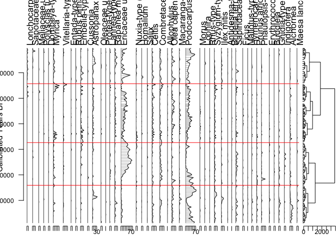
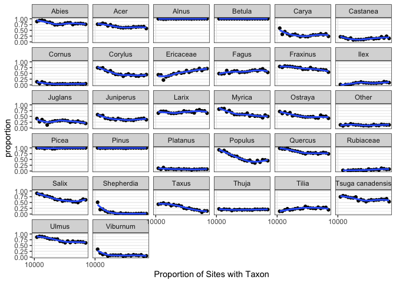

<script>
(function () {
  function refit(pane) {
    if (!pane || !window.HTMLWidgets) return;
    pane.querySelectorAll(".leaflet.html-widget").forEach(function (el) {
      var widget = HTMLWidgets.find("#" + el.id);
      if (!widget || !widget.getMap) return;
      var map = widget.getMap();
      map.invalidateSize();
      var tag = document.querySelector("script[data-for=\"" + el.id + "\"]");
      var limits = tag && JSON.parse(tag.textContent).x.limits;
      if (limits) {
        map.fitBounds([[limits.lat[0], limits.lng[0]],
                       [limits.lat[1], limits.lng[1]]]);
      }
    });
  }
  document.addEventListener("DOMContentLoaded", function () {
    $(document).on("shown.bs.tab", "a[data-toggle=\"tab\"]", function (e) {
      refit(document.querySelector($(e.target).attr("href")));
    });
  });
})();
</script>

## 1. Introduction

This document is intended to act as a primer for the use of the new Neotoma R package, `neotoma2`, for working with **diatom** data.  Some users may be working with this document as part of a workshop for which there is a Binder instance. The Binder instance will run RStudio in your browser, with all the required packages installed.

If you are using this workflow on its own, or want to use the package directly, [the `neotoma2` package](https://github.com/NeotomaDB/neotoma2) is available on GitHub. This workflow uses the development version (1.1.1.9000 or later), which you can install by running:

```r
install.packages("remotes")
remotes::install_github("NeotomaDB/neotoma2", ref = "dev")
library(neotoma2)
```

This workshop will also require other packages. To maintain the flow of this document we've placed instructions at the end of the document in the section labelled "[Installing packages on your own](#localinstall)".

## 2. Learning Goals

In this tutorial you will learn how to:

* Search for sites using site names and geographic parameters -- [Site Searches](#3-site-searches)
* Filter results by dataset type (diatoms, diatom surface samples, water chemistry) and by whether a record has a chronology -- [Filter Results](#33-filter-records-tabset)
* Obtain sample information for one of the selected sites -- [Sample Information](#34-pulling-in-sample-data)
* Perform basic analysis including connecting your taxon names to GBIF, a stratigraphic diagram, and the change in diatom families through time -- [Basic Analysis](#4-simple-analytics)

### 2.1. Getting Help with Neotoma

If you're planning on working with Neotoma, please join us on [Slack](https://join.slack.com/t/neotomadb/shared_invite/zt-cvsv53ep-wjGeCTkq7IhP6eUNA9NxYQ) where we manage a channel specifically for questions about the R package. You may also wish to join our Google Groups mailing list, please [contact us](mailto:neotoma-contact@googlegroups.com) to be added.

### 2.2 Understanding Data Structures in Neotoma

Data in the Neotoma database itself is structured as a set of linked relationships to express the different elements of paleoecological analysis: space and time, raw data, scientific methods and data models. Because paleoecology is such a broad discipline these relationships can be complex, and as such, the database itself is highly structured. If you want to better understand concepts within the database, you can read the [Neotoma Database Manual](https://open.neotomadb.org/manual), or take a look at [the database schema itself](https://open.neotomadb.org/dbschema).

In this workshop we want to highlight two key structural concepts:
  
  1. The way data is structured conceptually within Neotoma (Sites, Collection Units and Datasets).
  2. The way that this structure is adapted within the `neotoma2` R package.

### 2.2.1 Data Structure in the Neotoma Database

{width=50%}

Data in Neotoma is associated with sites -- specific locations with lat/long coordinates.

Within a **site**, there may be one or more [**collection units**](https://open.neotomadb.org/manual/dataset-collection-related-tables-1.html#CollectionUnits) -- locations at which samples are physically collected within the site. For example, an archaeological **site** may have one or more **collection units**, pits within a broader dig site; a diatom sampling **site** on a lake may have multiple **collection units** -- core sites within the lake basin. Collection units may have higher resolution GPS locations than the site location, but are considered to be part of the broader site.

Data within a **collection unit** is collected at various [**analysis units**](https://open.neotomadb.org/manual/sample-related-tables-1.html#AnalysisUnits). Any data sampled within an analysis unit is grouped by the dataset type (charcoal, diatom, dinoflagellate, etc.) and aggregated into a [**sample**](https://open.neotomadb.org/manual/sample-related-tables-1.html#Samples). The set of samples for a collection unit of a particular dataset type is then assigned to a [**dataset**](https://open.neotomadb.org/manual/dataset-collection-related-tables-1.html#Datasets).

### 2.2.2 Data Structures in `neotoma2`


If we look at the [UML diagram](https://en.wikipedia.org/wiki/Unified_Modeling_Language) for the objects in the `neotoma2` R package we can see that the data structure generally mimics the structure within the database itself.  As we will see in the [Site Searches section](#3-site-searches), we can search for these objects, and begin to manipulate them (in the [Simple Analysis section](#4-simple-analytics)).

It is important to note: *within the `neotoma2` R package, most objects are `sites` objects, they just contain more or less data*.  There are a set of functions that can operate on `sites`.  As we add to `sites` objects, using `get_datasets()` or `get_downloads()`, we are able to use more of these helper functions.

### 2.2.3 Piping in `R` {.tabset}

Piping is a technique that simplifies the process of chaining multiple operations on a data object. It involves using either of these operators: `|>` or `%>%`. `|>` is a base R operator while `%>%` comes from the `tidyverse` ecosystem in R. In `neotoma2` we use `%>%`.

The pipe operator works as a real-life pipe, which carries water from one location to another. In programming, the output of the function on the left-hand side of the pipe is taken as the initial argument for the function on the right-hand side of the pipe. It helps by making code easier to write and read. Additionally, it reduces the number of intermediate objects created during data processing, which can make code more memory-efficient and faster.

Without using pipes you can use the `neotoma2` R package to retrieve a site and then plot it by doing:

```r
# Retrieve the site
plot_site <- neotoma2::get_sites(sitename = "%Swamp%")
# Plot the site
neotoma2::plotLeaflet(object = plot_site)
```

This would create a variable `plot_site` that we will not need any more, but it was necessary so that we could pass it to the `plotLeaflet` function.

With the pipe (`%>%`) we do not need to create the variable, we can just rewrite our code.  Notice that `plotLeaflet()` doesn't need the `object` argument because the response of `get_sites(sitename = "%Swamp%")` gets passed directly into the function.

#### 2.2.3.1. Code


``` r
# get_sites and pipe. The `object` parameter for plotLeaflet will be the
# result of the `get_sites()` function.
get_sites(sitename = "%Swamp%") %>%
  plotLeaflet()
```
#### 2.2.3.2. Result


```{=html}
<div class="leaflet html-widget html-fill-item" id="htmlwidget-4ea94bb4c7add86feb0e" style="width:672px;height:480px;"></div>
<script type="application/json" data-for="htmlwidget-4ea94bb4c7add86feb0e">{"x":{"options":{"crs":{"crsClass":"L.CRS.EPSG3857","code":null,"proj4def":null,"projectedBounds":null,"options":{}}},"calls":[{"method":"addTiles","args":["https://{s}.tile.openstreetmap.org/{z}/{x}/{y}.png",null,null,{"minZoom":0,"maxZoom":18,"tileSize":256,"subdomains":"abc","errorTileUrl":"","tms":false,"noWrap":false,"zoomOffset":0,"zoomReverse":false,"opacity":1,"zIndex":1,"detectRetina":false,"attribution":"&copy; <a href=\"https://openstreetmap.org/copyright/\">OpenStreetMap<\/a>,  <a href=\"https://opendatacommons.org/licenses/odbl/\">ODbL<\/a>"}]},{"method":"addCircleMarkers","args":[[-36.51667,42.51667,36.65,36.66667,36.58333,48.75,46.51667,40.48333,44.18,-3.43333,44.89167,37.95,41.95,46.36139,40.11667,-41.12666,-40.529062,-35.7077,41.933788,43.095992,43.095252,42.5372,42.2384,39.535,42.3272],[149.5,-72.21250000000001,-76.47917,-76.36667,-76.45,28.25,32.61667,-75.66667,-79.44,29.61667,-93.69167,-119.81667,-71.03333000000001,19.99417,-83.25,144.67463,144.749224,148.885604,-70.76151400000001,-78.01244,-78.02198200000001,-72.18356,-73.42060000000001,-79.53879999999999,-73.49639999999999],10,null,null,{"interactive":true,"draggable":false,"keyboard":true,"title":"","alt":"","zIndexOffset":0,"opacity":1,"riseOnHover":true,"riseOffset":250,"stroke":true,"color":"#03F","weight":5,"opacity.1":0.5,"fill":true,"fillColor":"#03F","fillOpacity":0.2},{"showCoverageOnHover":true,"zoomToBoundsOnClick":true,"spiderfyOnMaxZoom":true,"removeOutsideVisibleBounds":true,"spiderLegPolylineOptions":{"weight":1.5,"color":"#222","opacity":0.5},"freezeAtZoom":false},null,["<b>Bega Swamp<\/b><br><b>Description:<\/b> Species of Empodisma, Lepidosperma and Restio cover the major part of the swamp surface and also generate most of the peat formation inside the swamp.\r\nThe swamp is surrounded by wet sclerophyll (tall, open), Eucalyptus-dominated forest with an understorey of shrubs. The ground cover of the forest consists mainly of grasses with a number of other species.<br><a href=http://apps.neotomadb.org/explorer/?siteids=247>Explorer Link<\/a>","<b>Tom Swamp<\/b><br><b>Description:<\/b> Larix-Picea mariana-Sphagnum bog. Physiography: rolling topog.- valley between ridges. Surrounding vegetation: oak with mixed hardwd/hemlock/white pine.<br><a href=http://apps.neotomadb.org/explorer/?siteids=562>Explorer Link<\/a>","<b>Great Dismal Swamp<\/b><br><b>Description:<\/b> NA<br><a href=http://apps.neotomadb.org/explorer/?siteids=676>Explorer Link<\/a>","<b>Great Dismal Swamp<\/b><br><b>Description:<\/b> NA<br><a href=http://apps.neotomadb.org/explorer/?siteids=678>Explorer Link<\/a>","<b>Great Dismal Swamp<\/b><br><b>Description:<\/b> NA<br><a href=http://apps.neotomadb.org/explorer/?siteids=679>Explorer Link<\/a>","<b>Dovjok Swamp<\/b><br><b>Description:<\/b> Floodplain Phragmites fen. Physiography: floodplain in Murafa Basin. Surrounding vegetation: herb steppe, Quercus/Carpinus forest.<br><a href=http://apps.neotomadb.org/explorer/?siteids=703>Explorer Link<\/a>","<b>Kardashinski Swamp<\/b><br><b>Description:<\/b> Phragmites fen. Physiography: Floodplain of Dniepr River. Vegetation formation: Steppe.<br><a href=http://apps.neotomadb.org/explorer/?siteids=1403>Explorer Link<\/a>","<b>Longswamp<\/b><br><b>Description:<\/b> NA<br><a href=http://apps.neotomadb.org/explorer/?siteids=1610>Explorer Link<\/a>","<b>Rose Swamp<\/b><br><b>Description:<\/b> Swamp in drumlin field. Physiography: Newmarket till plain. Surrounding vegetation: Pinus/Tsuga/Juniperus/Acer/Fagus/Ulmus.<br><a href=http://apps.neotomadb.org/explorer/?siteids=2210>Explorer Link<\/a>","<b>Rusaka Swamp<\/b><br><b>Description:<\/b> Raised mire, drained for agriculture. Physiography: Burundi highlands. Surrounding vegetation: sweet potato, bean, and manihot fields.<br><a href=http://apps.neotomadb.org/explorer/?siteids=2233>Explorer Link<\/a>","<b>Stone Lake Tamarack Swamp<\/b><br><b>Description:<\/b> Larix swamp. Physiography: low rolling relief. Surrounding vegetation: Larix/Salix/Cornus/Typha.<br><a href=http://apps.neotomadb.org/explorer/?siteids=2519>Explorer Link<\/a>","<b>Swamp Lake<\/b><br><b>Description:<\/b> Small lake. Physiography: Sierra Nevada Mountain Range. Surrounding vegetation: Pinus ponderosa, Pinus jeffreyi.<br><a href=http://apps.neotomadb.org/explorer/?siteids=2529>Explorer Link<\/a>","<b>Titicut Swamp<\/b><br><b>Description:<\/b> Kettle lake. Physiography: glaciated Tauton River Valley. Surrounding vegetation: Acer/Ilex/Clethra/Vaccinium.<br><a href=http://apps.neotomadb.org/explorer/?siteids=2554>Explorer Link<\/a>","<b>Zsombó Swamp<\/b><br><b>Description:<\/b> Swamp area formed between drift sand dun. Surrounding vegetation: fragments of riparian forest.<br><a href=http://apps.neotomadb.org/explorer/?siteids=3523>Explorer Link<\/a>","<b>Wild Cat Swamp [OSU-14925]<\/b><br><b>Description:<\/b> NA<br><a href=http://apps.neotomadb.org/explorer/?siteids=6385>Explorer Link<\/a>","<b>Sundown Swamp<\/b><br><b>Description:<\/b> Interdunal Melaleuca ericifolia swamp. Physiography: Coastal plateau with dunes. Surrounding vegetation: Epacris- Leptospermum heath.<br><a href=http://apps.neotomadb.org/explorer/?siteids=10009>Explorer Link<\/a>","<b>Stockyard Swamp<\/b><br><b>Description:<\/b> Seasonally inundated interdunal pond on Hunter Island. Tall Melaleuca ericifolia thicket occur on northern and eastern sides. Physiography: stabilised coastal dunefield. Surrounding vegetation: sedge fen, Eucalyptus woodland, and pasture.<br><a href=http://apps.neotomadb.org/explorer/?siteids=10016>Explorer Link<\/a>","<b>Rotten Swamp<\/b><br><b>Description:<\/b> Subalpine Sphagnum–Epacris shrub bog with Empodisma fen and Carex fen. Surrounding vegetation: Eucalyptus open forest.<br><a href=http://apps.neotomadb.org/explorer/?siteids=10024>Explorer Link<\/a>","<b>Makepeace Cedar Swamp<\/b><br><b>Description:<\/b> Closed basin mire located in sandy outwash along the margin of the Monk's Hill recessional moraine. Surrounding vegetation: Quercus, Pinus strobus, Betula, Acer rubrum, Tsuga canadensis, and Fagus grandifolia. Grass with cedar immediately at site.<br><a href=http://apps.neotomadb.org/explorer/?siteids=10076>Explorer Link<\/a>","<b>Byron-Bergen Swamp (Site 2)<\/b><br><b>Description:<\/b> Open marl fen. Surrounding vegetation -- Sedges: Eleocharis rostellata. Trees: Thuja occidentalis, Larix laricina, Pinus strobus. Shrubs: Myrica pensylvanica, Rhamnus alnifolia, Ledum groenlandicum.<br><a href=http://apps.neotomadb.org/explorer/?siteids=10155>Explorer Link<\/a>","<b>Byron-Bergen Swamp (Site 1)<\/b><br><b>Description:<\/b> Closed-canopy swamp forest. Surrounding vegetation: Pinus strobus, Acer rubrum, Tsuga canadensis, Acer saccharum, Thuja occidentalis, Betua alleghaniensis, Fraxinus sp., Zanthoxylum americanum.<br><a href=http://apps.neotomadb.org/explorer/?siteids=10157>Explorer Link<\/a>","<b>Black Gum Swamp<\/b><br><b>Description:<\/b> Swamp that occupies an irregularly shaped basin that drains to the southwest through an intermittent stream. Surrounding vegetation: Picea rubens, Nyssa sylvatica, and Acer rubrum in the overstory. Ilex, Nemopanthus, Vaccinium, and Viburnum in the understory. Ground layer of Sphagnum, Osmunda, and herbs.<br><a href=http://apps.neotomadb.org/explorer/?siteids=10172>Explorer Link<\/a>","<b>Alford Swamp<\/b><br><b>Description:<\/b> Elongate swampy area in glacial drift. Red maple trees and juneberry with a ground cover of sedge, Sphagnum, marsh marigold, Osmunda, and other fern types.<br><a href=http://apps.neotomadb.org/explorer/?siteids=10177>Explorer Link<\/a>","<b>Cranesville Pine Swamp<\/b><br><b>Description:<\/b> Swamp in an elongate depression on the Appalachian Plateau, Allegheny Mountains Section. . . . . . Surrounding vegetation: Ground cover is hummock sedge and Sphagnum moss interspersed with Osmunda, cattail, skunk cabbage, Rhododendron, and alder in the wetter sites. Tree cover is predominantly spruce with tamarack and red maple of secondary importance.<br><a href=http://apps.neotomadb.org/explorer/?siteids=10179>Explorer Link<\/a>","<b>State Line Swamp<\/b><br><b>Description:<\/b> Swamp in glacial drift. Surrounding vegetation: White pine, hemlock, and red maple with a substratum of Sphagnum and Osmunda.<br><a href=http://apps.neotomadb.org/explorer/?siteids=10182>Explorer Link<\/a>"],null,null,{"interactive":false,"permanent":false,"direction":"auto","opacity":1,"offset":[0,0],"textsize":"10px","textOnly":false,"className":"","sticky":true},null]}],"limits":{"lat":[-41.12666,48.75],"lng":[-119.81667,149.5]}},"evals":[],"jsHooks":[]}</script>
```


## 3. Site Searches

### 3.1. `get_sites()`

There are several ways to find sites in `neotoma2`, but we think of `sites` as being spatial objects primarily. They have names, locations, and are found within the context of geopolitical units, but within the API and the package, the site itself does not have associated information about taxa, dataset types or ages.  It is simply the container into which we add that information.  So, when we search for sites we can search by:

| Parameter | Description |
| --------- | ----------- |
| sitename | A valid site name (case insensitive) using `%` as a wildcard. |
| siteid | A unique numeric site id from the Neotoma Database |
| loc | A bounding box vector, geoJSON or WKT string. |
| altmin | Lower altitude bound for sites. |
| altmax | Upper altitude bound for site locations. |
| database | The constituent database from which the records are pulled. |
| datasettype | The kind of dataset (see `get_table("datasettypes")`) |
| datasetid | Unique numeric dataset identifier in Neotoma |
| doi | A valid dataset DOI in Neotoma |
| gpid | A unique numeric identifier, or text string identifying a geopolitical unit in Neotoma |
| keywords | Unique sample keywords for records in Neotoma. |
| contacts | A name or numeric id for individuals associuated with sites. |
| taxa | Unique numeric identifiers or taxon names associated with sites. |

All sites in Neotoma contain one or more datasets. It's worth noting that the results of these search parameters may be slightly unexpected. For example, searching for sites by sitename, latitude, or altitude will return all of the datasets for the particular site. Searching for terms such as datasettype, datasetid or taxa will return the site, but the only datasets returned will be those matching the dataset-specific search terms. We'll see this later.

#### 3.1.1. Site names: `sitename="%Lake%"` {.tabset}

We may know exactly what site we're looking for ("Arbutus Lake"), or have an approximate guess for the site name (for example, we know it's something like "Arbutus Lake" or "Lake Arbutus", but we're not sure how it was entered specifically), or we may want to search all sites that have a specific term, for example, *Lake*.

We use the general format: `get_sites(sitename="%Lake%")` for searching by name.

PostgreSQL (and the API) uses the percent sign as a wildcard.  So `"%Lake%"` would pick up ["Arbutus Lake"](https://data.neotomadb.org/710) for us, and it would also pick up any site where "lake" is part of a longer word, such as "Lakeside" or "Blake".  Note that the search query is also case insensitive, so you could simply write `"%LAKE%"`.

##### 3.1.1.1. Code


``` r
lake_sites <- neotoma2::get_sites(sitename = "%Lake%")
plotLeaflet(lake_sites)
```

##### 3.1.1.2. Result


```{=html}
<div class="leaflet html-widget html-fill-item" id="htmlwidget-775ab54897c5fbb2e1d9" style="width:672px;height:480px;"></div>
<script type="application/json" data-for="htmlwidget-775ab54897c5fbb2e1d9">{"x":{"options":{"crs":{"crsClass":"L.CRS.EPSG3857","code":null,"proj4def":null,"projectedBounds":null,"options":{}}},"calls":[{"method":"addTiles","args":["https://{s}.tile.openstreetmap.org/{z}/{x}/{y}.png",null,null,{"minZoom":0,"maxZoom":18,"tileSize":256,"subdomains":"abc","errorTileUrl":"","tms":false,"noWrap":false,"zoomOffset":0,"zoomReverse":false,"opacity":1,"zIndex":1,"detectRetina":false,"attribution":"&copy; <a href=\"https://openstreetmap.org/copyright/\">OpenStreetMap<\/a>,  <a href=\"https://opendatacommons.org/licenses/odbl/\">ODbL<\/a>"}]},{"method":"addCircleMarkers","args":[[53.33333,52.51667,44.80156,46.20611,60.13667,48.15,46.185826,46.25,42.28,44.5,46.41667,46.701316,64.65000000000001,67.13333,-62.62861,45.38,47.119368,78.49167,52.2,30.62222,37.59583,44.3,45.8,46.12806,65.21666999999999],[-60.58333,-57.03333,-94.55982,-95.29361,152.31278,-91.12,-89.70308200000001,-89.90000000000001,-73.88,-89.5,-92.71666999999999,-85.03963999999999,-128.08333,-153.9,-61.13472,-79.51000000000001,-95.402114,-76.78,-10.30833,-83.25389,-119.00833,-77.91667,-122.49167,-93.70389,-127.05],10,null,null,{"interactive":true,"draggable":false,"keyboard":true,"title":"","alt":"","zIndexOffset":0,"opacity":1,"riseOnHover":true,"riseOffset":250,"stroke":true,"color":"#03F","weight":5,"opacity.1":0.5,"fill":true,"fillColor":"#03F","fillOpacity":0.2},{"showCoverageOnHover":true,"zoomToBoundsOnClick":true,"spiderfyOnMaxZoom":true,"removeOutsideVisibleBounds":true,"spiderLegPolylineOptions":{"weight":1.5,"color":"#222","opacity":0.5},"freezeAtZoom":false},null,["<b>Alexander Lake<\/b><br><b>Description:<\/b> Physiography: rolling glacial till, eskers, kettles,.<br><a href=http://apps.neotomadb.org/explorer/?siteids=24>Explorer Link<\/a>","<b>Alexis Lake<\/b><br><b>Description:<\/b> Lake in Alexis River watershed. Physiography: Mecatina Plateau/Laurentian region. Surrounding vegetation: Black Spruce, Lichen Barrens.<br><a href=http://apps.neotomadb.org/explorer/?siteids=25>Explorer Link<\/a>","<b>Lake Allie<\/b><br><b>Description:<\/b> Kettle lake. Physiography: rolling stagnation moraine.<br><a href=http://apps.neotomadb.org/explorer/?siteids=29>Explorer Link<\/a>","<b>Almora Lake<\/b><br><b>Description:<\/b> Lake with emergent reed vegetation. Physiography: Parkers Prairie sandplain. Surrounding vegetation: agriculture.<br><a href=http://apps.neotomadb.org/explorer/?siteids=30>Explorer Link<\/a>","<b>Alut Lake<\/b><br><b>Description:<\/b> Tectonic lake. Physiography: valley in mountains. Surrounding vegetation: Larix forest.<br><a href=http://apps.neotomadb.org/explorer/?siteids=31>Explorer Link<\/a>","<b>Hungry Jack Lake<\/b><br><b>Description:<\/b> NA<br><a href=http://apps.neotomadb.org/explorer/?siteids=195>Explorer Link<\/a>","<b>Hells Kitchen Lake<\/b><br><b>Description:<\/b> Kettle lake. Physiography: steep topography. Surrounding vegetation: Betula, Populus, Acer.<br><a href=http://apps.neotomadb.org/explorer/?siteids=196>Explorer Link<\/a>","<b>Lake Mary<\/b><br><b>Description:<\/b> Meromictic lake on Woodfordian till. Physiography: rolling till plain. Surrounding vegetation: white cedar/alder.<br><a href=http://apps.neotomadb.org/explorer/?siteids=197>Explorer Link<\/a>","<b>Greens Lake<\/b><br><b>Description:<\/b> NA<br><a href=http://apps.neotomadb.org/explorer/?siteids=198>Explorer Link<\/a>","<b>Emily Lake<\/b><br><b>Description:<\/b> NA<br><a href=http://apps.neotomadb.org/explorer/?siteids=199>Explorer Link<\/a>","<b>Anderson Lake<\/b><br><b>Description:<\/b> Physiography: Nickerson Moraine. Surrounding vegetation: maple-basswood, Juglans cinerea.<br><a href=http://apps.neotomadb.org/explorer/?siteids=202>Explorer Link<\/a>","<b>Andrus Lake<\/b><br><b>Description:<\/b> Seepage lake. Physiography: flat sandy glacial lake bottom. Surrounding vegetation: Pinus/Betula/Quercus/Acer.<br><a href=http://apps.neotomadb.org/explorer/?siteids=205>Explorer Link<\/a>","<b>Andy Lake<\/b><br><b>Description:<\/b> Lake dammed by a Mountain River moraine. Physiography: Mackenzie Mountains. Surrounding vegetation: shrub tundra.<br><a href=http://apps.neotomadb.org/explorer/?siteids=206>Explorer Link<\/a>","<b>Angal Lake<\/b><br><b>Description:<\/b> Cirque lake. Physiography: mountainous. Surrounding vegetation: Betula shrub tundra.<br><a href=http://apps.neotomadb.org/explorer/?siteids=207>Explorer Link<\/a>","<b>Lake Åsa<\/b><br><b>Description:<\/b> Lake inside President Beaches. Physiography: above Holocene sea-level. Surrounding vegetation: sparse mosses and lichens.<br><a href=http://apps.neotomadb.org/explorer/?siteids=216>Explorer Link<\/a>","<b>Axe Lake<\/b><br><b>Description:<\/b> NA<br><a href=http://apps.neotomadb.org/explorer/?siteids=219>Explorer Link<\/a>","<b>Bad Medicine Lake<\/b><br><b>Description:<\/b> Kettle lake. Physiography: Itaska Moraine, rolling. Surrounding vegetation: Pinus banksiana, Populus, Betula.<br><a href=http://apps.neotomadb.org/explorer/?siteids=221>Explorer Link<\/a>","<b>Baird Inlet [Rock Basin Lake]<\/b><br><b>Description:<\/b> Closed steep sided ice excavated basin. Physiography: granulite gneiss massif, valley glaciers. Surrounding vegetation: Empetrum/Vaccinium heath, mossy heaths.<br><a href=http://apps.neotomadb.org/explorer/?siteids=222>Explorer Link<\/a>","<b>Ballinloghig Lake<\/b><br><b>Description:<\/b> Lake with marginal fen. Physiography: Southern slope of Slieve Mish mountains. Surrounding vegetation: Blanket bog, heath, pasture and woodland.<br><a href=http://apps.neotomadb.org/explorer/?siteids=223>Explorer Link<\/a>","<b>Barchampe Lake<\/b><br><b>Description:<\/b> Sinkhole pond. Physiography: Gulf Coastal Plain, level. Surrounding vegetation: pine/oak forest.<br><a href=http://apps.neotomadb.org/explorer/?siteids=229>Explorer Link<\/a>","<b>Barrett Lake<\/b><br><b>Description:<\/b> Glacial scour lake. Physiography: Sierra Nevada mountains. Surrounding vegetation: lodgepole/limber pine, mountain hemlock.<br><a href=http://apps.neotomadb.org/explorer/?siteids=231>Explorer Link<\/a>","<b>Barry Lake<\/b><br><b>Description:<\/b> Lake of glacial origin. Physiography: Peterborough drumlin field, rolling.<br><a href=http://apps.neotomadb.org/explorer/?siteids=232>Explorer Link<\/a>","<b>Battle Ground Lake<\/b><br><b>Description:<\/b> Volcanic crater. Physiography: Puget Trough. Surrounding vegetation: second-growth Pseudotsuga/decid forest.<br><a href=http://apps.neotomadb.org/explorer/?siteids=236>Explorer Link<\/a>","<b>Black Bass Lake<\/b><br><b>Description:<\/b> Kettle lake. Physiography: Mille Lacs Moraine, rolling.<br><a href=http://apps.neotomadb.org/explorer/?siteids=238>Explorer Link<\/a>","<b>Beach Lake<\/b><br><b>Description:<\/b> Physiography: Mackenzie Valley.<br><a href=http://apps.neotomadb.org/explorer/?siteids=241>Explorer Link<\/a>"],null,null,{"interactive":false,"permanent":false,"direction":"auto","opacity":1,"offset":[0,0],"textsize":"10px","textOnly":false,"className":"","sticky":true},null]}],"limits":{"lat":[-62.62861,78.49167],"lng":[-153.9,152.31278]}},"evals":[],"jsHooks":[]}</script>
```

#### 3.1.2. Location: `loc=c()` {.tabset}

The `neotoma` package used a bounding box for locations, structured as a vector of latitude and longitude values: `c(xmin, ymin, xmax, ymax)`.  The `neotoma2` R package supports both this simple bounding box, but also more complex spatial objects, using the [`sf` package](https://r-spatial.github.io/sf/). Using the `sf` package allows us to more easily work with raster and polygon data in R, and to select sites from more complex spatial objects.  The `loc` parameter works with the simple vector, [WKT](https://arthur-e.github.io/Wicket/sandbox-gmaps3.html), [geoJSON](http://geojson.io/#map=2/20.0/0.0) objects and native `sf` objects in R.

Here we look for sites using a location. We're using a rough polygon around Pennsylvania, stretched east to include the New Jersey shore out to Barnegat Bay.  To work with this spatial object in R we also transformed the `geojson_str` element to an object for the `sf` package.  There are many other tools to work with spatial objects in R. Regardless of how you get the data into R, `neotoma2` works with almost all objects in the `sf` package.


``` r
geojson_str <- '{"coordinates":
  [[[-80.52, 42.27],
    [-79.76, 42.27],
    [-75.36, 42.00],
    [-74.69, 41.36],
    [-73.95, 40.60],
    [-73.95, 39.45],
    [-75.55, 39.45],
    [-75.79, 39.72],
    [-80.52, 39.72],
    [-80.52, 42.27]]],
  "type":"Polygon"}'

penn_sf <- geojsonsf::geojson_sf(geojson_str)

# Note here we use the `all_data` flag to capture all the sites.
penn_sites <- neotoma2::get_sites(loc = penn_sf, all_data = TRUE)
```

You can always simply `plot()` the `sites` objects, but you will lose some of the geographic context.  The `plotLeaflet()` function returns a `leaflet()` map, and allows you to further customize it, or add additional spatial data (like our original bounding polygon, `penn_sf`, which works directly with the R `leaflet` package):

##### 3.1.2.1. Code


``` r
neotoma2::plotLeaflet(penn_sites) %>%
  leaflet::addPolygons(
    map = .,
    data = penn_sf,
    color = "green"
  )
```

##### 3.1.2.2. Result


```{=html}
<div class="leaflet html-widget html-fill-item" id="htmlwidget-be63f32a73dd14e69e66" style="width:672px;height:480px;"></div>
<script type="application/json" data-for="htmlwidget-be63f32a73dd14e69e66">{"x":{"options":{"crs":{"crsClass":"L.CRS.EPSG3857","code":null,"proj4def":null,"projectedBounds":null,"options":{}}},"calls":[{"method":"addTiles","args":["https://{s}.tile.openstreetmap.org/{z}/{x}/{y}.png",null,null,{"minZoom":0,"maxZoom":18,"tileSize":256,"subdomains":"abc","errorTileUrl":"","tms":false,"noWrap":false,"zoomOffset":0,"zoomReverse":false,"opacity":1,"zIndex":1,"detectRetina":false,"attribution":"&copy; <a href=\"https://openstreetmap.org/copyright/\">OpenStreetMap<\/a>,  <a href=\"https://opendatacommons.org/licenses/odbl/\">ODbL<\/a>"}]},{"method":"addCircleMarkers","args":[[42.1,41.75,41.62,41.73,41.83,41.72,41.87,41.73,41.88,41.9,41.58,41.52,41.48,41.3,41.12,40.83,40.62,40.07,40.23,40.33,40.45,40.85,40.82,41.05,41.18,41.27,41.6,41.78,41.77,41.9,39.76667,39.96667,41.76667,40.98,41.134956,40.85583,41.376234,41.002606,40.38333,41.381678,40.48333,40.8,41.91667,41.250252,41.67389,41.070562,40.4,41.03779,40.08333,40.47222,40.36778,40,40.28667,40.25,40.00889,39.91944,40.11667,40.86667,40.75,40.75,40.11667,40.08333,40,40.01667,40.11667,40.89278,41.36667,41.11667,40.5,39.86667,40.20611,40.25,40.39139,39.86667,41.80833,40.11667,40.03194,41.12,40.86667,42.11667,40.36667,41.5,41.1,40.36667,41.25,40.36667,40.36667,40.61667,39.75,39.75,39.75,41.67917,39.86667,40.36667,40.36667,40.5,41.04694,40.36667,41.0287,41.61737,40.73,39.7776,42.103496,42.005986,40.999136,39.861574,39.6992,40.737206,40.910296,40.871,39.925258,39.708524,41.057182,41.004116,39.66829,41.240584,40.128972,39.80567,40.410836,40.556,40.244052,41.029474,40.310118,41.022652,40.92805,39.473544,39.49464,39.817248,40.0537,39.602204,39.59078,39.68103,40.276772,40.91079,40.79971,40.40024,40.96649,41.093158,40.94679600000001,40.95226,41.073358,41.1429,40.96557,40.99154,41.16568,40.880264,40.712042,39.55774,39.732726,40.83406400000001,39.78917,39.859332,40.467422,40.93681,40.9062,40.85742,40.983052,41.004938,41.002726,40.974214,40.980152,41.030956,40.197958,41.056048,39.75327,40.909676,40.87098,40.429932,40.410798,40.85901,41.20037,40.635106,40.255696,39.817672,40.966662,40.47118,40.931736,41.316806,39.81472,40.869286,41.08754,39.780334,40.93731,41.02795,41.04285,41.017,41.14858,41.084816,41.097246,41.152,40.97163,39.82194,39.93824,40.008348,40.13763,40.15966,39.94468,39.94468,39.94468,39.85742,40.05739,39.978688,39.95472,39.911274,40.03174,39.954208,41.097272,40.037308,39.778068,40.03883,40.110606,39.91387,40.418592,41.141066,39.70035,39.72028,39.73658,40.02988,39.81088,39.62735,40.10323,39.84758,40.7054,40.7188,41.951486,41.95944,41.18333,40.10306,39.75,40.46163,40.27035,40.87358,41.5555,40.49158,41.41393,41.1113,41.97137,39.97428,40.92705,40.76263,41.09921,40.35386,40.35741,40.16155,40.11146,40.8634,40.3065,40.80374,39.76851,42.05397,40.951648,40.92946,39.96833,39.85198,41.039182,40.225162,41.106606,39.934856,40.810572,41.6334,41.69517,40.62803,41.90973,41.632522,41.601102,41.527,41.762172,41.392074,41.350228,41.611842,41.287966,41.318424,41.405174,41.916496,41.838214,41.831472,41.83864,41.298616,41.311266,41.823528,41.26646,41.26969,41.580406,41.32332,41.250458,41.819208,41.7952,41.771,41.726642,41.3542,41.822734,41.830246,41.732272,41.515666,41.81333,41.571444,41.404608,39.6534,40.951168,39.6117,41.5724,39.450416,39.8537,39.873,40.751314,40.9824,40.917406,40.140154,40.067,40.117,41.35,41.55,39.717,41.867,40.33278,40.92389,40.925,40.33194,40.32694,40.7918,41.58822,41.5477,41.55711,41.61872,41.55389,39.71955],[-78.75,-79.17,-78.75,-78.42,-77.95,-77.77,-77.05,-77.3,-76.72,-76.23,-76.17,-76.59999999999999,-77.03,-76.58,-76.52249999999999,-76.37,-76.05,-75.83,-75.53,-75.48,-75.52,-75.8,-76.05,-75.93000000000001,-75.75,-76.08,-75.75,-75.53,-76.58,-75.31999999999999,-78.55,-77.55,-75.83333,-74.42,-75.02775,-74.39917,-75.09430999999999,-74.498868,-74.43333,-75.292108,-75.66667,-77.41667,-77.925,-74.987792,-76.34999999999999,-74.840226,-74.48333,-75.26551000000001,-78.65000000000001,-80.04971999999999,-80.11888999999999,-76.25,-80.48333,-79.36667,-79.85111000000001,-79.96722,-80.25,-79.86667,-79.36667,-79.36667,-80.11667,-78.65000000000001,-78.86667,-76.72499999999999,-79.11667,-77.43944,-79.8,-80.36667,-75.11667,-80.25,-80.2075,-75.36667,-79.62306,-79.75,-76.48333,-79.75,-79.6375,-74.96111000000001,-75,-78.61667,-78.25,-75,-74.98333,-79.75,-74.61667,-79.75,-78.36667,-80.36667,-79.25,-79.36667,-79.86667,-76.35278,-80.11667,-78.36667,-80.25,-79.25,-75.11083000000001,-80.36667,-75.70491,-79.63867999999999,-77.76179999999999,-79.2152,-79.728262,-75.48098400000001,-74.914564,-75.783316,-75.45,-74.30457199999999,-74.474208,-74.6285,-75.07272,-75.007756,-74.40992,-74.739318,-74.522076,-74.83349800000001,-74.28279999999999,-74.90058999999999,-74.242786,-74.6311,-74.34146800000001,-74.77562399999999,-74.513932,-74.624246,-74.77043,-75.24532600000001,-75.33890600000001,-75.01141800000001,-74.85963599999999,-74.88683999999999,-74.86413,-75.26352200000001,-73.988816,-74.81707,-74.78494999999999,-74.84183,-74.49565,-74.539276,-74.89138199999999,-74.50111,-74.581154,-74.56362,-74.73584,-74.69550600000001,-74.777652,-74.460778,-74.635806,-75.3352,-75.282748,-74.4135,-75.13642,-74.801806,-74.426704,-74.444726,-74.517544,-74.98593000000001,-74.539342,-74.940196,-75.074268,-74.356652,-74.768956,-74.716756,-74.48338800000001,-74.482214,-75.06062,-74.474238,-74.62853,-74.475908,-74.24274799999999,-74.98390999999999,-74.77,-74.456056,-74.725678,-74.85889999999999,-74.73585199999999,-74.41929,-74.375322,-74.667428,-74.456478,-74.747218,-74.649,-74.482692,-74.64303600000001,-74.753288,-74.702442,-74.733,-74.81351599999999,-74.816812,-74.64095399999999,-74.524,-74.981848,-76.4975,-75.61057799999999,-75.438012,-75.743602,-75.74480800000001,-75.65335,-75.65335,-75.65335,-75.64042000000001,-75.421764,-75.607316,-75.53273399999999,-75.860972,-75.81706,-75.65444599999999,-74.640604,-79.724796,-79.22226000000001,-77.270308,-77.695054,-78.055764,-76.599418,-76.082746,-75.63017000000001,-75.56202999999999,-75.52567999999999,-74.07995,-74.19016999999999,-74.26023000000001,-75.4242,-74.14727999999999,-74.46640000000001,-74.426,-79.75923999999999,-76.5275,-74.66667,-75.425,-76.875,-79.56744999999999,-78.68226,-75.58091,-75.70705,-78.46066,-75.02536000000001,-75.4575,-75.87948,-74.56255,-74.53388,-74.28597000000001,-75.52182999999999,-78.62336999999999,-78.11906999999999,-79.05297,-75.86457,-76.77414,-74.13721,-77.17856,-79.38082,-78.89012,-74.782038,-74.548812,-74.57863,-74.78959,-74.99679800000001,-74.005562,-74.89283,-74.92432000000001,-74.795862,-76.84081,-75.13142000000001,-74.85057,-75.33784,-75.078806,-75.16224,-75.08423000000001,-75.38999200000001,-74.90223,-75.171502,-75.15983200000001,-75.160546,-74.94182599999999,-75.275246,-75.372326,-75.40561799999999,-75.41301,-75.321578,-75.16844399999999,-74.92747800000001,-75.35514999999999,-75.010914,-74.942262,-75.087406,-75.25803999999999,-75.06117999999999,-75.41144,-75.18526,-75.32651800000001,-75.22817000000001,-75.13873,-75.337254,-75.344114,-75.103962,-75.09405199999999,-75.199202,-75.083168,-75.13181399999999,-74.6534,-74.74535,-75.2538,-74.982,-74.754762,-74.7928,-74.83410000000001,-74.624112,-74.4402,-74.748946,-74.03439,-76.90000000000001,-78.633,-76.31699999999999,-78.59999999999999,-74.5,-77.5,-74.22694,-74.99388999999999,-74.89306000000001,-74.17389,-74.22611000000001,-77.5081,-74.98752,-80.36621,-80.36857000000001,-80.40868,-80.36833,-75.56771999999999],10,null,null,{"interactive":true,"draggable":false,"keyboard":true,"title":"","alt":"","zIndexOffset":0,"opacity":1,"riseOnHover":true,"riseOffset":250,"stroke":true,"color":"#03F","weight":5,"opacity.1":0.5,"fill":true,"fillColor":"#03F","fillOpacity":0.2},{"showCoverageOnHover":true,"zoomToBoundsOnClick":true,"spiderfyOnMaxZoom":true,"removeOutsideVisibleBounds":true,"spiderLegPolylineOptions":{"weight":1.5,"color":"#222","opacity":0.5},"freezeAtZoom":false},null,["<b>Site 50 (Swain unpublished)<\/b><br><b>Description:<\/b> NA<br><a href=http://apps.neotomadb.org/explorer/?siteids=120>Explorer Link<\/a>","<b>Site 51 (Swain unpublished)<\/b><br><b>Description:<\/b> NA<br><a href=http://apps.neotomadb.org/explorer/?siteids=121>Explorer Link<\/a>","<b>Site 52 (Swain unpublished)<\/b><br><b>Description:<\/b> NA<br><a href=http://apps.neotomadb.org/explorer/?siteids=122>Explorer Link<\/a>","<b>Site 53 (Swain unpublished)<\/b><br><b>Description:<\/b> NA<br><a href=http://apps.neotomadb.org/explorer/?siteids=123>Explorer Link<\/a>","<b>Site 54 (Swain unpublished)<\/b><br><b>Description:<\/b> NA<br><a href=http://apps.neotomadb.org/explorer/?siteids=124>Explorer Link<\/a>","<b>Site 55 (Swain unpublished)<\/b><br><b>Description:<\/b> NA<br><a href=http://apps.neotomadb.org/explorer/?siteids=125>Explorer Link<\/a>","<b>Site 56 (Swain unpublished)<\/b><br><b>Description:<\/b> NA<br><a href=http://apps.neotomadb.org/explorer/?siteids=126>Explorer Link<\/a>","<b>Site 57 (Swain unpublished)<\/b><br><b>Description:<\/b> NA<br><a href=http://apps.neotomadb.org/explorer/?siteids=127>Explorer Link<\/a>","<b>Site 58 (Swain unpublished)<\/b><br><b>Description:<\/b> NA<br><a href=http://apps.neotomadb.org/explorer/?siteids=128>Explorer Link<\/a>","<b>Site 59 (Swain unpublished)<\/b><br><b>Description:<\/b> NA<br><a href=http://apps.neotomadb.org/explorer/?siteids=129>Explorer Link<\/a>","<b>Site 60 (Swain unpublished)<\/b><br><b>Description:<\/b> NA<br><a href=http://apps.neotomadb.org/explorer/?siteids=130>Explorer Link<\/a>","<b>Site 61 (Swain unpublished)<\/b><br><b>Description:<\/b> NA<br><a href=http://apps.neotomadb.org/explorer/?siteids=131>Explorer Link<\/a>","<b>Site 62 (Swain unpublished)<\/b><br><b>Description:<\/b> NA<br><a href=http://apps.neotomadb.org/explorer/?siteids=132>Explorer Link<\/a>","<b>Site 63 (Swain unpublished)<\/b><br><b>Description:<\/b> NA<br><a href=http://apps.neotomadb.org/explorer/?siteids=133>Explorer Link<\/a>","<b>Site 64 (Swain unpublished)<\/b><br><b>Description:<\/b> NA<br><a href=http://apps.neotomadb.org/explorer/?siteids=134>Explorer Link<\/a>","<b>Site 65 (Swain unpublished)<\/b><br><b>Description:<\/b> NA<br><a href=http://apps.neotomadb.org/explorer/?siteids=135>Explorer Link<\/a>","<b>Site 66 (Swain unpublished)<\/b><br><b>Description:<\/b> NA<br><a href=http://apps.neotomadb.org/explorer/?siteids=136>Explorer Link<\/a>","<b>Site 67 (Swain unpublished)<\/b><br><b>Description:<\/b> NA<br><a href=http://apps.neotomadb.org/explorer/?siteids=137>Explorer Link<\/a>","<b>Site 68 (Swain unpublished)<\/b><br><b>Description:<\/b> NA<br><a href=http://apps.neotomadb.org/explorer/?siteids=138>Explorer Link<\/a>","<b>Site 69 (Swain unpublished)<\/b><br><b>Description:<\/b> NA<br><a href=http://apps.neotomadb.org/explorer/?siteids=139>Explorer Link<\/a>","<b>Site 70 (Swain unpublished)<\/b><br><b>Description:<\/b> NA<br><a href=http://apps.neotomadb.org/explorer/?siteids=140>Explorer Link<\/a>","<b>Site 71 (Swain unpublished)<\/b><br><b>Description:<\/b> NA<br><a href=http://apps.neotomadb.org/explorer/?siteids=141>Explorer Link<\/a>","<b>Site 72 (Swain unpublished)<\/b><br><b>Description:<\/b> NA<br><a href=http://apps.neotomadb.org/explorer/?siteids=142>Explorer Link<\/a>","<b>Site 73 (Swain unpublished)<\/b><br><b>Description:<\/b> NA<br><a href=http://apps.neotomadb.org/explorer/?siteids=143>Explorer Link<\/a>","<b>Site 74 (Swain unpublished)<\/b><br><b>Description:<\/b> NA<br><a href=http://apps.neotomadb.org/explorer/?siteids=144>Explorer Link<\/a>","<b>Site 75 (Swain unpublished)<\/b><br><b>Description:<\/b> NA<br><a href=http://apps.neotomadb.org/explorer/?siteids=145>Explorer Link<\/a>","<b>Site 76 (Swain unpublished)<\/b><br><b>Description:<\/b> NA<br><a href=http://apps.neotomadb.org/explorer/?siteids=146>Explorer Link<\/a>","<b>Site 77 (Swain unpublished)<\/b><br><b>Description:<\/b> NA<br><a href=http://apps.neotomadb.org/explorer/?siteids=147>Explorer Link<\/a>","<b>Site 108 (Swain unpublished)<\/b><br><b>Description:<\/b> NA<br><a href=http://apps.neotomadb.org/explorer/?siteids=178>Explorer Link<\/a>","<b>Site 111 (Swain unpublished)<\/b><br><b>Description:<\/b> NA<br><a href=http://apps.neotomadb.org/explorer/?siteids=181>Explorer Link<\/a>","<b>Big Pond<\/b><br><b>Description:<\/b> NA<br><a href=http://apps.neotomadb.org/explorer/?siteids=268>Explorer Link<\/a>","<b>Crider's Pond<\/b><br><b>Description:<\/b> NA<br><a href=http://apps.neotomadb.org/explorer/?siteids=510>Explorer Link<\/a>","<b>Ely Lake<\/b><br><b>Description:<\/b> Small lake, no bog or fen on margin.<br><a href=http://apps.neotomadb.org/explorer/?siteids=775>Explorer Link<\/a>","<b>Kinnelon<\/b><br><b>Description:<\/b> NA<br><a href=http://apps.neotomadb.org/explorer/?siteids=792>Explorer Link<\/a>","<b>First<\/b><br><b>Description:<\/b> NA<br><a href=http://apps.neotomadb.org/explorer/?siteids=807>Explorer Link<\/a>","<b>Forge Pond<\/b><br><b>Description:<\/b> Pond. Physiography: glaciated mountains. Surrounding vegetation: mixed deciduous/coniferous forest.<br><a href=http://apps.neotomadb.org/explorer/?siteids=819>Explorer Link<\/a>","<b>Giles<\/b><br><b>Description:<\/b> Lake. Physiography: glaciated mountains. Surrounding vegetation: mixed deciduous/coniferous forest.<br><a href=http://apps.neotomadb.org/explorer/?siteids=844>Explorer Link<\/a>","<b>Green Pond<\/b><br><b>Description:<\/b> Small lake. Physiography: glaciated mountains. Surrounding vegetation: mixed deciduous/coniferous forest.<br><a href=http://apps.neotomadb.org/explorer/?siteids=953>Explorer Link<\/a>","<b>Helmetta Bog<\/b><br><b>Description:<\/b> NA<br><a href=http://apps.neotomadb.org/explorer/?siteids=998>Explorer Link<\/a>","<b>Lacawac<\/b><br><b>Description:<\/b> NA<br><a href=http://apps.neotomadb.org/explorer/?siteids=1530>Explorer Link<\/a>","<b>Longswamp<\/b><br><b>Description:<\/b> NA<br><a href=http://apps.neotomadb.org/explorer/?siteids=1610>Explorer Link<\/a>","<b>Panther Run Pond<\/b><br><b>Description:<\/b> NA<br><a href=http://apps.neotomadb.org/explorer/?siteids=1789>Explorer Link<\/a>","<b>Rose Lake<\/b><br><b>Description:<\/b> Ice-block depr. lake on term. moraine. Physiography: Appalachian Plateau. Surrounding vegetation: mixed hardwood forest dom. by Tsuga.<br><a href=http://apps.neotomadb.org/explorer/?siteids=2212>Explorer Link<\/a>","<b>Silver<\/b><br><b>Description:<\/b> NA<br><a href=http://apps.neotomadb.org/explorer/?siteids=2304>Explorer Link<\/a>","<b>Spring Lake<\/b><br><b>Description:<\/b> NA<br><a href=http://apps.neotomadb.org/explorer/?siteids=2507>Explorer Link<\/a>","<b>Swartswood Lake<\/b><br><b>Description:<\/b> Lake formed by glacial drift damming the stream flow. Physiography: glaciated mountains. Surrounding vegetation: mixed deciduous/coniferous forest.<br><a href=http://apps.neotomadb.org/explorer/?siteids=2531>Explorer Link<\/a>","<b>Szabo Pond<\/b><br><b>Description:<\/b> Frost-thaw basin, ground ice hollow. Physiography: Inner coastal plain. Surrounding vegetation: Fagus/Acer/Osmunda.<br><a href=http://apps.neotomadb.org/explorer/?siteids=2533>Explorer Link<\/a>","<b>Tannersville Bog<\/b><br><b>Description:<\/b> Poor fen dominated by black spruce (Picea mariana), tamarack (Larix laricina), and an understory of ericaceous shrubs and Sphagnum mosses<br><a href=http://apps.neotomadb.org/explorer/?siteids=2536>Explorer Link<\/a>","<b>New Paris No. 4<\/b><br><b>Description:<\/b> Sinkhole along the west flank of Chestnut Ridge.<br><a href=http://apps.neotomadb.org/explorer/?siteids=3558>Explorer Link<\/a>","<b>McKees Rocks Village [36AL16]<\/b><br><b>Description:<\/b> NA<br><a href=http://apps.neotomadb.org/explorer/?siteids=3602>Explorer Link<\/a>","<b>Drew [36AL62]<\/b><br><b>Description:<\/b> NA<br><a href=http://apps.neotomadb.org/explorer/?siteids=3603>Explorer Link<\/a>","<b>Eschelman [36LA12]<\/b><br><b>Description:<\/b> NA<br><a href=http://apps.neotomadb.org/explorer/?siteids=3605>Explorer Link<\/a>","<b>Meadowcroft Rockshelter [36WH297]<\/b><br><b>Description:<\/b> NA<br><a href=http://apps.neotomadb.org/explorer/?siteids=3608>Explorer Link<\/a>","<b>Janitor [36WM21]<\/b><br><b>Description:<\/b> NA<br><a href=http://apps.neotomadb.org/explorer/?siteids=3609>Explorer Link<\/a>","<b>Campbell [36FA26]<\/b><br><b>Description:<\/b> NA<br><a href=http://apps.neotomadb.org/explorer/?siteids=3611>Explorer Link<\/a>","<b>Hartley [36GR23]<\/b><br><b>Description:<\/b> NA<br><a href=http://apps.neotomadb.org/explorer/?siteids=3612>Explorer Link<\/a>","<b>Mathies Mine Village [36WH54]<\/b><br><b>Description:<\/b> NA<br><a href=http://apps.neotomadb.org/explorer/?siteids=3613>Explorer Link<\/a>","<b>Bonnie Brook [36BT43]<\/b><br><b>Description:<\/b> NA<br><a href=http://apps.neotomadb.org/explorer/?siteids=3614>Explorer Link<\/a>","<b>Murphy's Old House [36AR129]<\/b><br><b>Description:<\/b> NA<br><a href=http://apps.neotomadb.org/explorer/?siteids=3615>Explorer Link<\/a>","<b>Wadding Shelter [36AR21]<\/b><br><b>Description:<\/b> NA<br><a href=http://apps.neotomadb.org/explorer/?siteids=3616>Explorer Link<\/a>","<b>Boyle [36WH19]<\/b><br><b>Description:<\/b> NA<br><a href=http://apps.neotomadb.org/explorer/?siteids=3618>Explorer Link<\/a>","<b>New Paris #2<\/b><br><b>Description:<\/b> NA<br><a href=http://apps.neotomadb.org/explorer/?siteids=3866>Explorer Link<\/a>","<b>Gnagey [36SO55]<\/b><br><b>Description:<\/b> NA<br><a href=http://apps.neotomadb.org/explorer/?siteids=3867>Explorer Link<\/a>","<b>Bootlegger Sink<\/b><br><b>Description:<\/b> NA<br><a href=http://apps.neotomadb.org/explorer/?siteids=4338>Explorer Link<\/a>","<b>Fort Ligonier<\/b><br><b>Description:<\/b> NA<br><a href=http://apps.neotomadb.org/explorer/?siteids=4339>Explorer Link<\/a>","<b>Hosterman's Pit<\/b><br><b>Description:<\/b> NA<br><a href=http://apps.neotomadb.org/explorer/?siteids=4341>Explorer Link<\/a>","<b>Quaker State Rockshelter [36VE27]<\/b><br><b>Description:<\/b> NA<br><a href=http://apps.neotomadb.org/explorer/?siteids=4342>Explorer Link<\/a>","<b>Clarksville Deer<\/b><br><b>Description:<\/b> NA<br><a href=http://apps.neotomadb.org/explorer/?siteids=4343>Explorer Link<\/a>","<b>Overpeck [36BU5]<\/b><br><b>Description:<\/b> NA<br><a href=http://apps.neotomadb.org/explorer/?siteids=4348>Explorer Link<\/a>","<b>Fisher [36GR21]<\/b><br><b>Description:<\/b> NA<br><a href=http://apps.neotomadb.org/explorer/?siteids=4349>Explorer Link<\/a>","<b>Wylie Site #1 [36WH274]<\/b><br><b>Description:<\/b> NA<br><a href=http://apps.neotomadb.org/explorer/?siteids=4350>Explorer Link<\/a>","<b>Unami Creek Shelter [36MG19]<\/b><br><b>Description:<\/b> NA<br><a href=http://apps.neotomadb.org/explorer/?siteids=4351>Explorer Link<\/a>","<b>Ryan [36WM23]<\/b><br><b>Description:<\/b> NA<br><a href=http://apps.neotomadb.org/explorer/?siteids=4354>Explorer Link<\/a>","<b>Novak [36FA34]<\/b><br><b>Description:<\/b> NA<br><a href=http://apps.neotomadb.org/explorer/?siteids=4358>Explorer Link<\/a>","<b>Blockman [36BR83]<\/b><br><b>Description:<\/b> NA<br><a href=http://apps.neotomadb.org/explorer/?siteids=4359>Explorer Link<\/a>","<b>Household [36WM61]<\/b><br><b>Description:<\/b> NA<br><a href=http://apps.neotomadb.org/explorer/?siteids=4360>Explorer Link<\/a>","<b>Howarth-Nelson [36FA40]<\/b><br><b>Description:<\/b> NA<br><a href=http://apps.neotomadb.org/explorer/?siteids=4361>Explorer Link<\/a>","<b>Faucett [36PI13A]<\/b><br><b>Description:<\/b> NA<br><a href=http://apps.neotomadb.org/explorer/?siteids=4364>Explorer Link<\/a>","<b>Gray [28WA580]<\/b><br><b>Description:<\/b> NA<br><a href=http://apps.neotomadb.org/explorer/?siteids=4366>Explorer Link<\/a>","<b>Vanatta [30CA46]<\/b><br><b>Description:<\/b> NA<br><a href=http://apps.neotomadb.org/explorer/?siteids=4412>Explorer Link<\/a>","<b>Frankstown Cave<\/b><br><b>Description:<\/b> NA<br><a href=http://apps.neotomadb.org/explorer/?siteids=4420>Explorer Link<\/a>","<b>Ten Mile River Rockshelter<\/b><br><b>Description:<\/b> NA<br><a href=http://apps.neotomadb.org/explorer/?siteids=4443>Explorer Link<\/a>","<b>Rosenkrans [212378889]<\/b><br><b>Description:<\/b> NA<br><a href=http://apps.neotomadb.org/explorer/?siteids=4458>Explorer Link<\/a>","<b>Blawnox [36AL19]<\/b><br><b>Description:<\/b> NA<br><a href=http://apps.neotomadb.org/explorer/?siteids=4494>Explorer Link<\/a>","<b>Bell-Philhower<\/b><br><b>Description:<\/b> NA<br><a href=http://apps.neotomadb.org/explorer/?siteids=5296>Explorer Link<\/a>","<b>Sheep Rock Shelter [36HU1]<\/b><br><b>Description:<\/b> NA<br><a href=http://apps.neotomadb.org/explorer/?siteids=5652>Explorer Link<\/a>","<b>Hollidaysburg Fissure<\/b><br><b>Description:<\/b> NA<br><a href=http://apps.neotomadb.org/explorer/?siteids=5655>Explorer Link<\/a>","<b>Shipingport [36BV4]<\/b><br><b>Description:<\/b> NA<br><a href=http://apps.neotomadb.org/explorer/?siteids=5729>Explorer Link<\/a>","<b>Fort Hill<\/b><br><b>Description:<\/b> NA<br><a href=http://apps.neotomadb.org/explorer/?siteids=5730>Explorer Link<\/a>","<b>Martin<\/b><br><b>Description:<\/b> NA<br><a href=http://apps.neotomadb.org/explorer/?siteids=5731>Explorer Link<\/a>","<b>Phillips<\/b><br><b>Description:<\/b> NA<br><a href=http://apps.neotomadb.org/explorer/?siteids=5732>Explorer Link<\/a>","<b>Newton [CM-1342]<\/b><br><b>Description:<\/b> NA<br><a href=http://apps.neotomadb.org/explorer/?siteids=5804>Explorer Link<\/a>","<b>Varner [36GR1]<\/b><br><b>Description:<\/b> NA<br><a href=http://apps.neotomadb.org/explorer/?siteids=5885>Explorer Link<\/a>","<b>Gromiller Cave [36BL1]<\/b><br><b>Description:<\/b> NA<br><a href=http://apps.neotomadb.org/explorer/?siteids=5896>Explorer Link<\/a>","<b>Scarem [36WH22]<\/b><br><b>Description:<\/b> NA<br><a href=http://apps.neotomadb.org/explorer/?siteids=5897>Explorer Link<\/a>","<b>Johnston [36IN2]<\/b><br><b>Description:<\/b> NA<br><a href=http://apps.neotomadb.org/explorer/?siteids=5898>Explorer Link<\/a>","<b>Marshalls Creek<\/b><br><b>Description:<\/b> NA<br><a href=http://apps.neotomadb.org/explorer/?siteids=5899>Explorer Link<\/a>","<b>Buchanan Rock Shelter [36BV83]<\/b><br><b>Description:<\/b> NA<br><a href=http://apps.neotomadb.org/explorer/?siteids=5900>Explorer Link<\/a>","<b>Big Spring<\/b><br><b>Description:<\/b> This spring has its vent on a wooded hillside in a sandstone and conglomerate outcrop. Upland vegetation: Terrestrial Plant Community: Tsuga canadensis, Fagus grandifolia, Pinus resiosa, P. strobus, Ulums, Rhododendron, Acer, and Quercus.<br><a href=http://apps.neotomadb.org/explorer/?siteids=9790>Explorer Link<\/a>","<b>Titusville<\/b><br><b>Description:<\/b> The site is located 1.7 km northeast of the Drake Oil Well historic site and 2.5 km southeast of Titusville, on the south valley wall of Pine Creek, Venango County, Pennsylvania (41°36'58''N 79°38'22''W.; elev. 365 m; Titusville South PA, 7.5' quadrangle) in the glaciated portion of the Allegheny Plateau.<br><a href=http://apps.neotomadb.org/explorer/?siteids=10018>Explorer Link<\/a>","<b>Bear Meadows Bog<\/b><br><b>Description:<\/b> Bog in a depression between high ridges in the Ridge and Valley Section of the Folded Appalachians. . . . . . . Surrounding vegetation: Sedges, Sphagnum, Hypericum virginicum, Lysimachia terrestris, Alnus rugosa, Vaccinium, Spirea. Trees consist of hemlock, white pine, red maple, black spruce, balsam fir, and black gum.<br><a href=http://apps.neotomadb.org/explorer/?siteids=10178>Explorer Link<\/a>","<b>Mount Davis Marsh<\/b><br><b>Description:<\/b> Westward draining depression in the Allegheny Mountains Section of the Appalachian Plateau. Near Mount Davis, the highest point in the state. Surrounding vegetation: Open sedge and grass marsh.<br><a href=http://apps.neotomadb.org/explorer/?siteids=10181>Explorer Link<\/a>","<b>Findley Lake<\/b><br><b>Description:<\/b> The Lake was created in 1812 when the outlet of two ponds was dammed. A larger dam was built in the 20th century. The two deep holes correspond to the original ponds. Very dilute with a very muddy bottom (not sandy) and algal blooms.<br><a href=http://apps.neotomadb.org/explorer/?siteids=10257>Explorer Link<\/a>","<b>Guestward Ho Lake<\/b><br><b>Description:<\/b> Lake was previously all wetlands, but ca. 1960 a small dam was constructed to make the lake. It's fed by a stream and springs on the north side of the lake. Upland vegetation: Tsuga, Betula, Acer, and Pinus.<br><a href=http://apps.neotomadb.org/explorer/?siteids=10406>Explorer Link<\/a>","<b>White Lake<\/b><br><b>Description:<\/b> White Lake is located in a glaciated limestone valley in northwestern New Jersey. The lake is primarily recharged by groundwater.<br><a href=http://apps.neotomadb.org/explorer/?siteids=10415>Explorer Link<\/a>","<b>White Clay Creek<\/b><br><b>Description:<\/b> Site is in the Piedmont physiographic province. of the Appalachian Highlands along the eastern branch of White Clay Creek, which is a 3rd order stream within the Christina River drainage system, which eventually feeds into the Delaware Bay. Land adjacent to the creek is approximately 52% open pasture, 22% agriculture, 3% residential, and 23% forested, the latter mostly in some stage of regrowth following restoration.<br><a href=http://apps.neotomadb.org/explorer/?siteids=11908>Explorer Link<\/a>","<b>A.Clemente Inc. Pond<\/b><br><b>Description:<\/b> NA<br><a href=http://apps.neotomadb.org/explorer/?siteids=13027>Explorer Link<\/a>","<b>Campbells Pond<\/b><br><b>Description:<\/b> NA<br><a href=http://apps.neotomadb.org/explorer/?siteids=13028>Explorer Link<\/a>","<b>Ceadar Lake 2<\/b><br><b>Description:<\/b> NA<br><a href=http://apps.neotomadb.org/explorer/?siteids=13030>Explorer Link<\/a>","<b>Chesler Lake<\/b><br><b>Description:<\/b> NA<br><a href=http://apps.neotomadb.org/explorer/?siteids=13031>Explorer Link<\/a>","<b>Cooper River Lake<\/b><br><b>Description:<\/b> NA<br><a href=http://apps.neotomadb.org/explorer/?siteids=13033>Explorer Link<\/a>","<b>Crystal Spring Lake<\/b><br><b>Description:<\/b> NA<br><a href=http://apps.neotomadb.org/explorer/?siteids=13034>Explorer Link<\/a>","<b>Echo Lake<\/b><br><b>Description:<\/b> NA<br><a href=http://apps.neotomadb.org/explorer/?siteids=13036>Explorer Link<\/a>","<b>Gardners Pond<\/b><br><b>Description:<\/b> NA<br><a href=http://apps.neotomadb.org/explorer/?siteids=13037>Explorer Link<\/a>","<b>Harrisville Lake<\/b><br><b>Description:<\/b> NA<br><a href=http://apps.neotomadb.org/explorer/?siteids=13038>Explorer Link<\/a>","<b>Kittatinny Camp Lake<\/b><br><b>Description:<\/b> NA<br><a href=http://apps.neotomadb.org/explorer/?siteids=13039>Explorer Link<\/a>","<b>Bennetts Pond<\/b><br><b>Description:<\/b> NA<br><a href=http://apps.neotomadb.org/explorer/?siteids=13067>Explorer Link<\/a>","<b>Flamingo Lake<\/b><br><b>Description:<\/b> NA<br><a href=http://apps.neotomadb.org/explorer/?siteids=13071>Explorer Link<\/a>","<b>Lefferts Lake<\/b><br><b>Description:<\/b> NA<br><a href=http://apps.neotomadb.org/explorer/?siteids=13072>Explorer Link<\/a>","<b>Japanese Garden<\/b><br><b>Description:<\/b> NA<br><a href=http://apps.neotomadb.org/explorer/?siteids=13074>Explorer Link<\/a>","<b>Millhurst Pond<\/b><br><b>Description:<\/b> NA<br><a href=http://apps.neotomadb.org/explorer/?siteids=13075>Explorer Link<\/a>","<b>Muckshaw Pond<\/b><br><b>Description:<\/b> NA<br><a href=http://apps.neotomadb.org/explorer/?siteids=13076>Explorer Link<\/a>","<b>Brainerd Lake<\/b><br><b>Description:<\/b> NA<br><a href=http://apps.neotomadb.org/explorer/?siteids=13078>Explorer Link<\/a>","<b>Saginaw Lake<\/b><br><b>Description:<\/b> NA<br><a href=http://apps.neotomadb.org/explorer/?siteids=13079>Explorer Link<\/a>","<b>Watchu Pond<\/b><br><b>Description:<\/b> NA<br><a href=http://apps.neotomadb.org/explorer/?siteids=13158>Explorer Link<\/a>","<b>Silver Lake<\/b><br><b>Description:<\/b> NA<br><a href=http://apps.neotomadb.org/explorer/?siteids=13160>Explorer Link<\/a>","<b>Rhodo Lake<\/b><br><b>Description:<\/b> NA<br><a href=http://apps.neotomadb.org/explorer/?siteids=13163>Explorer Link<\/a>","<b>Laurel Lake<\/b><br><b>Description:<\/b> NA<br><a href=http://apps.neotomadb.org/explorer/?siteids=13165>Explorer Link<\/a>","<b>Lower Sylvan Lake<\/b><br><b>Description:<\/b> NA<br><a href=http://apps.neotomadb.org/explorer/?siteids=13167>Explorer Link<\/a>","<b>Hospitality Lake<\/b><br><b>Description:<\/b> NA<br><a href=http://apps.neotomadb.org/explorer/?siteids=13172>Explorer Link<\/a>","<b>Albert Lake<\/b><br><b>Description:<\/b> NA<br><a href=http://apps.neotomadb.org/explorer/?siteids=13174>Explorer Link<\/a>","<b>Harrisonville Lake<\/b><br><b>Description:<\/b> NA<br><a href=http://apps.neotomadb.org/explorer/?siteids=13176>Explorer Link<\/a>","<b>Lake Takanassee<\/b><br><b>Description:<\/b> NA<br><a href=http://apps.neotomadb.org/explorer/?siteids=13178>Explorer Link<\/a>","<b>Allamuchy Pond<\/b><br><b>Description:<\/b> NA<br><a href=http://apps.neotomadb.org/explorer/?siteids=13182>Explorer Link<\/a>","<b>George Lake<\/b><br><b>Description:<\/b> NA<br><a href=http://apps.neotomadb.org/explorer/?siteids=13183>Explorer Link<\/a>","<b>Amwell Lake<\/b><br><b>Description:<\/b> NA<br><a href=http://apps.neotomadb.org/explorer/?siteids=13190>Explorer Link<\/a>","<b>Girl Scout Pond<\/b><br><b>Description:<\/b> NA<br><a href=http://apps.neotomadb.org/explorer/?siteids=13191>Explorer Link<\/a>","<b>Tamarack Lake<\/b><br><b>Description:<\/b> NA<br><a href=http://apps.neotomadb.org/explorer/?siteids=13192>Explorer Link<\/a>","<b>Glovers Pond<\/b><br><b>Description:<\/b> NA<br><a href=http://apps.neotomadb.org/explorer/?siteids=13193>Explorer Link<\/a>","<b>Ames Lake<\/b><br><b>Description:<\/b> NA<br><a href=http://apps.neotomadb.org/explorer/?siteids=13194>Explorer Link<\/a>","<b>Heaters Pond<\/b><br><b>Description:<\/b> NA<br><a href=http://apps.neotomadb.org/explorer/?siteids=13195>Explorer Link<\/a>","<b>Heritage Lakes<\/b><br><b>Description:<\/b> NA<br><a href=http://apps.neotomadb.org/explorer/?siteids=13196>Explorer Link<\/a>","<b>Panther Lake<\/b><br><b>Description:<\/b> NA<br><a href=http://apps.neotomadb.org/explorer/?siteids=13200>Explorer Link<\/a>","<b>Stag Pond<\/b><br><b>Description:<\/b> NA<br><a href=http://apps.neotomadb.org/explorer/?siteids=13201>Explorer Link<\/a>","<b>Culvers Lake<\/b><br><b>Description:<\/b> NA<br><a href=http://apps.neotomadb.org/explorer/?siteids=13202>Explorer Link<\/a>","<b>Rainbow Lakes<\/b><br><b>Description:<\/b> NA<br><a href=http://apps.neotomadb.org/explorer/?siteids=13204>Explorer Link<\/a>","<b>Ravine Lake<\/b><br><b>Description:<\/b> NA<br><a href=http://apps.neotomadb.org/explorer/?siteids=13205>Explorer Link<\/a>","<b>Sycamore Lake<\/b><br><b>Description:<\/b> NA<br><a href=http://apps.neotomadb.org/explorer/?siteids=13206>Explorer Link<\/a>","<b>Basgalore Lake<\/b><br><b>Description:<\/b> NA<br><a href=http://apps.neotomadb.org/explorer/?siteids=13208>Explorer Link<\/a>","<b>Bee Meadow Pond<\/b><br><b>Description:<\/b> NA<br><a href=http://apps.neotomadb.org/explorer/?siteids=13209>Explorer Link<\/a>","<b>Monongahela Lake<\/b><br><b>Description:<\/b> NA<br><a href=http://apps.neotomadb.org/explorer/?siteids=13210>Explorer Link<\/a>","<b>Lower Aetna Lake<\/b><br><b>Description:<\/b> NA<br><a href=http://apps.neotomadb.org/explorer/?siteids=13211>Explorer Link<\/a>","<b>Weston Mill Pond<\/b><br><b>Description:<\/b> NA<br><a href=http://apps.neotomadb.org/explorer/?siteids=13212>Explorer Link<\/a>","<b>Dixons Pond<\/b><br><b>Description:<\/b> NA<br><a href=http://apps.neotomadb.org/explorer/?siteids=13213>Explorer Link<\/a>","<b>Foxs Pond<\/b><br><b>Description:<\/b> NA<br><a href=http://apps.neotomadb.org/explorer/?siteids=13214>Explorer Link<\/a>","<b>Mountain Lake<\/b><br><b>Description:<\/b> NA<br><a href=http://apps.neotomadb.org/explorer/?siteids=13215>Explorer Link<\/a>","<b>Longwood Lake<\/b><br><b>Description:<\/b> NA<br><a href=http://apps.neotomadb.org/explorer/?siteids=13216>Explorer Link<\/a>","<b>Spring Valley Lake<\/b><br><b>Description:<\/b> NA<br><a href=http://apps.neotomadb.org/explorer/?siteids=13218>Explorer Link<\/a>","<b>Sunfish Pond<\/b><br><b>Description:<\/b> NA<br><a href=http://apps.neotomadb.org/explorer/?siteids=13219>Explorer Link<\/a>","<b>East Lake<\/b><br><b>Description:<\/b> NA<br><a href=http://apps.neotomadb.org/explorer/?siteids=13220>Explorer Link<\/a>","<b>Turtle Pond<\/b><br><b>Description:<\/b> NA<br><a href=http://apps.neotomadb.org/explorer/?siteids=13222>Explorer Link<\/a>","<b>Iliff Lake<\/b><br><b>Description:<\/b> NA<br><a href=http://apps.neotomadb.org/explorer/?siteids=13223>Explorer Link<\/a>","<b>Stone Tavern<\/b><br><b>Description:<\/b> NA<br><a href=http://apps.neotomadb.org/explorer/?siteids=13225>Explorer Link<\/a>","<b>Greenwood Pond<\/b><br><b>Description:<\/b> NA<br><a href=http://apps.neotomadb.org/explorer/?siteids=13226>Explorer Link<\/a>","<b>Bells Lake<\/b><br><b>Description:<\/b> NA<br><a href=http://apps.neotomadb.org/explorer/?siteids=13227>Explorer Link<\/a>","<b>Cedar Lake 2<\/b><br><b>Description:<\/b> NA<br><a href=http://apps.neotomadb.org/explorer/?siteids=13228>Explorer Link<\/a>","<b>Chesler Lake<\/b><br><b>Description:<\/b> NA<br><a href=http://apps.neotomadb.org/explorer/?siteids=13229>Explorer Link<\/a>","<b>Farrington Lake<\/b><br><b>Description:<\/b> NA<br><a href=http://apps.neotomadb.org/explorer/?siteids=13231>Explorer Link<\/a>","<b>Lefferts Lake_2011<\/b><br><b>Description:<\/b> NA<br><a href=http://apps.neotomadb.org/explorer/?siteids=13236>Explorer Link<\/a>","<b>Liberty Lake<\/b><br><b>Description:<\/b> NA<br><a href=http://apps.neotomadb.org/explorer/?siteids=13237>Explorer Link<\/a>","<b>Stony Lake<\/b><br><b>Description:<\/b> NA<br><a href=http://apps.neotomadb.org/explorer/?siteids=13239>Explorer Link<\/a>","<b>Watchung Lake<\/b><br><b>Description:<\/b> NA<br><a href=http://apps.neotomadb.org/explorer/?siteids=13240>Explorer Link<\/a>","<b>Colonial Lake<\/b><br><b>Description:<\/b> NA<br><a href=http://apps.neotomadb.org/explorer/?siteids=13241>Explorer Link<\/a>","<b>Braddocks Millpond<\/b><br><b>Description:<\/b> NA<br><a href=http://apps.neotomadb.org/explorer/?siteids=13242>Explorer Link<\/a>","<b>Panther Lake<\/b><br><b>Description:<\/b> NA<br><a href=http://apps.neotomadb.org/explorer/?siteids=13244>Explorer Link<\/a>","<b>Weston Mill Pond<\/b><br><b>Description:<\/b> NA<br><a href=http://apps.neotomadb.org/explorer/?siteids=13245>Explorer Link<\/a>","<b>Valhalla Lake<\/b><br><b>Description:<\/b> NA<br><a href=http://apps.neotomadb.org/explorer/?siteids=13246>Explorer Link<\/a>","<b>Marcia Lake<\/b><br><b>Description:<\/b> NA<br><a href=http://apps.neotomadb.org/explorer/?siteids=13248>Explorer Link<\/a>","<b>Decou Pond<\/b><br><b>Description:<\/b> NA<br><a href=http://apps.neotomadb.org/explorer/?siteids=13249>Explorer Link<\/a>","<b>Budd Lake<\/b><br><b>Description:<\/b> NA<br><a href=http://apps.neotomadb.org/explorer/?siteids=13252>Explorer Link<\/a>","<b>White Lake-Sparta<\/b><br><b>Description:<\/b> NA<br><a href=http://apps.neotomadb.org/explorer/?siteids=13253>Explorer Link<\/a>","<b>Goose pond<\/b><br><b>Description:<\/b> NA<br><a href=http://apps.neotomadb.org/explorer/?siteids=13257>Explorer Link<\/a>","<b>Lake Hopatcong<\/b><br><b>Description:<\/b> NA<br><a href=http://apps.neotomadb.org/explorer/?siteids=13258>Explorer Link<\/a>","<b>Stickle Pond<\/b><br><b>Description:<\/b> NA<br><a href=http://apps.neotomadb.org/explorer/?siteids=13261>Explorer Link<\/a>","<b>Howell Pond<\/b><br><b>Description:<\/b> NA<br><a href=http://apps.neotomadb.org/explorer/?siteids=13263>Explorer Link<\/a>","<b>Lake Aeroflex<\/b><br><b>Description:<\/b> NA<br><a href=http://apps.neotomadb.org/explorer/?siteids=13264>Explorer Link<\/a>","<b>Lake Owassa<\/b><br><b>Description:<\/b> NA<br><a href=http://apps.neotomadb.org/explorer/?siteids=13265>Explorer Link<\/a>","<b>Little Swartswood Lake<\/b><br><b>Description:<\/b> NA<br><a href=http://apps.neotomadb.org/explorer/?siteids=13266>Explorer Link<\/a>","<b>Lake Grinnell (Lanes Pond)<\/b><br><b>Description:<\/b> NA<br><a href=http://apps.neotomadb.org/explorer/?siteids=13267>Explorer Link<\/a>","<b>Sand Pond<\/b><br><b>Description:<\/b> NA<br><a href=http://apps.neotomadb.org/explorer/?siteids=13269>Explorer Link<\/a>","<b>Cedar Lake<\/b><br><b>Description:<\/b> NA<br><a href=http://apps.neotomadb.org/explorer/?siteids=13270>Explorer Link<\/a>","<b>Muddy Creek<\/b><br><b>Description:<\/b> NA<br><a href=http://apps.neotomadb.org/explorer/?siteids=13285>Explorer Link<\/a>","<b>Bradford Acres Pond<\/b><br><b>Description:<\/b> NA<br><a href=http://apps.neotomadb.org/explorer/?siteids=13317>Explorer Link<\/a>","<b>Crawford Pond<\/b><br><b>Description:<\/b> NA<br><a href=http://apps.neotomadb.org/explorer/?siteids=13318>Explorer Link<\/a>","<b>Crow Hill<\/b><br><b>Description:<\/b> NA<br><a href=http://apps.neotomadb.org/explorer/?siteids=13319>Explorer Link<\/a>","<b>Flagg Pond<\/b><br><b>Description:<\/b> NA<br><a href=http://apps.neotomadb.org/explorer/?siteids=13320>Explorer Link<\/a>","<b>Georgia Farm<\/b><br><b>Description:<\/b> NA<br><a href=http://apps.neotomadb.org/explorer/?siteids=13321>Explorer Link<\/a>","<b>Georgia Farm 2<\/b><br><b>Description:<\/b> NA<br><a href=http://apps.neotomadb.org/explorer/?siteids=13322>Explorer Link<\/a>","<b>Georgia Farm 3<\/b><br><b>Description:<\/b> NA<br><a href=http://apps.neotomadb.org/explorer/?siteids=13323>Explorer Link<\/a>","<b>Hamorton Woods<\/b><br><b>Description:<\/b> NA<br><a href=http://apps.neotomadb.org/explorer/?siteids=13324>Explorer Link<\/a>","<b>Hammer Hallow<\/b><br><b>Description:<\/b> NA<br><a href=http://apps.neotomadb.org/explorer/?siteids=13325>Explorer Link<\/a>","<b>North Hills<\/b><br><b>Description:<\/b> NA<br><a href=http://apps.neotomadb.org/explorer/?siteids=13326>Explorer Link<\/a>","<b>Penn Woods<\/b><br><b>Description:<\/b> NA<br><a href=http://apps.neotomadb.org/explorer/?siteids=13327>Explorer Link<\/a>","<b>Runnymede<\/b><br><b>Description:<\/b> NA<br><a href=http://apps.neotomadb.org/explorer/?siteids=13328>Explorer Link<\/a>","<b>Vollmecke Farm<\/b><br><b>Description:<\/b> NA<br><a href=http://apps.neotomadb.org/explorer/?siteids=13329>Explorer Link<\/a>","<b>Wagner Pond<\/b><br><b>Description:<\/b> NA<br><a href=http://apps.neotomadb.org/explorer/?siteids=13330>Explorer Link<\/a>","<b>Lake Grinnell<\/b><br><b>Description:<\/b> Lake Grinnell is the headwater lake of a tributary of Wallkill River, which flows northeastward to the Hudson River. Surrounding vegetation: Appalachian Forest, mainly oak (Quercus)-dominated hardwood. forests, with high abundances of walnut (Juglans), maple (Acer), ash (Fraxinus), and hickory (Carya)<br><a href=http://apps.neotomadb.org/explorer/?siteids=13583>Explorer Link<\/a>","<b>Virgin Run Lake<\/b><br><b>Description:<\/b> Lake is of glacial origin. . Terrestrial Plant Community: willows, pine, maple, and oak.<br><a href=http://apps.neotomadb.org/explorer/?siteids=13589>Explorer Link<\/a>","<b>High Point Lake<\/b><br><b>Description:<\/b> A dammed public access river. . Terrestrial Plant Community: pine, maple, and oak.<br><a href=http://apps.neotomadb.org/explorer/?siteids=13590>Explorer Link<\/a>","<b>Laurel Lake [Laurel Forge Pond]<\/b><br><b>Description:<\/b> Lake is formed by a dammed river. . Terrestrial Plant Community: pine, maple, oak, and willow.<br><a href=http://apps.neotomadb.org/explorer/?siteids=13601>Explorer Link<\/a>","<b>Letterkenny Reservoir<\/b><br><b>Description:<\/b> Natural water reservoir caused by damming of the lake. . Terrestrial Plant Community: alder, sycamore, oak, maple, willow, locust, and pine.<br><a href=http://apps.neotomadb.org/explorer/?siteids=13602>Explorer Link<\/a>","<b>Meadow Grounds Lake<\/b><br><b>Description:<\/b> Lake was formed by tectonic activity. Terrestrial Plant Community: oak, walnut, pine, and maple.<br><a href=http://apps.neotomadb.org/explorer/?siteids=13603>Explorer Link<\/a>","<b>Memorial Lake<\/b><br><b>Description:<\/b> Lake is of Glacial Origin. . Terrestrial Plant Community: oak, maple, sycamore, alder, and white pine.<br><a href=http://apps.neotomadb.org/explorer/?siteids=13610>Explorer Link<\/a>","<b>Lily Lake<\/b><br><b>Description:<\/b> Fluvial Origin Lake. Terrestrial Plant Community: alder, willow, oak, maple, red pine, and white pine.<br><a href=http://apps.neotomadb.org/explorer/?siteids=13613>Explorer Link<\/a>","<b>Churchman's Marsh<\/b><br><b>Description:<\/b> NA<br><a href=http://apps.neotomadb.org/explorer/?siteids=13710>Explorer Link<\/a>","<b>Dravo Marsh<\/b><br><b>Description:<\/b> NA<br><a href=http://apps.neotomadb.org/explorer/?siteids=13711>Explorer Link<\/a>","<b>Brandywine River<\/b><br><b>Description:<\/b> NA<br><a href=http://apps.neotomadb.org/explorer/?siteids=13713>Explorer Link<\/a>","<b>Barnegat Bay, Mantoloking<\/b><br><b>Description:<\/b> NA<br><a href=http://apps.neotomadb.org/explorer/?siteids=14268>Explorer Link<\/a>","<b>Barnegat Bay, Oyster Creek<\/b><br><b>Description:<\/b> NA<br><a href=http://apps.neotomadb.org/explorer/?siteids=14269>Explorer Link<\/a>","<b>Barnegat Bay, West Creek<\/b><br><b>Description:<\/b> NA<br><a href=http://apps.neotomadb.org/explorer/?siteids=14270>Explorer Link<\/a>","<b>Port Kennedy<\/b><br><b>Description:<\/b> The fossils come from a 45cm thick organic clay at about 14m depth in sinkhole deposits discovered during limestone quarrying operations in the 1870's. Subsequently the quarry became an asbestos dump and is currently undergoing remediation.<br><a href=http://apps.neotomadb.org/explorer/?siteids=14309>Explorer Link<\/a>","<b>Barnegat Bay, Mid-Bay<\/b><br><b>Description:<\/b> NA<br><a href=http://apps.neotomadb.org/explorer/?siteids=15900>Explorer Link<\/a>","<b>Great Swamp (Highbush Blueberry)<\/b><br><b>Description:<\/b> Highbush blueberry swamp. Vaccinium corymbosum, Pontederia cordata, and Carex tussocks dominate the vegetation. <br><a href=http://apps.neotomadb.org/explorer/?siteids=16717>Explorer Link<\/a>","<b>Great Swamp (Red Maple Swamp)<\/b><br><b>Description:<\/b> Red maple swamp. Vegetation was dominated by Acer rubrum, Vaccinium corymbosum, Carex, and sphagnum covered hummocks.<br><a href=http://apps.neotomadb.org/explorer/?siteids=16718>Explorer Link<\/a>","<b>Titus Peatland<\/b><br><b>Description:<\/b> Open floating-mat peatland with low-lying ericaceous shrubs, sedges,Sphagnum mosses, and clubmoss.<br><a href=http://apps.neotomadb.org/explorer/?siteids=16937>Explorer Link<\/a>","<b>Chemung Mastodon<\/b><br><b>Description:<\/b> gravel pit located 1 km SE of Village of Chemung, NY in Bradford County, Pennsylvania<br><a href=http://apps.neotomadb.org/explorer/?siteids=17860>Explorer Link<\/a>","<b>Matilda Mastodon<\/b><br><b>Description:<\/b> NA<br><a href=http://apps.neotomadb.org/explorer/?siteids=21549>Explorer Link<\/a>","<b>Port Kennedy Cave<\/b><br><b>Description:<\/b> NA<br><a href=http://apps.neotomadb.org/explorer/?siteids=22217>Explorer Link<\/a>","<b>Hanover Quarry Fissure<\/b><br><b>Description:<\/b> NA<br><a href=http://apps.neotomadb.org/explorer/?siteids=22557>Explorer Link<\/a>","<b>Beaver Run Reservoir<\/b><br><b>Description:<\/b> NA<br><a href=http://apps.neotomadb.org/explorer/?siteids=22738>Explorer Link<\/a>","<b>Beaverdale Reservoir<\/b><br><b>Description:<\/b> NA<br><a href=http://apps.neotomadb.org/explorer/?siteids=22739>Explorer Link<\/a>","<b>Beltzville Lake<\/b><br><b>Description:<\/b> NA<br><a href=http://apps.neotomadb.org/explorer/?siteids=22745>Explorer Link<\/a>","<b>Lackawanna Lake<\/b><br><b>Description:<\/b> NA<br><a href=http://apps.neotomadb.org/explorer/?siteids=22946>Explorer Link<\/a>","<b>Lake Altoona<\/b><br><b>Description:<\/b> NA<br><a href=http://apps.neotomadb.org/explorer/?siteids=22950>Explorer Link<\/a>","<b>Lake Greeley<\/b><br><b>Description:<\/b> NA<br><a href=http://apps.neotomadb.org/explorer/?siteids=22967>Explorer Link<\/a>","<b>Lake Naomi<\/b><br><b>Description:<\/b> NA<br><a href=http://apps.neotomadb.org/explorer/?siteids=22994>Explorer Link<\/a>","<b>Lake Stanmore<\/b><br><b>Description:<\/b> NA<br><a href=http://apps.neotomadb.org/explorer/?siteids=23020>Explorer Link<\/a>","<b>Mirror Lake<\/b><br><b>Description:<\/b> NA<br><a href=http://apps.neotomadb.org/explorer/?siteids=23075>Explorer Link<\/a>","<b>Mount Hope Lake<\/b><br><b>Description:<\/b> NA<br><a href=http://apps.neotomadb.org/explorer/?siteids=23086>Explorer Link<\/a>","<b>Orange Reservoir<\/b><br><b>Description:<\/b> NA<br><a href=http://apps.neotomadb.org/explorer/?siteids=23107>Explorer Link<\/a>","<b>Pocono Lake<\/b><br><b>Description:<\/b> NA<br><a href=http://apps.neotomadb.org/explorer/?siteids=23123>Explorer Link<\/a>","<b>Portage Reservoir<\/b><br><b>Description:<\/b> NA<br><a href=http://apps.neotomadb.org/explorer/?siteids=23125>Explorer Link<\/a>","<b>Raystown Lake<\/b><br><b>Description:<\/b> NA<br><a href=http://apps.neotomadb.org/explorer/?siteids=23133>Explorer Link<\/a>","<b>Stoughton Lake<\/b><br><b>Description:<\/b> NA<br><a href=http://apps.neotomadb.org/explorer/?siteids=23174>Explorer Link<\/a>","<b>Struble Lake<\/b><br><b>Description:<\/b> NA<br><a href=http://apps.neotomadb.org/explorer/?siteids=23176>Explorer Link<\/a>","<b>Sunbury WS #5<\/b><br><b>Description:<\/b> NA<br><a href=http://apps.neotomadb.org/explorer/?siteids=23180>Explorer Link<\/a>","<b>Swimming River Reservoir<\/b><br><b>Description:<\/b> NA<br><a href=http://apps.neotomadb.org/explorer/?siteids=23183>Explorer Link<\/a>","<b>Walker Lake<\/b><br><b>Description:<\/b> NA<br><a href=http://apps.neotomadb.org/explorer/?siteids=23207>Explorer Link<\/a>","<b>Youghiogheny River Lake<\/b><br><b>Description:<\/b> NA<br><a href=http://apps.neotomadb.org/explorer/?siteids=23239>Explorer Link<\/a>","<b>Allegheny Reservoir<\/b><br><b>Description:<\/b> NA<br><a href=http://apps.neotomadb.org/explorer/?siteids=24281>Explorer Link<\/a>","<b>Lake Tranquility<\/b><br><b>Description:<\/b> NA<br><a href=http://apps.neotomadb.org/explorer/?siteids=24331>Explorer Link<\/a>","<b>Mount Hope Lake<\/b><br><b>Description:<\/b> NA<br><a href=http://apps.neotomadb.org/explorer/?siteids=24332>Explorer Link<\/a>","<b>Mirror Lake<\/b><br><b>Description:<\/b> NA<br><a href=http://apps.neotomadb.org/explorer/?siteids=24333>Explorer Link<\/a>","<b>Lake Stockwell<\/b><br><b>Description:<\/b> NA<br><a href=http://apps.neotomadb.org/explorer/?siteids=24335>Explorer Link<\/a>","<b>Catfish Pond<\/b><br><b>Description:<\/b> NA<br><a href=http://apps.neotomadb.org/explorer/?siteids=24336>Explorer Link<\/a>","<b>Sunset Lake<\/b><br><b>Description:<\/b> NA<br><a href=http://apps.neotomadb.org/explorer/?siteids=24337>Explorer Link<\/a>","<b>Lake Success<\/b><br><b>Description:<\/b> NA<br><a href=http://apps.neotomadb.org/explorer/?siteids=24338>Explorer Link<\/a>","<b>Lake Sarah<\/b><br><b>Description:<\/b> NA<br><a href=http://apps.neotomadb.org/explorer/?siteids=24339>Explorer Link<\/a>","<b>Koehler's Pond<\/b><br><b>Description:<\/b> NA<br><a href=http://apps.neotomadb.org/explorer/?siteids=24341>Explorer Link<\/a>","<b>Lake Nephawin<\/b><br><b>Description:<\/b> NA<br><a href=http://apps.neotomadb.org/explorer/?siteids=24532>Explorer Link<\/a>","<b>Laurel Lake<\/b><br><b>Description:<\/b> NA<br><a href=http://apps.neotomadb.org/explorer/?siteids=24551>Explorer Link<\/a>","<b>Round Valley Reservoir<\/b><br><b>Description:<\/b> NA<br><a href=http://apps.neotomadb.org/explorer/?siteids=24676>Explorer Link<\/a>","<b>Starlight Lake<\/b><br><b>Description:<\/b> NA<br><a href=http://apps.neotomadb.org/explorer/?siteids=24713>Explorer Link<\/a>","<b>Barkley<\/b><br><b>Description:<\/b> NA<br><a href=http://apps.neotomadb.org/explorer/?siteids=26174>Explorer Link<\/a>","<b>Beach<\/b><br><b>Description:<\/b> NA<br><a href=http://apps.neotomadb.org/explorer/?siteids=26175>Explorer Link<\/a>","<b>Big Corilla<\/b><br><b>Description:<\/b> NA<br><a href=http://apps.neotomadb.org/explorer/?siteids=26176>Explorer Link<\/a>","<b>Bigelow<\/b><br><b>Description:<\/b> NA<br><a href=http://apps.neotomadb.org/explorer/?siteids=26177>Explorer Link<\/a>","<b>Little Brink Lake (Little Twin Lake)<\/b><br><b>Description:<\/b> NA<br><a href=http://apps.neotomadb.org/explorer/?siteids=26178>Explorer Link<\/a>","<b>Bruce<\/b><br><b>Description:<\/b> NA<br><a href=http://apps.neotomadb.org/explorer/?siteids=26179>Explorer Link<\/a>","<b>Chestnut<\/b><br><b>Description:<\/b> NA<br><a href=http://apps.neotomadb.org/explorer/?siteids=26180>Explorer Link<\/a>","<b>Earnest<\/b><br><b>Description:<\/b> NA<br><a href=http://apps.neotomadb.org/explorer/?siteids=26181>Explorer Link<\/a>","<b>Goldkey<\/b><br><b>Description:<\/b> NA<br><a href=http://apps.neotomadb.org/explorer/?siteids=26182>Explorer Link<\/a>","<b>Goose<\/b><br><b>Description:<\/b> NA<br><a href=http://apps.neotomadb.org/explorer/?siteids=26183>Explorer Link<\/a>","<b>Hiawatha<\/b><br><b>Description:<\/b> NA<br><a href=http://apps.neotomadb.org/explorer/?siteids=26184>Explorer Link<\/a>","<b>Hickory<\/b><br><b>Description:<\/b> NA<br><a href=http://apps.neotomadb.org/explorer/?siteids=26185>Explorer Link<\/a>","<b>Little Hickory Lake<\/b><br><b>Description:<\/b> NA<br><a href=http://apps.neotomadb.org/explorer/?siteids=26186>Explorer Link<\/a>","<b>High<\/b><br><b>Description:<\/b> NA<br><a href=http://apps.neotomadb.org/explorer/?siteids=26187>Explorer Link<\/a>","<b>Laura<\/b><br><b>Description:<\/b> NA<br><a href=http://apps.neotomadb.org/explorer/?siteids=26188>Explorer Link<\/a>","<b>Lake Logtavern Lake<\/b><br><b>Description:<\/b> NA<br><a href=http://apps.neotomadb.org/explorer/?siteids=26189>Explorer Link<\/a>","<b>LONG<\/b><br><b>Description:<\/b> NA<br><a href=http://apps.neotomadb.org/explorer/?siteids=26190>Explorer Link<\/a>","<b>Little Mud Pond<\/b><br><b>Description:<\/b> NA<br><a href=http://apps.neotomadb.org/explorer/?siteids=26191>Explorer Link<\/a>","<b>Nichecronk<\/b><br><b>Description:<\/b> NA<br><a href=http://apps.neotomadb.org/explorer/?siteids=26192>Explorer Link<\/a>","<b>Panther<\/b><br><b>Description:<\/b> NA<br><a href=http://apps.neotomadb.org/explorer/?siteids=26193>Explorer Link<\/a>","<b>Paupack<\/b><br><b>Description:<\/b> NA<br><a href=http://apps.neotomadb.org/explorer/?siteids=26194>Explorer Link<\/a>","<b>Porters<\/b><br><b>Description:<\/b> NA<br><a href=http://apps.neotomadb.org/explorer/?siteids=26195>Explorer Link<\/a>","<b>Poyntelle<\/b><br><b>Description:<\/b> NA<br><a href=http://apps.neotomadb.org/explorer/?siteids=26196>Explorer Link<\/a>","<b>Price<\/b><br><b>Description:<\/b> NA<br><a href=http://apps.neotomadb.org/explorer/?siteids=26197>Explorer Link<\/a>","<b>Rock<\/b><br><b>Description:<\/b> NA<br><a href=http://apps.neotomadb.org/explorer/?siteids=26198>Explorer Link<\/a>","<b>Rose<\/b><br><b>Description:<\/b> NA<br><a href=http://apps.neotomadb.org/explorer/?siteids=26199>Explorer Link<\/a>","<b>Scott<\/b><br><b>Description:<\/b> NA<br><a href=http://apps.neotomadb.org/explorer/?siteids=26200>Explorer Link<\/a>","<b>Sly<\/b><br><b>Description:<\/b> NA<br><a href=http://apps.neotomadb.org/explorer/?siteids=26201>Explorer Link<\/a>","<b>Spruce<\/b><br><b>Description:<\/b> NA<br><a href=http://apps.neotomadb.org/explorer/?siteids=26202>Explorer Link<\/a>","<b>Swago<\/b><br><b>Description:<\/b> NA<br><a href=http://apps.neotomadb.org/explorer/?siteids=26203>Explorer Link<\/a>","<b>Tedyusk<\/b><br><b>Description:<\/b> NA<br><a href=http://apps.neotomadb.org/explorer/?siteids=26204>Explorer Link<\/a>","<b>Union<\/b><br><b>Description:<\/b> NA<br><a href=http://apps.neotomadb.org/explorer/?siteids=26205>Explorer Link<\/a>","<b>Welcome<\/b><br><b>Description:<\/b> NA<br><a href=http://apps.neotomadb.org/explorer/?siteids=26206>Explorer Link<\/a>","<b>Whitedeer<\/b><br><b>Description:<\/b> NA<br><a href=http://apps.neotomadb.org/explorer/?siteids=26207>Explorer Link<\/a>","<b>Batsto River Reservoir<\/b><br><b>Description:<\/b> NA<br><a href=http://apps.neotomadb.org/explorer/?siteids=26232>Explorer Link<\/a>","<b>Cranberry Lake<\/b><br><b>Description:<\/b> NA<br><a href=http://apps.neotomadb.org/explorer/?siteids=26253>Explorer Link<\/a>","<b>Daretown Lake<\/b><br><b>Description:<\/b> NA<br><a href=http://apps.neotomadb.org/explorer/?siteids=26259>Explorer Link<\/a>","<b>Davis Pond<\/b><br><b>Description:<\/b> NA<br><a href=http://apps.neotomadb.org/explorer/?siteids=26260>Explorer Link<\/a>","<b>Harding Lakes<\/b><br><b>Description:<\/b> NA<br><a href=http://apps.neotomadb.org/explorer/?siteids=26276>Explorer Link<\/a>","<b>Medford Lakes<\/b><br><b>Description:<\/b> NA<br><a href=http://apps.neotomadb.org/explorer/?siteids=26389>Explorer Link<\/a>","<b>Oakwood Lakes<\/b><br><b>Description:<\/b> NA<br><a href=http://apps.neotomadb.org/explorer/?siteids=26421>Explorer Link<\/a>","<b>Pleasant Valley Lake<\/b><br><b>Description:<\/b> NA<br><a href=http://apps.neotomadb.org/explorer/?siteids=26430>Explorer Link<\/a>","<b>Splitrock Reservoir<\/b><br><b>Description:<\/b> NA<br><a href=http://apps.neotomadb.org/explorer/?siteids=26454>Explorer Link<\/a>","<b>Waterloo Lakes<\/b><br><b>Description:<\/b> NA<br><a href=http://apps.neotomadb.org/explorer/?siteids=26487>Explorer Link<\/a>","<b>Wreck Pond (Largest)<\/b><br><b>Description:<\/b> NA<br><a href=http://apps.neotomadb.org/explorer/?siteids=26502>Explorer Link<\/a>","<b>406<\/b><br><b>Description:<\/b> NA<br><a href=http://apps.neotomadb.org/explorer/?siteids=31251>Explorer Link<\/a>","<b>407<\/b><br><b>Description:<\/b> NA<br><a href=http://apps.neotomadb.org/explorer/?siteids=31254>Explorer Link<\/a>","<b>812<\/b><br><b>Description:<\/b> NA<br><a href=http://apps.neotomadb.org/explorer/?siteids=31280>Explorer Link<\/a>","<b>813<\/b><br><b>Description:<\/b> NA<br><a href=http://apps.neotomadb.org/explorer/?siteids=31281>Explorer Link<\/a>","<b>PINBAR01<\/b><br><b>Description:<\/b> NA<br><a href=http://apps.neotomadb.org/explorer/?siteids=31347>Explorer Link<\/a>","<b>BECL360<\/b><br><b>Description:<\/b> NA<br><a href=http://apps.neotomadb.org/explorer/?siteids=31393>Explorer Link<\/a>","<b>Big Brook<\/b><br><b>Description:<\/b> NA<br><a href=http://apps.neotomadb.org/explorer/?siteids=31751>Explorer Link<\/a>","<b>Mount Hermon<\/b><br><b>Description:<\/b> NA<br><a href=http://apps.neotomadb.org/explorer/?siteids=31752>Explorer Link<\/a>","<b>Fairy Hole Rockshelter<\/b><br><b>Description:<\/b> NA<br><a href=http://apps.neotomadb.org/explorer/?siteids=31963>Explorer Link<\/a>","<b>Harbour<\/b><br><b>Description:<\/b> NA<br><a href=http://apps.neotomadb.org/explorer/?siteids=32860>Explorer Link<\/a>","<b>Hop Brook<\/b><br><b>Description:<\/b> NA<br><a href=http://apps.neotomadb.org/explorer/?siteids=32862>Explorer Link<\/a>","<b>Panther Run Pond<\/b><br><b>Description:<\/b> NA<br><a href=http://apps.neotomadb.org/explorer/?siteids=32881>Explorer Link<\/a>","<b>Swamp Pond<\/b><br><b>Description:<\/b> NA<br><a href=http://apps.neotomadb.org/explorer/?siteids=37630>Explorer Link<\/a>","<b>Crystal Lake<\/b><br><b>Description:<\/b> Pond within peat bog. Surrounding vegetation: Beech- Maple Forest.<br><a href=http://apps.neotomadb.org/explorer/?siteids=37635>Explorer Link<\/a>","<b>Dollar Lake<\/b><br><b>Description:<\/b> Small pond in bog surrounded by Beech-Maple forest<br><a href=http://apps.neotomadb.org/explorer/?siteids=37688>Explorer Link<\/a>","<b>Old Log Road<\/b><br><b>Description:<\/b> Peat bog surrounded by beech-maple hardwood forest.<br><a href=http://apps.neotomadb.org/explorer/?siteids=37689>Explorer Link<\/a>","<b>Mud Lake<\/b><br><b>Description:<\/b> Pond within peatland; northern hardwood forest surrounding<br><a href=http://apps.neotomadb.org/explorer/?siteids=37690>Explorer Link<\/a>","<b>Christina River<\/b><br><b>Description:<\/b> Sites are exposed at low tide and inundated at high tide. Tides occur twice daily and completely inundate the sampling sites. The tidal portion of the Christina River is in the Coastal Plain, while its tributaries lie in a combination of\r\nCoastal Plain (flat, low-elevation land near the coast) and Piedmont (hilly region between coastal plains and Appalachian Mountains) environments.<br><a href=http://apps.neotomadb.org/explorer/?siteids=42060>Explorer Link<\/a>"],null,null,{"interactive":false,"permanent":false,"direction":"auto","opacity":1,"offset":[0,0],"textsize":"10px","textOnly":false,"className":"","sticky":true},null]},{"method":"addPolygons","args":[[[[{"lng":[-80.52,-79.76000000000001,-75.36,-74.69,-73.95,-73.95,-75.55,-75.79000000000001,-80.52,-80.52],"lat":[42.27,42.27,42,41.36,40.6,39.45,39.45,39.72,39.72,42.27]}]]],null,null,{"interactive":true,"className":"","stroke":true,"color":"green","weight":5,"opacity":0.5,"fill":true,"fillColor":"green","fillOpacity":0.2,"smoothFactor":1,"noClip":false},null,null,null,{"interactive":false,"permanent":false,"direction":"auto","opacity":1,"offset":[0,0],"textsize":"10px","textOnly":false,"className":"","sticky":true},null]}],"limits":{"lat":[39.45,42.27],"lng":[-80.52,-73.95]}},"evals":[],"jsHooks":[]}</script>
```

#### 3.1.3. Site Helpers {.tabset}

If we look at the [data structure diagram](#222-data-structures-in-neotoma2) for the objects in the `neotoma2` R package we can see that there are a set of functions that can operate on `sites`.  As we add to `sites` objects, using `get_datasets()` or `get_downloads()`, we are able to use more of these helper functions.

As it is, we can take advantage of functions like `summary()` to get a more complete sense of the types of data we have in `penn_sites`.  The following code gives the summary table. We do some R magic here to change the way the data is displayed (turning it into a `datatable()` object), but the main piece is the `summary()` call.

##### 3.1.3.1. Code


``` r
# Give information about the sites themselves, site names &cetera.
neotoma2::summary(penn_sites)
# Give the unique identifiers for sites, collection units and datasets found at
# those sites.
neotoma2::getids(penn_sites)
```

##### 3.1.3.2. Result


```{=html}
<div class="datatables html-widget html-fill-item" id="htmlwidget-c623a7b328d268ee6a87" style="width:100%;height:auto;"></div>
<script type="application/json" data-for="htmlwidget-c623a7b328d268ee6a87">{"x":{"filter":"none","vertical":false,"data":[[120,121,122,123,124,125,126,127,128,129,130,131,132,133,134,135,136,137,138,139,140,141,142,143,144,145,146,147,178,181,268,510,775,792,807,807,807,819,844,844,844,953,953,998,1530,1530,1530,1610,1789,2212,2304,2304,2304,2507,2531,2531,2533,2536,2536,2536,2536,2536,2536,2536,2536,2536,2536,2536,2536,2536,2536,2536,2536,2536,2536,2536,2536,2536,2536,2536,2536,2536,2536,2536,2536,2536,2536,2536,2536,2536,2536,2536,2536,2536,2536,2536,2536,2536,2536,2536,2536,2536,2536,2536,2536,2536,3558,3558,3558,3602,3603,3605,3608,3609,3611,3612,3613,3614,3615,3616,3618,3866,3867,4338,4339,4341,4342,4343,4348,4349,4350,4351,4354,4358,4359,4360,4361,4364,4366,4412,4420,4443,4458,4494,5296,5652,5655,5729,5730,5731,5732,5804,5885,5896,5897,5898,5899,5899,5900,9790,10018,10178,10181,10257,10406,10415,11908,13027,13028,13028,13030,13031,13033,13034,13036,13036,13037,13037,13038,13039,13067,13071,13072,13074,13075,13076,13078,13079,13079,13158,13160,13163,13165,13167,13172,13174,13176,13178,13178,13182,13183,13190,13191,13192,13193,13194,13195,13196,13200,13201,13202,13202,13204,13205,13206,13208,13209,13209,13210,13211,13211,13212,13213,13214,13215,13215,13216,13218,13219,13219,13220,13222,13223,13223,13225,13225,13226,13227,13228,13229,13231,13236,13237,13239,13240,13241,13242,13244,13245,13246,13248,13249,13252,13253,13257,13258,13261,13263,13264,13265,13266,13267,13269,13270,13285,13317,13318,13319,13320,13321,13322,13323,13324,13325,13326,13327,13328,13329,13330,13583,13589,13590,13601,13602,13603,13610,13613,13710,13711,13713,14268,14269,14270,14309,15900,16717,16718,16937,16937,16937,16937,16937,16937,16937,16937,16937,16937,16937,16937,16937,16937,16937,16937,16937,16937,16937,16937,17860,21549,22217,22557,22738,22738,22739,22739,22745,22745,22946,22946,22950,22950,22967,22967,22994,22994,23020,23020,23075,23075,23086,23086,23107,23107,23123,23123,23125,23125,23133,23133,23174,23174,23176,23176,23180,23180,23183,23183,23207,23207,23239,23239,24281,24331,24331,24331,24332,24333,24335,24336,24337,24338,24339,24341,24532,24532,24551,24551,24676,24676,24713,24713,26174,26174,26175,26175,26176,26176,26177,26177,26178,26178,26179,26179,26180,26180,26181,26181,26182,26182,26183,26183,26184,26184,26185,26185,26186,26186,26187,26187,26188,26188,26189,26189,26190,26190,26191,26191,26192,26192,26193,26193,26194,26194,26195,26195,26196,26196,26197,26197,26198,26198,26199,26199,26200,26200,26201,26201,26202,26202,26203,26203,26204,26204,26205,26205,26206,26206,26207,26207,26232,26232,26232,26253,26253,26259,26259,26260,26260,26260,26260,26260,26276,26276,26389,26389,26421,26421,26430,26430,26454,26454,26487,26487,26487,26487,26487,26487,26502,26502,31251,31254,31280,31281,31347,31393,31751,31752,31963,32860,32862,32881,37630,37630,37635,37688,37689,37690,42060,42060,42060,42060,42060,42060,42060,42060,42060,42060,42060,42060,42060,42060,42060,42060,42060,42060,42060,42060,42060,42060,42060,42060,42060,42060,42060,42060,42060,42060,42060,42060,42060,42060,42060,42060,42060,42060,42060,42060,42060,42060,42060,42060,42060,42060,42060,42060,42060,42060,42060,42060,42060,42060,42060],["Site 50 (Swain unpublished)","Site 51 (Swain unpublished)","Site 52 (Swain unpublished)","Site 53 (Swain unpublished)","Site 54 (Swain unpublished)","Site 55 (Swain unpublished)","Site 56 (Swain unpublished)","Site 57 (Swain unpublished)","Site 58 (Swain unpublished)","Site 59 (Swain unpublished)","Site 60 (Swain unpublished)","Site 61 (Swain unpublished)","Site 62 (Swain unpublished)","Site 63 (Swain unpublished)","Site 64 (Swain unpublished)","Site 65 (Swain unpublished)","Site 66 (Swain unpublished)","Site 67 (Swain unpublished)","Site 68 (Swain unpublished)","Site 69 (Swain unpublished)","Site 70 (Swain unpublished)","Site 71 (Swain unpublished)","Site 72 (Swain unpublished)","Site 73 (Swain unpublished)","Site 74 (Swain unpublished)","Site 75 (Swain unpublished)","Site 76 (Swain unpublished)","Site 77 (Swain unpublished)","Site 108 (Swain unpublished)","Site 111 (Swain unpublished)","Big Pond","Crider's Pond","Ely Lake","Kinnelon","First","First","First","Forge Pond","Giles","Giles","Giles","Green Pond","Green Pond","Helmetta Bog","Lacawac","Lacawac","Lacawac","Longswamp","Panther Run Pond","Rose Lake","Silver","Silver","Silver","Spring Lake","Swartswood Lake","Swartswood Lake","Szabo Pond","Tannersville Bog","Tannersville Bog","Tannersville Bog","Tannersville Bog","Tannersville Bog","Tannersville Bog","Tannersville Bog","Tannersville Bog","Tannersville Bog","Tannersville Bog","Tannersville Bog","Tannersville Bog","Tannersville Bog","Tannersville Bog","Tannersville Bog","Tannersville Bog","Tannersville Bog","Tannersville Bog","Tannersville Bog","Tannersville Bog","Tannersville Bog","Tannersville Bog","Tannersville Bog","Tannersville Bog","Tannersville Bog","Tannersville Bog","Tannersville Bog","Tannersville Bog","Tannersville Bog","Tannersville Bog","Tannersville Bog","Tannersville Bog","Tannersville Bog","Tannersville Bog","Tannersville Bog","Tannersville Bog","Tannersville Bog","Tannersville Bog","Tannersville Bog","Tannersville Bog","Tannersville Bog","Tannersville Bog","Tannersville Bog","Tannersville Bog","Tannersville Bog","Tannersville Bog","Tannersville Bog","Tannersville Bog","Tannersville Bog","New Paris No. 4","New Paris No. 4","New Paris No. 4","McKees Rocks Village [36AL16]","Drew [36AL62]","Eschelman [36LA12]","Meadowcroft Rockshelter [36WH297]","Janitor [36WM21]","Campbell [36FA26]","Hartley [36GR23]","Mathies Mine Village [36WH54]","Bonnie Brook [36BT43]","Murphy's Old House [36AR129]","Wadding Shelter [36AR21]","Boyle [36WH19]","New Paris #2","Gnagey [36SO55]","Bootlegger Sink","Fort Ligonier","Hosterman's Pit","Quaker State Rockshelter [36VE27]","Clarksville Deer","Overpeck [36BU5]","Fisher [36GR21]","Wylie Site #1 [36WH274]","Unami Creek Shelter [36MG19]","Ryan [36WM23]","Novak [36FA34]","Blockman [36BR83]","Household [36WM61]","Howarth-Nelson [36FA40]","Faucett [36PI13A]","Gray [28WA580]","Vanatta [30CA46]","Frankstown Cave","Ten Mile River Rockshelter","Rosenkrans [212378889]","Blawnox [36AL19]","Bell-Philhower","Sheep Rock Shelter [36HU1]","Hollidaysburg Fissure","Shipingport [36BV4]","Fort Hill","Martin","Phillips","Newton [CM-1342]","Varner [36GR1]","Gromiller Cave [36BL1]","Scarem [36WH22]","Johnston [36IN2]","Marshalls Creek","Marshalls Creek","Buchanan Rock Shelter [36BV83]","Big Spring","Titusville","Bear Meadows Bog","Mount Davis Marsh","Findley Lake","Guestward Ho Lake","White Lake","White Clay Creek","A.Clemente Inc. Pond","Campbells Pond","Campbells Pond","Ceadar Lake 2","Chesler Lake","Cooper River Lake","Crystal Spring Lake","Echo Lake","Echo Lake","Gardners Pond","Gardners Pond","Harrisville Lake","Kittatinny Camp Lake","Bennetts Pond","Flamingo Lake","Lefferts Lake","Japanese Garden","Millhurst Pond","Muckshaw Pond","Brainerd Lake","Saginaw Lake","Saginaw Lake","Watchu Pond","Silver Lake","Rhodo Lake","Laurel Lake","Lower Sylvan Lake","Hospitality Lake","Albert Lake","Harrisonville Lake","Lake Takanassee","Lake Takanassee","Allamuchy Pond","George Lake","Amwell Lake","Girl Scout Pond","Tamarack Lake","Glovers Pond","Ames Lake","Heaters Pond","Heritage Lakes","Panther Lake","Stag Pond","Culvers Lake","Culvers Lake","Rainbow Lakes","Ravine Lake","Sycamore Lake","Basgalore Lake","Bee Meadow Pond","Bee Meadow Pond","Monongahela Lake","Lower Aetna Lake","Lower Aetna Lake","Weston Mill Pond","Dixons Pond","Foxs Pond","Mountain Lake","Mountain Lake","Longwood Lake","Spring Valley Lake","Sunfish Pond","Sunfish Pond","East Lake","Turtle Pond","Iliff Lake","Iliff Lake","Stone Tavern","Stone Tavern","Greenwood Pond","Bells Lake","Cedar Lake 2","Chesler Lake","Farrington Lake","Lefferts Lake_2011","Liberty Lake","Stony Lake","Watchung Lake","Colonial Lake","Braddocks Millpond","Panther Lake","Weston Mill Pond","Valhalla Lake","Marcia Lake","Decou Pond","Budd Lake","White Lake-Sparta","Goose pond","Lake Hopatcong","Stickle Pond","Howell Pond","Lake Aeroflex","Lake Owassa","Little Swartswood Lake","Lake Grinnell (Lanes Pond)","Sand Pond","Cedar Lake","Muddy Creek","Bradford Acres Pond","Crawford Pond","Crow Hill","Flagg Pond","Georgia Farm","Georgia Farm 2","Georgia Farm 3","Hamorton Woods","Hammer Hallow","North Hills","Penn Woods","Runnymede","Vollmecke Farm","Wagner Pond","Lake Grinnell","Virgin Run Lake","High Point Lake","Laurel Lake [Laurel Forge Pond]","Letterkenny Reservoir","Meadow Grounds Lake","Memorial Lake","Lily Lake","Churchman's Marsh","Dravo Marsh","Brandywine River","Barnegat Bay, Mantoloking","Barnegat Bay, Oyster Creek","Barnegat Bay, West Creek","Port Kennedy","Barnegat Bay, Mid-Bay","Great Swamp (Highbush Blueberry)","Great Swamp (Red Maple Swamp)","Titus Peatland","Titus Peatland","Titus Peatland","Titus Peatland","Titus Peatland","Titus Peatland","Titus Peatland","Titus Peatland","Titus Peatland","Titus Peatland","Titus Peatland","Titus Peatland","Titus Peatland","Titus Peatland","Titus Peatland","Titus Peatland","Titus Peatland","Titus Peatland","Titus Peatland","Titus Peatland","Chemung Mastodon","Matilda Mastodon","Port Kennedy Cave","Hanover Quarry Fissure","Beaver Run Reservoir","Beaver Run Reservoir","Beaverdale Reservoir","Beaverdale Reservoir","Beltzville Lake","Beltzville Lake","Lackawanna Lake","Lackawanna Lake","Lake Altoona","Lake Altoona","Lake Greeley","Lake Greeley","Lake Naomi","Lake Naomi","Lake Stanmore","Lake Stanmore","Mirror Lake","Mirror Lake","Mount Hope Lake","Mount Hope Lake","Orange Reservoir","Orange Reservoir","Pocono Lake","Pocono Lake","Portage Reservoir","Portage Reservoir","Raystown Lake","Raystown Lake","Stoughton Lake","Stoughton Lake","Struble Lake","Struble Lake","Sunbury WS #5","Sunbury WS #5","Swimming River Reservoir","Swimming River Reservoir","Walker Lake","Walker Lake","Youghiogheny River Lake","Youghiogheny River Lake","Allegheny Reservoir","Lake Tranquility","Lake Tranquility","Lake Tranquility","Mount Hope Lake","Mirror Lake","Lake Stockwell","Catfish Pond","Sunset Lake","Lake Success","Lake Sarah","Koehler's Pond","Lake Nephawin","Lake Nephawin","Laurel Lake","Laurel Lake","Round Valley Reservoir","Round Valley Reservoir","Starlight Lake","Starlight Lake","Barkley","Barkley","Beach","Beach","Big Corilla","Big Corilla","Bigelow","Bigelow","Little Brink Lake (Little Twin Lake)","Little Brink Lake (Little Twin Lake)","Bruce","Bruce","Chestnut","Chestnut","Earnest","Earnest","Goldkey","Goldkey","Goose","Goose","Hiawatha","Hiawatha","Hickory","Hickory","Little Hickory Lake","Little Hickory Lake","High","High","Laura","Laura","Lake Logtavern Lake","Lake Logtavern Lake","LONG","LONG","Little Mud Pond","Little Mud Pond","Nichecronk","Nichecronk","Panther","Panther","Paupack","Paupack","Porters","Porters","Poyntelle","Poyntelle","Price","Price","Rock","Rock","Rose","Rose","Scott","Scott","Sly","Sly","Spruce","Spruce","Swago","Swago","Tedyusk","Tedyusk","Union","Union","Welcome","Welcome","Whitedeer","Whitedeer","Batsto River Reservoir","Batsto River Reservoir","Batsto River Reservoir","Cranberry Lake","Cranberry Lake","Daretown Lake","Daretown Lake","Davis Pond","Davis Pond","Davis Pond","Davis Pond","Davis Pond","Harding Lakes","Harding Lakes","Medford Lakes","Medford Lakes","Oakwood Lakes","Oakwood Lakes","Pleasant Valley Lake","Pleasant Valley Lake","Splitrock Reservoir","Splitrock Reservoir","Waterloo Lakes","Waterloo Lakes","Waterloo Lakes","Waterloo Lakes","Waterloo Lakes","Waterloo Lakes","Wreck Pond (Largest)","Wreck Pond (Largest)","406","407","812","813","PINBAR01","BECL360","Big Brook","Mount Hermon","Fairy Hole Rockshelter","Harbour","Hop Brook","Panther Run Pond","Swamp Pond","Swamp Pond","Crystal Lake","Dollar Lake","Old Log Road","Mud Lake","Christina River","Christina River","Christina River","Christina River","Christina River","Christina River","Christina River","Christina River","Christina River","Christina River","Christina River","Christina River","Christina River","Christina River","Christina River","Christina River","Christina River","Christina River","Christina River","Christina River","Christina River","Christina River","Christina River","Christina River","Christina River","Christina River","Christina River","Christina River","Christina River","Christina River","Christina River","Christina River","Christina River","Christina River","Christina River","Christina River","Christina River","Christina River","Christina River","Christina River","Christina River","Christina River","Christina River","Christina River","Christina River","Christina River","Christina River","Christina River","Christina River","Christina River","Christina River","Christina River","Christina River","Christina River","Christina River"],["AMS050","AMS051","AMS052","AMS053","AMS054","AMS055","AMS056","AMS057","AMS058","AMS059","AMS060","AMS061","AMS062","AMS063","AMS064","AMS065","AMS066","AMS067","AMS068","AMS069","AMS070","AMS071","AMS072","AMS073","AMS074","AMS075","AMS076","AMS077","AMS108","AMS111","BIGPOND","CRIDERS","ELYLAKE","EWBR004","FIRST","PC0041","PC41_WC","FORGE","GILES","PC0030","PC30_WC","GREEN14","GREENNJ","HELMETTA","LACAWAC","PC0042","PC42_WC","LONGSWMP","PANTHER","ROSELK","PC0039","PC39_WC","SILVERPA","SPRINGLK","SWART14","SWARTS","SZABOPND","TANBOG07","TANNER1","TANNER10","TANNER11","TANNER12","TANNER13","TANNER15","TANNER16","TANNER17","TANNER18","TANNER19","TANNER2","TANNER20","TANNER21","TANNER22","TANNER23","TANNER24","TANNER25","TANNER26","TANNER27","TANNER28","TANNER29","TANNER3","TANNER30","TANNER31","TANNER33","TANNER34","TANNER35","TANNER36","TANNER37","TANNER38","TANNER39","TANNER4","TANNER40","TANNER41","TANNER42","TANNER43","TANNER44","TANNER45","TANNER46","TANNER47","TANNER48","TANNER49","TANNER5","TANNER6","TANNER7","TANNER8","TANNER9","TANNERSV","NPARIS4","NWPARIS4","PARIS4","MCKEES","DREW","ESCHELMN","MEADCRFT","JANITOR","CAMBELPA","HARTLEY","MATHIES","BONNIEBR","MURPHYS","WADDING","BOYLE","NWPARIS2","GNAGEY","BTLGRSNK","LIGONIER","HOSTERPT","QUAKERST","CLRKDEER","OVERPECK","FISHERPA","WYLIE1","UNAMI","RYAN","NOVAK","BLOCKMAN","HOUSHOLD","HOWANELS","FAUCETT","GRAY","VANATTA","FRANKTWN","TENMIRIV","ROSNKRAN","BLAWNOX","BELLPHIL","SHEEPRCK","HOLDAYFS","SHIPGPRT","FORTHILL","MARTIN","PHLPSPA","NEWTON","VARNER","GROMILCV","SCAREM","JOHNSTPA","LEAPSBOG","MARSHCR","BUCHANRS","NANODE469","TITUSVILLE","BEARMDWS","MTDAVIS","NANODE268","NANODE323","WL02-1","WHITCLAY","CLEMEN12","CAMPBE15","CAMPBEL15","CEADE215","CHESLE_15","COOPER15","CRYSTA15","ECHO15","ECHOLA11","GARDNE11","GARDNE15","HARRIS15","KITTAT15","BENNET15","FLAMIN15","LEFFER15","JAPANE15","MILLHU15","MUCKSH15","BRAINE15","SAGIN11","SAGINA11","WATCHU08","SILVER08","RHODO08","LAUREL10","LOWSYL10","HOSPIT10","ALBERT10","HARRIS10","TAKANA14","TAKANE10","ALLAMU10","GEORGE10","AMWELL10","GIRLSCO09","TAMARA10","GLOVER10","AMES10","HEATER10","HERITA10","PANTHE10","STAGPO10","CULVER10","CULVER14","RAINBO10","RAVINE10","SYCAMO10","BASGAL10","BEEMEA10","BEEMEA14","MONONG10","LAETNA10","LOWAET10","WESTON10","DIXONS10","FOXSPO10","MOUNTA10","MOUNTA14","LONGWO10","SPRVAL10","SUNFIS10","SUNFIS14","EASTLA10","TURTLE10","ILIFF10","ILLIFF14","STONE10","STONET14","GREEPO10","BELLS10","CEDAR211","CHESLE11","FARRIN11","LEFFER11","LIBERT11","STONY11","WATCHU11","COLONI11","BRADDO14","PANTHE14","WESTON14","VALHAL14","MARCIA14","DECOU14","BUDDLA14","WHLASP14","GOOSE14","HOPTAC14","STICKL14","HOWELL14","AEROFL14","OWASSA14","SWARTS14","GRINNE14","SANDPO14","CEDLAK14","DAMLEG03","BRADFO05","CRAWFO05","CROWHI05","FLAGG05","GEORGI05","GEORG205","GEOR305","HAMOR105","HAMMER05","NORTH05","PENNWO05","RUNNY05","VOLLME05","WAGNER05","GRINNELL","NANODE#(&amp;","NANODE399","NANODE446","NANODE445","NANODE444","NANODE457","NANODE470","CHURCH10","DRAVO08","BRANDY07","BRNGTBB1","BRNGTBB3","BRNGTBB4","PORTKENNED","BRNGTBB2","HIGHBSH","REDMAPL","TI1","TI10","TI11","TI12","TI13","TI14","TI15","TI16","TI17","TI18","TI19","TI2","TI20","TI3","TI4","TI5","TI6","TI7","TI8","TI9","FM4888","FM2977","FM3075","FM3060","NLA0509","NLA0509WC","NLAR34","NLAR34WC","NLA1465","NLA1465WC","NLA0661","NLA0661WC","NLA0386","NLA0386WC","NLA0869","NLA0869WC","NLA0185","NLA0185WC","NLA0405","NLA0405WC","NLA0013","NLA0013WC","NLA0077","NLA0077WC","NLA0761","NLA0761WC","NLA1209","NLA1209WC","NLA1789","NLA1789WC","NLA0514","NLA0514WC","NLA0765","NLA0765WC","NLA1145","NLA1145WC","NLA0377","NLA0377WC","NLA1037","NLA1037WC","NLA1401","NLA1401WC","NLA0066","NLA0066WC","ALLEGHEN","L TRANQ","NLA0781D","NLA0781WC","MT HOPE","MIRROR L","L STOCK","CATFISH","SUNSET L","L SUCCES","L SARAH","KOEHLER'","NLA0149D","NLA0149WC","NLA637D","NLA637WC","NLA0333D","NLA0333WC","NLA0469D","NLA0469WC","PC0015","PC15_WC","PC0017","PC17_WC","PC0021","PC21_WC","PC0012","PC12_WC","PC0031","PC31_WC","PC0032","PC32_WC","PC0016","PC16_WC","PC0036","PC36_WC","PC0034","PC34_WC","PC0019","PC19_WC","PC0001","PC01_WC","PC002","PC2_WC","PC003","PC3_WC","PC005","PC5_WC","PC0043","PC43_WC","PC0035","PC35_WC","PC0008","PC08_WC","PC0038","PC38_WC","PC0040","PC40_WC","PC0018","PC18_WC","PC0023","PC23_WC","PC0037","PC37_WC","PC0004","PC04_WC","PC0010","PC10_WC","PC0011","PC11_WC","PC0014","PC14_WC","PC0033","PC33_WC","PC0007","PC07_WC","PC0006","PC06_WC","PC0013","PC13_WC","PC0022","PC22_WC","PC0009","PC09_WC","PC0020","PC20_WC","PC0024","PC24_WC","NJ503","NJ503_2","NJ503_WC","NJ002","NJ002_WC","NJ504","NJ504_WC","NY757","NY757_2","NY757_3","NY757_4","NY757_WC","NJ252","NJ252_WC","NJ752","NJ752_WC","NJ753","NJ753_WC","NJ250","NJ250_WC","NJ500","NJ500_WC","NJ003","NJ003_2","NJ003_3","NJ003_4","NJ003_5","NJ003_WC","NJ005","NJ005_WC","WHT3029","WHT3030","WHT3069","WHT3070","WHT3079","WHT3179","BGBROOK","HERMON","FAIRYHL","HARBRNJ","HOPBROOK","WHT107","SWAMPOND","SWMPPDWC","CRYSCRAW","DOLLARPA","MUDLAKEP","MUDLAK","CHRIS210","CHRIS220","CHRIS230","CHRIS240","CHRIS25","CHRIS260","CHRIS270","CHRIS280","CHRIS290","CHRIS310","CHRIS320","CHRIS330","CHRIS340","CHRIS350","CHRIS360","CHRIS370","CHRIS380","CHRIS390","CHRISS2","CHRISS3","CHRISTS1","CHRS2100","CHRS2110","CHRS2120","CHRS2130","CHRS2140","CHRS2150","CHRS2160","CHRS2170","CHRS2180","CHRS2190","CHRS2200","CHRS2210","CHRS2220","CHRS2230","CHRS2240","CHRS2250","CHRS2260","CHRS3100","CHRS3110","CHRS3120","CHRS3130","CHRS3140","CHRS3150","CHRS3160","CHRS3170","CHRS3180","CHRS3190","CHRS3200","CHRS3210","CHRS3220","CHRS3230","CHRS3240","CHRS3250","CHRS3260"],[0,0,0,0,0,0,0,0,0,0,0,0,0,0,0,0,0,0,0,0,0,0,0,0,0,0,0,0,0,0,0,0,0,0,0,0,0,0,0,0,0,0,0,0,0,0,0,0,0,0,0,0,0,0,0,0,0,0,0,0,0,0,0,0,0,0,0,0,0,0,0,0,0,0,0,0,0,0,0,0,0,0,0,0,0,0,0,0,0,0,0,0,0,0,0,0,0,0,0,0,0,0,0,0,0,0,0,0,0,0,0,0,0,0,0,0,0,0,0,0,0,0,0,0,0,0,0,0,0,0,0,0,0,0,0,0,0,0,0,0,0,0,0,0,0,0,0,0,0,0,0,0,0,0,0,0,0,0,0,0,0,0,0,0,0,0,0,0,0,0,0,0,0,0,0,0,0,0,0,0,0,0,0,0,0,0,0,0,0,0,0,0,0,0,0,0,0,0,0,0,0,0,0,0,0,0,0,0,0,0,0,0,0,0,0,0,0,0,0,0,0,0,0,0,0,0,0,0,0,0,0,0,0,0,0,0,0,0,0,0,0,0,0,0,0,0,0,0,0,0,0,0,0,0,0,0,0,0,0,0,0,0,0,0,0,0,0,0,0,0,0,0,0,0,0,0,0,0,0,0,0,0,0,0,0,0,0,0,0,0,0,0,0,0,0,0,0,0,0,0,0,0,0,0,0,0,0,0,0,0,0,0,0,0,0,0,0,0,0,0,0,0,0,0,0,0,0,0,0,0,0,0,0,0,0,0,0,0,0,0,0,0,0,0,0,0,0,0,0,0,0,0,0,0,0,0,0,0,0,0,0,0,0,0,0,0,0,0,0,0,0,0,0,0,0,0,0,0,0,0,0,0,0,0,0,0,0,0,0,0,0,0,0,0,0,0,0,0,0,0,0,0,0,0,0,0,0,0,0,0,0,0,0,0,0,0,0,0,0,0,0,0,0,0,0,0,0,0,0,0,0,0,0,0,0,0,0,0,0,0,0,0,0,0,0,0,0,0,0,0,0,0,0,0,0,0,0,0,0,0,0,0,0,0,0,0,0,0,0,0,0,0,0,0,0,0,0,0,0,0,0,0,0,0,0,0,0,0,0,0,0,0,0,0,0,0,0,0,0,0,0,0,0,0,0,0,0,0,0,0,0,0,0,0,0,0,0,0,0,0,0,0,0,0,0,0,0,0,0,0,0,0,0,0,0,0,0,0,0,0,0,0,0,0,0,0,0,0,0,0,0,0],[1,1,1,1,1,1,1,1,1,1,1,1,1,1,1,1,1,1,1,1,1,1,1,1,1,1,1,1,1,1,2,2,1,1,1,1,1,1,3,1,1,1,2,2,2,1,1,2,2,2,1,1,2,2,1,2,2,2,1,1,1,1,1,1,1,1,1,1,1,1,1,1,1,1,1,1,1,1,1,1,1,1,1,1,1,1,1,1,1,1,1,1,1,1,1,1,1,1,1,1,1,1,1,1,1,2,2,2,2,2,2,1,2,1,2,2,1,1,1,1,1,2,2,2,1,2,1,2,1,1,2,1,2,1,2,2,2,3,3,1,2,2,2,1,1,3,2,1,2,2,1,2,1,1,2,1,2,2,1,2,2,1,1,2,2,3,2,2,2,2,2,2,2,2,2,2,2,2,2,2,2,2,2,1,2,1,1,2,2,2,2,2,2,2,2,2,2,2,2,2,2,2,2,2,2,2,2,2,2,2,2,2,2,2,2,2,2,2,2,2,2,2,2,2,2,1,2,2,2,1,2,2,2,1,2,1,2,2,2,2,2,2,2,2,2,2,2,2,1,1,2,2,1,1,1,1,1,1,1,1,1,1,1,1,1,2,2,2,2,2,1,1,2,2,2,2,2,2,2,3,2,2,2,2,2,2,2,1,1,1,3,3,3,1,3,2,2,1,1,1,1,1,1,1,1,1,1,1,1,1,1,1,1,1,1,1,1,2,2,1,1,1,1,1,1,1,1,1,1,1,1,1,1,1,1,1,1,1,1,1,1,1,1,1,1,1,1,1,1,1,1,1,1,1,1,1,1,1,1,1,1,1,1,2,1,1,1,1,1,1,1,1,1,2,1,2,1,2,1,2,1,1,1,1,1,1,1,1,1,1,1,1,1,1,1,1,1,1,1,1,1,1,1,1,1,1,1,1,1,1,1,1,1,1,1,1,1,1,1,1,1,1,1,1,1,1,1,1,1,1,1,1,1,1,1,1,1,1,1,1,1,1,1,1,1,1,1,1,1,1,2,1,2,1,2,1,2,2,2,2,1,2,1,2,1,2,1,2,1,2,1,2,2,1,2,2,1,2,1,1,1,1,1,1,1,2,2,2,2,2,1,1,1,2,1,1,1,1,1,1,1,1,1,1,1,1,1,1,1,1,1,1,1,1,1,1,1,1,1,1,1,1,1,1,1,1,1,1,1,1,1,1,1,1,1,1,1,1,1,1,1,1,1,1,1,1,1,1,1,1,1,1],["pollen surface sample","pollen surface sample","pollen surface sample","pollen surface sample","pollen surface sample","pollen surface sample","pollen surface sample","pollen surface sample","pollen surface sample","pollen surface sample","pollen surface sample","pollen surface sample","pollen surface sample","pollen surface sample","pollen surface sample","pollen surface sample","pollen surface sample","pollen surface sample","pollen surface sample","pollen surface sample","pollen surface sample","pollen surface sample","pollen surface sample","pollen surface sample","pollen surface sample","pollen surface sample","pollen surface sample","pollen surface sample","pollen surface sample","pollen surface sample","pollen,geochronologic","pollen,geochronologic","pollen","pollen surface sample","pollen","diatom surface sample","water chemistry","pollen","pollen,geochronologic,diatom","diatom surface sample","water chemistry","diatom surface sample","pollen,geochronologic","pollen,geochronologic","pollen,geochronologic","diatom surface sample","water chemistry","pollen,geochronologic","pollen,geochronologic","pollen,geochronologic","diatom surface sample","water chemistry","pollen,geochronologic","pollen,geochronologic","diatom surface sample","pollen,geochronologic","pollen,geochronologic","geochronologic,pollen","testate amoebae surface sample","testate amoebae surface sample","testate amoebae surface sample","testate amoebae surface sample","testate amoebae surface sample","testate amoebae surface sample","testate amoebae surface sample","testate amoebae surface sample","testate amoebae surface sample","testate amoebae surface sample","testate amoebae surface sample","testate amoebae surface sample","testate amoebae surface sample","testate amoebae surface sample","testate amoebae surface sample","testate amoebae surface sample","testate amoebae surface sample","testate amoebae surface sample","testate amoebae surface sample","testate amoebae surface sample","testate amoebae surface sample","testate amoebae surface sample","testate amoebae surface sample","testate amoebae surface sample","testate amoebae surface sample","testate amoebae surface sample","testate amoebae surface sample","testate amoebae surface sample","testate amoebae surface sample","testate amoebae surface sample","testate amoebae surface sample","testate amoebae surface sample","testate amoebae surface sample","testate amoebae surface sample","testate amoebae surface sample","testate amoebae surface sample","testate amoebae surface sample","testate amoebae surface sample","testate amoebae surface sample","testate amoebae surface sample","testate amoebae surface sample","testate amoebae surface sample","testate amoebae surface sample","testate amoebae surface sample","testate amoebae surface sample","testate amoebae surface sample","testate amoebae surface sample","pollen,geochronologic","geochronologic,vertebrate fauna","vertebrate fauna,geochronologic","geochronologic,vertebrate fauna","vertebrate fauna,geochronologic","vertebrate fauna,geochronologic","vertebrate fauna","vertebrate fauna,geochronologic","vertebrate fauna","vertebrate fauna,geochronologic","vertebrate fauna,geochronologic","vertebrate fauna","vertebrate fauna","vertebrate fauna","vertebrate fauna","vertebrate fauna","vertebrate fauna,geochronologic","vertebrate fauna,geochronologic","vertebrate fauna,geochronologic","vertebrate fauna","vertebrate fauna,geochronologic","vertebrate fauna","vertebrate fauna,geochronologic","vertebrate fauna","vertebrate fauna","vertebrate fauna,geochronologic","vertebrate fauna","vertebrate fauna,geochronologic","vertebrate fauna","vertebrate fauna,macroinvertebrate","vertebrate fauna,macroinvertebrate","vertebrate fauna,geochronologic","vertebrate fauna,geochronologic,macroinvertebrate","vertebrate fauna,geochronologic,macroinvertebrate","vertebrate fauna","vertebrate fauna,geochronologic","vertebrate fauna,macroinvertebrate","vertebrate fauna,geochronologic","vertebrate fauna","vertebrate fauna","vertebrate fauna,macroinvertebrate,geochronologic","vertebrate fauna,geochronologic","vertebrate fauna","vertebrate fauna,geochronologic","vertebrate fauna,geochronologic","vertebrate fauna","vertebrate fauna,geochronologic","vertebrate fauna","vertebrate fauna","vertebrate fauna,macroinvertebrate","vertebrate fauna","vertebrate fauna,geochronologic","geochronologic,vertebrate fauna","vertebrate fauna","water chemistry,ostracode surface sample","geochronologic,insect","pollen","pollen","water chemistry,ostracode surface sample","water chemistry,ostracode surface sample","geochronologic,plant macrofossil,pollen","geochronologic,plant macrofossil","water chemistry,diatom surface sample","water chemistry,diatom surface sample","water chemistry,diatom surface sample","water chemistry,diatom surface sample","water chemistry,diatom surface sample","water chemistry,diatom surface sample","water chemistry,diatom surface sample","diatom surface sample,water chemistry","water chemistry,diatom surface sample","water chemistry,diatom surface sample","water chemistry,diatom surface sample","water chemistry,diatom surface sample","water chemistry,diatom surface sample","water chemistry,diatom surface sample","water chemistry,diatom surface sample","water chemistry,diatom surface sample","diatom surface sample","water chemistry,diatom surface sample","diatom surface sample","diatom surface sample","water chemistry,diatom surface sample","water chemistry,diatom surface sample","water chemistry,diatom surface sample","water chemistry,diatom surface sample","water chemistry,diatom surface sample","water chemistry,diatom surface sample","water chemistry,diatom surface sample","water chemistry,diatom surface sample","water chemistry,diatom surface sample","water chemistry,diatom surface sample","water chemistry,diatom surface sample","water chemistry,diatom surface sample","water chemistry,diatom surface sample","water chemistry,diatom surface sample","water chemistry,diatom surface sample","water chemistry,diatom surface sample","water chemistry,diatom surface sample","water chemistry,diatom surface sample","water chemistry,diatom surface sample","water chemistry,diatom surface sample","water chemistry,diatom surface sample","water chemistry,diatom surface sample","water chemistry,diatom surface sample","water chemistry,diatom surface sample","water chemistry,diatom surface sample","water chemistry,diatom surface sample","water chemistry,diatom surface sample","water chemistry,diatom surface sample","water chemistry,diatom surface sample","water chemistry,diatom surface sample","water chemistry,diatom surface sample","water chemistry,diatom surface sample","water chemistry,diatom surface sample","water chemistry,diatom surface sample","water chemistry,diatom surface sample","water chemistry,diatom surface sample","water chemistry,diatom surface sample","water chemistry,diatom surface sample","diatom surface sample","water chemistry,diatom surface sample","water chemistry,diatom surface sample","water chemistry,diatom surface sample","diatom surface sample","water chemistry,diatom surface sample","water chemistry,diatom","water chemistry,diatom surface sample","diatom surface sample","water chemistry,diatom surface sample","diatom surface sample","water chemistry,diatom surface sample","water chemistry,diatom surface sample","water chemistry,diatom surface sample","water chemistry,diatom surface sample","water chemistry,diatom surface sample","water chemistry,diatom surface sample","water chemistry,diatom surface sample","water chemistry,diatom surface sample","water chemistry,diatom surface sample","water chemistry,diatom surface sample","water chemistry,diatom surface sample","water chemistry,diatom surface sample","diatom surface sample","diatom surface sample","water chemistry,diatom","water chemistry,diatom surface sample","diatom surface sample","diatom surface sample","diatom surface sample","diatom surface sample","diatom surface sample","diatom surface sample","diatom surface sample","diatom surface sample","diatom surface sample","diatom surface sample","diatom surface sample","diatom surface sample","diatom","water chemistry,diatom surface sample","water chemistry,diatom surface sample","water chemistry,diatom","water chemistry,diatom surface sample","water chemistry,diatom","diatom surface sample","diatom surface sample","water chemistry,diatom surface sample","water chemistry,diatom surface sample","water chemistry,diatom surface sample","water chemistry,diatom surface sample","water chemistry,diatom surface sample","water chemistry,diatom surface sample","water chemistry,diatom surface sample","geochronologic,plant macrofossil,pollen","water chemistry,ostracode surface sample","water chemistry,ostracode surface sample","water chemistry,ostracode surface sample","water chemistry,ostracode surface sample","water chemistry,ostracode surface sample","water chemistry,ostracode surface sample","water chemistry,ostracode surface sample","diatom","diatom","diatom","geochronologic,loss-on-ignition,diatom","geochronologic,loss-on-ignition,diatom","geochronologic,loss-on-ignition,diatom","insect","geochronologic,loss-on-ignition,diatom","geochronologic,pollen","geochronologic,pollen","testate amoebae surface sample","testate amoebae surface sample","testate amoebae surface sample","testate amoebae surface sample","testate amoebae surface sample","testate amoebae surface sample","testate amoebae surface sample","testate amoebae surface sample","testate amoebae surface sample","testate amoebae surface sample","testate amoebae surface sample","testate amoebae surface sample","testate amoebae surface sample","testate amoebae surface sample","testate amoebae surface sample","testate amoebae surface sample","testate amoebae surface sample","testate amoebae surface sample","testate amoebae surface sample","testate amoebae surface sample","geochronologic,vertebrate fauna","geochronologic,vertebrate fauna","vertebrate fauna","vertebrate fauna","diatom surface sample","water chemistry","diatom surface sample","water chemistry","diatom surface sample","water chemistry","diatom","water chemistry","diatom","water chemistry","diatom","water chemistry","diatom","water chemistry","diatom","water chemistry","diatom","water chemistry","diatom","water chemistry","diatom","water chemistry","diatom","water chemistry","diatom","water chemistry","diatom","water chemistry","diatom","water chemistry","diatom","water chemistry","diatom","water chemistry","diatom","water chemistry","diatom","water chemistry","diatom","water chemistry","diatom surface sample","diatom surface sample","diatom surface sample,diatom bottom sample","water chemistry","diatom surface sample","diatom surface sample","diatom surface sample","diatom surface sample","diatom surface sample","diatom surface sample","diatom surface sample","diatom surface sample","diatom surface sample,diatom bottom sample","water chemistry","diatom surface sample,diatom bottom sample","water chemistry","diatom surface sample,diatom bottom sample","water chemistry","diatom surface sample,diatom bottom sample","water chemistry","diatom surface sample","water chemistry","diatom surface sample","water chemistry","diatom surface sample","water chemistry","diatom surface sample","water chemistry","diatom surface sample","water chemistry","diatom surface sample","water chemistry","diatom surface sample","water chemistry","diatom surface sample","water chemistry","diatom surface sample","water chemistry","diatom surface sample","water chemistry","diatom surface sample","water chemistry","diatom surface sample","water chemistry","diatom surface sample","water chemistry","diatom surface sample","water chemistry","diatom surface sample","water chemistry","diatom surface sample","water chemistry","diatom surface sample","water chemistry","diatom surface sample","water chemistry","diatom surface sample","water chemistry","diatom surface sample","water chemistry","diatom surface sample","water chemistry","diatom surface sample","water chemistry","diatom surface sample","water chemistry","diatom surface sample","water chemistry","diatom surface sample","water chemistry","diatom surface sample","water chemistry","diatom surface sample","water chemistry","diatom surface sample","water chemistry","diatom surface sample","water chemistry","diatom surface sample","water chemistry","diatom surface sample","water chemistry","diatom surface sample","water chemistry","diatom surface sample","water chemistry","diatom surface sample","water chemistry","diatom","diatom surface sample,diatom bottom sample","water chemistry","diatom surface sample,diatom bottom sample","water chemistry","diatom surface sample,diatom bottom sample","water chemistry","diatom surface sample,diatom bottom sample","diatom surface sample,diatom bottom sample","diatom surface sample,diatom bottom sample","diatom surface sample,diatom bottom sample","water chemistry","diatom surface sample,diatom bottom sample","water chemistry","diatom surface sample,diatom bottom sample","water chemistry","diatom surface sample,diatom bottom sample","water chemistry","diatom surface sample,diatom bottom sample","water chemistry","diatom surface sample,diatom bottom sample","water chemistry","diatom surface sample,diatom bottom sample","diatom surface sample,diatom bottom sample","diatom surface sample","diatom surface sample,diatom bottom sample","diatom surface sample,diatom bottom sample","water chemistry","diatom surface sample,diatom bottom sample","water chemistry","pollen surface sample","pollen surface sample","pollen surface sample","pollen surface sample","pollen surface sample","pollen surface sample","geochronologic,vertebrate fauna","geochronologic,vertebrate fauna","geochronologic,vertebrate fauna","geochronologic,vertebrate fauna","geochronologic,vertebrate fauna","pollen surface sample","diatom surface sample","water chemistry","geochronologic,pollen","pollen","pollen","pollen","diatom","diatom","diatom","diatom","diatom","diatom","diatom","diatom","diatom","diatom","diatom","diatom","diatom","diatom","diatom","diatom","diatom","diatom","diatom","diatom","diatom","diatom","diatom","diatom","diatom","diatom","diatom","diatom","diatom","diatom","diatom","diatom","diatom","diatom","diatom","diatom","diatom","diatom","diatom","diatom","diatom","diatom","diatom","diatom","diatom","diatom","diatom","diatom","diatom","diatom","diatom","diatom","diatom","diatom","diatom"]],"container":"<table class=\"display\">\n  <thead>\n    <tr>\n      <th>siteid<\/th>\n      <th>sitename<\/th>\n      <th>collunit_name<\/th>\n      <th>n_chronologies<\/th>\n      <th>n_datasets<\/th>\n      <th>dataset_types<\/th>\n    <\/tr>\n  <\/thead>\n<\/table>","options":{"scrollX":"100%","dom":"t","columnDefs":[{"className":"dt-right","targets":[0,3,4]},{"name":"siteid","targets":0},{"name":"sitename","targets":1},{"name":"collunit_name","targets":2},{"name":"n_chronologies","targets":3},{"name":"n_datasets","targets":4},{"name":"dataset_types","targets":5}],"order":[],"autoWidth":false,"orderClasses":false}},"evals":[],"jsHooks":[]}</script>
```

In this document we list only the first 10 records (there are more, you can use `length(penn_sites)` to see how many sites you've got). The `dataset_types` column shows what each site holds: mostly diatoms and water chemistry, but also pollen, geochronologic data and other types. We can see that there are no chronologies associated with the `site` objects (`n_chronologies` is 0). This is because, at present, we have not pulled in the `dataset` information we need. In Neotoma, a chronology is associated with a collection unit (and that metadata is pulled by `get_datasets()` or `get_downloads()`). All we know from `get_sites()` are the kinds of datasets we have and the location of the sites that contain the datasets.

### 3.2. Searching for datasets: {.tabset}

We know that within Neotoma, collection units and datasets are contained within sites.  Similarly, a `sites` object contains `collectionunits` which contain `datasets`. From the table above we can see that the sites we've looked at contain a mix of dataset types. We could write something like this: `table(unlist(strsplit(summary(penn_sites)$dataset_types, ",")))` to see the different datasettypes and their counts.

With a `sites` object we can directly call `get_datasets()`, to pull in more metadata about the datasets.  The `get_datasets()` method also supports any of the search terms listed above in the [Site Search](#3-site-searches) section. At any time we can use `datasets()` to get more information about any datasets that a `sites` object may contain.  Compare the output of `datasets(penn_sites)` to the output of a similar call using the following:

#### 3.2.1. Code


``` r
penn_datasets <- neotoma2::get_datasets(penn_sites)

datasets(penn_datasets)

# How many datasets of each type are there?
table(datasets(penn_datasets)$datasettype)
```

#### 3.2.2. Result


```{=html}
<div class="datatables html-widget html-fill-item" id="htmlwidget-fcc30cae996b16746514" style="width:100%;height:auto;"></div>
<script type="application/json" data-for="htmlwidget-fcc30cae996b16746514">{"x":{"filter":"none","vertical":false,"data":[["1","2","3","4","5","6","7","8","9","10","11","12","13","14","15","16","17","18","19","20","21","22","23","24","25","26","27","28","29","30","31","32","33","34","35","36","37","38","39","40","41","42","43","44","45","46","47","48","49","50","51","52","53","54","55","56","57","58","59","60","61","62","63","64","65","66","67","68","69","70","71","72","73","74","75","76","77","78","79","80","81","82","83","84","85","86","87","88","89","90","91","92","93","94","95","96","97","98","99","100","101","102","103","104","105","106","107","108","109","110","111","112","113","114","115","116","117","118","119","120","121","122","123","124","125","126","127","128","129","130","131","132","133","134","135","136","137","138","139","140","141","142","143","144","145","146","147","148","149","150","151","152","153","154","155","156","157","158","159","160","161","162","163","164","165","166","167","168","169","170","171","172","173","174","175","176","177","178","179","180","181","182","183","184","185","186","187","188","189","190","191","192","193","194","195","196","197","198","199","200","201","202","203","204","205","206","207","208","209","210","211","212","213","214","215","216","217","218","219","220","221","222","223","224","225","226","227","228","229","230","231","232","233","234","235","236","237","238","239","240","241","242","243","244","245","246","247","248","249","250","251","252","253","254","255","256","257","258","259","260","261","262","263","264","265","266","267","268","269","270","271","272","273","274","275","276","277","278","279","280","281","282","283","284","285","286","287","288","289","290","291","292","293","294","295","296","297","298","299","300","301","302","303","304","305","306","307","308","309","310","311","312","313","314","315","316","317","318","319","320","321","322","323","324","325","326","327","328","329","330","331","332","333","334","335","336","337","338","339","340","341","342","343","344","345","346","347","348","349","350","351","352","353","354","355","356","357","358","359","360","361","362","363","364","365","366","367","368","369","370","371","372","373","374","375","376","377","378","379","380","381","382","383","384","385","386","387","388","389","390","391","392","393","394","395","396","397","398","399","400","401","402","403","404","405","406","407","408","409","410","411","412","413","414","415","416","417","418","419","420","421","422","423","424","425","426","427","428","429","430","431","432","433","434","435","436","437","438","439","440","441","442","443","444","445","446","447","448","449","450","451","452","453","454","455","456","457","458","459","460","461","462","463","464","465","466","467","468","469","470","471","472","473","474","475","476","477","478","479","480","481","482","483","484","485","486","487","488","489","490","491","492","493","494","495","496","497","498","499","500","501","502","503","504","505","506","507","508","509","510","511","512","513","514","515","516","517","518","519","520","521","522","523","524","525","526","527","528","529","530","531","532","533","534","535","536","537","538","539","540","541","542","543","544","545","546","547","548","549","550","551","552","553","554","555","556","557","558","559","560","561","562","563","564","565","566","567","568","569","570","571","572","573","574","575","576","577","578","579","580","581","582","583","584","585","586","587","588","589","590","591","592","593","594","595","596","597","598","599","600","601","602","603","604","605","606","607","608","609","610","611","612","613","614","615","616","617","618","619","620","621","622","623","624","625","626","627","628","629","630","631","632","633","634","635","636","637","638","639","640","641","642","643","644","645","646","647","648","649","650","651","652","653","654","655","656","657","658","659","660","661","662","663","664","665","666","667","668","669","670","671","672","673","674","675","676","677","678","679","680","681","682","683","684","685","686","687","688","689","690","691","692","693","694","695","696","697","698","699","700","701","702","703","704","705","706","707","708","709","710","711","712","713","714","715","716","717","718","719","720","721","722","723","724","725","726","727","728","729","730","731","732","733","734","735","736","737","738","739","740","741","742","743","744","745","746"],[120,121,122,123,124,125,126,127,128,129,130,131,132,133,134,135,136,137,138,139,140,141,142,143,144,145,146,147,178,181,274,7928,523,8029,795,814,831,45664,45740,845,873,8139,45653,45665,45741,983,8159,19760,1031,8187,1568,8283,45672,45748,1661,8349,1848,8468,2289,8568,2386,8630,45686,45762,2591,8649,2621,8667,19772,2623,8669,2626,8672,15865,15866,25944,25945,25946,25947,25948,25949,25950,25951,25952,25953,25954,25955,25956,25957,25958,25959,25960,25961,25962,25963,25964,25965,25966,25967,25968,25969,25970,25971,25972,25973,25974,25975,25976,25977,25978,25979,25980,25981,25982,25983,25984,25985,25986,25987,25988,25989,25990,4591,9292,49230,49231,61220,61221,4644,9322,4645,9323,4647,4650,9326,4651,4653,9327,4654,9328,4655,4656,4657,4658,4660,4936,9449,4937,9450,5485,9674,5486,5488,9675,5489,5490,9676,5495,5496,5497,9678,5498,5501,9679,5505,5506,10699,5507,10700,5508,9680,5511,9682,10702,5513,9684,10703,5559,5567,9699,5590,10723,5618,9709,5655,6605,6974,10864,61454,6977,10169,7055,7056,61460,7057,61461,7058,7132,10230,7216,7228,7229,10892,7230,7231,10251,61280,61281,7232,14479,14480,14993,14992,15335,15338,15526,15527,15867,15868,15890,15891,15892,18058,18059,19321,19320,19324,19325,19399,19400,19328,19329,19330,19331,19334,19335,19336,19337,19340,54394,19692,19691,19341,19342,19697,19698,19343,19344,19345,19346,19393,19394,19403,19404,19405,19406,19409,19410,19411,19412,19415,19416,19417,19713,19714,19530,19531,19534,19535,19540,19541,19544,19545,19548,19549,19558,19559,19562,19563,19566,19567,19570,19571,19725,19726,19578,19579,19580,19581,19593,19594,19595,19596,19597,19598,19599,19600,19601,19602,19603,19604,19605,19606,19613,19614,19621,19622,19623,19624,19730,19731,19627,19628,19629,19630,19631,19632,19635,19636,19637,19638,19734,19735,19639,19640,19643,19644,19645,19646,19648,19650,19653,19654,19655,19656,19659,19660,19738,19663,19664,19667,19668,19669,19670,19740,19671,19672,19675,19676,19677,19678,19741,19681,19682,19743,19683,19684,19685,19686,19687,19688,19689,19690,19695,19696,19707,19708,19709,19710,19715,19716,19717,19718,19719,19720,19723,19724,19728,19729,19736,19737,19744,19745,19746,19747,19752,19753,19758,19759,19764,19767,19768,19769,19770,19771,19773,19774,19808,19871,19872,19873,19874,19875,19876,19877,19878,19879,19880,19881,19882,19883,19884,19885,19886,19887,19888,19889,19890,19891,19892,19893,19894,19895,19896,20513,20514,20515,20526,20527,20528,20529,20550,20551,20552,20553,20554,20555,20570,20571,20576,20577,20915,20916,20919,22331,22332,22333,22334,22335,22336,22337,22338,22339,22398,24472,24473,24474,26571,26572,26573,26574,27783,27784,27785,27786,27787,27788,27789,27790,27791,27792,27793,27794,27795,27796,27797,27798,27799,27800,27801,27802,30070,30071,37006,37007,38447,39179,39461,41964,39462,41965,39467,41971,39679,42092,39683,42096,39701,42145,39729,42217,39757,42235,39813,42291,39824,42302,39845,42323,39864,42339,39866,42341,39874,42349,39917,42436,39919,42438,39923,42442,39926,42445,39951,42472,39986,42508,42748,42807,43236,50417,54854,42808,42809,42811,42812,42813,42814,42815,42817,43224,50405,54842,43247,51446,54901,43391,51578,55033,43434,51621,55088,45656,45732,45657,45733,45658,45734,45659,45735,45660,45736,45661,45737,45662,45738,45663,45739,45666,45742,45667,45743,45668,45744,45669,45745,45670,45746,45671,45747,45673,45749,45674,45750,45675,45751,45676,45752,45677,45753,45678,45754,45679,45755,45680,45756,45681,45757,45682,45758,45683,45759,45684,45760,45685,45761,45687,45763,45688,45764,45689,45765,45690,45766,45691,45767,45692,45768,45693,45769,45832,49030,49980,55485,45855,49667,55260,45861,49673,55266,45862,49674,55267,55541,49928,49989,55493,55535,50030,45885,49699,55294,46008,49755,55355,46040,49790,55390,46050,55400,49800,46075,55424,49825,46109,55463,49860,55555,49896,49938,55550,50020,55524,50050,46125,49876,55479,59006,59009,59035,59036,59120,59168,59884,59885,59886,59887,60144,60145,61276,61277,61282,61283,61331,69564,74082,69569,69570,69681,69687,69688,74656,74657,74658,74659,74660,74661,74662,74663,74664,74665,74666,74667,74668,74669,74670,74671,74672,74673,74674,74675,74676,74677,74678,74679,74680,74681,74682,74683,74723,74724,74725,74726,74727,74728,74729,74730,74731,74732,74733,74734,74735,74736,74737,74738,74739,74740,74741,74742,74743,74744,74745,74746,74747,74748,74749],["North American Pollen Database","North American Pollen Database","North American Pollen Database","North American Pollen Database","North American Pollen Database","North American Pollen Database","North American Pollen Database","North American Pollen Database","North American Pollen Database","North American Pollen Database","North American Pollen Database","North American Pollen Database","North American Pollen Database","North American Pollen Database","North American Pollen Database","North American Pollen Database","North American Pollen Database","North American Pollen Database","North American Pollen Database","North American Pollen Database","North American Pollen Database","North American Pollen Database","North American Pollen Database","North American Pollen Database","North American Pollen Database","North American Pollen Database","North American Pollen Database","North American Pollen Database","North American Pollen Database","North American Pollen Database","North American Pollen Database","North American Pollen Database","North American Pollen Database","North American Pollen Database","North American Pollen Database","North American Pollen Database","North American Pollen Database","Diatom Paleolimnology Data Cooperative (DPDC)","Diatom Paleolimnology Data Cooperative (DPDC)","North American Pollen Database","North American Pollen Database","North American Pollen Database","Diatom Paleolimnology Data Cooperative (DPDC)","Diatom Paleolimnology Data Cooperative (DPDC)","Diatom Paleolimnology Data Cooperative (DPDC)","North American Pollen Database","North American Pollen Database","Diatom Paleolimnology Data Cooperative (DPDC)","North American Pollen Database","North American Pollen Database","North American Pollen Database","North American Pollen Database","Diatom Paleolimnology Data Cooperative (DPDC)","Diatom Paleolimnology Data Cooperative (DPDC)","North American Pollen Database","North American Pollen Database","North American Pollen Database","North American Pollen Database","North American Pollen Database","North American Pollen Database","North American Pollen Database","North American Pollen Database","Diatom Paleolimnology Data Cooperative (DPDC)","Diatom Paleolimnology Data Cooperative (DPDC)","North American Pollen Database","North American Pollen Database","North American Pollen Database","North American Pollen Database","Diatom Paleolimnology Data Cooperative (DPDC)","North American Pollen Database","North American Pollen Database","North American Pollen Database","North American Pollen Database","North American Pollen Database","North American Pollen Database","Neotoma Testate Amoebae Database","Neotoma Testate Amoebae Database","Neotoma Testate Amoebae Database","Neotoma Testate Amoebae Database","Neotoma Testate Amoebae Database","Neotoma Testate Amoebae Database","Neotoma Testate Amoebae Database","Neotoma Testate Amoebae Database","Neotoma Testate Amoebae Database","Neotoma Testate Amoebae Database","Neotoma Testate Amoebae Database","Neotoma Testate Amoebae Database","Neotoma Testate Amoebae Database","Neotoma Testate Amoebae Database","Neotoma Testate Amoebae Database","Neotoma Testate Amoebae Database","Neotoma Testate Amoebae Database","Neotoma Testate Amoebae Database","Neotoma Testate Amoebae Database","Neotoma Testate Amoebae Database","Neotoma Testate Amoebae Database","Neotoma Testate Amoebae Database","Neotoma Testate Amoebae Database","Neotoma Testate Amoebae Database","Neotoma Testate Amoebae Database","Neotoma Testate Amoebae Database","Neotoma Testate Amoebae Database","Neotoma Testate Amoebae Database","Neotoma Testate Amoebae Database","Neotoma Testate Amoebae Database","Neotoma Testate Amoebae Database","Neotoma Testate Amoebae Database","Neotoma Testate Amoebae Database","Neotoma Testate Amoebae Database","Neotoma Testate Amoebae Database","Neotoma Testate Amoebae Database","Neotoma Testate Amoebae Database","Neotoma Testate Amoebae Database","Neotoma Testate Amoebae Database","Neotoma Testate Amoebae Database","Neotoma Testate Amoebae Database","Neotoma Testate Amoebae Database","Neotoma Testate Amoebae Database","Neotoma Testate Amoebae Database","Neotoma Testate Amoebae Database","Neotoma Testate Amoebae Database","Neotoma Testate Amoebae Database","FAUNMAP","FAUNMAP","FAUNMAP","FAUNMAP","Neotoma","FAUNMAP","FAUNMAP","FAUNMAP","FAUNMAP","FAUNMAP","FAUNMAP","FAUNMAP","FAUNMAP","FAUNMAP","FAUNMAP","FAUNMAP","FAUNMAP","FAUNMAP","FAUNMAP","FAUNMAP","FAUNMAP","FAUNMAP","FAUNMAP","FAUNMAP","FAUNMAP","FAUNMAP","FAUNMAP","FAUNMAP","FAUNMAP","FAUNMAP","FAUNMAP","FAUNMAP","FAUNMAP","FAUNMAP","FAUNMAP","FAUNMAP","FAUNMAP","FAUNMAP","FAUNMAP","FAUNMAP","FAUNMAP","FAUNMAP","FAUNMAP","FAUNMAP",null,"FAUNMAP",null,"FAUNMAP","FAUNMAP","FAUNMAP","FAUNMAP",null,"FAUNMAP","FAUNMAP",null,"FAUNMAP","FAUNMAP","FAUNMAP","FAUNMAP",null,"FAUNMAP","FAUNMAP","FAUNMAP","FAUNMAP","FAUNMAP",null,null,"FAUNMAP","FAUNMAP","FAUNMAP","FAUNMAP",null,"FAUNMAP",null,"FAUNMAP","FAUNMAP","FAUNMAP","FAUNMAP","FAUNMAP","FAUNMAP",null,"FAUNMAP","FAUNMAP","FAUNMAP","Neotoma","FAUNMAP","FAUNMAP","North American Non-Marine Ostracode Database Project (NANODe)","North American Non-Marine Ostracode Database Project (NANODe)","NDSU Insect Database","NDSU Insect Database","North American Pollen Database","North American Pollen Database","North American Non-Marine Ostracode Database Project (NANODe)","North American Non-Marine Ostracode Database Project (NANODe)","North American Non-Marine Ostracode Database Project (NANODe)","North American Non-Marine Ostracode Database Project (NANODe)","North American Pollen Database","North American Plant Macrofossil Database","North American Pollen Database","North American Plant Macrofossil Database","North American Plant Macrofossil Database","Diatom Paleolimnology Data Cooperative (DPDC)","Diatom Paleolimnology Data Cooperative (DPDC)","Diatom Paleolimnology Data Cooperative (DPDC)","Diatom Paleolimnology Data Cooperative (DPDC)","Diatom Paleolimnology Data Cooperative (DPDC)","Diatom Paleolimnology Data Cooperative (DPDC)","Diatom Paleolimnology Data Cooperative (DPDC)","Diatom Paleolimnology Data Cooperative (DPDC)","Diatom Paleolimnology Data Cooperative (DPDC)","Diatom Paleolimnology Data Cooperative (DPDC)","Diatom Paleolimnology Data Cooperative (DPDC)","Diatom Paleolimnology Data Cooperative (DPDC)","Diatom Paleolimnology Data Cooperative (DPDC)","Diatom Paleolimnology Data Cooperative (DPDC)","Diatom Paleolimnology Data Cooperative (DPDC)",null,"Diatom Paleolimnology Data Cooperative (DPDC)","Diatom Paleolimnology Data Cooperative (DPDC)","Diatom Paleolimnology Data Cooperative (DPDC)","Diatom Paleolimnology Data Cooperative (DPDC)","Diatom Paleolimnology Data Cooperative (DPDC)","Diatom Paleolimnology Data Cooperative (DPDC)","Diatom Paleolimnology Data Cooperative (DPDC)","Diatom Paleolimnology Data Cooperative (DPDC)","Diatom Paleolimnology Data Cooperative (DPDC)","Diatom Paleolimnology Data Cooperative (DPDC)","Diatom Paleolimnology Data Cooperative (DPDC)","Diatom Paleolimnology Data Cooperative (DPDC)","Diatom Paleolimnology Data Cooperative (DPDC)","Diatom Paleolimnology Data Cooperative (DPDC)","Diatom Paleolimnology Data Cooperative (DPDC)","Diatom Paleolimnology Data Cooperative (DPDC)","Diatom Paleolimnology Data Cooperative (DPDC)","Diatom Paleolimnology Data Cooperative (DPDC)","Diatom Paleolimnology Data Cooperative (DPDC)","Diatom Paleolimnology Data Cooperative (DPDC)","Diatom Paleolimnology Data Cooperative (DPDC)","Diatom Paleolimnology Data Cooperative (DPDC)","Diatom Paleolimnology Data Cooperative (DPDC)","Diatom Paleolimnology Data Cooperative (DPDC)","Diatom Paleolimnology Data Cooperative (DPDC)","Diatom Paleolimnology Data Cooperative (DPDC)","Diatom Paleolimnology Data Cooperative (DPDC)","Diatom Paleolimnology Data Cooperative (DPDC)","Diatom Paleolimnology Data Cooperative (DPDC)","Diatom Paleolimnology Data Cooperative (DPDC)","Diatom Paleolimnology Data Cooperative (DPDC)","Diatom Paleolimnology Data Cooperative (DPDC)","Diatom Paleolimnology Data Cooperative (DPDC)","Diatom Paleolimnology Data Cooperative (DPDC)","Diatom Paleolimnology Data Cooperative (DPDC)","Diatom Paleolimnology Data Cooperative (DPDC)","Diatom Paleolimnology Data Cooperative (DPDC)","Diatom Paleolimnology Data Cooperative (DPDC)","Diatom Paleolimnology Data Cooperative (DPDC)","Diatom Paleolimnology Data Cooperative (DPDC)","Diatom Paleolimnology Data Cooperative (DPDC)","Diatom Paleolimnology Data Cooperative (DPDC)","Diatom Paleolimnology Data Cooperative (DPDC)","Diatom Paleolimnology Data Cooperative (DPDC)","Diatom Paleolimnology Data Cooperative (DPDC)","Diatom Paleolimnology Data Cooperative (DPDC)","Diatom Paleolimnology Data Cooperative (DPDC)","Diatom Paleolimnology Data Cooperative (DPDC)","Diatom Paleolimnology Data Cooperative (DPDC)","Diatom Paleolimnology Data Cooperative (DPDC)","Diatom Paleolimnology Data Cooperative (DPDC)","Diatom Paleolimnology Data Cooperative (DPDC)","Diatom Paleolimnology Data Cooperative (DPDC)","Diatom Paleolimnology Data Cooperative (DPDC)","Diatom Paleolimnology Data Cooperative (DPDC)","Diatom Paleolimnology Data Cooperative (DPDC)","Diatom Paleolimnology Data Cooperative (DPDC)","Diatom Paleolimnology Data Cooperative (DPDC)","Diatom Paleolimnology Data Cooperative (DPDC)","Diatom Paleolimnology Data Cooperative (DPDC)","Diatom Paleolimnology Data Cooperative (DPDC)","Diatom Paleolimnology Data Cooperative (DPDC)","Diatom Paleolimnology Data Cooperative (DPDC)","Diatom Paleolimnology Data Cooperative (DPDC)","Diatom Paleolimnology Data Cooperative (DPDC)","Diatom Paleolimnology Data Cooperative (DPDC)","Diatom Paleolimnology Data Cooperative (DPDC)","Diatom Paleolimnology Data Cooperative (DPDC)","Diatom Paleolimnology Data Cooperative (DPDC)","Diatom Paleolimnology Data Cooperative (DPDC)","Diatom Paleolimnology Data Cooperative (DPDC)","Diatom Paleolimnology Data Cooperative (DPDC)","Diatom Paleolimnology Data Cooperative (DPDC)","Diatom Paleolimnology Data Cooperative (DPDC)","Diatom Paleolimnology Data Cooperative (DPDC)","Diatom Paleolimnology Data Cooperative (DPDC)","Diatom Paleolimnology Data Cooperative (DPDC)","Diatom Paleolimnology Data Cooperative (DPDC)","Diatom Paleolimnology Data Cooperative (DPDC)","Diatom Paleolimnology Data Cooperative (DPDC)","Diatom Paleolimnology Data Cooperative (DPDC)","Diatom Paleolimnology Data Cooperative (DPDC)","Diatom Paleolimnology Data Cooperative (DPDC)","Diatom Paleolimnology Data Cooperative (DPDC)","Diatom Paleolimnology Data Cooperative (DPDC)","Diatom Paleolimnology Data Cooperative (DPDC)","Diatom Paleolimnology Data Cooperative (DPDC)","Diatom Paleolimnology Data Cooperative (DPDC)","Diatom Paleolimnology Data Cooperative (DPDC)","Diatom Paleolimnology Data Cooperative (DPDC)","Diatom Paleolimnology Data Cooperative (DPDC)","Diatom Paleolimnology Data Cooperative (DPDC)","Diatom Paleolimnology Data Cooperative (DPDC)","Diatom Paleolimnology Data Cooperative (DPDC)","Diatom Paleolimnology Data Cooperative (DPDC)","Diatom Paleolimnology Data Cooperative (DPDC)","Diatom Paleolimnology Data Cooperative (DPDC)","Diatom Paleolimnology Data Cooperative (DPDC)","Diatom Paleolimnology Data Cooperative (DPDC)","Diatom Paleolimnology Data Cooperative (DPDC)","Diatom Paleolimnology Data Cooperative (DPDC)","Diatom Paleolimnology Data Cooperative (DPDC)","Diatom Paleolimnology Data Cooperative (DPDC)","Diatom Paleolimnology Data Cooperative (DPDC)","Diatom Paleolimnology Data Cooperative (DPDC)","Diatom Paleolimnology Data Cooperative (DPDC)","Diatom Paleolimnology Data Cooperative (DPDC)","Diatom Paleolimnology Data Cooperative (DPDC)","Diatom Paleolimnology Data Cooperative (DPDC)","Diatom Paleolimnology Data Cooperative (DPDC)","Diatom Paleolimnology Data Cooperative (DPDC)","Diatom Paleolimnology Data Cooperative (DPDC)","Diatom Paleolimnology Data Cooperative (DPDC)","Diatom Paleolimnology Data Cooperative (DPDC)","Diatom Paleolimnology Data Cooperative (DPDC)","Diatom Paleolimnology Data Cooperative (DPDC)","Diatom Paleolimnology Data Cooperative (DPDC)","Diatom Paleolimnology Data Cooperative (DPDC)","Diatom Paleolimnology Data Cooperative (DPDC)","Diatom Paleolimnology Data Cooperative (DPDC)","Diatom Paleolimnology Data Cooperative (DPDC)","Diatom Paleolimnology Data Cooperative (DPDC)","Diatom Paleolimnology Data Cooperative (DPDC)","Diatom Paleolimnology Data Cooperative (DPDC)","Diatom Paleolimnology Data Cooperative (DPDC)","Diatom Paleolimnology Data Cooperative (DPDC)","Diatom Paleolimnology Data Cooperative (DPDC)","Diatom Paleolimnology Data Cooperative (DPDC)","Diatom Paleolimnology Data Cooperative (DPDC)","Diatom Paleolimnology Data Cooperative (DPDC)","Diatom Paleolimnology Data Cooperative (DPDC)","Diatom Paleolimnology Data Cooperative (DPDC)","Diatom Paleolimnology Data Cooperative (DPDC)","Diatom Paleolimnology Data Cooperative (DPDC)","Diatom Paleolimnology Data Cooperative (DPDC)","Diatom Paleolimnology Data Cooperative (DPDC)","Diatom Paleolimnology Data Cooperative (DPDC)","Diatom Paleolimnology Data Cooperative (DPDC)","Diatom Paleolimnology Data Cooperative (DPDC)","Diatom Paleolimnology Data Cooperative (DPDC)","Diatom Paleolimnology Data Cooperative (DPDC)","Diatom Paleolimnology Data Cooperative (DPDC)","Diatom Paleolimnology Data Cooperative (DPDC)","Diatom Paleolimnology Data Cooperative (DPDC)","Diatom Paleolimnology Data Cooperative (DPDC)","Diatom Paleolimnology Data Cooperative (DPDC)","Diatom Paleolimnology Data Cooperative (DPDC)","Diatom Paleolimnology Data Cooperative (DPDC)","Diatom Paleolimnology Data Cooperative (DPDC)","Diatom Paleolimnology Data Cooperative (DPDC)","Diatom Paleolimnology Data Cooperative (DPDC)","Diatom Paleolimnology Data Cooperative (DPDC)","Diatom Paleolimnology Data Cooperative (DPDC)","Diatom Paleolimnology Data Cooperative (DPDC)","Diatom Paleolimnology Data Cooperative (DPDC)","Diatom Paleolimnology Data Cooperative (DPDC)","Diatom Paleolimnology Data Cooperative (DPDC)","Diatom Paleolimnology Data Cooperative (DPDC)","Diatom Paleolimnology Data Cooperative (DPDC)","Diatom Paleolimnology Data Cooperative (DPDC)","Diatom Paleolimnology Data Cooperative (DPDC)","Diatom Paleolimnology Data Cooperative (DPDC)","Diatom Paleolimnology Data Cooperative (DPDC)","Diatom Paleolimnology Data Cooperative (DPDC)","Diatom Paleolimnology Data Cooperative (DPDC)","Diatom Paleolimnology Data Cooperative (DPDC)","Diatom Paleolimnology Data Cooperative (DPDC)","Diatom Paleolimnology Data Cooperative (DPDC)","Diatom Paleolimnology Data Cooperative (DPDC)","Diatom Paleolimnology Data Cooperative (DPDC)","Diatom Paleolimnology Data Cooperative (DPDC)","Diatom Paleolimnology Data Cooperative (DPDC)","Diatom Paleolimnology Data Cooperative (DPDC)","Diatom Paleolimnology Data Cooperative (DPDC)","Diatom Paleolimnology Data Cooperative (DPDC)","Diatom Paleolimnology Data Cooperative (DPDC)","Diatom Paleolimnology Data Cooperative (DPDC)","Diatom Paleolimnology Data Cooperative (DPDC)","Diatom Paleolimnology Data Cooperative (DPDC)","Diatom Paleolimnology Data Cooperative (DPDC)","Diatom Paleolimnology Data Cooperative (DPDC)","Diatom Paleolimnology Data Cooperative (DPDC)","Diatom Paleolimnology Data Cooperative (DPDC)","Diatom Paleolimnology Data Cooperative (DPDC)","North American Pollen Database","North American Plant Macrofossil Database","North American Pollen Database","North American Non-Marine Ostracode Database Project (NANODe)","North American Non-Marine Ostracode Database Project (NANODe)","North American Non-Marine Ostracode Database Project (NANODe)","North American Non-Marine Ostracode Database Project (NANODe)","North American Non-Marine Ostracode Database Project (NANODe)","North American Non-Marine Ostracode Database Project (NANODe)","North American Non-Marine Ostracode Database Project (NANODe)","North American Non-Marine Ostracode Database Project (NANODe)","North American Non-Marine Ostracode Database Project (NANODe)","North American Non-Marine Ostracode Database Project (NANODe)","North American Non-Marine Ostracode Database Project (NANODe)","North American Non-Marine Ostracode Database Project (NANODe)","North American Non-Marine Ostracode Database Project (NANODe)","North American Non-Marine Ostracode Database Project (NANODe)","Diatom Paleolimnology Data Cooperative (DPDC)","Diatom Paleolimnology Data Cooperative (DPDC)","Diatom Paleolimnology Data Cooperative (DPDC)","Diatom Paleolimnology Data Cooperative (DPDC)","Diatom Paleolimnology Data Cooperative (DPDC)","Diatom Paleolimnology Data Cooperative (DPDC)","Diatom Paleolimnology Data Cooperative (DPDC)","Diatom Paleolimnology Data Cooperative (DPDC)","Diatom Paleolimnology Data Cooperative (DPDC)","Diatom Paleolimnology Data Cooperative (DPDC)","Diatom Paleolimnology Data Cooperative (DPDC)","Diatom Paleolimnology Data Cooperative (DPDC)","NDSU Insect Database","Diatom Paleolimnology Data Cooperative (DPDC)","Diatom Paleolimnology Data Cooperative (DPDC)","Diatom Paleolimnology Data Cooperative (DPDC)","North American Pollen Database","North American Pollen Database","North American Pollen Database","North American Pollen Database","Neotoma Testate Amoebae Database","Neotoma Testate Amoebae Database","Neotoma Testate Amoebae Database","Neotoma Testate Amoebae Database","Neotoma Testate Amoebae Database","Neotoma Testate Amoebae Database","Neotoma Testate Amoebae Database","Neotoma Testate Amoebae Database","Neotoma Testate Amoebae Database","Neotoma Testate Amoebae Database","Neotoma Testate Amoebae Database","Neotoma Testate Amoebae Database","Neotoma Testate Amoebae Database","Neotoma Testate Amoebae Database","Neotoma Testate Amoebae Database","Neotoma Testate Amoebae Database","Neotoma Testate Amoebae Database","Neotoma Testate Amoebae Database","Neotoma Testate Amoebae Database","Neotoma Testate Amoebae Database","FAUNMAP","FAUNMAP","FAUNMAP","FAUNMAP","FAUNMAP","FAUNMAP","Diatom Paleolimnology Data Cooperative (DPDC)","Diatom Paleolimnology Data Cooperative (DPDC)","Diatom Paleolimnology Data Cooperative (DPDC)","Diatom Paleolimnology Data Cooperative (DPDC)","Diatom Paleolimnology Data Cooperative (DPDC)","Diatom Paleolimnology Data Cooperative (DPDC)","Diatom Paleolimnology Data Cooperative (DPDC)","Diatom Paleolimnology Data Cooperative (DPDC)","Diatom Paleolimnology Data Cooperative (DPDC)","Diatom Paleolimnology Data Cooperative (DPDC)","Diatom Paleolimnology Data Cooperative (DPDC)","Diatom Paleolimnology Data Cooperative (DPDC)","Diatom Paleolimnology Data Cooperative (DPDC)","Diatom Paleolimnology Data Cooperative (DPDC)","Diatom Paleolimnology Data Cooperative (DPDC)","Diatom Paleolimnology Data Cooperative (DPDC)","Diatom Paleolimnology Data Cooperative (DPDC)","Diatom Paleolimnology Data Cooperative (DPDC)","Diatom Paleolimnology Data Cooperative (DPDC)","Diatom Paleolimnology Data Cooperative (DPDC)","Diatom Paleolimnology Data Cooperative (DPDC)","Diatom Paleolimnology Data Cooperative (DPDC)","Diatom Paleolimnology Data Cooperative (DPDC)","Diatom Paleolimnology Data Cooperative (DPDC)","Diatom Paleolimnology Data Cooperative (DPDC)","Diatom Paleolimnology Data Cooperative (DPDC)","Diatom Paleolimnology Data Cooperative (DPDC)","Diatom Paleolimnology Data Cooperative (DPDC)","Diatom Paleolimnology Data Cooperative (DPDC)","Diatom Paleolimnology Data Cooperative (DPDC)","Diatom Paleolimnology Data Cooperative (DPDC)","Diatom Paleolimnology Data Cooperative (DPDC)","Diatom Paleolimnology Data Cooperative (DPDC)","Diatom Paleolimnology Data Cooperative (DPDC)","Diatom Paleolimnology Data Cooperative (DPDC)","Diatom Paleolimnology Data Cooperative (DPDC)","Diatom Paleolimnology Data Cooperative (DPDC)","Diatom Paleolimnology Data Cooperative (DPDC)","Diatom Paleolimnology Data Cooperative (DPDC)","Diatom Paleolimnology Data Cooperative (DPDC)","Diatom Paleolimnology Data Cooperative (DPDC)","Diatom Paleolimnology Data Cooperative (DPDC)","Diatom Paleolimnology Data Cooperative (DPDC)","Diatom Paleolimnology Data Cooperative (DPDC)","Diatom Paleolimnology Data Cooperative (DPDC)","Diatom Paleolimnology Data Cooperative (DPDC)","Diatom Paleolimnology Data Cooperative (DPDC)","Diatom Paleolimnology Data Cooperative (DPDC)","Diatom Paleolimnology Data Cooperative (DPDC)","Diatom Paleolimnology Data Cooperative (DPDC)","Diatom Paleolimnology Data Cooperative (DPDC)","Diatom Paleolimnology Data Cooperative (DPDC)","Diatom Paleolimnology Data Cooperative (DPDC)","Diatom Paleolimnology Data Cooperative (DPDC)","Diatom Paleolimnology Data Cooperative (DPDC)","Diatom Paleolimnology Data Cooperative (DPDC)","Diatom Paleolimnology Data Cooperative (DPDC)","Diatom Paleolimnology Data Cooperative (DPDC)","Diatom Paleolimnology Data Cooperative (DPDC)","Diatom Paleolimnology Data Cooperative (DPDC)","Diatom Paleolimnology Data Cooperative (DPDC)","Diatom Paleolimnology Data Cooperative (DPDC)","Diatom Paleolimnology Data Cooperative (DPDC)","Diatom Paleolimnology Data Cooperative (DPDC)","Diatom Paleolimnology Data Cooperative (DPDC)","Diatom Paleolimnology Data Cooperative (DPDC)","Diatom Paleolimnology Data Cooperative (DPDC)","Diatom Paleolimnology Data Cooperative (DPDC)","Diatom Paleolimnology Data Cooperative (DPDC)","Diatom Paleolimnology Data Cooperative (DPDC)","Diatom Paleolimnology Data Cooperative (DPDC)","Diatom Paleolimnology Data Cooperative (DPDC)","Diatom Paleolimnology Data Cooperative (DPDC)","Diatom Paleolimnology Data Cooperative (DPDC)","Diatom Paleolimnology Data Cooperative (DPDC)","Diatom Paleolimnology Data Cooperative (DPDC)","Diatom Paleolimnology Data Cooperative (DPDC)","Diatom Paleolimnology Data Cooperative (DPDC)","Diatom Paleolimnology Data Cooperative (DPDC)","Diatom Paleolimnology Data Cooperative (DPDC)","Diatom Paleolimnology Data Cooperative (DPDC)","Diatom Paleolimnology Data Cooperative (DPDC)","Diatom Paleolimnology Data Cooperative (DPDC)","Diatom Paleolimnology Data Cooperative (DPDC)","Diatom Paleolimnology Data Cooperative (DPDC)","Diatom Paleolimnology Data Cooperative (DPDC)","Diatom Paleolimnology Data Cooperative (DPDC)","Diatom Paleolimnology Data Cooperative (DPDC)","Diatom Paleolimnology Data Cooperative (DPDC)","Diatom Paleolimnology Data Cooperative (DPDC)","Diatom Paleolimnology Data Cooperative (DPDC)","Diatom Paleolimnology Data Cooperative (DPDC)","Diatom Paleolimnology Data Cooperative (DPDC)","Diatom Paleolimnology Data Cooperative (DPDC)","Diatom Paleolimnology Data Cooperative (DPDC)","Diatom Paleolimnology Data Cooperative (DPDC)","Diatom Paleolimnology Data Cooperative (DPDC)","Diatom Paleolimnology Data Cooperative (DPDC)","Diatom Paleolimnology Data Cooperative (DPDC)","Diatom Paleolimnology Data Cooperative (DPDC)","Diatom Paleolimnology Data Cooperative (DPDC)","Diatom Paleolimnology Data Cooperative (DPDC)","Diatom Paleolimnology Data Cooperative (DPDC)","Diatom Paleolimnology Data Cooperative (DPDC)","Diatom Paleolimnology Data Cooperative (DPDC)","Diatom Paleolimnology Data Cooperative (DPDC)","Diatom Paleolimnology Data Cooperative (DPDC)","Diatom Paleolimnology Data Cooperative (DPDC)","Diatom Paleolimnology Data Cooperative (DPDC)","Diatom Paleolimnology Data Cooperative (DPDC)","Diatom Paleolimnology Data Cooperative (DPDC)","Diatom Paleolimnology Data Cooperative (DPDC)","Diatom Paleolimnology Data Cooperative (DPDC)","Diatom Paleolimnology Data Cooperative (DPDC)","Diatom Paleolimnology Data Cooperative (DPDC)","Diatom Paleolimnology Data Cooperative (DPDC)","Diatom Paleolimnology Data Cooperative (DPDC)","Diatom Paleolimnology Data Cooperative (DPDC)","Diatom Paleolimnology Data Cooperative (DPDC)","Diatom Paleolimnology Data Cooperative (DPDC)","Diatom Paleolimnology Data Cooperative (DPDC)","Diatom Paleolimnology Data Cooperative (DPDC)","Diatom Paleolimnology Data Cooperative (DPDC)","Diatom Paleolimnology Data Cooperative (DPDC)","Diatom Paleolimnology Data Cooperative (DPDC)","Diatom Paleolimnology Data Cooperative (DPDC)","Diatom Paleolimnology Data Cooperative (DPDC)","Diatom Paleolimnology Data Cooperative (DPDC)","Diatom Paleolimnology Data Cooperative (DPDC)","Diatom Paleolimnology Data Cooperative (DPDC)","Diatom Paleolimnology Data Cooperative (DPDC)","Diatom Paleolimnology Data Cooperative (DPDC)","Diatom Paleolimnology Data Cooperative (DPDC)","Diatom Paleolimnology Data Cooperative (DPDC)","Diatom Paleolimnology Data Cooperative (DPDC)","Diatom Paleolimnology Data Cooperative (DPDC)","Diatom Paleolimnology Data Cooperative (DPDC)","Diatom Paleolimnology Data Cooperative (DPDC)","Diatom Paleolimnology Data Cooperative (DPDC)","Diatom Paleolimnology Data Cooperative (DPDC)","Diatom Paleolimnology Data Cooperative (DPDC)","Diatom Paleolimnology Data Cooperative (DPDC)","Diatom Paleolimnology Data Cooperative (DPDC)","Diatom Paleolimnology Data Cooperative (DPDC)","Diatom Paleolimnology Data Cooperative (DPDC)","Diatom Paleolimnology Data Cooperative (DPDC)","Diatom Paleolimnology Data Cooperative (DPDC)","Diatom Paleolimnology Data Cooperative (DPDC)","Diatom Paleolimnology Data Cooperative (DPDC)","Diatom Paleolimnology Data Cooperative (DPDC)","Diatom Paleolimnology Data Cooperative (DPDC)","Diatom Paleolimnology Data Cooperative (DPDC)","Diatom Paleolimnology Data Cooperative (DPDC)","Diatom Paleolimnology Data Cooperative (DPDC)","Diatom Paleolimnology Data Cooperative (DPDC)","Diatom Paleolimnology Data Cooperative (DPDC)","Diatom Paleolimnology Data Cooperative (DPDC)","Diatom Paleolimnology Data Cooperative (DPDC)","Diatom Paleolimnology Data Cooperative (DPDC)","Diatom Paleolimnology Data Cooperative (DPDC)","Diatom Paleolimnology Data Cooperative (DPDC)","Diatom Paleolimnology Data Cooperative (DPDC)","Diatom Paleolimnology Data Cooperative (DPDC)","Diatom Paleolimnology Data Cooperative (DPDC)","Diatom Paleolimnology Data Cooperative (DPDC)","Diatom Paleolimnology Data Cooperative (DPDC)","Diatom Paleolimnology Data Cooperative (DPDC)","Diatom Paleolimnology Data Cooperative (DPDC)","Diatom Paleolimnology Data Cooperative (DPDC)","Diatom Paleolimnology Data Cooperative (DPDC)","Diatom Paleolimnology Data Cooperative (DPDC)","Diatom Paleolimnology Data Cooperative (DPDC)","Diatom Paleolimnology Data Cooperative (DPDC)","Diatom Paleolimnology Data Cooperative (DPDC)","Diatom Paleolimnology Data Cooperative (DPDC)","Diatom Paleolimnology Data Cooperative (DPDC)","Diatom Paleolimnology Data Cooperative (DPDC)","Diatom Paleolimnology Data Cooperative (DPDC)","Diatom Paleolimnology Data Cooperative (DPDC)","Diatom Paleolimnology Data Cooperative (DPDC)","North American Pollen Database","North American Pollen Database","North American Pollen Database","North American Pollen Database","North American Pollen Database","North American Pollen Database","Neotoma","FAUNMAP","Neotoma","FAUNMAP","Neotoma","FAUNMAP","Neotoma","FAUNMAP","Neotoma","FAUNMAP","North American Pollen Database","Diatom Paleolimnology Data Cooperative (DPDC)","Diatom Paleolimnology Data Cooperative (DPDC)","North American Pollen Database","North American Pollen Database","North American Pollen Database","North American Pollen Database","North American Pollen Database","Neotoma","Diatom Paleolimnology Data Cooperative (DPDC)","Diatom Paleolimnology Data Cooperative (DPDC)","Diatom Paleolimnology Data Cooperative (DPDC)","Diatom Paleolimnology Data Cooperative (DPDC)","Diatom Paleolimnology Data Cooperative (DPDC)","Diatom Paleolimnology Data Cooperative (DPDC)","Diatom Paleolimnology Data Cooperative (DPDC)","Diatom Paleolimnology Data Cooperative (DPDC)","Diatom Paleolimnology Data Cooperative (DPDC)","Diatom Paleolimnology Data Cooperative (DPDC)","Diatom Paleolimnology Data Cooperative (DPDC)","Diatom Paleolimnology Data Cooperative (DPDC)","Diatom Paleolimnology Data Cooperative (DPDC)","Diatom Paleolimnology Data Cooperative (DPDC)","Diatom Paleolimnology Data Cooperative (DPDC)","Diatom Paleolimnology Data Cooperative (DPDC)","Diatom Paleolimnology Data Cooperative (DPDC)","Diatom Paleolimnology Data Cooperative (DPDC)","Diatom Paleolimnology Data Cooperative (DPDC)","Diatom Paleolimnology Data Cooperative (DPDC)","Diatom Paleolimnology Data Cooperative (DPDC)","Diatom Paleolimnology Data Cooperative (DPDC)","Diatom Paleolimnology Data Cooperative (DPDC)","Diatom Paleolimnology Data Cooperative (DPDC)","Diatom Paleolimnology Data Cooperative (DPDC)","Diatom Paleolimnology Data Cooperative (DPDC)","Diatom Paleolimnology Data Cooperative (DPDC)","Diatom Paleolimnology Data Cooperative (DPDC)","Diatom Paleolimnology Data Cooperative (DPDC)","Diatom Paleolimnology Data Cooperative (DPDC)","Diatom Paleolimnology Data Cooperative (DPDC)","Diatom Paleolimnology Data Cooperative (DPDC)","Diatom Paleolimnology Data Cooperative (DPDC)","Diatom Paleolimnology Data Cooperative (DPDC)","Diatom Paleolimnology Data Cooperative (DPDC)","Diatom Paleolimnology Data Cooperative (DPDC)","Diatom Paleolimnology Data Cooperative (DPDC)","Diatom Paleolimnology Data Cooperative (DPDC)","Diatom Paleolimnology Data Cooperative (DPDC)","Diatom Paleolimnology Data Cooperative (DPDC)","Diatom Paleolimnology Data Cooperative (DPDC)","Diatom Paleolimnology Data Cooperative (DPDC)","Diatom Paleolimnology Data Cooperative (DPDC)","Diatom Paleolimnology Data Cooperative (DPDC)","Diatom Paleolimnology Data Cooperative (DPDC)","Diatom Paleolimnology Data Cooperative (DPDC)","Diatom Paleolimnology Data Cooperative (DPDC)","Diatom Paleolimnology Data Cooperative (DPDC)","Diatom Paleolimnology Data Cooperative (DPDC)","Diatom Paleolimnology Data Cooperative (DPDC)","Diatom Paleolimnology Data Cooperative (DPDC)","Diatom Paleolimnology Data Cooperative (DPDC)","Diatom Paleolimnology Data Cooperative (DPDC)","Diatom Paleolimnology Data Cooperative (DPDC)"],["pollen surface sample","pollen surface sample","pollen surface sample","pollen surface sample","pollen surface sample","pollen surface sample","pollen surface sample","pollen surface sample","pollen surface sample","pollen surface sample","pollen surface sample","pollen surface sample","pollen surface sample","pollen surface sample","pollen surface sample","pollen surface sample","pollen surface sample","pollen surface sample","pollen surface sample","pollen surface sample","pollen surface sample","pollen surface sample","pollen surface sample","pollen surface sample","pollen surface sample","pollen surface sample","pollen surface sample","pollen surface sample","pollen surface sample","pollen surface sample","pollen","geochronologic","pollen","geochronologic","pollen","pollen surface sample","pollen","diatom surface sample","water chemistry","pollen","pollen","geochronologic","diatom","diatom surface sample","water chemistry","pollen","geochronologic","diatom surface sample","pollen","geochronologic","pollen","geochronologic","diatom surface sample","water chemistry","pollen","geochronologic","pollen","geochronologic","pollen","geochronologic","pollen","geochronologic","diatom surface sample","water chemistry","pollen","geochronologic","pollen","geochronologic","diatom surface sample","pollen","geochronologic","pollen","geochronologic","geochronologic","pollen","testate amoebae surface sample","testate amoebae surface sample","testate amoebae surface sample","testate amoebae surface sample","testate amoebae surface sample","testate amoebae surface sample","testate amoebae surface sample","testate amoebae surface sample","testate amoebae surface sample","testate amoebae surface sample","testate amoebae surface sample","testate amoebae surface sample","testate amoebae surface sample","testate amoebae surface sample","testate amoebae surface sample","testate amoebae surface sample","testate amoebae surface sample","testate amoebae surface sample","testate amoebae surface sample","testate amoebae surface sample","testate amoebae surface sample","testate amoebae surface sample","testate amoebae surface sample","testate amoebae surface sample","testate amoebae surface sample","testate amoebae surface sample","testate amoebae surface sample","testate amoebae surface sample","testate amoebae surface sample","testate amoebae surface sample","testate amoebae surface sample","testate amoebae surface sample","testate amoebae surface sample","testate amoebae surface sample","testate amoebae surface sample","testate amoebae surface sample","testate amoebae surface sample","testate amoebae surface sample","testate amoebae surface sample","testate amoebae surface sample","testate amoebae surface sample","testate amoebae surface sample","testate amoebae surface sample","testate amoebae surface sample","testate amoebae surface sample","testate amoebae surface sample","testate amoebae surface sample","vertebrate fauna","geochronologic","geochronologic","vertebrate fauna","geochronologic","vertebrate fauna","vertebrate fauna","geochronologic","vertebrate fauna","geochronologic","vertebrate fauna","vertebrate fauna","geochronologic","vertebrate fauna","vertebrate fauna","geochronologic","vertebrate fauna","geochronologic","vertebrate fauna","vertebrate fauna","vertebrate fauna","vertebrate fauna","vertebrate fauna","vertebrate fauna","geochronologic","vertebrate fauna","geochronologic","vertebrate fauna","geochronologic","vertebrate fauna","vertebrate fauna","geochronologic","vertebrate fauna","vertebrate fauna","geochronologic","vertebrate fauna","vertebrate fauna","vertebrate fauna","geochronologic","vertebrate fauna","vertebrate fauna","geochronologic","vertebrate fauna","vertebrate fauna","macroinvertebrate","vertebrate fauna","macroinvertebrate","vertebrate fauna","geochronologic","vertebrate fauna","geochronologic","macroinvertebrate","vertebrate fauna","geochronologic","macroinvertebrate","vertebrate fauna","vertebrate fauna","geochronologic","vertebrate fauna","macroinvertebrate","vertebrate fauna","geochronologic","vertebrate fauna","vertebrate fauna","vertebrate fauna","macroinvertebrate","geochronologic","vertebrate fauna","geochronologic","vertebrate fauna","vertebrate fauna","geochronologic","vertebrate fauna","geochronologic","vertebrate fauna","vertebrate fauna","geochronologic","vertebrate fauna","vertebrate fauna","vertebrate fauna","macroinvertebrate","vertebrate fauna","vertebrate fauna","geochronologic","geochronologic","vertebrate fauna","vertebrate fauna","water chemistry","ostracode surface sample","insect","geochronologic","pollen","pollen","water chemistry","ostracode surface sample","water chemistry","ostracode surface sample","geochronologic","plant macrofossil","pollen","geochronologic","plant macrofossil","diatom surface sample","water chemistry","water chemistry","diatom surface sample","water chemistry","diatom surface sample","water chemistry","diatom surface sample","water chemistry","diatom surface sample","water chemistry","diatom surface sample","water chemistry","diatom surface sample","diatom surface sample","water chemistry","diatom surface sample","water chemistry","water chemistry","diatom surface sample","water chemistry","diatom surface sample","water chemistry","diatom surface sample","water chemistry","diatom surface sample","water chemistry","diatom surface sample","water chemistry","diatom surface sample","water chemistry","diatom surface sample","diatom surface sample","water chemistry","diatom surface sample","diatom surface sample","diatom surface sample","water chemistry","diatom surface sample","water chemistry","diatom surface sample","water chemistry","diatom surface sample","water chemistry","diatom surface sample","water chemistry","diatom surface sample","water chemistry","diatom surface sample","water chemistry","diatom surface sample","water chemistry","diatom surface sample","water chemistry","diatom surface sample","water chemistry","diatom surface sample","water chemistry","diatom surface sample","water chemistry","diatom surface sample","water chemistry","diatom surface sample","water chemistry","diatom surface sample","water chemistry","diatom surface sample","water chemistry","diatom surface sample","water chemistry","diatom surface sample","water chemistry","diatom surface sample","water chemistry","diatom surface sample","water chemistry","diatom surface sample","water chemistry","diatom surface sample","water chemistry","diatom surface sample","water chemistry","diatom surface sample","water chemistry","diatom surface sample","water chemistry","diatom surface sample","water chemistry","diatom surface sample","water chemistry","diatom surface sample","water chemistry","diatom surface sample","water chemistry","diatom surface sample","water chemistry","diatom surface sample","water chemistry","diatom surface sample","water chemistry","diatom surface sample","water chemistry","diatom surface sample","water chemistry","diatom surface sample","water chemistry","diatom surface sample","water chemistry","diatom surface sample","water chemistry","diatom surface sample","water chemistry","diatom surface sample","diatom surface sample","water chemistry","diatom surface sample","water chemistry","diatom surface sample","water chemistry","diatom surface sample","diatom surface sample","water chemistry","diatom surface sample","water chemistry","diatom","water chemistry","diatom surface sample","diatom surface sample","water chemistry","diatom surface sample","diatom surface sample","water chemistry","diatom surface sample","water chemistry","diatom surface sample","water chemistry","diatom surface sample","water chemistry","diatom surface sample","water chemistry","diatom surface sample","water chemistry","diatom surface sample","water chemistry","diatom surface sample","water chemistry","diatom surface sample","water chemistry","diatom surface sample","water chemistry","diatom surface sample","water chemistry","diatom surface sample","water chemistry","diatom surface sample","diatom surface sample","diatom surface sample","water chemistry","diatom","water chemistry","diatom surface sample","diatom surface sample","diatom surface sample","diatom surface sample","diatom surface sample","diatom surface sample","diatom surface sample","diatom surface sample","diatom surface sample","diatom surface sample","diatom surface sample","diatom surface sample","diatom surface sample","diatom","water chemistry","diatom surface sample","water chemistry","diatom surface sample","water chemistry","diatom","water chemistry","diatom surface sample","water chemistry","diatom","diatom surface sample","diatom surface sample","water chemistry","diatom surface sample","water chemistry","diatom surface sample","water chemistry","diatom surface sample","water chemistry","diatom surface sample","water chemistry","diatom surface sample","water chemistry","diatom surface sample","water chemistry","diatom surface sample","geochronologic","plant macrofossil","pollen","water chemistry","ostracode surface sample","water chemistry","ostracode surface sample","water chemistry","ostracode surface sample","water chemistry","ostracode surface sample","water chemistry","ostracode surface sample","water chemistry","ostracode surface sample","water chemistry","ostracode surface sample","diatom","diatom","diatom","geochronologic","loss-on-ignition","diatom","geochronologic","loss-on-ignition","diatom","geochronologic","loss-on-ignition","diatom","insect","geochronologic","loss-on-ignition","diatom","geochronologic","pollen","geochronologic","pollen","testate amoebae surface sample","testate amoebae surface sample","testate amoebae surface sample","testate amoebae surface sample","testate amoebae surface sample","testate amoebae surface sample","testate amoebae surface sample","testate amoebae surface sample","testate amoebae surface sample","testate amoebae surface sample","testate amoebae surface sample","testate amoebae surface sample","testate amoebae surface sample","testate amoebae surface sample","testate amoebae surface sample","testate amoebae surface sample","testate amoebae surface sample","testate amoebae surface sample","testate amoebae surface sample","testate amoebae surface sample","geochronologic","vertebrate fauna","geochronologic","vertebrate fauna","vertebrate fauna","vertebrate fauna","diatom surface sample","water chemistry","diatom surface sample","water chemistry","diatom surface sample","water chemistry","diatom","water chemistry","diatom","water chemistry","diatom","water chemistry","diatom","water chemistry","diatom","water chemistry","diatom","water chemistry","diatom","water chemistry","diatom","water chemistry","diatom","water chemistry","diatom","water chemistry","diatom","water chemistry","diatom","water chemistry","diatom","water chemistry","diatom","water chemistry","diatom","water chemistry","diatom","water chemistry","diatom","water chemistry","diatom surface sample","diatom surface sample","water chemistry","diatom surface sample","diatom bottom sample","diatom surface sample","diatom surface sample","diatom surface sample","diatom surface sample","diatom surface sample","diatom surface sample","diatom surface sample","diatom surface sample","water chemistry","diatom surface sample","diatom bottom sample","water chemistry","diatom surface sample","diatom bottom sample","water chemistry","diatom surface sample","diatom bottom sample","water chemistry","diatom surface sample","diatom bottom sample","diatom surface sample","water chemistry","diatom surface sample","water chemistry","diatom surface sample","water chemistry","diatom surface sample","water chemistry","diatom surface sample","water chemistry","diatom surface sample","water chemistry","diatom surface sample","water chemistry","diatom surface sample","water chemistry","diatom surface sample","water chemistry","diatom surface sample","water chemistry","diatom surface sample","water chemistry","diatom surface sample","water chemistry","diatom surface sample","water chemistry","diatom surface sample","water chemistry","diatom surface sample","water chemistry","diatom surface sample","water chemistry","diatom surface sample","water chemistry","diatom surface sample","water chemistry","diatom surface sample","water chemistry","diatom surface sample","water chemistry","diatom surface sample","water chemistry","diatom surface sample","water chemistry","diatom surface sample","water chemistry","diatom surface sample","water chemistry","diatom surface sample","water chemistry","diatom surface sample","water chemistry","diatom surface sample","water chemistry","diatom surface sample","water chemistry","diatom surface sample","water chemistry","diatom surface sample","water chemistry","diatom surface sample","water chemistry","diatom surface sample","water chemistry","diatom surface sample","water chemistry","diatom surface sample","water chemistry","water chemistry","diatom","diatom surface sample","diatom bottom sample","water chemistry","diatom surface sample","diatom bottom sample","water chemistry","diatom surface sample","diatom bottom sample","water chemistry","diatom surface sample","diatom bottom sample","diatom bottom sample","diatom surface sample","diatom surface sample","diatom bottom sample","diatom bottom sample","diatom surface sample","water chemistry","diatom surface sample","diatom bottom sample","water chemistry","diatom surface sample","diatom bottom sample","water chemistry","diatom surface sample","diatom bottom sample","water chemistry","diatom bottom sample","diatom surface sample","water chemistry","diatom bottom sample","diatom surface sample","water chemistry","diatom bottom sample","diatom surface sample","diatom bottom sample","diatom surface sample","diatom surface sample","diatom bottom sample","diatom surface sample","diatom bottom sample","diatom surface sample","water chemistry","diatom surface sample","diatom bottom sample","pollen surface sample","pollen surface sample","pollen surface sample","pollen surface sample","pollen surface sample","pollen surface sample","geochronologic","vertebrate fauna","geochronologic","vertebrate fauna","geochronologic","vertebrate fauna","geochronologic","vertebrate fauna","geochronologic","vertebrate fauna","pollen surface sample","diatom surface sample","water chemistry","geochronologic","pollen","pollen","pollen","pollen","diatom","diatom","diatom","diatom","diatom","diatom","diatom","diatom","diatom","diatom","diatom","diatom","diatom","diatom","diatom","diatom","diatom","diatom","diatom","diatom","diatom","diatom","diatom","diatom","diatom","diatom","diatom","diatom","diatom","diatom","diatom","diatom","diatom","diatom","diatom","diatom","diatom","diatom","diatom","diatom","diatom","diatom","diatom","diatom","diatom","diatom","diatom","diatom","diatom","diatom","diatom","diatom","diatom","diatom","diatom"],[null,null,null,null,null,null,null,null,null,null,null,null,null,null,null,null,null,null,null,null,null,null,null,null,null,null,null,null,null,null,11000,null,15744,null,2370,null,179,-34,-33,215,null,null,null,-34,-33,1741,null,-60,10000,null,904,null,-34,-33,12507,null,13644,null,14432,null,787,null,-34,-33,13678,null,1962,null,-60,15587,null,16244,null,null,11599,-58,-58,-58,-58,-58,-58,-58,-58,-58,-58,-58,-58,-58,-58,-58,-58,-58,-58,-58,-58,-58,-58,-58,-58,-58,-58,-58,-58,-58,-58,-58,-58,-58,-58,-58,-58,-58,-58,-58,-58,-58,-58,-58,-58,-58,-58,-58,11910,null,null,11685,null,null,620,null,950,null,350,21380,null,1050,520,null,250,null,2200,1050,1050,1050,2200,1875,null,1030,null,11080,null,192,9240,null,2050,1150,null,3000,1650,10000,null,10000,1050,null,1250,490,null,325,null,530,null,1160,null,null,690,null,null,200,13740,null,4150,null,2560,null,1650,350,400,null,null,11000,null,1450,500,null,500,null,500,15000,null,750,10000,400,null,400,12160,null,null,null,1650,-45,-45,57000,null,null,null,-43,-43,-44,-44,null,null,14302,null,333,-46,-46,-57,-57,-57,-57,-57,-57,-57,-57,-57,-57,-57,-57,-57,-57,-60,-60,-57,-57,-60,-60,-57,-57,-57,-57,-57,-57,-57,-57,-57,-57,-57,-57,-57,-57,-57,-57,-57,-60,-60,-60,-60,-59,-59,-59,-59,-59,-59,-59,-59,-59,-59,-59,-59,-59,-59,-59,-59,-60,-60,-59,-59,-59,-59,-59,-59,-59,-59,-59,-59,-59,-59,-59,-59,-59,-59,-59,-59,-59,-59,-59,-59,-59,-59,-60,-60,-59,-59,-59,-59,-59,-59,-58,-58,-58,-58,-60,-60,-58,-58,-58,-58,-58,-58,-58,-58,-58,-58,-58,-58,-58,-58,-60,-58,-58,-58,-58,-58,-58,-60,-58,-58,-58,-58,-58,-58,-60,-58,-58,-60,-58,-58,-60,-60,-60,-60,-60,-60,-60,-60,-60,-60,-60,-60,-60,-60,-60,-60,-61,-61,-60,-60,-60,-60,-60,-60,-60,-60,-60,-60,-60,-60,-60,-60,-60,-60,-60,-60,-60,-60,-60,-60,null,-55,-55,-55,-55,-55,-55,-55,-55,-55,-55,null,null,-55,-55,-55,-55,-55,-55,-55,-55,-55,-55,-55,-55,-55,-55,null,11391,18789,-45,-45,-45,-45,-45,-45,-45,-45,-45,-45,-45,-45,-45,-45,null,null,null,null,63.06074456,198.2005324,null,53.04273682,110.7148046,null,73.27917152000001,288.1765998,850000,null,112.0007053,379.1488899,null,null,null,null,-58,-58,-58,-58,-58,-58,-58,-58,-58,-58,-58,-58,-58,-58,-58,-58,-58,-58,-58,-58,null,16800,null,11090,1900000,2580000,-57,-57,-57,-57,-57,-57,null,-57,null,-57,null,-57,null,-57,null,-57,null,-57,null,-57,null,-57,null,-57,null,-57,null,-57,null,-57,null,-57,null,-57,null,-57,null,-57,null,-57,-67,-67,-57,-57,null,-67,-67,-67,-67,-67,-67,-67,-68,-57,-57,null,-57,-57,null,-57,-57,null,-57,-57,null,-34,-33,-34,-33,-34,-33,-34,-33,-34,-33,-34,-33,-34,-33,-34,-33,-34,-33,-34,-33,-34,-33,-34,-33,-34,-33,-34,-33,-34,-33,-34,-33,-34,-33,-34,-33,-34,-33,-34,-33,-34,-33,-34,-33,-34,-33,-34,-33,-34,-33,-34,-33,-34,-33,-34,-33,-34,-33,-34,-33,-34,-33,-34,-33,-34,-33,-34,-33,-43,-43,-44,null,-41,-41,null,-43,-43,null,-44,-44,null,null,-45,-44,null,null,-45,-42,-42,null,-44,-44,null,-44,-44,null,-42,null,-42,-43,null,-43,-41,null,-41,null,-41,-46,null,-45,null,-45,-41,-41,null,-25,-14,-25,-25,-22,-20,null,null,null,null,null,null,null,null,null,null,-10,-70,-70,null,null,null,null,null,null,null,null,null,null,null,null,null,null,null,null,null,null,null,null,null,null,null,null,null,null,null,null,null,null,null,null,null,null,null,null,null,null,null,null,null,null,null,null,null,null,null,null,null,null,null,null,null,null,null,null,null,null,null,null],[null,null,null,null,null,null,null,null,null,null,null,null,null,null,null,null,null,null,null,null,null,null,null,null,null,null,null,null,null,null,0,null,0,null,10,null,-34,-34,-35,-25,null,null,null,-34,-35,-24,null,-64,0,null,-35,null,-34,-35,0,null,0,null,75,null,-17,null,-34,-35,0,null,-14,null,-64,-25,null,0,null,null,-57,-58,-58,-58,-58,-58,-58,-58,-58,-58,-58,-58,-58,-58,-58,-58,-58,-58,-58,-58,-58,-58,-58,-58,-58,-58,-58,-58,-58,-58,-58,-58,-58,-58,-58,-58,-58,-58,-58,-58,-58,-58,-58,-58,-58,-58,-58,-58,11300,null,null,11685,null,null,400,null,590,null,325,1,null,350,520,null,250,null,1650,350,350,350,1050,1875,null,760,null,3722,null,184,9240,null,1050,1150,null,1150,1150,710,null,1,350,null,1150,490,null,325,null,180,null,540,null,null,690,null,null,160,13740,null,1150,null,2400,null,1,200,1,null,null,11000,null,350,1,null,1,null,1,12600,null,550,1,350,null,350,12120,null,null,null,1,-45,-45,29000,null,null,null,-43,-43,-44,-44,null,null,9454,null,267,-57,-57,-62,-62,-65,-65,-62,-62,-62,-62,-62,-62,-62,-62,-62,-62,-62,-62,-62,-62,-62,-62,-62,-62,-62,-62,-61,-61,-65,-65,-65,-65,-65,-65,-65,-65,-65,-65,-65,-62,-62,-60,-60,-60,-60,-60,-60,-60,-60,-60,-60,-60,-60,-60,-60,-60,-60,-60,-60,-64,-64,-60,-60,-60,-60,-60,-60,-60,-60,-60,-60,-60,-60,-60,-60,-60,-60,-60,-60,-60,-60,-60,-60,-60,-60,-64,-64,-60,-60,-60,-60,-60,-60,-60,-60,-60,-60,-64,-64,-60,-60,-60,-60,-60,-60,-60,-60,-60,-60,-60,-60,-60,-60,-64,-60,-60,-60,-60,-60,-60,-64,-60,-60,-60,-60,-60,-60,-64,-60,-60,-64,-60,-60,-62,-62,-62,-62,-62,-62,-62,-62,-62,-62,-62,-62,-62,-62,-62,-62,-64,-64,-64,-64,-64,-64,-64,-64,-64,-64,-64,-64,-64,-64,-64,-64,-64,-64,-64,-64,-64,-64,-64,-64,null,-55,-55,-55,-55,-55,-55,-55,-55,-55,-55,null,null,-55,-55,-55,-55,-55,-55,-55,-55,-55,-55,-55,-55,-55,-55,null,1184,-58,-45,-45,-45,-45,-45,-45,-45,-45,-45,-45,-45,-45,-45,-45,null,null,null,null,-60.25660852,-60.25660852,null,-57.3049817,-57.3049817,null,-57.3049817,-57.3049817,400000,null,-60.25660852,-60.25660852,null,null,null,null,-58,-58,-58,-58,-58,-58,-58,-58,-58,-58,-58,-58,-58,-58,-58,-58,-58,-58,-58,-58,null,15530,null,10690,150000,11800,-57,-57,-57,-57,-57,-57,null,-57,null,-57,null,-57,null,-57,null,-57,null,-57,null,-57,null,-57,null,-57,null,-57,null,-57,null,-57,null,-57,null,-57,null,-57,null,-57,null,-57,-67,-67,-57,-57,null,-67,-67,-67,-67,-67,-67,-67,-68,-57,-57,null,-57,-57,null,-57,-57,null,-57,-57,null,-34,-35,-34,-35,-34,-35,-34,-35,-34,-35,-34,-35,-34,-35,-34,-35,-34,-35,-34,-35,-34,-35,-34,-35,-34,-35,-34,-35,-34,-35,-34,-35,-34,-35,-34,-35,-34,-35,-34,-35,-34,-35,-34,-35,-34,-35,-34,-35,-34,-35,-34,-35,-34,-35,-34,-35,-34,-35,-34,-35,-34,-35,-34,-35,-34,-35,-34,-35,-43,-43,-44,null,-41,-41,null,-43,-43,null,-44,-44,null,null,-45,-44,null,null,-45,-42,-42,null,-44,-44,null,-44,-44,null,-42,null,-42,-43,null,-43,-41,null,-41,null,-41,-46,null,-45,null,-45,-41,-41,null,-25,-14,-25,-25,-22,-20,null,null,null,null,null,null,null,null,null,null,-50,-70,-71,null,null,null,null,null,null,null,null,null,null,null,null,null,null,null,null,null,null,null,null,null,null,null,null,null,null,null,null,null,null,null,null,null,null,null,null,null,null,null,null,null,null,null,null,null,null,null,null,null,null,null,null,null,null,null,null,null,null,null,null],[null,null,null,null,null,null,null,null,null,null,null,null,null,null,null,null,null,null,null,null,null,null,null,null,null,null,null,null,null,null,"Radiocarbon years BP",null,"Radiocarbon years BP",null,"Varve years BP",null,"Calendar years BP","Calendar years BP","Calendar years BP","Calendar years BP",null,null,null,"Calendar years BP","Calendar years BP","Calibrated radiocarbon years BP",null,"Calendar years BP","Radiocarbon years BP",null,"Calibrated radiocarbon years BP",null,"Calendar years BP","Calendar years BP","Radiocarbon years BP",null,"Radiocarbon years BP",null,"Radiocarbon years BP",null,"Calibrated radiocarbon years BP",null,"Calendar years BP","Calendar years BP","Radiocarbon years BP",null,"Calibrated radiocarbon years BP",null,"Calendar years BP","Radiocarbon years BP",null,"Radiocarbon years BP",null,null,"Calibrated radiocarbon years BP","Calendar years BP","Calendar years BP","Calendar years BP","Calendar years BP","Calendar years BP","Calendar years BP","Calendar years BP","Calendar years BP","Calendar years BP","Calendar years BP","Calendar years BP","Calendar years BP","Calendar years BP","Calendar years BP","Calendar years BP","Calendar years BP","Calendar years BP","Calendar years BP","Calendar years BP","Calendar years BP","Calendar years BP","Calendar years BP","Calendar years BP","Calendar years BP","Calendar years BP","Calendar years BP","Calendar years BP","Calendar years BP","Calendar years BP","Calendar years BP","Calendar years BP","Calendar years BP","Calendar years BP","Calendar years BP","Calendar years BP","Calendar years BP","Calendar years BP","Calendar years BP","Calendar years BP","Calendar years BP","Calendar years BP","Calendar years BP","Calendar years BP","Calendar years BP","Calendar years BP","Calendar years BP","Calendar years BP","Radiocarbon years BP",null,null,"Radiocarbon years BP",null,null,"Radiocarbon years BP",null,"Radiocarbon years BP",null,"Radiocarbon years BP","Radiocarbon years BP",null,"Radiocarbon years BP","Radiocarbon years BP",null,"Radiocarbon years BP",null,"Radiocarbon years BP","Radiocarbon years BP","Radiocarbon years BP","Radiocarbon years BP","Radiocarbon years BP","Radiocarbon years BP",null,"Radiocarbon years BP",null,"Radiocarbon years BP",null,"Radiocarbon years BP","Radiocarbon years BP",null,"Radiocarbon years BP","Radiocarbon years BP",null,"Radiocarbon years BP","Radiocarbon years BP","Radiocarbon years BP",null,"Radiocarbon years BP","Radiocarbon years BP",null,"Radiocarbon years BP","Radiocarbon years BP",null,"Radiocarbon years BP",null,"Radiocarbon years BP",null,"Radiocarbon years BP",null,null,"Radiocarbon years BP",null,null,"Radiocarbon years BP","Radiocarbon years BP",null,"Radiocarbon years BP",null,"Radiocarbon years BP",null,"Radiocarbon years BP","Radiocarbon years BP","Radiocarbon years BP",null,null,"Radiocarbon years BP",null,"Radiocarbon years BP","Radiocarbon years BP",null,"Radiocarbon years BP",null,"Radiocarbon years BP","Radiocarbon years BP",null,"Radiocarbon years BP","Radiocarbon years BP","Radiocarbon years BP",null,"Radiocarbon years BP","Radiocarbon years BP",null,null,null,"Radiocarbon years BP","Calendar years BP","Calendar years BP","Calibrated radiocarbon years BP",null,null,null,"Calendar years BP","Calendar years BP","Calendar years BP","Calendar years BP",null,null,"Calibrated radiocarbon years BP",null,"Calibrated radiocarbon years BP","Calendar years BP","Calendar years BP","Calendar years BP","Calendar years BP","Calendar years BP","Calendar years BP","Calendar years BP","Calendar years BP","Calendar years BP","Calendar years BP","Calendar years BP","Calendar years BP","Calendar years BP","Calendar years BP","Calendar years BP","Calendar years BP","Calendar years BP","Calendar years BP","Calendar years BP","Calendar years BP","Calendar years BP","Calendar years BP","Calendar years BP","Calendar years BP","Calendar years BP","Calendar years BP","Calendar years BP","Calendar years BP","Calendar years BP","Calendar years BP","Calendar years BP","Calendar years BP","Calendar years BP","Calendar years BP","Calendar years BP","Calendar years BP","Calendar years BP","Calendar years BP","Calendar years BP","Calendar years BP","Calendar years BP","Calendar years BP","Calendar years BP","Calendar years BP","Calendar years BP","Calendar years BP","Calendar years BP","Calendar years BP","Calendar years BP","Calendar years BP","Calendar years BP","Calendar years BP","Calendar years BP","Calendar years BP","Calendar years BP","Calendar years BP","Calendar years BP","Calendar years BP","Calendar years BP","Calendar years BP","Calendar years BP","Calendar years BP","Calendar years BP","Calendar years BP","Calendar years BP","Calendar years BP","Calendar years BP","Calendar years BP","Calendar years BP","Calendar years BP","Calendar years BP","Calendar years BP","Calendar years BP","Calendar years BP","Calendar years BP","Calendar years BP","Calendar years BP","Calendar years BP","Calendar years BP","Calendar years BP","Calendar years BP","Calendar years BP","Calendar years BP","Calendar years BP","Calendar years BP","Calendar years BP","Calendar years BP","Calendar years BP","Calendar years BP","Calendar years BP","Calendar years BP","Calendar years BP","Calendar years BP","Calendar years BP","Calendar years BP","Calendar years BP","Calendar years BP","Calendar years BP","Calendar years BP","Calendar years BP","Calendar years BP","Calendar years BP","Calendar years BP","Calendar years BP","Calendar years BP","Calendar years BP","Calendar years BP","Calendar years BP","Calendar years BP","Calendar years BP","Calendar years BP","Calendar years BP","Calendar years BP","Calendar years BP","Calendar years BP","Calendar years BP","Calendar years BP","Calendar years BP","Calendar years BP","Calendar years BP","Calendar years BP","Calendar years BP","Calendar years BP","Calendar years BP","Calendar years BP","Calendar years BP","Calendar years BP","Calendar years BP","Calendar years BP","Calendar years BP","Calendar years BP","Calendar years BP","Calendar years BP","Calendar years BP","Calendar years BP","Calendar years BP","Calendar years BP","Calendar years BP","Calendar years BP","Calendar years BP","Calendar years BP","Calendar years BP","Calendar years BP","Calendar years BP","Calendar years BP","Calendar years BP","Calendar years BP","Calendar years BP","Calendar years BP","Calendar years BP","Calendar years BP","Calendar years BP","Calendar years BP","Calendar years BP","Calendar years BP","Calendar years BP","Calendar years BP","Calendar years BP","Calendar years BP","Calendar years BP","Calendar years BP","Calendar years BP","Calendar years BP","Calendar years BP","Calendar years BP","Calendar years BP","Calendar years BP","Calendar years BP","Calendar years BP","Calendar years BP","Calendar years BP","Calendar years BP","Calendar years BP",null,"Calendar years BP","Calendar years BP","Calendar years BP","Calendar years BP","Calendar years BP","Calendar years BP","Calendar years BP","Calendar years BP","Calendar years BP","Calendar years BP",null,null,"Calendar years BP","Calendar years BP","Calendar years BP","Calendar years BP","Calendar years BP","Calendar years BP","Calendar years BP","Calendar years BP","Calendar years BP","Calendar years BP","Calendar years BP","Calendar years BP","Calendar years BP","Calendar years BP",null,"Calibrated radiocarbon years BP","Calibrated radiocarbon years BP","Calendar years BP","Calendar years BP","Calendar years BP","Calendar years BP","Calendar years BP","Calendar years BP","Calendar years BP","Calendar years BP","Calendar years BP","Calendar years BP","Calendar years BP","Calendar years BP","Calendar years BP","Calendar years BP",null,null,null,null,"Calendar years BP","Calendar years BP",null,"Calendar years BP","Calendar years BP",null,"Calendar years BP","Calendar years BP","Calendar years BP",null,"Calendar years BP","Calendar years BP",null,null,null,null,"Calendar years BP","Calendar years BP","Calendar years BP","Calendar years BP","Calendar years BP","Calendar years BP","Calendar years BP","Calendar years BP","Calendar years BP","Calendar years BP","Calendar years BP","Calendar years BP","Calendar years BP","Calendar years BP","Calendar years BP","Calendar years BP","Calendar years BP","Calendar years BP","Calendar years BP","Calendar years BP",null,"Calendar years BP",null,"Radiocarbon years BP","Calendar years BP","Calendar years BP","Calendar years BP","Calendar years BP","Calendar years BP","Calendar years BP","Calendar years BP","Calendar years BP",null,"Calendar years BP",null,"Calendar years BP",null,"Calendar years BP",null,"Calendar years BP",null,"Calendar years BP",null,"Calendar years BP",null,"Calendar years BP",null,"Calendar years BP",null,"Calendar years BP",null,"Calendar years BP",null,"Calendar years BP",null,"Calendar years BP",null,"Calendar years BP",null,"Calendar years BP",null,"Calendar years BP",null,"Calendar years BP",null,"Calendar years BP","Calendar years BP","Calendar years BP","Calendar years BP","Calendar years BP",null,"Calendar years BP","Calendar years BP","Calendar years BP","Calendar years BP","Calendar years BP","Calendar years BP","Calendar years BP","Calendar years BP","Calendar years BP","Calendar years BP",null,"Calendar years BP","Calendar years BP",null,"Calendar years BP","Calendar years BP",null,"Calendar years BP","Calendar years BP",null,"Calendar years BP","Calendar years BP","Calendar years BP","Calendar years BP","Calendar years BP","Calendar years BP","Calendar years BP","Calendar years BP","Calendar years BP","Calendar years BP","Calendar years BP","Calendar years BP","Calendar years BP","Calendar years BP","Calendar years BP","Calendar years BP","Calendar years BP","Calendar years BP","Calendar years BP","Calendar years BP","Calendar years BP","Calendar years BP","Calendar years BP","Calendar years BP","Calendar years BP","Calendar years BP","Calendar years BP","Calendar years BP","Calendar years BP","Calendar years BP","Calendar years BP","Calendar years BP","Calendar years BP","Calendar years BP","Calendar years BP","Calendar years BP","Calendar years BP","Calendar years BP","Calendar years BP","Calendar years BP","Calendar years BP","Calendar years BP","Calendar years BP","Calendar years BP","Calendar years BP","Calendar years BP","Calendar years BP","Calendar years BP","Calendar years BP","Calendar years BP","Calendar years BP","Calendar years BP","Calendar years BP","Calendar years BP","Calendar years BP","Calendar years BP","Calendar years BP","Calendar years BP","Calendar years BP","Calendar years BP","Calendar years BP","Calendar years BP","Calendar years BP","Calendar years BP","Calendar years BP","Calendar years BP","Calendar years BP","Calendar years BP","Calendar years BP","Calendar years BP","Calendar years BP",null,"Calendar years BP","Calendar years BP",null,"Calendar years BP","Calendar years BP",null,"Calendar years BP","Calendar years BP",null,null,"Calendar years BP","Calendar years BP",null,null,"Calendar years BP","Calendar years BP","Calendar years BP",null,"Calendar years BP","Calendar years BP",null,"Calendar years BP","Calendar years BP",null,"Calendar years BP",null,"Calendar years BP","Calendar years BP",null,"Calendar years BP","Calendar years BP",null,"Calendar years BP",null,"Calendar years BP","Calendar years BP",null,"Calendar years BP",null,"Calendar years BP","Calendar years BP","Calendar years BP",null,"Calendar years BP","Calendar years BP","Calendar years BP","Calendar years BP","Calendar years BP","Calendar years BP",null,null,null,null,null,null,null,null,null,null,"Calendar years BP","Calendar years BP","Calendar years BP",null,null,null,null,null,null,null,null,null,null,null,null,null,null,null,null,null,null,null,null,null,null,null,null,null,null,null,null,null,null,null,null,null,null,null,null,null,null,null,null,null,null,null,null,null,null,null,null,null,null,null,null,null,null,null,null,null,null,null,null],["2013-09-30","2013-09-30","2013-09-30","2013-09-30","2013-09-30","2013-09-30","2013-09-30","2013-09-30","2013-09-30","2013-09-30","2013-09-30","2013-09-30","2013-09-30","2013-09-30","2013-09-30","2013-09-30","2013-09-30","2013-09-30","2013-09-30","2013-09-30","2013-09-30","2013-09-30","2013-09-30","2013-09-30","2013-09-30","2013-09-30","2013-09-30","2013-09-30","2013-09-30","2013-09-30","2013-09-30","2013-09-30","2013-09-30","2013-09-30","2013-09-30","2013-09-30","2013-09-30","2019-08-21","2019-08-23","2013-09-30","2013-09-30","2013-09-30","2019-08-19","2019-08-21","2019-08-23","2013-09-30","2013-09-30","2016-04-18","2013-09-30","2013-09-30","2013-09-30","2013-09-30","2019-08-21","2019-08-23","2013-09-30","2013-09-30","2013-09-30","2013-09-30","2013-09-30","2013-09-30","2013-09-30","2013-09-30","2019-08-21","2019-08-23","2013-09-30","2013-09-30","2013-09-30","2013-09-30","2016-04-18","2013-09-30","2013-09-30","2013-09-30","2013-09-30","2015-05-09","2015-05-09","2018-04-16","2018-04-16","2018-04-16","2018-04-16","2018-04-16","2018-04-16","2018-04-16","2018-04-16","2018-04-16","2018-04-16","2018-04-16","2018-04-16","2018-04-16","2018-04-16","2018-04-16","2018-04-16","2018-04-16","2018-04-16","2018-04-16","2018-04-16","2018-04-16","2018-04-16","2018-04-16","2018-04-16","2018-04-16","2018-04-16","2018-04-16","2018-04-16","2018-04-16","2018-04-16","2018-04-16","2018-04-16","2018-04-16","2018-04-16","2018-04-16","2018-04-16","2018-04-16","2018-04-16","2018-04-16","2018-04-16","2018-04-16","2018-04-16","2018-04-16","2018-04-16","2018-04-16","2018-04-16","2018-04-16","2013-09-30","2013-09-30","2021-04-10","2021-04-10","2024-12-03","2024-12-03","2013-09-30","2013-09-30","2013-09-30","2013-09-30","2013-09-30","2013-09-30","2013-09-30","2013-09-30","2013-09-30","2013-09-30","2013-09-30","2013-09-30","2013-09-30","2013-09-30","2013-09-30","2013-09-30","2013-09-30","2013-09-30","2013-09-30","2013-09-30","2013-09-30","2013-09-30","2013-09-30","2013-09-30","2013-09-30","2013-09-30","2013-09-30","2013-09-30","2013-09-30","2013-09-30","2013-09-30","2013-09-30","2013-09-30","2013-09-30","2013-09-30","2013-09-30","2013-09-30","2013-09-30","2013-09-30","2013-09-30","2013-09-30","2013-09-30","2013-09-30","2013-09-30","2013-09-30","2013-09-30","2013-09-30","2013-09-30","2013-09-30","2013-09-30","2013-09-30","2013-09-30","2013-09-30","2013-09-30","2013-09-30","2013-09-30","2013-09-30","2013-09-30","2013-09-30","2013-09-30","2025-01-16","2013-09-30","2013-09-30","2013-09-30","2013-09-30","2025-01-16","2013-09-30","2025-01-16","2013-09-30","2013-09-30","2013-09-30","2013-09-30","2013-09-30","2013-09-30","2013-09-30","2013-09-30","2013-09-30","2013-09-30","2024-12-19","2024-12-19","2013-09-30","2014-08-24","2014-08-24","2014-12-04","2014-12-04","2015-03-12","2015-03-13","2015-03-27","2015-03-27","2015-05-11","2015-05-11","2015-05-13","2015-05-13","2015-05-13","2016-01-13","2016-01-13","2016-03-28","2016-03-28","2016-03-30","2016-03-30","2016-04-05","2016-04-05","2016-03-30","2016-03-30","2016-03-30","2016-03-30","2016-03-30","2016-03-30","2016-03-30","2016-03-30","2016-03-30","2022-08-19","2016-04-13","2016-04-13","2016-03-30","2016-03-30","2016-04-13","2016-04-13","2016-03-30","2016-03-30","2016-03-30","2016-03-30","2016-04-05","2016-04-05","2016-04-05","2016-04-05","2016-04-05","2016-04-05","2016-04-05","2016-04-05","2016-04-05","2016-04-05","2016-04-05","2016-04-05","2016-04-05","2016-04-13","2016-04-13","2016-04-08","2016-04-08","2016-04-08","2016-04-08","2016-04-08","2016-04-08","2016-04-08","2016-04-08","2016-04-08","2016-04-08","2016-04-08","2016-04-08","2016-04-08","2016-04-08","2016-04-08","2016-04-08","2016-04-08","2016-04-08","2016-04-14","2016-04-14","2016-04-08","2016-04-08","2016-04-08","2016-04-08","2016-04-11","2016-04-11","2016-04-11","2016-04-11","2016-04-11","2016-04-11","2016-04-11","2016-04-11","2016-04-11","2016-04-11","2016-04-11","2016-04-11","2016-04-11","2016-04-11","2016-04-11","2016-04-11","2016-04-11","2016-04-11","2016-04-12","2016-04-12","2016-04-14","2016-04-14","2016-04-12","2016-04-12","2016-04-12","2016-04-12","2016-04-12","2016-04-12","2016-04-12","2016-04-12","2016-04-12","2016-04-12","2016-04-14","2016-04-14","2016-04-12","2016-04-12","2016-04-12","2016-04-12","2016-04-12","2016-04-12","2016-04-12","2016-04-12","2016-04-12","2016-04-12","2016-04-12","2016-04-12","2016-04-12","2016-04-12","2016-04-15","2016-04-12","2016-04-12","2016-04-12","2016-04-12","2016-04-12","2016-04-12","2016-04-15","2016-04-12","2016-04-12","2016-04-12","2016-04-12","2016-04-12","2016-04-12","2016-04-15","2016-04-12","2016-04-12","2016-04-15","2016-04-12","2016-04-12","2016-04-13","2016-04-13","2016-04-13","2016-04-13","2016-04-13","2016-04-13","2016-04-13","2016-04-13","2016-04-13","2016-04-13","2016-04-13","2016-04-13","2016-04-13","2016-04-13","2016-04-13","2016-04-13","2016-04-13","2016-04-13","2016-04-14","2016-04-14","2016-04-14","2016-04-14","2016-04-14","2016-04-15","2016-04-15","2016-04-15","2016-04-15","2016-04-15","2016-04-15","2016-04-18","2016-04-18","2016-04-18","2016-04-18","2016-04-18","2016-04-18","2016-04-18","2016-04-18","2016-04-18","2016-04-18","2016-04-18","2016-04-27","2016-05-27","2016-05-27","2016-05-27","2016-05-27","2016-05-27","2016-05-27","2016-05-27","2016-05-27","2016-05-27","2016-05-27","2016-05-27","2016-05-27","2016-05-27","2016-05-27","2016-05-27","2016-05-27","2016-05-27","2016-05-27","2016-05-27","2016-05-27","2016-05-27","2016-05-27","2016-05-27","2016-05-27","2016-05-27","2016-05-27","2016-09-16","2016-09-16","2016-09-16","2016-09-21","2016-09-21","2016-09-21","2016-09-21","2016-09-22","2016-09-22","2016-09-22","2016-09-22","2016-09-22","2016-09-22","2016-09-28","2016-09-28","2016-09-28","2016-09-28","2016-12-14","2016-12-14","2016-12-14","2017-09-07","2017-09-07","2017-09-07","2017-09-07","2017-09-07","2017-09-07","2017-09-07","2017-09-07","2017-09-07","2017-10-16","2018-01-19","2018-01-19","2018-01-19","2018-05-03","2018-05-03","2018-05-03","2018-05-03","2018-05-31","2018-05-31","2018-05-31","2018-05-31","2018-05-31","2018-05-31","2018-05-31","2018-05-31","2018-05-31","2018-05-31","2018-05-31","2018-05-31","2018-05-31","2018-05-31","2018-05-31","2018-05-31","2018-05-31","2018-05-31","2018-05-31","2018-05-31","2018-06-08","2018-06-08","2018-06-29","2018-06-29","2018-07-05","2018-08-07","2018-08-31","2019-04-29","2018-08-31","2019-04-29","2018-08-31","2019-04-29","2018-09-06","2019-05-01","2018-09-06","2019-05-01","2018-09-06","2019-05-01","2018-09-06","2019-05-03","2018-09-10","2019-05-03","2018-09-10","2019-05-03","2018-09-10","2019-05-03","2018-09-10","2019-05-03","2018-09-11","2019-05-03","2018-09-11","2019-05-03","2018-09-11","2019-05-03","2018-09-11","2019-05-06","2018-09-11","2019-05-06","2018-09-11","2019-05-06","2018-09-11","2019-05-06","2018-09-11","2019-05-06","2018-09-12","2019-05-06","2019-05-29","2019-05-29","2019-06-10","2021-08-05","2022-10-20","2019-05-29","2019-05-29","2019-05-29","2019-05-29","2019-05-29","2019-05-29","2019-05-29","2019-05-29","2019-06-10","2021-08-05","2022-10-20","2019-06-10","2021-08-16","2022-10-22","2019-06-12","2021-08-16","2022-10-23","2019-06-12","2021-08-16","2022-10-24","2019-08-21","2019-08-23","2019-08-21","2019-08-23","2019-08-21","2019-08-23","2019-08-21","2019-08-23","2019-08-21","2019-08-23","2019-08-21","2019-08-23","2019-08-21","2019-08-23","2019-08-21","2019-08-23","2019-08-21","2019-08-23","2019-08-21","2019-08-23","2019-08-21","2019-08-23","2019-08-21","2019-08-23","2019-08-21","2019-08-23","2019-08-21","2019-08-23","2019-08-21","2019-08-23","2019-08-21","2019-08-23","2019-08-21","2019-08-23","2019-08-21","2019-08-23","2019-08-21","2019-08-23","2019-08-21","2019-08-23","2019-08-21","2019-08-23","2019-08-21","2019-08-23","2019-08-21","2019-08-23","2019-08-21","2019-08-23","2019-08-21","2019-08-23","2019-08-21","2019-08-23","2019-08-21","2019-08-23","2019-08-21","2019-08-23","2019-08-21","2019-08-23","2019-08-21","2019-08-23","2019-08-21","2019-08-23","2019-08-21","2019-08-23","2019-08-21","2019-08-23","2019-08-21","2019-08-23","2019-09-06","2021-03-10","2021-06-26","2022-10-28","2019-09-06","2021-06-11","2022-10-26","2019-09-06","2021-06-11","2022-10-26","2019-09-06","2021-06-11","2022-10-26","2022-10-29","2021-06-22","2021-06-26","2022-10-28","2022-10-29","2021-06-27","2019-09-06","2021-06-11","2022-10-27","2019-09-06","2021-06-11","2022-10-27","2019-09-06","2021-06-11","2022-10-27","2019-09-06","2022-10-27","2021-06-11","2019-09-06","2022-10-27","2021-06-11","2019-09-06","2022-10-28","2021-06-11","2022-10-29","2021-06-15","2021-06-22","2022-10-29","2021-06-26","2022-10-28","2021-06-27","2019-09-06","2021-06-11","2022-10-28","2024-06-14","2024-06-14","2024-06-15","2024-06-15","2024-06-26","2024-06-29","2024-08-31","2024-08-31","2024-08-31","2024-08-31","2024-09-27","2024-09-27","2024-12-19","2024-12-19","2024-12-19","2024-12-19","2025-01-09","2026-01-27","2026-03-19","2026-01-28","2026-01-28","2026-02-09","2026-02-11","2026-02-11","2026-07-15","2026-07-15","2026-07-15","2026-07-15","2026-07-15","2026-07-15","2026-07-15","2026-07-15","2026-07-15","2026-07-15","2026-07-15","2026-07-15","2026-07-15","2026-07-15","2026-07-15","2026-07-15","2026-07-15","2026-07-15","2026-07-15","2026-07-15","2026-07-15","2026-07-15","2026-07-15","2026-07-15","2026-07-15","2026-07-15","2026-07-15","2026-07-15","2026-07-23","2026-07-23","2026-07-23","2026-07-23","2026-07-23","2026-07-23","2026-07-23","2026-07-23","2026-07-23","2026-07-23","2026-07-23","2026-07-23","2026-07-23","2026-07-23","2026-07-23","2026-07-23","2026-07-23","2026-07-23","2026-07-23","2026-07-23","2026-07-23","2026-07-23","2026-07-23","2026-07-23","2026-07-23","2026-07-23","2026-07-23"],[null,null,null,null,null,null,null,null,null,null,null,null,null,null,null,null,null,null,null,null,null,null,null,null,null,null,null,null,null,null,"Recorded values were derived by applying percentages to a pollen sum. No counts at 30 cm due to poor pollen preservation.",null,"Recorded values were derived by applying percentages to a pollen sum.",null,"Sample levels are varve years, not cm.",null,null,"Microscope slides are in the Academy of Natural Sciences Diatom Herbarium.  The set of taxonomic names used by Noma Ann Roberts, who did the original counts, was updated to taxonomy used in the PIRLA project by Jacquiline Huvane.  This was done during a workshop that also involved Sushil Dixit.  PIRLA = Paleoecological Investigation of Recent Lake Acidification.  At least 1000 valves were counted per sample.\r\n\r\nResults of the Pocono calibration study have not been published, though a manuscript was prepared.  Detailed and extensive documentation of the project are on paper and archived in the ANSP Library archives.","Results of the Pocono calibration study have not been published, though a manuscript was prepared.  Detailed and extensive documentation of the project are on paper and archived in the ANSP Library archives.\r\n\r\nAll water chemistry values are averages for samples collected from 1983 - 1985.  Total phosphorus data were not uploaded.  Values for all lakes were less than the detection level of 20 ug/L.  Aluminum values are Total Aluminum.\nThis dataset was originally uploaded to the Academy of Natural Sciences of Drexel University constituent database, which was merged into the Diatom Paleolimnology Data Cooperative (DPDC) constituent database in July 2026.",null,null,null,"Microscope slides are located in the Academy of Natural Sciences Diatom Herbarium.  The Herbarium also has much written data collected by John Sherman.\r\n\r\nThere are no publications for this study.  Investigations were performed at the Academy of Natural Sciences of Philadelphia.  Dr. John Sherman was the lead investigator.  Work was done as part of a larger study to assess acidification of Pocono Mountan lakes.  Other cores were studied and a surface sample calibration dataset was developed.  The original diatom taxonomy was uspdated by Dr. Jacquiline Huvane to be consistent with that used in the PIRLA project (Paleoecological Investigation of Recent Lake Acidification).\r\n\r\nEmily Russell analyzed pollen from this core.  Pb-210 dating was done by Dan Engstrom.  Limnological data available at: https://sc.lib.miamioh.edu/handle/2374.MIA/6368 - as of 16 Aug 2019.","Microscope slides are in the Academy of Natural Sciences Diatom Herbarium.  The set of taxonomic names used by Noma Ann Roberts, who did the original counts, was updated to taxonomy used in the PIRLA project by Jacquiline Huvane.  This was done during a workshop that also involved Sushil Dixit.  PIRLA = Paleoecological Investigation of Recent Lake Acidification.  At least 1000 valves were counted per sample.\r\n\r\nResults of the Pocono calibration study have not been published, though a manuscript was prepared.  Detailed and extensive documentation of the project are on paper and archived in the ANSP Library archives.","Results of the Pocono calibration study have not been published, though a manuscript was prepared.  Detailed and extensive documentation of the project are on paper and archived in the ANSP Library archives.\r\n\r\nAll water chemistry values are averages for samples collected from 1983 - 1985.  Total phosphorus data were not uploaded.  Values for all lakes were less than the detection level of 20 ug/L.  Aluminum values are Total Aluminum.\nThis dataset was originally uploaded to the Academy of Natural Sciences of Drexel University constituent database, which was merged into the Diatom Paleolimnology Data Cooperative (DPDC) constituent database in July 2026.",null,null,"This dataset was originally uploaded to the Academy of Natural Sciences of Drexel University constituent database, which was merged into the Diatom Paleolimnology Data Cooperative (DPDC) constituent database in July 2026.","Recorded values were derived by applying percentages to a pollen sum.",null,null,null,"Microscope slides are in the Academy of Natural Sciences Diatom Herbarium.  The set of taxonomic names used by Noma Ann Roberts, who did the original counts, was updated to taxonomy used in the PIRLA project by Jacquiline Huvane.  This was done during a workshop that also involved Sushil Dixit.  PIRLA = Paleoecological Investigation of Recent Lake Acidification.  At least 1000 valves were counted per sample.\r\n\r\nResults of the Pocono calibration study have not been published, though a manuscript was prepared.  Detailed and extensive documentation of the project are on paper and archived in the ANSP Library archives.","Results of the Pocono calibration study have not been published, though a manuscript was prepared.  Detailed and extensive documentation of the project are on paper and archived in the ANSP Library archives.\r\n\r\nAll water chemistry values are averages for samples collected from 1983 - 1985.  Total phosphorus data were not uploaded.  Values for all lakes were less than the detection level of 20 ug/L.  Aluminum values are Total Aluminum.\nThis dataset was originally uploaded to the Academy of Natural Sciences of Drexel University constituent database, which was merged into the Diatom Paleolimnology Data Cooperative (DPDC) constituent database in July 2026.","Recorded values were derived by applying percentages to a pollen sum.",null,"Recorded values were derived by applying percentages to a pollen sum.",null,null,null,null,null,"Microscope slides are in the Academy of Natural Sciences Diatom Herbarium.  The set of taxonomic names used by Noma Ann Roberts, who did the original counts, was updated to taxonomy used in the PIRLA project by Jacquiline Huvane.  This was done during a workshop that also involved Sushil Dixit.  PIRLA = Paleoecological Investigation of Recent Lake Acidification.  At least 1000 valves were counted per sample.\r\n\r\nResults of the Pocono calibration study have not been published, though a manuscript was prepared.  Detailed and extensive documentation of the project are on paper and archived in the ANSP Library archives.","Results of the Pocono calibration study have not been published, though a manuscript was prepared.  Detailed and extensive documentation of the project are on paper and archived in the ANSP Library archives.\r\n\r\nAll water chemistry values are averages for samples collected from 1983 - 1985.  Total phosphorus data were not uploaded.  Values for all lakes were less than the detection level of 20 ug/L.  Aluminum values are Total Aluminum.\nThis dataset was originally uploaded to the Academy of Natural Sciences of Drexel University constituent database, which was merged into the Diatom Paleolimnology Data Cooperative (DPDC) constituent database in July 2026.",null,null,null,null,"This dataset was originally uploaded to the Academy of Natural Sciences of Drexel University constituent database, which was merged into the Diatom Paleolimnology Data Cooperative (DPDC) constituent database in July 2026.","Recorded values were derived by applying percentages to a pollen sum.",null,null,null,null,null,null,null,null,null,null,null,null,null,null,null,null,null,null,null,null,null,null,null,null,null,null,null,null,null,null,null,null,null,null,null,null,null,null,null,null,null,null,null,null,null,null,null,null,null,null,null,null,"Synonymizations made from original publication:\r\nEptesicus grandis -&gt; Eptesicus fuscus\r\nPitymys pinetorum -&gt; Microtus pinetorum\r\nMustela rixosa -&gt; Mustela nivalis\r\nPhenacomys ungava -&gt; Phenacomys intermedius\r\nCitellus tridecemlineatus -&gt; Spermophilus tridecemlineatus\r\nMicrosorex hoyi -&gt; Sorex hoyi\r\nTamiasciurus hudsonicus tenuidens -&gt; Tamiasciurus hudsonicus",null,null,null,null,null,null,null,null,null,null,null,null,null,null,null,null,null,null,null,null,null,null,"Synonymization made from original publication:\r\nPitymys pinetorum -&gt; Microtus pinetorum",null,null,null,"Synonymization made from original publication:\r\nEptesicus grandis cf. -&gt; Eptesicus sp.",null,null,null,null,null,null,null,null,null,null,null,null,null,null,null,null,null,null,null,null,null,null,null,null,null,null,null,null,"Synonymizations made from original publication:\r\nArctodus haplodon -&gt; Arctodus sp.\r\nDicotyles pennsylvanicus -&gt; Mylohyus nasutus\r\nPeromyscus canadensis -&gt; Peromyscus sp.\r\nSorex frankstownsis -&gt; Sorex cinereus\r\nTapirus terrestris -&gt; Tapirus sp.",null,null,null,null,null,null,null,"Synonymization made from original publication:\r\nPitymys pinetorum -&gt; Microtus pinetorum",null,"Dataset added as part of Syverson et al. small mammal work.","Synonymizations made from original publication:\r\nPedomys ochrogaster -&gt; Microtus ochrogaster\r\nPitymys pinetorum -&gt; Microtus pinetorum\r\nCitellus tridecemlineatus -&gt; Spermophilus tridecemlineatus",null,null,null,"Dataset added as part of Syverson et al. small mammal work.",null,"Dataset added as part of Syverson et al. small mammal work.",null,null,null,null,null,null,null,null,null,null,null,null,"Synonymization made from original publication:\r\nDidelphis marsupialis -&gt; Didelphis virginiana","Biota present at time of sampling: algae (greens), aquatic insects, deer, and emergent plants (moss and ferns).\r\n",null,null,null,"There are no dates associated with this core.","There are no dates associated with this core.",null,null,null,null,null,null,null,null,null,"This dataset was originally uploaded to the Academy of Natural Sciences of Drexel University constituent database, which was merged into the Diatom Paleolimnology Data Cooperative (DPDC) constituent database in July 2026.","This dataset was originally uploaded to the Academy of Natural Sciences of Drexel University constituent database, which was merged into the Diatom Paleolimnology Data Cooperative (DPDC) constituent database in July 2026.","Water Chemistry values taken from publication\nThis dataset was originally uploaded to the Academy of Natural Sciences of Drexel University constituent database, which was merged into the Diatom Paleolimnology Data Cooperative (DPDC) constituent database in July 2026.","This dataset was originally uploaded to the Academy of Natural Sciences of Drexel University constituent database, which was merged into the Diatom Paleolimnology Data Cooperative (DPDC) constituent database in July 2026.","Water Chemistry values taken from publication\nThis dataset was originally uploaded to the Academy of Natural Sciences of Drexel University constituent database, which was merged into the Diatom Paleolimnology Data Cooperative (DPDC) constituent database in July 2026.","This dataset was originally uploaded to the Academy of Natural Sciences of Drexel University constituent database, which was merged into the Diatom Paleolimnology Data Cooperative (DPDC) constituent database in July 2026.","This dataset was originally uploaded to the Academy of Natural Sciences of Drexel University constituent database, which was merged into the Diatom Paleolimnology Data Cooperative (DPDC) constituent database in July 2026.","This dataset was originally uploaded to the Academy of Natural Sciences of Drexel University constituent database, which was merged into the Diatom Paleolimnology Data Cooperative (DPDC) constituent database in July 2026.","Water Chemistry values taken from publication\nThis dataset was originally uploaded to the Academy of Natural Sciences of Drexel University constituent database, which was merged into the Diatom Paleolimnology Data Cooperative (DPDC) constituent database in July 2026.","This dataset was originally uploaded to the Academy of Natural Sciences of Drexel University constituent database, which was merged into the Diatom Paleolimnology Data Cooperative (DPDC) constituent database in July 2026.","This dataset was originally uploaded to the Academy of Natural Sciences of Drexel University constituent database, which was merged into the Diatom Paleolimnology Data Cooperative (DPDC) constituent database in July 2026.","This dataset was originally uploaded to the Academy of Natural Sciences of Drexel University constituent database, which was merged into the Diatom Paleolimnology Data Cooperative (DPDC) constituent database in July 2026.","This dataset was originally uploaded to the Academy of Natural Sciences of Drexel University constituent database, which was merged into the Diatom Paleolimnology Data Cooperative (DPDC) constituent database in July 2026.","This dataset was originally uploaded to the Academy of Natural Sciences of Drexel University constituent database, which was merged into the Diatom Paleolimnology Data Cooperative (DPDC) constituent database in July 2026.","This dataset was originally uploaded to the Academy of Natural Sciences of Drexel University constituent database, which was merged into the Diatom Paleolimnology Data Cooperative (DPDC) constituent database in July 2026.",null,"This dataset was originally uploaded to the Academy of Natural Sciences of Drexel University constituent database, which was merged into the Diatom Paleolimnology Data Cooperative (DPDC) constituent database in July 2026.","This dataset was originally uploaded to the Academy of Natural Sciences of Drexel University constituent database, which was merged into the Diatom Paleolimnology Data Cooperative (DPDC) constituent database in July 2026.","This dataset was originally uploaded to the Academy of Natural Sciences of Drexel University constituent database, which was merged into the Diatom Paleolimnology Data Cooperative (DPDC) constituent database in July 2026.","This dataset was originally uploaded to the Academy of Natural Sciences of Drexel University constituent database, which was merged into the Diatom Paleolimnology Data Cooperative (DPDC) constituent database in July 2026.","This dataset was originally uploaded to the Academy of Natural Sciences of Drexel University constituent database, which was merged into the Diatom Paleolimnology Data Cooperative (DPDC) constituent database in July 2026.","This dataset was originally uploaded to the Academy of Natural Sciences of Drexel University constituent database, which was merged into the Diatom Paleolimnology Data Cooperative (DPDC) constituent database in July 2026.","This dataset was originally uploaded to the Academy of Natural Sciences of Drexel University constituent database, which was merged into the Diatom Paleolimnology Data Cooperative (DPDC) constituent database in July 2026.","This dataset was originally uploaded to the Academy of Natural Sciences of Drexel University constituent database, which was merged into the Diatom Paleolimnology Data Cooperative (DPDC) constituent database in July 2026.","This dataset was originally uploaded to the Academy of Natural Sciences of Drexel University constituent database, which was merged into the Diatom Paleolimnology Data Cooperative (DPDC) constituent database in July 2026.","This dataset was originally uploaded to the Academy of Natural Sciences of Drexel University constituent database, which was merged into the Diatom Paleolimnology Data Cooperative (DPDC) constituent database in July 2026.","water chemistry data taken from publication\nThis dataset was originally uploaded to the Academy of Natural Sciences of Drexel University constituent database, which was merged into the Diatom Paleolimnology Data Cooperative (DPDC) constituent database in July 2026.","This dataset was originally uploaded to the Academy of Natural Sciences of Drexel University constituent database, which was merged into the Diatom Paleolimnology Data Cooperative (DPDC) constituent database in July 2026.","This dataset was originally uploaded to the Academy of Natural Sciences of Drexel University constituent database, which was merged into the Diatom Paleolimnology Data Cooperative (DPDC) constituent database in July 2026.","This dataset was originally uploaded to the Academy of Natural Sciences of Drexel University constituent database, which was merged into the Diatom Paleolimnology Data Cooperative (DPDC) constituent database in July 2026.","This dataset was originally uploaded to the Academy of Natural Sciences of Drexel University constituent database, which was merged into the Diatom Paleolimnology Data Cooperative (DPDC) constituent database in July 2026.","This dataset was originally uploaded to the Academy of Natural Sciences of Drexel University constituent database, which was merged into the Diatom Paleolimnology Data Cooperative (DPDC) constituent database in July 2026.","This dataset was originally uploaded to the Academy of Natural Sciences of Drexel University constituent database, which was merged into the Diatom Paleolimnology Data Cooperative (DPDC) constituent database in July 2026.","This dataset was originally uploaded to the Academy of Natural Sciences of Drexel University constituent database, which was merged into the Diatom Paleolimnology Data Cooperative (DPDC) constituent database in July 2026.","This dataset was originally uploaded to the Academy of Natural Sciences of Drexel University constituent database, which was merged into the Diatom Paleolimnology Data Cooperative (DPDC) constituent database in July 2026.","This dataset was originally uploaded to the Academy of Natural Sciences of Drexel University constituent database, which was merged into the Diatom Paleolimnology Data Cooperative (DPDC) constituent database in July 2026.","This dataset was originally uploaded to the Academy of Natural Sciences of Drexel University constituent database, which was merged into the Diatom Paleolimnology Data Cooperative (DPDC) constituent database in July 2026.","This dataset was originally uploaded to the Academy of Natural Sciences of Drexel University constituent database, which was merged into the Diatom Paleolimnology Data Cooperative (DPDC) constituent database in July 2026.","This dataset was originally uploaded to the Academy of Natural Sciences of Drexel University constituent database, which was merged into the Diatom Paleolimnology Data Cooperative (DPDC) constituent database in July 2026.","This dataset was originally uploaded to the Academy of Natural Sciences of Drexel University constituent database, which was merged into the Diatom Paleolimnology Data Cooperative (DPDC) constituent database in July 2026.","This dataset was originally uploaded to the Academy of Natural Sciences of Drexel University constituent database, which was merged into the Diatom Paleolimnology Data Cooperative (DPDC) constituent database in July 2026.","This dataset was originally uploaded to the Academy of Natural Sciences of Drexel University constituent database, which was merged into the Diatom Paleolimnology Data Cooperative (DPDC) constituent database in July 2026.","This dataset was originally uploaded to the Academy of Natural Sciences of Drexel University constituent database, which was merged into the Diatom Paleolimnology Data Cooperative (DPDC) constituent database in July 2026.","This dataset was originally uploaded to the Academy of Natural Sciences of Drexel University constituent database, which was merged into the Diatom Paleolimnology Data Cooperative (DPDC) constituent database in July 2026.","This dataset was originally uploaded to the Academy of Natural Sciences of Drexel University constituent database, which was merged into the Diatom Paleolimnology Data Cooperative (DPDC) constituent database in July 2026.","This dataset was originally uploaded to the Academy of Natural Sciences of Drexel University constituent database, which was merged into the Diatom Paleolimnology Data Cooperative (DPDC) constituent database in July 2026.","This dataset was originally uploaded to the Academy of Natural Sciences of Drexel University constituent database, which was merged into the Diatom Paleolimnology Data Cooperative (DPDC) constituent database in July 2026.","This dataset was originally uploaded to the Academy of Natural Sciences of Drexel University constituent database, which was merged into the Diatom Paleolimnology Data Cooperative (DPDC) constituent database in July 2026.","This dataset was originally uploaded to the Academy of Natural Sciences of Drexel University constituent database, which was merged into the Diatom Paleolimnology Data Cooperative (DPDC) constituent database in July 2026.","This dataset was originally uploaded to the Academy of Natural Sciences of Drexel University constituent database, which was merged into the Diatom Paleolimnology Data Cooperative (DPDC) constituent database in July 2026.","This dataset was originally uploaded to the Academy of Natural Sciences of Drexel University constituent database, which was merged into the Diatom Paleolimnology Data Cooperative (DPDC) constituent database in July 2026.","This dataset was originally uploaded to the Academy of Natural Sciences of Drexel University constituent database, which was merged into the Diatom Paleolimnology Data Cooperative (DPDC) constituent database in July 2026.","This dataset was originally uploaded to the Academy of Natural Sciences of Drexel University constituent database, which was merged into the Diatom Paleolimnology Data Cooperative (DPDC) constituent database in July 2026.","This dataset was originally uploaded to the Academy of Natural Sciences of Drexel University constituent database, which was merged into the Diatom Paleolimnology Data Cooperative (DPDC) constituent database in July 2026.","This dataset was originally uploaded to the Academy of Natural Sciences of Drexel University constituent database, which was merged into the Diatom Paleolimnology Data Cooperative (DPDC) constituent database in July 2026.","This dataset was originally uploaded to the Academy of Natural Sciences of Drexel University constituent database, which was merged into the Diatom Paleolimnology Data Cooperative (DPDC) constituent database in July 2026.","This dataset was originally uploaded to the Academy of Natural Sciences of Drexel University constituent database, which was merged into the Diatom Paleolimnology Data Cooperative (DPDC) constituent database in July 2026.","This dataset was originally uploaded to the Academy of Natural Sciences of Drexel University constituent database, which was merged into the Diatom Paleolimnology Data Cooperative (DPDC) constituent database in July 2026.","This dataset was originally uploaded to the Academy of Natural Sciences of Drexel University constituent database, which was merged into the Diatom Paleolimnology Data Cooperative (DPDC) constituent database in July 2026.","This dataset was originally uploaded to the Academy of Natural Sciences of Drexel University constituent database, which was merged into the Diatom Paleolimnology Data Cooperative (DPDC) constituent database in July 2026.","This dataset was originally uploaded to the Academy of Natural Sciences of Drexel University constituent database, which was merged into the Diatom Paleolimnology Data Cooperative (DPDC) constituent database in July 2026.","This dataset was originally uploaded to the Academy of Natural Sciences of Drexel University constituent database, which was merged into the Diatom Paleolimnology Data Cooperative (DPDC) constituent database in July 2026.","This dataset was originally uploaded to the Academy of Natural Sciences of Drexel University constituent database, which was merged into the Diatom Paleolimnology Data Cooperative (DPDC) constituent database in July 2026.","This dataset was originally uploaded to the Academy of Natural Sciences of Drexel University constituent database, which was merged into the Diatom Paleolimnology Data Cooperative (DPDC) constituent database in July 2026.","This dataset was originally uploaded to the Academy of Natural Sciences of Drexel University constituent database, which was merged into the Diatom Paleolimnology Data Cooperative (DPDC) constituent database in July 2026.","This dataset was originally uploaded to the Academy of Natural Sciences of Drexel University constituent database, which was merged into the Diatom Paleolimnology Data Cooperative (DPDC) constituent database in July 2026.","This dataset was originally uploaded to the Academy of Natural Sciences of Drexel University constituent database, which was merged into the Diatom Paleolimnology Data Cooperative (DPDC) constituent database in July 2026.","This dataset was originally uploaded to the Academy of Natural Sciences of Drexel University constituent database, which was merged into the Diatom Paleolimnology Data Cooperative (DPDC) constituent database in July 2026.","This dataset was originally uploaded to the Academy of Natural Sciences of Drexel University constituent database, which was merged into the Diatom Paleolimnology Data Cooperative (DPDC) constituent database in July 2026.","This dataset was originally uploaded to the Academy of Natural Sciences of Drexel University constituent database, which was merged into the Diatom Paleolimnology Data Cooperative (DPDC) constituent database in July 2026.","This dataset was originally uploaded to the Academy of Natural Sciences of Drexel University constituent database, which was merged into the Diatom Paleolimnology Data Cooperative (DPDC) constituent database in July 2026.","This dataset was originally uploaded to the Academy of Natural Sciences of Drexel University constituent database, which was merged into the Diatom Paleolimnology Data Cooperative (DPDC) constituent database in July 2026.","This dataset was originally uploaded to the Academy of Natural Sciences of Drexel University constituent database, which was merged into the Diatom Paleolimnology Data Cooperative (DPDC) constituent database in July 2026.","This dataset was originally uploaded to the Academy of Natural Sciences of Drexel University constituent database, which was merged into the Diatom Paleolimnology Data Cooperative (DPDC) constituent database in July 2026.","This dataset was originally uploaded to the Academy of Natural Sciences of Drexel University constituent database, which was merged into the Diatom Paleolimnology Data Cooperative (DPDC) constituent database in July 2026.","This dataset was originally uploaded to the Academy of Natural Sciences of Drexel University constituent database, which was merged into the Diatom Paleolimnology Data Cooperative (DPDC) constituent database in July 2026.","This dataset was originally uploaded to the Academy of Natural Sciences of Drexel University constituent database, which was merged into the Diatom Paleolimnology Data Cooperative (DPDC) constituent database in July 2026.","This dataset was originally uploaded to the Academy of Natural Sciences of Drexel University constituent database, which was merged into the Diatom Paleolimnology Data Cooperative (DPDC) constituent database in July 2026.","This dataset was originally uploaded to the Academy of Natural Sciences of Drexel University constituent database, which was merged into the Diatom Paleolimnology Data Cooperative (DPDC) constituent database in July 2026.","This dataset was originally uploaded to the Academy of Natural Sciences of Drexel University constituent database, which was merged into the Diatom Paleolimnology Data Cooperative (DPDC) constituent database in July 2026.","This dataset was originally uploaded to the Academy of Natural Sciences of Drexel University constituent database, which was merged into the Diatom Paleolimnology Data Cooperative (DPDC) constituent database in July 2026.","This dataset was originally uploaded to the Academy of Natural Sciences of Drexel University constituent database, which was merged into the Diatom Paleolimnology Data Cooperative (DPDC) constituent database in July 2026.","This dataset was originally uploaded to the Academy of Natural Sciences of Drexel University constituent database, which was merged into the Diatom Paleolimnology Data Cooperative (DPDC) constituent database in July 2026.","This dataset was originally uploaded to the Academy of Natural Sciences of Drexel University constituent database, which was merged into the Diatom Paleolimnology Data Cooperative (DPDC) constituent database in July 2026.","This dataset was originally uploaded to the Academy of Natural Sciences of Drexel University constituent database, which was merged into the Diatom Paleolimnology Data Cooperative (DPDC) constituent database in July 2026.","This dataset was originally uploaded to the Academy of Natural Sciences of Drexel University constituent database, which was merged into the Diatom Paleolimnology Data Cooperative (DPDC) constituent database in July 2026.","This dataset was originally uploaded to the Academy of Natural Sciences of Drexel University constituent database, which was merged into the Diatom Paleolimnology Data Cooperative (DPDC) constituent database in July 2026.","This dataset was originally uploaded to the Academy of Natural Sciences of Drexel University constituent database, which was merged into the Diatom Paleolimnology Data Cooperative (DPDC) constituent database in July 2026.","This dataset was originally uploaded to the Academy of Natural Sciences of Drexel University constituent database, which was merged into the Diatom Paleolimnology Data Cooperative (DPDC) constituent database in July 2026.","This dataset was originally uploaded to the Academy of Natural Sciences of Drexel University constituent database, which was merged into the Diatom Paleolimnology Data Cooperative (DPDC) constituent database in July 2026.","This dataset was originally uploaded to the Academy of Natural Sciences of Drexel University constituent database, which was merged into the Diatom Paleolimnology Data Cooperative (DPDC) constituent database in July 2026.","This dataset was originally uploaded to the Academy of Natural Sciences of Drexel University constituent database, which was merged into the Diatom Paleolimnology Data Cooperative (DPDC) constituent database in July 2026.","This dataset was originally uploaded to the Academy of Natural Sciences of Drexel University constituent database, which was merged into the Diatom Paleolimnology Data Cooperative (DPDC) constituent database in July 2026.","This dataset was originally uploaded to the Academy of Natural Sciences of Drexel University constituent database, which was merged into the Diatom Paleolimnology Data Cooperative (DPDC) constituent database in July 2026.","This dataset was originally uploaded to the Academy of Natural Sciences of Drexel University constituent database, which was merged into the Diatom Paleolimnology Data Cooperative (DPDC) constituent database in July 2026.","This dataset was originally uploaded to the Academy of Natural Sciences of Drexel University constituent database, which was merged into the Diatom Paleolimnology Data Cooperative (DPDC) constituent database in July 2026.","This dataset was originally uploaded to the Academy of Natural Sciences of Drexel University constituent database, which was merged into the Diatom Paleolimnology Data Cooperative (DPDC) constituent database in July 2026.","This dataset was originally uploaded to the Academy of Natural Sciences of Drexel University constituent database, which was merged into the Diatom Paleolimnology Data Cooperative (DPDC) constituent database in July 2026.","This dataset was originally uploaded to the Academy of Natural Sciences of Drexel University constituent database, which was merged into the Diatom Paleolimnology Data Cooperative (DPDC) constituent database in July 2026.","This dataset was originally uploaded to the Academy of Natural Sciences of Drexel University constituent database, which was merged into the Diatom Paleolimnology Data Cooperative (DPDC) constituent database in July 2026.","This dataset was originally uploaded to the Academy of Natural Sciences of Drexel University constituent database, which was merged into the Diatom Paleolimnology Data Cooperative (DPDC) constituent database in July 2026.","This dataset was originally uploaded to the Academy of Natural Sciences of Drexel University constituent database, which was merged into the Diatom Paleolimnology Data Cooperative (DPDC) constituent database in July 2026.","This dataset was originally uploaded to the Academy of Natural Sciences of Drexel University constituent database, which was merged into the Diatom Paleolimnology Data Cooperative (DPDC) constituent database in July 2026.","This dataset was originally uploaded to the Academy of Natural Sciences of Drexel University constituent database, which was merged into the Diatom Paleolimnology Data Cooperative (DPDC) constituent database in July 2026.","This dataset was originally uploaded to the Academy of Natural Sciences of Drexel University constituent database, which was merged into the Diatom Paleolimnology Data Cooperative (DPDC) constituent database in July 2026.","This dataset was originally uploaded to the Academy of Natural Sciences of Drexel University constituent database, which was merged into the Diatom Paleolimnology Data Cooperative (DPDC) constituent database in July 2026.","This dataset was originally uploaded to the Academy of Natural Sciences of Drexel University constituent database, which was merged into the Diatom Paleolimnology Data Cooperative (DPDC) constituent database in July 2026.","This dataset was originally uploaded to the Academy of Natural Sciences of Drexel University constituent database, which was merged into the Diatom Paleolimnology Data Cooperative (DPDC) constituent database in July 2026.","This dataset was originally uploaded to the Academy of Natural Sciences of Drexel University constituent database, which was merged into the Diatom Paleolimnology Data Cooperative (DPDC) constituent database in July 2026.","This dataset was originally uploaded to the Academy of Natural Sciences of Drexel University constituent database, which was merged into the Diatom Paleolimnology Data Cooperative (DPDC) constituent database in July 2026.","This dataset was originally uploaded to the Academy of Natural Sciences of Drexel University constituent database, which was merged into the Diatom Paleolimnology Data Cooperative (DPDC) constituent database in July 2026.","This dataset was originally uploaded to the Academy of Natural Sciences of Drexel University constituent database, which was merged into the Diatom Paleolimnology Data Cooperative (DPDC) constituent database in July 2026.","This dataset was originally uploaded to the Academy of Natural Sciences of Drexel University constituent database, which was merged into the Diatom Paleolimnology Data Cooperative (DPDC) constituent database in July 2026.","This dataset was originally uploaded to the Academy of Natural Sciences of Drexel University constituent database, which was merged into the Diatom Paleolimnology Data Cooperative (DPDC) constituent database in July 2026.","This dataset was originally uploaded to the Academy of Natural Sciences of Drexel University constituent database, which was merged into the Diatom Paleolimnology Data Cooperative (DPDC) constituent database in July 2026.","This dataset was originally uploaded to the Academy of Natural Sciences of Drexel University constituent database, which was merged into the Diatom Paleolimnology Data Cooperative (DPDC) constituent database in July 2026.","This dataset was originally uploaded to the Academy of Natural Sciences of Drexel University constituent database, which was merged into the Diatom Paleolimnology Data Cooperative (DPDC) constituent database in July 2026.","This dataset was originally uploaded to the Academy of Natural Sciences of Drexel University constituent database, which was merged into the Diatom Paleolimnology Data Cooperative (DPDC) constituent database in July 2026.","This dataset was originally uploaded to the Academy of Natural Sciences of Drexel University constituent database, which was merged into the Diatom Paleolimnology Data Cooperative (DPDC) constituent database in July 2026.","This dataset was originally uploaded to the Academy of Natural Sciences of Drexel University constituent database, which was merged into the Diatom Paleolimnology Data Cooperative (DPDC) constituent database in July 2026.","This dataset was originally uploaded to the Academy of Natural Sciences of Drexel University constituent database, which was merged into the Diatom Paleolimnology Data Cooperative (DPDC) constituent database in July 2026.","This dataset was originally uploaded to the Academy of Natural Sciences of Drexel University constituent database, which was merged into the Diatom Paleolimnology Data Cooperative (DPDC) constituent database in July 2026.","This dataset was originally uploaded to the Academy of Natural Sciences of Drexel University constituent database, which was merged into the Diatom Paleolimnology Data Cooperative (DPDC) constituent database in July 2026.","This dataset was originally uploaded to the Academy of Natural Sciences of Drexel University constituent database, which was merged into the Diatom Paleolimnology Data Cooperative (DPDC) constituent database in July 2026.","This dataset was originally uploaded to the Academy of Natural Sciences of Drexel University constituent database, which was merged into the Diatom Paleolimnology Data Cooperative (DPDC) constituent database in July 2026.","This dataset was originally uploaded to the Academy of Natural Sciences of Drexel University constituent database, which was merged into the Diatom Paleolimnology Data Cooperative (DPDC) constituent database in July 2026.","This dataset was originally uploaded to the Academy of Natural Sciences of Drexel University constituent database, which was merged into the Diatom Paleolimnology Data Cooperative (DPDC) constituent database in July 2026.","This dataset was originally uploaded to the Academy of Natural Sciences of Drexel University constituent database, which was merged into the Diatom Paleolimnology Data Cooperative (DPDC) constituent database in July 2026.","This dataset was originally uploaded to the Academy of Natural Sciences of Drexel University constituent database, which was merged into the Diatom Paleolimnology Data Cooperative (DPDC) constituent database in July 2026.","This dataset was originally uploaded to the Academy of Natural Sciences of Drexel University constituent database, which was merged into the Diatom Paleolimnology Data Cooperative (DPDC) constituent database in July 2026.","This dataset was originally uploaded to the Academy of Natural Sciences of Drexel University constituent database, which was merged into the Diatom Paleolimnology Data Cooperative (DPDC) constituent database in July 2026.","This dataset was originally uploaded to the Academy of Natural Sciences of Drexel University constituent database, which was merged into the Diatom Paleolimnology Data Cooperative (DPDC) constituent database in July 2026.","This dataset was originally uploaded to the Academy of Natural Sciences of Drexel University constituent database, which was merged into the Diatom Paleolimnology Data Cooperative (DPDC) constituent database in July 2026.","This dataset was originally uploaded to the Academy of Natural Sciences of Drexel University constituent database, which was merged into the Diatom Paleolimnology Data Cooperative (DPDC) constituent database in July 2026.","This dataset was originally uploaded to the Academy of Natural Sciences of Drexel University constituent database, which was merged into the Diatom Paleolimnology Data Cooperative (DPDC) constituent database in July 2026.","This dataset was originally uploaded to the Academy of Natural Sciences of Drexel University constituent database, which was merged into the Diatom Paleolimnology Data Cooperative (DPDC) constituent database in July 2026.","This dataset was originally uploaded to the Academy of Natural Sciences of Drexel University constituent database, which was merged into the Diatom Paleolimnology Data Cooperative (DPDC) constituent database in July 2026.","This dataset was originally uploaded to the Academy of Natural Sciences of Drexel University constituent database, which was merged into the Diatom Paleolimnology Data Cooperative (DPDC) constituent database in July 2026.","This dataset was originally uploaded to the Academy of Natural Sciences of Drexel University constituent database, which was merged into the Diatom Paleolimnology Data Cooperative (DPDC) constituent database in July 2026.","This dataset was originally uploaded to the Academy of Natural Sciences of Drexel University constituent database, which was merged into the Diatom Paleolimnology Data Cooperative (DPDC) constituent database in July 2026.","This dataset was originally uploaded to the Academy of Natural Sciences of Drexel University constituent database, which was merged into the Diatom Paleolimnology Data Cooperative (DPDC) constituent database in July 2026.","This dataset was originally uploaded to the Academy of Natural Sciences of Drexel University constituent database, which was merged into the Diatom Paleolimnology Data Cooperative (DPDC) constituent database in July 2026.","This dataset was originally uploaded to the Academy of Natural Sciences of Drexel University constituent database, which was merged into the Diatom Paleolimnology Data Cooperative (DPDC) constituent database in July 2026.","This dataset was originally uploaded to the Academy of Natural Sciences of Drexel University constituent database, which was merged into the Diatom Paleolimnology Data Cooperative (DPDC) constituent database in July 2026.","This dataset was originally uploaded to the Academy of Natural Sciences of Drexel University constituent database, which was merged into the Diatom Paleolimnology Data Cooperative (DPDC) constituent database in July 2026.","This dataset was originally uploaded to the Academy of Natural Sciences of Drexel University constituent database, which was merged into the Diatom Paleolimnology Data Cooperative (DPDC) constituent database in July 2026.","This dataset was originally uploaded to the Academy of Natural Sciences of Drexel University constituent database, which was merged into the Diatom Paleolimnology Data Cooperative (DPDC) constituent database in July 2026.","This dataset was originally uploaded to the Academy of Natural Sciences of Drexel University constituent database, which was merged into the Diatom Paleolimnology Data Cooperative (DPDC) constituent database in July 2026.","This dataset was originally uploaded to the Academy of Natural Sciences of Drexel University constituent database, which was merged into the Diatom Paleolimnology Data Cooperative (DPDC) constituent database in July 2026.","This dataset was originally uploaded to the Academy of Natural Sciences of Drexel University constituent database, which was merged into the Diatom Paleolimnology Data Cooperative (DPDC) constituent database in July 2026.","This dataset was originally uploaded to the Academy of Natural Sciences of Drexel University constituent database, which was merged into the Diatom Paleolimnology Data Cooperative (DPDC) constituent database in July 2026.","This dataset was originally uploaded to the Academy of Natural Sciences of Drexel University constituent database, which was merged into the Diatom Paleolimnology Data Cooperative (DPDC) constituent database in July 2026.","This dataset was originally uploaded to the Academy of Natural Sciences of Drexel University constituent database, which was merged into the Diatom Paleolimnology Data Cooperative (DPDC) constituent database in July 2026.","This dataset was originally uploaded to the Academy of Natural Sciences of Drexel University constituent database, which was merged into the Diatom Paleolimnology Data Cooperative (DPDC) constituent database in July 2026.","This dataset was originally uploaded to the Academy of Natural Sciences of Drexel University constituent database, which was merged into the Diatom Paleolimnology Data Cooperative (DPDC) constituent database in July 2026.","This dataset was originally uploaded to the Academy of Natural Sciences of Drexel University constituent database, which was merged into the Diatom Paleolimnology Data Cooperative (DPDC) constituent database in July 2026.","This dataset was originally uploaded to the Academy of Natural Sciences of Drexel University constituent database, which was merged into the Diatom Paleolimnology Data Cooperative (DPDC) constituent database in July 2026.","This dataset was originally uploaded to the Academy of Natural Sciences of Drexel University constituent database, which was merged into the Diatom Paleolimnology Data Cooperative (DPDC) constituent database in July 2026.","This dataset was originally uploaded to the Academy of Natural Sciences of Drexel University constituent database, which was merged into the Diatom Paleolimnology Data Cooperative (DPDC) constituent database in July 2026.","This dataset was originally uploaded to the Academy of Natural Sciences of Drexel University constituent database, which was merged into the Diatom Paleolimnology Data Cooperative (DPDC) constituent database in July 2026.","This dataset was originally uploaded to the Academy of Natural Sciences of Drexel University constituent database, which was merged into the Diatom Paleolimnology Data Cooperative (DPDC) constituent database in July 2026.","This dataset was originally uploaded to the Academy of Natural Sciences of Drexel University constituent database, which was merged into the Diatom Paleolimnology Data Cooperative (DPDC) constituent database in July 2026.","This dataset was originally uploaded to the Academy of Natural Sciences of Drexel University constituent database, which was merged into the Diatom Paleolimnology Data Cooperative (DPDC) constituent database in July 2026.","This dataset was originally uploaded to the Academy of Natural Sciences of Drexel University constituent database, which was merged into the Diatom Paleolimnology Data Cooperative (DPDC) constituent database in July 2026.","This dataset was originally uploaded to the Academy of Natural Sciences of Drexel University constituent database, which was merged into the Diatom Paleolimnology Data Cooperative (DPDC) constituent database in July 2026.","This dataset was originally uploaded to the Academy of Natural Sciences of Drexel University constituent database, which was merged into the Diatom Paleolimnology Data Cooperative (DPDC) constituent database in July 2026.","This dataset was originally uploaded to the Academy of Natural Sciences of Drexel University constituent database, which was merged into the Diatom Paleolimnology Data Cooperative (DPDC) constituent database in July 2026.","This dataset was originally uploaded to the Academy of Natural Sciences of Drexel University constituent database, which was merged into the Diatom Paleolimnology Data Cooperative (DPDC) constituent database in July 2026.","This dataset was originally uploaded to the Academy of Natural Sciences of Drexel University constituent database, which was merged into the Diatom Paleolimnology Data Cooperative (DPDC) constituent database in July 2026.","This dataset was originally uploaded to the Academy of Natural Sciences of Drexel University constituent database, which was merged into the Diatom Paleolimnology Data Cooperative (DPDC) constituent database in July 2026.","This dataset was originally uploaded to the Academy of Natural Sciences of Drexel University constituent database, which was merged into the Diatom Paleolimnology Data Cooperative (DPDC) constituent database in July 2026.","This dataset was originally uploaded to the Academy of Natural Sciences of Drexel University constituent database, which was merged into the Diatom Paleolimnology Data Cooperative (DPDC) constituent database in July 2026.","This dataset was originally uploaded to the Academy of Natural Sciences of Drexel University constituent database, which was merged into the Diatom Paleolimnology Data Cooperative (DPDC) constituent database in July 2026.","This dataset was originally uploaded to the Academy of Natural Sciences of Drexel University constituent database, which was merged into the Diatom Paleolimnology Data Cooperative (DPDC) constituent database in July 2026.","This dataset was originally uploaded to the Academy of Natural Sciences of Drexel University constituent database, which was merged into the Diatom Paleolimnology Data Cooperative (DPDC) constituent database in July 2026.","This dataset was originally uploaded to the Academy of Natural Sciences of Drexel University constituent database, which was merged into the Diatom Paleolimnology Data Cooperative (DPDC) constituent database in July 2026.","This dataset was originally uploaded to the Academy of Natural Sciences of Drexel University constituent database, which was merged into the Diatom Paleolimnology Data Cooperative (DPDC) constituent database in July 2026.","This dataset was originally uploaded to the Academy of Natural Sciences of Drexel University constituent database, which was merged into the Diatom Paleolimnology Data Cooperative (DPDC) constituent database in July 2026.","This dataset was originally uploaded to the Academy of Natural Sciences of Drexel University constituent database, which was merged into the Diatom Paleolimnology Data Cooperative (DPDC) constituent database in July 2026.","This dataset was originally uploaded to the Academy of Natural Sciences of Drexel University constituent database, which was merged into the Diatom Paleolimnology Data Cooperative (DPDC) constituent database in July 2026.","This dataset was originally uploaded to the Academy of Natural Sciences of Drexel University constituent database, which was merged into the Diatom Paleolimnology Data Cooperative (DPDC) constituent database in July 2026.","This dataset was originally uploaded to the Academy of Natural Sciences of Drexel University constituent database, which was merged into the Diatom Paleolimnology Data Cooperative (DPDC) constituent database in July 2026.","This dataset was originally uploaded to the Academy of Natural Sciences of Drexel University constituent database, which was merged into the Diatom Paleolimnology Data Cooperative (DPDC) constituent database in July 2026.","This dataset was originally uploaded to the Academy of Natural Sciences of Drexel University constituent database, which was merged into the Diatom Paleolimnology Data Cooperative (DPDC) constituent database in July 2026.","This dataset was originally uploaded to the Academy of Natural Sciences of Drexel University constituent database, which was merged into the Diatom Paleolimnology Data Cooperative (DPDC) constituent database in July 2026.","This dataset was originally uploaded to the Academy of Natural Sciences of Drexel University constituent database, which was merged into the Diatom Paleolimnology Data Cooperative (DPDC) constituent database in July 2026.","This dataset was originally uploaded to the Academy of Natural Sciences of Drexel University constituent database, which was merged into the Diatom Paleolimnology Data Cooperative (DPDC) constituent database in July 2026.","This dataset was originally uploaded to the Academy of Natural Sciences of Drexel University constituent database, which was merged into the Diatom Paleolimnology Data Cooperative (DPDC) constituent database in July 2026.","This dataset was originally uploaded to the Academy of Natural Sciences of Drexel University constituent database, which was merged into the Diatom Paleolimnology Data Cooperative (DPDC) constituent database in July 2026.","This dataset was originally uploaded to the Academy of Natural Sciences of Drexel University constituent database, which was merged into the Diatom Paleolimnology Data Cooperative (DPDC) constituent database in July 2026.","This dataset was originally uploaded to the Academy of Natural Sciences of Drexel University constituent database, which was merged into the Diatom Paleolimnology Data Cooperative (DPDC) constituent database in July 2026.","This dataset was originally uploaded to the Academy of Natural Sciences of Drexel University constituent database, which was merged into the Diatom Paleolimnology Data Cooperative (DPDC) constituent database in July 2026.","This dataset was originally uploaded to the Academy of Natural Sciences of Drexel University constituent database, which was merged into the Diatom Paleolimnology Data Cooperative (DPDC) constituent database in July 2026.","This dataset was originally uploaded to the Academy of Natural Sciences of Drexel University constituent database, which was merged into the Diatom Paleolimnology Data Cooperative (DPDC) constituent database in July 2026.","This dataset was originally uploaded to the Academy of Natural Sciences of Drexel University constituent database, which was merged into the Diatom Paleolimnology Data Cooperative (DPDC) constituent database in July 2026.","This dataset was originally uploaded to the Academy of Natural Sciences of Drexel University constituent database, which was merged into the Diatom Paleolimnology Data Cooperative (DPDC) constituent database in July 2026.","This dataset was originally uploaded to the Academy of Natural Sciences of Drexel University constituent database, which was merged into the Diatom Paleolimnology Data Cooperative (DPDC) constituent database in July 2026.","This dataset was originally uploaded to the Academy of Natural Sciences of Drexel University constituent database, which was merged into the Diatom Paleolimnology Data Cooperative (DPDC) constituent database in July 2026.","This dataset was originally uploaded to the Academy of Natural Sciences of Drexel University constituent database, which was merged into the Diatom Paleolimnology Data Cooperative (DPDC) constituent database in July 2026.","This dataset was originally uploaded to the Academy of Natural Sciences of Drexel University constituent database, which was merged into the Diatom Paleolimnology Data Cooperative (DPDC) constituent database in July 2026.",null,null,null,null,null,null,null,null,null,null,null,null,null,null,null,null,null,"This dataset was originally uploaded to the Academy of Natural Sciences of Drexel University constituent database, which was merged into the Diatom Paleolimnology Data Cooperative (DPDC) constituent database in July 2026.","This dataset was originally uploaded to the Academy of Natural Sciences of Drexel University constituent database, which was merged into the Diatom Paleolimnology Data Cooperative (DPDC) constituent database in July 2026.","This dataset was originally uploaded to the Academy of Natural Sciences of Drexel University constituent database, which was merged into the Diatom Paleolimnology Data Cooperative (DPDC) constituent database in July 2026.","This dataset was originally uploaded to the Academy of Natural Sciences of Drexel University constituent database, which was merged into the Diatom Paleolimnology Data Cooperative (DPDC) constituent database in July 2026.","This dataset was originally uploaded to the Academy of Natural Sciences of Drexel University constituent database, which was merged into the Diatom Paleolimnology Data Cooperative (DPDC) constituent database in July 2026.","Depths are the midpoints of section intervals. Counts were converted from abundances using 400 diatoms as the total count as seen in Velinsky et al 2011.\nThis dataset was originally uploaded to the Academy of Natural Sciences of Drexel University constituent database, which was merged into the Diatom Paleolimnology Data Cooperative (DPDC) constituent database in July 2026.","This dataset was originally uploaded to the Academy of Natural Sciences of Drexel University constituent database, which was merged into the Diatom Paleolimnology Data Cooperative (DPDC) constituent database in July 2026.","This dataset was originally uploaded to the Academy of Natural Sciences of Drexel University constituent database, which was merged into the Diatom Paleolimnology Data Cooperative (DPDC) constituent database in July 2026.","Depths are the midpoints of section intervals\nThis dataset was originally uploaded to the Academy of Natural Sciences of Drexel University constituent database, which was merged into the Diatom Paleolimnology Data Cooperative (DPDC) constituent database in July 2026.","This dataset was originally uploaded to the Academy of Natural Sciences of Drexel University constituent database, which was merged into the Diatom Paleolimnology Data Cooperative (DPDC) constituent database in July 2026.","This dataset was originally uploaded to the Academy of Natural Sciences of Drexel University constituent database, which was merged into the Diatom Paleolimnology Data Cooperative (DPDC) constituent database in July 2026.","Depths are the midpoints of section intervals\nThis dataset was originally uploaded to the Academy of Natural Sciences of Drexel University constituent database, which was merged into the Diatom Paleolimnology Data Cooperative (DPDC) constituent database in July 2026.",null,"This dataset was originally uploaded to the Academy of Natural Sciences of Drexel University constituent database, which was merged into the Diatom Paleolimnology Data Cooperative (DPDC) constituent database in July 2026.","This dataset was originally uploaded to the Academy of Natural Sciences of Drexel University constituent database, which was merged into the Diatom Paleolimnology Data Cooperative (DPDC) constituent database in July 2026.","Depths are the midpoints of section intervals\nThis dataset was originally uploaded to the Academy of Natural Sciences of Drexel University constituent database, which was merged into the Diatom Paleolimnology Data Cooperative (DPDC) constituent database in July 2026.",null,"Sedimentation rates were very uneven at this site. Correlation of C14 dates with core depth to produce an age model were not possible. ",null,"Sedimentation rates were very uneven at this site. Correlation of C14 dates with core depth to produce an age model were not possible. ",null,null,null,null,null,null,null,null,null,null,null,null,null,null,null,null,null,null,null,null,null,"Initially coded by Bart Weis on 10 Sep 2001.\r\nNearly entire bone was destroyed for radiocarbon dating.  Remnant of bone MAY be at University of New York, Dept. of Geology.",null,"Initially coded by Bart Weis on 26 Mar 1999.","Initially coded by Bart Weis on 29 Jun 1999. Coding update on 6 Jan 2002.","Initially coded by Bart Weis on 28 May 1999. Coding update on 25 Jan 2002.","Taxonomic nomenclature is that origninally used by the analysts.  Names have not been lumped.\nThis dataset was originally uploaded to the Academy of Natural Sciences of Drexel University constituent database, which was merged into the Diatom Paleolimnology Data Cooperative (DPDC) constituent database in July 2026.","Water chemistry samples were collected from the epilimnion using a 2 m PVC tube.  Sampling depth was 2 m unless euphotic zone (Secchi disk depth x 2) was &lt;2m, in which case, water sampling depth was equal to the euphotic zone.  All methods are described in EPA NLA publications.  Basic measurement data were added to Neotoma; flags and tags were not.  Data and documentation are available from the EPA website https://www.epa.gov/national-aquatic-resource-surveys/data-national-aquatic-resource-surveys (as of April 2019).\nThis dataset was originally uploaded to the Academy of Natural Sciences of Drexel University constituent database, which was merged into the Diatom Paleolimnology Data Cooperative (DPDC) constituent database in July 2026.","Taxonomic nomenclature is that origninally used by the analysts.  Names have not been lumped.\nThis dataset was originally uploaded to the Academy of Natural Sciences of Drexel University constituent database, which was merged into the Diatom Paleolimnology Data Cooperative (DPDC) constituent database in July 2026.","Water chemistry samples were collected from the epilimnion using a 2 m PVC tube.  Sampling depth was 2 m unless euphotic zone (Secchi disk depth x 2) was &lt;2m, in which case, water sampling depth was equal to the euphotic zone.  All methods are described in EPA NLA publications.  Basic measurement data were added to Neotoma; flags and tags were not.  Data and documentation are available from the EPA website https://www.epa.gov/national-aquatic-resource-surveys/data-national-aquatic-resource-surveys (as of April 2019).\nThis dataset was originally uploaded to the Academy of Natural Sciences of Drexel University constituent database, which was merged into the Diatom Paleolimnology Data Cooperative (DPDC) constituent database in July 2026.","Taxonomic nomenclature is that origninally used by the analysts.  Names have not been lumped.\nThis dataset was originally uploaded to the Academy of Natural Sciences of Drexel University constituent database, which was merged into the Diatom Paleolimnology Data Cooperative (DPDC) constituent database in July 2026.","Water chemistry samples were collected from the epilimnion using a 2 m PVC tube.  Sampling depth was 2 m unless euphotic zone (Secchi disk depth x 2) was &lt;2m, in which case, water sampling depth was equal to the euphotic zone.  All methods are described in EPA NLA publications.  Basic measurement data were added to Neotoma; flags and tags were not.  Data and documentation are available from the EPA website https://www.epa.gov/national-aquatic-resource-surveys/data-national-aquatic-resource-surveys (as of April 2019).\nThis dataset was originally uploaded to the Academy of Natural Sciences of Drexel University constituent database, which was merged into the Diatom Paleolimnology Data Cooperative (DPDC) constituent database in July 2026.","Taxonomic nomenclature is that origninally used by the analysts.  Names have not been lumped.\nThis dataset was originally uploaded to the Academy of Natural Sciences of Drexel University constituent database, which was merged into the Diatom Paleolimnology Data Cooperative (DPDC) constituent database in July 2026.","Taxonomic nomenclature is that origninally used by the analysts.  Names have not been lumped.\r\n“Water chemistry samples were collected from the epilimnion using a 2 m PVC tube.  Sampling depth was 2 m unless euphotic zone (Secchi disk depth x 2) was &lt;2m, in which case, water sampling depth was equal to the euphotic zone.  All methods are described in EPA NLA publications.  Basic measurement data were added to Neotoma; flags and tags were not.  Data and documentation are available from the EPA website https://www.epa.gov/national-aquatic-resource-surveys/data-national-aquatic-resource-surveys (as of April 2019).”\nThis dataset was originally uploaded to the Academy of Natural Sciences of Drexel University constituent database, which was merged into the Diatom Paleolimnology Data Cooperative (DPDC) constituent database in July 2026.","Taxonomic nomenclature is that origninally used by the analysts.  Names have not been lumped.\nThis dataset was originally uploaded to the Academy of Natural Sciences of Drexel University constituent database, which was merged into the Diatom Paleolimnology Data Cooperative (DPDC) constituent database in July 2026.","Taxonomic nomenclature is that origninally used by the analysts.  Names have not been lumped.\r\n“Water chemistry samples were collected from the epilimnion using a 2 m PVC tube.  Sampling depth was 2 m unless euphotic zone (Secchi disk depth x 2) was &lt;2m, in which case, water sampling depth was equal to the euphotic zone.  All methods are described in EPA NLA publications.  Basic measurement data were added to Neotoma; flags and tags were not.  Data and documentation are available from the EPA website https://www.epa.gov/national-aquatic-resource-surveys/data-national-aquatic-resource-surveys (as of April 2019).”\nThis dataset was originally uploaded to the Academy of Natural Sciences of Drexel University constituent database, which was merged into the Diatom Paleolimnology Data Cooperative (DPDC) constituent database in July 2026.","Taxonomic nomenclature is that origninally used by the analysts.  Names have not been lumped.\nThis dataset was originally uploaded to the Academy of Natural Sciences of Drexel University constituent database, which was merged into the Diatom Paleolimnology Data Cooperative (DPDC) constituent database in July 2026.","Taxonomic nomenclature is that origninally used by the analysts.  Names have not been lumped.\r\n“Water chemistry samples were collected from the epilimnion using a 2 m PVC tube.  Sampling depth was 2 m unless euphotic zone (Secchi disk depth x 2) was &lt;2m, in which case, water sampling depth was equal to the euphotic zone.  All methods are described in EPA NLA publications.  Basic measurement data were added to Neotoma; flags and tags were not.  Data and documentation are available from the EPA website https://www.epa.gov/national-aquatic-resource-surveys/data-national-aquatic-resource-surveys (as of April 2019).”\nThis dataset was originally uploaded to the Academy of Natural Sciences of Drexel University constituent database, which was merged into the Diatom Paleolimnology Data Cooperative (DPDC) constituent database in July 2026.","Taxonomic nomenclature is that origninally used by the analysts.  Names have not been lumped.\nThis dataset was originally uploaded to the Academy of Natural Sciences of Drexel University constituent database, which was merged into the Diatom Paleolimnology Data Cooperative (DPDC) constituent database in July 2026.","Taxonomic nomenclature is that origninally used by the analysts.  Names have not been lumped.\r\n“Water chemistry samples were collected from the epilimnion using a 2 m PVC tube.  Sampling depth was 2 m unless euphotic zone (Secchi disk depth x 2) was &lt;2m, in which case, water sampling depth was equal to the euphotic zone.  All methods are described in EPA NLA publications.  Basic measurement data were added to Neotoma; flags and tags were not.  Data and documentation are available from the EPA website https://www.epa.gov/national-aquatic-resource-surveys/data-national-aquatic-resource-surveys (as of April 2019).”\nThis dataset was originally uploaded to the Academy of Natural Sciences of Drexel University constituent database, which was merged into the Diatom Paleolimnology Data Cooperative (DPDC) constituent database in July 2026.","Taxonomic nomenclature is that origninally used by the analysts.  Names have not been lumped.\nThis dataset was originally uploaded to the Academy of Natural Sciences of Drexel University constituent database, which was merged into the Diatom Paleolimnology Data Cooperative (DPDC) constituent database in July 2026.","Taxonomic nomenclature is that origninally used by the analysts.  Names have not been lumped.\r\n“Water chemistry samples were collected from the epilimnion using a 2 m PVC tube.  Sampling depth was 2 m unless euphotic zone (Secchi disk depth x 2) was &lt;2m, in which case, water sampling depth was equal to the euphotic zone.  All methods are described in EPA NLA publications.  Basic measurement data were added to Neotoma; flags and tags were not.  Data and documentation are available from the EPA website https://www.epa.gov/national-aquatic-resource-surveys/data-national-aquatic-resource-surveys (as of April 2019).”\nThis dataset was originally uploaded to the Academy of Natural Sciences of Drexel University constituent database, which was merged into the Diatom Paleolimnology Data Cooperative (DPDC) constituent database in July 2026.","Taxonomic nomenclature is that origninally used by the analysts.  Names have not been lumped.\nThis dataset was originally uploaded to the Academy of Natural Sciences of Drexel University constituent database, which was merged into the Diatom Paleolimnology Data Cooperative (DPDC) constituent database in July 2026.","Taxonomic nomenclature is that origninally used by the analysts.  Names have not been lumped.\r\n“Water chemistry samples were collected from the epilimnion using a 2 m PVC tube.  Sampling depth was 2 m unless euphotic zone (Secchi disk depth x 2) was &lt;2m, in which case, water sampling depth was equal to the euphotic zone.  All methods are described in EPA NLA publications.  Basic measurement data were added to Neotoma; flags and tags were not.  Data and documentation are available from the EPA website https://www.epa.gov/national-aquatic-resource-surveys/data-national-aquatic-resource-surveys (as of April 2019).”\nThis dataset was originally uploaded to the Academy of Natural Sciences of Drexel University constituent database, which was merged into the Diatom Paleolimnology Data Cooperative (DPDC) constituent database in July 2026.","Taxonomic nomenclature is that origninally used by the analysts.  Names have not been lumped.\nThis dataset was originally uploaded to the Academy of Natural Sciences of Drexel University constituent database, which was merged into the Diatom Paleolimnology Data Cooperative (DPDC) constituent database in July 2026.","Taxonomic nomenclature is that origninally used by the analysts.  Names have not been lumped.\r\n“Water chemistry samples were collected from the epilimnion using a 2 m PVC tube.  Sampling depth was 2 m unless euphotic zone (Secchi disk depth x 2) was &lt;2m, in which case, water sampling depth was equal to the euphotic zone.  All methods are described in EPA NLA publications.  Basic measurement data were added to Neotoma; flags and tags were not.  Data and documentation are available from the EPA website https://www.epa.gov/national-aquatic-resource-surveys/data-national-aquatic-resource-surveys (as of April 2019).”\nThis dataset was originally uploaded to the Academy of Natural Sciences of Drexel University constituent database, which was merged into the Diatom Paleolimnology Data Cooperative (DPDC) constituent database in July 2026.","Taxonomic nomenclature is that origninally used by the analysts.  Names have not been lumped.\nThis dataset was originally uploaded to the Academy of Natural Sciences of Drexel University constituent database, which was merged into the Diatom Paleolimnology Data Cooperative (DPDC) constituent database in July 2026.","Taxonomic nomenclature is that origninally used by the analysts.  Names have not been lumped.\r\n“Water chemistry samples were collected from the epilimnion using a 2 m PVC tube.  Sampling depth was 2 m unless euphotic zone (Secchi disk depth x 2) was &lt;2m, in which case, water sampling depth was equal to the euphotic zone.  All methods are described in EPA NLA publications.  Basic measurement data were added to Neotoma; flags and tags were not.  Data and documentation are available from the EPA website https://www.epa.gov/national-aquatic-resource-surveys/data-national-aquatic-resource-surveys (as of April 2019).”\nThis dataset was originally uploaded to the Academy of Natural Sciences of Drexel University constituent database, which was merged into the Diatom Paleolimnology Data Cooperative (DPDC) constituent database in July 2026.","Taxonomic nomenclature is that origninally used by the analysts.  Names have not been lumped.\nThis dataset was originally uploaded to the Academy of Natural Sciences of Drexel University constituent database, which was merged into the Diatom Paleolimnology Data Cooperative (DPDC) constituent database in July 2026.","Taxonomic nomenclature is that origninally used by the analysts.  Names have not been lumped.\r\n“Water chemistry samples were collected from the epilimnion using a 2 m PVC tube.  Sampling depth was 2 m unless euphotic zone (Secchi disk depth x 2) was &lt;2m, in which case, water sampling depth was equal to the euphotic zone.  All methods are described in EPA NLA publications.  Basic measurement data were added to Neotoma; flags and tags were not.  Data and documentation are available from the EPA website https://www.epa.gov/national-aquatic-resource-surveys/data-national-aquatic-resource-surveys (as of April 2019).”\nThis dataset was originally uploaded to the Academy of Natural Sciences of Drexel University constituent database, which was merged into the Diatom Paleolimnology Data Cooperative (DPDC) constituent database in July 2026.","Taxonomic nomenclature is that origninally used by the analysts.  Names have not been lumped.\nThis dataset was originally uploaded to the Academy of Natural Sciences of Drexel University constituent database, which was merged into the Diatom Paleolimnology Data Cooperative (DPDC) constituent database in July 2026.","Taxonomic nomenclature is that origninally used by the analysts.  Names have not been lumped.\r\n“Water chemistry samples were collected from the epilimnion using a 2 m PVC tube.  Sampling depth was 2 m unless euphotic zone (Secchi disk depth x 2) was &lt;2m, in which case, water sampling depth was equal to the euphotic zone.  All methods are described in EPA NLA publications.  Basic measurement data were added to Neotoma; flags and tags were not.  Data and documentation are available from the EPA website https://www.epa.gov/national-aquatic-resource-surveys/data-national-aquatic-resource-surveys (as of April 2019).”\nThis dataset was originally uploaded to the Academy of Natural Sciences of Drexel University constituent database, which was merged into the Diatom Paleolimnology Data Cooperative (DPDC) constituent database in July 2026.","Taxonomic nomenclature is that origninally used by the analysts.  Names have not been lumped.\nThis dataset was originally uploaded to the Academy of Natural Sciences of Drexel University constituent database, which was merged into the Diatom Paleolimnology Data Cooperative (DPDC) constituent database in July 2026.","Taxonomic nomenclature is that origninally used by the analysts.  Names have not been lumped.\r\n“Water chemistry samples were collected from the epilimnion using a 2 m PVC tube.  Sampling depth was 2 m unless euphotic zone (Secchi disk depth x 2) was &lt;2m, in which case, water sampling depth was equal to the euphotic zone.  All methods are described in EPA NLA publications.  Basic measurement data were added to Neotoma; flags and tags were not.  Data and documentation are available from the EPA website https://www.epa.gov/national-aquatic-resource-surveys/data-national-aquatic-resource-surveys (as of April 2019).”\nThis dataset was originally uploaded to the Academy of Natural Sciences of Drexel University constituent database, which was merged into the Diatom Paleolimnology Data Cooperative (DPDC) constituent database in July 2026.","Taxonomic nomenclature is that origninally used by the analysts.  Names have not been lumped.\nThis dataset was originally uploaded to the Academy of Natural Sciences of Drexel University constituent database, which was merged into the Diatom Paleolimnology Data Cooperative (DPDC) constituent database in July 2026.","Taxonomic nomenclature is that origninally used by the analysts.  Names have not been lumped.\r\n“Water chemistry samples were collected from the epilimnion using a 2 m PVC tube.  Sampling depth was 2 m unless euphotic zone (Secchi disk depth x 2) was &lt;2m, in which case, water sampling depth was equal to the euphotic zone.  All methods are described in EPA NLA publications.  Basic measurement data were added to Neotoma; flags and tags were not.  Data and documentation are available from the EPA website https://www.epa.gov/national-aquatic-resource-surveys/data-national-aquatic-resource-surveys (as of April 2019).”\nThis dataset was originally uploaded to the Academy of Natural Sciences of Drexel University constituent database, which was merged into the Diatom Paleolimnology Data Cooperative (DPDC) constituent database in July 2026.","Taxonomic nomenclature is that origninally used by the analysts.  Names have not been lumped.\nThis dataset was originally uploaded to the Academy of Natural Sciences of Drexel University constituent database, which was merged into the Diatom Paleolimnology Data Cooperative (DPDC) constituent database in July 2026.","Taxonomic nomenclature is that origninally used by the analysts.  Names have not been lumped.\r\n“Water chemistry samples were collected from the epilimnion using a 2 m PVC tube.  Sampling depth was 2 m unless euphotic zone (Secchi disk depth x 2) was &lt;2m, in which case, water sampling depth was equal to the euphotic zone.  All methods are described in EPA NLA publications.  Basic measurement data were added to Neotoma; flags and tags were not.  Data and documentation are available from the EPA website https://www.epa.gov/national-aquatic-resource-surveys/data-national-aquatic-resource-surveys (as of April 2019).”\nThis dataset was originally uploaded to the Academy of Natural Sciences of Drexel University constituent database, which was merged into the Diatom Paleolimnology Data Cooperative (DPDC) constituent database in July 2026.","Taxonomic nomenclature is that origninally used by the analysts.  Names have not been lumped.\nThis dataset was originally uploaded to the Academy of Natural Sciences of Drexel University constituent database, which was merged into the Diatom Paleolimnology Data Cooperative (DPDC) constituent database in July 2026.","Taxonomic nomenclature is that origninally used by the analysts.  Names have not been lumped.\r\n“Water chemistry samples were collected from the epilimnion using a 2 m PVC tube.  Sampling depth was 2 m unless euphotic zone (Secchi disk depth x 2) was &lt;2m, in which case, water sampling depth was equal to the euphotic zone.  All methods are described in EPA NLA publications.  Basic measurement data were added to Neotoma; flags and tags were not.  Data and documentation are available from the EPA website https://www.epa.gov/national-aquatic-resource-surveys/data-national-aquatic-resource-surveys (as of April 2019).”\nThis dataset was originally uploaded to the Academy of Natural Sciences of Drexel University constituent database, which was merged into the Diatom Paleolimnology Data Cooperative (DPDC) constituent database in July 2026.","Taxonomic nomenclature is that origninally used by the analysts.  Names have not been lumped.\nThis dataset was originally uploaded to the Academy of Natural Sciences of Drexel University constituent database, which was merged into the Diatom Paleolimnology Data Cooperative (DPDC) constituent database in July 2026.","Taxonomic nomenclature is that origninally used by the analysts.  Names have not been lumped.\r\n“Water chemistry samples were collected from the epilimnion using a 2 m PVC tube.  Sampling depth was 2 m unless euphotic zone (Secchi disk depth x 2) was &lt;2m, in which case, water sampling depth was equal to the euphotic zone.  All methods are described in EPA NLA publications.  Basic measurement data were added to Neotoma; flags and tags were not.  Data and documentation are available from the EPA website https://www.epa.gov/national-aquatic-resource-surveys/data-national-aquatic-resource-surveys (as of April 2019).”\nThis dataset was originally uploaded to the Academy of Natural Sciences of Drexel University constituent database, which was merged into the Diatom Paleolimnology Data Cooperative (DPDC) constituent database in July 2026.","Taxonomic nomenclature is that origninally used by the analysts.  Names have not been lumped.\nThis dataset was originally uploaded to the Academy of Natural Sciences of Drexel University constituent database, which was merged into the Diatom Paleolimnology Data Cooperative (DPDC) constituent database in July 2026.","Taxonomic nomenclature is that origninally used by the analysts.  Names have not been lumped.\r\n“Water chemistry samples were collected from the epilimnion using a 2 m PVC tube.  Sampling depth was 2 m unless euphotic zone (Secchi disk depth x 2) was &lt;2m, in which case, water sampling depth was equal to the euphotic zone.  All methods are described in EPA NLA publications.  Basic measurement data were added to Neotoma; flags and tags were not.  Data and documentation are available from the EPA website https://www.epa.gov/national-aquatic-resource-surveys/data-national-aquatic-resource-surveys (as of April 2019).”\nThis dataset was originally uploaded to the Academy of Natural Sciences of Drexel University constituent database, which was merged into the Diatom Paleolimnology Data Cooperative (DPDC) constituent database in July 2026.","Taxonomic nomenclature is that origninally used by the analysts.  Names have not been lumped.\nThis dataset was originally uploaded to the Academy of Natural Sciences of Drexel University constituent database, which was merged into the Diatom Paleolimnology Data Cooperative (DPDC) constituent database in July 2026.","Taxonomic nomenclature is that origninally used by the analysts.  Names have not been lumped.\r\n“Water chemistry samples were collected from the epilimnion using a 2 m PVC tube.  Sampling depth was 2 m unless euphotic zone (Secchi disk depth x 2) was &lt;2m, in which case, water sampling depth was equal to the euphotic zone.  All methods are described in EPA NLA publications.  Basic measurement data were added to Neotoma; flags and tags were not.  Data and documentation are available from the EPA website https://www.epa.gov/national-aquatic-resource-surveys/data-national-aquatic-resource-surveys (as of April 2019).”\nThis dataset was originally uploaded to the Academy of Natural Sciences of Drexel University constituent database, which was merged into the Diatom Paleolimnology Data Cooperative (DPDC) constituent database in July 2026.","All lakes were sampled as part of the US EPA's 2017 National Lake Assessment.\r\n\r\nSurface sediment samples were collected by crews from individual state agencies at the time they were doing other sampling for the EPA National Lake Survey.  Samples from sediment core intervals 0-1 and 1-2 cm were both saved.  Diatom analysis was performed on the combined material from both intervals (0-2 cm).  No core material was saved for future analysis.\r\n\r\nNo data on lake or watershed characteristics were available from EPA at the time data were entered into Neotoma (November 2018).  Data are expected to be available in the future at: https://www.epa.gov/national-aquatic-resource-surveys/nla\r\n-------\r\n\r\nFrom NE Voucher flora website:https://diatoms.org/projects/northeast-lakes-regional-flora\r\n\r\n\"This project is a model for ensuring taxonomic consistency across analysts by 1) use of Battarbee Chambers, 2) randomizing sample assignment to analysts, 3) developing a pre-voucher flora, 4) coordinating analysts through weekly webinars, 5) ensuring 20% repeat counts (10% and self 10% cross QA/QC), 6) documenting taxon names and sources, and 7) thorough project documentation.\r\n\r\n1) Sediments from 106 lakes in the northeast were processed to produce quantitative slides, through the use of Battarbee Chambers.\r\n\r\n2) The samples, along with 6 replicate samples, were randomized for assignment to 3 analysts.\r\n\r\n3) A pre-voucher flora based on over 4000 digital images was developed to represent the taxonomic diversity and morphologic range of species.\r\n\r\n4) Seven weekly webinars were held for analysts to discuss problematic taxa and highlight new taxa added to the flora as they were encountered. Newly encountered taxa were imaged and incorporated into a weekly updated flora. We led a workshop with the analysts and other interested experts at the Diatom Herbarium at the Academy of Natural Sciences in Philadelphia on March 27-30, 2018 to assign species names and resolve difficult species boundaries in this project. \r\n\r\n5) A rigorous QA/QC procedure documents analyst self consistency and cross analyst consistency.\r\n\r\n6, 7) The flora, taxon names, references and R scripts documenting the project and preparing the data for analysis are available at the INSTAAR link. \r\n\r\nFunding\r\nUS Environmental Protection Agency\r\nRegional Voucher Flora and taxon webpages for North Eastern Lakes - Sarah Spaulding\r\n--------------\r\nA set of slides is archived in the Diatom Herbarium at the Academy of Natural Sciences\nThis dataset was originally uploaded to the Academy of Natural Sciences of Drexel University constituent database, which was merged into the Diatom Paleolimnology Data Cooperative (DPDC) constituent database in July 2026.","All lakes were sampled as part of the US EPA's 2017 National Lake Assessment.\r\n\r\nSurface sediment samples were collected by crews from individual state agencies at the time they were doing other sampling for the EPA National Lake Survey.  Samples from sediment core intervals 0-1 and 1-2 cm were both saved.  Diatom analysis was performed on the combined material from both intervals (0-2 cm).  No core material was saved for future analysis.\r\n\r\nNo data on lake or watershed characteristics were available from EPA at the time data were entered into Neotoma (November 2018).  Data are expected to be available in the future at: https://www.epa.gov/national-aquatic-resource-surveys/nla\r\n-------\r\n\r\nFrom NE Voucher flora website:https://diatoms.org/projects/northeast-lakes-regional-flora\r\n\r\n\"This project is a model for ensuring taxonomic consistency across analysts by 1) use of Battarbee Chambers, 2) randomizing sample assignment to analysts, 3) developing a pre-voucher flora, 4) coordinating analysts through weekly webinars, 5) ensuring 20% repeat counts (10% and self 10% cross QA/QC), 6) documenting taxon names and sources, and 7) thorough project documentation.\r\n\r\n1) Sediments from 106 lakes in the northeast were processed to produce quantitative slides, through the use of Battarbee Chambers.\r\n\r\n2) The samples, along with 6 replicate samples, were randomized for assignment to 3 analysts.\r\n\r\n3) A pre-voucher flora based on over 4000 digital images was developed to represent the taxonomic diversity and morphologic range of species.\r\n\r\n4) Seven weekly webinars were held for analysts to discuss problematic taxa and highlight new taxa added to the flora as they were encountered. Newly encountered taxa were imaged and incorporated into a weekly updated flora. We led a workshop with the analysts and other interested experts at the Diatom Herbarium at the Academy of Natural Sciences in Philadelphia on March 27-30, 2018 to assign species names and resolve difficult species boundaries in this project. \r\n\r\n5) A rigorous QA/QC procedure documents analyst self consistency and cross analyst consistency.\r\n\r\n6, 7) The flora, taxon names, references and R scripts documenting the project and preparing the data for analysis are available at the INSTAAR link. \r\n\r\nFunding\r\nUS Environmental Protection Agency\r\nRegional Voucher Flora and taxon webpages for North Eastern Lakes - Sarah Spaulding\r\n--------------\r\nA set of slides is archived in the Diatom Herbarium at the Academy of Natural Sciences\nThis dataset was originally uploaded to the Academy of Natural Sciences of Drexel University constituent database, which was merged into the Diatom Paleolimnology Data Cooperative (DPDC) constituent database in July 2026.","“Water chemistry samples were collected from the epilimnion using a 2 m PVC tube.  Sampling depth was 2 m unless euphotic zone (Secchi disk depth x 2) was &lt;2m, in which case, water sampling depth was equal to the euphotic zone.  All methods are described in EPA NLA publications.  Basic measurement data were added to Neotoma; flags and tags were not.  Data and documentation are available from the EPA website https://www.epa.gov/national-aquatic-resource-surveys/data-national-aquatic-resource-surveys (as of April 2019).”\nThis dataset was originally uploaded to the Academy of Natural Sciences of Drexel University constituent database, which was merged into the Diatom Paleolimnology Data Cooperative (DPDC) constituent database in July 2026.","The Academy of Natural Sciences of Philadelphia Diatom Herbarium has slides from the eastern and midwestern parts of the US.\nThis dataset was originally uploaded to the Academy of Natural Sciences of Drexel University constituent database, which was merged into the Diatom Paleolimnology Data Cooperative (DPDC) constituent database in July 2026.","The Academy of Natural Sciences of Philadelphia Diatom Herbarium has slides from the eastern and midwestern parts of the US.\nThis dataset was originally uploaded to the Academy of Natural Sciences of Drexel University constituent database, which was merged into the Diatom Paleolimnology Data Cooperative (DPDC) constituent database in July 2026.","All lakes were sampled as part of the US EPA's 2017 National Lake Assessment.\r\n\r\nSurface sediment samples were collected by crews from individual state agencies at the time they were doing other sampling for the EPA National Lake Survey.  Samples from sediment core intervals 0-1 and 1-2 cm were both saved.  Diatom analysis was performed on the combined material from both intervals (0-2 cm).  No core material was saved for future analysis.\r\n\r\nNo data on lake or watershed characteristics were available from EPA at the time data were entered into Neotoma (November 2018).  Data are expected to be available in the future at: https://www.epa.gov/national-aquatic-resource-surveys/nla\r\n-------\r\n\r\nFrom NE Voucher flora website:https://diatoms.org/projects/northeast-lakes-regional-flora\r\n\r\n\"This project is a model for ensuring taxonomic consistency across analysts by 1) use of Battarbee Chambers, 2) randomizing sample assignment to analysts, 3) developing a pre-voucher flora, 4) coordinating analysts through weekly webinars, 5) ensuring 20% repeat counts (10% and self 10% cross QA/QC), 6) documenting taxon names and sources, and 7) thorough project documentation.\r\n\r\n1) Sediments from 106 lakes in the northeast were processed to produce quantitative slides, through the use of Battarbee Chambers.\r\n\r\n2) The samples, along with 6 replicate samples, were randomized for assignment to 3 analysts.\r\n\r\n3) A pre-voucher flora based on over 4000 digital images was developed to represent the taxonomic diversity and morphologic range of species.\r\n\r\n4) Seven weekly webinars were held for analysts to discuss problematic taxa and highlight new taxa added to the flora as they were encountered. Newly encountered taxa were imaged and incorporated into a weekly updated flora. We led a workshop with the analysts and other interested experts at the Diatom Herbarium at the Academy of Natural Sciences in Philadelphia on March 27-30, 2018 to assign species names and resolve difficult species boundaries in this project. \r\n\r\n5) A rigorous QA/QC procedure documents analyst self consistency and cross analyst consistency.\r\n\r\n6, 7) The flora, taxon names, references and R scripts documenting the project and preparing the data for analysis are available at the INSTAAR link. \r\n\r\nFunding\r\nUS Environmental Protection Agency\r\nRegional Voucher Flora and taxon webpages for North Eastern Lakes - Sarah Spaulding\r\n--------------\r\nA set of slides is archived in the Diatom Herbarium at the Academy of Natural Sciences\nThis dataset was originally uploaded to the Academy of Natural Sciences of Drexel University constituent database, which was merged into the Diatom Paleolimnology Data Cooperative (DPDC) constituent database in July 2026.","All lakes were sampled as part of the US EPA's 2017 National Lake Assessment.\r\n\r\nSurface sediment samples were collected by crews from individual state agencies at the time they were doing other sampling for the EPA National Lake Survey.  Samples from sediment core intervals 0-1 and 1-2 cm were both saved.  Diatom analysis was performed on the combined material from both intervals (0-2 cm).  No core material was saved for future analysis.\r\n\r\nNo data on lake or watershed characteristics were available from EPA at the time data were entered into Neotoma (November 2018).  Data are expected to be available in the future at: https://www.epa.gov/national-aquatic-resource-surveys/nla\r\n-------\r\n\r\nFrom NE Voucher flora website:https://diatoms.org/projects/northeast-lakes-regional-flora\r\n\r\n\"This project is a model for ensuring taxonomic consistency across analysts by 1) use of Battarbee Chambers, 2) randomizing sample assignment to analysts, 3) developing a pre-voucher flora, 4) coordinating analysts through weekly webinars, 5) ensuring 20% repeat counts (10% and self 10% cross QA/QC), 6) documenting taxon names and sources, and 7) thorough project documentation.\r\n\r\n1) Sediments from 106 lakes in the northeast were processed to produce quantitative slides, through the use of Battarbee Chambers.\r\n\r\n2) The samples, along with 6 replicate samples, were randomized for assignment to 3 analysts.\r\n\r\n3) A pre-voucher flora based on over 4000 digital images was developed to represent the taxonomic diversity and morphologic range of species.\r\n\r\n4) Seven weekly webinars were held for analysts to discuss problematic taxa and highlight new taxa added to the flora as they were encountered. Newly encountered taxa were imaged and incorporated into a weekly updated flora. We led a workshop with the analysts and other interested experts at the Diatom Herbarium at the Academy of Natural Sciences in Philadelphia on March 27-30, 2018 to assign species names and resolve difficult species boundaries in this project. \r\n\r\n5) A rigorous QA/QC procedure documents analyst self consistency and cross analyst consistency.\r\n\r\n6, 7) The flora, taxon names, references and R scripts documenting the project and preparing the data for analysis are available at the INSTAAR link. \r\n\r\nFunding\r\nUS Environmental Protection Agency\r\nRegional Voucher Flora and taxon webpages for North Eastern Lakes - Sarah Spaulding\r\n--------------\r\nA set of slides is archived in the Diatom Herbarium at the Academy of Natural Sciences\nThis dataset was originally uploaded to the Academy of Natural Sciences of Drexel University constituent database, which was merged into the Diatom Paleolimnology Data Cooperative (DPDC) constituent database in July 2026.","All lakes were sampled as part of the US EPA's 2017 National Lake Assessment.\r\n\r\nSurface sediment samples were collected by crews from individual state agencies at the time they were doing other sampling for the EPA National Lake Survey.  Samples from sediment core intervals 0-1 and 1-2 cm were both saved.  Diatom analysis was performed on the combined material from both intervals (0-2 cm).  No core material was saved for future analysis.\r\n\r\nNo data on lake or watershed characteristics were available from EPA at the time data were entered into Neotoma (November 2018).  Data are expected to be available in the future at: https://www.epa.gov/national-aquatic-resource-surveys/nla\r\n-------\r\n\r\nFrom NE Voucher flora website:https://diatoms.org/projects/northeast-lakes-regional-flora\r\n\r\n\"This project is a model for ensuring taxonomic consistency across analysts by 1) use of Battarbee Chambers, 2) randomizing sample assignment to analysts, 3) developing a pre-voucher flora, 4) coordinating analysts through weekly webinars, 5) ensuring 20% repeat counts (10% and self 10% cross QA/QC), 6) documenting taxon names and sources, and 7) thorough project documentation.\r\n\r\n1) Sediments from 106 lakes in the northeast were processed to produce quantitative slides, through the use of Battarbee Chambers.\r\n\r\n2) The samples, along with 6 replicate samples, were randomized for assignment to 3 analysts.\r\n\r\n3) A pre-voucher flora based on over 4000 digital images was developed to represent the taxonomic diversity and morphologic range of species.\r\n\r\n4) Seven weekly webinars were held for analysts to discuss problematic taxa and highlight new taxa added to the flora as they were encountered. Newly encountered taxa were imaged and incorporated into a weekly updated flora. We led a workshop with the analysts and other interested experts at the Diatom Herbarium at the Academy of Natural Sciences in Philadelphia on March 27-30, 2018 to assign species names and resolve difficult species boundaries in this project. \r\n\r\n5) A rigorous QA/QC procedure documents analyst self consistency and cross analyst consistency.\r\n\r\n6, 7) The flora, taxon names, references and R scripts documenting the project and preparing the data for analysis are available at the INSTAAR link. \r\n\r\nFunding\r\nUS Environmental Protection Agency\r\nRegional Voucher Flora and taxon webpages for North Eastern Lakes - Sarah Spaulding\r\n--------------\r\nA set of slides is archived in the Diatom Herbarium at the Academy of Natural Sciences\nThis dataset was originally uploaded to the Academy of Natural Sciences of Drexel University constituent database, which was merged into the Diatom Paleolimnology Data Cooperative (DPDC) constituent database in July 2026.","All lakes were sampled as part of the US EPA's 2017 National Lake Assessment.\r\n\r\nSurface sediment samples were collected by crews from individual state agencies at the time they were doing other sampling for the EPA National Lake Survey.  Samples from sediment core intervals 0-1 and 1-2 cm were both saved.  Diatom analysis was performed on the combined material from both intervals (0-2 cm).  No core material was saved for future analysis.\r\n\r\nNo data on lake or watershed characteristics were available from EPA at the time data were entered into Neotoma (November 2018).  Data are expected to be available in the future at: https://www.epa.gov/national-aquatic-resource-surveys/nla\r\n-------\r\n\r\nFrom NE Voucher flora website:https://diatoms.org/projects/northeast-lakes-regional-flora\r\n\r\n\"This project is a model for ensuring taxonomic consistency across analysts by 1) use of Battarbee Chambers, 2) randomizing sample assignment to analysts, 3) developing a pre-voucher flora, 4) coordinating analysts through weekly webinars, 5) ensuring 20% repeat counts (10% and self 10% cross QA/QC), 6) documenting taxon names and sources, and 7) thorough project documentation.\r\n\r\n1) Sediments from 106 lakes in the northeast were processed to produce quantitative slides, through the use of Battarbee Chambers.\r\n\r\n2) The samples, along with 6 replicate samples, were randomized for assignment to 3 analysts.\r\n\r\n3) A pre-voucher flora based on over 4000 digital images was developed to represent the taxonomic diversity and morphologic range of species.\r\n\r\n4) Seven weekly webinars were held for analysts to discuss problematic taxa and highlight new taxa added to the flora as they were encountered. Newly encountered taxa were imaged and incorporated into a weekly updated flora. We led a workshop with the analysts and other interested experts at the Diatom Herbarium at the Academy of Natural Sciences in Philadelphia on March 27-30, 2018 to assign species names and resolve difficult species boundaries in this project. \r\n\r\n5) A rigorous QA/QC procedure documents analyst self consistency and cross analyst consistency.\r\n\r\n6, 7) The flora, taxon names, references and R scripts documenting the project and preparing the data for analysis are available at the INSTAAR link. \r\n\r\nFunding\r\nUS Environmental Protection Agency\r\nRegional Voucher Flora and taxon webpages for North Eastern Lakes - Sarah Spaulding\r\n--------------\r\nA set of slides is archived in the Diatom Herbarium at the Academy of Natural Sciences\nThis dataset was originally uploaded to the Academy of Natural Sciences of Drexel University constituent database, which was merged into the Diatom Paleolimnology Data Cooperative (DPDC) constituent database in July 2026.","All lakes were sampled as part of the US EPA's 2017 National Lake Assessment.\r\n\r\nSurface sediment samples were collected by crews from individual state agencies at the time they were doing other sampling for the EPA National Lake Survey.  Samples from sediment core intervals 0-1 and 1-2 cm were both saved.  Diatom analysis was performed on the combined material from both intervals (0-2 cm).  No core material was saved for future analysis.\r\n\r\nNo data on lake or watershed characteristics were available from EPA at the time data were entered into Neotoma (November 2018).  Data are expected to be available in the future at: https://www.epa.gov/national-aquatic-resource-surveys/nla\r\n-------\r\n\r\nFrom NE Voucher flora website:https://diatoms.org/projects/northeast-lakes-regional-flora\r\n\r\n\"This project is a model for ensuring taxonomic consistency across analysts by 1) use of Battarbee Chambers, 2) randomizing sample assignment to analysts, 3) developing a pre-voucher flora, 4) coordinating analysts through weekly webinars, 5) ensuring 20% repeat counts (10% and self 10% cross QA/QC), 6) documenting taxon names and sources, and 7) thorough project documentation.\r\n\r\n1) Sediments from 106 lakes in the northeast were processed to produce quantitative slides, through the use of Battarbee Chambers.\r\n\r\n2) The samples, along with 6 replicate samples, were randomized for assignment to 3 analysts.\r\n\r\n3) A pre-voucher flora based on over 4000 digital images was developed to represent the taxonomic diversity and morphologic range of species.\r\n\r\n4) Seven weekly webinars were held for analysts to discuss problematic taxa and highlight new taxa added to the flora as they were encountered. Newly encountered taxa were imaged and incorporated into a weekly updated flora. We led a workshop with the analysts and other interested experts at the Diatom Herbarium at the Academy of Natural Sciences in Philadelphia on March 27-30, 2018 to assign species names and resolve difficult species boundaries in this project. \r\n\r\n5) A rigorous QA/QC procedure documents analyst self consistency and cross analyst consistency.\r\n\r\n6, 7) The flora, taxon names, references and R scripts documenting the project and preparing the data for analysis are available at the INSTAAR link. \r\n\r\nFunding\r\nUS Environmental Protection Agency\r\nRegional Voucher Flora and taxon webpages for North Eastern Lakes - Sarah Spaulding\r\n--------------\r\nA set of slides is archived in the Diatom Herbarium at the Academy of Natural Sciences\nThis dataset was originally uploaded to the Academy of Natural Sciences of Drexel University constituent database, which was merged into the Diatom Paleolimnology Data Cooperative (DPDC) constituent database in July 2026.","All lakes were sampled as part of the US EPA's 2017 National Lake Assessment.\r\n\r\nSurface sediment samples were collected by crews from individual state agencies at the time they were doing other sampling for the EPA National Lake Survey.  Samples from sediment core intervals 0-1 and 1-2 cm were both saved.  Diatom analysis was performed on the combined material from both intervals (0-2 cm).  No core material was saved for future analysis.\r\n\r\nNo data on lake or watershed characteristics were available from EPA at the time data were entered into Neotoma (November 2018).  Data are expected to be available in the future at: https://www.epa.gov/national-aquatic-resource-surveys/nla\r\n-------\r\n\r\nFrom NE Voucher flora website:https://diatoms.org/projects/northeast-lakes-regional-flora\r\n\r\n\"This project is a model for ensuring taxonomic consistency across analysts by 1) use of Battarbee Chambers, 2) randomizing sample assignment to analysts, 3) developing a pre-voucher flora, 4) coordinating analysts through weekly webinars, 5) ensuring 20% repeat counts (10% and self 10% cross QA/QC), 6) documenting taxon names and sources, and 7) thorough project documentation.\r\n\r\n1) Sediments from 106 lakes in the northeast were processed to produce quantitative slides, through the use of Battarbee Chambers.\r\n\r\n2) The samples, along with 6 replicate samples, were randomized for assignment to 3 analysts.\r\n\r\n3) A pre-voucher flora based on over 4000 digital images was developed to represent the taxonomic diversity and morphologic range of species.\r\n\r\n4) Seven weekly webinars were held for analysts to discuss problematic taxa and highlight new taxa added to the flora as they were encountered. Newly encountered taxa were imaged and incorporated into a weekly updated flora. We led a workshop with the analysts and other interested experts at the Diatom Herbarium at the Academy of Natural Sciences in Philadelphia on March 27-30, 2018 to assign species names and resolve difficult species boundaries in this project. \r\n\r\n5) A rigorous QA/QC procedure documents analyst self consistency and cross analyst consistency.\r\n\r\n6, 7) The flora, taxon names, references and R scripts documenting the project and preparing the data for analysis are available at the INSTAAR link. \r\n\r\nFunding\r\nUS Environmental Protection Agency\r\nRegional Voucher Flora and taxon webpages for North Eastern Lakes - Sarah Spaulding\r\n--------------\r\nA set of slides is archived in the Diatom Herbarium at the Academy of Natural Sciences\nThis dataset was originally uploaded to the Academy of Natural Sciences of Drexel University constituent database, which was merged into the Diatom Paleolimnology Data Cooperative (DPDC) constituent database in July 2026.","All lakes were sampled as part of the US EPA's 2017 National Lake Assessment.\r\n\r\nSurface sediment samples were collected by crews from individual state agencies at the time they were doing other sampling for the EPA National Lake Survey.  Samples from sediment core intervals 0-1 and 1-2 cm were both saved.  Diatom analysis was performed on the combined material from both intervals (0-2 cm).  No core material was saved for future analysis.\r\n\r\nNo data on lake or watershed characteristics were available from EPA at the time data were entered into Neotoma (November 2018).  Data are expected to be available in the future at: https://www.epa.gov/national-aquatic-resource-surveys/nla\r\n-------\r\n\r\nFrom NE Voucher flora website:https://diatoms.org/projects/northeast-lakes-regional-flora\r\n\r\n\"This project is a model for ensuring taxonomic consistency across analysts by 1) use of Battarbee Chambers, 2) randomizing sample assignment to analysts, 3) developing a pre-voucher flora, 4) coordinating analysts through weekly webinars, 5) ensuring 20% repeat counts (10% and self 10% cross QA/QC), 6) documenting taxon names and sources, and 7) thorough project documentation.\r\n\r\n1) Sediments from 106 lakes in the northeast were processed to produce quantitative slides, through the use of Battarbee Chambers.\r\n\r\n2) The samples, along with 6 replicate samples, were randomized for assignment to 3 analysts.\r\n\r\n3) A pre-voucher flora based on over 4000 digital images was developed to represent the taxonomic diversity and morphologic range of species.\r\n\r\n4) Seven weekly webinars were held for analysts to discuss problematic taxa and highlight new taxa added to the flora as they were encountered. Newly encountered taxa were imaged and incorporated into a weekly updated flora. We led a workshop with the analysts and other interested experts at the Diatom Herbarium at the Academy of Natural Sciences in Philadelphia on March 27-30, 2018 to assign species names and resolve difficult species boundaries in this project. \r\n\r\n5) A rigorous QA/QC procedure documents analyst self consistency and cross analyst consistency.\r\n\r\n6, 7) The flora, taxon names, references and R scripts documenting the project and preparing the data for analysis are available at the INSTAAR link. \r\n\r\nFunding\r\nUS Environmental Protection Agency\r\nRegional Voucher Flora and taxon webpages for North Eastern Lakes - Sarah Spaulding\r\n--------------\r\nA set of slides is archived in the Diatom Herbarium at the Academy of Natural Sciences\nThis dataset was originally uploaded to the Academy of Natural Sciences of Drexel University constituent database, which was merged into the Diatom Paleolimnology Data Cooperative (DPDC) constituent database in July 2026.","All lakes were sampled as part of the US EPA's 2017 National Lake Assessment.\r\n\r\nSurface sediment samples were collected by crews from individual state agencies at the time they were doing other sampling for the EPA National Lake Survey.  Samples from sediment core intervals 0-1 and 1-2 cm were both saved.  Diatom analysis was performed on the combined material from both intervals (0-2 cm).  No core material was saved for future analysis.\r\n\r\nNo data on lake or watershed characteristics were available from EPA at the time data were entered into Neotoma (November 2018).  Data are expected to be available in the future at: https://www.epa.gov/national-aquatic-resource-surveys/nla\r\n-------\r\n\r\nFrom NE Voucher flora website:https://diatoms.org/projects/northeast-lakes-regional-flora\r\n\r\n\"This project is a model for ensuring taxonomic consistency across analysts by 1) use of Battarbee Chambers, 2) randomizing sample assignment to analysts, 3) developing a pre-voucher flora, 4) coordinating analysts through weekly webinars, 5) ensuring 20% repeat counts (10% and self 10% cross QA/QC), 6) documenting taxon names and sources, and 7) thorough project documentation.\r\n\r\n1) Sediments from 106 lakes in the northeast were processed to produce quantitative slides, through the use of Battarbee Chambers.\r\n\r\n2) The samples, along with 6 replicate samples, were randomized for assignment to 3 analysts.\r\n\r\n3) A pre-voucher flora based on over 4000 digital images was developed to represent the taxonomic diversity and morphologic range of species.\r\n\r\n4) Seven weekly webinars were held for analysts to discuss problematic taxa and highlight new taxa added to the flora as they were encountered. Newly encountered taxa were imaged and incorporated into a weekly updated flora. We led a workshop with the analysts and other interested experts at the Diatom Herbarium at the Academy of Natural Sciences in Philadelphia on March 27-30, 2018 to assign species names and resolve difficult species boundaries in this project. \r\n\r\n5) A rigorous QA/QC procedure documents analyst self consistency and cross analyst consistency.\r\n\r\n6, 7) The flora, taxon names, references and R scripts documenting the project and preparing the data for analysis are available at the INSTAAR link. \r\n\r\nFunding\r\nUS Environmental Protection Agency\r\nRegional Voucher Flora and taxon webpages for North Eastern Lakes - Sarah Spaulding\r\n--------------\r\nA set of slides is archived in the Diatom Herbarium at the Academy of Natural Sciences\nThis dataset was originally uploaded to the Academy of Natural Sciences of Drexel University constituent database, which was merged into the Diatom Paleolimnology Data Cooperative (DPDC) constituent database in July 2026.","“Water chemistry samples were collected from the epilimnion using a 2 m PVC tube.  Sampling depth was 2 m unless euphotic zone (Secchi disk depth x 2) was &lt;2m, in which case, water sampling depth was equal to the euphotic zone.  All methods are described in EPA NLA publications.  Basic measurement data were added to Neotoma; flags and tags were not.  Data and documentation are available from the EPA website https://www.epa.gov/national-aquatic-resource-surveys/data-national-aquatic-resource-surveys (as of April 2019).”\nThis dataset was originally uploaded to the Academy of Natural Sciences of Drexel University constituent database, which was merged into the Diatom Paleolimnology Data Cooperative (DPDC) constituent database in July 2026.","The Academy of Natural Sciences of Philadelphia Diatom Herbarium has slides from the eastern and midwestern parts of the US.\nThis dataset was originally uploaded to the Academy of Natural Sciences of Drexel University constituent database, which was merged into the Diatom Paleolimnology Data Cooperative (DPDC) constituent database in July 2026.","The Academy of Natural Sciences of Philadelphia Diatom Herbarium has slides from the eastern and midwestern parts of the US.\nThis dataset was originally uploaded to the Academy of Natural Sciences of Drexel University constituent database, which was merged into the Diatom Paleolimnology Data Cooperative (DPDC) constituent database in July 2026.","“Water chemistry samples were collected from the epilimnion using a 2 m PVC tube.  Sampling depth was 2 m unless euphotic zone (Secchi disk depth x 2) was &lt;2m, in which case, water sampling depth was equal to the euphotic zone.  All methods are described in EPA NLA publications.  Basic measurement data were added to Neotoma; flags and tags were not.  Data and documentation are available from the EPA website https://www.epa.gov/national-aquatic-resource-surveys/data-national-aquatic-resource-surveys (as of April 2019).”\nThis dataset was originally uploaded to the Academy of Natural Sciences of Drexel University constituent database, which was merged into the Diatom Paleolimnology Data Cooperative (DPDC) constituent database in July 2026.","“Water chemistry samples were collected from the epilimnion using a 2 m PVC tube.  Sampling depth was 2 m unless euphotic zone (Secchi disk depth x 2) was &lt;2m, in which case, water sampling depth was equal to the euphotic zone.  All methods are described in EPA NLA publications.  Basic measurement data were added to Neotoma; flags and tags were not.  Data and documentation are available from the EPA website https://www.epa.gov/national-aquatic-resource-surveys/data-national-aquatic-resource-surveys (as of April 2019).”\nThis dataset was originally uploaded to the Academy of Natural Sciences of Drexel University constituent database, which was merged into the Diatom Paleolimnology Data Cooperative (DPDC) constituent database in July 2026.","Diatom slides for lakes in the Eastern US are archived in the Diatom Herbarium at the Academy of Natural Sciences in Philadelphia.\nThis dataset was originally uploaded to the Academy of Natural Sciences of Drexel University constituent database, which was merged into the Diatom Paleolimnology Data Cooperative (DPDC) constituent database in July 2026.","“Water chemistry samples were collected from the epilimnion using a 2 m PVC tube.  Sampling depth was 2 m unless euphotic zone (Secchi disk depth x 2) was &lt;2m, in which case, water sampling depth was equal to the euphotic zone.  All methods are described in EPA NLA publications.  Basic measurement data were added to Neotoma; flags and tags were not.  Data and documentation are available from the EPA website https://www.epa.gov/national-aquatic-resource-surveys/data-national-aquatic-resource-surveys (as of April 2019).”\nThis dataset was originally uploaded to the Academy of Natural Sciences of Drexel University constituent database, which was merged into the Diatom Paleolimnology Data Cooperative (DPDC) constituent database in July 2026.","“Water chemistry samples were collected from the epilimnion using a 2 m PVC tube.  Sampling depth was 2 m unless euphotic zone (Secchi disk depth x 2) was &lt;2m, in which case, water sampling depth was equal to the euphotic zone.  All methods are described in EPA NLA publications.  Basic measurement data were added to Neotoma; flags and tags were not.  Data and documentation are available from the EPA website https://www.epa.gov/national-aquatic-resource-surveys/data-national-aquatic-resource-surveys (as of April 2019).”\nThis dataset was originally uploaded to the Academy of Natural Sciences of Drexel University constituent database, which was merged into the Diatom Paleolimnology Data Cooperative (DPDC) constituent database in July 2026.","Diatom microscope slides are in the Diatom Herbarium at the Academy of Natural Sciences of Philadelphia.\nThis dataset was originally uploaded to the Academy of Natural Sciences of Drexel University constituent database, which was merged into the Diatom Paleolimnology Data Cooperative (DPDC) constituent database in July 2026.","“Water chemistry samples were collected from the epilimnion using a 2 m PVC tube.  Sampling depth was 2 m unless euphotic zone (Secchi disk depth x 2) was &lt;2m, in which case, water sampling depth was equal to the euphotic zone.  All methods are described in EPA NLA publications.  Basic measurement data were added to Neotoma; flags and tags were not.  Data and documentation are available from the EPA website https://www.epa.gov/national-aquatic-resource-surveys/data-national-aquatic-resource-surveys (as of April 2019).”\nThis dataset was originally uploaded to the Academy of Natural Sciences of Drexel University constituent database, which was merged into the Diatom Paleolimnology Data Cooperative (DPDC) constituent database in July 2026.","“Water chemistry samples were collected from the epilimnion using a 2 m PVC tube.  Sampling depth was 2 m unless euphotic zone (Secchi disk depth x 2) was &lt;2m, in which case, water sampling depth was equal to the euphotic zone.  All methods are described in EPA NLA publications.  Basic measurement data were added to Neotoma; flags and tags were not.  Data and documentation are available from the EPA website https://www.epa.gov/national-aquatic-resource-surveys/data-national-aquatic-resource-surveys (as of April 2019).”\nThis dataset was originally uploaded to the Academy of Natural Sciences of Drexel University constituent database, which was merged into the Diatom Paleolimnology Data Cooperative (DPDC) constituent database in July 2026.","Diatom slides for sites in the eastern USA are in the Diatom Herbarium at the Academy of Natural Sciences in Philadelphia.\nThis dataset was originally uploaded to the Academy of Natural Sciences of Drexel University constituent database, which was merged into the Diatom Paleolimnology Data Cooperative (DPDC) constituent database in July 2026.","Microscope slides are in the Academy of Natural Sciences Diatom Herbarium.  The set of taxonomic names used by Noma Ann Roberts, who did the original counts, was updated to taxonomy used in the PIRLA project by Jacquiline Huvane.  This was done during a workshop that also involved Sushil Dixit.  PIRLA = Paleoecological Investigation of Recent Lake Acidification.  At least 1000 valves were counted per sample.\r\n\r\nResults of the Pocono calibration study have not been published, though a manuscript was prepared.  Detailed and extensive documentation of the project are on paper and archived in the ANSP Library archives.","Results of the Pocono calibration study have not been published, though a manuscript was prepared.  Detailed and extensive documentation of the project are on paper and archived in the ANSP Library archives.\r\n\r\nAll water chemistry values are averages for samples collected from 1983 - 1985.  Total phosphorus data were not uploaded.  Values for all lakes were less than the detection level of 20 ug/L.  Aluminum values are Total Aluminum.\nThis dataset was originally uploaded to the Academy of Natural Sciences of Drexel University constituent database, which was merged into the Diatom Paleolimnology Data Cooperative (DPDC) constituent database in July 2026.","Microscope slides are in the Academy of Natural Sciences Diatom Herbarium.  The set of taxonomic names used by Noma Ann Roberts, who did the original counts, was updated to taxonomy used in the PIRLA project by Jacquiline Huvane.  This was done during a workshop that also involved Sushil Dixit.  PIRLA = Paleoecological Investigation of Recent Lake Acidification.  At least 1000 valves were counted per sample.\r\n\r\nResults of the Pocono calibration study have not been published, though a manuscript was prepared.  Detailed and extensive documentation of the project are on paper and archived in the ANSP Library archives.","Results of the Pocono calibration study have not been published, though a manuscript was prepared.  Detailed and extensive documentation of the project are on paper and archived in the ANSP Library archives.\r\n\r\nAll water chemistry values are averages for samples collected from 1983 - 1985.  Total phosphorus data were not uploaded.  Values for all lakes were less than the detection level of 20 ug/L.  Aluminum values are Total Aluminum.\nThis dataset was originally uploaded to the Academy of Natural Sciences of Drexel University constituent database, which was merged into the Diatom Paleolimnology Data Cooperative (DPDC) constituent database in July 2026.","Microscope slides are in the Academy of Natural Sciences Diatom Herbarium.  The set of taxonomic names used by Noma Ann Roberts, who did the original counts, was updated to taxonomy used in the PIRLA project by Jacquiline Huvane.  This was done during a workshop that also involved Sushil Dixit.  PIRLA = Paleoecological Investigation of Recent Lake Acidification.  At least 1000 valves were counted per sample.\r\n\r\nResults of the Pocono calibration study have not been published, though a manuscript was prepared.  Detailed and extensive documentation of the project are on paper and archived in the ANSP Library archives.","Results of the Pocono calibration study have not been published, though a manuscript was prepared.  Detailed and extensive documentation of the project are on paper and archived in the ANSP Library archives.\r\n\r\nAll water chemistry values are averages for samples collected from 1983 - 1985.  Total phosphorus data were not uploaded.  Values for all lakes were less than the detection level of 20 ug/L.  Aluminum values are Total Aluminum.\nThis dataset was originally uploaded to the Academy of Natural Sciences of Drexel University constituent database, which was merged into the Diatom Paleolimnology Data Cooperative (DPDC) constituent database in July 2026.","Microscope slides are in the Academy of Natural Sciences Diatom Herbarium.  The set of taxonomic names used by Noma Ann Roberts, who did the original counts, was updated to taxonomy used in the PIRLA project by Jacquiline Huvane.  This was done during a workshop that also involved Sushil Dixit.  PIRLA = Paleoecological Investigation of Recent Lake Acidification.  At least 1000 valves were counted per sample.\r\n\r\nResults of the Pocono calibration study have not been published, though a manuscript was prepared.  Detailed and extensive documentation of the project are on paper and archived in the ANSP Library archives.","Results of the Pocono calibration study have not been published, though a manuscript was prepared.  Detailed and extensive documentation of the project are on paper and archived in the ANSP Library archives.\r\n\r\nAll water chemistry values are averages for samples collected from 1983 - 1985.  Total phosphorus data were not uploaded.  Values for all lakes were less than the detection level of 20 ug/L.  Aluminum values are Total Aluminum.\nThis dataset was originally uploaded to the Academy of Natural Sciences of Drexel University constituent database, which was merged into the Diatom Paleolimnology Data Cooperative (DPDC) constituent database in July 2026.","Microscope slides are in the Academy of Natural Sciences Diatom Herbarium.  The set of taxonomic names used by Noma Ann Roberts, who did the original counts, was updated to taxonomy used in the PIRLA project by Jacquiline Huvane.  This was done during a workshop that also involved Sushil Dixit.  PIRLA = Paleoecological Investigation of Recent Lake Acidification.  At least 1000 valves were counted per sample.\r\n\r\nResults of the Pocono calibration study have not been published, though a manuscript was prepared.  Detailed and extensive documentation of the project are on paper and archived in the ANSP Library archives.","Results of the Pocono calibration study have not been published, though a manuscript was prepared.  Detailed and extensive documentation of the project are on paper and archived in the ANSP Library archives.\r\n\r\nAll water chemistry values are averages for samples collected from 1983 - 1985.  Total phosphorus data were not uploaded.  Values for all lakes were less than the detection level of 20 ug/L.  Aluminum values are Total Aluminum.\nThis dataset was originally uploaded to the Academy of Natural Sciences of Drexel University constituent database, which was merged into the Diatom Paleolimnology Data Cooperative (DPDC) constituent database in July 2026.","Microscope slides are in the Academy of Natural Sciences Diatom Herbarium.  The set of taxonomic names used by Noma Ann Roberts, who did the original counts, was updated to taxonomy used in the PIRLA project by Jacquiline Huvane.  This was done during a workshop that also involved Sushil Dixit.  PIRLA = Paleoecological Investigation of Recent Lake Acidification.  At least 1000 valves were counted per sample.\r\n\r\nResults of the Pocono calibration study have not been published, though a manuscript was prepared.  Detailed and extensive documentation of the project are on paper and archived in the ANSP Library archives.","Results of the Pocono calibration study have not been published, though a manuscript was prepared.  Detailed and extensive documentation of the project are on paper and archived in the ANSP Library archives.\r\n\r\nAll water chemistry values are averages for samples collected from 1983 - 1985.  Total phosphorus data were not uploaded.  Values for all lakes were less than the detection level of 20 ug/L.  Aluminum values are Total Aluminum.\nThis dataset was originally uploaded to the Academy of Natural Sciences of Drexel University constituent database, which was merged into the Diatom Paleolimnology Data Cooperative (DPDC) constituent database in July 2026.","Microscope slides are in the Academy of Natural Sciences Diatom Herbarium.  The set of taxonomic names used by Noma Ann Roberts, who did the original counts, was updated to taxonomy used in the PIRLA project by Jacquiline Huvane.  This was done during a workshop that also involved Sushil Dixit.  PIRLA = Paleoecological Investigation of Recent Lake Acidification.  At least 1000 valves were counted per sample.\r\n\r\nResults of the Pocono calibration study have not been published, though a manuscript was prepared.  Detailed and extensive documentation of the project are on paper and archived in the ANSP Library archives.","Results of the Pocono calibration study have not been published, though a manuscript was prepared.  Detailed and extensive documentation of the project are on paper and archived in the ANSP Library archives.\r\n\r\nAll water chemistry values are averages for samples collected from 1983 - 1985.  Total phosphorus data were not uploaded.  Values for all lakes were less than the detection level of 20 ug/L.  Aluminum values are Total Aluminum.\nThis dataset was originally uploaded to the Academy of Natural Sciences of Drexel University constituent database, which was merged into the Diatom Paleolimnology Data Cooperative (DPDC) constituent database in July 2026.","Microscope slides are in the Academy of Natural Sciences Diatom Herbarium.  The set of taxonomic names used by Noma Ann Roberts, who did the original counts, was updated to taxonomy used in the PIRLA project by Jacquiline Huvane.  This was done during a workshop that also involved Sushil Dixit.  PIRLA = Paleoecological Investigation of Recent Lake Acidification.  At least 1000 valves were counted per sample.\r\n\r\nResults of the Pocono calibration study have not been published, though a manuscript was prepared.  Detailed and extensive documentation of the project are on paper and archived in the ANSP Library archives.","Results of the Pocono calibration study have not been published, though a manuscript was prepared.  Detailed and extensive documentation of the project are on paper and archived in the ANSP Library archives.\r\n\r\nAll water chemistry values are averages for samples collected from 1983 - 1985.  Total phosphorus data were not uploaded.  Values for all lakes were less than the detection level of 20 ug/L.  Aluminum values are Total Aluminum.\nThis dataset was originally uploaded to the Academy of Natural Sciences of Drexel University constituent database, which was merged into the Diatom Paleolimnology Data Cooperative (DPDC) constituent database in July 2026.","Microscope slides are in the Academy of Natural Sciences Diatom Herbarium.  The set of taxonomic names used by Noma Ann Roberts, who did the original counts, was updated to taxonomy used in the PIRLA project by Jacquiline Huvane.  This was done during a workshop that also involved Sushil Dixit.  PIRLA = Paleoecological Investigation of Recent Lake Acidification.  At least 1000 valves were counted per sample.\r\n\r\nResults of the Pocono calibration study have not been published, though a manuscript was prepared.  Detailed and extensive documentation of the project are on paper and archived in the ANSP Library archives.","Results of the Pocono calibration study have not been published, though a manuscript was prepared.  Detailed and extensive documentation of the project are on paper and archived in the ANSP Library archives.\r\n\r\nAll water chemistry values are averages for samples collected from 1983 - 1985.  Total phosphorus data were not uploaded.  Values for all lakes were less than the detection level of 20 ug/L.  Aluminum values are Total Aluminum.\nThis dataset was originally uploaded to the Academy of Natural Sciences of Drexel University constituent database, which was merged into the Diatom Paleolimnology Data Cooperative (DPDC) constituent database in July 2026.","Microscope slides are in the Academy of Natural Sciences Diatom Herbarium.  The set of taxonomic names used by Noma Ann Roberts, who did the original counts, was updated to taxonomy used in the PIRLA project by Jacquiline Huvane.  This was done during a workshop that also involved Sushil Dixit.  PIRLA = Paleoecological Investigation of Recent Lake Acidification.  At least 1000 valves were counted per sample.\r\n\r\nResults of the Pocono calibration study have not been published, though a manuscript was prepared.  Detailed and extensive documentation of the project are on paper and archived in the ANSP Library archives.","Results of the Pocono calibration study have not been published, though a manuscript was prepared.  Detailed and extensive documentation of the project are on paper and archived in the ANSP Library archives.\r\n\r\nAll water chemistry values are averages for samples collected from 1983 - 1985.  Total phosphorus data were not uploaded.  Values for all lakes were less than the detection level of 20 ug/L.  Aluminum values are Total Aluminum.\nThis dataset was originally uploaded to the Academy of Natural Sciences of Drexel University constituent database, which was merged into the Diatom Paleolimnology Data Cooperative (DPDC) constituent database in July 2026.","Microscope slides are in the Academy of Natural Sciences Diatom Herbarium.  The set of taxonomic names used by Noma Ann Roberts, who did the original counts, was updated to taxonomy used in the PIRLA project by Jacquiline Huvane.  This was done during a workshop that also involved Sushil Dixit.  PIRLA = Paleoecological Investigation of Recent Lake Acidification.  At least 1000 valves were counted per sample.\r\n\r\nResults of the Pocono calibration study have not been published, though a manuscript was prepared.  Detailed and extensive documentation of the project are on paper and archived in the ANSP Library archives.","Results of the Pocono calibration study have not been published, though a manuscript was prepared.  Detailed and extensive documentation of the project are on paper and archived in the ANSP Library archives.\r\n\r\nAll water chemistry values are averages for samples collected from 1983 - 1985.  Total phosphorus data were not uploaded.  Values for all lakes were less than the detection level of 20 ug/L.  Aluminum values are Total Aluminum.\nThis dataset was originally uploaded to the Academy of Natural Sciences of Drexel University constituent database, which was merged into the Diatom Paleolimnology Data Cooperative (DPDC) constituent database in July 2026.","Microscope slides are in the Academy of Natural Sciences Diatom Herbarium.  The set of taxonomic names used by Noma Ann Roberts, who did the original counts, was updated to taxonomy used in the PIRLA project by Jacquiline Huvane.  This was done during a workshop that also involved Sushil Dixit.  PIRLA = Paleoecological Investigation of Recent Lake Acidification.  At least 1000 valves were counted per sample.\r\n\r\nResults of the Pocono calibration study have not been published, though a manuscript was prepared.  Detailed and extensive documentation of the project are on paper and archived in the ANSP Library archives.","Results of the Pocono calibration study have not been published, though a manuscript was prepared.  Detailed and extensive documentation of the project are on paper and archived in the ANSP Library archives.\r\n\r\nAll water chemistry values are averages for samples collected from 1983 - 1985.  Total phosphorus data were not uploaded.  Values for all lakes were less than the detection level of 20 ug/L.  Aluminum values are Total Aluminum.\nThis dataset was originally uploaded to the Academy of Natural Sciences of Drexel University constituent database, which was merged into the Diatom Paleolimnology Data Cooperative (DPDC) constituent database in July 2026.","Microscope slides are in the Academy of Natural Sciences Diatom Herbarium.  The set of taxonomic names used by Noma Ann Roberts, who did the original counts, was updated to taxonomy used in the PIRLA project by Jacquiline Huvane.  This was done during a workshop that also involved Sushil Dixit.  PIRLA = Paleoecological Investigation of Recent Lake Acidification.  At least 1000 valves were counted per sample.\r\n\r\nResults of the Pocono calibration study have not been published, though a manuscript was prepared.  Detailed and extensive documentation of the project are on paper and archived in the ANSP Library archives.","Results of the Pocono calibration study have not been published, though a manuscript was prepared.  Detailed and extensive documentation of the project are on paper and archived in the ANSP Library archives.\r\n\r\nAll water chemistry values are averages for samples collected from 1983 - 1985.  Total phosphorus data were not uploaded.  Values for all lakes were less than the detection level of 20 ug/L.  Aluminum values are Total Aluminum.\nThis dataset was originally uploaded to the Academy of Natural Sciences of Drexel University constituent database, which was merged into the Diatom Paleolimnology Data Cooperative (DPDC) constituent database in July 2026.","Microscope slides are in the Academy of Natural Sciences Diatom Herbarium.  The set of taxonomic names used by Noma Ann Roberts, who did the original counts, was updated to taxonomy used in the PIRLA project by Jacquiline Huvane.  This was done during a workshop that also involved Sushil Dixit.  PIRLA = Paleoecological Investigation of Recent Lake Acidification.  At least 1000 valves were counted per sample.\r\n\r\nResults of the Pocono calibration study have not been published, though a manuscript was prepared.  Detailed and extensive documentation of the project are on paper and archived in the ANSP Library archives.","Results of the Pocono calibration study have not been published, though a manuscript was prepared.  Detailed and extensive documentation of the project are on paper and archived in the ANSP Library archives.\r\n\r\nAll water chemistry values are averages for samples collected from 1983 - 1985.  Total phosphorus data were not uploaded.  Values for all lakes were less than the detection level of 20 ug/L.  Aluminum values are Total Aluminum.\nThis dataset was originally uploaded to the Academy of Natural Sciences of Drexel University constituent database, which was merged into the Diatom Paleolimnology Data Cooperative (DPDC) constituent database in July 2026.","Microscope slides are in the Academy of Natural Sciences Diatom Herbarium.  The set of taxonomic names used by Noma Ann Roberts, who did the original counts, was updated to taxonomy used in the PIRLA project by Jacquiline Huvane.  This was done during a workshop that also involved Sushil Dixit.  PIRLA = Paleoecological Investigation of Recent Lake Acidification.  At least 1000 valves were counted per sample.\r\n\r\nResults of the Pocono calibration study have not been published, though a manuscript was prepared.  Detailed and extensive documentation of the project are on paper and archived in the ANSP Library archives.","Results of the Pocono calibration study have not been published, though a manuscript was prepared.  Detailed and extensive documentation of the project are on paper and archived in the ANSP Library archives.\r\n\r\nAll water chemistry values are averages for samples collected from 1983 - 1985.  Total phosphorus data were not uploaded.  Values for all lakes were less than the detection level of 20 ug/L.  Aluminum values are Total Aluminum.\nThis dataset was originally uploaded to the Academy of Natural Sciences of Drexel University constituent database, which was merged into the Diatom Paleolimnology Data Cooperative (DPDC) constituent database in July 2026.","Microscope slides are in the Academy of Natural Sciences Diatom Herbarium.  The set of taxonomic names used by Noma Ann Roberts, who did the original counts, was updated to taxonomy used in the PIRLA project by Jacquiline Huvane.  This was done during a workshop that also involved Sushil Dixit.  PIRLA = Paleoecological Investigation of Recent Lake Acidification.  At least 1000 valves were counted per sample.\r\n\r\nResults of the Pocono calibration study have not been published, though a manuscript was prepared.  Detailed and extensive documentation of the project are on paper and archived in the ANSP Library archives.","Results of the Pocono calibration study have not been published, though a manuscript was prepared.  Detailed and extensive documentation of the project are on paper and archived in the ANSP Library archives.\r\n\r\nAll water chemistry values are averages for samples collected from 1983 - 1985.  Total phosphorus data were not uploaded.  Values for all lakes were less than the detection level of 20 ug/L.  Aluminum values are Total Aluminum.\nThis dataset was originally uploaded to the Academy of Natural Sciences of Drexel University constituent database, which was merged into the Diatom Paleolimnology Data Cooperative (DPDC) constituent database in July 2026.","Microscope slides are in the Academy of Natural Sciences Diatom Herbarium.  The set of taxonomic names used by Noma Ann Roberts, who did the original counts, was updated to taxonomy used in the PIRLA project by Jacquiline Huvane.  This was done during a workshop that also involved Sushil Dixit.  PIRLA = Paleoecological Investigation of Recent Lake Acidification.  At least 1000 valves were counted per sample.\r\n\r\nResults of the Pocono calibration study have not been published, though a manuscript was prepared.  Detailed and extensive documentation of the project are on paper and archived in the ANSP Library archives.","Results of the Pocono calibration study have not been published, though a manuscript was prepared.  Detailed and extensive documentation of the project are on paper and archived in the ANSP Library archives.\r\n\r\nAll water chemistry values are averages for samples collected from 1983 - 1985.  Total phosphorus data were not uploaded.  Values for all lakes were less than the detection level of 20 ug/L.  Aluminum values are Total Aluminum.\nThis dataset was originally uploaded to the Academy of Natural Sciences of Drexel University constituent database, which was merged into the Diatom Paleolimnology Data Cooperative (DPDC) constituent database in July 2026.","Microscope slides are in the Academy of Natural Sciences Diatom Herbarium.  The set of taxonomic names used by Noma Ann Roberts, who did the original counts, was updated to taxonomy used in the PIRLA project by Jacquiline Huvane.  This was done during a workshop that also involved Sushil Dixit.  PIRLA = Paleoecological Investigation of Recent Lake Acidification.  At least 1000 valves were counted per sample.\r\n\r\nResults of the Pocono calibration study have not been published, though a manuscript was prepared.  Detailed and extensive documentation of the project are on paper and archived in the ANSP Library archives.","Results of the Pocono calibration study have not been published, though a manuscript was prepared.  Detailed and extensive documentation of the project are on paper and archived in the ANSP Library archives.\r\n\r\nAll water chemistry values are averages for samples collected from 1983 - 1985.  Total phosphorus data were not uploaded.  Values for all lakes were less than the detection level of 20 ug/L.  Aluminum values are Total Aluminum.\nThis dataset was originally uploaded to the Academy of Natural Sciences of Drexel University constituent database, which was merged into the Diatom Paleolimnology Data Cooperative (DPDC) constituent database in July 2026.","Microscope slides are in the Academy of Natural Sciences Diatom Herbarium.  The set of taxonomic names used by Noma Ann Roberts, who did the original counts, was updated to taxonomy used in the PIRLA project by Jacquiline Huvane.  This was done during a workshop that also involved Sushil Dixit.  PIRLA = Paleoecological Investigation of Recent Lake Acidification.  At least 1000 valves were counted per sample.\r\n\r\nResults of the Pocono calibration study have not been published, though a manuscript was prepared.  Detailed and extensive documentation of the project are on paper and archived in the ANSP Library archives.","Results of the Pocono calibration study have not been published, though a manuscript was prepared.  Detailed and extensive documentation of the project are on paper and archived in the ANSP Library archives.\r\n\r\nAll water chemistry values are averages for samples collected from 1983 - 1985.  Total phosphorus data were not uploaded.  Values for all lakes were less than the detection level of 20 ug/L.  Aluminum values are Total Aluminum.\nThis dataset was originally uploaded to the Academy of Natural Sciences of Drexel University constituent database, which was merged into the Diatom Paleolimnology Data Cooperative (DPDC) constituent database in July 2026.","Microscope slides are in the Academy of Natural Sciences Diatom Herbarium.  The set of taxonomic names used by Noma Ann Roberts, who did the original counts, was updated to taxonomy used in the PIRLA project by Jacquiline Huvane.  This was done during a workshop that also involved Sushil Dixit.  PIRLA = Paleoecological Investigation of Recent Lake Acidification.  At least 1000 valves were counted per sample.\r\n\r\nResults of the Pocono calibration study have not been published, though a manuscript was prepared.  Detailed and extensive documentation of the project are on paper and archived in the ANSP Library archives.","Results of the Pocono calibration study have not been published, though a manuscript was prepared.  Detailed and extensive documentation of the project are on paper and archived in the ANSP Library archives.\r\n\r\nAll water chemistry values are averages for samples collected from 1983 - 1985.  Total phosphorus data were not uploaded.  Values for all lakes were less than the detection level of 20 ug/L.  Aluminum values are Total Aluminum.\nThis dataset was originally uploaded to the Academy of Natural Sciences of Drexel University constituent database, which was merged into the Diatom Paleolimnology Data Cooperative (DPDC) constituent database in July 2026.","Microscope slides are in the Academy of Natural Sciences Diatom Herbarium.  The set of taxonomic names used by Noma Ann Roberts, who did the original counts, was updated to taxonomy used in the PIRLA project by Jacquiline Huvane.  This was done during a workshop that also involved Sushil Dixit.  PIRLA = Paleoecological Investigation of Recent Lake Acidification.  At least 1000 valves were counted per sample.\r\n\r\nResults of the Pocono calibration study have not been published, though a manuscript was prepared.  Detailed and extensive documentation of the project are on paper and archived in the ANSP Library archives.","Results of the Pocono calibration study have not been published, though a manuscript was prepared.  Detailed and extensive documentation of the project are on paper and archived in the ANSP Library archives.\r\n\r\nAll water chemistry values are averages for samples collected from 1983 - 1985.  Total phosphorus data were not uploaded.  Values for all lakes were less than the detection level of 20 ug/L.  Aluminum values are Total Aluminum.\nThis dataset was originally uploaded to the Academy of Natural Sciences of Drexel University constituent database, which was merged into the Diatom Paleolimnology Data Cooperative (DPDC) constituent database in July 2026.","Microscope slides are in the Academy of Natural Sciences Diatom Herbarium.  The set of taxonomic names used by Noma Ann Roberts, who did the original counts, was updated to taxonomy used in the PIRLA project by Jacquiline Huvane.  This was done during a workshop that also involved Sushil Dixit.  PIRLA = Paleoecological Investigation of Recent Lake Acidification.  At least 1000 valves were counted per sample.\r\n\r\nResults of the Pocono calibration study have not been published, though a manuscript was prepared.  Detailed and extensive documentation of the project are on paper and archived in the ANSP Library archives.","Results of the Pocono calibration study have not been published, though a manuscript was prepared.  Detailed and extensive documentation of the project are on paper and archived in the ANSP Library archives.\r\n\r\nAll water chemistry values are averages for samples collected from 1983 - 1985.  Total phosphorus data were not uploaded.  Values for all lakes were less than the detection level of 20 ug/L.  Aluminum values are Total Aluminum.\nThis dataset was originally uploaded to the Academy of Natural Sciences of Drexel University constituent database, which was merged into the Diatom Paleolimnology Data Cooperative (DPDC) constituent database in July 2026.","Microscope slides are in the Academy of Natural Sciences Diatom Herbarium.  The set of taxonomic names used by Noma Ann Roberts, who did the original counts, was updated to taxonomy used in the PIRLA project by Jacquiline Huvane.  This was done during a workshop that also involved Sushil Dixit.  PIRLA = Paleoecological Investigation of Recent Lake Acidification.  At least 1000 valves were counted per sample.\r\n\r\nResults of the Pocono calibration study have not been published, though a manuscript was prepared.  Detailed and extensive documentation of the project are on paper and archived in the ANSP Library archives.","Results of the Pocono calibration study have not been published, though a manuscript was prepared.  Detailed and extensive documentation of the project are on paper and archived in the ANSP Library archives.\r\n\r\nAll water chemistry values are averages for samples collected from 1983 - 1985.  Total phosphorus data were not uploaded.  Values for all lakes were less than the detection level of 20 ug/L.  Aluminum values are Total Aluminum.\nThis dataset was originally uploaded to the Academy of Natural Sciences of Drexel University constituent database, which was merged into the Diatom Paleolimnology Data Cooperative (DPDC) constituent database in July 2026.","Microscope slides are in the Academy of Natural Sciences Diatom Herbarium.  The set of taxonomic names used by Noma Ann Roberts, who did the original counts, was updated to taxonomy used in the PIRLA project by Jacquiline Huvane.  This was done during a workshop that also involved Sushil Dixit.  PIRLA = Paleoecological Investigation of Recent Lake Acidification.  At least 1000 valves were counted per sample.\r\n\r\nResults of the Pocono calibration study have not been published, though a manuscript was prepared.  Detailed and extensive documentation of the project are on paper and archived in the ANSP Library archives.","Results of the Pocono calibration study have not been published, though a manuscript was prepared.  Detailed and extensive documentation of the project are on paper and archived in the ANSP Library archives.\r\n\r\nAll water chemistry values are averages for samples collected from 1983 - 1985.  Total phosphorus data were not uploaded.  Values for all lakes were less than the detection level of 20 ug/L.  Aluminum values are Total Aluminum.\nThis dataset was originally uploaded to the Academy of Natural Sciences of Drexel University constituent database, which was merged into the Diatom Paleolimnology Data Cooperative (DPDC) constituent database in July 2026.","Microscope slides are in the Academy of Natural Sciences Diatom Herbarium.  The set of taxonomic names used by Noma Ann Roberts, who did the original counts, was updated to taxonomy used in the PIRLA project by Jacquiline Huvane.  This was done during a workshop that also involved Sushil Dixit.  PIRLA = Paleoecological Investigation of Recent Lake Acidification.  At least 1000 valves were counted per sample.\r\n\r\nResults of the Pocono calibration study have not been published, though a manuscript was prepared.  Detailed and extensive documentation of the project are on paper and archived in the ANSP Library archives.","Results of the Pocono calibration study have not been published, though a manuscript was prepared.  Detailed and extensive documentation of the project are on paper and archived in the ANSP Library archives.\r\n\r\nAll water chemistry values are averages for samples collected from 1983 - 1985.  Total phosphorus data were not uploaded.  Values for all lakes were less than the detection level of 20 ug/L.  Aluminum values are Total Aluminum.\nThis dataset was originally uploaded to the Academy of Natural Sciences of Drexel University constituent database, which was merged into the Diatom Paleolimnology Data Cooperative (DPDC) constituent database in July 2026.","Microscope slides are in the Academy of Natural Sciences Diatom Herbarium.  The set of taxonomic names used by Noma Ann Roberts, who did the original counts, was updated to taxonomy used in the PIRLA project by Jacquiline Huvane.  This was done during a workshop that also involved Sushil Dixit.  PIRLA = Paleoecological Investigation of Recent Lake Acidification.  At least 1000 valves were counted per sample.\r\n\r\nResults of the Pocono calibration study have not been published, though a manuscript was prepared.  Detailed and extensive documentation of the project are on paper and archived in the ANSP Library archives.","Results of the Pocono calibration study have not been published, though a manuscript was prepared.  Detailed and extensive documentation of the project are on paper and archived in the ANSP Library archives.\r\n\r\nAll water chemistry values are averages for samples collected from 1983 - 1985.  Total phosphorus data were not uploaded.  Values for all lakes were less than the detection level of 20 ug/L.  Aluminum values are Total Aluminum.\nThis dataset was originally uploaded to the Academy of Natural Sciences of Drexel University constituent database, which was merged into the Diatom Paleolimnology Data Cooperative (DPDC) constituent database in July 2026.","Microscope slides are in the Academy of Natural Sciences Diatom Herbarium.  The set of taxonomic names used by Noma Ann Roberts, who did the original counts, was updated to taxonomy used in the PIRLA project by Jacquiline Huvane.  This was done during a workshop that also involved Sushil Dixit.  PIRLA = Paleoecological Investigation of Recent Lake Acidification.  At least 1000 valves were counted per sample.\r\n\r\nResults of the Pocono calibration study have not been published, though a manuscript was prepared.  Detailed and extensive documentation of the project are on paper and archived in the ANSP Library archives.","Results of the Pocono calibration study have not been published, though a manuscript was prepared.  Detailed and extensive documentation of the project are on paper and archived in the ANSP Library archives.\r\n\r\nAll water chemistry values are averages for samples collected from 1983 - 1985.  Total phosphorus data were not uploaded.  Values for all lakes were less than the detection level of 20 ug/L.  Aluminum values are Total Aluminum.\nThis dataset was originally uploaded to the Academy of Natural Sciences of Drexel University constituent database, which was merged into the Diatom Paleolimnology Data Cooperative (DPDC) constituent database in July 2026.","Microscope slides are in the Academy of Natural Sciences Diatom Herbarium.  The set of taxonomic names used by Noma Ann Roberts, who did the original counts, was updated to taxonomy used in the PIRLA project by Jacquiline Huvane.  This was done during a workshop that also involved Sushil Dixit.  PIRLA = Paleoecological Investigation of Recent Lake Acidification.  At least 1000 valves were counted per sample.\r\n\r\nResults of the Pocono calibration study have not been published, though a manuscript was prepared.  Detailed and extensive documentation of the project are on paper and archived in the ANSP Library archives.","Results of the Pocono calibration study have not been published, though a manuscript was prepared.  Detailed and extensive documentation of the project are on paper and archived in the ANSP Library archives.\r\n\r\nAll water chemistry values are averages for samples collected from 1983 - 1985.  Total phosphorus data were not uploaded.  Values for all lakes were less than the detection level of 20 ug/L.  Aluminum values are Total Aluminum.\nThis dataset was originally uploaded to the Academy of Natural Sciences of Drexel University constituent database, which was merged into the Diatom Paleolimnology Data Cooperative (DPDC) constituent database in July 2026.","Microscope slides are in the Academy of Natural Sciences Diatom Herbarium.  The set of taxonomic names used by Noma Ann Roberts, who did the original counts, was updated to taxonomy used in the PIRLA project by Jacquiline Huvane.  This was done during a workshop that also involved Sushil Dixit.  PIRLA = Paleoecological Investigation of Recent Lake Acidification.  At least 1000 valves were counted per sample.\r\n\r\nResults of the Pocono calibration study have not been published, though a manuscript was prepared.  Detailed and extensive documentation of the project are on paper and archived in the ANSP Library archives.","Results of the Pocono calibration study have not been published, though a manuscript was prepared.  Detailed and extensive documentation of the project are on paper and archived in the ANSP Library archives.\r\n\r\nAll water chemistry values are averages for samples collected from 1983 - 1985.  Total phosphorus data were not uploaded.  Values for all lakes were less than the detection level of 20 ug/L.  Aluminum values are Total Aluminum.\nThis dataset was originally uploaded to the Academy of Natural Sciences of Drexel University constituent database, which was merged into the Diatom Paleolimnology Data Cooperative (DPDC) constituent database in July 2026.","Microscope slides are in the Academy of Natural Sciences Diatom Herbarium.  The set of taxonomic names used by Noma Ann Roberts, who did the original counts, was updated to taxonomy used in the PIRLA project by Jacquiline Huvane.  This was done during a workshop that also involved Sushil Dixit.  PIRLA = Paleoecological Investigation of Recent Lake Acidification.  At least 1000 valves were counted per sample.\r\n\r\nResults of the Pocono calibration study have not been published, though a manuscript was prepared.  Detailed and extensive documentation of the project are on paper and archived in the ANSP Library archives.","Results of the Pocono calibration study have not been published, though a manuscript was prepared.  Detailed and extensive documentation of the project are on paper and archived in the ANSP Library archives.\r\n\r\nAll water chemistry values are averages for samples collected from 1983 - 1985.  Total phosphorus data were not uploaded.  Values for all lakes were less than the detection level of 20 ug/L.  Aluminum values are Total Aluminum.\nThis dataset was originally uploaded to the Academy of Natural Sciences of Drexel University constituent database, which was merged into the Diatom Paleolimnology Data Cooperative (DPDC) constituent database in July 2026.","Microscope slides are in the Academy of Natural Sciences Diatom Herbarium.  The set of taxonomic names used by Noma Ann Roberts, who did the original counts, was updated to taxonomy used in the PIRLA project by Jacquiline Huvane.  This was done during a workshop that also involved Sushil Dixit.  PIRLA = Paleoecological Investigation of Recent Lake Acidification.  At least 1000 valves were counted per sample.\r\n\r\nResults of the Pocono calibration study have not been published, though a manuscript was prepared.  Detailed and extensive documentation of the project are on paper and archived in the ANSP Library archives.","Results of the Pocono calibration study have not been published, though a manuscript was prepared.  Detailed and extensive documentation of the project are on paper and archived in the ANSP Library archives.\r\n\r\nAll water chemistry values are averages for samples collected from 1983 - 1985.  Total phosphorus data were not uploaded.  Values for all lakes were less than the detection level of 20 ug/L.  Aluminum values are Total Aluminum.\nThis dataset was originally uploaded to the Academy of Natural Sciences of Drexel University constituent database, which was merged into the Diatom Paleolimnology Data Cooperative (DPDC) constituent database in July 2026.","Microscope slides are in the Academy of Natural Sciences Diatom Herbarium.  The set of taxonomic names used by Noma Ann Roberts, who did the original counts, was updated to taxonomy used in the PIRLA project by Jacquiline Huvane.  This was done during a workshop that also involved Sushil Dixit.  PIRLA = Paleoecological Investigation of Recent Lake Acidification.  At least 1000 valves were counted per sample.\r\n\r\nResults of the Pocono calibration study have not been published, though a manuscript was prepared.  Detailed and extensive documentation of the project are on paper and archived in the ANSP Library archives.","Results of the Pocono calibration study have not been published, though a manuscript was prepared.  Detailed and extensive documentation of the project are on paper and archived in the ANSP Library archives.\r\n\r\nAll water chemistry values are averages for samples collected from 1983 - 1985.  Total phosphorus data were not uploaded.  Values for all lakes were less than the detection level of 20 ug/L.  Aluminum values are Total Aluminum.\nThis dataset was originally uploaded to the Academy of Natural Sciences of Drexel University constituent database, which was merged into the Diatom Paleolimnology Data Cooperative (DPDC) constituent database in July 2026.","Microscope slides are in the Academy of Natural Sciences Diatom Herbarium.  The set of taxonomic names used by Noma Ann Roberts, who did the original counts, was updated to taxonomy used in the PIRLA project by Jacquiline Huvane.  This was done during a workshop that also involved Sushil Dixit.  PIRLA = Paleoecological Investigation of Recent Lake Acidification.  At least 1000 valves were counted per sample.\r\n\r\nResults of the Pocono calibration study have not been published, though a manuscript was prepared.  Detailed and extensive documentation of the project are on paper and archived in the ANSP Library archives.","Results of the Pocono calibration study have not been published, though a manuscript was prepared.  Detailed and extensive documentation of the project are on paper and archived in the ANSP Library archives.\r\n\r\nAll water chemistry values are averages for samples collected from 1983 - 1985.  Total phosphorus data were not uploaded.  Values for all lakes were less than the detection level of 20 ug/L.  Aluminum values are Total Aluminum.\nThis dataset was originally uploaded to the Academy of Natural Sciences of Drexel University constituent database, which was merged into the Diatom Paleolimnology Data Cooperative (DPDC) constituent database in July 2026.","Microscope slides are in the Academy of Natural Sciences Diatom Herbarium.  The set of taxonomic names used by Noma Ann Roberts, who did the original counts, was updated to taxonomy used in the PIRLA project by Jacquiline Huvane.  This was done during a workshop that also involved Sushil Dixit.  PIRLA = Paleoecological Investigation of Recent Lake Acidification.  At least 1000 valves were counted per sample.\r\n\r\nResults of the Pocono calibration study have not been published, though a manuscript was prepared.  Detailed and extensive documentation of the project are on paper and archived in the ANSP Library archives.","Results of the Pocono calibration study have not been published, though a manuscript was prepared.  Detailed and extensive documentation of the project are on paper and archived in the ANSP Library archives.\r\n\r\nAll water chemistry values are averages for samples collected from 1983 - 1985.  Total phosphorus data were not uploaded.  Values for all lakes were less than the detection level of 20 ug/L.  Aluminum values are Total Aluminum.\nThis dataset was originally uploaded to the Academy of Natural Sciences of Drexel University constituent database, which was merged into the Diatom Paleolimnology Data Cooperative (DPDC) constituent database in July 2026.","From Dixit et al 1999:\r\n\"In addition to various limnological measurements made in the field, water samples were collected for detailed chemical analysis (Baker et al. 1997). These water samples were taken from the 1.5-m water depth, or from the 0.5-m depth if the lake was &lt;2 m deep. The details of field sampling protocols and methods used for the chemical analysis in EMAP-SW are presented in Baker et al. (1997). The EMAP-SW resource group provided all the necessary physical, chemical, and land use data for the study lakes. These data can be found on EMAP’s web site (http://www.epa.gov/emap/ html/dataI/surfwatr/data/nelakes).\"\r\n\r\nEach lake was sampled once at the same time the core was taken.\nThis dataset was originally uploaded to the Academy of Natural Sciences of Drexel University constituent database, which was merged into the Diatom Paleolimnology Data Cooperative (DPDC) constituent database in July 2026.","Diatom slides are in the Diatom Herbarium at the Academy of Natural Sciences of Drexel Univeristy.  Diatom taxonomy adheres to that used in the PIRLA project (Paleoecological Investigation of Recent Acidification).","The Academy of Natural Sciences of Philadelphia Diatom Herbarium has the diatom slides.  Samples are part of the \"Environ Mon Assess Proj ( EMAP) NE Surface Waters\"  aggregate dataset.  They are the second set ()of up to 5 sets) of samples (replicate set 2) of some of the main set of study lakes.\nThis dataset was originally uploaded to the Academy of Natural Sciences of Drexel University constituent database, which was merged into the Diatom Paleolimnology Data Cooperative (DPDC) constituent database in July 2026.","Diatom slides are in the Diatom Herbarium at the Academy of Natural Sciences of Drexel Univeristy.  Diatom taxonomy adheres to that used in the PIRLA project (Paleoecological Investigation of Recent Acidification).\nThis dataset was originally uploaded to the Academy of Natural Sciences of Drexel University constituent database, which was merged into the Diatom Paleolimnology Data Cooperative (DPDC) constituent database in July 2026.","From Dixit et al 1999:\r\n\"In addition to various limnological measurements made in the field, water samples were collected for detailed chemical analysis (Baker et al. 1997). These water samples were taken from the 1.5-m water depth, or from the 0.5-m depth if the lake was &lt;2 m deep. The details of field sampling protocols and methods used for the chemical analysis in EMAP-SW are presented in Baker et al. (1997). The EMAP-SW resource group provided all the necessary physical, chemical, and land use data for the study lakes. These data can be found on EMAP’s web site (http://www.epa.gov/emap/ html/dataI/surfwatr/data/nelakes).\"\r\n\r\nEach lake was sampled once at the same time the core was taken.\nThis dataset was originally uploaded to the Academy of Natural Sciences of Drexel University constituent database, which was merged into the Diatom Paleolimnology Data Cooperative (DPDC) constituent database in July 2026.","Diatom slides are in the Diatom Herbarium at the Academy of Natural Sciences of Drexel Univeristy.  Diatom taxonomy adheres to that used in the PIRLA project (Paleoecological Investigation of Recent Acidification).\nThis dataset was originally uploaded to the Academy of Natural Sciences of Drexel University constituent database, which was merged into the Diatom Paleolimnology Data Cooperative (DPDC) constituent database in July 2026.","Diatom slides are in the Diatom Herbarium at the Academy of Natural Sciences of Drexel Univeristy.  Diatom taxonomy adheres to that used in the PIRLA project (Paleoecological Investigation of Recent Acidification).\nThis dataset was originally uploaded to the Academy of Natural Sciences of Drexel University constituent database, which was merged into the Diatom Paleolimnology Data Cooperative (DPDC) constituent database in July 2026.","From Dixit et al 1999:\r\n\"In addition to various limnological measurements made in the field, water samples were collected for detailed chemical analysis (Baker et al. 1997). These water samples were taken from the 1.5-m water depth, or from the 0.5-m depth if the lake was &lt;2 m deep. The details of field sampling protocols and methods used for the chemical analysis in EMAP-SW are presented in Baker et al. (1997). The EMAP-SW resource group provided all the necessary physical, chemical, and land use data for the study lakes. These data can be found on EMAP’s web site (http://www.epa.gov/emap/ html/dataI/surfwatr/data/nelakes).\"\r\n\r\nEach lake was sampled once at the same time the core was taken.\nThis dataset was originally uploaded to the Academy of Natural Sciences of Drexel University constituent database, which was merged into the Diatom Paleolimnology Data Cooperative (DPDC) constituent database in July 2026.","Diatom slides are in the Diatom Herbarium at the Academy of Natural Sciences of Drexel Univeristy.  Diatom taxonomy adheres to that used in the PIRLA project (Paleoecological Investigation of Recent Acidification).\nThis dataset was originally uploaded to the Academy of Natural Sciences of Drexel University constituent database, which was merged into the Diatom Paleolimnology Data Cooperative (DPDC) constituent database in July 2026.","Diatom slides are in the Diatom Herbarium at the Academy of Natural Sciences of Drexel Univeristy.  Diatom taxonomy adheres to that used in the PIRLA project (Paleoecological Investigation of Recent Acidification).\nThis dataset was originally uploaded to the Academy of Natural Sciences of Drexel University constituent database, which was merged into the Diatom Paleolimnology Data Cooperative (DPDC) constituent database in July 2026.","From Dixit et al 1999:\r\n\"In addition to various limnological measurements made in the field, water samples were collected for detailed chemical analysis (Baker et al. 1997). These water samples were taken from the 1.5-m water depth, or from the 0.5-m depth if the lake was &lt;2 m deep. The details of field sampling protocols and methods used for the chemical analysis in EMAP-SW are presented in Baker et al. (1997). The EMAP-SW resource group provided all the necessary physical, chemical, and land use data for the study lakes. These data can be found on EMAP’s web site (http://www.epa.gov/emap/ html/dataI/surfwatr/data/nelakes).\"\r\n\r\nEach lake was sampled once at the same time the core was taken.\nThis dataset was originally uploaded to the Academy of Natural Sciences of Drexel University constituent database, which was merged into the Diatom Paleolimnology Data Cooperative (DPDC) constituent database in July 2026.","Diatom slides are in the Diatom Herbarium at the Academy of Natural Sciences of Drexel Univeristy.  Diatom taxonomy adheres to that used in the PIRLA project (Paleoecological Investigation of Recent Acidification).\nThis dataset was originally uploaded to the Academy of Natural Sciences of Drexel University constituent database, which was merged into the Diatom Paleolimnology Data Cooperative (DPDC) constituent database in July 2026.","Diatom slides are in the Diatom Herbarium at the Academy of Natural Sciences of Drexel Univeristy.  Diatom taxonomy adheres to that used in the PIRLA project (Paleoecological Investigation of Recent Acidification).\nThis dataset was originally uploaded to the Academy of Natural Sciences of Drexel University constituent database, which was merged into the Diatom Paleolimnology Data Cooperative (DPDC) constituent database in July 2026.","Diatom slides are in the Diatom Herbarium at the Academy of Natural Sciences of Drexel Univeristy.  Diatom taxonomy adheres to that used in the PIRLA project (Paleoecological Investigation of Recent Acidification).\nThis dataset was originally uploaded to the Academy of Natural Sciences of Drexel University constituent database, which was merged into the Diatom Paleolimnology Data Cooperative (DPDC) constituent database in July 2026.","Diatom slides are at Academy of Natural Sciences of Philadalphia Diatom Herbarium.\nThis dataset was originally uploaded to the Academy of Natural Sciences of Drexel University constituent database, which was merged into the Diatom Paleolimnology Data Cooperative (DPDC) constituent database in July 2026.","The Academy of Natural Sciences of Philadelphia Diatom Herbarium has the diatom slides.  Samples are part of the \"Environ Mon Assess Proj ( EMAP) NE Surface Waters\"  aggregate dataset.  They are the second set ()of up to 5 sets) of samples (replicate set 2) of some of the main set of study lakes.\nThis dataset was originally uploaded to the Academy of Natural Sciences of Drexel University constituent database, which was merged into the Diatom Paleolimnology Data Cooperative (DPDC) constituent database in July 2026.","Diatom slides are in the Diatom Herbarium at the Academy of Natural Sciences of Drexel Univeristy.  Diatom taxonomy adheres to that used in the PIRLA project (Paleoecological Investigation of Recent Acidification).\nThis dataset was originally uploaded to the Academy of Natural Sciences of Drexel University constituent database, which was merged into the Diatom Paleolimnology Data Cooperative (DPDC) constituent database in July 2026.","Diatom slides are in the Diatom Herbarium at the Academy of Natural Sciences of Drexel Univeristy.  Diatom taxonomy adheres to that used in the PIRLA project (Paleoecological Investigation of Recent Acidification).\nThis dataset was originally uploaded to the Academy of Natural Sciences of Drexel University constituent database, which was merged into the Diatom Paleolimnology Data Cooperative (DPDC) constituent database in July 2026.","Diatom slides are at Academy of Natural Sciences of Philadalphia Diatom Herbarium. Samples are part of the \"Environ Mon Assess Proj ( EMAP) NE Surface Waters\"  aggregate dataset.  They are the third set (of up to 5 sets) of samples (replicate set 3) of some of the main set of study lakes.\nThis dataset was originally uploaded to the Academy of Natural Sciences of Drexel University constituent database, which was merged into the Diatom Paleolimnology Data Cooperative (DPDC) constituent database in July 2026.","From Dixit et al 1999:\r\n\"In addition to various limnological measurements made in the field, water samples were collected for detailed chemical analysis (Baker et al. 1997). These water samples were taken from the 1.5-m water depth, or from the 0.5-m depth if the lake was &lt;2 m deep. The details of field sampling protocols and methods used for the chemical analysis in EMAP-SW are presented in Baker et al. (1997). The EMAP-SW resource group provided all the necessary physical, chemical, and land use data for the study lakes. These data can be found on EMAP’s web site (http://www.epa.gov/emap/ html/dataI/surfwatr/data/nelakes).\"\r\n\r\nEach lake was sampled once at the same time the core was taken.\nThis dataset was originally uploaded to the Academy of Natural Sciences of Drexel University constituent database, which was merged into the Diatom Paleolimnology Data Cooperative (DPDC) constituent database in July 2026.","Diatom slides are in the Diatom Herbarium at the Academy of Natural Sciences of Drexel Univeristy.  Diatom taxonomy adheres to that used in the PIRLA project (Paleoecological Investigation of Recent Acidification).\nThis dataset was originally uploaded to the Academy of Natural Sciences of Drexel University constituent database, which was merged into the Diatom Paleolimnology Data Cooperative (DPDC) constituent database in July 2026.","Diatom slides are in the Diatom Herbarium at the Academy of Natural Sciences of Drexel Univeristy.  Diatom taxonomy adheres to that used in the PIRLA project (Paleoecological Investigation of Recent Acidification).\nThis dataset was originally uploaded to the Academy of Natural Sciences of Drexel University constituent database, which was merged into the Diatom Paleolimnology Data Cooperative (DPDC) constituent database in July 2026.","From Dixit et al 1999:\r\n\"In addition to various limnological measurements made in the field, water samples were collected for detailed chemical analysis (Baker et al. 1997). These water samples were taken from the 1.5-m water depth, or from the 0.5-m depth if the lake was &lt;2 m deep. The details of field sampling protocols and methods used for the chemical analysis in EMAP-SW are presented in Baker et al. (1997). The EMAP-SW resource group provided all the necessary physical, chemical, and land use data for the study lakes. These data can be found on EMAP’s web site (http://www.epa.gov/emap/ html/dataI/surfwatr/data/nelakes).\"\r\n\r\nEach lake was sampled once at the same time the core was taken.\nThis dataset was originally uploaded to the Academy of Natural Sciences of Drexel University constituent database, which was merged into the Diatom Paleolimnology Data Cooperative (DPDC) constituent database in July 2026.","Diatom slides are in the Diatom Herbarium at the Academy of Natural Sciences of Drexel Univeristy.  Diatom taxonomy adheres to that used in the PIRLA project (Paleoecological Investigation of Recent Acidification).\nThis dataset was originally uploaded to the Academy of Natural Sciences of Drexel University constituent database, which was merged into the Diatom Paleolimnology Data Cooperative (DPDC) constituent database in July 2026.","Diatom slides are in the Diatom Herbarium at the Academy of Natural Sciences of Drexel Univeristy.  Diatom taxonomy adheres to that used in the PIRLA project (Paleoecological Investigation of Recent Acidification).\nThis dataset was originally uploaded to the Academy of Natural Sciences of Drexel University constituent database, which was merged into the Diatom Paleolimnology Data Cooperative (DPDC) constituent database in July 2026.","From Dixit et al 1999:\r\n\"In addition to various limnological measurements made in the field, water samples were collected for detailed chemical analysis (Baker et al. 1997). These water samples were taken from the 1.5-m water depth, or from the 0.5-m depth if the lake was &lt;2 m deep. The details of field sampling protocols and methods used for the chemical analysis in EMAP-SW are presented in Baker et al. (1997). The EMAP-SW resource group provided all the necessary physical, chemical, and land use data for the study lakes. These data can be found on EMAP’s web site (http://www.epa.gov/emap/ html/dataI/surfwatr/data/nelakes).\"\r\n\r\nEach lake was sampled once at the same time the core was taken.\nThis dataset was originally uploaded to the Academy of Natural Sciences of Drexel University constituent database, which was merged into the Diatom Paleolimnology Data Cooperative (DPDC) constituent database in July 2026.","Diatom slides are in the Diatom Herbarium at the Academy of Natural Sciences of Drexel Univeristy.  Diatom taxonomy adheres to that used in the PIRLA project (Paleoecological Investigation of Recent Acidification).\nThis dataset was originally uploaded to the Academy of Natural Sciences of Drexel University constituent database, which was merged into the Diatom Paleolimnology Data Cooperative (DPDC) constituent database in July 2026.","Diatom slides are in the Diatom Herbarium at the Academy of Natural Sciences of Drexel Univeristy.  Diatom taxonomy adheres to that used in the PIRLA project (Paleoecological Investigation of Recent Acidification).\nThis dataset was originally uploaded to the Academy of Natural Sciences of Drexel University constituent database, which was merged into the Diatom Paleolimnology Data Cooperative (DPDC) constituent database in July 2026.","From Dixit et al 1999:\r\n\"In addition to various limnological measurements made in the field, water samples were collected for detailed chemical analysis (Baker et al. 1997). These water samples were taken from the 1.5-m water depth, or from the 0.5-m depth if the lake was &lt;2 m deep. The details of field sampling protocols and methods used for the chemical analysis in EMAP-SW are presented in Baker et al. (1997). The EMAP-SW resource group provided all the necessary physical, chemical, and land use data for the study lakes. These data can be found on EMAP’s web site (http://www.epa.gov/emap/ html/dataI/surfwatr/data/nelakes).\"\r\n\r\nEach lake was sampled once at the same time the core was taken.\nThis dataset was originally uploaded to the Academy of Natural Sciences of Drexel University constituent database, which was merged into the Diatom Paleolimnology Data Cooperative (DPDC) constituent database in July 2026.","Diatom slides are in the Diatom Herbarium at the Academy of Natural Sciences of Drexel Univeristy.  Diatom taxonomy adheres to that used in the PIRLA project (Paleoecological Investigation of Recent Acidification).\nThis dataset was originally uploaded to the Academy of Natural Sciences of Drexel University constituent database, which was merged into the Diatom Paleolimnology Data Cooperative (DPDC) constituent database in July 2026.","Diatom slides are in the Diatom Herbarium at the Academy of Natural Sciences of Drexel Univeristy.  Diatom taxonomy adheres to that used in the PIRLA project (Paleoecological Investigation of Recent Acidification).\nThis dataset was originally uploaded to the Academy of Natural Sciences of Drexel University constituent database, which was merged into the Diatom Paleolimnology Data Cooperative (DPDC) constituent database in July 2026.","From Dixit et al 1999:\r\n\"In addition to various limnological measurements made in the field, water samples were collected for detailed chemical analysis (Baker et al. 1997). These water samples were taken from the 1.5-m water depth, or from the 0.5-m depth if the lake was &lt;2 m deep. The details of field sampling protocols and methods used for the chemical analysis in EMAP-SW are presented in Baker et al. (1997). The EMAP-SW resource group provided all the necessary physical, chemical, and land use data for the study lakes. These data can be found on EMAP’s web site (http://www.epa.gov/emap/ html/dataI/surfwatr/data/nelakes).\"\r\n\r\nEach lake was sampled once at the same time the core was taken.\nThis dataset was originally uploaded to the Academy of Natural Sciences of Drexel University constituent database, which was merged into the Diatom Paleolimnology Data Cooperative (DPDC) constituent database in July 2026.","Diatom slides are in the Diatom Herbarium at the Academy of Natural Sciences of Drexel Univeristy.  Diatom taxonomy adheres to that used in the PIRLA project (Paleoecological Investigation of Recent Acidification).\nThis dataset was originally uploaded to the Academy of Natural Sciences of Drexel University constituent database, which was merged into the Diatom Paleolimnology Data Cooperative (DPDC) constituent database in July 2026.","Diatom slides are in the Diatom Herbarium at the Academy of Natural Sciences of Drexel Univeristy.  Diatom taxonomy adheres to that used in the PIRLA project (Paleoecological Investigation of Recent Acidification).\nThis dataset was originally uploaded to the Academy of Natural Sciences of Drexel University constituent database, which was merged into the Diatom Paleolimnology Data Cooperative (DPDC) constituent database in July 2026.","From Dixit et al 1999:\r\n\"In addition to various limnological measurements made in the field, water samples were collected for detailed chemical analysis (Baker et al. 1997). These water samples were taken from the 1.5-m water depth, or from the 0.5-m depth if the lake was &lt;2 m deep. The details of field sampling protocols and methods used for the chemical analysis in EMAP-SW are presented in Baker et al. (1997). The EMAP-SW resource group provided all the necessary physical, chemical, and land use data for the study lakes. These data can be found on EMAP’s web site (http://www.epa.gov/emap/ html/dataI/surfwatr/data/nelakes).\"\r\n\r\nEach lake was sampled once at the same time the core was taken.\nThis dataset was originally uploaded to the Academy of Natural Sciences of Drexel University constituent database, which was merged into the Diatom Paleolimnology Data Cooperative (DPDC) constituent database in July 2026.","Diatom slides are in the Diatom Herbarium at the Academy of Natural Sciences of Drexel Univeristy.  Diatom taxonomy adheres to that used in the PIRLA project (Paleoecological Investigation of Recent Acidification).\nThis dataset was originally uploaded to the Academy of Natural Sciences of Drexel University constituent database, which was merged into the Diatom Paleolimnology Data Cooperative (DPDC) constituent database in July 2026.","Diatom slides are in the Diatom Herbarium at the Academy of Natural Sciences of Drexel Univeristy.  Diatom taxonomy adheres to that used in the PIRLA project (Paleoecological Investigation of Recent Acidification).\nThis dataset was originally uploaded to the Academy of Natural Sciences of Drexel University constituent database, which was merged into the Diatom Paleolimnology Data Cooperative (DPDC) constituent database in July 2026.","Diatom slides are in the Diatom Herbarium at the Academy of Natural Sciences of Drexel Univeristy.  Diatom taxonomy adheres to that used in the PIRLA project (Paleoecological Investigation of Recent Acidification).  Core is the 5th replicate core from the lake.\nThis dataset was originally uploaded to the Academy of Natural Sciences of Drexel University constituent database, which was merged into the Diatom Paleolimnology Data Cooperative (DPDC) constituent database in July 2026.","Diatom slides are at Academy of Natural Sciences of Philadalphia Diatom Herbarium. \nThis dataset was originally uploaded to the Academy of Natural Sciences of Drexel University constituent database, which was merged into the Diatom Paleolimnology Data Cooperative (DPDC) constituent database in July 2026.","Diatom slides are at Academy of Natural Sciences of Philadalphia Diatom Herbarium.\nThis dataset was originally uploaded to the Academy of Natural Sciences of Drexel University constituent database, which was merged into the Diatom Paleolimnology Data Cooperative (DPDC) constituent database in July 2026.","Diatom slides are in the Diatom Herbarium at the Academy of Natural Sciences of Drexel Univeristy.  Diatom taxonomy adheres to that used in the PIRLA project (Paleoecological Investigation of Recent Acidification).\nThis dataset was originally uploaded to the Academy of Natural Sciences of Drexel University constituent database, which was merged into the Diatom Paleolimnology Data Cooperative (DPDC) constituent database in July 2026.","The Academy of Natural Sciences of Philadelphia Diatom Herbarium has the diatom slides.  Samples are part of the \"Environ Mon Assess Proj ( EMAP) NE Surface Waters\"  aggregate dataset.  They are the second set ()of up to 5 sets) of samples (replicate set 2) of some of the main set of study lakes.\nThis dataset was originally uploaded to the Academy of Natural Sciences of Drexel University constituent database, which was merged into the Diatom Paleolimnology Data Cooperative (DPDC) constituent database in July 2026.","Diatom slides are in the Diatom Herbarium at the Academy of Natural Sciences of Drexel Univeristy.  Diatom taxonomy adheres to that used in the PIRLA project (Paleoecological Investigation of Recent Acidification).\nThis dataset was originally uploaded to the Academy of Natural Sciences of Drexel University constituent database, which was merged into the Diatom Paleolimnology Data Cooperative (DPDC) constituent database in July 2026.","Diatom slides are at Academy of Natural Sciences of Philadalphia Diatom Herbarium. Samples are part of the \"Environ Mon Assess Proj ( EMAP) NE Surface Waters\"  aggregate dataset.  They are the third set (of up to 5 sets) of samples (replicate set 3) of some of the main set of study lakes.\nThis dataset was originally uploaded to the Academy of Natural Sciences of Drexel University constituent database, which was merged into the Diatom Paleolimnology Data Cooperative (DPDC) constituent database in July 2026.","From Dixit et al 1999:\r\n\"In addition to various limnological measurements made in the field, water samples were collected for detailed chemical analysis (Baker et al. 1997). These water samples were taken from the 1.5-m water depth, or from the 0.5-m depth if the lake was &lt;2 m deep. The details of field sampling protocols and methods used for the chemical analysis in EMAP-SW are presented in Baker et al. (1997). The EMAP-SW resource group provided all the necessary physical, chemical, and land use data for the study lakes. These data can be found on EMAP’s web site (http://www.epa.gov/emap/ html/dataI/surfwatr/data/nelakes).\"\r\n\r\nEach lake was sampled once at the same time the core was taken.\nThis dataset was originally uploaded to the Academy of Natural Sciences of Drexel University constituent database, which was merged into the Diatom Paleolimnology Data Cooperative (DPDC) constituent database in July 2026.","Diatom slides are in the Diatom Herbarium at the Academy of Natural Sciences of Drexel Univeristy.  Diatom taxonomy adheres to that used in the PIRLA project (Paleoecological Investigation of Recent Acidification).\nThis dataset was originally uploaded to the Academy of Natural Sciences of Drexel University constituent database, which was merged into the Diatom Paleolimnology Data Cooperative (DPDC) constituent database in July 2026.","Diatom slides are in the Diatom Herbarium at the Academy of Natural Sciences of Drexel Univeristy.  Diatom taxonomy adheres to that used in the PIRLA project (Paleoecological Investigation of Recent Acidification).\nThis dataset was originally uploaded to the Academy of Natural Sciences of Drexel University constituent database, which was merged into the Diatom Paleolimnology Data Cooperative (DPDC) constituent database in July 2026.","This record is from the Whitmore 2005 North American Modern Pollen Dataset and may not be reflective of the complete original pollen record. The NAMPD used only a subset of taxa.","This record is from the Whitmore 2005 North American Modern Pollen Dataset and may not be reflective of the complete original pollen record. The NAMPD used only a subset of taxa.","This record is from the Whitmore 2005 North American Modern Pollen Dataset and may not be reflective of the complete original pollen record. The NAMPD used only a subset of taxa.","This record is from the Whitmore 2005 North American Modern Pollen Dataset and may not be reflective of the complete original pollen record. The NAMPD used only a subset of taxa.","This record is from the Whitmore 2005 North American Modern Pollen Dataset and may not be reflective of the complete original pollen record. The NAMPD used only a subset of taxa.","This record is from the Whitmore 2005 North American Modern Pollen Dataset and may not be reflective of the complete original pollen record. The NAMPD used only a subset of taxa.",null,"Catalog number NH12109",null,null,null,null,null,null,null,null,"This record is from the Whitmore 2005 North American Modern Pollen Dataset and may not be reflective of the complete original pollen record. The NAMPD used only a subset of taxa.","The lake sediment diatom sampling method is outlined in the 2012 National Lakes Assessment Field Operations Manual (EPA, 2012).\nThis dataset was originally uploaded to the Academy of Natural Sciences of Drexel University constituent database, which was merged into the Diatom Paleolimnology Data Cooperative (DPDC) constituent database in July 2026.","The lake sediment diatom sampling method is outlined in the 2012 National Lakes Assessment Field Operations Manual (EPA, 2012).\nThis dataset was originally uploaded to the Academy of Natural Sciences of Drexel University constituent database, which was merged into the Diatom Paleolimnology Data Cooperative (DPDC) constituent database in July 2026.",null,null,null,"Digitized from publication figure","Data digitized from publication","As of July 2026, slides in possession of Meg Christie.\r\nAll data for this dataset comes from Meg Christie's 2017 PhD dissertation.  All three cores were dated using Cs-137, PB-210, pollen and C-14. However, there is no dating model applied to all three. Thus, though there are dates associated with many of the measurements, there is no chronology for the entire core, nor a table of dates to associate with sediment intervals.  Dissertation figures provide a basic idea of date-depth relationships for the cores.","As of July 2026, slides in possession of Meg Christy.\r\nAll data for this dataset comes from Meg Christies’ 2017 PhD dissertation. All three cores were dated using Cs-137, PB-210, pollen and C-14. However, there is no dating model applied to all three. Thus, though there are dates associated with many of the measurements, there is no chronology for the entire core, nor a table of dates to associate with sediment intervals. Dissertation figures provide a basic idea of date-depth relationships for the cores.","As of July 2026, slides in possession of Meg Christy.\r\nAll data for this dataset comes from Meg Christies’ 2017 PhD dissertation. All three cores were dated using Cs-137, PB-210, pollen and C-14. However, there is no dating model applied to all three. Thus, though there are dates associated with many of the measurements, there is no chronology for the entire core, nor a table of dates to associate with sediment intervals. Dissertation figures provide a basic idea of date-depth relationships for the cores.","As of July 2026, slides in possession of Meg Christy.\r\nAll data for this dataset comes from Meg Christies’ 2017 PhD dissertation. All three cores were dated using Cs-137, PB-210, pollen and C-14. However, there is no dating model applied to all three. Thus, though there are dates associated with many of the measurements, there is no chronology for the entire core, nor a table of dates to associate with sediment intervals. Dissertation figures provide a basic idea of date-depth relationships for the cores.","As of July 2026, slides in possession of Meg Christy.\r\nAll data for this dataset comes from Meg Christies’ 2017 PhD dissertation. All three cores were dated using Cs-137, PB-210, pollen and C-14. However, there is no dating model applied to all three. Thus, though there are dates associated with many of the measurements, there is no chronology for the entire core, nor a table of dates to associate with sediment intervals. Dissertation figures provide a basic idea of date-depth relationships for the cores.","As of July 2026, slides in possession of Meg Christy.\r\nAll data for this dataset comes from Meg Christies’ 2017 PhD dissertation. All three cores were dated using Cs-137, PB-210, pollen and C-14. However, there is no dating model applied to all three. Thus, though there are dates associated with many of the measurements, there is no chronology for the entire core, nor a table of dates to associate with sediment intervals. Dissertation figures provide a basic idea of date-depth relationships for the cores.","As of July 2026, slides in possession of Meg Christy.\r\nAll data for this dataset comes from Meg Christies’ 2017 PhD dissertation. All three cores were dated using Cs-137, PB-210, pollen and C-14. However, there is no dating model applied to all three. Thus, though there are dates associated with many of the measurements, there is no chronology for the entire core, nor a table of dates to associate with sediment intervals. Dissertation figures provide a basic idea of date-depth relationships for the cores.","As of July 2026, slides in possession of Meg Christy.\r\nAll data for this dataset comes from Meg Christies’ 2017 PhD dissertation. All three cores were dated using Cs-137, PB-210, pollen and C-14. However, there is no dating model applied to all three. Thus, though there are dates associated with many of the measurements, there is no chronology for the entire core, nor a table of dates to associate with sediment intervals. Dissertation figures provide a basic idea of date-depth relationships for the cores.","As of July 2026, slides in possession of Meg Christy.\r\nAll data for this dataset comes from Meg Christies’ 2017 PhD dissertation. All three cores were dated using Cs-137, PB-210, pollen and C-14. However, there is no dating model applied to all three. Thus, though there are dates associated with many of the measurements, there is no chronology for the entire core, nor a table of dates to associate with sediment intervals. Dissertation figures provide a basic idea of date-depth relationships for the cores.","As of July 2026, slides in possession of Meg Christy.\r\nAll data for this dataset comes from Meg Christies’ 2017 PhD dissertation. All three cores were dated using Cs-137, PB-210, pollen and C-14. However, there is no dating model applied to all three. Thus, though there are dates associated with many of the measurements, there is no chronology for the entire core, nor a table of dates to associate with sediment intervals. Dissertation figures provide a basic idea of date-depth relationships for the cores.","As of July 2026, slides in possession of Meg Christy.\r\nAll data for this dataset comes from Meg Christies’ 2017 PhD dissertation. All three cores were dated using Cs-137, PB-210, pollen and C-14. However, there is no dating model applied to all three. Thus, though there are dates associated with many of the measurements, there is no chronology for the entire core, nor a table of dates to associate with sediment intervals. Dissertation figures provide a basic idea of date-depth relationships for the cores.","As of July 2026, slides in possession of Meg Christy.\r\nAll data for this dataset comes from Meg Christies’ 2017 PhD dissertation. All three cores were dated using Cs-137, PB-210, pollen and C-14. However, there is no dating model applied to all three. Thus, though there are dates associated with many of the measurements, there is no chronology for the entire core, nor a table of dates to associate with sediment intervals. Dissertation figures provide a basic idea of date-depth relationships for the cores.","As of July 2026, slides in possession of Meg Christy.\r\nAll data for this dataset comes from Meg Christies’ 2017 PhD dissertation. All three cores were dated using Cs-137, PB-210, pollen and C-14. However, there is no dating model applied to all three. Thus, though there are dates associated with many of the measurements, there is no chronology for the entire core, nor a table of dates to associate with sediment intervals. Dissertation figures provide a basic idea of date-depth relationships for the cores.","As of July 2026, slides in possession of Meg Christy.\r\nAll data for this dataset comes from Meg Christies’ 2017 PhD dissertation. All three cores were dated using Cs-137, PB-210, pollen and C-14. However, there is no dating model applied to all three. Thus, though there are dates associated with many of the measurements, there is no chronology for the entire core, nor a table of dates to associate with sediment intervals. Dissertation figures provide a basic idea of date-depth relationships for the cores.","As of July 2026, slides in possession of Meg Christy.\r\nAll data for this dataset comes from Meg Christies’ 2017 PhD dissertation. All three cores were dated using Cs-137, PB-210, pollen and C-14. However, there is no dating model applied to all three. Thus, though there are dates associated with many of the measurements, there is no chronology for the entire core, nor a table of dates to associate with sediment intervals. Dissertation figures provide a basic idea of date-depth relationships for the cores.","As of July 2026, slides in possession of Meg Christy.\r\nAll data for this dataset comes from Meg Christies’ 2017 PhD dissertation. All three cores were dated using Cs-137, PB-210, pollen and C-14. However, there is no dating model applied to all three. Thus, though there are dates associated with many of the measurements, there is no chronology for the entire core, nor a table of dates to associate with sediment intervals. Dissertation figures provide a basic idea of date-depth relationships for the cores.","As of July 2026, slides in possession of Meg Christy.\r\nAll data for this dataset comes from Meg Christies’ 2017 PhD dissertation. All three cores were dated using Cs-137, PB-210, pollen and C-14. However, there is no dating model applied to all three. Thus, though there are dates associated with many of the measurements, there is no chronology for the entire core, nor a table of dates to associate with sediment intervals. Dissertation figures provide a basic idea of date-depth relationships for the cores.","As of July 2026, slides in possession of Meg Christy.\r\nAll data for this dataset comes from Meg Christies’ 2017 PhD dissertation. All three cores were dated using Cs-137, PB-210, pollen and C-14. However, there is no dating model applied to all three. Thus, though there are dates associated with many of the measurements, there is no chronology for the entire core, nor a table of dates to associate with sediment intervals. Dissertation figures provide a basic idea of date-depth relationships for the cores.","As of July 2026, slides in possession of Meg Christy.\r\nAll data for this dataset comes from Meg Christies’ 2017 PhD dissertation. All three cores were dated using Cs-137, PB-210, pollen and C-14. However, there is no dating model applied to all three. Thus, though there are dates associated with many of the measurements, there is no chronology for the entire core, nor a table of dates to associate with sediment intervals. Dissertation figures provide a basic idea of date-depth relationships for the cores.","As of July 2026, slides in possession of Meg Christy.\r\nAll data for this dataset comes from Meg Christies’ 2017 PhD dissertation. All three cores were dated using Cs-137, PB-210, pollen and C-14. However, there is no dating model applied to all three. Thus, though there are dates associated with many of the measurements, there is no chronology for the entire core, nor a table of dates to associate with sediment intervals. Dissertation figures provide a basic idea of date-depth relationships for the cores.","As of July 2026, slides in possession of Meg Christy.\r\nAll data for this dataset comes from Meg Christies’ 2017 PhD dissertation. All three cores were dated using Cs-137, PB-210, pollen and C-14. However, there is no dating model applied to all three. Thus, though there are dates associated with many of the measurements, there is no chronology for the entire core, nor a table of dates to associate with sediment intervals. Dissertation figures provide a basic idea of date-depth relationships for the cores.","As of July 2026, slides in possession of Meg Christy.\r\nAll data for this dataset comes from Meg Christies’ 2017 PhD dissertation. All three cores were dated using Cs-137, PB-210, pollen and C-14. However, there is no dating model applied to all three. Thus, though there are dates associated with many of the measurements, there is no chronology for the entire core, nor a table of dates to associate with sediment intervals. Dissertation figures provide a basic idea of date-depth relationships for the cores.","As of July 2026, slides in possession of Meg Christy.\r\nAll data for this dataset comes from Meg Christies’ 2017 PhD dissertation. All three cores were dated using Cs-137, PB-210, pollen and C-14. However, there is no dating model applied to all three. Thus, though there are dates associated with many of the measurements, there is no chronology for the entire core, nor a table of dates to associate with sediment intervals. Dissertation figures provide a basic idea of date-depth relationships for the cores.","As of July 2026, slides in possession of Meg Christy.\r\nAll data for this dataset comes from Meg Christies’ 2017 PhD dissertation. All three cores were dated using Cs-137, PB-210, pollen and C-14. However, there is no dating model applied to all three. Thus, though there are dates associated with many of the measurements, there is no chronology for the entire core, nor a table of dates to associate with sediment intervals. Dissertation figures provide a basic idea of date-depth relationships for the cores.","As of July 2026, slides in possession of Meg Christy.\r\nAll data for this dataset comes from Meg Christies’ 2017 PhD dissertation. All three cores were dated using Cs-137, PB-210, pollen and C-14. However, there is no dating model applied to all three. Thus, though there are dates associated with many of the measurements, there is no chronology for the entire core, nor a table of dates to associate with sediment intervals. Dissertation figures provide a basic idea of date-depth relationships for the cores.","As of July 2026, slides in possession of Meg Christy.\r\nAll data for this dataset comes from Meg Christies’ 2017 PhD dissertation. All three cores were dated using Cs-137, PB-210, pollen and C-14. However, there is no dating model applied to all three. Thus, though there are dates associated with many of the measurements, there is no chronology for the entire core, nor a table of dates to associate with sediment intervals. Dissertation figures provide a basic idea of date-depth relationships for the cores.","As of July 2026, slides in possession of Meg Christy.\r\nAll data for this dataset comes from Meg Christies’ 2017 PhD dissertation. All three cores were dated using Cs-137, PB-210, pollen and C-14. However, there is no dating model applied to all three. Thus, though there are dates associated with many of the measurements, there is no chronology for the entire core, nor a table of dates to associate with sediment intervals. Dissertation figures provide a basic idea of date-depth relationships for the cores.","As of July 2026, slides in possession of Meg Christy.\r\nAll data for this dataset comes from Meg Christies’ 2017 PhD dissertation. All three cores were dated using Cs-137, PB-210, pollen and C-14. However, there is no dating model applied to all three. Thus, though there are dates associated with many of the measurements, there is no chronology for the entire core, nor a table of dates to associate with sediment intervals. Dissertation figures provide a basic idea of date-depth relationships for the cores.","As of July 2026, slides in possession of Meg Christy.\r\n\r\nAll data for this dataset comes from Meg Christies’ 2017 PhD dissertation.  All three cores were dated using Cs-137, PB-210, pollen and C-14. However, there is no dating model applied to all three. Thus, though there are dates associated with many of the measurements, there is no chronology for the entire core, nor a table of dates to associate with sediment intervals. Dissertation figures provide a basic idea of date-depth relationships for the cores.","As of July 2026, slides in possession of Meg Christy.\r\n\r\nAll data for this dataset comes from Meg Christies’ 2017 PhD dissertation.  All three cores were dated using Cs-137, PB-210, pollen and C-14. However, there is no dating model applied to all three. Thus, though there are dates associated with many of the measurements, there is no chronology for the entire core, nor a table of dates to associate with sediment intervals. Dissertation figures provide a basic idea of date-depth relationships for the cores.","As of July 2026, slides in possession of Meg Christy.\r\n\r\nAll data for this dataset comes from Meg Christies’ 2017 PhD dissertation.  All three cores were dated using Cs-137, PB-210, pollen and C-14. However, there is no dating model applied to all three. Thus, though there are dates associated with many of the measurements, there is no chronology for the entire core, nor a table of dates to associate with sediment intervals. Dissertation figures provide a basic idea of date-depth relationships for the cores.","As of July 2026, slides in possession of Meg Christy.\r\n\r\nAll data for this dataset comes from Meg Christies’ 2017 PhD dissertation.  All three cores were dated using Cs-137, PB-210, pollen and C-14. However, there is no dating model applied to all three. Thus, though there are dates associated with many of the measurements, there is no chronology for the entire core, nor a table of dates to associate with sediment intervals. Dissertation figures provide a basic idea of date-depth relationships for the cores.","As of July 2026, slides in possession of Meg Christy.\r\n\r\nAll data for this dataset comes from Meg Christies’ 2017 PhD dissertation.  All three cores were dated using Cs-137, PB-210, pollen and C-14. However, there is no dating model applied to all three. Thus, though there are dates associated with many of the measurements, there is no chronology for the entire core, nor a table of dates to associate with sediment intervals. Dissertation figures provide a basic idea of date-depth relationships for the cores.","As of July 2026, slides in possession of Meg Christy.\r\n\r\nAll data for this dataset comes from Meg Christies’ 2017 PhD dissertation.  All three cores were dated using Cs-137, PB-210, pollen and C-14. However, there is no dating model applied to all three. Thus, though there are dates associated with many of the measurements, there is no chronology for the entire core, nor a table of dates to associate with sediment intervals. Dissertation figures provide a basic idea of date-depth relationships for the cores.","As of July 2026, slides in possession of Meg Christy.\r\n\r\nAll data for this dataset comes from Meg Christies’ 2017 PhD dissertation.  All three cores were dated using Cs-137, PB-210, pollen and C-14. However, there is no dating model applied to all three. Thus, though there are dates associated with many of the measurements, there is no chronology for the entire core, nor a table of dates to associate with sediment intervals. Dissertation figures provide a basic idea of date-depth relationships for the cores.","As of July 2026, slides in possession of Meg Christy.\r\n\r\nAll data for this dataset comes from Meg Christies’ 2017 PhD dissertation.  All three cores were dated using Cs-137, PB-210, pollen and C-14. However, there is no dating model applied to all three. Thus, though there are dates associated with many of the measurements, there is no chronology for the entire core, nor a table of dates to associate with sediment intervals. Dissertation figures provide a basic idea of date-depth relationships for the cores.","As of July 2026, slides in possession of Meg Christy.\r\n\r\nAll data for this dataset comes from Meg Christies’ 2017 PhD dissertation.  All three cores were dated using Cs-137, PB-210, pollen and C-14. However, there is no dating model applied to all three. Thus, though there are dates associated with many of the measurements, there is no chronology for the entire core, nor a table of dates to associate with sediment intervals. Dissertation figures provide a basic idea of date-depth relationships for the cores.","As of July 2026, slides in possession of Meg Christy.\r\n\r\nAll data for this dataset comes from Meg Christies’ 2017 PhD dissertation.  All three cores were dated using Cs-137, PB-210, pollen and C-14. However, there is no dating model applied to all three. Thus, though there are dates associated with many of the measurements, there is no chronology for the entire core, nor a table of dates to associate with sediment intervals. Dissertation figures provide a basic idea of date-depth relationships for the cores.","As of July 2026, slides in possession of Meg Christy.\r\n\r\nAll data for this dataset comes from Meg Christies’ 2017 PhD dissertation.  All three cores were dated using Cs-137, PB-210, pollen and C-14. However, there is no dating model applied to all three. Thus, though there are dates associated with many of the measurements, there is no chronology for the entire core, nor a table of dates to associate with sediment intervals. Dissertation figures provide a basic idea of date-depth relationships for the cores.","As of July 2026, slides in possession of Meg Christy.\r\n\r\nAll data for this dataset comes from Meg Christies’ 2017 PhD dissertation.  All three cores were dated using Cs-137, PB-210, pollen and C-14. However, there is no dating model applied to all three. Thus, though there are dates associated with many of the measurements, there is no chronology for the entire core, nor a table of dates to associate with sediment intervals. Dissertation figures provide a basic idea of date-depth relationships for the cores.","As of July 2026, slides in possession of Meg Christy.\r\n\r\nAll data for this dataset comes from Meg Christies’ 2017 PhD dissertation.  All three cores were dated using Cs-137, PB-210, pollen and C-14. However, there is no dating model applied to all three. Thus, though there are dates associated with many of the measurements, there is no chronology for the entire core, nor a table of dates to associate with sediment intervals. Dissertation figures provide a basic idea of date-depth relationships for the cores.","As of July 2026, slides in possession of Meg Christy.\r\n\r\nAll data for this dataset comes from Meg Christies’ 2017 PhD dissertation.  All three cores were dated using Cs-137, PB-210, pollen and C-14. However, there is no dating model applied to all three. Thus, though there are dates associated with many of the measurements, there is no chronology for the entire core, nor a table of dates to associate with sediment intervals. Dissertation figures provide a basic idea of date-depth relationships for the cores.","As of July 2026, slides in possession of Meg Christy.\r\n\r\nAll data for this dataset comes from Meg Christies’ 2017 PhD dissertation.  All three cores were dated using Cs-137, PB-210, pollen and C-14. However, there is no dating model applied to all three. Thus, though there are dates associated with many of the measurements, there is no chronology for the entire core, nor a table of dates to associate with sediment intervals. Dissertation figures provide a basic idea of date-depth relationships for the cores.","As of July 2026, slides in possession of Meg Christy.\r\n\r\nAll data for this dataset comes from Meg Christies’ 2017 PhD dissertation.  All three cores were dated using Cs-137, PB-210, pollen and C-14. However, there is no dating model applied to all three. Thus, though there are dates associated with many of the measurements, there is no chronology for the entire core, nor a table of dates to associate with sediment intervals. Dissertation figures provide a basic idea of date-depth relationships for the cores.","As of July 2026, slides in possession of Meg Christy.\r\n\r\nAll data for this dataset comes from Meg Christies’ 2017 PhD dissertation.  All three cores were dated using Cs-137, PB-210, pollen and C-14. However, there is no dating model applied to all three. Thus, though there are dates associated with many of the measurements, there is no chronology for the entire core, nor a table of dates to associate with sediment intervals. Dissertation figures provide a basic idea of date-depth relationships for the cores.","As of July 2026, slides in possession of Meg Christy.\r\n\r\nAll data for this dataset comes from Meg Christies’ 2017 PhD dissertation.  All three cores were dated using Cs-137, PB-210, pollen and C-14. However, there is no dating model applied to all three. Thus, though there are dates associated with many of the measurements, there is no chronology for the entire core, nor a table of dates to associate with sediment intervals. Dissertation figures provide a basic idea of date-depth relationships for the cores.","As of July 2026, slides in possession of Meg Christy.\r\n\r\nAll data for this dataset comes from Meg Christies’ 2017 PhD dissertation.  All three cores were dated using Cs-137, PB-210, pollen and C-14. However, there is no dating model applied to all three. Thus, though there are dates associated with many of the measurements, there is no chronology for the entire core, nor a table of dates to associate with sediment intervals. Dissertation figures provide a basic idea of date-depth relationships for the cores.","As of July 2026, slides in possession of Meg Christy.\r\n\r\nAll data for this dataset comes from Meg Christies’ 2017 PhD dissertation.  All three cores were dated using Cs-137, PB-210, pollen and C-14. However, there is no dating model applied to all three. Thus, though there are dates associated with many of the measurements, there is no chronology for the entire core, nor a table of dates to associate with sediment intervals. Dissertation figures provide a basic idea of date-depth relationships for the cores.","As of July 2026, slides in possession of Meg Christy.\r\n\r\nAll data for this dataset comes from Meg Christies’ 2017 PhD dissertation.  All three cores were dated using Cs-137, PB-210, pollen and C-14. However, there is no dating model applied to all three. Thus, though there are dates associated with many of the measurements, there is no chronology for the entire core, nor a table of dates to associate with sediment intervals. Dissertation figures provide a basic idea of date-depth relationships for the cores.","As of July 2026, slides in possession of Meg Christy.\r\n\r\nAll data for this dataset comes from Meg Christies’ 2017 PhD dissertation.  All three cores were dated using Cs-137, PB-210, pollen and C-14. However, there is no dating model applied to all three. Thus, though there are dates associated with many of the measurements, there is no chronology for the entire core, nor a table of dates to associate with sediment intervals. Dissertation figures provide a basic idea of date-depth relationships for the cores.","As of July 2026, slides in possession of Meg Christy.\r\n\r\nAll data for this dataset comes from Meg Christies’ 2017 PhD dissertation.  All three cores were dated using Cs-137, PB-210, pollen and C-14. However, there is no dating model applied to all three. Thus, though there are dates associated with many of the measurements, there is no chronology for the entire core, nor a table of dates to associate with sediment intervals. Dissertation figures provide a basic idea of date-depth relationships for the cores.","As of July 2026, slides in possession of Meg Christy.\r\n\r\nAll data for this dataset comes from Meg Christies’ 2017 PhD dissertation.  All three cores were dated using Cs-137, PB-210, pollen and C-14. However, there is no dating model applied to all three. Thus, though there are dates associated with many of the measurements, there is no chronology for the entire core, nor a table of dates to associate with sediment intervals. Dissertation figures provide a basic idea of date-depth relationships for the cores.","As of July 2026, slides in possession of Meg Christy.\r\n\r\nAll data for this dataset comes from Meg Christies’ 2017 PhD dissertation.  All three cores were dated using Cs-137, PB-210, pollen and C-14. However, there is no dating model applied to all three. Thus, though there are dates associated with many of the measurements, there is no chronology for the entire core, nor a table of dates to associate with sediment intervals. Dissertation figures provide a basic idea of date-depth relationships for the cores.","As of July 2026, slides in possession of Meg Christy.\r\n\r\nAll data for this dataset comes from Meg Christies’ 2017 PhD dissertation.  All three cores were dated using Cs-137, PB-210, pollen and C-14. However, there is no dating model applied to all three. Thus, though there are dates associated with many of the measurements, there is no chronology for the entire core, nor a table of dates to associate with sediment intervals. Dissertation figures provide a basic idea of date-depth relationships for the cores.","As of July 2026, slides in possession of Meg Christy.\r\n\r\nAll data for this dataset comes from Meg Christies’ 2017 PhD dissertation.  All three cores were dated using Cs-137, PB-210, pollen and C-14. However, there is no dating model applied to all three. Thus, though there are dates associated with many of the measurements, there is no chronology for the entire core, nor a table of dates to associate with sediment intervals. Dissertation figures provide a basic idea of date-depth relationships for the cores."]],"container":"<table class=\"display\">\n  <thead>\n    <tr>\n      <th> <\/th>\n      <th>datasetid<\/th>\n      <th>database<\/th>\n      <th>datasettype<\/th>\n      <th>age_range_old<\/th>\n      <th>age_range_young<\/th>\n      <th>age_units<\/th>\n      <th>recdatecreated<\/th>\n      <th>notes<\/th>\n    <\/tr>\n  <\/thead>\n<\/table>","options":{"scrollX":"100%","dom":"t","columnDefs":[{"className":"dt-right","targets":[1,4,5]},{"orderable":false,"targets":0},{"name":" ","targets":0},{"name":"datasetid","targets":1},{"name":"database","targets":2},{"name":"datasettype","targets":3},{"name":"age_range_old","targets":4},{"name":"age_range_young","targets":5},{"name":"age_units","targets":6},{"name":"recdatecreated","targets":7},{"name":"notes","targets":8}],"order":[],"autoWidth":false,"orderClasses":false}},"evals":[],"jsHooks":[]}</script>
```

You can see that this provides information only about the specific dataset, not the site! For a more complete record we can join site information from `summary()` to dataset information using `datasets()` using the `getids()` function which links sites, and all the collection units and datasets they contain.

### 3.3. Filter Records {.tabset}

If we choose to pull in information about only certain dataset types, or if there is additional filtering we want to do before we download the data, we can use the `filter()` function.  Neotoma holds several diatom-related dataset types. Run `neotoma2::get_table("datasettypes")` to see the ones available to you. Here we keep `diatom` (sediment cores), `diatom surface sample` (modern samples used to calibrate relationships with the environment) and `water chemistry`.  If we then want only the sediment cores that have a known chronology, we can filter by `datasettype` and by the presence of an `age_range_young`, which would indicate that there is a chronology that defines bounds for ages within the record.

#### 3.3.1. Code


``` r
diatom_types <- c("diatom", "diatom surface sample", "water chemistry")

penn_diatoms <- penn_datasets %>%
  neotoma2::filter(datasettype %in% diatom_types)

penn_cores <- penn_datasets %>%
  neotoma2::filter(datasettype == "diatom", !is.na(age_range_young))

neotoma2::summary(penn_cores)

# We've removed records, so the new objects should be shorter than the original.
length(penn_diatoms) < length(penn_datasets)
length(penn_cores) < length(penn_diatoms)
```

#### 3.3.2. Result


```{=html}
<div class="datatables html-widget html-fill-item" id="htmlwidget-7b152b5fc341bc21065a" style="width:100%;height:auto;"></div>
<script type="application/json" data-for="htmlwidget-7b152b5fc341bc21065a">{"x":{"filter":"none","vertical":false,"data":[["1","2","3","4","5","6","7","8","9"],[13222,13248,13319,13321,14268,14269,14270,15900,26232],["Turtle Pond","Marcia Lake","Crow Hill","Georgia Farm","Barnegat Bay, Mantoloking","Barnegat Bay, Oyster Creek","Barnegat Bay, West Creek","Barnegat Bay, Mid-Bay","Batsto River Reservoir"],["TURTLE10","MARCIA14","CROWHI05","GEORGI05","BRNGTBB1","BRNGTBB3","BRNGTBB4","BRNGTBB2","NJ503"],[0,0,0,0,0,0,0,0,0],[1,1,1,1,1,1,1,1,1],["diatom","diatom","diatom","diatom","diatom","diatom","diatom","diatom","diatom"]],"container":"<table class=\"display\">\n  <thead>\n    <tr>\n      <th> <\/th>\n      <th>siteid<\/th>\n      <th>sitename<\/th>\n      <th>collunit_name<\/th>\n      <th>n_chronologies<\/th>\n      <th>n_datasets<\/th>\n      <th>dataset_types<\/th>\n    <\/tr>\n  <\/thead>\n<\/table>","options":{"scrollX":"100%","dom":"t","columnDefs":[{"className":"dt-right","targets":[1,4,5]},{"orderable":false,"targets":0},{"name":" ","targets":0},{"name":"siteid","targets":1},{"name":"sitename","targets":2},{"name":"collunit_name","targets":3},{"name":"n_chronologies","targets":4},{"name":"n_datasets","targets":5},{"name":"dataset_types","targets":6}],"order":[],"autoWidth":false,"orderClasses":false}},"evals":[],"jsHooks":[]}</script>
```

We can see now that the data table looks different (comparing it to the [table above](#312-result)), and there are fewer total sites. Again, there is no explicit chronology for these records, we need to pull down the complete download for these records, but we begin to get a sense of what kind of data we have.

### 3.4. Pulling in `sample()` data

Because sample data adds a lot of overhead (the object that includes the datasets with samples is many times larger than the `dataset` alone), we try to call `get_downloads()` after we've done our preliminary filtering. After `get_datasets()` you have enough information to filter based on location, time bounds and dataset type. When we move to `get_downloads()` we can do more fine-tuned filtering at the analysis unit or taxon level.

We do not need every core for this, so we will work with **one site**. Look at the table of `penn_cores` in [section 3.3](#33-filter-records-tabset): we pick *Crow Hill* (`siteid` 13319), a diatom record in Pennsylvania. We keep only its dataset with `neotoma2::filter()`, and then download it. The sequence is the same as before, from `get_sites()` to `get_datasets()` to `filter()` and finally `get_downloads()`, and because we are downloading a single dataset it only takes a few seconds.


``` r
crow_hill <- neotoma2::filter(penn_cores, siteid == 13319)
crow_dl <- neotoma2::get_downloads(crow_hill)
```

Once we've downloaded, we now have information for each site about all the associated collection units, the datasets, and, for each dataset, all the samples associated with the datasets.  To extract all the samples we can call:


``` r
all_samp <- samples(crow_dl)
```

When we've done this, we get a `data.frame` that is 84 rows long and 39 columns wide.  The reason the table is so wide is that we are returning data in a **long** format.  Each row contains all the information you should need to properly interpret it:


```
##  [1] "age"             "agetype"         "ageolder"        "ageyounger"     
##  [5] "chronologyid"    "chronologyname"  "units"           "value"          
##  [9] "context"         "element"         "taxonid"         "symmetry"       
## [13] "taxongroup"      "elementtype"     "variablename"    "ecologicalgroup"
## [17] "analysisunitid"  "sampleanalyst"   "sampleid"        "depth"          
## [21] "thickness"       "samplename"      "datasetid"       "database"       
## [25] "datasettype"     "age_range_old"   "age_range_young" "age_units"      
## [29] "recdatecreated"  "datasetnotes"    "siteid"          "sitename"       
## [33] "lat"             "long"            "area"            "sitenotes"      
## [37] "description"     "elev"            "collunitid"
```

For some dataset types, or analyses some of these columns may not be needed, however, for other dataset types they may be critically important.  To allow the `neotoma2` package to be as useful as possible for the community we've included as many as we can.

In a diatom dataset each row is the count of valves (`elementtype`) of one taxon (`variablename`) in one sample (`sampleid`), and `value` holds the count. Here are the first rows of the columns we need most often:


``` r
all_samp %>%
  dplyr::select(sampleid, depth, age, variablename, value, units, elementtype) %>%
  head(10) %>%
  DT::datatable(rownames = FALSE, options = list(scrollX = "100%", dom = "t"))
```

```{=html}
<div class="datatables html-widget html-fill-item" id="htmlwidget-99bd3c1f857ad3dfecad" style="width:100%;height:auto;"></div>
<script type="application/json" data-for="htmlwidget-99bd3c1f857ad3dfecad">{"x":{"filter":"none","vertical":false,"data":[[172563,172563,172563,172563,172563,172563,172563,172563,172563,172563],[9.75,9.75,9.75,9.75,9.75,9.75,9.75,9.75,9.75,9.75],[-55,-55,-55,-55,-55,-55,-55,-55,-55,-55],["Aulacoseira granulata","Cymatopleura solea","Eunotia flexuosa","Nitzschia palea","Pinnularia viridis","Synedra acus","Achnanthes lanceolata subsp. rostrata","Gomphonema acuminatum","Navicula minima","Navicula cryptotenella"],[1,1,1,1,1,1,2,2,2,2],["NISP","NISP","NISP","NISP","NISP","NISP","NISP","NISP","NISP","NISP"],["valve","valve","valve","valve","valve","valve","valve","valve","valve","valve"]],"container":"<table class=\"display\">\n  <thead>\n    <tr>\n      <th>sampleid<\/th>\n      <th>depth<\/th>\n      <th>age<\/th>\n      <th>variablename<\/th>\n      <th>value<\/th>\n      <th>units<\/th>\n      <th>elementtype<\/th>\n    <\/tr>\n  <\/thead>\n<\/table>","options":{"scrollX":"100%","dom":"t","columnDefs":[{"className":"dt-right","targets":[0,1,2,4]},{"name":"sampleid","targets":0},{"name":"depth","targets":1},{"name":"age","targets":2},{"name":"variablename","targets":3},{"name":"value","targets":4},{"name":"units","targets":5},{"name":"elementtype","targets":6}],"order":[],"autoWidth":false,"orderClasses":false}},"evals":[],"jsHooks":[]}</script>
```

Crow Hill has 2 samples, both modern (their ages are negative: years after 1950), so this is a snapshot of the diatoms in the lake today rather than a record through time. We will come back to that in [section 4](#4-simple-analytics).

#### 3.4.1. Extracting Taxa {.tabset}

If you want to know what taxa we have in the record you can use the helper function `taxa()` on the sites object. The `taxa()` function gives us, not only the unique taxa, but two additional columns, `sites` and `samples` that tell us how many sites the taxa appear in, and how many samples the taxa appear in, to help us better understand how common individual taxa are.

Because we only downloaded one site, the `sites` column is always 1 here. If we had downloaded several sites it would tell us how widespread each taxon is. The `ecologicalgroup` column is `DIAT` for every diatom taxon.

##### 3.4.1.1. Code


``` r
neotomatx <- neotoma2::taxa(crow_dl)
```

##### 3.4.1.2. Results


```{=html}
<div class="datatables html-widget html-fill-item" id="htmlwidget-d658748ac18bd8886355" style="width:100%;height:auto;"></div>
<script type="application/json" data-for="htmlwidget-d658748ac18bd8886355">{"x":{"filter":"none","vertical":false,"data":[["Achnanthidium minutissimum","Achnanthes exigua var. heterovalva","Achnanthes lanceolata subsp. rostrata","Amphora libyca","Asterionella formosa","Aulacoseira ambigua","Aulacoseira granulata","Caloneis schumanniana","Cocconeis placentula var. lineata","Cyclotella pseudostelligera","Cymatopleura solea","Eunotia flexuosa","Eunotia incisa","Fragilaria capucina","Fragilaria vaucheriae","Fragilaria capucina var. mesolepta","Fragilaria neoproducta","Gomphonema acuminatum","Gomphonema angustatum","Gomphonema gracile","Gomphonema parvulum","Gomphonema truncatum","Navicula cryptocephala","Navicula minima","Navicula rhynchocephala","Navicula capitata","Navicula cryptotenella","Nitzschia acicularis","Nitzschia amphibia","Nitzschia capitellata","Nitzschia fonticola","Nitzschia gracilis","Nitzschia heufleriana","Nitzschia linearis","Nitzschia palea","Nitzschia recta","Pinnularia viridis","Stauroneis anceps fo. gracilis","Surirella angusta","Surirella robusta","Surirella minuta","Synedra parasitica","Synedra ulna","Pseudostaurosira brevistriata","Encyonema minutum","Encyonema silesiacum","Sellaphora laevissima","Sellaphora pupula","Sellaphora seminulum","Staurosira construens","Staurosira construens var. venter","Staurosirella pinnata","Placoneis elginensis","Gomphonema patricki","Pinnularia pulchra","Nitzschia linearis var. subtilis","Synedra acus","Achnanthes catenata","Fragilaria cf. crotonensis","Navicula elginensis var. neglecta","Navicula menisculus var. grunowii","Staurosira aff. construens"],["DIAT","DIAT","DIAT","DIAT","DIAT","DIAT","DIAT","DIAT","DIAT","DIAT","DIAT","DIAT","DIAT","DIAT","DIAT","DIAT","DIAT","DIAT","DIAT","DIAT","DIAT","DIAT","DIAT","DIAT","DIAT","DIAT","DIAT","DIAT","DIAT","DIAT","DIAT","DIAT","DIAT","DIAT","DIAT","DIAT","DIAT","DIAT","DIAT","DIAT","DIAT","DIAT","DIAT","DIAT","DIAT","DIAT","DIAT","DIAT","DIAT","DIAT","DIAT","DIAT","DIAT","DIAT","DIAT","DIAT","DIAT","DIAT","DIAT","DIAT","DIAT","DIAT"],["Diatoms","Diatoms","Diatoms","Diatoms","Diatoms","Diatoms","Diatoms","Diatoms","Diatoms","Diatoms","Diatoms","Diatoms","Diatoms","Diatoms","Diatoms","Diatoms","Diatoms","Diatoms","Diatoms","Diatoms","Diatoms","Diatoms","Diatoms","Diatoms","Diatoms","Diatoms","Diatoms","Diatoms","Diatoms","Diatoms","Diatoms","Diatoms","Diatoms","Diatoms","Diatoms","Diatoms","Diatoms","Diatoms","Diatoms","Diatoms","Diatoms","Diatoms","Diatoms","Diatoms","Diatoms","Diatoms","Diatoms","Diatoms","Diatoms","Diatoms","Diatoms","Diatoms","Diatoms","Diatoms","Diatoms","Diatoms","Diatoms","Diatoms","Diatoms","Diatoms","Diatoms","Diatoms"],[1,1,1,1,1,1,1,1,1,1,1,1,1,1,1,1,1,1,1,1,1,1,1,1,1,1,1,1,1,1,1,1,1,1,1,1,1,1,1,1,1,1,1,1,1,1,1,1,1,1,1,1,1,1,1,1,1,1,1,1,1,1],[1,1,2,2,2,2,2,2,2,1,1,1,1,1,2,1,2,1,2,1,2,1,2,1,1,1,1,1,2,1,1,2,2,1,1,1,1,1,1,1,1,1,2,1,2,1,1,2,1,1,2,2,2,1,1,1,2,1,1,1,1,1]],"container":"<table class=\"display\">\n  <thead>\n    <tr>\n      <th>variablename<\/th>\n      <th>ecologicalgroup<\/th>\n      <th>taxongroup<\/th>\n      <th>sites<\/th>\n      <th>samples<\/th>\n    <\/tr>\n  <\/thead>\n<\/table>","options":{"scrollX":"100%","dom":"tp","pageLength":10,"columnDefs":[{"className":"dt-right","targets":[3,4]},{"name":"variablename","targets":0},{"name":"ecologicalgroup","targets":1},{"name":"taxongroup","targets":2},{"name":"sites","targets":3},{"name":"samples","targets":4}],"order":[],"autoWidth":false,"orderClasses":false}},"evals":[],"jsHooks":[]}</script>
```

#### 3.4.2. Understanding Taxonomies in Neotoma

Taxonomies in Neotoma are not as straightforward as we might expect. Diatom identification can be difficult: it depends on the orientation of the valve, the condition of the frustule, the optical quality of the microscope, the analyst's training and the taxonomic reference they used. Diatom names have also changed a great deal over time (many *Achnanthes* are now *Achnanthidium* or *Psammothidium*, for example), and different labs have identified the same valves at different taxonomic levels, from species to genus, or to a varietal level. Many records also carry project-specific codes, such as the `PIRLA` numbers you will see in names like *Eunotia* sp. 31 PIRLA. Taxonomy is therefore part of the analysis, and we come back to it in [section 4.1](#41-taxonomy-connecting-to-gbif). You can read more about concepts of taxonomy within Neotoma in the Neotoma Manual's [section on Taxonomic concepts](https://open.neotomadb.org/manual/database-design-concepts.html#taxonomy-and-synonymy).

We use the unique identifiers (*e.g.*, `taxonid`, `siteid`, `analysisunitid`) throughout the package, since they help us to link between records. The `taxonid` values returned by the `taxa()` call can be linked to the `taxonid` column in the `samples()` table.  This allows us to link the taxa to other tables, as we will do in [section 4.1](#41-taxonomy-connecting-to-gbif). You may also note that the `taxonname` is in the field `variablename`.  Individual sample counts are reported in Neotoma as [`variables`](https://open.neotomadb.org/manual/taxonomy-related-tables-1.html#Variables). A "variable" may be either a species, something like laboratory measurements, or a non-organic proxy, like water chemistry measurements, and includes the units of measurement and the value.

## 4. Simple Analytics

Crow Hill has only two modern samples, and so do most of the Pennsylvania diatom records, which is what you want for a snapshot of the lakes today. To see change through time we need a **sediment core**, with many samples at different depths and ages. Among the diatom cores with a known chronology that we found in [section 3.3](#33-filter-records-tabset) (`penn_cores`), four come from Barnegat Bay, on the New Jersey coast, and they have between 11 and 16 samples each. Downloading all of `penn_cores` takes a while, so we did it ahead of time:


``` r
## This line is commented out because we've already run it for you.
# nolint start
## core_dl <- penn_cores %>% get_downloads(all_data = TRUE)
## saveRDS(core_dl, "data/diatom_core_download.RDS")
# nolint end
core_dl <- readRDS("data/diatom_core_download.RDS")
```

Each chronology belongs to a collection unit. `chronologies()` gives us the chronology used by each dataset, so we can see how each core was dated:


``` r
chronologies(core_dl) %>%
  as.data.frame() %>%
  dplyr::select(siteid, datasetid, chronologyname, isdefault) %>%
  DT::datatable(rownames = FALSE, options = list(scrollX = "100%", dom = "t"))
```

```{=html}
<div class="datatables html-widget html-fill-item" id="htmlwidget-29b5f364c1330248c757" style="width:100%;height:auto;"></div>
<script type="application/json" data-for="htmlwidget-29b5f364c1330248c757">{"x":{"filter":"none","vertical":false,"data":[[14268,13321,13319,26232,13248,14270,14269,15900,13222],[22333,19880,19876,49030,19745,22339,22336,24474,19676],["Velinsky 2011","Collection date","Collection date","Collection date","Collection date","Velinsky 2011","Velinsky 2011","Velinsky 2011","Collection date"],[true,true,true,true,true,true,true,true,true]],"container":"<table class=\"display\">\n  <thead>\n    <tr>\n      <th>siteid<\/th>\n      <th>datasetid<\/th>\n      <th>chronologyname<\/th>\n      <th>isdefault<\/th>\n    <\/tr>\n  <\/thead>\n<\/table>","options":{"scrollX":"100%","dom":"t","columnDefs":[{"className":"dt-right","targets":[0,1]},{"name":"siteid","targets":0},{"name":"datasetid","targets":1},{"name":"chronologyname","targets":2},{"name":"isdefault","targets":3}],"order":[],"autoWidth":false,"orderClasses":false}},"evals":[],"jsHooks":[]}</script>
```

### 4.1. Taxonomy: Connecting to GBIF

The taxon names in a Neotoma download are the names that each analyst used, at the level they could identify (a species, a variety, a genus, or a project code such as *Navicula* sp. 3 BB DME). Diatom taxonomy is a topic on which specialists often **do not agree**, and names change over time, so there is no single "right" table of names. Making a table is not the hard part. Deciding what to merge is, and that decision is yours and depends on your question.

What we can do is ask another database what it knows about our names, and merge the answer into our table. We use [**GBIF**](https://www.gbif.org), the Global Biodiversity Information Facility, because it is free, needs no key, and has an R package (`rgbif`) on CRAN. The same pattern works for other authorities, such as [DiatomBase](https://www.diatombase.org).

We do not send every taxon. Most of the 317 names in these four cores are rare. We use the **common** taxa of the four Barnegat Bay cores (at least 3% of the valves in three or more samples of a core), so the list stays small and we are gentle with the GBIF service. First, the valve counts of the cores that have at least five samples, as a proportion of each sample:


``` r
long_cores <- samples(core_dl) %>%
  dplyr::filter(ecologicalgroup == "DIAT", elementtype == "valve") %>%
  group_by(datasetid) %>%
  dplyr::filter(n_distinct(sampleid) >= 5) %>%
  group_by(siteid, sitename, datasetid, sampleid, age) %>%
  mutate(proportion = value / sum(value)) %>%
  ungroup()
```

And then the common taxa, one row per name:


``` r
common_taxa <- long_cores %>%
  dplyr::filter(proportion > 0.03) %>%
  group_by(siteid, variablename) %>%
  summarise(samples = n_distinct(sampleid), .groups = "drop") %>%
  dplyr::filter(samples >= 3) %>%
  dplyr::distinct(variablename) %>%
  arrange(variablename)
```

That is **32 names**, which account for 64% of all the valves counted in these cores.

#### 4.1.1. One call to GBIF {.tabset}

`rgbif` can match a whole table of names against the GBIF taxonomy in one go with `name_backbone_checklist()`. We also give it the **class**, *Bacillariophyceae* (the diatoms). This matters, because the same genus name can be used for an animal or a plant, and with the class GBIF knows we mean the diatom. We make **one** call and save the answer with `saveRDS()`, so we never need to ask again. Please do not put this call in a loop.

##### 4.1.1.1. Code


``` r
# The column has to be called `scientificName`, which is what rgbif looks for.
gbif_match <- rgbif::name_backbone_checklist(
  data.frame(
    scientificName = common_taxa$variablename,
    class = "Bacillariophyceae"
  )
)

# Save the answer so we do not need to ask GBIF again.
saveRDS(
  list(retrieved = Sys.time(), match = gbif_match),
  "data/gbif_match_barnegat.RDS"
)
```

##### 4.1.1.2. Result

We did this ahead of time, on November 05, 2026. Here is the saved answer:


```{=html}
<div class="datatables html-widget html-fill-item" id="htmlwidget-0a190be03d5134426f02" style="width:100%;height:auto;"></div>
<script type="application/json" data-for="htmlwidget-0a190be03d5134426f02">{"x":{"filter":"none","vertical":false,"data":[["Amphora holsatica","Caloneis silicula","Cocconeis scutellum","Denticula subtilis","Diploneis parma","Diploneis smithii","Fragilaria zeilleri var. elliptica","Frustulia weinholdii","Luticola mutica","Melosira nummuloides","Navicula cf. microcari BB DME","Navicula perminuta","Navicula salinicola","Navicula sp. 1 MUR DME","Navicula sp. 3 BB DME","Navicula sp. 3 MUR DME","Navicula sp. 4 BB DME","Navicula sp. 7 BB DME","Nitzschia inconspicua","Nitzschia liebethruthii","Nitzschia microcephala","Nitzschia nana","Nitzschia scalpelliformis","Nitzschia vasta","Paralia sulcata","Planothidium delicatulum","Planothidium frequentissimum","Pseudostaurosira brevistriata","Pseudostaurosira subsalina","Stauroforma exiguiformis","Staurosira construens var. venter","Tryblionella debilis"],["Amphora holsatica","Caloneis silicula","Cocconeis scutellum","Denticula subtilis","Diploneis parma","Diploneis smithii","Fragilaria zeilleri elliptica","Frustulia weinholdii","Luticola mutica","Melosira nummuloides","Navicula microcari","Navicula perminuta","Navicula salinicola","Navicula","Navicula","Navicula","Navicula","Navicula","Nitzschia inconspicua","Nitzschia liebethruthii","Nitzschia microcephala","Nitzschia nana","Nitzschia scalpelliformis","Nitzschia vasta","Paralia sulcata","Planothidium delicatulum","Planothidium frequentissimum","Pseudostaurosira brevistriata","Pseudostaurosira subsalina","Stauroforma exiguiformis","Staurosira construens venter","Tryblionella debilis"],["SPECIES","SPECIES","SPECIES","SPECIES","SPECIES","SPECIES","VARIETY","SPECIES","SPECIES","SPECIES","SPECIES","SPECIES","SPECIES","GENUS","GENUS","GENUS","GENUS","GENUS","SPECIES","SPECIES","SPECIES","SPECIES","SPECIES","SPECIES","SPECIES","SPECIES","SPECIES","SPECIES","SPECIES","SPECIES","VARIETY","SPECIES"],["ACCEPTED","SYNONYM","ACCEPTED","ACCEPTED","ACCEPTED","ACCEPTED","SYNONYM","ACCEPTED","ACCEPTED","ACCEPTED","ACCEPTED","ACCEPTED","ACCEPTED","ACCEPTED","ACCEPTED","ACCEPTED","ACCEPTED","ACCEPTED","ACCEPTED","ACCEPTED","ACCEPTED","SYNONYM","SYNONYM","ACCEPTED","ACCEPTED","ACCEPTED","ACCEPTED","ACCEPTED","SYNONYM","SYNONYM","ACCEPTED","ACCEPTED"],["EXACT","EXACT","EXACT","EXACT","EXACT","EXACT","EXACT","EXACT","EXACT","EXACT","EXACT","EXACT","EXACT","HIGHERRANK","HIGHERRANK","HIGHERRANK","HIGHERRANK","HIGHERRANK","EXACT","EXACT","EXACT","EXACT","EXACT","EXACT","EXACT","EXACT","EXACT","EXACT","EXACT","EXACT","EXACT","EXACT"],[100,100,100,100,100,100,100,100,100,100,92,100,100,98,98,98,98,98,100,100,100,100,100,100,100,100,100,100,100,100,100,100],["Catenulaceae","Pinnulariaceae","Cocconeidaceae","Bacillariaceae","Diploneidaceae","Diploneidaceae","Fragilariaceae","Amphipleuraceae","Diadesmidaceae","Melosiraceae","Naviculaceae","Naviculaceae","Naviculaceae","Naviculaceae","Naviculaceae","Naviculaceae","Naviculaceae","Naviculaceae","Bacillariaceae","Bacillariaceae","Bacillariaceae","Bacillariaceae","Bacillariaceae","Bacillariaceae","Paraliaceae","Achnanthidiaceae","Achnanthidiaceae","Fragilariaceae","Staurosiraceae","Fragilariaceae","Fragilariaceae","Bacillariaceae"],["Thalassiophysales","Naviculales","Achnanthales","Bacillariales","Naviculales","Naviculales","Fragilariales","Naviculales","Naviculales","Melosirales","Naviculales","Naviculales","Naviculales","Naviculales","Naviculales","Naviculales","Naviculales","Naviculales","Bacillariales","Bacillariales","Bacillariales","Bacillariales","Bacillariales","Bacillariales","Paraliales","Achnanthales","Achnanthales","Fragilariales","Fragilariales","Fragilariales","Fragilariales","Bacillariales"]],"container":"<table class=\"display\">\n  <thead>\n    <tr>\n      <th>Neotoma name<\/th>\n      <th>GBIF name<\/th>\n      <th>rank<\/th>\n      <th>status<\/th>\n      <th>match type<\/th>\n      <th>confidence<\/th>\n      <th>family<\/th>\n      <th>order<\/th>\n    <\/tr>\n  <\/thead>\n<\/table>","options":{"scrollX":"100%","dom":"tp","pageLength":8,"columnDefs":[{"className":"dt-right","targets":5},{"name":"Neotoma name","targets":0},{"name":"GBIF name","targets":1},{"name":"rank","targets":2},{"name":"status","targets":3},{"name":"match type","targets":4},{"name":"confidence","targets":5},{"name":"family","targets":6},{"name":"order","targets":7}],"order":[],"autoWidth":false,"orderClasses":false,"lengthMenu":[8,10,25,50,100]}},"evals":[],"jsHooks":[]}</script>
```

#### 4.1.2. Merging the two

For each name GBIF tells us the taxon it matched (`canonicalName`) and at what `rank`; whether that name is `ACCEPTED` or a `SYNONYM`; how it matched (`matchType`: `EXACT`, `FUZZY` when the spelling was slightly different, or `HIGHERRANK` when it could only find a higher group); a `confidence` score; and the classification (`family`, `order`). The name that we sent comes back in `verbatim_name`, so we can use it to join the answer to our table with `left_join()`, which keeps every Neotoma taxon, with or without a match:


``` r
gbif_small <- gbif_match %>%
  dplyr::select(
    variablename = verbatim_name,
    gbif_name = canonicalName, rank, status,
    match_type = matchType, accepted_name = acceptedScientificName,
    family, order
  )

taxa_gbif <- common_taxa %>%
  left_join(gbif_small, by = "variablename")

# A good check after any join: we should have the same number of rows.
nrow(taxa_gbif) == nrow(common_taxa)
```

```
## [1] TRUE
```

Of the 32 names, 27 matched exactly, and 5 could only be matched to a higher group. GBIF considers 6 of the names to be synonyms. Neither of these is an error, but both are worth looking at before you use the result. This is where the taxonomic decisions begin.

**Synonyms.** The name in Neotoma is not the one that GBIF treats as accepted today. Neither is wrong, and the accepted name is how you would link to other sources:


``` r
taxa_gbif %>%
  dplyr::filter(status == "SYNONYM") %>%
  dplyr::select(variablename, accepted_name, family) %>%
  DT::datatable(rownames = FALSE, options = list(scrollX = "100%", dom = "t"))
```

```{=html}
<div class="datatables html-widget html-fill-item" id="htmlwidget-73f4e356ed46e8f656ad" style="width:100%;height:auto;"></div>
<script type="application/json" data-for="htmlwidget-73f4e356ed46e8f656ad">{"x":{"filter":"none","vertical":false,"data":[["Caloneis silicula","Fragilaria zeilleri var. elliptica","Nitzschia nana","Nitzschia scalpelliformis","Pseudostaurosira subsalina","Stauroforma exiguiformis"],["Caloneis ventricosa (Ehrenb.) F. Meister","Pseudostaurosira medliniae D.M. Williams &amp; E.A. Morales, 2010","Nitzschia obtusa var. nana Grunow","Nitzschia obtusa var. scalpelliformis Grunow","Staurosira subsalina (Hustedt) Lange-Bertalot, 2000","Fragilariforma virescens var. exigua (Grunow in Van Heurck) Poulin, 1992"],["Pinnulariaceae","Fragilariaceae","Bacillariaceae","Bacillariaceae","Staurosiraceae","Fragilariaceae"]],"container":"<table class=\"display\">\n  <thead>\n    <tr>\n      <th>variablename<\/th>\n      <th>accepted_name<\/th>\n      <th>family<\/th>\n    <\/tr>\n  <\/thead>\n<\/table>","options":{"scrollX":"100%","dom":"t","columnDefs":[{"name":"variablename","targets":0},{"name":"accepted_name","targets":1},{"name":"family","targets":2}],"order":[],"autoWidth":false,"orderClasses":false}},"evals":[],"jsHooks":[]}</script>
```

**Matched only at a higher rank.** GBIF could not find the species, so it gave us the genus instead. This is what happens with project codes. Be careful: a row that says *Navicula* is not a species match.


``` r
taxa_gbif %>%
  dplyr::filter(match_type == "HIGHERRANK") %>%
  dplyr::select(variablename, gbif_name, rank) %>%
  DT::datatable(rownames = FALSE, options = list(scrollX = "100%", dom = "t"))
```

```{=html}
<div class="datatables html-widget html-fill-item" id="htmlwidget-44a0f344d78989948b11" style="width:100%;height:auto;"></div>
<script type="application/json" data-for="htmlwidget-44a0f344d78989948b11">{"x":{"filter":"none","vertical":false,"data":[["Navicula sp. 1 MUR DME","Navicula sp. 3 BB DME","Navicula sp. 3 MUR DME","Navicula sp. 4 BB DME","Navicula sp. 7 BB DME"],["Navicula","Navicula","Navicula","Navicula","Navicula"],["GENUS","GENUS","GENUS","GENUS","GENUS"]],"container":"<table class=\"display\">\n  <thead>\n    <tr>\n      <th>variablename<\/th>\n      <th>gbif_name<\/th>\n      <th>rank<\/th>\n    <\/tr>\n  <\/thead>\n<\/table>","options":{"scrollX":"100%","dom":"t","columnDefs":[{"name":"variablename","targets":0},{"name":"gbif_name","targets":1},{"name":"rank","targets":2}],"order":[],"autoWidth":false,"orderClasses":false}},"evals":[],"jsHooks":[]}</script>
```

#### 4.1.3. Harmonizing is up to you

Do you want to merge the synonyms into their accepted names? Fold the varieties into their species? Lump every *Navicula* with a project code into one group? Different researchers will answer differently, and that is fine. The easiest way to do it is not code: save the merged table as a `csv`, open it in a spreadsheet, and add a column with the name **you** want for each taxon.


``` r
# Save the table, edit it in a spreadsheet, then read it back in.
readr::write_csv(taxa_gbif, "data/my_diatom_taxa.csv")
my_taxa <- readr::read_csv("data/my_diatom_taxa.csv")
```

The new column can then be joined to the `samples()` table by `variablename`, in the same way that we joined the GBIF answer, and you can group and sum the counts by your own names.

### 4.2. Stratigraphic Plotting

Now that we have looked at the taxon names, let's look at how the taxa change through the depth of a single core. We can use packages like `rioja` to do stratigraphic plotting for a single record. We pick the Barnegat Bay core at West Creek (`siteid` 14270), and subset the `core_dl` object to that site:


``` r
plotting_site <- neotoma2::filter(core_dl, siteid == 14270)
```

`rioja` needs a "wide" table (one row per sample, one column per taxon), but `samples()` gives a "long" one. The `toWide()` function does the conversion, and it lets us choose the taxa, units and elements first. Here we keep only diatoms counted as valves (`NISP`), we group the samples by `age`, and we turn the counts into proportions. The first column of the result is `age`:


``` r
counts <- plotting_site %>%
  samples() %>%
  toWide(
    ecologicalgroup = c("DIAT"),
    unit = c("NISP"),
    elementtypes = c("valve"),
    groupby = "age",
    operation = "prop"
  )
```

There are hundreds of taxa in this core, and most of them are rare. We keep the age column, plus the taxa that make up at least 3% of the valves in three or more samples (the same rule we used for the common taxa in [section 4.1](#41-taxonomy-connecting-to-gbif), here for one core). (The ages here include negative values, after 1950, so we do not test the age column itself.)


``` r
common <- colSums(counts[, -1] > 0.03, na.rm = TRUE) >= 3
counts <- counts[, c(TRUE, common)]
```

I've also added a CONISS plot to the edge of the plot, to show how the new *wide* data frame works with distance metric functions. First we run the constrained clustering:


``` r
clust <- rioja::chclust(dist(sqrt(counts[, -1])), method = "coniss")
```

To plot the data we use `rioja`'s `strat.plot()`, converting proportions to percentages and sorting the taxa using weighted averaging scores (`wa.order`). Base R plots are drawn one layer on top of the other, so the zone lines and the site name are added in the same chunk:


``` r
plot <- rioja::strat.plot(counts[, -1] * 100,
  yvar = counts$age,
  title = "",
  ylabel = "Calibrated Years BP (negative = after 1950)",
  xlabel = "Diatoms (% of valves counted)",
  y.rev = TRUE,
  clust = clust,
  wa.order = "topleft",
  scale.percent = TRUE,
  yTop = 0.62, # leave room for the taxon names
  cex.xlabel = 0.8
)

# Mark the two main zones of the clustering and name the site:
rioja::addClustZone(plot, clust, 2, col = "red")
mtext(plotting_site[[1]]$sitename,
  side = 3, line = -1.5, adj = 0.02, font = 2, outer = TRUE
)
```

<!-- -->

### 4.3. Change in Time Across Sites

We now have several cores from the same bay, with samples and with taxon names, and GBIF gave us something that Neotoma's download does not: the **family** of each taxon. I'm interested in looking at how the **kind of diatoms** changes across time, using the share of the assemblage made up of each family. This lets us look at a change in the assemblage without having to read through hundreds of species.

First we add the family to the valve counts, and add up the proportions of each family within every sample. We only have a family for the common taxa, so the other taxa are left out:


``` r
family_by_sample <- long_cores %>%
  inner_join(dplyr::select(taxa_gbif, variablename, family), by = "variablename") %>%
  dplyr::filter(!is.na(family)) %>%
  group_by(siteid, sitename, datasetid, sampleid, age, family) %>%
  summarise(proportion = sum(proportion), .groups = "drop")
```

There are many families, so we keep the six with the largest share of the valves:


``` r
top_families <- family_by_sample %>%
  group_by(family) %>%
  summarise(total = sum(proportion), .groups = "drop") %>%
  slice_max(total, n = 6) %>%
  pull(family)
```

And then plot! One panel per family, one line per core:


``` r
ggplot(
  dplyr::filter(family_by_sample, family %in% top_families),
  aes(x = age, y = proportion, color = sitename)
) +
  geom_line() +
  geom_point() +
  facet_wrap(~family, scales = "free_y") +
  scale_x_reverse() +
  scale_y_continuous(labels = scales::percent) +
  xlab("Calibrated Years BP (negative = after 1950)") +
  ylab("Share of valves counted") +
  labs(color = "Core") +
  guides(color = guide_legend(nrow = 2)) +
  theme_bw() +
  theme(legend.position = "bottom")
```

<!-- -->

We can see whether the four cores change in a similar way, and which family drives the changes. Note that the shares are out of all the valves counted, and only the common taxa have a family, so the panels do not add up to 100%. Depending on how we divide the data we can also look at other dimensions, such as distance from the inlet, to better understand how the bay changed. And if you made your own harmonization in section 4.1, this is the place to use it instead of the GBIF family.

## 5. Conclusion

So, we've done a lot in this example.  We've (1) searched for sites using site names and geographic parameters, (2) filtered results by dataset type and by whether a record has a chronology, (3) downloaded the sample information for one of the sites we found, and (4) performed basic analysis including a connection to GBIF to look up our diatom names (and a way to harmonize them yourself), a stratigraphic diagram, and a look at the change in diatom families through time. Hopefully you can use these examples as templates for your own future work, or as a building block for something new and cool!

## 6. Installing packages on your own {#localinstall}

We use several packages in this document, including `leaflet`, `sf` and others. We load the packages using the `pacman` package, which will automatically install the packages if they do not currently exist in your set of packages.


``` r
options(warn = -1)
pacman::p_load(
  neotoma2, dplyr, ggplot2, sf, geojsonsf, leaflet, DT, readr,
  rioja
)
# rgbif is not attached, because it masks neotoma2::datasets().
if (!requireNamespace("rgbif", quietly = TRUE)) install.packages("rgbif")
```

This workflow uses the development version of `neotoma2` (version 1.1.1.9000 or later), which can search for several dataset types at once. You can install it with:

```r
install.packages("remotes")
remotes::install_github("NeotomaDB/neotoma2", ref = "dev")
```

Note that R is sensitive to the order in which packages are loaded.  Using `neotoma2::` tells R explicitly that you want to use the `neotoma2` package to run a particular function. So, for a function like `filter()`, which exists in other packages such as `dplyr`, you may see an error that looks like:

```bash
Error in UseMethod("filter") : 
  no applicable method for 'filter' applied to an object of class "sites"
```
